# 架构师的非技术能力

## 一、架构的核心能力

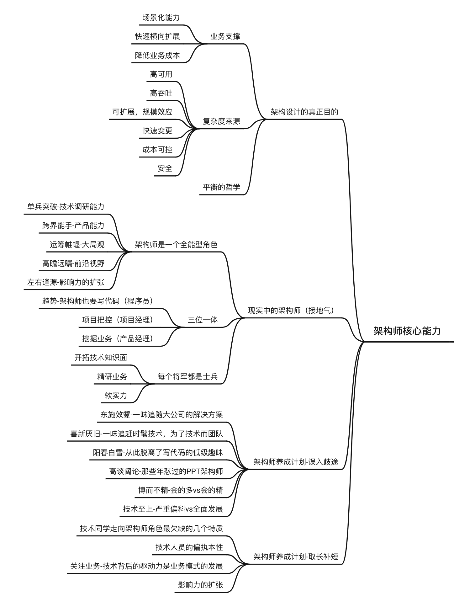

### 1. 架构设计的目的

- 业务赋能-业务场景化能力
- 业务爆发-快速扩展
- 规模效应-通过技术手段降低业务成本

技术->业务 业务驱动

- 高并发
- 高可用-sofamesh（弹性计算）Oceanbase（分布式数据库）Noah（限流/流量整形）灾备、同步、削峰填谷等
- 快速变更-CICD DevOps、容器化、轻量级框架
- 可扩展性-UMP系统
- 安全性-DDos、内部访问控制、鉴权、IP审计
- 成本控制-直接成本（弹性计算）、间接成本&业务效率（人工智能）

### 2. 架构师必备的基本素质

#### 2.1 基本素质

- 单兵突破，技术能力-POC&Hands on/知识迁移（类比、拆解）
- 跨界能力，产品业务-业务模式/新业务点/业务效率
- 运筹帷幄-大局观
- 高瞻远瞩，前沿视野-面向未来架构/技术、生态路线
- 左右逢源-扩张影响力/有人的地方就有江湖

#### **2.2 三位一体**

- 技术人员
- 产品经理
- 项目经理

打破职位界限 Get Things Done！

#### 2.3 塑造三维

- 技术面-源码思想、知识迁移
- 经验业务-转变视角、无中生有
- 软实力-聚光灯、落地能力

#### 2.4 易犯错的点

##### 2.4.1 东施效颦-一味地追寻大公司方案

- 团队素质
- 业务体量
- 经济适用方案
- 技术选型首先参考业务需求

##### 2.4.2 喜新厌旧-追赶时髦技术、为了技术而技术

##### 2.4.3 阳春白雪-从此脱离了写代码的低级趣味

##### 2.4.4 高谈阔论-那些年怼过的PPT架构师

落地层面-短中长期规划、上下游业务依赖梳理、集团资源需求、团队配置、上线后业务开展

- 蓝图
- 交付节点、交付节奏
- 资源计划

##### 2.4.5 博而不精-会的多vs会的精，简历主要写最精通，

- 项目经验-广度
- 难点攻坚-深度

##### 2.4.6 技术至上-严重偏科vs全面发展

##### 2.4.7 看完就忘-务必身体力行

#### 2.5 取长补短-规划自己的架构师路线

##### 2.5.1 沉淀总结

- 固化经验
- 思路方法
- 多走半步
- 分享传播

##### 2.5.2 走进业务

- 转变业务思维
- 闭门造车
- 讲人话

##### 2.5.3 默默无闻

- 影响力传播
- 表达想法
- 向上管理
- 学会拒绝

##### 2.5.4 业务驱动技术

- 解决人工成本-》Automation
- 还有什么没有被挖掘的需求
- 如何通过技术手段提高业务效率
- 思考作为程序员的职责

##### 2.5.5 影响力扩张

- 跳出舒适区-积极跑位才有机会
- 主动承担-主动承担一个项目，为结果负责
- 表达想法-没有想法？还是想的太少

##### 2.5.6 走到聚光灯下

- 大战役
- 火车头
- 敢作为

### 3. 面试题

#### 3.1 大型应用中架构设计的考量点

高可用、吞吐量、扩展性、快速变更、成本平衡和安全性要素

#### 3.2 职业生涯规划的问题，接下来怎么付诸行动

初期强调技术路线

远期转管理路线、培养软实力

技术调研、产品能力、大局观、影响力的构建、业务重要性

#### 3.3 你的什么特质使你脱颖而出

- 避免不必要的错误：架构师的误入歧途
- 软硬实力+业务能力

## 二、架构师的发展方向

### 1 架构师的职业路线

#### 1.1 应用架构师

晋升路线平滑

- 技术底子+大局观
  - 广度+深度跨应用
  - 懂业务-业务抽象能力

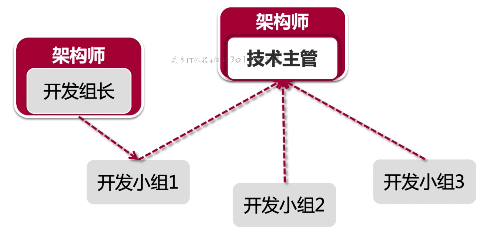

**技能加点**

- 强技术导向-技术敏感度/技术趋势
  - 主流技术栈- 深度/广度
  - 可行性验证
  - 技术选型
- 应用内/跨应用-组件化与模块结构
  - 业务抽象-服务划分
  - 数据结构-对外接口
- 理解业务-做一个用户使用自己的产品
  - 需求分析与拆解（业务理解层次）
  - 持续反馈（业务方 <=> 技术团队）

#### 1.2 业务架构师

业务领域专家

- 支付领域
- 银行间领域
- 商品域
- 营销域

技术领域偏向/最合适的切入点

- 业务建模
  - 业务抽象
  - 领域建模
  - 状态机
  - 工作流

业务领域/解决方案方向-行业资深顾问（强业务导向）

#### 1.3 系统/企业架构师

**宏观层面**

- 路线图
- 技术演进
- 生态、中台

**落地层面**

- 业务执行
- 非业务需求

实干风：里程碑式落地-快速试错

### 2 提升架构师个人视野

#### 2.1 洞察业界技术趋势

**H5**-加快部署速度

理解业务-做一个用户使用自己的产品-通过**分而治之**化解系统复杂度、用户基数

- 测试自动化（测试开发）
- 敏捷实践
- 持续集成快速迭代CICD
- 扁平化团队
- 弹性计算/分段降级

胖瘦客户端

Go语言的兴起

- 简洁
- 快速
- 安全
- 并行

### 3 案例分析

思考每一个事务运行架构逻辑

技术输出能力

业务输出能力

### 4 项目如何落地

#### 4.1 **优先级**

确定重要任务，排出优先级

#### 4.2 **时间表**

根据优先级确定交付节奏，划出里程碑，确保测试范围及周期

#### 4.3 **协调能力**

资源-共同利益（利益共同体）

- 有打法

- 厚脸皮

### 5 面试题

个人职业生涯规划

- 架构师方向是一个几乎不会出错的答案

对架构师能力模型的认识

- 理解业务-业务上的思考
  - 需求分析与拆解
  - 业务对接
  - 领域治理
- 单兵能力（深度+广度）
  - 技术选型
  - 有码在手
  - 组建和模块化结构

所在行业的技术发展趋势/业务发展趋势

- BAT管理岗喜欢问：开放平台是BAT的战略方向
- 中台化的看法
  - 公司的业务方向
  - 借鉴行业第一的经验来回答
  - 管理岗做足功课

**大多情况下，你只能跟直属领导战队**

**从职业发展角度，跟好业务不如跟熟人领导**

**眼界放宽，技术能力不是决定性因素**

## 三、化技术为生产力

拆解技术瓶颈难点

- 三段论（顶层设计、领域划分、分层构件）
- 以分布式事务为例

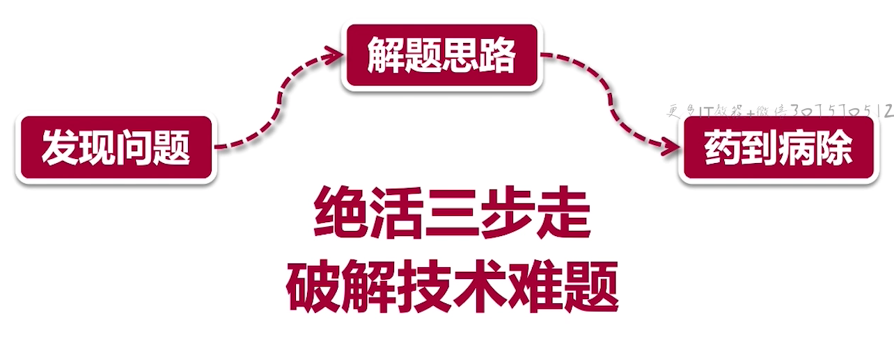

### 1 所有架构问题都是以大化小的问题（抽象能力）

- 举重若轻
- 顶层设计（顶层抽象）
- 一看就懂

### 2 职责领域划分

- 角色：按职责分工划分角色
- 边界：职责边界
- 功能：角色功能

### 3 分层构件解决方案

- 实现方式
- 技术细节
- 一个不漏

### 4 解决问题从转换思维开始

架构师心理建设（nothing is impossible）

- 被动式-》主动式（主动思考问题解决方式，而不去否定）
- 你怎么看？从三个角度看

### 5 面试题

#### 5.1 讲讲你在项目当中碰到的难题

标准错误答案：我技术能力强，没碰到有挑战的

强技术导向、不要讲推进时候的困难

#### 5.2 你是怎么解决他的

有思考有打法：三段论

业务背景-技术痛点-拆解问题以大化小

学到了什么

## 四、围绕业务做技术框架

### 4.1 技术助力业务的两个方向

- 开源
  - 运营-获客、玩法
  - 技术-新业务开发
- 节流
  - 技术手段降低业务成本

**业务技术框架落地的雷区**

闭门造车 vs 持续反馈

技术至上 vs 贴近业务

### 4.2 如何培养业务素质

- 门店轮岗-贴近一线业务培养用户思维
- 店长培训-行业思考、发展方向、一线业务、IT需求
- 用户视角看问题
- 业务部门直接对接研发

业务理解层次决定架构好坏

### 4.3 如何评估子类业务的外包与采购

1. 投入收益曲线

风险隔离到服务商

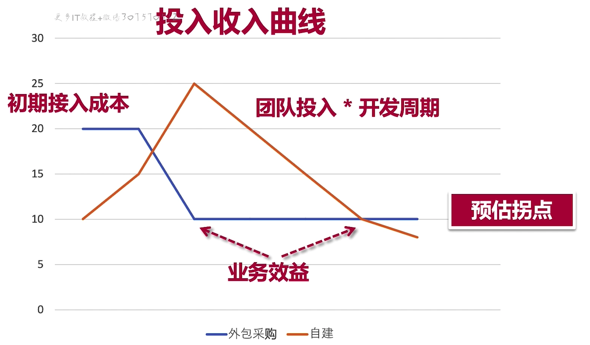

2. 研发资源平衡

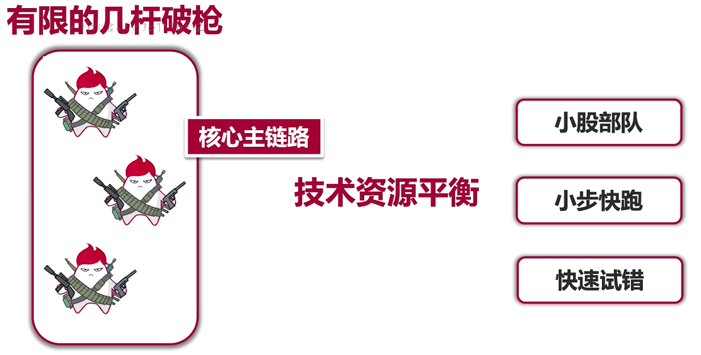

3. 通知业务vs核心业务

掌握核心技术

- 直接盈利业务
- 术业有专攻

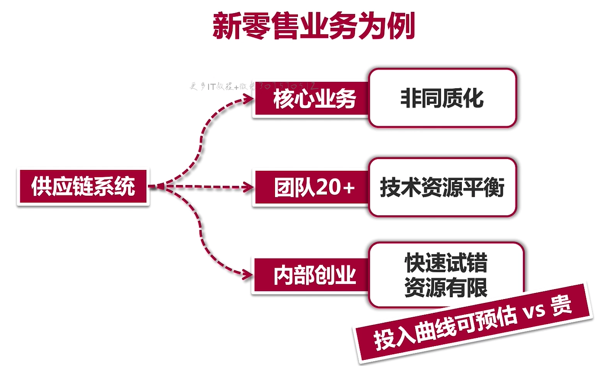

### 4.4 面试题

#### 4.4.1 谈一谈职业发展-基础平台类？or 业务类

10年前：到技术强的部门去（情怀）-技术日新月异

现在：到业务复杂的部门（现实）-真正价值在业务，顶级绩效都是业务团队

#### 4.4.2 聊一聊具体项目

业务为先-先让面试官明白你的业务

技术主线-为什么选用这个技术？和业务的关系

想象空间-未来的改进点，业务量double架构方案

## 五、制定项目技术发展路线图

### 5.1 如何规划短中长期技术路线图

#### 5.1.1 短期：强业务驱动

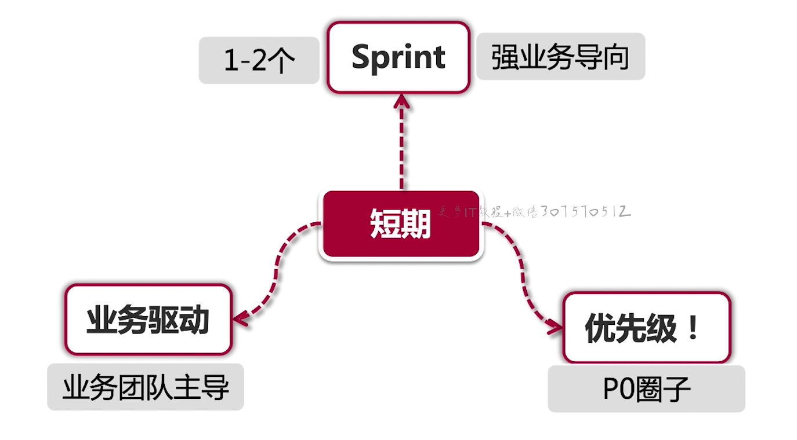

#### 5.1.2 中期：承上启下（业务➕驱动）

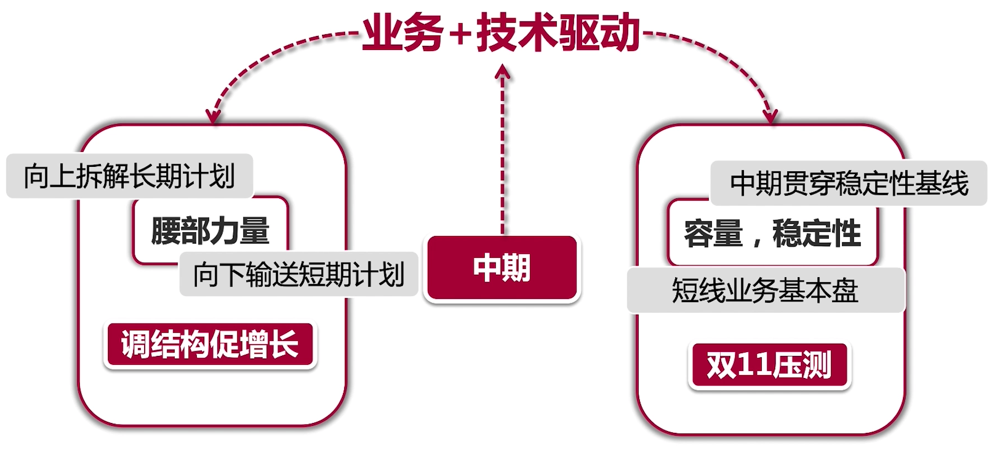

#### 5.1.3 远期：面向未来

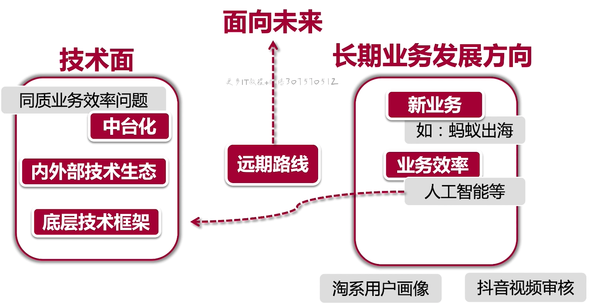   

### 5.2 如何规划面向未来的架构

花小钱办大事，比如：业务增长，稳定性增加，成本减少

技术行业最大的挑战：用户量爆发性增长

#### 5.2.1 容量规划

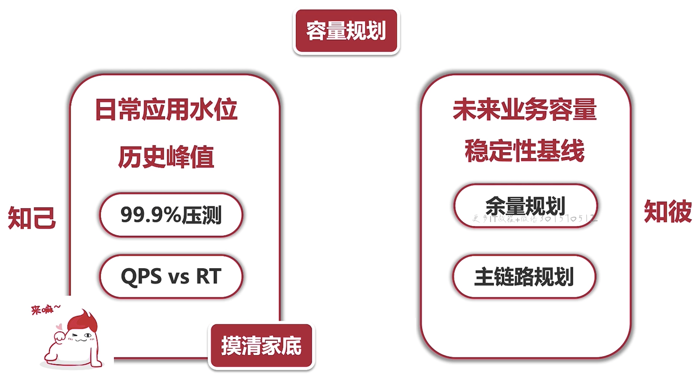

#### 5.2.2 底层技术趋势

**大厂实践**强指导意义

后端主流技术趋势代表了既定标准

选型影响因素

- 轻量级
  - 易接入
  - 易使用
  - 易替换（技术升级）
- 分治理论
  - MVC-》萌芽
  - 微服务-〉深化
- 快速复制扩容-关注技术发展趋势
  - 容器编排

### 5.3 如何调整路线图执行过程中的偏差

- 竞对业务和市场：根据竞对及市场发展及时调整路线图
- 技术层面
  - 要对技术了熟于心，对于技术栈、运维成本、技术替代方案做到心里有数

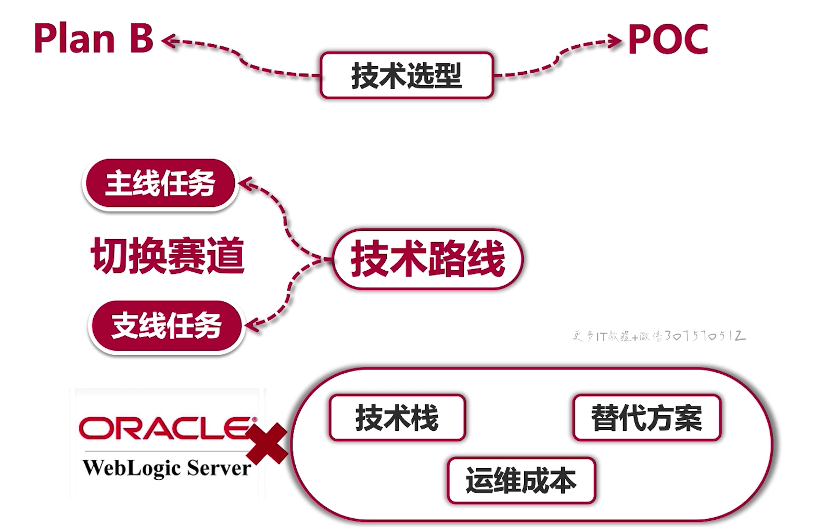

### 5.4 糙快猛之下的敏捷开发

公司敏捷开发对比

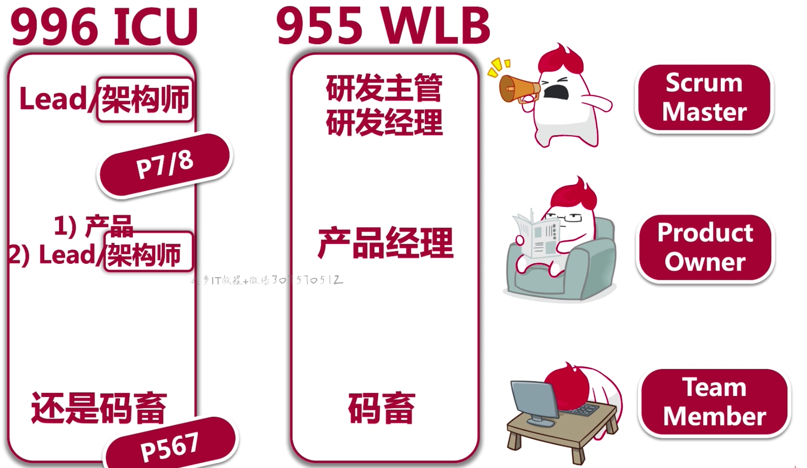

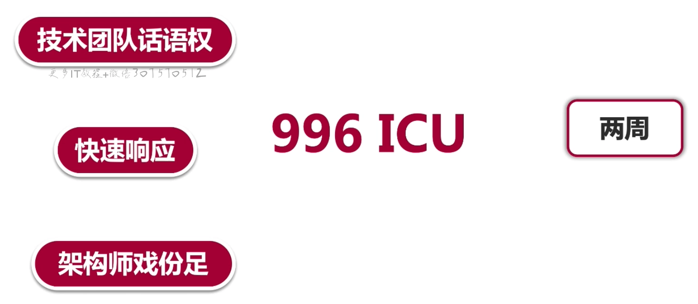

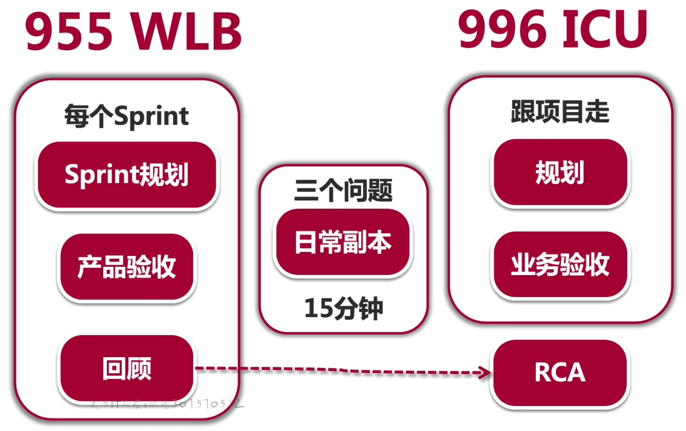

### 5.5 面试题

#### 5.5.1 团队管理岗&架构岗

快节奏的项目迭代下，如何把控交付节奏&项目规划

短期规划-强业务需求（强业务驱动）

中期规划-业务需求+业务量支撑-稳定性规划、双11（技术创新，技术储备）

长期规划-技术反哺业务

#### 5.5.2 探讨当前业务的发展趋势，你的看法

蚂蚁-支付行业的国内、国外机会（业务视野，心机boy）

头条-短视频行业的几种业务模式，在线教育行业的爆发

#### 5.5.3 闷头准备面试宝典？

熟悉目标公司业务模式、竞对、路线

#### 5.5.4 结合现有的业务-谈一谈如何规划面向对象的架构

#### 5.5.5 面试素材-敏捷模式对业务交付节奏的提升
