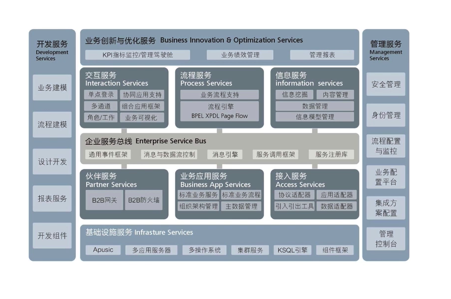
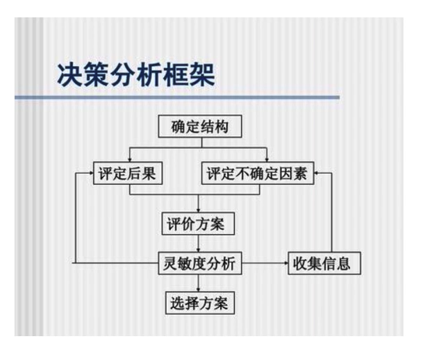
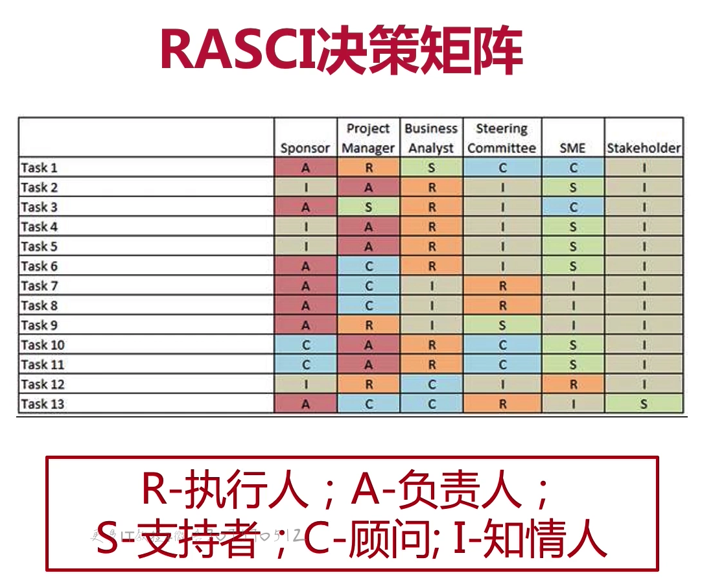

# 架构

软件架构的三种方法

ABSD

DSSA

AT

## 软件架构

### 1. 什么事软件架构？两派之争

#### 组成派

- 代码包、模块、领域、CBM、SOA
- 软件系统架构就是描述计算组件和组件的交互
- 架构设计-拆解、定义、关联组件，画图和实现

#### 决策派

- 架构的真谛是架构决策，是智慧和思维
- 软件系统架构是由一个个决策组成的有机整体
- 架构设计-根据需求、限制决定技术、框架和实现

决策派和组成派在工作中都有，组成派主要以文档架构图为主；而决策派多以会议纪要决策方案为主，多围绕业务及实际情况分析解决问题；

BA大师-结构、元素、内部、外部-

BO大师-组件、连接件、约束，需求和理智

G大师-模块、过程、管道、消息、条件

I大师-组件、关系、环境、结构、演化

J大师-元素、接口、子系统、协作、风格

P大师-处理元素、数据元素、链接元素

W大师-决策、方向、过程

Z大师-组件是我的眼，决策是我的手

### 2. 软件架构的目的

- 桥梁-从产品听众获取灵感
- 指引-指引研发完成系统落地
- 分割-将长篇大作切割成乐章
- 交互-将乐章和声部交叠协奏
- 决策-在思考中挣扎，在决策中完美
- 演进-迭代

### 3. 软件架构的发展

软件架构的过去

- 语言：C、Java、Python、Go
- 结构设计：数据结构、设计模式、算法思想
- 统一建模：UML、CBM

软件架构的现在

- 多视角：逻辑、物理、应用、技术、功能、部署
- 体系框架：ABSD、DSSA、AT

软件架构的未来

- 云化：IaaS、PaaS、SaaS资产复用
- 演进式架构：拆迁者，修缮者，绞杀者

### 4. 架构师面试题

一

题目：作为架构师，你的日常工作主要有哪些

题眼：工作广度；组成和决策；莫扎特6大作用

加分项：方法论完整、新架构框架、新技术框架

二

题目：作为架构师，有什么推崇的书或者大师

题眼：学习能力、知识体系

加分项：体系书籍、新技术书籍、大师互动分享

三

题目：你在架构设计过程中碰到的难点

题眼：案例深度；决策派思路；从莫扎特6大作用出发

加分项：决策依据；理论-》实际-》理论

## 软件架构的意义

### 业务、架构和技术的落地保障

- 业务：跟随业务发展、扫清技术债务
- 架构：架构向前演进、向后兼容
- 技术：技术成熟度、复杂度、买还是建

架起需求到落地的桥梁、构建IT新蓝图

### 沟通、决策、约束、组织、演进、复用的需求

SWOT分析

RASCI决策矩阵 R-执行人 A-负责人 S-支持者 C-顾问 I-知情人

### 案例分享-DeveOps凤凰传奇、OpenGroup认证