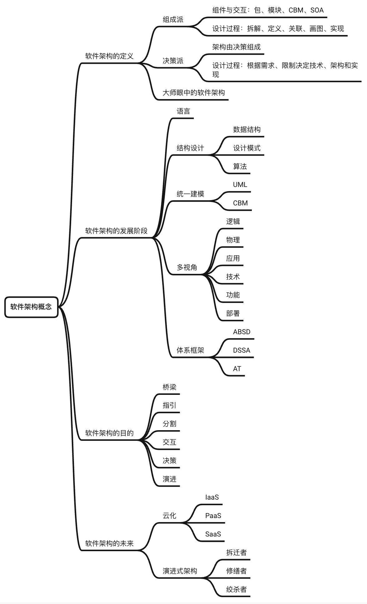
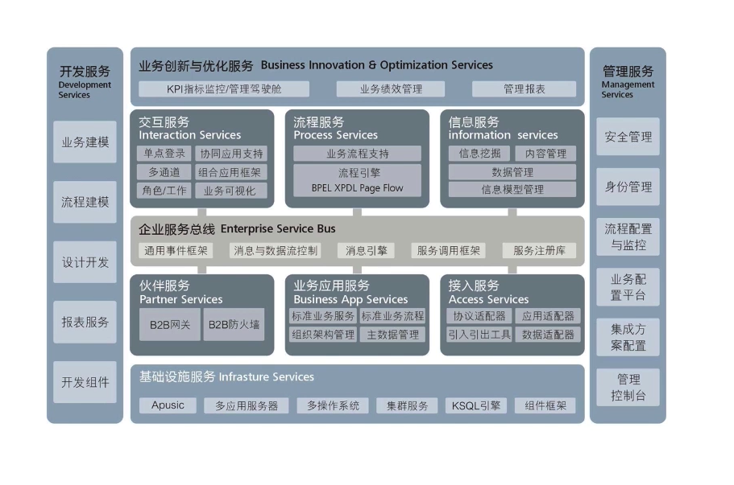
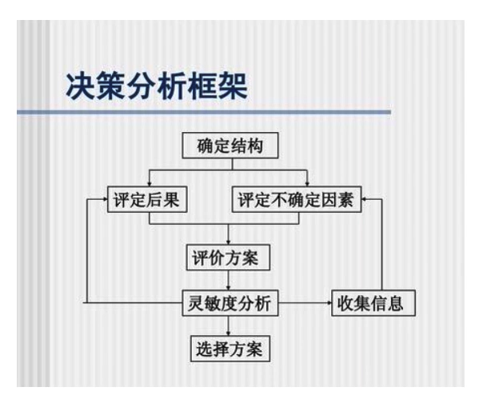
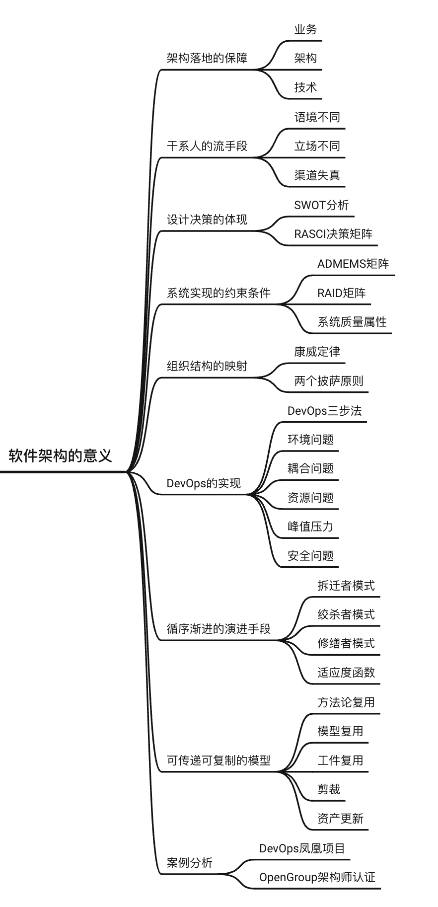
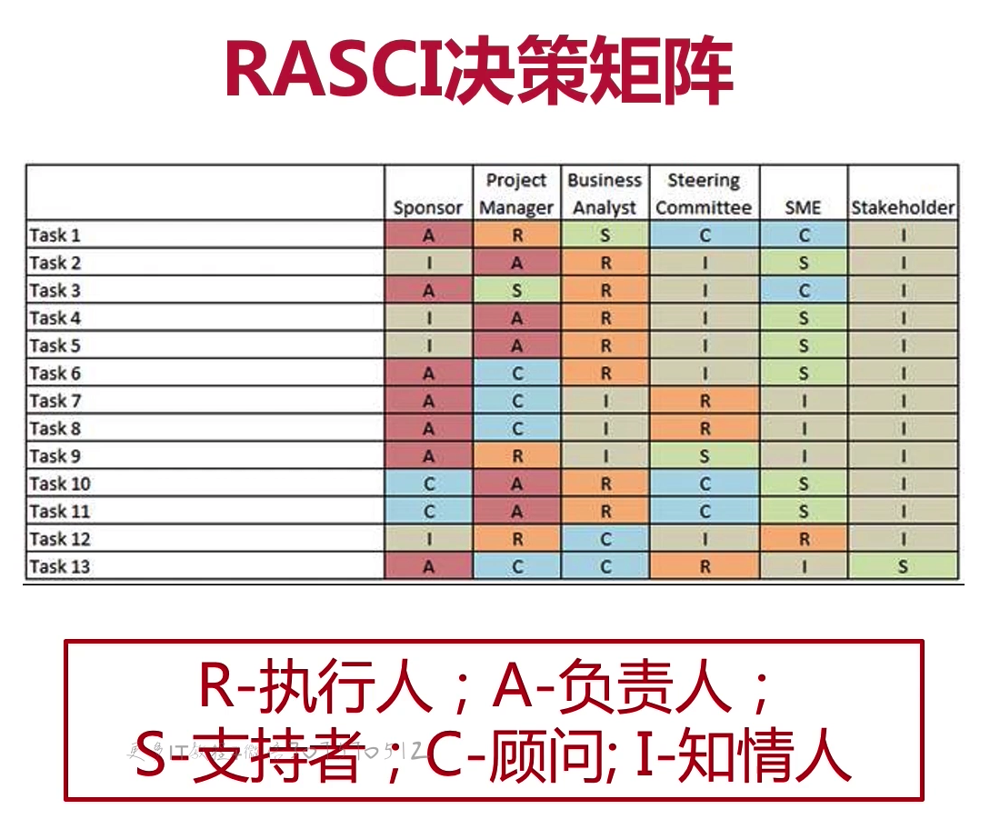
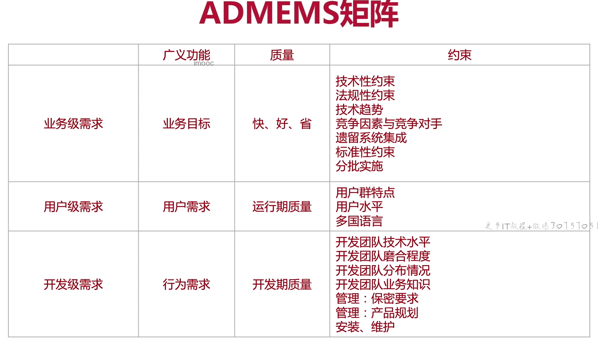
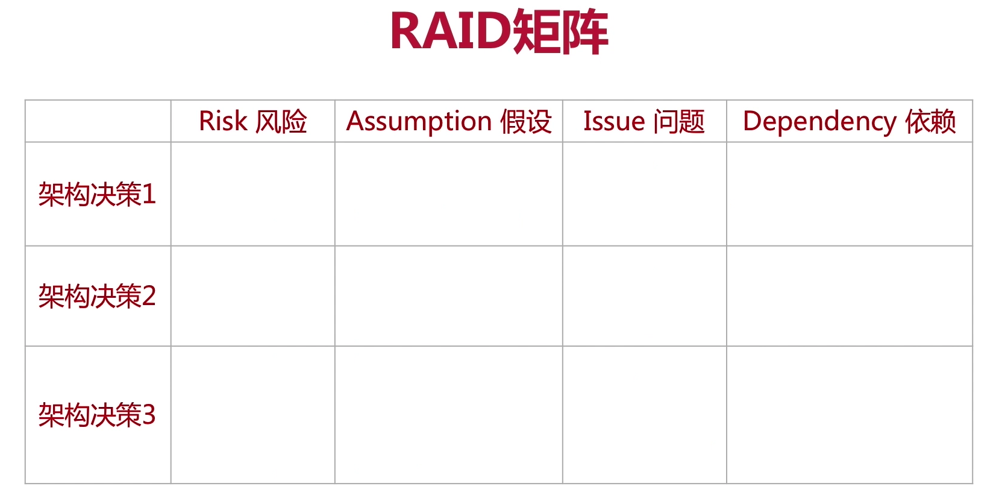

# 架构

软件架构的三种方法

ABSD

DSSA

AT

## 软件架构概念

### 1. 什么是软件架构？两派之争

#### 组成派

- 代码包、模块、领域、CBM、SOA
- 软件系统架构就是描述计算组件和组件的交互
- 架构设计-拆解、定义、关联组件，画图和实现

#### 决策派

- 架构的真谛是架构决策，是智慧和思维
- 软件系统架构是由一个个决策组成的有机整体
- 架构设计-根据需求、限制决定技术、框架和实现

决策派和组成派在工作中都有，组成派主要以文档架构图为主；而决策派多以会议纪要决策方案为主，多围绕业务及实际情况分析解决问题；

BA大师-结构、元素、内部、外部å

BO大师-组件、连接件、约束，需求和理智

G大师-模块、过程、管道、消息、条件

I大师-组件、关系、环境、结构、演化

J大师-元素、接口、子系统、协作、风格

P大师-处理元素、数据元素、链接元素

W大师-决策、方向、过程

Z大师-组件是我的眼，决策是我的手

### 2. 软件架构的目的

- 桥梁-从产品听众获取灵感
- 指引-指引研发完成系统落地
- 分割-将长篇大作切割成乐章
- 交互-将乐章和声部交叠协奏
- 决策-在思考中挣扎，在决策中完美
- 演进-迭代

### 3. 软件架构的发展

软件架构的过去

- 语言：C、Java、Python、Go
- 结构设计：数据结构、设计模式、算法思想
- 统一建模：UML、CBM

软件架构的现在

- 多视角：逻辑、物理、应用、技术、功能、部署
- 体系框架：ABSD、DSSA、AT

软件架构的未来

- 云化：IaaS、PaaS、SaaS资产复用
- 演进式架构：拆迁者，修缮者，绞杀者

### 4. 架构师面试题

#### 4.1 作为架构师，你的日常工作主要有哪些

题眼：工作广度；组成和决策；莫扎特6大作用

加分项：方法论完整、新架构框架、新技术框架

#### 4.2 作为架构师，有什么推崇的书或者大师

题眼：学习能力、知识体系

加分项：体系书籍、新技术书籍、大师互动分享

#### 4.3 你在架构设计过程中碰到的难点

题眼：案例深度；决策派思路；从莫扎特6大作用出发

加分项：决策依据；理论-》实际-》理论

## 软件架构的意义

### 1. 业务、架构和技术的落地保障

- 业务：跟随业务发展、扫清技术债务
- 架构：架构向前演进、向后兼容
- 技术：技术成熟度、复杂度、买还是建

架起需求到落地的桥梁、构建IT新蓝图

### 2. 沟通、决策、约束、组织、演进、复用的需求

SWOT分析

RASCI决策矩阵 R-执行人 A-负责人 S-支持者 C-顾问 I-知情人

#### 2.1 架构明确对系统实现的约束条件

##### 2.1.1 架构制约系统质量属性

- 扩展性
- 性能，可用性
- 安全性，耦合性
- 伸缩性
- 易用性
- 可维护性
- 可移植性
- 可操作性
- 可重用行

#### 2.2 架构决定了开发和维护组织的结构

DevOps

- flow流畅
- feedback反馈
- learning学习

#### 2.3 架构师可传递、可复用的模型

- 方法论服用（ABSD、DSSA、AT、EA、TOGAF）
- 模型复用（UML、SOA、CBM）
- 工件复用（素材、图片、表格、图标、文件）
- 剪裁（三七原则，保留30%还是70%，建议30%）
- 架构资产更新（内部资产库、外部架构社区）

### 3. 案例分享

#### 3.1 DeveOps凤凰传奇

- 如何解决环境问题：开发/QA和生产的不匹配
- 如何解决耦合问题：凤凰项目和传统系统耦合
- 如何决绝资源共用问题：关键人员疲于在多项目中切换
- 如何满足峰值需求：突发性业务需求/性能测试需求
- 如何解决安全问题：最小代价完成安全合规审计

#### 3.2 OpenGroup认证

两大认证类型

- TOGAF企业架构（广度、知识点、案例分析、笔试）
- Master Architect主架构师认证（应用架构、数据架构、集成架构、技术架构）

主架构师认证

- 三个完整方法论案例（需求、涉及、风险、决策、结果）
- 20+架构师评测点（各2-3个案例论证）
- 评测重点：方法论、模型的复用，架构资产的贡献

### 4. 架构师面试题

#### 4.1 作为架构师，遇到部门冲突如何解决

题眼：决策派，语境、立场、沟通渠道处理，架构决策

加分项：方法论完整（通用语言、RASCI决策、SWOT分析）

#### 4.2 作为架构师，平时的设计重点关注哪些因素

题眼：质量（扩展性、性能、可用性、安全性、耦合度）

加分项：多角度分析、实际案例侧重点清晰

#### 4.3 作为架构师，如何处理新架构和老架构之间的冲突

题眼：解决技术债，新老架构演进策略

加分项：多模式使用（拆迁、修缮、绞杀）、冲突预防

#### 4.4 描述一个应用架构师怎么演进的

题目：作为架构师，挑选一个你的实战项目，描述该应用架构如何随着组织架构的变化而演进的

题眼：

加分项：

#### 4.5 如何挑选框架、涉及模式、架构风格、软件包等

题目：挑选一个项目，描述该项目中，你如何挑选、复用和剪裁合适的架构设计框架、设计模式、架构风格、软件包？

题眼：

加分项：

