# 架构设计核心维度

## 1. 边界、内聚、耦合

### 1.1 概述

What：确认系统边界，定义内聚耦合，如何实现高内聚低耦合

Why：分久必合、合久必分-解耦，架构师永远的主题

How：理论分析、案例分享、面试实战

### 1.2 边界

系统边界、领域边界

子系统（子域）边界、模块边界、聚合边界

分层边界

### 1.3 聚焦内聚

一个模块中各个组件/类的关系

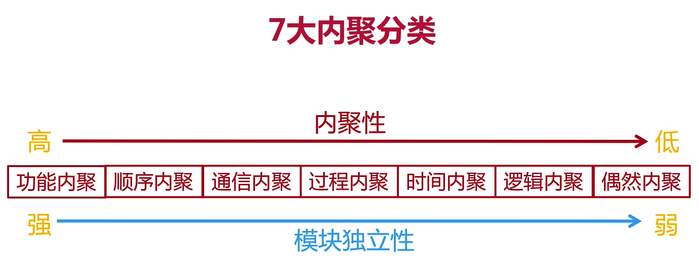

#### 1.3.1 功能内聚

- 模块个组成部分执行同一个功能

- 只执行这一个功能

- 专一在这个功能上

#### 1.3.2 顺序内聚

- 前一组成部分完成后，后一组成部分继续
- 前一模块的输出，时候一模块的输入

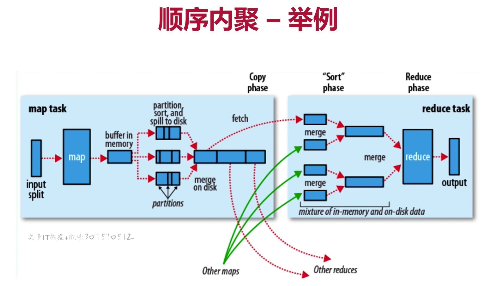

#### 1.3.3 通信内聚

- 模块各部分使用相同输入或输出数据

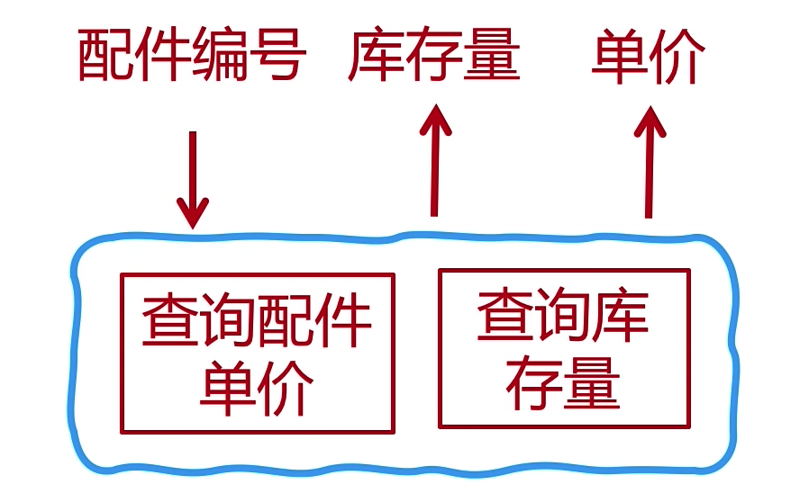

#### 1.3.4 过程内聚

- 模块各部分受同一控制流支配

#### 1.3.5 时间内聚

- 模块各组成部分在同一时间段内执行
- 模块整体在特定时间内完成
  - 例如：某一功能的初始化单元和终止单元

#### 1.3.6 逻辑内聚

- 各组件的逻辑功能类似
- 由传输给模块的判断参数来确定

#### 1.3.7 偶然内聚

- 模块各组成部分彼此没有关联
- 各组成部分刚好放在同一模块

### 1.4 关注耦合

多个模块之间的关系

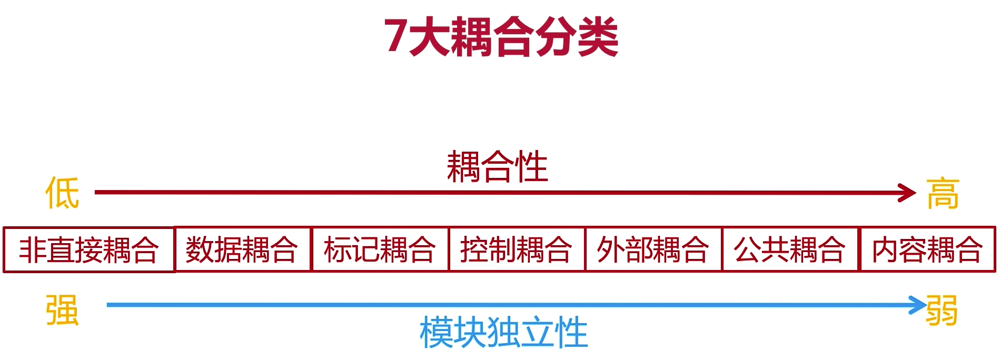

#### 1.4.1 非直接耦合

- 两个模块没有直接关系
- 模块独立性最强

#### 1.4.2 数据耦合

- 两个模块之间有数据值（参数）传递
- 模块间影响最小的耦合关系

#### 1.4.3 标记耦合

- 两个模块与同一个数据结构有关
- 传递的是数据结构或数据结构的地址

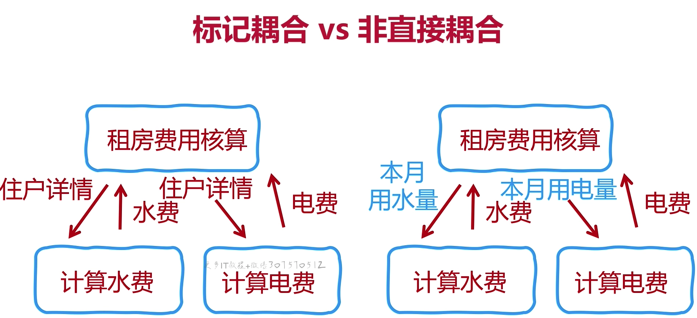

#### 1.4.4 控制耦合

- 两个模块之间传输控制信息（如开关、标志等）
- 调用模块需要知道被调用模块的内部逻辑
- 增加了相互依赖和理解、编程的复杂度

#### 1.4.5 外部耦合

- 一组模块均与外部环境相关联
- 这组模块访问同一全局变量
- 外部耦合有时候必不可少，但应尽量较少此类模块数量

#### 1.4.6 公共耦合

- 一组模块均访问同一全局数据区
- 公共耦合是一种不良耦合，它给模块维护、修改带来障碍

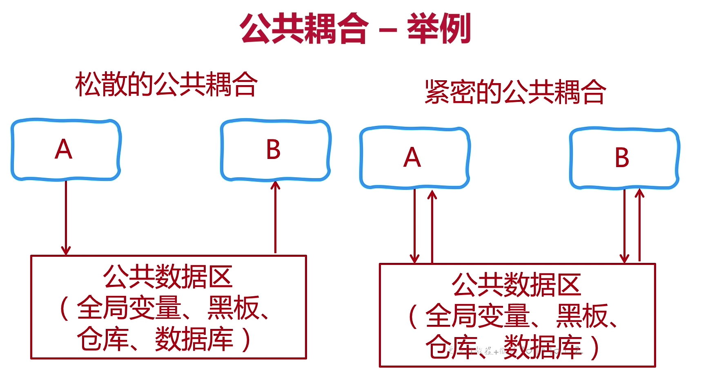

公共耦合的弊端：

- 软件可理解性降低：模块间关系复杂
- 公共软件可维护性降低：修改变量名和属性困难
- 软件可靠性降低：公共区域和全部变量无保护措施

#### 1.4.7 内容耦合

- 一个模块直接操作或修改另一模块的内部数据
- 一个模块不通过正常入口访问另一模块
- 最走高的耦合情况，必须避免

### 1.5 高内聚、低耦合

#### 1.5.1 耦合关注点

- 一个模块对另一个模块的调用
- 一个模块向另一个模块传递的数据量
- 一个模块施加到另一个模块的控制的多少
- 模块之间接口的复杂程度

#### 1.5.2 低耦合原则

1. 多用接口隐藏实现的细节
2. 遵循一个定义只在一个地方出现
3. 少使用全局变量
4. 少使用public，多用private关键字
5. 多用设计模式
6. 避免直接用SQL语句操作数据库
7. 避免直接操作或调用其他模块或类（内容耦合）
8. 尽量使用数据耦合，少使用控制耦合
9. 限制公共耦合的范围

#### 1.5.3 高内聚原则

1. 模块的功能划分尽可能的单一（单一职责原则）
2. 模块只对外暴露最小限度的接口（接口隔离原则）
3. 一切向功能内聚靠拢，杜绝偶然内聚

### 1.6 案例分析-内聚耦合规划不当反面教材

 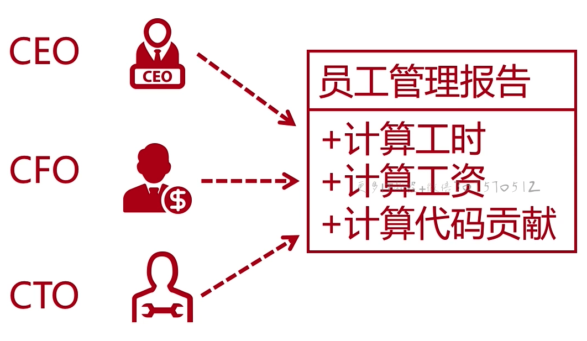

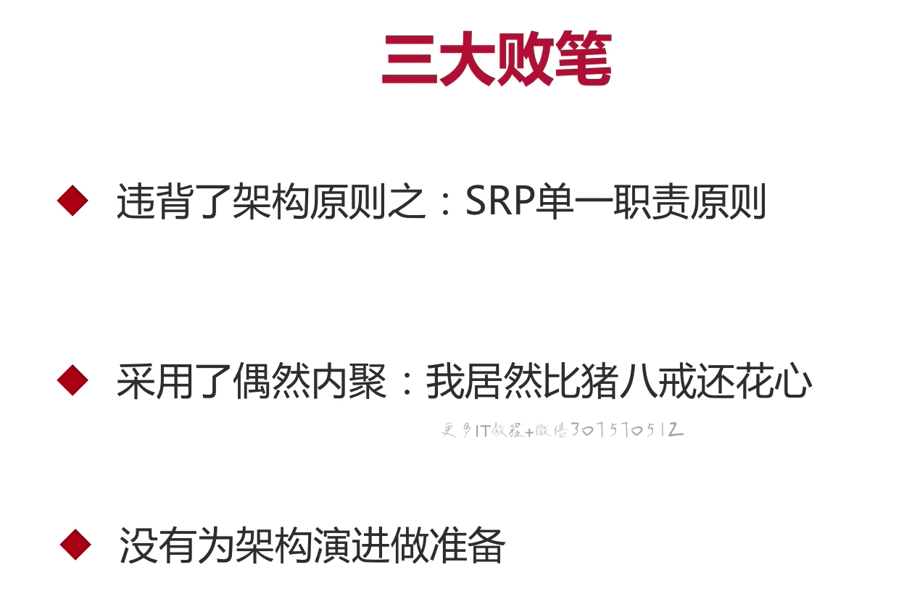

循环依赖问题

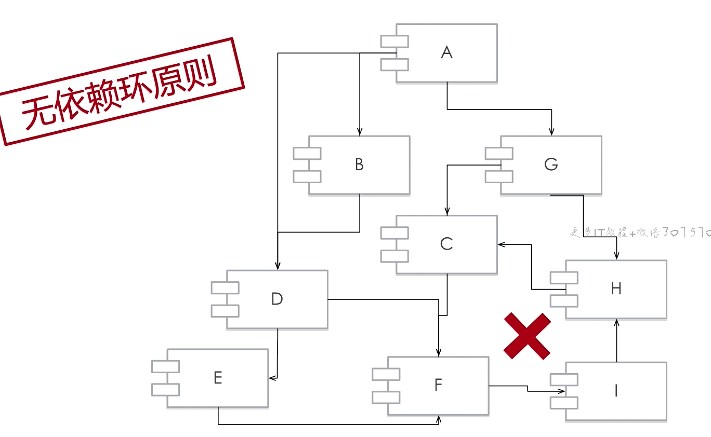

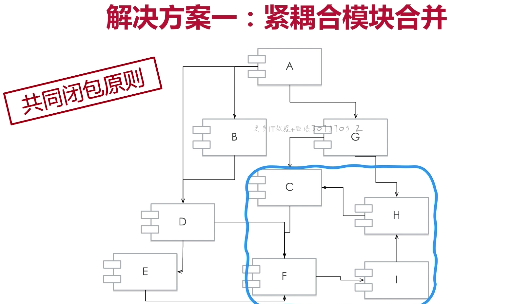

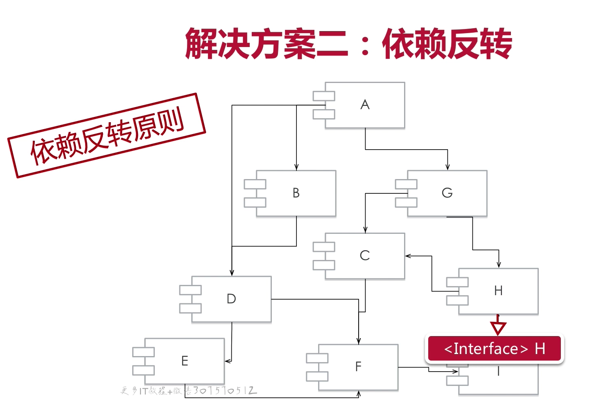

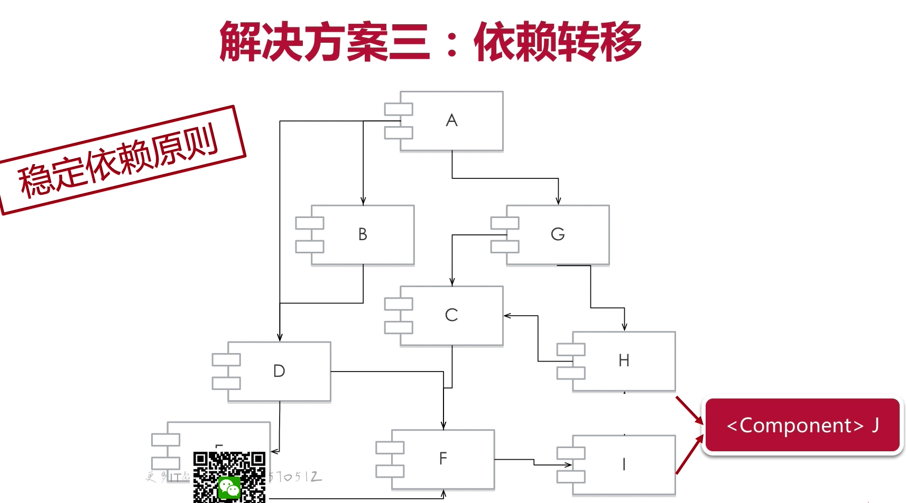

### 1.7 面试题

#### 1.7.1 题目：你在架构设计中如何划分系统边界？

题眼：需求驱动、领域驱动

加分项：结合ABSD、DSSA、AT等方法论，定制化剪裁

#### 1.7.2 题目：你在架构设计中如何定义和设计各个模块的？

题眼：高内聚低耦合、结合需求和领域

加分项：能结合实际案例，聊聊模块交互的成与败

#### 1.7.3 题目：如何减少主业务代码对于中间件等的依赖？

题目：我们公司的中间件和数据库系统会不定期的升级和替换，如何减少主业务代码对于这些系统的依赖？

题眼：模块间解耦、减少领域模块的对外依赖

加分项：结合依赖反转原则、稳定依赖原则，分析模块间交互

#### 1.7.4 题目：对于平时负责的子系统如何重构，实现高内聚低耦合？

#### 1.7.5 题目：故事分享：分享一下模块紧耦合的坑？

## 2. 扩展性维度

### 2.1 概述

What：架构扩展性（应用、数据）、组织扩展性、流程扩展性

Why：大型电商平台西天取经的九九八十一难

How：理论分析、案例分享、面试实战

### 2.2 扩展方法论

#### 2.2.1 无脑克隆

特点：

- 可以简单复制的业务
- 人多力量大的业务
- 失败后随时可以重来

#### 2.2.2 功能分割

特点：

- 分割责任、功能和数据
- 流水线责任制
- 与业务模块、组件的划分相关

#### 2.2.3 用户分割

特点：

- 分割请求者和客户
- 对于业务透明
- 提供优先级服务
- 提供就近服务

### 2.3 应用扩展

#### 2.3.1 横向克隆

- 无状态应用，多节点克隆复制
- 负载均衡器，控制业务负载流向
- 有状态应用，状态剥离（比如Session的处理）

特点：

- 弹性扩缩容
- 性能规划
- 业务解耦
- 环境同构

#### 2.3.2 服务分割

- 前端应用拆分分割，URL拆分
- 后段应用，子系统、模块、聚合拆分
- 后台数据相应进行Y轴分割

特点：

- 服务互不干扰
- 资源迭代分配
- 数据一致性
- 应用业务耦合性

#### 2.3.3 特征分割

- 用户UserId分割，多节点水平复制
- 地理位置分割，Set单元化
- 产品ID分割，SPU/SKU

特点：

- 加速查询搜索
- 有状态服务
- 业务解耦
- 环境同构

#### 2.3.4 实际应用扩展

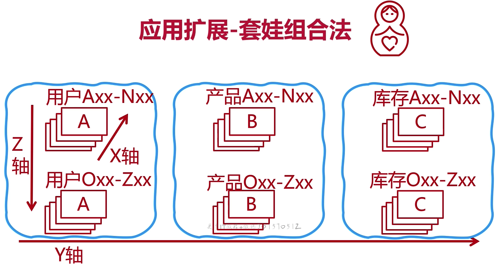

