# 计算机系统架构与设计底层原理 · 全景知识体系 + 通用方案 + 大厂面试题库

> **文档定位**：一份"能从底层原理讲到工程落地、再从落地讲到面试作答"的架构总纲。
> **适用人群**：后端 3-10 年工程师、架构师、中间件/分布式方向、准备大厂面试（阿里 / 字节 / 腾讯 / 美团 / 快手 / 百度 / 京东 / 滴滴 / 网易 / 拼多多 / 华为）。
> **版本**：v1.0 ｜ 整理日期：2026-11-20 ｜ 全文含 20+ 架构风格、30+ 论文索引、40 道高频面试题（含考核度标注）。
> **阅读建议**：
> - 想建立体系 → 第 1 章（第一性原理）→ 第 2 章（风格谱系）→ 第 3 章（分布式理论）
> - 想直接查方案 → 第 4 章（通用方案库，含速查表）
> - 想看前沿/写论文/做技术选型 → 第 5 章（先进思路 + 论文清单）
> - 想刷面试 → 第 6 章（按主题分组，每题带考核度、参考答、追问链）
> - 做架构评审 → 附录 B（30 项 Review Checklist）

---

## 目录

| 章节 | 内容 | 核心产出 |
|---|---|---|
| 第 1 章 | 架构的本质与第一性原理 | 9 个原子操作、5 类约束、可扩展性公式 |
| 第 2 章 | 架构风格谱系（20 种） | 每种模式的结构图 / 场景 / 优缺点 / 规避 / 演进 |
| 第 3 章 | 分布式系统底层理论 | CAP→PACELC、一致性谱系、共识、事务、时钟 |
| 第 4 章 | 通用架构设计方案库 | 高可用 / 高性能 / 高扩展 / 一致性 / 交付 5 大类模式 |
| 第 5 章 | 更先进的设计思路与论文 | 25 篇关键论文 + 12 个前沿方向 |
| 第 6 章 | 大厂面试题库（40 题） | 考核度 ★1-★5 + 详细过程 + 原理 + 延伸 + 追问 |
| 附录 | 术语表 / 评审清单 / 学习路径 / 一页纸速查 | 可直接落地的工具 |

---

# 第 1 章 架构的本质：约束下的权衡

## 1.1 什么是"架构"——一个可判定的定义

**架构 = 在给定约束（成本、人力、时间、一致性、合规、技术栈）下，对系统的「边界、组件、通信、数据、部署、演进」所做出的一组"改起来很贵"的决策。**

这个定义里最重要的判据是**"改起来很贵"**。它把架构决策和普通编码决策区分开：

| 决策类型 | 例子 | 改造成本 | 是否架构决策 |
|---|---|---|---|
| 编码风格 | 用 for 还是 stream | 分钟级 | 否 |
| 模块内重构 | 抽一个 Util 类 | 小时级 | 否 |
| 接口协议 | HTTP/JSON → gRPC/Protobuf | 周～月，需多方联调 | **是** |
| 数据模型 | 用户表拆分为账户+身份+权益 | 月～季，需数据迁移+双写+对账 | **是** |
| 部署形态 | 单体 → 微服务 → 单元化 | 季～年，组织结构都会变 | **是** |
| 一致性模型 | 强一致 → 最终一致 | 不可逆（业务语义变了） | **是（最贵）** |

**推论**：架构能力 = **识别哪些决策是"贵"的，并在信息最不充分的时候把它们做对**。这就是为什么架构师的核心竞争力不是"会多少框架"，而是"知道哪些坑一旦踩了爬不出来"。

## 1.2 五类根本约束（所有架构设计的底层"物理定律"）

架构没有"最优解"，只有"在某组约束下的可行解"。约束只有五类，但要先能量化。

### 约束一：物理定律（不可谈判）

**（1）光速 = 分布式系统的最终 Boss**

光纤中光速约 20 万 km/s（折射率 ~1.47），加上设备转发、协议栈处理，实际链路延迟远高于理论值：

| 距离 | 理论单向 | 实际 RTT（含设备） | 架构含义 |
|---|---|---|---|
| 同机架 | ~5 ns | 0.05–0.1 ms | 可做同步复制 |
| 同城（50 km） | 0.25 ms | 1–3 ms | 可做同步复制、同城双活 |
| 北京-上海（1200 km） | 6 ms | 10–20 ms | 同步写会放大 10 倍延迟，慎用 |
| 北京-美西 | ~70 ms | 150–200 ms | **只能异步**，强一致不可行 |
| 跨洲（含海底光缆绕行） | — | 200–300 ms | 必须做"区域自治 + 异步收敛" |

**结论**：**"异地多活"的本质不是技术问题，而是承认光速、把一致性范围收缩到"单元内"**（详见 4.1.4 单元化）。

**（2）延迟金字塔（Jeff Dean Numbers，2024 版量级）**

| 操作 | 延迟 | 相对 L1 |
|---|---|---|
| L1 cache 命中 | ~1 ns | 1× |
| L2 cache | ~4 ns | 4× |
| L3 cache | ~12–20 ns | 15× |
| 主存（DRAM）随机读 | ~80–120 ns | 100× |
| NUMA 跨 socket 访存 | ~200 ns | 200× |
| SSD 随机读（4K，NVMe） | 16–100 μs | **10^5×** |
| 机械盘寻道 | 2–10 ms | 10^7× |
| 同机房网络 RTT | 100–500 μs | 10^5× |
| GPU HBM 带宽 | 1–3 TB/s | 吞吐维度的另一套规则 |

**这条表就是"为什么要有缓存、批处理、异步、零拷贝、顺序写"的全部理由**：一次磁盘随机 IO ≈ 10 万次 L1 命中；一次跨机房 RTT ≈ 1000 次内存访问。所有性能优化，本质都是**把访问"降级"到更靠近 CPU 的层级，或把 N 次小访问合并成 1 次大访问**。

**（3）内存墙与 CPU 流水线**

- CPU 频率 2005 年后基本停在 3–5 GHz，内存带宽增长远慢于算力 → **算力免费、访存昂贵**。这就是"缓存友好 = 高性能"的根因。
- **缓存行 64 Byte + 伪共享（False Sharing）**：两个线程改同一缓存行内不同变量，会导致缓存行在核间反复失效。规避：`@Contended`（Java）、padding、按线程分槽（`LongAdder`）。
- **NUMA**：跨 socket 访存延迟翻倍、带宽减半。规避：绑核（CPU pinning）、NUMA-aware 分配、大页（HugePage 减少 TLB miss）。

**（4）IO 的两种世界**

- **HDD**：顺序写 100–200 MB/s，随机 IOPS ~100–200。→ 必须 **LSM-Tree（追加写）/ WAL / 日志结构**。
- **SSD**：随机 IOPS 万级～十万级，但**写放大**与**寿命（DWPD）**是新约束；随机写仍有"写放大+GC"代价。
- **网络**：带宽不是瓶颈时，**包数（PPS）与 RTT** 才是瓶颈。

### 约束二：成本（纵向扩展的边际成本递增）

| 扩容方式 | 成本曲线 | 上限 | 典型做法 |
|---|---|---|---|
| Scale Up（纵向） | 边际成本指数上升（高端小型机/大内存机型） | 单机核数、内存带宽、故障域 | 数据库主库、缓存大实例 |
| Scale Out（横向） | 边际成本线性，但**协调成本超线性** | 一致性开销、运维复杂度 | 无状态服务、分片存储 |
| Scale Cell（单元化） | 成本近似线性，故障域可控 | 需要业务可拆分 | 交易/支付/IM 的主流解法 |

### 约束三：人（康威定律，Conway's Law, 1968）

> "系统的结构必然与其组织沟通结构同构。"

- 沟通路径数 = n(n-1)/2，10 人团队 45 条，100 人 4950 条 → ** Brooks：沟通成本随人数平方增长**。
- **推论**：微服务的边界应当对齐**团队边界**（两个 pizza 团队），而不是对齐"技术上的完美分层"。反过来，**组织不拆分而硬拆服务，必然产生"分布式单体"**（最坏的结果：既有分布式复杂度，又无自治收益）。

### 约束四：业务的不确定性

- 需求变化速率决定"抽象层数"：变化快的部分要抽象（可插拔），变化慢的部分要固化（性能优先）。
- **架构的可逆性设计**：把"可能变"的放外层（策略/配置/规则引擎），把"不会变"的放内层（领域不变量）。

### 约束五：时间（技术债的复利）

技术债利息 = 每次需求变更时额外花费的时间。它在**指数增长**（改动点随耦合度平方增长）。所以"先上线后重构"的策略只在**债务可隔离**时成立。

## 1.3 第一性原理：架构的 9 个原子操作

**所有架构模式，都是下面 9 个原子操作的不同组合。** 记住这一句，第 2 章的 20 种模式就不用背了——只需识别"它用了哪几个原子操作"。

| # | 原子操作 | 本质 | 解决的问题 | 典型载体 |
|---|---|---|---|---|
| 1 | **拆（Partition）** | 把大问题切成互不干扰的小问题 | 单点容量上限、故障域过大 | 分片、微服务、单元化、Cell |
| 2 | **合（Aggregate / Batch）** | 把 N 次小开销合并为 1 次大开销 | 固定开销占比过高（网络/磁盘/事务） | 批处理、组提交、BFF、消息批量、向量化 |
| 3 | **抽象（Abstract）** | 用稳定接口隔离易变实现 | 变化传染 | 端口-适配器、防腐层（ACL）、协议 |
| 4 | **复制（Replicate）** | 用空间换可用性与读吞吐 | 单点故障、读扩展 | 主从、多副本、纠删码、多活 |
| 5 | **缓存（Cache）** | 利用时间/空间局部性 | 昂贵资源被重复访问 | 多级缓存、页缓存、结果缓存 |
| 6 | **异步（Decouple in Time）** | 切断调用方与被调方的时间耦合 | 长尾延迟、峰值冲击、强依赖 | MQ、事件、回调、Future、Saga |
| 7 | **有序（Serialize）** | 让并发变成串行，消除竞争 | 并发写冲突、乱序 | 单写者、分区内单线程、日志、Actor |
| 8 | **幂等（Idempotent）** | 让"重试"变得安全 | 网络不可靠导致的重复 | 唯一键、状态机、版本号、Token |
| 9 | **观测（Observe）** | 把系统状态变成可度量信号 | 不可见的故障、无法调优 | Metrics/Trace/Log、SLO、影子流量 |

**组合示例**（这就是"看懂架构"的方法）：

- **Redis 单线程模型** = 有序（单线程串行）+ 缓存（内存）+ 合（pipeline/批处理）+ 异步（epoll 事件驱动）
- **Kafka** = 拆（partition）+ 有序（分区内追加写）+ 合（批量发送/零拷贝）+ 复制（ISR）+ 异步（生产者缓冲）
- **Spanner** = 拆（Paxos Group）+ 复制（多副本）+ 有序（TrueTime 定序）+ 抽象（SQL 层）
- **单元化（Set 化）** = 拆（按用户维度切单元）+ 复制（单元内多副本）+ 异步（单元间异步同步）+ 幂等（跨单元消息去重）

## 1.4 定量思维：三个必须会算的公式

### （1）Amdahl 定律（固定问题规模）

```
加速比 S(n) = 1 / ((1 - p) + p / n)
```
- `p` = 可并行比例。若 p = 0.95，n → ∞ 时 S = 20。**即：5% 的串行部分，锁死了 20 倍上限。**
- 工程含义：**优化瓶颈**比"全面优化"收益高一个数量级；找串行点（锁、单库、单队列、单写者）就是找上限。

### （2）Gunther 通用可扩展性定律（USL，1993）

```
C(N) = N / (1 + σ(N-1) + κN(N-1))
```
- `σ` = 串行争用系数（锁、单点资源），`κ` = 一致性/交叉开销系数（缓存同步、分布式协调、跨节点通信）。
- **存在吞吐峰值**：`N* = sqrt((1-σ)/κ)`，超过 N* 再加机器，吞吐**下降**。
- 数字示例：σ = 0.05、κ = 0.001 → N* ≈ √(0.95/0.001) ≈ **31 台**。第 32 台开始负收益。
- 工程含义：**"加机器"有天花板；要提升上限，必须降 σ（去锁/去单点）或降 κ（减少跨节点协调、改最终一致）**。这解释了为什么"分布式锁"和"全局事务"是扩展性的头号杀手。

### （3）容量估算三步法

```
峰值 QPS   = 日均 QPS × 峰值系数(3~10)
带宽       = 峰值 QPS × 平均报文大小 × 8 (bit)
存储(年)   = DAU × 人均行为数 × 单条大小 × 365 × 副本数 × (1 + 索引膨胀 30%~100%)
连接数     = QPS × 平均 RT(用 Little 定律: L = λW)
线程/协程  = 连接数 × (1 + 阻塞比例)
```

**Little 定律（L = λW）**是容量规划最有用的一条：**QPS 10 万、RT 20 ms → 并发请求数 = 100000 × 0.02 = 2000**。所以"支撑 10 万 QPS"不等于"要 10 万线程"，2000 个并发处理单元足够——这是 IO 多路复用/协程存在的定量理由。

## 1.5 架构的演进观：架构是"长"出来的，不是"设计"出来的

三个必须承认的事实：

1. **架构随业务演进**（Conway）：初期正确的架构，在规模翻 100 倍后必然错误。所以架构设计的目标不是"一次做对"，而是**"让下次改动便宜"**。
2. **架构腐化（Architecture Drift）**：模块边界被"顺手"跨越、循环依赖、共享数据库、隐式耦合——腐化是熵增，必须主动治理（依赖门禁、架构守护测试 ArchUnit、定期重构）。
3. **演进优于革命**（Strangler Fig，绞杀者模式）：新系统像藤蔓一样从边界包住旧系统，逐条流量迁移，最后旧系统自然枯死。**这是所有"不停机重构"的唯一安全范式**（见第 6 章 Q33）。

> **一句话总结第 1 章**：架构 = 在光速、成本、人、不确定性、时间五类约束下，用 9 个原子操作做出的、改起来很贵的决策集合；而这些决策的优劣，最终由 Amdahl/USL 这类"数学"而非"感觉"来判定。


---

# 第 2 章 架构风格谱系：20 种模式的底层逻辑

> 本章用一个统一模板拆解每种架构：**定义 → 结构 → 适用 → 优点 → 代价 → 怎么坏（失效模式）→ 怎么规避 → 演进方向**。
> 记住第 1 章的 9 个原子操作，你会发现每种模式只是其中 2–4 个的组合。

## 2.1 谱系总图

```mermaid
graph TD
    A["架构风格谱系"] --> B["组织维度: 代码怎么分"]
    A --> C["交互维度: 组件怎么通信"]
    A --> D["部署维度: 进程/机器怎么放"]
    A --> E["数据维度: 数据怎么存与流"]

    B --> B1["分层单体 Layered Monolith"]
    B --> B2["模块化单体 Modular Monolith"]
    B --> B3["SOA / ESB"]
    B --> B4["微服务 Microservices"]
    B --> B5["六边形 / Clean / DDD"]
    B --> B6["插件化 微内核"]

    C --> C1["同步 RPC / REST / gRPC"]
    C --> C2["事件驱动 EDA"]
    C --> C3["CQRS / 事件溯源"]
    C --> C4["Actor 单写者"]
    C --> C5["管道-过滤器 / 流计算"]

    D --> D1["单体进程"]
    D --> D2["Service Mesh / Sidecar"]
    D --> D3["Serverless / FaaS"]
    D --> D4["单元化 / Cell 架构"]
    D --> D5["边缘 / 端云协同"]

    E --> E1["存算分离"]
    E --> E2["Lambda / Kappa"]
    E --> E3["湖仓一体 / Data Mesh"]
    E --> E4["批处理 / 日切对账"]
```

## 2.2 分层单体（Layered Monolith）

**定义**：单一部署单元，内部按"表现层 / 业务层 / 数据访问层"水平分层。经典三层架构（Controller-Service-DAO）。

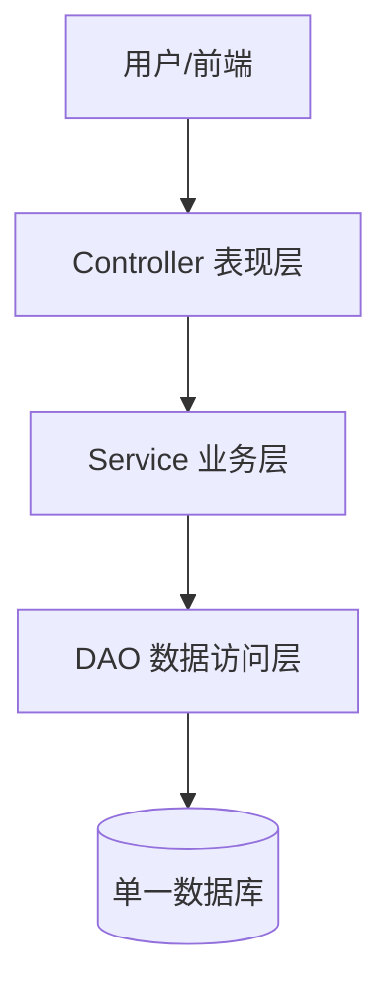

| 项 | 内容 |
|---|---|
| **适用** | 日活 < 百万、团队 < 20 人、业务仍在快速试错期、强事务一致性要求高（早期交易系统） |
| **优点** | ① 调用是进程内方法调用，**纳秒级**，无网络成本；② 事务天然是本地事务，强一致零成本；③ 调试/部署/运维极简；④ 重构成本最低（IDE 全局重命名） |
| **代价** | ① 单进程容量上限（受 JVM 堆、GC、CPU 核数限制）；② **故障域 = 全站**，一个 OOM 全挂；③ 团队并行开发冲突（同一代码库、同一发布窗口）；④ 无法按模块独立扩容（热点模块拖累全局） |
| **怎么坏** | 包依赖失控 → 循环依赖；共享一个 DB → 任何表结构变更全站回归；一个慢 SQL 打满连接池 → 全站雪崩 |
| **规避** | ① 模块内强制单向依赖（ArchUnit 门禁）；② 每模块独立 schema/表所有权；③ 连接池隔离 + 慢查询熔断；④ 按"业务域"拆库（垂直拆分），但保留单进程 |
| **演进** | 优先走"模块化单体"，而不是直接跳微服务 |

## 2.3 模块化单体（Modular Monolith）—— 2022 年后被重新正名的"最优默认解"

**定义**：**一个部署单元，但内部按限界上下文（Bounded Context）严格分模块**，模块间只能通过**显式接口（in-process API / 领域事件）**通信，禁止跨模块访问对方的表。

| 项 | 内容 |
|---|---|
| **适用** | 90% 的业务系统；团队 20–100 人；希望保留强事务与低延迟，又要团队自治 |
| **优点** | ① 保留本地事务与纳秒调用；② 模块边界清晰，可按需"随时抽出为服务"（边界即接缝）；③ 部署/运维成本仅为微服务的 1/10；④ **避免分布式单体**（最差形态） |
| **代价** | 单进程故障域仍在；模块间"逻辑隔离"靠纪律与工具，不靠物理隔离 |
| **怎么坏** | 边界被"图省事"穿透（直接查别人的表）→ 退化为分层单体 |
| **规避** | ① 每个模块独立 Schema + 独立 Repository；② 模块间只发**事件**或调 **Facade**；③ CI 里加架构守护测试；④ 预设"抽服务"的接口契约（DTO 而非 Entity 直传） |
| **真实参照** | Shopify、GitHub（部分）、Amazon Prime Video 2023 年"微服务转单体省 90% 成本"的著名复盘；DHH 的 "The Majestic Monolith" |

> **关键判断**：**"能不能在一个进程里解决"应该永远是第一问**。微服务不是"更高级"，而是"用运维与网络复杂度换取独立伸缩与团队自治"的**交易**。

## 2.4 SOA / ESB（企业服务总线）

**定义**：以"服务"为复用单元，通过企业服务总线（ESB）做协议转换、路由、编排。典型于银行/运营商/制造业。

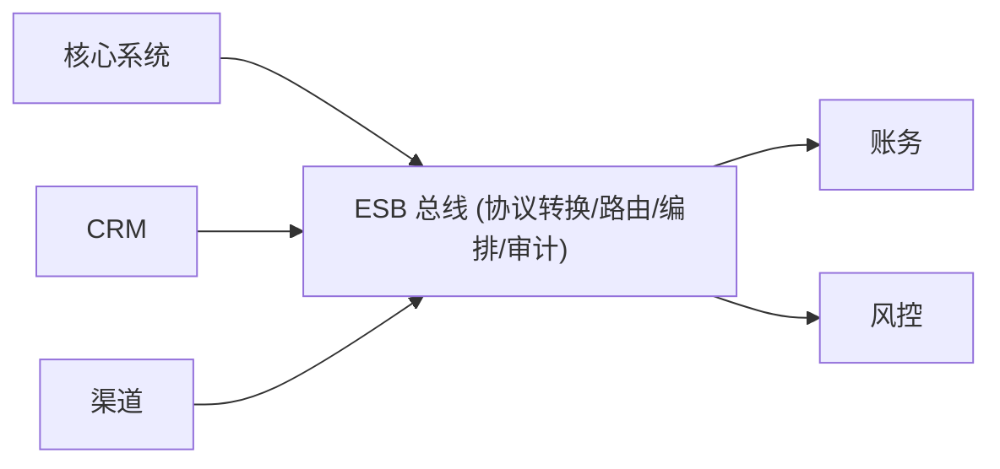

| 项 | 内容 |
|---|---|
| **适用** | 异构系统整合（主机/中间件/老系统）、强审计合规、跨部门集成 |
| **优点** | ① 协议/格式统一，老系统无需改造；② 集中式管控（审计、限流、转换）便于合规；③ 复用已有能力 |
| **代价** | ① **总线成为单点与瓶颈**（ESB 集群扩容昂贵）；② 中心化编排导致"总线里长业务逻辑"；③ 重量级（XML/SOAP），延迟高；④ 变更需多方排期 |
| **怎么坏** | ESB 里堆积上千条"管道+转换脚本"，无人敢改 → 变成"企业级意大利面" |
| **规避** | ① 总线只做**技术中介**（协议/路由/审计），业务编排上移到 BPM/服务编排层；② 明确 SLA 与容量阈值；③ 逐步用 API 网关 + 事件总线替代（"轻总线"） |
| **演进** | API 网关（技术中介）+ Kafka（数据总线）+ 服务网格（通信治理）的"三件套" |

## 2.5 微服务（Microservices）

**定义**：按业务能力拆分为独立部署、独立数据、通过轻量协议（HTTP/gRPC/消息）通信的服务集合。核心特征不是"小"，而是 **独立部署 + 独立数据所有权 + 去中心化治理**。

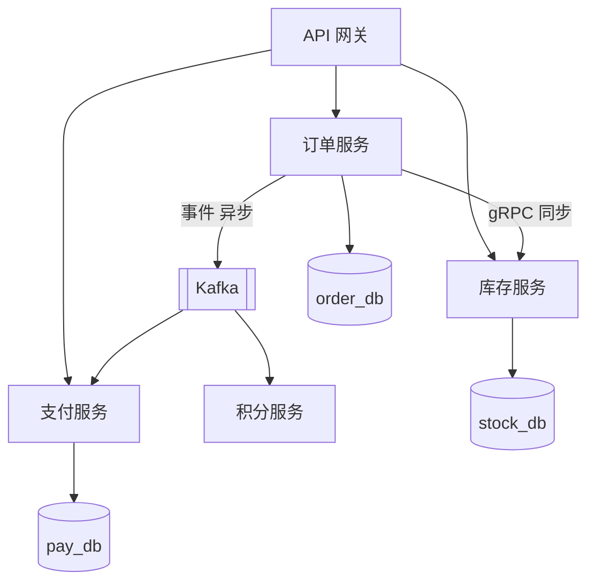

| 项 | 内容 |
|---|---|
| **适用** | 团队 > 50 人且按业务域划分；模块伸缩需求差异极大（如查询 10 万 QPS、下单 1000 TPS）；多语言/多技术栈；发布频率差异大 |
| **优点** | ① 独立伸缩（只扩热点服务）；② 独立发布（发布风险局部化）；③ 故障隔离（舱壁）；④ 技术异构自由；⑤ 团队自治（康威对齐） |
| **代价（务必背下来）** | ① **网络调用替代本地调用**：延迟从 ns → ms（1000×），且引入部分失败；② **分布式事务**：本地事务变 Saga/TCC；③ **数据一致性**：跨服务无外键，需最终一致 + 对账；④ **运维复杂度爆炸**：N 个服务 × M 个环境 × 版本矩阵；⑤ **链路排障困难**：需要 Trace/日志聚合；⑥ **资源开销**：每个服务至少一套 JVM/Pod、连接池、监控 |
| **怎么坏** | ① **分布式单体**：服务拆了但共享库、共享表、同步调用链十几跳；② **雪崩**：A→B→C→D 串行同步，D 抖一下全站挂；③ **版本地狱**：接口不兼容，上下游无法同时发布；④ **数据不一致**：跨服务写成功后下游失败，无人对账 |
| **规避** | ① **拆分判据**：按业务域（DDD 限界上下文）拆，不按技术层拆；② **同步调用链深度 ≤ 3**，超出改异步/聚合；③ **每个服务独占数据库**，禁止跨库直连；④ **契约先行**（OpenAPI/Protobuf + 兼容性检查 + Consumer-Driven Contract）；⑤ **Saga + Outbox + 对账兜底**；⑥ **服务网格统一治理**（重试/超时/熔断/ mTLS）；⑦ 有明确"服务目录 + Owner + SLO"，无主服务禁止上线 |
| **演进** | ① 回归模块化单体（中小规模）；② 单元化（大规模）；③ 服务网格 + 控制面/数据面分离 |

## 2.6 事件驱动架构（EDA / Event-Driven Architecture）

**定义**：组件间不直接调用，而是**发布事件**到事件总线，消费方按需订阅。三种拓扑：**编排（Orchestration）**、**编排+中介（Choreography）**、**事件流（Event Streaming）**（微服务模式，Martin Fowler 2017 提出）。

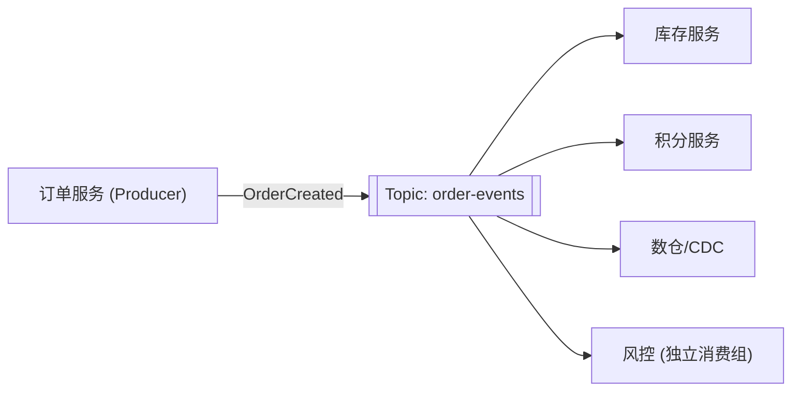

| 项 | 内容 |
|---|---|
| **适用** | 一对多通知、跨域解耦、峰值削峰、审计/回放、数据分发（CDC）、长流程（Saga 编排） |
| **优点** | ① **时间解耦**：生产方不等消费方，RT 从 200 ms 降到 5 ms；② **空间解耦**：新增消费方零改造；③ 天然削峰（队列缓冲）；④ **可回放**（日志型 MQ 支持重放，用于重建/补偿）；⑤ 审计友好 |
| **代价** | ① **最终一致**：业务要能容忍延迟与乱序；② **可观测性下降**：链路从"调用栈"变成"事件流"，排障需 trace 贯穿；③ **重复消费**（at-least-once），必须幂等；④ **顺序难保**（需按 key 分区）；⑤ **事件契约演化**难（schema 演进、版本兼容）；⑥ 消费积压/毒丸消息 |
| **怎么坏** | ① 事件当"RPC"用（发完等结果）→ 退化成异步的同步调用；② 无 schema 管理 → 消费方解析崩溃；③ 无死信队列 → 毒丸消息阻塞分区；④ 事件语义含糊（"OrderCreated" 到底含不含支付状态？）→ 下游各自猜 |
| **规避** | ① **事件即事实（Fact）**：只描述"已发生的事"，不含指令；② **Schema Registry + 兼容性策略**（BACKWARD/FORWARD/FULL）；③ **Outbox 模式**保证"业务落库与发消息"原子性（见 4.4.3）；④ 按业务 key 分区保序 + 消费端幂等表；⑤ 死信队列 + 重试分级（立即/延迟/人工）；⑥ 端到端 traceId 注入消息头 |
| **演进** | 事件流（Kafka/Pulsar）作为"企业级事实总线"；结合 CQRS 做读写分离；结合 CDC 做数据分发 |

**三种 EDA 拓扑对比**：

| 拓扑 | 描述 | 耦合度 | 适用 |
|---|---|---|---|
| Orchestration | 一个"编排器"发命令事件给多个服务（命令式） | 中（编排器知道所有参与者） | 业务流程固定（如订单履约） |
| Choreography | 各服务各自订阅、各自发布（无中心） | 最低 | 跨团队、跨域、长期演进 |
| Event Streaming | 事件作为"事实流"，下游各自投影出所需视图 | 最低（但依赖 schema 治理） | 数据平台、实时数仓、多视图 |

## 2.7 CQRS（命令查询职责分离）

**定义**：写模型（Command）与读模型（Query）分离，各自独立的模型、存储、扩展策略。常与事件溯源搭配。

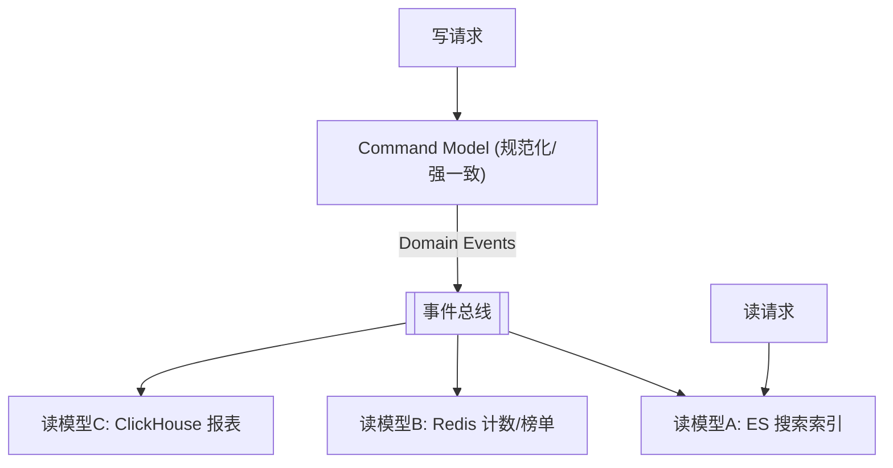

| 项 | 内容 |
|---|---|
| **适用** | 读写负载极度不对称（读 100:1）；读需要多种形态（搜索/聚合/榜单/报表）；写需要复杂领域校验 |
| **优点** | ① 读写独立伸缩与独立技术选型（写用 MySQL，读用 ES/CK）；② 读模型可任意重建（重放事件）；③ 写模型只关心不变量，模型更纯 |
| **代价** | ① **读延迟**（投影异步）；② **最终一致**，需"读到自己的写"保障（read-your-write：写后带版本/读主库/客户端 pin）；③ 双模型维护成本；④ 事件重放成本高 |
| **怎么坏** | 读模型漂移（投影 bug 导致与写模型不一致，且无人对账）；用户"刚下单查不到订单"投诉 |
| **规避** | ① 读模型**可重建**（定期全量重建 + 增量对齐）；② 提供 `version`/`sequence` 做读己之写；③ 关键路径读走写库（小流量兜底）；④ 读模型与写模型做**日级对账** |
| **演进** | 与 Event Sourcing 组合 → 完整"事件驱动一致性"；与 CDC 组合（Debezium）低成本实现 |

## 2.8 事件溯源（Event Sourcing）

**定义**：不存"当前状态"，只存"状态变更事件序列"，状态由事件重放得出。**账本思维**（会计复式记账就是最古老的事件溯源）。

| 项 | 内容 |
|---|---|
| **适用** | 金融账务、订单生命周期、审计要求高、需要"时间旅行"（回溯某时刻状态）、需要推理"为什么变成这样" |
| **优点** | ① **完整审计**（不可篡改的事实流）；② 可重建任意视图（CQRS 读模型）；③ 天然支持补偿（冲正而非修改）；④ 事件即业务语言，跨团队沟通成本低 |
| **代价** | ① 事件 schema 演化极难（历史事件永久存在）；② 重放慢（需快照 snapshot 加速）；③ 查询不便（必须投影出读模型）；④ 事件版本/升级需"向上转换（upcasting）"；⑤ 存储膨胀 |
| **怎么坏** | 事件语义变化（"金额"从含税改不含税）→ 历史与新事件不可比，账就乱了 |
| **规避** | ① 事件**只追加不改**，修正用"补偿事件"；② 定期快照 + 增量重放；③ 严格 schema 版本 + upcasting 层；④ 事件里带"业务时间（event time）"与"记录时间"双时间戳 |
| **真实参照** | 银行核心（记账流水）、Kafka 的日志本质、Axon Framework、EventStoreDB |

## 2.9 六边形架构 / 洋葱 / Clean Architecture / DDD（"依赖方向"的学问）

这四种本质相同：**通过依赖倒置，把"易变的外部世界"挡在"稳定的领域核心"之外**。

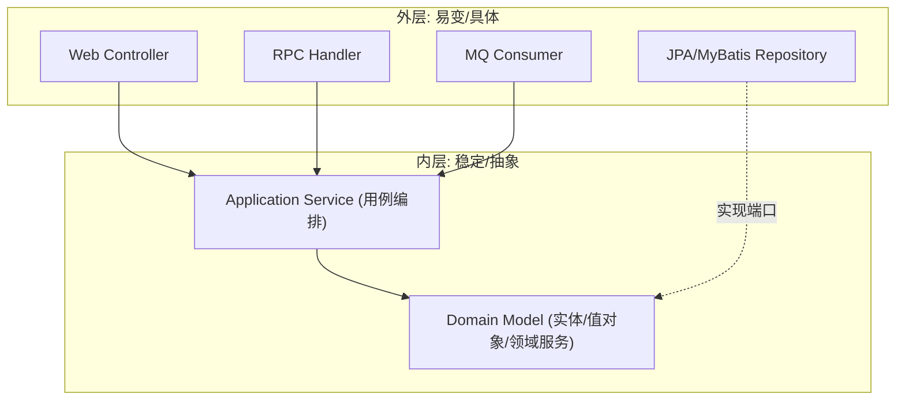

| 对比项 | 六边形（Ports & Adapters, Cockburn 2005） | 洋葱（Onion, Palermo 2008） | Clean（Martin 2017） | DDD 分层（Evans 2003） |
|---|---|---|---|---|
| 切分依据 | 端口（入站/出站） | 依赖方向（由外向内） | 依赖规则（由内向外） | **业务语言/限界上下文** |
| 核心思想 | 每个边界一个适配器 | 领域在最内 | 用例驱动 + 依赖倒置 | 统一语言 + 聚合根 + 上下文边界 |
| 适用 | 多端/多协议接入、需要替换基础设施 | 同上 | 强调用例与可测试性 | **复杂业务（金融/电商/物流）** |
| 常见误用 | 端口爆炸（每个方法一个端口） | 层数过多导致贫血领域模型 | 教条式四层，忽略业务 | 把"实体"当 DDD，实际只是贫血数据类 |

**规避要点**：
- **贫血领域模型（Anemic Domain Model）**是最大陷阱：只是把 Service 的逻辑搬到 Entity 里，仍是事务脚本。
- DDD 落地三件套：**限界上下文（拆服务的依据）+ 聚合（一致性边界）+ 领域事件（上下文间通信）**。聚合边界 = 事务边界 = 服务拆分边界。
- **防腐层（ACL, Anti-Corruption Layer）**：外部模型（第三方 API、老系统 DTO）必须翻译成领域模型，禁止直接流入核心。

## 2.10 插件化 / 微内核（Microkernel / Plugin）

**定义**：核心只保留最小机制（如生命周期、扩展点注册、依赖注入），业务能力以插件形式加载。典型：IDE（VS Code）、浏览器、Android、SofaArk/SPI、规则引擎。

| 项 | 内容 |
|---|---|
| **适用** | 多租户定制、行业版本差异（如不同银行的同一产品）、规则频繁变化、开放平台 |
| **优点** | ① 核心稳定，扩展灵活（OCP 开闭原则的物理实现）；② 可按租户/场景按需加载，隔离爆炸半径；③ 第三方生态可参与 |
| **代价** | ① 扩展点设计一旦错了极难改（比接口更贵）；② 类加载隔离/版本冲突（Jar Hell）；③ 插件质量不可控，需沙箱与超时；④ 调试链路变长 |
| **怎么坏** | 插件间隐式依赖、插件直接操作核心内部状态、插件崩溃拖垮核心进程 |
| **规避** | ① 扩展点只暴露**稳定契约**（版本化 SPI）；② 插件独立 ClassLoader + 依赖白名单；③ 插件调用加**超时与隔离**（线程池/进程隔离）；④ 插件能力做权限声明 |
| **演进** | 规则引擎（Drools/QLExpress）替代硬编码分支；WASM 插件（安全沙箱 + 多语言） |


## 2.11 Actor 模型 / 单写者模型（把并发变成串行）

**定义**：最小并发单元是 Actor，每个 Actor 有**私有状态 + 邮箱（Mailbox）**，**串行处理消息**；Actor 间只通过消息通信，不共享内存。Erlang/OTP、Akka、Orleans、Rust Actix 都是它。


| 项 | 内容 |
|---|---|
| **适用** | 高并发有状态服务（IM 会话、游戏房间、实时协作、设备连接管理）；需要"每实体串行"的语义 |
| **优点** | ① **天然无锁**（状态私有，串行消费）；② 故障隔离 + 监督树（Supervisor，"let it crash"）；③ 位置透明（本地/远程 Actor 同一套 API）；④ 单实体有序 |
| **代价** | ① 邮箱无界 → 内存爆（需背压/有界队列）；② 消息不可达（at-most-once）需应用层重试；③ 调试困难（无调用栈，只有消息轨迹）；④ 单 Actor 吞吐受单线程限（需分片"虚拟 Actor / grain"） |
| **怎么坏** | 邮箱积压（慢消费者）、Actor 数量爆炸（内存与调度开销）、消息顺序在跨 Actor 时丢失 |
| **规避** | ① 有界邮箱 + 拒绝策略（背压）；② 按 key 分片（sharding，如 Orleans 的 grain、Akka Cluster Sharding）；③ 死信队列 + 消息 TTL；④ 每个 Actor 状态可持久化（event sourcing actor） |
| **同源思想** | 与"**单写者原则（Single Writer Principle）**"完全一致：**任何可变状态只允许一个线程写**，这是无锁并发的第一性原理（LMAX Disruptor 的核心） |

## 2.12 管道-过滤器 / 流计算（Pipeline & Dataflow）

**定义**：把处理拆成有序的阶段（Stage），数据在阶段间流动；每个阶段可独立并行、独立扩缩容。ETL、Flink/Spark、Netty pipeline、CDN 处理链、推理流水线都是它。

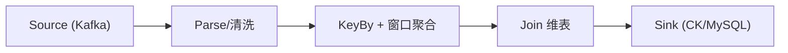

| 项 | 内容 |
|---|---|
| **适用** | 数据加工、实时指标、日志处理、媒体转码、AI 推理编排 |
| **优点** | ① 阶段级并行（吞吐随阶段数扩展）；② 职责单一易测试；③ 可插拔（加一个阶段即可）；④ 背压机制（Flink 的 credit-based flow control）天然限流 |
| **代价** | ① 端到端延迟 = 各阶段之和 + 排队；② 状态管理复杂（窗口、checkpoint、exactly-once）；③ 数据倾斜（key 分布不均导致单 stage 成瓶颈） |
| **怎么坏** | 数据倾斜（一个 key 占 80% 流量 → 单并行度打满）；checkpoint 过大导致反压雪崩 |
| **规避** | ① 两阶段聚合（local pre-aggregate + global merge）；② 加盐打散热点 key；③ 增量 checkpoint + 状态 TTL；④ 监控 lag 与背压指标 |

## 2.13 Serverless / FaaS

**定义**：函数即部署单元，平台负责调度、伸缩、计费（按调用/时长）。代表：AWS Lambda、阿里云 FC、腾讯云 SCF、Knative。

| 项 | 内容 |
|---|---|
| **适用** | 突发/低频流量（活动页、Webhook、定时任务）、CI/CD 中的短任务、轻量 API、事件处理 |
| **优点** | ① 零运维（无需管机器）；② **按需计费**（闲置成本≈0）；③ 弹性到"请求级"（毫秒级冷启动优化后）；④ 天然多租户隔离 |
| **代价** | ① **冷启动**（JVM 类加载/镜像拉取 100 ms–数秒）；② 执行时长上限（一般 15 min）；③ 无本地状态（实例随时回收）；④ 调试/本地复现难；⑤ 厂商锁定；⑥ 高 QPS 时单价高于常驻实例 |
| **怎么坏** | 冷启动引发 P99 飙高；连接池在函数内反复创建（每次冷启动重建 DB 连接）；并发突增触发平台限流（账号级 concurrency limit） |
| **规避** | ① **预热/预留实例（provisioned concurrency）**；② 用小镜像 + 精简依赖（GraalVM native / SnapStart）；③ 连接复用（RDS Proxy / 全局连接池）；④ 把"重活"放异步队列；⑤ 冷热分层：核心链路常驻，边缘功能 Serverless |
| **演进** | Serverless 容器（Knative）→ 兼顾冷启动与生态；边缘 FaaS（Cloudflare Workers，V8 isolate，冷启动 < 5 ms） |

## 2.14 Service Mesh / Sidecar（把治理能力从代码里搬出来）

**定义**：在应用与网络之间加一层代理（Sidecar/iptables/eBPF），由**控制面**统一下发流量规则（重试、超时、熔断、灰度、mTLS、可观测）。代表：Istio、Linkerd、蚂蚁 SOFAMesh、字节的 mesh 实践。

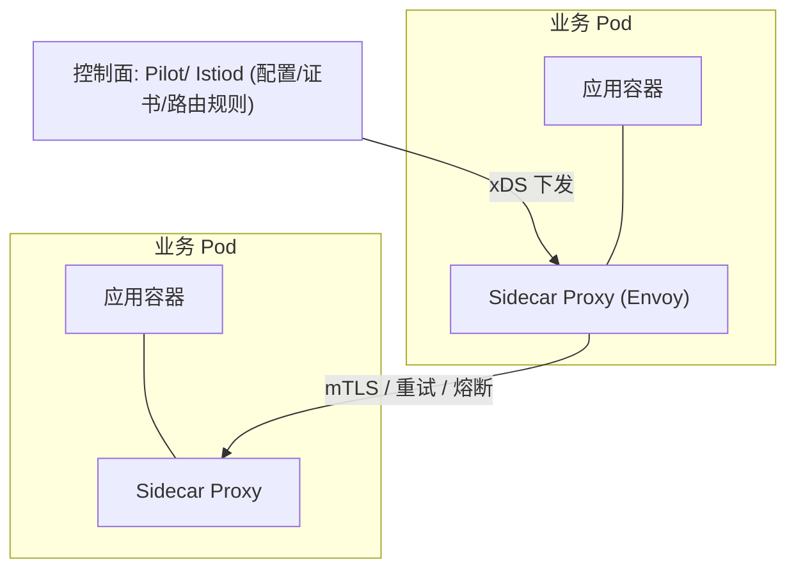

| 项 | 内容 |
|---|---|
| **适用** | 多语言多框架（治理能力无法统一写进 SDK）、需要统一灰度/安全/可观测、K8s 环境 |
| **优点** | ① 治理与业务解耦（升级治理策略不动代码）；② 语言无关；③ 统一 mTLS 与身份；④ 流量可视化（黄金指标自动采集） |
| **代价** | ① **额外一跳**（每跳 +0.1–1 ms，且双倍连接数）；② 资源开销（每个 Pod 一个 sidecar，内存 CPU 叠加）；③ 复杂度极高（控制面故障 → 全局流量异常）；④ 排障要懂 iptables/eBPF |
| **怎么坏** | Sidecar 自身 OOM → 业务不可达；控制面推送错误路由 → 全站 503；sidecar 与 app 启动顺序竞争 |
| **规避** | ① **sidecar 资源与业务隔离（独立 limit）**；② 控制面高可用 + **本地缓存配置（fail-static）**；③ 保留"直连旁路"应急；④ 用 eBPF（Cilium）替代部分 sidecar 降低开销；⑤ 灰度发布网格本身（分集群推送） |
| **演进** | ① eBPF-based service mesh（内核态转发，零 sidecar）；② 服务网格下沉到"平台层"而非"每 Pod" |

## 2.15 单元化 / Set 化 / Cell 架构（超大规模的唯一解）

**定义**：按**用户维度（uid/shopId）**把系统切成若干**自包含的单元（Unit/Set/Cell）**，每个单元内有完整的计算、存储、缓存、消息、数据库副本；**单元内强一致，单元间异步/最终一致**。

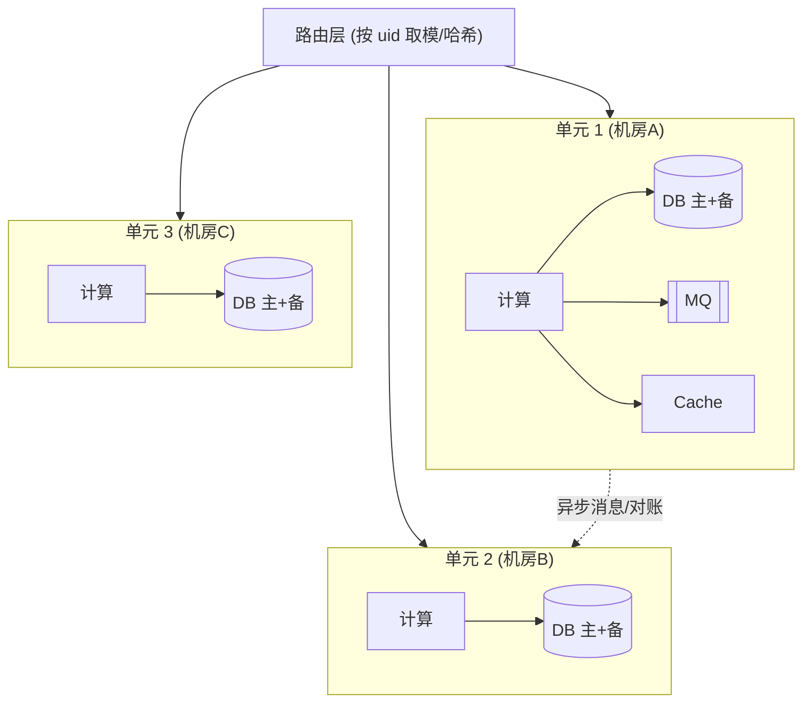

| 项 | 内容 |
|---|---|
| **适用** | 单库/单集群无法承载（> 10 万 QPS 写、TB 级热数据）；要求"机房级故障不影响多数用户"；跨国/跨区部署 |
| **优点** | ① **故障域收敛**：一个单元挂了只影响 1/N 用户；② 容量可线性扩展（加单元即可）；③ 单元内可用本地事务，一致性成本低；④ 多活/异地部署天然支持；⑤ 灰度可按单元切 |
| **代价** | ① **跨单元操作极难**（跨单元的转账、跨单元 join 只能异步 + 对账）；② 路由层是新的单点（需无状态 + 多活）；③ 数据迁移/再平衡复杂（双写 + 校验 + 切流）；④ 容量不均（热点用户/大商户集中在一个单元）；⑤ 运维 N 套 |
| **怎么坏** | 单元间数据漂移（异步消息丢失，长期不一致）；路由规则变更导致"用户数据在两个单元都有"；大商户把单单元打爆 |
| **规避** | ① **单元间只允许"消息 + 对账"**，禁止同步跨单元调用（除非路由层聚合）；② 路由表版本化 + 双读单写切换；③ 大客户**独立单元**（VIP cell）；④ 每日全量对账 + 差异自动修复；⑤ 单元容量按 P99 峰值留 30% 余量；⑥ **静态稳定性**：不依赖运行时控制面（AWS 的 static stability 原则） |
| **真实参照** | 蚂蚁"单元化（LDC）"、阿里"异地多活"、AWS "Cell-based Architecture + Shuffle Sharding"、字节"Region/Zone 化" |

## 2.16 存算分离（Disaggregated Storage & Compute）

**定义**：把存储层（共享存储/对象存储/分布式块存储）与计算层（无状态计算节点）解耦，计算节点可随时增减、故障后秒级重建。

| 项 | 内容 |
|---|---|
| **适用** | 计算弹性需求强、存储增长快但计算波动、多引擎共享同一份数据（数据湖） |
| **优点** | ① 计算与存储**独立伸缩**（省钱）；② 计算节点无状态，故障恢复快；③ 多引擎共享数据（一份数据，多种计算）；④ 存储可集中做副本/EC/冷热分层 |
| **代价** | ① **网络成为瓶颈**（每次读都要走网络，延迟高于本地盘）；② 元数据服务成为新单点；③ 缓存一致性复杂（本地缓存失效）；④ 小文件/随机读性能差 |
| **怎么坏** | 元数据服务抖动 → 全集群不可用；网络带宽打满 → 扫描型查询全部变慢 |
| **规避** | ① 计算侧**本地缓存 + 预取**（如 Alluxio/Cache 层）；② 元数据多副本 + 客户端缓存；③ 大块顺序读（列存 + 压缩 + 谓词下推减少 IO）；④ 冷热分层（热数据本地 SSD，冷数据对象存储） |
| **真实参照** | Snowflake（存储 S3 + 无状态 Warehouse）、AWS Aurora（"日志即数据库"）、Databricks、StarRocks 存算分离版、ByteHouse |

## 2.17 数据架构四代：Lambda → Kappa → 湖仓一体 → Data Mesh

| 架构 | 结构 | 优点 | 缺点 | 适用 |
|---|---|---|---|---|
| **Lambda**（Marz 2011） | 批处理层（全量准确）+ 速度层（实时近似）+ 服务层合并 | 兼顾实时与准确 | **双链路维护**（两套代码、两套口径，结果易不一致） | 早期实时数仓 |
| **Kappa**（Kreps 2014） | 只用流：所有数据进日志，流计算产出，需要重算就**重放** | 单一代码路径、口径统一 | 依赖超长保留期的日志存储；重放成本高；批式大窗口不擅长 | 事件驱动型业务、实时指标 |
| **湖仓一体（Lakehouse）** | 对象存储 + 开放表格式（Iceberg/Hudi/Delta）+ 计算引擎（Spark/Flink/Trino/StarRocks） | 一份数据、ACID 表、schema 演进、批流共用 | 小文件治理、元数据性能、权限与治理复杂 | 现代数据平台主流 |
| **Data Mesh**（Dehghani 2019） | 按**业务域**把数据作为"产品"由域团队自己生产发布，平台只提供基础设施与治理 | 解决"集中式数据团队瓶颈"、贴近业务 | 组织变革极重；跨域一致性难；需要强治理与契约 | 大型多业务线集团 |

**统一结论**：数据架构的演进主线是 —— **"一份事实 + 多个视图"**（事件/日志是唯一事实源，批与流只是不同视图的加工方式）。

## 2.18 边缘计算 / 端云协同

**定义**：把计算下沉到离用户近的边缘节点（CDN 边缘、基站、端侧），只把"需要全局"的部分回中心。

| 项 | 内容 |
|---|---|
| **适用** | 低延迟（游戏、直播、实时互动）、大带宽（视频、AI 推理前置）、弱网/离线、数据合规（数据不出境/不出省） |
| **优点** | ① RTT 从 100 ms 降到 10 ms；② 回源带宽降 90%；③ 隐私数据本地处理；④ 中心故障时边缘可降级自治 |
| **代价** | ① 边缘资源受限（算力/内存小）；② 发布与运维难（节点多、异构）；③ 状态同步复杂；④ 计费与调度复杂 |
| **规避** | ① 无状态 + 配置下发（边缘只做"执行"）；② 版本灰度分区域；③ 中心不可用时**降级到本地缓存策略** |

## 2.19 批处理 / 日切 / 对账型架构（金融场景的"第二套系统"）

**定义**：在线交易走实时链路（最终一致），**离线批处理**做"全量校验、差错修复、报表、清算"。这是金融系统的"安全网"。

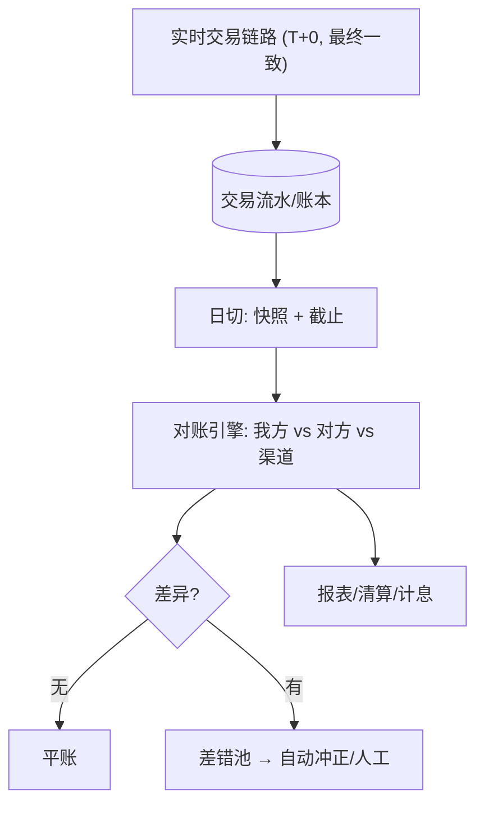

**核心思想**：**不要试图让"实时链路绝对正确"，而是让它"可校验、可修复"**。这就是"最终一致 + 对账"的工程实现（第 6 章 Q25 会详细展开）。

## 2.20 模式选择决策矩阵与决策树

### 决策树（从 0 到 1 的架构选型）

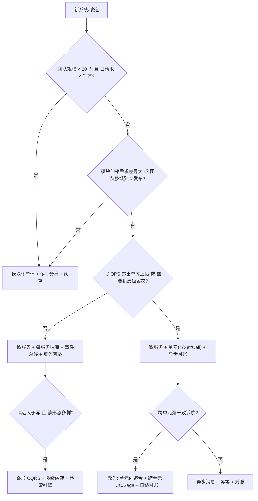

### 关键对比矩阵（一眼选型）

| 维度 | 单体分层 | 模块化单体 | 微服务 | 单元化 Cell | Serverless |
|---|---|---|---|---|---|
| 部署单元数 | 1 | 1 | N（10–1000） | N × 单元数 | 函数级 |
| 调用延迟 | ns | ns | ms（+网络） | ms | ms + 冷启动 |
| 事务一致性 | 强（本地） | 强（本地） | 弱（最终/补偿） | 单元内强、跨单元弱 | 弱 |
| 独立伸缩 | 无 | 无 | 强 | 强 | 极强 |
| 故障域 | 全站 | 全站 | 单服务 | 单单元（1/N） | 单函数 |
| 运维成本 | 极低 | 低 | 高 | 极高 | 低（转移给云） |
| 团队自治 | 低 | 中 | 高 | 高 | 中 |
| 适合规模 | 小 | 中小 | 中大 | 超大 | 波动/边缘 |

> **第 2 章一句话总结**：**没有"先进架构"，只有"匹配当前约束的架构"**；而所有架构的演进方向都是"缩小故障域、降低耦合、把一致性范围收缩到最小、把不确定性变成可校验"。


---

# 第 3 章 分布式系统的底层理论（一切的"根"）

> 这一章是第 4、5、6 章的理论底座。**如果只能记住三件事**：① CAP 只在分区时生效，延迟同样属于 C（PACELC）；② 所有"分布式事务"方案都是在"一致性强度 / 可用性 / 性能"三角里选一个角；③ 时钟不可靠 → 顺序只能靠"逻辑时钟 + 单写者 + 共识"。

## 3.1 CAP 的精确定义与三个常见误读

**C（Consistency）**：线性一致性（Linearizability）—— 所有节点看到同一份最新数据，且操作按真实时间排序。
**A（Availability）**：每个请求都能在**有限时间内**得到**非错误**响应（不保证最新）。
**P（Partition Tolerance）**：网络分区（节点间消息丢失/延迟）时系统仍能运行。

> **关键事实**：**网络分区是客观存在的物理现象，P 不是可选项。**
> 所以 CAP 的真正含义是：**当分区发生时，你只能在 C 和 A 之间选一个**；没有分区时，C 和 A 可以同时满足（只是会牺牲延迟 L）。

### 三个常见误读

| 误读 | 正解 |
|---|---|
| "选 CA 的系统"（如单机 MySQL） | 单机没有分区概念，谈 CAP 无意义；分布式系统必然 P |
| "最终一致 = 放弃一致性" | 最终一致只是"弱化的 C"，但要求"收敛（convergence）"，仍需工程保证 |
| "CAP 三者只能取二，永久取二" | CAP 是**分区期间**的取舍，**非分区期间**行为由 PACELC 描述 |

### PACELC（Abadi, 2012）——比 CAP 更实用

```
If Partition:  choose A or C
Else:          choose L (Latency) or C (Consistency)
```
即：**即使没有分区，强一致也要付出延迟代价**（同步复制、跨节点协调、等待多数派）。

| 系统 | 分区时 | 平时 | 归类 | 说明 |
|---|---|---|---|---|
| ZooKeeper / etcd | C | C（牺牲 L） | PC/EC | 选主期间不可写 |
| HBase | C | C | PC/EC | 强一致 |
| Spanner | C | C（TrueTime 等待） | PC/EC | 用"不确定性窗口"换外部一致性 |
| Cassandra / Dynamo | A | L（可调 quorum） | PA/EL | 默认最终一致，可调 R/W |
| Redis Cluster | A（部分） | L | PA/EL | 主从异步复制，故障可能丢数据 |
| Kafka（acks=1） | A | L | PA/EL | ISR 内异步 |

**工程含义**（极其重要）：
- **"强一致"不是免费的：它要么买延迟（同步写），要么买可用性（选主阻塞），要么买硬件（TrueTime/GPS+原子钟）。**
- 所以真实系统的做法是**"分级一致性"**：钱（账务）用强一致、商品详情用最终一致、推荐用"可旧"。

## 3.2 一致性模型谱系（从最强到最弱）

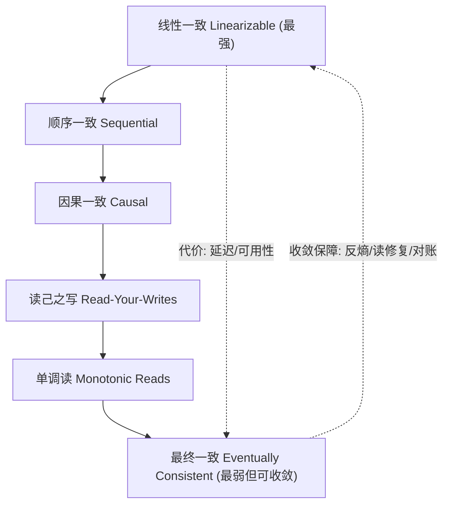

| 模型 | 含义 | 典型实现 | 业务例子 |
|---|---|---|---|
| **线性一致** | 所有操作像在一个原子寄存器上按实时顺序执行 | Raft/etcd、Spanner、ZooKeeper（写） | 转账余额、库存扣减、分布式锁 |
| **顺序一致** | 所有节点看到相同顺序，但不要求与真实时间一致 | 部分多主复制 | 消息顺序 |
| **因果一致** | 只保证有因果关系的操作有序（写后读、读后写） | COPS、部分 Dynamo 变体 | 社交"评论→回复" |
| **读己之写** | 自己写完，自己一定能读到 | 写后读主库、session sticky、版本号 | 用户下单后查订单 |
| **单调读** | 不会"读到旧数据后又读到更旧" | 按版本路由、粘性会话 | 分页翻页 |
| **最终一致** | 停止写入后，所有副本最终收敛 | Dynamo/Cassandra、MQ、CDC | 点赞数、粉丝数、推荐画像 |

> **判断口诀**：问自己三个问题 —— ① 读到旧数据会不会**造成资金/库存损失**？② 会不会**违反用户直觉**（下单后查不到）？③ 差异能否**在秒级被自动修复**？三个都"否"，就能用最终一致。

## 3.3 复制（Replication）：一致性的物理载体

### 三种拓扑

| 拓扑 | 结构 | 写吞吐 | 一致性 | 冲突 | 典型 |
|---|---|---|---|---|---|
| **单主（Master-Slave）** | 1 主多从，写只走主 | 受主库上限 | 易做强一致 | 无 | MySQL 主从、Redis 主从、Kafka（分区单 leader） |
| **多主（Multi-Master）** | 多节点都可写 | 高 | 难（需冲突解决） | 有 | MySQL Group Replication、多活、Cassandra 多 DC |
| **无主（Leaderless）** | 任意节点读写，quorum 决定 | 最高 | 可调（R+W>N） | 有（需向量时钟） | Dynamo、Cassandra、Riak |

### Quorum 机制（无主复制的核心公式）

```
N = 副本数, R = 读需要的最少响应数, W = 写需要的最少响应数
若 R + W > N  → 读一定能读到最新写（强一致）
```
- 例：N=3，W=2，R=2 → 2+2 > 3 ✓ 强一致，但容忍 1 个节点故障。
- 例：N=3，W=1，R=1 → 2 ≯ 3 最终一致，但延迟最低、可用性最高。
- **写偏斜/读修复**：R+W ≤ N 时可能读到旧值，需要 **读修复（read repair）** + **反熵（anti-entropy，Merkle 树比对）** 来收敛。

> **工程注意**：Quorum 的"强一致"是**读视角**的，它不保证"写入立刻持久"（取决于是否 fsync）与"跨 key 的原子性"。**跨 key 事务仍需共识或 2PC。**

### 复制的三个层次（延迟 vs 安全）

| 模式 | 语义 | 崩主后是否丢数据 | 延迟 |
|---|---|---|---|
| 异步复制 | 主提交即返回，后台追日志 | 可能丢最后一段 | 最低 |
| 半同步（semi-sync） | 至少 1 个从收到日志才返回 | 最多丢极少 | 中 |
| 同步复制（全同步） | 所有从落盘才返回 | 不丢 | 高（受最慢节点拖累） |

**规避"半同步退化"**：MySQL 半同步在超时后会自动降级为异步（`rpl_semi_sync_master_timeout`），必须监控降级事件 —— 这是生产中最隐蔽的丢数据来源之一。

## 3.4 共识算法（Consensus）：Paxos / Raft / ZAB

**共识要解决的问题**：在**异步网络 + 节点可能宕机**的前提下，让多个节点对"某个值"达成一致，且**一旦达成不可推翻**。

### Paxos（Lamport, 1998）—— 理论基石

两阶段：**Prepare**（收集提议号，抢占"提议权"）→ **Accept**（写入值）。
- 安全性来自"**提议号最大者胜出 + 多数派（quorum）**"：任意两个多数派必有交集，故旧值不会被覆盖丢失。
- **Multi-Paxos**：选出 leader 后省掉 Prepare，变成"一次共识 + 连续日志复制"，这是工程实现的主流（Google Chubby、微信 PaxosStore）。
- 难点：工程实现复杂（活锁、批处理、成员变更），所以工业界多用 Raft。

### Raft（Ongaro & Ousterhout, 2014）—— 工程化的共识

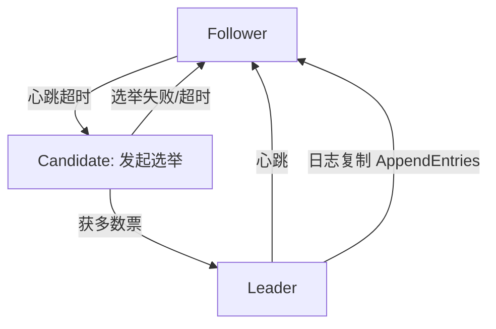

**三个核心机制**：

1. **Leader 选举**：每个节点有 `term`（任期）；Candidate 请求投票，获得**多数派（⌊N/2⌋+1）**票即成为 Leader。**只有 term 更大 且 日志不落后** 的节点才能当选（保证安全性）。
2. **日志复制**：Leader 收到写请求 → 追加本地日志 → 并行发给 Follower → 收到多数派 ack → **commit** → 应用到状态机。**未 commit 的日志在 Leader 崩溃后可能被丢弃**。
3. **安全性保证**：`commitIndex` 之前的日志在多数派上持久；新 Leader 必须包含旧 Leader 所有已 commit 的日志（由"选举限制"保证）。

**关键细节（面试常考）**：
- **N 个节点容忍 ⌊(N-1)/2⌋ 个故障**（3 节点容忍 1，5 节点容忍 2）。
- **为什么不能 2 节点**：2 节点时多数派 = 2，任一节点故障就无法达成共识（无容错）。
- **脑裂**：Raft 天然防脑裂（只有一个 Leader 能拿到多数派），但**旧 Leader 仍可能接收请求** → 需 **lease + fencing token**。
- **成员变更**：单节点变更（一次加/减一个）最安全；批量变更需 joint consensus（Raft 论文的联合共识）。
- **日志压缩**：snapshot + 增量，避免日志无限增长。

### ZAB（ZooKeeper Atomic Broadcast）vs Raft

| 维度 | Raft | ZAB |
|---|---|---|
| 角色 | Leader/Follower/Candidate | Leader/Follower/Looking |
| 阶段 | 选举 + 复制 | 崩溃恢复（选主+同步）+ 广播 |
| 差异 | 更通用、易懂 | 为"协调服务（配置/命名/锁）"优化，强调快速恢复与顺序一致性 |
| 生产 | etcd、TiKV、CockroachDB | ZooKeeper |

### 共识的"成本"（为什么不能到处用）

- 每次写要 **≥ 2 次网络往返 + 多数派 fsync** → 延迟 ~1–5 ms（同机房），吞吐受 leader 单点限制（Multi-Paxos 可批处理提升）。
- **所以**：共识只用于**元数据/配置/选主/分布式锁/小事务**；海量数据走"分区 + 单 leader + 异步"。

## 3.5 分区（Sharding）与数据路由

### 分区策略对比

| 策略 | 原理 | 优点 | 缺点 | 适用 |
|---|---|---|---|---|
| **范围分区（Range）** | 按 id/时间区间 | 范围查询高效；顺序扫描友好 | 热点集中（新数据都写最后一个分片） | 时序数据、订单按时间 |
| **哈希分区（Hash）** | `hash(key) % N` | 分布均匀 | **扩缩容需全量重分布**；范围查询差 | 用户维度数据 |
| **一致性哈希**（Karger, 1997） | 环 + 虚拟节点 | 扩容只迁移 1/N 数据 | 实现复杂；仍有倾斜（需虚拟节点） | 缓存集群、分布式存储 |
| **Rendezvous（HRW）** | 每个 key 取"hash(key,node) 最大"的节点 | 扩容只影响 1/N；无需环结构；计算简单 | 每次要算所有节点（节点多时 O(N)） | CDN、对象存储、网关路由 |
| **目录/路由表（Directory）** | 独立路由服务查表 | 灵活（可人工指定、可迁移） | 路由层是单点/需高可用 | 单元化、分库分表（ShardingSphere） |

### 一致性哈希的关键细节

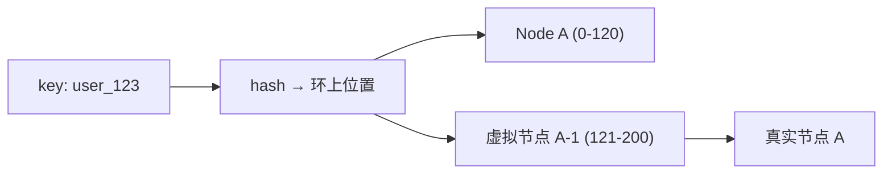
- **虚拟节点（virtual node）**：每个物理节点映射为 100–1000 个虚拟节点，解决"数据倾斜"与"扩容抖动"。
- **扩容时**：新增节点只接管环上相邻的一段，迁移量 ≈ 1/(N+1)。
- **坑**：`hash % N` 与一致性哈希混用（前者扩容全量迁移）；节点权重不均导致热点。

### 扩容/迁移的安全范式（双写 + 校验 + 切流）

```
1) 新老双写（写主路径双写，读仍走老）
2) 异步全量 + 增量同步（对比校验，修复差异）
3) 灰度读新（1% → 10% → 50% → 100%），比对结果一致性
4) 单写新（老库只读，保留回滚窗口）
5) 下线老库（保留快照 ≥ 1 个账期）
```
**绝不能**：直接停写迁移（数据丢失风险）；一次性全量切（回滚不了）。

## 3.6 分布式事务：五种方案的底层逻辑与选型

### 先明确"不可能三角"

> **强一致性、高可用、高性能（低延迟）—— 三者最多取二**。
> 2PC 取"一致+可用"（牺牲性能）；TCC 取"一致+性能"（牺牲部分可用/复杂度）；消息最终一致取"可用+性能"（牺牲强一致）。

### 方案一：2PC（两阶段提交）

```
Phase 1 Prepare: 协调者 → 各参与者"准备"（本地预提交/锁资源）
Phase 2 Commit:  全部 OK → 提交；任一失败 → 全部回滚
```
- **优点**：强一致（原子性）。
- **缺点**：① **同步阻塞**（Prepare 后资源被锁，直到 Commit）；② **协调者单点**（挂了参与者一直等 → 需超时+启发式回滚）；③ 性能差（RT 翻倍 + 锁持有时间长）。
- **规避**：① 协调者高可用（TC/C= 事务协调器集群 + 事务状态表持久化）；② **事务超时 + 悬挂处理**（防"空回滚/悬挂/幂等"三问题）；③ 缩短事务范围（只包住真正的临界资源）。
- **现实**：XA 在 MySQL 上长期"半死不活"（性能与运维成本），主要用于**同库多资源**场景。

### 方案二：TCC（Try-Confirm-Cancel）

```
Try:    预留资源（冻结库存/冻结余额），不真正扣减
Confirm: 确认扣减（幂等）
Cancel:  释放预留（幂等，允许空回滚）
```
- **优点**：不长时间持锁（预留而非锁）、性能好、可控性强（业务自定义预留粒度）。
- **缺点**：① **业务侵入极大**（每个参与方要写三个接口）；② **空回滚/悬挂/幂等** 三大坑；③ 需要事务协调器（状态机 + 重试 + 补偿）。
- **三大坑与解法**：
  - **空回滚**：Try 未执行但 Cancel 到达 → 记录"事务控制表"，Cancel 时发现无 Try 记录则直接返回成功。
  - **悬挂**：Cancel 先到、Try 后到 → Try 前校验"是否已 Cancel"，是则拒绝 Try。
  - **幂等**：Confirm/Cancel 重复调用 → 用事务 ID + 状态机（`TRY→CONFIRMED/CANCELLED`）做唯一约束。

### 方案三：Saga（长事务补偿）

- 把长事务拆成 N 个本地事务 `T1..Tn`，每个 `Ti` 有补偿 `Ci`；失败时**逆序执行补偿**。
- **两种实现**：**编排式（Orchestration，中心协调器）** vs **协同式（Choreography，事件驱动）**。
- **优点**：无锁、跨服务、最终一致、可用性高。
- **缺点**：① **无隔离性（I）**——中间状态对外可见（必须设计"业务上可容忍的中间态"，如"待支付"）；② 补偿逻辑必须幂等且**可逆**（有些操作不可逆：发短信、扣税）；③ 补偿链长，失败点难定位。
- **规避**：① 每个步骤**正向 + 补偿成对设计**；② 用**状态机**驱动（Saga 状态持久化）；③ 不可逆步骤放到最后或改为"预留+确认"（TCC 混合）；④ 加**超时兜底 + 人工干预入口**。

### 方案四：本地消息表（Outbox Pattern）

```
同一本地事务内: ① 业务写库 ② 写 outbox 表(status=NEW)
独立投递器: 轮询/CDC 读取 outbox → 发 MQ → 更新 status=SENT
失败: 重试 + 死信 + 人工
```
- **本质**：**用"本地事务"保证"业务与消息"的原子性**——因为它们在同一个数据库里。
- **优点**：简单、可靠、不依赖 MQ 的事务能力。
- **缺点**：① 有延迟（轮询间隔）；② outbox 表膨胀；③ 需要幂等消费。
- **进化**：用 **CDC（Debezium/Canal）** 读 binlog 替代轮询，延迟降到 100 ms 内且不侵入业务。

### 方案五：事务消息（RocketMQ 半消息 + 回查）

```
1) Producer 发"半消息"到 Broker（对消费者不可见）
2) Producer 执行本地事务
3) 本地成功 → commit 半消息；失败 → rollback
4) 若第 3 步无响应 → Broker 定时"回查"Producer 的本地事务状态
```
- **优点**：业务无侵入（不用 outbox 表）、可靠性高。
- **缺点**：① 强依赖 MQ（RocketMQ 特有）；② 回查需要业务实现查询接口；③ 只保证"消息一定发出"，不保证"消费一定成功"（消费侧仍需幂等 + 重试）。

### 五种方案对比表（选型用）

| 方案 | 一致性 | 性能 | 业务侵入 | 隔离性 | 典型场景 |
|---|---|---|---|---|---|
| 2PC/XA | 强 | 低 | 低 | 强 | 同库多资源、少量强一致 |
| TCC | 强（最终） | 中高 | **极高** | 中（资源预留） | 支付、库存、账户（蚂蚁/阿里） |
| Saga | 最终 | 高 | 中 | **无** | 跨服务长流程（订单履约、出行） |
| 本地消息表/Outbox | 最终 | 高 | 低 | 无 | 大多数"写完通知下游" |
| 事务消息 | 最终 | 高 | 低 | 无 | 已用 RocketMQ 的场景 |

**选型口诀**：
1. 能**在一个库**里解决 → 本地事务（最优）。
2. 跨库但**少量强一致** → 2PC/XA 或 TCC。
3. 跨服务**长流程** → Saga + 状态机。
4. **只是通知** → Outbox/事务消息 + 幂等 + 对账。
5. **任何方案**都要配 **对账 + 补偿**（这是金融系统的最后一道防线）。

## 3.7 时钟、顺序与 ID

### 为什么时钟不可靠

- NTP 校时可能导致**时钟回拨**（闰秒、虚拟机迁移、手工改时间）。
- 分布式系统中，"A 的事件早于 B" 不能靠物理时间判断。

### 四种"顺序"方案

| 方案 | 原理 | 优点 | 缺点 | 典型 |
|---|---|---|---|---|
| **Lamport 逻辑时钟** | 每次事件 `clock++`；发消息带上 clock，接收方取 `max(local, recv)+1` | 无需物理时钟，可判"因果先后" | 无法判"并发"与真实时间 | 分布式算法 |
| **向量时钟（Vector Clock）** | 每个节点一个分量，记录"我看到的各节点进度" | 可判定"并发 vs 因果" | 元数据 O(N) 膨胀 | Dynamo、CRDT |
| **HLC（混合逻辑时钟）** | 物理时间 + 逻辑计数，单调不回退 | 兼顾时间语义与因果 | 实现复杂 | CockroachDB、MongoDB |
| **TrueTime / TSO** | 中心授时（GPS+原子钟 / 中心发号器） | **全局单调、可判真实顺序** | 依赖中心（单点/延迟） | Spanner（TrueTime）、TiDB（PD TSO）、OceanBase |

**雪花算法（Snowflake）与它的坑**：
```
ID = 1bit符号 | 41bit 毫秒时间戳 | 10bit 机器ID | 12bit 序列号
```
- **坑1 时钟回拨**：回拨 > 阈值时拒绝发号/等待；或用"备用序列号 + 逻辑时间"兜底。
- **坑2 机器 ID 分配**：K8s 动态 Pod 无法固定机器 ID → 需 ZooKeeper/Redis 注册或"机房+服务+实例"编码。
- **坑3 低位不连续/不严格递增**：分库分表路由与"按 ID 排序"要注意。
- **工业改进**：美团 Leaf（号段模式，双 buffer 预取，DB 兜底）、百度 uid-generator（ring buffer + 未来时间预分配）、滴滴 TinyID。

## 3.8 幂等、去重与一致性"工程三层"

### 幂等的 5 种实现

| 方式 | 原理 | 适用 |
|---|---|---|
| **唯一索引/唯一键** | 重复插入直接被 DB 拒绝 | 创建类操作（订单、支付单） |
| **状态机 + CAS** | `UPDATE ... WHERE status='INIT'` | 状态流转（支付回调） |
| **幂等 Token** | 先取 token，提交时校验并删除（原子） | 表单重复提交、下单 |
| **去重表（先去重再处理）** | 处理前查/写去重表（业务 ID 唯一） | MQ 消费 |
| **版本号/乐观锁** | `version` 递增，旧版本丢弃 | 并发更新 |

**幂等三要素**：**唯一业务 ID + 幂等键存储 + 处理结果可复用**（不能只"防重复"，还要"重复时返回同一结果"）。

### 一致性的工程三层（必背的框架）

| 层 | 时间尺度 | 手段 | 目标 |
|---|---|---|---|
| **实时层（同步）** | ms | 本地事务、TCC、2PC、锁 | 关键资源强一致 |
| **近实时层（异步）** | s–min | MQ、Outbox、CDC、重试、补偿 | 最终一致（秒级收敛） |
| **离线层（批）** | hour–day | 全量对账、差异修复、报表、清算 | **兜底与可审计** |

> **核心洞见**：**没有"绝对一致"的系统，只有"能发现并修复不一致"的系统**。所以架构评审时，"对账与补偿机制"必须和"主流程"一起设计，而不是上线后补。

## 3.9 分布式系统的"故障学"

| 故障类型 | 表现 | 防御 |
|---|---|---|
| **节点崩溃（fail-stop）** | 进程退出、心跳丢失 | 多副本 + 选主 + 重试 |
| **网络分区** | 部分节点互不可达 | 单元化、quorum、超时、幂等 |
| **慢节点/长尾（gray failure）** | 节点活着但响应慢 | 超时、熔断、**剔除慢节点**（自适应负载均衡） |
| **脑裂** | 两个主同时写 | 多数派 + lease + fencing token |
| **磁盘满/句柄耗尽** | 写入失败、连接拒绝 | 容量水位告警 + 预留空间 + 限流 |
| **惊群/重试风暴** | 故障时重试放大 10 倍流量 | 退避 + 抖动 + 重试预算 + 熔断 |
| **元数据/控制面故障** | 路由/配置错误全站崩 | 静态稳定性、配置本地缓存、灰度下发 |
| **数据漂移** | 长期静默不一致 | 对账 + 校验 + 修复 |

> **第 3 章一句话总结**：分布式系统的一切复杂度，都来自"**网络不可靠 + 时钟不可靠 + 节点会挂**"这三件事；所有理论（CAP/共识/事务/幂等）都是对这三件事的回应。


---

# 第 4 章 通用架构设计方案库（问题 → 方案 → 代价 → 规避）

> 本章是"可直接抄的方案库"。每个方案都给出：**解决什么问题 / 怎么实现（含关键参数）/ 代价 / 失效模式 / 规避**。
> 使用方式：架构评审时按 4.0 的五大类逐项过；设计新系统时按 4.7 速查表拉方案。

## 4.0 五大类总览与速查

| 类别 | 核心问题 | 主要手段 | 关键指标 |
|---|---|---|---|
| **A 高可用** | 不要挂、挂了快速恢复 | 冗余、隔离、熔断、限流、降级、多活 | 可用性 99.9%→99.999%（年停机 8.8h→5min） |
| **B 高性能** | 快、省 | 缓存、异步、批处理、并行、零拷贝、索引 | P99 RT、吞吐、资源利用率 |
| **C 高扩展** | 加机器就能扛 | 无状态、分片、读写分离、CQRS、异步 | 线性扩展度（USL） |
| **D 一致性** | 数据不能错 | 本地事务、TCC、Saga、Outbox、对账 | 差异率、收敛时延 |
| **E 交付/治理** | 改得动、看得见 | 灰度、开关、混沌、SLO、可观测 | 变更成功率、MTTR |

**可用性换算（必须记住）**：

| SLA | 年停机 | 月停机 | 架构要求 |
|---|---|---|---|
| 99% | 3.65 天 | 7.2 h | 单机 + 备份 |
| 99.9% | 8.76 h | 43.8 min | 主从 + 自动切换 |
| 99.99% | 52.6 min | 4.4 min | 多副本 + 多可用区 + 熔断 |
| 99.999% | 5.26 min | 26 s | 单元化 + 异地多活 + 全链路演练 |

## 4.1 A 类：高可用设计方案

### 4.1.1 冗余的四个层次

| 层次 | 做法 | 切换时间 | 数据风险 |
|---|---|---|---|
| **进程内** | 线程池隔离、多副本计算（双跑比对） | 0 | 无 |
| **单机多副本** | 主备进程/容器（Keepalived、K8s） | 秒级 | 异步复制可能丢 |
| **同城多可用区（AZ）** | 跨 AZ 部署 + 同步复制 | 秒–分钟 | 同步则无损 |
| **异地多活（Region）** | 单元化 + 异步收敛 | 分钟（切流） | 需对账 |

**避坑**：
- **"主备"不等于"高可用"**：备机长期不承载流量 → 切换时配置/连接池/缓存全冷 → 切换即故障。**必须定期真实切流演练**（不是只发心跳）。
- **"双活"不等于"双写"**：双写会产生冲突，必须有**单一写主（per key）+ 冲突解决策略**。

### 4.1.2 故障检测：心跳的三种实现与陷阱

| 方式 | 原理 | 坑 |
|---|---|---|
| 固定阈值心跳 | 超时 N 秒判死 | 网络抖动误判（"假死"）→ 频繁切主（flapping） |
| **Phi Accrual（Cassandra/Akka）** | 用历史心跳间隔的正态分布算"可疑度" φ | 需调参，冷启动无历史 |
| 租约（Lease）+ 续约 | 主节点持有"写租约"，过期自动失效 | 依赖**时钟速率**（不是绝对时间），需保守设置租约 < 时钟漂移上界 |

**关键**：**判死必须"宁可晚，不可错"**（误切主比晚切更贵），且要有 **fencing（隔离旧主）** 机制——否则旧主"复活"继续写 → 双写冲突。

### 4.1.3 限流：四种算法与选型

| 算法 | 原理 | 优点 | 缺点 | 适用 |
|---|---|---|---|---|
| **固定窗口** | 每窗口计数 | 最简单 | **临界突刺**（窗口边界 2 倍流量） | 粗粒度保护 |
| **滑动窗口（日志/计数）** | 按时间滑动的精确计数 | 平滑 | 内存/计算成本 | 精确限流 |
| **漏桶（Leak Bucket）** | 恒定速率流出，队列缓冲 | 输出绝对平滑 | 突发被削平（延迟增加） | 保护下游（如调第三方 API） |
| **令牌桶（Token Bucket）** | 匀速放令牌，允许积攒 | **允许突发**（桶容量） | 参数需调 | **网关/接口限流（最常用）** |

**工程要点**：
- 分布式限流用 **Redis + Lua 原子脚本**（或用 Sentinel 的滑动窗口），但 Redis 本身会成为瓶颈 → **"本地限流 + 集群限流"两级**（本地令牌桶挡住大部分，集群侧做总量控制）。
- **自适应限流**：基于 **Little 定律**做"并发数控制"（Netflix concurrency-limits、阿里 Sentinel 的 BBR 思路）：`允许并发 ≈ 吞吐 × RT`，RT 上升就自动降并发，比固定 QPS 更能抗抖动。
- **限流要"分层"**：入口（租户/用户/IP）→ 服务（接口）→ 下游（依赖）。只做入口限流，会被内部放大流量打死。

### 4.1.4 熔断与降级

**熔断三态**：`Closed`（正常）→ `Open`（熔断，直接失败/走兜底）→ `Half-Open`（放少量试探）。

| 参数 | 含义 | 建议 |
|---|---|---|
| 统计窗口 | 滑动窗口（如 10s，最少 20 个请求） | 太小误熔断，太大反应慢 |
| 失败率阈值 | 错误率 > 50% | 结合慢调用比例（如 RT > 1s 占比 > 30%） |
| 熔断时长 | 5–30 s | 太短无效，太长恢复慢 |
| 半开探测 | 放 1–5 个请求 | 失败则重新熔断 |

**降级的五个层次**（从轻到重）：
1. **返回兜底数据**（缓存旧值、默认值、静态页）
2. **关闭非核心功能**（推荐、评论、积分）
3. **读降级**（读从库/本地缓存）
4. **写降级**（异步化、排队、返回"受理中"）
5. **限流/拒绝**（保护核心链路）

**避坑**：降级开关必须**能一键生效且可观测**（配置中心 + 变更审计），否则"降级"本身成为故障源（曾有大厂因降级配置推错导致全站不可用）。

### 4.1.5 隔离（Bulkhead / 舱壁模式）

- **线程池隔离**：每个下游依赖独立线程池（Hystrix 的做法），避免一个慢依赖吃光所有线程。
- **连接池隔离**：不同业务/租户独立连接池。
- **集群隔离**：核心业务独立集群（不与营销活动共用）。
- **数据隔离**：单元化 / 分库。

**关键数字**：Tomcat 默认 200 线程，若一个下游 RT 从 20 ms 涨到 2 s，200 线程只能支撑 100 QPS（Little 定律），**整个服务瞬间被拖死**——这就是必须隔离的定量理由。

### 4.1.6 超时、重试与"重试风暴"

| 反模式 | 后果 | 正解 |
|---|---|---|
| 无超时 | 线程永久阻塞 → 池耗尽 | 每个外部调用必须有超时（且 < 上游超时） |
| 固定间隔重试 | 故障时同步重试放大流量 | **指数退避 + 随机抖动（jitter）** |
| 无限重试 | 雪崩 | **重试预算（如 3 次 / 请求总预算 500 ms）** |
| 全链路重试叠加 | A 重试 3 × B 重试 3 × C 重试 3 = 27 倍 | **只在最靠近失败点重试，或统一由网关重试** |

**超时级联公式**：上游超时 > 下游超时之和 + 网络余量。否则上游先超时，下游还在干活 → 资源浪费 + 状态不一致。

### 4.1.7 多活与单元化（见 2.15）的三个必须

1. **必须有单一写主（per key）**：同一用户的数据同一时刻只在一个单元写。
2. **必须能切流**：路由层支持按用户/比例切换，且切换是幂等的。
3. **必须能对账**：跨单元异步复制后，日级全量对账 + 自动修复。

## 4.2 B 类：高性能设计方案

### 4.2.1 缓存体系：四层结构与一致性


| 一致性策略 | 流程 | 一致性 | 坑 |
|---|---|---|---|
| **Cache Aside（最常用）** | 读：miss 读库回填；写：**先更库，再删缓存** | 近似强（有窗口） | 删缓存失败 → 脏数据；并发"读旧回填" |
| Read Through | 读由缓存层代理 | 中 | 缓存层复杂 |
| Write Through | 写同时写缓存+库 | 较强 | 写放大 |
| Write Behind（回写） | 写缓存，异步刷库 | 弱 | 宕机丢数据 |

**"先删缓存还是先更库"的正确答案**：**先更新数据库，再删除缓存**（Cache Aside 标准）。理由：若先删缓存再更库，删后到更库前的读会把旧值回填，造成长期脏数据；而"先更库再删缓存"最坏只是极短窗口的旧值，且可用"延迟双删（删除 → 延迟 500 ms → 再删）"进一步收敛。
**更强方案**：**订阅 binlog（Canal）异步删缓存** —— 彻底解耦、最终一致、可重放。

#### 缓存三大问题（面试必考，工程必防）

| 问题 | 现象 | 解法 |
|---|---|---|
| **穿透** | 查不存在的数据，每次都打 DB | ① 缓存空值（短 TTL）② **布隆过滤器**（前置拦截）③ 参数校验/风控 |
| **击穿** | 热点 key 过期瞬间，大量请求同时打 DB | ① **互斥锁/单飞（singleflight）** ② 逻辑过期（不设 TTL，异步刷新）③ 永不过期 + 后台更新 |
| **雪崩** | 大量 key 同时过期 / 缓存集群宕机 | ① **TTL 加随机抖动** ② 多级缓存 ③ 集群高可用（哨兵/Cluster）④ 限流+降级 |

#### 热 key 与大 key 治理

- **热 key 探测**：客户端埋点统计（京东 hotkey）、Redis `--hotkeys`（LFU）、代理层采样。
- **热 key 解法**：**本地缓存（L1）+ key 打散（加随机后缀分片到多个 key）+ 读限流 + 副本多读**。
- **大 key 危害**：单次操作阻塞（Redis 单线程）、网络拥塞、删除时阻塞（`DEL` 大 hash 卡死）→ 用 `UNLINK`/分批 `HSCAN`；拆分（`user:1001:profile` 拆字段）。
- **量化标准**：String > 10 KB、集合元素 > 5000、Hash field > 1000 即视为大 key。

### 4.2.2 IO 模型与网络性能

| 模型 | 机制 | 特点 | 适用 |
|---|---|---|---|
| 阻塞 IO（BIO） | 一线程一连接 | 简单、线程爆炸 | 低并发 |
| **IO 多路复用（epoll）** | 事件驱动，一个线程管万连接 | 高并发、零拷贝友好 | 网关、Redis、Nginx |
| **Reactor** | 事件分发 + 处理器 | Netty 的核心 | RPC 框架 |
| **Proactor / io_uring** | 内核完成 IO 后回调 | 减少系统调用（Linux 5.1+） | 高性能存储/网络 |
| 协程（Virtual Thread / Kotlin Coroutine / Go goroutine） | 用户态调度，阻塞写法异步效果 | 编程简单 | 业务服务 |

**为什么 Redis 单线程还快**（四层原因，面试高频）：
1. **纯内存操作**（无磁盘 IO）；
2. **单线程无锁无竞争**（无线程切换、无锁开销、无并发 bug）；
3. **IO 多路复用（epoll）+ 事件驱动**（不为每个连接开线程）；
4. **高效数据结构**（SDS、ziplist/listpack、intset、跳表、渐进式 rehash）。
> 补充：Redis 6.0 引入**多线程只处理网络读写（IO 线程）**，命令执行仍是单线程（保持原子性）。

### 4.2.3 存储引擎：B+ 树 vs LSM-Tree（理解"写放大/读放大"）

| 维度 | B+ 树（MySQL InnoDB） | LSM-Tree（RocksDB/HBase/Cassandra/TiKV） |
|---|---|---|
| 写 | **随机写**（页分裂、原地更新） | **顺序写**（追加 WAL + memtable） |
| 读 | 稳定 O(log n)，1–3 次 IO | 可能查多层（memtable + 多层 SST），需 **Bloom Filter** 优化 |
| 写放大 | 较小（但页分裂有代价） | **较大**（compaction 反复重写） |
| 读放大/空间放大 | 低 | 中（多版本 + 墓碑） |
| 适用 | 读多写少、事务、范围查询 | **写密集**、大数据、日志型 |

**关键概念**：
- **WAL（Write-Ahead Log）**：先写日志再改数据 → 崩溃可恢复（**redo**）；InnoDB 还有 **undo** 做回滚与 MVCC。
- **Bloom Filter**：用 1% 误判率换"避免 99% 的无效磁盘查找"，是 LSM 读性能的关键。
- **Compaction**：Leveled / Tiered / FIFO 策略，直接决定写放大与空间放大。
- **为什么"顺序写 > 随机写"**：HDD 寻道 5 ms vs 顺序传输 0.02 ms/KB；SSD 也有写放大与 GC 代价。

### 4.2.4 并发性能：从锁到无锁

| 手段 | 原理 | 收益 | 风险 |
|---|---|---|---|
| 减小锁粒度 | 分段锁（ConcurrentHashMap）、行锁 | 提升并发 | 复杂度 |
| 无锁（CAS） | CPU 原子指令（`cmpxchg`） | 无阻塞 | ABA、自旋消耗 |
| **单写者 + 队列（Disruptor）** | 环形缓冲 + 序号栅栏 + 缓存行填充 | **百万级 ops/s，无锁** | 只适合"事件流"模型 |
| 线程本地（ThreadLocal） | 空间换隔离 | 无竞争 | 内存泄漏、池化线程复用污染 |
| 池化 | 复用昂贵对象（连接/线程/内存） | 降低创建开销 | 池大小与 RT 需匹配（Little 定律） |

**Disruptor 的三个关键设计（机械同情 Mechanical Sympathy）**：① 环形数组（无 GC、预分配）；② **缓存行填充**（避免伪共享）；③ **序号栅栏 + 内存屏障**（无锁生产消费）。

### 4.2.5 数据库性能的"六层优化法"

```
1) 业务层：缓存 / 读写分离 / 异步化 / 批量
2) SQL 层：避免 N+1、减少回表、分页优化（延迟关联/游标）
3) 索引层：最左前缀、覆盖索引、索引下推(ICP)、避免函数/隐式转换失效
4) 存储层：合适的数据类型、行存 vs 列存、分区表、冷热分离
5) 参数层：buffer pool 命中率、连接池、redo log 刷盘策略
6) 架构层：分库分表、单元化、HTAP/OLAP 分离
```

**一个必背数字**：InnoDB 三层 B+ 树，页 16 KB，非叶子节点存 ~1000 个 key，叶子存 ~100 行 → **三层可容纳 ~1 亿行**，即"1 亿行内 3 次 IO 定位"（这也是"为什么 B+ 树适合磁盘"的经典论证）。

## 4.3 C 类：高扩展设计方案

### 4.3.1 无状态化（水平扩展的前提）

- 会话外置（Redis/JWT），文件外置（对象存储），本地缓存可丢（或做"可重建"）。
- **"准无状态"**：允许本地缓存，但必须能容忍实例重启后重建（不存唯一数据）。

### 4.3.2 分库分表的完整工程清单

| 环节 | 关键决策 | 坑 |
|---|---|---|
| 分片键 | 用户 ID / 商户 ID / 时间 | 选错键 → 跨片查询泛滥 |
| 分片数 | 2 的幂（便于扩容）+ 预留（如 1024 个逻辑分片映射到物理库） | 分片数不可变（改就全量迁移） |
| 路由 | 客户端（ShardingSphere-JDBC）/ 代理（ShardingSphere-Proxy）/ 服务端 | 代理层单点 |
| 全局 ID | 雪花/号段/Redis INCR | 时钟回拨 |
| 跨片查询 | 禁止 or 冗余表（宽表）/ 索引表 / 异步汇总 | 深分页（`limit 100000,20`） |
| 跨片事务 | 尽量设计成"单片事务"（按分片键聚合） | 否则要 TCC/Saga |
| 扩容 | 逻辑分片 → 物理库映射可调整（一致性哈希/双倍扩容） | 一次性取模不可扩 |

**深分页的三种解法**：① 游标（`where id < last_id limit 20`）；② 延迟关联（先查 ID 再回表）；③ 预计算/ES 承载。

### 4.3.3 读写分离与"主从延迟"

- 延迟来源：从库单线程回放（老旧）、大事务、从库压力、网络。
- **解法**：① 关键读走主库；② **半同步**降低丢数据；③ 并行复制（MySQL 5.7+ `slave_parallel_workers`）；④ 监控 `Seconds_Behind_Master` + 业务侧"写后读主"。
- **坑**：读写分离后"写完立刻读"读到旧值 → 用户看到"下单失败"。

### 4.3.4 异步化与"最终一致"的边界

- 能异步的判据：**调用方不需要立即结果 + 失败可补偿 + 有幂等**。
- 不能异步的：扣库存的"是否成功"、支付结果、风控拦截。

## 4.4 D 类：一致性方案矩阵（速查）

| 场景 | 首选方案 | 兜底 |
|---|---|---|
| 单库多表 | 本地事务 | — |
| 跨库强一致（少量） | XA / TCC | 事务状态表 + 超时补偿 |
| 跨服务长流程 | Saga（编排式） | 状态机 + 人工干预 |
| 写完通知下游 | **Outbox / 事务消息** | 消费幂等 + 重试 + 死信 |
| 跨单元（多活） | 单元内强一致 + 跨单元异步 | **日级对账 + 自动冲正** |
| 缓存与 DB | 先更库再删缓存 / binlog 订阅 | 延迟双删 + 定时校验 |
| 搜索/数仓与 DB | CDC（binlog → MQ → 索引） | 全量重建 + 差异比对 |

**"三不"原则**（架构评审必问）：
1. **不跨服务同步写**（除了必要的强一致点，且必须有超时+补偿）；
2. **不共享数据库**（服务间不直连对方库）；
3. **不无对账**（任何异步链路必须有对账）。

## 4.5 E 类：交付与稳定性工程

### 4.5.1 发布策略对比

| 策略 | 原理 | 流量切换 | 回滚 | 适用 |
|---|---|---|---|---|
| 蓝绿 | 两套环境，切 DNS/网关 | 瞬间全量 | 快（切回） | 无状态、需双倍资源 |
| 金丝雀（灰度） | 按 1%→5%→20%→100% 放量 | 渐进 | 快 | 大多数场景（**主流**） |
| 滚动 | 逐批替换实例 | 渐进 | 中 | K8s 默认 |
| 影子流量 | 新版本旁路接收全量（不返回） | — | 无影响 | 大重构验证、压测 |
| Feature Flag | 代码内置开关，按用户/租户开 | 逻辑开关 | 秒级 | 功能级灰度、降级 |

**灰度必须有的三样东西**：① 灰度维度（用户/设备/地域/租户）；② **对比指标**（错误率、RT、业务指标）；③ **自动熔断**（指标劣化自动停量）。

### 4.5.2 稳定性三件套：SLO / 错误预算 / 混沌工程

- **SLI**（指标）：可用性、延迟、错误率、饱和度（USE/RED 方法）。
- **SLO**（目标）：如"P99 < 200 ms，月可用性 99.95%"。
- **错误预算** = 1 - SLO：预算耗尽 → **冻结变更**（这是"稳定性 vs 速度"的制度化权衡）。
- **混沌工程**：主动注入故障（网络延迟、杀进程、磁盘满、依赖超时），验证"假设的容错"是否真实。工具：ChaosBlade（阿里）、Chaos Mesh。

### 4.5.3 可观测性（不是"监控"）

| 信号 | 用途 | 关键设计 |
|---|---|---|
| **Metrics** | 趋势/告警/容量 | 高基数标签要控制（避免 Prometheus 爆炸） |
| **Tracing** | 单请求全链路 | TraceId 透传（HTTP header / MQ header / 线程上下文） |
| **Logging** | 现场与审计 | 结构化 + 采样 + 脱敏 |
| **Profiling** | 性能定位 | 持续 profiling（Pyroscope/async-profiler） |

**黄金指标（Four Golden Signals）**：延迟、流量、错误、饱和度。

## 4.6 安全、多租户与成本

### 4.6.1 安全设计的最小集

- **认证/授权**：OAuth2/OIDC + RBAC/ABAC；服务间 **mTLS + SPIFFE 身份**。
- **数据安全**：传输 TLS、存储加密（KMS）、**字段级脱敏**、审计日志。
- **注入防护**：参数化 SQL、输出编码、SSRF 白名单、反序列化白名单。
- **越权**：水平越权（改 ID 访问他人数据）必须做"数据归属校验"，不能只校验登录。
- **限流与防刷**：按租户/IP/设备指纹 + 风控规则。

### 4.6.2 多租户三种模型

| 模型 | 隔离度 | 成本 | 适用 |
|---|---|---|---|
| 共享库共享表（tenant_id 列） | 低（需行级权限） | 最低 | SaaS 中小客户 |
| 共享库独立 Schema | 中 | 中 | 中型客户 |
| 独立库/独立实例 | 高 | 高 | 大客户/合规要求 |
| **混合（分层）** | 按客户等级分层 | 优 | 主流 SaaS |

### 4.6.3 成本优化（FinOps）的六个抓手

1. **资源利用率**：容器 request/limit 调优、JVM 堆与 GC 调优、超卖比例。
2. **存储分层**：热（SSD）→ 温（HDD/对象）→ 冷（归档/EC）。
3. **计算分层**：在线常驻 + 离线弹性（Serverless/竞价实例）。
4. **缓存命中率**：命中率 90%→95% 可能省掉一半 DB。
5. **链路精简**：去掉无效调用/重复查询（N+1 是最大浪费）。
6. **容量水位**：CPU 长期 < 20% 即资源浪费；> 70% 即风险。

## 4.7 一页纸速查表（问题 → 方案 → 代价 → 规避）

| 问题 | 方案 | 代价 | 规避 |
|---|---|---|---|
| 单点故障 | 多副本 + 自动切主 | 成本、切主抖动 | 真实切流演练 + fencing |
| 流量突增 | 限流（令牌桶）+ 队列削峰 | 延迟、拒绝 | 分层限流 + 自适应并发 |
| 下游变慢拖死 | 隔离（线程池/连接池）+ 熔断 | 资源冗余 | 半开探测 + 兜底数据 |
| 缓存脏读 | 先更库再删缓存 / binlog 订阅 | 复杂度 | 延迟双删 + 校验任务 |
| 热点 key | 本地缓存 + key 打散 + 副本 | 一致性弱化 | 版本号 + 读己之写 |
| 缓存击穿 | 单飞/互斥 + 逻辑过期 | 实现复杂 | 预热 + 兜底 |
| 库写入瓶颈 | 分库分表（逻辑分片） | 跨片查询/事务 | 分片键设计 + 宽表冗余 |
| 深分页慢 | 游标/延迟关联/ES | 改造成本 | 限制最大页深 |
| 跨服务事务 | TCC / Saga / Outbox | 侵入/无隔离 | 状态机 + 对账 |
| 消息重复 | 幂等（唯一键/状态机） | 存储开销 | 幂等键 TTL + 结果复用 |
| 消息乱序 | 按 key 分区 + 单消费者 | 并行度受限 | 业务容忍 or 版本号合并 |
| 消费积压 | 扩分区/扩消费者 + 批量 | 顺序性风险 | 监控 lag + 限流生产 |
| 跨机房延迟 | 单元化（数据本地化） | 跨单元弱一致 | 路由表 + 对账 |
| 雪崩 | 全链路超时 + 熔断 + 降级 | 功能损失 | 降级开关可观测 |
| 重试风暴 | 退避+抖动+预算 | 延迟 | 只在末端重试 |
| 发布引入故障 | 灰度 + 自动熔断 + 快速回滚 | 发布流程变长 | Feature Flag 秒级关闭 |
| 架构腐化 | 模块化单体 + 依赖门禁 | 前期设计成本 | ArchUnit + 定期评审 |
| 大 key | 拆分 + UNLINK | 改造成本 | 写入侧限制 + 巡检 |
| 冷启动 | 预热/预留实例 | 成本 | 精简镜像 + 连接复用 |
| 数据漂移 | 对账 + 自动修复 | 开发量 | 差异率监控 + 告警阈值 |


---

# 第 5 章 更先进的设计思路与关键论文

> 本章回答"有没有更好的做法"。分三层：**① 已被工业验证的"先进架构"（可直接用）**；**② 学术前沿（值得读的论文，含核心结论与工程启示）**；**③ 2024–2026 的新变量（AI 原生架构、解耦硬件）**。

## 5.1 八个"已验证"的先进架构思路

### 5.1.1 持久化执行（Durable Execution）—— 把 Saga 变成"写代码"

**问题**：Saga/状态机的痛点是"每个步骤都要写状态、写补偿、写重试"，业务代码被切碎。
**方案**：**Temporal / Cadence / Restate** 这类"持久化执行引擎"。业务代码写成普通函数（顺序调用、try-catch），引擎通过**事件历史 + 确定性重放**自动恢复：进程崩了，重启后从上次的位置继续执行。

```
Workflow: 
  chargeCard()   // 引擎记录 Activity 完成事件
  reserveStock()
  sendNotify()   // 失败自动重试（策略可配）
```
**原理**：① **Event History**（每个 Activity 结果持久化）；② **Deterministic Replay**（重放历史，不重复执行已完成步骤）；③ **Activity 幂等**（引擎保证 at-least-once，业务保证幂等）。
**适用**：长流程（订单履约、审批、结算、数据管道）、跨服务编排、需要"可查询进度"的业务。
**代价**：① 代码必须**确定性**（不能用随机数/当前时间/外部状态直接决策，要封装成 Activity）；② 引擎成为关键基础设施；③ 历史事件膨胀（需 retention）。
**对比 Saga**：Saga 是"模式"，Durable Execution 是"把模式的样板代码交给框架"。**这是 2020 年后最重要的架构进步之一。**

### 5.1.2 单元化 + Shuffle Sharding + 静态稳定性（超大规模的"三件套"）

- **单元化（Cell）**：见 2.15，把故障域压到 1/N。
- **Shuffle Sharding（AWS, 2017）**：不用"固定分片"，而是**每个租户随机抽取 K 个节点**（从 N 个中洗牌），只要不同租户的"节点集合"不完全重合，故障就只影响"重叠的租户"。
  - 数学收益：N=8，K=2 时，一个节点故障只影响 **约 25%** 的租户（而不是 1/8 的全量影响）；两个节点同时故障影响 **< 2%** 的租户。**用极小的成本把"相关故障"变成"独立故障"**。
- **静态稳定性（Static Stability, AWS）**：**系统在"控制面失效"时仍能按静态配置运行**。例如：DNS 解析失败时用本地缓存的 IP；配置中心挂了用本地快照；自动扩缩容失效时仍按固定容量跑。
  - **反模式**：依赖"运行时动态决策"来做故障切换（控制面自己就是故障源）。

### 5.1.3 解耦存储（"日志即数据库"）

**Aurora 的核心思想**（SIGMOD 2017）：
- 把数据库的**写路径**从"数据页"改为"**redo 日志流**"：计算节点只写日志到存储层，存储层负责把日志"物化"成页。
- 收益：① 网络写量降低一个数量级（日志 << 页）；② 存储层可独立扩缩、多副本、按 6 副本 quorum；③ 计算节点无状态，故障恢复不用"重放长时间日志"。
- **启示**：**"把状态与计算分离，把状态改成只追加的日志"** 是现代数据系统（Kafka、Aurora、FoundationDB、TiKV）的共同底层。

### 5.1.4 确定性事务（Calvin / FoundationDB）

- **问题**：2PC 的协调开销、Paxos 的往返，让"跨分区事务"极慢。
- **Calvin（SIGMOD 2012）**：**在进入执行前，先用共识层确定"全局事务顺序"**（把事务当消息排进日志），然后**每个分区按同一顺序确定性执行**，无需 2PC 协调。
- **FoundationDB（SIGMOD 2021）**：无共享（shared-nothing）+ **确定性模拟测试（deterministic simulation）** —— 用"可控的虚拟时间/网络/磁盘"跑数百万种故障注入，验证共识与事务正确性。**这套"仿真测试"方法论比它的架构更值得学**（TigerBeetle 也在用）。
- **启示**：**"先定序，再执行"** 可以消除分布式协调的大部分成本；**"确定性仿真"** 是把分布式 bug 从"偶发"变成"可复现"的唯一可靠办法。

### 5.1.5 HTAP 与"一份数据两种引擎"

- **TiDB（VLDB 2020）**：Raft 多副本 + **TiKV（行存，OLTP）+ TiFlash（列存，OLAP，Raft learner 异步复制）** → 同一份数据，行存服务事务，列存服务分析。
- **OceanBase（VLDB 2022）**：Paxos 多副本 + LSM 存储 + 分区级并行，TPC-C 707 万 tpmC。
- **启示**：**HTAP 的本质不是"一个引擎两种负载"，而是"一份日志/副本，两种物化视图"**（又回到"日志是事实源"）。

### 5.1.6 湖仓一体与开放表格式

- **Lakehouse（CIDR 2021, Armbrust et al.）**：对象存储 + **开放表格式（Iceberg / Delta / Hudi）** + 计算引擎。
- 关键能力：**ACID 表 + 时间旅行（snapshot）+ schema 演进 + 增量读（CDC）**。
- **为什么"开放表格式"是趋势**：数据不再被某个引擎锁死（Spark/Flink/Trino/StarRocks 都能读同一张表），**存储与计算彻底解耦**。
- **坑**：小文件（需 compaction）、元数据服务（需 catalog 高可用）、权限与血缘治理。

### 5.1.7 本地优先（Local-first）与 CRDT

- **Local-first Software（Kleppmann et al., 2019）**：数据优先存在本地，离线可用，多端通过 **CRDT（无冲突复制数据类型）** 自动合并，云端只做同步与备份。
- **CRDT（Shapiro et al., SSS 2011）**：设计数据结构使"合并操作可交换、幂等、结合" → **无需共识即可收敛**。
- **适用**：协同编辑（Figma/Notion 的 OT vs CRDT）、离线优先 App、多端同步。
- **代价**：① 语义受限（不是所有业务都能 CRDT 化，如"库存扣减"不行）；② 元数据膨胀（向量时钟）；③ 删除（墓碑）清理难。
- **启示**：**"强一致"不是唯一答案，某些场景"可交换的合并"比"协调"便宜 100 倍**。

### 5.1.8 数据契约 + Data Mesh（组织级架构）

- **Data Contract**：数据的生产方与消费方签订"schema + SLA + 语义 + 变更流程"的契约，作为 CI 的一部分校验。
- **Data Mesh 四原则**（Dehghani）：① 域所有权（domain ownership）；② 数据即产品；③ 自助式平台；④ 联邦式治理。
- **启示**：**数据架构的瓶颈在组织，不在技术**。这与康威定律是同一件事。

## 5.2 关键论文清单（34 篇，按主题）

| # | 论文 | 作者/会议·年份 | 一句话核心结论 | 工程启示 |
|---|---|---|---|---|
| 1 | *Time, Clocks, and the Ordering of Events* | Lamport, CACM 1978 | 用逻辑时钟定义"因果先于" | 分布式顺序不靠物理时间 |
| 2 | *Impossibility of Consensus with One Faulty Process* (FLP) | Fischer/Lynch/Paterson, JACM 1985 | 异步网络中"确定性共识"不可能 | 所以工程用超时/随机化绕开 |
| 3 | *The Google File System* | Ghemawat et al., SOSP 2003 | 大文件、顺序写、单 master + chunk 副本 | 廉价硬件 + 软件容错 |
| 4 | *MapReduce* | Dean & Ghemawat, OSDI 2004 | 用"map/shuffle/reduce"抽象大规模并行 | 计算靠近数据；失败重试是常态 |
| 5 | *Chain Replication* | van Renesse & Schneider, OSDI 2004 | 链式复制：读在尾、写在头，强一致且高吞吐 | 复制拓扑可以不是"星形" |
| 6 | *Bigtable* | Chang et al., OSDI 2006 | 稀疏多维有序映射 + LSM | 列族/时间戳版本模型 |
| 7 | *Dynamo* | DeCandia et al., SOSP 2007 | 一致性哈希 + 向量时钟 + 可调 quorum，永远可写 | 最终一致 + 读修复 + 反熵 |
| 8 | *Eventually Consistent* | Vogels, CACM 2009 | 把一致性做成"光谱"而非二元 | 业务分级一致性 |
| 9 | *ZooKeeper* | Hunt et al., ATC 2010 | 无等待协调服务（顺序一致 + watch） | 元数据/选主/配置的标准件 |
| 10 | *Percolator* | Peng & Dabek, OSDI 2010 | 基于 Bigtable + 时间戳的分布式事务（2PC + 通知） | 增量索引/跨行事务 |
| 11 | *Cassandra* | Lakshman & Malik, SIGOPS 2010 | 无主 + 最终一致 + 多 DC | 写可用性优先 |
| 12 | *Kafka* | Kreps et al., NetDB 2011 | 日志即消息系统：顺序写 + 分区 + 消费组 | 用"日志"解耦生产消费 |
| 13 | *CRDTs* | Shapiro et al., SSS 2011 | 可交换合并 → 无需协调的收敛 | 协同编辑/离线优先 |
| 14 | *COPS* | Lloyd et al., SOSP 2011 | 因果一致在大规模广域网可行 | "够用的一致性"更便宜 |
| 15 | *CAP Twelve Years Later* | Brewer, IEEE Computer 2012 | CAP 是"分区时的取舍"，不是三选二 | 明确分区期间的策略 |
| 16 | *PACELC* | Abadi, IEEE Computer 2012 | 平时也要在延迟与一致性间取舍 | 强一致 = 买延迟 |
| 17 | *Calvin* | Thomson et al., SIGMOD 2012 | 先定序再确定性执行，避免 2PC | 事务可"预处理排序" |
| 18 | *Spanner* | Corbett et al., OSDI 2012 | TrueTime（GPS+原子钟）+ Paxos → 外部一致 | 用硬件买一致性 |
| 19 | *RDD* | Zaharia et al., NSDI 2012 | 血缘（lineage）+ 惰性求值 → 内存计算容错 | 重算比复制便宜 |
| 20 | *Scaling Memcache at Facebook* | Nishtala et al., NSDI 2013 | lease 机制解决"stale set"与击穿 | 缓存一致性可用 lease |
| 21 | *The Tail at Scale* | Dean & Barroso, CACM 2013 | 长尾来自"慢节点 + 队列"，用 hedged request 抑制 | P99 优化要靠"对冲请求" |
| 22 | *MillWheel / The Dataflow Model* | Akidau et al., VLDB 2013/2015 | 水位线（watermark）+ 触发策略 + 累积更正 | 流处理正确性的理论框架 |
| 23 | *TAO* | Bronson et al., ATC 2013 | 读优化 + 图感知缓存，社交图专用 | 为访问模式定制存储 |
| 24 | *Raft* | Ongaro & Ousterhout, ATC 2014 | 可理解的一致性算法（选主/复制/安全） | 工程共识首选 |
| 25 | *Aurora* | Verbitski et al., SIGMOD 2017 | 日志即数据库，存储层物化 | 计算存储解耦的经典 |
| 26 | *Learned Index Structures* | Kraska et al., SIGMOD 2018 | 用模型替代 B+树索引（学习索引） | 索引可"学习"分布 |
| 27 | *Noria* | Gjengset et al., OSDI 2018 | 部分有状态数据流 + 增量视图维护 | 物化视图动态更新 |
| 28 | *TiDB* | Huang et al., VLDB 2020 | Raft + MVCC + 列存副本的 HTAP | 一份数据两种物化 |
| 29 | *FoundationDB* | Zhou et al., SIGMOD 2021 | 无共享 + 确定性仿真测试 | 仿真测试 > 事后调试 |
| 30 | *Lakehouse* | Armbrust et al., CIDR 2021 | 开放表格式统一数仓与高级分析 | 存储计算彻底解耦 |
| 31 | *OceanBase* | Yang et al., VLDB 2022 | Paxos + LSM 的分布式 TP 极限 | 金融级 TP 的工程范式 |
| 32 | *Orca* | Yu et al., OSDI 2022 | 迭代级调度（iteration-level scheduling）提升 LLM 吞吐 | 推理服务的"连续批处理" |
| 33 | *vLLM / PagedAttention* | Kwon et al., SOSP 2023 | KV Cache 分页管理，消除内存碎片 | LLM 服务的"虚拟内存"思想 |
| 34 | *ByteGraph* | VLDB 2022 | 字节的万亿边图存储（LSM + 多级缓存） | 社交图/推荐的存储范式 |

> **读论文的方法**：每篇只记三件事 —— **它把什么"不可能"变成了"可能"（核心洞察）、它付出了什么代价（trade-off）、它的哪一招能搬到我的系统里（迁移点）**。

## 5.3 2024–2026 的新变量（架构师必须关注）

### 5.3.1 AI 原生应用架构（RAG / Agent / 推理服务化）

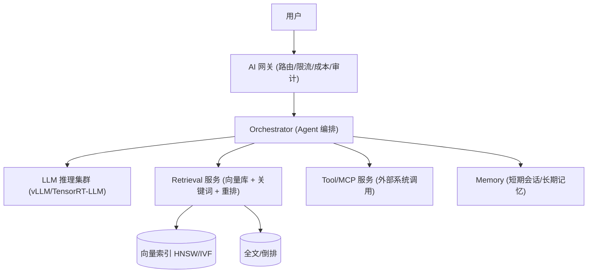

| 层次 | 关键设计 | 与传统架构的差异 |
|---|---|---|
| **推理层** | 连续批处理（continuous batching）、**PagedAttention（KV Cache 分页）**、前缀缓存（prefix caching）、投机解码、量化（INT8/FP8） | 延迟-吞吐曲线非线性；**TTFT（首 token）与 TPOT（每 token）** 是两个独立 SLO |
| **检索层** | 混合检索（向量 + BM25）+ 重排（rerank）+ 分块（chunking）+ 元数据过滤 | 索引更新频繁；召回质量比 QPS 更重要 |
| **编排层** | 状态机/图（LangGraph 风格）、工具调用、重试与降级、**成本预算** | 输出不确定 → 需要"评估（eval）+ 灰度 + 兜底" |
| **成本层** | Token 计费、缓存命中、模型路由（小模型优先、难例升级） | 单位成本随输入长度增长（注意力 O(n²)） |

**架构要点**：
- **模型路由**（Model Router）：简单请求走小模型，复杂请求走大模型，**成本可降 60–80%**。
- **语义缓存**（Semantic Cache）：相似问题命中缓存，直接跳过大模型。
- **异步 + 流式**：SSE/WebSocket 流式返回，避免"等 30 秒"的超时问题。
- **可观测**：trace 要记录 prompt/模型/ token 数/ 命中缓存/ 工具调用链（这是新的"调用栈"）。

### 5.3.2 硬件解耦：DPU/IPU、CXL、存算分离的下一步

- **DPU/IPU**：把网络、存储、安全卸载到专用处理器 → 主机 CPU 专注计算（云厂商的"裸金属性能"来源）。
- **CXL**：内存池化/内存扩展（CXL 2.0/3.0），让"内存"像存储一样可池化共享 → 未来"内存解耦"可能重构缓存与数据库架构。
- **启示**：**过去 20 年架构优化靠"软件分层"，未来 10 年会更多靠"硬件卸载 + 资源池化"**。架构师要知道"哪些开销可以下推到硬件"。

### 5.3.3 平台工程（Internal Developer Platform）与"架构即产品"

- 把"服务模板、CI/CD、可观测、SLO、合规扫描"做成**自助平台**，让业务团队"按模板 5 分钟上线一个合规服务"。
- **架构治理方式变了**：从"评审会"变成"**黄金路径（Golden Path）+ 自动化门禁**"（架构约束写进流水线）。

### 5.3.4 反模式警示：这些"先进"其实容易翻车

| 看似先进 | 翻车原因 | 正确姿势 |
|---|---|---|
| 全面微服务化 | 组织没拆、网络成本爆炸、分布式单体 | 先模块化单体，按边界渐进拆 |
| 全链路 Serverless | 冷启动、连接池、成本反超 | 核心常驻 + 边缘 Serverless |
| 全量事件驱动 | 无人能回答"现在订单是什么状态" | 事件 + 可查询的状态视图（CQRS） |
| 强一致 everywhere | 延迟与可用性崩塌 | 分级一致性 + 对账 |
| 服务网格全覆盖 | 每跳延迟与资源开销叠加 | 只对跨域/多语言链路用网格 |
| 盲目上湖仓 | 小文件、元数据、治理成本 | 先治理再建湖；控制文件数与分区 |
| "AI 化"一切 | 成本、幻觉、合规 | 明确 eval 与兜底，人机协同 |

> **第 5 章一句话总结**：**真正"先进"的架构，不是更复杂，而是"把不确定性收敛到更小范围"**——用日志替代随机写、用单元化收缩故障域、用持久化执行消除状态机样板、用开放格式解除厂商锁定、用仿真测试消除偶发 bug。


---

# 第 6 章 大厂面试题库（40 题 · 含考核度 / 参考答 / 原理 / 追问）

## 6.0 使用说明与考核度定义

**考核度说明（星级）**：

| 星级 | 含义 | 面试中的角色 |
|---|---|---|
| ★ | 了解即可 | 加分项，答不出不扣分 |
| ★★ | 熟悉 | 初级/校招常见 |
| ★★★ | **掌握（必须答对）** | 3-1 / 3-2 的分水岭 |
| ★★★★ | **精通（强区分度）** | 决定 3-3 / 4-1 档位 |
| ★★★★★ | **专家（决定 offer 上限）** | 架构岗/团队负责人必答 |

> **说明**：题目标注的是"该题型在大厂的真实出现频率与考察深度"，来源于公开面经与业界通用题库；同一题在不同 BU（交易/中台/基础架构/云）侧重点不同。**答题结构建议**：先说结论 → 再说 2-3 个方案对比 → 最后说选型依据与坑（这是面试官最想听的"决策能力"）。

---

## 6.1 A 组：架构演进与拆分（Q1–Q4）

### Q1. 什么时候该从单体拆到微服务？拆分的边界怎么定？
**考核度 ★★★★ ｜ 常见于 阿里/美团/字节 3-2 及以上 ｜ 频率：高**

**考点**：是否理解"拆分是交易"而非"升级"；边界判据；康威定律。

**参考答（三层递进）**：

1. **先问"为什么拆"**，只有四类真实动机：
   - **容量**：某个模块的 QPS/存储超出单进程上限（如查询 10 万 QPS，下单 1000 TPS）；
   - **伸缩差异**：模块的资源画像完全不同（计算密集 vs IO 密集，内存 64G vs 2G）；
   - **故障隔离**：一个模块的崩溃/OOM 不能影响核心交易；
   - **组织自治**：团队 > 50 人，发布窗口互相阻塞。
   > **如果四条都不成立，拆了就是纯负债**（多付出网络、事务、运维成本，收益为零）。

2. **边界判据（按优先级）**：
   - **业务能力（DDD 限界上下文）**：一个"能独立完成一件事"的能力集合（订单、库存、支付）；
   - **数据所有权**：**能独占一组表**的才配做服务（共享表的"服务"是假服务）；
   - **事务边界（聚合）**：一个聚合 = 一个事务 = 一个服务的最小单元；
   - **变更频率**：变化快的（营销规则）与变化慢的（账务）分开，避免"高频变更污染低频核心"；
   - **团队边界**：与团队结构对齐（康威），否则必然出现"跨团队改一个接口要排期两周"。

3. **拆分顺序（渐进式）**：先"**模块化单体**"（进程内划清边界、独立 schema、只走 Facade/事件）→ 观察 3–6 个月，把"真的需要独立伸缩/独立发布"的模块抽成服务。**先逻辑拆，再物理拆**，这样每一步都可回滚。

**原理/依据**：
- **Brooks 定律**：沟通成本 ~ n²，拆服务的本质是把"沟通"变成"接口契约"。
- **分布式成本量化**：本地调用 ~100 ns，跨服务 RPC ~1–3 ms（+1000×）；一次跨服务事务从"本地 2 次写"变成"3 次网络往返 + 补偿逻辑"。
- **USL**：拆得越细，`κ`（跨节点协调开销）越大，吞吐峰值越低 —— **拆过头会让总吞吐下降**。

**追问链**：
- **Q：拆完之后 QPS 反而降了，为什么？** → ① 调用链变长（每跳 +0.5 ms）；② 连接池/序列化开销；③ 缓存命中率下降（原来本地缓存共享，现在每个服务各自缓存）；④ 跨服务查询变多次 RPC（N+1 远程化）。解法：聚合服务/BFF、批量接口、数据冗余（宽表）。
- **Q：怎么防止"拆了又合"的反复？** → 用"边界守护测试"（ArchUnit）+ 明确"服务目录与 Owner"，并把"拆分收益"量化（发布频率、故障隔离率、扩容成本）后再决策。

---

### Q2. 什么是"分布式单体"？怎么识别和避免？
**考核度 ★★★★ ｜ 字节/阿里 高频 ｜ 频率：高**

**参考答**：

**定义**：**物理上拆成了多个服务，逻辑上仍是一个单体** —— 服务之间强耦合、同步调用链极长、共享数据库、必须一起发布。

**五个识别信号**（面试可直接背）：
1. **共享数据库/共享表**（服务 B 直接读服务 A 的表）；
2. **发布必须同时**（改 A 就必须改 B、C，且要一起上线）；
3. **同步调用链 > 3 跳**，且任何一跳失败全链路失败；
4. **共享 SDK/内部库**里塞满业务逻辑（"公共 jar"变成隐式耦合）；
5. **跨服务本地事务**（用同一个数据源做事务，说明根本没拆开）。

**避免的六个手段**：
1. **每服务独占 Schema**（禁止跨库直连，只允许 API/事件）；
2. **契约先行**：Protobuf/OpenAPI + 兼容性 CI（breaking change 直接阻断）；
3. **同步链 ≤ 3 跳**，超出用"聚合服务"或"异步 + 状态查询"；
4. **数据冗余（宽表/CQRS 读模型）** 替代跨服务 join；
5. **异步优先**：跨域通信用事件，不强依赖对方在线；
6. **服务自治**：每个服务能独立启动、独立降级（依赖不可用时返回兜底而非报错）。

**深层原理**：微服务的收益来自"**独立变化**"，而耦合会杀死独立性。**判断标准不是"有几个进程"，而是"改一个需求要动几个团队"**。

---

### Q3. 模块化单体 vs 微服务，2026 年你会怎么选？
**考核度 ★★★★ ｜ 腾讯/美团/字节（近两年新增高频）｜ 频率：中高**

**参考答**：

| 判据 | 选模块化单体 | 选微服务 |
|---|---|---|
| 团队规模 | < 30 人（1–3 个团队） | > 50 人（多团队独立发布） |
| 伸缩差异 | 各模块资源画像相近 | 差异极大（如查询 vs 下单） |
| 一致性 | 强事务多（账务、库存） | 可最终一致 |
| 变更频率 | 需求快速迭代、边界还在变 | 边界稳定、领域成熟 |
| 运维能力 | 无专职 SRE/平台团队 | 有平台/中间件团队 |
| 流量规模 | 单库可承载（< 数千 TPS 写） | 超单库/单机上限 |

**我的默认选择**：**模块化单体 + 边界清晰 + 预留抽取能力**。理由：
- 90% 的业务系统一辈子到不了"必须微服务"的规模；
- 微服务的隐性成本（运维、链路排障、分布式事务、版本矩阵）通常是收益的 3–5 倍；
- 模块化单体保留了"随时抽服务"的接缝（模块间只走 Facade/事件），**可逆性最好**。

**权威参照（面试可引用）**：Amazon Prime Video 2023 年公开复盘"微服务架构月成本过高，改回单体+CDN 后成本降 90%"；Shopify 长期坚持"模块化单体（componentized monolith）"。**但要注意**：这些案例的前提是"边界清晰 + 团队小"。

**追问：那微服务还有什么价值？** → 价值在"**独立伸缩 + 故障隔离 + 团队自治 + 技术异构**"，这四件事在超大规模/多团队场景是刚需，在小规模场景是奢侈品。

---

### Q4. DDD 的"限界上下文/聚合"如何落到代码和表结构？
**考核度 ★★★★ ｜ 阿里/蚂蚁/美团 ｜ 频率：中**

**参考答（落地四步）**：

1. **划上下文**：以"业务能力 + 语言一致性"为边界。判据：同一个词在两边含义不同（"订单"在交易里是"交易单"，在履约里是"发货单"）→ 必须分成两个上下文。
2. **定聚合（Aggregate）**：一个聚合 = **一个事务边界** = 一组必须同时一致的对象。例：`订单 + 订单行 + 优惠明细` 是一个聚合（下单必须一起成功）；`库存` 是另一个聚合（跨聚合只能最终一致）。
3. **落表**：**一个聚合对应一组表（同一 Schema）**，聚合根 ID 作为主键/分片键；**跨聚合不建外键**，用 ID 引用 + 事件同步。
4. **落代码**：`domain`（实体/值对象/领域服务/领域事件，无框架依赖）→ `application`（用例编排、事务边界）→ `infrastructure`（Repository 实现、MQ、RPC）→ `interfaces`（Controller/Consumer）。**依赖方向只能是外→内**。

**关键反模式**：
- 把"数据库表"当"聚合"（一个表一个聚合 → 事务边界碎成渣）；
- 聚合过大（一个聚合跨 20 张表 → 锁竞争、加载慢）；
- 贫血模型（Entity 只有 getter/setter，逻辑全在 Service → 不是 DDD，只是事务脚本换皮）。

**表结构示例**：
```
order_agg:  t_order, t_order_item, t_order_promotion   (同一分片键 order_id)
stock_agg:  t_stock, t_stock_reserve                   (分片键 sku_id)
跨聚合: 订单支付成功 → 发 OrderPaid 事件 → 库存聚合消费（幂等扣减）
```

---

## 6.2 B 组：缓存（Q5–Q9）

### Q5. 缓存与数据库的一致性怎么保证？有几种方案？
**考核度 ★★★★★ ｜ 阿里/字节/美团 必考 ｜ 频率：极高**

**参考答（先给结论，再展开）**：

**结论**：**没有"绝对一致"，只有"不一致窗口足够小 + 可发现可修复"**。生产首选 **"先更新 DB，再删除缓存"（Cache Aside）**，配 **binlog 订阅（Canal）异步删缓存** 做加强，再加 **定时校验/对账** 兜底。

**四种方案对比**：

| 方案 | 流程 | 一致性 | 问题 |
|---|---|---|---|
| ① 先删缓存，再更新 DB | 删 → 更库 | 差 | 删后并发读把旧值回填 → **长期脏数据** |
| ② **先更新 DB，再删缓存** | 更库 → 删 | 好（窗口极短） | 删失败/并发"读旧写回" → 短暂脏 |
| ③ 更新 DB + 更新缓存 | 更库 → 更缓存 | 中 | 并发更新乱序 → 缓存被旧值覆盖；空值/计算复杂 |
| ④ **binlog 订阅删除** | 更库 → binlog → Canal → 删缓存 | 好（最终一致） | 延迟（ms 级）、需 Canal 高可用 |

**为什么"先更库再删缓存"更优（原理推导）**：
- 若"先删缓存"：T1 删缓存 → T2 读缓存 miss → T2 读 DB 得旧值 → T2 回填旧值 → T1 更新 DB。结果：**缓存永久是旧值**（直到下次更新），这是"不可自愈"的。
- 若"先更库再删缓存"：T1 更库 → T2 读缓存 miss → T2 读 DB 得**新值**（因为库已更新）→ 回填新值 → T1 删缓存。最坏只是"删掉了刚回填的新值"，下次读重建，**自愈**。
- **残余窗口**：T1 更库 → T1 删缓存前，T3 读缓存拿到旧值。窗口 = 一次删缓存耗时（<1 ms），可接受；要更强就 **延迟双删**（更库 → 删 → sleep 500 ms → 再删）。

**加强方案（工程组合拳）**：
1. **延迟双删**（应对主从延迟导致的"旧值回填"）；
2. **binlog 订阅**（彻底解耦，DB 是唯一事实源）；
3. **版本号/时间戳**：缓存值带 `version`，回填时 CAS（只允许更新更大版本）；
4. **读时校验**：低频关键数据（余额）不走缓存或"缓存 + DB 校验"；
5. **定时对账**：抽样比对缓存与 DB，发现差异告警。

**追问链**：
- **Q：删缓存失败怎么办？** → ① 重试（本地重试 + MQ 重试）；② binlog 兜底（即使删失败，binlog 订阅会再删一次）；③ 缓存设 TTL（最终自愈）；④ 监控"删除失败率"。
- **Q：为什么不用"更新缓存"？** → ① 并发写乱序（A 写 10、B 写 20，缓存可能留 10）；② 缓存值可能是"计算结果"（聚合/多表 join），更新成本高；③ 冷数据被反复写入（浪费内存）。
- **Q：强一致场景（余额）怎么做？** → 不让缓存承担一致性：读走 DB（或"缓存只做展示，交易读 DB 加锁"）；用"缓存 + 版本校验"，或干脆"读写都走 DB + 分库分表扛量"。

---

### Q6. 缓存穿透、击穿、雪崩的区别与解法？
**考核度 ★★★★ ｜ 美团/快手/腾讯 ｜ 频率：极高**

**参考答（先区分定义，这是得分点）**：

| 问题 | 触发条件 | 本质 |
|---|---|---|
| **穿透** | 查**不存在**的 key，缓存永远 miss → 每次都打 DB | 请求"绕过"了缓存 |
| **击穿** | **单个热点 key 过期**瞬间，大量并发同时回源 | 单点并发打 DB |
| **雪崩** | **大量 key 同时过期** 或 缓存集群整体宕机 | 面状流量打 DB |

**解法（对应）**：

1. **穿透**：① 缓存空值（TTL 30–60 s，防"空值也被刷"）；② **布隆过滤器**（前置判断"可能存在"，1% 误判可接受，注意不支持删除 → 用计数布隆/布谷鸟）；③ 参数合法性校验 + 风控（非法 ID 直接拒）。
2. **击穿**：① **互斥锁/单飞（singleflight）**：只允许一个线程回源，其余等待（注意锁粒度与超时）；② **逻辑过期**：不设物理 TTL，值里带 `expireTime`，过期后异步刷新（返回旧值，牺牲一致性换可用性）；③ 热点 key 常驻 + 后台定时刷新。
3. **雪崩**：① **TTL 加随机抖动**（`TTL = base + random(0, 10%)`）；② 多级缓存（本地 + Redis）；③ 缓存集群高可用（Cluster/Sentinel + 多副本）；④ **限流 + 降级**（DB 侧限流，超过阈值返回兜底）；⑤ 预热（大促前把热点数据提前加载）。

**关键补充（面试加分）**：
- **布隆过滤器的三个参数**：位数组 m、哈希函数 k、元素数 n，误判率 `p ≈ (1 - e^(-kn/m))^k`；m/n ≈ 10 时 p ≈ 1%。
- **"缓存空值"要注意**：如果攻击者用随机 ID 刷，空值缓存会**污染缓存内存**（需配合"空值 key 单独 TTL + 限流"）。
- **"逻辑过期"的坑**：多个线程同时发现过期 → 需要"分布式锁/单飞"限制刷新并发，否则退化为击穿。

---

### Q7. 热 key 怎么发现、怎么治理？
**考核度 ★★★★ ｜ 字节/快手（电商/直播场景高频）｜ 频率：中高**

**参考答**：

**发现（三种手段）**：
1. **客户端埋点统计**（京东 hotkey 方案）：SDK 本地滑动窗口统计 key 访问次数，超过阈值上报 → 聚合中心判定；
2. **代理层采样**（Twemproxy/自研 proxy）：对命令做采样统计；
3. **Redis 侧**：`redis-cli --hotkeys`（需 LFU 策略）、`MONITOR`（仅调试，性能损耗大）、`INFO commandstats`。

**治理（四条路，按成本从低到高）**：
1. **本地缓存（L1）**：热点 key 放进程内 Caffeine（命中率 95%+ 时，Redis 压力降 20 倍）；代价是"多实例一致性"→ 用短 TTL + 广播失效。
2. **key 打散**：`hotkey:{0..9}` 复制 10 份，读时随机取一份 → 单 key 压力降 10 倍；代价：更新要写 10 份（写放大），只适合"读多写少"。
3. **读写分离/多副本**：从库/多副本分担读（Redis Cluster 的 slave 读）。
4. **限流 + 降级**：热点 key 对应的接口做单 key 限流，超过则返回兜底（如"当前人数过多"）。

**深层原理**：热 key 的本质是**请求分布的幂律（Zipf）**—— 头部 1% 的 key 承担 50%+ 的流量。所以"均匀分片"对热 key 无效，必须"**复制 + 本地化**"。

**追问：秒杀场景的库存 key 怎么处理？** → 库存 key 是"写热点"（超卖风险），不能简单打散（会超卖）。做法：**Redis 预扣（Lua 原子）+ 分段库存（把 1000 库存拆成 10 段，每段独立扣减）**，或"本地库存 + 异步同步 DB"。

---

### Q8. Redis 单线程为什么快？6.0 的多线程改了什么？
**考核度 ★★★ ｜ 腾讯/百度/滴滴 ｜ 频率：高**

**参考答**：

**"快"的四个层次（由内到外）**：
1. **纯内存**：无磁盘 IO，一次操作 ~100 ns 级；
2. **单线程无锁**：无线程切换（~1–2 μs/次）、无锁竞争、无并发 bug；Redis 的瓶颈在"网络与内存"，不在 CPU；
3. **IO 多路复用 + 事件驱动**：epoll 单线程管理万级连接（Reactor 模式），不为每个连接创建线程；
4. **高效数据结构**：SDS（预分配+惰性释放）、listpack/ziplist（连续内存、CPU 缓存友好）、intset、跳表（O(log n) 且实现简单）、渐进式 rehash（避免大字典扩容卡顿）。

**6.0 的多线程（关键区分点）**：
- **只把"网络读写 + 协议解析"放到 IO 线程**，**命令执行仍然是单线程**（保证原子性与无锁）。
- 收益：在多核机器上，网络 IO 成为瓶颈时吞吐可提升 1–2 倍（`io-threads 4`）。
- **没有改变**：内存操作、命令执行、事务、Lua 仍是单线程 → 大 key/慢命令依然会阻塞全局。

**追问：单线程的代价是什么？** → ① 一个慢命令（`KEYS *`、大 `HGETALL`、`DEL` 大 key）阻塞所有请求；② 无法利用多核做计算；③ 持久化 fork 时（RDB）有内存翻倍与阻塞风险。解法：禁用危险命令（`rename-command`）、用 `SCAN`/`UNLINK`、读写分离、Cluster 分片。

---

### Q9. 大 key 有什么危害？怎么发现和治理？持久化怎么选？
**考核度 ★★★ ｜ 快手/滴滴/京东 ｜ 频率：中**

**参考答**：

**危害（四点，按严重度）**：
1. **阻塞主线程**：`DEL` 一个 100 万元素的 Hash 可能耗时数百 ms → 全站超时；
2. **网络拥塞**：单次 `GET` 传 10 MB → 打满网卡、拖慢同实例其他请求；
3. **内存倾斜**：Cluster 中一个大 key 集中在一个分片 → 该分片内存/流量打爆；
4. **持久化/主从**：RDB/AOF 重写时大 key 导致 fork 慢、复制延迟。

**发现**：`redis-cli --bigkeys`（采样）、`MEMORY USAGE key`、离线分析 RDB（rdbtools）、监控"单 key 内存/元素数"阈值告警。
**标准**：String > 10 KB；Hash/List/Set/ZSet 元素 > 5000；总内存占比 > 1%。

**治理**：
1. **拆分**：按业务维度拆（`user:1001:base` / `user:1001:ext`）；大 Hash 按 field 前缀拆成多个小 Hash；
2. **删除用 `UNLINK`**（异步回收）+ 分批 `HSCAN` + `HDEL`；
3. **压缩**：长文本用压缩算法（gzip/lz4）存二进制；或改用对象存储存大对象，Redis 只存 ID；
4. **写入侧约束**：SDK 拦截（超过阈值拒绝写入 + 告警）。

**持久化选型**：
| 方式 | 原理 | 优点 | 缺点 | 适用 |
|---|---|---|---|---|
| RDB | fork + 快照 | 文件小、恢复快 | 可能丢最后一次快照后的数据；fork 阻塞 | 备份/灾备 |
| AOF | 追加写命令 | 丢数据少（everysec 最多 1 s） | 文件大、恢复慢 | 数据敏感 |
| **混合（RDB+AOF）** | 重写时前半 RDB 后半增量 AOF | 恢复快 + 丢数据少 | 实现复杂 | **生产推荐** |

---

## 6.3 C 组：数据库内核与分库分表（Q10–Q15）

### Q10. 一条 `update` 语句从客户端到落盘，完整链路是什么？
**考核度 ★★★★★ ｜ 阿里/字节/腾讯 数据库岗与后台岗必考 ｜ 频率：极高**

**参考答（分四段讲，每段都是得分点）**：

**第一段：连接与解析（Server 层）**
1. 客户端经**连接池**建立 TCP → MySQL 连接线程（`thread_cache` 复用）；
2. **解析器**：词法/语法分析 → 生成语法树；
3. **预处理器/权限校验**：表是否存在、用户是否有 UPDATE 权限；
4. **优化器**：选择索引（基于统计信息/代价模型）、生成执行计划；
5. **执行器**：按计划调用存储引擎接口（`handler` API）。

**第二段：InnoDB 内的写入（核心）**
6. **定位行 + 加锁**：按主键/二级索引找到行，加**行锁**（`FOR UPDATE` 语义）；若走二级索引且非唯一，加 **next-key lock（记录锁 + 间隙锁）**；
7. **写 undo log**：记录旧值（用于**回滚**与 **MVCC 快照读**）。undo 写入 undo 表空间（逻辑日志）；
8. **改 buffer pool 中的数据页**：**就地更新内存页**（该页变"脏页"，`innodb_buffer_pool` 中标记 dirty）；
9. **写 redo log**：记录"物理页修改"到 **redo log buffer**（顺序写、循环使用 ib_logfile）；
10. **redo 刷盘**：受 `innodb_flush_log_at_trx_commit` 控制：
    - `=1`（默认）：每次提交 **fsync** → 不丢数据，性能最低；
    - `=0`：每秒刷 → 宕机丢 1 s；
    - `=2`：写到 OS cache，每秒 fsync → 宕机不丢（OS 不崩），机器断电丢 1 s。

**第三段：binlog 与两阶段提交（保证 crash-safe 与主从一致）**
11. **写 binlog**（Server 层，逻辑日志，statement/row/mixed；row 模式记录"改了哪些行的前后值"）；
12. **两阶段提交**：`redo prepare`（redo 打上 prepare 标记）→ `binlog write + fsync` → `redo commit`（清除 prepare 标记）。
    - **为什么必须两阶段**：若先 commit redo 再写 binlog，**主库有、从库没有** → 主从不一致；若先写 binlog 再 commit，**binlog 有、主库无** → 从库多出数据。两阶段保证"**两者要么都有、要么都无**"。
    - **崩溃恢复规则**：redo 有 prepare 且 binlog 完整 → **提交**；redo 有 prepare 但 binlog 不完整/不存在 → **回滚**。
13. **组提交（group commit）**：多个事务的 fsync 合并成一次（`binlog_group_commit_sync_delay`），提升并发写吞吐。
14. **返回客户端**（此时数据已在 redo/binlog 持久化，**数据页可能仍是脏页**）。

**第四段：后台异步**
15. **checkpoint**：后台线程按 LRU/脏页比例把脏页刷盘（`innodb_io_capacity` 控制速率）；刷完后 redo 中对应 LSN 之前的日志可被覆盖；
16. **change buffer**：若更新的是**非唯一二级索引**且页不在内存，先写 change buffer（避免随机读），后续 merge；
17. **复制**：dump 线程读 binlog → 从库 IO 线程写 relay log → SQL 线程/并行 worker 回放 → 从库产生自己的 binlog（可选 log_slave_updates）。

**一句话总结**（面试可直接说）：**"先写 undo（可回滚）→ 改内存页（快）→ 写 redo（可恢复）→ 两阶段提交 binlog（可复制）→ 后台刷脏页（最终落盘）"**。核心是 **WAL（日志先行）+ 两阶段提交**。

**追问链**：
- **Q：为什么 redo 是物理日志、binlog 是逻辑日志？** → redo 用于**崩溃恢复**（页级幂等重放，快）；binlog 用于**复制与归档**（行级语义，可跨版本/跨引擎）。
- **Q：`update` 会不会锁全表？** → 若无索引（或索引失效），InnoDB 会**扫描全表并给每行加锁**（RR 下还会加间隙锁）→ 等价于锁表。
- **Q：为什么大事务有害？** → ① undo 膨胀；② 锁持有时间长；③ binlog 巨大导致从库延迟；④ 崩溃恢复慢（要重放很长的 redo）。

---

### Q11. MySQL 的 MVCC 怎么实现？RR 级别下幻读解决了吗？
**考核度 ★★★★ ｜ 阿里/美团/字节 ｜ 频率：极高**

**参考答**：

**MVCC 三要素**：
1. **隐藏字段**：`DB_TRX_ID`（最后修改的事务 ID）、`DB_ROLL_PTR`（指向 undo 的指针）、`DB_ROW_ID`（无主键时）；
2. **undo log 版本链**：每次修改把旧值写入 undo，形成"版本链"（`roll_ptr` 串起来）；
3. **ReadView**：快照读时生成，含 `m_ids`（活跃事务列表）、`min_trx_id`、`max_trx_id`、`creator_trx_id`。可见性规则：
   - `trx_id < min_trx_id` → 可见（已提交）；
   - `trx_id >= max_trx_id` → 不可见（快照后开启）；
   - `trx_id` 在 `m_ids` 中 → 不可见（活跃）；不在 → 可见。
   沿版本链找到第一个可见版本。

**RC vs RR 的唯一区别**：**ReadView 的生成时机**
- **RC**：每条 SELECT 都新建 ReadView → 能看到最新提交（不可重复读）；
- **RR**：**第一条 SELECT 时建 ReadView，事务内复用** → 快照固定（可重复读）。

**幻读问题的精确回答（这是区分度所在）**：
- **快照读（普通 SELECT）**：RR 下靠 ReadView **不会**看到新插入的行 → 无幻读；
- **当前读（`SELECT ... FOR UPDATE`、`UPDATE`、`DELETE`）**：靠 **next-key lock（记录锁+间隙锁）** 阻塞其他事务在间隙内插入 → 也**不会**幻读；
- **但**：如果同一事务**先快照读、后当前读**，当前读会看到"快照之后新插入的行" → 表现为"幻读"。这不是 bug，而是**隔离级别的语义边界**（MySQL 官方文档明确说 RR 不能完全避免幻读）。
- **RC 下**：没有间隙锁（只有记录锁）→ 当前读会幻读。

**间隙锁的代价**：RR 下对"非唯一索引/无索引"的更新会锁住间隙 → **并发插入被阻塞**、**死锁概率上升**。所以很多互联网业务把隔离级别设为 **RC + 业务层乐观锁**（性能优先，用版本号防丢更新）。

**追问**：
- **Q：为什么 RC 更适合互联网高并发？** → 无间隙锁、锁范围小、死锁少；代价是幻读与不可重复读，用"乐观锁/唯一约束"补。
- **Q：`SELECT ... FOR UPDATE` 锁的是什么？** → 主键等值：记录锁；二级索引等值：记录锁 + 间隙锁（next-key）；范围查询：多个 next-key；无索引：全表扫描 + 锁全表。

---

### Q12. 为什么 MySQL 用 B+ 树而不是 B 树/红黑树/哈希？三层能存多少行？
**考核度 ★★★ ｜ 腾讯/百度/京东 ｜ 频率：高**

**参考答**：

**选型对比**：

| 结构 | 磁盘友好度 | 范围查询 | 点查 | 结论 |
|---|---|---|---|---|
| 哈希 | 差（无法范围） | 不支持 | O(1) | 只适合等值（Memory 引擎） |
| 红黑树/AVL | 差（层高 ~log2n，2 亿行 ~28 层 = 28 次 IO） | 支持 | O(log n) 但 IO 多 | 内存索引可用（如 TreeMap） |
| B 树 | 中（数据散布在所有节点） | 支持 | 层高低 | 范围查询需中序遍历，跨层跳转多 |
| **B+ 树** | **优** | **优（叶子链表）** | 层高低 | **磁盘数据库标准** |

**B+ 树的四个决定性优势**：
1. **非叶子只存 key**（不存数据）→ 单页能放更多索引项 → **层高更低**（3–4 层覆盖亿级）；
2. **数据全在叶子 + 叶子双向链表** → 范围扫描**顺序 IO**（对磁盘极友好）；
3. **查询稳定**：所有查询都走到叶子，IO 次数一致（可预测）；
4. **页对齐 16 KB**（与磁盘块/文件系统块匹配，一次 IO 读一整页）。

**三层容量推导（必背）**：
```
页大小 16 KB = 16384 B
索引项 = 主键 bigint 8 B + 页指针 6 B = 14 B
非叶子每页可放 ≈ 16384 / 14 ≈ 1170 个指针
叶子每行假设 100 B（含行头/隐藏列）→ 每页 ≈ 160 行
三层容量 = 1170 × 1170 × 160 ≈ 2.19 亿行
→ 即：2 亿行以内，3 次磁盘 IO 定位任意一行（根节点常驻内存，实际 2 次）
```

**追问**：
- **Q：既然 3 层能存 2 亿行，为什么还要分库分表？** → ① 写 QPS 超单机（单库写 ~几千 TPS）；② 单表过大导致 DDL/备份/恢复慢；③ 连接数与 buffer pool 上限；④ 故障域（单库挂了全站挂）。
- **Q：为什么不用"自增主键"以外的？** → 自增主键顺序写入（减少页分裂），UUID 随机写入导致页分裂与缓存命中下降（写放大 2–3 倍）。

---

### Q13. 分库分表后，跨分片的分页、排序、聚合、Join 怎么做？
**考核度 ★★★★ ｜ 阿里/美团 ｜ 频率：高**

**参考答**：

**核心事实**：**分片后没有"全局有序"，必须在应用层做"二次归并"**。

**（1）全局分页（最常考）**
```
需求: order by create_time desc limit 100000, 20  (每片取前 100020 条)
问题: 每片都要取 10 万条 → 内存/网络爆炸
```
三种解法：
1. **内存归并（小 offset 可用）**：每片取 `offset+limit` 条 → 归并排序 → 取第 offset..offset+limit 条。**成本 O(分片数 × (offset+limit))**，深分页不可用。
2. **二次查询法（推荐）**：先各片取 `limit` 条（只取排序键+主键）→ 全局归并得到"第 offset 名的边界值"→ 第二次按"边界值"回各片精确查询 → 再归并。**网络传输量降为 2 × 分片数 × limit**。
3. **禁止深分页 / 改游标**：`where create_time < last_time limit 20`（业务上"只看前 N 页"）。这是最优解——**用产品设计消灭技术问题**。

**（2）聚合（count/sum/avg）**
- **count**：各片 count 相加（注意 distinct 需各片去重后合并）；
- **sum/min/max**：可分别相加/取极值（**avg 不能直接平均**，要用 `sum/count` 分别聚合）；
- **去重（distinct/group by）**：各片 group by 后**按维度二次聚合**（MapReduce 思想）；
- **大报表**：走 **ES/ClickHouse/数仓**，不要在分库分表上做 OLAP。

**（3）Join（几乎都禁止）**
- **同分片键**：可以 join（如 order 与 order_item 都按 order_id 分片）→ **设计时就要保证"关联表同分片键"**（这是分片设计的核心技巧）；
- **不同分片键**：① **冗余宽表**（把维表字段冗余进主表，用 CDC 同步）；② **广播小表**（维表全量加载到本地缓存）；③ **应用层 join**（先查 A 拿 ID 列表，再批量查 B，注意 N+1）；④ **ES 宽索引**。

**（4）排序 + 分页 + 过滤 同时存在**：只能"各片取足够多的候选 → 内存归并"。所以要**限制组合查询**（产品层面收敛），或把这类查询引导到 ES。

**追问：扩容时怎么保证不丢数据？** → 双写 + 全量迁移 + 增量追平 + 校验 + 灰度读 + 单写 + 下线（见 3.5 的"五步法"）。

---

### Q14. 分布式 ID 有哪些方案？雪花算法的坑怎么解？
**考核度 ★★★★ ｜ 阿里/美团/字节 ｜ 频率：极高**

**参考答**：

| 方案 | 原理 | 优点 | 缺点 |
|---|---|---|---|
| UUID | 随机/时间+MAC | 本地生成、无网络 | **无序**（B+树页分裂）、32 字符占空间、不可读 |
| DB 自增 | 单表/多表步长 | 简单、有序 | 单点/扩容难（步长方案扩容麻烦） |
| Redis INCR | 原子自增 | 简单、有序 | 依赖 Redis（持久化丢号风险）、单点 |
| **号段模式（Leaf-segment）** | DB 取一段（如 1–1000）缓存在内存，用完再取 | **DB 压力降 1000 倍**、有序 | 号段浪费（重启丢一段）；需双 buffer 预取 |
| **雪花（Snowflake）** | 时间戳+机器ID+序列 | 本地生成、趋势递增、高性能 | **时钟回拨**、机器 ID 分配难 |
| Leaf-snowflake | ZK 协调 workerId + 回拨检测 | 生产可用 | 依赖 ZK |
| 美团 Leaf / 百度 uid-generator / 滴滴 TinyID | 号段 + 雪花混合 | 工业级 | — |

**雪花结构（64 bit）**：
```
0 | 41 bit 毫秒时间戳(可用 69 年) | 10 bit 机器ID(1024 台) | 12 bit 序列(每 ms 4096 个)
→ 单机 4096 × 1000 = 409.6 万/秒
```

**三个坑与解法**：
1. **时钟回拨**：
   - 小幅回拨（< 阈值如 5 ms）→ **等待**到时间追平；
   - 大幅回拨 → **拒绝服务并告警**，或切换备用 workerId；
   - 更稳做法：**用"逻辑时间"**（记录 `lastTimestamp`，取 `max(now, lastTimestamp+1)`），或用 Leaf 的"号段兜底"。
2. **workerId 分配**：K8s 动态 Pod 无法固定 → ① 启动时向 ZK/Redis 注册（`/snowflake/worker/0001` 临时节点，宕机自动释放）；② 用"机房号+服务号+Pod 序号"编码；③ 用 ConfigMap 固定（不推荐，扩容麻烦）。
3. **趋势递增 ≠ 严格递增**：多机器并发时低位乱序；若业务要求"按 ID 排序 = 按时间排序"（如消息），需**单点发号（TSO）**或"时间戳前缀 + 分片"。

**追问：为什么不用 UUID 做主键？** → 随机性导致 B+ 树**页分裂**（写放大）、索引体积大（36 B vs 8 B）、无法范围查询/排序、缓存命中率下降。实测写入吞吐可能差 2–5 倍。

---

### Q15. 主从延迟怎么造成？读写分离下如何保证"读到自己写的"？
**考核度 ★★★ ｜ 腾讯/京东/滴滴 ｜ 频率：中高**

**参考答**：

**延迟的五个来源**：
1. **从库单线程回放**（MySQL 5.6 前）→ 主库多线程写、从库单线程应用，必然堆积（5.7+ 并行复制按 `LOGICAL_CLOCK` 缓解）；
2. **大事务**（一次更新 100 万行）→ 从库要执行很久；
3. **从库压力**（从库也在跑查询/备份）→ 回放被拖慢；
4. **网络带宽/延迟**（跨机房 binlog 传输）；
5. **DDL**（大表加索引）→ 从库执行时间长，期间延迟飙升。

**监控**：`Seconds_Behind_Master`（不准，只反映"最后一条 event 的时间差"）、`pt-heartbeat`（更准，注入心跳表）、`SHOW SLAVE STATUS` 的 `Relay_Log_Pos` 差值。

**"读己之写"的四种保障**：
1. **写后读主**（最简单）：写操作后 N 秒内的读走主库（用 ThreadLocal/请求上下文标记）；缺点：主库压力上升。
2. **按位点路由**：写完记录 `binlog position`，读时只路由到"已回放到该位点"的从库（需从库上报位点）。
3. **会话粘性 + 版本号**：用户 session 绑定主库一段时间；或数据带 `version`，读到旧版本则重试主库。
4. **关键路径直接读主**：支付结果、订单详情等"必须最新"的读，永远走主库（用独立的小主库集群承载）。

**追问：半同步复制能解决丢数据吗？** → 半同步保证"至少 1 个从库收到"，但：① 超时会**自动降级为异步**（要监控 `rpl_semi_sync_master_status`）；② 只保证"收到日志"，不保证"已应用"（读仍可能旧）；③ 从库网络抖动会拖慢主库（`rpl_semi_sync_master_timeout` 要调小）。


---

## 6.4 D 组：消息队列与异步（Q16–Q19）

### Q16. 如何保证消息"不丢、不重、有序"？
**考核度 ★★★★★ ｜ 阿里/字节/美团 必考 ｜ 频率：极高**

**参考答（按"三个环节"拆，这是标准答法）**：

消息生命周期有三个环节，**每个环节都可能丢**：

```
Producer →(1)→ Broker(存储) →(2)→ Consumer
```

**（一）不丢**
| 环节 | 丢的原因 | 解法 |
|---|---|---|
| Producer → Broker | 网络失败、Broker 宕机、异步发送未确认 | ① **同步发送/确认回调**（`acks=all`）；② **本地消息表/Outbox**（业务落库与发消息原子）；③ 失败重试 + 死信 |
| Broker 存储 | 单副本、刷盘失败、磁盘坏 | ① **多副本（replication.factor ≥ 3）**；② `min.insync.replicas=2`（至少 2 副本确认才算成功）；③ **`unclean.leader.election=false`**（禁止落后副本当 leader）；④ 磁盘 RAID + 监控 |
| Broker → Consumer | 自动提交 offset（处理前就提交）、消费者崩溃 | ① **手动提交 offset**（处理成功后提交）；② 处理幂等；③ 死信队列 + 重试 |

> **Kafka 的关键认知**：Kafka 默认**不 fsync 每条消息**（依赖页缓存 + 副本），所以"不丢"靠**副本**而不是**单机刷盘**。`acks=all` + `min.insync.replicas=2` + RF=3 是"不丢"的标准配置。

**（二）不重**
- **根源**：at-least-once 语义（重试、rebalance、offset 回退都会重复）。
- **解法**：**消费端幂等**（发送端无法保证不重，因为"确认"本身可能丢）：
  1. **唯一键**：业务 ID（订单号+事件类型）建唯一索引，重复插入失败即丢弃；
  2. **去重表/Redis SETNX**（带 TTL，覆盖重试窗口）；
  3. **状态机 CAS**：`update ... where status='PAYING'`，只有一次能成功；
  4. **版本号**：只处理"比已处理版本更新"的消息。
- **exactly-once 的真实含义**：只有"**事务性生产者 + 事务性消费者（读-处理-写同一事务）**"或"**流处理 checkpoint + 幂等 sink**"才能做到端到端 exactly-once；跨系统基本只能"at-least-once + 幂等"。

**（三）有序**
- **Kafka 只保证"分区内有序"**，所以：
  1. **同 key 进同分区**（`key = orderId`），生产端用 key 的 hash 分区；
  2. **消费端按分区单线程**（一个 partition 只能被同组一个 consumer 消费，天然串行）；
  3. 若需要"全局有序"→ 只能单分区（吞吐受限）或"按业务维度有序"（推荐）。
- **乱序的真实来源**：① 多分区；② 消费端并发处理（拉一批丢线程池，完成顺序不定）→ 需"按 key 路由到同一 worker + 队列"；③ 重试导致后发先至。

**一句话总结**（面试可直接背）：**"不丢靠确认与副本，不重靠幂等，有序靠分区与单消费者"**。

**追问**：
- **Q：`acks=all` 会不会很慢？** → 会（要等 ISR 全部落盘），所以按业务分级：钱/订单用 all，日志/埋点用 1 或 0。
- **Q：消费者 rebalance 会重复吗？** → 会（未提交 offset 的分区被重新分配），所以必须幂等 + 提交策略（处理完再提交）。

---

### Q17. Kafka 为什么吞吐这么高？底层原理是什么？
**考核度 ★★★★ ｜ 字节/阿里/美团 ｜ 频率：极高**

**参考答（六层原因，从存储到网络）**：

**1. 顺序写（Append-only Log）**
- 每个 partition 是一个**只追加的日志文件段**（`.log` + `.index` + `.timeindex`）。
- 磁盘顺序写 ~100–600 MB/s，随机写只有 ~100 IOPS → **顺序写把磁盘从"寻道瓶颈"变成"带宽瓶颈"**。

**2. 页缓存（Page Cache）而非 JVM 堆**
- 消息写入 OS **页缓存**，由内核决定刷盘；消费时优先命中页缓存 → **避免 JVM GC 与对象开销**（也避免了"堆内缓存 → 又要拷贝到内核"的双重开销）。

**3. 零拷贝（Zero-Copy，sendfile）**
```
传统: 磁盘 → 内核页缓存 → 用户态 buffer → 内核 socket buffer → 网卡   (4 次拷贝, 4 次上下文切换)
sendfile: 磁盘 → 内核页缓存 → 网卡 (DMA gather)                        (2 次拷贝, 2 次切换)
```
- 省掉"用户态"这一层，**大消息传输吞吐提升 2–4 倍**。

**4. 批量（Batch）+ 压缩**
- Producer 端 `batch.size`（默认 16 KB）+ `linger.ms`（等一小会儿攒批）→ 一次网络请求发多条；
- 压缩（lz4/zstd/snappy）→ 网络与磁盘写量下降 3–10 倍（CPU 换 IO，通常划算）。

**5. 分区并行 + 稀疏索引**
- 多 partition 并行读写（水平扩展）；
- **稀疏索引**（每 N 条记录一个索引项）→ 索引小、常驻内存，二分查找 O(log n)。

**6. 无状态 Broker + 消费端 pull**
- Broker 不维护"每条消息的消费状态"（只维护 offset），**消费状态在客户端** → Broker 极轻；
- Pull 模式让消费者按自己速度拉（天然背压）。

**追问**：
- **Q：零拷贝为什么不能用于"需要修改数据"的场景？** → sendfile 数据不经过用户态，无法加工（如加密/转换）；Kafka 只在"原样发送"时用，SSL 场景会退化。
- **Q：ISR / HW / LEO 是什么？** →
  - **LEO**（Log End Offset）：每个副本最后一条消息的下一个位置；
  - **HW**（High Watermark）：ISR 中**最小 LEO**，消费者只能读到 HW 之前的消息（保证"读到的都是已复制"）；
  - **ISR**（In-Sync Replicas）：与 leader 保持同步的副本集合；leader 挂 → 从 ISR 选新 leader。
- **Q：Kafka 为什么比 RocketMQ 在某些场景慢？** → RocketMQ 有事务消息、定时消息、消息轨迹等能力，且 CommitLog + ConsumeQueue 的混合结构对"随机读"更友好；Kafka 强在"纯流式吞吐"。

---

### Q18. 本地消息表、事务消息、CDC 三种"最终一致"方案怎么选？
**考核度 ★★★★ ｜ 美团/阿里/蚂蚁 ｜ 频率：高**

**参考答（对比 + 选型）**：

| 方案 | 实现 | 一致性保证 | 延迟 | 侵入性 | 适用 |
|---|---|---|---|---|---|
| **本地消息表（Outbox）** | 业务表 + outbox 表**同库同事务**；投递器轮询/扫表 | 业务与消息原子 | 轮询间隔（100 ms–1 s） | 低（多一张表） | 无 MQ 事务能力、跨 MQ |
| **事务消息（RocketMQ）** | 半消息 → 本地事务 → commit/rollback → **回查** | 消息一定发出 | 低（ms 级） | 低（需实现回查接口） | 已用 RocketMQ |
| **CDC（Canal/Debezium）** | 订阅 **binlog** → 转事件 → 发 MQ | 与 DB 变更严格对应 | 低（100 ms 内） | **最低**（业务零改造） | 已有 DB、想零侵入 |

**核心原理对比**：
- Outbox：**用"同一个数据库的本地事务"解决"跨资源原子性"** —— 最普适的思路（"把分布式问题变成单机问题"）。
- 事务消息：MQ 承担"半消息 + 回查"，本质也是"两阶段"，但把状态机放在 MQ 侧。
- CDC：**binlog 是 DB 的"事实日志"**，天然有序、天然包含"前后值"，是最优雅的方案；但要注意 **binlog 格式必须是 ROW**，且"事务边界"（一个事务多条 binlog 要打包）。

**选型口诀**：
1. 已经用 RocketMQ 且要"强可靠通知" → 事务消息；
2. 多 MQ / 自研 MQ / 需要"业务无感" → Outbox 或 CDC；
3. 数据量大、要求零侵入、下游多样（搜索/数仓/缓存） → **CDC**；
4. **无论哪种，消费端必须幂等 + 有对账**。

**追问：CDC 的坑？** → ① 表结构变更（DDL）导致解析失败；② 大事务（一个事务 100 万行）导致下游压力；③ binlog 保留时间（下游故障超过保留期 → 只能全量重建）；④ 主从切换后位点变化（需 GTID）。

---

### Q19. 消息积压怎么处理？消费顺序怎么保证？
**考核度 ★★★ ｜ 快手/滴滴/京东 ｜ 频率：中**

**参考答**：

**积压的根因分类（先定位再动手）**：
| 根因 | 表现 | 处理 |
|---|---|---|
| 消费慢（下游 RT 高/逻辑重） | 单条处理 ms→s | 优化逻辑、批量、异步、加缓存 |
| 消费者不足 | 分区数 > 消费者数 | **扩消费者到 = 分区数**（超过无意义） |
| 分区数不足 | 单分区吞吐到顶 | **扩分区**（注意：扩分区会破坏 key→分区映射，需评估顺序） |
| 生产突增 | 大促/故障重试 | 限流生产、临时扩容、降级非核心 |
| 毒丸消息 | 某条消息反复失败阻塞 | **死信队列 + 跳过** |
| Rebalance 频繁 | 消费者频繁上下线 | 调 `session.timeout`、`max.poll.interval` |

**应急四步（面试可背）**：
1. **止血**：限流生产端（保住核心链路）；把非核心消费者降级。
2. **扩容**：临时扩消费者/分区（云上可快速扩 Pod）；Kafka 扩分区需 `kafka-reassign-partitions`。
3. **泄洪**：写一个"搬运程序"——把积压 topic 的消息**快速搬到临时 topic（多分区）**，再用大规模消费者并行消费（经典"积压转移"方案）。
4. **兜底**：跳过无法处理的消息（死信）；事后用**离线任务重放**补数据。

**顺序保证的三层**：
- **生产**：同 key → 同分区（`hash(key) % partitions`）；
- **存储**：分区内 append-only，天然有序；
- **消费**：① 一个分区一个消费者（同组内互斥）；② 消费者内部**按 key 路由到同一内存队列/同一线程**（避免并发乱序）；③ 若必须并发 → 用"版本号/序号"在下游合并（只接受更大序号）。

**追问：扩分区后顺序乱了怎么办？** → ① 业务上接受"短暂乱序"（大多数场景可接受）；② 用"双 topic 灰度"（新数据进新分区方案，旧数据旧方案）；③ 下游用"状态机 + 版本号"容忍乱序。

---

## 6.5 E 组：分布式核心（Q20–Q26）

### Q20. 注册中心/配置中心该选 CP 还是 AP？CAP 在真实系统里怎么落地？
**考核度 ★★★★ ｜ 阿里/蚂蚁/字节 ｜ 频率：高**

**参考答**：

**先分清两个东西的诉求不同**：

| 组件 | 诉求 | 选择 | 理由 |
|---|---|---|---|
| **服务注册与发现** | 宁可拿到"稍旧的实例列表"，也不能"不可用" | **AP**（+ 本地缓存） | 注册中心挂了，客户端用本地缓存的实例列表继续调用（**静态稳定性**）；拿到旧实例（已下线）→ 调用失败重试即可 |
| **配置管理（开关/路由/限流阈值）** | 绝不能"读到旧配置"导致错误（如灰度比例错了） | **CP**（强一致写入）+ **本地快照 fail-static** | 写入必须一致；但读取允许"用本地最后一份正确配置"（不依赖中心在线） |
| **分布式锁/选主/元数据** | 必须强一致 | **CP**（ZK/etcd） | 锁错 = 双写 = 数据损坏 |

**主流实现对比**：
| 组件 | 一致性模型 | 选举 | 特点 |
|---|---|---|---|
| **ZooKeeper** | CP（ZAB） | 自动 | 顺序一致 + Watch；选举期间不可写（秒级） |
| **etcd** | CP（Raft） | 自动 | 简单、K8s 生态 |
| **Eureka** | **AP** | 无（客户端缓存） | 自我保护（心跳失效就不剔除实例） |
| **Nacos** | **AP/CP 可切**（Distro/Raft） | 支持 | 国内主流，配置 + 注册一体 |

**CAP 落地的三个工程细节**：
1. **"不可用"的定义**：CP 系统"选举期间拒绝写"是否算"不可用"？在 CAP 里算（没有非错误响应）——所以要评估"选举耗时 × 频率"对 SLA 的影响。
2. **本地缓存是"绕过 CAP"的合法手段**：客户端持有"最后已知良好配置（last known good）"，中心不可用时降级运行 —— 这就是 **fail-static**。
3. **分区时的策略要显式声明**：例如"分区时注册中心返回旧列表 + 告警"，而不是"随机超时"。

**追问：ZK 为什么不适合做"高吞吐配置推送"？** → ① 写是串行（单 leader）；② Watch 是一次性的（要重新注册）；③ 选举期间不可写。→ 高吞吐配置推送应选"长轮询（Nacos）/ 推拉结合 + 本地缓存"。

---

### Q21. Raft 的选主与日志复制细节？怎么防脑裂？
**考核度 ★★★★ ｜ 字节/蚂蚁/腾讯 ｜ 频率：高**

**参考答**：

**（1）选主流程**
```
每个节点维护: currentTerm, votedFor, state(Follower/Candidate/Leader)
Follower 心跳超时(随机 150–300ms) → 变 Candidate, term+1 → 向所有节点 RequestVote
获得多数派(⌊N/2⌋+1)投票 → 成为 Leader
未获得多数派 → 退回 Follower，等待下一次超时（随机化避免"选举风暴"）
```
**两个关键约束**：
- **只有"日志不落后"的节点才能当选**（比较 `lastLogIndex/lastLogTerm`）→ 保证"已 commit 的日志不会丢"；
- **term 必须更大** → 防止旧 leader 复活后继续领导。

**（2）日志复制**
```
1) Leader 收到写 → 追加本地日志 (index, term, cmd)
2) 并行 AppendEntries 给 Follower
3) 多数派 ack → Leader commit（commitIndex 前移）→ 应用到状态机
4) Leader 心跳携带 commitIndex → Follower 也 commit 并应用
```
**关键细节**：
- **未 commit 的日志在 leader 崩溃后可能被丢弃**（新 leader 可能没有它）→ 所以"写成功"必须以"commit"为准；
- **Follower 落后**：leader 通过 `nextIndex` 回退（AppendEntries 被拒 → nextIndex--）逐条追平；
- **日志压缩**：snapshot + 增量，避免日志无限增长（否则重启重放极慢）。

**（3）防脑裂（四道防线）**
1. **多数派**：任何时刻只有一个 leader 能拿到多数派（两个 leader 的票数之和 > N 矛盾）；
2. **Lease（租约）**：leader 定期续约，过期即失效（避免"网络分区后旧 leader 以为自己是 leader"）；
3. **Fencing Token（隔离令牌）**：每次选主生成**单调递增** token，写下游（存储/锁服务）时校验 token 必须更大 → 旧 leader 的写被拒绝；
4. **隔离旧主**：切主时先"STONITH"（把旧主隔离/关机），再让新主接管。

**（4）为什么是 3 节点？**
- 3 节点容忍 1 个故障（多数派 = 2）；5 节点容忍 2 个但成本翻倍、延迟上升；
- **2 节点无容错**（多数派 = 2，任一挂就无法写）；
- **偶数节点浪费**（4 节点多数派仍是 3，与 3 节点容错相同但成本更高）→ **生产用 3 或 5**。

**追问：Raft 和 Paxos 的区别？** → Paxos 是"共识问题的理论解"（Prepare/Accept 两阶段，工程实现难）；Raft 是"为工程可理解性优化的共识"（显式的 leader/日志/成员变更规则）。性能上 Multi-Paxos 与 Raft 接近。

---

### Q22. 分布式事务有哪几种方案？你们的业务怎么选？
**考核度 ★★★★★ ｜ 阿里/蚂蚁/美团/字节 ｜ 频率：极高**

**参考答（先给选型结论，再讲原理）**：

**选型决策树**：
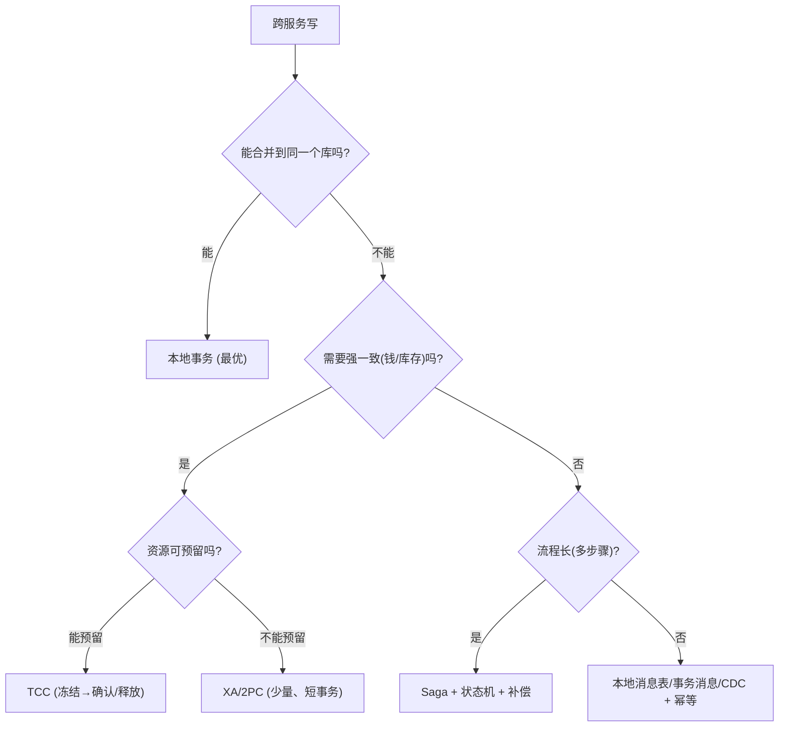

**TCC 的实现要点（面试重点）**：
```
Try:     冻结资源（update stock set frozen=frozen+1 where sku=? and stock-frozen>=1）
Confirm: 确认扣减（frozen-1, stock-1）— 幂等
Cancel:  释放冻结（frozen-1）— 幂等 + 允许空回滚
```
**三大坑的解法**：
| 坑 | 场景 | 解法 |
|---|---|---|
| **空回滚** | Try 未执行，Cancel 先到 | 事务控制表记录"Try 是否执行"，无记录则 Cancel 直接成功 |
| **悬挂** | Cancel 先到，Try 后到 | Try 前检查"是否已 Cancel"，是则拒绝 |
| **幂等** | Confirm/Cancel 重复调用 | 事务 ID 唯一约束 + 状态机（TRY→CONFIRM/CANCEL 只能单向） |

**Saga 的关键设计**：
- **无隔离性**：中间态对外可见 → 必须设计"业务可接受的状态"（待支付、履约中）；
- **补偿必须可逆且幂等**：不可逆操作（发短信、报税）放到最后一步；
- **状态机持久化**：每一步的状态落库，崩溃后可恢复（或用 **Temporal 持久化执行**，见 5.1.1）。

**为什么 2PC 在互联网很少用**：
- 同步阻塞（Prepare 后资源被锁，直到 Commit）；
- 协调者单点（挂了参与者悬挂）；
- 性能差（RT 翻倍 + 锁持有时间长）；
- XA 的 `xa prepare` 与本地事务的兼容性问题多。

**金融场景的真实组合（可直接说）**：
> "**核心账务用 TCC/强一致 + 异步对账兜底；外围（积分、通知、报表）用 Outbox/CDC 最终一致；跨单元（多活）用异步 + 日终对账 + 自动冲正**。"

**追问**：
- **Q：TCC 的 Try 阶段要不要真的扣库存？** → 不扣，只"冻结"（预留）。真扣会导致 Cancel 无法恢复（除非支持"加回"）。冻结的粒度决定并发能力（分段冻结可提升并发）。
- **Q：Saga 补偿失败怎么办？** → ① 重试（指数退避）；② 转人工（差错池）；③ 记录"补偿失败"状态并告警；④ 日终对账发现并修复。**永不假设补偿一定成功**。

---

### Q23. 幂等怎么设计？哪些地方必须幂等？
**考核度 ★★★★ ｜ 全大厂必考 ｜ 频率：极高**

**参考答**：

**必须幂等的六个位置**（背下来）：
1. **HTTP/RPC 接口**（用户重复点击、网关重试）；
2. **MQ 消费**（at-least-once 必然重复）；
3. **定时任务/补偿任务**（重跑）；
4. **支付回调**（渠道重复通知，这是最经典的场景）；
5. **跨服务调用**（超时重试）；
6. **数据同步/对账修复**（重复执行）。

**五种实现（按场景选）**：

| 方式 | 实现 | 适用 | 注意 |
|---|---|---|---|
| **唯一约束** | 业务唯一键（订单号、支付流水号）建唯一索引 | 创建类 | 捕获 `DuplicateKeyException` 并返回"已存在"的**同一结果** |
| **状态机 CAS** | `update ... where id=? and status='INIT'` | 状态流转 | 影响行数=0 说明已被处理 |
| **幂等 Token** | 先 `GET /token`，提交时校验并**原子删除**（Redis `DEL` 返回值） | 表单/下单 | Token 要绑定用户，防盗用 |
| **去重表** | `idempotent_key` 唯一索引（消费前插入） | MQ 消费 | 表会膨胀 → 按时间分区/定期清理 |
| **版本号** | `where version = oldVersion` | 并发更新 | 冲突则重读重试 |

**幂等的"三要素"（这是区分度）**：
1. **唯一业务标识**（不是请求 ID，而是"业务语义唯一"，如 `orderNo + 支付渠道 + 金额`）；
2. **幂等键的持久化与原子性**（DB 唯一索引 or Redis SETNX，必须原子）；
3. **结果可复用**（重复请求要返回**与首次相同的结果**，而不是"报错"或"空"）—— 否则上游会认为失败继续重试。

**难点：并发重复请求**（同一毫秒两个相同请求）
- 方案：**唯一索引 + 捕获冲突**（最可靠，DB 保证原子）；或 **Redis 分布式锁 + 查状态**（要处理锁失效）。
- **不能**："先查后插"（check-then-act 有竞态）。

**追问：支付回调怎么做到绝对幂等？** → ① 用"渠道流水号"做唯一键；② 状态机只允许 `PAYING → SUCCESS`，重复回调直接返回成功；③ 回调处理内**不再发起新的扣款**（只更新状态 + 发事件）；④ 金额/币种/商户号校验（防篡改）；⑤ 异步对账兜底（渠道对账单 vs 本地流水）。

---

### Q24. 分布式锁怎么实现？Redis 锁和 ZK 锁怎么选？RedLock 靠谱吗？
**考核度 ★★★★ ｜ 阿里/字节/腾讯 ｜ 频率：高**

**参考答**：

**Redis 锁的正确写法（四要素）**：
```
加锁: SET lock:order:1001 <uuid> NX PX 30000    (原子: 不存在才设 + 过期)
解锁: Lua 脚本: if redis.call('get',KEYS[1])==ARGV[1] then return redis.call('del',KEYS[1]) end
续期: 后台线程（看门狗）在剩余 1/3 时续期（仅当 value 匹配）
```
- **为什么必须 value 唯一**：防止"误删别人的锁"（A 的锁过期后被 B 拿到，A 恢复后删了 B 的锁）。
- **为什么必须 Lua**：`GET` + `DEL` 非原子，中间可能锁过期被别人拿走。
- **为什么必须过期**：防止持锁进程崩溃导致死锁。
- **过期时间的矛盾**：业务执行时间 > 锁超时 → 锁提前释放 → 并发进入。解法：**看门狗续期**（Redisson）或**业务超时 < 锁超时**。

**ZK 锁**：
- **临时顺序节点**：`/lock/order-1001/000000001`，序号最小者持锁；其余 watch 前一个节点（避免"羊群效应"）。
- 优点：**会话断开自动释放**（无需过期时间）、**天然公平（FIFO）**、强一致（CP）。
- 缺点：性能低于 Redis（每次创建/删除节点有 ZK 事务开销）、依赖 ZK 可用性。

**RedLock 争议（务必知道结论）**：
- **antirez 的方案**：向 5 个独立 Redis 实例依次加锁，**超过半数成功且总耗时 < 锁有效期**才算成功。
- **Kleppmann 的反驳**（2016）：① 无法防御"长时间 GC/时钟漂移"导致的锁失效；② 没有 fencing token，客户端无法知道自己拿的是"过期锁"；③ 网络分区下多客户端可能同时持锁。
- **结论（业界共识）**：**RedLock 不适合"正确性依赖锁"的场景**（如资金扣减）。它只适合"减少重复劳动"（如定时任务去重）。**真正的正确性要靠"幂等 + 唯一约束 + fencing token"**。

**选型建议**：
| 场景 | 选择 |
|---|---|
| 高性能、可容忍极小概率失效（如缓存重建、任务去重） | Redis 锁（单实例/Cluster，不推荐 RedLock） |
| 强一致、不能双写（如选主、分片迁移、配置变更） | **ZK/etcd 锁 + fencing token** |
| 资金/库存正确性 | **不要用锁保证正确性** → 用 DB 乐观锁/唯一约束/状态机 CAS |

**追问：fencing token 怎么用？** → 锁服务返回**单调递增** token，客户端写存储时带上 token，存储侧校验"token 必须 > 已记录的最大 token"，否则拒绝（旧持锁者的写被丢弃）。这是"锁不可靠"时的最后防线。

---

### Q25. 一致性哈希的原理？扩容时数据怎么迁移？
**考核度 ★★★ ｜ 腾讯/京东/滴滴 ｜ 频率：中高**

**参考答**：

**原理**：
```
hash(key) 和 hash(node) 映射到 0 ~ 2^32-1 的环上
key 顺时针找到的第一个 node 即归属节点
```
**为什么需要虚拟节点**：物理节点少时，环上分布不均 → 某节点承担 60% 数据。**每个物理节点映射 100–1000 个虚拟节点**（`hash(node#i)`），使分布均匀，且扩容时迁移更平滑。

**扩容迁移量**：
- 新增 1 个节点（N → N+1）→ 只影响"新节点顺时针接管的那一段"，迁移量 ≈ **1/(N+1)**（而非 `hash % N` 的**全量重分布**）。
- 例：N=10 时扩容，只迁移约 9% 的数据。

**对比其他路由**：

| 方案 | 扩容迁移量 | 均匀性 | 实现复杂度 | 适用 |
|---|---|---|---|---|
| `hash % N` | **100%** | 好 | 最简单 | 分片数固定的分库分表 |
| **一致性哈希** | ~1/(N+1) | 好（需虚拟节点） | 中 | 缓存集群、分布式存储 |
| Rendezvous（HRW） | ~1/(N+1) | 好 | 低（算 N 次 hash） | 对象存储、网关 |
| 目录/路由表 | 可控（按需） | 可控 | 高（需高可用路由） | 单元化、分库分表 |

**迁移的安全做法（无论哪种算法）**：
```
1) 双写（新老节点都写）
2) 全量迁移历史数据 + 增量追平
3) 校验（抽样比对 + 全量 checksum）
4) 灰度读新（1%→100%），比对命中率与错误率
5) 单写新，保留回滚窗口
6) 下线老节点
```

**坑**：
- **数据倾斜**：虚拟节点数不足 / key 分布本身倾斜（热 key）→ 需配合"热 key 打散"；
- **节点权重**：大机器应分配更多虚拟节点；
- **缓存场景的"雪崩"**：节点下线导致其负责的 key 全部 miss → 需要"预热 + 限流"。

---

### Q26. 跨机房/异地多活怎么做？单元化的关键设计是什么？
**考核度 ★★★★★ ｜ 阿里/蚂蚁/字节（架构岗必考）｜ 频率：高**

**参考答（这是"架构能力"的最强证明题）**：

**先明确目标**：RTO（恢复时间）≈ 0、RPO（数据丢失）≈ 0、单机房故障只影响 1/N 用户。

**四层设计（自上而下）**：

**（1）接入层：路由**
- 按 **uid/shopId 哈希**（或路由表）把用户固定到一个单元；
- 路由层**无状态 + 多活**，路由表版本化 + 本地缓存（fail-static）；
- 客户端 SDK 或统一接入网关做"就近接入 + 单元寻址"。

**（2）单元内：自包含闭环**
- 每个单元有**独立的计算、缓存、MQ、数据库（主+备）、搜索索引**；
- **单元内允许本地事务**（这是单元化的最大收益：把"分布式一致"降级为"本地一致"）；
- 单元容量按"总用户 / N + 余量"规划，N 通常 2–8。

**（3）跨单元：只允许异步**
- 跨单元操作（如 A 单元用户给 B 单元用户转账）→ **拆成"单元内扣减 + 消息 + 对方单元入账"**，用 **Saga/对账** 保证最终一致；
- **禁止跨单元同步调用**（延迟 + 可用性双重放大）；
- 全局唯一性（如全局订单号）→ **中心发号（TSO）+ 单元前缀**，或"单元内雪花 + 单元 ID 高位"。

**（4）容灾与切换**
- **单元级故障**：路由把该单元用户切到备用单元（或"降级只读"）；
- **机房级故障**：同城双活（另一机房有同单元副本，同步复制）+ 异地（异步）；
- **切流**：路由表灰度（1% → 10% → 100%），每步校验错误率与延迟；
- **回切**：必须能回滚（保留双写窗口）。

**五个必须（评审 checklist）**：
1. **必须有"单一写主（per key）"**（否则双写冲突）；
2. **必须有"跨单元对账"**（日级全量 + 小时级增量）；
3. **必须有"路由层多活 + 本地缓存"**（不能路由层一挂全站不可用）；
4. **必须有"大客户独立单元"**（防止超级商户打爆一个单元）；
5. **必须有"演练"**（真实切流，不是纸面推演）。

**真实参照（面试可提）**：
- **蚂蚁 LDC（Logical Data Center）**：按用户分单元，单元内闭环，跨单元走"消息 + 对账"；
- **阿里异地多活**：交易单元化，路由按买家 ID；
- **AWS Cell-based Architecture + Shuffle Sharding**：用"随机子集"进一步把故障影响缩小到"部分租户"。

**追问：跨单元转账怎么做？** →
```
A 单元: 扣款（本地事务） + 写 outbox（TransferOut 事件）
消息: 到 B 单元（幂等键 = transferId）
B 单元: 入账（本地事务 + 幂等表）
失败: 补偿（A 单元冲正）或挂账（差错池），日终对账修复
关键: 用"先扣后入"（避免透支），并给"挂账"设上限与告警
```


---

## 6.6 F 组：高可用与线上治理（Q27–Q30）

### Q27. 服务雪崩是怎么发生的？熔断、限流、降级怎么配合？
**考核度 ★★★★ ｜ 全大厂 ｜ 频率：极高**

**参考答**：

**雪崩的因果链（一定要讲出"链"）**：
```
下游 D 变慢（RT 20ms → 2s）
→ 上游 C 的线程被占满（Little 定律: 200 线程 × 1/2s = 100 QPS）
→ C 的队列堆积 → C 对 B 超时
→ B 重试（×3）→ 放大 3 倍流量
→ D 更慢 → 正反馈 → 全站不可用
```
**关键定量**：Tomcat 200 线程，下游 RT 从 20 ms 变 2 s，**容量从 1 万 QPS 掉到 100 QPS**（100 倍），这就是"雪崩不是线性劣化，而是断崖"。

**四层防御（顺序很重要）**：
1. **超时（最基础）**：每个外部调用必须有超时，且**上游超时 > 下游超时之和**（否则上游先放弃，下游还在干活）。
2. **隔离（防扩散）**：每个依赖独立线程池/连接池（舱壁），避免一个慢依赖吃光所有线程。
3. **熔断（防持续）**：错误率/慢调用比例超阈值 → 快速失败（走兜底），half-open 试探恢复。
4. **限流（防过载）**：入口/租户/接口/下游四层令牌桶；**自适应限流**（按 RT 反推允许并发）。
5. **降级（保核心）**：关非核心功能、返回缓存/默认值、异步化、只读模式。

**配合关系（一句话）**：**超时是"止损"，隔离是"防传染"，熔断是"断臂"，限流是"控入口"，降级是"保命"**。

**追问：熔断会不会"误杀"？** → 会。所以要 ① 用滑动窗口 + 最小请求数（避免低流量误判）；② 区分"业务错误"与"系统错误"（参数错误不该触发熔断）；③ half-open 小流量试探；④ 熔断开关可人工干预。

---

### Q28. 重试怎么设计才不会引发"重试风暴"？
**考核度 ★★★ ｜ 字节/美团 ｜ 频率：中**

**参考答**：

**重试风暴的三种放大**：
1. **层级放大**：A(3) × B(3) × C(3) = 27 倍；
2. **同步放大**：故障瞬间所有请求同时重试（无抖动）；
3. **无效重试**：对"不可恢复错误"（400/参数错误）重试。

**正确设计（五条）**：
1. **只重试"可恢复错误"**：超时、5xx、连接失败；不重试 4xx、业务校验失败。
2. **指数退避 + 抖动**：`sleep = min(base * 2^n, max) + random(0, base)`。抖动是关键（把重试打散）。
3. **重试预算**：单请求总重试次数 ≤ 2–3；总耗时预算（如 500 ms）用尽即放弃。
4. **只在"最靠近失败"的层重试**：要么统一在网关/SDK 重试，要么在最末端重试，**不要层层重试**。
5. **重试要有熔断**：如果失败率 > 50%，说明下游已挂，重试无意义 → 直接快速失败。

**幂等是重试的前提**：不幂等的接口**禁止自动重试**。

**追问：消息消费失败重试怎么做？** → ① 分级重试（立即 3 次 → 延迟 1 min/5 min/30 min → 死信）；② 重试次数与间隔可配；③ 死信队列必须有人工处理入口与告警；④ 消费失败不能阻塞分区（否则后续消息全堵）。

---

### Q29. 灰度发布怎么做？出问题怎么秒级回滚？
**考核度 ★★★ ｜ 阿里/字节/腾讯 ｜ 频率：中高**

**参考答**：

**灰度四要素**：
1. **灰度维度**：用户 ID（hash 分桶）、设备、地域、租户、白名单；
2. **放量节奏**：1% → 5% → 20% → 50% → 100%，每步观察 ≥ 10–30 min；
3. **观测指标**：错误率、P99 RT、业务指标（支付成功率、转化率）、下游影响；
4. **自动熔断**：指标劣化超阈值 → **自动停止放量/回滚**（不能只靠人盯）。

**回滚的三种粒度**：
| 粒度 | 手段 | 生效时间 |
|---|---|---|
| 流量级 | 网关/路由切回老版本 | 秒级 |
| 功能级 | **Feature Flag** 关闭新逻辑（代码里 if 判断） | 秒级（无需发布） |
| 数据级 | 数据迁移脚本的反向脚本（最难） | 分钟–小时 |

**关键设计**：**"代码兼容 + 数据可回滚"**
- 新老版本**同时兼容**（数据库字段只加不删、双写、读兼容）→ 否则回滚后老代码读不了新数据；
- **DDL 要"可逆"**（加字段容易、删字段难）→ 用"扩展-收缩（expand-contract）"模式：先加新字段双写 → 迁移 → 再删旧字段。

**追问：灰度期间"部分用户"看到新功能，数据不一致怎么办？** → ① 新旧逻辑写同一份数据（幂等 + 兼容）；② 灰度只影响"读路径"时风险最低；③ 写路径灰度必须有"双跑比对"（影子流量）。

---

### Q30. 线上 CPU 100% / 内存泄漏 / RT 抖动，怎么排查？
**考核度 ★★★★ ｜ 阿里/字节/美团（实战题）｜ 频率：高**

**参考答（给"排查路径"，不是背命令）**：

**（1）CPU 100%**
```
1) top -H -p <pid> 找最热的线程 (tid)
2) printf '%x' <tid> → nid
3) jstack <pid> | grep -A 30 <nid>  → 看栈
4) 常见原因: 死循环 / 正则回溯 / 频繁 GC / 锁自旋 / 大量序列化
5) 火焰图: async-profiler / perf → 看"谁在消耗 CPU"
```
**先分清**：是**业务线程**忙（代码问题）还是 **GC 线程**忙（内存问题）→ 看 `jstat -gcutil`。

**（2）内存泄漏**
```
1) jmap -histo:live <pid> | head  → 看对象数量异常
2) jmap -dump:live,format=b,file=heap.hprof <pid>
3) MAT/VisualVM 分析: dominator tree → 找"谁持有大对象"
4) 常见: ThreadLocal 未 remove / 静态集合 / 缓存无上限 / 连接未关闭 / 监听器未注销
```
**注意**：`jmap -dump:live` 会触发 Full GC（生产慎用，或用 `-XX:+HeapDumpOnOutOfMemoryError` 自动 dump）。

**（3）RT 抖动（P99 飙高）**
```
分层定位:
1) 入口 QPS/RT（网关）→ 是否流量突增
2) 依赖 RT（DB/Redis/MQ/下游 RPC）→ 是否某个依赖变慢
3) GC 日志（gc.log）→ 是否 Full GC / 晋升失败
4) 线程池队列（activeCount/queueSize）→ 是否排队
5) 网络（重传/连接数/TIME_WAIT）→ 是否连接耗尽
6) 慢查询（DB 慢日志、Redis slowlog）
```
**长尾的四个常见根因**（《The Tail at Scale》）：
- **慢节点**（个别机器磁盘/网络异常）→ **对冲请求（hedged request）**：超时后向另一副本再发一次，取先返回者；
- **队列排队**（线程池/连接池满）→ 隔离 + 扩容 + 限流；
- **GC 停顿** → 换 G1/ZGC、调堆、减少大对象；
- **锁竞争** → 减小锁粒度、无锁化、分段。

**追问：怎么证明是"某个依赖"的问题？** → 用 **trace 的 span 耗时分解**（自身耗时 vs 下游耗时），占比一目了然；再结合依赖的 RT 指标与错误率。

---

## 6.7 G 组：架构设计题（Q31–Q40）

> **架构设计题的通用答题框架（务必背）**：
> **① 澄清需求（QPS/数据量/一致性/延迟/可用性）→ ② 容量估算 → ③ 总体架构图 → ④ 核心链路（写路径/读路径）→ ⑤ 存储与分片设计 → ⑥ 难点与取舍 → ⑦ 扩展与演进**。
> **面试官不看你画得多漂亮，看你会不会"先算再做"和"说清取舍"。**

### Q31. 设计一个 10 万 QPS 的秒杀系统
**考核度 ★★★★★ ｜ 阿里/美团/字节/拼多多 ｜ 频率：极高**

**参考答**：

**① 澄清与估算**
- 10 万 QPS 峰值、库存 1000 件、参与用户 100 万、要求"不超卖、不重复下单、尽量公平"；
- 写 10 万 QPS 不可能全部落库 → **必须"层层过滤"**，最终落库只有 ~1000 次（库存量级）。

**② 总体架构（五层漏斗）**
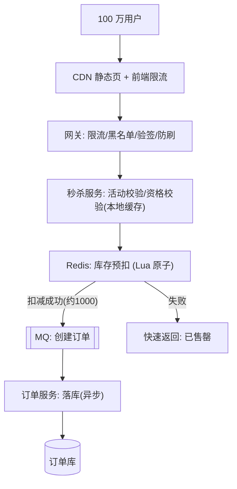
**③ 核心设计（六个关键点）**

1. **静态化 + CDN**：商品页/活动页静态化，把 90% 流量挡在 CDN。
2. **前端限流**：按钮置灰、验证码、随机延迟 → 削平"整点脉冲"。
3. **网关层**：① 用户级限流（每用户 1 次/秒）；② 黑名单/风控；③ **库存令牌预检**（无库存直接拒，不打到后端）。
4. **Redis 原子预扣（核心）**：
   ```lua
   if redis.call('exists', KEYS[1]) == 0 then return -1 end   -- 未开始
   local stock = tonumber(redis.call('get', KEYS[1]))
   if stock <= 0 then return 0 end                            -- 售罄
   redis.call('decr', KEYS[1])
   redis.call('sadd', KEYS[2], ARGV[1])                        -- 去重: 已购用户
   return 1
   ```
   **必须 Lua**：`GET + DECR + SADD` 三步要原子（单线程 + Lua 保证）。
5. **异步下单**：预扣成功 → 发 MQ → 订单服务异步落库（**削峰**：10 万 → 1000）。
6. **超时未支付回补库存**：延迟消息（30 min）→ 检查订单状态 → 未支付则 `INCR` 库存 + 释放用户资格（**幂等**：用订单状态 CAS 防重复回补）。

**④ 防超卖的三个层次**
- **Redis 预扣**（挡住 99.99% 的并发）；
- **DB 唯一约束 + 乐观锁**（`update stock set stock=stock-1 where stock>=1`）作为最终防线；
- **对账**：活动结束后 `Redis 剩余 + 已支付 + 未支付待回补 = 初始库存`，不平则人工介入。

**⑤ 难点与取舍**
| 问题 | 取舍 |
|---|---|
| 10 万 QPS 打 DB | 不可能 → Redis + MQ 削峰 |
| Redis 单 key 热点 | 单 key 是瓶颈（~10 万 QPS 上限）→ 可"库存分段（10 段 × 100 件）"提升并发 |
| 超卖 vs 少卖 | 宁可少卖（预扣成功但下单失败要回补），不可超卖 |
| 公平性 | 先到先得（Redis 原子性保证）；刷子用风控挡 |
| 幂等 | `userId + activityId` 唯一（SADD 去重） |

**⑥ 追问**：
- **Q：Redis 挂了怎么办？** → ① 降级为"直接拒绝"（保护 DB）；② Redis 主从 + 哨兵，但**故障期间不保证不超卖** → 用 DB 兜底约束；③ 活动前预热 + 压测。
- **Q：怎么保证"预扣成功但 MQ 丢消息"？** → 用 **Redis Stream / 本地消息表**替代裸 MQ，或"预扣时写一条待处理记录（Redis List/DB outbox）"，消费成功再删。
- **Q：如何压测？** → 全链路压测（影子表 + 流量染色），关注 Redis 单 key QPS、MQ 堆积、DB 连接池。

---

### Q32. 设计一个短链系统
**考核度 ★★★ ｜ 腾讯/字节/滴滴 ｜ 频率：中**

**参考答**：

**① 估算**：写 1000 QPS（生成短链）、读 10 万 QPS（跳转）、存储 10 亿条（5 年）、短链长度 7 位（62^7 ≈ 3.5 万亿，够用）。

**② 架构**
```
生成: 长链 → 发号器(号段/雪花) → Base62(6~7位) → 写 DB(短码→长链) → 返回
跳转: GET /{code} → 查缓存(Redis) → 302 重定向到长链（miss 则查 DB 回填）
```
**③ 三个核心点**
1. **短码生成**：**不自增 ID 直接用（可枚举）** → 用"号段 + Base62 + 混淆（加盐/异或）"，或"随机 7 位 + 唯一索引冲突重试（最多 3 次）"。
2. **跳转性能**：**302 而非 301**（301 被浏览器永久缓存，无法统计/改链）；Redis 缓存 + 本地缓存（热点短码）；**布隆过滤器**防随机码穿透。
3. **存储**：`code → url`，`url → code`（同一长链复用同一短码，用 `url_hash` 唯一索引，省存储）。

**④ 扩展**：自定义短码（品牌）、有效期（TTL）、访问统计（异步埋点 → Kafka → CK）、防钓鱼（域名黑白名单 + 跳转确认页）、分库分表按 code hash。

**⑤ 追问**：为什么不用 MD5 截断？→ 冲突不可控（截断 7 位冲突率高），且无法保证唯一；用"发号 + Base62"可保证唯一且无冲突。

---

### Q33. 设计一个 IM 消息系统（微信/抖音私信量级）
**考核度 ★★★★ ｜ 腾讯/字节 ｜ 频率：高**

**参考答**：

**① 需求要点**：单聊/群聊、消息不丢不重、有序（会话内）、多端同步、在线状态、离线消息、已读回执。

**② 架构**
```mermaid
graph TD
    C1["客户端 A"] -->|"WebSocket 长连接"| G1["接入层 (连接网关, 无状态)"]
    C2["客户端 B"] --> G2["接入层"]
    G1 --> L["逻辑层: 消息路由/会话/权限"]
    L --> MQ[["消息队列 (按会话ID分区)"]]
    MQ --> S["存储: 消息表(按会话+seq) + 最近消息缓存"]
    MQ --> P["推送: 在线→网关直推; 离线→APNs/厂商通道"]
    L --> R[("Redis: 在线状态/会话列表/未读数")]
```
**③ 五个关键设计**

1. **连接层无状态 + 会话路由**：`uid → gateway` 映射存 Redis；网关只负责"收发包 + 心跳"，逻辑在业务层。
2. **消息 ID 与顺序**：**会话内 seq 单调递增**（由"会话 owner/单写者"分配，或用"雪花 + 会话内排序"）。**全局有序不需要**，只需"会话内有序"。
3. **不丢**：客户端发送 → 服务端 **ACK**（带 msgId）→ 客户端才删除本地草稿；服务端落库成功后才 ACK；离线消息存"每会话最近 N 条 + 拉取接口"。
4. **不重**：客户端重发带 `clientMsgId`（幂等键），服务端去重（Redis SETNX/唯一索引）。
5. **多端同步**：每个设备维护 `lastSeq`，上线时**增量拉取**（`seq > lastSeq`）；已读状态用"会话级 readSeq"同步。

**④ 群聊的放大问题**：1 个群 500 人 → 写扩散（每人一份离线）成本 ×500。解法：
- **小群写扩散**（每人收件箱）；
- **大群读扩散**（只存一份，成员上线时拉取）；
- **混合**（阈值如 100 人）。

**⑤ 追问**：
- **Q：10 万长连接怎么扛？** → ① epoll + 多路复用（Netty）；② 单机 1–5 万连接（受 fd/内存限制）；③ 连接网关水平扩展 + 一致性哈希路由；④ 心跳 30–60 s + 空闲剔除。
- **Q：消息顺序怎么保证？** → 同一会话路由到**同一逻辑分片（单线程消费）**，用 seq 排序；客户端按 seq 去重与补齐（发现空洞则拉取）。
- **Q：已读回执风暴？** → 合并上报（批量 + 节流），只上报"最大已读 seq"。

---

### Q34. 设计一个 Feed 流（微博/抖音关注流）
**考核度 ★★★★ ｜ 字节/微博/快手 ｜ 频率：高**

**参考答**：

**① 两种模型（必须先说清）**
| 模型 | 原理 | 优点 | 缺点 |
|---|---|---|---|
| **写扩散（Push/收件箱）** | 发布时写入所有粉丝的收件箱 | 读极快（直接读自己收件箱） | 大 V 发布 → 千万级写放大 |
| **读扩散（Pull/发件箱）** | 发布只写自己发件箱，读时拉所有关注者再归并 | 写极轻 | 读要拉 N 个人 + 归并（关注 1000 人 → 1000 次读） |
| **推拉结合（主流）** | 普通用户写扩散；大 V 读扩散（读时单独拉） | 平衡 | 实现复杂 |

**② 架构（推拉结合）**
```
发布: 内容 → 审核 → 写发件箱(自己的 outbox) 
     → 若粉丝 < 阈值(如 10 万): 异步写扩散到粉丝收件箱(Redis ZSet, 只存最近 500 条)
     → 若大 V: 只写发件箱
读取: 读自己收件箱(Redis ZSet, 按时间倒序) 
     + 拉取"我关注的大 V"的最新内容 → 归并 → 分页
```
**③ 关键设计**
1. **收件箱只存 ID**（不存内容）→ 内容单独存（读写分离、可缓存）；
2. **分页用游标**（`lastScore/lastId`），避免 offset；
3. **排序权重**：时间 + 互动率 + 兴趣（机器学习排序，在线粗排 + 精排）；
4. **冷启动/长期不活跃**：不预写（读时回填），避免浪费；
5. **删帖/取关**：拉黑过滤在"读时"做（写扩散无法撤回）。

**④ 追问**：
- **Q：大 V 发微博 1000 万粉丝怎么办？** → 异步 + 分批写（限速），只写"活跃粉丝"（近 30 天登录），其余读时拉。
- **Q：怎么保证"我关注的人发的我能看到"？** → 收件箱 + 大 V 补拉 + "合并时去重（按内容 ID）"。
- **Q：Redis 内存爆炸？** → 每用户只存最近 N 条 + 冷用户不写 + 定期裁剪。

---

### Q35. 设计一个支付/账务系统（金融级）
**考核度 ★★★★★ ｜ 蚂蚁/京东/字节支付 ｜ 频率：高**

**参考答（用户金融背景重点题，写深）**：

**① 核心不变量（比架构更重要）**
1. **借贷平衡**：每笔账必须"有借必有贷，借贷必相等"（复式记账）；
2. **幂等**：同一支付请求只能产生一条流水；
3. **可追溯**：任何余额变动都能追到"哪笔业务、哪个凭证、哪条流水"；
4. **不可篡改**：账本只追加，修正用"冲正/反向分录"。

**② 分层架构**
```
接入层: 收单/渠道路由(微信/支付宝/银联)、验签、幂等
交易层: 支付单(状态机: INIT→PAYING→SUCCESS/FAIL→REFUND)
账务层: 记账凭证(复式分录) → 账户余额(实时) + 明细账
清结算: 日终清算、计息、对账、报表
渠道路由: 多通道、按费率/成功率/限额路由 + 故障切换
```
**③ 支付状态机（必须画出）**
```mermaid
graph LR
    I["INIT"] --> P["PAYING"]
    P --> S["SUCCESS"]
    P --> F["FAIL"]
    S --> R["REFUNDING"]
    R --> RD["REFUNDED"]
    P -->|"超时"| C["CLOSED"]
```
- **只允许单向流转**（用 CAS：`update ... where status='PAYING'`）；
- **回调与主动查询双保险**：渠道回调 + 定时轮询（防回调丢失）；
- **"未知状态"是最危险的**：必须"以渠道为准"（主动查询），本地保持"处理中"，不能猜。

**④ 账务的"三套账"**
| 账 | 用途 | 特点 |
|---|---|---|
| **实时余额（账户表）** | 对外查询/风控 | 强一致、行锁/CAS |
| **明细账（流水表）** | 审计/追溯 | 只追加、不可改 |
| **汇总账（日终快照）** | 对账/报表 | 批处理生成 |

**⑤ 关键设计点**
1. **记账幂等**：`bizNo + 分录序号` 唯一索引；
2. **余额更新**：`update account set balance = balance - ? where uid=? and balance >= ?`（乐观/悲观按场景）；
3. **热点账户**（如平台手续费账户）：**记账缓冲（异步汇总）** 或"子账户拆分 + 汇总"；
4. **高可用**：单元化（按 uid）+ 同城双活 + 日终对账；
5. **资金安全**：限额、风控、双人复核（大额）、操作审计。

**⑥ 与银行/渠道对账（见 Q36）**：T+1 全量对账 + 差错处理，是资金安全的最后防线。

**⑦ 追问**：
- **Q：支付成功但账务记账失败怎么办？** → ① 支付单与记账在同一事务（同库）→ 做不到时用 **Outbox + 重试 + 告警**；② "支付成功但未记账"进入**差错池**，由补偿任务修复；③ 日终对账必须能发现。
- **Q：怎么防重复支付？** → ① 业务订单号唯一；② 支付单幂等键（`orderNo + channel`）；③ 渠道侧幂等参数（微信 `out_trade_no`）；④ 状态机 CAS。
- **Q：余额扣减用悲观锁还是乐观锁？** → 高冲突（热点账户）用悲观锁（`for update`，短事务）或"串行化单写者"；低冲突用乐观锁 + 重试。**关键是不能用"读-算-写"两步**。

---

### Q36. 设计一个分布式对账系统（T+1 与实时）
**考核度 ★★★★★ ｜ 蚂蚁/京东/微众（金融科技必考）｜ 频率：高（用户专长领域）**

**参考答**：

**① 对账的本质**：**同一笔业务在两个独立数据源（我方账 / 对方账）中的记录必须一致**。不一致 = 差错，必须"发现 → 分类 → 修复 → 审计"。

**② 对账的四个层次**
| 层次 | 频率 | 数据量 | 目的 |
|---|---|---|---|
| **实时对账（准实时）** | 分钟级 | 增量 | 快速发现（如支付回调 vs 渠道查询） |
| **T+1 全量对账** | 日 | 全量 | 权威核对（渠道对账单 vs 我方流水） |
| **账户对账** | 日/月 | 汇总 | 余额勾稽（期初 + 发生 = 期末） |
| **资金对账** | 日 | 明细 | 清算金额 vs 实际到账 |

**③ 架构**
```mermaid
graph TD
    A["我方流水 (DB/数仓)"] --> N["标准化 (统一字段/时间/金额单位)"]
    B["对方对账单 (文件/SFTP/API)"] --> N
    N --> D["比对引擎 (分片并行)"]
    D --> R["对账结果: 平/我方有他方无/他方有我方无/金额不符/状态不符"]
    R --> E["差错池 (分类/优先级)"]
    E --> F["自动修复: 补记/冲正/重推"]
    E --> G["人工处理 (工单)"]
    R --> REP["报表/资金勾稽/告警"]
```

**④ 五个工程要点（这是区分度）**

1. **标准化（Normalization）**：金额单位（分/元）、时间（时区/精度）、状态映射（渠道"成功" vs 我方"SUCCESS"）、手续费口径。**80% 的对账问题来自口径不一致，不是算法**。
2. **匹配键（Match Key）**：优先"渠道流水号"（唯一）；退化为"业务号 + 金额 + 时间窗"；再退化为"金额 + 日期 + 卡号后四位"（模糊匹配要标注风险）。
3. **大数据量处理**：① **分片并行**（按日期/商户/渠道 hash）；② **排序归并（merge join）** 替代"全量 join"（两边按 key 排序后流式比对，内存 O(1)）；③ 布隆过滤器快速判定"是否存在"；④ 差异才落库（结果表只存差错）。
4. **状态机与差错分类**：
   | 差错类型 | 含义 | 处理 |
   |---|---|---|
   | 我方有、他方无 | 可能"我方多发/他方未记账" | 查询渠道 → 补记 or 冲正 |
   | 他方有、我方无 | 可能"漏记/消息丢失" | 补记（幂等）+ 追查根因 |
   | 金额不符 | 手续费/汇率/部分退款 | 按规则调整（差额入"手续费"科目） |
   | 状态不符 | 我方成功、他方失败（或反之） | **以资金实际到账为准**，冲正 |
   | 重复记账 | 幂等失效 | 冲正多余分录 |
5. **幂等与可重跑**：对账任务必须**可重复执行**（同一天重跑结果一致），差异修复必须**幂等**（用"修复单号"唯一约束）。

**⑤ 时间与"截止"的处理（易错点）**
- **日切时间**（如 23:59:59）与渠道可能不同 → 用"渠道对账单的账期"为准；
- **跨日交易**（23:59 发起、00:01 成功）→ 必须定义"记账日期（accounting date）"与"交易日期（transaction date）"两套字段；
- **时区**：跨境业务统一 UTC 存储，展示按本地时区。

**⑥ 追问**：
- **Q：对账发现"我方多扣了用户钱"怎么办？** → ① 立即冻结差异（不影响其他账）；② 自动冲正 + 退款；③ 通知用户；④ 根因分析（是幂等失效还是消息丢失）；⑤ 全量扫描"同类问题"（同一批次/同一渠道）。
- **Q：实时对账和 T+1 对账重复吗？** → 不重复：实时是"抽样/增量快速发现"（降 MTTR），T+1 是"全量权威"（保正确性）。两者互补。
- **Q：对账性能怎么优化？** → ① 分片并行；② 归并比对（不 join）；③ 只落差异；④ 用列存（ClickHouse/Doris）做汇总；⑤ 增量优先（只对"变动账户"）。

---

### Q37. 设计一个分布式任务调度系统
**考核度 ★★★ ｜ 滴滴/美团/阿里 ｜ 频率：中**

**参考答**：

**① 需求**：定时/延时/周期任务、分片（大数据任务）、失败重试、幂等、可视化管理、高可用（不重复执行）。

**② 架构**
```
调度中心(Quartz/时间轮) → 任务分发(按 worker 分片) → Worker 执行 → 结果回写 → 重试/告警
注册中心(选主: 只允许一个调度器触发, 避免重复) 
```
**③ 三个核心设计**
1. **触发不重复**：调度器**选主**（ZK/etcd）+ **任务级分布式锁**（`lock:job:{jobId}:{triggerTime}` 短期锁）；或"抢占式"（DB 乐观锁 `update job set status='RUNNING' where status='WAIT'`）。
2. **分片执行**：`shard = hash(bizKey) % N`，每个 worker 处理自己的分片；**分片数固定 + 动态分配**（避免扩容时重排）。
3. **延时任务**：**时间轮（Hashed Wheel Timer）**（O(1) 插入，适合大量延时任务）；或用 **MQ 延迟消息**（RocketMQ 支持 18 级延迟）；或用"DB 扫表 + 分片"（简单但精度低）。

**④ 幂等与补偿**：任务执行用"业务唯一键"（`jobId + bizDate`）；失败重试分级；**死任务**进人工队列。
**⑤ 追问**：10 万 QPS 的延时任务怎么办？→ 时间轮（内存）+ 分片 + 持久化（防重启丢）；或用"延时队列服务（Redis ZSet + 多分片）"。

---

### Q38. 单体系统要改造成微服务，如何不停机迁移？
**考核度 ★★★★ ｜ 阿里/美团/字节（架构岗）｜ 频率：中高**

**参考答**：

**核心范式：绞杀者模式（Strangler Fig）**
```
新功能 → 新服务（旁路）
老功能 → 逐个"切流"到新服务（双写 + 双读比对）
最后 → 老系统只剩空壳 → 下线
```
**七步法（可直接背）**：
1. **先建"接缝"**：在单体前加一层**路由/网关**（可按接口/用户/比例分流），不改业务代码；
2. **新服务"只读"接入**：新服务先读老库（影子读），验证逻辑正确（双读比对，差异告警）；
3. **双写**：写路径"老库 + 新库"双写（老库为准），观察差异；
4. **数据迁移**：全量迁移历史 + 增量追平 + 校验（checksum）；
5. **灰度切读**：1% → 100%，比对结果；
6. **切写**：新库为准，老库双写（保留回滚）→ 观察一个账期；
7. **下线老逻辑**：删除双写、下线路由规则、归档老库。
**四个红线**：
- **不改变外部契约**（接口/报文/幂等语义不变）；
- **数据必须可回滚**（保留老库与双写窗口）；
- **必须有对账**（迁移期间每日比对）；
- **必须有流量开关**（秒级回滚到老路径）。

**追问：迁移中最容易出什么问题？** → ① **数据双写不一致**（顺序/失败/事务边界）；② **分布式事务替代**（老系统本地事务 → 新系统要 Saga）；③ **隐式耦合**（老系统里"顺手"的逻辑没迁过来）；④ **性能回退**（本地调用变 RPC）。所以要"影子流量 + 比对 + 灰度"。

---

### Q39. 如何设计一个 LLM 应用/推理服务架构？（2025–2026 新题）
**考核度 ★★★★ ｜ 字节/阿里/腾讯（AI 相关 BU 高频）｜ 频率：上升很快**

**参考答**：

**① 分层**
```
接入: SSE/WebSocket 流式、鉴权、配额
网关: 模型路由(小模型优先/难例升级)、限流(按 token)、缓存(语义缓存/前缀缓存)、审计
编排: Agent/工作流(状态机)、工具调用(MCP)、重试与降级
推理: vLLM/TensorRT-LLM 集群, 连续批处理, PagedAttention, 量化, 多副本
检索: 向量库(HNSW/IVF) + BM25 + rerank + 分块 + 元数据过滤
记忆: 会话窗口 + 长期记忆(摘要/向量化)
评估: 离线 eval 集 + 在线 A/B + 幻觉率/拒答率监控
```
**② 五个关键工程点**
1. **两个 SLO 要分开**：**TTFT（首 token 延迟）** 与 **TPOT（每 token 时间/吞吐）**；流式输出让用户感知延迟 ≈ TTFT。
2. **连续批处理（Continuous Batching）**：请求级动态拼批（Orca/vLLM），GPU 利用率从 30% → 80%+。
3. **KV Cache 管理**：PagedAttention 把 KV cache 按页管理（像虚拟内存），减少碎片、支持更长上下文与更高并发。
4. **成本控制**：模型路由（简单问题走小模型）+ 语义缓存（相似问命中）+ 前缀缓存（system prompt 复用）+ 量化（INT8/FP8）。
5. **可靠性**：模型超时 → 降级到小模型/规则兜底；输出**流式校验**（敏感词/格式）；工具调用失败 → 重试 + 人工兜底。
**③ 与传统架构的差异**
- **输出不确定** → 必须有 **eval + 灰度 + 兜底**（不能"上线即正确"）；
- **成本随输入长度增长**（注意力 O(n²)）→ 上下文裁剪/摘要很关键；
- **依赖外部模型** → 多供应商路由 + 熔断；
- **可观测** → trace 要记录 prompt/模型/token/缓存命中/工具链（新的"调用栈"）。

**追问：RAG 效果不好怎么排查？** → 分四段定位：① **召回**（hit rate，chunk 是否切对）；② **排序**（rerank 是否把正确片段排前）；③ **上下文**（是否超长/噪声过多）；④ **生成**（prompt 是否清晰/模型能力）。**先看召回，再看生成**——80% 的问题在召回。

---

### Q40. 如果让你负责一个系统的架构，你怎么保证它"三年后还改得动"？
**考核度 ★★★★ ｜ 阿里 P8/字节 3-3 及以上（架构思维题）｜ 频率：中**

**参考答（这题考"架构观"，不要答成技术清单）**：

**我的四条原则**：

1. **把"不可逆决策"和"可逆决策"分开**：数据模型、一致性模型、对外契约是不可逆的（要慢、要论证、要预留）；框架、部署形态、缓存策略是可逆的（要快、要试错）。**架构工作的重心是前者**。
2. **用"接缝"换"演进权"**：所有跨边界的地方（模块间、服务间、新旧系统间）都留**显式接口 + 防腐层**，让"替换"变成"换适配器"，而不是"改一片"。
3. **把约束写成"自动化门禁"**：依赖方向（ArchUnit）、契约兼容（Protobuf CI）、SLO（错误预算）、容量水位、变更审计。**靠人记的规则一定会腐化，靠流水线的规则不会**。
4. **为"失败"设计，而不是为"成功"设计**：降级开关、对账、可回滚、灰度、混沌演练 —— **能优雅降级的系统才是可用系统**。

**再加三条"反脆弱"的具体动作**：
- **每季度做一次"删除实验"**：假设要下线一个模块/服务，能不能在 1 天内完成？不能，说明耦合过重。
- **每半年做一次"新人实验"**：让新人按文档独立上线一个功能，看他卡在哪 → 那就是架构的隐性成本。
- **每次故障做"根因到架构"的复盘**：不只是"改 bug"，而是"这个 bug 为什么架构允许它发生"。

**收尾句（面试加分）**：**"好的架构不是让系统现在很优雅，而是让系统在被改变时不痛苦。"**

---

## 6.8 本章小结：面试答题的"三层结构"

任何一道架构题，都按这三层答，评分会明显不同：

| 层 | 内容 | 面试官的判断 |
|---|---|---|
| **第一层：结论** | 一句话给出方案与选型（"我选 X，因为……"） | 你有没有判断力 |
| **第二层：对比** | 2–3 个方案的取舍（成本/一致性/复杂度/可运维） | 你有没有全局观 |
| **第三层：坑与兜底** | 这个方案的失效模式 + 怎么发现 + 怎么修复 | 你有没有真实踩过/想过 |

> **最常见的失分点**：只讲"怎么做"（第一层），不讲"为什么不是别的"（第二层），不讲"坏了怎么办"（第三层）。


---

# 附录

## 附录 A 核心术语表（中英对照）

| 中文 | 英文 | 一句话解释 |
|---|---|---|
| 线性一致性 | Linearizability | 所有操作像在一个原子寄存器上按真实时间执行 |
| 最终一致 | Eventually Consistent | 停止写入后副本最终收敛 |
| 因果一致 | Causal Consistency | 有因果关系的操作保持顺序 |
| 分区容忍 | Partition Tolerance | 网络分区时系统仍可运行 |
| 法定人数 | Quorum | 多数派（⌊N/2⌋+1） |
| 写前日志 | WAL (Write-Ahead Log) | 先写日志再改数据，保证可恢复 |
| 多版本并发控制 | MVCC | 用版本链 + 快照实现无锁读 |
| 日志结构合并树 | LSM-Tree | 顺序写 + 分层合并，写优化 |
| 布隆过滤器 | Bloom Filter | 用位数组判断"可能存在"，有误判无漏判 |
| 一致性哈希 | Consistent Hashing | 环 + 虚拟节点，扩容只迁移 1/N |
| 幂等 | Idempotency | 重复执行结果相同 |
| 补偿事务 | Compensating Transaction | 正向操作的反向操作 |
| 长事务 | Saga | 一串本地事务 + 逆序补偿 |
| 发件箱模式 | Outbox Pattern | 业务表与消息表同事务，保证"写库即发消息" |
| 变更数据捕获 | CDC | 订阅 binlog 转事件 |
| 单元化 | Cell / Unit / Set | 按用户切分自包含单元，单元内闭环 |
| 舱壁隔离 | Bulkhead | 资源池隔离，防故障扩散 |
| 熔断 | Circuit Breaker | 失败率超阈值快速失败 |
| 限流 | Rate Limiting | 令牌桶/漏桶控制速率 |
| 降级 | Degradation | 关非核心功能保核心 |
| 灰度 | Canary Release | 按比例逐步放量 |
| 功能开关 | Feature Flag | 代码内开关，秒级开合 |
| 服务水平目标 | SLO | 可用性/延迟目标 |
| 错误预算 | Error Budget | 1 - SLO，耗尽则冻结变更 |
| 混沌工程 | Chaos Engineering | 主动注入故障验证容错 |
| 长尾延迟 | Tail Latency | P99/P999 的高延迟 |
| 对冲请求 | Hedged Request | 超时后向副本再发一次，取先返回 |
| 静态稳定性 | Static Stability | 控制面失效时仍按静态配置运行 |
| 洗牌分片 | Shuffle Sharding | 每租户随机取子集，隔离相关故障 |
| 持久化执行 | Durable Execution | 事件历史 + 确定性重放，自动恢复长流程 |
| 领域驱动设计 | DDD | 限界上下文 + 聚合 + 领域事件 |
| 防腐层 | ACL (Anti-Corruption Layer) | 外部模型翻译，隔离污染 |
| 贫血模型 | Anemic Domain Model | 只有数据没有行为的"假 DDD" |
| 连续批处理 | Continuous Batching | 请求级动态拼批，提升 GPU 利用率 |
| 键值缓存 | KV Cache | 自回归生成时缓存的注意力键值 |
| 首 token 延迟 | TTFT | 用户感知延迟的关键指标 |

## 附录 B 架构评审 Checklist（30 项，按 6 组）

**B1 边界与拆分（5 项）**
1. 每个服务/模块是否有**明确 Owner 与职责一句话**？
2. 服务之间是否**独占数据**（无跨库直连、无共享表）？
3. **同步调用链是否 ≤ 3 跳**？超过的有无聚合/异步替代？
4. 模块间依赖是否**单向**（无循环依赖，有 ArchUnit 门禁）？
5. 是否预留了"抽出为服务"的**接缝（接口 + DTO）**？

**B2 一致性与数据（6 项）**
6. 每个跨边界写操作，**一致性级别是否显式声明**（强/最终/可旧）？
7. 异步链路是否有 **Outbox/事务消息/CDC** 保证"写库即发消息"？
8. 消费端是否**幂等**（唯一键/状态机/去重表）？
9. 是否有**对账机制**（实时/日级），差异如何分类与修复？
10. 缓存与 DB 的一致性策略是否明确（先更库再删缓存/binlog 订阅）？
11. 数据迁移/DDL 是否**可回滚**（expand-contract）？

**B3 可用性与容错（6 项）**
12. 每个外部调用是否有**超时**，且**上游 > 下游**？
13. 是否有**隔离**（线程池/连接池/集群/租户）？
14. 是否有**熔断 + 降级 + 兜底数据**，且开关可观测？
15. 限流是否**分层**（入口/租户/接口/下游）？
16. 故障切换是否做过**真实演练**（不是纸面）？
17. 是否有**fencing/lease** 防双写脑裂？

**B4 性能与容量（5 项）**
18. 是否有**容量估算**（QPS/存储/连接数/带宽）与峰值系数？
19. 热点是否有**多级缓存 + 打散 + 限流**？
20. 是否存在**大 key/大事务/深分页/N+1** 反模式？
21. 索引与查询是否**覆盖高频路径**（有无慢查询治理）？
22. 是否有**压测**（全链路、影子流量）与**水位告警**（CPU>70%）？

**B5 可运维与可观测（4 项）**
23. 是否有 **SLO + 错误预算 + 告警分级**（P0/P1/P2）？
24. **TraceId 是否全链路透传**（HTTP/MQ/线程池/异步）？
25. 日志是否**结构化 + 脱敏 + 采样**（不打爆磁盘）？
26. 变更是否**灰度 + 自动熔断 + 秒级回滚**？

**B6 安全与成本（4 项）**
27. 是否有**越权校验**（水平/垂直），不只校验登录？
28. 敏感数据是否**加密/脱敏/审计**？
29. 依赖是否有**版本与漏洞治理**（供应链安全）？
30. 是否有**成本水位**（资源利用率、存储分层、闲置回收）？

## 附录 C 90 天学习路径

| 阶段 | 时间 | 目标 | 动作 |
|---|---|---|---|
| **打地基** | 第 1–3 周 | 建立"约束—权衡"思维 | 读第 1、3 章；能手算 Amdahl/USL/容量；背延迟金字塔 |
| **认模式** | 第 4–6 周 | 能识别 20 种模式 | 读第 2 章；对每个模式写"它用了哪几个原子操作"；画 3 张自己系统的架构图 |
| **练方案** | 第 7–9 周 | 能选型 | 读第 4 章；对"缓存一致性/分布式事务/分库分表"各写一页方案对比 |
| **啃论文** | 第 10–11 周 | 建立"前沿感" | 读第 5 章清单中的 8 篇（Dynamo/Raft/Spanner/Aurora/TAO/Kafka/Lakehouse/FoundationDB） |
| **刷面试** | 第 12 周 | 能三层作答 | 第 6 章 40 题，按"结论→对比→坑"口述 3 遍；找同伴模拟 2 次 |

**每日 30 分钟微习惯**：① 看一个线上指标/故障复盘；② 把当天遇到的一个技术点写成"结论 + 为什么 + 坑"三行。

## 附录 D 20 条"看似正确、实则错误"的断言（自检用）

| # | 错误断言 | 为什么错 |
|---|---|---|
| 1 | "CAP 三选二" | 只在分区时取舍；平时是 PACELC 的 L vs C |
| 2 | "最终一致就是不用管一致性" | 必须收敛，且要有对账/反熵 |
| 3 | "加机器就能扛住" | USL 有吞吐峰值，加多了反而降 |
| 4 | "主从复制就是高可用" | 没演练过的切换 = 故障；异步复制会丢数据 |
| 5 | "微服务比单体先进" | 是交易，不是升级；小规模是负债 |
| 6 | "服务拆得越细越好" | 跨节点协调成本 κ 上升，总吞吐可能下降 |
| 7 | "用了 MQ 就解耦了" | 只是时间解耦；契约/语义/一致性仍耦合 |
| 8 | "消息队列保证不丢" | 只在"acks=all + 多副本 + 手动提交"下成立 |
| 9 | "分布式锁保证不重复" | 锁会失效；正确性靠幂等 + 唯一约束 + fencing |
| 10 | "RedLock 是安全的" | 无法防御长 GC/时钟漂移，缺 fencing |
| 11 | "Redis 单线程所以慢" | 单线程是"快"的原因之一（无锁无切换） |
| 12 | "缓存双写就能一致" | 并发写乱序，缓存可能被旧值覆盖 |
| 13 | "先删缓存再更库" | 会导致缓存长期脏（读旧回填） |
| 14 | "分库分表后还能随便 join" | 只能同分片键 join，否则要冗余/应用层聚合 |
| 15 | "RR 完全解决幻读" | 快照读+当前读混用仍会"幻读"，是语义边界 |
| 16 | "加了索引就一定走" | 函数/隐式转换/最左前缀/统计信息会导致失效 |
| 17 | "Saga 能替代事务" | 无隔离性，中间态可见，补偿不一定成功 |
| 18 | "Serverless 一定省钱" | 高 QPS 常驻更便宜；冷启动是隐性成本 |
| 19 | "服务网格零成本" | 每跳延迟 + sidecar 资源 + 控制面风险 |
| 20 | "上云就自动高可用" | 可用区/配额/依赖仍需自己设计 |

## 附录 E 面试答题模板卡（打印版）

```
【技术原理题】
1) 一句话定义（是什么 + 解决什么问题）
2) 底层机制（2-3 个关键点，带数字/结构）
3) 边界与局限（什么情况下不成立）
4) 工程实践（我们/大厂怎么做 + 一个真实的坑）

【方案选型题】
1) 结论：我选 X
2) 判据：3-4 个维度（一致性/性能/复杂度/成本/可运维）
3) 对比表：X vs Y vs Z
4) 代价与规避：X 的失效模式 + 怎么发现 + 怎么修
5) 演进：规模/需求变化后怎么迁移

【架构设计题】
1) 澄清需求（QPS/数据量/SLA/一致性）  ← 一定要主动问
2) 容量估算（用 Little 定律/存储公式）
3) 总体图（分层：接入/逻辑/存储/异步）
4) 核心链路（写路径 / 读路径 分开讲）
5) 存储与分片（键选择 + 全局 ID + 扩容）
6) 难点取舍（3 个 trade-off + 兜底）
7) 扩展演进（10x 流量怎么办）
```

## 附录 F 文档使用与更新建议

- **版本节奏**：每半年更新一次（重点更新第 5 章"前沿"与第 6 章"新题型"，如 AI 架构、湖仓、eBPF）。
- **落地建议**：把第 2 章的模板 + 附录 B 的 Checklist 做成团队"架构评审模板"；把第 6 章的题做成团队"技术分享题库"（每周 1 题，主讲人按"三层结构"讲）。
- **配套产出**（可选下一步）：① 一页纸架构图（Mermaid/Excalidraw）；② 每个模式的"最小可运行示例"（Spring Cloud / Kafka / Redis 代码）；③ 面试题自测版（只留题目，答案折叠）。

---

> **全文一句话总结**：
> **架构 = 在光速、成本、人、不确定性、时间五类约束下，用"拆/合/抽象/复制/缓存/异步/有序/幂等/观测"九个原子操作做出的、改起来很贵的决策；**
> **而工程能力 = 知道每个决策"会在哪里坏、怎么发现、怎么修"。**

