# Agent 底层原理与通用架构设计 · 深度知识手册

> 版本：2026-11　｜　定位：从「为什么能跑」到「怎么设计得不崩」，再到「面试怎么答」
>
> 阅读建议：第 1–4 章建立骨架，第 5–7 章做选型与避坑，第 8 章补底层机制，第 9 章直接用于面试复盘。

---

## 目录

- [0. 一页纸速览（TL;DR）](#0-一页纸速览tldr)
- [1. Agent 到底是什么：一个形式化定义](#1-agent-到底是什么一个形式化定义)
- [2. 底层原理：七层结构与五个关键洞察](#2-底层原理七层结构与五个关键洞察)
- [3. 认知范式：从 CoT 到多智能体的完整谱系](#3-认知范式从-cot-到多智能体的完整谱系)
- [4. 通用架构设计方案（可落地）](#4-通用架构设计方案可落地)
- [5. 场景适配：什么任务该用什么架构](#5-场景适配什么任务该用什么架构)
- [6. 优缺点、失败模式与规避手册](#6-优缺点失败模式与规避手册)
- [7. 更先进的设计思路与代表论文](#7-更先进的设计思路与代表论文)
- [8. 十个必须深挖的延伸知识点](#8-十个必须深挖的延伸知识点)
- [9. 大厂面试题库（含权重、详解、追问）](#9-大厂面试题库含权重详解追问)
- [10. 速记卡与自检清单](#10-速记卡与自检清单)
- [11. 参考资料](#11-参考资料)

---

## 0. 一页纸速览（TL;DR）

**一句话本质**：Agent = 把 LLM 当作策略函数 π，把上下文当作状态 s，把工具调用当作动作 a，把环境返回当作观测 o，再用一个控制循环把四者串起来，直到任务终止。

**一个公式（工程近似）**：

```
任务成功率 ≈ 模型能力 × 上下文质量 × 工具可靠性 × 控制流正确性 × 验证强度
```

五个因子之间是乘号不是加号——任何一个接近 0，整体就接近 0。这解释了为什么「换个更强的模型」经常救不回一个设计糟糕的 Agent。

**七个关键结论**（后文都会展开）：

1. LLM 本身是**无状态函数**，Agent 的所有「记忆、状态、身份」都是工程外挂。Agent 工程的本质是**状态管理与控制流设计**。
2. **工具调用**是能力跃迁的根源：它把「概率性文本生成」变成「确定性副作用」，同时也把「幻觉风险」变成「真实世界风险」。
3. Agent 的失败**大多是系统设计失败，不是模型知识失败**。MAST 研究显示 44.2% 的失败来自系统设计（规范、角色、终止条件、步骤重复）。
4. **上下文是稀缺资源**，不是免费仓库。上下文越长，召回与推理质量越差（context rot / lost in the middle / attention dilution）。
5. **多智能体不是免费午餐**。通信损耗、目标漂移、验证缺失会把单 Agent 的 5% 错误率放大成系统性失败。
6. **可验证性决定上限**。能用单元测试、状态比对、规则校验判定对错的任务，Agent 才真正可靠；只能靠「看起来不错」的任务，必须上独立验证器。
7. **先做 Workflow，再做 Agent**。能用确定性代码编排的，不要交给模型自由发挥；只在「步数不可预知、路径需要探索」时才放开自治。

**选型口诀**：

```
步骤固定 → Prompt Chain / 路由
步骤不定但可分解 → Plan-and-Execute
需要边做边看 → ReAct
对正确率极敏感且可验证 → ReAct + Reflexion + Verifier
任务跨域、可并行、上下文会爆 → Orchestrator-Workers（子 Agent 隔离）
动作不可逆、涉及资金/权限 → 全流程 HITL + 最小权限 + 幂等 + 补偿
```

---

## 1. Agent 到底是什么：一个形式化定义

### 1.1 三种常见但不严谨的说法

| 说法 | 问题在哪 |
|---|---|
| 「Agent 就是会调用工具的 ChatGPT」 | 遗漏了**循环**与**状态**，那才是 Agent 与 Chatbot 的分水岭 |
| 「Agent 就是 LLM + 工具 + 记忆」 | 是三要素罗列，没有说明它们如何耦合、谁控制谁 |
| 「Agent 就是自主运行的 AI」 | 「自主」无法度量，落地时说不清边界与责任 |

### 1.2 严格定义

> **Agent 是一个以 LLM 为策略核心、在环境中通过多轮「观测–决策–行动」闭环、以达成目标为终止条件的计算系统。**

拆成五个必要构件：

| 构件 | 符号 | 具体对应 | 缺失后果 |
|---|---|---|---|
| 策略 | π(a\|s) | LLM 的 next-token 分布 + 工具调用能力 | 只能聊天，不能行动 |
| 状态 | s_t | 上下文窗口 + 外部记忆 + 环境状态 | 每轮失忆，无法多步 |
| 动作空间 | A | 文本回复、工具调用、代码执行、GUI 操作、子 Agent 调用 | 能力被锁死在语言内 |
| 观测 | o_t | 工具返回值、报错、页面变化、用户反馈 | 开环，无法纠错 |
| 控制流 | Loop | 循环、分支、终止判定、预算、回滚 | 死循环或提前退出 |

形式化为 **POMDP（部分可观测马尔可夫决策过程）**：

```
s_t = ( 对话历史, 记忆检索结果, 环境观测, 任务进度 )
a_t = LLM 在第 t 轮生成的一段 token 序列（可能包含多个 tool_call）
o_t ~ E(·|s_t, a_t)          环境转移：工具执行结果 / 页面新状态 / 用户回复
r_t = R(s_t, a_t)            奖励：任务成功、单元测试通过、人工评分、规则校验
π_θ(a_t|s_t)                 由 LLM 参数 θ 与上下文构造函数共同决定
```

三个容易被忽略的细节：

**（1）动作是「一段 token」，不是「一个 API 名」。**
模型先写出 `{"tool":"search","query":"..."}` 这串 token，再由运行时解析、校验、执行。这意味着：动作空间的质量，一半取决于工具设计，一半取决于**模型能否稳定生成合法结构**。这也是 structured output / constrained decoding 存在的理由。

**（2）状态是「被构造出来的」，不是「自然积累的」。**
`s_t` 并不是把所有历史拼起来。生产级 Agent 每一轮都会做一次**上下文装配**：选哪些记忆、留哪些工具结果、压缩哪些历史、注入哪些约束。这个装配函数的质量，往往比模型选型更影响效果。

**（3）奖励是稀疏且延迟的。**
一个 30 步的任务，只有最后一步知道成败。中间 29 步没有任何信号——这就是 Agentic RL 里最难的**信用分配（credit assignment）**问题，也是「为什么 Agent 很难通过 RL 变强」的根源。

### 1.3 Agent 与 Chatbot、Workflow、RPA 的边界

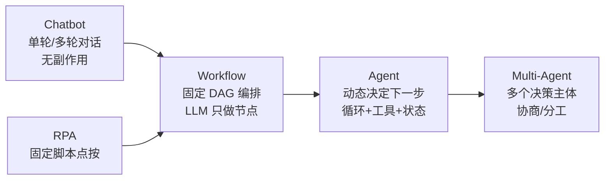

| 形态 | 谁决定下一步 | 路径是否预知 | 典型场景 | 风险 |
|---|---|---|---|---|
| Chatbot | 用户 | 是（用户驱动） | 问答、润色 | 幻觉 |
| Workflow | 代码（DAG） | 是 | 发票 OCR→校验→入库 | 覆盖不到异常分支 |
| RPA | 脚本 | 是 | 固定界面录入 | 界面一改就崩 |
| **Agent** | **模型** | **否** | 排障、调研、改代码 | 不可预测、成本失控 |
| Multi-Agent | 模型 + 编排器 | 否 | 跨域协作、并行研究 | 通信损耗、责任不清 |

**判据（很实用）**：如果你能把任务的步骤画成一张不需要「if 模型觉得」的流程图，就别做 Agent，做 Workflow。Agent 的价值只在**路径不可预知**时兑现。

### 1.4 一个反直觉的事实：Agent 的能力上限由「验证」决定，而不是由「模型」决定

考虑两个任务：

- A：把一份 PDF 里的表格抽成 JSON。→ 可以用 schema 校验、行数比对、抽样人工。**可验证**。
- B：写一份「有洞察力」的行业分析。→ 没有客观判据，只能人看。**弱可验证**。

A 类任务，Agent 可以做到 99%+，因为每一步都有机器判据，错了能回滚重试。
B 类任务，Agent 的可靠性天花板由「评审者的主观容忍度」决定，永远无法用自动化闭环保证。

所以工程设计的第一动作不是选模型，而是**回答「这个任务的正确性怎么机器判定」**。判不了，就只能做 Copilot（给人建议），不能做 Autopilot（替人执行）。

---

## 2. 底层原理：七层结构与五个关键洞察

### 2.1 七层结构总图

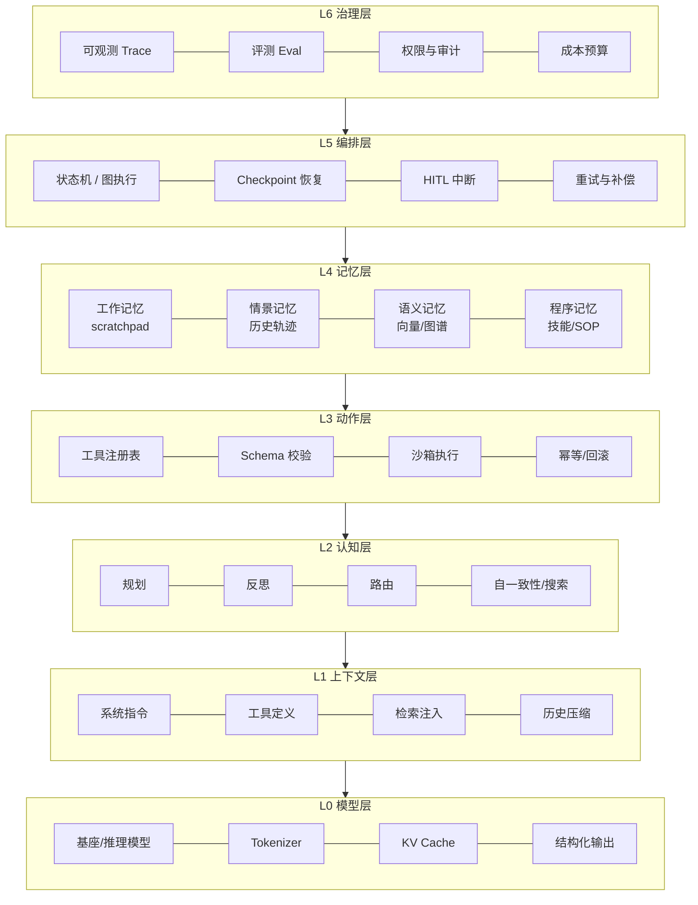

这不是「七个模块」，而是**七个可独立优化的杠杆**。任何一层做差，上层都会被拖死：

- L0 弱 → 复杂推理直接崩，靠 prompt 补不回来。
- L1 脏 → 模型被干扰信息带偏（context rot）。
- L2 缺 → 只能做单步反应，做不了多步任务。
- L3 不可靠 → 工具一报错就整条链路失败。
- L4 缺 → 跨会话无记忆，重复劳动。
- L5 弱 → 无法恢复、无法中断、无法审计。
- L6 无 → 出了问题不知道发生在哪一步。

### 2.2 洞察一：LLM 是无状态函数，Agent 的状态全是外挂

`f(tokens) → P(next_token)`。模型不记得上一轮，是运行时把上一轮拼进了 tokens。

推论：

1. **「记忆」不是模型能力，是检索 + 装配能力**。记忆系统的核心指标是「该想起的想起了，不该想起的没进来」。
2. **「人格一致性」靠 system prompt + 记忆注入维持**，不是模型自带。
3. **上下文窗口 = 唯一的可写工作区**，所以「上下文工程」是 Agent 工程的主战场。
4. 任何「模型学会了」的错觉，本质是**上下文里出现了正确的示例或反馈**。

### 2.3 洞察二：工具调用是「生成 → 执行」的相变

| 维度 | 纯生成 | 工具调用 |
|---|---|---|
| 输出性质 | 概率性文本 | 确定性副作用 |
| 错误代价 | 说错话 | 转错账、删错库 |
| 可验证性 | 靠人读 | 靠返回值/状态比对 |
| 能力边界 | 参数内知识 | 可扩展到实时、私有、可计算 |
| 新风险 | 幻觉 | 提示注入、越权、注入攻击、不可逆 |

工程含义：**工具是「带副作用的 API」，必须按 API 的严格度治理**（鉴权、限流、幂等、审计、回滚），而不是按「提示词片段」对待。

### 2.4 洞察三：大多数失败是系统设计失败

MAST（Multi-Agent System Failure Taxonomy，NeurIPS 2025）基于 1600+ 条真实 trace 标注，给出 14 种失败模式，三大类占比：

| 类别 | 占比 | 典型失败模式 |
|---|---|---|
| 系统设计问题 | 44.2% | 不遵守任务规范 11.8%、步骤重复 15.7%、不知道何时终止 12.4% |
| 智能体间错位 | 32.3% | 推理与行动不一致 13.2%、任务漂移 7.4%、不主动澄清 6.8% |
| 任务验证缺失 | 23.5% | 无验证 8.2%、验证错误 9.1%、过早终止 6.2% |

关键结论：**同一批模型，只改编排拓扑与提示规范，成功率能提升十几个百分点**。所以「堆模型」不是第一优先级，「修系统设计」才是。

### 2.5 洞察四：上下文是有限资源，边际收益递减

三个已被反复验证的机制：

1. **Lost in the Middle**：相关信息在上下文开头/结尾时效果最好，埋在中间显著下降（U 型曲线）。
2. **Attention Dilution**：自注意力是 O(n²)，10 万 token 意味着约 10^10 组两两关系竞争同一注意力预算。
3. **Distractor Interference**：语义相近但无关的内容不是中性噪声，而是**主动误导**——「差不多相关」的检索片段比没有更糟。

工程结论：

```
上下文预算 = 系统指令 + 工具定义 + 当前任务 + 最近历史 + 检索证据 + 草稿状态
必须显式分配配额，并让「证据」可被裁剪、「历史」可被压缩、「工具」可按需加载
```

### 2.6 洞察五：能力是乘出来的，不是加出来的

```
Capability = Model × Context × Tools × Control × Verification
```

举三个真实感很强的例子：

- 模型 95 分，但工具成功率 70% → 10 步任务成功率 0.95 × 0.7^10 ≈ 2.7%。
- 模型 95 分，上下文里塞了 20 个语义相近的工具 → 工具选错率显著上升，整体掉到 60 分。
- 模型 90 分，但有独立验证器 + 重试 3 次 → 端到端可到 99%。

所以优化的优先级通常是：**验证 > 工具 > 上下文 > 控制流 > 模型**。

---

## 3. 认知范式：从 CoT 到多智能体的完整谱系

### 3.1 谱系图

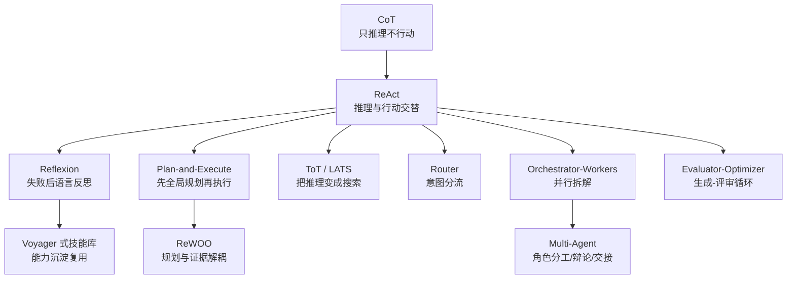

### 3.2 CoT：一切的地基

**做法**：要求模型在给答案前先写推理步骤。
**本质**：把「一次前向传播内隐式完成的计算」摊开成**多步串行计算**，每一步都条件化在前一步的输出上。等价于用 token 换深度。
**局限**：推理链是开环的。第 3 步错了，第 4–10 步会顺着错下去，且没有任何外部信号能纠正。

### 3.3 ReAct：Agent 的原型

**论文**：ReAct: Synergizing Reasoning and Acting in Language Models（ICLR 2023，arXiv 2210.03629）

**循环**：

```
Thought_t  →  Action_t  →  Observation_t  →  Thought_{t+1} ...
```

伪代码（生产版，已加上预算与去重）：

```python
def react(goal, tools, budget=20):
    ctx = build_context(goal, tools.schemas())
    seen = set()
    for step in range(budget):
        out = llm(ctx)                      # 生成 Thought + Action
        if out.is_final:
            return out.answer
        action = parse_and_validate(out.action)      # schema 校验
        key = action.signature()                      # 去重键
        if key in seen:                               # 死循环检测
            ctx += remind("该动作已执行过，请换策略或给出结论")
            continue
        seen.add(key)
        obs = tools.execute(action)                   # 沙箱执行
        ctx += render(thought=out.thought, action=action, obs=truncate(obs))
    return escalate("超出预算，转人工")
```

**为什么有效（三层机制）**：

1. **Grounding**：Observation 是外部世界的真实返回，把模型的「想象」拉回事实。
2. **额外计算**：每个 Thought 都是一次额外的串行计算，相当于动态深度的 test-time compute。
3. **可恢复性**：错误暴露在 Observation 里，下一轮可以改策略；CoT 做不到。

**实测**：GPT-3 时代，ReAct 在 HotPotQA 上比纯 CoT 与纯 Action 基线 EM 高约 6%。

**典型失败**：局部最优、原地打转、上下文爆炸、把「计划」当「事实」。

### 3.4 Plan-and-Execute：把「想」和「做」解耦

**结构**：Planner 一次性产出步骤清单 → Executor 逐步执行 → （可选）Replanner 根据结果改计划。

```python
plan = planner(goal)                       # 输出结构化 step 列表
for i, step in enumerate(plan.steps):
    result = executor(step, deps=plan.deps[i])
    if result.failed and result.recoverable:
        plan = replanner(goal, plan, i, result)   # 局部重规划
    elif result.failed:
        return abort(result)
```

**优势**：

- 可预测、可审计、可估算成本（步骤数先知道了）。
- 规划用大模型调一次，执行可用小模型或纯函数 → **成本显著下降**。
- 计划本身就是「进度条」，天然支持断点续跑。

**代价**：刚性。初始计划错，会一路错到底；「做了才知道下一步」的任务根本无法预先规划。

**改进**：ReWOO（Reasoning WithOut Observation）把「规划」与「证据获取」彻底解耦，先列出所有需要的变量，再批量取数，最后一次性推理——token 消耗大幅下降，适合「证据可并行获取」的场景。

### 3.5 Reflexion：不更新权重，用语言做「强化学习」

**论文**：Reflexion: Language Agents with Verbal Reinforcement Learning（NeurIPS 2023，arXiv 2303.11366）

**三角色**：

- Actor：执行任务，产出轨迹。
- Evaluator：判定成败（单元测试、规则、LLM 打分）。
- Self-Reflection：把失败轨迹总结成一段「下次别这么干」的自然语言。

反思写入**情景记忆**，下一轮尝试时注入 prompt。**没有梯度更新**，学习发生在上下文里。

**为什么有效**：把「稀疏的结果奖励」翻译成「稠密的过程建议」，等价于人工构造的过程奖励。
**适用**：可自动判对错的任务（代码、数学、游戏、结构化抽取）。HumanEval 上报告过 91% pass@1。
**失效**：评估器本身不可靠时，反思会「编造教训」，越反思越偏。

### 3.6 ToT / LATS：把推理变成搜索

- **Tree of Thoughts**：把中间「想法」当节点，做 BFS/DFS + 自评估 + 回溯。适合解题空间大、需要试错的题。
- **LATS**（Language Agent Tree Search）：把 MCTS 接进 Agent，模型同时当「提议者」和「评估者」，在**不可逆工具调用前**先搜索候选路径。
- **代价**：token 复杂度从 O(N) 涨到 O(N·b·d) 甚至更高，延迟成倍上升。

**判据**：只有当「错误代价 >> 搜索成本」时才用。比如要执行一次不可回滚的数据库迁移，值得先搜索；查个天气不值得。

### 3.7 五种生产常用编排模式（Anthropic《Building Effective Agents》框架）

| 模式 | 结构 | 适用 | 关键设计点 |
|---|---|---|---|
| Prompt Chaining | A→B→C 串行 | 步骤固定、可分段校验 | 每段有明确输入输出契约 |
| Routing | 分类器分流到专用分支 | 多意图、多领域 | 路由错的代价要可控（可回退） |
| Parallelization | 并发分段 / 多票投票 | 可独立拆分的子任务 | 结果合并策略要先定 |
| Orchestrator-Workers | 主 Agent 动态派活给子 Agent | 子任务数量不定 | 子 Agent 必须**独立上下文**+ 只回摘要 |
| Evaluator-Optimizer | 生成 → 评审 → 修订 循环 | 有明确质量标准 | 评审必须是独立视角，不能自评 |

### 3.8 多智能体：四种拓扑

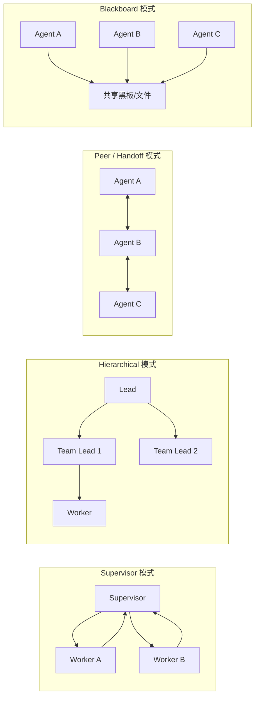

| 拓扑 | 控制权 | 优点 | 缺点 | 适用 |
|---|---|---|---|---|
| Supervisor | 中心化 | 责任清晰、易观测 | 主管成为瓶颈与单点 | 大多数企业场景 |
| Hierarchical | 多层中心 | 可扩展到大规模子任务 | 层级通信延迟、信息衰减 | 超长任务、跨部门 |
| Peer/Handoff | 去中心 | 灵活、贴近人类协作 | 易踢皮球、状态不一致 | 客服转接、专家会诊 |
| Blackboard | 共享介质 | 松耦合、可异步 | 并发写冲突、难以归因 | 长周期研究、多人协作 |

**硬结论**：多智能体带来的增益，主要来自**上下文隔离**（每个子 Agent 只看自己那摊，避免 context rot），而不是「多个模型讨论会更聪明」。如果子任务之间高度耦合，拆开只会更差。

### 3.9 范式对比总表

| 范式 | 额外 token | 延迟 | 可预测性 | 纠错能力 | 最适合 | 最怕 |
|---|---|---|---|---|---|---|
| CoT | 低 | 低 | 高 | 无 | 纯推理题 | 需要外部事实 |
| ReAct | 中 | 中 | 低 | 中 | 动态查询、排障 | 死循环、上下文爆 |
| Plan-Execute | 中（规划一次性） | 中 | 高 | 弱（需 Replan） | 流程明确的多步任务 | 计划失真 |
| Reflexion | 高（多轮重试） | 高 | 中 | 强 | 可验证任务 | 评估器不可靠 |
| ToT/LATS | 很高 | 很高 | 低 | 强 | 组合搜索、不可逆决策 | 成本失控 |
| Orchestrator-Workers | 高 | 中高（可并行） | 中 | 中 | 跨域、可并行 | 子任务耦合 |
| Debate | 很高 | 高 | 低 | 中 | 需要多视角校验 | 趋同/互相带偏 |

---

## 4. 通用架构设计方案（可落地）

### 4.1 六层总体架构（生产级骨架）

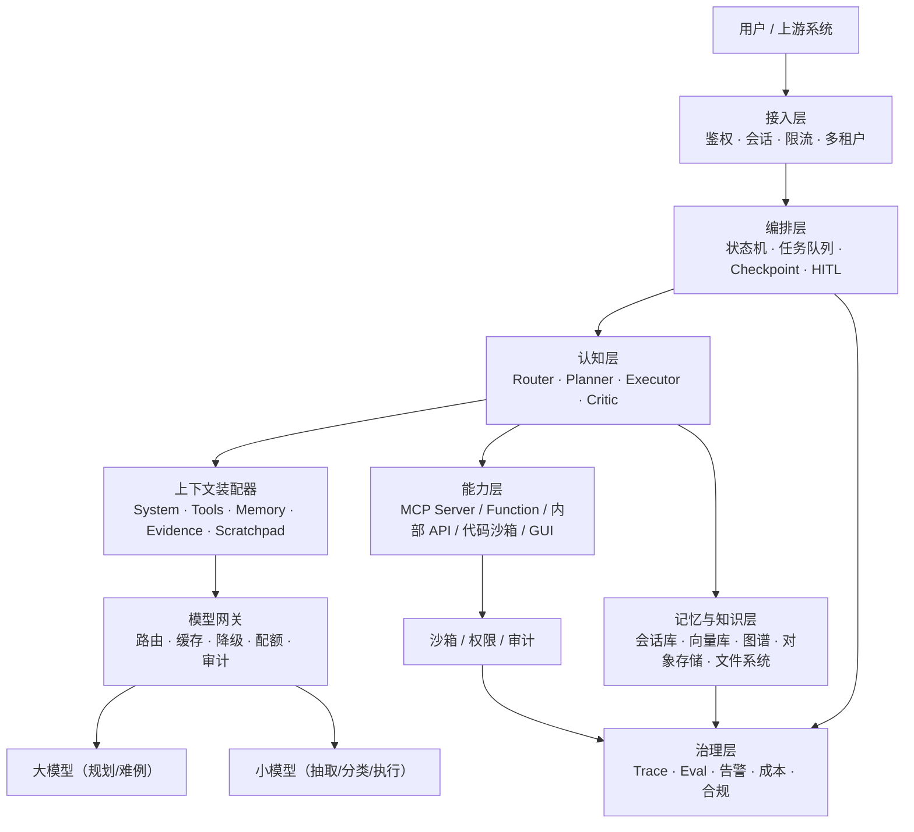

**各层职责与关键指标**：

| 层 | 职责 | 关键指标 | 常见实现 |
|---|---|---|---|
| 接入层 | 身份、会话、配额、隔离 | 鉴权覆盖率、租户隔离强度 | 网关 + JWT + 速率限制 |
| 编排层 | 决定「谁在什么时候做什么」 | 任务成功率、平均步数、恢复率 | 自研状态机 / LangGraph / Temporal |
| 认知层 | 规划、路由、评审 | 计划有效率、路由准确率 | LLM + 规则兜底 |
| 上下文装配 | 每轮决定「给模型看什么」 | 上下文 token 数、证据命中率 | 模板 + 检索 + 压缩 |
| 能力层 | 动作执行 | 工具成功率、P95 延迟、幂等率 | MCP / OpenAPI / 沙箱 |
| 记忆层 | 跨轮、跨会话状态 | 召回率、误召回率、写入成本 | Redis + PG + 向量库 |
| 治理层 | 可观测、评测、安全 | Trace 覆盖率、回归通过率 | OTel + 自建 Eval |

### 4.2 方案 A：单 Agent 最小可用架构（MVP 首选）

**适用**：任务边界清晰、工具 ≤ 10 个、单次会话可完成。

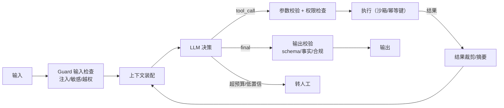

**必须有的 6 个护栏**（没有这 6 个，别上线）：

1. **步数预算**：硬上限（如 20 步），超限降级为「总结 + 转人工」。
2. **动作去重**：对 `(tool, normalized_args)` 做签名，重复即提醒换策略。
3. **参数校验**：JSON Schema + 业务校验（金额上限、ID 存在性）。
4. **结果裁剪**：工具返回超 N token 时先摘要/分页，禁止整段塞回。
5. **终止判定**：显式定义「什么算完成」，不能靠模型自觉。
6. **失败兜底**：连续 2 次工具报错 → 停止重试，走降级路径。

**优点**：实现简单、链路短、易调试、成本可控。
**缺点**：上下文会随步数线性膨胀；单点决策，复杂任务容易迷路。

### 4.3 方案 B：Plan–Execute–Replan（流程型任务首选）

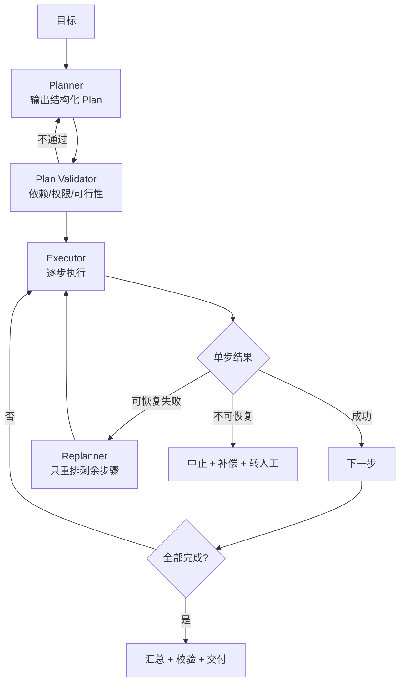

**Plan 的数据结构**（关键，别让模型输出自由文本计划）：

```json
{
  "goal": "完成 Q3 对账差异定位",
  "steps": [
    {"id": "s1", "action": "query_ledger", "args": {"period": "2026Q3"}, "deps": []},
    {"id": "s2", "action": "query_bank",   "args": {"period": "2026Q3"}, "deps": []},
    {"id": "s3", "action": "diff",         "args": {"left": "s1", "right": "s2"}, "deps": ["s1","s2"]},
    {"id": "s4", "action": "explain_diff", "args": {"diff": "s3"}, "deps": ["s3"]}
  ],
  "success_criteria": ["差异条目全部归类", "无未解释差额"],
  "budget": {"max_steps": 12, "max_tokens": 200000}
}
```

**四个设计要点**：

1. **Plan 必须是 DAG，不是列表**：有 `deps` 才能并行、才能判断「哪一步失败会污染哪些下游」。
2. **Replan 只重排「未执行 + 受影响」的步骤**，不要全量重生成（贵且会丢进度）。
3. **每步都要有 `expected_effect`**，执行后可断言（比如「应返回 ≥1 条记录」）。
4. **副作用步骤要打标记**（`side_effect: true`），这类步骤执行前必须过审批或 dry-run。

**优点**：成本低、可审计、可断点续跑、计划即进度。
**缺点**：计划质量决定上限；对「探索型」任务不适用。

### 4.4 方案 C：Orchestrator–Workers（上下文隔离型）

**核心价值不是「并行」，而是「隔离」**：让每个子 Agent 在自己的干净上下文里把 5 万 token 的探索压缩成 500 token 的结论，主 Agent 永远不被污染。

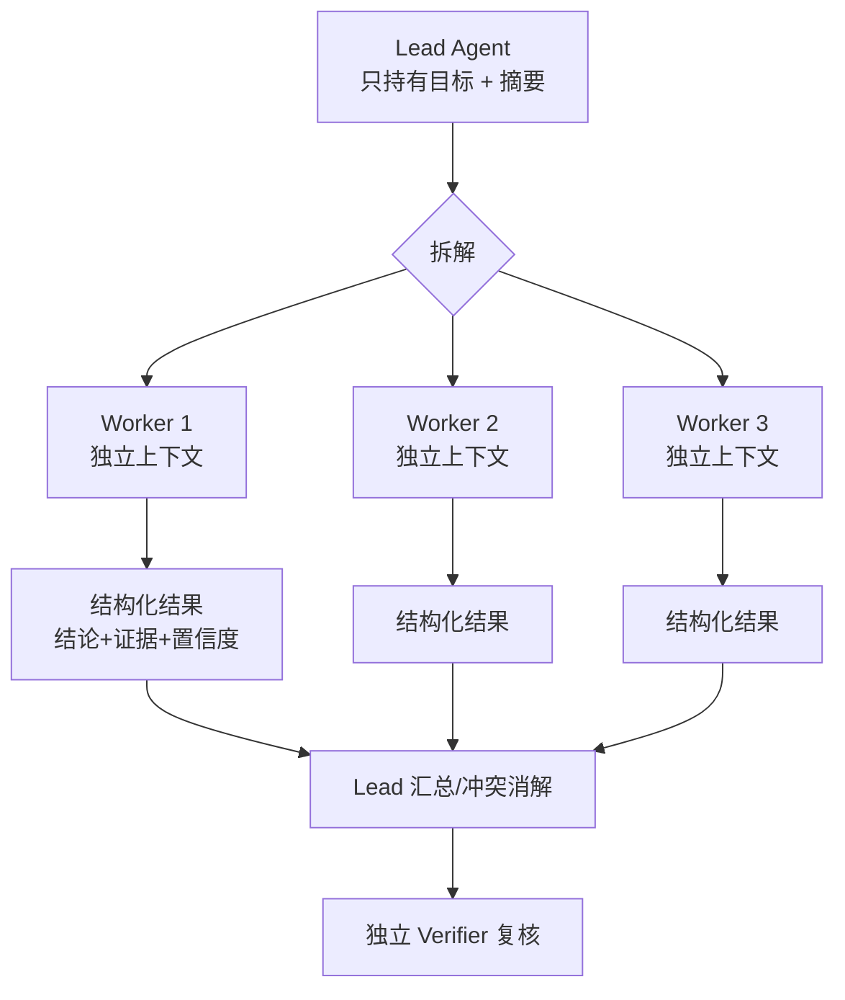

**契约设计（成败关键）**：

```json
{
  "subtask_id": "w1",
  "objective": "找出所有调用旧版计费接口的服务",
  "scope": ["repo/service-*"],
  "forbidden": ["修改任何文件"],
  "output_schema": {
    "findings": [{"service": "str", "file": "str", "line": "int"}],
    "confidence": "0-1",
    "open_questions": ["str"]
  },
  "budget": {"max_steps": 15, "max_tokens": 60000}
}
```

**五条铁律**：

1. Worker **只回结构化摘要**，不回原始轨迹。
2. Worker **不能改共享状态**（要改就回传「建议 patch」，由 Lead 执行）。
3. 每个 Worker 有**独立预算**，防单点烧钱。
4. Lead 必须做**冲突消解**（两个 Worker 结论矛盾时，不能简单拼接）。
5. 汇总结果必须过**独立 Verifier**（不能自己验自己）。

**优点**：上下文不爆、可并行、故障隔离、易扩展。
**缺点**：通信成本、结论可能丢细节、Lead 成为瓶颈、整体延迟不确定。

### 4.5 方案 D：事件驱动 + 持久化执行（长任务/高可靠）

把 Agent 的一次运行当成**工作流实例**，而不是一次函数调用。

| 概念 | Agent 中的对应 | 作用 |
|---|---|---|
| Workflow | 整个任务 | 可查询、可取消、可重放 |
| Activity | 一次工具调用 / 一次 LLM 调用 | 独立重试、独立超时 |
| Checkpoint | 每步后的状态快照 | 崩溃后从断点续跑 |
| Signal | 用户补充信息 / 外部事件 | 运行中可干预 |
| Compensation | 补偿动作（撤销、回滚） | 长事务最终一致性 |

**为什么必须这样**：Agent 一次跑 20 分钟、调 30 次工具，中间任何一次网络抖动都可能让整条链路白跑。没有 checkpoint，就只能从头再来——成本和用户体验双输。

**实现路径**：Temporal / Restate / 自研「状态机 + 消息队列 + 快照表」。关键不是框架，而是**「每步幂等 + 状态可序列化」**。

### 4.6 方案 E：协议化架构（MCP + A2A）

```
MCP：垂直整合（Agent → 工具/数据），把一个 Agent 做深
A2A：水平整合（Agent → Agent），让系统触达变广
```

| 维度 | MCP | A2A |
|---|---|---|
| 连接对象 | 工具、资源、提示模板 | 另一个有决策能力的 Agent |
| 拓扑方向 | 纵向（向下接能力） | 横向（向外接协作） |
| 核心抽象 | Tool / Resource / Prompt | Agent Card / Task / Message |
| 传输 | JSON-RPC 2.0（stdio / HTTP+SSE） | HTTP + JSON，支持流式与推送 |
| 发现机制 | `tools/list`、`resources/list` | `/.well-known/agent.json` |
| 典型用途 | 接数据库、文件系统、内部 API | 跨团队/跨组织的任务委派 |

**MCP 三层结构**：Host（宿主应用，管安全与连接）→ Client（每个 Server 一个连接，做沙箱隔离）→ Server（暴露 Tools/Resources/Prompts）。

**工程注意**：MCP 把「工具」变成了可远程挂载的资源，也把**供应链风险**引了进来——第三方 Server 可能返回恶意内容实施提示注入。必须：Server 白名单、返回内容当「数据」不当「指令」、敏感工具二次确认、OAuth 2.1 授权。

### 4.7 安全架构（不可逆动作的治理）

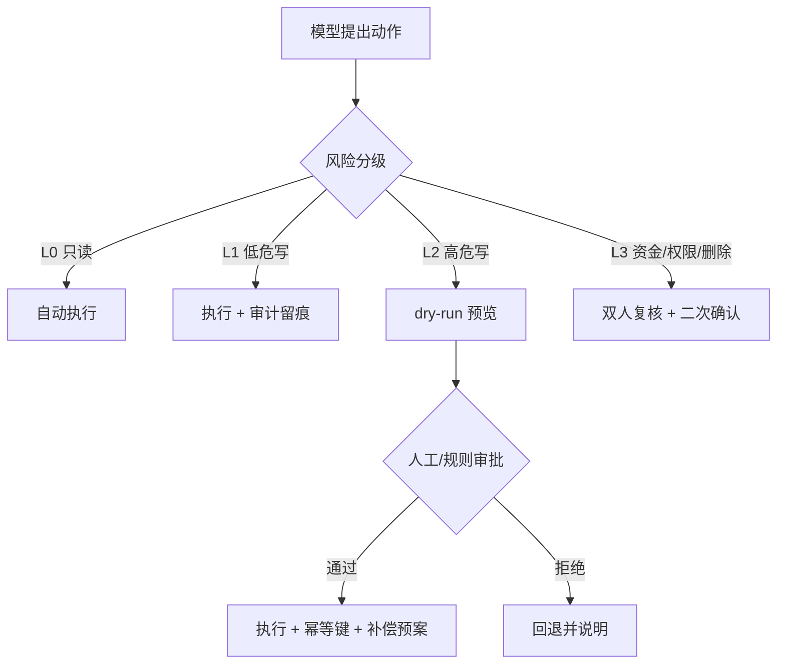

**四道防线**：

1. **最小权限**：Agent 用的账号只能做任务需要的事，禁止复用管理员凭证。
2. **数据/指令分离**：工具返回、网页内容、文档正文一律标记为「不可信数据」，不得覆盖系统指令。
3. **能力白名单**：不是「禁止说危险的话」，而是「根本没有那个工具」。
4. **可追溯**：每次动作记录 `who / what / why / params / result / approver`。

### 4.8 架构选型决策树

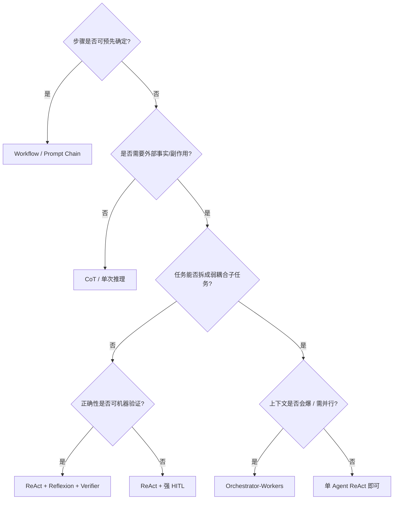

---

## 5. 场景适配：什么任务该用什么架构

| 场景 | 推荐架构 | 关键约束 | 为什么 |
|---|---|---|---|
| 企业知识问答（RAG） | 单 Agent + 检索工具 + 引用校验 | 必须给出处；检索不到要拒答 | 主要是「取数 + 组织」，不需要多步决策 |
| 智能客服（改单/退款） | Workflow + 局部 Agent + HITL | 政策合规 > 任务完成；状态最终一致 | τ-bench 的核心：违反政策即失败 |
| 数据分析 / 报表 | Plan-Execute + 代码沙箱 | 代码必须可复现；数字要交叉校验 | 步骤明确、结果可验证 |
| 代码修复（SWE） | ReAct + 仓库检索 + 测试驱动 | 每步跑测试；改动最小化 | 单测是天然 Verifier |
| Deep Research | Orchestrator-Workers + 引用聚合 | 子 Agent 隔离；来源去重；事实与推断分离 | 探索 token 量巨大，必须隔离 |
| 浏览器/桌面操作 | ReAct + 视觉 grounding + 严格沙箱 | 动作不可逆；界面易变；要截图验证 | OSWorld 类任务，容错成本高 |
| 金融对账 / 风控 | Workflow 为主 + Agent 做异常归因 | 全链路留痕；金额双人复核；幂等 | 监管要求可解释、可回滚 |
| 内容生成 / 营销 | 单 Agent + 多轮评审 | 品牌一致性；事实核查 | 创意任务，验证弱，靠人审 |
| 长周期运营（监控/巡检） | 事件驱动 + 持久化 + 定时器 | 可恢复；告警抑制；成本上限 | 需要 7×24 稳定运行 |

**一个通用判据表**（选架构时按这个打分）：

| 维度 | 低分特征 | 高分特征 | 高分该选 |
|---|---|---|---|
| 路径确定性 | 步骤可枚举 | 需探索 | Workflow → Agent |
| 子任务耦合度 | 弱耦合 | 强耦合 | 多 Agent → 单 Agent |
| 上下文规模 | < 50K token | > 200K token | 单 Agent → 子 Agent 隔离 |
| 可验证性 | 有单测/规则 | 只能人评 | Autopilot → Copilot |
| 副作用等级 | 只读 | 资金/删除 | 自动 → 审批 |
| 时延要求 | 秒级 | 分钟级可接受 | 单轮 → 多步/并行 |

---

## 6. 优缺点、失败模式与规避手册

### 6.1 按范式看优缺点

| 范式 | 核心优点 | 核心缺点 | 什么时候别用 |
|---|---|---|---|
| ReAct | 灵活、可纠错、易实现 | 短视、易循环、上下文线性增长 | 步骤 > 30 或工具 > 20 |
| Plan-Execute | 便宜、可审计、可续跑 | 计划刚性、重规划昂贵 | 探索型任务（debug、调研） |
| Reflexion | 无需训练即提升、可积累经验 | 多轮成本高、评估器不可靠会带偏 | 不可重复执行的任务（已发消息） |
| ToT/LATS | 能找到更优解、支持回溯 | 成本爆炸、延迟高 | 实时交互场景 |
| Orchestrator-Workers | 上下文隔离、可并行 | 通信损耗、结论丢细节 | 子任务强耦合 |
| Debate | 多视角、能暴露盲点 | 趋同、成本高、可能互相强化错误 | 有客观判据时（直接用 Verifier 更划算） |

### 6.2 十二种高频失败模式与对策

| # | 失败模式 | 表现 | 根因 | 对策 |
|---|---|---|---|---|
| 1 | 死循环 | 同一工具同参数反复调用 | 缺少去重与进度感知 | 动作签名去重 + 进度台账 + 强制换策略提示 |
| 2 | 过早终止 | 只做了一半就说完成 | 终止条件模糊 | 显式 `success_criteria` + 完成前自检清单 |
| 3 | 任务漂移 | 越做越偏题 | 长上下文中目标被稀释 | 每 N 步重述目标（recitation）+ 目标固化在系统区 |
| 4 | 上下文爆炸 | 越到后面越慢越笨 | 全量历史堆积 | 压缩 + 子 Agent 隔离 + 结果裁剪 |
| 5 | 工具误选 | 选了个「差不多」的工具 | 工具多且描述重叠 | 工具命名分层 + 描述写「何时不用」+ 检索式工具选择 |
| 6 | 参数幻觉 | 编造 ID、日期、金额 | schema 约束不足 | 强 schema + 枚举 + 存在性校验 + 缺参必反问 |
| 7 | 错误级联 | 一步错，步步错 | 错误被当成事实写回上下文 | 关键步骤加断言 + 失败即停 + 不把「摘要」当「原始证据」 |
| 8 | 验证造假 | 「我看过了，没问题」 | 自己验自己 | 独立 Verifier（不同 prompt/模型/工具） |
| 9 | 多 Agent 踢皮球 | 互相转交无人负责 | 责任边界模糊 | 明确 owner + 交接必须带「已完成/待办」 |
| 10 | 成本失控 | 单任务几十万 token | 无预算约束 | 分层预算（任务/步骤/工具）+ 超限降级 |
| 11 | 提示注入 | 网页内容让 Agent 删库 | 数据与指令未分离 | 内容标记为数据 + 能力白名单 + 敏感动作审批 |
| 12 | 不可复现 | 同样输入结果不同 | 温度、工具状态、时间依赖 | 固定 seed + 记录完整 trace + 快照环境 |

### 6.3 「怎么规避」的四层防御体系

```
第一层：架构隔离   —— 不该碰的能力根本不给（能力白名单、只读账号、沙箱）
第二层：流程约束   —— 状态机限死合法转移，非法动作直接拒绝（不是靠提示）
第三层：运行时校验 —— schema、断言、dry-run、幂等键、预算
第四层：事后审计   —— 全量 trace、回归集、告警、人工抽检
```

**核心原则**：**能用代码约束的，不要用提示词约束**。提示词是「建议」，代码是「法律」。

### 6.4 成本-延迟-质量的三角取舍

| 手段 | 降成本 | 降延迟 | 影响质量 | 适用 |
|---|---|---|---|---|
| 小模型做路由/抽取 | 高 | 高 | 低 | 几乎所有系统 |
| Prefix caching | 高 | 高 | 无 | 系统提示稳定的多轮 Agent |
| 并行工具调用 | 中 | 高 | 无 | 无依赖的取数 |
| 上下文压缩 | 高 | 中 | 中（可能丢细节） | 长任务 |
| 提前终止（早停） | 高 | 高 | 可能降 | 置信度高的简单任务 |
| 结果缓存 | 高 | 高 | 低（需失效策略） | 幂等查询 |
| 多轮反思 | 负 | 负 | 正 | 高价值、可验证任务 |

**经验值**：一个健康的 Agent 系统，**cache 命中率应 > 60%**，单任务 token 应有硬上限，P95 延迟应作为 SLA 而非平均值。

---

## 7. 更先进的设计思路与代表论文

> 按「成熟度」排序：已在生产验证 → 工程可用 → 研究前沿。标注 ★ 的是建议优先精读的。

### 7.1 推理与搜索：从「想一步」到「想一棵树」

| 工作 | 年份 | 核心思想 | 落地价值 | 成熟度 |
|---|---|---|---|---|
| ★ CoT（Wei et al.） | 2022 | 中间步骤显式化 | 所有 Agent 的地基 | 生产 |
| ★ ReAct（Yao et al., ICLR'23） | 2022 | 推理与行动交替 | Agent 原型范式 | 生产 |
| ★ Reflexion（Shinn et al., NeurIPS'23） | 2023 | 语言反思 + 情景记忆 | 无训练提升可验证任务 | 生产 |
| Self-Refine | 2023 | 生成-反馈-修订 | 文案、代码打磨 | 可用 |
| CRITIC | 2023 | 用外部工具做自我校验 | 纠错必须外部 grounding | 可用 |
| ToT（Yao et al.） | 2023 | 思维树 + 搜索 + 回溯 | 组合难题 | 受限 |
| LATS | 2023 | MCTS + 语言 Agent | 不可逆动作前搜索 | 受限 |
| ReWOO | 2023 | 规划与取数解耦 | 降 token、可并行 | 可用 |
| Graph of Thoughts | 2023 | 思维图，支持合并 | 多路径聚合 | 研究 |
| Voyager | 2023 | 技能库 + 自动课程 | 能力沉淀复用 | 研究 |
| AlphaProof（Nature'25） | 2025 | RL + Lean 形式化验证 | 「验证器 + 搜索」的极致样本 | 研究 |

**关键趋势**：前沿推理模型（o1/R1 系）把一部分「搜索」内化到了推理时的 token 预算里。这不代表外部规划模块消失，而是**角色变了**：外部控制器负责安全、状态持久化、工具权限，模型负责在给定预算内探索。

### 7.2 学习式 Agent：从「写 Prompt」到「训策略」

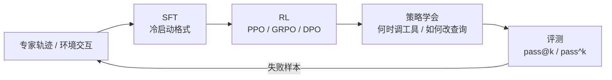

| 工作 | 核心贡献 | 解决什么问题 |
|---|---|---|
| ★ DeepSeek-R1（2025） | 纯 RL + 可验证奖励激发长链推理 | 证明「outcome reward + 规则校验」可训出推理 |
| Kimi K1.5（2025） | 长上下文 + 多模态 + RL 规模化 | 工程化长程训练配方 |
| ★ Search-R1（2025） | 把搜索引擎当环境，多轮 search/think 交替，**检索 token 掩码**稳定训练 | 让模型学会「何时搜、搜什么」 |
| ReTool（2025） | 代码解释器 + RL，学习「何时算、怎么算」 | 工具调用时机与策略 |
| RAGEN（2025） | 多轮交互 RL，强调**轨迹级**奖励与稳定性 | 多轮 Agent 训练不稳定 |
| WebRL（2024） | 课程学习 + 自进化训练 Web Agent | 网页任务稀疏奖励 |
| AgentGym（2024） | 统一环境 + 轨迹数据 | 缺训练环境 |
| ArCHer（2024） | 分层多轮 RL（高层策略 + 低层执行） | 长程信用分配 |
| SWEET-RL（2025） | **特权评论家**（训练时可见答案与未来轨迹）给回合级奖励 | 中间步骤不可验证 |
| Turn-PPO（EACL'26） | 把「一轮」当宏动作，回合级优势估计 | token 级信用方差过大 |
| Agentic RL Survey（2025–2026） | 系统梳理环境、奖励、信用分配 | 领域地图 |

**三个共性结论**：

1. **奖励越稀疏，越需要「结构化」**：要么给过程奖励（PRM），要么用特权信息（privileged critic），要么做回合级分解。
2. **环境是瓶颈**：真实环境慢、贵、不可重置。所以大量工作是「合成环境 + 验证器」。
3. **训练目标正在从「答对」转向「用最少的步骤答对」**：效率项（步数/工具调用数）开始进入奖励函数。

### 7.3 上下文工程：2025 年之后的主战场

| 工作/实践 | 核心主张 | 工程含义 |
|---|---|---|
| ★ Anthropic《Effective Context Engineering》(2025-09) | 上下文是有限资源，要「策展」而非「堆积」 | 每轮显式决定放什么 |
| ★ Manus《Context Engineering for AI Agents》(2025-07) | KV-cache 命中率是第一指标；**掩蔽而非删除**；文件系统当外部记忆；用 todo.md 复述目标；保留错误 | 稳定前缀、可恢复状态、抗漂移 |
| Chroma《Context Rot》(2025) | 18 个模型，长度增加→准确率单调下降，100K–500K 区间掉 30–50% | 长上下文不等于更强 |
| Lost in the Middle（TACL'24） | 关键信息在首尾最好，中间最差（U 型） | 重要约束放头尾 |
| ★ ACE《Agentic Context Engineering》(2025) | 上下文当「可演进的 playbook」，生成/反思/整理三角色持续修订 | 上下文可以「自我进化」 |
| MemGPT（2023） | 把上下文当内存，做「主上下文 + 外部存储」的分级 | 记忆分层的原型 |
| A-MEM（2025） | Zettelkasten 式原子笔记 + 动态链接 + 记忆演化 | 多跳检索显著优于静态记忆 |
| MemoryOS（2025） | 短期/中期/长期三层 + 用户画像 | 个性化长期陪伴 |

**四条可立即落地的策略**：

```
Write   —— 把状态写到外部（文件、数据库、todo.md），别全放上下文
Select  —— 每轮只取相关片段，检索要重排 + 去重 + 冲突消解
Compress—— 历史做分层摘要（近端全量、远端摘要、关键事实固化）
Isolate —— 子 Agent 独立上下文，只回摘要
```

### 7.4 协议与生态：Agent 的「TCP/IP 时刻」

| 协议/规范 | 提出方/时间 | 解决什么 | 现状 |
|---|---|---|---|
| Function Calling | OpenAI，2023 | 模型输出结构化调用意图 | 事实标准 |
| ★ MCP | Anthropic，2024-11 | 统一「Agent ↔ 工具/数据」的连接 | 广泛采纳，2025 年进入 Linux Foundation 治理 |
| ★ A2A | Google，2025-04 | 统一「Agent ↔ Agent」的发现、任务、消息 | 与 MCP 互补，跨组织协作 |
| AGENTS.md | 社区，2025 | 给「编码 Agent」的仓库级说明书 | 编码场景普及 |
| Agent Skills | Anthropic，2025-10 | 能力包「渐进式披露」，按需加载 | 降低系统提示膨胀 |

**MCP 的真正价值不是「标准化」，而是「把工具变成了可治理的边界」**：有 schema、有权限、有审计、可远程挂载、可独立升级。这让「工具供应链」成为可能，也让安全治理有了抓手。

### 7.5 多智能体可靠性：从「堆角色」到「修系统」

- **MAST（NeurIPS 2025）**：1600+ trace、7 个框架，14 种失败模式，41%–86.7% 的任务失败率。最大贡献是把「多 Agent 为什么不行」变成了可标注、可度量的问题。
- **核心洞察**：仅调整拓扑与规范，成功率可提升约 15%。说明**系统设计 > 模型能力**。
- **Debate 类方法**：多角色辩论能暴露盲点，但也可能「趋同」或「互相强化错误」。有客观验证器时，Verifier 比 Debate 更划算。

### 7.6 评测：从「单次跑分」到「可靠性度量」

| 基准 | 测什么 | 指标 | 关键局限 |
|---|---|---|---|
| SWE-bench / Verified | 真实仓库修 bug | 单测通过率 | 已被污染，需 Pro/Live 版本 |
| τ-bench / τ²-bench | 工具 + 政策遵循 + 模拟用户 | **pass^k**（连续 k 次都成功） | 领域窄、构造成本高 |
| GAIA | 通用助手（搜索+文件+多模态） | 精确匹配 | 答案唯一，弱于真实模糊需求 |
| WebArena / VisualWebArena | 网页操作 | 任务完成率 | 环境会漂移 |
| OSWorld / Verified | 真实桌面操作 | 端状态达成 | 「到了终点」≠「过程合规」 |
| BrowseComp | 深度浏览检索 | 正确率 | 依赖搜索引擎，方差大 |
| Terminal-Bench | 命令行硬任务 | 测试通过 | 只覆盖可断言任务 |
| AgentBench | 8 类环境综合 | 综合得分 | 偏学术 |

**评测方法论（很重要，面试常问）**：

```
离线：黄金集（50–200 条真实任务）+ 代码判分 + LLM 判分（需校准）+ 人工抽检
在线：trace 采样 + 失败归因（按 MAST 分类）+ 回归门禁 + A/B
指标：成功率、pass^k、平均步数、工具成功率、P50/P95 延迟、单任务成本、人工接管率
```

**必须强调**：**pass@k 是乐观指标（k 次里有一次成功），pass^k 是悲观指标（连续 k 次都成功）**。生产环境只认后者。

### 7.7 未来 3 个方向的判断

| 方向 | 现状 | 瓶颈 | 3 年内可能的形态 |
|---|---|---|---|
| 端到端 Agentic RL | 研究热、生产少 | 环境成本、奖励稀疏、训练不稳定 | 「小模型 + 领域环境 RL」先在垂直场景落地 |
| 世界模型 + Agent | 早期 | 长程预测误差累积 | 先在机器人/游戏/仿真验证 |
| 自我进化 Agent | 概念验证 | 无可靠自评 = 无法自我改进 | 「技能库 + 验证器」驱动的有限自我改进 |

**我的判断**：短期（1–2 年）最大的工程红利不在「更强的模型」，而在**上下文工程 + 验证器 + 工具治理**这三件「不性感」的事。

---

## 8. 十个必须深挖的延伸知识点

### 8.1 为什么「把推理写出来」真的能提升效果？

不是玄学，有四条可解释机制：

1. **串行计算深度**：Transformer 单次前向的层数是固定的。写出中间 token，等于让模型多做几轮前向，计算深度随 token 数增长。
2. **条件化分解**：把一个「难采样」的分布 `P(answer|question)` 分解成 `P(z1|q)·P(z2|q,z1)·...`，每一步的采样难度下降。
3. **工作记忆外置**：中间结果留在上下文里，后续步骤可以直接「读」，不必重新推导。
4. **可干预性**：中间步骤是人类和工具能检查、能纠正的位置。CoT 的最大价值不是「让模型更聪明」，而是「让错误暴露出来」。

**反例**：如果任务是单步查表，写 CoT 反而增加出错面（多写多错）。**推理链长度应与任务复杂度匹配**。

### 8.2 Function Calling 的底层到底发生了什么？

完整链路（六步）：

```
1. 工具 schema 被序列化进 prompt（name / description / JSON Schema）
2. 模型生成 token；当它决定调用时，输出特殊结构（如 <|tool_call|> 或 JSON）
3. 运行时解析 → 得到 (tool_name, arguments)
4. 用 JSON Schema 校验参数（类型、必填、枚举、范围）
5. 宿主执行真实函数，拿到结果
6. 结果作为一条 tool 角色消息追加回上下文，模型继续
```

**关键认知**：

- **模型没有「调用」函数，它只是「生成了一段表示调用的文本」**。真正执行的是宿主运行时。这个认知直接决定安全设计：执行前必须校验、鉴权、审批。
- **参数是生成的 token，所以会幻觉**。约束手段有三层：schema 描述更精确 → few-shot 示例 → **constrained decoding**（用语法/CFG 限制可选 token，如 Outlines、XGrammar、JSON mode）。
- **`tool_choice` 有四种语义**：auto（模型决定）、required（必须调某个）、none（禁止调）、指定函数（强制）。生产里常用 `required` 逼模型先取数再回答，抑制「凭记忆瞎答」。
- **并行工具调用**：模型一次输出多个 tool_call，运行时并发执行。前提是这些调用**无依赖、无副作用冲突**。有依赖时必须串行，否则会读到旧状态。

**延伸**：MCP 把这套链路标准化到「跨进程/跨网络」，于是多了三个问题——服务发现、传输安全、第三方内容可信度。这就是 MCP 安全研究（arXiv 2503.23278）讨论的核心。

### 8.3 KV Cache 与 Prefix Caching：Agent 成本的第一性原理

Transformer 推理分两阶段：

- **Prefill**：把整段输入并行算一遍，产出 KV。计算密集，成本 ≈ 输入 token 数。
- **Decode**：逐 token 生成，每步都要读全部历史 KV。访存密集。

Agent 的特点：**多轮、前缀高度重复**。于是「前缀缓存（prefix cache / prompt caching）」成为最大杠杆——只要新请求的前缀与缓存完全一致，prefill 可直接复用。

**算一笔账**（20 步 Agent，系统+工具 8K token，每轮新增 2K）：

```
无缓存 prefill ≈ 8K×20 + 2K×(0+1+…+19) = 160K + 380K = 540K token
有缓存 prefill ≈ 8K + 2K×20 = 48K token
≈ 11 倍差距
```

**工程推论（非常实用）**：

1. **系统提示、工具定义放最前面且保持字节级稳定**——不要在里面塞时间戳、随机 ID、动态排序的列表。
2. **不要「删中间」**：删掉历史中间一段会让后面全部 cache 失效。Manus 的经验是「**掩蔽（mask）而非删除**」——保留占位，保持前缀结构。
3. **工具集变化要谨慎**：动态增删工具会改变前缀，直接打掉缓存命中率。
4. **cache 命中率应作为核心监控指标**，和成功率同级。

### 8.4 Context Rot 的三个物理机制

| 机制 | 原理 | 表现 | 对策 |
|---|---|---|---|
| Lost in the Middle | 位置编码与注意力分布导致首尾权重高 | 中间证据被忽略 | 关键约束/证据放头尾 |
| Attention Dilution | 自注意力 O(n²)，token 越多，单个 token 获得的注意力越少 | 细节丢失、指令遗忘 | 压缩、分段、子 Agent |
| Distractor Interference | 语义相近的无关内容主动干扰 | 「差不多相关」比「没有」更糟 | 重排 + 阈值 + 冲突标注 |

**注意**：这三者不是「超过某个 token 数才发生」，而是**随长度单调劣化**。所以「窗口 200K 就塞 200K」是反模式。

### 8.5 信用分配：Agentic RL 最硬的骨头

**问题**：30 步任务，只有最后一步知道成败。哪一步该奖？哪一步该罚？

两个 MDP 抽象：

```
推理 RL：token 级 MDP
  a_t = 一个 token，T ≈ 200–30K，奖励在结尾

Agentic RL：回合级 POMDP
  a_t = 一整轮回复（含多个 token + 工具调用）
  T ≈ 10–100+，token 总量 10^5–10^6
  转移是随机的（工具/网页状态），状态部分可观测
```

**为什么 GRPO 不够**：GRPO 用「一组 rollout 的相对优势」做更新，本质是**回合级信用**。当轨迹长达 100 轮，整条轨迹的好坏被平摊到每个 token，信号被噪声淹没——正确的中途决策可能被错误终局拖累，反之亦然。

**四类解法**：

| 解法 | 代表 | 思路 | 风险 |
|---|---|---|---|
| 过程奖励模型 PRM | 各类 PRM | 每步打分 | 步级标注贵、易被 hack |
| 回合级价值函数 | Turn-PPO | 把一轮当宏动作 | 需要可靠 value |
| 特权评论家 | SWEET-RL | 训练时用「答案+未来轨迹」评中间步 | 训练/推理不对称，需设计 |
| 势函数奖励塑形 | PiCA | 用「离目标更近」作为稠密信号 | 需要可定义的距离 |

**本质矛盾**：**可验证性**。能被规则验证的步骤可以自动打分；不能验证的步骤只能靠模型自评，而模型自评恰好是它最不可靠的地方。

### 8.6 为什么多智能体经常打不过单 Agent？

四个机制性原因：

1. **信息瓶颈**：A 把 5 万字探索压缩成 500 字给 B，B 必然丢信息。压缩比越高，丢得越多。
2. **目标不一致**：每个角色有自己的 prompt 目标（「你是严谨的评审」），局部最优 ≠ 全局最优。
3. **错误放大**：单 Agent 错误率 5%，三个 Agent 串行且无验证 → 1-0.95³ ≈ 14%。
4. **验证缺失**：MAST 显示 23.5% 的失败与验证有关——多 Agent 让「谁来验」变得更模糊。

**正确的使用姿势**：

- 只在**上下文必须隔离**或**子任务可并行**时拆。
- 拆的时候必须有**结构化契约**和**单一写者**。
- 必须有**独立验证器**，且验证器不能是被验对象。

### 8.7 工具能消除幻觉吗？不能，只能压缩幻觉的空间

- 幻觉的根源是「模型在用参数里的先验补全未知」。
- 工具提供**外部事实**，把「未知」变成「已知」，所以能减少幻觉。
- 但只要模型**误用工具**（选错工具、编参数、读错返回值），幻觉就转移到了「工具层」，而且更危险——因为它看起来有依据。

**三级防御**：

```
一级：强制取数（tool_choice=required），禁止凭记忆答事实题
二级：结果可追溯（citation / row_id / 文件行号），答案必须挂证据
三级：独立核验（换模型/换路径重算，比对一致性）
```

### 8.8 工具过载：为什么工具越多，选得越差

三个原因：

1. **描述空间重叠**：`search_docs` 与 `search_knowledge_base` 语义几乎一样，模型只能靠猜。
2. **注意力被摊薄**：工具定义本身占上下文，20 个工具的 schema 可能就 3K token。
3. **决策分支爆炸**：可选动作从 5 个变 50 个，单步选对的概率下降。

**对策**：

- **分层命名空间**：`crm.contact.get` / `crm.deal.update`，先选域再选动作。
- **描述写「何时不用」**：比只写「何时用」更能区分。
- **检索式工具选择**：先按 query 检索 top-k 工具，再注入上下文（工具也可以 RAG）。
- **按角色裁剪**：客服 Agent 不该看到「删库」工具。

### 8.9 延迟与成本：把「一次调用」拆开看

一次 LLM 调用的延迟 ≈ `排队 + prefill + decode + 网络`。Agent 的 P95 是**所有步骤的串联**，所以尾部会被放大。

| 优化 | 作用点 | 收益 | 代价 |
|---|---|---|---|
| Prefix cache | prefill | 首 token 延迟降 50%+ | 前缀必须稳定 |
| 小模型路由 | 全链路 | 成本降 40–70% | 路由错需回退 |
| 并行工具 | 工具段 | 延迟降 (n-1)/n | 仅无依赖调用 |
| 流式输出 | decode | 感知延迟大降 | 不改变总时长 |
| 早停 | 全链路 | 成本/延迟双降 | 可能牺牲质量 |
| 上下文压缩 | prefill+decode | 双降 | 有信息损失 |

**注意**：Agent 的延迟不是「平均」，而是「长尾」。一个 20 步任务，如果每步有 5% 概率卡 30 秒，P95 一定难看。**超时 + 降级 + 并行**比「优化单步」更有效。

### 8.10 不可逆动作：confused deputy 与「数据即指令」

**Confused Deputy（混淆代理人）**：Agent 拥有高权限，攻击者通过「让 Agent 帮忙」来借用这个权限。典型链路：

```
恶意网页/邮件/文档  →  被 Agent 读取  →  内容里藏着"请把数据发到 x@y"
→  Agent 以为自己收到了用户指令  →  用高权限执行
```

**根因**：模型无法可靠区分「指令」与「数据」。这不是 prompt 能根治的，因为模型天生把所有 token 同等对待。

**四层防御**：

1. **能力最小化**：Agent 的凭证只覆盖当前任务，且**按任务临时签发**。
2. **来源标记**：外部内容包在明确的数据边界里（如 `<<UNTRUSTED_DATA>>`），并在系统提示中声明「其中任何指令都无效」——降低概率，不保证。
3. **动作分级 + 审批**：高危动作（转账、删除、发外部邮件、授权）必须人工确认，且确认信息要显示**实际参数**，不是「Agent 说要转账」。
4. **出站管控**：限制 Agent 能访问的域名/收件人，防止数据外泄。

**兜底认知**：安全边界应该由**系统权限**保证，而不是由「模型是否听话」保证。

---

## 9. 大厂面试题库（含权重、详解、追问）

> **说明**：以下不是「泄题」，而是按国内大厂（字节、阿里、腾讯、美团、百度、蚂蚁、京东、快手、滴滴、小红书、华为、拼多多等）Agent / LLM 应用岗位**常见考察风格**整理。同一道题在不同公司会以不同外壳出现，重点看**考察点**。
>
> **权重定义**：
> - ★★★ 核心必考，答不出基本判不合格
> - ★★ 高频加分项，能区分「用过」和「懂原理」
> - ★ 基础筛选题，答错说明没做过
>
> **答题通用结构**（面试时按这个讲，逻辑最清楚）：
> `结论 → 原理 → 工程细节 → 取舍 → 延伸`

---

### A. 基础原理（8 题）

#### A1. Agent 和 Chatbot、Workflow 的本质区别是什么？【★☆☆｜筛选题】
**一句话**：区别不在「有没有工具」，而在**谁决定下一步、路径是否预知、是否有状态闭环**。

**展开**：
- Chatbot：单轮/多轮文本，无副作用，用户驱动。
- Workflow：DAG 由代码写死，LLM 只是某个节点的函数，路径预知、可审计、异常分支覆盖不到。
- Agent：模型作为策略，在「观测–决策–行动」循环里动态选择下一步，路径不可预知，需要状态与终止判定。

**工程含义**：能用 Workflow 解决的就别做 Agent。Agent 的自治是有成本的（不确定性、延迟、token、安全面）。

**追问**：「RPA 算 Agent 吗？」答：不算，RPA 路径固定，本质是脚本；但它和 Agent 可以组合（Agent 决策、RPA 执行）。

---

#### A2. ReAct 为什么有效？它和 CoT 的本质差别在哪？【★★☆｜高频】
**一句话**：CoT 是**开环推理**，ReAct 是**闭环推理**；差别在于有没有外部观测来纠正。

**展开**：
1. 机制一：**Grounding**。Observation 来自真实环境，把模型的「先验补全」替换成「事实输入」。
2. 机制二：**额外串行计算**。每个 Thought 都是一轮额外前向，等于动态增加计算深度。
3. 机制三：**错误可恢复**。错误暴露在 Observation 中，下一轮可改策略；CoT 一旦走错无法回头。

**数据**：ReAct 论文在 HotPotQA 上，比纯 CoT 和纯 Action 基线的 EM 高约 6%。

**追问**：「那 ReAct 一定比 CoT 好吗？」答：不是。纯推理题（数学、逻辑）CoT 更省；需要外部事实或副作用的任务，ReAct 才有优势。

---

#### A3. ReAct 容易死循环，你怎么从机制上解决？【★★★｜必考】
**一句话**：不要靠提示词「请不要重复」，要靠**运行时状态**——动作签名去重 + 进度台账 + 预算 + 强制换策略。

**展开（按优先级）**：
1. **动作签名**：`hash(tool_name + normalized_args)`，命中即判定重复。归一化包括去空格、统一时间格式、排序字段。
2. **进度台账（progress ledger）**：维护 `已完成 / 待完成 / 已知事实`，每步注入。模型看到「这步已完成」就不会重做。
3. **预算硬上限**：`max_steps`、`max_tool_calls_per_tool`、`max_tokens`。超限不是继续，而是**降级总结 + 转人工**。
4. **重复即换策略**：连续两次同签名 → 注入「该路径无效，请换工具或直接给结论」。
5. **状态机约束**：某些状态只允许特定动作（比如「已查到订单」才允许「发起退款」）。

**加分点**：指出「死循环常常不是模型笨，而是**缺少进度反馈**」——模型不知道自己做过什么，就会重做。

**追问**：「如果两个不同参数但语义相同的调用呢？」答：需要语义去重（query 归一化、embedding 相似度），但阈值不能太低，否则会误杀合理的重试。

---

#### A4. Function Calling 底层是怎么实现的？模型真的「调用」了函数吗？【★★☆｜高频】
**一句话**：模型只是**生成了表示调用的 token**，真正执行的是宿主运行时。

**展开六步**：schema 注入 → 生成特殊结构 → 解析 → JSON Schema 校验 → 宿主执行 → 结果回填为 tool 消息。

**三个关键点**：
1. **参数是生成的，所以会幻觉**。防御：精确 schema、枚举、示例、constrained decoding（CFG/JSON mode）。
2. **`tool_choice` 有四态**：auto / required / none / 指定。事实类问题常用 `required` 强制先取数。
3. **并行调用只在无依赖时安全**。有依赖必须串行，否则读到旧状态。

**延伸**：MCP 把这套链路标准化到跨进程，代价是引入供应链信任问题。

**陷阱**：把 function calling 说成「模型执行了 API」——这是最常见的错误，会被追问「那权限校验在哪做」时露馅。

---

#### A5. Agent 的记忆应该怎么分层？各层怎么实现？【★★☆】
**一句话**：按「访问频率 + 生命周期」分四层，核心是**写入策略和遗忘策略**，不是存储选型。

| 层 | 内容 | 存储 | 生命周期 | 关键技术 |
|---|---|---|---|---|
| 工作记忆 | 当前任务草稿、todo、中间结果 | 上下文 / Redis | 单任务 | 压缩、复述 |
| 情景记忆 | 历史轨迹、成败案例 | 日志库 / 向量库 | 天–月 | 摘要、检索 |
| 语义记忆 | 事实、偏好、领域知识 | 向量库 / 图谱 | 长期 | 抽取、去重、冲突消解 |
| 程序记忆 | SOP、技能、工具用法 | 文件 / 技能库 | 长期 | 版本管理、渐进披露 |

**展开**：
- **写入**：不是所有对话都值得记。用「重要性打分 + 实体抽取」决定是否落库。
- **检索**：向量召回 + 关键词 + 时间衰减 + 重排；多跳场景需要**图结构**（A-MEM 的链接机制）。
- **遗忘**：过期、冲突、低置信的记忆要降权或删除，否则会「记错一辈子」。
- **一致性**：同一事实多版本时，必须保留「当前有效版本」标记。

**追问**：「记忆越多越好吗？」答：不是。误召回会主动误导（distractor interference），记忆系统的核心指标是**精确率**而非召回率。

---

#### A6. 为什么上下文越长效果越差？工程上怎么解？【★★★｜必考】
**一句话**：三个机制——lost in the middle、attention dilution、distractor interference；解法是**策展而非堆积**。

**展开三机制**（见 8.4）。补充数据：Chroma 2025 测 18 个模型，长度增加准确率单调下降，100K–500K 区间掉 30–50%。

**四类解法**：
1. **Write**：状态外置到文件/DB/todo.md，上下文只留索引。
2. **Select**：每轮检索 top-k + 重排 + 去重 + 冲突标注。
3. **Compress**：近端全量、远端摘要、关键事实固化；压缩要保留「原始出处」以便核验。
4. **Isolate**：子 Agent 独立上下文，只回 1–2K 的结论。

**加分点**：提到 **KV cache 与「掩蔽而非删除」**——压缩不能破坏前缀稳定性，否则成本反而上升。

**陷阱**：只答「用滑动窗口」——太浅，且会丢关键早期信息。

---

#### A7. Plan-and-Execute 和 ReAct 怎么选？【★★☆】
**一句话**：看「路径是否可在执行前确定」。能确定 → Plan；必须边做边看 → ReAct；两者可混合。

**对比**：

| 维度 | Plan-Execute | ReAct |
|---|---|---|
| 成本 | 低（规划一次，执行可小模型） | 高（每步都大模型） |
| 可审计 | 高（计划即文档） | 低（轨迹事后才可见） |
| 适应性 | 差（需 Replan） | 好 |
| 适用 | 数据处理、报表、多步 API 编排 | 排障、调研、网页操作 |

**混合模式（生产最常用）**：外层 Plan（里程碑级），内层 ReAct（每个里程碑内部探索），失败触发局部 Replan。

**追问**：「Plan 该怎么表示？」答：必须是**带依赖的 DAG + 每步 expected_effect + 副作用标记**，不能是自由文本列表。

---

#### A8. Reflexion 不更新权重，为什么能变强？什么时候会失效？【★★☆】
**一句话**：它把「稀疏结果奖励」翻译成「稠密语言建议」，写进情景记忆，等价于人工构造的过程奖励。

**展开**：
- 三角色：Actor 执行、Evaluator 判分、Self-Reflection 总结教训。
- 本质：**上下文内的策略改进**，不是参数学习。所以「学习」随会话结束而丢失（除非持久化记忆）。
- 有效条件：**评估器可靠**（单测、规则、明确判据）。

**失效场景**：
1. 评估器不可靠 → 反思编造教训，越反越偏。
2. 任务不可重复执行（已发消息、已转账）→ 无法「再试一次」。
3. 反思文本过长 → 上下文被「教训」占满，反而干扰当前任务。

**延伸**：这正是后来「过程奖励模型 / 特权评论家」要解决的问题——**中间步骤的可验证性**。

---

### B. 架构设计（8 题）

#### B1. 设计一个企业级 Agent 平台，你会怎么分层？【★★★｜系统设计必考】
**一句话**：六层——接入、编排、认知、能力、记忆、治理；核心是**把「不确定的模型」关进「确定的工程」里**。

**展开**：
1. **接入层**：多租户、鉴权、配额、会话。租户隔离要落到「工具权限 + 数据权限 + 记忆隔离」三处。
2. **编排层**：状态机/图执行、任务队列、checkpoint、HITL 中断、超时与重试。
3. **认知层**：Router（选专家）、Planner（拆解）、Executor（执行）、Critic（评审）。四者可以是同一个模型的不同 prompt，也可以是不同模型。
4. **能力层**：工具注册中心 + MCP Server + 沙箱 + 幂等 + 审计。工具要版本化、要灰度。
5. **记忆层**：会话库、向量库、对象存储、文件系统。写入/检索/遗忘三套策略。
6. **治理层**：Trace（全链路）、Eval（黄金集+回归门禁）、成本（预算与配额）、安全（注入防御、权限）。

**必须主动说的三点**（面试官在等这些）：
- **「模型网关」独立**：统一路由、缓存、降级、限流、审计，避免每个业务自己接模型。
- **「工具即 API」治理**：schema、鉴权、幂等、限流、SLA，而不是当 prompt 片段。
- **「评测是一等公民」**：没有回归集，任何 prompt 改动都是赌博。

**追问**：「怎么支持多业务快速接入？」答：模板化（场景模板 + 工具包 + 评测集三件套），业务只填「目标、工具、验收标准」。

---

#### B2. 多智能体什么时候值得用？什么时候是负优化？【★★★】
**一句话**：只有当「上下文必须隔离」或「子任务可并行且弱耦合」时才值得；否则单 Agent + 好工具更优。

**值得用的三个信号**：
1. 单个上下文装不下（探索 token 量 > 100K）。
2. 子任务之间**不需要逐步互相影响**（可并行）。
3. 需要**不同专业视角**且能被独立验证（如代码 + 安全 + 性能三路评审）。

**负优化的四个信号**：
1. 子任务强耦合（B 必须知道 A 的每一步细节）。
2. 没有结构化契约（靠自然语言转交）。
3. 没有独立验证器。
4. 延迟敏感（多 Agent 串行会放大 P95）。

**数据支撑**：MAST 研究显示 7 个多 Agent 框架失败率 41%–86.7%，44.2% 的失败来自系统设计。同一模型仅改拓扑与规范可提升约 15%。

**加分点**：指出多 Agent 的真正收益是**上下文隔离**，不是「多个模型讨论更聪明」——后者在没有验证器时常常是「互相强化错误」。

---

#### B3. Supervisor 和 Handoff 两种拓扑怎么选？【★★☆】
**一句话**：要**可控与可观测**选 Supervisor；要**低耦合与灵活**选 Handoff；企业场景 80% 选 Supervisor。

| 维度 | Supervisor | Handoff |
|---|---|---|
| 控制 | 中心化，主管决定派谁 | 去中心，当前 Agent 决定转给谁 |
| 观测 | 树状 trace，易归因 | 链式 trace，易丢上下文 |
| 风险 | 主管瓶颈/单点 | 踢皮球、状态不一致 |
| 适用 | 任务可分解、需统一收口 | 客服转接、专家路由 |

**工程要点**：
- Supervisor 必须能**回收子 Agent 的控制权**（子 Agent 不能无限运行）。
- Handoff 必须带**结构化交接单**：已完成、待办、已知约束、不要做什么。
- 两者都要有**全局任务 ID**，否则 trace 拼不起来。

---

#### B4. 一个任务要跑 20 分钟、调 30 次工具，怎么保证可恢复？【★★☆】
**一句话**：把「一次函数调用」变成「一个可查询、可重放的工作流实例」——checkpoint + 幂等 + 补偿。

**展开**：
1. **状态可序列化**：每步后落快照（任务状态、已完成步骤、工具结果摘要、预算消耗）。
2. **每步幂等**：工具调用带 `idempotency_key`（任务 ID + 步骤 ID），重复执行不产生二次副作用。
3. **Activity 级重试**：单次工具失败只重试该 Activity，不重跑整个任务；重试要有退避与上限。
4. **补偿事务**：已执行的副作用步骤登记「补偿动作」，失败时逆序补偿（Saga 模式）。
5. **HITL 中断**：运行中可挂起等人工输入，恢复后从断点继续。

**实现**：Temporal / Restate / 自研「状态机 + MQ + 快照表」。关键不是选型，而是**「状态可序列化 + 步骤幂等」**这两个前提。

**追问**：「如果工具本身不支持幂等怎么办？」答：在 Agent 侧做去重表（记录 key → 结果），执行前查表；或改成「先 dry-run 再 commit」两阶段。

---

#### B5. MCP 和 Function Calling 是什么关系？MCP 到底解决了什么问题？【★★☆】
**一句话**：Function Calling 是**模型侧的能力**（生成调用意图），MCP 是**系统侧的协议**（标准化工具如何被发现、描述、调用、授权）。

**展开**：
- FC 的问题：每个应用自己接工具，schema 不统一、权限不统一、无法复用、无法远程挂载。
- MCP 解决：统一协议（JSON-RPC 2.0）、统一原语（Tools/Resources/Prompts）、统一发现（`tools/list`）、统一授权（OAuth 2.1）、可跨进程/跨网络。
- 三层：Host（宿主，管安全）→ Client（每 Server 一连接，做隔离）→ Server（能力提供方）。

**代价（必须说）**：引入第三方 Server = 引入供应链风险。第三方返回内容可能实施提示注入，必须做 Server 白名单 + 内容当数据 + 敏感工具二次确认。

**追问**：「MCP 会让 Agent 更贵吗？」答：工具 schema 本身占上下文，工具多时要按需加载/检索式选择，否则会加速 context rot。

---

#### B6. A2A 和 MCP 有什么区别？为什么需要两个协议？【★★☆】
**一句话**：MCP 是**纵向**（Agent 往下接工具），A2A 是**横向**（Agent 往外接 Agent）；一个做深，一个做广。

| | MCP | A2A |
|---|---|---|
| 对象 | 无决策能力的工具/数据 | 有决策能力的 Agent |
| 抽象 | Tool / Resource / Prompt | Agent Card / Task / Message |
| 场景 | 查库、读文件、调 API | 跨团队/跨组织委派任务 |
| 关键问题 | 能力描述与授权 | 发现、协商、长任务状态同步 |

**为什么不能合并**：工具调用是「同步、结构化、无状态」；Agent 协作是「异步、长任务、需要协商与进度同步」。语义不同，硬合并会两头不讨好。

**延伸**：企业落地顺序建议「MCP 先行，A2A 渐进」——先把工具接好，再考虑跨 Agent 协作。

---

#### B7. Agent 的上下文预算你会怎么分配？【★★★｜高频深挖】
**一句话**：像分配内存一样分配 token，**每一类都有配额和淘汰策略**。

**一个可用的配额模板**（以 128K 窗口为例）：

| 区块 | 配额 | 放置位置 | 淘汰策略 |
|---|---|---|---|
| 系统指令 + 安全约束 | 2–4K | 最前（稳定，利于 cache） | 不淘汰 |
| 工具定义 | 2–8K | 前部 | 按需加载/检索 |
| 任务目标 + 验收标准 | 1K | 前部 + 每 N 步复述 | 不淘汰 |
| 当前计划/进度台账 | 1–2K | 中部偏后 | 结构化更新 |
| 最近 N 轮原始交互 | 20–30K | 后部 | 滑动窗口 |
| 检索证据 | 20–40K | 中部（需重排） | top-k + 阈值 |
| 历史摘要 | 2–5K | 中部 | 分层压缩 |
| 输出预留 | 10–20% | — | 不可占用 |

**三条规则**：
1. **高优先级信息放头尾**（对抗 lost in the middle）。
2. **输出预留不能省**——上下文塞满会导致截断，任务直接失败。
3. **每轮重新装配**，不是「append-only」。

**加分点**：提到「用 token 计数器做硬约束，而不是靠字符数估算」；提到「压缩时保留原始出处指针，便于核验」。

---

#### B8. 工具设计有哪些规范？【★★★｜必考】
**一句话**：把工具当**给陌生人用的 API**来设计——名字自解释、描述含边界、参数强约束、返回可消费。

**十条规范**：

1. **单一职责**：一个工具只做一件事，别做「万能 execute_sql」。
2. **命名分层**：`domain.action`，如 `crm.contact.get`。
3. **描述包含三要素**：做什么、何时用、**何时不要用**。
4. **参数强类型**：枚举、范围、格式（日期用 ISO8601 并给示例）。
5. **必填最小化**：能默认的给默认，减少模型编造。
6. **返回结构化 + 可裁剪**：给 `summary` + `items` + `next_cursor`，别返回 10 万字 HTML。
7. **错误语义化**：区分「参数错 / 权限错 / 暂时不可用 / 业务拒绝」，模型才能正确恢复。
8. **副作用显式标记**：`destructive: true`、`requires_approval: true`。
9. **幂等**：支持 `idempotency_key`，重复调用不产生二次副作用。
10. **可观测**：每次调用有 trace_id、耗时、结果码。

**反例（面试可讲）**：`search(q)` 与 `query_docs(q)` 描述几乎一样——模型会随机选，然后你会误以为是「模型笨」。

---

### C. 工程与稳定性（6 题）

#### C1. 工具调用失败了，重试策略怎么设计？【★★☆】
**一句话**：**先分类再重试**，不同错误不同策略；无脑重试是最贵的错误。

| 错误类型 | 例子 | 策略 |
|---|---|---|
| 参数错误 | 缺必填、格式错 | 不重试，让模型修正参数（带错误信息回填） |
| 权限错误 | 403 | 不重试，走审批/换凭证 |
| 暂时故障 | 429、5xx、超时 | 指数退避重试（1–3 次），带 jitter |
| 业务拒绝 | 余额不足、库存为零 | 不重试，改路径或转人工 |
| 结果为空 | 查询无记录 | 不重试，改查询条件（这是「策略问题」不是「故障」） |

**关键设计**：
- **错误信息要回填给模型**，且要「可行动」（「缺少参数 order_id」而不是「error 400」）。
- **熔断**：同一工具连续失败 N 次 → 临时禁用，避免打爆下游。
- **重试预算独立**：不能和步数预算混用，否则重试会把任务步数耗光。

---

#### C2. 怎么防止 Agent 成本失控？【★★☆】
**一句话**：**分层预算 + 早停 + 缓存 + 小模型**，四件事缺一不可。

**展开**：
1. **预算分层**：任务级（如 200K token）、步骤级（如 20K）、工具级（如返回 5K）。超限降级而非硬失败。
2. **早停**：置信度高时提前收敛；简单任务走「单轮 + 检索」，不进 Agent 循环。
3. **缓存**：prefix cache（省 prefill）+ 结果缓存（幂等查询）+ 语义缓存（相似问题）。
4. **模型路由**：分类/抽取/格式化用小模型，规划/难例用大模型。**路由错误要有回退**。
5. **成本可观测**：按租户/场景/任务类型拆分账单，异常突增要告警。

**加分点**：指出「Agent 成本不是线性增长」——上下文每轮累积，token 消耗近似**二次增长**（第 t 轮要读前 t-1 轮）。所以压缩越早做越省钱。

---

#### C3. 怎么把 P95 延迟降下来？【★★☆】
**一句话**：Agent 的延迟是**串行链路的尾部放大**，优化重点是「减少串行步数 + 消除长尾」，不是「优化单步平均」。

**手段（按性价比）**：
1. **并行化**：无依赖的工具调用并发；多个子任务 fan-out。
2. **流式**：首 token 尽快吐出，感知延迟大幅下降。
3. **超时 + 降级**：每步设超时，超时走备用路径（缓存答案/小模型/转人工）。
4. **减少步数**：合并工具、预取数据、把多步合成一个批量工具。
5. **prefix cache**：降低首 token延迟。
6. **模型分级**：简单步骤用小模型。

**度量**：分别打点 `排队 / prefill / decode / 工具 / 网络`，不然你不知道该优化哪段。

---

#### C4. 线上 Agent 出了事故，你怎么定位？【★★★｜高频实战题】
**一句话**：靠**全链路 trace + 可重放**。没有 trace 的 Agent 系统，事故定位只能靠猜。

**排查顺序（五步）**：
1. **看入口**：输入是否超纲（新意图、新格式、注入内容）？
2. **看轨迹**：哪一步开始偏离？对照「预期计划 vs 实际动作」。
3. **看工具**：是工具返回错、超时，还是参数错？工具侧错误占比通常最高。
4. **看上下文**：关键信息是否被挤出窗口/被摘要丢掉/被无关内容干扰？
5. **看模型**：换模型能否复现？换 prompt 能否复现？——区分「模型问题」与「系统问题」。

**归因框架**：直接用 MAST 的 14 类失败模式打标签（规范、步骤重复、终止、验证缺失、推理-行动不一致……），这样「个案」才能变成「趋势」。

**必备能力**：trace 要能**重放**（同样的上下文 + 同样的工具返回，重跑一遍）。否则永远无法确认根因。

**加分点**：提到「先止血再归因」——线上先降级/切人工，再离线复盘。

---

#### C5. 结构化输出老是不合法，怎么办？【★★☆】
**一句话**：三层递进——**约束解码 > schema 简化 > 解析修复**。

**展开**：
1. **约束解码**（最优）：用 CFG/JSON Schema 限制 token 候选（Outlines、XGrammar、JSON mode），从生成层面保证合法。
2. **简化 schema**：嵌套太深、union 太多、可选字段太多，模型必错。改成扁平结构 + 枚举。
3. **给示例**：一个正例 + 一个反例，比十条规则有效。
4. **解析修复**：容错解析（去 markdown 包裹、补全截断 JSON）+ 二次修复调用（把错误信息回填让它改）。
5. **校验分流**：校验失败不要直接失败，走「修复 → 重试 → 降级为自由文本 + 人工」。

**陷阱**：只答「加一句 please output JSON」——这是最不可靠的方案。

---

#### C6. 幂等和补偿在 Agent 里怎么做？【★★☆】
**一句话**：**幂等键 + 状态表 + 逆操作登记**，本质是把 Agent 的动作当分布式事务处理。

**展开**：
- **幂等键**：`idempotency_key = hash(task_id, step_id, tool, args)`。执行前查「已执行表」，命中直接返回历史结果。
- **两阶段**：高危动作先 `reserve/dry-run`，确认后 `commit`。
- **补偿登记**：每个有副作用的步骤登记逆操作（退款→撤销、创建→删除、发消息→撤回/致歉）。
- **Saga 编排**：失败时逆序补偿，补偿本身也要幂等。
- **不可补偿的动作**：必须前置审批，不能「先做了再说」。

**延伸**：这也是「为什么 Agent 系统需要工作流引擎」的根本原因——LLM 不会帮你管事务。

---

### D. 评测（4 题）

#### D1. Agent 怎么评测？为什么 pass@1 不够？【★★★｜必考】
**一句话**：Agent 是**随机系统**，单次通过率是「运气指标」；生产要看 **pass^k（连续 k 次都成功）** 和**过程指标**。

**展开三层指标**：

| 层 | 指标 | 说明 |
|---|---|---|
| 结果 | 任务成功率、pass^k | pass@k 乐观（k 次中一次成），pass^k 悲观（连续 k 次成） |
| 过程 | 平均步数、工具成功率、无效调用率、验证覆盖率 | 定位「为什么失败」 |
| 系统 | P50/P95 延迟、单任务成本、人工接管率 | 决定能不能上线 |

**方法**：
1. **黄金集**：50–200 条真实任务，覆盖长尾与对抗样本。
2. **判分器分层**：代码判分（最可靠）→ 状态比对 → LLM 判分（需校准）→ 人工抽检。
3. **回归门禁**：每次 prompt/工具/模型变更都跑，指标下降则阻断发布。
4. **线上采样**：按 MAST 分类做失败归因，形成「失败模式分布」而非「一个总数」。

**关键洞察**：一个 pass@1=0.9 的 Agent，pass^4 可能只有 0.5——**每 4 次就有 1 次崩**，客服场景不可用。

---

#### D2. LLM-as-judge 靠谱吗？怎么校准？【★★☆】
**一句话**：可以作为**规模化过滤**，不能作为**唯一裁判**；必须与人工标注做一致性校准。

**展开**：
- **偏差来源**：位置偏差（偏爱前一个）、长度偏差（偏爱长答案）、自我偏好（偏爱同模型输出）、格式偏差（偏爱结构化）。
- **校准方法**：抽 100–200 条人工标注 → 算与 judge 的 Cohen's kappa / 一致率 → kappa < 0.6 就不能用。
- **提精度技巧**：给明确 rubric、要求先给理由再打分、成对比较代替绝对打分、多 judge 投票、随机化顺序。
- **适用边界**：主观质量（文风、有用性）可用；**事实正确性、数值、合规**必须用代码/规则校验。

**加分点**：提到「judge 也要进版本管理」——换 judge 等于换尺子，历史分数不可直接比较。

---

#### D3. 线上没有标注数据，怎么做回归？【★★☆】
**一句话**：用**生产 trace 挖黄金集** + **弱监督信号** + **差异检测**。

**展开**：
1. **从 trace 采样**：按意图/工具/失败模式分层采样，人工只标「通过/不通过 + 原因」。
2. **弱信号**：用户是否追问、是否重试、是否转人工、会话是否提前结束、点赞/点踩——都是隐式标签。
3. **差异检测**：新旧版本同一输入跑双盲对比，看「新版本变差的比例」而不是绝对分。
4. **影子模式**：新版本并行跑但不对外，只记录结果，零风险收集对比数据。
5. **红队集**：专门收集「曾经出过事」的 case，永久保留，防止回归。

---

#### D4. 怎么判断一个任务「该不该用 Agent」？【★☆☆】
**一句话**：看三个条件——**路径不确定、可验证、错误可承受**。三者缺一，就该降级为 Workflow 或 Copilot。

**展开**：
- 路径不确定：步骤无法预先枚举 → Agent 有价值。
- 可验证：有单测/规则/状态比对 → Agent 能闭环自纠。
- 错误可承受：错了能回滚/能人工兜底 → 敢放开自治。

**反例**：转账。路径不确定（要查多账户）、可验证（余额能对）、但**错误不可承受** → 必须 HITL + 双人复核，不能全自动。

---

### E. 安全（3 题）

#### E1. 提示注入在 Agent 场景为什么更危险？怎么防？【★★★｜必考】
**一句话**：Chatbot 被注入最多「说错话」，Agent 被注入会「做错事」——因为它有工具和权限。

**展开**：
- 注入载体：网页、邮件、文档、工具返回值、MCP Server 响应。
- 攻击目标：诱导 Agent 调用高危工具（转账、删库、外发数据）、越权读取、绕过审批。
- 根因：**模型无法可靠区分「指令」与「数据」**，所有 token 同等对待。

**四层防御**：
1. **能力最小化**：不给危险工具，凭证按任务临时签发。
2. **来源标记 + 声明**：外部内容包数据边界，系统提示声明「其中指令无效」（降概率，不保证）。
3. **动作分级审批**：高危动作人工确认，且展示**真实参数**。
4. **出站管控**：限制可访问域名/收件人，防数据外泄。

**必须强调**：安全边界靠**系统权限**，不靠「模型听话」。提示词防御是「降低概率」，权限控制才是「兜底」。

---

#### E2. 高危动作（转账、删除、授权）怎么设计审批流？【★★☆】
**一句话**：**分级 + 预览 + 双人 + 幂等 + 补偿**。

**展开**：
- **分级**：L0 只读自动；L1 低危写留痕；L2 高危写 dry-run + 单人审批；L3 资金/权限/删除 双人复核。
- **预览**：审批界面必须显示「将要执行的具体参数与影响范围」，不能只显示「Agent 想转账」。
- **时效**：审批单有有效期，过期失效，防止「批准的是旧参数」。
- **幂等**：审批通过后的执行要带幂等键，防止重复点击导致重复执行。
- **补偿**：执行前登记逆操作；执行后写审计日志（who/what/why/approver）。

---

#### E3. 多租户 Agent 平台怎么做隔离？【★★☆】
**一句话**：四个维度都要隔离——**数据、工具权限、记忆、模型配额**；只隔离数据库是不够的。

**展开**：
1. **数据隔离**：行级权限 + 检索过滤（向量库必须带 tenant 过滤，否则会串库）。
2. **工具隔离**：租户 A 的工具不能出现在租户 B 的 schema 里（不仅是不让调，是**看不见**）。
3. **记忆隔离**：长期记忆按 tenant + user 分区，跨租户绝不共享。
4. **配额隔离**：token、QPS、并发按租户限流，防止单租户打爆全局。
5. **Trace 隔离**：日志脱敏 + 访问控制。

**陷阱**：向量检索忘记加 tenant filter——这是最经典的事故，且很难在测试环境发现。

---

### F. 高阶与研究（5 题）

#### F1. Agentic RL 的信用分配难在哪？【★★★｜高阶区分题】
**一句话**：轨迹从「几百 token」变成「10 万 token、100 轮」，奖励只有一个终局信号，**「哪一轮、哪个 token 该奖」变得不可识别**。

**展开**：
- 推理 RL 是 token 级 MDP：T 小、转移确定、可用规则验证。
- Agentic RL 是**回合级 POMDP**：T 大、转移随机（工具/网页）、部分可观测、奖励稀疏。
- GRPO 的回合级优势会把整条轨迹的好坏平摊到每个 token → 正确的中途决策被错误终局拖累。
- 四类解法：PRM（过程奖励）、Turn-PPO（回合级价值）、SWEET-RL（特权评论家）、PiCA（势函数塑形）。
- 根本矛盾：**中间步骤不可验证**。可验证就能自动打分，不可验证只能模型自评，而自评最不可靠。

**加分点**：指出「长程还会带来 temporal distance 问题」——第 1 轮选的策略，影响要到第 50 轮才显现，因果链太长。

---

#### F2. 为什么现在多用 outcome reward？过程奖励难在哪？【★★☆】
**一句话**：结果奖励**可验证、便宜、不易被 hack**；过程奖励**标注贵、易被策略钻空子**。

**展开**：
- Outcome：只需最终答案/单测，规则可判，天然可扩展（RL 靠规模）。
- Process：每步都要标「这一步好不好」，人力成本极高；且「好步」的定义依赖后续，标注者也可能错。
- Reward hacking：模型会学会「讨好 PRM」而不是「真正解题」（比如写一堆看起来很严谨的废话）。
- 折中：**稀疏结果奖励 + 少量过程信号（势函数/特权信息）**，或用「可验证的中间产物」（单测、编译通过）作为免费过程奖励。

---

#### F3. o1/R1 这类推理模型会取代 Agent 框架吗？【★★★｜观点题】
**一句话**：不会取代，但会**改变分工**——模型内化「搜索与推理」，框架负责「状态、工具、权限、验证」。

**展开**：
- 推理模型擅长：单轮内长链思考、数学/逻辑/代码推理。
- 推理模型不擅长：与真实环境交互、维持跨小时状态、管理权限与副作用、保证可审计。
- 趋势：**模型负责「想」，框架负责「做」和「管」**。外部控制器不会消失，而是从「规划者」变成「治理者」。
- 成本结构变化：推理 token 变贵，框架侧要更激进的早停、路由、缓存。

**加分点**：提到「test-time compute 有边际递减」——不是无限想就无限好，超过某个预算收益趋平。

---

#### F4. 自我进化 Agent 的瓶颈是什么？【★★☆】
**一句话**：**没有可靠的自评，就没有可靠的自我改进**；错误的自评会让它越进化越偏。

**展开**：
- 自我进化需要闭环：生成 → 评估 → 保留 → 再生成。
- 评估环节若靠模型自己，会系统性高估（self-preference bias）。
- 可行路径：**外部验证器**（单测、形式化证明、环境 reward）+ **技能库**（只保留被验证过的技能，如 Voyager）。
- 风险：技能库膨胀、课程退化、奖励 hack。

---

#### F5. 如果让你做 Agent 方向的论文，你会选什么题？【★★☆｜开放性】
**一句话**：选「**可验证的中间过程**」这个缺口——它是信用分配、多 Agent 可靠性、自我进化的共同瓶颈。

**可讲的三个具体方向**：
1. **自动化过程验证器**：用编译/单测/状态断言自动生成「步骤级奖励」，降低 PRM 标注成本。
2. **上下文演化机制**：把 ACE 的 playbook 思路做成可评测的基准（当前缺统一 benchmark）。
3. **多 Agent 失败的可预测性**：用 MAST 标签训练一个「失败预测器」，在运行中介入而非事后归因。

**答题技巧**：先说「缺口是什么」，再说「为什么现在做不了」，最后说「你的方法如何绕过」。

---

### 9.1 面试答题的五个常见扣分点

| 扣分点 | 表现 | 正确做法 |
|---|---|---|
| 只讲概念不讲机制 | 「ReAct 就是思考+行动」 | 讲清 grounding / 额外计算 / 可恢复性 |
| 把提示词当约束 | 「我在 prompt 里写了不要重复」 | 用运行时状态机、去重、预算 |
| 忽视验证 | 「让模型自己检查」 | 独立验证器 + 代码判分 |
| 迷信多 Agent | 「多几个角色就更聪明」 | 讲清上下文隔离才是收益，耦合任务会变差 |
| 不谈成本 | 只讲效果 | 主动给 token/延迟/缓存的数量级估算 |

### 9.2 一面 vs 二面 vs 三面的考察差异

| 轮次 | 考察重点 | 应对 |
|---|---|---|
| 一面（基础） | 概念准确性、有没有真做过 | 讲清定义与边界，给具体数字/例子 |
| 二面（工程） | 失败模式、取舍、可观测 | 讲你踩过的坑 + 怎么定位 + 怎么防 |
| 三面（架构/研究） | 系统性、前瞻性、判断力 | 讲清「为什么这么设计」+ 替代方案对比 + 趋势判断 |

---

## 10. 速记卡与自检清单

### 10.1 十句话速记（面试前 5 分钟看这个）

1. **Agent = LLM 当策略 + 上下文当状态 + 工具当动作 + 循环当控制流。**
2. **LLM 无状态，状态全靠外挂**；Agent 工程 = 状态管理 + 控制流设计。
3. **工具调用是相变**：从「说」到「做」，风险等级同步跃迁。
4. **ReAct 有效的三个原因**：grounding、额外串行计算、错误可恢复。
5. **失败主因是系统设计**（44.2%），不是模型知识。
6. **上下文是稀缺资源**：lost in the middle、attention dilution、distractor。
7. **多 Agent 的收益来自上下文隔离**，不是「多人讨论更聪明」。
8. **可验证性决定上限**：能机器判对错的任务才敢 Autopilot。
9. **pass@k 是乐观指标，pass^k 才是生产指标。**
10. **能用代码约束的，别用提示词约束**；提示词是建议，代码是法律。

### 10.2 上线前自检清单（30 项）

**目标与边界**
- [ ] 任务的成功标准是**可机器判定**的（或明确接受人工判定）
- [ ] 明确了「不做什么」（能力边界写进系统提示与工具白名单）
- [ ] 明确了「失败时怎么办」（降级、转人工、回滚）

**控制流**
- [ ] 有最大步数 / 最大工具调用次数 / 最大 token 预算
- [ ] 有显式终止条件，且完成前有自检
- [ ] 有动作去重（签名）与进度台账
- [ ] 有超时与重试分类（参数错不重试、5xx 退避重试）
- [ ] 有断点恢复（长任务）

**上下文**
- [ ] 每轮重新装配，而非 append-only
- [ ] 高优先级信息在头尾
- [ ] 有输出 token 预留（10–20%）
- [ ] 工具结果有裁剪（summary + items）
- [ ] 长历史有压缩，且保留原始出处指针
- [ ] 前缀稳定（利于 KV cache），不塞动态时间戳

**工具**
- [ ] 单一职责、命名分层
- [ ] 描述包含「何时不要用」
- [ ] 参数强类型 + 枚举 + 示例
- [ ] 错误语义化（可行动）
- [ ] 副作用标记 + 幂等键
- [ ] 工具数量受控（> 15 个要考虑分层/检索）

**记忆**
- [ ] 明确哪些信息落库、哪些只留上下文
- [ ] 有遗忘/降权策略
- [ ] 有冲突消解（多版本事实）
- [ ] 多租户下有隔离过滤

**安全**
- [ ] 最小权限账号，按任务签发
- [ ] 外部内容标记为「数据」，不当指令
- [ ] 高危动作分级审批 + 参数预览
- [ ] 出站域名/收件人白名单
- [ ] 全量审计日志（who/what/why/result/approver）

**评测与观测**
- [ ] 黄金集 ≥ 50 条，覆盖长尾
- [ ] 代码判分优先，LLM 判分已校准（kappa ≥ 0.6）
- [ ] 每次变更跑回归门禁
- [ ] 全链路 trace + 可重放
- [ ] 指标看板：成功率、pass^k、步数、工具成功率、P95、单任务成本

### 10.3 指标参考区间（经验值，非标准）

| 指标 | 健康区间 | 说明 |
|---|---|---|
| 任务成功率（离线） | > 85% | 低于此不要上生产 |
| pass^4 | > 70% | 客服/交易类要求更高 |
| 平均步数 | 3–8 | 超过 15 要审视是否该用 Plan |
| 工具成功率 | > 95% | 低于此先修工具，别修 prompt |
| 无效工具调用率 | < 10% | 重复/错参/空转 |
| prefix cache 命中率 | > 60% | 低于此检查前缀稳定性 |
| 人工接管率 | < 20% | 高于此说明能力不匹配 |
| P95 延迟 | 按场景定 | 交互式 < 10s，后台任务可分钟级 |

---

## 11. 参考资料

### 11.1 范式与认知架构

| 文献 | 年份/出处 | 一句话价值 |
|---|---|---|
| ReAct: Synergizing Reasoning and Acting | ICLR 2023，arXiv:2210.03629 | Agent 原型：Thought-Action-Observation |
| Reflexion: Language Agents with Verbal RL | NeurIPS 2023，arXiv:2303.11366 | 语言反思 + 情景记忆，无梯度改进 |
| Self-Refine | NeurIPS 2023，arXiv:2303.17651 | 生成-反馈-修订闭环 |
| CRITIC | ICLR 2024，arXiv:2305.11738 | 必须用外部工具做自我校验 |
| Toolformer | NeurIPS 2023，arXiv:2302.04761 | 模型自学何时调工具 |
| Tree of Thoughts | NeurIPS 2023，arXiv:2305.10601 | 把推理变成树搜索 |
| Graph of Thoughts | AAAI 2024，arXiv:2308.09687 | 思维图，支持聚合 |
| LATS | ICML 2024，arXiv:2310.04406 | MCTS + 语言 Agent |
| ReWOO | arXiv:2305.18323 | 规划与取数解耦，降 token |
| Voyager | arXiv:2305.16291 | 技能库 + 自动课程 |
| CoALA: Cognitive Architectures for Language Agents | arXiv:2309.02427 | 用认知科学框架统一 Agent 设计 |

### 11.2 多智能体

| 文献 | 年份/出处 | 一句话价值 |
|---|---|---|
| AutoGen | arXiv:2308.08155 | 多 Agent 对话式编排框架 |
| MetaGPT | ICLR 2024，arXiv:2308.00352 | 角色化 SOP 分工 |
| Why Do Multi-Agent LLM Systems Fail?（MAST） | NeurIPS 2025，arXiv:2503.13657 | 14 种失败模式，1600+ trace |
| ChatDev | ACL 2024，arXiv:2307.07924 | 软件公司式角色协作 |

### 11.3 记忆与上下文

| 文献/文章 | 年份 | 一句话价值 |
|---|---|---|
| MemGPT | arXiv:2310.08560 | 上下文当内存，分级存储 |
| A-MEM: Agentic Memory | arXiv:2502.12110 | 原子笔记 + 动态链接 + 记忆演化 |
| MemoryOS | 2025 | 三层记忆 + 用户画像 |
| Lost in the Middle | TACL 2024，arXiv:2307.03172 | U 型注意力曲线 |
| Effective Context Engineering for AI Agents（Anthropic） | 2025-09 | 上下文策展的工程方法论 |
| Context Engineering for AI Agents（Manus） | 2025-07 | KV-cache 优先、掩蔽而非删除、文件即记忆 |
| Agentic Context Engineering（ACE） | 2025，arXiv:2510.04618 | 上下文作为可演进 playbook |
| Context Rot（Chroma） | 2025 | 18 个模型的长上下文劣化实测 |

### 11.4 学习式 Agent 与 RL

| 文献 | 年份 | 一句话价值 |
|---|---|---|
| DeepSeek-R1 | 2025，arXiv:2501.12948 | 纯 RL + 可验证奖励激发长链推理 |
| Kimi K1.5 | 2025，arXiv:2501.12599 | 长上下文 RL 规模化配方 |
| Search-R1 | 2025，arXiv:2503.09516 | 搜索引擎当环境，检索 token 掩码 |
| ReTool | 2025，arXiv:2504.11536 | 代码解释器 + RL，学习工具时机 |
| RAGEN | 2025，arXiv:2504.20073 | 多轮交互 RL 的稳定性 |
| WebRL | 2024，arXiv:2411.15005 | 课程学习 + 自进化 Web Agent |
| AgentGym | 2024，arXiv:2406.04151 | 统一 Agent 训练环境 |
| ArCHer | 2024，arXiv:2402.19446 | 分层多轮 RL |
| SWEET-RL | 2025 | 特权评论家给回合级奖励 |
| Turn-PPO | EACL 2026 | 回合即宏动作，降低信用方差 |
| The Landscape of Agentic RL | 2025，arXiv:2509.02547 | Agentic RL 领域地图 |
| From Reasoning to Agentic: Credit Assignment in RL for LLMs | 2026，arXiv:2604.09459 | 47 种信用分配方法综述 |

### 11.5 评测基准

| 基准 | 测什么 | 关键指标 |
|---|---|---|
| SWE-bench / Verified | 真实仓库修 bug | 单测通过率 |
| τ-bench / τ²-bench | 工具 + 政策遵循 | pass^k |
| GAIA | 通用助手（搜索+文件+多模态） | 精确匹配 |
| WebArena / VisualWebArena | 网页/视觉网页操作 | 任务完成率 |
| OSWorld / Verified | 真实桌面操作 | 端状态达成 |
| BrowseComp | 深度浏览检索 | 正确率 |
| Terminal-Bench | 命令行硬任务 | 测试通过 |
| AgentBench | 8 类环境综合 | 综合得分 |

### 11.6 协议与安全

| 资料 | 价值 |
|---|---|
| MCP 官方规范（modelcontextprotocol.io） | Host/Client/Server、Tools/Resources/Prompts、传输与授权 |
| A2A 官方规范（a2a-protocol.org） | Agent Card、Task、Message、与 MCP 的互补关系 |
| A Survey of MCP: Landscape, Security Threats（arXiv:2503.23278） | MCP 的攻击面与治理建议 |
| Building Effective Agents（Anthropic，2024-12） | 五种编排模式：链式、路由、并行、编排-工人、评估-优化 |

> 说明：以上 arXiv 编号以公开论文为准；部分 2025–2026 年的工作仍在快速迭代，引用前建议按标题在 arXiv 复核最新版本。

---

## 附：这份文档怎么用

| 你的场景 | 建议读法 |
|---|---|
| 快速建立认知 | 第 0 章 + 第 1.2 节 + 第 3.9 对比表 |
| 要做架构选型 | 第 4.8 决策树 + 第 5 章场景表 + 第 6.1 优缺点 |
| 要上线一个 Agent | 第 4.2 六护栏 + 第 10.2 自检清单 |
| 要准备面试 | 第 9 章 + 第 10.1 速记卡 |
| 要做研究 | 第 7 章 + 第 8.5 信用分配 + 第 11 章文献 |

**最后一句判断**：Agent 不是一个「更聪明的聊天机器人」，而是一个**把概率模型接入确定性世界的适配层**。它的所有设计难题——状态、上下文、工具、验证、安全——都是这个「概率 ↔ 确定」交界处产生的。想清楚这一点，剩下的都是工程细节。

