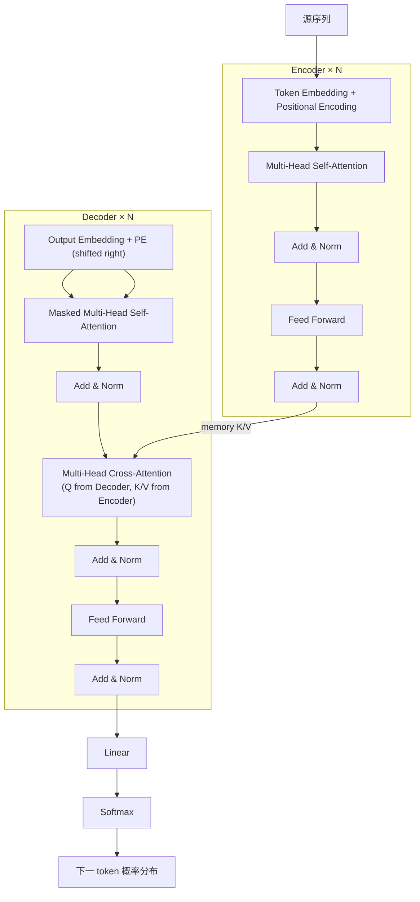
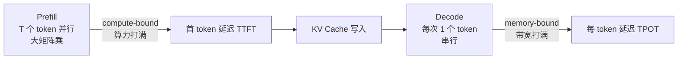
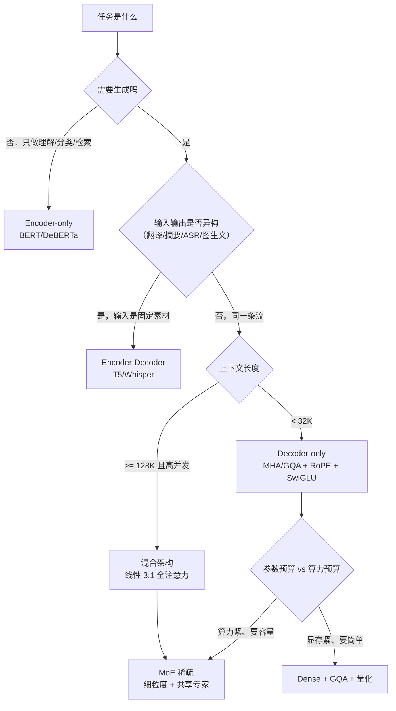

# Transformer 架构底层原理深度解构 · 通用设计方案 · 大厂面试题库

> 面向：想真正吃透 Transformer 的原理、能自己设计/改造架构、并准备大厂算法岗与 AI Infra 岗面试的读者。
> 阅读方式：第 1–3 章是"为什么这样设计"，第 4 章是"怎么选型落地"，第 5 章是"会踩什么坑"，第 6 章是"前沿往哪走"，第 7 章是面试题库（按能力分层、带权重与详解）。
> 说明：文中所有复杂度/显存公式都给了推导，面试可直接复述；论文引用为公开文献，便于自查。

---

## 目录

- [0. 三句话抓住本质](#0-三句话抓住本质)
- [1. 起点：Transformer 到底解决了什么问题](#1-起点transformer-到底解决了什么问题)
- [2. 整体结构：一张图看清数据流](#2-整体结构一张图看清数据流)
- [3. 逐模块底层原理](#3-逐模块底层原理)
  - [3.1 输入表示：Tokenization 与 Embedding](#31-输入表示tokenization-与-embedding)
  - [3.2 位置编码：为什么必须有、怎么实现、为什么会外推失败](#32-位置编码为什么必须有怎么实现为什么会外推失败)
  - [3.3 Self-Attention：可微的软寻址](#33-self-attention可微的软寻址)
  - [3.4 Multi-Head Attention：为什么要多头](#34-multi-head-attention为什么要多头)
  - [3.5 FFN：被低估的那 2/3 参数](#35-ffn被低估的那-23-参数)
  - [3.6 残差与归一化：训练能不能收敛的真正开关](#36-残差与归一化训练能不能收敛的真正开关)
  - [3.7 输出层与训练目标](#37-输出层与训练目标)
  - [3.8 计算量、显存与 Prefill/Decode 的本质差异](#38-计算量显存与-prefilldecode-的本质差异)
- [4. 通用架构设计方案（5 套模板 + 选型决策树）](#4-通用架构设计方案5-套模板--选型决策树)
- [5. 优缺点、失效机理与规避手段总表](#5-优缺点失效机理与规避手段总表)
- [6. 更先进的设计思路与论文地图](#6-更先进的设计思路与论文地图)
- [7. 大厂面试题库（分层 + 权重 + 详解）](#7-大厂面试题库分层--权重--详解)
- [8. 速查卡与自测清单](#8-速查卡与自测清单)
- [9. 参考文献](#9-参考文献)

---

## 0. 三句话抓住本质

1. **表示层**：把离散符号变成连续向量，并额外注入"我在哪个位置"的信息。
2. **交互层**：Self-Attention 是一个**可微的、内容寻址的软字典查询**（soft dictionary lookup）。Query 是"我想找什么"，Key 是"我是什么"，Value 是"我携带什么信息"；输出是所有 Value 按匹配度的加权和。它把"序列上的递归依赖"替换成"任意两点距离恒为 1 的全连接图"。
3. **变换层**：FFN 是逐位置（position-wise）的两层 MLP，本质是**键值记忆 + 非线性特征变换**，承担了模型约 2/3 的参数容量。
4. **工程层**：Transformer 的一切工程优化，几乎都是在和两个东西搏斗——**注意力的 O(T²) 计算** 与 **KV Cache 的线性显存增长**。看懂这一点，后面所有变体（FlashAttention、GQA、MLA、稀疏注意力、线性注意力、混合架构）都能自动归位。

---

## 1. 起点：Transformer 到底解决了什么问题

### 1.1 RNN/LSTM 的三个结构性缺陷

| 缺陷 | 机理 | 后果 |
|---|---|---|
| **串行依赖** | $h_t = f(h_{t-1}, x_t)$，第 t 步必须等第 t-1 步 | 训练无法在时间维并行；T=4096 时相当于串行 4096 个算子，GPU 利用率极低 |
| **长程路径过长** | 从位置 i 到位置 j 的信息要经过 j-i 次连乘 | 梯度 $\prod \partial h_t/\partial h_{t-1}$ 指数衰减或爆炸；LSTM 的门控只是**缓解**，不是根治 |
| **固定容量瓶颈** | 全部历史被压进一个 $d$ 维隐状态 | 长文档/长代码的信息必然有损压缩 |

### 1.2 Transformer 的破局思路

把**"时间维度的递归"**换成**"空间维度的全连接"**：

- 任意两个 token 之间的信息路径长度恒为 **1**（一层注意力即可直接交互），梯度可以不经中间状态直接回传 → 长程依赖不再是"记忆问题"，而是"寻址问题"。
- 整个序列的注意力计算是一个**大矩阵乘**，天然并行 → GPU 友好，这是它能 scale 到万亿参数的前提。
- 代价同样明确：**O(T²)** 的计算与显存，以及**丢掉了序列的归纳偏置**（必须靠位置编码补回来）。

### 1.3 归纳偏置的取舍（面试常问的"为什么是 Transformer"标准答法）

| 结构 | 归纳偏置 | 数据效率 | 长程建模 | 并行性 | 峰值算力利用 |
|---|---|---|---|---|---|
| RNN / LSTM | 时间平移不变、局部递归 | 高（小数据也能跑） | 弱 | 差 | 低 |
| CNN / TCN | 局部性、平移等变 | 高 | 中（靠层数堆感受野，膨胀卷积可到 O(log T)） | 好 | 中高 |
| **Transformer** | 几乎无（置换等变，需显式位置编码） | **低**（吃数据） | **强**（路径长度 1） | **好** | **高（大矩阵乘）** |

一句话结论：Transformer 是**用"归纳偏置的缺失"换"可扩展性"**。数据少时它不如 CNN/RNN；数据过亿后，Scaling Law 让它碾压。

---

## 2. 整体结构：一张图看清数据流

### 2.1 原始 Encoder-Decoder 架构



ASCII 版（关键：三种注意力的 Q/K/V 来源不同）：

```
输入 x ──┬──> Q,K,V ──> Self-Attn ──> +x ──> LN ──> FFN ──> + ──> LN ──> 输出
         └──────── residual ─┘                    └ residual ┘

Decoder 里的 Cross-Attention：
     Q  ← Decoder 当前层隐状态（我在生成什么）
     K,V ← Encoder 最终输出 memory（源序列有什么）
```

### 2.2 张量形状流水线（务必记牢，面试手推必用）

设 batch=B，序列长=T，模型维度=d，头数=h，头维度=$d_h=d/h$，FFN 中间维=$d_{ff}$：

| 阶段 | 形状 | 说明 |
|---|---|---|
| input_ids | `[B, T]` | int64 |
| embedding | `[B, T, d]` | 查表 |
| Q / K / V | `[B, h, T, d_h]` | 由 `[B,T,d]` 经三个 `[d, d]` 线性投影后 reshape/transpose |
| attention score | `[B, h, T, T]` | **显存杀手**，T=8192、h=32、fp16 时约 32 GB |
| attention out | `[B, h, T, d_h]` → `[B, T, d]` | concat heads 后过 $W_O$ |
| FFN hidden | `[B, T, d_ff]` | 通常 $d_{ff}=4d$（LLaMA 用 $\frac{8}{3}d$ 配 SwiGLU） |
| logits | `[B, T, V]` | V=词表，常 3.2 万–15 万 |

### 2.3 三种主流形态（后面第 4 章会展开成设计方案）

| 形态 | 代表 | 注意力类型 | 典型目标 |
|---|---|---|---|
| **Encoder-only** | BERT、RoBERTa、DeBERTa | 双向全注意力 | MLM / 分类 / 检索向量 |
| **Decoder-only** | GPT 系列、LLaMA、Qwen、DeepSeek | 因果掩码自注意力 | 下一 token 预测（自回归） |
| **Encoder-Decoder** | T5、BART、Whisper、NMT | 双向编码 + 因果解码 + 交叉注意力 | 序列到序列（翻译/摘要/ASR） |

---

## 3. 逐模块底层原理

### 3.1 输入表示：Tokenization 与 Embedding

#### 3.1.1 分词算法

| 算法 | 代表 | 核心思想 | 特点 |
|---|---|---|---|
| BPE | GPT-2/3、LLaMA | 从字符开始，反复合并最高频相邻对 | 贪心、确定性强，工业最常用 |
| WordPiece | BERT | 合并"使似然提升最大"的对 | 与 BPE 近似，评分函数不同 |
| Unigram LM | T5、ALBERT | 从大词表出发，按似然剪枝 | 概率化，支持采样出多套分词 |
| SentencePiece | LLaMA、Qwen | 把空格当 `▁`，直接在原始字节/字符流上训练 | 语言无关，可逆 |

**词表大小的权衡（工程决策点）**：

- 词表 $V$ 大 → 序列变短（T 小，注意力 O(T²) 省）、但 embedding 与 LM Head 参数 $2Vd$ 变大，低频词训练不足。
- 词表 $V$ 小 → 参数小、泛化好，但序列变长、推理变慢。
- 经验区间：英文为主 3.2 万；多语言 12.8 万–15 万；中文优化常 6 万–10 万。词表大小最好取 128 的整数倍以便张量核对齐。

#### 3.1.2 Embedding 的本质

Embedding 层就是**一个 $[V, d]$ 的矩阵做 one-hot 乘法**，等价于查表：

$$
E = \text{onehot}(x) \cdot W_E,\quad W_E\in\mathbb{R}^{V\times d}
$$

工程含义：
- 参数量 $V\cdot d$，与大模型整体相比不大（V=5万、d=4096 时约 2 亿），但在小模型上占比可观。
- **权重共享（weight tying）**：LM Head 复用 $W_E$ 的转置（GPT-2、ALBERT、T5 都这么做），省参数且常带来小幅提升。
- embedding 后通常乘 $\sqrt{d}$（原论文做法），使 embedding 与位置编码的量级匹配。

#### 3.1.3 为什么 $d$ 是这个量级（不是拍脑袋）

$d$ 同时决定：① 每层参数 $\approx 12d^2$；② 注意力表达容量；③ 残差流（residual stream）的"带宽"。Scaling Law 的经验是：给定算力预算，**深度与宽度要同比例增长**，宽度增长慢于深度会欠拟合，反之表示容量浪费。工程上常见配置：d=768(L12) / 1024(L24) / 2048(L24) / 4096(L32) / 8192(L80+)。

---

### 3.2 位置编码：为什么必须有、怎么实现、为什么会外推失败

#### 3.2.1 根本原因：Self-Attention 是置换等变（permutation equivariant）

设 $P$ 为任意置换矩阵，则：

$$
\text{Attn}(XP) = \text{softmax}\!\left(\frac{(XPW_Q)(XPW_K)^\top}{\sqrt{d_k}}\right)(XPW_V) = \text{Attn}(X)P
$$

即"打乱输入顺序，输出也只是同样被打乱"。这意味着**没有位置编码时，"猫追狗"和"狗追猫"对模型完全等价**——对于语言、代码、时间序列，这是致命的。

> 深层补充：位置信息不必只加在输入层。研究表明中间层（尤其第 1–2 层之后）重新注入位置信息效果更好（如 RoPE 直接作用于每层 Q/K，而不是只加在 embedding 上），因为它避免了深层被后续线性层"洗掉"。

#### 3.2.2 正弦位置编码（原论文）

$$
PE_{(pos,2i)}=\sin\!\left(\frac{pos}{10000^{2i/d}}\right),\quad
PE_{(pos,2i+1)}=\cos\!\left(\frac{pos}{10000^{2i/d}}\right)
$$

三条性质（面试要点）：

1. **有界**：值域 $[-1,1]$，不会随 pos 增大而数值爆炸。
2. **相对位移可线性表示**：存在与 $pos$ 无关的矩阵 $M_{\Delta}$ 使 $PE_{pos+\Delta}=M_\Delta PE_{pos}$（因为三角函数是和角公式）。这让模型"容易学"相对位置。
3. **多分辨率**：不同维度对应不同波长（几何级数 $2\pi\cdot10000^{2i/d}$），低频维管全局、高频维管局部——类似二进制计数的连续版。

缺陷：它是**绝对位置 + 固定外推**，训练长度之外的表现会崩（因为模型从没见过那些角度组合）。

#### 3.2.3 可学习绝对位置（BERT/GPT-2）

一个 $[max\_len, d]$ 的表，随训练更新。简单有效，但**完全不能外推**：超过 max_len 就没有对应行。GPT-2 用了 1024，于是所有下游都被 1024 卡住。

#### 3.2.4 相对位置偏置（T5 / Shaw）

不注入"我在第 5 位"，而是给注意力打分加一个"我与你相距 k 位"的可学习标量：

$$
A_{ij} = \frac{q_i^\top k_j}{\sqrt{d_k}} + b_{\text{clip}(i-j)}
$$

T5 用分桶（bucket）把距离压缩到 32 个桶，远处共用桶 → 参数少且能外推。DeBERTa 进一步把"内容"和"位置"解耦成四项。缺点：破坏了大矩阵乘的规整性，工程实现要额外 gather，GPU 效率一般。

#### 3.2.5 RoPE：目前事实标准（LLaMA/Qwen/DeepSeek 全用）

**核心思想**：不做加法，而是把 Q/K 向量按位置做**旋转**，使内积自动只依赖相对位移。

二维情形推导：把 $(x_{2i}, x_{2i+1})$ 看成复数 $x = x_{2i} + i\,x_{2i+1}$，乘以 $e^{i m\theta_i}$ 即旋转 $m\theta_i$：

$$
f_q(q, m) = q\,e^{im\theta},\qquad f_k(k, n) = k\,e^{in\theta}
$$

$$
\Re\left[f_q(q,m)\overline{f_k(k,n)}\right] = \Re\left[q\bar{k}\,e^{i(m-n)\theta}\right]
$$

**内积只依赖 $(m-n)$** —— 这就是 RoPE 能编码相对位置的全部秘密。

推广到 $d$ 维：把维度两两分组，第 $i$ 组用频率 $\theta_i = 10000^{-2i/d}$，整体写成分块对角旋转矩阵 $R_{\Theta,m}$：

$$
\text{score}(m,n) = (R_{\Theta,m}q)^\top (R_{\Theta,n}k) = q^\top R_{\Theta,n-m}k
$$

**工程实现细节（高频追问）**：
- 实际不做矩阵乘，用逐元素乘加（`rotate_half`：`x1*cos - x2*sin, x1*sin + x2*cos`），O(d) 开销。
- 只作用于 Q、K，**不作用于 V**（V 不需要参与位置匹配）。
- "部分 RoPE"（partial RoPE）：只旋转前 25%–50% 的维度，剩余维度当 NoPE 用。Qwen3-Next、MiniMax-M2 都用这个，被认为能提升长文本表现，因为保留了不受旋转干扰的"内容通道"。
- RoPE 天然具备**远程衰减**（高频维快速振荡，远处 token 的打分期望趋近 0），这是它比正弦加法更稳的原因之一。

**外推失败的原因**：训练只见过 $m-n \in [0, L_{train}]$ 的旋转相位；当 $m-n > L_{train}$，相位进入未见区间（尤其高频维发生"混叠"），注意力打分失真。

**三类修复手段**（第 6 章细讲公式）：

| 方法 | 做法 | 代价 |
|---|---|---|
| Position Interpolation (PI) | 把位置索引线性压缩 $m' = m \cdot L_{train}/L_{target}$ | 短文本略降，需少量微调 |
| NTK-aware | 改 base：$b' = b\cdot s^{d/(d-2)}$，高频几乎不动、低频拉伸 | 实现零成本，效果优于纯 PI |
| YaRN | NTK-by-parts（按维度分段处理）+ 注意力温度缩放 $\sqrt{1/t}$ | 需微调，目前最常用 |

#### 3.2.6 ALiBi（Attention with Linear Biases）

不加位置向量，直接给打分加一个与距离成正比的负数：

$$
A_{ij} = \frac{q_i^\top k_j}{\sqrt{d_k}} - m_h\,|i-j|,\quad m_h = 2^{-8h/H}
$$

每个头有不同斜率（几何级数），于是有的头"看得很近"、有的头"看得很远"。优点：**零参数、零训练成本、外推极好**（训练 512 能推 2048）。缺点：表达力略弱于 RoPE，且不适合需要精细绝对位置的任务（如某些结构化预测）。代表：BLOOM、MPT。

#### 3.2.7 NoPE 与"隐式位置"

有意思的发现：**Decoder-only + 因果掩码本身就能隐含位置信息**（因为第 i 个 token 只能看到前 i 个，模型能通过"能看到多少"推断自己在哪）。NoPE 模型在短文本上与 RoPE 相当，长度外推反而更好，但在精确检索类任务上偏弱。
实践方案是混合：**部分层/部分维度用 RoPE，其余用 NoPE**（Kimi Linear 的 MLA 层就整体不用位置编码，靠 DeltaNet 的卷积与递归提供局部顺序感）。

#### 3.2.8 位置编码方案横向对比

| 方案 | 参数 | 外推能力 | 相对位置 | 工程友好度 | 典型使用者 |
|---|---|---|---|---|---|
| 正弦绝对 | 0 | 差 | 隐式 | 高 | 原版 Transformer |
| 可学习绝对 | $L\cdot d$ | 无 | 无 | 高 | BERT、GPT-2 |
| 相对偏置 | 少（分桶） | 好 | 显式 | 中（需 gather） | T5、DeBERTa |
| **RoPE** | 0 | 中（需 scaling） | 显式且优雅 | **高**（逐元素） | LLaMA/Qwen/DeepSeek/Kimi |
| ALiBi | 0 | **极好** | 显式（线性惩罚） | 高 | BLOOM、MPT |
| NoPE | 0 | 好 | 隐式 | 高 | 部分混合架构层 |


### 3.3 Self-Attention：可微的软寻址

#### 3.3.1 公式与语义

$$
\text{Attention}(Q,K,V)=\text{softmax}\!\left(\frac{QK^\top}{\sqrt{d_k}}+M\right)V
$$

- $Q\in\mathbb{R}^{T\times d_k}$：**查询**——当前位置"我想找什么信息"。
- $K\in\mathbb{R}^{T\times d_k}$：**键**——每个位置"我能被什么条件匹配"。
- $V\in\mathbb{R}^{T\times d_v}$：**值**——每个位置"我实际携带的内容"。
- $M$：掩码矩阵，非法位置填 $-\infty$（实现上用大负数）。

**几何/信息论直觉**：把每个 token 看成记忆库中的一条 $(k_i, v_i)$，注意力就是一次**内容寻址的软读**：query 与所有 key 做相似度，softmax 归一化成读取权重，再对 value 加权求和。它是**完全可微**的，所以"读哪里"这件事本身可以被梯度学习——这是它超越"硬检索（hard attention / RNN 的固定读取）"的关键。

**与核回归的同构（高级加分点）**：注意力输出可写成

$$
\text{out}_i=\frac{\sum_j \exp(q_i^\top k_j/\sqrt{d_k})\,v_j}{\sum_j \exp(q_i^\top k_j/\sqrt{d_k})}
$$

这正是 **Nadaraya–Watson 核回归**，核函数取指数核 $\kappa(q,k)=\exp(q^\top k/\sqrt{d})$。这个视角有两个直接推论：
1. softmax 不是唯一选择——换成别的核（如多项式核、带温度的核）就是另一种注意力；MoE 的 softmax 路由器同样等价于核回归，核的选择直接决定路由质量（近期有工作据此替换 softmax router）。
2. 注意力本质是**非参数的局部平滑**，所以它对噪声鲁棒，但也因此会"把远处的无关信息平均进来"——这是后面 attention sink / 中段丢失问题的根源。

#### 3.3.2 为什么要除以 $\sqrt{d_k}$（必考推导）

设 $q,k$ 的各分量独立同分布，均值 0、方差 1（LayerNorm 之后的典型状态），则点积

$$
q^\top k=\sum_{i=1}^{d_k} q_i k_i
$$

的期望为 0，**方差为 $d_k$**（方差可加），标准差为 $\sqrt{d_k}$。

- 若 $d_k=64$，logit 的标准差约 8 → softmax 输入落在 $[-24,24]$ 级别，分布**极度尖锐**，几乎变成 one-hot。
- softmax 的雅可比是 $\partial p_i/\partial z_j = p_i(\delta_{ij}-p_j)$。当 $p$ 接近 one-hot 时 $p_i(1-p_i)\to 0$ → **梯度消失**，训练停滞。
- 除以 $\sqrt{d_k}$ 把 logit 方差拉回 1，softmax 处于"可用动态范围"，梯度健康。

> 延伸：这就是"**注意力熵**"概念的来源。熵太低 = 注意力塌缩到单一 token（丢失信息、且对噪声 token 敏感）；熵太高 = 平均池化（失去选择性）。除以 $\sqrt{d_k}$、温度缩放、QK-Norm 本质上都是在**控制注意力熵**。

#### 3.3.3 掩码（Mask）的三种用途

| 类型 | 形状/构造 | 目的 | 实现坑 |
|---|---|---|---|
| **Causal mask** | 上三角为 $-\infty$ 的 $[T,T]$ | 自回归：第 i 个 token 不能看未来 | 必须与 KV Cache 的偏移对齐，否则 decode 会"看到未来" |
| **Padding mask** | `[B, 1, 1, T]` 的 0/1 | 忽略 batch 内补齐的 pad | 要和 causal 合并成同一个加性掩码，先加再 softmax |
| **Document / block mask** | 分块对角 | 长上下文里多文档互不干扰（训练时打包） | 需 flash-attn 的 varlen 接口支持 |

工程细节：用 `-1e9` 而不是 `-inf`，因为 fp16 下 `-inf` 参与加法/乘法易产生 `NaN`（`-inf * 0`）；现在主流用 `torch.finfo(dtype).min`。另外，**全被 mask 掉的行**（如 padding 位置）softmax 会得到均匀分布或 NaN，必须在实现里处理（把该行输出置 0）。

#### 3.3.4 复杂度分析（面试必推）

单层、单样本：

| 操作 | FLOPs | 备注 |
|---|---|---|
| $Q,K,V$ 投影 | $3\cdot 2Td^2 = 6Td^2$ | 每个是 $[T,d]\times[d,d]$ |
| $QK^\top$ | $2T^2d$ | $[T,d]\times[d,T]$ |
| $\text{softmax}$ | $\approx 5T^2$ | 忽略 |
| $AV$ | $2T^2d$ | $[T,T]\times[T,d]$ |
| 输出投影 $W_O$ | $2Td^2$ | |
| **合计** | $\approx 4T^2d + 8Td^2$ | |

所以：
- $T \ll d$ 时，**投影项主导**（$8Td^2$）；
- $T \gg d$ 时，**二次项主导**（$4T^2d$），这就是长上下文昂贵的根源。临界点约 $T=2d$（d=4096 时约 8192 token）。

空间复杂度：若显式物化打分矩阵为 $O(T^2)$（每头每层）。**FlashAttention 的核心贡献就是"不物化"**：分块（tiling）+ 在线 softmax（running max/sum），把显存降到 $O(T)$，且因为减少 HBM 读写，速度反而更快（详见 6.2）。

#### 3.3.5 秩亏与"纯注意力会塌缩"（深度加分点）

注意力的输出是 **V 的行向量的凸组合**：$\text{out}_i=\sum_j a_{ij}v_j$，$a_{ij}\ge 0,\sum_j a_{ij}=1$。因此单层注意力的输出秩不超过 $T$，且若所有 query 的注意力分布趋同（同质化），输出矩阵会**迅速秩 1**。Dong et al. (2021) 证明纯注意力堆叠会让秩**双重指数级**衰减（double exponential rank collapse），必须靠 **残差连接 + FFN 的非线性** 来恢复秩。这解释了：
- 为什么去掉残差，深层 Transformer 直接训不动；
- 为什么"多头"能缓解塌缩（不同头关注不同子空间，等价于增加输出秩的上界）；
- 为什么"注意力 + MLP 交替"是必要的结构，而不是可选装饰。

---

### 3.4 Multi-Head Attention：为什么要多头

$$
\text{MultiHead}(X)=\text{Concat}(\text{head}_1,\dots,\text{head}_h)W_O,\quad
\text{head}_i=\text{Attention}(XW_Q^i,XW_K^i,XW_V^i)
$$

其中 $W_Q^i,W_K^i,W_V^i\in\mathbb{R}^{d\times d_h}$，$d_h=d/h$。

**为什么多头（三层理由，面试按层递进答）**：

1. **子空间假设**：一个 softmax 分布只能表达"一种"匹配关系；h 个头 = h 个独立的相似度度量，可以同时建模句法依存、指代、局部搭配、位置邻近等异质关系。
2. **容量与稳定性**：多头让输出秩上界从 1 提升到 h（每个头贡献一个方向），缓解 3.3.5 的秩塌缩；同时 $d_h$ 变小使每个头的 logit 方差更可控。
3. **可解释性与可裁剪**：实证发现头是**功能异质**的——存在 induction head（复制/续写模式）、retrieval head（精确召回长文中的实体）、sink head（吸收多余注意力）。Michel et al. (2019) 证明**大部分头可剪掉**，只留少数关键头性能几乎不掉——这直接支撑了 GQA/MQA 与"头级混合"设计。

**参数量不变性**：$h$ 个 $[d,d_h]$ 矩阵拼起来仍是 $[d,d]$，所以 4 个头和 32 个头的注意力参数量完全一样，变的只是**表达结构**。这是面试常见陷阱题（"多头是不是增加了参数量？"→ 否）。

**工程经验值**：
- $d_h$ 常取 64 / 128；现代大模型多用 **128**（LLaMA-2/3、Qwen3），Qwen3-Next 提到把 $d_h$ 从 128 提到 **256** 以改善长上下文与表达力。
- $h$ 与 $d$ 同比例增长：d=4096 → h=32；d=8192 → h=64。
- 头数过多（$d_h<32$）会导致每个头信息量不足；过少则丧失多视角。

---

### 3.5 FFN：被低估的那 2/3 参数

$$
\text{FFN}(x)=W_2\,\sigma(W_1 x + b_1)+b_2,\quad W_1\in\mathbb{R}^{d_{ff}\times d},\ W_2\in\mathbb{R}^{d\times d_{ff}}
$$

**参数量** $=2\,d\,d_{ff}$。取 $d_{ff}=4d$ → $8d^2$，而注意力是 $4d^2$，所以**每层约 2/3 的参数在 FFN**（这也是为什么 MoE 只替换 FFN 就能大幅扩参）。

**FFN 到底在干什么（三种互补解释）**：

1. **逐位置非线性变换**：注意力只做"线性加权求和"（凸组合），表达力有限；FFN 提供 per-token 的非线性映射，是真正的"特征加工厂"。
2. **键值记忆（Geva et al., 2021）**：把 $W_1$ 的每一行看成一个"键"（触发模式），$W_2$ 的每一列看成对应"值"（写入内容），FFN 等价于一次 **pattern → distribution 的查表**。这解释了为什么 FFN 存储了大量事实知识，也解释了知识编辑（ROME/MEMIT）为什么改的是 FFN。
3. **升维-降维瓶颈（bottleneck）**：先升到 $4d$ 在高维空间做线性可分，再压回 $d$。这与"过参数化有利于优化"的现代深度学习观点一致。

**激活函数演进（这是近年最重要的架构改动之一）**：

| 激活 | 公式 | 特点 |
|---|---|---|
| ReLU | $\max(0,x)$ | 原版；稀疏但梯度硬截断 |
| GELU | $x\Phi(x)$ | BERT/GPT 主流，平滑，概率解释 |
| **SwiGLU** | $(\text{Swish}(xW_1)\odot xW_3)W_2$ | **门控**：一路当"信号"、一路当"阀门"，LLaMA/PaLM/Qwen 全用 |

门控线性单元（GLU）为什么有效：$y = (xW_1)\odot \sigma(xW_3)$，相当于**乘性交互**（multiplicative interaction），比单纯逐元素非线性多了一阶交互能力；Shazeer (2020) 在相同参数量/算力下对比，GLU 变体全面优于 ReLU/GELU。

**参数守恒的细节（常被追问）**：SwiGLU 有三个矩阵（$W_1,W_2,W_3$），若仍用 $d_{ff}=4d$，参数会变成 $12d^2$（+50%）。为了与 $8d^2$ 对齐，取

$$
d_{ff}=\frac{2}{3}\cdot 4d=\frac{8}{3}d
$$

这就是 LLaMA 的 11008（d=4096 时 $\frac{8}{3}\times4096=10922$，实际取 11008 并对齐到 256 的倍数）背后的推导。

---

### 3.6 残差与归一化：训练能不能收敛的真正开关

#### 3.6.1 残差：不只是"防梯度消失"

$$
x_{l+1}=x_l+\mathcal{F}(x_l)
$$

反向传播时 $\dfrac{\partial x_{l+1}}{\partial x_l}=I+\dfrac{\partial \mathcal{F}}{\partial x_l}$，那个 $I$ 提供了一条**恒等梯度通路**，使梯度可以跨几十层直达。但残差还有两个更深刻的作用：
- **残差流（residual stream）**：把每一层的输出看成对同一个 $d$ 维"共享总线"的读写（read = 注意力/FFN 从流里取信息，write = 把结果加回流里）。这是理解 Transformer 内部机制（circuits、 probing）的标准框架。
- **保秩**：如 3.3.5 所述，残差是阻止纯注意力秩塌缩的关键。

#### 3.6.2 Post-LN vs Pre-LN（必考）

| | Post-LN（原论文） | Pre-LN（GPT-2 之后主流） |
|---|---|---|
| 结构 | $x\leftarrow \text{LN}(x+\mathcal{F}(x))$ | $x\leftarrow x+\mathcal{F}(\text{LN}(x))$ |
| 优点 | 每层输出归一化，表达紧凑，最终性能上限略高 | 梯度通路完全干净（残差无 LN 阻挡），**训练稳定**，可用大学习率 |
| 缺点 | **必须 warmup**，否则发散；深层（>12 层）难训 | 残差流范数随层数线性增长，需**最后加一个 final LN**；浅层梯度偏小、表示"稀释" |
| 原因 | Xiong et al. (2020)：Post-LN 在初始化时**期望梯度范数极大**，且随层数增大，必须靠 warmup 把有效步长压小 | 残差直通，梯度尺度与深度解耦 |

**一句话结论**：Pre-LN 是"用表达力换稳定性"，在 >20 层的模型上几乎是唯一可行选择；Post-LN 只在浅层（如原版 6 层）或配合 DeepNorm 时才用。

#### 3.6.3 RMSNorm

$$
\text{RMSNorm}(x)=\frac{x}{\sqrt{\frac{1}{d}\sum_i x_i^2+\epsilon}}\odot g
$$

相比 LayerNorm：**去掉了减均值**、**去掉了 bias**，只保留缩放。三点好处：
1. 计算少一个 reduce（约 10–15% 的 norm 开销下降），大模型里逐层累加不可忽视；
2. 参数少 $d$ 个（无 bias）；
3. **尺度不变性**：输出只依赖方向不依赖模长，天然抗 logit 幅度漂移。

代价：不再"中心化"，若残差流存在系统性偏移（mean drift），归一化后仍保留偏移 → 深层可能累积。**Zero-Centered RMSNorm**（Qwen3-Next 采用）就是补回减均值这一步，并配合对 norm 权重做 weight decay，防止权重无界增长。

#### 3.6.4 稳定性三件套与其针对的病理现象

| 现象 | 机理 | 对症手段 |
|---|---|---|
| **Attention Sink / Massive Activation** | 模型把大量注意力倾倒到首个 token（或固定的 bias token）以"浪费"多余注意力；同时某些通道出现 1000+ 的巨型激活，占满 fp16 动态范围 | 注意力输出门控（Qwen3-Next 的 gated attention）、把 sink 显式建成可学习 bias logit（gpt-oss）、zero-centered RMSNorm |
| **Logit 爆炸 / loss spike** | QK 点积随训练变大，softmax 饱和，梯度尖峰 | **QK-Norm**（对 q/k 各自做 norm，稳定 logit 上界）、logit soft-cap（Gemma 2 用 tanh 截断到 ±30）、降低 lr / 增大 grad clip |
| **深层梯度不均** | Pre-LN 下不同层梯度尺度差异大 | DeepNorm（残差缩放 $\alpha$ + 特定初始化 $\beta$）、muP（最大更新参数化，使超参可跨宽度迁移） |

---

### 3.7 输出层与训练目标

**LM Head**：$[d, V]$ 线性层 → softmax → 交叉熵。

$$
\mathcal{L}=-\frac{1}{T}\sum_{t=1}^{T}\log p_\theta(x_t\mid x_{<t}),\quad
p_\theta=\text{softmax}(h_t W_{LM})
$$

工程要点：
- **权重共享**：$W_{LM}=W_E^\top$，省 $Vd$ 参数（V=15万、d=8192 时是 12 亿参数，非常可观），且常提升小模型效果。
- **Logit 缩放**：有的模型在 head 前乘一个可学习标量或固定 $1/\sqrt{d}$，控制初始 logit 幅度（初始熵太大会导致 loss 起点高、梯度小）。
- **Z-loss**：$\lambda \log^2\sum_v e^{z_v}$，惩罚 logit 配分函数漂移，StableLM/PaLM 用它压 loss spike。
- **Label Smoothing**：原论文用 0.1，缓解过度自信；但对纯生成任务现代做法多用 0（会损害校准性与生成多样性）。
- **Perplexity** = $\exp(\mathcal{L})$，跨词表不可直接比较（不同分词器 ppl 不可比，这是常见误区）。

**训练目标与架构的耦合**：
- 因果 LM（next-token）→ Decoder-only。
- Masked LM（15% 随机遮盖，80/10/10 替换策略）→ Encoder-only，双向可见。
- Span corruption / Prefix-LM → T5 / GLM 系列（GLM 用自回归填空，兼顾双向理解与生成）。
- **对比学习**（InfoNCE）→ 双塔检索模型，注意力结构相同但目标是拉近正样本。

---

### 3.8 计算量、显存与 Prefill/Decode 的本质差异

这一节是 AI Infra 岗的核心考点，也是"为什么需要 GQA/MLA/FlashAttention"的定量依据。

#### 3.8.1 参数量估算

设层数 $L$、模型维 $d$、FFN 维 $d_{ff}$、词表 $V$：

$$
N \approx \underbrace{12Ld^2}_{\text{每层：Attn }4d^2+\text{FFN }8d^2}+\underbrace{Vd}_{\text{embedding（tied）}}
$$

代入 LLaMA-7B（L=32, d=4096, d_ff=11008, V=32000）：
$12\times32\times4096^2\approx6.44\text{B}$，加 embedding 0.13B ≈ **6.7B**，与实际 6.74B 吻合。这个公式可以在面试里现场估任何一个模型。

#### 3.8.2 训练 FLOPs：$C\approx 6ND$

- 前向：每个参数参与一次乘加 = 2 FLOPs/token → $2N$。
- 反向：对输入求梯度 $2N$、对权重求梯度 $2N$ → $4N$。
- 合计每 token **$6N$**；总 $C=6ND$（D 为训练 token 数）。

推论（这是判断"训练成本"的标准方法）：7B 模型训 2T token → $6\times7\times10^9\times2\times10^{12}\approx8.4\times10^{22}$ FLOPs；按 A100 实测有效 150 TFLOPs/s 计，约 15.5 万 GPU·小时。

**Chinchilla 最优**：给定算力 $C$，最优满足 $D\approx20N$（即每参数 20 token）。这条定律直接决定架构决策：模型宽度/深度定下来后，训练 token 数是"配套"的，不是越多越好也不是越少越好。

#### 3.8.3 显存构成（训练）

| 项 | 大小（混合精度 + Adam） | 7B 实例 |
|---|---|---|
| 权重 fp16 | $2N$ | 14 GB |
| 梯度 fp16 | $2N$ | 14 GB |
| 优化器状态 fp32（m, v, master） | $12N$ | 84 GB |
| 激活（含或不含重算） | 与 $B\cdot T\cdot L\cdot d$ 成正比 | 数十 GB 级 |
| **合计（不含激活）** | **$16N$** | **112 GB** |

所以"7B 全参训练要 4×A100 80G 起"是这么算出来的。**ZeRO-3/FSDP 切的是这 $16N$**；激活则用 gradient checkpointing（重算换显存，代价 +33% 计算）。

#### 3.8.4 KV Cache：推理显存的主宰

$$
\text{KV bytes per token}=2\times L\times n_{kv}\times d_h\times \text{bytes}
$$

（2 = K 和 V；$n_{kv}$ 是 KV 头数）

| 模型 | L | $n_h$ | $n_{kv}$ | $d_h$ | fp16 每 token | 32K 上下文 |
|---|---|---|---|---|---|---|
| GPT-3 类 MHA | 96 | 96 | 96 | 128 | 4.5 MB | 147 GB |
| LLaMA-2 7B (MHA) | 32 | 32 | 32 | 128 | 512 KB | 16 GB |
| LLaMA-3 8B (GQA, G=4) | 32 | 32 | 8 | 128 | 128 KB | 4 GB |
| DeepSeek-V2 (MLA) | 60 | 128 | 1(共享 latent) | 576* | 约 69 KB | 2.2 GB |

\* MLA 每层每 token 缓存 $(d_c+d_h^R)=(512+64)$ 个元素，即 576；与 MHA 的 $2n_hd_h=32768$ 相比压缩 ~57×。

**这就是 GQA/MQA/MLA 的全部动机**：decode 阶段每个 token 都要把 KV 全读一遍，KV 越大，吞吐越低、并发越少、上下文越贵。

#### 3.8.5 Prefill vs Decode：两种完全不同的负载



| 阶段 | 计算特征 | 瓶颈 | 优化方向 |
|---|---|---|---|
| **Prefill** | $T$ 个 token 同时算，$O(T^2)$ 注意力，矩阵乘巨大 | **算力（FLOPS）** | FlashAttention、张量并行、更大 tile、FP8 |
| **Decode** | 每步只 1 个 token，但要把全部权重 + 全部 KV 从 HBM 读一遍 | **显存带宽（Bandwidth）** | GQA/MLA（少读 KV）、量化（少读位宽）、continuous batching（摊薄权重读取）、投机解码（一次算多个） |

**算术强度（Arithmetic Intensity）推导**（面试高频）：

- Decode 每生成 1 token：计算 $\approx 2N$ FLOPs；访存 $\approx 2N$ 字节（fp16 权重）+ KV。
- 算术强度 $\approx \frac{2N}{2N\cdot 2} = 0.5$ FLOP/Byte（fp16）。
- H100 的算力/带宽比约 $1000\ \text{TFLOPS} / 3.3\ \text{TB/s}\approx 300$ FLOP/Byte。
- **差距 600 倍** → decode 是彻底的 **memory-bound**，GPU 算力 99% 在空转。

这一条推论链条极其重要：**为什么 batch 越大吞吐越高**（权重读取被摊薄，算术强度随 batch 线性上升，直到转为 compute-bound）→ **为什么长上下文慢**（KV 读取量线性增长）→ **为什么量化对 decode 提速明显**（直接减少字节数）→ **为什么投机解码有效**（一次前向验证 k 个 token，把 memory-bound 变成更接近 compute-bound）。

#### 3.8.6 一个完整的估算例题（面试可照此作答）

> 问：13B 模型、fp16、batch=8、上下文 4096，推理显存至少多少？

1. 权重：$2\times13\text{B}=26$ GB。
2. KV（假设 MHA，L=40, $n_h=40$, $d_h=128$）：每 token $=2\times40\times40\times128\times2\text{B}=819200\text{ B}=800$ KB；8×4096 token → $8\times4096\times800\text{KB}=26$ GB。
3. 激活/中间缓冲：约 2–4 GB。
4. 合计 **≈ 55 GB** → 单张 80G 卡可跑但并发受限；换 GQA-8 则 KV 降到 6.5 GB，同卡可支撑 4 倍并发。

**结论**：长上下文推理的第一性问题不是算力，是 **KV Cache 的字节数**。

---

## 4. 通用架构设计方案（5 套模板 + 选型决策树）

> 这一章给出可直接落地复用的"架构配方"。每套模板包含：结构、目标、超参、适用场景、坑。

### 4.1 方案 A：Encoder-only（理解型）

```
Input → [Embedding + 绝对/相对位置] → N × [MHSA(双向) → Add&Norm → FFN → Add&Norm] → Pooler → Task Head
```

| 项 | 推荐值 |
|---|---|
| 层数 / 维度 | 12 层 / 768（Base）；24 层 / 1024（Large） |
| 头数 | 12 / 16（$d_h=64$） |
| FFN | $4d$，GELU |
| 位置 | 可学习绝对 或 RoPE |
| 目标 | MLM 15%（80/10/10）+ NSP（可选，现代多弃用） |
| 归一化 | Post-LN + warmup（浅层可用）或 Pre-LN |

**适用**：文本分类、NER、抽取式 QA、句向量/检索（双塔）、rerank、风控文本特征、日志异常检测。

**优点**：双向上下文、单次前向即可得到全序列表示、推理成本低（一次编码）。

**缺点/坑**：不能直接生成；MLM 预训练与下游有 gap（[CLS] 池化不如 mean/attention pooling）；`max_len` 硬限制；不适合流式。

**关键经验**：句向量任务必须用**对比学习 + 难负例 + 大 batch**，否则各向异性（anisotropy）严重、余弦相似度失效。

---

### 4.2 方案 B：Decoder-only（生成型，当前绝对主流）

```
Tokens → Embedding(+RoPE) → N × [RMSNorm → GQA/MHA(Causal) → +res → RMSNorm → SwiGLU FFN → +res] → FinalNorm → LM Head(tied)
```

| 规模 | L | d | h | $n_{kv}$ | $d_{ff}$ | 参数 |
|---|---|---|---|---|---|---|
| 小 | 12 | 768 | 12 | 12 | 2048 | ~0.1B |
| 中 | 24 | 2048 | 16 | 4（GQA） | 5504 | ~1B |
| 大 | 32 | 4096 | 32 | 8（GQA） | 11008 | ~7B |
| 超大 | 80 | 8192 | 64 | 8（GQA） | 28672 | ~70B |

**适用**：通用对话、代码、长文写作、Agent、RAG 生成端、几乎所有 LLM 应用。

**优点**：目标统一（next token）、可 zero-shot、scaling 最平滑、KV Cache 结构简单、生态最成熟（vLLM/SGLang/TensorRT-LLM）。

**缺点/坑**：
- 单向注意力，理解类任务需"读两遍"（prompt 与答案），比 Encoder 贵；
- 长上下文 KV 线性增长；
- 训练数据质量敏感，幻觉难控。

**关键经验**：Decoder-only 的**超参比例**已经被工业化收敛——$d_h=128$、$d_{ff}\approx2.67d$、层数按 $L\approx 12\sim 0.6\log_{2}(N)$ 缩放；偏离太多通常更差。

---

### 4.3 方案 C：Encoder-Decoder（序列到序列）

```
Source → Encoder(双向 SA) → memory
Target(shifted) → Decoder[Masked SA → Cross-Attn(Q=dec, K/V=memory) → FFN] → LM Head
```

| 项 | 推荐 |
|---|---|
| 相对位置 | T5 relative bias（分桶 32） |
| 归一化 | Pre-LN + RMSNorm（T5 v1.1 的修正） |
| 目标 | Span corruption（15% span，平均长度 3） |
| 参数量分配 | Encoder : Decoder ≈ 1 : 1（T5）或 1 : 2（生成更重） |

**适用**：机器翻译、摘要、ASR（Whisper）、OCR 后处理、结构化抽取（表格→JSON）、语音/图像→文本的多模态编码。

**优点**：输入可双向充分编码 + 输出因果生成，**在输入输出模态/长度差异大时效率最高**（不用把输入当"前缀"反复 attend）；训练信号更密集。

**缺点/坑**：参数效率低于同等 Decoder-only（两套栈）；cross-attention 是额外显存/带宽开销；生态与工具链支持弱于 Decoder-only；在小规模通用任务上已被 Decoder-only 追平。

**判断准则**：**输入是"被理解的固定素材"、输出是"另一条序列"→ 用 Encoder-Decoder；输入输出同为对话流 → 用 Decoder-only。**

---

### 4.4 方案 D：MoE 稀疏架构

```
x → Router(softmax/top-k) → 选中的 E 个 Expert(每个是 SwiGLU FFN) → 加权求和 (+ Shared Expert)
```

| 项 | 典型配置 |
|---|---|
| 专家粒度 | 粗粒度（Mixtral 8 专家取 2）或**细粒度**（DeepSeek-V3：256 路由 + 1 共享，取 8） |
| 共享专家 | 1 个，捕捉通用知识，减少专家冗余 |
| 负载均衡 | aux loss（旧）→ **aux-loss-free 偏置更新**（DeepSeek-V3，更稳） |
| 并行 | Expert Parallel（EP）+ All-to-All 通信 |

**适用**：追求"大容量、低激活成本"的场景（同等算力下更多知识）；多语言、多领域混合。

**优点**：总参数量可扩到 10 倍而激活只增 2–3 倍；训练 loss 随专家数下降（Qwen3-Next 实证：固定激活专家数、增大总专家数可持续降 loss）。

**缺点/坑**：
- **路由崩溃**（少数专家吃掉所有 token）→ 需要均衡策略；
- **All-to-All 通信**成为瓶颈，跨机 EP 对网络要求极高；
- 显存按**总参数**算（不按激活），部署成本高；
- batch 小时专家利用率低，尾延迟抖动明显。

---

### 4.5 方案 E：混合架构（线性/SSM + 全注意力）

```
N × [ Gated DeltaNet / Mamba2 层（线性，O(T)，固定状态） ]
插入 [ 少量 全注意力层（精确召回，O(T²)） ]
+ MoE FFN + MTP
```

当前工业界事实标准比例：

| 模型 | 混合比例 | 组件 | 特点 |
|---|---|---|---|
| **Qwen3-Next** | 3 : 1（75% 线性） | Gated DeltaNet + Gated Attention | 80B/3B，原生 262K，>32K 上下文吞吐 10×+ |
| **Kimi Linear** | 3 : 1 | DeltaNet + MLA（MLA 层用 NoPE） | 48B，KV 降 ~75%，1M 解码快 6× |
| Jamba | 7 : 1（SSM : Attn） | Mamba + Attention + MoE | 52B/12B |
| MiniMax-M2 | 8 : 1 左右 | 线性 + 全注意力 | 后回归全注意力（工程权衡） |
| Gemma 3 | 5 : 1（滑窗 : 全局） | SWA(1024) + 全局 | 混合 Norm |

**适用**：超长上下文（>128K）、高并发推理、端侧/成本敏感、长链推理（CoT 几千 token）。

**优点**：KV Cache 近似常数、decode 吞吐大幅提升、长文外推好。

**缺点/坑**：
- 线性层的**精确召回弱**（固定状态压缩有损）→ 必须保留少量全注意力层做"回忆"；
- **prefix caching / 投机解码回滚**变难（状态需快照而非截断）；
- kernel 生态新，量化路径滞后（Gated DeltaNet 需专用 kernel）。

---

### 4.6 选型决策树



### 4.7 训练配方（通用 checklist，可直接抄）

| 项 | 推荐 | 说明 |
|---|---|---|
| 精度 | bf16（前向/反向）+ fp32 master weights | fp16 需 loss scaling，bf16 免 |
| 优化器 | AdamW $\beta=(0.9,0.95)$ | LLM 常用 0.95 而非 0.999（更快响应） |
| 峰值学习率 | 小模型 3e-4，7B 1.5e-4，70B 1e-4 | 随规模下降 |
| Warmup | 总步数 1%–3% | Pre-LN 可更短，Post-LN 必须够 |
| 衰减 | Cosine → 10% 峰值 | 也可用 WSD（warmup-stable-decay），便于中途续训 |
| Weight decay | 0.1（**不作用于** norm/bias/embedding） | 施加到 norm 权重会导致不稳定 |
| Grad clip | 1.0 | loss spike 的第一道防线 |
| 全局 batch | 4M token 左右（可用梯度累加） | 太小不稳，太大收敛慢 |
| Dropout | 预训练 0（大模型）；微调 0.1 | 大数据下 dropout 有害 |
| 序列打包 | 多文档打包 + 块对角 mask | 提升 token 利用率，避免跨文档污染 |
| 稳定性 | QK-Norm + z-loss + 监控 logit 范数 | 三道保险 |

---

## 5. 优缺点、失效机理与规避手段总表

### 5.1 Transformer 的"原生优点"（要能一句话说清）

1. **路径长度 1**：任意两 token 直接交互，长程依赖建模能力强。
2. **完全并行**：训练时整个序列一次前向，GPU 利用率高。
3. **可扩展**：Scaling Law 平滑，加参数/数据/算力都可预测地变好。
4. **通用**：同一套结构可处理文本/图像(ViT)/音频/视频/蛋白质/时序，只需换 tokenizer。
5. **可解释/可干预**：注意力权重、头功能、残差流 probing、知识编辑都可行。
6. **可微的软检索**：把"检索"内化进参数，端到端优化。

### 5.2 十二个核心缺陷 → 机理 → 规避 → 代价

| # | 缺陷 | 底层机理 | 后果 | 规避手段 | 代价/副作用 |
|---|---|---|---|---|---|
| 1 | **O(T²) 计算** | 每对 token 都要算相似度 | 长文训练/推理昂贵 | FlashAttention（不物化+IO 优化）；稀疏/滑窗/线性注意力 | 稀疏损失召回；线性损失精度 |
| 2 | **O(T²) 激活显存** | 打分矩阵物化 | 长序列 OOM | FlashAttention 分块 + 在线 softmax；gradient checkpointing | 重算增加 ~33% 计算 |
| 3 | **KV Cache 线性增长** | decode 要读全部历史 K/V | 并发低、上下文贵 | MQA→GQA→MLA；KV 量化（fp8/int4）；PagedAttention；prefix caching | MQA/GQA 损质量；量化损精度；分页有碎片管理开销 |
| 4 | **位置外推差** | 训练未见相位，高频混叠 | 超长文本性能悬崖 | PI / NTK-aware / YaRN；ALiBi；NoPE；长度内插训练 | 需微调；短文本可能退化 |
| 5 | **注意力熵塌缩 / Sink** | softmax 饱和 + 无处安放的注意力 | 大量注意力倾倒在首 token；长文"中段丢失"（lost in the middle） | 注意力输出门控；显式 sink bias；QK-Norm；熵正则 | 门控增参；sink 是权宜 |
| 6 | **Massive Activation** | 少数通道数值爆炸（1000+） | fp16 溢出、量化失效、loss spike | zero-centered RMSNorm；QK-Norm；clamp；per-channel scaling | 结构改动需重训 |
| 7 | **训练不稳定（loss spike）** | 深层残差累积 + logit 漂移 | 训练中断、需回滚 ckpt | Pre-LN、warmup、grad clip、z-loss、bf16、muP | 收敛速度可能变慢 |
| 8 | **数据效率低** | 归纳偏置缺失，需从数据学一切 | 小数据效果不如 CNN/RNN | 预训练+微调；数据增强；蒸馏；引入卷积/递归先验（混合架构） | 架构复杂化 |
| 9 | **幻觉** | 目标是"像人一样续写"，不是"求真" | 事实错误、编造引用 | RAG、RLHF/DPO、约束解码、置信度校准、引用强制 | 工程链路变长 |
| 10 | **推理串行** | 自回归逐 token | 延迟高、GPU 空转 | 投机解码、MTP、Medusa/EAGLE、并行解码 | 需 draft 模型；接受率不稳 |
| 11 | **秩塌缩** | 纯注意力输出是凸组合 | 深层表达退化 | 残差 + FFN；多头；增大 $d_h$ | 参数量上升 |
| 12 | **灾难性遗忘** | 全参微调覆盖旧分布 | 通用能力下降 | LoRA/ adapter、数据混采（replay）、EWC、模型合并 | 微调效果上限降低 |

### 5.3 风险矩阵（按"投入产出比"排优先级）

| 优先级 | 该做什么 | 触发条件 |
|---|---|---|
| P0 | FlashAttention + GQA + bf16 + 正确 mask | 任何生产部署 |
| P1 | RoPE scaling（YaRN）配置 + 长文评测集 | 上下文 > 训练长度 |
| P1 | QK-Norm + z-loss + grad clip | 训练 > 1B 参数 |
| P2 | 投机解码 / continuous batching | 延迟或吞吐不达标 |
| P2 | KV 量化（fp8） | 显存不够、并发上不去 |
| P3 | MoE | 需要容量但算力受限 |
| P3 | 混合线性架构 | 上下文 ≥ 256K 且高并发 |

---

## 6. 更先进的设计思路与论文地图

> 组织方式：**按"改的是哪一层"来分类**。这是最不容易乱的心智模型——任何新论文，你都可以先问"它动了位置层、注意力算子、KV 表示、FFN、归一化、还是解码范式？"

### 6.1 位置层：RoPE 之后的演进

| 方向 | 代表 | 核心 | 结论 |
|---|---|---|---|
| 更好的外推 | **YaRN** (2023) | NTK-by-parts 分段 + 温度缩放 $\sqrt{1/t}$ | 少量微调即可 4–8× 外推，成为工业默认 |
| 去掉位置编码 | **NoPE** | 因果掩码隐式编码位置 | 短文本不输 RoPE，外推更好，精确检索略弱 |
| 部分维度旋转 | **Partial RoPE**（Qwen3-Next 25%、MiniMax-M2 50%） | 保留内容通道不被旋转干扰 | 长文与检索双赢，已成新惯例 |
| 位置后处理 | **DAPE V2**（2025/2026） | 在注意力打分张量上做跨头卷积，而非只在 Q/K 前注入 | 提出"位置信息应在点积之后再处理"的新视角 |
| 无位置编码的统一流 | **Chimera**（2026） | 视觉扩散骨干，raster 序 + 完全不用位置编码，靠 KDA 状态与短卷积提供顺序 | 跨模态统一序列建模的一种可能形态 |

### 6.2 注意力算子：从"算得快"到"少算"

#### (1) IO 感知：FlashAttention 系列

- **FlashAttention (2022)**：核心不是"减少 FLOPs"，而是**减少 HBM 读写**。把 Q/K/V 分块载入 SRAM，用**在线 softmax**（running max $m$、running sum $\ell$，边算边归一化）避免物化 $T\times T$ 矩阵。显存 $O(T)$，速度 2–4×，且**数值精确**（不是近似）。
- **FlashAttention-2 (2023)**：改善并行度（序列维并行）、减少非 matmul FLOPs、优化 causal 的分块跳过，约 2× 提速。
- **FlashAttention-3 (2024)**：针对 Hopper（H100）用 TMA、warp specialization、FP8 异步流水，达理论峰值的 75% 左右。
- **PagedAttention / vLLM (2023)**：把 KV Cache 按**固定大小 block 分页**管理（类似操作系统虚拟内存），消除预分配的碎片浪费（原来浪费 60–80%），支持 copy-on-write 的并行采样与 prefix 共享，吞吐 2–4×。
- **Ring Attention (2023)**：序列维切分到多设备，块状注意力 + 计算/通信重叠，使上下文长度随设备数线性扩展。

#### (2) 稀疏注意力：不是所有 token 都值得看

| 方法 | 机制 | 训练友好性 |
|---|---|---|
| Longformer / BigBird | 滑窗 + 全局 token + 随机连接 | 静态模式，需预定义 |
| **DeepSeek Sparse Attention (DSA, 2025)** | **闪电索引器**（轻量、FP8、少量头）给每个 query 打分，取 **top-k** 个 KV 做注意力 | 通过继续训练从稠密模型转换，只需少量步数；**不省显存，只省计算** |
| **NSA (Native Sparse Attention, 2025)** | 三层分支：压缩粗粒度 + 选择细粒度 + 滑窗局部，端到端可训练 | 原生可训，硬件对齐 |
| Switch Attention (2026) | 每个 token 每层动态路由到"全注意力"或"滑窗"两个分支，配效率正则 | 需继续预训练；无高效 prefill kernel |

DSA 的索引器公式（值得记住结构）：

$$
I_{t,s}=\sum_{j=1}^{H^I} w_{t,j}^I\cdot \text{ReLU}\!\left(q_{t,j}^I\cdot k_s^I\right)
$$

用 ReLU 而非 softmax 是**为吞吐**（避免额外归一化），FP8 实现，选出 top-k 后只对这部分 KV 做真正的 MLA 注意力。复杂度从 $O(L^2)$ 降到 $O(Lk)$。

#### (3) KV 表示压缩：MQA → GQA → MLA

| 方案 | KV 头数 | 质量 | 压缩比 | 关键代价 |
|---|---|---|---|---|
| MHA | $n_h$ | 最好 | 1× | 显存最大 |
| MQA | 1 | 明显下降、训练不稳 | $n_h$× | 表达力损失 |
| GQA | $n_h/G$（G=4/8） | 接近 MHA | $G$× | 轻微损失；**可从 MQA uptrain 而来** |
| **MLA** | 共享 latent | **≥ MHA**（论文称更强） | ~50–60× | 每步多一次投影计算；需专用 kernel |

**MLA 的推导（面试高级题，务必掌握）**：

不缓存完整 K/V，而是缓存一个**低秩 latent**：

$$
c_t^{KV}=W^{DKV}h_t\in\mathbb{R}^{d_c}\ (d_c=512),\quad
k_t^C=W^{UK}c_t,\quad v_t^C=W^{UV}c_t
$$

再**解耦**出一个专用于 RoPE 的小 key：

$$
k_t^R=\text{RoPE}(W^{KR}h_t)\in\mathbb{R}^{d_h^R}\ (64)
$$

推理时只缓存 $[c_t^{KV};k_t^R]$，共 $512+64=576$ 个数/层/token，而 MHA 是 $2\times128\times128=32768$。

**关键工程 trick——矩阵吸收**：因为 $q_t^\top k_t^C = (W^{UK}c_t)^\top q_t = c_t^\top (W^{UK\top}q_t)$，可以把 $W^{UK}$ **吸收进 $W^Q$**，推理时不必真的把 $c_t$ 上投影成 K。于是"低显存"与"多头表达力"同时成立——这就是 MLA 的精髓：**用低秩瓶颈压缩缓存，用矩阵结合律把解压成本挪到计算侧并进一步消除**。

### 6.3 线性注意力 / SSM：把 O(T²) 降成 O(T)

核心恒等式：若相似度可分解为 $\phi(q)^\top\phi(k)$（核技巧），则

$$
\text{out}_t=\frac{\phi(q_t)^\top\sum_{s\le t}\phi(k_s)v_s^\top}{\phi(q_t)^\top\sum_{s\le t}\phi(k_s)}
$$

求和可**增量维护**（状态 $S_t=S_{t-1}+\phi(k_t)v_t^\top$），于是每步 O(1)、整段 O(T)。代价：状态大小固定 $d\times d_v$，**历史被有损压缩**，精确召回能力下降。

| 模型 | 机制 | 训练形式 | 备注 |
|---|---|---|---|
| Linear Transformer (2020) | $\phi=\text{elu}+1$ | 并行 | 质量明显弱于 softmax |
| **RetNet** (2023) | 指数衰减 retention | 并行/递归/分块三形态统一 | 衰减 $\gamma$ 提供"遗忘" |
| **Mamba** (2023) | 选择性 SSM（输入相关的 $\Delta,A,B,C$） | 硬件感知并行扫描 | 长文吞吐极高，召回弱 |
| **Mamba-2 / SSD** (2024) | 结构化状态空间对偶，可写成矩阵乘 | 与注意力共享实现 | 把 SSM 与注意力统一到一个框架 |
| **Gated DeltaNet** (2024) | delta 规则（写入前先擦除旧值）+ 门控 | chunkwise 并行 | 在上下文学习上强于滑窗与 Mamba2，被 Qwen3-Next/Kimi 选中 |

**关键结论（工业界已形成共识）**：纯线性/纯全注意力都不最优，**3:1 混合**（75% 线性 + 25% 全注意力）稳定优于任一单体架构——线性层负责"高效的长程压缩与吞吐"，全注意力层负责"精确回忆与复杂推理"。

### 6.4 FFN → MoE：稀疏化的正确姿势

| 代际 | 代表 | 改进 |
|---|---|---|
| 粗粒度 | GShard (2020)、Switch (2021)、Mixtral (2023) | top-1/top-2 路由，简单但专家粒度粗、冗余高 |
| **细粒度 + 共享专家** | **DeepSeek-V3** (2024) | 256 路由专家取 8 + 1 共享专家；粒度细 → 组合空间大；共享专家吸收通用知识，减少冗余 |
| 无辅助损失均衡 | **DeepSeek-V3** | 用**专家偏置 $b_i$ 的更新**替代 aux loss，避免 aux loss 损害主目标 |
| 超稀疏 | Qwen3-Next | 512 专家，10 路由 + 1 共享，激活仅 3.7% |
| 极稀疏 | MiniMax-M2 | 激活 4.37% |

**为什么细粒度更好**：专家数 $E$、激活 $k$ 固定时，组合数 $\binom{E}{k}$ 随 $E$ 增长远快于线性；同时单个专家更小，负载更易均衡、尾延迟更稳。

### 6.5 归一化与深度：能被"推导"出来的设计

| 方法 | 做了什么 | 解决什么 |
|---|---|---|
| Pre-LN | 归一化移到子层输入 | 梯度直通，稳定 |
| RMSNorm | 去掉均值中心化 | 省算力、尺度不变 |
| **QK-Norm** | 对 q/k 单独归一化 | 给 logit 上界，防爆炸（ViT-22B 首用，Qwen 系列跟进） |
| DeepNorm | 残差乘 $\alpha$、初始化缩 $\beta$ | 让 Post-LN 也能堆到 100 层 |
| muP | 宽度无关的参数化 | 超参可从小模型迁移到大模型 |
| **GeoNorm**（NeurIPS 2025） | 把残差更新看作单位球面上的**测地线**，做精确测地更新而非一阶近似 | 同时获得 Pre-LN 的稳定与 Post-LN 的表达力 |

GeoNorm 的思路值得记：Pre-LN 和 Post-LN 都是"对某个几何更新的**一阶近似**"，把近似的误差消掉，就得到既稳又强的更新规则。这类"先找数学结构、再重设计"的方法论，正是当前架构研究的主流范式。

### 6.6 解码范式：把串行变并行

| 方法 | 机制 | 加速 | 代价 |
|---|---|---|---|
| **Speculative Decoding** (2022) | 小模型 draft k 个 token，大模型一次前向并行验证，接受前缀 | 2–3× | 需 draft 模型、接受率依赖分布匹配 |
| **Medusa** (2023) | 在主模型上加多个解码头，并行预测多位置 | 2–3× | 需训练头；头间不独立 |
| **EAGLE** (2023/2024) | 在**特征层**做自回归 draft（用倒数第二层特征），而非 token 层 | 3–4×，接受率更高 | 训练复杂 |
| **MTP (Multi-Token Prediction)** | 训练时就加"预测未来 n 个 token"的辅助头（DeepSeek-V3、Qwen3-Next） | 提升数据效率 + 推理可自投机 | 增参数与训练开销；保证因果性需串行头 |

MTP 的双重价值容易被忽略：**训练时它是更密集的监督信号（提升数据效率）；推理时它天然是一个内置 draft 模型（提速）**。

### 6.7 2025–2026 工业架构横评（拿来即用的选型参考）

| 模型 | 总/激活 | 类型 | 注意力 | 关键设计 |
|---|---|---|---|---|
| DeepSeek-V3 / R1 | 671B / 37B | MoE | MLA | 细粒度 256+1 共享、aux-loss-free、MTP |
| **DeepSeek-V3.2** | 671B / 37B (+14B MTP) | MoE | **MLA + DSA 稀疏** | 闪电索引器 top-k，长文效率大幅提升 |
| Kimi K2 | ~1T / 32B | MoE | MLA | 规模最大；Muon 优化器；256K |
| **Kimi Linear** | 48B / 3B | 混合 3:1 | DeltaNet + MLA(NoPE) | KV 降 ~75%，1M 解码 6× |
| Qwen3 (MoE) | 235B / 22B | MoE | GQA | 8 路由、无共享专家 |
| **Qwen3-Next** | 80B / 3B | 混合 3:1 | Gated DeltaNet + Gated Attn | 512 专家、partial RoPE 25%、zero-centered RMSNorm、MTP、262K |
| Llama 4 | 400B / 17B | MoE | GQA | 粗细粒度结合、MoE 与 Dense 层交替、chunked attention |
| GLM-4.5 | 355B / 106B(Air) | MoE | GQA | **前 3 层 Dense**（稳定早期特征）、共享专家 |
| gpt-oss | 120B / 3.6B | MoE | SWA + GQA | 宽而浅（24 层/2880）、**attention sink 做成可学习 bias logit** |
| Gemma 3 | 1B–27B | Dense | SWA(1024) + 全局，5:1 | Hybrid Norm（前后都做 RMSNorm） |
| MiniMax-M2 | 235B / 10B | MoE | GQA | 极稀疏 4.37%、逐层 QK-Norm、partial RoPE 50%、**回归全注意力** |

> 读这张表的正确姿势：不要问"哪个模型用什么"，而要问"**它砍掉了五件事里的哪一件**"——① KV 头数（MQA/GQA）② 保留的 token 数（滑窗/稀疏）③ 每个 entry 的字节数（MLA/量化）④ 每步读多少 token（DSA）⑤ 是否还存 token（线性/SSM）。这五问能覆盖 95% 的架构新闻。

### 6.8 2026 年前沿方向（预印本层面，值得跟踪）

| 方向 | 工作 | 一句话 |
|---|---|---|
| 混合层选择 | **FlashMorph** (arXiv 2606.30562) | 把"哪些层保留全注意力"形式化为**预算约束的子集优化**，用可学习 gate 在冻结主干上联合优化，选择成本从 50B token 降到 20M |
| 头级混合 | **HydraHead** (arXiv 2606.20097) | 不做"层级"混合，而是按**头**分配全注意力/线性注意力（功能异质性驱动），并解决两种分支分布差异导致的拼接失稳 |
| 动态路由 | **Switch Attention** (arXiv 2603.26380) | 每个 token、每层动态选"全注意力 or 滑窗"，替代静态 3:1 交替 |
| 跨模态统一 | **Chimera** (2026) | 无位置编码的 raster 单流，KDA + MLA + 模态感知短卷积 + MoE，11B/2B，计算效率达全注意力基线的 7.3× |
| 几何化归一化 | **GeoNorm** / SambaY / GMU (NeurIPS 2025) | 用测地线更新替代残差一阶近似；跨层隐状态共享让纯 SSM 也能做长链推理 |

一个清晰的趋势判断：**架构研究的重心已从"改注意力公式"转向"异构组件的配比与路由"**——不再是"选 A 还是选 B"，而是"哪几层/哪几个头/哪几个 token 用 A，其余用 B，以及怎么用最少的搜索成本找到这个配比"。

### 6.9 核心论文清单（按主题，20 篇必读）

| # | 论文 | 年份/机构 | 核心贡献 | 影响 |
|---|---|---|---|---|
| 1 | Attention Is All You Need | 2017 Google | Transformer 本体 | 一切起点 |
| 2 | BERT | 2018 Google | 双向 MLM 预训练 | NLP 预训练范式 |
| 3 | GPT-2/3 | 2019/2020 OpenAI | Decoder-only + scaling | 大模型路线确立 |
| 4 | T5 | 2019 Google | 统一 text-to-text + 相对位置 | Encoder-Decoder 标杆 |
| 5 | RoFormer (RoPE) | 2021 | 旋转位置编码 | 事实标准 |
| 6 | ALiBi | 2021 Meta | 线性偏置外推 | 长文外推另一路线 |
| 7 | On Layer Normalization in Transformer | 2020 | 解释 Post-LN 为何需 warmup | Pre-LN 的理论依据 |
| 8 | RMSNorm | 2019 | 简化归一化 | 大模型标配 |
| 9 | GLU Variants / PaLM | 2020/2022 | SwiGLU 门控 FFN | FFN 事实标准 |
| 10 | Switch Transformer / GShard | 2021/2020 | MoE 路由规模化 | MoE 起点 |
| 11 | Mixtral / DeepSeek-V3 | 2023/2024 | 粗粒度 → 细粒度+共享专家 | 当前 MoE 最佳实践 |
| 12 | FlashAttention 1/2/3 | 2022–2024 | IO 感知精确注意力 | 训练推理基础设施 |
| 13 | PagedAttention / vLLM | 2023 | KV 分页管理 | 推理服务基石 |
| 14 | MQA / GQA | 2019/2023 | KV 头共享 | 推理降本主流 |
| 15 | DeepSeek-V2 (MLA) | 2024 | 低秩 latent KV + 解耦 RoPE | 压缩与表达兼得 |
| 16 | Mamba / Mamba-2 | 2023/2024 | 选择性 SSM / SSD 对偶 | 线性复杂度另一极 |
| 17 | RetNet / Gated DeltaNet | 2023/2024 | 衰减递归 / delta 规则 | 混合架构组件 |
| 18 | Jamba / Samba | 2024 | SSM+Attention 混合 | 混合范式验证 |
| 19 | Chinchilla / Kaplan Scaling Laws | 2022/2020 | 算力-数据-参数最优配比 | 所有架构决策的约束 |
| 20 | DeepSeek-V3.2 (DSA) / NSA | 2025 | 可训练稀疏注意力 | 长上下文效率新阶段 |

---

## 7. 大厂面试题库（分层 + 权重 + 详解）

### 7.0 使用说明

**权重定义**（综合"出现频率 × 追问深度 × 答错代价"）：

| 权重 | 含义 | 面试中的表现 |
|---|---|---|
| ★ | 了解即可 | 简历提到才会问 |
| ★★ | 一般 | 一面可能带过 |
| ★★★ | 高频 | 一二面必问，答不出直接减分 |
| ★★★★ | 高频 + 需推导 | 会连续追问 2–3 层，答不深就停在这 |
| ★★★★★ | 必问 + 易翻车 | 决定定级（能否到 2-2/3-1 的分水岭） |

**岗位风格差异（经验性归纳，非某公司官方题库）**：

| 岗位类型 | 追问偏好 | 典型落点 |
|---|---|---|
| AI Infra / 推理优化 | 显存数字、kernel、并行、吞吐 | 会要你现场算 KV Cache 和 roofline |
| 大模型算法 / 预训练 | 稳定性、scaling、数据配比 | 会追问 loss spike 怎么定位 |
| 应用算法（搜索/推荐/NLP） | 选型、微调、成本、效果权衡 | 会问"为什么不用 BERT/为什么不上 70B" |
| 多模态 | 结构对齐、token 数、位置编码 | 会问 ViT patch 与文本 token 的比例 |

---

### 7.1 L1 基础层（10 题）

#### Q1. Transformer 为什么能取代 RNN？代价是什么？
**权重：★★★★★** ｜ 考点：架构动机、归纳偏置

**参考答案**（按三层递进）：
1. **并行性**：RNN 的 $h_t=f(h_{t-1},x_t)$ 在时间维串行，T 步就要串行 T 个算子；Transformer 把整个序列的交互写成一次大矩阵乘，训练时全部 token 同时算，GPU 利用率从个位数拉到接近峰值。
2. **路径长度**：RNN 中位置 i 到 j 需经 $|i-j|$ 次非线性与连乘，梯度指数衰减；Transformer 任意两点在**一层内**即可交互，路径长度恒为 1，梯度可直接回传。长程依赖从"记忆问题"变成"寻址问题"。
3. **可扩展性**：结构规整（同构层堆叠 + 矩阵乘），加宽加深都是可预测的收益，Scaling Law 成立；RNN 加深会加剧梯度问题。

**代价**：① $O(T^2)$ 计算/显存；② 丢掉序列归纳偏置，必须显式位置编码，且**数据效率低**（小数据不如 CNN/RNN）；③ 推理逐 token 串行，KV Cache 吃显存。

**追问**："那 LSTM 的门控不是能解决长程吗？" → 门控只是把连乘的系数从固定变为可学习，**仍是指数衰减的乘积结构**，只是衰减变慢；而且它没解决串行与隐状态容量瓶颈。

**常见误区**：只说"并行"，不说路径长度；或说"Transformer 不需要位置信息"。

---

#### Q2. 写出 Self-Attention 公式，并解释 Q、K、V 的物理含义。
**权重：★★★★★** ｜ 考点：基本功

$$
\text{Attn}(Q,K,V)=\text{softmax}\!\left(\frac{QK^\top}{\sqrt{d_k}}+M\right)V
$$

- **Q（Query）**：当前位置发出的"查询向量"，编码"我想找什么样的信息"。
- **K（Key）**：每个位置的"索引向量"，编码"我能被什么条件匹配"。
- **V（Value）**：每个位置的"内容向量"，编码"匹配上之后我贡献什么"。

三者都由同一输入 $X$ 经不同线性投影得到（$Q=XW_Q$ 等），所以叫 **self**-attention：自己查自己。

**几何直觉**：把每个 token 视为记忆库中的 $(k_i,v_i)$ 条目，输出是"按 query–key 相似度加权的 value 求和"，即**可微的内容寻址软读**。

**延伸**：它等价于指数核的 Nadaraya–Watson 核回归；换成别的核就是别的注意力；MoE 的 softmax 路由同构于此。

---

#### Q3. 为什么要除以 $\sqrt{d_k}$？不除会怎样？
**权重：★★★★★** ｜ 考点：方差推导、softmax 饱和

**推导**：设 $q_i,k_i$ 独立、均值 0、方差 1，则 $q^\top k=\sum_{i=1}^{d_k}q_ik_i$ 的方差为 $d_k$、标准差 $\sqrt{d_k}$。$d_k=64$ 时 logit 标准差约 8，softmax 输入跨度达几十，分布**极度尖锐**（近 one-hot）。

**后果**：softmax 雅可比 $p_i(\delta_{ij}-p_j)$，当 $p\to$ one-hot 时 $p_i(1-p_i)\to0$ → **梯度消失**，且注意力熵过低，模型对单个 token 过度敏感。

**除法作用**：把 logit 方差归一到 1，softmax 工作在可用动态范围，梯度健康、注意力熵适中。

**追问**："那为什么不是除以 $d_k$？" → 除以 $d_k$ 会把方差压到 $1/d_k$，logit 过小 → softmax 接近均匀 → 注意力变成平均池化，失去选择性。$\sqrt{d_k}$ 是方差归一到 1 的唯一正确尺度。

---

#### Q4. 多头注意力的作用是什么？会增加参数量吗？
**权重：★★★★★** ｜ 考点：结构理解

**作用（三层）**：
1. **多子空间**：单个 softmax 只能表达一种匹配模式；h 个头 = h 组独立的 Q/K/V 投影，可同时建模句法依存、指代、局部搭配、位置邻近等异质关系。
2. **抗秩塌缩**：单头注意力输出是 V 的凸组合，秩上界低；多头让输出秩上界提升到 h。
3. **可裁剪/可解释**：实证发现头功能异质（induction head、retrieval head、sink head），大部分头可剪（Michel et al., 2019）。

**参数量**：**不变**。$W_Q^i\in\mathbb{R}^{d\times d_h}$，h 个拼起来仍是 $[d,d]$，三个投影共 $3d^2$，加 $W_O$ 的 $d^2$，总计 $4d^2$，与头数无关。变的只是**表达结构**（$d_h=d/h$）。

**追问**："头越多越好吗？" → 不是。$d_h$ 太小（<32）时每头信息量不足；实践 $d_h$ 取 64/128，Qwen3-Next 提到 256 以改善长文。

---

#### Q5. 位置编码为什么必需？正弦编码如何体现相对位置？
**权重：★★★★★** ｜ 考点：置换等变、三角函数性质

**必要性证明**：设 $P$ 为置换矩阵，
$$\text{Attn}(XP)=\text{softmax}\!\big((XPW_Q)(XPW_K)^\top\big)(XPW_V)=\text{Attn}(X)P$$
即输出只随输入同样置换——"猫追狗"与"狗追猫"对模型完全等价。语言/代码/时序都依赖顺序，因此必须注入位置。

**正弦编码的相对性**：$\sin(\omega(pos+\Delta))=\sin(\omega pos)\cos(\omega\Delta)+\cos(\omega pos)\sin(\omega\Delta)$，即 $PE_{pos+\Delta}=M_\Delta\,PE_{pos}$，$M_\Delta$ 与 $pos$ 无关。模型因此可以用线性变换实现"看相对距离"。

**其他性质**：有界 $[-1,1]$；不同维度波长几何级数（多分辨率，低频管全局、高频管局部）。

**局限**：本质是绝对编码 + 固定函数，训练长度外会崩（角度组合未见过）。

---

#### Q6. Encoder 和 Decoder 的结构差异是什么？几种 mask 分别干什么？
**权重：★★★★** ｜ 考点：三种注意力、mask 工程细节

**结构差异**：Decoder 多一个 **Masked Self-Attention**（因果掩码）和一个 **Cross-Attention**；Encoder 是双向全注意力。

**三种注意力的 Q/K/V 来源**（关键区别）：
| 模块 | Q | K | V |
|---|---|---|---|
| Encoder Self-Attn | Encoder | Encoder | Encoder |
| Decoder Masked Self-Attn | Decoder | Decoder | Decoder |
| Decoder Cross-Attn | **Decoder** | **Encoder memory** | **Encoder memory** |

**mask 三类**：
- **Causal**：上三角 $-\infty$，防看未来（训练时并行也不能泄漏）。
- **Padding**：屏蔽 batch 补齐的 pad，形状 `[B,1,1,T]` 便于广播。
- **Document/block**：长文打包时块对角，防跨文档污染。

**工程坑（高频追问）**：用 `-1e9` 或 `finfo.min` 而非 `-inf`（fp16 下 `-inf*0` 产生 NaN）；全被 mask 的行要特殊处理否则 softmax 出 NaN；decode 时 mask 要随 KV Cache 长度偏移。

---

#### Q7. LayerNorm 和 BatchNorm 有什么区别？为什么 NLP 用 LN？
**权重：★★★★** ｜ 考点：归一化维度、序列任务特性

| | BN | LN |
|---|---|---|
| 统计维度 | 跨 batch（+空间），对每个通道 | **对每个样本、每个位置独立**，跨特征维 |
| 依赖 batch size | 是（小 batch 不稳） | 否 |
| 训练/推理一致性 | 需 running stats，分布不同会有偏差 | 训练推理完全一致 |
| 变长序列 | 难处理（padding 会污染统计） | 天然适配 |

**为什么 NLP 用 LN**：① 序列长度可变、batch 内 padding 多，BN 的跨样本统计会被 pad 污染；② 语言任务 batch 常较小且动态（尤其生成），BN 统计噪声大；③ 自回归 decode 时 batch=1，BN 直接不可用；④ LN 保持每个 token 的表示尺度稳定，与"逐位置变换"的架构哲学一致。

**延伸**：大模型进一步简化为 **RMSNorm**（去掉减均值与 bias），省算力且保持尺度不变性。

---

#### Q8. FFN 的作用是什么？为什么中间维是 4d？SwiGLU 为什么用 8/3d？
**权重：★★★★** ｜ 考点：FFN 语义、参数量守恒

**作用**：注意力只做凸组合（线性加权），表达力有限；FFN 提供**逐位置的非线性变换**。三种解释：
1. 特征加工厂（升维→非线性→降维的瓶颈结构）；
2. **键值记忆**（$W_1$ 的行是键/触发模式，$W_2$ 的列是值/写入内容）→ 事实知识主要存在 FFN，这是 ROME/MEMIT 知识编辑的依据；
3. 过参数化利于优化。

**为什么 4d**：原论文经验值；$d_{ff}=4d$ 时每层 FFN 参数 $8d^2$，注意力 $4d^2$，比例 2:1，是比较好的容量分配。理论上没有唯一最优，现代大模型在此附近微调。

**SwiGLU 的 8/3d**：SwiGLU 有三个矩阵 $(W_1,W_3,W_2)$，若仍用 4d 则参数变 $12d^2$（+50%）。为与 $8d^2$ 持平，取 $d_{ff}=\frac{2}{3}\cdot4d=\frac{8}{3}d$。LLaMA 的 11008 就是这个数（$4096\times8/3=10922$，对齐到 256 倍数）。

---

#### Q9. 残差连接在 Transformer 里到底起什么作用？
**权重：★★★★** ｜ 考点：梯度、秩、残差流

**三层作用**（只答"防梯度消失"只能拿一半分）：
1. **梯度恒等通路**：$\partial x_{l+1}/\partial x_l=I+\partial\mathcal{F}/\partial x_l$，那个 $I$ 让梯度可跨几十层直达，避免连乘衰减。
2. **抗秩塌缩**：纯注意力堆叠会让表示秩双重指数衰减（Dong et al., 2021），残差把原表示保留在流里，保证秩不退化。
3. **残差流（residual stream）**：所有子层对同一条 $d$ 维"总线"读写，这是理解内部机制（circuits、probing、activation steering）的标准框架。

**延伸**：残差也带来副作用——Pre-LN 下残差流范数随层数线性增长，需要 final norm；也是"massive activation"的温床。

---

#### Q10. Pre-LN 和 Post-LN 有什么区别？为什么现在都用 Pre-LN？
**权重：★★★★★** ｜ 考点：训练稳定性（最容易被追问到论文）

| | Post-LN | Pre-LN |
|---|---|---|
| 公式 | $x\leftarrow\text{LN}(x+\mathcal{F}(x))$ | $x\leftarrow x+\mathcal{F}(\text{LN}(x))$ |
| 梯度 | 需穿过 LN，尺度随深度放大 | 残差直通，尺度与深度解耦 |
| warmup | **必须**，否则发散 | 可很短甚至不用 |
| 深层 | >12 层难训 | 可到 100+ 层 |
| 表达 | 每层输出被归一化，上限略高 | 残差流无约束增长，需 final LN |

**理论依据**（Xiong et al., 2020 "On Layer Normalization in the Transformer Architecture"）：Post-LN 在初始化时的**期望梯度范数极大且随层数增长**，必须靠 warmup 把早期有效步长压到极小，否则第一步就炸；Pre-LN 的梯度范数与深度基本无关，因此稳定。他们同时指出：**Pre-LN 收敛更快但最终性能可能略低于调好的 Post-LN**，这是稳定性换表达力的典型 trade-off。

**追问**："Pre-LN 有什么缺点？" → ① 残差流范数线性累积，需最后一层 LN；② 浅层梯度相对小、更新慢；③ 有"表示稀释"现象（每层只加一点点）。

---

### 7.2 L2 原理推导层（10 题）

#### Q11. 推导 Self-Attention 的计算复杂度，什么时候二次项成为瓶颈？
**权重：★★★★★** ｜ 考点：复杂度、工程判断

单层单样本 FLOPs：
- 三个投影：$3\cdot 2Td^2=6Td^2$
- $QK^\top$：$2T^2d$
- $AV$：$2T^2d$
- 输出投影：$2Td^2$
- **合计** $\approx 4T^2d+8Td^2$

**主导项判断**：令 $4T^2d=8Td^2$ → $T=2d$。即：
- $T<2d$（如 d=4096, T=2048）：**投影项主导**，注意力不是瓶颈；
- $T>2d$：**二次项主导**，长上下文昂贵。

**空间**：物化打分矩阵 $O(T^2)$（每层每头），这是长文 OOM 的直接原因，FlashAttention 用分块+在线 softmax 把它降到 $O(T)$。

**整模型视角**：总 FLOPs $\approx 6ND + 4LT^2d$（训练）。第二项在长上下文时不可忽略，这就是"长文训练成本不是线性"的原因。

**追问**："$O(T^2d)$ 里的 $d$ 能不能省？" → 省 $d$ 就是降低头维度或做低秩投影（MLA 的低秩 KV、线性注意力的核分解），本质都是降秩。

---

#### Q12. softmax 的数值稳定性怎么做？FlashAttention 的在线 softmax 是怎么推出来的？
**权重：★★★★★** ｜ 考点：数值技巧 + FlashAttention 核心

**朴素 softmax 的问题**：$e^{z_i}$ 在 $z$ 较大时上溢（fp16 上限 65504，$e^{11.1}$ 就溢出）。标准做法是减最大值：
$$\text{softmax}(z)_i=\frac{e^{z_i-m}}{\sum_j e^{z_j-m}},\quad m=\max_j z_j$$
数学等价，数值安全。

**在线 softmax（FlashAttention 的核心）**：要求不物化整个 $T$ 行，而是分块流式累加。维护两个 running 量：最大值 $m$ 与 归一化和 $\ell$。处理新块时：

$$
m_{\text{new}}=\max(m_{\text{old}}, m_{\text{block}}),\quad
\ell_{\text{new}}=e^{m_{\text{old}}-m_{\text{new}}}\ell_{\text{old}}+\sum_{j\in\text{block}}e^{z_j-m_{\text{new}}}
$$

$$
\text{out}_{\text{new}}=e^{m_{\text{old}}-m_{\text{new}}}\text{out}_{\text{old}}+\sum_{j\in\text{block}}e^{z_j-m_{\text{new}}}v_j
$$

关键在于**旧结果要按 $e^{m_{old}-m_{new}}$ 重新缩放**，这样最终结果与"一次性 softmax"**完全等价（数值精确，非近似）**。

**收益**：① 显存 $O(T^2)\to O(T)$；② 减少 HBM↔SRAM 往返（这是真正的瓶颈，GPU 算力常被 IO 拖住），实测 2–4× 加速。

**追问**："为什么不存中间结果做反向？" → 反向需要用 $P$（softmax 输出），FlashAttention 在反向时**重算**前向块（recomputation），用算力换显存，这也是它省显存却不慢的原因。

---

#### Q13. Transformer 里的梯度消失/爆炸从哪来？怎么处理？
**权重：★★★★** ｜ 考点：训练病理

来源（五个位置）：
1. **深层残差累加**：Post-LN 下梯度范数随层数放大（爆炸主因）。
2. **softmax 饱和**：logit 过大 → 雅可比趋 0（消失）。
3. **注意力熵塌缩**：注意力集中到单 token，其余位置梯度几乎为 0。
4. **初始化不当**：$W$ 方差过大/过小，逐层放大或衰减。
5. **长序列 + 深网络叠加**：反向传播路径多，数值范围跨度大。

处理手段对照：
| 病理 | 手段 |
|---|---|
| Post-LN 梯度爆炸 | 换 Pre-LN；或 warmup + DeepNorm |
| logit 过大 | QK-Norm、$\sqrt{d_k}$ 缩放、logit soft-cap |
| 初始化 | Xavier/He、GPT-2 的 $0.02$ std、残差分支缩放 $1/\sqrt{2L}$ |
| 训练尖峰 | grad clip=1.0、bf16、z-loss、降 lr |
| 数值溢出 | bf16（动态范围同 fp32）替代 fp16、loss scaling |

**加分回答**：现代大模型很少真的"梯度消失"，更常见的是**梯度尖峰（spike）**与**激活爆炸（massive activation）**，属于"数值范围"问题而非"梯度尺度"问题——对症手段是归一化与裁剪，不是换激活函数。

---

#### Q14. 为什么 Post-LN 必须 warmup，而 Pre-LN 可以不要？
**权重：★★★★** ｜ 考点：论文结论、工程直觉

**机理**：Post-LN 的梯度要穿过每层的 LN。LN 的雅可比含 $1/\sigma$ 项，当输入尺度小（初始化时）$\sigma$ 小 → 梯度被放大；层层叠加后，**期望梯度范数随深度近似指数增长**。第一步若用正常 lr，参数会被巨大梯度打飞，进入不可恢复的区域。

**warmup 的作用**：把前若干步的有效学习率压到极小，等模型"自组织"到梯度尺度合理的区域，再放开。原论文用 4000 步线性 warmup。

**Pre-LN 为什么不需要**：归一化在子层**输入**侧，残差通路完全没有 LN，梯度范数与深度解耦（近似常数），所以可以直接用较大 lr。

**追问**："那为什么现在大家还是加 warmup？" → ① 习惯与安全边际；② 混合架构/MoE 的路由在早期不稳定，需要短 warmup；③ 数据顺序与 curriculum 也需要平滑起步。典型只需总步数的 1%–3%。

---

#### Q15. 推导 RoPE，并解释它为什么能编码相对位置。
**权重：★★★★★** ｜ 考点：目前最重要的位置编码

**二维推导**：把 $(x_{2i},x_{2i+1})$ 视为复数 $x$，位置 $m$ 处乘以 $e^{im\theta_i}$：

$$
f_q(q,m)=q\,e^{im\theta_i},\quad f_k(k,n)=k\,e^{in\theta_i}
$$

$$
\Re\big[f_q(q,m)\overline{f_k(k,n)}\big]=\Re\big[q\bar{k}e^{i(m-n)\theta_i}\big]
$$

结果**只依赖 $m-n$**，与绝对位置无关 → 天然编码相对位置。

**多维**：按维度两两分组，第 $i$ 组频率 $\theta_i=10000^{-2i/d}$，整体是分块对角旋转矩阵 $R_{\Theta,m}$：

$$
\text{score}=(R_{\Theta,m}q)^\top(R_{\Theta,n}k)=q^\top R_{\Theta,n-m}k
$$

**实现**：`rotate_half` 逐元素乘加，$O(d)$；只作用于 Q、K，不作用于 V。

**性质**：保持向量范数（旋转不改变长度）；高频维快速振荡导致**远程衰减**（远处 token 打分期望趋 0），比正弦加法更稳。

**追问**："为什么长文会失效？" → 训练只见过 $m-n\le L_{train}$ 的相位；超出后高频维发生**混叠（aliasing）**，注意力失真。修复见 Q30（PI/NTK/YaRN）。

---

#### Q16. KV Cache 的显存怎么算？GQA 能省多少？
**权重：★★★★★** ｜ 考点：Infra 必考

$$
\text{KV bytes}=\underbrace{2}_{K,V}\times L\times n_{kv}\times d_h\times \text{bytes}\times T\times B
$$

**实例**（LLaMA-2 7B：L=32, $n_h$=32, $d_h$=128, fp16）：
每 token $=2\times32\times32\times128\times2=524288\text{B}=512\text{KB}$；32K 上下文单请求 16 GB。

**GQA（G=8，$n_{kv}=4$）**：KV 降到 $1/G$… 具体 $n_{kv}=n_h/G=32/8=4$ → 每 token 64 KB，省 **8×**。

**为什么重要**：decode 每步要把 KV 全读一遍，KV 大小直接决定"每 token 延迟"与"能并发多少请求"。

**追问**："省了 KV，质量会掉吗？" → GQA 用 $G=4\sim8$ 时质量接近 MHA；MQA（G=全共享）质量下降明显且训练不稳，通常先训 MQA 再 uptrain 成 GQA（Ainslie et al., 2023）。

---

#### Q17. MQA、GQA、MLA 的区别？MLA 为什么能做到"低显存 + 强表达"？
**权重：★★★★★** ｜ 考点：高级架构理解（定级题）

| | KV 头 | 缓存/层/token | 质量 | 代价 |
|---|---|---|---|---|
| MHA | $n_h$ | $2n_hd_h$ | 最好 | 最大 |
| MQA | 1 | $2d_h$ | 下降、训练不稳 | 最小 |
| GQA | $n_h/G$ | $2(n_h/G)d_h$ | 接近 MHA | 小 |
| MLA | latent 共享 | $d_c+d_h^R=576$ | ≥MHA（论文称更强） | 多一次投影、需专用 kernel |

**MLA 原理**：不缓存完整 K/V，缓存低秩 latent：
$$c_t=W^{DKV}h_t\ (512维),\quad k_t^C=W^{UK}c_t,\quad v_t^C=W^{UV}c_t$$
再解耦出小 RoPE key $k_t^R=\text{RoPE}(W^{KR}h_t)\ (64维)$。缓存只有 $[c_t;k_t^R]$。

**为什么"低显存还强"**：
1. 低秩瓶颈是**信息压缩**而非"减少头"，每个头仍能通过 $W^{UK}$ 得到**独立**的完整 K——不像 GQA 强制多 Q 共享同一个 K。
2. **矩阵吸收**：$q^\top(W^{UK}c)=(W^{UK\top}q)^\top c$，推理时把 $W^{UK}$ 吸收进 $W^Q$，解压成本被消掉。
3. 解耦 RoPE 解决了"低秩压缩与旋转位置不相容"的矛盾（RoPE 若作用在压缩后的 latent 上会被破坏）。

**追问**："MLA 的代价？" → decode 每步多一次投影计算（absorb 后缓解）；训练时需 MHA 模式、推理用 MQA 模式，kernel 复杂；prefix caching 需按 latent 对齐。

---

#### Q18. 训练一个模型需要多少 FLOPs？$6ND$ 怎么来的？
**权重：★★★★** ｜ 考点：成本估算

- 前向：每个参数对每个 token 做一次乘加 = 2 FLOPs → $2N$。
- 反向：链式法则要算"对输入的梯度"（$2N$）和"对权重的梯度"（$2N$）→ $4N$。
- 合计每 token $6N$，总共 $C=6ND$。

**用途**：
1. 算训练成本：7B × 2T token ≈ $8.4\times10^{22}$ FLOPs。
2. 算 Chinchilla 最优：给定 $C$，$N_{opt}\approx\sqrt{C/120}$，$D_{opt}\approx20N$。
3. 判断"该扩参数还是扩数据"。

**易错点**：这个公式**不含注意力二次项**（$4LT^2d$），长上下文时要另加；也不含 embedding 的查表（无 FLOPs）。

---

#### Q19. 什么是注意力秩塌缩？为什么残差和 FFN 能救？
**权重：★★★** ｜ 考点：理论深度（区分候选人的题）

**现象**：单层注意力输出 $\text{out}_i=\sum_j a_{ij}v_j$ 是 V 行的**凸组合**，所以输出矩阵落在 V 的凸包内，秩 ≤ min(T, d)；若各 query 的注意力分布趋于相同（同质化），输出趋于**秩 1**。Dong et al. (2021) 证明纯注意力堆叠（无残差/FFN）会让秩**双重指数**衰减。

**为什么残差救**：$x_{l+1}=x_l+\text{Attn}(x_l)$，原表示被保留，秩不会因单层塌缩而丢失；残差提供"秩的下界"。

**为什么 FFN 救**：FFN 是逐位置的非线性映射（不同位置用同一函数但输入不同），它把表示重新"打散"到高维再压回，恢复被注意力平均掉的差异性；token-wise 非线性是打破"所有位置趋同"的关键。

**延伸**：这解释了为什么"纯注意力 + 无 FFN"的模型表达力远低于标准 Transformer，也解释了多头（提升秩上界）与 $d_h$ 设计的意义。

---

#### Q20. 为什么大模型训练用 warmup + cosine，且 Adam 的 $\beta_2$ 常取 0.95 而不是 0.999？
**权重：★★★★** ｜ 考点：优化器与调度实践

**warmup**：初期参数随机、梯度尺度不确定（尤其 Post-LN、MoE 路由），大 lr 会一步打飞；warmup 让模型先进入"可训练区域"。

**cosine 衰减**：后期小 lr 降低梯度噪声、帮助收敛到更平坦的极小值（泛化更好）；相比 step decay 更平滑，无需手动设里程碑。

**$\beta_2=0.95$ 的原因**：$\beta_2$ 控制二阶矩（梯度方差）的滑动平均窗口，有效窗口 ≈ $1/(1-\beta_2)$。0.999 → 1000 步，0.95 → 20 步。大模型 batch 巨大、梯度统计变化快，用 0.999 会让分母（历史方差）严重滞后于当前尺度，导致更新步长失配、出现 loss spike。0.95 响应更快，配合 grad clip 更稳。

**现代替代**：WSD（warmup-stable-decay）便于任意时刻续训/退火；Muon（Kimi K2 使用）用正交化动量替代 Adam，loss 下降更平滑。

---

### 7.3 L3 工程与优化层（10 题）

#### Q21. 手写（或口述）一个 attention 实现，mask 怎么写？有哪些数值坑？
**权重：★★★★★** ｜ 考点：代码能力

```python
def attention(q, k, v, mask=None, dropout_p=0.0):
    # q,k,v: [B, H, T, Dh]
    dk = q.size(-1)
    scores = torch.matmul(q, k.transpose(-2, -1)) / math.sqrt(dk)  # [B,H,T,T]
    if mask is not None:
        scores = scores + mask          # mask: 0 / -inf(用 finfo.min)
    scores = torch.softmax(scores, dim=-1)
    if dropout_p > 0:
        scores = F.dropout(scores, dropout_p, training=True)
    return torch.matmul(scores, v)      # [B,H,T,Dh]
```

**四个坑（面试官最爱挖）**：
1. **`-inf` 会 NaN**：fp16 下 `-inf` 与 0 相乘出 NaN；用 `torch.finfo(dtype).min` 或 `-1e9`。
2. **整行被 mask**：softmax 分母为 0 → NaN/均匀分布。要 `masked_fill` 后把该行输出置 0，或用 `softmax` 后 `nan_to_num`。
3. **causal mask 与 KV Cache 偏移**：decode 第 t 步时，query 只有 1 个，key 有 t 个，mask 形状是 `[1,1,1,t]` 全 0（无需上三角），别照搬训练时的 `T×T`。
4. **scale 的位置**：必须在 softmax **之前**除，且除 $d_k$ 的平方根而不是 $d_k$。

**加分**：提"用 `scaled_dot_product_attention`（PyTorch 2.x 会调度到 FlashAttention/Mem-efficient kernel）"，并说明它要求 `is_causal` 或 attn_mask 的语义差异。

---

#### Q22. 长上下文有哪些技术路线？各自代价是什么？
**权重：★★★★★** ｜ 考点：方案全景 + 选型判断

四条主线（按"改什么"分）：

| 路线 | 代表 | 省什么 | 代价 |
|---|---|---|---|
| **① IO 优化（不改数学）** | FlashAttention、PagedAttention、Ring Attention | 显存与 IO，不省 FLOPs | 仍需 $O(T^2)$ 算力；实现复杂 |
| **② 稀疏/滑窗** | Longformer、Mistral SWA、DSA、NSA | 算力（只算部分 KV） | 损失全局召回（需保留全局层/全局 token） |
| **③ KV 压缩** | GQA、MLA、KV 量化（fp8/int4） | 显存与带宽 | 轻微质量损失；量化需校准 |
| **④ 线性/递归** | Mamba、RetNet、Gated DeltaNet | 算力+显存都到 $O(T)$ | 固定状态有损，精确召回弱 |
| **⑤ 外推（不改结构）** | PI、NTK、YaRN | 不改成本，只扩可用长度 | 需微调；短文本可能退化 |
| **⑥ 系统层** | RAG/检索、分块+摘要、prefix cache | 绕开长上下文 | 丢失跨块依赖；工程链路长 |

**工程选型建议**：
- 32K 以内：FlashAttention + GQA + YaRN，够了。
- 128K–1M 且高并发：**3:1 混合（线性+全注意力）+ MLA**，配合稀疏检索层。
- 只需"能读长文"但不需要精确回忆：RAG 分块最便宜。

**追问**："稀疏注意力和线性注意力哪个好？" → 稀疏保留 softmax 的**精确召回能力**但仍有 $O(Tk)$；线性把成本降到 $O(T)$ 但**信息有损**。实践是组合：线性层做主干、少量全注意力/稀疏层做精确回忆。

---

#### Q23. 只有一张 24G 显卡，怎么跑 7B 模型？给出完整方案。
**权重：★★★★** ｜ 考点：量化、显存工程

**显存账**（fp16）：权重 14 GB + KV（8K 上下文约 4 GB/请求）+ 激活/框架开销 2–3 GB → 单请求勉强，并发为 0。方案：

1. **量化权重**：INT4（GPTQ/AWQ）→ 权重约 3.5–4 GB；INT8 → 7 GB。质量损失：INT8 几乎无损，INT4 在困惑度上 +0.1~0.3，需 group-wise（group_size=128）+ 保留部分敏感层为 fp16。
2. **KV 量化**：fp8 KV 再省一半；或直接换 GQA 版本的权重。
3. **KV Cache 管理**：vLLM 的 PagedAttention，按 block 分配，避免预分配浪费（可省 60–80% 碎片）。
4. **限制上下文**：max_model_len 设 4K–8K；用 sliding window / 拒绝超长请求。
5. **FlashAttention + FlashInfer**：降激活峰值。
6. **CPU offload**：`accelerate` 把部分层放 CPU（速度掉一个量级，仅应急）。
7. **投机解码不适用**：显存已紧，加 draft 模型反而更慢。

**结论表述**：24G 上 7B INT4 + PagedAttention + 4K 上下文，可支持 3–5 个并发，约 20–40 tok/s/请求；想更高吞吐必须换更小模型或加卡。

---

#### Q24. Prefill 和 Decode 的性能瓶颈为什么不同？什么是 roofline？
**权重：★★★★★** ｜ 考点：AI Infra 核心认知

**Prefill**：T 个 token 并行，矩阵乘规模 $T\times d$，算术强度高 → **compute-bound**，GPU 算力打满，优化方向是更快的 kernel（FlashAttention-3、FP8、更大 tile）。

**Decode**：每步只 1 个 token，要读**全部权重 + 全部 KV**，计算只有 $2N$ FLOPs → **memory-bound**。算术强度：

$$
\text{AI}=\frac{2N\ \text{FLOPs}}{2N\cdot\text{bytes}}=\frac{1}{\text{bytes}}\approx0.5\ \text{FLOP/B（fp16）}
$$

H100 的机器平衡点约 $1000\text{TFLOPs}/3.35\text{TB/s}\approx300\ \text{FLOP/B}$。**差 600 倍** → decode 时算力单元 99% 闲置，等数据。

**Roofline 模型**：性能 $\min(\text{峰值算力},\ \text{AI}\times\text{带宽})$。AI < 平衡点 → 落在带宽斜线上（decode）；AI 大 → 落在算力平台上（prefill/训练）。

**由此推出的所有优化**：
- 增大 batch → 权重读取被摊薄，AI 上升 → 吞吐提升（直到转 compute-bound）。
- 量化 → 减少 bytes → 直接提升 decode 速度。
- GQA/MLA → 减少 KV 读取量。
- 投机解码/MTP → 一次前向验多个 token，把 memory-bound 变 compute-bound。
- 分离部署（PD 分离）→ prefill 与 decode 用不同并行策略和硬件配比。

---

#### Q25. 训练一个 7B 模型需要多少显存？怎么估算？
**权重：★★★★** ｜ 考点：显存构成

训练显存 = 模型状态 + 激活 + 临时缓冲。

**模型状态（混合精度 + Adam）**：
| 项 | 每参数字节 | 7B |
|---|---|---|
| fp16 权重 | 2 | 14 GB |
| fp16 梯度 | 2 | 14 GB |
| fp32 master 权重 | 4 | 28 GB |
| Adam m, v（fp32） | 8 | 56 GB |
| **小计** | **16 B/参数** | **112 GB** |

**激活**：与 $B\cdot T\cdot L\cdot d$ 成正比，约 $34 BTLd$ 字节（含 attention 中间量与 FFN 中间量），7B、B=1、T=2048、L=32、d=4096 时约 30–50 GB；用 gradient checkpointing 可降到 $\sqrt{L}$ 量级（约 10 GB，代价 +33% 计算）。

**结论**：7B 全参训练至少 **4×80G**（用 ZeRO-2/3 切优化器状态与梯度）；单卡 80G 只能做 LoRA（可训练参数 <1%，显存主要被冻结权重占用，约 16–20 GB）。

**追问**："LoRA 为什么省？" → 只存 adapter 的参数与梯度（秩 r 很小），但**前向仍需完整权重**，所以省的是优化器状态与梯度，不是权重。

---

#### Q26. 大模型并行策略怎么选？TP/PP/DP/EP/SP 分别切什么？
**权重：★★★★** ｜ 考点：分布式

| 策略 | 切什么 | 通信 | 适用 |
|---|---|---|---|
| **DP / FSDP（ZeRO）** | 数据 + 模型状态分片 | All-Gather/Reduce-Scatter，量大 | 单机多卡首选，ZeRO-3 可训大模型 |
| **TP（张量并行）** | 层内矩阵（按列/行切 Q/K/V、FFN） | 每层 2 次 All-Reduce，**延迟敏感** | **必须放机内 NVLink**，跨机不可行 |
| **PP（流水并行）** | 按层切分 stage | 只传激活（点到点），量小 | 跨机首选，但有 bubble，需 micro-batch + 1F1B |
| **EP（专家并行）** | MoE 专家分散 | All-to-All，**最重** | MoE 模型必须，需高速互联 |
| **SP / CP（序列并行）** | 序列维切分 | All-Gather（Ring Attention） | 长序列训练，配合 TP 使用 |

**典型组合**（70B 训练）：TP=8（机内）× PP=4（跨机）× DP=N；ZeRO-1 用于 DP 组内切优化器状态。
**关键权衡**：TP 省显存但通信频繁（适合 NVLink）；PP 通信少但利用率低（需足够 micro-batch）；EP 通信最重（对网络要求最高，跨机 EP 常成瓶颈）。

---

#### Q27. 投机解码（Speculative Decoding）为什么能加速？加速比由什么决定？
**权重：★★★★** ｜ 考点：解码加速

**原理**：decode 是 memory-bound，一次前向算 1 个 token 和算 k 个 token 的**时间几乎一样**（都是读一遍权重）。于是用小而快的 draft 模型先猜 k 个 token，再用大模型**一次前向并行验证**这 k 个位置，从左到右接受最长正确前缀，第一个被拒处由大模型自己的分布采样并丢弃其后。

**为什么等价于原模型分布**：用拒绝采样（rejection sampling）校正——接受概率 $\min(1, p(x)/q(x))$，被拒时从校正分布重采样，可证明输出分布与目标模型**完全一致**（无损）。

**加速比公式**：
$$
\text{speedup}\approx\frac{\alpha\cdot k}{c\cdot k+1}
$$
其中 $\alpha$ 是接受率、$k$ 是 draft 长度、$c$ 是 draft 与 target 的单步耗时比。**关键在 $\alpha$**：draft 与 target 分布越接近、任务越"可预测"（代码、格式化输出、摘要）接受率越高（0.7–0.9）；开放式创作接受率低（0.3–0.5）。

**变体**：Medusa（多头并行 draft，无需独立模型）、EAGLE（在**特征层**做 draft，接受率更高）、MTP（训练时内置多 token 头，天然可自投机）。

**追问**："为什么 batch 大时加速变小？" → batch 大时已接近 compute-bound，并行验证 k 个 token 不再是"免费"，收益被摊薄。

---

#### Q28. 训练出现 loss spike 怎么定位和处理？
**权重：★★★★★** ｜ 考点：实战排障（区分"真做过"的题）

**定位顺序（从便宜到贵）**：
1. **看 spike 形态**：单点尖峰后立刻恢复 → 通常是**坏数据**（某条样本异常长/乱码/重复）；持续抬升 → 数值/超参问题。
2. **对齐数据**：记录每个 step 的样本 id，回放 spike 步的 batch，检查长度分布、特殊字符、是否跨文档污染（打包未加 block mask）。
3. **监控中间量**：梯度范数（grad norm）、各层激活最大值、attention logit 最大值、logit 熵。**massive activation**（某通道 1000+）几乎必然伴随 spike。
4. **检查数值类型**：fp16 溢出（改 bf16）；softmax 未减最大值；mask 用了 `-inf`。

**处理（按优先级）**：
- 立刻：从上一个 ckpt 回滚，**跳过这批数据**（最有效且最便宜）。
- 短期：grad clip 收紧到 0.5；lr 降 10×；增大 warmup。
- 中期：加 QK-Norm、z-loss；换 zero-centered RMSNorm；调 $\beta_2=0.95$。
- 长期：数据清洗与去重、长度分桶（避免超长样本单独成 batch）、decontamination。

**加分**：MoE 模型的 spike 常源于**路由崩溃**（某专家被过度选择 → 激活爆炸），要看 expert load 分布；此时用 aux-loss-free 偏置更新比调 lr 有效。

---

#### Q29. 如何分析/剪枝注意力头？"大部分头可以删"是真的吗？
**权重：★★★** ｜ 考点：可解释性 + 压缩

**方法**：
1. **重要性打分**：对每个头算"置零后 loss 变化"（一阶泰勒 $|g^\top h|$）或"输出范数×梯度"。
2. **结构分析**：可视化注意力图，识别 **induction head**（前文出现过的模式再次出现时复制后续）、**retrieval head**（把长文中的实体名搬到当前位置）、**sink head**（注意力集中在首 token，几乎不携带信息）。
3. **逐层剪枝**：Michel et al. (2019) 发现**每层保留 1–2 个头**性能几乎不掉（BLEU 掉 <1），但**不能整层删**；且不同样本依赖不同头（"头的重要性是数据相关的"）。

**"能删"的边界**：剪枝在**特定任务**上可行，通用大模型上激进剪头会伤长文召回与推理（retrieval head 很少但极关键）。这也是 GQA 只能"共享"不能"删光"的原因。

**延伸**：头的功能异质性是 2026 年"头级混合架构"（HydraHead）的立论基础——既然有的头负责精确召回、有的负责局部模式，就可以让不同头跑不同的注意力算子（全注意力 vs 线性）。

---

#### Q30. 如何把 8K 训练的模型外推到 128K？给出具体配置。
**权重：★★★★★** ｜ 考点：RoPE scaling 实操

**三步法**：
1. **选方法**：直接 PI 会掉点；**NTK-aware** 零成本但短文本退化；推荐 **YaRN**（NTK-by-parts + 温度缩放）。
2. **改配置**（以 HF 为例）：
```json
{
  "rope_scaling": {
    "type": "yarn",
    "factor": 4.0,
    "original_max_position_embeddings": 8192,
    "beta_fast": 32,
    "beta_slow": 1
  },
  "max_position_embeddings": 32768
}
```
3. **继续训练（关键）**：只改配置不训练，ppl 会明显上升。需用**长文本数据**做 100–500 步继续预训练（学习率 1e-5 量级，cosine 退火到 0），数据要覆盖"长程检索"任务（如 needle-in-a-haystack、多文档 QA），否则模型学会"能读但不会用"。

**原理补充**：
- **PI**：$m'=m\cdot L_{train}/L_{target}$，把位置压缩进训练区间。
- **NTK-aware**：改 base $b'=b\cdot s^{d/(d-2)}$，使**高频维几乎不变、低频维拉伸**（因为高频决定局部精度，不能动）。
- **YaRN**：按维度分段（NTK-by-parts）处理不同频率，再乘注意力温度 $\sqrt{1/t}$ 补偿熵变（长度变长后注意力分布变平，需回温）。

**追问**："外推和训练的取舍？" → 外推是"便宜的近似"，真正 128K 能力要靠**长文训练**（数据配比里要有 30%+ 长样本）。这也是为什么工业界宁可训 32K 原生再外推，也不直接训 128K——成本差 4 倍。

---

### 7.4 L4 架构设计与前沿层（8 题）

#### Q31. 让你设计一个支持 128K 上下文、日请求 100 万的对话服务，怎么选型？
**权重：★★★★★** ｜ 考点：综合架构设计（定级题）

**约束拆解**：长上下文（KV 是主要成本）+ 高并发（吞吐）+ 对话（生成）。

**方案（分层作答）**：

1. **主干**：Decoder-only + **GQA（G=8）** + RoPE(YaRN) + SwiGLU + Pre-RMSNorm + QK-Norm。这是"低风险基线"。
2. **若上下文真是 128K 且并发高**：升级为 **3:1 混合（Gated DeltaNet : Gated Attention）**，KV 降 ~75%，长文吞吐 5–10×；保留 25% 全注意力层保证精确召回。
3. **FFN**：若参数预算允许，MoE（细粒度 128–256 专家 + 1 共享，top-8），总参 10–20×激活，摊薄单 token 成本。
4. **KV 管理**：PagedAttention + prefix caching（多轮对话共享前缀，命中率可达 60%+）+ fp8 KV 量化。
5. **服务架构**：**PD 分离**（prefill 与 decode 不同并行策略/硬件配比）、continuous batching、chunked prefill（长 prompt 分块避免阻塞短请求，控制 TTFT 尾延迟）。
6. **长文能力**：训练配比含 30% 长样本 + 检索类合成数据；评测用 RULER / LongBench / NIAH 分长度档位。
7. **兜底**：超长文档走 RAG 分块 + 层级摘要，避免真的把 128K 塞进模型（成本差 10×）。

**必须主动说出的权衡**：混合架构省 KV 但 **prefix caching 与投机解码回滚变难**（状态需快照而非截断）；MoE 省算力但**显存按总参算 + All-to-All 通信**；128K 原生训练成本是 32K 的 4 倍以上，通常"训 32K + YaRN 外推 + 长文继续训练"更经济。

---

#### Q32. MoE 的负载均衡怎么做？路由崩溃和通信瓶颈怎么解？
**权重：★★★★★** ｜ 考点：MoE 工程

**负载不均衡的后果**：少数专家吃掉大多数 token → 这些专家所在设备成为瓶颈（尾延迟），其余设备空闲（吞吐浪费）；极端时"富者愈富"，多数专家收不到梯度而退化（路由崩溃）。

**手段演进**：
| 代际 | 方法 | 问题 |
|---|---|---|
| 1 | **aux loss**（负载均衡损失，Switch 的 importance loss + load loss） | 与主目标冲突，权重难调，损害质量 |
| 2 | **容量因子 + token dropping**（GShard） | 丢 token 损失信息 |
| 3 | **aux-loss-free 偏置更新**（DeepSeek-V3） | 给每个专家一个偏置 $b_i$，按负载超出/不足**微调** $b_i$（不参与梯度），路由用 $s_i+b_i$；不干扰主目标 |
| 4 | 细粒度专家 + 共享专家 | 组合空间大、负载更易均衡、共享专家吸收通用知识 |

**通信瓶颈**：
- All-to-All 的量 $\propto$ token 数 × 隐藏维 × 专家数跳转；用 **EP 组内限制**（尽量机内）、**通信与计算重叠**（分层 All-to-All）、**FP8 通信**、**专家复制**（热点专家多副本）缓解。
- 组内用 **grouped GEMM** 把多个专家的矩阵乘合并成一次，提升 GPU 利用率。

**加分**：MoE 的**显存按总参数**算（671B 模型即使只激活 37B，也要装下全部专家），这是部署成本高的根因；推理时靠 EP 分散到多卡，单机装不下。

---

#### Q33. 为什么混合架构选 3:1（线性 : 全注意力）？这个比例怎么定？
**权重：★★★★★** ｜ 考点：前沿架构理解

**为什么不是 1:1 或全线性**：
- 全线性：KV 省到底，但**精确召回弱**（固定状态有损），长文检索/多跳推理明显掉点。
- 全注意力：召回最好，但长文成本 $O(T^2)$、KV 线性涨。
- 实证（Qwen3-Next）：**3:1（75% Gated DeltaNet + 25% Gated Attention）稳定优于任何单体架构**——质量与效率同时最佳；Kimi Linear 独立得到相同比例，说明这是"架构层面的经验最优"而非调参巧合。

**为什么 25% 够**：少量全注意力层足以承担"全局精确回忆"，因为注意力层可以**跨层读取**前面线性层累积的压缩状态；而线性层负责 75% 的"常态计算"，把成本压下来。这是**功能分工**而非均匀折中。

**怎么定比例（方法论）**：
1. 固定总层数，扫 {全注意力, 1:3, 1:7, 1:15}，在**长文检索**与**通用 benchmark** 两组指标上取帕累托前沿。
2. 关键不是"层数比例"而是"**哪些层保留全注意力**"——保留在**中后层**（负责高层语义与召回）通常优于均匀交替；FlashMorph（2026）把这件事形式化为预算约束的子集优化，用可学习 gate 自动选层，成本比穷举低 3 个数量级。
3. 结论：**比例是骨架，位置是灵魂**。

---

#### Q34. 从零训一个 1B 模型，给出完整配置、数据量和预算。
**权重：★★★★★** ｜ 考点：全链路落地

**配置**：
```
L=24, d=2048, h=16, n_kv=4 (GQA), d_head=128, d_ff=5504 (SwiGLU, 8/3d)
vocab=64000（中英双语 BPE）, ctx=8192, RoPE theta=1e6
Pre-RMSNorm + QK-Norm + SwiGLU + GQA + tied embedding
```

**参数核对**：$12Ld^2=12\times24\times2048^2\approx1.21$B；embedding tied 后 $Vd=0.13$B → 约 **1.2B**。

**数据**：Chinchilla 最优 $D\approx20N\approx24$B token；实际工程会**过训**到 40–60B（因为推理成本远高于训练，过训更划算）。配比：中文 40% / 英文 40% / 代码 15% / 数学 5%，清洗去重（MinHash + 语义去重）。

**算力**：$C=6ND=6\times1.2\text{e}9\times40\text{e}9\approx2.9\times10^{20}$ FLOPs。8×H100（有效 400 TFLOPs/s/卡，MFU 40%）→ 约 $2.9e20/(8\times4e14)\approx9\times10^{4}$ 秒 ≈ **25 小时**；实际含容错/评估按 3 天算。

**训练配方**：
- AdamW $\beta=(0.9,0.95)$，peak lr 3e-4，warmup 2%，cosine→10%
- wd 0.1（排除 norm/bias/embedding），grad clip 1.0，bf16
- global batch 约 2M token（可用 8 卡 × bs 16 × 8K × 累加）
- 每 1B token 存一次 ckpt + 跑一次小评测，盯 grad norm 与 activation max

**常见踩坑**：① 分词器与数据语言不匹配（中文被切太碎，T 变长 30%）；② 打包未加 block mask 导致跨文档污染；③ 用 fp16 训出 NaN（应 bf16）；④ 只训英文导致中文崩。

---

#### Q35. MLA 相比 GQA 的优势到底在哪？为什么它"既省又强"？
**权重：★★★★★** ｜ 考点：最容易被问倒的架构题

**GQA 的本质是"共享"**：$G$ 个 query 头共用同一组 K/V，等于**降低 KV 的秩**到 $n_{kv}$ 个方向。省是省了，但信息瓶颈硬性存在。

**MLA 的本质是"压缩再解压"**：
- 缓存 $c_t=W^{DKV}h_t$（512 维低秩 latent），而不是完整 K/V（$2n_hd_h$）。
- 用时通过 $W^{UK},W^{UV}$ 上投影回**每个头独立**的 K/V——所以**表达能力不受"共享"限制**，理论上是 MHA 的低秩近似（低秩瓶颈只在缓存侧）。
- **矩阵吸收**让解压成本在推理时消失：$q^\top W^{UK}c=(W^{UK\top}q)^\top c$，把 $W^{UK}$ 预先乘进 $W^Q$。
- **解耦 RoPE**：单独留 64 维做 RoPE key，避免旋转作用在压缩 latent 上破坏位置信息。

**数字对比**（DeepSeek-V2 规模）：MHA 每 token 每层 32768 个数 → MLA 576 个，**压缩 56×**，而质量论文报告**不降反升**（因为低秩瓶颈起到正则化作用）。

**代价与坑**：① decode 多一次投影（absorb 后基本消除）；② 训练用 MHA 模式、推理用 MQA 模式，两套 kernel；③ **prefix caching 需按 latent 对齐**，不能任意截断；④ 量化时 latent 的分布与普通激活不同，需单独校准。

**一句话结论**：GQA 是"少存几份"，MLA 是"存一份压缩版、用时还原、还原成本被代数消掉"——后者在同样的显存预算下保留了完整的头级表达力。

---

#### Q36. DeepSeek Sparse Attention 里的 indexer 为什么这么设计？
**权重：★★★★** ｜ 考点：2025 前沿

**问题**：稠密注意力在长文下 $O(L^2)$ 不可接受，但"稀疏"要解决两个难题：**怎么选 token**（选择本身不能太贵），**怎么保持可训练**（不能是固定启发式）。

**DSA 的设计**：
$$
I_{t,s}=\sum_{j=1}^{H^I}w_{t,j}^I\cdot\text{ReLU}(q_{t,j}^I\cdot k_s^I)
$$
三个设计选择的动机：
1. **轻量索引器**（少量头、低维、FP8）——选择成本必须远低于主注意力，否则省不下来；索引器算 $L\times L$ 但每对只花极少 FLOPs。
2. **ReLU 而非 softmax**——避免额外的归一化与 max 归约（吞吐考虑），且只需相对排序，不需要概率语义。
3. **可学习权重 $w^I$**——多个索引头的加权，让"什么算重要"由数据决定，而不是人工规则。

**选 top-k 后**只对这批 KV 做真正的 MLA 注意力 → 复杂度 $O(L\cdot k)$，**计算省、显存不省**（KV 仍全部保留）。这是它与"滑窗"的关键区别：滑窗省显存，DSA 省算力。

**训练方式**：从稠密模型**继续训练**少量步数（不是从头训），让主注意力适应稀疏选择；这样成本极低（DeepSeek-V3.2-Exp 就是 V3.1 加 DSA 继续训练）。

**追问**："top-k 会不会漏掉关键 token？" → 会，且这是主要风险；缓解靠 indexer 的多头多样性 + k 足够大（如 2048）+ 保留滑窗分支兜底（NSA 的三分支设计就是为此）。

---

#### Q37. Scaling Law 对架构决策有什么实际影响？
**权重：★★★★** ｜ 考点：把理论用到工程

**三条可直接用的结论**：
1. **Chinchilla 最优配比**：$D\approx20N$。给定算力，参数和数据要同比例涨；只加参数不加数据是浪费。
2. **过训更划算（inference-optimal scaling）**：推理有成本时，最优不是 20×，而是 100–1000× token/参数——因为一次训练成本被无数次推理摊薄。这解释了为什么 LLaMA-3 8B 训了 15T token（1875×）。
3. **架构改动要在同算力下比较**：任何"我的新结构更好"的结论，必须在**相同训练 FLOPs 与相同数据**下对比，否则没有意义（很多论文的"提升"其实来自多训了 2 倍）。

**对架构的具体影响**：
- 宽度/深度要**同比例**增长，单边猛加收益递减；
- MoE 在**大算力区间**收益更明显（专家越多、组合空间越大），小模型上 MoE 不如 Dense；
- 长上下文能力必须**在数据配比里买**（30% 长样本），不能只靠位置编码外推；
- 混合架构的收益随**上下文长度**放大（短文本上优势不明显）。

**追问**："Scaling Law 会失效吗？" → 已有工作观察到高质量数据枯竭后的"data-bound"区制，此时**架构效率**（每 FLOP 的学习效率）比单纯规模更重要——这正是 2025–2026 架构研究回暖的原因。

---

#### Q38. Transformer 会被 Mamba/线性注意力取代吗？
**权重：★★★★** ｜ 考点：判断力（开放题，看结构）

**结论：短期不会"取代"，会"融合"。**

**论据（按能力维度）**：
| 能力 | Transformer | SSM/线性 |
|---|---|---|
| 精确召回（长文中找具体事实） | **强**（KV 逐条可寻址） | 弱（固定状态有损） |
| 长文吞吐/显存 | 差（$O(T^2)$、KV 线性） | **强**（$O(T)$、常数状态） |
| 训练并行 | 强 | 强（扫描/分块） |
| 小数据/端侧 | 一般 | **好**（参数少、常数内存） |
| 生态/工具链 | **极成熟** | 发展中（kernel 与量化滞后） |

**已经发生的融合**：Qwen3-Next（3:1 DeltaNet:Attn）、Kimi Linear（3:1 DeltaNet:MLA）、Jamba（7:1 SSM:Attn）、Gemma3（5:1 滑窗:全局）。这些都不是"取代"，而是**按功能分工**：线性层做常态、注意力层做召回。

**判断依据（可说给面试官听）**：决定架构的不是"数学优雅"，而是**任务对精确记忆的要求**。只要 LLM 还需要"引用原文、精确计算、多跳检索"，逐条可寻址的 KV 就不可替代；反过来，只要上下文继续变长、并发继续变高，$O(T)$ 的组件就必然占据主流。所以最优解一定是混合，比例由任务的"召回需求"决定。

**加分收尾**：真正可能改变格局的不是新算子，而是**记忆外置**（RAG/工具调用/显式记忆体）——如果模型学会"该查就查"，对内部精确记忆的依赖会下降，线性架构的空间会更大。

---

#### Q39.（开放题）如何判断一个架构改动"值不值得"？
**权重：★★★★** ｜ 考点：工程判断力（高级岗必问）

**四维评估法**：
1. **等算力对比**：同 FLOPs、同数据、同 token 数下比 loss/benchmark，而不是比"我训了更多"。
2. **端到端成本**：不只看训练，要算**推理**（TTFT、TPOT、每百万 token 成本）。很多"训练更优"的改动在推理侧是灾难（如更深的 MoE 带来 All-to-All）。
3. **工程可维护性**：是否需要专用 kernel、是否破坏 prefix caching / 投机解码 / 量化路径。一个需要重写推理栈的改动，即使 loss 低 2%，通常也不值得。
4. **失效边界**：它在什么条件下会退化（上下文变短？batch 变小？多语言？）。只在特定 benchmark 上赢的改动，属于"论文级"而非"产品级"。

**判定标准（经验值）**：loss 提升 <2% 或下游 <3% 的改动，除非同时带来显著成本下降，否则不进主干；反之，**成本降 30% 而质量掉 <1%** 的改动几乎必上。

**延伸**：这也是为什么工业界的架构演进看起来"保守"——Qwen3-Next 的 3:1 混合、DeepSeek 的 MLA、Llama 的 GQA，都是"质量基本不掉 + 成本大幅下降"的类型，而不是"质量大涨 + 成本大涨"。**能被规模化验证的，永远是性价比，而不是峰值性能。**

---

## 8. 速查卡与自测清单

### 8.1 公式速查（背下来能省 80% 的现场推导时间）

| 主题 | 公式 |
|---|---|
| 注意力 | $\text{softmax}(QK^\top/\sqrt{d_k}+M)V$ |
| 参数量 | $N\approx12Ld^2+Vd$ |
| 训练算力 | $C\approx6ND$ |
| 注意力 FLOPs | $4T^2d+8Td^2$（临界 $T=2d$） |
| KV Cache | $2L n_{kv}d_h\cdot\text{bytes}\cdot T\cdot B$ |
| MLA 缓存 | $(d_c+d_h^R)L$（≈576/层/token） |
| 训练显存 | $\approx16N$（Adam + 混合精度，不含激活） |
| Chinchilla | $D_{opt}\approx20N$，$N_{opt}\approx\sqrt{C/120}$ |
| SwiGLU FFN 维 | $d_{ff}=8d/3$ |
| RoPE 相对性 | $q^\top R_{\Theta,n-m}k$ |
| 算术强度 | $1/\text{bytes}\approx0.5$ FLOP/B（fp16 decode） |
| RMSNorm | $x/\sqrt{\text{mean}(x^2)+\epsilon}\odot g$ |

### 8.2 关键数字速查（面试报数字最显专业）

| 项 | 数值 |
|---|---|
| LLaMA-7B 参数量 | 6.74B（32 层 / 4096 / 11008 / 32000） |
| 每 token KV（7B MHA, fp16） | 512 KB |
| 32K 上下文 KV（7B MHA） | 16 GB |
| GQA-8 相对 MHA 的 KV | 1/8 |
| MLA 相对 MHA 的 KV | ≈1/56 |
| H100 算力 / 带宽 | ~1000 TFLOPs(FP16) / 3.35 TB/s |
| H100 机器平衡点 | ≈300 FLOP/Byte |
| A100 80G 显存 | 80 GB |
| 7B 全参训练最低配置 | 4×80G（ZeRO-3） |
| 训练 MFU 好水平 | 40–50%（H100） |

### 8.3 面试答题三段式（话术模板）

> **① 先给结论**："核心是 XX，因为它决定了 YY。"
> **② 再给推导**："具体推导是这样……（写公式/算数字）"
> **③ 最后给边界**："它的代价是 ZZ，所以实践中会用 AA 来缓解，典型取值是 BB。"

例（问"为什么要 GQA"）：
> "结论：GQA 是在**几乎不损质量**的前提下把 KV Cache 按 G 倍压缩，直接决定 decode 阶段的并发能力。
> 推导：decode 每步要把 KV 全读一遍，是 memory-bound；KV 字节 = $2Ln_{kv}d_h$。MHA 下 7B 每 token 512KB，32K 就 16GB，并发为 0。取 $G=8$ 后降到 64KB。
> 边界：$G$ 过大（如 MQA）会掉点且训练不稳，所以业界取 4–8，并常从 MQA uptrain 到 GQA。"

### 8.4 自测清单（能全答"是"才算过关）

**基础（必须）**
- [ ] 能不看资料写出完整 attention 公式并解释 Q/K/V
- [ ] 能推出 $\sqrt{d_k}$ 的方差论证（含 softmax 梯度）
- [ ] 能证明无位置编码时注意力是置换等变的
- [ ] 能说清多头为什么**不增加**参数量
- [ ] 能解释 $d_{ff}=8d/3$ 的来历
- [ ] 能对比 Pre-LN / Post-LN 的梯度行为并说出论文结论
- [ ] 能说清三种注意力（self / masked self / cross）的 Q/K/V 来源

**推导（进阶）**
- [ ] 能推 RoPE 的复数形式与"只依赖相对位移"
- [ ] 能手推 FlashAttention 在线 softmax 的 rescale 公式
- [ ] 能推 $6ND$ 并说明为何不含注意力二次项
- [ ] 能算任意模型的参数量、KV Cache、训练显存
- [ ] 能解释 MLA 的矩阵吸收与解耦 RoPE
- [ ] 能解释秩塌缩与残差/FFN 的作用

**工程（高阶）**
- [ ] 能说清 prefill 与 decode 的 roofline 差异
- [ ] 能给出 24G 单卡跑 7B 的完整方案
- [ ] 能定位 loss spike（数据/数值/路由三类）
- [ ] 能配置 YaRN 并说明为何要配继续训练
- [ ] 能解释投机解码的无损性与加速比公式
- [ ] 能说清 TP/PP/DP/EP 的通信模式与适用边界

**架构（定级）**
- [ ] 能给出 128K 高并发服务的完整选型与权衡
- [ ] 能解释 3:1 混合比例与"哪层保留全注意力"的区别
- [ ] 能说清 MoE 负载均衡的三代方案演进
- [ ] 能判断一个架构改动值不值得上（四维评估）
- [ ] 能回答"Transformer 会不会被取代"并给出论据结构

### 8.5 四周学习路径（建议）

| 周 | 目标 | 动作 |
|---|---|---|
| 1 | 打通原理 | 手写 attention（含 mask）；推 $\sqrt{d_k}$、RoPE、$6ND$；读原论文 + Pre-LN 论文 |
| 2 | 打通工程 | 用 vLLM 部署一个 7B；实测不同 batch/上下文的 TTFT/TPOT；算一遍显存账 |
| 3 | 打通架构 | 读 MLA、GQA、Mamba-2、Qwen3-Next 技术报告；画一张"五问表"对比 6 个模型 |
| 4 | 打通表达 | 按第 7 章 38 题自述一遍（录音回听）；每题强制"结论→推导→边界"三段式 |

---

## 9. 参考文献

**奠基**
1. Vaswani et al. *Attention Is All You Need*. NeurIPS 2017.
2. Devlin et al. *BERT*. NAACL 2019.
3. Radford et al. *Language Models are Unsupervised Multitask Learners* (GPT-2). 2019.
4. Brown et al. *Language Models are Few-Shot Learners* (GPT-3). 2020.
5. Raffel et al. *T5*. JMLR 2020.

**位置编码**
6. Su et al. *RoFormer: Enhanced Transformer with Rotary Position Embedding*. 2021.
7. Press et al. *Train Short, Test Long: ALiBi*. ICLR 2022.
8. Peng et al. *YaRN: Efficient Context Window Extension*. 2023.
9. Chen et al. *Extending Context Window via Position Interpolation*. 2023.

**归一化与稳定性**
10. Xiong et al. *On Layer Normalization in the Transformer Architecture*. ICML 2020.
11. Zhang & Sennrich. *Root Mean Square Layer Normalization*. NeurIPS 2019.
12. Wang et al. *DeepNet: Scaling Transformers to 1000 Layers*. 2021.
13. Yang et al. *Tensor Programs V: Tuning Large Neural Networks via Zero-Shot Hyperparameter Transfer* (muP). 2022.
14. Xiao et al. *Efficient Streaming Language Models with Attention Sinks*. 2023.

**FFN 与 MoE**
15. Shazeer. *GLU Variants Improve Transformer*. 2020.
16. Geva et al. *Transformer Feed-Forward Layers Are Key-Value Memories*. EMNLP 2021.
17. Lepikhin et al. *GShard*. 2020.
18. Fedus et al. *Switch Transformers*. 2021.
19. Jiang et al. *Mixtral of Experts*. 2023.
20. DeepSeek-AI. *DeepSeek-V3 Technical Report*. 2024.

**高效注意力与推理系统**
21. Dao et al. *FlashAttention: Fast and Memory-Efficient Exact Attention with IO-Awareness*. 2022.
22. Dao. *FlashAttention-2*. 2023.
23. Shah et al. *FlashAttention-3*. 2024.
24. Kwon et al. *Efficient Memory Management for LLM Serving with PagedAttention* (vLLM). SOSP 2023.
25. Liu et al. *Ring Attention with Blockwise Transformers*. 2023.

**KV 压缩**
26. Shazeer. *Fast Transformer Decoding: One Write-Head is All You Need* (MQA). 2019.
27. Ainslie et al. *GQA: Training Generalized Multi-Query Transformer Models*. EMNLP 2023.
28. DeepSeek-AI. *DeepSeek-V2: A Strong, Economical, and Efficient MoE Language Model* (MLA). 2024.

**线性 / SSM / 混合**
29. Katharopoulos et al. *Transformers are RNNs: Fast Autoregressive Transformers with Linear Attention*. ICML 2020.
30. Sun et al. *Retentive Network (RetNet)*. 2023.
31. Gu & Dao. *Mamba: Linear-Time Sequence Modeling with Selective State Spaces*. 2023.
32. Dao & Gu. *Mamba-2 / State Space Duality*. 2024.
33. Yang et al. *Gated Delta Networks*. 2024.
34. Lieber et al. *Jamba: A Hybrid Transformer-Mamba Language Model*. 2024.

**稀疏注意力（2025）**
35. DeepSeek-AI. *DeepSeek-V3.2: Pushing the Frontier of Open Large Language Models*（DSA）. 2025. https://arxiv.org/html/2512.02556v1
36. DeepSeek-AI. *Native Sparse Attention (NSA)*. 2025.
37. *Qwen3-Next* 技术博客 / 技术报告（Gated DeltaNet + Gated Attention 3:1、512 专家、Partial RoPE 25%、Zero-Centered RMSNorm、MTP）. 2025. https://qwen.ai/blog?id=4074cca80393150c248e508aa62983f9cb7d27cd
38. Moonshot AI. *Kimi Linear*（3:1 DeltaNet + MLA、NoPE、channel-wise gating）. 2025.

**2026 前沿（预印本，跟踪用）**
39. *FlashMorph: Morphing into Hybrid Attention Models*（混合层选择建模为预算约束子集优化）. arXiv 2606.30562.
40. *HydraHead: From Head-Level Functional Heterogeneity to Specialized Attention Hybridization*（头级 FA/LA 混合）. arXiv 2606.20097.
41. *Switch Attention: Towards Dynamic and Fine-grained Hybrid Transformers*（token 级动态路由）. arXiv 2603.26380.
42. *Chimera: Designing and Chinchilla-Scaling Hybrid Visual Diffusion Transformers*（无位置编码 + KDA + MLA + 短卷积 + MoE）. 2026.
43. *GeoNorm / SambaY / GMU*（NeurIPS 2025；测地线归一化、跨层隐状态共享）.

**规模定律**
44. Kaplan et al. *Scaling Laws for Neural Language Models*. 2020.
45. Hoffmann et al. *Training Compute-Optimal Large Language Models* (Chinchilla). 2022.

---

## 附：一页纸总结

```
本质：可微的软寻址（soft dictionary lookup）+ 逐位置非线性变换
结构：Embedding(+PE) → N×[Norm → Attention → +res → Norm → FFN → +res] → Norm → Head
三个必背数字：12Ld²（参数量）、6ND（训练算力）、2Ln_kv d_h（KV/token）
一个核心矛盾：O(T²) 算力 与 KV 线性显存
两条演进主线：① 少算（Flash/稀疏/线性）② 少存（MQA/GQA/MLA/量化）
当前工业答案：Decoder-only + GQA(或 MLA) + RoPE(YaRN) + SwiGLU + Pre-RMSNorm + QK-Norm
                                 +(超长文时) 3:1 混合线性层 + MoE + MTP
面试心法：结论 → 推导 → 边界（代价与取值）
```
