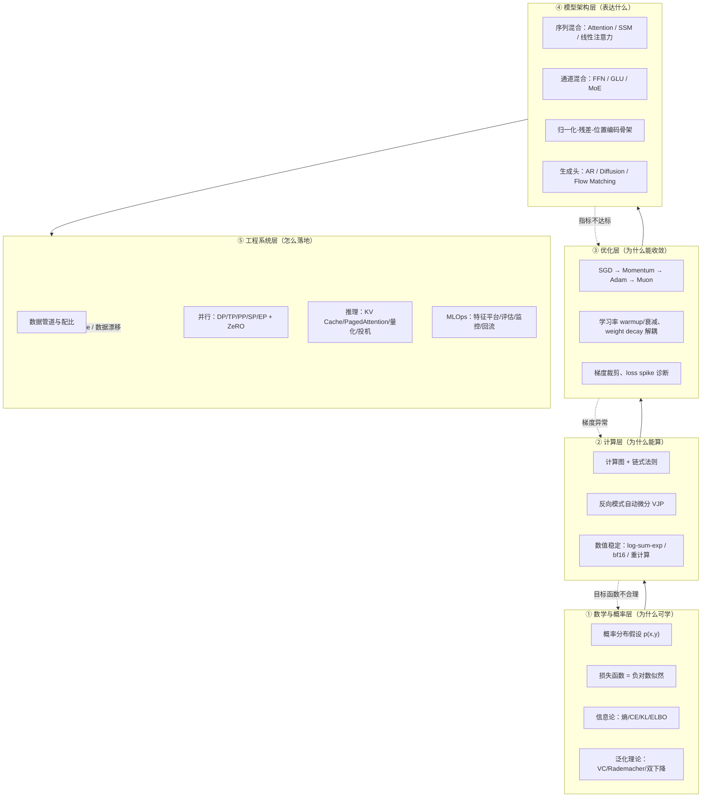
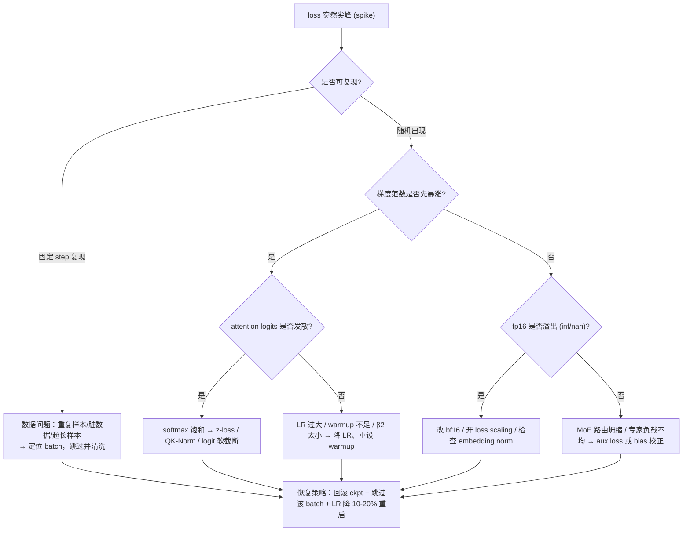
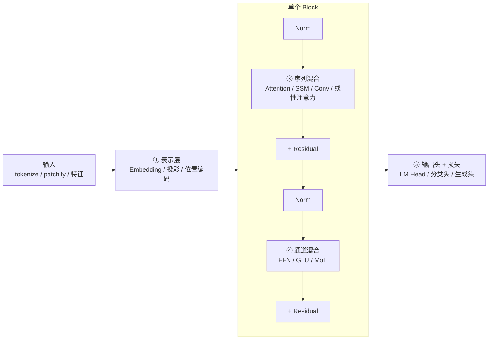
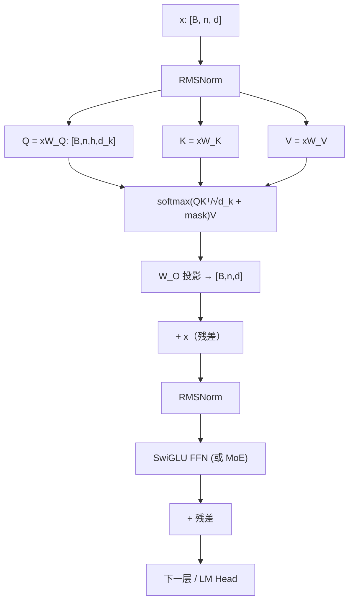
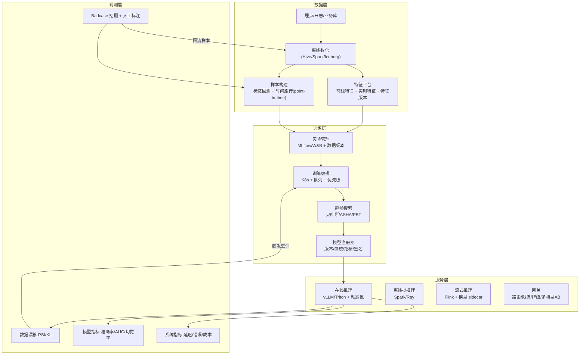
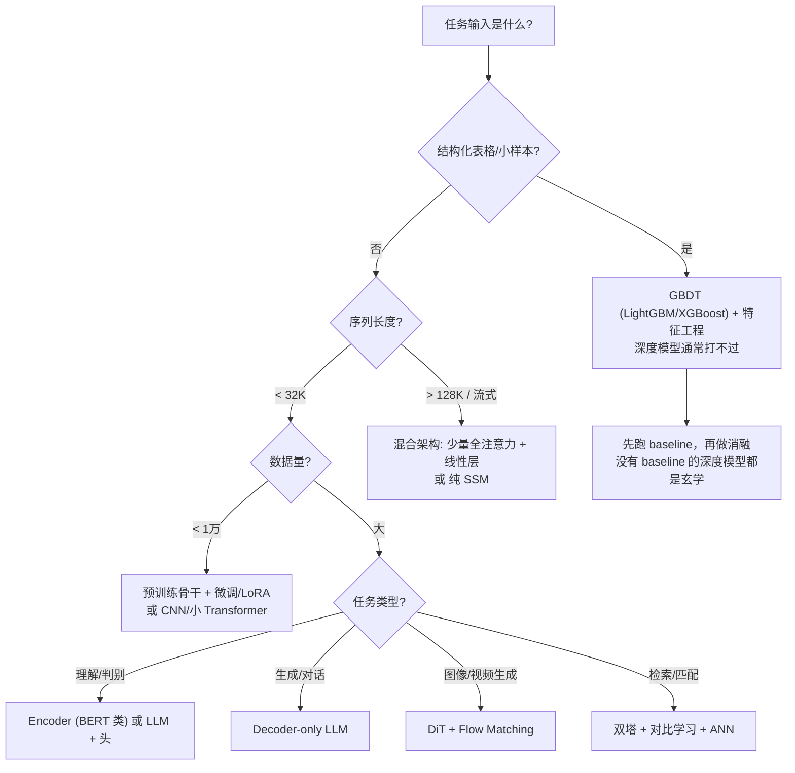

# 机器学习底层原理全景 · 通用架构设计 · 大厂面试题库（2026 深度手册）

> 版本：2026-11 · 面向「想真正搞懂底层逻辑，而不是背八股」的读者
> 覆盖：第一性原理 → 自动微分 → 优化动力学 → 泛化理论 → 模型架构 → 工程架构 → 选型矩阵 → 前沿论文 → 大厂面试题（带考核权重与追问链）
> 阅读建议：第 1–4 章是「为什么」，第 5–7 章是「怎么做」，第 8 章是「往哪走」，第 9 章是「怎么考」。如果只有 1 小时，读 0.3 的十条主线 + 第 9 章的 ★★★★★ 题目。

---

## 目录

- [第 0 章 认知地图：把机器学习压缩成一条主线](#第-0-章-认知地图把机器学习压缩成一条主线)
- [第 1 章 第一性原理：机器学习到底在优化什么](#第-1-章-第一性原理机器学习到底在优化什么)
- [第 2 章 计算底座：计算图、自动微分与反向传播](#第-2-章-计算底座计算图自动微分与反向传播)
- [第 3 章 优化器与训练动力学](#第-3-章-优化器与训练动力学)
- [第 4 章 泛化：从偏差-方差到双下降、尺度律与 Grokking](#第-4-章-泛化从偏差-方差到双下降尺度律与-grokking)
- [第 5 章 架构设计 I：模型侧通用范式](#第-5-章-架构设计-i模型侧通用范式)
- [第 6 章 架构设计 II：工程系统侧](#第-6-章-架构设计-ii工程系统侧)
- [第 7 章 场景 × 架构选型矩阵（优缺点与规避手段）](#第-7-章-场景--架构选型矩阵优缺点与规避手段)
- [第 8 章 更先进的设计思路与论文清单](#第-8-章-更先进的设计思路与论文清单)
- [第 9 章 国内大厂面试题库（含考核权重与深度解答）](#第-9-章-国内大厂面试题库含考核权重与深度解答)
- [第 10 章 深挖专题：追问到数学层的七个硬核问题](#第-10-章-深挖专题追问到数学层的七个硬核问题)
- [第 11 章 自测清单与学习路径](#第-11-章-自测清单与学习路径)
- [第 12 章 参考资料与论文速查](#第-12-章-参考资料与论文速查)

---

## 第 0 章 认知地图：把机器学习压缩成一条主线

### 0.1 全栈地图（一张图看懂各层关系）



### 0.2 两条「架构」要分清

这是初学者最容易混的地方。同一个词「架构」，在大厂语境里指两件完全不同的事：

| 维度 | **模型架构（Model Architecture）** | **系统架构（System / MLOps Architecture）** |
|---|---|---|
| 回答的问题 | 用什么函数族去拟合数据 | 用什么工程结构去生产、训练、服务模型 |
| 核心要素 | 连接方式（Attention/卷积/SSM）、归一化、残差、路由、位置编码、生成头 | 数据流、并行切分、缓存、存储、调度、监控、灰度 |
| 典型产出 | 一个 `nn.Module`、一份技术报告 | 一套训练集群方案 + 一套在线服务 + 一套评估闭环 |
| 失败表现 | 指标上不去、训练不收敛 | 训练慢/显存爆、线上延迟高、效果漂移 |
| 本文档位置 | 第 5 章 | 第 6 章 |

**真实项目里，90% 的「模型效果不好」最终归因到系统层（数据、评估、回滚），而不是模型层。** 这句话在第 7、9 章会反复出现。

### 0.3 十条主线（背下来就能应对 80% 的追问）

1. **一切监督学习 = 最小化期望风险**；训练只能最小化经验风险，两者之差就是泛化 gap。
2. **损失函数不是拍脑袋选的**：MSE 对应高斯假设，CE 对应类别分布，BCE 对应伯努利——换个损失等于换了你对噪声的假设。
3. **反向传播 = 反向模式自动微分**，代价是前向的约 2 倍，与参数个数无关；这是深度学习能规模化的根本原因。
4. **深度网络的优化困难主要来自条件数、鞍点、梯度尺度不匹配**，而不是「局部极小」。
5. **归一化（BN/LN/RMSNorm）本质是重参数化损失曲面**，让不同层的梯度尺度可比，从而允许更大学习率。
6. **残差连接把网络变成「浅层集成 + 恒等通路」**，让梯度可以无损回传，是深层可训练的结构性原因。
7. **Attention 的本质是数据相关的加权平均（核平滑）**，代价是 O(n²)；线性注意力/SSM 是把它退化成 O(n) 的循环形式。
8. **MoE 是「用通信换参数容量」**：总参数可以扩到很大，但激活参数和 FLOPs 只按 top-k 增长，代价是路由不均和 all-to-all 通信。
9. **泛化不能只用偏差-方差解释**：过参数化会出现双下降；现代大模型的泛化由数据分布 + 归纳偏置 + 优化隐式正则共同决定。
10. **工程上的一切优化都是「算力-显存-带宽-延迟」四象限的取舍**：并行、量化、缓存、蒸馏、投机解码，无一例外。

---

## 第 1 章 第一性原理：机器学习到底在优化什么

### 1.1 形式化：一个不等式统治整个领域

设数据分布 $p_{\text{data}}(x,y)$，损失 $\ell$，假设空间 $\mathcal{H}$。

- **期望风险**（真正想最小化的东西，但不可知）：
  $$R(f)=\mathbb{E}_{(x,y)\sim p_{\text{data}}}\big[\ell(f(x),y)\big]$$
- **经验风险**（训练时能算的东西）：
  $$\hat{R}_n(f)=\frac{1}{n}\sum_{i=1}^{n}\ell(f(x_i),y_i)$$
- **实际训练目标**（经验风险最小化 + 正则）：
  $$\min_{f\in\mathcal{H}}\ \hat{R}_n(f)+\lambda\,\Omega(f)$$

三者之间的两条缝隙，就是整个机器学习的研究地图：

$$R(f)\ \le\ \underbrace{\hat{R}_n(f)}_{\text{优化误差}}\ +\ \underbrace{\sup_{f\in\mathcal{H}}\big|R(f)-\hat{R}_n(f)\big|}_{\text{泛化误差(估计误差)}}\ +\ \underbrace{\min_{f\in\mathcal{H}}R(f)}_{\text{近似误差}}$$

| 误差项 | 含义 | 变大时你会看到 | 解法 |
|---|---|---|---|
| **近似误差** | 假设空间装不下真实规律 | 训练集 loss 都下不去（欠拟合） | 加宽加深、换更强归纳偏置、加特征 |
| **估计误差** | 样本太少，经验风险偏离期望风险 | 训练好、验证差（过拟合） | 加数据、正则、早停、数据增强、迁移学习 |
| **优化误差** | 优化器没找到该找到的解 | loss 卡住、震荡、spike | 调 LR/初始化/归一化/换优化器/换并行策略 |

> **面试用法**：任何时候被问「模型效果不好怎么办」，先做这个三分解，再给动作。这是字节、阿里面试官最想听到的「结构化归因」。

### 1.2 概率视角：为什么「损失函数 = 负对数似然」

**极大似然（MLE）**：
$$\hat\theta=\arg\max_\theta \sum_i \log p_\theta(y_i\mid x_i)=\arg\min_\theta \Big[-\sum_i \log p_\theta(y_i\mid x_i)\Big]$$

只要把 $p_\theta(y|x)$ 取成不同分布族，就得到不同的损失。这就是「损失函数不是玄学」的严格来源：

| 任务 | 假设 $p_\theta(y\mid x)$ | 导出的损失 | 备注 |
|---|---|---|---|
| 回归 | 高斯 $\mathcal{N}(f_\theta(x),\sigma^2)$ | $\frac{1}{2\sigma^2}\sum(y-f)^2$ | $\sigma$ 大 ⇒ 对异常值更宽容；MSE 隐含「噪声等方差」 |
| 回归（抗噪） | 拉普拉斯 $\text{Lap}(f,\ b)$ | $\sum\lvert y-f\rvert$ | 对应 MAE，梯度有界，不被离群点主导 |
| 二分类 | 伯努利 $\text{Ber}(\sigma(z))$ | $\sum\big[-y\log\sigma(z)-(1-y)\log(1-\sigma(z))\big]$ | 即 BCE，配合 log-sum-exp 稳定实现 |
| 多分类 | 类别 $\text{Cat}(\text{softmax}(z))$ | $-\sum y_k\log\text{softmax}(z)_k$ | 即 CE；梯度极简：$\hat p-y$ |
| 排序 / 偏好 | Bradley–Terry $\Pr(y_w\succ y_l)=\sigma(r_w-r_l)$ | $-\log\sigma(r_w-r_l)$ | **DPO 损失就是这一条**（第 9 章 K 模块） |
| 对比学习 | 指数族 / InfoNCE | $-\log\frac{e^{s^+/\tau}}{\sum_j e^{s_j/\tau}}$ | 是互信息 $I(x;z)$ 的下界（Oord 2018） |

**MAP（最大后验）= MLE + 先验**：
$$\arg\max_\theta\big[\log p(\mathcal{D}\mid\theta)+\log p(\theta)\big]$$

- 先验 $\theta\sim\mathcal{N}(0,\tau^2)$ ⇒ $\log p(\theta)=-\frac{\lVert\theta\rVert^2}{2\tau^2}+C$ ⇒ **L2 / weight decay**。
  由此可推出 $\lambda=\frac{\sigma^2}{n\tau^2}$——**数据越多，最优 weight decay 越小**（这就是为什么大数据集上 WD 要调小）。
- 先验 $\theta\sim\text{Laplace}(0,b)$ ⇒ 惩罚 $\lVert\theta\rVert_1$ ⇒ **L1 / 稀疏**，解由软阈值给出（近端算子 $S_\lambda(z)=\text{sign}(z)\max(|z|-\lambda,0)$）。
- 先验是「各向同性」的 ⇒ 各参数被同等收缩；这也是 AdamW 改成**解耦 weight decay**（只对参数做收缩、不混进梯度矩）的动机。

**贝叶斯预测** $p(y\mid x,\mathcal{D})=\int p(y\mid x,\theta)p(\theta\mid\mathcal{D})d\theta$ 不可解 ⇒ 近似手段：
MC Dropout（推理时保留 dropout ≈ 变分近似）、深度集成（ensemble，最稳但成本 ×N）、SWAG/Laplace 近似、BNN。工程上 90% 场景用 **ensemble + 校准（temperature scaling）** 就够。

### 1.3 信息论视角：熵、交叉熵、KL 与 ELBO

- **熵** $H(p)=-\sum p\log p$：不确定度 / 编码平均长度下界（Shannon）。
- **交叉熵** $H(p,q)=-\sum p\log q=H(p)+\text{KL}(p\Vert q)$，所以**最小化 CE 等价于最小化 KL(p‖q)**（因为 $H(p)$ 与模型无关）。
- **KL** 非负、非对称：
  - 前向 KL $\text{KL}(p\Vert q_\theta)$：**均值寻求**（mode-covering），q 覆盖 p 的所有模式 ⇒ 生成模型容易「糊」；
  - 反向 KL $\text{KL}(q_\theta\Vert p)$：**模式寻求**（mode-seeking），容易塌缩到单一模式 ⇒ RLHF/变分推断的典型病。
- **互信息** $I(X;Y)=H(X)-H(X\mid Y)$；对比学习/InfoNCE 的目标就是最大化 $I(x;z)$ 的下界。
- **数据处理不等式**：$X\to Y\to Z$ 时 $I(X;Z)\le I(Y;Z)$ ⇒ 信息瓶颈（IB）：$\min\ I(X;T)-\beta I(T;Y)$，是「表示要压缩又要保留任务信息」的理论骨架（Tishby；深度学习版 Alemi 2017）。

**ELBO 三步推导（VAE / 扩散 / 变分推断共用）**

$$\log p_\theta(x)=\log\int p_\theta(x,z)dz=\log\mathbb{E}_{q_\phi(z|x)}\Big[\frac{p_\theta(x,z)}{q_\phi(z|x)}\Big]\ \ge\ \mathbb{E}_{q_\phi}\big[\log p_\theta(x\mid z)\big]-\text{KL}\big(q_\phi(z\mid x)\Vert p(z)\big)$$

（第二步行 Jensen 不等式；等号当 $q_\phi=p_\theta(z|x)$ 时成立。）三项分别是：**重构项 + 先验匹配项**。VAE 用重参数化 $z=\mu+\sigma\odot\epsilon$ 让梯度穿过采样；$\beta$-VAE 在 KL 前加系数换解耦；**扩散模型的 ELBO 可化简为加权去噪回归**（Ho 2020 的关键结果）——这是「扩散训练目标 = 简化 ELBO」的严格来源。

### 1.4 优化视角：非凸到底难在哪

高维非凸的真实困难不是「局部极小」，而是：

1. **鞍点主导**：Dauphin 2014 指出高维鞍点数量指数增长，且 SGD 的随机噪声能让它较快逃离（负曲率方向）。实践中「卡在局部最优」的说法大多是**学习率太小 / 初始化不好 / 数据有问题**。
2. **病态条件数**：Hessian 特征值 $\lambda_{\max}/\lambda_{\min}$ 极大 ⇒ 梯度下降在「窄谷」里震荡。二阶方法（Newton/Shampoo/K-FAC）本质就是在**预条件**：$w\leftarrow w-\eta H^{-1}g$。
3. **平坦 vs 尖锐**：sharpness（$\lambda_{\max}$）与泛化相关（Keskar 2017 大 batch 泛化差；SAM 通过找平坦解提泛化）。但 sharpness 与泛化的因果关系至今有争议（有工作指出做了重参数化后 sharpness 可以任意改变，Dinh 2017）。
4. **Edge of Stability**：全批量 GD 在 $\eta\lambda_{\max}>2$ 后不发散，而是进入「损失在边界震荡、锐度自我调节到 $2/\eta$」的 regime（Cohen 2022）。这解释了为什么大模型可以用「看似超过理论上限」的 LR 训练。
5. **隐式正则（implicit bias）**：GD 在可分数据上会收敛到**最大间隔解**（Soudry 2018 对 logistic regression 给出证明）；也就是说「优化算法本身就在选解」，这也是为什么同样的损失、换优化器泛化会变（Muon 的 grokking 论文就是一例）。

### 1.5 泛化视角：偏差-方差及其失效

**经典分解**（平方损失，$y=f^*(x)+\epsilon$，$\mathbb{E}[\epsilon^2]=\sigma^2$）：

$$\mathbb{E}\big[(y-\hat f(x))^2\big]=\underbrace{\sigma^2}_{\text{不可约噪声}}+\underbrace{\big(\mathbb{E}[\hat f]-f^*\big)^2}_{\text{偏差}^2}+\underbrace{\mathbb{E}\big[(\hat f-\mathbb{E}\hat f)^2\big]}_{\text{方差}}$$

- 偏差：模型族太弱 / 正则太强；
- 方差：对训练样本扰动太敏感 / 参数太多；
- 经典曲线是 U 型（复杂度↑ ⇒ 偏差↓方差↑）。**但深度网络不服从 U 型**，见第 4 章的双下降。

**经典泛化界**：VC 维、Rademacher 复杂度给出的界形如 $R\le\hat R+\mathcal{O}\big(\sqrt{(\text{复杂度}-\log\delta)/n}\big)$。问题是：ResNet 参数量远超样本量、还能拟合随机标签，却仍然泛化——**uniform convergence 在这类模型上失效**。这直接催生了现代理论（第 4 章）。

### 1.6 表示视角：流形、解耦、叠加

- **流形假设**：自然数据（图像/语音/文本）在高维空间中集中在低维流形附近；深度网络的逐层变换在做「把流形摊平」（untangling，Olah 的拓扑视角）。
- **自监督的四种范式**：重建（AE/MAE）、对比（SimCLR/MoCo）、蒸馏（BYOL/DINO，靠 stop-gradient + 预测器避免坍缩）、预测（I-JEPA/世界模型）。它们统一在「**避免表示坍缩 + 最大化任务相关信息**」这一目标下。
- **叠加（superposition）与字典学习**：模型维度有限但特征数远超维度时，特征会以近似正交的方式「叠加」存储，表现为多义神经元；Anthropic 2024 的稀疏自编码器（SAE）就是把这层叠加分解开。这是当前可解释性最活跃的方向，也是「底层原理」在 2025+ 的新前沿。

### 1.7 本章小结：五元组

任何机器学习系统都可以写成：

$$\boxed{\text{ML}=(\underbrace{p(x,y)}_{\text{数据假设}},\ \underbrace{\mathcal{H}}_{\text{假设空间}},\ \underbrace{\ell}_{\text{损失}},\ \underbrace{\mathcal{A}}_{\text{优化算法}},\ \underbrace{\Omega}_{\text{正则/先验}})}$$

换任何一个分量，就得到一篇论文；任何一个分量的隐含假设被打破，就是一次线上事故。**这就是「底层原理」的全部。**

---

## 第 2 章 计算底座：计算图、自动微分与反向传播

> 本章目标：能**手推**一个两层网络的完整梯度，能解释「为什么反向传播的成本与前向同阶、与参数量无关」，能算清一次训练 step 的显存账。

### 2.1 计算图与两种微分模式

任何模型都是一张有向无环图（DAG）：节点是张量，边是算子。求 $\frac{\partial L}{\partial w}$ 有两种模式：

| 模式 | 做法 | 一次遍历能算出 | 复杂度 | 适用 |
|---|---|---|---|---|
| **前向模式（JVP）** | 沿图正向传播「切向量」 $\dot x$ | 一个输入方向的导数 $J v$ | 与输入维度成正比 | 输入少、输出多（如雅可比-向量积、Hessian-向量积的一部分） |
| **反向模式（VJP）** | 沿图反向传播「余切向量」 $v^\top J$ | 一个输出方向的导数 $v^\top J$ | 与输出维度成正比 | **标量损失对海量参数的梯度**（深度学习，输出维度=1） |

深度学习的场景是 $L:\mathbb{R}^{P}\to\mathbb{R}$，$P$ 可以是 $10^{11}$。若用前向模式，要为每个参数跑一遍图 ⇒ $O(P)$ 次前向；而反向模式只需 **1 次反向遍历**就能拿到全部 $P$ 个偏导。**这就是「深度学习能规模化」的第一性原因。**

代价：反向需要保存前向的中间结果（activations）用于链式法则 ⇒ **显存换计算**。这就是 activation memory 的来源，也是 gradient checkpointing（重计算）要解决的问题。

### 2.2 链式法则的矩阵形式（VJP 的定义）

设 $y=f(x)$，$J=\partial y/\partial x\in\mathbb{R}^{m\times n}$。给定上游梯度 $v=\partial L/\partial y\in\mathbb{R}^m$：

$$\frac{\partial L}{\partial x}=J^{\top}v \quad(\text{Vector-Jacobian Product})$$

对常见算子，VJP 有极简形式（**背这张表比背公式有用**）：

| 前向 | 反向（给定 $\bar y$） | 说明 |
|---|---|---|
| $y=Wx$ | $\bar x=W^\top \bar y$，$\bar W=\bar y\,x^\top$ | 两个矩阵乘，无需求 $W$ 的逆 |
| $y=x_1+x_2$ | $\bar x_1=\bar y,\ \bar x_2=\bar y$ | 加法把梯度「复制分发」⇒ 残差连接的梯度高速公路 |
| $y=x_1\odot x_2$ | $\bar x_1=\bar y\odot x_2$ | 乘法「交换相乘」 |
| $y=\max(x,0)$ | $\bar x=\bar y\odot\mathbb{1}[x>0]$ | 死 ReLU ⇒ 永久零梯度 |
| $y=\text{softmax}(z)$ | $\bar z=\text{diag}(p)\bar y-p\,(p^\top \bar y)$ | 见 2.3 的完整推导 |
| $y=\log\sum e^{z}$ | $\bar z=p\,\bar y$ | log-sum-exp 的梯度就是 softmax |
| $y=\text{mean}(x)$ | $\bar x=\bar y/n$ | |
| $y=\text{concat}$ | split | |
| $y=\text{reshape/transpose}$ | reshape/transpose 回来 | 无数学运算 |

### 2.3 手推：两层 MLP + Softmax 交叉熵

**前向**（单样本，$x\in\mathbb{R}^{d}$，隐藏 $h$ 维，类别 $K$）：

$$z_1=W_1x+b_1,\quad a=\text{ReLU}(z_1),\quad z_2=W_2a+b_2,\quad p=\text{softmax}(z_2),\quad L=-\log p_y$$

**第一步：$L$ 对 logits 的梯度（最重要的一步，结果是 $\hat p-y$）**

$$L=-\log\frac{e^{z_y}}{\sum_k e^{z_k}}=-z_y+\log\sum_k e^{z_k}$$

$$\frac{\partial L}{\partial z_k}=-\mathbb{1}[k=y]+\frac{e^{z_k}}{\sum_j e^{z_j}}=p_k-y_k$$

所以 $\boxed{\partial L/\partial z_2=p-y}$。**这个式子解释了为什么 CE+softmax 永远不会梯度消失（除非 $p$ 已经完全正确），也解释了 label smoothing / 温度缩放的作用机制（改的是 $y$ 与 $p$ 的匹配方式）。**

**第二步：逐层回传**

$$\frac{\partial L}{\partial W_2}=(p-y)\,a^\top,\qquad \frac{\partial L}{\partial b_2}=p-y$$
$$\frac{\partial L}{\partial a}=W_2^\top(p-y)$$
$$\frac{\partial L}{\partial z_1}=\frac{\partial L}{\partial a}\odot\mathbb{1}[z_1>0]$$
$$\frac{\partial L}{\partial W_1}=\frac{\partial L}{\partial z_1}x^\top,\qquad \frac{\partial L}{\partial b_1}=\frac{\partial L}{\partial z_1}$$

**验证维度**：$W_2\in\mathbb{R}^{K\times h}$，$(p-y)\in\mathbb{R}^{K}$，$a^\top\in\mathbb{R}^{1\times h}$ ⇒ 结果 $K\times h$ ✓。**面试时把形状写出来，比背公式更能证明你真的推过。**

### 2.4 Softmax 的雅可比与「梯度消失」的严格解释

$$\frac{\partial p_i}{\partial z_j}=p_i(\mathbb{1}[i=j]-p_j)\quad\Longrightarrow\quad J=\text{diag}(p)-pp^\top$$

性质：$J$ 半正定、行和为 0（因为 $\sum_i p_i=1$ 恒成立 ⇒ 沿「全 1 方向」的扰动不改变输出）。

当 $p$ 接近 one-hot 时，$J\to 0$ ⇒ **梯度消失**。这就是「logits 太大 ⇒ 训练不动」的数学原因，也是：
- **为什么 Attention 要除以 $\sqrt{d_k}$**（控制 logit 方差，见 5.3.2）；
- **为什么大模型要加 z-loss / QK-norm / logit 软截断**（防止 logits 爆炸）；
- **为什么 label smoothing 有用**（避免 $p$ 过早饱和到 one-hot，保持 $J$ 的秩）。

对 $L=-\log p_y$ 直接算 Hessian：$\partial^2L/\partial z^2=J$，其条件数在 $p$ 饱和时爆炸 ⇒ 这也是「病态条件数」的微观来源。

### 2.5 LayerNorm / RMSNorm 的反向（最容易被追问的一段）

LayerNorm：$\mu=\frac1d\sum x_i$，$\sigma^2=\frac1d\sum(x_i-\mu)^2$，$\hat x=(x-\mu)/\sigma$，$y=\gamma\hat x+\beta$。

设上游 $\bar y$，则：

$$\bar x=\frac{\gamma}{\sigma}\Big[\bar y-\frac1d\sum_i\bar y_i-\hat x\cdot\frac1d\sum_i(\bar y_i\hat x_i)\Big]$$

**含义**：反向梯度先被「中心化」（减去均值）再被「投影掉 $\hat x$ 方向」。即**归一化的反向本身是一个投影算子**，它把梯度限制在「与 $x$ 的平移、缩放正交」的子空间里。这带来两个工程后果：

1. 归一化层让**梯度尺度与输入尺度解耦** ⇒ 允许更大 LR、对初始化更鲁棒；
2. 但**权重矩阵的尺度信息被归一化吃掉** ⇒ 这是 μP（ maximal update parameterization）要专门处理的问题：在 μP 里，LN 后的权重需要按 fan-in 缩放初始化，才能让不同宽度的模型共享超参。

RMSNorm（Zhang & Sennrich 2019）：$y=\frac{x}{\sqrt{\frac1d\sum x_i^2+\epsilon}}\cdot g$，**不减均值、无 bias**。省一次 reduce + 一个仿射，实测在 LLM 上更快且效果不降（因为残差流本身的均值近似为 0，减均值收益很小）。

### 2.6 数值稳定性：三个必须会的技巧

1. **log-sum-exp（LSE）**：$\log\sum_i e^{z_i}=m+\log\sum_i e^{z_i-m}$，$m=\max_i z_i$。避免 $e^{89}$ 溢出、$e^{-1000}$ 下溢。所有 softmax / CE / logits 计算都必须这么写。
2. **fp16 vs bf16**：

| 格式 | 位宽 | 指数位 | 尾数位 | 动态范围 | 需要 loss scaling | 用途 |
|---|---|---|---|---|---|---|
| fp32 | 32 | 8 | 23 | ±3.4e38 | 否 | 主权重、优化器状态、LayerNorm 归约 |
| fp16 | 16 | 5 | 10 | ±65504 | **是** | 老 GPU 的混合精度（A100 前） |
| bf16 | 16 | 8 | 7 | ±3.4e38 | 否 | **现代训练默认**（A100/H100） |
| fp8 (E4M3/E5M2) | 8 | 4/5 | 3/2 | 小 | 是（需 per-tensor/per-block scale） | H100 训练/推理加速 |

   fp16 梯度下溢（$<6\times10^{-8}$ 变 0）⇒ loss scaling（先放大 loss 再缩回梯度）；bf16 与 fp32 同指数范围，无此问题，但尾数只有 7 位 ⇒ **累加必须用 fp32**（matmul 内部 accumulate 精度）。
3. **梯度检查（gradient check）**：$\frac{\partial L}{\partial x_i}\approx\frac{L(x+\epsilon e_i)-L(x-\epsilon e_i)}{2\epsilon}$（中心差分，误差 $O(\epsilon^2)$），$\epsilon\approx10^{-5}$ 对 fp64 有效。工程上更常用「**双实现对比**」：手写 kernel 与 PyTorch 参考实现比 `torch.autograd.gradcheck`。

### 2.7 一次训练 step 的显存账（面试高频，必须能背）

**静态显存（与 batch 无关）**，以 $P$ 个参数、混合精度 + Adam 为例：

| 项 | 精度 | 字节/参数 | 7B 模型 |
|---|---|---|---|
| 参数（bf16） | 2 | 2 | 14 GB |
| 梯度（bf16） | 2 | 2 | 14 GB |
| fp32 主权重（master copy） | 4 | 4 | 28 GB |
| Adam 一阶矩 $m$（fp32） | 4 | 4 | 28 GB |
| Adam 二阶矩 $v$（fp32） | 4 | 4 | 28 GB |
| **合计** | | **16** | **112 GB** |

> 这正好解释了「7B 模型用单张 80G A100 训不动」——**不是参数放不下，是优化器状态放不下**。ZeRO 的全部动机就在这里（第 6.1 节）。

**动态显存（activations）**：粗略公式（Korthikanti 2022 的激活重算论文给出每层每 token 的系数）：

$$M_{\text{act}}\approx L\cdot b\cdot s\cdot h\cdot c\ \text{bytes},\quad c\approx 12\sim20\ (\text{含 attention 中间量})$$

例：$L=32,h=4096,s=4096,b=8$ ⇒ $32\times8\times4096\times4096\times16\approx 68$ GB（fp16），远超权重。**所以长上下文训练的第一瓶颈永远是 activation，而不是参数。** 三个解法：
- **Activation Checkpointing（重计算）**：只存每层输入，反向时重算中间量；显存降到 $O(\sqrt{L})$ 量级，代价 ≈ **+33% 计算**（多一次前向）。
- **Sequence Parallel / Context Parallel**：沿序列维切分 activation。
- **选择性重计算**：只重算显存占用最大的算子（如 attention 的 softmax）。

### 2.8 本章小结

- 反向传播 = 反向模式 AD = 每个算子一个 VJP；成本 ≈ 2× 前向，与参数量无关。
- CE+softmax 的梯度是 $\hat p-y$；logits 饱和 ⇒ 雅可比退化 ⇒ 梯度消失。
- 归一化的反向是投影；它解耦梯度尺度，但吃掉权重尺度信息。
- 显存 = 16 B/参数（Adam 混合精度）+ 激活；长序列时激活主导。

---

## 第 3 章 优化器与训练动力学

> 本章目标：能解释「Adam 为什么有效」「AdamW 和 Adam 差在哪」「Muon 为什么能用更少算力训到同样 loss」「loss spike 怎么系统性排查」。

### 3.1 从 SGD 到 Adam：一条主线

**SGD**：$w_{t+1}=w_t-\eta g_t$。
问题：① 各向异性曲面上震荡；② 梯度噪声大；③ 稀疏特征学习慢。

**Momentum（Polyak / Nesterov）**：$v_t=\beta v_{t-1}+g_t$，$w_t=w_{t-1}-\eta v_t$（Nesterov 用 $g_t=\nabla L(w-\eta\beta v)$，理论上对凸问题有加速收敛率）。
直观：**用指数滑动平均抵消随机噪声，等价于给梯度做低通滤波**；在「峡谷」地形里，横向震荡分量相互抵消，纵向分量累积 ⇒ 加速。

**Adam（Kingma & Ba 2014）**：

$$m_t=\beta_1m_{t-1}+(1-\beta_1)g_t,\qquad v_t=\beta_2v_{t-1}+(1-\beta_2)g_t^2$$
$$\hat m_t=\frac{m_t}{1-\beta_1^t},\quad \hat v_t=\frac{v_t}{1-\beta_2^t},\quad w_{t+1}=w_t-\eta\frac{\hat m_t}{\sqrt{\hat v_t}+\epsilon}$$

**为什么有效（三层解释，面试要能说到第三层）**：
1. **逐坐标自适应步长**：更新幅度 $\approx\eta\frac{|m|}{\sqrt v}\approx\eta$（当梯度信噪比稳定时），相当于**对每个坐标做 sign-SGD**，因此对梯度量纲不敏感，超参鲁棒。
2. **对角 Hessian 近似**：$\sqrt{v}$ 近似该坐标的梯度 RMS，在「尺度差异大」的方向上自动缩放，起**预条件（preconditioning）**作用，缓解条件数问题。
3. **偏差修正**：初期 $m,v$ 偏向 0，$1-\beta^t$ 校正是为了保持梯度估计无偏；否则前几步更新过小（$\beta_2=0.999$ 时第一 step $v$ 只有 $g^2$ 的 0.001 倍，不修正会直接爆）。

**ε 的作用被严重低估**：$\epsilon$ 决定了「**当梯度极小时，更新是否退化为 $m/\epsilon$**」。LLM 训练里 ε 常取 1e-8（fp32），bf16/fp8 下要取大一些（1e-6~1e-15 视实现）。**loss spike 的一个经典原因是某个参数梯度接近 0 而 $\hat v$ 也接近 0，$\hat m/\sqrt{\hat v}$ 数值不稳**。

### 3.2 AdamW：为什么要「解耦」weight decay

原始 Adam 把 L2 加进梯度：$g\leftarrow g+\lambda w$，于是更新为 $-\eta\frac{m+\lambda w}{\sqrt v}$——**惩罚项被 $\sqrt v$ 缩放了**，导致梯度大的参数惩罚小、梯度小的参数惩罚大，语义错乱。

**AdamW（Loshchilov & Hutter 2019）**：
$$w_{t+1}=w_t-\eta\Big[\frac{\hat m_t}{\sqrt{\hat v_t}+\epsilon}+\lambda w_t\Big]$$
惩罚与自适应分母解耦 ⇒ 近似「每个 step 乘一个 $(1-\eta\lambda)$ 的收缩因子」。**这就是为什么大模型全部用 AdamW 而不是 Adam + L2。**

### 3.3 优化器图谱（2026 现状）

| 优化器 | 状态/参数量 | 核心机制 | 优点 | 缺点/坑 |
|---|---|---|---|---|
| SGD+M | 1 | 动量 | 泛化常更好（CV 经典结论） | 对 LR 敏感，NLP/LLM 收敛慢 |
| Adam | 2 | 一阶+二阶矩 | 鲁棒、默认选择 | 显存 8B/param；可能不如调好的 SGD 泛化 |
| **AdamW** | 2 | 解耦 WD | LLM 标配 | 同上 |
| Adafactor | ~1（分解） | 二阶矩用 $u v^\top$ 分解 | 显存省（T5 用） | 精度损失、实现细节多 |
| **Lion** | 1 | $\text{sign}(\beta_1 m+(1-\beta_1)g)$ + 解耦 WD | 状态减半；搜索得来 | LR 要小 3–10×；对 batch 敏感 |
| **Shampoo** | 2（+矩阵） | 左右预条件 $(GG^\top)^{-1/4}$ | 收敛快、迭代少 | 每步开销大；分布式实现复杂 |
| **Sophia** | 2 | 对角 Hessian 估计 + clip | 声称 2× 提速 | Hessian 估计噪声大 |
| **Muon** | 1（动量） | **对动量矩阵做正交化**（NS 迭代） | 隐藏层更新条件数好；**约 2× 算力效率** | 只适用于 2D 参数；NS 有开销；对 embedding/输出层不适用 |
| **Muon+Adam 混合** | — | 2D 参数用 Muon，其余用 AdamW | 当前开源大模型常见组合（Moonlight/Kimi 系） | 需要分层配置 |

#### Muon 深挖（2025–2026 最热，面试加分项）

**做法**：维护动量矩阵 $M_t=\beta M_{t-1}+G_t$（Nesterov 变体），用 Newton–Schulz 迭代近似极分解：
$$M=U\Sigma V^\top\ \Rightarrow\ O=UV^\top\ (\text{半正交}),$$
$$X_{k+1}=aX_k+bX_k^3+cX_k^5,\quad (a,b,c)=(3.4445,-4.7750,2.0315),\ \text{先 } X_0=M/\lVert M\rVert_F,\ \text{迭代 5 次}$$
$$W_{t+1}=W_t-\eta\cdot 0.2\sqrt{\max\Big(1,\frac{\text{rows}}{\text{cols}}\Big)}\cdot O_t$$

**为什么有效（三条）**：
1. **把更新矩阵的所有奇异方向拉平**：Adam 是「逐元素」归一化，Muon 是「谱」归一化。逐元素归一会让更新矩阵的有效秩下降（趋向于几个主导方向），谱归一则让所有方向步长一致 ⇒ 更好的条件数、更充分的参数利用。
2. **等价于一种矩阵级预条件**：$UV^\top$ 是「在谱范数约束下最速下降」的解（spectral descent），有在线学习视角下的 regret 界。
3. **隐式正则**：正交化更新倾向收敛到更低谱范数的解，这在小任务上表现为 **grokking 更快**（经验上约 3× 更低谱范数）。

**代价与工程坑**：
- NS 迭代每次要做 5 次矩阵乘，算子开销随矩阵规模增长；2026 年的研究给出**谱尺度律**：随着模型变大，后几层动量矩阵的最小奇异值以 $M^{-0.96}$ 量级下降，5 步 NS 在前沿规模会「正交化不干净」⇒ 需要**按层自适应增加 NS 步数**（arXiv 2606.04058）。
- **LazyMuon**（EMNLP 2026 Findings）：利用「相邻 step 的正交更新余弦角高度稳定」的性质，在周期内跳过 NS、用线性插值 + 周期末残差校正，wall-clock 提速 1.34×。
- 只对 **2D 线性层**生效；embedding、LayerNorm、bias、输出头仍用 AdamW。

### 3.4 学习率调度：不是玄学，是「有效步长预算」的分配

$$w_{t+1}=w_t-\eta_t(\cdots)$$

| 调度 | 形式 | 适用 | 说明 |
|---|---|---|---|
| Step decay | 分段 | CV 经典 | 手工 |
| Cosine | $\eta_t=\eta_{\min}+\frac{\eta_{\max}-\eta_{\min}}{2}(1+\cos\frac{t\pi}{T})$ | 固定训练预算 | 平滑、末端小步长利于收敛 |
| **WSD**（Warmup-Stable-Decay） | 先 warmup，再恒定，最后 10–20% 快速衰减 | **大模型主流**（DeepSeek、MiniCPM） | 恒定段可随时「续训/分支」；衰减段决定最终质量 |
| Inverse sqrt | $\eta\propto t^{-0.5}$ | 无固定预算、持续训练 | Transformer 原论文 |

**Warmup 为什么必须有**：训练初期 $v_t$ 估计方差极大，Adam 的更新方向不可靠；大 batch + 大模型时尤其明显。经验：warmup 步数 ≈ 总步数的 0.1%–1%，或固定 2000 step。

**线性缩放规则**：SGD 下 $\eta\propto B$（batch 翻倍，LR 翻倍，配合 warmup）。但**存在临界 batch size**（McCandlish 2018 的 gradient noise scale）：超过后加大 batch 不再提速，只等价于减小 LR ⇒ 这是「为什么 8K 卡不能无限加大 global batch」的理论依据。Adam 在大 batch 下更适合 **sqrt 缩放**。

### 3.5 训练动力学诊断：loss spike 的完整排查树



**四个根因 + 对应药方**：

1. **数据**：重复文档、格式错乱、超长序列 ⇒ 局部 batch 梯度异常。药方：去重、长度分桶（length bucketing）、按 domain 混采时固定随机种子。
2. **Attention logits 爆炸**：「massive activations / attention sink」现象——少数 token 的 hidden 值极大，导致 QK 点积过大、softmax 饱和、梯度消失。药方：**QK-Norm**（对 Q/K 做 LayerNorm/RMSNorm）、**z-loss**（$\lambda\log^2 Z$，PaLM 用）、**logit capping**（Gemma 2 的 soft-capping）。
3. **优化超参**：LR 太大、warmup 太短、$\beta_2$ 在长序列下不适应（$\beta_2=0.95$ 常用于大 batch）、缺少 grad clip。药方：global norm clip（1.0）、LR 降 10–20%、$\beta_2\to0.95$、$\epsilon$ 调大。
4. **结构/并行**：MoE 路由坍缩（所有 token 挤到少数专家）、TP 通信导致的数值不一致、ZeRO 分片边界错误。药方：aux loss / aux-loss-free bias 更新、capacity factor、专家负载监控。

**恢复 SOP（工业界标准）**：从最近 ckpt 重启 → 跳过坏 batch → LR 降低 10–20% → 观察 100 step。**不要直接改架构重训**，先做最小干预。

### 3.6 权重平均与 EMA

- **EMA（指数滑动平均）**：$w_{\text{ema}}\leftarrow\alpha w_{\text{ema}}+(1-\alpha)w$，$\alpha\approx0.999$。等价于对最近 $1/(1-\alpha)$ 步做平均，降低 SGD 噪声 ⇒ 通常 +0.5~2 个点。扩散模型/VAE 必备（也是 FACM 等一致性蒸馏里「EMA 目标」的来源）。
- **Model Soup**：对同一配置不同 seed / 不同 LR 的微调结果做权重平均，免费提点（Wortsman 2022）。注意：**不同初始化不能直接平均（线性模式连通性不成立）**。

### 3.7 本章小结

- Adam 的三层解释：自适应步长、对角预条件、偏差修正。
- AdamW 的关键是解耦 WD，否则惩罚被 $\sqrt v$ 缩放。
- Muon 用谱正交化替代逐元素归一化，算力效率约 2×，但只适合 2D 参数，且 NS 步数要随规模调整。
- 一切训练不稳定，先分「数据 / logits / 超参 / 结构」四类，再按 SOP 恢复。

---

## 第 4 章 泛化：从偏差-方差到双下降、尺度律与 Grokking

> 本章是「底层原理」里最反直觉、也最能区分候选人水平的部分。面试官问「为什么模型参数比数据多还能泛化」，能答到双下降 + 隐式正则 + 数据结构的，基本就到 P7+ 了。

### 4.1 双下降（Double Descent）：U 型曲线的崩塌

**现象**（Belkin 2019；Nakkiran 2019 "Deep Double Descent"）：把测试误差画成「有效模型复杂度」的函数，不是 U 型，而是：

```
测试误差
 │＼
 │  ＼                            ╱│╲      ← 尖峰：插值阈值处方差发散
 │    ＼                        ╱  │  ╲
 │      ＼___            ____╱    │    ╲___
 │          ＼        ╱           │        ＼___
 │            ＼    ╱             │            ＼___
 └──────────────┴──╱──────────────┴────────────────→ 有效模型复杂度
        欠拟合      临界区      过参数化（现代区域）
                  （要避开）
```

三种形态（**必须能分开讲**）：

| 形态 | 横轴 | 机制 | 工程含义 |
|---|---|---|---|
| **Model-wise** | 参数量 | 参数 ≈ 样本量时，模型刚好能插值训练集，解对扰动极敏感 ⇒ 方差爆炸 | 不要选「刚好够拟合」的模型规模，要么小正则化强，要么大到过参数化 |
| **Epoch-wise** | 训练 epoch | 先拟合简单函数（低复杂度），后记忆噪声（高复杂度） | 早停的位置要在「第二次下降」之后判断，不能只看第一次 |
| **Sample-wise** | 训练样本数 | 样本数接近参数量时最差 | 数据量处于临界区时，加数据/加正则比调模型更有效 |

**为什么会发生（三个层次）**：

1. **线性回归的精确解**（最干净的例子）：$y=Xw$，$X\in\mathbb{R}^{n\times d}$。当 $n<d$ 时存在无穷多解，取**最小范数解** $w=X^\top(XX^\top)^{-1}y$，其方差 $\propto \frac{1}{n-d}$ ⇒ 在 $n\to d$ 时**发散**（尖峰的来源）；当 $n\gg d$ 时方差正常。所以尖峰不是「模型太复杂」，而是**解集在插值点附近退化成奇异**。
2. **偏差-方差分解失效**：经典分解假设估计量有界；插值点附近方差 $\to\infty$，U 型论证不成立。需要换成「**有效自由度 / 稳定秩**」视角。
3. **隐式正则 + 数据结构**：过参数化区域里，GD 的解是「最小范数/最大间隔」的那一个（隐式偏置），且真实数据有低维结构（流形/聚类），噪声方向不被拟合 ⇒ 泛化恢复。**这解释了为什么「过参数化 + 早停/正则」反而更稳**。

> **一句话总结**：双下降说明「模型复杂度」不是单一标量；参数量、有效自由度、优化轨迹三者共同决定泛化。**尖峰区是工程上真正要避开的区域。**

### 4.2 现代泛化的四种解释（各有证据，都不是定论）

| 解释 | 核心主张 | 关键证据 | 局限 |
|---|---|---|---|
| **隐式正则 / 最小范数偏置** | GD 在过参数化空间里偏好「简单解」 | 线性可分数据上收敛到最大间隔解；矩阵补全的低秩解 | 深度非线性网络难以刻画 |
| **NTK / 惰性训练** | 无限宽网络等价于核回归，泛化由核决定 | NTK（Jacot 2018）、线性化训练动力学 | 真实网络会**特征学习**，不是惰性；NTK 在有限宽失效 |
| **良性过拟合（benign overfitting）** | 模型可以完美插值训练集，同时泛化，因为噪声被「吸收」到不影响预测的方向 | Bartlett 2020 线性回归分析；稀疏维度结构 | 依赖强分布假设 |
| **平坦极小值 / 锐度** | 泛化好的解位于平坦区域 | SAM、大 batch 泛化差与锐度相关 | 重参数化可任意改变锐度（Dinh 2017），因果性存疑 |

**面试的正确姿态**：不要宣称某一种「就是答案」，要能说出**每种解释的适用边界**。这本身就是资深信号。

### 4.3 尺度律（Scaling Laws）：大模型时代的「摩尔定律」

**Kaplan 2020**：$L(N,D,C)$ 均为幂律，$L\propto N^{-0.076}$、$D^{-0.095}$、$C^{-0.050}$；结论是「参数优先」。

**Chinchilla（Hoffmann 2022）** 修正了它：

$$L(N,D)=E+\frac{A}{N^{\alpha}}+\frac{B}{D^{\beta}},\quad \alpha\approx0.34,\ \beta\approx0.28,\ E\approx1.69$$

$$\text{计算量 } C\approx 6ND\ (\text{前向 }2ND+\text{反向 }4ND)$$

在 $C$ 固定时对 $(N,D)$ 联合优化 ⇒ **$N^\* \propto C^{0.5}$、$D^\* \propto C^{0.5}$，且 $D^\*/N^\*\approx 20$ tokens/param**。

**工程上更重要的推论（面试常问）**：
- **训练最优 ≠ 推理最优**。Chinchilla 只优化「训练算力」，但部署后推理成本 ∝ 参数量 × 请求量。所以 Llama 3、Qwen 系列**故意「过度训练」**（8B 模型训 15T+ token，即 ~2000 tokens/param），用更多训练算力换更小的推理模型 —— 这叫 **inference-optimal scaling**。
- **数据质量会改变指数**：同一算力下，高质量数据（去重、过滤、合成）能把 $D$ 的有效量放大数倍，等效于「降低 $B$」。
- **尺度律会「破」**：当数据重复（epoch 数 > 4 时收益急剧衰减，Muennighoff 2023）、或者容量瓶颈（MoE 的激活参数限制）、或者推理链长度成为瓶颈时，幂律斜率会变。

**μP（Maximal Update Parameterization，Yang 2022）**：一套让**超参随宽度可迁移**的参数化方案——每层初始化方差 ∝ 1/fan_in（且最后一层特殊处理）、LR 按宽度缩放、输出层乘 $1/\text{width}$。效果：在小模型上网格搜到的 LR，直接搬到 10× 宽模型仍然接近最优（**μTransfer**）。这是「省几百万美元调参」的工程利器，也是 Moonshot/DeepSeek 等团队的标准做法。

**涌现能力（Emergent Abilities）的争议**：Wei 2022 观察到「规模到某阈值突然会做多步推理」；Schaeffer 2023 指出这可能是**度量选择造成的错觉**——换成连续指标（token-level 准确率、编辑距离）后曲线是平滑的。**正确说法**：能力是连续提升的，但**「全对才算对」的离散指标**会制造阶跃。这一条在面试里非常加分。

### 4.4 Grokking：延迟泛化

**现象**（Power 2022）：在小算法任务（模运算、 modular addition）上，训练准确率很早到 100%，但验证准确率长时间停在随机水平，**很久之后突然跳到 100%**。

三个阶段的机制解释（当前主流）：
1. **记忆阶段**：网络用「查表」式的稠密电路拟合训练集，权重范数持续增长；
2. **回路形成（circuit formation）**：在 weight decay 的持续拉扯下，稀疏的、可泛化的算法回路（如 Fourier 基上的旋转）逐渐占据主导；
3. **泛化相变**：当泛化回路的「效率」超过记忆回路时，验证指标突跳。

**Muon 相关的 2026 新证据**（arXiv 2607.20512）：Muon 比 AdamW 更快 grok，**消融显示起作用的是「正交化」而不是「谱缩放」**；正交化优化器最终收敛到谱范数低约 3× 的解；把 NS 迭代从 5 降到 1 会更快到达阈值但**解很脆**（瞬态崩溃），5 步是 LR 鲁棒的选择。

**工程含义**：如果你在训练一个「需要算法泛化」的模型（数学、代码、形式推理），**weight decay、数据多样性、优化器的隐式偏置**都会显著影响「是否 grok、多快 grok」。

### 4.5 数据为中心的视角（Data-Centric AI）

2023 年后，工业界共识从「model-centric」转向「data-centric」：

| 手段 | 作用 | 典型收益 | 风险 |
|---|---|---|---|
| **去重（exact + fuzzy, MinHash-LSH）** | 减少记忆与过拟合，提升有效 token 数 | 同算力下 loss 降 3–8% | 过度去重会丢长尾 |
| **质量过滤（分类器 / 规则 / 困惑度）** | 提升每 token 信息量 | 显著 | 分类器偏见会删掉领域数据 |
| **配比（data mixing）** | 领域权重决定能力结构 | 数学/代码权重↑ ⇒ 推理↑ | 配比失衡导致「灾难性遗忘」 |
| **课程学习（curriculum）** | 由易到难，稳定训练 | 收敛更快 | 与「数据顺序随机」的 SGD 理论冲突，收益不稳定 |
| **合成数据（self-instruct / 蒸馏 / self-play）** | 扩充稀缺能力（推理、工具调用） | 大规模提点 | 模型自噬（model collapse）、多样性坍缩 |
| **DoReMi** | 用代理模型自动学配比 | 比人工配比更快达目标 | 代理模型偏差 |

**面试金句**：「数据不是越多越好，是**有效信息量**越多越好。有效信息量 = 去重后的 token × 质量分 × 覆盖度。尺度律里的 $D$ 是有效 token 数，不是原始 token 数。」

### 4.6 评估：泛化的度量本身也会骗人

- **污染（contamination）**：benchmark 泄漏进预训练数据 ⇒ 分数虚高。检测手段：n-gram 重叠、canary string、perplexity 异常低。
- **指标选择**：离散指标制造「涌现幻觉」（见 4.3）；生成任务要用多维评测（BLEU/ROUGE 已过时，改用 COMET/BERTScore/LLM-as-judge + 人工抽检）。
- **校准（calibration）**：模型置信度与真实正确率不匹配 ⇒ ECE（Expected Calibration Error）；温度缩放是最便宜的修复。
- **OOD 泛化**：分布漂移（covariate shift）用 importance weighting；标签漂移（label shift）用先验校正；概念漂移需要持续监控 + 定期重训。

### 4.7 本章小结

- 双下降：插值阈值附近方差爆炸；工程上要避开临界区。
- 泛化有四种解释，各有边界；能讲边界比选边站更重要。
- Chinchilla：20 tokens/param（训练最优）；Llama 3 系「过度训练」是推理最优。
- μP 让超参可跨宽度迁移，是省钱利器。
- Grokking 说明「泛化是优化动力学 + 正则 + 数据共同作用的相变」。
- 数据为中心：有效信息量 > 原始数量。

---

## 第 5 章 架构设计 I：模型侧通用范式

> 本章把「模型架构」拆成一条**通用设计流水线**，再把每个位置上的候选方案、数学细节、工程约束讲透。面试里 70% 的结构题都落在这张流水线上。

### 5.1 通用流水线：任何模型都是这五块拼出来的



| 位置 | 候选 | 决定什么 |
|---|---|---|
| ① 表示层 | 学习式 embedding / 正弦编码 / RoPE / ALiBi / 卷积 stem / patch embed | 先验（平移等变、位置关系） |
| ③ 序列混合 | Self-Attention、线性注意力、SSM(Mamba)、RWKV、卷积、RNN | **表达能力 vs 复杂度 vs 推理成本**（架构选型的主战场） |
| ④ 通道混合 | FFN(4d)、GLU、SwiGLU、MoE | 参数容量（占总参数 2/3） |
| 归一化 | BatchNorm / LayerNorm / RMSNorm / DeepNorm / QK-Norm | 训练稳定性、超参迁移性 |
| 残差 | 标准 / ReZero / 缩放残差 / 并行残差 | 深层可训练性 |
| ⑤ 头 | softmax LM head / regression / diffusion head / value head | 任务形式与损失 |

**归纳偏置 vs 数据量的权衡（核心思想）**：

$$ \text{先验越强} \Rightarrow \text{小数据上越好、越省参数}；\qquad \text{先验越弱} \Rightarrow \text{大数据上上限越高、越吃算力} $$

| 架构 | 归纳偏置 | 数据需求 | 典型场景 |
|---|---|---|---|
| MLP | 无结构假设 | 中 | 表格、特征交叉 |
| CNN | 局部性 + 平移等变 | 小 | 图像、语音（数据不足时仍优于 Transformer） |
| RNN/LSTM | 序列顺序 + 状态压缩 | 中 | 流式、低延迟、超长流 |
| **Transformer** | 置换等变 + 位置编码 | **大** | 语言、多模态、通用骨干 |
| GNN | 邻接结构 + 置换等变 | 中 | 分子、社交网络、推荐 |
| SSM/Mamba | 因果线性时不变 + 选择性 | 大 | 超长序列、边缘设备 |

> **面试要点**：不要答「Transformer 更好」，要答「**Transformer 用 O(n²) 换掉了 CNN/RNN 的强先验，因此在数据量足够大时才占优；数据不足时 CNN/RNN 仍更优**」。

---

### 5.2 Transformer 解剖（每个组件都要能写形状、能推导）

#### 5.2.1 Block 数据流与形状



以 $d=4096$、$h=32$、$d_k=128$、$n$ 为序列长、$B$ 为 batch：

| 张量 | 形状 | 参数量 | 备注 |
|---|---|---|---|
| $W_Q,W_K,W_V$ | $[d,\ h\cdot d_k]=[4096,4096]$ | 各 16.8M | 若 GQA：$W_K,W_V$ 为 $[d,\ h_{kv}d_k]$ |
| $Q,K,V$ | $[B,n,32,128]$ | — | 多头是 reshape，**不是**额外参数 |
| $QK^\top$ | $[B,32,n,n]$ | — | **显存与计算爆点** |
| $W_O$ | $[h d_k, d]$ | 16.8M | |
| FFN(SwiGLU) | 3 个 $[d,\ \tfrac83 d]$ | $\approx 3\times 4096\times10922=134M$ | 占 block 参数 ~80% |
| 单层合计 | | $\approx 200M$ | 32 层 ≈ 6.4B |

#### 5.2.2 为什么除以 $\sqrt{d_k}$（必须能推出方差）

设 $q,k\in\mathbb{R}^{d_k}$，各分量独立、均值 0、方差 1（初始化后近似成立）：

$$q\cdot k=\sum_{i=1}^{d_k}q_ik_i\ \Longrightarrow\ \mathbb{E}[q\cdot k]=0,\quad \text{Var}(q\cdot k)=\sum_i\text{Var}(q_ik_i)=d_k$$

即点积的标准差是 $\sqrt{d_k}$。若不缩放，$d_k=128$ 时 logits 的量级约 ±11，softmax 会进入饱和区（见 2.4：$p$ 趋 one-hot ⇒ 雅可比退化 ⇒ **梯度消失**）。除以 $\sqrt{d_k}$ 把方差归一到 1。

**为什么不能用常数 $a$**：$a$ 不能随 $d_k$ 变化；$d_k$ 从 64 变到 128，未缩放的方差翻倍，固定的 $a$ 无法保持「softmax 输入方差=1」这一不变量。所以缩放因子必须是 $\Theta(\sqrt{d_k})$。**加分回答**：现代实现里也有「Per-head QK-Norm」直接对 q/k 做归一化，效果等价且更鲁棒；Gemma 2 还用 soft-capping 限制 logits 上界。

#### 5.2.3 多头的本质

- **机制**：把 $d$ 维空间切成 $h$ 个 $d_k$ 维子空间，每个头独立做一次「核平滑」，再拼接。
- **为什么有效**：不同头学不同类型的依赖（位置邻近 / 句法 / 指代 / 检索式匹配）。**头之间是可并行的小矩阵乘，硬件友好**。
- **冗余性**：大量研究发现许多头可以剪掉（Michel 2019、Voita 2019），说明头数是「过参数化」的一种形式；但剪枝后会掉点，通常保留。
- **MQA / GQA / MLA**（省 KV Cache 的三代方案）：

| 方案 | K/V 头数 | 每 token 每层 KV 元素数 | 质量 | 说明 |
|---|---|---|---|---|
| MHA | $h$ | $2\,h\,d_k$ | 最好 | 显存最贵 |
| MQA（Shazeer 2019） | 1 | $2\,d_k$ | 略降 | 极致省，训练不稳 |
| **GQA**（Ainslie 2023） | $g$（如 $h/4$） | $2\,g\,d_k$ | 接近 MHA | **当前主流**（Llama 3、Qwen） |
| **MLA**（DeepSeek-V2） | 低秩 latent | $d_c+d_R$（如 512+64=576） | 优于 MHA | 需要额外投影，实现复杂 |

**KV Cache 公式（背下来）**：

$$M_{\text{kv}}=2\times L\times n_{kv}\times d_{head}\times s\times B\times \text{bytes}$$

例：Llama-3-8B（$L=32$、$n_{kv}=8$、$d_{head}=128$、fp16）⇒ 每 token **128 KiB**；128K context 单请求 **16 GiB**。这就是「长上下文吃显存」的算式。

**MLA 的机制（能讲清就是加分项）**：把 K/V 压成一个低秩 latent $c_t^{KV}=W^{DKV}h_t\in\mathbb{R}^{512}$，用时再上投影出 $k^C=W^{UK}c^{KV}$、$v^C=W^{UV}c^{KV}$；同时保留一个**解耦的 RoPE 键** $k^R=\text{RoPE}(W^{KR}h_t)\in\mathbb{R}^{64}$（因为 RoPE 与低秩压缩不可交换）。缓存只需存 $[c^{KV};k^R]$（576 个数），比 GQA 的 2048 还小 3.5×，比 MHA 小一个数量级以上；官方报告称相对同期基线 KV Cache 降低约 **93%**，且效果不降反升（因为低秩压缩本身起正则作用）。

#### 5.2.4 FFN 与 SwiGLU

标准 FFN：$W_2\,\sigma(W_1x)$，参数 $2d\cdot d_{ff}=8d^2$（$d_{ff}=4d$）。

**SwiGLU**（Shazeer 2020）：$\text{FFN}(x)=\big(\text{Swish}(xW_1)\odot xW_3\big)W_2$，三个矩阵 ⇒ 为保持参数相当，取 $d_{ff}=\tfrac83 d\approx2.67d$。

**为什么门控有用**：$\sigma(xW_1)\odot xW_3$ 是一个**乘性交互**，相当于让网络自己学「哪些维度该被放大」；在同等参数下比 ReLU-FFN 好 0.5–1 个点，且训练更稳。代价：多一个矩阵乘、$d_{ff}$ 不是 2 的幂时 TP 切分不整齐（工程上会 round 到 128 的倍数）。

**MoE 把 FFN 换成稀疏专家**：见 5.3。

#### 5.2.5 归一化与残差：深层可训练的 structural 原因

- **Post-LN（原始 Transformer）**：$x\leftarrow\text{LN}(x+F(x))$。深层需要 warmup，否则梯度爆炸。
- **Pre-LN（GPT-2 之后标配）**：$x\leftarrow x+F(\text{LN}(x))$。**残差主干上没有任何归一化 ⇒ 恒等通路把梯度无损传回**，这是深层稳定的结构性原因；代价是「表示范数随层增长」，需要最后的 final norm。
- **为什么 Pre-LN 稳**：反向时 $\frac{\partial x_{L}}{\partial x_l}=\prod(1+J_{F})$，恒等项让谱半径接近 1，不会指数衰减/爆炸；Post-LN 里 LN 在残差之后，会反复缩放主干。
- **DeepNorm（微软 2022）**：Post-LN + 残差缩放 $x\leftarrow\text{LN}(\alpha x+F(x))$，$\alpha=(2L)^{1/4}$ 之类，让 1000 层 Post-LN 可训。
- **RMSNorm**：见 2.5，省算力、更稳，LLM 标配。
- **QK-Norm**：对 q/k 逐头做 RMSNorm，专门治「attention logits 爆炸」，是现代大模型（ViT-22B、Gemma、部分开源 LLM）的稳定器。

#### 5.2.6 位置编码：从绝对到相对到「不编码」

| 方案 | 形式 | 外推能力 | 优点 | 缺点 |
|---|---|---|---|---|
| 正弦（绝对） | 固定 $PE_{pos,2i}=\sin(pos/10000^{2i/d})$ | 差 | 无需训练 | 表达相对位置弱 |
| 学习式绝对 | 可训练表 | 无 | 简单 | 超过训练长度即失效 |
| **RoPE** | 对 q/k 施加位置相关的旋转 | 中（可插值扩展） | 相对位置内积、无额外参数 | 长上下文需 NTK/YaRN 调整 |
| ALiBi | 注意力加线性偏置 $-m\cdot(i-j)$ | 较好 | 简单、无需改结构 | 表达力受限 |
| 相对位置桶（T5） | 可学习相对 bias | 中 | 灵活 | 额外参数 |
| **NoPE** | 不加位置信息（靠 causal mask 隐式提供） | 较好 | 极简 | 长度外推不稳定，需训练策略配合 |

**RoPE 推导（面试高频，能推就赢一半）**：

对第 $i$ 对维度 $(x_{2i},x_{2i+1})$，定义旋转矩阵

$$R_{\Theta,m}^{(i)}=\begin{pmatrix}\cos m\theta_i & -\sin m\theta_i\\ \sin m\theta_i & \cos m\theta_i\end{pmatrix},\qquad \theta_i=10000^{-2i/d}$$

对 q、k 分别作用 $R_m,R_n$，则

$$(R_mq)^\top(R_nk)=q^\top R_m^\top R_nk=q^\top R_{n-m}k$$

因为旋转矩阵满足 $R_m^\top R_n=R_{n-m}$（角度相加）。**结论：注意力分数只依赖相对位移 $n-m$，且不需要额外参数**。这与「复数乘法」等价（$qe^{im\theta}\cdot \overline{ke^{in\theta}}$）。

**工程细节（区分「看过论文」和「写过代码」）**：
- 实现用 `rotate_half`（把后一半取负拼到前面）实现二维旋转；**注意 interleaved（相邻成对）与 half-split（前后各半）两种布局不能混用**，否则 Q/K 布局不一致会掉点（GPT-NeoX 用 half-split）。
- **长度扩展三件套**：Position Interpolation（把 $m$ 线性压缩）、NTK-aware（按维度改 $\theta_i$ 基数）、YaRN（分段 + 温度缩放）；LongRoPE 更进一步做「非均匀插值」。
- **base 选择**：$10000$ 是默认；长上下文模型常用 $10^6$ 甚至更大（Qwen/Llama 3 都调过 base），等价于「降低高频维度的旋转速度」。

#### 5.2.7 复杂度与 FlashAttention

**FLOPs**（$n$ 序列、$d$ 模型、$L$ 层）：

$$\text{Attention}: 4n^2d\ (\text{QK}^\top)+\ 4n^2d\ (\text{AV}) +\ 8nd^2\ (\text{投影});\qquad \text{FFN}: 16nd^2$$

- 短序列（$n\ll d$）：**FFN 主导**（所以 MoE 主要扩 FFN）；
- 长序列（$n\gg d$）：**Attention 的 $n^2$ 主导**（所以要线性注意力/SSM/稀疏注意力）。

**FlashAttention（Dao 2022/2023/2024）的核心不是「减少 FLOPs」，而是「减少 HBM 读写」**：
- 标准实现的显存流量：把 $n\times n$ 的 score 矩阵写到 HBM 再读回 ⇒ $O(n^2)$ 的 HBM 访问；
- FlashAttention 用 **tiling + online softmax**（分块累加，维护 running max/sum）把整个 attention 在 SRAM 里算完，**从不物化 $n\times n$ 矩阵**；
- 结果：HBM 访问降到 $O(n^2d^2/M)$（$M$ 为 SRAM 大小），显存从 $O(n^2)$ 降到 $O(n)$，**wall-clock 提速 2–4×**；
- FA2：更好的并行（沿序列切分）、causal mask 跳过；FA3：Hopper 的 warp specialization + 异步流水 + FP8。

> **面试金句**：「FlashAttention 是 IO-aware 算法，不是近似算法；数学上完全等价，加速来自 memory-bound 转 compute-bound。」

---

### 5.3 MoE：用通信换容量

#### 5.3.1 公式与路由

$$y=\sum_{i=1}^{N}g_i(x)\,E_i(x),\qquad g=\text{softmax}\big(\text{TopK}(xW_g)\big)$$

- **总参数** $N$ 个专家 × 每专家 FFN；**激活参数** 只有 top-k 个 ⇒ FLOPs 按 $k/N$ 增长，参数量按 $N$ 增长。
- **capacity factor**：每专家最多处理 $\text{cap}=C\cdot\frac{\text{tokens}\cdot k}{N}$ 个 token，超出则**drop token**（直接跳过该专家，等价于该 token 少算一次残差）。
- **负载均衡 aux loss**（Switch Transformer）：
$$\mathcal{L}_{\text{aux}}=\alpha\,N\sum_{i=1}^{N}f_i\,P_i,\quad f_i=\frac{1}{T}\sum_t\mathbb{1}[\arg\max g_t=i],\quad P_i=\frac1T\sum_t g_{t,i}$$
$f_i$ 是「硬分配比例」，$P_i$ 是「软概率均值」，两者相乘惩罚「分配不均」。$\alpha$ 太大伤效果，太小专家坍缩。
- **DeepSeek-V3 的改进（必考）**：
  1. **fine-grained experts**：256 个小专家 + 1 个 shared expert，每 token 激活 8+1；比粗粒度（8 专家 top-2）表达更细；
  2. **aux-loss-free 负载均衡**：不用 aux loss（避免它损害语言建模），改为给每个专家一个 bias $b_i$ 加在路由 logits 上，按「负载是否超均值」用固定步长 $\gamma$ 更新 $b_i$（超载减、欠载加），**用控制变量而非损失项来均衡**；
  3. **node-limited routing**：每个 token 最多路由到 4 个物理节点，控制 all-to-all 的跨节点流量；
  4. **MTP（multi-token prediction）**：一次预测多个未来 token，提升数据效率与推理加速（可做投机解码的 draft）。
- **代表性 MoE 参数配置（2026 视角）**：

| 模型 | 年 | 总/激活 | 专家/top-k | 架构意义 |
|---|---|---|---|---|
| GShard | 2020 | 600B | top-2 | 首次自动分片 |
| Switch | 2021 | 1T+ | top-1 | 用简单路由换吞吐 |
| Mixtral 8×7B | 2024 | 46.7B/12.9B | 8/2 | 开源粗粒度标杆 |
| DeepSeek-V2 | 2024 | 236B/21B | 160/6 | fine-grained + shared + MLA |
| **DeepSeek-V3** | 2024 | 671B/37B | 256/8(+1 shared) | aux-free + node-limited + FP8 + MTP |
| Qwen3-235B-A22B | 2025 | 235B/22B | 128/8 | fine-grained、无 shared、全局均衡 |
| Kimi K2 | 2025 | 1.04T/32.6B | 384/8 | 超稀疏扩展 |
| gpt-oss-120b | 2025 | 116.8B/5.1B | 128/4 | 小激活足迹、部署导向 |

#### 5.3.2 MoE 的优缺点与规避

| 维度 | 内容 |
|---|---|
| **优点** | 同 FLOPs 下参数容量 ×5–10；更适合「多任务/多语言/多领域」；训练可用更大 batch |
| **缺点 1：负载不均** | 热门专家 OOM/排队，冷专家浪费；极端时「路由坍缩」（所有 token 挤到少数专家） |
| **规避** | aux loss / aux-free bias / capacity factor / 专家并行 + 冗余专家（redundant experts，vLLM 有实现）/ 随机路由抖动 |
| **缺点 2：通信墙** | 每个 MoE 层一次 all-to-all（token 出发 → 专家 → 回来），跨节点带宽是瓶颈 |
| **规避** | EP + node-limited routing + 分层 all-to-all（NVLink 内 + IB 间）+ 计算通信 overlap（双 batch 交替） |
| **缺点 3：显存** | 总参数大 ⇒ 即使激活少，权重也要全放显存（671B/bf16 ≈ 1.3TB） |
| **规避** | 量化（FP8/INT4）、专家 offload、按热度做权重驻留、PD 分离 |
| **缺点 4：训练不稳** | 路由是离散的 ⇒ 梯度估计有偏；专家冷启动不均 |
| **规避** | top-2 而非 top-1（梯度更平滑）、router z-loss、aux loss 退火、专家初始化共享 |
| **缺点 5：微调难** | 全参微调易破坏路由；LoRA 只能改注意力，专家仍是原样 |
| **规避** | 只训 shared expert + router、MoE-aware LoRA（对专家分别加 adapter）、冻结路由 |

> **一句话**：MoE 是「**参数容量的杠杆**，不是「计算效率的杠杆」——它省的是 FLOPs，不是显存，也不是带宽。

---

### 5.4 线性注意力、SSM 与混合架构：把 O(n²) 打下来

#### 5.4.1 从「核平滑」视角看注意力，再把它线性化

softmax 注意力可以写成核平滑：

$$o_i=\frac{\sum_{j\le i}\exp(q_i^\top k_j)\,v_j}{\sum_{j\le i}\exp(q_i^\top k_j)}=\frac{\sum_j \kappa(q_i,k_j)v_j}{\sum_j\kappa(q_i,k_j)}$$

若把 $\kappa(q,k)=\exp(q^\top k)$ 近似/替换成**可分解核** $\kappa(q,k)\approx\phi(q)^\top\phi(k)$，则

$$o_i=\frac{\phi(q_i)^\top\underbrace{\sum_{j\le i}\phi(k_j)v_j^\top}_{S_i\ (\text{状态矩阵}\ d\times d)}}{\phi(q_i)^\top\underbrace{\sum_{j\le i}\phi(k_j)}_{z_i}}$$

- **训练**：可以写成 $(\phi(Q)\phi(K)^\top)V$，但更常用 **chunkwise** 形式（块内并行、块间递推），复杂度 $O(nd^2)$。
- **推理**：$S_i=S_{i-1}+\phi(k_i)v_i^\top$，**每 token 常数时间、常数显存**（状态大小 $d\times d$，与序列长度无关）。
- **这就是「线性注意力 / SSM / RNN」共享的数学骨架**：**一个容量固定的递归状态**。

| 模型族 | 状态更新 | 关键设计 | 弱在哪 |
|---|---|---|---|
| Linear Transformer（2020） | $S\leftarrow S+\phi(k)v^\top$ | 可分解核 | 无衰减 ⇒ 状态被历史稀释；无 softmax 分母 ⇒ 数值不稳 |
| Performer | 随机特征近似 softmax | 理论无偏 | 特征维度大、方差高 |
| **RetNet** | $S\leftarrow\gamma S+\phi(k)v^\top$ | 固定指数衰减 $\gamma$ | 衰减不可学习 |
| **RWKV** | 通道级 decay + token shift | 类 RNN 推理、类 Transformer 训练 | 状态混合能力有限 |
| **GLA / Lightning Attention** | 数据相关/分块 decay | IO 友好 kernel | 实现复杂 |
| **DeltaNet** | $\Delta$ 规则修正（写覆盖而非累加） | 可学「擦除」 | 状态容量仍是瓶颈 |
| **Mamba（S6）** | 输入相关的 $A,B,C,\Delta$ | **选择性**（selective） | 不能做精确检索 |
| **Mamba-2（SSD）** | 标量衰减 + 结构化矩阵 | 张量核友好，比 Mamba 快 2–8× | 同上 |

#### 5.4.2 SSM 的严格形式（能写出来就是硬功夫）

连续系统：

$$h'(t)=A\,h(t)+B\,x(t),\qquad y(t)=C\,h(t)+D\,x(t)$$

离散化（零阶保持 ZOH）：$\bar A=\exp(\Delta A)$，$\bar B=(\Delta A)^{-1}(\exp(\Delta A)-I)\Delta B$，递推 $h_t=\bar A h_{t-1}+\bar B x_t$。

**关键洞察**：若 $A,B,C$ 与输入无关（LTI），则整个序列输出等于输入与一个**长度为 $n$ 的卷积核** $\bar K=(\bar CB,\ \bar CAB,\ \bar CA^2B,\dots)$ 的卷积 ⇒ 训练可用 FFT/卷积并行，推理可用递推。

- **S4 的贡献**：用 HiPPO 矩阵初始化 $A$（让状态在正交多项式基下最优记忆历史），使长程依赖可学；用「对角 + 低秩」结构让 $A$ 可高效幂运算。
- **Mamba 的贡献（S6）**：让 $A,B,C,\Delta$ **依赖输入** ⇒ 从「时不变」变成「选择性」：模型可以决定「记住还是忘掉」某个 token（例如记住引号、忘掉停用词）。代价是失去卷积等价 ⇒ 必须写 **selective scan kernel**（GPU 上的并行前缀扫描），这是它工程门槛高的原因。
- **Mamba-2（SSD）**：把 $A$ 退化成**标量** $\cdot I$（结构化状态空间对偶），使 SSM 等价于「半可分矩阵的矩阵乘」，从而**可以用张量核做 chunkwise 训练**，速度大幅提升。

#### 5.4.3 混合架构：工业界真正的答案

纯线性模型在「**精确检索 / 复制 / 归纳头**」类任务上明显弱于全注意力（这是 in-context learning 的核心能力）。所以主流做法是**少量全注意力 + 大量线性层**：

| 模型 | 混合方式 | 比例/规模 | 结论 |
|---|---|---|---|
| **Jamba**（AI21, 2024） | Transformer : Mamba = 1 : 7，外层加 MoE | 52B total / 12B active | 验证「MoE + 混合」可行 |
| **RecurrentGemma**（Google, 2024） | 局部注意力 + RG-LRU 递归 | 2B | 边缘/长上下文 |
| **Hunyuan-TurboS**（腾讯, 2025） | 128 层 = 57 Mamba2 + 7 Attention + 64 FFN(MoE)，AMF/MF 块模式；GQA；32 专家激活 1+2 | 560B total / 56B active，256K ctx | **首个工业级部署的大规模 Mamba 混合模型**；Arena 1356，23 个基准平均 77.9% |
| **MiniMax-01** | Lightning Attention + 软max 混合 | 456B | 超长上下文 |
| **Falcon-Mamba / Zamba / Griffin** | 纯 SSM / 混合 | 小规模 | 边缘设备 |

**混合架构的设计经验（2025–2026 的共识）**：
1. **比例**：全注意力层占 10%–25% 就够；放在**每 N 层一次**（如每 8 层 1 层）比放在两端更稳。
2. **放哪层**：靠近输入/输出的层更「需要检索」，中间层更「需要聚合」⇒ 常见做法是首尾多放注意力。
3. **KV Cache 预算**：混合架构的 KV Cache ∝ 注意力层数，直接按比例下降。
4. **训练稳定性**：SSM 的 $\Delta$ 需要好的参数化（softplus + clamp），否则梯度爆炸；建议 SSM 层用 **RMSNorm + 门控**包裹。

#### 5.4.4 四种序列混合方案的终极对比

| 维度 | 全注意力 | 线性注意力 | SSM(Mamba) | 混合 |
|---|---|---|---|---|
| 训练 FLOPs | $O(n^2d)$ | $O(nd^2)$ | $O(nd^2)$ | 介于 |
| 推理每 token | $O(nd)$（KV 增长） | $O(d^2)$ 常数 | $O(d^2)$ 常数 | 部分增长 |
| KV/状态显存 | $O(n)$ 增长 | $O(d^2)$ 常数 | $O(d^2)$ 常数 | $O(n\cdot\text{attn 层数})$ |
| 长文本（>128K） | 贵 | 便宜 | 便宜 | 便宜 |
| 精确检索/复制 | **强** | 弱 | **最弱** | 接近强 |
| 硬件友好度 | 高（FA 成熟） | 中 | 中（需定制 kernel） | 中 |
| 生态/工具链 | **最成熟** | 少 | 少 | 少 |
| 典型用途 | 通用 LLM、多模态 | 超长流式 | 边缘、超长 | 前沿大模型 |

> **选型口诀**：**不确定就上全注意力**（生态最成熟）；**长度 >128K 或流式**上混合；**端侧/低功耗**上纯 SSM；**要省 KV 但不想换生态**先做 GQA/MLA。

---

### 5.5 生成模型架构：五大流派的数学与取舍

#### 5.5.1 自回归（AR）

$$p_\theta(x)=\prod_{t}p_\theta(x_t\mid x_{<t}),\qquad \mathcal{L}=-\sum_t\log p_\theta(x_t\mid x_{<t})$$
- 优点：似然可精确计算、训练稳定、天然支持变长、KV Cache 让生成摊薄成本；
- 缺点：**曝光偏差**（训练用真值、推理用自生成）、**串行采样慢**、单向（不能做填空式理解）；
- 规避：teacher forcing + scheduled sampling（少量）、speculative decoding（加速）、masked/prefix-LM 变体。

#### 5.5.2 VAE

$$\log p(x)\ge\mathbb{E}_{q_\phi(z|x)}[\log p_\theta(x|z)]-\text{KL}(q_\phi(z|x)\Vert p(z))$$
- 重参数化 $z=\mu+\sigma\odot\epsilon$ 让梯度可穿；
- **后验坍缩（posterior collapse）**：解码器太强 ⇒ 忽略 $z$；规避：KL 退火（warm-up）、free bits、$\beta$-VAE 反着调、skip connection。
- 现代角色：**不再是主角，而是「tokenizer」**——潜空间扩散（LDM）用它把像素压到 8×8 latent。

#### 5.5.3 GAN

$$\min_G\max_D\ \mathbb{E}_{x\sim p_{\text{data}}}[\log D(x)]+\mathbb{E}_{z}[\log(1-D(G(z)))]$$
- 优点：单步生成、快、锐利；
- 缺点：**模式坍缩**、训练不稳定（D/G 失衡）、无似然；
- 规避：WGAN-GP（用 Wasserstein 距离 + 梯度惩罚）、谱归一化、TTUR、R1 正则、StyleGAN 的 mapping network。

#### 5.5.4 扩散（Diffusion）

前向：$q(x_t|x_0)=\mathcal{N}(\sqrt{\bar\alpha_t}x_0,(1-\bar\alpha_t)I)$，$x_t=\sqrt{\bar\alpha_t}x_0+\sqrt{1-\bar\alpha_t}\epsilon$。

训练目标（Ho 2020 的「简单损失」，是 ELBO 的重加权）：

$$\mathcal{L}_{\text{simple}}=\mathbb{E}_{t,x_0,\epsilon}\big\lVert\epsilon-\epsilon_\theta(x_t,t)\big\rVert^2$$

**三个等价视角**（能讲清就是真懂）：
1. **去噪自编码器**：预测噪声 = 预测 $x_0$ 的残差；
2. **分数匹配（score matching）**：$\epsilon_\theta\approx-\sigma_t\nabla_x\log p_t(x)$，即学「数据分布的对数密度梯度」；
3. **ELBO 分解**：每一步的 KL 项在 $t$ 上的加权和，简单损失相当于给中间 $t$ 更高权重。

采样：DDPM（$T$ 步马尔可夫）→ **DDIM**（确定性、可跳步，20–50 步）→ DPM-Solver（高阶 ODE 求解，10 步）。**CFG（classifier-free guidance）**：$\tilde\epsilon=(1+w)\epsilon_\theta(x_t,c)-w\epsilon_\theta(x_t,\varnothing)$，$w$ 提「条件一致性」但过大会过饱和/失真。

**架构演进**：U-Net（像素/潜空间）→ **DiT**（Diffusion Transformer，patchify + adaLN-Zero 条件注入，Sora/Stable Diffusion 3 的骨架）。

#### 5.5.5 Flow Matching / Rectified Flow（2023–2026 主流）

不学「噪声」，学**速度场**：设 $x_t=(1-t)x_0+t x_1$（$x_1$ 为数据），目标速度 $v=x_1-x_0$：

$$\mathcal{L}_{\text{CFM}}=\mathbb{E}_{t,x_0,x_1}\big\lVert v_\theta(x_t,t)-(x_1-x_0)\big\rVert^2$$

- 相比扩散：**目标更简单、训练更稳、轨迹更直**（Rectified Flow 的 reflow 可以进一步把轨迹拉直）；
- 采样是 ODE 积分，**1–8 步**即可出图；
- 与扩散在数学上可互相转换（扩散的 probability flow ODE 也是一个速度场）。

**一致性模型 / 流映射**（少步生成）：
- **Consistency Models**（Song 2023）：学 $f(x_t,t)\approx f(x_{t'},t')$，直接映射到 $x_0$ ⇒ 1–2 步；问题是**多步采样会退化**（误差累积）。
- **Flow Map / AYF**（2025–2026）：学「任意两个噪声级之间的一步映射」，兼顾 1 步与多步；
- **FACM**（ICLR 2026，阿里）：把 Flow Matching 当「锚」与 Consistency 目标联合训练，用**扩展时间区间**把两个任务解耦到 $[0,1]$ 与 $[1,2]$，解决连续时间 CM 的训练崩溃；ImageNet 256 上 **NFE=1 时 FID 1.70、NFE=2 时 1.32**，并扩展到 14B 文生图。

| 流派 | 步数 | 质量 | 训练稳定性 | 多样性 | 典型用途 |
|---|---|---|---|---|---|
| GAN | 1 | 高（可能模式缺失） | 差 | 低 | 实时换脸、超分 |
| VAE | 1 | 模糊 | 好 | 中 | 压缩/tokenizer |
| Diffusion | 10–1000 | **最高** | 好 | 高 | 通用生成 |
| Flow Matching | 1–20 | 最高 | **最好** | 高 | 新一代图像/视频 |
| 一致性/流映射 | 1–4 | 接近教师 | 中（易崩） | 中 | 实时生成、端侧 |
| AR（图像 token） | 逐 token | 高 | 好 | 高 | 统一多模态 |

---

### 5.6 其他域的架构要点（面试广度题）

**视觉**
- **ViT**：$16\times16$ patch → 线性投影 → 加位置编码 → 标准 Transformer；数据不足时不如 CNN（强先验），JFT-300M 后反超。
- **Swin**：窗口内注意力 + 窗口移位，把复杂度降到 $O(n)$，恢复层级结构。
- **ConvNeXt**：把 ResNet「Transformer 化」（大 kernel 7×7、LN、GELU、倒瓶颈），证明卷积仍可一战。

**多模态**
| 方案 | 结构 | 训练目标 | 优点 | 缺点 |
|---|---|---|---|---|
| CLIP（双塔） | 图像/文本独立编码器 | InfoNCE 对比 | 检索强、零样本 | 不能细粒度生成 |
| BLIP-2（Q-Former） | 冻结双塔 + 可学 query | ITC + ITM + 生成 | 参数省 | 桥接能力有限 |
| LLaVA（投影） | ViT + MLP projector + LLM | 指令微调 | 简单有效 | 视觉 token 多、分辨率受限 |
| 原生 Omni（早期融合） | 全模态 tokenize 进同一 Transformer | 统一自回归/流匹配 | 跨模态对齐最好 | 训练成本极高、数据要求高 |

**语音**：Conformer = 卷积（局部）+ 注意力（全局）+ 宏/微观流式；流式场景用 chunked attention + 状态缓存。

**推荐**
- **DLRM**：稀疏 embedding + 特征交叉 + MLP；核心是「**稀疏表巨大、稠密计算小**」⇒ 显存/带宽瓶颈。
- **双塔（u2i）**：用户/物品独立编码，可离线建索引 ⇒ ANN 检索；缺点是**交叉特征缺失**（用户-物品交互只能在内积里表达）。
- **序列建模**：SIM/SDIM（长序列行为 + 目标注意力）、HSTU（生成式推荐，把推荐当序列生成）。
- **因果与去偏**：ESMM（CTR/CVR 联合建模解决样本偏差）、逆倾向加权（IPW）、位置偏差消偏。

**图**：GCN（谱近似）→ GAT（注意力）→ 消息传递框架；核心问题是**过平滑**（层数多则节点表示趋同），解法：残差、Jumping Knowledge、DropEdge。

---

### 5.7 形状工程：架构不是只讲「结构」，还讲「尺寸」

大模型的超参有一半是「被硬件逼出来的」，面试里问到「为什么 head_dim 是 128」能答出下面这些就是加分：

| 约束 | 经验值 | 原因 |
|---|---|---|
| $d_{head}$ | **128**（少数 64/256） | Tensor Core 的 MMA tile 友好；softmax 的 SRAM 开销；$d_{head}$ 太小则头数过多、kernel 效率低 |
| 层数/宽度比 | 8B: 32 层 / 4096；70B: 80 层 / 8192 | 深度换表达、宽度换并行；deep-n-thin 更省显存，wide-n-shallow 更吃 TP |
| $d_{ff}$ | $2.67d$（SwiGLU）且 round 到 128 | 参数等价 + TP 可整除 |
| $n_{kv}$（GQA） | 8（$h=32$ 时）且整除 TP | 太小掉点，太大会使 KV Cache 回升 |
| 词表 | 128K–256K | 多语言覆盖 vs embedding 参数（$2Vd$）；太大则 softmax 开销高 |
| TP 可整除性 | $d$、$n_h$、$d_{ff}$、$V$ 都要能被 TP 度整除 | 否则要 padding，浪费算力 |
| 序列长度 | 训练 4K–32K，推理 128K+ | 训练长序列的 attention 是 $O(n^2)$，成本平方增长 |

**MFU（Model FLOPs Utilization）**：实际吞吐 / 峰值 FLOPs。$6ND$ 是理论下限，扣掉 attention 的 $n^2$ 项、重计算（+33%）、通信、气泡后，**LLM 预训练 MFU 40%–55% 属于优秀**（H100 + 3D 并行 + FA3）。这是评估「训练系统架构好不好」的唯一硬指标。

---

## 第 6 章 架构设计 II：工程系统侧

> 模型侧决定「上限」，系统侧决定「能不能到上限」。这一章是算法岗和工程岗的分水岭：算法岗至少要能算显存、说清 ZeRO；工程岗要能画出端到端架构。

### 6.1 训练系统

#### 6.1.1 端到端训练流水线

```mermaid
flowchart LR
    D1["原始语料<br/>网页/代码/书籍/对话"] --> D2["清洗去重<br/>MinHash-LSH / 规则 / 质量分类器"]
    D2 --> D3["Tokenizer<br/>BPE / 128K 词表"]
    D3 --> D4["打包 packing<br/>定长 4K-32K + attention mask"]
    D4 --> D5["配比采样<br/>domain weights + 课程"]
    D5 --> T1["训练集群<br/>3D 并行 + ZeRO"]
    T1 --> T2["周期性评估<br/>loss / 下游 / 长文"]
    T2 --> T3["Checkpoint<br/>异步落盘 + 版本管理"]
    T3 --> T4["后训练<br/>SFT → 偏好优化 → RL"]
    T4 --> T5["评测与红队<br/>能力/安全/幻觉"]
    T5 --> T6["模型注册与发布"]
```



**数据管道的四个必做项**（面试问到「你怎么构建训练数据」时的骨架）：
1. **去重**：精确哈希 + 模糊（MinHash + LSH，相似度阈值 0.8）；重复数据会让模型「背原文」并放大过拟合。
2. **质量过滤**：规则（长度/符号比例/语言识别）+ 分类器（fastText/小模型打分）+ 困惑度过滤（用参考模型算 perplexity，过高过低都丢）。
3. **打包（packing）**：把短样本拼成定长序列提高 GPU 利用率；**必须用 block-diagonal mask 或 reset position id**，否则跨样本注意力会「串味」。
4. **配比**：按 domain 设采样权重；训练中可**动态调整**（先通用后专精）；要监控各 domain 的 loss 曲线，防止某一域「饿死」。

#### 6.1.2 并行策略全景（这是必考中的必考）

| 策略 | 切什么 | 通信原语 | 通信量（每 step） | 适用 | 关键限制 |
|---|---|---|---|---|---|
| **DP**（数据并行） | batch | All-Reduce 梯度 | $\approx 2\frac{N-1}{N}\cdot 2P$ 字节 | 模型能单卡放下 | 受单卡显存 |
| **DDP** | batch（多卡副本） | All-Reduce（bucket 重叠） | 同上，但可与反向 overlap | 同上 | 同上 |
| **ZeRO-1** | 优化器状态 | Reduce-Scatter + All-Gather | $\approx 2\cdot 12P$ | 省显存第一步 | |
| **ZeRO-2** | + 梯度 | Reduce-Scatter | $\approx 2\cdot 14P$ | 主流 | |
| **ZeRO-3 / FSDP** | + 参数 | All-Gather 参数（前向/反向各一次） | $\approx 3\cdot 16P$（1.5× DP） | 单卡放不下模型 | 通信增 50%，需 overlap |
| **TP**（张量并行） | 权重矩阵（列/行切） | 每层 2 次 All-Reduce（前向）+ 2 次（反向） | 每层 $\approx 4\,b\,s\,h$ | 单机 8 卡内（NVLink） | **必须高速互联**，跨机性能崩 |
| **SP**（序列并行） | LayerNorm/Dropout 的序列维 | All-Gather/Reduce-Scatter | 与 TP 合并优化 | 长序列省激活 | 需改模型代码 |
| **PP**（流水并行） | 层 | 点对点（P2P） | 每 micro-batch 传激活 | 跨机扩容 | **气泡（bubble）** |
| **CP**（上下文并行） | 序列（Ring Attention） | P2P 环形传 KV | $O(n)$ | 超长上下文 | 实现复杂 |
| **EP**（专家并行） | MoE 专家 | All-to-All | $O(\text{tokens}\cdot d)$ 每 MoE 层 | MoE 必备 | 动态负载、跨机带宽 |

**PP 气泡公式**（GPipe）：$f_{\text{bubble}}=\frac{p-1}{m+p-1}$，$p$ 为 pipeline 段数、$m$ 为 micro-batch 数。**1F1B**（Megatron）把气泡降到 $\frac{p-1}{m}$；**interleaved 1F1B**（虚拟流水）进一步降到 $\frac{p-1}{m\cdot v}$（$v$ 为每卡虚拟段数）。

**典型 3D 并行配置**（可背一个例子）：64 卡（8 节点 × 8 卡），TP=8（机内 NVLink）、PP=4、DP=2 ⇒ $8\times4\times2=64$。原则：
> **TP 不出机（NVLink），PP/DP 出机（IB）；优先把通信量最大的放机内。**

**ZeRO 显存账**（以 $P=7$B、$N=8$ 卡为例）：

| 阶段 | 每卡存的 | 显存/卡 | 相对基线 |
|---|---|---|---|
| 基线（DDP） | 参数+梯度+优化器全量 | 112 GB | 1× |
| ZeRO-1 | 优化器状态 1/8 | 112 − 84×(7/8) = 38.5 GB | 0.34× |
| ZeRO-2 | +梯度 1/8 | 38.5 − 14×(7/8) = 26.3 GB | 0.23× |
| ZeRO-3 | +参数 1/8 | 14 GB | 0.125× |

（84 GB = fp32 主权重 28 + m 28 + v 28；梯度 14 GB；参数 14 GB。这里忽略了激活。）

#### 6.1.3 混合精度与低精度训练

- **bf16 + fp32 master weights**：前向/反向用 bf16，优化器更新在 fp32 上做（否则小更新被舍入吃掉）——这是「为什么需要 master copy」的原因。
- **FP8 训练（DeepSeek-V3 的工程贡献）**：
  - 权重/激活用 **E4M3**（精度高）、梯度用 **E5M2**（范围大）；
  - **细粒度 scaling**：每 128×128 tile 一个 scale（而不是 per-tensor），因为 LLM 的激活存在「outlier channel」；
  - **高精度累加**：tensor core 内部按 fp32 累加，每 128 个元素提升一次；
  - 效果：显存降 ~50%、算力翻倍，且 loss 与 bf16 基线几乎一致。
- **梯度累积**：小 batch 模拟大 batch；注意 **BN 需要同步（SyncBN）**、loss 要除以累积步数。

#### 6.1.4 容错、checkpoint 与长稳训练

- **异步 checkpoint**：把参数从 GPU 拷到 CPU pinned memory 后立刻返回训练，后台线程写盘 ⇒ 停顿从分钟级降到秒级。
- **分层 checkpoint**：权重 + 优化器状态（必存）+ 数据加载器状态（恢复采样位置）+ RNG 状态。
- **故障恢复**：NCCL timeout、掉卡、ECC 错误、节点驱逐。工程手段：**弹性训练**（torchrun elastic / 动态 world size）、**冗余热备节点**、**分钟级重启**（从最近 ckpt + 跳过坏 batch）。
- **长稳指标**：loss 曲线平滑度、grad norm、每卡吞吐方差（straggler）、显存水位、通信重传率。

#### 6.1.5 算力与成本估算（面试常考的「算一算」）

$$ \text{训练 FLOPs}\approx 6\,N_{\text{active}}\,D\ \text{（前向 2 + 反向 4）} $$

DeepSeek-V3：$N_{\text{active}}=37$B、$D=14.8$T ⇒ $6\times37\times10^9\times14.8\times10^{12}\approx3.3\times10^{24}$ FLOPs。
官方报告 2.788M H800 GPU-hours ⇒ 平均 **≈330 TFLOPS/卡**（FP8 峰值约 990 dense）⇒ **MFU ≈ 33%**（MoE 有通信开销，这个数字已经很强）。

**成本公式**：$\text{费用}=\frac{6ND}{\text{GPU 有效 FLOPS}}\times \text{单价}$。这也是为什么 MoE、FP8、混合架构每省 10% 都价值千万。

---

### 6.2 推理系统

#### 6.2.1 Prefill vs Decode：两种完全不同的负载

| 阶段 | 计算特征 | 瓶颈 | 优化手段 |
|---|---|---|---|
| **Prefill**（吃 prompt） | $n$ 个 token 并行，矩阵乘大 | **算力（compute-bound）** | 大 batch、FA、chunked prefill、TP |
| **Decode**（逐 token 生成） | 每步 1 个 token，矩阵-向量乘 | **显存带宽（memory-bound）** | 量化、KV Cache 优化、连续批处理、投机解码、EP/PD 分离 |

**Roofline 算一笔账**（这是理解推理优化的钥匙）：

- decode 每生成 1 token 需要读一遍全部权重：$2P$ 字节（bf16）。
- 计算量：$2P$ FLOPs。
- **算术强度 = 1 FLOP/Byte**，远低于 H100 的拐点（~295 FLOP/Byte，fp16）⇒ **decode 是彻底的 memory-bound**。

例：70B 模型 bf16 权重 140 GB，H100 HBM 3.35 TB/s ⇒ 单请求理论 $140/3350\approx42$ ms/token ⇒ **≈24 tok/s**。这就是为什么：
- **量化**直接线性提速（INT4 权重 35 GB ⇒ 4× 快）；
- **batching** 是吞吐的唯一解（同一份权重服务多个请求，算术强度随 batch 线性上升）；
- **投机解码**用「一次前向验证多个 token」把 memory-bound 变成 compute-bound。

#### 6.2.2 KV Cache 管理：vLLM 的革命

问题：naive 实现按 `max_seq_len` 预分配连续显存 ⇒ **内部碎片 + 外部碎片**，实测浪费 60–80%。

**PagedAttention（Kwon 2023, vLLM）**：把 KV Cache 切成固定大小 block（如 16 token），用**页表（block table）**把逻辑位置映射到物理 block：
- 按需分配，浪费 < 4%；
- **前缀共享（prefix caching）**：相同 system prompt 的请求共享 block（copy-on-write）；
- 支持 **continuous batching**：请求结束立刻释放 block 给新请求 ⇒ 吞吐提升 2–4×。

**容量估算（必须会）**：每 token 每层 KV = $2n_{kv}d_{head}$ 个元素。

| 模型 | $L$ | $n_{kv}$ | $d_{head}$ | 每 token（fp16） | 8K 上下文单请求 |
|---|---|---|---|---|---|
| Llama-3-8B | 32 | 8 | 128 | 128 KiB | 1.0 GiB |
| Llama-3-70B | 80 | 8 | 128 | 320 KiB | 2.5 GiB |
| DeepSeek-V2（MLA） | 60 | — | 576 数 | ~67.5 KiB | 0.53 GiB |

#### 6.2.3 加速生成的四种武器

| 手段 | 原理 | 收益 | 代价/坑 |
|---|---|---|---|
| **连续批处理** | 动态拼 batch，token 级调度 | 吞吐 2–4× | 需要 PagedAttention 支撑 |
| **投机解码** | draft 模型生成 k 个候选，大模型一次验证 | 1.5–3×（取决于接受率 $\alpha$） | 需要好 draft（EAGLE/Medusa/MTP）；$\alpha$ 低则白干 |
| **量化** | W8A8 / W4A16 / FP8 / KV INT8 | 显存↓2–4×，decode 提速 | 精度损失（尤其长尾/数学）；需要校准数据 |
| **蒸馏/剪枝** | 小模型学大模型 | 成本↓10× | 能力上限下降；需重训 |

**投机解码的数学**：期望加速 $\approx\frac{1-\alpha^{k+1}}{(1-\alpha)(1+c k)}$（$c$ 为 draft 相对成本）。**接受率 $\alpha$ 是唯一关键指标**，工程上要求 >0.7 才有收益。

**量化方案对比**：

| 方案 | 位宽 | 做法 | 精度 | 适用 |
|---|---|---|---|---|
| **SmoothQuant** | W8A8 | 把激活的 outlier 通过等价变换迁移到权重 | 几乎无损 | 通用 INT8 |
| **GPTQ** | W4（group 128） | 逐层 Hessian 逆的误差补偿 | 较好 | 单卡部署 |
| **AWQ** | W4 | 只保护 1% 显著通道（激活感知） | 更好、更鲁棒 | 主流 4bit |
| **FP8** | W8A8 | E4M3 + per-tensor/block scale | 好 | H100 推理 |
| **KV Cache 量化** | INT8/FP8 | 只量化 KV | 小损失 | 长上下文必备 |

#### 6.2.4 PD 分离与 MoE 推理（2025–2026 的新架构）

- **PD 分离（Prefill-Decode Disaggregation）**：prefill 是 compute-bound、decode 是 memory-bound，混在一起会互相拖累。做法：**prefill 池 + decode 池**分开部署，通过高速网络传 KV Cache（DeepSeek-V3 的 Mooncake 架构、vLLM 的 disaggregated prefill）。收益：吞吐 +30~80%，尾延迟更可控。
- **MoE 推理**：专家权重按热度分布到不同卡，token 需要 all-to-all 两次；优化：**专家冗余副本（hot expert replication）**、**分层 all-to-all**、**计算通信 overlap**、**EP + TP 混合**。

#### 6.2.5 服务层指标与容量规划

| 指标 | 定义 | 目标 |
|---|---|---|
| TTFT（Time To First Token） | 首 token 延迟 | 交互式 < 300 ms |
| TPOT（Time Per Output Token） | 每 token 间隔 | < 30 ms（≈33 tok/s 体感流畅） |
| QPS / 吞吐 | 每秒请求/token | 按 GPU 数 × 并发 × 利用率 |
| GPU 利用率 | SM 占用 / 显存带宽占用 | decode 看带宽利用率，prefill 看 SM |
| 成本/token | 总成本 ÷ 输出 token | 大厂核心 KPI |

容量估算模板：`所需 GPU 数 = 峰值 QPS × 平均输出 token × TPOT / (单卡吞吐 × 目标利用率)`，再用 P99 延迟做冗余系数（1.5–2×）。

---

### 6.3 MLOps：从模型到产品的完整闭环

#### 6.3.1 参考架构（通用，可直接套到公司里）



#### 6.3.2 五个必须做对的工程点

1. **线上线下一致性（training-serving skew）**：离线用 Spark 算特征、在线用 Go/Java 算特征 ⇒ 逻辑漂移是最常见的线上事故。解法：**特征平台统一 DSL**（Feast/自研）、**特征双写校验**、上线前跑「离线特征 vs 在线特征」一致性比对（差异率 < 0.1%）。
2. **时间旅行（point-in-time join）**：样本的特征必须是「标签发生时刻之前」的值，否则**标签泄漏** ⇒ 离线 AUC 0.95、线上一塌糊涂。必须用带时间戳的特征快照做 join。
3. **模型注册与血统**：每次上线要能回答「这个模型用什么数据、什么超参、谁批的、指标多少」。没血统就无法回滚、无法审计。
4. **灰度发布**：影子模式（旁路跑，不影响线上）→ 小流量金丝雀（1%→5%→20%）→ 全量；每一步都要有 **自动回滚阈值**（延迟/错误率/核心指标）。
5. **监控与漂移**：
   - **数据漂移**：PSI（Population Stability Index）、KL 散度、KS 检验；
   - **概念漂移**：模型指标随时间衰减（需要延迟标签回流，通常 T+1~T+7）；
   - **系统**：P99 延迟、超时率、GPU 利用率、缓存命中率；
   - 告警分级：P0（不可用/资损）→ 自动回滚；P1（指标跌 5%）→ 人工介入。

#### 6.3.3 评估体系（这是「能不能上线」的唯一裁判）

| 层级 | 内容 | 手段 |
|---|---|---|
| **单元** | 单个能力（事实性、指令遵循、格式） | 规则断言 + 小模型判官 |
| **集成** | 端到端任务成功率 | 黄金集（golden set）+ 场景回放 |
| **对抗** | 幻觉、越狱、偏见、注入 | 红队集 + 自动变异 |
| **线上** | 真实业务指标 | AB 实验 + 因果推断（DID/PSM） |
| **人工** | 主观质量 | 盲评 + 一致性系数（Kappa） |

**离线评估的三个陷阱**：
- **数据泄漏**（benchmark 进训练集）⇒ 用私有黄金集 + 定期换题；
- **指标饱和**（都 95 分看不出差异）⇒ 用分层指标 + 困难子集；
- **LLM-as-judge 的偏见**（偏爱长答案、偏爱同源模型）⇒ 位置随机化 + 人工校准 + pairwise 而非打分。

---

### 6.4 本章小结

- 并行 = 「把通信量最大的放机内」：TP 不出机，PP/DP 出机，ZeRO-3 用 1.5× 通信换 8× 显存。
- 显存 = 16 B/参数（Adam）+ 激活（长序列主导）；重计算 +33% 算力换显存。
- decode 是 memory-bound（算术强度 ≈1），所以量化、批处理、投机、PD 分离是四大杠杆。
- KV Cache 公式：$2L\,n_{kv}d_{head}$，PagedAttention 把浪费从 80% 降到 4%。
- MLOps 的命门是「一致性 + 血统 + 灰度 + 漂移监控 + 评估体系」。

---

## 第 7 章 场景 × 架构选型矩阵（优缺点与规避手段）

> 这一章是「可直接拿去用」的部分。每个场景给出：**首选 / 备选 / 优点 / 缺点 / 规避 / 关键指标**。

### 7.1 通用选型决策流程



### 7.2 八大场景矩阵

#### ① 通用语言建模 / 对话（LLM）

| 项 | 内容 |
|---|---|
| **首选** | Decoder-only Transformer + Pre-RMSNorm + RoPE + GQA + SwiGLU；大模型上 MoE |
| **备选** | 混合架构（Mamba2 + Attention），超长上下文/端侧 |
| **优点** | 生态最成熟、KV Cache 成熟、scaling law 可预测、工具链完整 |
| **缺点** | $O(n^2)$ 注意力；KV Cache 吃显存；长上下文成本高 |
| **规避** | GQA/MLA 降 KV、FA3 降 IO、PagedAttention 降碎片、投机解码提吞吐、MoE 扩容量 |
| **关键指标** | loss/perplexity、MMLU/C-Eval、TTFT/TPOT、成本/token |

#### ② 长文档 / 超长上下文（>128K）

| 项 | 内容 |
|---|---|
| **首选** | 混合架构（Jamba/TurboS 式）或 全注意力 + Ring/Context Parallel + 稀疏注意力（NSA） |
| **备选** | RAG（把长文档切块检索）——**90% 的场景用 RAG 比堆上下文更划算** |
| **优点** | 全局信息不丢、无检索误差 |
| **缺点** | 计算/显存平方增长；「lost in the middle」（中间信息利用率低）；注意力稀释 |
| **规避** | 分层摘要、块级检索 + 局部全注意力、位置插值/YaRN 扩展、训练时用长文数据 |
| **关键指标** | RULER/∞Bench、needle-in-haystack 召回、长文 P99 延迟 |

#### ③ 视觉理解（分类/检测/分割）

| 项 | 内容 |
|---|---|
| **首选** | ViT（大数据）/ ConvNeXt（中数据）/ Swin（高分辨率） |
| **备选** | CNN（ResNet/EfficientNet）——数据 <100 万时往往更优 |
| **优点** | ViT 上限高、易迁移、和多模态天然统一 |
| **缺点** | ViT 缺归纳偏置、需要大量数据/强增强；高分辨率下注意力爆显存 |
| **规避** | 强增强（RandAug/Mixup/CutMix）、MAE/DINO 自监督预训练、窗口注意力、蒸馏到 CNN |
| **关键指标** | Top-1、mAP、推理延迟、小目标召回 |

#### ④ 图像/视频生成

| 项 | 内容 |
|---|---|
| **首选** | 潜空间 DiT + Flow Matching（SD3/Flux/Sora 路线） |
| **备选** | U-Net 扩散（成熟）、一致性/流映射（少步）、AR token（统一多模态） |
| **优点** | 质量/多样性最好、训练稳定、可控性强（CFG/ControlNet） |
| **缺点** | 采样步数多、NFE 成本高；视频的时空注意力显存爆炸 |
| **规避** | 蒸馏（LCM/FACM/AYF）到 1–4 步、VAE 压缩、分块/滑动窗口时空注意力、FP8 |
| **关键指标** | FID/CLIPScore、人工偏好胜率、NFE、单图/单视频成本 |

#### ⑤ 推荐 / CTR 预估

| 项 | 内容 |
|---|---|
| **首选** | 双塔召回（u2i）+ 精排 DLRM/DCN-v2 + 序列建模（SIM） |
| **备选** | GBDT + 特征工程（强 baseline）、生成式推荐（HSTU） |
| **优点** | 双塔可 ANN 检索、DLRM 表达交叉特征 |
| **缺点** | 双塔丢失交叉特征（内积表达受限）；CTR 存在样本偏差/位置偏差；特征表巨大 |
| **规避** | 双塔+精排级联、ESMM 解样本偏差、IPW 解位置偏差、特征平台统一 |
| **关键指标** | AUC/GAUC、Recall@K、校准度（PCOC）、线上 GMV/时长 |

#### ⑥ 表格 / 小样本结构化数据

| 项 | 内容 |
|---|---|
| **首选** | **LightGBM/XGBoost + 特征工程**（真的，先跑这个） |
| **备选** | TabNet/FT-Transformer（有大量数据时）、规则引擎兜底 |
| **优点** | 训练快、可解释（SHAP）、对缺失/异常鲁棒、小数据也能用 |
| **缺点** | 无法端到端学表示；高基数类别特征需 target encoding（易泄漏） |
| **规避** | 交叉验证内的 target encoding、单调约束、特征重要性剪枝 |
| **关键指标** | AUC/KS、PSI 稳定性、可解释性要求 |

#### ⑦ 时序预测 / 异常检测

| 项 | 内容 |
|---|---|
| **首选** | 轻量专用模型：PatchTST/iTransformer/DLinear；异常用 AutoEncoder/Isolation Forest |
| **备选** | Prophet/ARIMA（强周期）、GBDT + lag 特征 |
| **优点** | 专用模型参数少、可解释、易上线 |
| **缺点** | 多变量/长周期下 Transformer 未必赢线性模型（DLinear 的著名结论）；分布漂移 |
| **规避** | 分解（趋势+季节+残差）、协变量、滚动重训、集成 |
| **关键指标** | MAE/MAPE/sMAPE、异常召回与误报率 |

#### ⑧ 端侧 / 低延迟（手机、车机、IoT）

| 项 | 内容 |
|---|---|
| **首选** | 蒸馏小模型 + 量化（INT4/FP8）+ 纯 SSM 或 轻量 Transformer（MobileLLM 式深窄结构） |
| **备选** | CNN（视觉）、RNN/SSM（流式语音） |
| **优点** | 常数显存、低功耗、离线可用、隐私好 |
| **缺点** | 能力上限低、长尾差、量化掉点 |
| **规避** | 结构重参数化（RepVGG）、QAT、投机解码、分层卸载（云+端协同） |
| **关键指标** | 内存占用、首 token 延迟、功耗、掉点幅度 |

### 7.3 横切关注点：所有场景都要问的五个问题

1. **数据够不够？** 不够就先用强先验架构（CNN/GBDT）+ 迁移学习，别硬上大模型。
2. **延迟预算是多少？** 决定要不要量化/蒸馏/投机；先算 TTFT/TPOT 再选模型。
3. **成本上限是多少？** 大模型的钱 80% 花在推理，不在训练。
4. **可解释/合规要求？** 金融医疗必须能归因，深度模型要配 SHAP/注意力可视化/规则兜底。
5. **有没有 baseline？** **没有 baseline 的实验都是自嗨**——先跑 GBDT/小模型/规则，再谈提升。

---

## 第 8 章 更先进的设计思路与论文清单

> 编号用于检索，个别版本号可能已更新，以标题为准。每条给出「**解决什么问题 / 结论 / 何时该用 / 风险**」。

### 8.1 架构方向

| 方向 | 代表作 | 核心结论 | 何时该用 | 风险 |
|---|---|---|---|---|
| **细粒度 MoE + 无 aux loss 均衡** | DeepSeek-V3（arXiv 2412.19437）、DeepSeekMoE（2401.06066）、Qwen3（2505.09388）、Kimi K2（2507.20534） | 256 专家 top-8+1 shared 比粗粒度更优；用 bias 控制替代 aux loss 可避免损害语言建模；node-limited routing 控通信 | 有千卡级集群、追求参数容量 | 通信/显存/微调难度；小规模不划算（<1B 激活） |
| **MoE 用于状态记忆** | MixFormer（arXiv 2608.09468，2026） | 多个「记忆专家」并行维护不同衰减策略的线性状态，缓解单状态记忆稀释 | 超长序列（百万级）、端侧长记忆 | 早期研究，缺大规模验证 |
| **混合 SSM-Transformer** | Jamba（2403.19887）、Hunyuan-TurboS（2505.15431）、MiniMax-01、RecurrentGemma | 1:7 左右比例即可接近纯注意力质量；Mamba2 提供线性复杂度；TurboS 证明可工业部署（560B/56B active、256K ctx） | 长上下文、成本敏感 | 生态/kernel 不成熟；训练不稳 |
| **Mamba-2 / SSD** | Mamba（2312.00752）、Mamba-2（2405.21060）、S4（2110.13985） | 标量衰减 + 结构化矩阵 ⇒ 可用张量核，比 Mamba 快 2–8× | 替换线性层 | 精确检索弱，需混合 |
| **MLA 低秩 KV** | DeepSeek-V2（2405.04434） | latent 压缩 + 解耦 RoPE 键 ⇒ KV Cache 降一个数量级且效果更好 | 长上下文推理成本敏感 | 实现复杂、与 FA 集成需定制 |
| **原生稀疏注意力** | NSA（DeepSeek, 2502.11089） | 可训练的稀疏注意力（块选择 + 滑窗 + 压缩分支），端到端可训且硬件对齐 | 超长上下文训练 | 实现复杂、稀疏模式需调 |
| **线性注意力复兴** | Lightning Attention / GLA / DeltaNet / RWKV-7 | 常数状态 + chunkwise 并行；DeltaNet 的「写覆盖」提升记忆精度 | 流式、超长 | 检索能力弱、kernel 生态 |
| **扩散语言模型** | LLaDA / Mercury 类（2025） | 并行去噪生成文本，理论上支持任意顺序生成 | 低延迟并行生成 | 质量仍落后 AR；训练成本高 |
| **深窄 vs 宽浅** | MobileLLM（2402.14905） | 端侧「深而窄」比「宽而浅」更好 | 端侧 | 并行度低 |

### 8.2 优化器方向

| 方向 | 代表作 | 结论 | 何时用 | 风险 |
|---|---|---|---|---|
| **矩阵正交化更新** | Muon（Keller 2024；"Muon is Scalable" 2502.16982） | 隐藏层 2D 参数用谱正交化，**约 2× 算力效率**；开源 SOTA 已采用 | 预训练，尤其大模型 | 只适用 2D；NS 有开销；需与 AdamW 混用 |
| **Muon 的规模律** | Spectral Scaling Laws of Muon（2606.04058） | 动量矩阵奇异值随规模按 $M^{-0.25}\sim M^{-0.96}$ 下降 ⇒ 后层需更多 NS 步 | 前沿规模训练 | 步数增加带来开销 |
| **Muon 的省算力实现** | LazyMuon（EMNLP 2026 Findings） | 利用相邻更新角度稳定，周期内跳过 NS + 插值 + 残差校正，提速 1.34× | 大矩阵训练 | 近似误差需监控 |
| **μP 超参迁移** | Tensor Programs V（2203.03466） | 小模型调好的 LR 可迁移到大宽度 | 任何要 scale 的训练 | 需要改初始化/缩放 |
| **二阶/预条件** | Shampoo（1802.05415）、Sophia（2305.14342）、K-FAC | 用曲率信息加速，迭代数更少 | 中小模型、研究 | 每步开销大、分布式难 |

### 8.3 长上下文与位置

| 方向 | 代表作 | 结论 |
|---|---|---|
| RoPE 本身 | RoFormer（2104.09864） | 相对位置内积、无额外参数 |
| 外推 | Position Interpolation、NTK-aware、**YaRN**（2309.00071）、LongRoPE | 少量继续训练即可扩 4–32× |
| 分布式长序列 | **Ring Attention**（2310.01889）、Context Parallel | 把序列切到多卡，P2P 传 KV |
| 训练效率 | FA2/FA3（2307.08691 / 2407.08608） | IO-aware，2–4× 加速 |
| 稀疏 | NSA（2502.11089）、BigBird、Longformer | 可训练稀疏，$O(n)$ 或 $O(n\sqrt n)$ |

### 8.4 生成模型方向

| 方向 | 代表作 | 结论 | 何时用 |
|---|---|---|---|
| 扩散基础 | DDPM（2006.11239）、Score SDE（2011.13456）、DDIM（2010.02502） | 去噪回归 = 简化 ELBO；DDIM 可跳步 | 通用生成 |
| 潜空间 + Transformer | LDM（2112.10752）、DiT（2212.09748） | 在 VAE latent 上做扩散；DiT 用 adaLN 注入条件 | 高分辨率图像/视频 |
| 连续流 | Flow Matching（2210.02747）、Rectified Flow（2209.14577） | 回归速度场，轨迹更直，1–8 步 | 新一代生成（SD3/Flux） |
| 少步 | Consistency Models（2303.01469）、LCM（2310.04378） | 直接映射到 $x_0$，1–2 步 | 实时生成 |
| 流映射统一 | AYF / Flow Map（2025） | 学「任意两级之间的一步映射」，1 步与多步都行；一致性模型多步会退化 | 需要灵活步数 |
| 稳定化 | **FACM**（ICLR 2026） | FM 作锚 + CM 作捷径，扩展时间区间解耦；ImageNet 256 FID 1.70(1 步)/1.32(2 步)，可扩到 14B | 工业级少步生成 |
| 采样校正 | Marginal Matching（2611.23134, 2026） | 给 flow matching 加 predictor-corrector，提升保真度 | 高质量采样 |

### 8.5 表示学习与自监督

| 方向 | 代表作 | 结论 |
|---|---|---|
| 对比 | SimCLR（2002.05709）、MoCo、CLIP | 大 batch + 强增强；InfoNCE 是互信息下界 |
| 蒸馏式 | BYOL、DINO、**DINOv2**（2304.07193） | stop-gradient + predictor 防坍缩；DINOv2 特征可通用迁移 |
| 重建式 | MAE（2111.06377） | 掩码 75% 重建，ViT 预训练效率高 |
| 预测式 | I-JEPA（2301.08243） | 在表示空间预测，不用像素重建 |
| 可解释性 | 稀疏自编码器 / superposition（Anthropic 2024） | 特征叠加可被字典学习分解，找到「可命名」特征 |

### 8.6 对齐与后训练

| 方向 | 代表作 | 结论 | 坑 |
|---|---|---|---|
| RLHF | InstructGPT（2203.02155）、PPO（1707.06347） | 奖励模型 + PPO + KL 约束 | 4 个模型显存大、reward hacking |
| 直接偏好 | **DPO**（2305.18290）、IPO、KTO、ORPO、SimPO | 无需 RM，闭式偏好损失；$-\log\sigma(\beta[\log\frac{\pi_\theta(y_w)}{\pi_{\text{ref}}(y_w)}-\log\frac{\pi_\theta(y_l)}{\pi_{\text{ref}}(y_l)}])$ | 依赖偏好数据质量；易过度优化 |
| 组相对策略 | **GRPO**（DeepSeekMath 2402.03300） | 一组采样内做相对优势，去掉 value 网络，省显存 | 组大小/方差敏感 |
| 可验证奖励 | RLVR（2025） | 用规则/单元测试做 reward，数学代码提升明显 | 奖励可被钻空子 |
| 过程奖励 | PRM / Math-Shepherd | 对每一步打分，缓解稀疏奖励 | 标注贵、易过拟合 PRM |
| 测试时扩展 | s1（2501.12948）、Self-Consistency、Best-of-N | 推理时加算力可换质量 | 成本线性增长 |

### 8.7 系统与推理

| 方向 | 代表作 | 结论 |
|---|---|---|
| 注意力 kernel | FA1/2/3（2205.14135 / 2307.08691 / 2407.08608） | IO-aware；FA3 用 warp specialization + FP8 |
| KV 管理 | **vLLM / PagedAttention**（2309.06180） | 分页把显存浪费降到 <4%；连续批处理 |
| PD 分离 | Mooncake（2407.00079 类）、vLLM disaggregated | prefill/decode 分池，吞吐 +30~80% |
| 量化 | GPTQ（2210.17323）、AWQ（2306.00978）、SmoothQuant（2211.10438） | 4bit 权重基本无损；激活量化需处理 outlier |
| 投机 | Speculative Decoding、**EAGLE**（2401.15077）、Medusa（2401.10774）、MTP | 接受率决定收益，工程上 1.5–3× |
| 编译/图优化 | torch.compile、TensorRT-LLM、Triton | 算子融合 + 减少 launch 开销 |

### 8.8 理论与尺度

| 方向 | 代表作 | 结论 |
|---|---|---|
| 双下降 | Belkin 1812.11118；Nakkiran 1912.02292 | 插值阈值处方差爆炸；epoch-wise 也双降 |
| NTK | 1806.07572 | 无限宽 = 核回归；有限宽会特征学习 |
| 隐式偏置 | Soudry 1710.10345 | GD 在可分数据上收敛到最大间隔解 |
| Edge of Stability | 2103.00065 | 大 LR 下锐度自调到 $2/\eta$，损失在边界震荡 |
| Grokking | Power 2201.02177；Muon 版 2607.20512 | 泛化是相变；正交化优化器更快 grok 且解范数更低 |
| 尺度律 | Kaplan 2001.08361；**Chinchilla** 2203.15556 | 20 tokens/param；训练最优≠推理最优 |
| 涌现争议 | Wei 2206.07682；Schaeffer 2304.15004 | 离散指标制造「涌现幻觉」，连续指标是平滑的 |
| 良性过拟合 | Bartlett 1906.11300 | 完美插值也能泛化，取决于数据结构 |

### 8.9 2026 年我的五个判断（带风险提示）

1. **MoE 会成为默认**，但「细粒度 + 共享专家 + 无 aux loss 均衡」是当前最优解；纯稠密模型在同等算力下会持续落后。
2. **混合架构（SSM + Attention + MoE）会吃下长上下文与端侧两个市场**；纯全注意力仍守住质量上限。
3. **少步生成（Flow Matching + 流映射/一致性）会在 2 年内替代大部分多步扩散采样**；NFE=1~4 是部署门槛。
4. **Muon 类谱优化器会进入主流预训练配方**，但需要按层自适应 NS 步数与混合 AdamW。
5. **「数据 + 评测 + RL 环境」的竞争会超过「模型结构」的竞争**——结构创新的边际收益在下降，这一点从 2024–2026 的论文增量就能看出来。

---

## 第 9 章 国内大厂面试题库（含考核权重与深度解答）

### 9.0 怎么用这一章

**考核权重说明**（★ 越多越常考、越能定级）：

| 权重 | 含义 | 应对策略 |
|---|---|---|
| ★★★★★ | 几乎每轮必问，答不上直接挂 | 必须能**推导 + 举数字 + 说失败案例** |
| ★★★★ | 高频，决定评级 | 讲到「为什么」和「边界」 |
| ★★★ | 中频，区分度题 | 讲清机制 + 一个工程细节 |
| ★★ | 低频/加分 | 知道结论 + 能指出出处 |

**公司与岗位风格差异（2025–2026 的真实信号）**：

| 公司 | 流程特点 | 考察偏好 | 准备重点 |
|---|---|---|---|
| **字节 / Seed** | 笔试（约 3 道 LeetCode Medium）+ 3 轮技术 + HR；一面重手撕与项目，二面追模型结构到数学层，三面交叉面聊系统（ZeRO/DP） | **大模型 + 推荐双主线**；数据链路完整度；追问极快（30 秒不答就切题） | 一份完整的「数据→训练→后训练→评测」讲稿；手写 MHA；AUC/GAUC |
| **阿里 / 通义 / 蚂蚁** | 算法题 + AI Coding + 场景设计，卷型不统一 | **一半模型训练、一半业务闭环**；PPO/DPO/GRPO、LoRA/QLoRA、量化、MLA/MoE、RAG/Memory；蚂蚁加安全审计与一致性 | 能把技术选型讲成业务收益；事务/权限/fallback |
| **腾讯 / 混元** | 层级递进：一面（同事，基础八股）→ 二面（主管，底层优化+项目）→ 三面（隔级，系统设计）→ 总监 | **数学与结构细节浓度最高**（√dk、Encoder/Decoder 对比、QLoRA）；代码权重相对低 | 公式推导 + 生产异常处理（「模型输出失败怎么办」） |
| **百度 / 文心** | 常规算法 + 模型手写 | 搜索/RAG 与生成不割裂；幻觉归因；CLIP/多模态；异步 rollout | 检索链路 + 责任归因实验设计 |
| **快手 / 美团 / 京东 / 滴滴** | 视 BU 而定 | 工程落地、可观测性、成本（token 治理）、QPS 压测、Kafka/Redis | RAG 全链路 + 延迟/成本优化 |
| **DeepSeek / 月之暗面 / 智谱** | 重代码、重原理，八股少 | 能从零实现（手写 attention/训练循环）、读论文能力 | 少背结论，多写代码 |

> **2026 的一个明显变化**：面试官越来越爱追问「**怎么量化**」——幻觉率怎么定义、召回率怎么测、提升的百分比在哪个测试集上算的。简历上的每个数字都要能讲清口径，只报结论会被一路追到底。

---

### 模块 A｜数学与概率（4 题）

#### A1. 为什么分类用交叉熵而不用 MSE？★★★★★（腾讯/字节/美团）

**答题骨架**：从「分布假设 → 梯度性质 → 优化性质」三层答。

1. **分布假设层**：CE 等价于「假设标签服从 Categorical 分布做 MLE」；MSE 等价于「假设噪声是高斯的回归」。分类的标签是离散类别，用高斯假设是错的模型设定。
2. **梯度层（最关键）**：
   - CE + softmax 的梯度是 $\hat p-y$，**与预测误差成正比、有界**，预测错得越离谱梯度越大（$|\hat p-y|\le1$）；
   - MSE + softmax 的梯度是 $2(\hat p-y)\odot J_{\text{softmax}}$，而 $J=\text{diag}(p)-pp^\top$ 在 $p$ 饱和时趋近 0 ⇒ **预测错且自信时梯度反而消失**（2.4 节的雅可比退化）。
3. **优化层**：CE 是凸的（对 logits 而言），MSE+softmax 非凸；CE 的 Hessian 是 softmax 的协方差，条件数更好。
4. **信息论层**：CE = $H(p)+KL(p\Vert q)$，最小化 CE 就是最小化 KL ⇒ 直接优化「预测分布与真实分布的差异」；MSE 优化的是欧氏距离，与概率分布的几何不匹配。

**追问链**：
- 「label smoothing 改变了什么？」⇒ 把 $y$ 从 one-hot 变成 $(1-\epsilon)y+\epsilon/K$，等价于给 CE 加了「防止过度自信」的正则，保持 $J$ 的秩不退化，改善校准与鲁棒性。
- 「focal loss 呢？」⇒ $-(1-p_t)^\gamma\log p_t$，降权易分样本，治类别不平衡；本质是改「样本权重」而非改分布假设。
- 「MSE 什么时候仍然用？」⇒ 回归任务、或输出需要连续值且噪声近似高斯时；**分类里用 MSE 唯一合理的场景是「距离有语义」的序回归**。

**加分**：能说出「$p$ 饱和 ⇒ $\hat p-y$ 仍然非零，但 $J\to0$，所以是**二阶**消失；这也是为什么大模型要加 z-loss/QK-Norm」。

---

#### A2. L1 与 L2 正则的概率解释，为什么 L1 产生稀疏解？★★★★（阿里/美团）

1. **概率解释**：L2 = 高斯先验 $\theta\sim N(0,\tau^2)$ 的 MAP；L1 = 拉普拉斯先验 $\theta\sim\text{Laplace}(0,b)$ 的 MAP。所以「正则」不是玄学，是**你对参数分布的信念**。
2. **几何解释**：约束 $\lVert\theta\rVert_1\le c$ 是菱形，损失等高线与菱形**先交于顶点**（顶点在坐标轴上 ⇒ 某些坐标为 0）；$\lVert\theta\rVert_2\le c$ 是圆，交点一般在光滑处 ⇒ 不稀疏。
3. **优化解释（更硬）**：L1 的次梯度在 0 处是 $[-1,1]$ 区间，只要「损失对该参数的梯度」落在这个区间内，最优解就**停在 0**；解由软阈值给出 $S_\lambda(z)=\text{sign}(z)\max(|z|-\lambda,0)$（近端梯度/PGD）。L2 的梯度在 0 处为 0，没有「粘住」效果。
4. **工程差异**：L1 不可微 ⇒ 用近端方法（FISTA）或直接换 L2；深度网络里 L2/weight decay 是默认，L1 多用于「特征选择/压缩」（如 LASSO、稀疏注意力掩码）。

**追问**：「为什么大模型用 weight decay 而不是 L1？」⇒ 大模型的参数不需要稀疏（稀疏要靠结构，如 MoE/剪枝）；WD 的作用是控制范数、稳定训练，且易与 AdamW 解耦；L1 在 bf16 下数值不稳定。

---

#### A3. KL 散度不对称会带来什么后果？★★★★（字节/DeepSeek）

$$\text{KL}(p\Vert q)=\sum p\log\frac pq,\qquad \text{KL}(q\Vert p)=\sum q\log\frac qp$$

| 方向 | 别称 | 行为 | 典型后果 |
|---|---|---|---|
| $\text{KL}(p_{\text{data}}\Vert q_\theta)$（前向） | **mass-covering / 均值寻求** | 只要 $p>0$ 的地方 $q$ 必须 $>0$，否则罚 $\infty$ | 生成模型「摊大饼」、模糊、多模式都学但都不像（VAE 的模糊就来自这里） |
| $\text{KL}(q_\theta\Vert p_{\text{data}})$（反向） | **mode-seeking** | 只在 $q>0$ 的地方罚，可以忽略 $p$ 的其他模式 | 模式坍缩、多样性和覆盖度差；变分推断/RLHF 的典型病 |

- **在 RLHF 里**：$\text{KL}(\pi_\theta\Vert\pi_{\text{ref}})$ 是「反向 KL」，作用是**把策略拉在参考模型附近，但允许它忽略参考模型的低概率行为** ⇒ 所以 KL 系数小的时候模型会「跑偏但流畅」，大的时候「保守但木讷」。
- **在 VAE 里**：ELBO 的 KL 是 $\text{KL}(q_\phi(z|x)\Vert p(z))$，是「把后验压向先验」，过强 ⇒ 后验坍缩。
- **在蒸馏里**：用前向 KL（学生覆盖教师）会让小模型学分数的分布，用反向 KL 会只学 top-1 ⇒ 前者更适合「学暗知识」。

**加分**：提一句「JS 散度有界对称，但梯度在分布不重叠时消失（GAN 训练难的根源），所以有了 WGAN 的 Wasserstein 距离」。

---

#### A4. 偏差-方差分解，以及深度网络为什么不服从 U 型曲线？★★★★★（字节/腾讯）

**分解**（见 1.5）：$\mathbb{E}[(y-\hat f)^2]=\sigma^2+\text{bias}^2+\text{variance}$。
**U 型的三个前提**：① 模型族是「嵌套且平滑扩张」的；② 估计量有界；③ 用固定训练集、固定优化到最优。

**深度网络打破第二、三条**：
- 参数量超过样本量后进入**插值区**，方差理论上趋向无穷（$1/(n-d)$ 发散）⇒ 经典分解失效；
- 优化不到全局最优 ⇒ 优化误差本身成为「隐式正则」；
- 真实数据有低维结构 ⇒ 噪声方向不被拟合（**良性过拟合**）。

**所以**：测试误差曲线是「U 型 → 尖峰 → 二次下降」的**双下降**（第 4 章）。工程含义：
- 不要停在「刚好够拟合」的规模（那是尖峰区）；
- epoch-wise 双下降意味着**早停要看第二次下降后的平台，而不是第一次最低点**；
- 数据量处在临界区时，**加数据/加正则 > 调模型结构**。

**追问**：「那为什么大模型还能过拟合？」⇒ 过拟合依然存在（训练 loss < 验证 loss），只是**泛化 gap 不再随参数量单调增大**；真正决定 gap 的是数据分布、正则、以及「训练是否在拟合噪声」。

---

### 模块 B｜反向传播与数值（4 题）

#### B1. 手推两层 MLP + softmax 交叉熵的完整反向。★★★★★（字节/腾讯，现场手写）

按 2.3 节写：$z_1=W_1x+b_1$、$a=\text{ReLU}(z_1)$、$z_2=W_2a+b_2$、$p=\text{softmax}(z_2)$、$L=-\log p_y$。

$$\frac{\partial L}{\partial z_2}=p-y,\quad \frac{\partial L}{\partial W_2}=(p-y)a^\top,\quad \frac{\partial L}{\partial a}=W_2^\top(p-y)$$
$$\frac{\partial L}{\partial z_1}=\big(W_2^\top(p-y)\big)\odot\mathbb{1}[z_1>0],\quad \frac{\partial L}{\partial W_1}=\frac{\partial L}{\partial z_1}x^\top$$

**面试时的三个加分动作**：
1. **写形状**（$[K,1]\cdot[1,h]\to[K,h]$），证明你不是背的；
2. 说明 $\partial L/\partial z_2=p-y$ 是「CE+softmax 的组合导数」，单独看 softmax 不是这个；
3. 提一句「ReLU 的死区 ⇒ 永久零梯度 ⇒ 用 LeakyReLU/GELU 或检查初始化」。

**追问链**：「怎么验证你推对了？」⇒ 数值梯度检查（中心差分 $\epsilon=10^{-5}$，fp64）；或 `torch.autograd.gradcheck`；或用「打乱标签应得 $\log K$」这种解析断言。

---

#### B2. 反向传播为什么比数值微分快？显存换的到底是什么？★★★★（阿里）

1. **数值微分**：$P$ 个参数要 $2P$ 次前向 ⇒ $O(P)$ 倍成本，不可用。
2. **前向模式 AD**：一次能算「一个输入方向」的导数，对 $P$ 个参数要 $P$ 次 ⇒ 同样 $O(P)$。
3. **反向模式 AD**：一次反向遍历拿到全部 $P$ 个梯度，成本 ≈ **2 倍前向**（每层 1 次前向矩阵乘 + 2 次反向矩阵乘），**与 $P$ 无关**。
4. **代价**：要保存前向的中间激活（否则不知道链式法则的局部导数）⇒ **显存换计算**。这就是 activation memory 和 gradient checkpointing（+33% 计算换显存降到 $O(\sqrt L)$）的来源。

**追问**：「为什么是 2 倍而不是 1 倍？」⇒ 前向一个 matmul，反向两个（$\bar x=W^\top\bar y$、$\bar W=\bar y x^\top$）；FLOPs 计数上 $2ND$（前向）+ $4ND$（反向）= $6ND$。

---

#### B3. LayerNorm 的反向是什么？为什么 Pre-LN 比 Post-LN 稳？★★★★（腾讯/字节）

1. **反传公式**（见 2.5）：$\bar x=\frac{\gamma}{\sigma}[\bar y-\text{mean}(\bar y)-\hat x\cdot\text{mean}(\bar y\odot\hat x)]$，即**先中心化、再投影掉 $\hat x$ 方向**。归一化的反向是一个投影算子 ⇒ 梯度被限制在「与平移/缩放正交」的子空间，尺度与输入解耦 ⇒ 允许更大 LR。
2. **Pre-LN 稳的结构性原因**：$x_{l+1}=x_l+F(\text{LN}(x_l))$，残差主干是**纯恒等通路**，反向梯度 $\partial x_L/\partial x_l=\prod(1+J)$ 的谱半径接近 1，不发散也不消失；Post-LN 是 $\text{LN}(x+F(x))$，每层都在残差之后归一化，深层会累积放大/压缩 ⇒ 必须 warmup。
3. **代价**：Pre-LN 的残差流范数随层增长（表示尺度漂移）⇒ 需要 final norm；深层（>100 层）用 DeepNorm/缩放残差进一步控制。

**追问**：「RMSNorm 和 LayerNorm 差在哪？为什么 LLM 都用 RMSNorm？」⇒ 不减均值、无 bias，省一次 reduce 和一个仿射；残差流均值近似 0 所以收益小；实测更快且不掉点。**注意**：RMSNorm 的反向没有「投影掉 $\hat x$」的减均值项（因为不减均值），公式更简单。

---

#### B4. fp16 与 bf16 的区别？为什么要 loss scaling？★★★★（快手/百度）

| | 指数位 | 尾数位 | 范围 | 精度 | loss scaling |
|---|---|---|---|---|---|
| fp16 | 5 | 10 | ±65504 | 高 | 需要 |
| bf16 | 8 | 7 | ±3.4e38 | 低 | 不需要 |

- **fp16 的问题**：小梯度 $<6\times10^{-8}$ 直接下溢为 0 ⇒ 训练停滞。解法：loss scaling（先把 loss 乘 $S$，反向后梯度乘 $1/S$），需动态调整（溢出则减半，连续 N 步不溢出则翻倍）。
- **bf16 的问题**：尾数只有 7 位 ⇒ 大数加小数会「吃掉」小数（如 $10^6+1=10^6$）⇒ **必须用 fp32 累加**（tensor core 内部 fp32 accumulate），LayerNorm/softmax/损失必须用 fp32 计算。
- **工程结论**：A100 之后默认 bf16 + fp32 master weights + fp32 归一化与损失。

**追问**：「FP8 训练怎么做？」⇒ E4M3 存权重/激活、E5M2 存梯度 + 细粒度 per-tile scaling + 高精度累加（DeepSeek-V3 的方案，见 6.1.3）。

---

### 模块 C｜优化器与训练稳定性（7 题）

#### C1. Adam 的完整公式与偏差修正的作用。★★★★★（全行业）

$$m_t=\beta_1m_{t-1}+(1-\beta_1)g_t,\quad v_t=\beta_2v_{t-1}+(1-\beta_2)g_t^2$$
$$\hat m_t=\frac{m_t}{1-\beta_1^t},\quad\hat v_t=\frac{v_t}{1-\beta_2^t},\quad w_{t+1}=w_t-\eta\frac{\hat m_t}{\sqrt{\hat v_t}+\epsilon}$$

**偏差修正的必要性（用数字讲最有说服力）**：$\beta_2=0.999$、$t=1$ 时，$v_1=0.001g_1^2$，$\sqrt{v_1}=0.0316|g_1|$；若不修正，第一步更新幅度约为 $\eta|g|/(0.03|g|)\approx33\eta$ ⇒ **爆炸**。修正后 $\hat v_1=g_1^2$，更新幅度 ≈ $\eta$（因为 $\hat m_1=g_1$）。

**为什么有效（三层）**：① 逐坐标自适应 ⇒ 近似 sign-SGD，对梯度量纲不敏感；② $\sqrt v$ ≈ 对角 Hessian 近似 ⇒ 预条件，缓解条件数；③ 偏差修正保证早期更新无偏。

**追问**：
- 「$\epsilon$ 干什么？」⇒ 防止除零，同时在梯度极小时把更新变成 $m/\epsilon$；bf16/fp8 下必须调大，否则数值不稳。
- 「为什么 $\beta_2$ 在长序列/大 batch 时要调小（0.95）？」⇒ 梯度分布变化快，旧的二阶矩估计滞后 ⇒ 更新方向失真。

---

#### C2. AdamW 与 Adam（+L2）的区别，为什么大模型都用 AdamW？★★★★★（字节/阿里）

Adam+L2：$g\leftarrow g+\lambda w$ ⇒ 更新 $-\eta\frac{m+\lambda w}{\sqrt v}$，**惩罚被 $\sqrt v$ 缩放**：梯度大的参数惩罚被压小、梯度小的参数惩罚被放大（语义错乱，等于做了「按梯度大小反向加权」的收缩）。
AdamW：$w\leftarrow w-\eta[\frac{\hat m}{\sqrt{\hat v}+\epsilon}+\lambda w]$，惩罚**解耦**，等价于每步乘 $(1-\eta\lambda)$ 的收缩（近似 $L_2$ 的连续衰减）。

**再加一层**：解耦后 weight decay 与 LR 调度解耦（LR 小的时候收缩也小），并且与「层归一化后的有效尺度」无关 ⇒ 更可预测。**这就是为什么 Muon/AdamW 组合成为标准配方。**

---

#### C3. Muon 优化器的原理、适用边界与工程坑。★★★★（字节 Seed / DeepSeek 2025–2026 新题）

按 3.3 节答：
1. **做法**：动量矩阵做 Newton–Schulz 近似极分解 ⇒ 用 $UV^\top$（半正交矩阵）作为更新方向；只用于 2D 隐藏层参数，其他用 AdamW。
2. **为什么有效**：Adam 是逐元素归一化（会让更新矩阵的有效秩下降、几个方向主导），Muon 是**谱归一化**（所有奇异方向步长一致）⇒ 条件数更好、参数利用更充分；可理解为「谱范数约束下的最速下降」。
3. **收益**：Kimi 的 Moonlight 报告约 **2× 算力效率**；小任务上 grokking 更快、解谱范数低约 3×。
4. **坑**：NS 迭代有开销（$O(d^3)$ 级矩阵乘）；2026 的谱尺度律显示后层奇异值随规模快速下降，5 步 NS 在前沿规模不够 ⇒ 需按层加步数；LazyMuon 用角度稳定性跳步省算力。
5. **边界**：embedding/输出头/LayerNorm 不适用（非方阵、语义不同）；小模型收益不明显。

**追问**：「Muon 和 Shampoo 什么关系？」⇒ 都是「矩阵级预条件」，Shampoo 用 $(GG^\top)^{-1/4}$ 显式白化，Muon 用极分解做「等向化」但只保留方向、丢弃奇异值 ⇒ 更便宜、更鲁棒。

---

#### C4. warmup 为什么必要？batch 翻倍 LR 要不要翻倍？★★★★（字节）

1. **warmup 的必要性**：初期 $v_t$ 估计方差大（样本少）、梯度方向不可靠；大模型 + 大 batch 时 Adam 的更新幅度 ≈ $\eta$，没有 warmup 会「一步走太远」⇒ loss 直接爆炸。典型 0.1%–1% 总步数或固定 2000 步。
2. **线性缩放规则**：SGD 下 $\eta\propto B$（噪声/信号比不变）；Adam 下更接近 **sqrt 缩放**（$\eta\propto\sqrt B$），因为 Adam 已经对梯度量级归一化了。
3. **临界 batch size**（gradient noise scale）：$B_{\text{crit}}$ 之后继续加 batch，梯度方差不再下降 ⇒ 只是「等价于减小 LR」，浪费算力。**这是「为什么不能无限加大 global batch」的定量依据。**

---

#### C5. 训练中 loss 突然 spike，怎么系统性排查？★★★★★（字节/腾讯/阿里，场景题之王）

按 3.5 的排查树讲，**必须结构化**：

1. **先分类**：可复现（固定 step）⇒ 数据问题；随机 ⇒ 优化/数值问题。
2. **看梯度**：grad norm 是否先暴涨？参数 update/weight ratio 是否异常？
3. **看 logits**：attention logits 是否进入 $10^3$ 量级 ⇒ softmax 饱和 ⇒ z-loss/QK-Norm/soft-cap。
4. **看数值**：有没有 inf/nan ⇒ fp16 溢出、除零、LN 的 $\epsilon$ 太小。
5. **看结构**：MoE 专家负载是否坍缩（某专家吃掉 80% token）；TP/PP 切分是否正确。
6. **恢复 SOP**：最近 ckpt 重启 → 跳过坏 batch → LR 降 10–20% → 观察 100 步；**不要一上来改架构**。

**加分**：说出「massive activations / attention sink」现象（少数 token 的 hidden norm 达 $10^4$，是 LLM 的固有现象，需专门处理），以及 PaLM 的 z-loss $\lambda\log^2 Z$。

---

#### C6. 梯度裁剪为什么有用？norm clip 的阈值怎么定？★★★（快手/美团）

- **作用**：限制单步更新的最大范数，防止个别异常 batch 把参数打飞；对 RNN/Transformer 的「梯度爆炸」是必需品。
- **两种**：按值裁剪（clip each element，会改变方向）、**按范数裁剪**（若 $\lVert g\rVert>c$ 则 $g\leftarrow g\frac{c}{\lVert g\rVert}$，保持方向）——后者才是标准。
- **阈值**：先统计正常训练的 grad norm 分布（P50/P99），取 **P99 的 1.5–2 倍**；LLM 常用 1.0（因为梯度范数通常已归一化到 1 附近）。
- **注意**：裁剪过狠（如 0.1）会「锁死」学习率，等价于把 LR 变小且方向失真；**裁剪率（clip fraction）应该监控**，持续 >5% 说明 LR 太大或数据有问题。

---

#### C7. 大 batch 训练为什么泛化会变差？★★★☆（字节/阿里）

三个原因（缺一不可）：
1. **噪声减小 ⇒ 更容易落进尖锐极小值**（Keskar 2017）；小 batch 的梯度噪声有「隐式正则」，帮模型跳出尖峰。
2. **有效步数变少**：同样 epoch 下参数更新次数减少 ⇒ 探索不足。
3. **临界 batch 之后不再加速**（3.4 节），继续加 batch 只是浪费。

**规避**：LR 缩放（线性/sqrt）+ 更长 warmup、LARS/LAMB 分层自适应、**SAM**（先找最坏方向再更新，显式求平坦解）、增加数据、梯度噪声注入、或者干脆「小 batch + 梯度累积」（但注意累积和真大 batch 在 BN 上不等价）。

---

### 模块 D｜Transformer 结构（11 题，权重最高）

#### D1. 描述 decoder-only 模型从输入 prompt 到输出一个 token 的完整过程。★★★★★（字节，出现频率最高的单题）

**按 12 步讲，每步点出关键张量形状**：

1. **分词**：文本 → token id（BPE/SentencePiece），词表 $V$（128K 级）。
2. **Embedding**：$[B,n]\to[B,n,d]$；若 tie embedding，输出头复用同一矩阵。
3. **位置编码**：RoPE 在每层对 Q/K 施加（不是只在输入加一次）；或 ALiBi 加 bias。
4. **L 层堆叠**（每层）：RMSNorm → QKV 投影 → 因果 mask 的注意力（$[B,h,n,n]$）→ 输出投影 → 残差 → RMSNorm → SwiGLU FFN（或 MoE）→ 残差。
5. **Causal mask**：上三角置 $-\infty$，保证 $t$ 只能看 $\le t$。
6. **最终 norm**：Pre-LN 结构必须有的 final RMSNorm。
7. **LM Head**：$[B,n,d]\to[B,n,V]$（只取最后一个位置的 logits 即可，其他位置在训练时才用）。
8. **logits 处理**：温度 $T$、repetition penalty、min-p/top-k/top-p 截断。
9. **采样**：softmax → 采样（贪心/温度/核采样）；训练时用 teacher forcing 对所有位置算 CE。
10. **KV Cache**：把本层 K/V 追加进 cache，下一步不必重算历史。
11. **反分词**：token → 文本，处理 BPE 边界（空格、byte-level）。
12. **循环**：直到 EOS 或 max_new_tokens。

**加分点**：说清「训练是并行算所有位置的 loss（一次前向），推理是逐 token 自回归（$n$ 次前向）」——这个差别是所有推理优化的根源。

---

#### D2. 多头注意力的 Q/K/V 形状与计算量，手写实现要点。★★★★★（全行业，要求手写）

设 $d=4096$、$h=32$、$d_k=128$、$B$ batch、$n$ 序列：

```python
# 关键形状（面试就写这几行）
q = W_q(x).view(B, n, h, d_k).transpose(1, 2)   # [B, h, n, d_k]
k = W_k(x).view(B, n, h, d_k).transpose(1, 2)
v = W_v(x).view(B, n, h, d_k).transpose(1, 2)
att = (q @ k.transpose(-2, -1)) / math.sqrt(d_k)  # [B, h, n, n]
att = att.masked_fill(causal_mask, float("-inf"))
att = att.softmax(dim=-1)
out = (att @ v).transpose(1, 2).reshape(B, n, h * d_k)  # [B, n, d]
out = W_o(out)
```

**计算量**：$QK^\top$：$2Bhn^2d_k=2Bn^2d$（乘加算 2 FLOPs）；$AV$ 同量 ⇒ 合计 $4n^2d$；三个投影 + 输出投影 $8nd^2$。
**显存爆点**：$[B,h,n,n]$ 的 attention 矩阵（$B=8,h=32,n=8192$、fp16 ⇒ **32 GB**），这就是必须用 FlashAttention 的原因。

---

#### D3. 自注意力为什么除以 $\sqrt{d_k}$？能否用常数 $a$ 代替？★★★★★（腾讯，明确要求数学推导）

**推导**（1 分钟内必须写完）：

设 $q_i,k_i$ 独立、$\mathbb{E}=0$、$\text{Var}=1$，则

$$\mathbb{E}[q\cdot k]=0,\qquad \text{Var}(q\cdot k)=\sum_{i=1}^{d_k}\text{Var}(q_ik_i)=d_k$$

⇒ 点积标准差 $\sqrt{d_k}$，量级随 $d_k$ 增长。若不缩放，softmax 输入落在饱和区（$|z|\gg1$）⇒ 输出接近 one-hot ⇒ 雅可比 $J=\text{diag}(p)-pp^\top\to0$ ⇒ **梯度消失 + 注意力退化为硬选择**。

**为什么不能用常数 $a$**：$a$ 无法随 $d_k$ 自适应；$d_k$ 从 64→128 时未缩放方差翻倍，固定的 $a$ 无法维持「softmax 输入方差 = 1」这个不变量。缩放因子必须是 $\Theta(\sqrt{d_k})$（这也是「初始化要用 1/√fan_in」的同一个道理）。

**加分**：现代模型用 **QK-Norm** 做更强的控制；Gemma 2 用 soft-capping $z\leftarrow c\tanh(z/c)$ 限制上界；这些都是在「防止 logits 方差失控」这同一件事上的不同解法。

---

#### D4. 多头的本质是什么？头数如何影响性能？★★★★（字节）

- **本质**：把 $d$ 维空间切成 $h$ 个 $d_k$ 子空间，每个头独立做一次「数据相关的加权平均（核平滑）」，再拼接投影。等价于「**多组不同的相似度度量 + 多组不同的 value 子空间**」。
- **为什么有效**：不同头捕获不同关系（局部邻接、句法依存、指代、检索式精确匹配/induction head）；并行小矩阵乘对硬件友好。
- **头数的影响**：$h$ 增大 ⇒ 子空间更多、表达更丰富，但 $d_k=d/h$ 变小 ⇒ 每个头的分辨率下降，且 KV Cache ∝ $h$（MHA 下）。经验：$d_k=128$ 是最佳平衡点。
- **冗余性**：可剪枝的头很多（Michel 2019 只需保留部分头即可不掉点），说明多头本身是过参数化的一种形式，但**剪枝会损伤特定能力（如 induction head）**，生产上一般不动。

---

#### D5. MQA / GQA / MLA 的区别，KV Cache 怎么算？★★★★★（阿里/字节，2024 后必问）

| 方案 | K/V 头数 | 每 token 每层 | 相对 MHA | 质量 |
|---|---|---|---|---|
| MHA | $h$ | $2hd_k=32768$ 个数（$h$=128,$d_k$=128 例） | 1× | 最好 |
| MQA | 1 | $2d_k=256$ | 1/128 | 略降、训练不稳 |
| **GQA** | $g$（常 8） | $2gd_k=2048$ | 1/16 | 接近 MHA |
| **MLA** | latent | $d_c+d_R=576$ | ~1/57 | **优于 MHA** |

**公式**：$M_{\text{kv}}=2\times L\times n_{kv}\times d_{head}\times s\times B\times\text{bytes}$。
**实例**：Llama-3-8B ⇒ 每 token 128 KiB，128K 上下文单请求 16 GiB；Llama-3-70B ⇒ 每 token 320 KiB。

**MLA 的机制**（能讲清 = 加分）：$c_t^{KV}=W^{DKV}h_t\in\mathbb{R}^{512}$ 为缓存对象；用时上投影出 K/V；另保留 **解耦 RoPE 键** $k^R\in\mathbb{R}^{64}$（因为 RoPE 与低秩压缩不可交换）⇒ 缓存仅 576 个数。低秩压缩本身起正则作用，所以效果不降反升；代价是实现复杂（要与 FA 定制集成）。

**追问**：「GQA 为什么能接近 MHA？」⇒ K/V 在组内共享，等价于「多个 query 头共享一组 key 的字典」，损失的只是 K/V 的多样性；而 K/V 的多样性对大多数任务不如 Q 的多样性重要。

---

#### D6. 推导 RoPE，并说明怎么做长度外推。★★★★★（字节，会追到旋转矩阵）

**推导**：对第 $i$ 对维度，$R_{\Theta,m}^{(i)}=\begin{pmatrix}\cos m\theta_i&-\sin m\theta_i\\ \sin m\theta_i&\cos m\theta_i\end{pmatrix}$，$\theta_i=10000^{-2i/d}$。
作用于 q、k 后：

$$(R_mq)^\top(R_nk)=q^\top R_m^\top R_nk=q^\top R_{n-m}k$$

因为 $R_m^\top R_n=R_{n-m}$（旋转角可加）⇒ **注意力分数只依赖相对位移**，且无额外参数、天然与线性注意力兼容（可用复数/递推实现）。

**实现坑**：`rotate_half` 的两种布局（相邻成对 vs 前后各半）必须与训练时一致，否则 Q/K 的旋转不同步 ⇒ 掉点；`theta` 的 base 在长上下文模型里要调大（$10^6$ 级）。

**外推四法**：
1. **Position Interpolation**：把位置 $m$ 线性压缩到训练范围内（需少量继续训练）；
2. **NTK-aware**：按维度重标 $\theta_i$ 的基数，保持高频维度不变、低频维度扩展；
3. **YaRN**：分段插值 + 注意力温度缩放，实测 4–32× 扩展；
4. **LongRoPE**：非均匀插值 + 渐进式扩展训练。
**代价**：所有外推都会损失一部分短文本性能，需要「短长混合」继续训练来恢复。

---

#### D7. Pre-LN 与 Post-LN 的区别？RMSNorm 与 LayerNorm？★★★★（腾讯）

按 B3 的思路答，再补三点：
1. **Post-LN 的问题**：残差输出被归一化 ⇒ 主干尺度被反复压缩，梯度在深层累积放大/衰减 ⇒ 必须 warmup，否则 12 层以上容易发散。
2. **Pre-LN 的代价**：残差流范数逐层增长（有的模型到 $10^3$ 级）⇒ 需要 final norm；极深层（>100）仍要 DeepNorm/缩放残差。
3. **RMSNorm**：$y=\frac{x}{\sqrt{\text{mean}(x^2)+\epsilon}}\odot g$；不减均值、无 bias；省一次 reduce + 一个仿射；LLM 标配。**注意**：它的反向没有「减均值」项，所以梯度投影性质与 LN 不同（但同样解耦尺度）。

**追问**：「BatchNorm 为什么在 NLP 里不用？」⇒ ① 变长序列 padding 导致统计量有偏；② batch 维统计在推理时不稳定（小 batch）；③ 自回归推理时 batch=1，BN 无法工作；④ 序列内不同位置的分布差异大 ⇒ LN 更适配。**CV 里 BN 仍强**（因为卷积的平移不变性让通道统计有意义）。

---

#### D8. FFN 为什么占 2/3 参数？SwiGLU 为什么好？★★★☆（阿里）

- **参数量**：每层 attention 4 个 $d\times d$ 矩阵 = $4d^2$；FFN（$d_{ff}=4d$）两个矩阵 = $8d^2$ ⇒ FFN 占 $2/3$。所以**扩容量靠 FFN（MoE 就是把 FFN 拆成专家）**。
- **功能**：attention 做「token 间信息路由」，FFN 做「每个 token 独立的特征变换/知识存储」。研究表明 FFN 是**事实知识的主要存储位置**（key-value memory 视角）。
- **SwiGLU**：$\text{FFN}(x)=(\text{Swish}(xW_1)\odot xW_3)W_2$，$d_{ff}=2.67d$ 保持参数相当。乘性门控让网络学「哪些维度该放大」，同参数下比 ReLU-FFN 好 0.5–1 点，训练更稳；代价是多一个矩阵乘、TP 切分要注意 $d_{ff}$ 对齐。

---

#### D9. Encoder-only、Decoder-only、Encoder-Decoder 的对比；纯文本理解场景哪个更优？★★★★（腾讯，开放题）

| | 代表 | 注意力 | 训练目标 | 优势 | 劣势 |
|---|---|---|---|---|---|
| Encoder-only | BERT | 双向 | MLM | 理解/分类/抽取强、token 级双向上下文 | 不能自然生成；MLM 与生成目标不一致 |
| Decoder-only | GPT/Llama | 因果 | 下一 token 预测 | 统一理解+生成、scaling 最好、生态最强 | 双向信息要靠层叠间接获得；推理串行 |
| Encoder-Decoder | T5/BART | 编码双向 + 解码因果 | span corruption / seq2seq | 输入输出分离、适合翻译/摘要 | 结构复杂、参数效率不如统一 decoder |

**给立场（腾讯要的是「明确立场 + 场景化理由」，不是「各有优劣」）**：
> 如果只做**判别式理解**（分类、抽取、检索、打分）且**数据/算力有限**，Encoder-only 更优——双向注意力 + 小模型 + 成熟微调范式，性价比最高。
> 如果要做**统一理解与生成**、或需要 scale 到千亿参数，Decoder-only 更优——训练目标与推理一致、scaling law 更平滑、生态与工具链（KV Cache/量化/推理引擎）最成熟。
> **工程折中**：用 Decoder-only 做底座 + 任务头/指令微调，把「理解」当生成任务来做（如抽取式任务转成 JSON 生成），避免维护两套模型。

---

#### D10. Attention 复杂度是多少？FlashAttention 为什么快？★★★★★（全行业）

- **时间**：$O(n^2d)$（$n^2$ 来自 score 矩阵，$d$ 来自每个 score 的点积）；**空间**：朴素实现 $O(n^2)$（要存 score）。
- **FlashAttention 不是近似算法**，数学完全等价，快在 **IO**：
  - 标准实现把 $n\times n$ 矩阵写回 HBM 再读 ⇒ HBM 访问 $O(n^2)$，而 GPU 是 memory-bound；
  - FA 用 **tiling + online softmax**（分块计算，维护 running max $\tilde m$ 与 running sum $\tilde\ell$，边算边归一化），**整个 attention 在 SRAM 内完成，从不物化 $n^2$ 矩阵**；
  - HBM 访问降到 $O(n^2d^2/M)$（$M$ 为 SRAM 容量），实测 2–4× 加速，显存 $O(n)$。
- **online softmax 的递推**：新块到来时，$\tilde m'=\max(\tilde m,m_{\text{new}})$，$\tilde\ell'=e^{\tilde m-\tilde m'}\tilde\ell+\sum e^{z-\tilde m'}$，$O'=e^{\tilde m-\tilde m'}O+\sum e^{z-\tilde m'}v$。这三行是 FA 的核心。
- **FA2/FA3**：FA2 改并行维度（沿序列切、减少非矩阵乘 FLOPs）；FA3 用 Hopper 的 warp specialization + 异步 TMA + FP8。

---

#### D11. 为什么 Transformer 能取代 RNN/CNN？它的代价是什么？★★★☆

**取代的原因**：① 任意两位置的路径长度 $O(1)$（RNN 是 $O(n)$）⇒ 长程依赖梯度不衰减；② 全矩阵乘，GPU 利用率高；③ 无序列依赖 ⇒ 训练可并行；④ scaling law 好。
**代价**：① $O(n^2)$ 计算与 $O(n)$ KV 显存 ⇒ 长序列贵；② 丢掉「局部性/平移等变」先验 ⇒ 需要更多数据；③ 推理串行（自回归）。
**所以 2025+ 的方向是「混合」**（5.4 节）：保留少量全注意力守住检索能力，其余换线性层。

---

### 模块 E｜MoE（4 题）

#### E1. MoE 的路由机制是什么？稀疏与稠密的区别？★★★★★（字节/腾讯）

$$y=\sum_{i\in\text{TopK}}g_i(x)E_i(x),\qquad g=\text{softmax}(\text{TopK}(xW_g))$$

- **稀疏**：每 token 只激活 $k$ 个专家（如 8/256）⇒ **FLOPs ∝ 激活参数**，参数量 ∝ 总参数；
- **稠密**：所有专家都算（等于一个大 FFN），没有路由收益；
- **关键区别**：MoE 省的是**计算**，不省**显存**（所有权重都要驻留）和**带宽**（要做 all-to-all）。
- **top-1 vs top-2**：top-1 吞吐最高但梯度不连续、训练不稳；top-2 更平滑、质量更好，是主流。

**追问**：「为什么专家要放在 FFN 而不是 attention？」⇒ attention 是 token 间路由（共享结构），FFN 是 token 独立变换（知识存储），拆 FFN 的收益最大、通信模式最简单（每 token 独立路由）。

---

#### E2. MoE 的负载均衡损失怎么设计？为什么需要它？★★★★★（字节）

**问题**：路由是「赢者通吃」的自我强化过程——某专家先变强 ⇒ 吸引更多 token ⇒ 更强 ⇒ 其余专家饿死（**路由坍缩**）。后果：显存/算力浪费、有效参数量下降、训练不稳。

**Switch 的 aux loss**：

$$\mathcal{L}_{\text{aux}}=\alpha N\sum_{i=1}^{N}f_iP_i,\quad f_i=\frac1T\sum_t\mathbb{1}[\arg\max g_t=i],\ P_i=\frac1T\sum_t g_{t,i}$$

- $f_i$（硬分配比例）与 $P_i$（软概率均值）的乘积在「完全均衡」时取最小值 $1/N$；
- $\alpha$ 太大会损害语言建模（迫使路由做与任务无关的均衡），太小则坍缩。

**工程配套**：capacity factor（每专家容量上限）+ token drop + 专家并行 + **冗余专家**（热门专家放副本）。

**追问**：「aux loss 有什么副作用？」⇒ 它把「负载均衡」写进损失函数，等于给路由加了与语言目标冲突的梯度 ⇒ 大模型上会掉点。这就是 DeepSeek-V3 改用 **aux-loss-free** 的动机。

---

#### E3. DeepSeek-V3 的 MoE 设计有哪些改进？★★★★（阿里/字节 2025–2026 高频）

四个点，逐个讲清「解决什么问题」：

1. **Fine-grained + shared expert**：256 个小专家 + 1 个始终激活的共享专家，每 token 激活 8+1。
   - 解决：粗粒度专家「一个专家要学太多种模式」；共享专家吸收通用知识，减少专家间的冗余学习。
2. **Aux-loss-free 负载均衡**：给每个专家一个 bias $b_i$ 加到路由 logits，按「本 batch 负载是否超过均值」以固定步长 $\gamma$ 调整（超载 $-γ$、欠载 $+γ$）。
   - 解决：aux loss 与语言目标冲突导致掉点；用**控制变量**而非损失项来均衡。
3. **Node-limited routing**：每 token 最多路由到 4 个物理节点。
   - 解决：all-to-all 的跨节点流量爆炸（通信是 MoE 的第一瓶颈）。
4. **MTP（Multi-Token Prediction）**：每个位置额外预测后续多个 token。
   - 解决：提升数据效率（更密的训练信号）；推理时可作投机解码的 draft，提升生成速度。

**再补一句**：配合 FP8 训练（per-128×128-tile scaling）与 MLA，才让 671B/37B 在 2.788M H800 小时内训完（MFU ≈ 33%）。

---

#### E4. MoE 模型怎么做微调？LoRA 加在哪？★★★★（阿里）

三种方案与取舍：

| 方案 | 做法 | 优点 | 缺点 |
|---|---|---|---|
| **只训 shared expert + router** | 冻结所有 routed experts | 最省、最稳 | 新领域知识进不去 |
| **全参微调** | 全部解冻 | 上限最高 | 易破坏路由（负载漂移）、显存巨大 |
| **MoE-aware LoRA** | 每个专家挂独立 adapter（或分组共享） | 参数省、不动路由 | adapter 数量 × 专家数，管理复杂 |

**工程要点**：
- 微调时**冻结 router** 或给 router 很小 LR，否则路由漂移会让「原来负责某能力的专家」失效；
- 监控**专家负载熵**（熵骤降 = 坍缩）；
- 数据要覆盖多领域，否则「专家专业化」会退化成「专家同质化」；
- 推理侧要保证 **expert 到卡 的映射与训练一致**（否则 all-to-all 模式变了，性能骤降）。

---

### 模块 F｜生成模型（4 题）

#### F1. 扩散、GAN、VAE、Flow Matching 的原理与取舍。★★★★（字节/阿里）

按 5.5 的表格讲，强调「**训练稳定性 vs 采样效率 vs 多样性**」三角：

- **GAN**：对抗训练，1 步生成最快，但模式坍缩 + 训练不稳（D/G 失衡、梯度消失）。规避：WGAN-GP、谱归一化、R1。
- **VAE**：ELBO 最大化，训练稳、有潜空间，但**重构模糊**（前向 KL 的 mass-covering + 高斯解码假设）；现在是「tokenizer」角色。
- **Diffusion**：去噪回归，训练最稳、质量/多样性最好，但**采样慢**（NFE 大）。
- **Flow Matching**：回归速度场，轨迹更直 ⇒ 1–8 步；训练比扩散更稳（目标简单、无噪声调度调参）。
- **一句话结论**：**要质量与稳定选 Flow Matching/扩散；要极致实时选 GAN 或蒸馏后的少步模型；要可编辑潜空间选 VAE+扩散。**

---

#### F2. DDPM 的训练目标是怎么从 ELBO 推出来的？★★★★★（字节/阿里，区分度题）

1. **ELBO**：$\log p(x)\ge\mathbb{E}_q[\log p_\theta(x_{0:T})-\log q(x_{1:T}|x_0)]$。
2. **展开成逐项 KL**：$\mathcal{L}=\underbrace{D_{KL}(q(x_T|x_0)\Vert p(x_T))}_{\text{无参数，常数}}+\sum_{t>1}\underbrace{D_{KL}(q(x_{t-1}|x_t,x_0)\Vert p_\theta(x_{t-1}|x_t))}_{\text{可训练}}+\underbrace{\mathbb{E}[\log p_\theta(x_0|x_1)]}_{\text{重构}}$。
3. **关键化简**（Ho 2020）：把 $q(x_{t-1}|x_t,x_0)$ 与 $p_\theta$ 都写成高斯，两个高斯的 KL 只依赖**均值之差**；把均值参数化成「预测噪声 $\epsilon_\theta$」，则

$$\mathcal{L}_{t-1}=\mathbb{E}\Big[\frac{1}{2\sigma_t^2}\big\lVert \tilde\mu_t(x_t,x_0)-\mu_\theta(x_t,t)\big\rVert^2\Big]=\mathbb{E}\Big[\frac{(1-\bar\alpha_t)^2}{2\sigma_t^2\alpha_t(1-\bar\alpha_t)}\big\lVert\epsilon-\epsilon_\theta(x_t,t)\big\rVert^2\Big]$$

4. **丢掉权重** ⇒ $\mathcal{L}_{\text{simple}}=\mathbb{E}\lVert\epsilon-\epsilon_\theta\rVert^2$。丢掉的是「随 $t$ 变化的系数」，效果是**给中间 $t$ 更高权重**（因为系数在中间较大），实测质量更好。

**加分**：三个等价视角——去噪自编码器 / 分数匹配（$\epsilon=-\sigma_t\nabla\log p_t$）/ ELBO 加权。

---

#### F3. Classifier-Free Guidance 的原理与副作用？★★★☆（字节）

$$\tilde\epsilon=(1+w)\epsilon_\theta(x_t,c)-w\epsilon_\theta(x_t,\varnothing)$$

- **原理**：把「条件预测」与「无条件预测」的差当作「条件方向」，放大 $w$ 倍 ⇒ 强化条件一致性。等价于把隐式分类器的梯度放大（$w$ 对应 guidance scale）。
- **副作用**：$w$ 过大 ⇒ 过饱和、颜色失真、多样性下降、模式偏移（因为偏离了真实分布）；$w>15$ 基本不可用。
- **工程**：训练时按 10–20% 概率 drop 条件（学无条件分支）；推理用 $w=3\text{–}7$；蒸馏时要把 guidance 一起蒸进去（否则少步模型没有 CFG 能力）。

---

#### F4. 一致性模型/流映射为什么能 1 步生成？难点是什么？★★★★（2026 新热点）

- **一致性约束**：$f(x_t,t)=f(x_{t'},t')=x_0$，即**同一条概率流 ODE 轨迹上的任意点都映射到同一个干净样本**。训练时用「相邻两点的预测互为目标」+ stop-gradient（类似 teacher-student），所以推理时给任意 $x_T$ 一步就到 $x_0$。
- **难点 1：多步退化**。一致性模型只学「一步到 $x_0$」，多步采样会误差累积（AYF 2025 的分析证明了这点）。
- **难点 2：训练崩溃**（连续时间 CM 尤其明显）。FACM 的解释是：只学 shortcut 目标会**灾难性遗忘瞬时速度场**，解法是「FM 作锚 + CM 作捷径」并解耦时间区间。
- **现状**：FACM 在 ImageNet 256 上 NFE=1 得 FID 1.70、NFE=2 得 1.32，并扩到 14B 文生图 ⇒ 少步生成已经进入生产可用区间。

---

### 模块 G｜分布式训练与显存（6 题）

#### G1. 训练一个 7B 模型需要多少显存？怎么算？★★★★★（全行业，必考计算题）

**静态部分（与 batch 无关，Adam + 混合精度）**：

| 项 | 精度 | 字节/参数 | 7B |
|---|---|---|---|
| 参数 | bf16 | 2 | 14 GB |
| 梯度 | bf16 | 2 | 14 GB |
| fp32 主权重 | fp32 | 4 | 28 GB |
| Adam $m$ | fp32 | 4 | 28 GB |
| Adam $v$ | fp32 | 4 | 28 GB |
| **合计** | | **16** | **112 GB** |

**动态部分（激活）**：$M_{\text{act}}\approx L\cdot b\cdot s\cdot h\cdot c$（$c\approx12\text{–}20$ 字节系数）。
例：$L{=}32,b{=}4,s{=}2048,h{=}4096$ ⇒ $32\times4\times2048\times4096\times16\approx17$ GB。
**总计 ≈ 129 GB** ⇒ 单张 80G 放不下 ⇒ 必须 ZeRO-2/3 或 TP。

**加分**：
- 若用 SGD：$4P$（参数 2 + 梯度 2）⇒ 7B 只要 28GB（这就是「优化器状态是大头」）；
- 若做全参微调：还要加激活的「全部中间量」，长序列时激活远超权重；
- 若做 LoRA：只存 adapter（<1% 参数）+ 冻结权重 ⇒ 7B 可在单卡 24G 上跑（需 4bit 量化 QLoRA）。

---

#### G2. ZeRO 的三个阶段分别优化了什么？通信代价是多少？★★★★★（字节三面/阿里）

| 阶段 | 分片对象 | 每卡显存（$P$=7B, $N$=8） | 通信 | 相对 DDP 通信量 |
|---|---|---|---|---|
| DDP | 不分片 | 112 GB | All-Reduce 梯度 | 1× |
| **ZeRO-1** | 优化器状态（$m,v$+fp32 master） | ≈38.5 GB | Reduce-Scatter + All-Gather | ~1× |
| **ZeRO-2** | + 梯度 | ≈26.3 GB | Reduce-Scatter 梯度、All-Gather 参数前向 | ~1× |
| **ZeRO-3 / FSDP** | + 参数 | ≈14 GB | 前向/反向各 All-Gather 参数 + Reduce-Scatter 梯度 | **1.5×** |

**关键结论**：
- ZeRO-3 让「单卡放不下」变成可能，代价是**通信增 50%**，必须用 **通信-计算 overlap**（预取下一层参数）掩盖；
- **ZeRO-3 不适合小模型/高带宽不足的集群**——通信会成为瓶颈；
- FSDP = PyTorch 原生 ZeRO-3（按 module 分片 + 自动 wrap）；ZeRO++ 用层级分片/量化通信进一步降本。

**追问**：「ZeRO-3 和 TP 怎么选？」⇒ 参数量能靠 ZeRO-3 解决，但**单层算力仍受限于单卡**；TP 是把「一层的矩阵乘」拆到多卡，能提升单层吞吐但通信要求高（NVLink）。通常 **TP 用于机内、ZeRO/DP 用于机间**。

---

#### G3. DP / TP / PP 怎么组合？流水线气泡怎么算？★★★★★（字节三面）

**组合原则**：把通信量最大的维度放在带宽最高的地方。
$$\text{总卡数}=N_{dp}\times N_{tp}\times N_{pp}$$
例：64 卡（8 节点×8 卡）⇒ TP=8（机内 NVLink）、PP=4、DP=2。

**气泡公式**：
- GPipe：$f_{\text{bubble}}=\frac{p-1}{m+p-1}$；
- 1F1B：$f_{\text{bubble}}=\frac{p-1}{m}$（$m$ 为 micro-batch 数）；
- Interleaved 1F1B（虚拟流水，$v$ 段/卡）：$\frac{p-1}{m\cdot v}$。
**直觉**：micro-batch 越多、流水段越细，气泡越小；但 micro-batch 太多会让单次矩阵乘变小、效率下降 ⇒ 有最优值。

**三者的取舍**：

| 维度 | 解决什么 | 代价 | 何时用 |
|---|---|---|---|
| DP/ZeRO | 显存、吞吐 | 梯度 All-Reduce | 首选，能扩就扩 |
| TP | 单层太大、单卡算力不足 | 每层 2 次 All-Reduce，强依赖 NVLink | 单机 8 卡内 |
| PP | 跨机扩到千卡 | 气泡 + P2P 激活传输 | 模型层数多、跨机 |
| EP | MoE 专家 | All-to-All（动态） | MoE 必需 |
| CP/SP | 超长序列 | P2P 环形 / 序列切分 | 长上下文 |

---

#### G4. 混合精度训练怎么做？FP8 训练的难点是什么？★★★★（字节/DeepSeek）

1. **bf16 混合精度**：前向/反向 bf16，**优化器更新用 fp32 master weights**（否则 $10^{-8}$ 级更新被舍入吃掉）；LayerNorm/softmax/损失用 fp32。
2. **FP8 的四个难点**：
   - **动态范围窄**：E4M3 只有 4 位指数 ⇒ 激活的 outlier（可达 $10^3$）会溢出 ⇒ 必须 **per-tile（128×128）scaling**，而不是 per-tensor；
   - **精度低**：3 位尾数 ⇒ 累加必须 fp32，且每 128 元素提升一次精度；
   - **梯度用 E5M2**（范围大、精度更低），权重/激活用 E4M3；
   - **不稳定性**：某些算子（如 LN、softmax、残差累加）必须保持高精度。
3. **收益**：显存降 50%、算力翻倍（H100）；DeepSeek-V3 证明在千亿 MoE 上 loss 可与 bf16 对齐。

---

#### G5. 一次训练 step 的通信量怎么估？为什么 TP 不能跨机？★★★★（快手/字节）

**DP 梯度 All-Reduce**：Ring 实现下每卡发送/接收 $\approx2\frac{N-1}{N}P$ 字节（$P$ 为梯度字节数）。
例：7B、bf16（14 GB 梯度）、64 卡 ⇒ 每卡约 27 GB/step；200 Gb/s IB（25 GB/s）⇒ **~1.1 s/step** 纯通信。这就是「千卡训练的通信墙」。

**TP 每层通信**：每层 2 次 All-Reduce（前向）+ 2 次（反向），每次 $\approx b\cdot s\cdot h$ 个元素。
例：$b{=}4,s{=}2048,h{=}4096$、fp16 ⇒ 每次 64 MB，32 层 ⇒ 每 step 约 8 GB。NVLink（900 GB/s）下 0.01 s，可忽略；**换成 IB（25 GB/s）就是 0.3 s，直接拖垮**。**这就是「TP 不出机」的定量理由。**

**优化手段**：通信与计算 overlap（bucket、预取）、梯度压缩（ZeRO++ 的量化）、拓扑感知的 all-reduce（NCCL 的 ring/tree）、分层 all-to-all（MoE）。

---

#### G6. 长序列训练（128K）的显存怎么降？★★★★（阿里/字节）

四个层次，按「性价比」排序：

1. **FlashAttention**：显存从 $O(n^2)$ 降到 $O(n)$，且更快（IO 优化）。
2. **Activation Checkpointing（重计算）**：只存层输入，反向重算；显存降一个量级，算力 +33%。**选择性重计算**（只重算 attention/大 FFN）更划算。
3. **序列并行（SP）/ 上下文并行（CP）**：把序列维切到多卡（Ring Attention 用 P2P 传 KV 块），激活与 KV 线性分摊。
4. **KV/参数的进一步优化**：GQA/MLA 降 KV、ZeRO-3 分片参数、FP8 降位宽、`torch.compile` 融合算子。

**代价与坑**：Ring Attention 的通信量 $O(n)$ 但延迟高；CP 要求注意力实现支持跨块 softmax（需要 online softmax 的跨设备版本）；长序列下 **梯度累积的 batch 语义** 与 packing 的 mask 容易出错。

---

### 模块 H｜推理优化（5 题）

#### H1. KV Cache 是什么？为什么需要？怎么算显存？★★★★★（全行业）

- **为什么需要**：自回归解码每步只新增 1 个 token，但注意力需要历史所有 K/V。若每步重算 ⇒ 计算量 $O(n^2)$ 且随步数增长；缓存后每步只需算新 token 的 Q 与历史 K/V 做注意力 ⇒ **每步 $O(n)$，总算 $O(n^2)$ 但常数大幅下降**。
- **公式**：$M_{\text{kv}}=2L\,n_{kv}d_{head}\,s\,B\times\text{bytes}$。
- **实例**：Llama-3-8B 每 token 128 KiB（128K ctx 单请求 16 GiB）；70B 每 token 320 KiB。
- **优化**：GQA/MLA 降 $n_{kv}$、PagedAttention 降碎片、KV 量化（INT8/FP8）、prefix caching 复用、滑动窗口/稀疏 KV（只留重要 token）、PD 分离把 KV 传输显式化。

**追问**：「KV Cache 和 batch 的关系？」⇒ 显存 ∝ batch × 序列长 ⇒ 长上下文时 batch 只能很小，这是「长上下文吞吐低」的根本原因。

---

#### H2. PagedAttention 解决什么问题？★★★★（字节/快手）

- **问题**：朴素实现按 `max_seq_len` 预分配连续 KV 显存 ⇒ **内部碎片**（实际用 200 token 却占 2048）、**外部碎片**、**无法共享** ⇒ 实测浪费 60–80%。
- **做法**：把 KV 切成固定大小 block（16 token），用 **block table** 做逻辑→物理映射（操作系统分页思想）：
  - 按需分配 ⇒ 浪费 <4%；
  - **prefix sharing + copy-on-write**：同 system prompt 的请求共享物理块；
  - 支撑 **continuous batching**：请求结束立即回收 block 给新请求。
- **收益**：同显存下并发提升 2–4×，吞吐提升 2–4×（vLLM 论文数据）。
- **代价**：block table 查表开销、kernel 需支持非连续访存、实现复杂（但已被 vLLM/SGLang 成熟封装）。

---

#### H3. GPTQ / AWQ / SmoothQuant / FP8 的区别与选择？★★★★★（阿里/字节）

| 方案 | 量化对象 | 核心思想 | 精度 | 适用 |
|---|---|---|---|---|
| **SmoothQuant** | W8A8（权重+激活） | 把激活的 outlier 通过等价变换（$Y=(X/s)(W s)$）迁到权重 | 几乎无损 | 通用 INT8 推理 |
| **GPTQ** | 仅权重 W4（group=128） | 逐层用 Hessian 逆做「量化误差补偿」，把误差摊到未量化权重 | 较好，长尾任务掉点 | 单卡/低显存部署 |
| **AWQ** | 仅权重 W4 | 只保护 ~1% 的**显著通道**（按激活幅值选），其余照量化 | **更好**、更鲁棒 | 主流 4bit 生产 |
| **FP8** | W8A8 | E4M3 + per-tensor/per-block scale | 好 | H100/H800 原生支持 |
| **KV Cache 量化** | KV | INT8/FP8 per-channel | 小损失 | 长上下文必需 |

**选择逻辑**：
- 有 H100/H800 ⇒ 优先 **FP8**（原生支持、无损、快）；
- 老卡/A 系列 ⇒ **AWQ W4**（显存省 4×，精度最好）；
- 需要 INT8 且激活 outlier 严重 ⇒ **SmoothQuant**；
- 极限压缩（端侧）⇒ W4 + KV INT8 + 蒸馏。

**注意**：量化后**一定要在自己的业务集上评**（公开 benchmark 的掉点不代表业务掉点；数学/代码类任务对量化最敏感）。

---

#### H4. 投机解码的原理、加速比公式、什么时候不该用？★★★★（字节/阿里）

- **原理**：小 draft 模型（或 MTP/EAGLE/Medusa 头）先自回归生成 $k$ 个候选 token；大模型**一次前向并行验证这 $k$ 个**；用「拒绝采样 + 修正」保证**输出分布与原模型完全一致**（不是近似）。
- **接受率 $\alpha$**：draft 与 target 分布的重合度。
- **加速比**（近似）：$\text{speedup}\approx\frac{1-\alpha^{k+1}}{(1-\alpha)(1+ck)}$，$c$ 为 draft 的相对成本。
- **何时有效**：decode 是 memory-bound ⇒ 一次前向验证 $k$ 个几乎不增加时间（权重只读一遍）⇒ 收益大。$\alpha>0.7$、$k=3\text{–}5$ 时常见 **1.5–3×**。
- **何时无效/有害**：$\alpha$ 低（如高温度采样、创造性任务）、draft 模型本身很贵、prefill 主导（长 prompt 短输出）、batch 已经很大（此时已是 compute-bound，投机反而增加算力）。

---

#### H5. PD 分离是什么？怎么估算 GPU 数量？★★★☆（2026 新增高频，字节/快手）

- **动机**：prefill 是 compute-bound（大矩阵、吃 SM），decode 是 memory-bound（吃 HBM 带宽）；混部时 decode 的 TPOT 被 prefill 的长任务拖尾。
- **做法**：prefill 池与 decode 池独立部署，KV Cache 通过高速网络（RDMA/NVLink）从 prefill 传到 decode；调度器做请求编排与 KV 生命周期管理。
- **收益**：吞吐 +30~80%，尾延迟（P99 TPOT）显著改善；代价是 KV 传输带宽与架构复杂度。
- **容量估算模板**：
$$\text{GPU 数}=\frac{\text{峰值 QPS}\times\text{平均输出 token}\times\text{TPOT}}{\text{单卡吞吐}\times\text{目标利用率}}\times\text{冗余系数}$$
其中单卡吞吐要在「目标 batch + 目标 TPOT」下实测（不能拿峰值 FLOPS 估），冗余系数 1.5–2（按 P99 而非 P50 设计）。

---

### 模块 I｜对齐与后训练（5 题）

#### I1. RLHF 里 PPO 到底在优化什么？四个模型分别是什么？★★★★★（阿里/字节，最重）

**目标函数**：

$$\max_{\pi_\theta}\ \mathbb{E}_{x\sim\mathcal{D},y\sim\pi_\theta(\cdot|x)}\big[r_\phi(x,y)\big]-\beta\,\text{KL}\big(\pi_\theta(\cdot|x)\Vert\pi_{\text{ref}}(\cdot|x)\big)$$

**四个模型**：

| 模型 | 作用 | 是否更新 | 显存占比 |
|---|---|---|---|
| **Actor**（策略 $\pi_\theta$） | 生成 | ✅ 更新 | 1 份 + 梯度 + 优化器 |
| **Critic**（价值 $V_\psi$） | 估计基线，算 advantage | ✅ 更新 | 1 份 + 梯度 |
| **Reward Model** $r_\phi$ | 打分 | ❌ 冻结 | 1 份（推理） |
| **Reference** $\pi_{\text{ref}}$ | 算 KL 约束 | ❌ 冻结 | 1 份（推理） |

**PPO 的 clip 目标**：

$$\mathcal{L}^{\text{CLIP}}=\mathbb{E}\big[\min\big(\rho_tA_t,\ \text{clip}(\rho_t,1-\epsilon,1+\epsilon)A_t\big)\big],\quad \rho_t=\frac{\pi_\theta(a_t|s_t)}{\pi_{\text{old}}(a_t|s_t)}$$

clip 的作用：**限制单次更新幅度**，防止策略跑太远导致崩溃（on-policy 算法的稳定性来源）。

**KL 的两条实现路径**：① 把 KL 加进 reward（per-token 惩罚 $-\beta\log\frac{\pi_\theta}{\pi_{\text{ref}}}$）；② 把 KL 作为独立损失项。前者更常用（能逐 token 归因）。

**工程难点**：显存（4 个模型 + 长序列）、rollout 与训练的异步（权重同步延迟）、reward 的方差、长度偏置（RM 偏爱长答案）。

---

#### I2. DPO 是怎么从 RLHF 推出来的？和 PPO 的区别？★★★★★（阿里/字节）

**推导三步**：

1. RLHF 的最优策略有闭式解：
$$\pi^*(y|x)=\frac{1}{Z(x)}\pi_{\text{ref}}(y|x)\exp\Big(\frac{r(x,y)}{\beta}\Big)$$
2. 反解出隐式奖励：
$$r(x,y)=\beta\log\frac{\pi^*(y|x)}{\pi_{\text{ref}}(y|x)}+\beta\log Z(x)$$
3. 代入 Bradley–Terry 偏好模型 $P(y_w\succ y_l)=\sigma(r_w-r_l)$，$Z(x)$ 抵消 ⇒

$$\boxed{\mathcal{L}_{\text{DPO}}=-\log\sigma\Big(\beta\log\frac{\pi_\theta(y_w|x)}{\pi_{\text{ref}}(y_w|x)}-\beta\log\frac{\pi_\theta(y_l|x)}{\pi_{\text{ref}}(y_l|x)}\Big)}$$

**与 PPO 的对比**：

| 维度 | PPO/RLHF | DPO |
|---|---|---|
| 需要 RM | 是 | 否（隐式奖励） |
| 需要采样 | on-policy rollout | 只用离线偏好对 |
| 显存 | 4 个模型 | 2 个（策略 + 参考） |
| 稳定性 | 难调（KL/clip/advantage） | 简单（一个分类式损失） |
| 上限 | 可在线探索，理论上限高 | 离线，容易过拟合偏好数据 |
| 典型病 | reward hacking、长度偏置 | **过度优化**：$\log\pi_\theta/\pi_{\text{ref}}$ 差值越来越大 ⇒ 输出退化（重复/自相矛盾） |

**DPO 的工程对策**：早停（看 reward margin 与输出长度）、加 NLL 正则（RPO）、β 调大、数据质量 > 数量、用 on-policy 数据（迭代 DPO）。

---

#### I3. GRPO 是什么？为什么能省掉 Critic？★★★★★（2025–2026 最高频）

**做法**（DeepSeekMath）：对同一个问题采样 $G$ 个回答，用组内统计做优势：

$$A_i=\frac{r_i-\text{mean}(r_{1..G})}{\text{std}(r_{1..G})}$$

$$\mathcal{L}_{\text{GRPO}}=-\frac1G\sum_i\min\Big(\rho_iA_i,\ \text{clip}(\rho_i,1-\epsilon,1+\epsilon)A_i\Big)+\beta\,\text{KL}(\pi_\theta\Vert\pi_{\text{ref}})$$

- **省 Critic**：用「组内相对分」替代 value function 估计的 baseline ⇒ 少一个和策略同规模的模型，显存与调参成本大降；
- **适合可验证奖励**（数学答案对错、代码单测通过）——奖励是 0/1 时组内标准化特别有效；
- **坑**：组大小 $G$ 小 ⇒ 方差大；所有样本奖励相同（全对/全错）⇒ 优势全 0，无梯度（需要难度课程/过滤）；KL 系数与长度惩罚要调。

**追问**：「GRPO 和 PPO 的本质差别？」⇒ 只差在 **advantage 的估计方式**（组内相对 vs GAE+critic）；其余 clip/KL 结构相同。

---

#### I4. 什么是 reward hacking？KL 系数起什么作用？★★★★（字节/阿里）

- **reward hacking**：策略找到「让 RM 打高分但人类不认可」的捷径（长度堆砌、谄媚、格式套路、重复安全话术）。
- **根因**：RM 是「人类偏好的有偏代理」，在策略分布外（OOD）不可靠；策略会主动往 RM 的高分区域钻。
- **KL 的作用**：把策略约束在参考模型附近，**限制它离开 RM 训练分布的程度**；β 大 ⇒ 保守（少 hack、少提升），β 小 ⇒ 激进（提升快、易崩）。
- **其他手段**：RM 集成/多 RM 投票、过程奖励（PRM）、规则约束（长度惩罚/格式校验）、在线 RM 更新、红队数据进 RM 训练、**可验证奖励（RLVR）**替代学习型 RM。

---

#### I5. SFT 之后模型变「复读机」，怎么排查？★★★★★（字节/腾讯，生产场景题）

**按「数据 → 损失 → 优化 → 解码」四层排查，不要说「调一下参数」**：

1. **数据层（最常见）**
   - 训练集里是否有大量重复/近似重复样本（尤其同一模板多轮复制）；
   - target 里是否**混入了 prompt**（数据拼接时把输入也放进 label ⇒ 模型学会「复述输入」）；
   - 是否有长样本被截断、EOS 缺失（模型学不会停）；
   - 多轮数据里是否存在「助手回复 = 用户问题」的错配。
2. **损失层**
   - **loss mask 是否正确**（只在 assistant token 上算 loss）；prompt token 参与 loss 会让模型倾向复制输入；
   - packing 是否做了 block-diagonal mask（跨样本注意力会「串味」）。
3. **优化层**
   - epoch 太多 / LR 太大 ⇒ 过拟合到少数模板；看 train loss 是否降到异常低（<0.1）；
   - batch 太小、数据顺序单一（同一领域连续多步）。
4. **解码层**
   - 是否缺 repetition penalty / no-repeat-ngram；温度过低（贪心）在 SFT 模型上更容易陷入循环；
   - max_new_tokens 太短导致截断后重复。

**修复顺序**：先去重 + 修 loss mask（80% 的复读机是这两个原因）→ 再降 epoch/LR → 最后调解码参数。**加分**：给出验证方法——「构造一个只含 100 条去重数据的子集重训，若复读消失则确认是数据问题」。

---

### 模块 J｜数据、评测与工程（5 题）

#### J1. 预训练数据的完整 pipeline 是什么？★★★★★（字节 Seed 必问）

按 6.1.1 讲，补五个「容易漏但很关键」的细节：

1. **去重**：精确哈希 + **MinHash + LSH** 模糊去重（阈值 0.8）；文档级 + 段落级两层。
2. **质量过滤**：规则（长度、符号比、语言识别、重复行比例）+ 分类器（fastText/小模型打「教育价值」分）+ **困惑度过滤**（用参考模型算 PPL，过高=乱码、过低=模板）。
3. **去污染**：对评测集做 n-gram 匹配（13-gram 重叠即剔除），否则 benchmark 分数虚高。
4. **配比与课程**：按 domain 权重采样（通用/代码/数学/多语言），训练中动态调整（前期通用、后期专精）；用 **DoReMi** 或小代理模型搜配比。
5. **打包与 mask**：定长 packing + block-diagonal attention mask + reset position ids；否则跨样本串味。

**加分**：说出「有效 token 数 ≠ 原始 token 数」——去重/过滤后可能只剩 30–50%，尺度律里的 $D$ 应该用有效 token 计。

---

#### J2. 什么是幻觉？怎么定义和缓解？★★★★★（字节/百度）

- **定义（可量化）**：模型生成的陈述与「可验证事实」不一致的比例。分三类：
  1. **事实性幻觉**（与知识冲突）；
  2. **忠实性幻觉**（与给定上下文/输入矛盾，RAG 场景常见）；
  3. **自洽性幻觉**（推理链内部矛盾）。
- **度量**：人工标注的 hallucination rate（按 claim 粒度）、FactScore、基于 NLI 的蕴含率、RAG 场景的「引用支持率」（每个 claim 是否有原文片段支撑）。
- **缓解（按成本排序）**：
  1. **RAG + 引用约束**（每个断言必须挂原文 span，无支撑则拒答）；
  2. **解码约束**（低温度、受控生成、schema 约束）；
  3. **训练**（高质量事实数据、RLHF 的「诚实」偏好、DPO 惩罚无依据断言）；
  4. **验证层**（生成后跑一个校验器：NLI/检索一致性/规则），不通过则重写或拒答；
  5. **拒答机制**（不确定就说不确定 —— 需要专门训练「弃权」行为）。

**加分**：说清「幻觉不可能被彻底消除，只能被**检测和约束**」；产品上要做「**可归因**」（每个答案给来源），这是比降幻觉率更有效的用户信任手段。

---

#### J3. RAG 与微调怎么选？各自的失效场景？★★★★★（应用岗通吃题，字节/腾讯/京东/滴滴）

| 维度 | RAG | 微调（SFT/LoRA） |
|---|---|---|
| 解决什么 | **知识时效性 + 可溯源** | **行为/风格/格式/能力** |
| 数据要求 | 文档库 + 检索质量 | 高质量指令对（千~万级） |
| 更新成本 | 改索引即可（分钟级） | 重训（小时~天） |
| 幻觉 | 降低事实幻觉，但会引入「检索错误」 | 不能保证事实正确 |
| 成本 | 检索 + 长上下文 token | 训练一次性 + 推理不变 |

**选择规则**：
- **知识会变、需要引用** ⇒ RAG；
- **要固定输出格式/语气/工具调用规范** ⇒ 微调；
- **两者都要** ⇒ 微调教「怎么用检索结果」，RAG 提供「用什么」。
- **失效场景**：RAG 失效于「多跳推理、表格数值计算、检索不到的长尾」；微调失效于「事实更新、长尾知识、灾难性遗忘」。

**加分**：说「RAG 的瓶颈 80% 在检索（召回率、切块、混合检索 BM25+向量+rerank），不在生成」。

---

#### J4. 离线 AUC 0.95、线上下跌到 0.6，怎么排查？★★★★（美团/阿里，工程题）

**六个可能，按概率排序**：

1. **标签泄漏 / 时间旅行错误**：特征用了「标签发生之后」的信息 ⇒ 离线虚高。检查：point-in-time join、特征时间戳。
2. **线上线下特征不一致（training-serving skew）**：离线 Spark SQL、在线 Java/Go 各写一遍 ⇒ 逻辑漂移。检查：同一批请求做「离线特征 vs 在线特征」逐字段比对（差异率应 <0.1%）。
3. **样本选择偏差**：离线只用「曝光过的样本」，线上要面对全空间；或负样本采样比例不同 ⇒ 先验偏移。对策：校准（prior correction）、ESMM。
4. **分布漂移**：线上流量结构变化（大促/新用户）。对策：PSI 监控、按时间窗重训。
5. **特征穿越/未来信息**：用了窗口统计但窗口包含了预测时刻之后的数据。
6. **评估口径不一致**：离线 AUC 是全样本，线上是 GAUC（按用户分组加权），二者本来就不同。

**结论口径**：**先对齐「口径」，再查「泄漏」，最后查「漂移」**。这也是「简历上的数字要能讲清怎么算的」的原因。

---

#### J5. 模型上线怎么做灰度与回滚？★★★（腾讯）

- **四阶段**：离线评估 → **影子模式**（旁路跑，不影响线上，比对指标）→ **金丝雀**（1%→5%→20%→50%）→ 全量。
- **每阶段的守门指标**：P99 延迟、错误率、核心业务指标（不能只看模型指标）、成本。
- **自动回滚**：预设阈值（如错误率 >1%、核心指标跌 >2%），触发即回滚到上一版本；**回滚要能在 5 分钟内完成**（模型 + 配置 + 特征一起版本化）。
- **可观测**：每次请求记录「模型版本/特征版本/召回 doc id/prompt 模板」，否则出了 badcase 无法归因。

---

### 模块 K｜传统 ML 与推荐（4 题）

#### K1. AUC 的含义、计算与 GAUC。★★★★（字节，推荐主线必考）

- **定义**：随机取一个正样本和一个负样本，正样本得分高于负样本的概率 = **排序能力**；等价于 ROC 曲线下面积；等价于 Mann–Whitney U 统计量。
- **计算**：按分数排序，用秩公式
$$\text{AUC}=\frac{\sum_{i\in\text{pos}}\text{rank}_i-\frac{n_+(n_++1)}{2}}{n_+n_-}$$
（有并列分数时用平均秩）。
- **性质**：只关心排序，**不关心校准**（所以 AUC 高但概率不可用 ⇒ 需要 PCOC/校准）。
- **GAUC**：按用户分组算 AUC 再加权平均（权重=该用户曝光数）⇒ 消除用户间分数尺度差异，更贴近线上排序。**大厂线上主指标通常是 GAUC + 校准 + 业务指标。**
- **追问**：「AUC 高但线上不涨？」⇒ ① 只优化了排序没优化校准；② 离线样本分布与线上不一致；③ 线上是「多目标融合」，单目标 AUC 不代表最终收益；④ 位置偏差导致离线评估失真。

---

#### K2. GBDT 与深度模型在推荐/表格场景怎么选？★★★★（美团/阿里）

| 维度 | GBDT（LightGBM/XGBoost） | 深度模型（DLRM/DCN/Transformer） |
|---|---|---|
| 表格/稠密特征 | **更强**（小数据、强特征工程） | 需要调参、易过拟合 |
| 高基数 ID 特征 | 需 target encoding（易泄漏） | embedding 天然适配 |
| 特征交叉 | 手工交叉 | 自动（DCN/FM/注意力） |
| 序列行为建模 | 弱 | **强**（SIM/HSTU） |
| 训练/推理成本 | 低（CPU 可跑） | 高（GPU + 大 embedding 表） |
| 可解释 | SHAP 直接可用 | 难 |

**结论**：**表格/中小数据先 GBDT；有海量 ID 特征 + 行为序列 + 多目标才上深度模型**；工业界常见「**双塔召回（深度）+ 精排（GBDT+深度融合）**」的混合。

---

#### K3. 推荐里的样本偏差有哪些？ESMM 怎么解决？★★★★（阿里/字节）

三类偏差：
1. **样本选择偏差（SSB）**：CVR 模型只用「点击过的样本」训练，但线上要对「所有曝光」预估 ⇒ 训练分布 ≠ 推断分布。
2. **位置偏差**：排在前面的 item 获得更多点击（不是因为它好，是因为它显眼）⇒ 用 IPW（逆倾向加权）或位置特征消偏。
3. **曝光偏差/冷启动**：新 item 没曝光 ⇒ 没样本 ⇒ 永远不曝光（马太效应）；对策：EE（探索利用）、冷启动流量、内容侧特征。

**ESMM**：联合建模 CTR 与 CTCVR：
$$p(\text{ctr})=p(\text{click}\mid\text{imp}),\quad p(\text{ctcvr})=p(\text{click}\mid\text{imp})\cdot p(\text{cvr}\mid\text{click})$$
两个任务共享 embedding，**CVR 塔在有曝光但未点击的样本上也被间接训练** ⇒ 缓解 SSB，且无需在推断时用「点击样本」的子空间。

---

#### K4. 模型过拟合了怎么办？★★★★（全行业收尾题）

**按「数据 → 正则 → 结构 → 训练」四层给动作**：

1. **数据**：加数据（最有效）、数据增强、去噪、hard example mining（不是简单加噪声）。
2. **正则**：weight decay、dropout（注意推理时要关）、label smoothing、早停、**EMA**、Mixup/CutMix。
3. **结构**：减小容量、加 BN/LN、共享参数、用更强的归纳偏置（CNN/局部注意力）。
4. **训练**：减小 LR、减小 batch（噪声正则）、数据顺序打乱、避免长尾样本重复。

**加分**：区分「真过拟合」与「分布漂移」——真过拟合是 train/val 同分布但 gap 大；漂移是 val 本身分布变了（这时该重训/加权，而不是加正则）。

---

## 第 10 章 深挖专题：追问到数学层的七个硬核问题

> 这一章是「面试官追到第三层」时用的弹药。每个专题给一个可独立成立的推导。

### 10.1 为什么 Adam 的更新幅度约等于学习率？

设某坐标梯度 $g_t=\bar g+\sigma\xi_t$（$\xi$ 为零均值单位方差噪声），稳态下：

$$\mathbb{E}[m]\approx\bar g,\qquad \sqrt{\mathbb{E}[v]}\approx\sqrt{\bar g^2+\sigma^2}$$

$$\big|\Delta w\big|\approx\eta\frac{|\bar g|}{\sqrt{\bar g^2+\sigma^2}}=\eta\cdot\frac{1}{\sqrt{1+\text{NSR}^{-2}}}$$

其中 $\text{NSR}=\bar g/\sigma$ 是信噪比。**三个结论**：
1. 信噪比高（梯度可靠）⇒ 更新幅度 ≈ $\eta$（**与梯度大小无关**，这是「对量纲不敏感」的严格来源）；
2. 信噪比低（噪声主导）⇒ 更新自动缩小 ⇒ **Adam 自带噪声退火**；
3. 逐坐标更新幅度都约 $\eta$ ⇒ 总更新范数 $\approx\eta\sqrt{P}$，**与参数量成正比** ⇒ 这就是为什么大模型要用 **μP/按宽度缩放 LR**（否则模型越宽，总步长越大）。

### 10.2 从 softmax 雅可比到「logits 爆炸」的完整因果链

链式因果：

$$\text{Pre-LN 残差范数随深度增长}\Rightarrow \lVert q\rVert,\lVert k\rVert\uparrow\Rightarrow z=\frac{q\cdot k}{\sqrt{d_k}}\uparrow\Rightarrow p\to\text{one-hot}\Rightarrow J=\text{diag}(p)-pp^\top\to0\Rightarrow\text{梯度}\downarrow$$

训练为了「继续降低 loss」会**继续放大权重** ⇒ 正反馈 ⇒ 出现 **massive activations**（少数 token 的 hidden norm 达 $10^3\text{–}10^4$）。

**z-loss 的推导**（PaLM）：令 $Z=\sum_k e^{z_k}$，加正则 $\mathcal{L}_z=\lambda(\log Z)^2$，则

$$\frac{\partial\mathcal{L}_z}{\partial z_k}=2\lambda(\log Z)\cdot\frac{e^{z_k}}{Z}=2\lambda(\log Z)\,p_k$$

只要 $Z>1$（logits 整体偏大），梯度就会把 logits 往 0 拉；$Z<1$ 时不惩罚（$\log Z<0$ 但平方项仍非负——实际实现会取 $\max$ 或用 $\log^2 Z$ 直接压）。**工程替代方案**：QK-Norm（直接压 $\lVert q\rVert,\lVert k\rVert$）、soft-capping $z\leftarrow c\tanh(z/c)$、logit 归一化。

### 10.3 双下降的精确解：为什么 $n\to d$ 时方差会发散？

线性回归 $y=Xw+\epsilon$，$X\in\mathbb{R}^{n\times d}$，$n<d$ 时取最小范数解：

$$w=X^\top(XX^\top)^{-1}y$$

对新样本 $x$，预测 $x^\top w$，其方差（噪声为 $\sigma^2 I$）：

$$\text{Var}=\sigma^2\,x^\top X^\top(XX^\top)^{-2}Xx$$

对 $X$ 取期望（各向同性），可用 Wishart 矩阵求逆的期望得到：

$$\mathbb{E}[\text{Var}]=\sigma^2\frac{n}{n-d}\quad(n>d)$$

**当 $n\to d^+$ 时分母 →0，方差 →∞**。这就是双下降尖峰的解析来源：不是「模型太复杂」，而是**最小范数解在插值点退化**。$n<d$ 时（过参数化区）$\mathbb{E}[\text{Var}]=\sigma^2\frac{n}{d-n}$ 重新变小 ⇒ 第二次下降。

**含义**：尖峰区 = 「刚好能插值」的区域 = 设计模型/数据规模时要避开的死区。

### 10.4 FlashAttention 的 HBM 访问量怎么算？

设 SRAM 容量 $M$（元素数），块大小 $B_r\approx M/d$（每块 $B_r$ 行 Q、$d$ 列）。

标准实现：write/read $S\in\mathbb{R}^{n\times n}$ 至少 4 次 ⇒ $\Theta(n^2)$ HBM 访问。
FlashAttention：外层遍历 Q 的块（共 $n/B_r$ 个），每个 Q 块要**顺序流式读一遍全部 K、V**（$nd$ 个元素）：

$$\text{HBM 访问}=\frac{n}{B_r}\cdot 2nd\ \approx\ \frac{n}{M/d}\cdot 2nd=\Theta\Big(\frac{n^2d^2}{M}\Big)$$

- 只要 $M\gg d^2$，就比 $n^2$ 小一个量级（$d=128$、$M\approx100$KB 级 SRAM ⇒ 省 10–100× 的 HBM 流量）；
- 计算量不变（仍是 $O(n^2d)$），但因为 GPU 是 memory-bound，**减少访存 = 直接加速**；
- 这解释了为什么 FA 在**长序列**收益最大（$n^2$ 项主导），短序列收益有限。

### 10.5 MoE 路由为什么不可微？为什么 top-1 比 top-2 不稳？

路由是**离散选择**：$i^*=\arg\max_i g_i$。对未被选中的专家，$\partial y/\partial g_i=0$（它们的门控不参与输出），于是：
- **没有「负梯度」把 token 从热门专家推开** ⇒ 富者愈富 ⇒ 负载坍缩；
- 被选中专家的门控梯度只来自它自己的输出 ⇒ 方差大；
- top-1 每 token 只走一条路径 ⇒ 梯度估计方差最大、专家冷启动更极端；top-2 相当于「两条路径的平均」⇒ 方差降低、路由更平滑。

**三种修复的数学本质**：
1. **aux loss**：显式给路由加「均衡」梯度（但会污染语言目标）；
2. **aux-loss-free bias**：在 logits 上加可更新的 bias $b_i$，用**控制变量**（非梯度）调节负载 ⇒ 不污染主目标（DeepSeek-V3）；
3. **软路由/最优传输**（Sinkhorn、base-2 分解）：把「分配」变成可微的运输问题 ⇒ 理论上更优，但计算复杂。

**细节加分**：DeepSeek 用 **sigmoid 亲和度**（每个专家独立打分）而非 softmax（全局竞争），再对 top-k 归一化 ⇒ 避免「专家之间零和竞争」导致的坍缩。

### 10.6 为什么 decode 一定是 memory-bound？（Roofline 推导）

decode 每 token：
- FLOPs：$\approx2N$（每个参数一次乘加）；
- 必须读的字节：$2N$（bf16 权重）+ KV Cache。

$$\text{算术强度}=\frac{2N}{2N+\text{KV}}\approx1\ \text{FLOP/Byte}$$

H100 的机器平衡点：$989\text{ TFLOPS}/3.35\text{ TB/s}\approx295$ FLOP/Byte。**1 ≪ 295 ⇒ 严重 memory-bound**，实际算力利用率只有 $\sim0.3\%$。

- **batch 提升算术强度**：$B$ 个请求共享同一份权重 ⇒ 强度 $\approx B$；当 $B>295$ 才转为 compute-bound（实际因 KV 读取与实现开销，拐点更低）。
- **量化**：权重字节减半 ⇒ 时间减半（线性）；
- **投机解码**：一次前向验证 $k$ 个 token ⇒ 权重只读一遍，产出 $k$ 个 token ⇒ 等效把强度提到 $k$；
- **PD 分离**：prefill 的强度高（矩阵乘），decode 的强度低，混在一起会让 SM 与带宽互相争抢。

### 10.7 Chinchilla 的最优分配怎么推出来？

最小化 $L(N,D)=E+\frac{A}{N^\alpha}+\frac{B}{D^\beta}$，约束 $C=6ND$。用拉格朗日乘子：

$$\frac{\partial}{\partial N}\Big[\frac{A}{N^\alpha}+\lambda(6ND-C)\Big]=0\Rightarrow \alpha\frac{A}{N^{\alpha+1}}=6\lambda D$$
$$\frac{\partial}{\partial D}\Big[\frac{B}{D^\beta}+\lambda(6ND-C)\Big]=0\Rightarrow \beta\frac{B}{D^{\beta+1}}=6\lambda N$$

两式相除：$\frac{\alpha A}{N^{\alpha+1}}\big/\frac{\beta B}{D^{\beta+1}}=\frac{D}{N}$ ⇒ $\frac{\alpha A}{\beta B}D^{\beta+1}=\frac{D}{N}N^{\alpha+1}$ ⇒ 化简得

$$N^*\propto C^{\frac{\beta}{\alpha+\beta}},\qquad D^*\propto C^{\frac{\alpha}{\alpha+\beta}}$$

代入 $\alpha=0.34,\beta=0.28$ ⇒ 指数约 **0.45 / 0.55** ⇒ 两者几乎同步增长，比例 $D/N\approx20$。

**为什么工程上要偏离这个最优**：推理成本 $\propto N$ 而训练成本 $\propto ND$ ⇒ 当请求量 $Q$ 很大时，目标函数应改成「训练 + 推理总成本」，最优 $N$ 会**显著变小、$D$ 显著变大** ⇒ 这就是 Llama 3 / Qwen 的「过度训练」策略。

---

## 第 11 章 自测清单与学习路径

### 11.1 30 题自测（能口述出「结论 + 推导要点 + 一个数字」算过关）

**原理层**
1. 写出 ERM 与泛化 gap 的三项分解。
2. 为什么 MSE 对应高斯假设？给出推导。
3. 为什么 weight decay ≈ 高斯先验？最优 $\lambda$ 与 $n$ 的关系？
4. L1 稀疏的三种解释（概率/几何/近端）。
5. 前向 KL 与反向 KL 的行为差异，各举一个模型例子。
6. ELBO 的三步推导。
7. 为什么高维非凸的困难是鞍点而非局部极小？
8. 双下降的三种形态与机制。
9. Chinchilla 的 20 tokens/param 怎么来的？
10. Grokking 的三阶段解释。

**计算层**
11. 反向模式 AD 为什么成本 ≈2× 前向且与参数量无关？
12. 写出 CE+softmax 的梯度 $\hat p-y$ 的推导。
13. LayerNorm 的反向公式，为什么它是投影？
14. fp16 为什么要 loss scaling，bf16 为什么不要？
15. 7B 模型 Adam 训练的静态显存是多少？分解到每一项。

**优化层**
16. Adam 偏差修正的必要性（用 $t=1$ 的数字说明）。
17. AdamW 与 Adam+L2 的差别。
18. Muon 的做法与两条收益机制。
19. 线性缩放规则与临界 batch。
20. loss spike 的四类根因与恢复 SOP。

**结构层**
21. 手写 MHA 并说出形状与 FLOPs。
22. 推导 $\sqrt{d_k}$。
23. 推导 RoPE 的相对位置性质。
24. GQA/MLA 的 KV Cache 公式，算一个具体数字。
25. Pre-LN 为什么稳？RMSNorm 差在哪？
26. MoE 的 aux loss 公式与副作用。
27. 混合架构的比例与放置经验。
28. FlashAttention 为什么快（用 IO 说）。

**系统层**
29. ZeRO-1/2/3 分片什么、通信代价多少？
30. decode 为什么 memory-bound？给出算术强度计算。

### 11.2 四阶段学习路径

| 阶段 | 目标 | 材料 | 产出 |
|---|---|---|---|
| **① 打地基（2–3 周）** | 能手推反向传播、看懂 ELBO | CS231n 反向传播课、<br/>《Deep Learning》第 4–8 章、<br/>3Blue1Brown 神经网络系列 | 手写两层网络（numpy）+ 梯度检查 |
| **② 建结构（3–4 周）** | 能讲清 Transformer/CNN/RNN 每个组件 | The Annotated Transformer、<br/>GPT-2/Llama 源码、<br/>Mamba 论文 | 手写一个 mini-GPT（含 KV Cache）并在小语料训出能说人话的模型 |
| **③ 上系统（4–6 周）** | 能算显存、能配并行、能推理优化 | Megatron-LM 文档、DeepSpeed ZeRO 论文、vLLM 文档、FA 论文 | 用 8 卡跑一次 1B 模型预训练 + 一次 SFT；做一次量化对比实验 |
| **④ 追前沿（持续）** | 能判断「什么该跟、什么不该跟」 | 第 8 章论文清单、arXiv cs.LG/cs.CL 每日、<br/>各厂技术报告（DeepSeek/Qwen/Llama/Kimi） | 每月精读 3 篇 + 复现 1 个关键结论 |

### 11.3 十个常见误区（面试里最容易踩）

1. 「Adam 比 SGD 好」——CV 小数据上 SGD+M 常泛化更好；LLM 上 AdamW 才统治。
2. 「参数量越大越容易过拟合」——双下降表明不是单调关系。
3. 「Attention 是 O(n²) 所以一定要换掉」——短序列时 FFN 才是主导，且 FA 已经把常数压得很低。
4. 「MoE 省显存」——MoE 省**计算**，不省显存（总参数全要驻留）。
5. 「量化一定掉点」——W4（AWQ）+ FP8 在多数任务上肉眼不可见，掉点主要在数学/代码长尾。
6. 「batch 越大越快」——超过临界 batch 后只是等价于降 LR。
7. 「KL 是正则项，越大越安全」——KL 太大会让模型「不敢说话」，效果反而差。
8. 「RAG 就是向量检索」——80% 的效果在切块、混合检索、rerank、引用约束上。
9. 「loss 不降就换模型」——先查数据、mask、LR、并行切分（第 3.5 节的树）。
10. 「面试背结论就行」——2026 的面试官会追到「你怎么量化的」「数字在哪个集合上算的」。

---

## 第 12 章 参考资料与论文速查

### 12.1 教科书与课程

- Goodfellow, Bengio, Courville. *Deep Learning*（2016）—— 第 4–8 章（数值、反向传播、优化）、第 5 章（正则）。
- Bishop. *Pattern Recognition and Machine Learning*（2006）—— 概率视角、ELBO、变分。
- Sutton & Barto. *Reinforcement Learning: An Introduction*（2nd ed.）—— PPO/策略梯度背景。
- Karpathy 的 *nanoGPT* / *micrograd* —— 手写最小实现的最佳材料。
- Stanford CS231n / CS224n / CS336（LLM from scratch）。

### 12.2 必读论文（按主题，编号供检索）

**架构**
- Attention Is All You Need（1706.03762）· BERT（1810.04805）· GPT-3（2005.14165）· Llama（2302.13971）
- RoFormer/RoPE（2104.09864）· ALiBi（2108.12409）· GQA（2305.13245）
- MQA（Fast Transformer Decoding, 1911.02150）· MLA / DeepSeek-V2（2405.04434）
- Switch Transformer（2101.03961）· GShard（2006.16668）· DeepSeekMoE（2401.06066）· Mixtral（2401.04088）
- DeepSeek-V3（2412.19437）· Qwen3（2505.09388）· Kimi K2（2507.20534）
- Mamba（2312.00752）· Mamba-2（2405.21060）· S4（2110.13985）· Jamba（2403.19887）· Hunyuan-TurboS（2505.15431）
- Native Sparse Attention（2502.11089）· Ring Attention（2310.01889）· YaRN（2309.00071）

**优化与训练**
- Adam（1412.6980）· AdamW（1711.05101）· Adafactor（1804.04235）· Lion（2302.06675）· Sophia（2305.14342）· Shampoo（1802.05415）
- Muon is Scalable for LLM Training（2502.16982）· Spectral Scaling Laws of Muon（2606.04058）· LazyMuon（EMNLP 2026 Findings）
- Tensor Programs V / μP（2203.03466）· Chinchilla（2203.15556）· Kaplan Scaling Laws（2001.08361）
- Deep Double Descent（1912.02292）· Double Descent（1812.11118）· NTK（1806.07572）· Grokking（2201.02177）· Edge of Stability（2103.00065）

**生成**
- DDPM（2006.11239）· Score SDE（2011.13456）· DDIM（2010.02502）· LDM（2112.10752）· DiT（2212.09748）
- Flow Matching（2210.02747）· Rectified Flow（2209.14577）· Consistency Models（2303.01469）· LCM（2310.04378）
- AYF / Flow Map Distillation（2025）· FACM（ICLR 2026）· Marginal Matching（2611.23134）

**系统与推理**
- FlashAttention（2205.14135）· FA2（2307.08691）· FA3（2407.08608）
- vLLM / PagedAttention（2309.06180）· Mooncake 类 PD 分离架构（2407.00079）
- GPTQ（2210.17323）· AWQ（2306.00978）· SmoothQuant（2211.10438）· EAGLE（2401.15077）· Medusa（2401.10774）

**对齐**
- InstructGPT（2203.02155）· PPO（1707.06347）· DPO（2305.18290）· GRPO / DeepSeekMath（2402.03300）· s1（2501.12948）

**表示与可解释**
- SimCLR（2002.05709）· MAE（2111.06377）· DINOv2（2304.07193）· I-JEPA（2301.08243）

### 12.3 怎么读论文（一套可执行的方法）

1. **先读摘要 + 图 1 + 结论**，回答「它解决了谁的什么问题」；
2. **找 baseline 与 ablation**：只信「同算力/同数据」的对比；
3. **复现关键数字**：至少自己算一遍公式（如 KV Cache、FLOPs、显存）；
4. **找它的边界**：作者不会写的失败场景，往往就是工业落地的坑；
5. **记一条「何时该用」**：读完写不出「什么场景用它」= 没读懂。

### 12.4 一句话收尾

> 机器学习的底层逻辑是一条链：**分布假设 → 损失 → 假设空间 → 优化 → 正则 → 泛化**；架构设计是这条链在「表达力 / 算力 / 显存 / 带宽」四个约束下的工程解；而面试考的不是你背了多少结论，而是你能否在任意一层被追问时，**把这条链重新推一遍**。

---

*本文档由 AI 助手整理，公式与数字已尽量核对；论文编号用于检索，若版本更新请以标题为准。技术判断（尤其第 8.9 节）为主观的工程观点，落地前请以自己的实验为准。*

