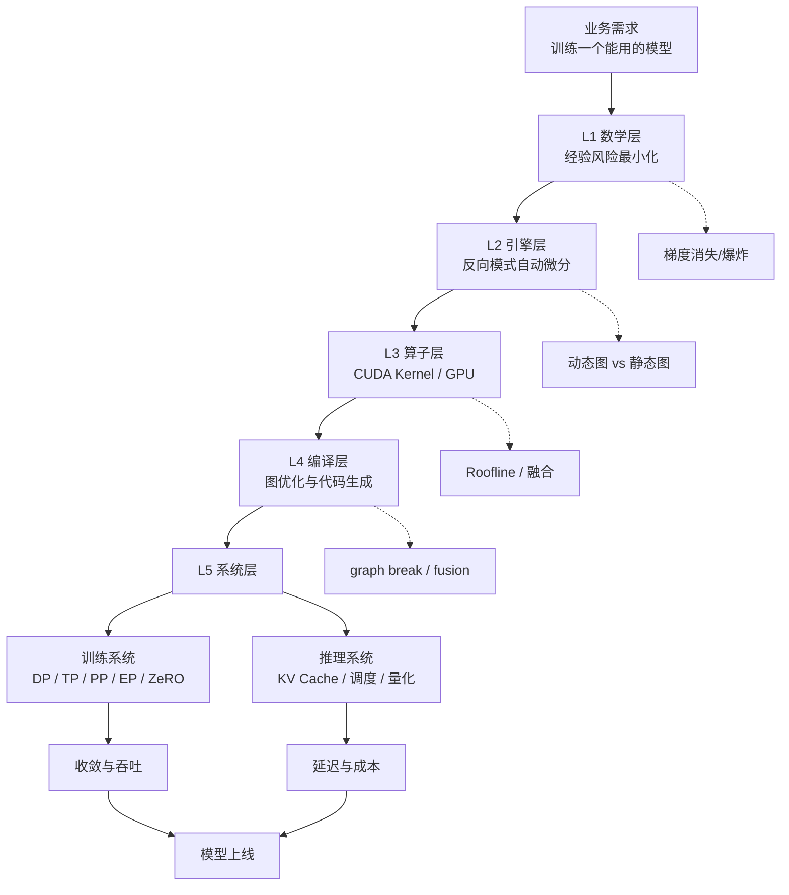
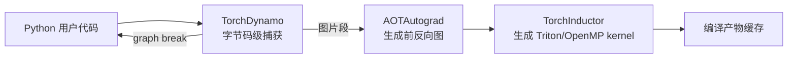
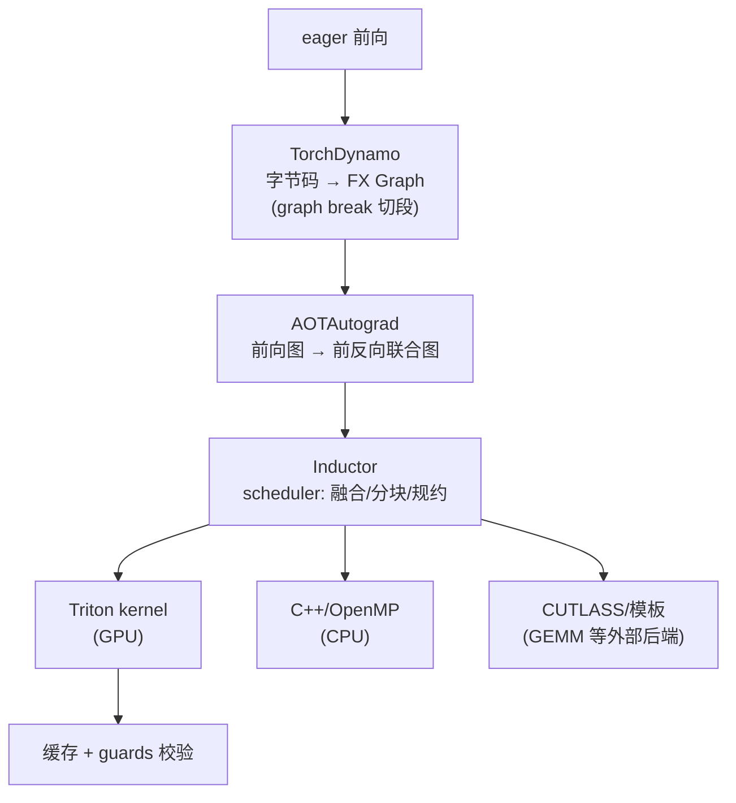
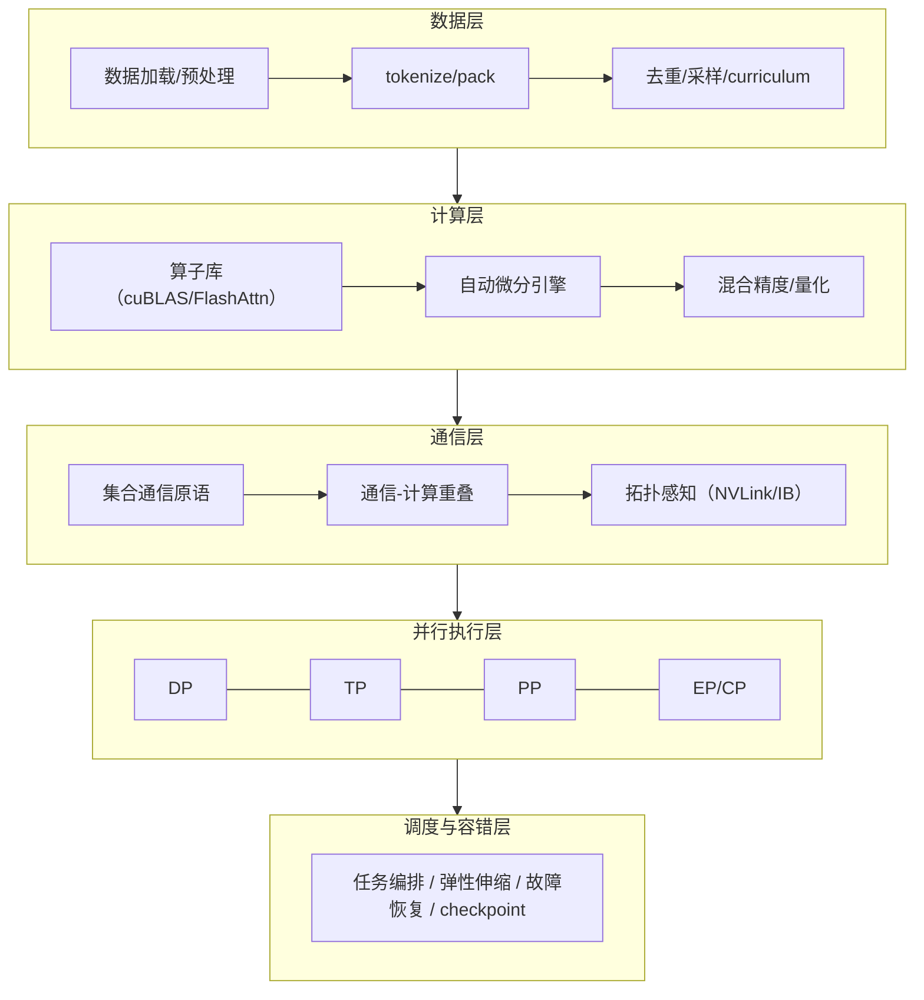
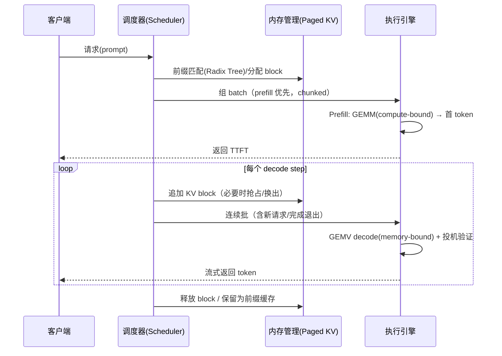
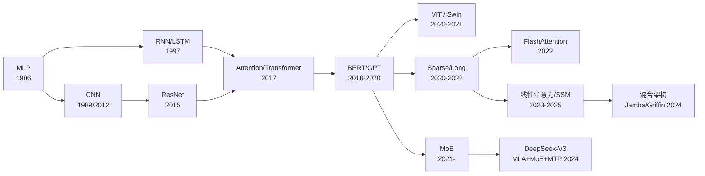
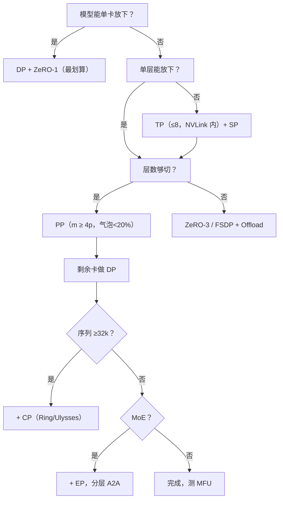
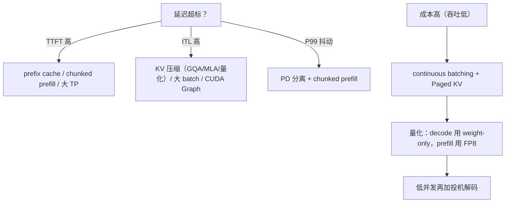

# 深度学习底层原理全景解析：从数学本质到系统工程，再到面试战场

> 版本：v1.0 ｜ 整理日期：2026-11-20
> 定位：面向"想知道它到底为什么能跑起来"的工程师。不做科普式罗列，每个结论都尽量给出**为什么**、**代价是什么**、**什么时候会失效**。
> 覆盖：数学原理 → 自动微分 → 张量与显存 → 算子与 Kernel → 编译器 → 训练系统架构 → 推理系统架构 → 模型结构演进 → 优化理论 → 前沿论文 → 大厂面试题库。

---

## 0. 导读

### 0.0 目录导航

| 章 | 标题 | 核心内容 | 适合谁 |
|---|---|---|---|
| 1 | 深度学习的数学本质 | ERM、万能逼近、非凸优化的良性结构 | 全部 |
| 2 | 前向与反向传播的数学底层 | 计算图、反向模式 AD、VJP、梯度消失 | 全部（地基） |
| 3 | 自动微分引擎的工程实现 | tape、Node、动态/静态图、Dynamo | Infra |
| 4 | 张量与内存的底层 | stride、缓存分配器、16 B/参数、checkpointing | Infra |
| 5 | 算子与 Kernel | GPU 架构、Roofline、GEMM、FlashAttention、通信原语 | Infra（核心） |
| 6 | 编译器与图优化 | 融合 pass、TVM/XLA/Inductor、Triton、动态 shape | Infra |
| 7 | 训练系统架构 | DP/TP/PP/SP/CP/EP/ZeRO、3D 选型、排障 | Infra（核心） |
| 8 | 推理系统架构 | prefill/decode、KV Cache、Paged、PD 分离、量化、投机 | Infra（核心） |
| 9 | 模型结构演进 | CNN/RNN/Transformer/SSM/MoE 的动机与代价 | 算法 |
| 10 | 优化与训练技巧 | 优化器、warmup、初始化、正则、Scaling Law | 算法 |
| 11 | 更先进的设计与论文 | 零气泡、自动并行、PD 分离、MLA/NSA、论文清单 | 全部（进阶） |
| 12 | 大厂面试题库（38 题） | 算法岗 16 题 + Infra 岗 22 题，含权重与详解 | 全部 |
| 13 | 速查表 | 公式、硬件规格、选型流程、坑清单、术语 | 全部（面试前） |
| 14 | 附录 | 8 周学习路径、必读资料、使用方法 | 全部 |

### 0.1 这份文档想解决什么问题

大多数人学深度学习的路径是：先看论文里的结构图，再背几个名词（BN、Attention、Dropout），然后跑通一个 demo。这条路径的天花板很低——一旦遇到**训练不收敛、显存 OOM、多机跑不起来、推理延迟超标**这四类问题，就会立刻卡死，因为这些问题不在"结构图"层面，而在**底层**。

"底层"在这份文档里被拆成五个递进的层次：

| 层次 | 研究对象 | 典型问题 | 对应章节 |
|---|---|---|---|
| L1 数学层 | 目标函数、梯度、链式法则 | 为什么会梯度消失？为什么除以 √d？ | 第 1–2 章 |
| L2 引擎层 | 自动微分、计算图、张量内存 | autograd 怎么知道该给谁求导？OOM 是谁吃的？ | 第 3–4 章 |
| L3 算子层 | Kernel、GPU 硬件、访存 | 为什么 FlashAttention 快？为什么 elementwise 慢？ | 第 5 章 |
| L4 编译层 | 图优化、IR、代码生成 | 为什么要算子融合？TorchInductor 在干什么？ | 第 6 章 |
| L5 系统层 | 分布式并行、推理调度、量化 | 70B 模型怎么在 8 卡上训？怎么把延迟压到 50ms？ | 第 7–8 章 |

上层（模型结构、优化器、训练技巧）建立在这五层之上，第 9–10 章把它们统一收口，第 11 章讲最前沿的设计思路与论文，第 12 章是面试战场。

### 0.2 全景地图



### 0.3 建议阅读路径

- **算法岗（DNN/CV/NLP/大模型）**：第 1、2、9、10 章精读 → 第 4、7、8 章了解代价模型 → 第 12.1 节题库。
- **AI Infra 岗（框架/训练/推理）**：第 2–8 章精读 → 第 11 章对论文有印象 → 第 12.2 节题库。
- **只想快速补短板**：直接跳到第 13 章速查表，再回填对应章节。

### 0.4 记号约定

| 记号 | 含义 |
|---|---|
| $\theta$ | 可学习参数（权重 + 偏置） |
| $x \in \mathbb{R}^{n}$ | 输入，$y$ 为标签 |
| $L(\theta)$ | 损失函数 |
| $\nabla_\theta L$ | 梯度，与 $\theta$ 同形状 |
| $N$ | 参数量；$D$ 训练 token 数；$C$ 计算量（FLOPs） |
| $B$ / $S$ / $H$ | batch size / 序列长度 / hidden dim |
| $P$ / $K$ | 并行设备数 / ZeRO 分片数 |

---

## 1. 第一章：深度学习的数学本质

### 1.1 它到底在优化什么

深度学习不是"模仿大脑"，它的数学形式极其朴素——**在一个参数化的函数族里，找一个让平均损失最小的成员**：

$$
\theta^{*}=\arg\min_{\theta}\ \mathbb{E}_{(x,y)\sim \mathcal{D}}\left[\ell\big(f_\theta(x),\,y\big)\right]
$$

真实分布 $\mathcal{D}$ 拿不到，于是用训练集的经验分布替代，这就是**经验风险最小化（ERM）**：

$$
\hat{\theta}=\arg\min_\theta\ \frac{1}{N}\sum_{i=1}^{N}\ell\big(f_\theta(x_i),y_i\big)+\lambda\Omega(\theta)
$$

后面所有工程复杂度（分布式、混合精度、显存优化），本质上都是在**"把这个 argmin 在有限算力下近似求解"**过程中付出的代价。记住这一点，很多设计就能一眼看懂动机。

### 1.2 为什么必须是"线性 + 非线性"堆叠

单个线性层 $f(x)=Wx+b$ 的复合仍是线性：$W_2(W_1x+b_1)+b_2=(W_2W_1)x+\dots$。**没有非线性，100 层等于 1 层**。所以每个线性层后必须插入逐元素非线性 $\sigma(\cdot)$，让函数族从"仿射变换群"扩张到稠密函数空间。

### 1.3 万能逼近定理说了什么，又没说什么

**定理（Cybenko 1989 / Hornik 1991）**：含足够多隐层单元的单隐层前馈网络，可以以任意精度逼近紧集上的任意连续函数。

这个定理经常被误读。它真正说明的是：

1. **表达能力不是瓶颈**——宽度足够即可；
2. 但它**没有说需要多少个神经元**。指数级的宽度需求在实践中等于不可用；
3. 它**没有说能不能学得到**——可表示 ≠ 可优化 ≠ 可泛化。

深度学习真正的经验性突破来自第三点之外的另一个事实：**深度的表达效率**。对于某些函数（如分段线性函数的组合、层次化组合结构），深度 $L$ 的网络可以达到宽度为指数级的浅层网络才能达到的逼近精度（Telgarsky 2016, Poole et al. 2016 关于深度的"指数级表达优势"）。直觉上：**深度提供了函数的"组合语法"**——第 $l$ 层学到的特征被第 $l+1$ 层当作原子复用，复杂度随深度呈乘法增长，而不是加法增长。

这就是"深"的全部理由，也是后面残差连接、归一化、初始化等一系列技术存在的根本原因：**深度带来了表达力，同时带来了优化的病态性**。

### 1.4 高维非凸优化的特殊性质

深度学习的损失曲面有 $10^7\sim10^{11}$ 维，非凸。经典优化理论在这里几乎全部失效（没有全局最优保证、鞍点指数多）。但实践中它偏偏能work，原因是这个曲面有一些反直觉的良性结构：

| 现象 | 含义 | 工程意义 |
|---|---|---|
| **鞍点远多于局部极小** | 高维下 Hessian 负特征值概率高，随机初始化几乎不会落在局部极小 | 逃出鞍点靠噪声即可，不需要复杂算法（Ge et al. 2015） |
| **损失曲面存在大量等价解** | 神经元置换对称性、宽度冗余 → 平坦的极小区域 | 不同随机种子的模型可以互相插值（mode connectivity） |
| **平坦极小泛化更好** | Sharpness 与泛化差距正相关 | 这是 SAM、大 batch 训练需要调 LR 的理论依据之一 |
| **过参数化带来良性非凸** | 参数远多于样本时，训练误差可到 0，且 SGD 隐式偏好低范数解 | 解释了"大模型反而不容易过拟合"的怪现象 |

**延伸：为什么过参数化反而泛化好？**
两条主流解释：(a) **隐式正则**——SGD 的噪声与轨迹偏好"最小范数/最大间隔"解（Soudry et al. 2018 的逻辑回归情形）；(b) **NTK / 线性化视角**——无限宽网络训练等价于在固定核上做核回归（Jacot et al. 2018），此时泛化由核的性质保证。这两种解释都有局限（NTK 无法解释特征学习），但足以说明：**"参数多 = 一定过拟合"是一个错误直觉**。

### 1.5 本章要点

- 深度学习 = 参数化函数族 + 经验风险最小化 + 梯度下降近似求解。
- 非线性是必需品；深度是效率来源；可表示 ≠ 可优化 ≠ 可泛化。
- 非凸优化在实践中可行，靠的是高维几何的良性结构，不是算法上的精巧。

---

## 2. 第二章：前向传播与反向传播的数学底层

这一章是整个深度学习的地基。所有框架（PyTorch/JAX/TF/Paddle）的自动微分，本质都是这一套数学的工程化。

### 2.1 计算图与链式法则

把 $f_\theta(x)$ 展开成一张**有向无环图（DAG）**：节点是张量或算子，边表示数据依赖。

```
x ──►[MatMul W1]──► z1 ──►[ReLU]──► a1 ──►[MatMul W2]──► z2 ──►[SoftmaxCE]──► L
```

复合函数求导靠链式法则。对标量损失 $L$ 和中间变量 $z=f(x)$：

$$
\frac{\partial L}{\partial x}=\frac{\partial L}{\partial z}\cdot\frac{\partial z}{\partial x}
$$

对多变量情形，$\partial z/\partial x$ 是雅可比矩阵 $J\in\mathbb{R}^{m\times n}$。直接对每层构造完整雅可比再相乘，代价是 $O(mn)$ 甚至 $O(mn\cdot\text{depth})$，对 $10^{10}$ 参数的网络完全不可行。**自动微分的全部技巧，就是永远不要显式构造雅可比。**

### 2.2 反向模式自动微分（Reverse-mode AD）

设 $f:\mathbb{R}^n\to\mathbb{R}^m$，$y=f(x)$，我们要 $J=\partial y/\partial x$。

定义**伴随（adjoint）** $\bar{v}=\partial L/\partial v$（标量对张量的梯度），则：

$$
\bar{x}=J^{\top}\bar{y}
$$

注意这是**雅可比-向量积（VJP, Vector-Jacobian Product）**：一次计算只付出一次矩阵-向量乘的代价，就拿到"整个雅可比转置作用在某个向量上"的结果。

**关键洞察：反向传播 = 沿计算图反向传播一个向量，而不是传播一个矩阵。**

推导单层情形，$z=W a$，$W\in\mathbb{R}^{m\times n}$，$a\in\mathbb{R}^n$：

$$
\bar{a}=W^{\top}\bar{z},\qquad \bar{W}=\bar{z}\,a^{\top}
$$

第二式就是**外积**——这也解释了为什么框架里 Linear 的反向实现是 `grad_input = grad_output @ weight`、`grad_weight = grad_output.T @ input` 两个 GEMM，没有别的。

### 2.3 前向模式 vs 反向模式：复杂度对比

| 模式 | 传播对象 | 一次传播得到 | 单次代价 | 得到完整雅可比的代价 | 适用 |
|---|---|---|---|---|---|
| 前向模式（JVP） | 切向量 $Jv$ | 一个方向的方向导数 | ~1 次前向 | $n$ 次（$n$=输入维） | 输入维小、输出维大 |
| 反向模式（VJP） | 余切向量 $J^\top \bar y$ | 一个输出的全梯度 | ~2 次前向 | $m$ 次（$m$=输出维） | 输出维小、输入维大 |

深度学习的场景：输入 $n=|\theta|\approx10^{9\sim11}$，输出 $m=1$（标量损失）。**$m=1$ 让反向模式只需一次传播就拿到全部 $10^{11}$ 个梯度**，而前向模式需要 $10^{11}$ 次。这就是反向传播不可替代的原因，也是"反向传播只比前向贵约 2 倍"这一经验法则的来源（每层反向的计算量约为前向的 2 倍：一次给输入梯度、一次给权重梯度）。

### 2.4 反向传播为什么是 O(参数量) 的

设网络有 $L$ 层，第 $l$ 层前向 FLOPs 为 $c_l$。则：

- 前向总计算 $\sum c_l$
- 反向总计算 $\approx 2\sum c_l$（$\bar a$ 和 $\bar W$ 各一次）
- 总计算 $\approx 3\sum c_l$

参数量只出现在 $\bar W$ 的存储（与 $\theta$ 同形），不出现额外的矩阵构造。**这是全文档最重要的复杂度结论**：训练一个模型的 FLOPs ≈ $6ND$（$N$ 参数、$D$ token，前向 2ND + 反向 4ND），显存 ≈ 16 bytes/参数（Adam + FP32 主权重，见 4.6）。

### 2.5 数值稳定性：softmax 与交叉熵

分类任务的标准组合是 softmax + 交叉熵。它的**梯度形式极其漂亮**：

设 logits $z$，$p=\text{softmax}(z)$，交叉熵 $L=-\sum_i y_i\log p_i$（$y$ one-hot），则

$$
\frac{\partial L}{\partial z}=p-y
$$

推导：$L=-z_{c}+\log\sum_j e^{z_j}$，于是 $\partial L/\partial z_i=-\mathbb{1}[i=c]+\dfrac{e^{z_i}}{\sum_j e^{z_j}}=p_i-y_i$。

**这就是框架把 `softmax` 和 `cross_entropy` 合并成一个 fused op（`log_softmax` + `nll_loss`）的根本原因**：

1. 梯度是 $p-y$，无需保存 softmax 的中间结果再求导，省一次 $O(V)$ 的读写（$V$ 是词表大小，可达 15 万）；
2. 单独算 softmax 再算 log 会溢出：$e^{z_i}$ 在 $z_i>88$ 时 FP32 溢出。必须用 **log-sum-exp 技巧**：

$$
\log\sum_j e^{z_j}=c+\log\sum_j e^{z_j-c},\quad c=\max_j z_j
$$

如果先 log 再 log（$\log(\text{softmax})$），会引入 $\log(0)=-\infty$ 的灾难性抵消。fused 实现直接计算 $\text{logsumexp}$ 与 $z_c$ 的差，全程不出现除法。

**延伸：为什么大模型训练要关注 softmax 的数值问题？**
词表 15 万、序列 8k 时，logits 张量是 $B\times S\times V$。$B=8,S=8192,V=150000$ 的 FP32 logits 是 **39 GB**。所以真实实现一定是 **chunked / fused / vocab-parallel** 的（例如 Megatron 的 vocab parallel CE、Liger-Kernel 的 chunked CE），这也是一个高频面试延伸点。

### 2.6 梯度消失与爆炸的数学根源

考虑 $L$ 层线性（或近似线性）网络的梯度：

$$
\frac{\partial L}{\partial h_0}=\left(\prod_{l=1}^{L} W_l\right)^{\top}\frac{\partial L}{\partial h_L}\cdot\prod_{l}\sigma'(z_l)
$$

两项连乘决定了量级：

1. **权重连乘的谱**：$\prod W_l$ 的奇异值随 $L$ 指数增长或衰减。若 $\|W_l\|\approx \rho$，则量级 ~ $\rho^L$。$\rho<1$ → 消失，$\rho>1$ → 爆炸。
2. **激活导数的连乘**：Sigmoid 的 $\sigma'\in(0,0.25]$，$L$ 层后量级 $\le 0.25^L$。20 层就是 $10^{-12}$。这是 Sigmoid 时代网络无法做深的直接原因。

三种解法，各自对应一条数学修复路径：

| 解法 | 数学机制 | 局限 |
|---|---|---|
| **换激活（ReLU/GELU）** | $\sigma'$ 在正半轴恒为 1，抑制衰减因子 | ReLU 有 Dead ReLU，且不解决权重谱问题 |
| **精心初始化（Xavier/He）** | 让每层方差保持 $O(1)$：$\text{Var}(W)=\frac{2}{n_{in}+n_{out}}$（Xavier）/$ \frac{2}{n_{in}}$（He） | 只保证初始时刻，训练中会漂移 |
| **归一化（BN/LN）** | 强制每层输入分布稳定，把谱拉回 1 附近 | 引入额外通信/统计开销，序列变长时 LN 更合适 |
| **残差连接** | 把雅可比变成 $I+F'$，连乘变为 $\prod(I+F'_l)$，只要 $F'$ 小就近似恒等 | 需要维度匹配；极深时仍需归一化配合 |

**残差的数学本质**（第 9.11 节展开）：$h_{l+1}=h_l+F(h_l)$，反向时

$$
\frac{\partial h_L}{\partial h_l}=\prod_{i=l}^{L-1}\left(I+\frac{\partial F}{\partial h_i}\right)=I+\sum_i \frac{\partial F}{\partial h_i}+\text{高阶项}
$$

**恒等项 $I$ 的存在，让梯度有一条"直通车道"**，不管中间层怎么糟糕，梯度至少能以 1 的比例传回去。这不是"缓解"，是结构性地消除了指数衰减。

### 2.7 本章要点

- 反向传播 = 反向模式 AD = 沿图传播伴随向量，本质是 VJP。
- 因为 $m=1$（标量 loss），反向模式是唯一可行的选择，代价约 2× 前向。
- softmax+CE 的梯度是 $p-y$，fused 实现同时解决溢出和带宽。
- 梯度消失是连乘的谱问题，四类解法各修一个环节，残差是最结构性的一种。

---

## 3. 第三章：自动微分引擎的工程实现

数学上是"传播伴随向量"，工程上要回答一个具体问题：**框架怎么知道每个算子该怎么求导，以及按什么顺序求？**

### 3.1 两种实现范式

| 范式 | 代表 | 机制 | 特点 |
|---|---|---|---|
| **基于 Tape（记录式）** | PyTorch autograd、TF GradientTape | 前向时把每个算子及其输入记录到 tape，反向时倒序重放 | 天然支持动态控制流、调试友好；记录有开销 |
| **基于变换（源到源/图重写）** | JAX (`grad`/`vjp`)、TF 静态图 | 对计算图做符号变换，生成反向图 | 可全局优化、可融合；对控制流要求高（需 `lax.cond/scan`） |
| **基于算子注册** | 各框架底层都一样 | 每个 op 注册 `forward` 与 `backward`，backward 接收输出梯度、返回输入梯度 | 手写反向易错，是 bug 主要来源 |
| **数值微分** | 仅用于测试 | 有限差分 | 梯度检验（gradcheck）用，不可用于训练 |
| **符号微分** | 早期 | 表达式膨胀 | 已淘汰 |

### 3.2 PyTorch autograd 的实现细节

这是面试高频区，逐层拆开：

**核心数据结构**（`torch/csrc/autograd`）：

```
Tensor
 ├── storage (数据指针, 内存由 allocator 管)
 ├── TensorImpl
 │    ├── sizes / strides / dtype / device
 │    └── autograd_meta
 │          ├── grad          (叶子节点的累积梯度)
 │          ├── grad_fn       (指向产生它的 Node)
 │          ├── requires_grad
 │          └── is_leaf
 └── (view 时共享 storage，但是新的 TensorImpl)
```

**反向执行流程**：

1. 前向时，每个需要梯度的 op 都创建一个 `Node`（如 `AddBackward0`、`MulBackward0`、`AccumulateGrad`），并把它挂到输出的 `grad_fn` 上，同时记录 `next_edges`（指向输入的生产者节点）。这就是**动态构建的 tape**。
2. `loss.backward()` 从根节点出发，做一次**拓扑排序**（把节点按依赖逆序编号），然后按序调用每个 Node 的 `apply()`，即执行 VJP。
3. 每个 Node 的 `apply()` 输入是"输出梯度"，输出是"输入梯度"，并**累加**到上游节点的 `grad` 上。
4. 到达叶子节点（`is_leaf=True` 且 `requires_grad=True`）时，梯度写入 `tensor.grad`。

**几个必考细节**：

- **梯度为什么是累加而不是覆盖？**
  一个张量在图中被多处使用（如 `y = x*x + x`），其梯度应为各部分之和。累加语义天然正确；覆盖会丢梯度。**所以每次 `backward` 前必须 `optimizer.zero_grad()`**——这也是新手最常见的 bug：忘了清零导致梯度不断累积、loss 爆炸。
- **只有标量能 backward 吗？**
  不是。`tensor.backward(gradient=...)` 可以传一个与输出同形的向量，那就是在求 $v^\top J$，即任意 VJP。标量情形 $v=1$。这也是实现 Jacobian 的 API：`torch.autograd.functional.jacobian`。
- **`retain_graph=True` 是什么？**
  默认反向会释放中间结果（保存的 activation）以省显存。如果要第二次 backward（如 GAN 的两次更新、梯度惩罚、二阶优化），必须保留图，否则报 `Trying to backward through the graph a second time`。
- **`create_graph=True`**：把反向过程本身也记录进图，从而支持二阶导（Hessian、WGAN-GP 的梯度惩罚）。
- **`detach()` 与 `with torch.no_grad()`**：前者返回一个从图上摘下来的新张量（共享 storage），后者不记录后续 op。**常见坑**：`loss.detach()` 后做 `.item()` 是对的；但在 no_grad 里更新参数后忘了把参数置回 requires_grad。
- **in-place 操作为什么危险？**
  `x.relu_()` 会改写前向保存的值，导致反向时用到的输入与实际不符，autograd 会抛 `a leaf Variable that requires grad is being used in an in-place operation` 或版本号错误（`version_counter` 机制专门检测这件事）。**例外**：优化器的 `param.add_(...)` 因为在 no_grad 下且不是图中节点，是安全的——这也是所有优化器实现都这么写的原因。
- **view 与 reshape**：view 要求内存连续，返回共享 storage 的视图；反向时用 `_reshape_alias` 恢复。这也是"张量是视图"这一模型的直接后果（见 4.2）。

### 3.3 动态图 vs 静态图

| 维度 | 动态图（Define-by-Run） | 静态图（Define-and-Run） |
|---|---|---|
| 图构建时机 | 每次前向都重建 | 先定义再执行，图可复用 |
| 控制流 | 直接用 Python if/for | 需专用算子（`tf.cond`、`lax.scan`）或 tracing |
| 调试 | 断点即所得 | 需要专门工具（图可视化、shape 推断） |
| 全局优化 | 难（每条路径一张图） | 容易（常量折叠、融合、内存规划） |
| 部署 | 需额外导出 | 天然可序列化 |
| 代表 | PyTorch（v1.0+） | TF1.x、TorchScript、XLA、TensorRT |

**历史演进与现状**：2015–2019 是静态图占优（TF1、Theano），因为性能；2019 后 PyTorch 靠易用性翻盘。现在的答案是**折中**——"eager 开发 + 编译加速"：



**TorchDynamo 的原理**（重点，常被追问）：它 hook 了 CPython 的 frame evaluation（PEP 523），在函数执行前拿到字节码，做**符号化解释执行（symbolic bytecode analysis）**：遇到不支持的语法/算子就 **graph break**，把图切成多段，中间的 Python 逻辑原样执行。它用 **guards**（shape、dtype、常量、全局状态）来校验下次能否复用编译结果——guard 失效就重新编译，这也是"动态 shape 导致反复 recompile"性能问题的来源。

### 3.4 自动微分的经典坑位清单

| 现象 | 根因 | 规避 |
|---|---|---|
| 梯度为 None | 该张量 `requires_grad=False`，或来自 dataloader 的整数索引 | 检查 `requires_grad`、用 `.float()` |
| 梯度全是 nan | loss scale 太小/太大、softmax 溢出、除零 | 用 fused CE、logsumexp、`torch.nan_to_num` |
| 显存随 step 增长 | 保存了 loss/中间张量到 list，未 detach | `loss.detach().item()` 记录日志 |
| 多卡梯度不一致 | DDP 忘了 `no_sync` 或 bucket 配置错误 | 见 7.2；用 `find_unused_parameters` 排查 |
| 二阶导报错 | 未 `create_graph=True` | 显式开启 |
| 编译后结果不对 | in-place + guard 失效 | 减少 in-place、用 `torch._dynamo.mark_dynamic` 标注动态维 |

### 3.5 本章要点

- tape 式 AD：前向建图（Node + next_edges），反向拓扑排序 + VJP + 累加。
- 累加语义决定必须 `zero_grad`；标量限制不存在，`backward(gradient)` 就是任意 VJP。
- 动态图的易用性与静态图的优化能力，靠"Dynamo 捕获 + graph break + Inductor 生成"统一。

---

## 4. 第四章：张量与内存的底层

**"OOM 是谁吃的"** 是工程现场第一高频问题。答不出来，说明还没进入底层。

### 4.1 张量到底是什么

PyTorch 张量不是"多维数组"这么简单，它是一个**带元数据的视图**：

```python
Tensor = (Storage*  ptr,  sizes, strides, offset, dtype, device, autograd_meta)
```

- `Storage`：一块连续内存（CPU pinned / GPU HBM），**引用计数共享**。
- `sizes`：形状；`strides`：每个维度走一步跨多少元素；`offset`：起始偏移。

由此推出两个重要性质：

1. **切片/transpose/permute 通常不拷贝数据**，只改 strides。`x.T` 对二维是零拷贝的。
2. **`x[::2]` 是不连续的**，很多 kernel（如 cuBLAS GEMM）要求连续内存，框架会隐式 `.contiguous()` 触发一次全量拷贝——这是"莫名其妙慢"和"莫名多占一份显存"的常见原因。

### 4.2 broadcast 的 stride 技巧

广播不复制数据，而是**把被扩展维度的 stride 设为 0**：

```
a: shape (1, 4)  strides (4, 1)   →  broadcast 成 (3, 4) 时 strides 变 (0, 1)
```

**代价**：反向时需要沿 stride=0 的维度做 **sum 归约**（`sum_to_size`）。这也是"广播会悄悄放大梯度计算量"的原因：`(B,1,H) * (1,S,H)` 形式在反向时要 reduce，是 attention mask、位置编码里常见的隐藏开销。

### 4.3 PyTorch 的缓存分配器

这是显存问题的核心机制，必考。

**朴素做法的问题**：每次 `cudaMalloc`/`cudaFree` 都要与驱动交互，代价百微秒级，且 `cudaFree` 会**同步整个设备**，训练直接卡死。

**PyTorch 的做法（caching allocator）**：

- 启动时向驱动申请大块（segment），按 size 分级（small pool ≤1MB 按 512B 对齐，large pool 按 2MB 的倍数）维护空闲块链表。
- `free` 只是把块归还给**进程内的池**，不还给驱动 → 后续同 size 申请直接复用，速度是微秒级。
- 因此 `nvidia-smi` 显示的占用 = 峰值占用，**不会因为 Python 对象被回收而下降**。这就是"我只用了 2GB，nvidia-smi 却显示 40GB"的真相。

**碎片与 OOM**：即使总空闲量足够，若没有**连续的**满足 size 的块，仍会 OOM（尤其变长序列、动态 shape 场景）。可观测手段：

```python
torch.cuda.memory_summary()          # 分段/碎片情况
torch.cuda.max_memory_allocated()    # 真实峰值（排除缓存）
torch.cuda.memory._snapshot()        # 逐块溯源，定位泄漏点
PYTORCH_CUDA_ALLOC_CONF=expandable_segments:True   # 可扩展段，缓解碎片
```

**规避手段**：固定 shape（padding 到固定 bucket）、`expandable_segments`、及时 `del` + `empty_cache`（仅调试用，线上不要频繁调，因为下一次申请又要找驱动）、用 `torch.cuda.memory_stats()` 监控 reserved 与 allocated 的差值。

### 4.4 训练显存到底花在哪

以 GPT 类模型、混合精度 + Adam 为例，**每参数字节数**：

| 项目 | 精度 | bytes/param |
|---|---|---|
| 参数（FP16/BF16） | 2 | 2 |
| 梯度（FP16/BF16） | 2 | 2 |
| FP32 主权重（master weight） | 4 | 4 |
| Adam 一阶矩 $m$ | 4 | 4 |
| Adam 二阶矩 $v$ | 4 | 4 |
| **小计（模型状态）** | | **16** |
| 激活值（activation） | 2 | 与 $B,S,L,H$ 相关 |
| 临时 workspace / 通信 buffer | | 视实现 |

**结论 1**：7B 模型纯模型状态 = 112 GB。单卡 80GB 放不下 → 必须切分（ZeRO/TP），这就是第 7 章所有并行的存在理由。

**结论 2**：激活值是 $O(B \times S \times L \times H)$。$B=8,S=4096,L=32,H=4096$、每层约 20 个中间张量时，激活可达数十 GB，**往往比模型状态还大**。这就是 **gradient checkpointing** 的战场。

### 4.5 梯度检查点（Activation Checkpointing）

**问题**：反向需要前向的中间值（$y=\sigma(z)$ 需要 $z$ 算 $\sigma'$），所以默认全存 → 显存 $O(L)$。

**方案**：只存每段的**段边界**，反向时**重新前向计算**段内激活。

$$
\text{显存}: O(L)\ \longrightarrow\ O(\sqrt{L})\quad(\text{均匀分段时最优};\ \text{实践中按层分组})
$$

**代价**：多一次前向，总计算从 $3\sum c_l$ 变成 $4\sum c_l$（约 **+33%** 时间）。这是**用算力换显存**的最典型例子，也是"重算换访存"思想（FlashAttention 同源）的第一次出现。

**进阶**：选择性检查点（selective checkpointing，如 Megatron 只存 attention/MLP 的关键中间值，其余重算），可在几乎不增加时间的情况下省 5× 激活。

### 4.6 混合精度：为什么 BF16 不需要 loss scaling

| 格式 | 符号/指数/尾数 | 动态范围 | 精度 |
|---|---|---|---|
| FP32 | 1/8/23 | ~1e±38 | 7 位十进制 |
| FP16 | 1/5/10 | ~6e-5 ~ 65504 | 3 位十进制 |
| BF16 | 1/8/7 | ~1e±38（同 FP32） | 2 位十进制 |
| FP8 E4M3 | 1/4/3 | ~±448 | 低 |
| FP8 E5M2 | 1/5/2 | ~±57344 | 更低，但范围大 |

**关键机制**：

1. **FP16 需要 loss scaling**：梯度常小于 $6\times10^{-5}$ → 下溢为 0。做法是先放大 loss（如 ×1024），反向得到放大后的梯度，更新前再除回来。动态 scaler 会自动调整倍数（连续 N 步没溢出就 +，溢出就 -）。
2. **BF16 不需要**：指数位与 FP32 相同，梯度量级不会下溢。代价是尾数只有 7 位，累加误差更大——所以**归约类操作（如 softmax、LayerNorm 的均值方差、大 K 维的 GEMM 累加）仍建议 FP32**，这就是"FP32 累加器"（accumulate in FP32）的由来。
3. **FP8 需要 per-tensor / per-block scaling**：范围太窄，必须把张量缩放到可利用的动态范围。DeepSeek-V3 用 128×128 的 block-wise scaling + FP32 累加，做到了大规模 FP8 训练。

**常见踩坑**：BN 层用 FP16 会因方差计算误差崩；LayerNorm 的 eps 在 BF16 下要放大（如 1e-6 → 1e-5）；优化器状态必须 FP32（否则 Adam 的 $v$ 会失真）。

### 4.7 内存格式与 in-place

- **`channels_last`**：NHWC 布局，对 Tensor Core 的卷积更友好（因为 $C$ 连续，可按 K 维切 tile）。`x.to(memory_format=torch.channels_last)` 在 CNN 上常有 10–30% 提速。
- **in-place**：`relu_()`、`add_()` 省一份输出显存，但会破坏 autograd 保存值，**只在 no_grad 下或确定不需要该输入梯度时使用**。`x += y` 与 `x = x + y` 在自动微分中行为不同（前者可能触发版本检查错误）。
- **`del` 与引用**：Python 的 GC 是引用计数为主，`del x` 后若还有 view 持有 storage，内存不会释放。这是"显存泄漏"的经典来源。

### 4.8 本章要点

- 张量 = storage + 元数据；切片/转置零拷贝；`contiguous()` 会悄悄拷贝。
- 广播靠 stride=0，反向要 sum → 隐藏开销。
- caching allocator 让 free 只是归还进程内池，`nvidia-smi` 是峰值。
- 训练显存 = 16 B/参数 + 激活；激活往往是大头 → checkpointing 用 33% 时间换数倍显存。
- BF16 因指数位足够不需 loss scale，但归约必须 FP32。

---

## 5. 第五章：算子与 Kernel —— 性能的物理边界

到这里，"为什么要这么设计系统"的答案开始变得可计算。本章的核心工具只有一个：**Roofline 模型**。

### 5.1 从 `aten` 到 CUDA

一次 `y = x @ W` 的调用链：

```
Python:  torch.matmul
   ↓ (dispatcher，按 device/dtype/layout 选后端：CPU / CUDA / 量化 / 稀疏)
aten::mm  (C++ 算子注册表)
   ↓
cuBLAS:  cublasGemmEx  →  cublasLt（启发式选 kernel + 自动调优）
   ↓
GPU:  <<<grid, block>>>  启动一个 GEMM kernel
```

**关键认知**：绝大多数框架算子不是自己写的，而是调库（cuBLAS/cuDNN/cuSPARSE/CUTLASS）。框架的性能上限，很大程度取决于**能不能把计算表达成这些库认识的形式**。这也是"自定义算子难写、但一旦写对收益巨大"的原因。

**Kernel launch 开销**：一次 launch 约 3–10 μs（CPU 侧）。小算子（如 `x + 1`，计算 1 μs）的 launch 开销可能超过计算本身。这就是**"小算子太多 → 框架开销主导"**（launch-bound）的根源，也是算子融合与 CUDA Graph 存在的第一个理由。

### 5.2 GPU 的结构：为什么它比 CPU 快 100 倍又经常只跑出 10% 利用率

以 A100-80GB SXM 为例：

| 单元 | 规格 | 作用 |
|---|---|---|
| SM | 108 个 | 基本调度单元 |
| Warp | 32 线程，每 SM 最多 64 warp | SIMT 执行粒度 |
| FP32 CUDA Core | 64 / SM | 常规浮点 |
| **Tensor Core** | 4 / SM | 4×4×（多精度）矩阵乘累加，BF16 峰值 312 TFLOPS |
| **Shared Memory / L1** | 合计 192 KB / SM（可配 164 KB 给 SMEM） | 程序员可控的高速缓存 |
| **寄存器** | 64K × 32 bit / SM | 最快，决定 occupancy |
| **L2** | 40 MB | 全芯片共享 |
| **HBM** | 80 GB，**2039 GB/s** | 主存，带宽是稀缺资源 |

**算力 vs 带宽的失衡**是全部优化的起点：

$$
\text{峰值算力} = 312\ \text{TFLOPS},\quad \text{峰值带宽} = 2.04\ \text{TB/s}
$$

$$
\text{拐点算术强度} = \frac{312}{2.04}\approx 153\ \text{FLOP/Byte}
$$

**含义**：每搬 1 Byte 数据，必须做 ≥153 次浮点运算才能打满算力。低于这个比值，你就是**访存受限（memory-bound）**，算力再高也用不上。这一条解释了后面 80% 的优化设计。

### 5.3 Roofline 模型

$$
\text{可达性能} = \min\left(\text{峰值算力},\ \ \text{带宽}\times \text{算术强度}\right),\quad \text{算术强度}=\frac{\text{FLOPs}}{\text{Bytes}}
$$

| 算子类型 | 算术强度 | 瓶颈 | 优化方向 |
|---|---|---|---|
| elementwise（`relu`、`add`、`layernorm` 的部分） | O(1) | **HBM 带宽** | 融合、减少中间张量、用向量化加载（128-bit） |
| reduction（`sum`、`softmax`） | O(1) | 带宽 + 同步 | 融合、两级归约、warp shuffle |
| GEMM（大矩阵） | O(K)，K 大时很高 | **算力/Tensor Core** | tiling、双缓冲、Tensor Core、split-K |
| Attention（无 flash） | 中等但中间矩阵巨大 | **带宽（S 矩阵）** | FlashAttention（IO 感知） |
| 卷积（大 channel） | 高 | 算力 | implicit GEMM、Winograd |

### 5.4 GEMM 优化：把算术强度从 O(1) 提到 O(K)

朴素三重循环算术强度 ~1，性能只有峰值的 1/150。三级分块把数据搬进片上存储反复复用：

```
for tile_m, tile_n:                       # 每层 tile 只读一次全局内存
    acc = reg[TM][TN]                     # 累加器放寄存器
    for k in range(0, K, BK):
        As = shared[A[tile_m, k:k+BK]]     # 协作加载到 SMEM（双缓冲）
        Bs = shared[B[k:k+BK, tile_n]]
        for kk in range(BK):
            acc += As[:, kk] outer Bs[kk, :]   # Tensor Core: m16n8k16 MMA
    C[tile_m, tile_n] = acc
```

关键设计点，面试常问"怎么把 GEMM 优化到 80% 峰值"：

1. **Tile 尺寸**决定 SMEM 占用与数据复用率。$T_M \times T_N$ 越大算术强度越高，但 SMEM 只有 164 KB，且寄存器要放 $T_M\times T_N$ 个累加器。
2. **双缓冲 / warp-specialization**：`cp.async` 异步把下一个 tile 搬到 SMEM，与当前计算重叠，隐藏访存延迟（Hopper 上用 TMA + warp specialization 做得更彻底）。
3. **Tensor Core 的 layout 约束**：MMA 要求特定 fragment 布局，需要对 SMEM 做 swizzle 避免 bank conflict（32 个 bank，步长 32 的访问会 32 路冲突）。
4. **Split-K**：当 M,N 很小而 K 很大（如 skinny GEMM、decode 阶段的 GEMV），并行度不足 → 沿 K 切分，用原子累加或两阶段归约。
5. **Epilogue 融合**：GEMM 输出直接做 bias/activation，省一次 HBM 往返（CUTLASS 的 epilogue、以及"GEMM + 后处理"融合）。

**推广**：卷积用 **implicit GEMM**（不展开 im2col，直接索引），是 cuDNN 的主流实现；Winograd 用变换换乘加次数，在 3×3 小核上算力收益明显。

### 5.5 FlashAttention：用"重算"换"访存"

**问题**：标准 attention 需要 $S=\text{softmax}(QK^\top/\sqrt{d})$，$S$ 是 $N\times N$ 矩阵。

- 显存：$O(N^2)$，$N=8192$ 时单头 FP16 就是 134 MB，多头多层直接爆炸；
- 带宽：S 要写回 HBM 再读出来做 softmax、再读出来乘 V，**HBM 访问 $O(N^2)$**；
- 即使能放下，也因算术强度低（每元素只做几次 FLOP）而严重 memory-bound。

**FlashAttention 的做法（Dao et al. 2022）**：

1. 按 $B_r\times B_c$ 分块遍历 K/V，把 Q 块、K/V 块、$S$ 块全部**留在 SRAM 里**，不写回 HBM；
2. softmax 需要全局 max 和分母 → 用 **online softmax**（Milakov & Gimelshein 2018）增量更新：

$$
m^{(new)}=\max\left(m^{(old)},\ \max_j S_{ij}\right)
$$
$$
\ell^{(new)}=e^{m^{(old)}-m^{(new)}}\ell^{(old)}+\sum_j e^{S_{ij}-m^{(new)}}
$$
$$
O^{(new)}=\text{diag}\left(e^{m^{(old)}-m^{(new)}}\right)O^{(old)}+e^{S-m^{(new)}}V
$$

3. 反向不存 $S$、$P$，用保存的 $m,\ell$ 和 $O$ **重算** $S$（这就是第 4.5 节"重算换显存"的同一思想）。

**复杂度结论**：

$$
\text{标准}: \Theta(N^2 + Nd)\ \text{HBM 访问};\qquad \text{Flash}: \Theta\!\left(\frac{N^2 d^2}{M}\right)
$$

其中 $M$ 是 SRAM 大小（A100 约 100 KB 可用）。$d=128$ 时 $d^2/M\approx 0.16$，即**HBM 访问降约 6 倍**，实测 2–4× 加速且显存从 $O(N^2)$ 降到 $O(N)$。

**延伸**：FlashAttention-2 改进了 warp 划分与并行度（沿序列维并行、减少非 matmul FLOPs）；FlashAttention-3 针对 Hopper 用 WGMMA + TMA 异步流水，并做 FP8 支持。**思想本质不是"算法更聪明"，而是"让算法知道内存层级的存在"（IO-awareness）**——这是近五年系统级创新的主旋律。

### 5.6 算子融合：省的是带宽，不是算力

| 融合类型 | 例子 | 收益机制 |
|---|---|---|
| **纵向（producer-consumer）** | `Linear → Bias → GELU` | 中间结果不出 SMEM/寄存器，省 2 次 HBM 往返 |
| **横向（同输入多 op）** | `GELU(x)*y`、`residual + layernorm` | 一次读入，多次计算 |
| **归约融合** | `softmax`、`layernorm`、`rmsnorm` | 两遍变一遍（welford 在线方差） |
| **GEMM epilogue** | `matmul + bias + relu` | 输出块直接后处理，不落 HBM |

**判断能不能融合的三条经验**：

1. 元素级（elementwise）算子可以任意融合（无跨元素依赖）；
2. 归约算子可以与上游元素级融合（在线算法），但与下游元素级融合需要广播语义；
3. 两个 GEMM **不能**融合（除非是注意力这种有明确数据依赖的链，才用 Flash 式分块融合）。

**收益量化**：以 `B=8,S=4096,H=4096` 的 `Linear+GeLU` 为例，未融合需写回 8×4096×4096×2B = 268 MB 再读回，按 2 TB/s 计约 0.27 ms；融合后为 0。**当 GEMM 本身很快时，这 0.27 ms 就是全部收益。**

### 5.7 通信算子：集合通信的物理账

| 原语 | 语义 | 数据量（每卡） | 典型用途 |
|---|---|---|---|
| Broadcast | 1 → N | S | 参数初始化 |
| AllReduce | 所有卡求和后人人有 | $2S\frac{N-1}{N}$ | DP 梯度同步 |
| ReduceScatter | 求和后按 rank 分片 | $S\frac{N-1}{N}$ | ZeRO 梯度分片 |
| AllGather | 各卡分片拼全 | $S\frac{N-1}{N}$ | ZeRO 取参数、TP 前向 |
| All2All | 全交换（可转置） | $S$（MoE 常为 $S\cdot\frac{E}{N}$ 级别） | MoE 的 token 分派 |

**Ring AllReduce 的两阶段**：

1. **ReduceScatter**（$N-1$ 步）：每步把一块发给下一个 rank 并累加，结束时每卡持有一个完整规约块；
2. **AllGather**（$N-1$ 步）：把各自持有的块环游一圈，人人补齐。

$$
\text{总通信量} = 2S\frac{N-1}{N}\ \xrightarrow{N\to\infty}\ 2S
$$

**重要性质：Ring 的通信量与卡数 $N$ 无关（带宽最优），但延迟是 $2(N-1)$ 步**。所以：

- **大消息**（梯度同步）→ Ring / 分层 Ring，最优；
- **小消息**（latency-bound，如每层 all-reduce）→ Tree / 递归加倍（Rabenseifner），步数 $O(\log N)$ 更优。

**硬件带宽现状**（决定并行策略可行性的硬约束）：

| 链路 | 带宽 | 特点 |
|---|---|---|
| PCIe 4.0 x16 | ~25 GB/s 单向 | 跨节点最慢，尽量避开 |
| NVLink 3（A100） | 600 GB/s | 节点内 8 卡全互联 |
| NVLink 4（H100） | 900 GB/s | 支持更大的 TP |
| InfiniBand HDR/NDR | 200 / 400 Gbps (~25/50 GB/s) | 跨节点，$N$ 大时是瓶颈 |

**判断准则**（记住这个，并行选型题就通关了）：

$$
\frac{\text{TP 引入的通信量}}{\text{NVLink 带宽}} \ll \frac{\text{计算时间}}{\text{峰值算力}}\ \Rightarrow\ \text{TP 可行}
$$

NVLink 比 IB 快 10 倍以上，**所以 TP 只在节点内做（通常 ≤8 卡），跨节点用 PP/DP/EP**。这是所有大模型训练配置的底层逻辑。

### 5.8 本章要点

- GPU 的算力/带宽比决定了 153 FLOP/Byte 的拐点，低算术强度必然 memory-bound。
- 分块 + 片上复用 + Tensor Core 是 GEMM 的全部秘密。
- FlashAttention 的本质是 IO-awareness：分块 + 在线 softmax + 重算，把 $O(N^2)$ HBM 访问降下来。
- 融合省带宽，不省算力。
- Ring AllReduce 带宽最优、延迟 $O(N)$；NVLink/IB 差 10 倍 → TP 不出节点。

---

## 6. 第六章：编译器与图优化 —— 让"手写 kernel"变成自动的

### 6.1 为什么需要编译器

Eager 模式的三个固有开销：

1. **Python 解释开销**：每个 op 一次 dispatcher，$10^5$ 个 op 的模型每 step 光调度就是几十毫秒；
2. **Kernel launch 开销**：小算子 launch-bound（见 5.1）；
3. **没有融合机会**：每个 aten op 独立，中间张量全部落 HBM。

编译器的目标是：**看到整张图 → 做全局变换 → 生成更少、更快的 kernel。**

### 6.2 图级优化 pass 清单

| Pass | 作用 | 收益 |
|---|---|---|
| **常量折叠** | 编译期算掉 `2+3`、固定 shape 的 broadcast | 减少运行期计算 |
| **公共子表达式消除（CSE）** | 两个相同的子图只算一次 | 大模型里共享的 bias/embedding 常见 |
| **死代码消除（DCE）** | 删掉不参与输出的节点 | 省算力省显存 |
| **算子融合** | 见 5.6 | 主收益来源 |
| **Layout 转换消除** | 消除 NCHW↔NHWC 的连续 transpose | CNN 上常有 5–15% |
| **内存规划（memory planning）** | 静态分配、复用 buffer、原地复用 | 降显存峰值 |
| **代数化简** | `x*1`、`x+0`、`(x^T)^T`、`matmul(a, I)` | 少量 |
| **重排/分块（loop tiling、split-K）** | 提高并行度与复用 | GEMM 关键 |

### 6.3 三条技术路线

#### (1) TVM / Halide 系：**"计算与调度分离"**

Halide 的核心洞见（Ragan-Kelley et al. 2013）：**"算什么"（compute）和"怎么算"（schedule）应该解耦**。同一个卷积可以写出几十种 schedule（tile 大小、向量化、并行、流水），性能差 10 倍以上。

TVM 在此之上引入 **TE（Tensor Expression）+ AutoTVM/Ansor 自动搜索**，以及 **Relay/Relax 图 IR**，支持跨硬件（CPU/GPU/ARM/FPGA）后端。优点是通用性极强，缺点是**搜索成本高、对动态 shape 与大模型算子覆盖不足**，在大模型时代逐渐退到"特定后端"的位置。

#### (2) XLA 系：**"全局融合 + 代数重写"**

XLA 的 IR 是 **HLO（High Level Operations）**，特征：

- **Shape 全静态**（这是它的强项也是枷锁）；
- 核心 pass 是 **fusion**：把 producer 融进 consumer 的循环体（类似 loop fusion），在 GPU 后端生成 Triton/LLVM 代码；
- 支持 SPMD 自动分片（GSPMD），这是 JAX `pjit` 的底层；
- 在 TPU 上是原生后端，在 GPU 上性能常不如手写/Inductor。

#### (3) TorchInductor + Triton：**当前主流**

PyTorch 2.x 的默认编译栈：



**Triton 的价值**（面试常问"Triton 相比 CUDA 的优势"）：

CUDA 里你要手写：block 划分、shared memory、bank conflict 规避、warp 同步、`__syncthreads()`。Triton 只让你描述**块级（block-level）语义**：

```python
@triton.jit
def softmax_kernel(x_ptr, y_ptr, N, BLOCK: tl.constexpr):
    row = tl.program_id(0)                  # 一个 program = 一个 block
    offs = row * N + tl.arange(0, BLOCK)     # 块内向量化索引
    x = tl.load(x_ptr + offs, mask=offs % N < N)
    m = tl.max(x, 0)                         # 块内归约由编译器映射到 warp shuffle
    e = tl.exp(x - m)
    s = tl.sum(e, 0)
    tl.store(y_ptr + offs, e / s)
```

编译器负责：线程映射、SMEM 分配、向量化、bank conflict、流水。**代价**：对极端定制（如 warp specialization、精细的 async pipeline）不如手写 CUDA 灵活。实践上，Triton 能达到手写 CUDA 的 80–95%，而开发成本低一个数量级——这是它能成为 Inductor 默认后端的原因。

**Triton 的局限（要能说出来）**：不支持动态 control flow 太复杂的情况、tensor core 的 layout 控制粒度粗、跨 block 通信需要多 kernel 或 atomic。

### 6.4 MLIR：多级 IR 的基础设施

MLIR 解决的是"每个框架一套 IR，无法复用优化"的问题。核心概念：

- **Dialect**（方言）：`tosa`、`linalg`、`affine`、`scf`、`gpu`、`triton`、`stablehlo`；
- **渐进式 lower**：高层语义 → 逐层降低 → 硬件指令；
- **Pattern rewrite**：所有优化统一表达为"模式匹配 + 替换"。

PyTorch 的 `torch-mlir`、TensorFlow 的 StableHLO、Triton 的 TTIR 都挂在 MLIR 生态里。**面试时能说出"MLIR 是 IR 的 IR，解决碎片化"就够了，能说到 dialect + progressive lowering 就是加分。**

### 6.5 动态 shape 的困境与解法

**根本矛盾**：编译优化需要静态 shape（才能定 tile、定 buffer、定 unroll），但 NLP/推荐场景 shape 天然动态（变长序列、动态 batch）。

四种解法：

| 方案 | 机制 | 代价 |
|---|---|---|
| **Padding 到固定 bucket** | 把 $S$ 归入 {128,256,...,8192} | 浪费算力（短序列被 padding） |
| **Symbolic shape** | 用符号变量 $s_0$ 参与编译，kernel 运行期读 shape | 生成代码更保守，优化受限 |
| **动态 guard + 重编译** | 每种 shape 组合编译一份 | 抖动（编译几十秒），需限制 cache 大小 |
| **数据无关的分块** | kernel 内部按运行期 shape 循环（`tl.range` 动态边界） | 少量性能损失，覆盖广 |

**工程实践**：训练侧多用 bucket 化（Megatron 的 `seq_length` 固定分组、NeMo 的动态 batch by token 数）；推理侧 vLLM/SGLang 用 **PagedAttention + 变长 kernel + CUDA Graph 捕获固定 shape 的 decode**，把 decode 阶段的 launch 开销消掉。

### 6.6 CUDA Graph：把 launch 开销压到接近 0

机制：把一串 kernel launch 录制（capture）成一张图，之后一次 `graph.replay()` 就重放全部，CPU 侧只付一次提交成本。

**约束**：shape、指针地址必须固定（torch 的 `graph_pool` 支持静态内存池复用）；不支持 CPU 同步、动态控制流、`cudaMalloc`。vLLM 的 decode 就是"padding 到固定 batch + CUDA graph"。

**收益量级**：小 batch decode 时，CPU launch 开销可占总时间的 30–50%，CUDA Graph 后能到 <5%。

### 6.7 本章要点

- 编译器的三大收益：少 launch、多融合、静态内存规划。
- TVM 是"compute/schedule 分离 + 搜索"；XLA 是"静态 shape + 全局融合"；Inductor+Triton 是"块级编程 + 自动调度"，当前主流。
- Triton 用可读性换 5–20% 的极限性能。
- 动态 shape 用 bucket / symbolic / 重编译 / 动态分块四选一；decode 用 CUDA Graph。

---

## 7. 第七章：训练系统架构 —— 把 $10^{11}$ 个参数塞进有限显存与带宽里

### 7.1 训练系统的通用分层架构

任何工业级训练系统，无论叫 Megatron、DeepSpeed 还是 veScale，架构都可以拆成五层：



**设计的第一性原理**：训练性能由三个约束同时决定，任何一个不满足都是白搭——

$$
\underbrace{\text{显存}}_{M}\ \ge\ \text{模型状态}+\text{激活}+\text{临时},\qquad
\underbrace{\text{带宽}}_{BW}\ \text{的通信时间}\ <\ \text{计算时间},\qquad
\underbrace{\text{算力}}_{F}\ \text{的 MFU 要够高}
$$

三种并行手段正是对应这三个约束的：**切显存（TP/PP/ZeRO）**、**切通信域（TP 留节点内、DP 跨节点）**、**提 MFU（融合、重叠、大 batch）**。

### 7.2 数据并行（DP / DDP）

**语义**：每卡一份完整模型，各喂不同数据，反向算完**同步梯度求平均**。

**朴素 DP 的问题**：单进程多卡（`DataParallel`）→ 每 step 把模型复制到每卡、GIL 串行、梯度回主卡归约，**几乎线性变慢**，已基本淘汰。

**DDP（DistributedDataParallel）的三项关键工程**：

1. **梯度 bucket 化**：把参数梯度按 ~25 MB 分组，一组凑满就立刻 `allreduce`（而不是等全部反向结束），使通信与前向/反向**重叠**；
2. **反向顺序与 bucket 顺序一致**：反向是从后往前，bucket 也按反序排列，这样某 bucket 的所有梯度一凑齐就能发；
3. **`no_sync()`**：梯度累积阶段跳过 allreduce，只在最后一个 micro-batch 同步 → 通信量降为 $1/\text{accum\_steps}$。

$$
\text{DP 每 step 通信量}=2S\frac{N-1}{N}\approx 2S\quad(S=\text{参数字节})
$$

**MFU 视角**：DP 的通信量是"每 step 一次 2S"，而计算是 $6ND_{\text{local}}$。只要 $2S/BW < 6ND_{\text{local}}/F$，就能被完全隐藏。$N$ 越大、batch 越大越容易隐藏——**这就是为什么 DP 能扩到几百卡而几乎无损**（前提是梯度 bucket 与计算重叠做好）。

| 维度 | 说明 |
|---|---|
| **适用场景** | 模型能单卡放下（或配合 ZeRO），数据量巨大 |
| **优点** | 实现最简单、通信模式规则、扩展性最好、无气泡 |
| **缺点** | 显存不省（模型状态 ×N 份）；大 batch 影响收敛（需调 LR / LAMB） |
| **规避** | 梯度累积换小 batch；LR 线性缩放 + warmup；梯度裁剪；用 `bucket_cap_mb` 调优重叠 |

### 7.3 张量并行（TP，Megatron-LM）

**语义**：把**单层内部的矩阵乘**切开。这不是"数据切分"，是"计算切分"。

以 MLP 的 $Y=XW$ 为例（$W\in\mathbb{R}^{h\times h'}$），两种切法：

**列并行（Column Parallel）**：$W=[W_1|W_2]$，每卡算 $Y_i=XW_i$，输出按列切分。

```
X (每卡完整) ──► [W1] ──► Y1     ← 无需通信，直接进下一步
              └► [W2] ──► Y2
```

**行并行（Row Parallel）**：$W=\begin{bmatrix}W_1\\W_2\end{bmatrix}$，输入按行切，每卡算 $Y_i=X_iW_i$，最后 **all-reduce 求和**。

**Megatron 的经典组合**：`Column → 激活 → Row`，一个 Transformer block 里只需 **2 次 all-reduce**（attention 输出一次、MLP 输出一次）。

$$
\text{每层通信量}\approx 4 \times BSH\ \text{（前向 2 次 + 反向 2 次 all-reduce，每次} \approx 2BSH\text{）}
$$

**Attention 的切法**：按 head 切（每个 head 的 $Q,K,V$ 独立），天然适合 TP。但 head 数必须能被 TP 度整除——**这就是"为什么 40 头模型只能 tp=8，不能 tp=16"这类配置限制的来源**。

**通信量对比（关键结论）**：

$$
\text{TP 通信量} \propto BSH \times L \times 4,\qquad \text{DP 通信量} \propto 2N = 2\cdot 12LH^2
$$

除以各自带宽后，**TP 对带宽的要求约为 DP 的 8 倍量级**（因为 $H$ 远大于 $B,S$ 的可比范围，且 TP 每层都要同步）。所以：

> **TP 只在 NVLink 域内做（≤8 卡，一个节点），跨节点一律不用 TP。**

| 维度 | 说明 |
|---|---|
| **适用场景** | 单层就放不下（超大 hidden / 超大 FFN）；节点内 8 卡 |
| **优点** | 单层显存降低、无气泡、延迟低（同层并行） |
| **缺点** | 通信密集（每层 4 次 all-reduce，latency-sensitive）、强依赖 NVLink、head/FFN 需整除 |
| **规避** | 用 SP 把 LayerNorm/Dropout 也切分以减少重复计算；用 all-reduce 融合（一次发多个 buffer）；TP 度 ≤8；用 `--sequence-parallel` |

### 7.4 流水并行（PP）

**语义**：把**层**切成若干 stage，放不同设备，micro-batch 像流水线一样穿过。

#### 气泡率的严格计算

设有 $p$ 个 stage，每个 step 切成 $m$ 个 micro-batch。**1F1B（One-Forward-One-Backward）** 调度下，稳态时每个 stage 交替做前向和反向，首尾各有 $(p-1)$ 个 micro-batch 的空闲：

$$
T_{\text{step}} = (m+p-1)\cdot t_{\text{stage}},\qquad
\text{气泡率}=\frac{p-1}{m+p-1}
$$

**GPipe**（先全部前向、再全部反向）更差：

$$
\text{气泡率}_{\text{GPipe}}=\frac{p-1}{m}
$$

**Interleaved 1F1B（虚拟流水）**：每个设备放 $v$ 个不连续的 layer chunk（如 24 层分 4 stage 时，stage0 拿 layer 0-2 和 12-14），气泡率降到

$$
\frac{1}{v}\cdot\frac{p-1}{m+p-1}
$$

代价是**通信次数变为 $v$ 倍**（每次 chunk 边界都要传激活）。

**结论**：$m \gg p$ 时气泡可忽略（$m=32,p=8$ → 气泡 18%→ 优化到 $m=64$ 时 10%）。所以 PP 一定要配合**大 gradient accumulation**。

#### PP 的其他关键工程

- **激活显存**：stage 只存自己那段的激活，但 1F1B 要存 $m$ 个在飞 micro-batch 的激活 → 通常与 **1F1B + activation checkpointing** 一起用。
- **负载不均**：第一层（embedding）和最后一层（loss/head）通常更重，Megatron 支持"不均匀分层"（把首尾 stage 分少几层）。
- **跨节点通信**：PP 只在 stage 边界传一次激活（$B\times S\times H$），通信量远小于 TP，**适合跨 IB 节点**。

| 维度 | 说明 |
|---|---|
| **适用场景** | 模型层数多、跨节点扩展、显存不够 |
| **优点** | 通信量小（可用 IB）、显存随 $p$ 线性降、适合超大规模 |
| **缺点** | 有气泡、调度复杂、对 $m$ 敏感、调试困难（hang 难定位） |
| **规避** | interleaved 1F1B + 大 $m$；不均匀分层；1F1B 的 warmup 阶段用 `--num-microbatches` 调优；用 `--distributed-timeout-minutes` 与心跳监控排查 hang |

### 7.5 序列并行（SP）与上下文并行（CP）

**SP（Sequence Parallel，Megatron）**：TP 时 LayerNorm、Dropout、残差这些**逐 token 独立**的操作会被每卡重复计算，且激活冗余。SP 把序列维切开，让这些操作也并行。收益：**激活显存降 tp 倍，重复计算消除**，通信量几乎不增（复用 TP 的 all-gather/all-reduce 时机）。

**CP（Context Parallel，长上下文必备）**：把**序列**切成多段放不同卡，attention 需要跨段计算（每段 Q 要看到所有 K/V）。

两种实现：

- **Ring Attention**（Liu et al. 2023）：K/V 块沿环传递，每卡边算边把 K/V 传给下一卡，用 online softmax 合并 → 通信与计算重叠，显存 $O(S/p)$；
- **Ulysses / All-to-All 式**（DeepSpeed-Ulysses）：沿 head 维 all-to-all 转置，把"序列切分"变成"head 切分"来做 attention，通信量 $O(SH)$，在 NVLink 上更快。

| 维度 | 说明 |
|---|---|
| **适用场景** | 序列长度 32k–1M；单卡放不下一条序列的激活/KV |
| **优点** | 支持超长上下文、显存线性降 |
| **缺点** | 通信量大（attention 是 $O(S^2)$ 计算，CP 需频繁交换 K/V）；实现复杂 |
| **规避** | Ring 与计算重叠；Ulysses 在节点内、Ring 跨节点混合；配合 FlashAttention 分块 |

### 7.6 专家并行（EP，MoE 专用）

MoE 层有 $E$ 个专家，每个 token 经 gating 选 top-$k$ 个专家。EP 把专家分布到不同卡：

```
token ──► gating ──► [All2All dispatch] ──► 各卡专家计算 ──► [All2All combine] ──► 加权求和
```

$$
\text{通信量} = 2 \times \text{tokens} \times k \times H \times \text{bytes}
$$

**核心难点**：

1. **负载不均**：热门专家被挤爆 → 引入 **capacity factor**（每专家容量上限）+ **aux loss**（负载均衡损失）+ **token drop**（超容丢弃或溢出到残差）。DeepSeek-V3 用 **aux-loss-free 的 bias 调整**（给每个专家一个 bias 参与 top-k 选择，按负载动态调）避免 aux loss 损害主任务。
2. **All2All 是延迟敏感的全交换**：分组（grouped GEMM）、结合 TP（专家内部再 TP）、按节点分层 A2A。
3. **训练不稳定**：路由震荡、专家坍缩 → 需要 router z-loss、专家 dropout、更大 batch。

| 维度 | 说明 |
|---|---|
| **适用场景** | 稀疏大模型（总参数极大但激活参数小），如 DeepSeek-V3、Mixtral、Qwen-MoE |
| **优点** | 算力/参数解耦：参数量↑ 而 FLOPs 近似不变 |
| **缺点** | All2All 通信重、负载均衡难、训练不稳、推理显存仍需容纳全部专家 |
| **规避** | 分层 A2A + 计算重叠、aux-loss-free 均衡、grouped GEMM、EP 与 TP 组合、专家放置拓扑感知 |

### 7.7 ZeRO 与 FSDP：不切计算，只切状态

**核心思想**：DP 里每张卡都冗余存了"模型状态"（16 B/参数）。ZeRO 把这部分按 $K$ 卡分片，**计算逻辑完全不变**（每卡仍算完整层），只在需要时把别人的部分取过来。

| Stage | 分片对象 | 每卡显存（$N$ 参数，$K$ 卡） | 每 step 通信量 | 相对 DP |
|---|---|---|---|---|
| 基线 DP | 无 | $16N$ | $2S$ | 1× |
| **ZeRO-1** | 优化器状态（12 B） | $4N+12N/K$ | $2S$ | 1× |
| **ZeRO-2** | + 梯度（2 B） | $2N+14N/K$ | $2S$ | 1× |
| **ZeRO-3 / FSDP** | + 参数（2 B） | $16N/K$ | $\approx 3S$ | **1.5×** |
| ZeRO-Offload | 优化器/参数卸到 CPU | 显存极低 | +PCIe | 受 PCIe 限制 |

**ZeRO-3 的通信为什么是 1.5×**：每层前向要 `all-gather` 参数（$S$），反向要 `all-gather` 一次参数 + `reduce-scatter` 梯度（$2S$），合计 $\approx 3S$ vs DP 的 $2S$。

**FSDP（Fully Sharded Data Parallel）** = ZeRO-3 的 PyTorch 原生实现，改进点：

- **按 module 粒度 all-gather**（用完立即释放），而不是按全参数；
- 支持 `SHARDING_STRATEGY`：`FULL_SHARD`(=ZeRO-3)、`SHARD_GRAD_OP`(=ZeRO-2)、`HYBRID_SHARD`（节点内分片 + 节点间复制）；
- FSDP2（2024+）用 `fully_shard` 的 per-parameter DTensor 实现，支持 TP/PP 组合更自然。

**ZeRO-3 的性能陷阱（必须知道）**：

1. **通信量 1.5×**：在 IB 慢的集群上可能吃掉全部收益；
2. **小 layer 的 all-gather 频繁**：Transformer 每层都 gather，延迟叠加 → 用 **prefetch**（提前 gather 下一层）；
3. **CPU 开销**：分片元数据管理在 Python 侧，step 时间可能被 CPU 卡住（这是 FSDP 常被吐槽的点，解法是编译 + 减少 Python 分支）；
4. **与 TP 组合时的顺序**：一般 TP 在内、ZeRO 在外（ZeRO 分片的是"已 TP 切分后的参数"）。

| 维度 | 说明 |
|---|---|
| **适用场景** | 单卡放不下、又不想改模型代码；中小集群（几十到几百卡） |
| **优点** | 显存随卡数近线性降、无需改模型、与 DP 语义一致 |
| **缺点** | 通信 1.5×、小层开销大、CPU bound、扩展性不如 3D 并行 |
| **规避** | 分层（HYBRID_SHARD）、prefetch、bucket 调优、超过 100 卡优先上 TP/PP |

### 7.8 3D/4D 并行的选型公式

这是"架构设计方案"题的必答框架。给定：模型 $N$ 参数、层数 $L$、head 数 $h$、总卡 $W$、节点内卡 $G$（通常 8）、集群带宽（NVLink $B_{\text{nv}}$、IB $B_{\text{ib}}$）。

**Step 1：定 TP**——$tp \le G$，且 $tp \mid h$、$tp \mid$ FFN 维度。取能整除的最大值（通常 4 或 8）。

**Step 2：定 PP**——让单 stage 的层数 $\ge 1$，且 $pp \le L$；同时保证 micro-batch 数 $m \ge 4pp$（气泡 <20%）。

**Step 3：定 DP + ZeRO**——$dp = W/(tp\cdot pp)$；若显存仍不够，开 ZeRO-1/2（通信 1×）。

**Step 4：长序列再叠加 CP；MoE 再叠加 EP。**

**典型配置对照**（真实世界量级）：

| 规模 | 配置 | 说明 |
|---|---|---|
| 7B，8 卡 | dp=8 + ZeRO-2 | 简单直接 |
| 70B，64 卡 | tp=8, pp=2, dp=4, ZeRO-1 | 经典 3D |
| 175B，1024 卡 | tp=8, pp=16, dp=8 | Megatron 原始配置 |
| 405B，万卡 | tp=8, pp=16, cp=2, dp≈40 | Llama-3 级别 |
| DeepSeek-V3 (671B MoE) | tp=1~2, pp=16, ep=64, dp=… | EP 主导，因 MoE 稀疏 |
| 长文 128k | + cp=8（Ring/Ulysses） | CP 只在 attention 起作用 |

**MFU（Model FLOPs Utilization）** 是最终验收指标：

$$
\text{MFU}=\frac{6ND}{t_{\text{step}}\cdot W\cdot F_{\text{peak}}}
$$

工业界优秀水平：Dense 大模型 40–55%，MoE 30–45%，万卡集群 35–50%。

### 7.9 通信优化：把通信藏进计算里

| 手段 | 机制 | 收益 |
|---|---|---|
| **计算-通信重叠** | 反向算第 $l$ 层时，第 $l+1$ 层梯度已凑齐就发 all-reduce | 隐藏 80%+ 通信 |
| **梯度 bucket + 反序** | 见 7.2 | 提前触发 |
| **通信压缩** | FP16/BF16 通信、梯度量化（1-bit/FP8）、PowerSGD 低秩 | 带宽减半 |
| **分层通信** | 节点内 NVLink all-reduce → 节点间 IB all-reduce（两阶段） | 减少跨节点流量 |
| **异步流水（零气泡）** | Zero-Bubble PP（Qi et al. 2023）：把权重梯度计算分出来单独排 | 气泡→0 |
| **拓扑感知放置** | TP 同节点、PP 邻节点、EP 按专家热度 | 减少慢链路 |
| **NCCL 调优** | `NCCL_ALGO=Ring/Tree`、`NCCL_IB_QPS_PER_CONNECTION`、多流并行 | 5–20% |

**判断瓶颈的实操方法（面试加分）**：用 `nsys` 看 kernel 时间线，若 all-reduce 与 GEMM 不重叠 → 重叠没做好；用 `nvidia-smi`/DCGM 看 `SM__THROTTLE`；用 `NCCL_DEBUG=INFO` 看算法选择。

### 7.10 主流训练框架对比

| 框架 | 出品 | 强项 | 弱项 |
|---|---|---|---|
| **Megatron-LM** | NVIDIA | TP/PP/SP 的性能天花板，参考实现事实标准 | 生态封闭、改模型需动代码、对非 Transformer 不友好 |
| **DeepSpeed** | Microsoft | ZeRO 系列、Offload、MoE、推理 | ZeRO-3 在超大规模不如 3D 并行 |
| **FSDP/FSDP2** | Meta/PyTorch | 原生、易用、与 torch.compile 集成 | 通信 1.5×、CPU 开销 |
| **Colossal-AI** | HPC-AI Tech | Gemini 自动分片、异构内存 | 生态与稳定性 |
| **veScale** | 字节 | 单控制器 + 无锁自动并行、DTensor 统一抽象、PyTorch 原生 | 开源时间短 |
| **PAI-Megatron / 阿里** | 阿里 | 云上弹性、与 PAI 平台集成 | 绑定云 |
| **MindSpore / 飞桨** | 华为/百度 | 国产硬件适配、图算融合 | 生态迁移成本 |

### 7.11 训练并行方案总表（适用场景 / 优缺点 / 规避）

| 方案 | 适用场景 | 优点 | 缺点 | 规避手段 |
|---|---|---|---|---|
| **DP/DDP** | 模型单卡可放、数据海量 | 简单、可扩展、无气泡 | 显存不省、大 batch 伤收敛 | 梯度累积、LR scaling、bucket 调优 |
| **ZeRO-1/2** | 显存略紧张 | 通信与 DP 相同、收益直接 | 分片上限受 $K$ 限制 | 分层 + prefetch |
| **ZeRO-3/FSDP** | 单卡放不下、不想改代码 | 显存近线性降 | 通信 1.5×、CPU 开销 | HYBRID_SHARD、预取、编译加速 |
| **TP** | 单层放不下、节点内 8 卡 | 无气泡、延迟低 | 通信密集、依赖 NVLink、整除约束 | SP、≤8 卡、融合 all-reduce |
| **PP** | 跨节点扩展、层数多 | 通信小、显存线性降 | 气泡、调度复杂 | 1F1B + 大 $m$ + interleaved + 不均匀分层 |
| **SP** | TP 场景 | 激活降 $tp$ 倍、消除重复计算 | 与 TP 耦合 | 与 TP 同开 |
| **CP** | 32k+ 长上下文 | 支持超长序列 | attention 通信重 | Ring 重叠、Ulysses 节点内 |
| **EP** | MoE 稀疏模型 | 参数/算力解耦 | A2A 重、负载不均 | 分层 A2A、aux-free 均衡、grouped GEMM |
| **Offload** | 单机/小集群训大模型 | 突破显存上限 | PCIe 慢、CPU 忙 | 只 offload 优化器状态、NVMe 分层 |

### 7.12 训练排障手册（现场经验）

| 症状 | 可能原因 | 定位手段 |
|---|---|---|
| loss 变 nan | FP16 溢出、LR 过大、数据脏 | loss scale 日志、grad norm、逐层 hook |
| loss 不降 | LR/warmup、数据 pipeline、梯度消失 | 单 batch overfit 测试（能过拟合说明模型/优化器没问题，问题在数据） |
| 吞吐随卡数下降 | 通信未重叠、PP 气泡、数据加载瓶颈 | nsys 时间线、通信占比 |
| 显存缓慢增长 | 未 detach 的日志、缓存碎片、Python 引用 | `memory_summary`、`gc` 排查 |
| 训练 hang | NCCL 超时、某 rank 数据不均、PP 死锁 | `TORCH_NCCL_ASYNC_ERROR_HANDLING`、逐 rank 日志、`py-spy dump` |
| 多机结果不一致 | 随机种子/数据顺序/浮点归约顺序 | 固定 seed、`torch.use_deterministic_algorithms` |

### 7.13 本章要点

- 三个约束（显存/带宽/算力）对应三类并行手段。
- DP 通信 2S 且可重叠 → 扩展性最好；TP 通信 $O(BSH\cdot L)$ 且延迟敏感 → 只进节点内；PP 通信最省但有气泡。
- ZeRO 不切计算只切状态，ZeRO-3 通信 1.5×。
- 选型顺序：TP(≤8) → PP(气泡<20%) → DP → 长序列加 CP → MoE 加 EP。
- MFU 是唯一验收标准。

---

## 8. 第八章：推理系统架构 —— 从"能跑"到"每百万 token 成本最低"

### 8.1 推理与训练的本质差异

| 维度 | 训练 | 推理 |
|---|---|---|
| 反向传播 | 需要 | 不需要（省 2/3 计算） |
| 计算模式 | 大 batch、compute-bound | 自回归、**memory-bound**、延迟敏感 |
| 状态 | 优化器状态 | **KV Cache**（新的大头） |
| 关键指标 | MFU、收敛 | **TTFT、TPOT/ITL、吞吐、P99** |
| 显存瓶颈 | 参数 + 激活 + 优化器 | 参数 + **KV Cache** |
| 并行 | TP/PP/DP/EP | TP/PP/EP（无 DP 概念，DP 变成多副本） |

**四个核心指标**（必须能准确解释）：

- **TTFT（Time To First Token）**：请求到首 token，决定"感觉快不快"，由 **prefill** 决定；
- **TPOT / ITL（Time Per Output Token）**：后续每 token 间隔，决定"读起来流不流畅"，由 **decode** 决定；
- **吞吐（tokens/s、req/s）**：决定成本；
- **P99 延迟**：决定 SLA。**注意 TTFT 与吞吐通常是矛盾的**——大 batch 提吞吐但拉高 TTFT。

### 8.2 Prefill 与 Decode：两种完全不同的负载

**Prefill**（处理 prompt，$S$ 个 token 一次性并行）：等价于 $M=S$ 的 GEMM，**compute-bound**，算术强度高，能吃满 Tensor Core。

**Decode**（逐 token 生成，每步只有 1 个 token）：$M=1$ 的 **GEMV**，算术强度极低：

$$
\text{AI}_{\text{decode}} = \frac{2N\ \text{FLOPs}}{2N\ \text{bytes（读全部权重）}} = 1\ \text{FLOP/Byte}
$$

对比 A100 的拐点 153 —— **单请求 decode 只能用上约 1/150 的算力，完全被 HBM 带宽卡死**。

$$
t_{\text{per token}} \approx \frac{2N}{BW_{\text{HBM}}}\quad(\text{batch}=1)
$$

7B 模型：$2\times7\times10^9/2.04\times10^{12}\approx 6.9$ ms/token → 理论上限约 145 tok/s，与实测同量级。**这就是"decode 阶段加 batch 几乎不增加时间"的原因**：batch=32 时读一次权重算 32 个 token，时间几乎不变，吞吐 ×32。所以**推理系统的核心命题是：把 decode 的 batch 做大，同时不让 TTFT 崩掉。**

| 阶段 | 瓶颈 | 优化手段 |
|---|---|---|
| Prefill | 算力（GEMM） | FP8、chunked prefill、prefix cache |
| Decode | **HBM 带宽** | 大 batch、GQA/MLA、量化（权重+KV）、投机解码 |
| 两者混合 | 相互干扰（prefill 抢占 decode 的 SLO） | **PD 分离**、chunked prefill 插空 |

### 8.3 KV Cache：推理显存的主角

**为什么需要**：自回归生成时，第 $t$ 步的 attention 需要前 $t-1$ 步的 $K,V$。不缓存就要重算 $O(t)$ 的投影 → 总计算 $O(S^2)$；缓存后每步只算 1 个 token 的 $K,V$。

**大小计算（必背公式）**：

$$
\text{KV bytes}=2\times L\times n_{kv}\times d_{head}\times S\times B\times \text{bytes\_per\_elem}
$$

实测量级：

| 模型 | 层数 | KV heads | head_dim | 每 token KV | 32k 上下文单序列 |
|---|---|---|---|---|---|
| LLaMA-2-7B（MHA, 32 heads） | 32 | 32 | 128 | 512 KB | 16 GB ❌ |
| LLaMA-2-70B（GQA, 8 heads） | 80 | 8 | 128 | 320 KB | 10 GB |
| LLaMA-3-8B（GQA, 8 heads） | 32 | 8 | 128 | 128 KB | 4 GB |
| DeepSeek-V3（MLA） | 61 | 压缩到 ~576 维 | — | ~70 KB | 2.2 GB |

**MHA → MQA → GQA → MLA 的演进逻辑**：

- **MHA**：每头独立 K/V → 显存爆炸、带宽爆炸；
- **MQA**（Shazeer 2019）：所有头共享 1 组 K/V → KV 降 $n_h$ 倍，但质量下降；
- **GQA**（Ainslie 2023）：$g$ 组 K/V，$n_h/g$ 个头共享一组 → 折中，**当前主流**（LLaMA-2/3、Qwen、Mistral）；
- **MLA**（DeepSeek-V2/V3）：把 K/V 投影到低秩隐向量 $c_t\in\mathbb{R}^{d_c}$（$d_c\approx512$）缓存，用时再上投影还原；为保位置信息额外存少量 $k^{\text{rope}}$。**KV Cache 降为原来的 1/4~1/10，且效果不降反升**。代价是推理时要多做一次上投影（算力换带宽，正好符合 decode 的瓶颈特性）。

**KV Cache 的三类优化**：

1. **结构层**：GQA/MLA（上面）；
2. **存储层**：PagedAttention（8.4）、KV 量化（FP8/INT8，省一半带宽）、前缀共享（RadixAttention）；
3. **计算层**：FlashDecoding（沿 KV 维切分并行）、FlashMLA（针对 MLA 的专用 kernel）。

### 8.4 PagedAttention 与 Continuous Batching：vLLM 的两大贡献

#### (1) 静态 batching 的三个浪费

传统实现按 `max_len` 预留连续 KV 显存：

- **内部碎片**：生成长度未知，按最大长度预留 → 实际用 20–40%；
- **外部碎片**：不同长度的连续块之间空隙；
- **无法共享**：相同 prompt 的多请求（如系统提示）重复存 KV。

#### (2) PagedAttention（Kwon et al. 2023, SOSP）

把 KV Cache 按 **block（默认 16 token）** 分页，逻辑块通过 **block table** 映射到非连续物理块（思想直接来自 OS 虚拟内存）：

```
逻辑序列: [blk0][blk1][blk2]
block table: 7 → 3 → 12   （物理块可离散）
```

收益：

- **碎片 < 4%**（只有最后一个 block 内部浪费）；
- **前缀共享**：多个请求的相同前缀指向同一物理块（copy-on-write）；
- **beam search / parallel sampling** 天然共享；
- **吞吐提升 2–4×**（同等显存能装更多序列）。

代价：attention kernel 要按 block table 做 **gather**，访存不连续 → 需要专门的 paged attention kernel（这也是为什么"PagedAttention 不能随便搬到别的框架"）。

#### (3) Continuous Batching（Orca, Yu et al. 2022）

**静态 batching 的问题**：一个 batch 里最短的序列生成完，其余要等它结束（或一直占位），GPU 空转。

**Continuous / iteration-level batching**：**每个 decode step 结束后重新组 batch**——完成的请求退出，新请求立刻插入。


收益：吞吐提升数倍（论文报告 2–23×，取决于长度分布）。**这是所有现代推理引擎的标配。**

#### (4) Chunked Prefill 与 PD 分离

**问题**：长 prompt 的 prefill 会独占 GPU 数百毫秒，把正在 decode 的请求卡住 → **ITL 抖动（inter-token latency spike）**。

- **Chunked Prefill**（Sarathi-Serve, Agrawal et al. 2024）：把长 prompt 切成小块，与 decode 请求**混批**执行，使每步计算量可控 → ITL 平稳，吞吐不降；
- **PD 分离（Prefill-Decode Disaggregation）**：把 prefill 和 decode 放在**不同实例**上（DistServe、Splitwise、Mooncake），中间通过 KV Cache 传输（NVLink/RDMA）。理由：两个阶段的瓶颈完全不同（算力 vs 带宽），混在一起必然有一方浪费；分开后各自用最优并行配置（prefill 用大 TP、decode 用大 batch + PP）。代价：KV 传输开销、调度复杂。

### 8.5 量化：推理最直接的降本手段

| 方案 | 权重 | 激活 | 精度损失 | 加速来源 | 代表 |
|---|---|---|---|---|---|
| **Weight-only INT8/INT4** | 4/8 bit | FP16 | 小（INT4 需 GPTQ/AWQ 保护） | **省带宽**（decode 瓶颈正好是带宽） | GPTQ、AWQ、GGUF |
| **W8A8** | 8 bit | 8 bit | 小（需 SmoothQuant 处理激活离群） | 省带宽 + 用 INT8 Tensor Core 提算力 | SmoothQuant |
| **FP8 (E4M3)** | 8 bit | 8 bit | 极小 | Hopper 原生 FP8，算力 ×2 | TensorRT-LLM、vLLM |
| **KV Cache 量化** | — | KV 8/4 bit | 小 | KV 带宽减半，装更多序列 | FP8 KV、KIVI |
| **MoE 专家量化** | 4 bit | — | 中 | 显存减半 | — |

**GPTQ**：逐层用 Hessian 逆（近似 $H=2XX^\top$）做误差补偿的量化，把每列量化误差分摊到剩余列。
**AWQ**：观察到 **~1% 的显著通道**（activation 大的权重通道）决定质量，对这些通道**按重要性缩放保护**（scale 而非量化），不需要校准集的复杂搜索。
**SmoothQuant**：激活的离群值（outlier）难以量化 → 把难度从激活迁移到权重：

$$
Y=(X\cdot\text{diag}(s)^{-1})\cdot(\text{diag}(s)\cdot W)
$$

$s_j=\max(|X_j|)^\alpha/\max(|W_j|)^{1-\alpha}$，$\alpha\approx0.5$。

**关键工程结论**：**decode 是 memory-bound，所以 weight-only 量化（INT4）在 decode 上几乎线性加速（带宽 ÷4）；但在 prefill（compute-bound）上，weight-only 没有加速，必须 W8A8/FP8。**

### 8.6 投机解码（Speculative Decoding）

**观察**：decode 是 memory-bound，**多算几个 token 几乎不花额外时间**（因为瓶颈在读权重，不在算）。那就"猜"几个 token，用一次前向**并行验证**。

**标准流程**（Leviathan et al. 2023 / Chen et al. 2023）：

1. 小模型（draft）自回归生成 $\gamma$ 个候选 token；
2. 大模型（target）对 $\gamma+1$ 个位置**一次前向**打分；
3. 用 **拒绝采样** 保证输出分布与大模型**完全一致**（这是它"无损"的数学保证）：

$$
\text{接受 } x_i \text{ 的概率}=\min\left(1,\frac{p_{\text{target}}(x_i)}{p_{\text{draft}}(x_i)}\right)
$$

被拒后从修正分布 $\text{norm}(\max(0,p-q))$ 采样。

**收益公式（简化）**：设接受率 $\alpha$，验证成本 $c$（相对于单 token 前向），则

$$
\text{加速比}\approx\frac{1-\alpha^{\gamma+1}}{(1-\alpha)(c\gamma+1)}
$$

$\alpha$ 高、$\gamma$ 适中（4–8）时 2–3×；$\alpha\to1$ 时接近 $\gamma$ 倍但受 $c$ 限制。

**变体**：

- **Medusa**（Cai et al. 2024）：不用小模型，在 target 上加多个解码头 + tree attention 并行验证多分支；
- **EAGLE / EAGLE-2/3**：draft 用 target 的**特征层**（hidden state）而非 token 预测，接受率显著更高（论文报告 3–4×）；
- **Lookahead decoding**（λ-decoding）：用 Jacobi 迭代 + n-gram 池，无需 draft 模型。

**局限**：batch 大时 decode 已 compute-bound，投机解码收益消失；需要额外显存放 draft 模型；对高熵文本（创意写作）接受率低。

### 8.7 调度与内存管理：SGLang 的 RadixAttention

**前缀共享的极致**：多轮对话、few-shot、RAG 场景下，大量请求共享同一前缀。SGLang 用 **radix tree** 组织 KV Cache：

- 树节点 = 一段 token 序列对应的 KV 块；
- 新请求做**最长前缀匹配**，命中部分直接复用（零拷贝）；
- LRU 淘汰叶子节点。

配合 **压缩有限状态机（compressed FSM）** 做结构化输出（JSON schema 约束解码），把"约束解码"的每步开销从 $O(V)$ 降到 $O(1)$ 级。

效果：多轮对话场景 TTFT 降 2–5×，吞吐 2–4×（论文数据）。

### 8.8 推理引擎对比

| 引擎 | 出品 | 核心特色 | 适用 |
|---|---|---|---|
| **vLLM** | UC Berkeley | PagedAttention + continuous batching，生态最广 | 通用服务、研究 |
| **TensorRT-LLM** | NVIDIA | 极致 kernel + FP8/INT4 + in-flight batching，NVIDIA 硬件上最快 | 生产、N 卡 |
| **SGLang** | Stanford/LMSYS | RadixAttention + 结构化输出 + 高效调度 | 多轮、Agent、约束解码 |
| **TGI** | HuggingFace | 易用、与 HF 生态集成 | 快速上线 |
| **LMDeploy** | 上海 AI Lab | TurboMind 引擎、国产卡适配好 | 国产硬件 |
| **MindIE / 昇腾** | 华为 | 昇腾原生 | 昇腾集群 |
| **Mooncake / DistServe** | Moonshot / PKU | PD 分离 + KV 池化（以 KVCache 为中心的架构） | 大规模、长上下文 |

### 8.9 推理架构方案总表

| 方案 | 适用场景 | 优点 | 缺点 | 规避 |
|---|---|---|---|---|
| **静态 batching** | 离线批量、长度均匀 | 实现极简 | GPU 空转、吞吐低 | 换 continuous batching |
| **Continuous batching** | 在线服务通用 | 吞吐 2–23× | 实现复杂、需 paged KV | 配 chunked prefill 稳 ITL |
| **PagedAttention** | 变长/高并发 | 碎片 <4%、前缀共享 | gather 访存、kernel 专用 | 专用 paged kernel |
| **Chunked Prefill** | 长 prompt + 混合流量 | ITL 平稳 | 实现复杂、略损 TTFT | 调 chunk size |
| **PD 分离** | 大规模、长上下文、成本敏感 | 各阶段最优配置、P99 稳 | KV 传输、部署复杂 | RDMA/NVLink 传 KV、池化 |
| **GQA/MLA** | 长上下文、大模型 | KV 降 4–10× | 需预训练时就定 | 训练阶段就选好 |
| **量化** | 成本敏感 | 带宽/显存降 2–4× | 精度损失、需校准 | AWQ/GPTQ/FP8 + 敏感层保留 |
| **投机解码** | 低并发、交互式 | 2–3× 无损加速 | batch 大时失效、额外显存 | 小 batch 开、动态关闭 |
| **CUDA Graph** | decode 固定 shape | 消 launch 开销 | shape 需固定 | padding + 静态池 |

### 8.10 一条请求的完整生命周期（串起来看）



### 8.11 本章要点

- 推理是两个负载：prefill 算力受限、decode 带宽受限（AI≈1）。
- KV Cache 是新瓶颈，缓解靠 GQA/MLA（结构）+ Paged（管理）+ 量化（精度）。
- Continuous batching 提吞吐，chunked prefill 稳延迟，PD 分离解耦两种瓶颈。
- decode 上 weight-only 量化近乎线性加速，prefill 必须 W8A8/FP8。
- 投机解码的前提是"多算不花时间"，batch 一大就失效。

---

## 9. 第九章：模型结构演进的底层逻辑

这一章回答"为什么是这个结构"。每个结构都有一个它在解决的具体数学问题，以及一个它带来的新代价。

### 9.1 从全连接到卷积：为什么要"局部 + 共享"

**全连接层的问题**：输入 $H\times W\times C_{in}$ 打平后接 $n$ 个神经元，参数量 $O(HW\cdot C_{in}\cdot n)$。224×224×3 的图接 1000 个隐单元就是 1.5 亿参数——**参数爆炸 + 无平移等变性**（同一个物体移到图像角落，网络要重新学）。

**卷积的三条归纳偏置（inductive bias）**：

1. **局部性**：自然图像的相邻像素高度相关，用 $k\times k$ 的小窗口（$k=3$）足够；
2. **权重共享**：同一个卷积核在整张图上滑动 → 参数量 $O(k^2C_{in}C_{out})$，与分辨率无关；
3. **平移等变**（translation equivariance）：$f(Tx)=Tf(x)$，因为卷积是滑动点积。

**数学形式**：

$$
y_{i,j,o}=\sum_{u,v,c} x_{i+u,j+v,c}\cdot w_{u,v,c,o}+b_o
$$

**感受野（RF）递推公式**（面试常考）：

$$
RF_{l}=RF_{l-1}+(k_l-1)\cdot\prod_{i<l}s_i
$$

其中 $s_i$ 是前面的 stride 累积。所以 stack 两个 3×3 卷积等效于一个 5×5（RF=5，参数 18 vs 25）；三个 3×3 等效 7×7（参数 27 vs 49）——**小核堆叠既省参数又增加非线性**，这是 VGG 的核心论点。

**CNN 的代价**：感受野增长慢（需要很深）、缺乏全局建模、对长程依赖无效、池化丢失位置信息。

| 维度 | 评价 |
|---|---|
| **适用场景** | 图像/视频/语音等**强局部相关 + 平移不变**的信号 |
| **优点** | 参数高效、平移等变、易于硬件加速（implicit GEMM/Winograd） |
| **缺点** | 全局依赖弱、感受野受限、对序列/变长结构不自然 |
| **规避** | 空洞卷积扩感受野、Global pooling、CNN+Attention 混合（ConvNeXt、CoAtNet） |

### 9.2 RNN/LSTM：序列建模的第一次尝试与它的死穴

**RNN**：$h_t=\tanh(Wh_{t-1}+Ux_t)$，隐状态递推，**参数在时间上共享**，理论上可处理任意长度。

**BPTT（沿时间反向传播）的梯度**：

$$
\frac{\partial L}{\partial h_0}=\prod_{t=1}^{T}\left(W^\top\text{diag}(\tanh')\right)\frac{\partial L}{\partial h_T}
$$

同样是 $T$ 次连乘 → **梯度消失/爆炸**（第 2.6 节）。$T=100$ 时基本学不到长依赖。

**LSTM 的解法：门控 + 细胞状态直通**

$$
c_t=f_t\odot c_{t-1}+i_t\odot \tilde{c}_t,\qquad f_t=\sigma(W_f[h_{t-1},x_t])
$$

关键在 **$c_t$ 的加法路径**：$\partial c_t/\partial c_{t-1}=f_t$，如果 $f_t\approx1$，梯度可以**近乎无损地流过很长距离**——**这和第 2.6 节的残差是同一个数学思想**（加法路径 ≈ 恒等映射）。这就是"LSTM 能记住长依赖"的真正原因，而不是"门很聪明"。

**RNN 的三个致命问题**：

1. **无法并行**：$h_t$ 依赖 $h_{t-1}$，序列长度决定串行步数 → GPU 利用率极低；
2. **长依赖仍会衰减**（虽然比朴素 RNN 好）；
3. **固定大小隐状态是信息瓶颈**：整段历史压进一个向量。

第 1 点是 Transformer 取代它的**直接原因**：训练一个 8k 序列的 RNN 需要 8k 次串行前向，而 Transformer 一次矩阵乘搞定。

| 维度 | 评价 |
|---|---|
| **适用场景** | 流式/在线序列、低延迟、资源受限的序列任务 |
| **优点** | $O(1)$ 推理状态、天然处理变长、流式友好 |
| **缺点** | 不可并行训练、长依赖弱、信息瓶颈 |
| **规避** | LSTM/GRU 门控、注意力混合、状态空间模型（Mamba）替代 |

### 9.3 Attention：把"距离"从 $O(T)$ 变成 $O(1)$

**动机**：RNN 里 token 间路径长度是 $O(T)$（要走过所有中间状态）；如果任意两个位置直接相连，路径就是 $O(1)$，梯度不必长途跋涉。

**Scaled Dot-Product Attention**：

$$
\text{Attn}(Q,K,V)=\text{softmax}\left(\frac{QK^\top}{\sqrt{d_k}}\right)V
$$

**为什么要除以 $\sqrt{d_k}$？**（超高频面试题）

设 $q,k$ 各分量独立、均值 0、方差 1，则点积

$$
q\cdot k=\sum_{i=1}^{d_k}q_ik_i,\qquad \text{Var}(q\cdot k)=d_k
$$

即**点积的标准差是 $\sqrt{d_k}$**。$d_k=64$ 时标准差 8，logits 落入 softmax 的饱和区 → 梯度 $\partial\,\text{softmax}/\partial z\approx0$（softmax 饱和时雅可比趋零）→ 训练停滞。除以 $\sqrt{d_k}$ 把方差归一到 1，让 softmax 工作在**线性区**。

**注意**：这是"初始化尺度"问题，与 LayerNorm 是同类问题的两种解法。

**复杂度**：

| 项 | 复杂度 |
|---|---|
| 计算 | $O(n^2 d)$（$QK^\top$ 是 $n\times n$，乘 V 再 $O(n^2d)$） |
| 显存（不融合） | $O(n^2)$ |
| 参数 | $O(d^2)$ |

**这就是长上下文的根本瓶颈**：$n$ 从 4k 到 128k，attention 计算涨 1024 倍。

### 9.4 Transformer：为什么它能统一一切

一个 block：

```
x → LN → MultiHeadAttn → +x → LN → FFN(SwiGLU) → +x
```

**三个设计决策的底层理由**：

1. **多头而不是单头**：把 $d$ 拆成 $h$ 个 $d/h$ 的子空间，每个头学不同的关系（语法、指代、位置），**且总计算量不变**（$h \times (n^2 d/h)=n^2d$）。多头等价于"在低维子空间做多次注意力再拼接"，增加了表达多样性而不增加成本。
2. **FFN 是主要参数与计算来源**：$d\to4d\to d$，占 $\approx 2/3$ 参数。它被理解为**逐 token 的知识存储器**（key-value memory 视角，Geva et al. 2021）。
3. **残差 + LN**：深度的可训练性保障（9.7、9.11）。

**为什么 Transformer 赢了**：

| 维度 | RNN | Transformer |
|---|---|---|
| 训练并行度 | $O(T)$ 串行 | $O(1)$（全序列并行） |
| 任意位置路径长度 | $O(T)$ | $O(1)$ |
| 长依赖 | 弱 | 强 |
| 计算复杂度 | $O(Td^2)$ | $O(T^2d)$（$T$ 大时更贵） |
| 硬件友好度 | 低（串行） | 极高（大 GEMM + 高 arithmetic intensity） |

**最后一行常被忽略但极关键**：Transformer 的计算几乎全是**大矩阵乘**，正好匹配 GPU/Tensor Core 的形态。**"算法结构必须匹配硬件形态"是深度学习十年演进的一条暗线**。

**代价**：$O(T^2)$ 复杂度 + $O(T^2)$ 中间矩阵 + KV Cache 线性增长。

### 9.5 位置编码：Attention 本身是"位置盲"的

**关键事实**：$\text{softmax}(QK^\top)V$ 对输入顺序是**置换等变**的（permutation equivariant）——打乱 token 顺序，输出同样被打乱，**信息内容不变**。所以必须显式注入位置。

| 方案 | 机制 | 优点 | 缺点 |
|---|---|---|---|
| **正弦绝对位置**（原版） | $PE_{pos,2i}=\sin(pos/10000^{2i/d})$ | 无参数、可外推一点 | 只能表达绝对位置，外推差 |
| **可学习绝对**（BERT/GPT-2） | Embedding 表 | 简单 | 完全不能外推（超长即崩） |
| **相对位置偏置**（T5/DeBERTa） | attention logits 加 $b_{i-j}$ | 相对性、外推较好 | 需改 attention 实现 |
| **RoPE**（Su et al. 2021） | 对 $q,k$ 施加旋转矩阵，使 $q_m^\top k_n$ 只依赖 $m-n$ | **相对位置 + 无参数 + 可外推（配 NTK/YaRN）** | 实现需分块旋转；外推需调 base |
| **ALiBi**（Press et al. 2022） | 按距离线性衰减 bias，不加位置嵌入 | 外推极好、零成本 | 表达力弱于 RoPE |

**RoPE 的推导要点**：把 $d$ 维向量两两分组，第 $i$ 组用角度 $\theta_i=m\cdot10000^{-2i/d}$ 旋转：

$$
R_{\theta,m}=\begin{pmatrix}\cos m\theta&-\sin m\theta\\ \sin m\theta&\cos m\theta\end{pmatrix}
$$

则 $R_m^\top R_n=R_{n-m}$，点积只与相对位移有关。这是它能同时编码绝对与相对位置的代数原因。

### 9.6 归一化：BN、LN、RMSNorm 的本质差异

$$
\text{BN}:\ \hat x=\frac{x-\mu_{\text{batch}}}{\sqrt{\sigma^2_{\text{batch}}+\epsilon}},\qquad
\text{LN}:\ \hat x=\frac{x-\mu_{\text{feature}}}{\sqrt{\sigma^2_{\text{feature}}+\epsilon}}
$$

| 维度 | BN | LN |
|---|---|---|
| 统计维度 | 跨 batch（每通道） | 跨特征（每样本） |
| 训练/推理 | 行为不同（跑滑动均值） | 完全一致 |
| batch=1 / 变长 | 崩 | 正常 |
| 分布式 | 需跨卡同步统计（SyncBN） | 无通信 |
| 适用 | CNN 图像、大 batch | Transformer、序列、RNN |

**为什么 Transformer 必须用 LN**：序列长度可变，batch 内不同样本的 token 数不同，跨 batch 统计无意义；且推理时 batch=1 必须与训练一致。

**RMSNorm**（Zhang & Sennrich 2019）：去掉均值中心化，只除均方根：

$$
\hat x=\frac{x}{\sqrt{\frac{1}{d}\sum x_i^2+\epsilon}}\cdot g
$$

为什么能去掉均值？实验发现 LN 的收益主要来自**缩放不变性**（scale invariance），中心化贡献很小；去掉后省一次 reduce（在 $d=4096$ 上省约 10–15% 的 LN 时间，且更易融合）。**LLaMA/Qwen 全系用 RMSNorm。**

**Pre-LN vs Post-LN（必考）**：

| | Post-LN（原版） | Pre-LN（现代） |
|---|---|---|
| 形式 | $x\to \text{LN}(x+F(x))$ | $x\to x+F(\text{LN}(x))$ |
| 梯度路径 | 必须穿过 LN，深层衰减 | 恒等路径**不含 LN**，梯度直通 |
| 稳定性 | 需精细 warmup，深层易崩 | 稳定，warmup 可省 |
| 表达力 | 略强（每次子层输出被归一化） | 略弱（残差流无归一化，范数会增长） |

**为什么 Pre-LN 更好训**：反向时 $\partial x_{l+1}/\partial x_l=I+\partial F/\partial x_l$，恒等项不含 LN 的雅可比，梯度不会在每层被缩放。**代价**：残差流范数随深度累积增长，所以现代实现（GPT-3/LLaMA）在最后加一个 final LN，并在子层 LN 后不加 bias（更稳）。

### 9.7 激活函数：从 ReLU 到 SwiGLU

| 激活 | 公式 | 特点 |
|---|---|---|
| Sigmoid/Tanh | — | 饱和、梯度消失，已淘汰（除门控） |
| **ReLU** | $\max(0,x)$ | 不饱和、稀疏、快；Dead ReLU |
| LeakyReLU/GELU | $\max(\alpha x,x)$ / $x\Phi(x)$ | GELU 平滑，Transformer 常用 |
| **SwiGLU** | $\text{Swish}(xW_1)\odot(xW_3)$，再乘 $W_2$ | **LLaMA 系标配**，同等参数下效果更好 |

**SwiGLU 的代价**：门控结构需要 3 个矩阵（$W_1,W_2,W_3$），为了保持参数量不变，通常把 FFN 中间维从 $4d$ 降到 $\approx\frac{8}{3}d$（LLaMA 用 $2.67d$ 附近）。**"更好的激活要付参数代价"是这类设计的通用权衡。**

### 9.8 高效注意力与线性注意力：$O(n^2)$ 的三种突围

| 路线 | 代表 | 复杂度 | 核心思想 | 代价 |
|---|---|---|---|---|
| **IO 优化**（不改数学） | FlashAttention | $O(n^2)$ 计算，$O(n)$ 显存 | 分块 + 在线 softmax + 重算 | 无精度损失 |
| **稀疏/局部** | Longformer、BigBird、滑动窗口（Mistral） | $O(n)$~$O(n\log n)$ | 只算附近/固定模式 | 全局信息弱，需混合层 |
| **低秩/核近似** | Linformer、Performer、Linear Attention | $O(n)$ | $\text{softmax}(q k)\approx\phi(q)^\top\phi(k)$，先算 $\phi(K)^\top V$ | 精度掉、长依赖丢失 |
| **状态空间模型** | S4 → Mamba → Mamba-2 | $O(n)$，$O(1)$ 推理 | 选择性 SSM，硬件感知 scan | 召回类任务弱（需混合） |
| **硬件感知稀疏** | NSA（DeepSeek, 2025） | $O(n)$ 级 | 压缩 + 选择 + 滑动窗口三条分支 | 实现复杂 |

**为什么线性注意力一直"差一口气"**（进阶面试点）：

1. **softmax 的归一化是"数据依赖的软 max"**，低秩近似丢掉了这种尖锐选择性；理论上有工作证明 softmax attention 的表达能力**严格强于**固定秩的线性注意力（在关联召回 associative recall 任务上，线性模型需要状态大小 $\Omega(n)$ 才能解决，而 softmax 用 $O(d)$ 即可）；
2. **因果掩码下无法像双向那样简单近似**；
3. 实际的 gain 在训练（compute-bound）上不明显，只在长序列推理上有优势。

**Mamba 的机制（要点）**：

$$
h_t=\bar A_t h_{t-1}+\bar B_t x_t,\qquad y_t=C_t h_t
$$

$A,B,C$ **由输入动态决定（selective）**，这是相对 S4（时不变）的关键改进——让模型能"选择性地记住/遗忘"，从而在语言任务上接近 Transformer。并行实现靠 **parallel scan**（$O(\log n)$ 深度），显存靠 kernel fusion 把整个 scan 留在 SRAM。

**混合架构是当前共识**：Jamba（Mamba + Attention + MoE）、Griffin（RG-LRU + Attention）、以及各家的"大部分 SSM 层 + 少量 attention 层"。**纯线性模型在精确检索（needle-in-haystack）上仍有明显缺陷。**

### 9.9 MoE：用稀疏性换参数容量

**结构**：

$$
y=\sum_{i\in\text{top-}k(\text{softmax}(xW_g))} \frac{g_i}{\sum g}\, E_i(x)
$$

**动机**：Scaling law 说"参数越多越好"，但 Dense 模型 FLOPs 与参数成正比。MoE 让**总参数 $E$ 倍增长、单 token FLOPs 只增 $k$ 倍**。

**四个工程难点**：

| 难点 | 现象 | 解法 |
|---|---|---|
| 负载不均 | 少数专家吃满、其余闲置 | aux loss、capacity factor、**aux-loss-free bias**（DeepSeek-V3） |
| 通信 | All2All 换 token | 分层 A2A、grouped GEMM、与计算重叠 |
| 训练不稳 | 路由震荡、专家坍缩 | router z-loss、专家 dropout、增大 batch |
| 显存 | 全部专家都要常驻 | EP 分卡、专家量化、offload |

**结论**：MoE 是"参数/算力解耦"的唯一成熟路径，但把 Dense 的计算瓶颈换成了**通信与负载均衡瓶颈**——典型的"换一个维度付出代价"。

### 9.10 残差连接：深度学习最成功的"一行代码"

$$
h_{l+1}=h_l+F(h_l)
$$

**三层解释**：

1. **优化角度**：恒等映射是"最容易学的函数"，让网络只需学"增量"；深层网络的退化问题（degradation）被消除。
2. **梯度角度**：$\partial h_L/\partial h_l=\prod(I+F'_i)=I+\sum F'_i+\cdots$，**恒等项保证梯度至少以 1 传回**。
3. **集成角度**（Veit et al. 2016）：展开后有 $2^L$ 条路径，等效于 $2^L$ 个浅层网络的**隐式集成**，且浅层路径贡献主要梯度。

**代价**：残差流范数随深度增长 → 需要 LN 或 scaled residual（如把 $F$ 输出乘以 $1/\sqrt{2}$，GPT-2 的做法）；极深时（>1000 层）仍会不稳，需要 ReZero/Fixup/DeepNorm。

### 9.11 架构演进全景与方案对比



| 架构 | 适用场景 | 优点 | 缺点 | 规避 |
|---|---|---|---|---|
| MLP | 表格、小规模 | 简单、通用 | 无结构先验、参数爆炸 | 特征工程 |
| CNN | 图像/视频/语音 | 参数高效、平移等变 | 全局弱 | 空洞卷积、注意力混合 |
| RNN/LSTM | 流式、低延迟 | $O(1)$ 状态 | 不可并行 | 换 SSM/Mamba |
| Transformer | 通用（语言/多模态） | 并行、长依赖、硬件友好 | $O(n^2)$、KV 显存 | Flash、GQA、稀疏、CP |
| 线性注意力/SSM | 超长序列、边缘设备 | $O(n)$、$O(1)$ 推理 | 精确召回弱 | 与 attention 混合 |
| MoE | 大模型扩容 | 参数/算力解耦 | 通信、负载、显存 | A2A 优化、aux-free |

### 9.12 本章要点

- 结构演化 = 不断更换"归纳偏置"来换取某个维度的效率，代价总在别处。
- 卷积赢在参数与等变，RNN 输在不可并行，Transformer 赢在 $O(1)$ 路径 + 大 GEMM。
- 除以 $\sqrt{d_k}$ 是方差归一；LN 是特征维归一；Pre-LN 保住了梯度直通路。
- 线性注意力/SSM 的瓶颈在"精确召回"，混合架构是现实答案。

---

## 10. 第十章：优化与训练技巧的底层逻辑

### 10.1 优化器演进：每个改进都在修前一个的什么问题

#### SGD → Momentum → Nesterov

$$
\theta_{t+1}=\theta_t-\eta\nabla L(\theta_t)\quad\text{(SGD)}
$$

**问题**：高曲率方向震荡、低曲率方向前进慢（条件数差）。动量用**指数滑动平均**平滑：

$$
v_t=\beta v_{t-1}+\nabla L,\qquad \theta_{t+1}=\theta_t-\eta v_t
$$

等效于**以 $\frac{\eta}{1-\beta}$ 为有效步长的重型球**，在一致方向上加速、在震荡方向上抵消。

#### AdaGrad → RMSProp → Adam：自适应学习率

**AdaGrad**：$v_t=v_{t-1}+g_t^2$，$\theta-= \eta g_t/\sqrt{v_t}$。**问题**：$v$ 单调增长 → 步长不可逆衰减到 0。

**RMSProp**：改成指数平均 $v_t=\beta_2v_{t-1}+(1-\beta_2)g^2$，解决衰减问题。

**Adam**（Kingma & Ba 2015）：动量 + RMSProp：

$$
m_t=\beta_1m_{t-1}+(1-\beta_1)g_t,\qquad v_t=\beta_2v_{t-1}+(1-\beta_2)g_t^2
$$

**偏差修正（必考推导）**：$m_0=0$ 导致早期 $m_t$ 偏小。展开：

$$
\mathbb{E}[m_t]=(1-\beta_1)\sum_{i=1}^{t}\beta_1^{t-i}\mathbb{E}[g_i]\approx(1-\beta_1^t)\mathbb{E}[g]
$$

所以除以 $(1-\beta_1^t)$ 即为无偏估计；$v$ 同理除以 $(1-\beta_2^t)$：

$$
\hat m_t=\frac{m_t}{1-\beta_1^t},\quad \hat v_t=\frac{v_t}{1-\beta_2^t},\quad
\theta_{t+1}=\theta_t-\eta\frac{\hat m_t}{\sqrt{\hat v_t}+\epsilon}
$$

**为什么 Adam 对 Transformer 有效**：注意力的 logits 与 embedding 的梯度尺度和稀疏度差异极大（embedding 是稀疏的、LN 的 $\gamma$ 梯度很小）。Adam 的**逐元素归一化**让每个参数有自己的有效步长，等价于一种对角预条件（近似把 Hessian 的对角拉平）。

#### AdamW：解耦权重衰减

**L2 正则 vs weight decay 的差别**：在 SGD 里二者等价（$\nabla(L+\frac{\lambda}{2}\|\theta\|^2)=\nabla L+\lambda\theta$，就是加了一项梯度）。**但在 Adam 里不等价**——L2 项会进入 $m,v$ 的滑动平均，被自适应缩放扭曲，导致大梯度参数被少惩罚。

**AdamW**（Loshchilov & Hutter 2019）：把衰减从梯度里拿出来，直接作用在参数上：

$$
\theta_{t+1}=\theta_t-\eta\left(\frac{\hat m_t}{\sqrt{\hat v_t}+\epsilon}+\lambda\theta_t\right)
$$

**效果**：更好的泛化、对 $\lambda$ 更鲁棒。**这是现代 LLM 训练的默认选择**（GPT-3、LLaMA 均用 AdamW，$\beta_1=0.9,\beta_2=0.95$，weight decay 0.1）。

#### 大 batch 专用：LAMB / Lion / Muon

| 优化器 | 关键改动 | 场景 |
|---|---|---|
| **LAMB** | 逐层范数归一（layerwise trust ratio），使 batch 可扩到 32k+ 而不需改 LR | BERT 大 batch 预训练 |
| **Lion**（Chen et al. 2023） | 只用**符号**的动量更新：$\theta-= \eta(\text{sign}(m))$，省一半显存（无 $v$） | 大模型，显存敏感 |
| **Muon**（Jordan et al. 2024） | 对 2D 参数矩阵做 **Newton-Schulz 正交化**的动量，近似谱范数最速下降 | 近期大模型训练，收敛更快 |
| **Adafactor** | 分解二阶矩为行/列（$O(\sqrt{n})$ 显存） | T5 等超大模型 |
| **8-bit Adam** | 量化 $m,v$ 到 INT8 | 省显存，bitsandbytes |

### 10.2 学习率调度：warmup 为什么是必需的

$$
\eta_t=\begin{cases}\eta_{\max}\cdot\frac{t}{T_{\text{warm}}}, & t<T_{\text{warm}}\\ \eta_{\max}\cdot f(t), & \text{否则}\end{cases}
$$

**warmup 的三条理由**：

1. **Adam 的二阶矩估计在早期极不可靠**：$v_t$ 只见过几个 batch，方差估计偏差大 → 有效步长 $\eta/\sqrt{\hat v}$ 可能极大，一步就把参数打飞。
2. **大模型的初始 loss 曲面陡峭**：早期梯度范数大（尤其在 embedding/LM head），大步长直接导致发散。
3. **Pre-LN 缓解但不消除**：残差流范数在初期增长快，需要小步长过渡。

**常见调度**：

- **Cosine decay**：$\eta=\eta_{\min}+\frac{1}{2}(\eta_{\max}-\eta_{\min})(1+\cos(\pi t/T))$，平滑、通用；
- **Linear decay**：简单，大模型常用（LLaMA）；
- **WSD（Warmup-Stable-Decay）**：先恒定再快速衰减，**支持"任意时刻续训"**（stable 阶段可以 checkpoint 后改数据继续训，不必重跑 cosine）——这是近两年大模型训练的实用改进（MiniCPM、DeepSeek 采用）；
- **Inverse sqrt**：$1/\sqrt{t}$，理论性质好（与 SGD 的收敛界匹配）。

**经验法则**：$\eta_{\max}\propto \sqrt{B}$（线性/平方根缩放），warmup 步数 $\propto$ 模型宽度或 $\frac{1}{\text{peak lr}}$。

### 10.3 初始化：让方差在层间守恒

**目标**：使每层输出方差 $\approx$ 输入方差，避免指数放大/衰减。

**Xavier/Glorot**（2010，适用于 tanh/sigmoid）：

$$
\text{Var}(W)=\frac{2}{n_{in}+n_{out}}
$$

**He/Kaiming**（2015，适用于 ReLU，因为 ReLU 砍掉一半 → 方差减半，需要 2 倍补偿）：

$$
\text{Var}(W)=\frac{2}{n_{in}}
$$

**Transformer 的特殊处理**：GPT-2 把残差分支的输出投影层按**层数缩放**：$\text{std}=0.02/\sqrt{2L}$；GPT-3 用 $0.006$；T5 用 $\frac{1}{\sqrt{d}}$ 的 scaled init。**原因**：$2L$ 个残差累加，若不缩放，残差流方差随深度线性增长。

**进阶视角**：**NTK / 平均场理论**证明，宽度趋于无穷时，恰当缩放的初始化使网络训练等价于核回归（Jacot 2018）；而 **μP（Maximal Update Parametrization, Yang et al. 2021）** 给出了"超参数随宽度不变"的缩放规则（attention 的 $1/d$、输出层的 $1/\text{width}$ 等），**使小模型调好的 LR 可以直接迁移到大模型**——这是工程上极有价值的结果（Cerebras/微软的 μTransfer）。

### 10.4 正则化：每一项都在压什么

| 手段 | 机制 | 底层解释 | 注意 |
|---|---|---|---|
| **Weight decay** | 参数向 0 收缩 | 限制假设空间复杂度，等价于高斯先验的 MAP | 与 Adam 需解耦（AdamW） |
| **Dropout** | 训练时随机置零，推理时按保留率缩放 | 近似模型集成 + 阻止神经元共适应 | 大模型常关掉（数据量大时收益低）；变体：DropPath、Attention Dropout |
| **Label smoothing** | 标签 $y\to(1-\epsilon)y+\epsilon/V$ | 防止 logit 无限增大、改善校准 | 与蒸馏冲突 |
| **EMA（指数滑动平均）** | $\theta_{\text{ema}}=\alpha\theta_{\text{ema}}+(1-\alpha)\theta$ | 参数空间的低通滤波，找平坦解 | 扩散模型必备；LLM 也用（但占一份全参显存） |
| **梯度裁剪** | $\|g\|\le c$ 则按比例缩 | 防尖峰、稳训练 | LLM 常用 1.0；按全局范数而非逐参数 |
| **数据增强/去重** | — | 最有效的"正则"其实是数据 | 见 10.5 |

**Dropout 的数学细节（常考）**：训练时以概率 $p$ 置零，为保证推理时期望不变，训练时把保留的乘以 $\frac{1}{1-p}$（inverted dropout）；推理时**不做任何缩放**。如果训练时用普通 dropout（不缩放），推理时就要乘 $(1-p)$——两种约定不能混。

### 10.5 数据：被低估的第一性因素

大模型训练的经验排序（多个团队的共识）：

$$
\text{数据质量}>\text{数据多样性/规模}>\text{模型结构}>\text{超参}
$$

工程要点：

- **去重**：MinHash/SimHash 近似去重，重复样本会导致记忆与过拟合（Lee et al. 2021 证明重复 >4 次后收益迅速转负）；
- **质量过滤**：分类器打分（GPT-3 用逻辑回归、LLaMA 用 fastText/裁判模型）、启发式规则（长度、符号比例、语言识别）；
- **配比（mixture）**：代码/数学/多语种的比例对下游能力影响巨大（DoReMi、数据配比消融）；
- **packing**：把多条短样本拼成定长序列（避免 padding 浪费），但要处理 cross-sample attention（用 attention mask 隔离）；
- **curriculum / 分阶段**：先用海量低质数据打底，再用高质量数据退火（annealing），这是当前主流 recipe。

### 10.6 Batch size、梯度累积与 LR 的联动

$$
\text{有效 batch}=\text{micro\_batch}\times\text{grad\_accum}\times\text{DP\_size}
$$

- **为什么大 batch 要调 LR**：大 batch 降低了梯度噪声，等效于更小的步长需求变化——线性缩放规则 $\eta\propto B$ 在 SGD 上成立（Goyal et al. 2017），Adam 上更接近 $\sqrt{B}$；
- **大 batch 的泛化损失**：超过"critical batch size"后收益递减且泛化变差（Keskar et al. 2017），可用 LARS/LAMB、warmup 加长、EMA 缓解；
- **梯度累积的陷阱**：BN 的统计量按 micro-batch 算（与真大 batch 不一致）；Dropout 的随机性不同；`no_sync` 要配对使用。

### 10.7 Scaling Laws：算力该怎么分配

**Kaplan et al. 2020**：loss 随 $N$、$D$、$C$ 呈幂律

$$
L(N,D)\approx L_\infty+\left(\frac{N_c}{N}\right)^{\alpha_N}+\left(\frac{D_c}{D}\right)^{\alpha_D}
$$

（$\alpha_N\approx0.076,\alpha_D\approx0.095$），结论"**参数优先**"（$N$ 增长比 $D$ 更划算）。

**Chinchilla（Hoffmann et al. 2022）**：修正了 Kaplan 的实验设定（LR schedule 未随 $D$ 调整），得到计算最优配比

$$
N_{\text{opt}}\propto C^{0.5},\quad D_{\text{opt}}\propto C^{0.5},\quad D_{\text{opt}}\approx 20\,N_{\text{opt}}
$$

即以 $C\approx6ND$ 计，**每参数约 20 个 token**。

**现实与理论的偏差（重要）**：Chinchilla 优化的是"固定算力下 loss 最小"，但**推理成本随 $N$ 线性增长**。所以工业界（LLaMA-3、Qwen）故意"过度训练"（$D/N\approx 100\text{–}200$）：用更多 token 训更小的模型，loss 略高但推理便宜。**这是"训练成本 vs 推理成本"的全局最优，而不是论文的最优。**

**延伸**：MoE 的 scaling law 更复杂（激活参数与总参数分离，见 DeepSeek 的 fine-grained MoE 分析）；数据受限时（高质量数据耗尽）需要"数据重复 + 多轮"的修正幂律（Muennighoff et al. 2023）。

### 10.8 本章要点

- 优化器每一步改进都在修"条件数/尺度不一致/正则耦合"中的一个具体问题。
- Adam 偏差修正保证无偏；AdamW 解耦衰减才让 L2 真正生效。
- warmup 是 Adam 早期二阶矩不可靠的必然结果。
- 初始化要保方差守恒；μP 让 LR 可迁移。
- 数据质量 > 结构 > 超参；Chinchilla 是理论最优，过度训练是工程最优。

---

## 11. 第十一章：更先进的设计思路与论文

判断一个"新设计"是否值得学，看三件事：**它在优化哪个约束（显存/带宽/算力/延迟）、它付出了什么代价、它在什么规模下才真正有意义**。下面按这五个方向组织。

### 11.1 训练系统：从"切得开"到"切得优雅"

#### (1) 用异步/零气泡消灭流水并行气泡

- **Zero Bubble Pipeline Parallelism**（Qi et al., 2023, arXiv 2401.15649 相关/NeurIPS'23）：把反向拆成"输入梯度"（B）和"权重梯度"（W）两部分，W 可以延后执行，从而用空档填满气泡。报告气泡降到接近 0，端到端提速 20–30%（$p$ 大时更明显）。
- **思路本质**：气泡的根源是"依赖链不均衡"，解法是**把可延迟的工作从关键路径上摘出来**。

#### (2) 通信压缩与重叠

- **COMET**（Zhang et al., 2024, ByteDance）：面向 MoE 训练的通信压缩，把 All2All 的 token 用 FP8 编码 + 误差补偿，声称训练速度提升 1.7× 且精度无损。**思路**：MoE 的瓶颈从算力转到了 A2A 通信，那就压缩通信数据本身。
- **通信-计算重叠的极致**：把 TP 的 all-reduce 也做 chunk 级流水（如 `--tp-comm-overlap`），把每层 4 次同步 all-reduce 拆成多个小块与 attention/MLP 计算交错。

#### (3) 编译器驱动的自动并行

- **Alpa / AutoParallel**（Zheng et al. 2022；Meta 的 FSDP+TP 自动组合）：把"TP/PP/DP 的组合方案"当作**搜索问题**，用整数规划 + 代价模型自动选最优切分。**代价**：需要准确的 cost model 与算子 profiling。
- **veScale**（ByteDance, 2025）：PyTorch 原生的**单控制器 + 无锁自动并行**，用 DTensor 统一张量抽象，把"并行策略"变成张量布局的推导，减少手写并行代码。**意义**：把 Megatron 那种"改模型要改并行代码"的痛苦解掉。
- **MegaScale**（Jiang et al., 2024, ByteDance，SIGCOMM）：175B 模型 12288 卡的**生产级训练系统**，MFU 55.2%。它贡献的不是某个并行算法，而是**一整套工程细节**：算子级诊断工具、通信-计算重叠的自动化、故障自愈、数据加载优化。**这是"系统论文"的典范，面试时能提到它的具体优化点（如"把 all-gather 拆成 operator 级 overlap + 用 event-based 调度"）就是加分。**

#### (4) 内存与状态压缩

- **ZeRO-Offload / ZeRO-Infinity**（Rajbhandari 2021）：把优化器状态与参数卸载到 CPU/NVMe，用 PCIe 换显存；关键是"计算与 PCIe 传输重叠"。
- **8-bit/4-bit 优化器状态**（Dettmers 2022, bitsandbytes）：量化 $m,v$，显存降到 1/4。
- **FSDP2 / per-parameter sharding**：从 flat buffer 转向 DTensor，支持混合精度与 TP 组合更自然。

### 11.2 编译与算子：让"顶级 kernel"自动生成

- **FlashAttention 1→2→3**：1（2022）确立 IO-awareness；2（2023）改进并行与 warp 划分（沿序列维并行、减少非 matmul 操作）；3（2024）用 Hopper 的 WGMMA/TMA 做异步流水，FP8 下接近峰值。**共同思想**：不减少 FLOPs，只减少 HBM 访问。
- **Triton**（Tillet et al. 2019；Triton 2.0 2021）：block-level DSL，自动完成线程映射与 SMEM 管理，成为 Inductor 默认后端。
- **TorchInductor / TorchDynamo**（Ansel et al., 2024, PyTorch 2 论文）：字节码级捕获 + graph break + 生成的 Triton kernel，在常见模型上达到 1.5–2× eager 加速。
- **TVM Unity / Relax**：面向动态 shape 与 LLM 的新 IR，把"符号 shape"做到编译器层。
- **Mosaic / SGLang 的 compiler-aware scheduling**：把"生成过程的结构"（如约束解码的 FSM）编译进调度，减少每步开销。
- **CUTLASS / CuTe**：NVIDIA 的模板库，把 GEMM 的 tile/layout 抽象成类型系统；定制 epilogue 与混合精度 GEMM 必用。

**新方向**：**自动生成"融合 kernel"的搜索**（如 AutoFusion、以及各家内部的 fusion auto-tuner）；**GPU 上的通信算子与计算算子统一调度**（把 NCCL 融进计算 kernel，如 in-kernel all-reduce，2024 年有多篇探索）。

### 11.3 推理系统：从"减少计算"到"重组计算"

- **PagedAttention / vLLM**（Kwon et al., 2023, SOSP）：分页 KV + continuous batching，吞吐 2–4×。
- **Orca**（Yu et al., 2022, OSDI）：iteration-level scheduling + selective batching，是"连续批"的源头。
- **Sarathi-Serve / Chunked Prefill**（Agrawal et al., 2024, OSDI）：把 prefill 切块混入 decode 批，ITL 抖动降一个数量级。
- **DistServe**（Zhong et al., 2024, OSDI）：PD 分离 + 以"每请求 SLO"为约束的放置优化（给每个请求分配 TP 度），吞吐 7.4× 或延迟降 5×。
- **Splitwise**（Patel et al., 2023）：PD 分离的硬件异构版（prefill 用算力卡、decode 用带宽/容量大的卡）。
- **Mooncake**（Qin et al., 2024, FAST'25 最佳论文级）：以 **KVCache 为中心**的分离式架构，把 KV 池化到全局存储（CPU/DRAM/SSD 分层），并用"conductor"做全局调度；长上下文场景吞吐提升数倍。
- **SGLang / RadixAttention**（Zheng et al., 2023/2024）：radix tree 前缀共享 + 压缩 FSM 约束解码，多轮对话吞吐 2–4×。
- **Speculative Decoding**（Leviathan 2022/2023；Chen 2023）：无损加速 2–3×；**Medusa**（2024）多头并行验证；**EAGLE-1/2/3**（2024–2025）用特征层做 draft，接受率更高；
- **量化**：GPTQ（2022，Hessian 补偿）、AWQ（2023，激活感知保护显著通道）、SmoothQuant（2022，离群迁移）、FP8（Hopper 原生）。
- **KV 优化**：GQA（2023）、MLA（DeepSeek-V2 2024）、KV 量化（KIVI 2024）、**Cache 淘汰策略**（H2O/StreamingLLM 的 attention sink 观察）。

**当前最先进的三条思路**：

1. **PD 分离 + KV 池化**（Mooncake/DistServe）：把"两种负载"彻底拆开，KV 变成可调度的资源；
2. **前缀/结构复用**（RadixAttention）：把"重复计算"变成"查表"；
3. **无损投机**（EAGLE 系）：把"带宽闲置"变成"并行猜测"。

### 11.4 模型架构：稀疏化与线性化的两条路

- **MLA**（DeepSeek-V2, 2024）：低秩压缩 KV → KV Cache 降 90%+，且通过"吸收"技巧（把上投影矩阵与 $W_Q/W_O$ 提前合并）使推理时**不增加**计算。
- **DeepSeekMoE**（2024）：fine-grained expert + shared expert（共享专家捕获通用知识，路由专家捕获专长），提高参数效率。
- **aux-loss-free 负载均衡**（DeepSeek-V3, 2024）：用 per-expert bias 调整 top-k 选择，避免 aux loss 干扰主目标。
- **MTP（Multi-Token Prediction）**（DeepSeek-V3）：训练时同时预测未来多个 token，提高数据效率，推理时可作投机解码的 draft。
- **Mamba / Mamba-2**（Gu & Dao 2023；Dao & Gu 2024, SSD）：选择性 SSM + 硬件感知 scan，训练并行、推理 $O(1)$ 状态。
- **Jamba**（AI21, 2024）：Mamba + Attention + MoE 的混合（比例 1:7），长上下文吞吐优势明显。
- **Griffin / RG-LRU**（DeepMind, 2024）：门控线性 RNN + 局部注意力，在长序列上匹配 Transformer。
- **NSA（Native Sparse Attention）**（DeepSeek, 2025）：三条分支（压缩、选择、滑动窗口）端到端可训练的稀疏注意力，$O(n)$ 级且质量接近全注意力。
- **MoBA（Mixture of Block Attention）**（Moonshot, 2025）：把 MoE 思想用在 KV 块选择上，长上下文稀疏化。
- **混合精度架构探索**：FP8 训练（DeepSeek-V3 首个大规模验证）、FP4 推理研究。

**判断标准（很重要）**：一个新架构要想取代 Transformer，必须同时满足 **① 质量不掉 ② 训练能并行 ③ 推理 kernel 成熟 ④ 生态（框架/量化/部署）支持**。Mamba 在 ①③ 上有短板，所以现实是混合架构。

### 11.5 训练范式：RLHF 与后训练的系统开销

| 方法 | 论文 | 核心 | 系统开销 |
|---|---|---|---|
| **RLHF-PPO** | InstructGPT（Ouyang 2022） | 4 个模型（actor/critic/reward/ref）在线 PPO | 显存 ×4、采样与训练交替、极难调 |
| **DPO** | Rafailovici 2023 | 把 RLHF 化成偏好对的分类损失，**去掉 reward model 与在线采样** | 只需 2 个模型（policy + ref），显存减半 |
| **GRPO** | DeepSeekMath 2024 | 用组内相对优势替代 critic，去掉 value model | 省一份模型；适合可验证奖励（数学/代码） |
| **KTO / SimPO / ORPO** | 2024 | 单样本/无参考模型等简化 | 更省 |
| **Rejection Sampling / Best-of-N / 蒸馏** | — | 采样+筛选+蒸馏 | 采样成本高，但 pipeline 简单 |

**"后训练"为什么在系统上重要**：长序列 rollout（生成）是 decode 负载，与训练负载交替 → **PD 分离/推理引擎直接复用**成为必然；GRPO/DPO 的显存布局与训练不同（要同时驻留 ref/policy），是并行策略的新约束。

### 11.6 论文清单（按主题，含工程价值评估）

| # | 论文 | 年份 | 核心思想 | 工程价值 | 复现难度 |
|---|---|---|---|---|---|
| 1 | Attention Is All You Need | 2017 | 自注意力替代循环 | ★★★★★ | 低 |
| 2 | BERT / GPT-2/3 | 2018–2020 | 预训练范式 + scaling | ★★★★★ | 中 |
| 3 | ResNet | 2015 | 残差学习 | ★★★★★ | 低 |
| 4 | Batch Norm / Layer Norm | 2015/2016 | 归一化稳定训练 | ★★★★★ | 低 |
| 5 | Adam / AdamW | 2014/2019 | 自适应 + 解耦衰减 | ★★★★★ | 低 |
| 6 | Megatron-LM | 2019 | TP 的列/行并行切法 | ★★★★★ | 中 |
| 7 | GPipe | 2019 | 流水并行 + 重算 | ★★★★ | 中 |
| 8 | ZeRO 1/2/3 | 2019–2020 | 状态分片 | ★★★★★ | 中 |
| 9 | 1F1B / Interleaved PP | 2021 | 降气泡 | ★★★★ | 中 |
| 10 | Zero Bubble PP | 2023 | 气泡→0 | ★★★★ | 高 |
| 11 | FSDP | 2023 | 原生 ZeRO-3 | ★★★★ | 低（有实现） |
| 12 | Switch Transformer / GShard | 2021 | MoE 规模化 | ★★★★ | 中 |
| 13 | DeepSeekMoE + V3 | 2024 | fine-grained + aux-free + FP8 | ★★★★★ | 高 |
| 14 | Chinchilla | 2022 | 计算最优配比 | ★★★★★ | 低（分析） |
| 15 | FlashAttention 1/2/3 | 2022–2024 | IO 感知精确注意力 | ★★★★★ | 中 |
| 16 | Ring Attention | 2023 | 环状 KV 传递 | ★★★★ | 高 |
| 17 | DeepSpeed-Ulysses | 2023 | A2A 式序列并行 | ★★★★ | 高 |
| 18 | vLLM / PagedAttention | 2023 | 分页 KV | ★★★★★ | 中 |
| 19 | Orca | 2022 | 连续批 | ★★★★★ | 中 |
| 20 | Sarathi-Serve | 2024 | chunked prefill | ★★★★ | 中 |
| 21 | DistServe / Splitwise | 2023–2024 | PD 分离 | ★★★★★ | 高 |
| 22 | Mooncake | 2024 | KVCache 中心架构 | ★★★★★ | 高 |
| 23 | SGLang | 2024 | 前缀树 + FSM | ★★★★ | 中 |
| 24 | Speculative Decoding / Medusa / EAGLE | 2022–2025 | 无损投机 | ★★★★ | 中 |
| 25 | GPTQ / AWQ / SmoothQuant | 2022–2023 | 量化 | ★★★★ | 中 |
| 26 | RoPE / ALiBi | 2021–2022 | 位置编码 | ★★★★★ | 低 |
| 27 | GQA / MLA | 2023–2024 | KV 压缩 | ★★★★★ | 中 |
| 28 | Mamba / Mamba-2 | 2023–2024 | 选择性 SSM | ★★★★ | 高 |
| 29 | Jamba / Griffin | 2024 | 混合架构 | ★★★ | 高 |
| 30 | NSA / MoBA | 2025 | 可训练稀疏注意力 | ★★★★ | 高 |
| 31 | TorchDynamo/Inductor | 2024 | 编译加速 | ★★★★★ | 低（内置） |
| 32 | Triton | 2019+ | 块级 DSL | ★★★★★ | 低 |
| 33 | TVM / Ansor | 2018–2020 | 调度搜索 | ★★★ | 中 |
| 34 | MegaScale | 2024 | 万卡生产系统 | ★★★★ | 极高 |
| 35 | veScale | 2025 | 自动并行 | ★★★★ | 中 |
| 36 | DPO / GRPO | 2023–2024 | 后训练简化 | ★★★★★ | 低 |
| 37 | μP / μTransfer | 2021 | 超参迁移 | ★★★★ | 中 |
| 38 | Lion / Muon | 2023–2024 | 低显存/正交化优化器 | ★★★ | 中 |

### 11.7 本章要点

- 先进设计都在"把某个约束从关键路径上摘走"：气泡、通信、KV、重复计算、带宽闲置。
- PD 分离 + KV 池化、前缀复用、无损投机是推理的三条主线。
- 架构创新的现实门槛在生态，不是论文指标。
- 后训练（DPO/GRPO）的系统开销正在成为新的优化战场。

---

## 12. 第十二章：大厂面试题库（按岗位分区）

> **使用说明**：每题给出「考核权重（★1–5）」「考察点」「参考答案（含推导）」「延伸（可能的追问）」。公司标注只表示该题在对应公司群体的历史面经中出现频次，不代表官方题库。
> **权重含义**：★★★★★ = 一面必问或决定评级；★★★★ = 二面高频；★★★ = 深挖/加分题；★★ = 特定岗位；★ = 少见。

---

### 12.1 算法岗（DNN / CV / NLP / 大模型）

#### 题 1：BN 和 LN 有什么区别？为什么 Transformer 用 LN 而不是 BN？
**考核权重**：★★★★★（字节、阿里、腾讯、美团、快手一面高频）
**考察点**：归一化维度、训练/推理一致性、batch 依赖、分布式同步。

**参考答案**

| | BN | LN |
|---|---|---|
| 统计维度 | 每通道，跨 $(N,H,W)$ 统计 | 每样本，跨特征维统计 |
| 依赖 batch | 是 | 否 |
| 训练/推理 | 不一致（推理用滑动统计） | 完全一致 |
| 分布式 | 需 SyncBN 跨卡同步 | 无通信 |
| 变长序列 | 不可用 | 可用 |

Transformer 用 LN 的三条理由：
1. **序列长度可变**，batch 内不同样本的有效 token 数不同，跨 batch 统计没有物理意义；
2. **推理 batch=1** 时 BN 统计崩坏，或只能用训练期滑动值，与训练行为不一致；
3. **LN 与 batch 解耦**，训练 batch=1024 与推理 batch=1 表现一致，且天然支持序列并行。

**延伸追问**
- *BN 在 CNN 里为什么有效？* 原始解释是"减少内部协变量偏移"，后被 Santurkar et al.(2018) 反驳；更站得住的解释是**它让损失曲面更平滑（Lipschitz 常数更小）**，允许更大学习率。
- *RMSNorm 与 LN 差别？* 去掉均值中心化，只做缩放归一，靠 scale invariance 起作用；省一次 reduce、易融合，LLaMA 全系使用。
- *为什么 LN 后常不加 bias？* 均值中心化会让 bias 失效（被减掉），现代实现去掉 bias 省参数。

---

#### 题 2：梯度消失和梯度爆炸的成因？各有哪些解法，原理是什么？
**考核权重**：★★★★★
**考察点**：连乘的谱分析、初始化方差守恒、归一化、残差、门控。

**参考答案**

反向梯度是连乘：

$$
\frac{\partial L}{\partial h_0}=\prod_{l=1}^{L}W_l^\top\ \cdot\prod_l\sigma'(z_l)\ \cdot\frac{\partial L}{\partial h_L}
$$

两项决定量级：
- **权重谱**：$\prod\|W_l\|$ 随层数指数变化（谱半径 <1 消失，>1 爆炸）；
- **激活导数**：Sigmoid 的 $\sigma'\le0.25$，$L$ 层后 $\le0.25^L$（20 层即 $10^{-12}$）。

| 解法 | 数学机制 | 局限 |
|---|---|---|
| 换 ReLU/GELU | 正半轴导数为 1，抑制衰减因子 | Dead ReLU |
| Xavier/He 初始化 | 保方差：$2/(n_{in}+n_{out})$ 或 $2/n_{in}$ | 只保证初始时刻 |
| BN/LN | 强制分布稳定，把谱拉回 1 附近 | 额外开销 |
| 残差 | $\prod(I+F')=I+\sum F'+\cdots$，恒等项直通 | 需维度匹配 |
| LSTM 门控 | $\partial c_t/\partial c_{t-1}=f_t\approx1$ | 不可并行 |
| 梯度裁剪 | 限制范数上界 | 只治爆炸 |

**关键结论**：爆炸好治（裁剪、小 LR），**消失难治**——它是结构性的，所以现代方案全部是"预防性"的（残差 + 归一化 + 好初始化）。

**延伸**：大模型时代很少讨论"梯度消失"，因为 Pre-LN + 残差 + attention 的 $O(1)$ 路径基本消除了它；新问题换成了 **loss spike**（训练中途突然发散），成因是数据、学习率、优化器状态而非深度连乘。

---

#### 题 3：Attention 为什么要除以 $\sqrt{d_k}$？不除会怎样？
**考核权重**：★★★★★
**考察点**：方差分析、softmax 饱和、梯度消失。

**参考答案**

设 $q,k$ 各分量独立、均值 0、方差 1：

$$
q\cdot k=\sum_{i=1}^{d_k}q_ik_i\ \Rightarrow\ \text{Var}(q\cdot k)=d_k,\ \ \text{std}=\sqrt{d_k}
$$

$d_k=64$ 时点积量级约 8，logits 进入 softmax 的**饱和区**：输出接近 one-hot，雅可比

$$
\frac{\partial p}{\partial z}=\text{diag}(p)-pp^\top\to0
$$

梯度消失、训练停滞。除以 $\sqrt{d_k}$ 把方差归一到 1，让 softmax 工作在**线性区**（梯度最大处）。

**延伸追问**
- *为什么不是除以 $d_k$？* 那样方差变 $1/d_k$，logits 过小、接近均匀分布，失去选择性。
- *这是初始化问题还是结构问题？* 同源。若 $\text{Var}(q)\ne1$，除以 $\sqrt{d_k}$ 也不够，所以部分模型用 **QK-Norm**（对 q,k 做 RMSNorm）显式控尺度。
- *与 LN 的关系？* LN 把每层输入归一到 unit variance，才使"除以 $\sqrt{d_k}$"的方差假设成立，二者配套。

---

#### 题 4：Pre-LN 和 Post-LN 的区别？为什么现在都用 Pre-LN？
**考核权重**：★★★★
**考察点**：残差位置、梯度路径、warmup 依赖、表达力代价。

**参考答案**

- Post-LN（原版）：$x_{l+1}=\text{LN}(x_l+F(x_l))$
- Pre-LN（GPT-2 后主流）：$x_{l+1}=x_l+F(\text{LN}(x_l))$

**梯度分析**：Pre-LN 的雅可比为

$$
\frac{\partial x_{l+1}}{\partial x_l}=I+\frac{\partial F(\text{LN}(x_l))}{\partial x_l}
$$

恒等项**不经过 LN**，梯度可无损回传（与 ResNet 同理）。Post-LN 的雅可比必须穿过 LN，而 LN 的雅可比含 $\frac{1}{\sigma}$ 缩放与中心化矩阵，深层累积后梯度衰减。

**实践差异**：
- Post-LN 必须精细 warmup，Pre-LN 可省 warmup；
- Post-LN 表达力略强（子层输出被重新归一化）；Pre-LN 的残差流范数随深度增长，故需 final LN；
- 极深时 Pre-LN 仍不稳 → 用 **DeepNorm**（$x_{l+1}=\text{LN}(\alpha x_l+F(x_l))$，$\alpha>1$）或 scaled residual。

**延伸**：LLaMA 的 "Pre-RMSNorm + 无 bias + SwiGLU" 是一整套为"深层稳定 + 训练效率"服务的组合，不是孤立选择。

---

#### 题 5：Adam 的偏差修正在解决什么？AdamW 与 Adam 有什么区别？
**考核权重**：★★★★★
**考察点**：指数滑动平均的初始化偏差、L2 与 weight decay 在自适应优化器中的不等价。

**参考答案**

**偏差修正**：$m_0=0$ 使初期 $m_t$ 偏小。展开

$$
\mathbb{E}[m_t]=(1-\beta_1)\sum_{i=1}^{t}\beta_1^{t-i}\mathbb{E}[g_i]\approx(1-\beta_1^t)\mathbb{E}[g]
$$

故 $\hat m_t=m_t/(1-\beta_1^t)$ 无偏，$v$ 同理。**不修正的后果**：$t=1$ 时 $m$ 缩 $10$ 倍、$v$ 缩 $1000$ 倍（$\beta_2=0.999$），比值 $m/\sqrt v$ 被放大约 $3.16$ 倍，前几步步长远大于预期。

**AdamW**：L2 项进入 $m,v$ 会被 $\sqrt v$ 自适应缩放扭曲（大梯度参数被少惩罚）。AdamW 把衰减独立出来：

$$
\theta\leftarrow\theta-\eta\left(\frac{\hat m}{\sqrt{\hat v}+\epsilon}+\lambda\theta\right)
$$

衰减对所有权重一视同仁 → 泛化更好、对 $\lambda$ 更鲁棒。LLM 默认 $\beta_1=0.9,\beta_2=0.95$、wd=0.1、clip=1.0。

**延伸**：为什么大模型把 $\beta_2$ 从 0.999 降到 0.95？大 batch 下梯度分布变化快，$1-\beta_2$ 太小会让 $v$ 严重滞后，对 spike 不敏感 → 更容易炸。

---

#### 题 6：为什么训练大模型需要 warmup？不 warmup 会怎样？
**考核权重**：★★★★
**考察点**：二阶矩可靠性、早期梯度尺度、Pre-LN 局限。

**参考答案**

三个原因：
1. **$v$ 在早期样本极少**，方差估计偏差大 → 有效步长 $\eta/\sqrt{\hat v}$ 可能被放大数倍；
2. **初期梯度范数大**（embedding、LM head、初始 loss 曲面陡峭），大 LR 直接引起 spike/NaN；
3. **残差流范数初期快速累积**，需要小步长过渡。

**不 warmup 的表现**：前几百步 loss 剧烈震荡，随后 NaN，或进入"假收敛"（loss 卡在高位，参数已到坏区域）。

**规模效应**：模型越大、batch 越大，warmup 越长（LLaMA-3 405B 用 8000 步）。

**延伸**：WSD（warmup-stable-decay）为什么在工业界流行？stable 阶段 LR 恒定，可随时续训或改数据配比；decay 阶段快速收敛。比 cosine 更适合流水线生产。

---

#### 题 7：Dropout 训练和推理行为不同，为什么推理不需要缩放？inverted dropout 是什么？
**考核权重**：★★★★（基础题，答错直接掉档）
**考察点**：期望一致性、变体。

**参考答案**

**朴素 dropout**：训练以概率 $p$ 置零、不缩放，则输出期望为原来的 $(1-p)$；推理用全网络，期望不一致 → 推理时要乘 $(1-p)$。

**Inverted dropout**（现代实现）：训练时把保留元素乘 $\frac{1}{1-p}$，期望不变；推理不缩放。PyTorch `nn.Dropout` 默认如此，由 `model.train()/eval()` 切换。

$$
\mathbb{E}\left[\frac{m}{1-p}x\right]=\frac{1-p}{1-p}x=x,\quad m\sim\text{Bernoulli}(1-p)
$$

**延伸追问**
- *大模型为什么常不用 dropout？* 数据量远大于参数量时它是纯噪声，收益低于成本，且阻碍长程信息；改用 weight decay、数据增强、EMA。
- *Dropout 与 BN 一起用的问题？* dropout 改变方差，BN 滑动统计偏离；推理时方差不同 → "Dropout + BN 不搭"的经验来源。
- *DropPath 是什么？* 随机丢弃整个残差分支（随机深度），在 ViT/深层网络比 dropout 更有效。

---

#### 题 8：残差连接为什么能让很深的网络训练起来？给出三种解释。
**考核权重**：★★★★
**考察点**：恒等映射、梯度直通、隐式集成。

**参考答案**

1. **优化角度**：若目标接近恒等映射，有残差时只需学"增量 $F\approx0$"，远比让堆叠非线性层拟合恒等映射容易；这解决了**退化问题**（degradation：56 层训练误差反而更高，不是过拟合）。
2. **梯度角度**：

$$
\frac{\partial x_L}{\partial x_l}=\prod_{i=l}^{L-1}\left(I+\frac{\partial F}{\partial x_i}\right)=I+\sum_i\frac{\partial F}{\partial x_i}+\text{高阶项}
$$

恒等项保证梯度至少以 1 的比例传回，**结构性消除指数衰减**，不是"缓解"。

3. **集成角度**（Veit et al. 2016）：展开后 $2^L$ 条不同长度路径，等效于 $2^L$ 个浅层网络的隐式集成，梯度主要由短路径贡献。

**代价**：残差流范数随深度增长 → 需要 LN、scaled residual（GPT-2 把分支输出乘 $1/\sqrt2$）、ReZero（可学习 $\alpha$ 初始化为 0）。

**延伸**：DenseNet 用拼接而非相加，梯度路径更短但显存随深度线性增长；ResNet 的 bottleneck（1×1 降维-3×3-1×1 升维）是为了在同等 FLOPs 下加深。

---

#### 题 9：RoPE 的原理？为什么能编码相对位置？如何做长上下文外推？
**考核权重**：★★★★（大模型岗高频）
**考察点**：旋转矩阵、相对性证明、base 调整、YaRN/NTK。

**参考答案**

**原理**：把 $d$ 维向量按二维分组，第 $i$ 组旋转角度 $m\theta_i$，$\theta_i=10000^{-2i/d}$：

$$
R_{\theta,m}=\begin{pmatrix}\cos m\theta&-\sin m\theta\\ \sin m\theta&\cos m\theta\end{pmatrix},\quad q_m'=R_mq_m,\ k_n'=R_nk_n
$$

**相对性证明**（正交性 $R_m^\top R_n=R_{n-m}$）：

$$
q_m'^\top k_n'=(R_mq_m)^\top(R_nk_n)=q_m^\top R_{n-m}k_n
$$

内积只依赖 $n-m$，即相对位移；而 $R_m$ 本身携带绝对位置，所以 RoPE **同时编码绝对与相对**。附带性质：高频维度旋转快，远距离内积趋于去相关（远程衰减）。

**外推方法**：

| 方法 | 机制 | 特点 |
|---|---|---|
| 位置插值 PI | 把 $m$ 线性压缩到训练范围 | 简单，但破坏高频分辨率 |
| **NTK-aware** | 按频率分组调 base：低频外推、高频不动 | 更好保局部顺序 |
| **YaRN** | NTK + 温度缩放 + 分段 | 8k→128k 主流方案 |
| 动态 NTK | 按输入长度动态调 base | 无需重训 |

**延伸**：为什么不能简单线性缩放位置？高频维（短波长）对局部词序极敏感，压缩会把相邻位置映射得过近，破坏分辨力；NTK 的核心正是"高频不缩、低频外推"——**频率视角的经典应用**。

---

#### 题 10：MHA、MQA、GQA、MLA 的区别？各自适用什么场景？
**考核权重**：★★★★★（推理/大模型岗必问）
**考察点**：KV Cache 计算、质量与显存权衡、MLA 的低秩思想。

**参考答案**

| 结构 | KV 头数 | KV Cache | 质量 | 备注 |
|---|---|---|---|---|
| MHA | $n_h$ | 最大 | 最好 | 显存爆炸 |
| MQA | 1 | 降 $n_h$ 倍 | 下降明显 | 推理快 |
| GQA | $g$ 组 | 降 $n_h/g$ 倍 | 接近 MHA | 主流（LLaMA-2/3、Qwen） |
| MLA | 低秩隐向量（$d_c\approx512$） | 降 4–10× | 略优于 MHA | DeepSeek-V2/V3 |

**KV Cache 公式**：

$$
\text{bytes}=2\times L\times n_{kv}\times d_{head}\times S\times B\times\text{bytes\_per\_elem}
$$

例：LLaMA-2-7B（MHA，$L=32$，$n_{kv}=32$，$d_{head}=128$，FP16）：$2\times32\times32\times128\times2=512$ KB/token → 32k 单序列 16 GB，不可行，必须 GQA。

**MLA 的关键**："吸收"——把 KV 上投影矩阵提前合并进 $W_Q/W_O$，推理时不必真的还原完整 K/V，**省显存但不增计算**；代价是实现复杂（需要 FlashMLA 类专用 kernel）。

**延伸追问**
- *GQA 组数怎么选？* 一般 $n_h/g\in[4,8]$，8 组是甜点（LLaMA-3-8B）。
- *为什么 KV Cache 是推理第一瓶颈？* decode 是 memory-bound，KV 读写直接决定每 token 延迟；同时它挤占显存、限制 batch。

---

#### 题 11：为什么现代大模型用 SwiGLU？代价是什么？
**考核权重**：★★★★
**考察点**：门控机制、参数量补偿、FFN 的键值记忆视角。

**参考答案**

$$
\text{FFN}(x)=W_2\big(\text{Swish}(xW_1)\odot xW_3\big),\quad\text{Swish}(z)=z\cdot\sigma(z)
$$

**为什么更好**：
1. **门控提供乘法交互**：一个子空间控制另一个子空间的通过量，表达力强于单一非线性；
2. **Swish 平滑**（处处可导、负半轴有小负值），改善梯度、避免 Dead ReLU；
3. 消融显示同参数下 loss 更低（PaLM 论文）。

**代价**：三矩阵使参数 +50%，为保持总量不变要把中间维从 $4d$ 降到 $\frac{8}{3}d$（LLaMA 实际用 $\approx2.67d$ 并取 256 倍数）。**"更好的激活"是用"更窄但更复杂的 FFN"换来的，不免费。**

**延伸**：FFN 被理解为 key-value memory（Geva 2021）——第一层是"键"、第二层是"值"、中间维是记忆槽数；门控相当于"按输入动态寻址"，这解释了它为何更有效。

---

#### 题 12：softmax + 交叉熵的梯度？为什么框架要做成 fused op？
**考核权重**：★★★★
**考察点**：推导、数值稳定、带宽与显存。

**参考答案**

$p=\text{softmax}(z)$，one-hot $y$，$L=-\sum_i y_i\log p_i$，则

$$
\frac{\partial L}{\partial z_i}=p_i-y_i
$$

**推导**：$L=-z_c+\log\sum_j e^{z_j}$，

$$
\frac{\partial L}{\partial z_i}=-\mathbb{1}[i=c]+\frac{e^{z_i}}{\sum_j e^{z_j}}=p_i-y_i
$$

**为什么 fused**：
1. **数值稳定**：单独算 softmax 会溢出（$z>88$ 时 FP32 的 $e^z$ 溢出），必须用 log-sum-exp：$\log\sum e^z=c+\log\sum e^{z-c}$，$c=\max z$；
2. **省带宽**：不必把 $p$（$B\times S\times V$）写回 HBM 再读出来求导，寄存器里直接得 $p-y$；
3. **省显存**：$B{=}8,S{=}8192,V{=}150000$ 的 FP32 概率矩阵是 39 GB。

**延伸**：大词表下的工程方案——vocab parallel CE（词表切卡，部分 logsumexp 后 all-reduce）、chunked CE（Liger-Kernel）、in-place 覆盖 logits。典型"算法一行、工程一月"。

---

#### 题 13：线性注意力是 $O(n)$，为什么没取代 softmax attention？
**考核权重**：★★★★（前沿理解题，答好明显加分）
**考察点**：核近似、表达力、关联召回、工程现实。

**参考答案**

**做法**：把 $\text{softmax}(q^\top k)$ 近似为 $\phi(q)^\top\phi(k)$，用结合律先算 $\phi(K)^\top V$（$d\times d$），复杂度从 $O(n^2d)$ 降到 $O(nd^2)$：

$$
\text{out}=\frac{\phi(Q)\big(\phi(K)^\top V\big)}{\phi(Q)\big(\phi(K)^\top\mathbf{1}\big)}
$$

**三个失败原因**：
1. **表达力**：softmax 的"数据依赖尖锐选择"被低秩/固定核抹平。理论结果（Arora et al. 2022 等）表明在 associative recall 类任务上，线性注意力需要 $\Omega(n)$ 状态才能解决，而 softmax 用 $O(d)$ 即可——**结构性差距，不是实现问题**；
2. **因果掩码下更差**：前缀累积误差与归一化数值稳定性问题；
3. **工程收益错位**：训练是 compute-bound，$O(n^2d)$ 的大 GEMM 反而高效；线性注意力只在超长序列推理占优，而那个场景已被 Flash + 稀疏 + KV 压缩覆盖。

**现实答案**：混合架构（多数层 SSM/线性 + 少量完整 attention，如 Jamba 1:7）。

**延伸**：Mamba 的"选择性"（$A,B,C$ 由输入决定）正是补"数据依赖"这一课；NSA 走的是"保留 softmax 但稀疏化"的另一条路。

---

#### 题 14：MoE 的负载均衡问题？aux loss 有什么副作用？DeepSeek-V3 怎么解决？
**考核权重**：★★★★
**考察点**：路由坍缩、capacity factor、aux loss 与主目标冲突。

**参考答案**

**问题**：gating 会自我强化——热门专家拿到更多 token → 梯度更好 → 更热门 → **专家坍缩**；后果是有效参数骤降、部分卡空闲/部分卡 OOM、训练不稳。

**传统解法**：
- **aux loss**：$L_{\text{aux}}=\alpha E\sum_i f_i p_i$（$f_i$ 负载比例、$p_i$ 平均路由概率）；
- **capacity factor**：每专家最多收 $\text{cap}\cdot\frac{\text{tokens}\cdot k}{E}$ 个 token，超出丢弃或走残差；
- **router z-loss**：惩罚 logits 过大。

**aux loss 的副作用**：与语言建模目标**冲突**（为均衡牺牲路由质量），$\alpha$ 难调（大则掉点、小则不均衡）。

**DeepSeek-V3 的 aux-loss-free**：给每个专家一个只参与 top-k 选择、不进梯度的 bias：

$$
\text{score}_i=\text{sigmoid}(u^\top e_i)+b_i,\qquad b_i\leftarrow b_i+\gamma(\text{target}-\text{actual})
$$

用反馈式调 bias，**完全不污染主损失**；再配 fine-grained expert（更多更小的专家）+ shared expert（共享专家捕获通用知识）。

**延伸**：MoE 推理必须让显存装下全部专家 → EP + 专家量化/offload；低并发时专家利用率低，"EP 在低 QPS 下不划算"是常见工程结论。

---

#### 题 15：Scaling Law 是什么？Chinchilla 结论？为什么工业界"过度训练"？
**考核权重**：★★★★
**考察点**：幂律、计算最优配比、训练 vs 推理成本。

**参考答案**

**Kaplan 2020**：

$$
L(N,D)=L_\infty+\left(\frac{N_c}{N}\right)^{\alpha_N}+\left(\frac{D_c}{D}\right)^{\alpha_D},\ \alpha_N\approx0.076,\alpha_D\approx0.095
$$

**Chinchilla 2022**：修正"LR schedule 未随 $D$ 调整"的实验偏差，得计算最优

$$
N_{\text{opt}}\propto C^{0.5},\ D_{\text{opt}}\propto C^{0.5},\ D_{\text{opt}}\approx20N_{\text{opt}}
$$

**工业界的偏离**：Chinchilla 只优化训练 loss，**没算推理成本**。推理成本 $\propto N$，于是用更多 token 训更小的模型（$D/N$ 100–200）：loss 略高，但推理便宜数倍。LLaMA-3-8B 用 15T token 是"推理成本主导"的极端例子。

**延伸**：数据受限时，重复数据 ≈4 epoch 内仍有效，之后收益骤降（Muennighoff 2023）；MoE 的 scaling law 需把总参数与激活参数分开建模。

---

#### 题 16：DPO / PPO(RLHF) / GRPO 的区别？各自的系统开销？
**考核权重**：★★★★（后训练方向高频）
**考察点**：目标函数、模型数量、采样开销。

**参考答案**

| 方法 | 需要的模型 | 采样 | 核心 |
|---|---|---|---|
| PPO(RLHF) | actor、critic、reward、ref（4） | 在线 | 策略梯度 + KL 约束 |
| DPO | policy、ref（2） | 离线偏好对 | 把约束目标解析转成分类损失 |
| GRPO | policy、ref（2，可选规则奖励） | 在线（组内多次） | 组内相对优势替代 critic |

**DPO 推导要点**：约束目标

$$
\max_\pi\mathbb{E}[r]-\beta\text{KL}(\pi\|\pi_{\text{ref}})
$$

其最优解 $\pi^*\propto\pi_{\text{ref}}e^{r/\beta}$，反解 $r=\beta\log\frac{\pi^*}{\pi_{\text{ref}}}$，代入 Bradley-Terry 即得

$$
L=-\log\sigma\left(\beta\log\frac{\pi(y_w)}{\pi_{\text{ref}}(y_w)}-\beta\log\frac{\pi(y_l)}{\pi_{\text{ref}}(y_l)}\right)
$$

**系统开销**：PPO 要 4 份模型显存 + 生成/训练交替 + reward 打分，最难调；DPO 只需 2 份、纯监督式，但只能离线、易过拟合偏好数据；GRPO 省 critic，但"每组多次 rollout"使**采样吞吐成为瓶颈**，适合可验证奖励（数学/代码）。

**延伸**：为什么"拒绝采样 + 蒸馏"（RFT）现在更常用？不需要在线 reward 训练，pipeline 简单可并行，工程更划算。DPO 的已知问题是分布偏移敏感与多样性下降（likelihood displacement）。

---

### 12.2 AI Infra 岗（训练框架 / 推理引擎 / 系统优化）

> 编号接续 12.1（题 1–16 为算法岗，题 17–38 为 Infra 岗，全章共 38 题）。

#### 题 17：动态图和静态图的区别？现在为什么是"eager + 编译"？
**考核权重**：★★★★★
**考察点**：图构建时机、控制流、优化能力、部署。

**参考答案**

| 维度 | 动态图 | 静态图 |
|---|---|---|
| 构建时机 | 每次前向重建 | 先定义后执行、可复用 |
| 控制流 | 直接用 Python | 需 `tf.cond`/`lax.scan` |
| 调试 | 断点即所得 | 需图可视化/shape 推断 |
| 全局优化 | 每条路径一张图，难 | 易（融合、常量折叠、内存规划） |
| 部署 | 需导出 | 天然可序列化 |

**演进逻辑**：2015–2019 静态图（TF1/Theano）靠性能占优；PyTorch 靠易用性翻盘；现在的答案是折中——**eager 开发 + 编译加速**：

- **TorchDynamo**：hook CPython 的 frame evaluation（PEP 523），对字节码做符号化解释，遇到不支持的算子就 **graph break** 切成多段；
- **AOTAutograd**：把前向图变成"前反向联合图"，让编译器能看到反向；
- **Inductor**：生成 Triton kernel，做融合/分块/静态内存规划；
- **guards**：校验 shape/dtype/常量，失效则重编译（**动态 shape 抖动**的来源）。

**核心结论**：静态图的优化能力 + 动态图的可用性，靠"捕获-切段-编译-缓存"实现，本质是**把编译推迟到运行时首次执行**。

**延伸**：graph break 的常见触发——`.item()`、`if tensor > 0`（数据依赖分支）、`print`、自定义 Python 对象、未注册的算子。优化手段：用 `torch._dynamo.explain` 定位、改写为 `torch.where`、加 `mark_dynamic`。

---

#### 题 18：PyTorch 的 autograd 是怎么实现的？怎么手写一个自定义算子的反向？
**考核权重**：★★★★★（Infra 一面必问）
**考察点**：tape、Node、拓扑排序、VJP、累加、in-place 检测。

**参考答案**

**数据结构**：每个 `Tensor` 的 `TensorImpl` 里有 `autograd_meta`（`grad`、`grad_fn`、`requires_grad`、`is_leaf`）；`grad_fn` 指向一个 `Node`（如 `MulBackward0`），Node 的 `next_edges` 指向上游生产者节点。

**前向**：每个需要梯度的 op 创建一个 Node 挂到输出，**动态构建 tape**。
**反向**：从根节点（loss 的 grad_fn）做**拓扑排序**（按依赖逆序编号），依次调用 `Node::apply()` 执行 VJP，梯度**累加**到上游的 `grad`，到达叶子节点写入 `.grad`。

**为什么累加**：一个张量在图中被多处使用（`y=x*x+x`），梯度应为各部分之和；覆盖会丢梯度。所以每次 backward 前必须 `optimizer.zero_grad()`。

**手写自定义算子**：

```python
class MyExp(torch.autograd.Function):
    @staticmethod
    def forward(ctx, x):
        y = torch.exp(x)
        ctx.save_for_backward(y)          # 只存反向需要的
        return y
    @staticmethod
    def backward(ctx, grad_out):
        y, = ctx.saved_tensors
        return grad_out * y               # d(exp)/dx = exp(x)
```

要点：`forward` 里 `save_for_backward` 省显存（只存必要张量）；`backward` 返回的梯度个数必须与输入个数一致（无梯度返回 `None`）；支持二阶导需在 backward 里用可求导算子（配合 `create_graph`）。

**延伸**：
- *in-place 为什么危险？* autograd 用 `version_counter` 检测张量被就地修改，若前向保存的值被改，反向结果就错，框架直接报错。安全例外：优化器在 `no_grad` 下的 `param.add_()`。
- *`backward(gradient=...)` 是什么？* 传一个与输出同形的向量 $v$，即计算 $v^\top J$（任意 VJP），标量情形 $v=1$。这也是 `torch.autograd.functional.jacobian`/`vjp` 的基础。
- *`retain_graph` 与 `create_graph`*：前者让图不被释放（多次 backward：GAN、梯度惩罚），后者把反向过程也记录进图（二阶导）。

---

#### 题 19：CUDA 的编程模型？为什么需要 shared memory？warp 是什么？
**考核权重**：★★★★
**考察点**：线程层级、存储层级、SIMT、bank conflict、occupancy。

**参考答案**

**层级**：Grid → Block（CTA，驻留在一个 SM）→ Warp（32 线程，SIMT 执行单元）→ Thread。

```
grid (很多 block)
 └─ block (最多 1024 线程，共享 SMEM，可 __syncthreads())
     └─ warp (32 线程，锁步执行同一条指令)
```

**为什么需要 shared memory**：GPU 的 HBM 带宽虽高但延迟 ~500 周期，且每个线程独立访存会重复读取。SMEM 是 block 内共享的显式缓存（~164 KB/SM，延迟 ~20 周期），用于：
1. **数据复用**：GEMM 的 tile 从 HBM 搬到 SMEM，供整个 block 反复使用（算术强度从 O(1) 提到 O(K)）；
2. **block 内通信**：warp 间交换数据（如归约、转置）；
3. **合并访存**：把不连续的 global 访问先在 SMEM 里重排成连续。

**SIMT 的代价**：一个 warp 内 32 线程若走不同分支（divergence），两条路径都要执行 → 性能减半。所以 kernel 里要避免 warp 内分支。

**bank conflict**：SMEM 分 32 个 bank（4 字节宽），同一 warp 的 32 线程若访问同一 bank 的不同地址 → 串行化。经典场景：按列访问 `smem[tid][k]`（stride=32）。解法：**padding**（`smem[32][33]`）或 **swizzle**（XOR 地址置换）。

**occupancy**：每 SM 可驻留的 warp 数，受寄存器/SMEM 限制。occupancy 高→能隐藏延迟；但每个线程寄存器少→可能溢出到 local memory。**不是越高越好**，GEMM 类计算密集型策略是"低 occupancy + 高 ILP"。

**延伸**：`cp.async`（Ampere）允许 global→SMEM 异步拷贝，配合双缓冲隐藏延迟；Hopper 的 **TMA** 让整块数据的搬运只需一条指令并自动处理边界。

---

#### 题 20：一个 elementwise kernel（如 `y = relu(x)`）为什么会慢？怎么优化到接近带宽上限？
**考核权重**：★★★★
**考察点**：Roofline、memory-bound、向量化、融合。

**参考答案**

**为什么慢**：算术强度 ≈1 FLOP/4 Byte，远低于 A100 的拐点 153 → **完全 memory-bound**，理论时间 = 读 + 写两个 tensor 的字节数 / 带宽。

例：$B{=}8,S{=}4096,H{=}4096$ 的 FP16 张量是 268 MB，读写各一次 = 536 MB / 2.04 TB/s ≈ **0.26 ms**，而计算只要 0.001 ms。

**优化手段**：
1. **向量化访存**：用 `float4`/`half2` 一次读 16/4 字节，减少指令数、提高合并度；
2. **grid-stride loop**：控制 block 数 ≈ SM 数 × 若干，避免过多 block 的调度开销；
3. **融合**：把多个 elementwise 合成一个 kernel（`Linear→Bias→GELU` 融合后省掉中间张量的读写，收益是数倍带宽）；
4. **减少精度搬运**：输出直接写 BF16/FP16，不在中间转 FP32；
5. **避免不必要拷贝**：`.contiguous()`、`.to(device)` 都会额外读写；layout 不匹配时先在 CPU/离线处理。

**判断口径（面试要能说）**：拿到一个 kernel，先算 `算术强度 = FLOPs/Bytes`，与峰值比，判断 compute-bound 还是 memory-bound，再对症下药。**这是 Infra 岗最重要的思维习惯。**

---

#### 题 21：GEMM 怎么优化到接近峰值算力？
**考核权重**：★★★★★（手写/调优岗核心题）
**考察点**：tiling、双缓冲、Tensor Core、bank conflict、split-K、epilogue。

**参考答案**

**目标**：把算术强度从 O(1) 提到 O(K)，让 Tensor Core 持续工作。

**三级分块**：

```
for tile_m, tile_n:                        # 1) 每层 tile 只读一次 global
    acc[TM][TN] in registers               # 2) 累加器驻留寄存器（不落 SMEM）
    for k in 0..K step BK:
        As = SMEM[A[tile_m, k:k+BK]]        # 3) 协作搬运，双缓冲
        Bs = SMEM[B[k:k+BK, tile_n]]
        pipeline: 计算当前 BK 时预取下一个
        for kk in 0..BK:
            acc += MMA(As[:,kk], Bs[kk,:])  # Tensor Core: m16n8k16
    C[tile_m, tile_n] = epilogue(acc)       # bias/gelu 融合
```

**关键点**：
1. **Tile 尺寸权衡**：$T_M\times T_N$ 越大复用率越高，但累加器占寄存器（$T_M T_N$ 个 float）、SMEM 只有 164 KB；
2. **双缓冲/异步**：`cp.async` 或 TMA 预取下一块，与当前 MMA 重叠，隐藏 ~500 周期延迟；
3. **Swizzle 防 bank conflict**：SMEM 布局做 XOR 置换，避免 32 路冲突；
4. **Warp tile 与 MMA 布局**：Tensor Core 要求特定 fragment 布局（如 A 的 row-major、B 的 col-major），需在 SMEM 里预先排布；
5. **Split-K**：$M,N$ 小（如 decode 的 GEMV）时并行度不足，沿 K 切分 + 原子累加/两阶段归约；
6. **Epilogue 融合**：输出块直接做 bias/activation，省一次 HBM 往返。

**验收**：A100 BF16 峰值 312 TFLOPS，好的实现能到 250+（80%）。cuBLAS 用启发式 + 在线 autotune 选 kernel；CUTLASS 提供模板。

**延伸**：卷积用 **implicit GEMM**（不展开 im2col）；Winograd 用变换减少乘加次数（3×3 核收益明显）；Hopper 上用 WGMMA（warpgroup 级 MMA，4 warp 协作）进一步提吞吐。

---

#### 题 22：FlashAttention 为什么快？请给出 IO 复杂度的推导思路。
**考核权重**：★★★★★
**考察点**：分块、在线 softmax、HBM 访问量、重算。

**参考答案**

**朴素实现的三个问题**：$S=\text{softmax}(QK^\top/\sqrt d)$ 是 $N\times N$ 矩阵
1. 显存 $O(N^2)$：$N{=}8192$ 单头 FP16 就 134 MB；
2. HBM 访问 $O(N^2)$：$S$ 要写回、读出做 softmax、再读出乘 $V$；
3. 算术强度低 → memory-bound，算力闲置。

**Flash 的三件事**：
1. **分块**（$B_r\times B_c$）：Q/K/V/S 块都留在 SRAM，不写回 HBM；
2. **online softmax**：增量维护 $m$（行最大值）与 $\ell$（指数和），块间用" rescale "合并：

$$
m'=\max(m,\max_j S_{ij}),\quad
\ell'=e^{m-m'}\ell+\sum_j e^{S_{ij}-m'},\quad
O'=e^{m-m'}O+e^{S-m'}V
$$

3. **反向不存 $S$**：用保存的 $m,\ell,O$ **重算** $S$（重算换显存，与 activation checkpointing 同源）。

**IO 复杂度**：

$$
\text{标准}:\ \Theta(N^2+Nd)\ \text{HBM 访问};\qquad
\text{Flash}:\ \Theta\!\left(\frac{N^2d^2}{M}\right)
$$

$M$ 为 SRAM 大小（A100 约 100 KB）。$d{=}128$ 时 $d^2/M\approx0.16$ → **HBM 访问降约 6 倍**，实测 2–4× 加速，显存 $O(N^2)\to O(N)$。

**关键认知（面试要点）**：FlashAttention **没有减少任何 FLOPs**，它减少的是 HBM 访问。它的正确性来自 online softmax 的数学等价，**不是近似算法**。

**延伸**：FA-2 改进 warp 划分与并行（沿序列维并行，减少非 matmul FLOPs）；FA-3 用 Hopper WGMMA+TMA 异步流水，支持 FP8；FlashDecoding 沿 KV 维切分以提升 decode 的并行度（decode 时 Q 只有 1 行，切 Q 无意义）。

---

#### 题 23：算子融合的收益来自哪里？怎么判断两个算子能不能融合？
**考核权重**：★★★★
**考察点**：带宽账、融合类型、边界条件。

**参考答案**

**收益来自省 HBM 往返**，不是省算力：

$$
\text{省下的时间}=\frac{\text{中间张量字节}\times 2\ (\text{写+读})}{\text{带宽}}
$$

例：$B S H=8\times4096\times4096$ 的 FP16 中间张量 268 MB，融合省 536 MB 流量 ≈ 0.26 ms。**当 GEMM 本身很快时，这就是全部收益。**

**融合类型**：
- **纵向**（producer-consumer）：`Linear→Bias→GELU`；
- **横向**（同输入多 op）：`GELU(x)*y`、`residual+LN`；
- **归约融合**：`softmax`/`layernorm` 两遍变一遍（在线方差/welford）；
- **GEMM epilogue**：`matmul+bias+relu`。

**判断规则**：
1. 元素级算子可任意融合（无跨元素依赖）；
2. 归约可与上游元素级融合（在线算法），与下游融合需广播语义；
3. **两个 GEMM 不能融合**（矩阵乘的中间结果需要完整物化），除非有明确数据依赖链（attention 这种才能用 Flash 式分块融合）。

**延伸**：编译器（Inductor）用"scheduler"自动判断：按 `reduction / pointwise / persistent reduction` 分类，把可融合的节点聚成一个 kernel。所以**报 graph break 或 layout 不匹配会破坏融合机会**——这是"编译后反而慢"的常见原因。

---

#### 题 24：一个 7B 模型训练需要多少显存？怎么把它塞进单卡/8 卡？
**考核权重**：★★★★★
**考察点**：模型状态 16 B/参数、激活估算、checkpointing、ZeRO、Offload。

**参考答案**

**模型状态**（Adam + 混合精度）：

| 项 | bytes/param |
|---|---|
| FP16 参数 | 2 |
| FP16 梯度 | 2 |
| FP32 主权重 | 4 |
| Adam $m$ | 4 |
| Adam $v$ | 4 |
| **合计** | **16** |

7B → **112 GB**，单卡 80 GB 直接不够。

**激活**：$O(B\cdot S\cdot L\cdot H)$，每层约 10–20 个中间张量。$B{=}8,S{=}4096,L{=}32,H{=}4096$、BF16 时可达数十 GB，往往比模型状态还大。

**塞进单卡 80 GB 的组合拳**（按收益排序）：
1. **ZeRO-3/FSDP**（8 卡：112/8 = 14 GB）；
2. **Activation checkpointing**（激活从数十 GB 降到 1/3~1/5，代价 +33% 时间）；
3. **梯度累积**换小 micro-batch；
4. **8-bit 优化器**（$m,v$ 量化：16→6~8 B/param）；
5. **Offload**（优化器状态到 CPU，需 PCIe 重叠）；
6. **序列并行**（$S$ 维切分，激活再降）；
7. **LoRA/QLoRA**（只训低秩适配器：可训练参数降 100×）。

**延伸**：为什么 FP32 主权重必须保留？BF16 的尾数只有 7 位，参数更新量（$10^{-4}$ 量级）相对权重量级（$10^{-1}$）会被舍入掉——"小更新被吞"（swamping）。FP32 master weight 累加更新后再 cast 回 BF16，是混合精度训练的标准做法。

---

#### 题 25：ZeRO-1/2/3 的区别？各自通信量多少？FSDP 与 ZeRO-3 的差别？
**考核权重**：★★★★★
**考察点**：分片对象、显存公式、通信量、实现差异。

**参考答案**

| Stage | 分片 | 每卡显存（$K$ 卡） | 通信量/step |
|---|---|---|---|
| DP | 无 | $16N$ | $2S$ |
| ZeRO-1 | 优化器状态 | $4N+12N/K$ | $2S$ |
| ZeRO-2 | +梯度 | $2N+14N/K$ | $2S$ |
| ZeRO-3 | +参数 | $16N/K$ | $\approx3S$ |
| Offload | 卸到 CPU/NVMe | 极低 | +PCIe |

**ZeRO-3 为什么 3S**：前向每层 `all-gather` 参数（$S$），反向再 gather 一次 + `reduce-scatter` 梯度（$2S$）→ 合计 $\approx3S$，是 DP 的 1.5 倍。

**FSDP 与 ZeRO-3 的差别**：
- FSDP 按 **module 粒度** all-gather、用完即释放（ZeRO-3 的分片更细但调度更重）；
- FSDP 有 `HYBRID_SHARD`（节点内分片 + 节点间复制），ZeRO 用 `zero_hpz` 类似能力；
- FSDP2 用 per-parameter DTensor，与 TP 组合更自然；
- FSDP 的 Python/CPU 开销较大（元数据管理），大 cluster 上常被诟病。

**性能陷阱**：小 layer 的 all-gather 延迟叠加（每层都要同步）→ 必须 **prefetch 下一层**；IB 慢的集群上 1.5× 通信可能吃掉全部收益 → 超过 100 卡优先 3D 并行。

**延伸**：ZeRO-1 是最划算的（显存降 $K$ 倍、通信不变），工业界很多配置是"**ZeRO-1 + TP/PP**"而不是 ZeRO-3——这个结论常被候选忽略。

---

#### 题 26：张量并行的通信量怎么算？为什么 TP 不能跨节点？
**考核权重**：★★★★★
**考察点**：列/行并行的切法、all-reduce 次数、NVLink 与 IB 的差距。

**参考答案**

**切法**：
- **列并行**：$W=[W_1|W_2]$，$Y_i=XW_i$，输出按列切 → **前向无通信**；
- **行并行**：$W=[W_1;W_2]$，$Y=\sum_i X_iW_i$ → **前向需一次 all-reduce**。

Megatron 的组合：`Column → 激活 → Row`，每层 attention 与 MLP 各一次 all-reduce。

$$
\text{每层通信量}\approx 2\times 2BSH = 4BSH\ \text{（前向 2 次 + 反向 2 次）}
$$

**为什么不能跨节点**：

$$
\frac{\text{TP 通信量}\propto BSH\times L}{\text{带宽}}\quad\text{vs}\quad
\frac{\text{计算量}\propto 6ND_{\text{local}}}{\text{峰值}}
$$

NVLink 600–900 GB/s vs IB 25–50 GB/s，差 **10–20 倍**；而 TP 每层都要同步（latency-sensitive，$2(N-1)$ 步 Ring），IB 上根本无法被计算隐藏。**所以 TP 只在 NVLink 域内（≤8 卡），跨节点用 PP/DP/EP。**

**配套约束**：TP 度必须整除 head 数与 FFN 中间维；attention 按 head 切，MLP 按中间维切。

**延伸**：**序列并行 SP** 解决 TP 的冗余——LayerNorm/Dropout 是逐 token 的，TP 时每卡重复算且激活冗余；SP 把序列维切开，激活降 $tp$ 倍，通信复用 TP 的 all-gather 时机，几乎零额外开销。Megatron 的 `--sequence-parallel` 就是它。

---

#### 题 27：流水并行的气泡率怎么算？有哪些降低手段？
**考核权重**：★★★★★
**考察点**：1F1B 公式、GPipe 对比、interleaved、zero-bubble。

**参考答案**

**1F1B**（$p$ 个 stage、$m$ 个 micro-batch）：

$$
T=(m+p-1)t_{\text{stage}},\qquad \text{气泡率}=\frac{p-1}{m+p-1}
$$

**GPipe**（先全前向再全反向）：气泡率 $=\frac{p-1}{m}$（更差）。

**降低手段**：
1. **增大 $m$**（gradient accumulation）：$m\gg p$ 时气泡趋 0。$p{=}8,m{=}64$ → 10%；
2. **Interleaved 1F1B**：每卡放 $v$ 个不连续 chunk，气泡降为 $\frac{1}{v}\cdot\frac{p-1}{m+p-1}$，代价是通信次数 ×$v$；
3. **Zero-Bubble PP**（Qi 2023）：把反向拆成"输入梯度 B"与"权重梯度 W"，W 可延后填满气泡 → 接近 0；
4. **不均匀分层**：首尾 stage（embedding/loss）分少几层，缓解负载不均；
5. **异步/流水优化器**（PipeMare 等）：牺牲一点精度换无气泡（工程上少用）。

**延伸**：PP 的通信量最小（每 stage 边界只传一次 $B\times S\times H$ 激活），因此**跨节点优先用 PP**；代价是调试困难——hang 时用逐 rank 日志、`TORCH_NCCL_ASYNC_ERROR_HANDLING`、`py-spy dump` 定位哪个 stage 卡住。

---

#### 题 28：Ring AllReduce 的原理？通信量是多少？什么场景该用 Tree？
**考核权重**：★★★★
**考察点**：两阶段、带宽最优性、延迟模型。

**参考答案**

**两阶段**（$N$ 卡，每卡数据 $S$）：
1. **ReduceScatter**（$N-1$ 步）：每步把一块发给下一个 rank 并累加，结束时每卡持有一个完整规约块；
2. **AllGather**（$N-1$ 步）：各卡的块环游一圈，人人补齐。

$$
\text{总通信量}=2S\frac{N-1}{N}\ \xrightarrow{N\to\infty}\ 2S
$$

**关键性质**：通信量与 $N$ **无关**（带宽最优），但**延迟是 $2(N-1)$ 步**（每步一次链路传输）。

**选型规则**：
- **大消息**（梯度同步，MB 级）→ Ring / 分层 Ring（带宽决定）；
- **小消息**（KB 级，如每层 all-reduce）→ Tree / 递归加倍（Rabenseifner），步数 $O(\log N)$，延迟占优。

$$
T=\alpha+\beta\cdot\frac{S}{N}\quad(\alpha\text{ 延迟},\ \beta\text{ 每字节时间})
$$

小消息时 $\alpha$ 主导 → 选步数少的算法。NCCL 会自动在 Ring/Tree 间选（`NCCL_ALGO` 可强制）。

**延伸**：**分层通信**（节点内 NVLink Ring + 节点间 IB Ring）能显著降跨节点流量；**in-network reduction**（SHARP）把归约做进交换机，进一步省带宽（部分 IB 交换机支持）。

---

#### 题 29：怎么把通信藏进计算里（overlap）？怎么验证 overlap 生效了？
**考核权重**：★★★★
**考察点**：bucket、反序、stream、分层、观测手段。

**参考答案**

**四条机制**：
1. **梯度 bucket**：按 ~25 MB 分组，凑满即发，使 all-reduce 与前/反向重叠；
2. **反序排列**：反向是从后往前，bucket 也按反序，这样某 bucket 梯度一齐全就能发；
3. **多 stream**：计算与通信在不同 CUDA stream 上，由 NCCL 内部并行；
4. **chunk 级拆分**：把每层的大 all-reduce 拆成小块，与 attention/MLP 计算交错（Megatron 的 `--tp-comm-overlap`、DeepSeek 的通信重叠实现）。

**验证手段**：
- `nsys profile` 看时间线：all-reduce 是否与 GEMM 并行（不重叠会出现"通信凹槽"）；
- `torch.profiler` 看 `cuda_time` 与 `comm` 的占比；
- 对比开关前后的 step time（应接近通信占比的差值）；
- NCCL 侧：`NCCL_DEBUG=INFO` 看算法与通道数，`NCCL_IB_QPS_PER_CONNECTION` 调多 QP。

**延伸**：overlap 的极限受**依赖关系**限制——反向必须先算完第 $l$ 层梯度才能发，所以最理想也只能隐藏 $L$ 层中除首尾外的全部通信。**当通信量 > 计算量时（如 IB 慢 + 模型小），overlap 救不了，必须换并行方案。**

---

#### 题 30：continuous batching 与 static batching 的区别？为什么吞吐能提升数倍？
**考核权重**：★★★★★
**考察点**：iteration-level 调度、GPU 空转、长度分布。

**参考答案**

**静态 batching**：一个 batch 组成后，**等所有序列生成完**才整体退出。若 batch 内长度差异大，短序列完成后其槽位一直空占 → GPU 利用率下降，且新请求必须等整批结束才能进入（队头阻塞）。

**Continuous batching（Orca, 2022）**：**每个 decode step 结束后重新组 batch**——完成的请求退出、新请求立刻插入，每步的 batch 都是"满的"。

```mermaid
gantt
    title 两种 batching 的 GPU 占用
    dateFormat X
    axisFormat %s
    section 静态
    reqA 短        :a1, 0, 3
    reqB 中        :a2, 0, 6
    reqC 长        :a3, 0, 10
    section 连续
    reqA           :b1, 0, 3
    reqD 新        :b2, 3, 9
    reqB           :b3, 0, 6
    reqE 新        :b4, 6, 10
```



**收益来源**：decode 是 memory-bound，**加序列几乎不增加时间**（权重只读一次）。所以"把空闲槽位填满"直接等于吞吐提升。论文报告 2–23×（取决于长度分布）。

**代价**：调度器复杂（每步做调度决策、KV 分配/回收）、需要 paged KV（否则碎片吃掉收益）、prefill 会打断 decode（需 chunked prefill）。

**延伸**：continuous batching 的"下一步"是 **PD 分离**——把 prefill 与 decode 放到不同实例，避免 prefill 抢占 decode 的 SLO。

---

#### 题 31：PagedAttention 解决什么问题？为什么它不能简单移植到别的框架？
**考核权重**：★★★★★
**考察点**：KV 碎片、分页映射、kernel 依赖。

**参考答案**

**问题（静态 KV 分配的三类浪费）**：
1. **内部碎片**：按 `max_len` 预留，实际生成长度未知，利用率常 20–40%；
2. **外部碎片**：不同长度序列的连续块之间空隙；
3. **无法共享**：相同前缀（system prompt、few-shot）重复存 KV。

**方案**：把 KV 按 **block（默认 16 token）** 分页，逻辑块经 **block table** 映射到非连续物理块（OS 虚拟内存思想）：

```
逻辑: [blk0][blk1][blk2]
表:    7  →  3  →  12
```

**收益**：碎片 <4%（仅最后一个 block 内部浪费）；前缀共享（copy-on-write，beam search/parallel sampling 天然复用）；同等显存装更多序列 → 吞吐 2–4×。

**为什么不能简单移植**：attention kernel 必须按 block table 做 **gather**，访存不再连续 → 需要专用 paged attention kernel（vLLM 自己写的 CUDA kernel）；且与 CUDA Graph、量化、TP 的组合都要重新适配。**这是"数据结构改变必须配套 kernel 改变"的典型案例。**

**延伸**：block size 的权衡——太小（如 4）→ 表开销与 gather 次数大；太大（如 128）→ 内部碎片回升。16 是经验甜点。

---

#### 题 32：KV Cache 显存怎么估算？有哪些优化手段？
**考核权重**：★★★★★
**考察点**：公式、GQA/MLA、量化、Paged、前缀复用。

**参考答案**

$$
\text{KV bytes}=2\times L\times n_{kv}\times d_{head}\times S\times B\times\text{bytes}
$$

例：LLaMA-3-8B（$L{=}32$，$n_{kv}{=}8$，$d_{head}{=}128$，FP16）：$2\times32\times8\times128\times2=128$ KB/token → 32k 单序列 4 GB；若并发 32 条 → 128 GB，超过单卡。

**优化手段（按层次）**：

| 层次 | 手段 | 收益 | 代价 |
|---|---|---|---|
| 结构 | GQA / MLA | 4–10× | 需在预训练时决定 |
| 存储 | PagedAttention | 碎片 <4% | 专用 kernel |
| 存储 | KV 量化（FP8/INT8/INT4） | 2–4× | 精度损失（长上下文更敏感） |
| 复用 | 前缀树（RadixAttention） | 多轮场景 2–5× | 淘汰策略复杂 |
| 调度 | 抢占/换出（swap to CPU） | 突破显存 | PCIe 带宽 |
| 计算 | FlashDecoding 沿 KV 切分 | 并行度 | 需两阶段归约 |

**面试常见追问**：*"batch=64、S=8k、LLaMA-3-8B，KV 占多少？"* → $128\text{KB}\times8192\times64/2^{20}\approx 64$ GB。**必须能现场算出来。**

**延伸**：为什么 decode 时 KV 读比写更关键？decode 每步都要读**全部历史** KV 做 attention → 读量随 $S$ 线性增长；这正是"长上下文 decode 变慢"的原因，也是 KV 量化最直接有效的原因。

---

#### 题 33：prefill 和 decode 的瓶颈分别是什么？PD 分离解决什么问题？
**考核权重**：★★★★★
**考察点**：Roofline 分析、算术强度、SLO 冲突。

**参考答案**

| 阶段 | 形态 | 算术强度 | 瓶颈 | 优化 |
|---|---|---|---|---|
| Prefill | $M{=}S$ 的大 GEMM | 高（~O(S)） | **算力** | FP8、大 TP、FlashAttention |
| Decode | $M{=}1$ 的 GEMV | $\approx1$ FLOP/Byte | **HBM 带宽** | 大 batch、KV 压缩、投机解码、weight-only 量化 |

$$
t_{\text{decode}}\approx\frac{2N}{BW}\ (\text{batch}=1)\ \Rightarrow\ 7B:\ 6.9\ \text{ms/token}
$$

**冲突**：长 prompt 的 prefill 会独占 GPU 数百毫秒，把正在 decode 的请求卡住 → **ITL 抖动**（P99 劣化）；而混批又让两种负载都跑不到最优配置（prefill 想要大 TP/算力，decode 想要大 batch/带宽）。

**两个解法**：
1. **Chunked Prefill**（Sarathi-Serve）：把长 prompt 切块，与 decode 混批，使每步计算量可控 → ITL 平稳、吞吐不降；
2. **PD 分离**（DistServe/Splitwise/Mooncake）：prefill 与 decode 放不同实例，各用最优并行配置，中间传 KV（NVLink/RDMA）。收益：P99 更稳、吞吐或延迟改善数倍。代价：KV 传输、调度复杂、需要 KV 池化（Mooncake 把 KV 放全局存储分层）。

**判断口径**：**如果 ITL 的 P99 是硬 SLO 且 prompt 长度差异大 → 上 PD 分离；否则 chunked prefill 性价比更高。**

---

#### 题 34：量化有哪些方案？weight-only 和 W8A8 分别在什么阶段有效？
**考核权重**：★★★★
**考察点**：量化粒度、离群值、瓶颈匹配。

**参考答案**

| 方案 | 权重 | 激活 | 省什么 | 有效阶段 |
|---|---|---|---|---|
| Weight-only INT8/INT4 | 4/8 bit | FP16 | **带宽** | **decode**（memory-bound） |
| W8A8 INT8 | 8 | 8 | 带宽 + 算力（INT8 Tensor Core） | prefill + decode |
| FP8 (E4M3) | 8 | 8 | 带宽 + 算力（Hopper 原生 ×2） | prefill 最优 |
| KV 量化 | — | KV 8/4 bit | KV 带宽与显存 | 长上下文 decode |

**关键结论**：decode 是"读权重"受限，weight-only INT4 把权重流量降 4 倍 → 接近 4× 加速；但 prefill 是算力受限，weight-only 不提算力 → 必须 W8A8/FP8。**"量化方案要匹配瓶颈"是这道题的核心。**

**算法要点**：
- **GPTQ**：用 Hessian 逆（$H\approx2XX^\top$）做逐列误差补偿；
- **AWQ**：发现 ~1% 显著通道（activation 大的通道）决定质量，对这些通道**按重要性缩放保护**；
- **SmoothQuant**：把激活的离群值难度迁移到权重：

$$
Y=(X\,\text{diag}(s)^{-1})(\text{diag}(s)W),\quad s_j=\frac{\max|X_j|^\alpha}{\max|W_j|^{1-\alpha}}
$$

**延伸**：量化的精度损失集中在**长上下文**与**数学/代码**任务（对数值敏感）；工程做法是"敏感层保留 FP16"（如 first/last layer、embedding）+ per-channel/per-group 粒度。

---

#### 题 35：投机解码的原理？加速比怎么估？什么时候会失效？
**考核权重**：★★★★
**考察点**：无损性证明、拒绝采样、收益公式、失效条件。

**参考答案**

**前提观察**：decode 是 memory-bound，**多算几个 token 几乎不花时间**（瓶颈在读权重）。那就"猜"几个再并行验证。

**流程**：
1. draft 模型自回归生成 $\gamma$ 个候选；
2. target 对 $\gamma+1$ 个位置**一次前向**打分；
3. **拒绝采样**保证输出分布与 target 完全一致：

$$
P(\text{accept }x_i)=\min\left(1,\frac{p_{\text{target}}(x_i)}{p_{\text{draft}}(x_i)}\right)
$$

被拒后从修正分布 $\text{norm}(\max(0,p-q))$ 采样。**这就是"无损"的数学保证**（不是近似）。

**加速比（简化）**：接受率 $\alpha$、验证成本 $c$：

$$
\text{speedup}\approx\frac{1-\alpha^{\gamma+1}}{(1-\alpha)(c\gamma+1)}
$$

$\alpha$ 高、$\gamma{=}4\text{–}8$ 时 2–3×。

**失效条件**：
1. **batch 大时 decode 已 compute-bound** → 投机变成纯增算力，无收益；
2. **高熵文本**（创意写作、开放对话）接受率低；
3. draft 模型占显存、与 target 分布差异大；
4. 采样温度高时接受率下降（temperature 会改变分布匹配）。

**变体**：Medusa（多头 + tree attention）、EAGLE（用特征层做 draft，接受率更高）、lookahead（无需 draft 模型）。

---

#### 题 36：Triton 相比手写 CUDA 的优势和局限？
**考核权重**：★★★★
**考察点**：编程抽象层、自动化程度、极限性能。

**参考答案**

**Triton 的抽象**：以 **block（program）** 为单位编程，用 `tl.arange` 表示块内向量，`tl.load/tl.store` 做带 mask 的访存，`tl.max/tl.sum` 做块内归约。编译器负责：线程映射（block→warp）、SMEM 分配、向量化、bank conflict 规避、流水。

**优势**：
1. **开发成本低一个数量级**：一个 softmax/attention kernel 几十行，手写 CUDA 要几百行；
2. **自动调优**：`@triton.autotune` 扫 BLOCK/num_warps/num_stages；
3. **与框架集成好**：Inductor 的默认后端，能直接吃 torch 的 tensor；
4. 实测能达到手写 CUDA 的 80–95%。

**局限**：
1. **极端定制不灵活**：warp specialization、精细 async pipeline、特殊 MMA 布局控制粒度粗；
2. **跨 block 通信弱**：需多 kernel 或 atomic（split-K 归约不如 CUTLASS 精细）；
3. **动态控制流受限**；
4. 对非 NVIDIA 后端（AMD/国产卡）支持仍在完善。

**面试口径**：Triton 把"线程级"变成"块级"，**牺牲 5–20% 的极限性能换取 10 倍的开发效率**——在算子快速迭代的大模型时代，这个交换是正确的。

---

#### 题 37：长上下文（128k）在训练和推理上分别带来什么系统问题？
**考核权重**：★★★★（2024 后高频）
**考察点**：$O(S^2)$ 计算、激活显存、CP、KV 显存、注意力数值。

**参考答案**

**训练侧**：
1. **计算**：attention $O(S^2d)$，$S$ 从 8k→128k，attention 占比从 ~10% 升到 ~60%+；
2. **激活显存**：$S$ 线性增长，且 attention 中间矩阵 $S^2$ 若不用 Flash 会爆 → **必须 FlashAttention**；
3. **并行**：单卡放不下 → **CP（上下文并行）**：Ring Attention（KV 沿环传递 + online softmax）或 Ulysses（head 维 all-to-all）；
4. **通信**：CP 的 K/V 交换量大（$O(S^2)$ 计算的副产品），需与计算重叠；
5. **数据**：packing 长序列、避免 padding 浪费。

**推理侧**：
1. **KV 显存**：线性增长（$S\times$），单序列就可能几十 GB → **MLA/GQA + KV 量化 + Paged + 前缀复用**；
2. **prefill 时间**：$O(S^2)$，TTFT 变成主要成本 → chunked prefill / PD 分离；
3. **decode 带宽**：每步读全部 KV，长上下文 decode 带宽受限 → KV 压缩是刚需；
4. **数值**：长序列 attention 的 logits 累积误差、RoPE 外推质量。

**延伸**：为什么"长上下文"不等于"有效利用长上下文"？"lost in the middle"现象（Liu et al. 2023）说明中间位置的信息召回差；工程上要靠训练数据配比（长文 QA、needle-in-haystack）与位置编码外推共同解决。

---

#### 题 38：训练任务 hang 了，怎么排查？
**考核权重**：★★★（现场经验题）
**考察点**：NCCL 超时、数据不均、PP 死锁、定位工具。

**参考答案**

**分类定位**：

| 现象 | 常见原因 | 手段 |
|---|---|---|
| 所有 rank 卡住 | NCCL 集合通信不匹配（某 rank 少发一次） | `NCCL_DEBUG=INFO`、`TORCH_NCCL_ASYNC_ERROR_HANDLING=1` |
| 个别 rank 卡住 | 数据加载不均（某 rank 的 batch 为空/异常样本） | 逐 rank 日志、`py-spy dump` 看栈 |
| PP 阶段卡住 | micro-batch 数不一致、某 stage OOM 后重试 | 检查 `num_microbatches` 配置、stage 划分 |
| 周期性卡顿 | checkpoint 写入阻塞、eval 同步 | 异步 checkpoint、`--save-interval` 调整 |
| 慢而非卡 | IB 拥塞、GPU 降频、CPU 抢占 | `nvidia-smi -q`、DCGM、`nsys` |

**标准流程**：① 确认是"卡住"还是"慢"（看 step time 分布）；② 看 GPU 利用率（全部 0% = 通信等待，部分 100% = 数据不均）；③ `py-spy dump --pid` 看 Python 栈；④ `NCCL_DEBUG` 看是否在等某个 collective；⑤ 复现时缩短到最小配置。

**延伸**：容错是万卡集群的核心——`torch.distributed.elastic` 的 rendezvous、定期 checkpoint + 断点续训、故障节点隔离（MegaScale 的"故障自愈"是这类工程的标准做法）。

---

## 13. 第十三章：速查表（面试前 30 分钟看这一章）

### 13.1 关键公式一览

| 类别 | 公式 | 说明 |
|---|---|---|
| 训练总计算 | $C\approx6ND$ | 前向 2ND + 反向 4ND |
| 训练显存（模型状态） | $16$ B/参数 | FP16 参数+梯度、FP32 主权重、Adam $m,v$ |
| 激活显存 | $O(B\cdot S\cdot L\cdot H)$ | 每层约 10–20 个中间张量 |
| KV Cache | $2 L n_{kv} d_{head} S B \times$ bytes | 系数 2 = K 和 V |
| Attention 计算 | $O(n^2d)$，显存 $O(n^2)$ | Flash 后显存 $O(n)$ |
| FFN 计算 | $O(nd^2)$（$d\to4d$） | 占参数 ~2/3 |
| 反向代价 | $\approx2\times$ 前向 | VJP 两次 GEMM |
| 拐点算术强度（A100） | $312/2.04\approx153$ FLOP/Byte | 低于它即 memory-bound |
| Decode 时间 | $2N/BW$（batch=1） | 7B ≈ 6.9 ms/token |
| Chinchilla | $D\approx20N$，$N\propto C^{0.5}$ | 计算最优 |
| 气泡率（1F1B） | $(p-1)/(m+p-1)$ | GPipe 为 $(p-1)/m$ |
| AllReduce（Ring） | $2S(N-1)/N\approx2S$ | 与 $N$ 无关 |
| ZeRO-3 通信 | $\approx3S$（DP 的 1.5×） | gather 参数 + scatter 梯度 |
| TP 每层通信 | $\approx4BSH$ | 前 2 + 反 2 次 all-reduce |
| Adam 偏差修正 | $\hat m=m/(1-\beta_1^t)$ | $v$ 同理 |
| 点积方差 | $\text{Var}(q\cdot k)=d_k$ | 除以 $\sqrt{d_k}$ 的理由 |
| 初始化 | Xavier $\frac{2}{n_{in}+n_{out}}$，He $\frac{2}{n_{in}}$ | 方差守恒 |
| 感受野 | $RF_l=RF_{l-1}+(k_l-1)\prod_{i<l}s_i$ | CNN |
| 层数/参数（Transformer） | $N\approx12Lh^2$ | $h$=hidden |

### 13.2 硬件规格对照（用于现场估算）

| 指标 | A100-80G SXM | H100-SXM | H800 |
|---|---|---|---|
| SM 数 | 108 | 132 | 132 |
| BF16 Tensor Core（dense） | 312 TFLOPS | 989 TFLOPS | ~989（FP16 受限版） |
| FP8 | 不支持 | 1979 TFLOPS | 1979 |
| HBM 带宽 | 2039 GB/s | 3350 GB/s | 3350 GB/s |
| HBM 容量 | 80 GB | 80 GB | 80 GB |
| L2 | 40 MB | 50 MB | 50 MB |
| SMEM/SM | 164 KB（最大） | 228 KB | 228 KB |
| NVLink | 600 GB/s | 900 GB/s | 400 GB/s（受限） |
| 拐点算术强度 | ~153 | ~295 | ~295 |

> H800 的关键差异：**NVLink 带宽被砍到 400 GB/s**，这直接限制了 TP 的效率，是"为什么 H800 集群更依赖 PP/EP"的物理原因。

### 13.3 并行选型决策流程



### 13.4 推理优化决策流程



### 13.5 高频"坑"清单

| 坑 | 后果 | 对策 |
|---|---|---|
| 忘 `zero_grad()` | 梯度累积、loss 爆炸 | 训练循环第一行 |
| 日志里存了未 detach 的 loss | 显存随 step 增长 | `loss.detach().item()` |
| `nvidia-smi` 占用不降 | 误判泄漏（其实是缓存池） | 看 `memory_allocated` |
| `.contiguous()` 隐式拷贝 | 莫名的显存与耗时 | 检查 strides、固定 layout |
| 动态 shape 反复重编译 | 训练抖动几十秒 | bucket 化、`mark_dynamic` |
| graph break | 融合失效、性能退回 eager | `torch._dynamo.explain` |
| 梯度累积时 BN 统计错 | 精度下降 | 换 LN 或调 BN momentum |
| TP 度不整除 head 数 | 直接报错/静默错 | 配置前检查整除 |
| ZeRO-3 在慢 IB 上 | 通信吃掉收益 | HYBRID_SHARD、prefetch |
| 推理按 max_len 分配 KV | 显存利用率 30% | PagedAttention |
| weight-only 量化用在 prefill | 无加速 | prefill 用 FP8/W8A8 |
| 大 batch 忘调 LR | 收敛变差 | 线性/平方根缩放 + warmup |

### 13.6 术语速查

| 术语 | 一句话 |
|---|---|
| VJP / JVP | 雅可比-向量积（反向）/ 向量-雅可比积（前向） |
| tape | 记录式自动微分的算子日志 |
| graph break | Dynamo 遇到不支持的算子而切段 |
| guard | 编译结果能否复用的校验条件 |
| MFU | 实测 FLOPs / 峰值 FLOPs |
| arithmetic intensity | FLOPs / Bytes |
| roofline | 性能 = min(峰值, 带宽×AI) |
| 1F1B | 流水并行的一种调度：一前向一反向交替 |
| 气泡 | 流水线首尾的空闲时间 |
| ZeRO | 分片模型状态（不切计算） |
| FSDP | ZeRO-3 的 PyTorch 原生实现 |
| SP / CP | 序列并行 / 上下文并行 |
| EP | 专家并行（MoE） |
| TTFT / TPOT | 首 token 延迟 / 每 token 延迟 |
| prefill / decode | 处理 prompt（算力受限）/ 逐 token 生成（带宽受限） |
| PD 分离 | prefill 与 decode 部署在不同实例 |
| KV Cache | 缓存的 K/V，避免重复计算 |
| PagedAttention | 分页管理 KV |
| 投机解码 | 小模型猜、大模型并行验证（无损） |
| aux-loss-free | 用 bias 调负载而不污染主损失 |
| MoE | 稀疏专家，参数与算力解耦 |

---

## 14. 附录：学习路径与资料

### 14.1 由浅入深的学习顺序（建议 8 周）

| 阶段 | 内容 | 产出 |
|---|---|---|
| 1（1 周） | 反向传播手推 + 用 numpy 实现两层 MLP | 能解释"梯度从哪来" |
| 2（1 周） | 读 PyTorch autograd 的 `Function`/`Node` 源码 + 写 3 个自定义算子 | 能解释 tape 与累加 |
| 3（1 周） | CUDA/Triton 入门：写 softmax、layernorm、GEMM tile | 能算 arithmetic intensity |
| 4（1 周） | 读 FlashAttention 论文 + 复现 Triton 版 | 理解 IO-awareness |
| 5（1 周） | 手搭 DDP/ZeRO-1 训练小模型，测通信占比 | 理解通信-计算比 |
| 6（1 周） | 读 Megatron-LM 的 TP/PP 代码 + 跑 1B 模型 3D 并行 | 会选并行配置 |
| 7（1 周） | 读 vLLM 的 PagedAttention + 部署 7B 服务，测 TTFT/TPOT | 会做推理压测 |
| 8（1 周） | 读 DeepSeek-V3 / Mooncake / MegaScale，写综述 | 形成系统判断力 |

### 14.2 必读资料

**课程与书**
- Stanford CS231n / CS224n（基础）
- CMU 10-708 / Princeton COS 597（概率与优化视角）
- 《Deep Learning》（Goodfellow），重点第 6、8 章
- 《Programming Massively Parallel Processors》（CUDA 圣经）
- 《Computer Architecture: A Quantitative Approach》第 4–5 章（访存层级）

**代码**
- `pytorch/pytorch` → `torch/csrc/autograd`、`torch/_inductor`
- `NVIDIA/Megatron-LM`、`microsoft/DeepSpeed`、`volcengine/veScale`
- `Dao-AILab/flash-attention`、`triton-lang/triton`
- `vllm-project/vllm`、`sgl-project/sglang`、`NVIDIA/TensorRT-LLM`
- `NVIDIA/cutlass`、`pytorch/torch-mlir`

**博客/综述（高信息密度）**
- Lilian Weng 的 blog（attention、diffusion、agent 综述）
- Sebastian Raschka 的 "LLM from scratch" 系列
- HuggingFace 的 "Ultra-Scale Playbook"（并行训练实践综述，非常实用）
- Dao 的 FlashAttention 系列论文与 talk

### 14.3 怎么把这份文档用起来

1. **先建立"三个约束"的直觉**：显存、带宽、算力。看到任何方案，先问它省哪个、付哪个。
2. **每个结论都要能算**：显存 16 B/参数、decode 6.9 ms、气泡 18%、通信 2S —— 面试时能当场算出来，比背结论有说服力得多。
3. **按岗位取用**：算法岗精读第 1、2、9、10 章 + 12.1；Infra 岗精读 2–8 章 + 12.2。
4. **答题模板**：结论 → 数学/机制 → 代价 → 边界条件（什么时候失效）→ 工程规避。这套结构能覆盖 90% 的技术面。

---

> **免责说明**：本文中的硬件规格为公开资料的近似量级，实际以厂商文档为准；论文年份与结论为公开信息整理，具体实验设定请以原文为准；面试公司标注仅表示历史面经的分布特征，不构成任何官方题库承诺。

**文档信息**：深度学习底层原理全景解析 v1.0 ｜ 共 14 章 ｜ 覆盖 L1 数学层 → L5 系统层 → 前沿论文 → 38 道面试题

