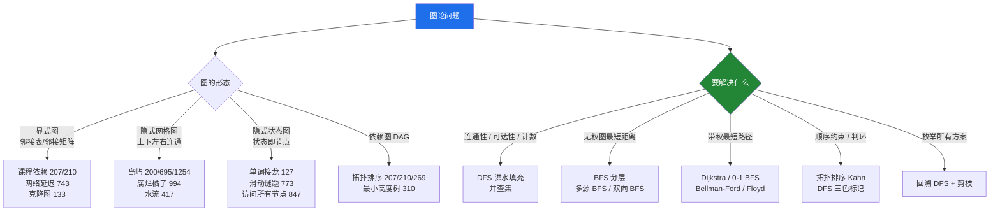
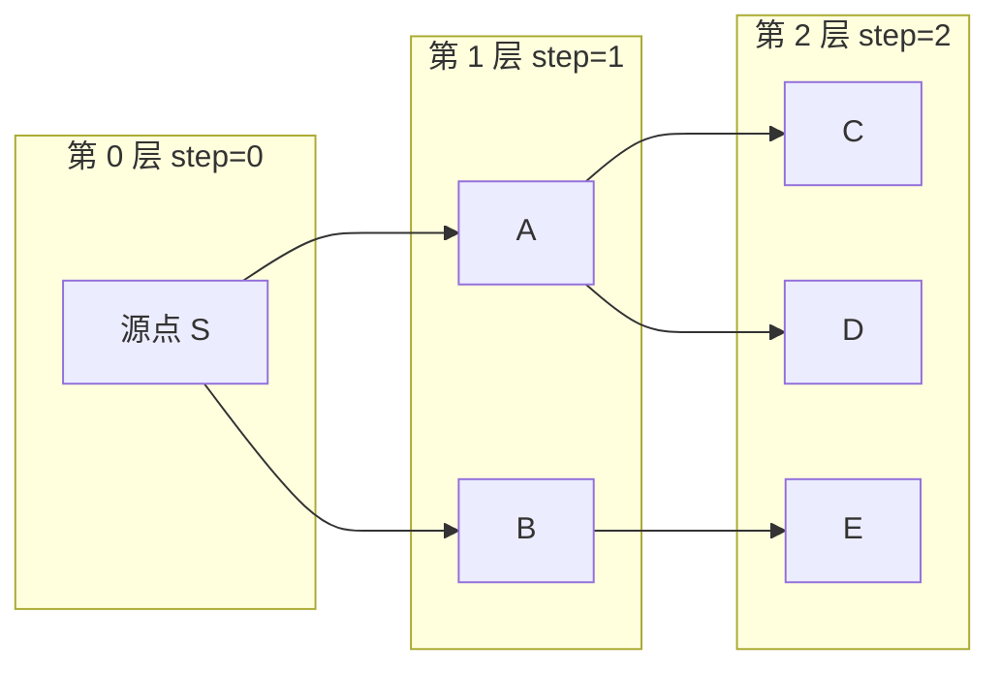
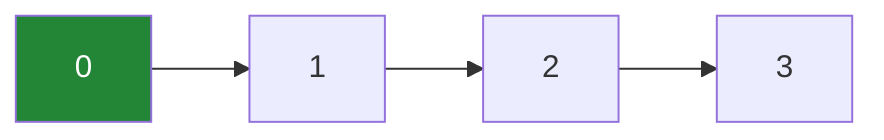
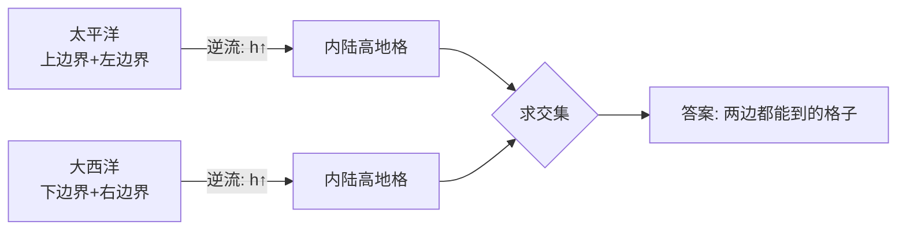
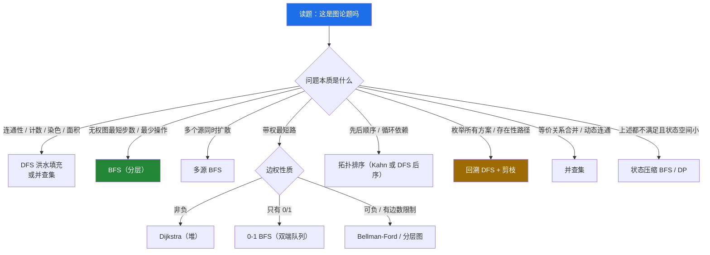

# BFS / DFS / 图论 深度知识体系

> 以 200 岛屿数量 · 994 腐烂的橘子 · 207 课程表 · 417 太平洋大西洋水流 · 79 单词搜索 五个母题为主干，
> 向上抽象出「搜索算法」的统一模型，向下铺开国内大厂真实面试题库、考核权重与逐题精解。
>
> 阅读建议：**第 1～3 章是"道"，第 4 章是"术"，第 5 章是"战"，第 6～8 章是"复盘"**。
> 时间紧只看第 4、5 章也能拿到 80% 的收益；但要能扛住面试官的追问，第 2、3 章必须吃透。

---

## 目录

| 章节 | 内容 | 直接价值 |
|---|---|---|
| 0 | 知识地图与五题知识点矩阵 | 建立全局框架 |
| 1 | 图论地基：把题目翻译成"图" | 建模能力（面试第一步） |
| 2 | DFS：递归 / 回溯 / 染色 | 200、79、417 的地基 |
| 3 | BFS：分层 / 最短 / 多源 | 994、1091、127 的地基 |
| 4 | 五大母题逐题精讲（多解法 + 图解 + 追问） | 手撕代码 |
| 5 | 大厂高频题库（S/A/B 梯队 + 考核权重 + 精解） | 面试命中率 |
| 6 | 决策树、横向对比、网格题 12 个技巧 | 临场选型 |
| 7 | 面试表达框架 + 15 个高频追问标准答法 | 表达与深挖 |
| 8 | 自测清单与复习节奏 | 长期记忆 |

---

# 0. 知识地图与五题知识点矩阵

## 0.1 全局地图



**一句话凝练**：图论题 = **建模（谁是谁的邻居）+ 选搜索方式（要连通还是要最短）+ 标记（避免重复）+ 剪枝（控制复杂度）**。四步里任何一步出错，代码都会"看起来对但过不了"。

## 0.2 五题知识点矩阵（先看这张表，再逐题深入）

| 题目 | 模型 | 核心算法 | 关键陷阱 | 复杂度 | 大厂考核度 |
|---|---|---|---|---|---|
| **200 岛屿数量** | 网格图，4 连通 | DFS/BFS 洪水填充；并查集 | 原地染色 vs visited；递归爆栈 | O(mn) | ★★★★★ |
| **994 腐烂的橘子** | 网格图 + 时间维度 | **多源 BFS** 分层 | 分钟数 = 层数 − 1；全新鲜/全腐烂边界 | O(mn) | ★★★★★ |
| **207 课程表** | 有向图（依赖） | **拓扑排序**（Kahn）/ DFS 三色 | 环检测；visited 单色标记会误判 | O(V+E) | ★★★★★ |
| **417 水流问题** | 网格图，高度单调 | **逆向 DFS/BFS + 双标记求交** | 正向暴力必超时；比较方向写反 | O(mn) | ★★★★ |
| **79 单词搜索** | 网格 + 路径约束 | **回溯 DFS** + 原地标记 | 撤销现场；复杂度 3^L 的推导 | O(mn·3^L) | ★★★★ |

> **考核度说明**：★★★★★ = 近三年一面/二面主编程题级别，出现频率极高；★★★★ = 高频，常见于二面或笔试题；★★★ = 中频，多以变形题或追问出现；★★ = 低频但知识点有价值。
> 权重基于公开面经、题库热度与题型通用性的综合估计，不同部门/年份会有波动，作参考而非绝对结论。

## 0.3 五题之间的"血缘关系"

```text
                  ┌──────────────┐
                  │  200 岛屿数量  │  ← 洪水填充母题（DFS/BFS 二选一）
                  └──────┬───────┘
         ┌───────────────┼────────────────┐
         ▼               ▼                ▼
  130 被围绕区域     695 最大面积      1254 封闭岛屿
  (边界反向灌水)     (DFS 带返回值)    (边界预处理再计数)
         │
         ▼
  417 水流问题  ← 200 的"反向思维"升级版（双源 + 求交）
  934 最短桥    ← 200 的"染色 + 多源 BFS"组合版

                  ┌──────────────┐
                  │ 994 腐烂橘子  │  ← 多源 BFS 母题（时间/层数）
                  └──────┬───────┘
         ┌───────────────┼────────────────┐
         ▼               ▼                ▼
  542 01矩阵       1162 地图分析     1091 二进制矩阵最短路
  (多源到最近0)    (多源最大距离)    (单源 8 方向最短步数)

                  ┌──────────────┐
                  │  207 课程表   │  ← 拓扑 / 判环母题
                  └──────┬───────┘
         ┌───────────────┼────────────────┐
         ▼               ▼                ▼
  210 课程表II      269 火星词典      310 最小高度树
  (输出拓扑序)     (建图+拓扑)      (剥叶法 = 拓扑的变体)

                  ┌──────────────┐
                  │  79 单词搜索  │  ← 回溯母题（棋盘上的路径枚举）
                  └──────┬───────┘
         ┌───────────────┼────────────────┐
         ▼               ▼                ▼
  212 单词搜索II    980 不同路径III    37 解数独
  (字典树剪枝)     (回溯计数)        (约束回溯）
```

**记忆方式**：把 5 道题当 5 个"母版"，每见到新题先问自己"它是哪张母版的变形"——这一步能覆盖 80% 的图论面试题。

---

# 1. 图论地基：把题目翻译成"图"

## 1.1 三类图，三种建模直觉

面试里 90% 的图论题不会直接给你 `graph` 数组，而是给你一张**网格**、一个**单词表**、一组**依赖关系**。所以第一能力是"翻译"。

### （1）显式图（Explicit Graph）
题目直接给边：`prerequisites = [[1,0]]` 表示 0→1；`times = [[2,1,1]]` 表示 2→1 权重 1；`edges = [[0,1],[1,2]]`。
- 关键动作：`List<List<Integer>> g` 或 `int[][]`，把"点对"翻译成"邻接关系"。
- 注意**边方向**：`[a, b]` 是 a→b 还是 b→a？207 的语义是 `[课程, 先修课]`，即 `b → a`。**方向搞反是最高频的低级错误**。

### （2）隐式网格图（Implicit Grid Graph）
`grid[i][j]` 是节点，上下左右（或 8 方向）是边，`grid[i][j] == 1` 决定节点是否"存在"。
- 节点编号：`id = i * n + j`，反解 `i = id / n, j = id % n`。用 int 代替 `int[]` 入队，能省掉大量对象分配（Java 面试里这是加分点）。
- 边界判定统一写成一个 `inGrid(x, y)`，避免每处手写四个比较。

### （3）隐式状态图（Implicit State Graph）——最容易被忽略、也最能拉开差距
节点不是格子，而是**一个状态**：当前单词、当前棋盘排列、当前已访问集合。
- 127 单词接龙：节点 = 单词，边 = 只差一个字母。
- 773 滑动谜题：节点 = 6 位字符串排列。
- 847 访问所有节点：节点 = `(当前节点, 已访问集合 bitmask)`。
- **判断标志**：题目出现"最少几步""最少几次操作""能否到达某个状态" → 立刻想 **BFS on state graph**。

## 1.2 三种存储结构对比

| 结构 | 空间 | 判断 u-v 是否有边 | 遍历 u 的所有邻居 | 适用 |
|---|---|---|---|---|
| 邻接矩阵 `boolean[n][n]` | O(V²) | O(1) | O(V) | 稠密图、n ≤ 1000、需要 Floyd |
| 邻接表 `List<List<Integer>>` | O(V+E) | O(deg(u)) | O(deg(u)) | **绝大多数题**（稀疏图） |
| 边列表 `edges[]` | O(E) | O(E) | O(E) | 并查集、Kruskal、只需要"合并"时 |

**面试可直接说的一句话**："图是稀疏的，我用邻接表，空间 O(V+E)；如果是稠密图或需要 Floyd 求全源最短路，才用邻接矩阵。"

补充：Java 里 `List<List<Integer>>` 的初始化写法是高频考察点——

```java
// 正确：先建桶，再放边
List<List<Integer>> g = new ArrayList<>(n);
for (int i = 0; i < n; i++) g.add(new ArrayList<>());
// 错误示范：new ArrayList<>(n) 只是给容量，里面是 0 个元素，get(i) 直接 IndexOutOfBounds
```

## 1.3 必须掌握的术语（面试官会用这些词提问）

| 术语 | 定义 | 对应题目 |
|---|---|---|
| 度 degree | 与该点相连的边数 | 310 剥叶法（叶子 = 度为 1） |
| 入度 / 出度 | 指向该点 / 从该点出发的边数 | 207、210、269、802 |
| 连通分量 | 极大连通子图 | 200、547、323 |
| 环 cycle | 从某点出发能回到自身 | 207、802、261 |
| DAG | 有向无环图 | 207、210、269 |
| 拓扑序 | 把 DAG 排成"前驱全在前"的线性序 | 210、269、1136 |
| 二分图 | 点可二染色使每条边两端异色 | 785、886 |
| 简单路径 | 不重复经过点的路径 | 79（单词搜索要求不重复使用格子） |
| 最短路径（无权） | 边数最少的路径 | 1091、994、542 |
| 中心 center | 树的偏心距最小的点 | 310 |

## 1.4 复杂度速查（背下来，面试直接答）

| 算法 | 时间 | 空间 | 备注 |
|---|---|---|---|
| DFS 遍历（邻接表） | O(V+E) | O(V) 栈 + visited | 递归栈深度可能 = V |
| BFS 遍历（邻接表） | O(V+E) | O(V) 队列 | 最坏队列存 V 个 |
| 网格 DFS/BFS | O(m·n) | O(m·n) | 每格最多进出一次 |
| 拓扑排序 Kahn | O(V+E) | O(V) | 出队顺序即拓扑序 |
| 拓扑排序 DFS 后序 | O(V+E) | O(V) | 后序**逆序**才是拓扑序 |
| 并查集（路径压缩+按秩） | 近似 O(α(n)) ≈ O(1) | O(V) | α 是反阿克曼函数 |
| Dijkstra（堆优化） | O((V+E)logV) | O(V+E) | 不能有负权 |
| Bellman-Ford | O(V·E) | O(V) | 可负权、可判负环 |
| Floyd | O(V³) | O(V²) | 全源最短路，n ≤ 500 |
| 双向 BFS | O(b^(d/2)) | 同阶 | b=分支因子，d=最短距离 |

> **易错提醒**：DFS 的复杂度不是"每个点访问一次"那么简单。**如果 visited 标记写在递归调用之后，或者只标记不回退，可能重复入栈，复杂度退化**。第 2.5 节专门讲标记时机。

---

# 2. DFS：递归即"一条路走到黑"

## 2.1 DFS 在面试里其实有三种语义，别混用

| 语义 | 目标 | 标记策略 | 典型题 |
|---|---|---|---|
| **A. 连通性遍历 / 洪水填充** | 把同一个连通块"染成一种颜色" | 标记后**不回退**（永久染色） | 200、695、130、1254、547 |
| **B. 回溯搜索（枚举方案）** | 枚举所有可行路径/组合，找一条或计数 | 标记后**必须回退**（恢复现场） | 79、212、980、37、46 |
| **C. 有向图判环（三色标记）** | 判定是否存在 back edge | 0 未访问 / 1 在栈上 / 2 已完成 | 207、802、210 |

**这是 DFS 最核心的认知分水岭**：
- **A 类**：`visited` 表示"我来过，以后不用再来"，永不清除。因为它只关心"属于哪个连通块"。
- **B 类**：`used` 表示"我正走在当前这条路径上，别人不能重复用"，**递归返回时必须撤销**。因为它关心的是"一条具体路径是否合法"。
- **C 类**：需要区分"已访问且在当前递归栈上（说明有环）"和"已访问但已出栈（说明无环）"，所以要三个状态。

> 面试官问"你这里的 visited 为什么不用撤销？"——答不出上面这层区别，基本就判定为"背模板"。第 2.5 节给出完整反例。

## 2.2 网格 DFS 模板（A 类：洪水填充）

```java
class Solution {
    private int m, n;
    private static final int[][] DIRS = {{1,0},{-1,0},{0,1},{0,-1}};

    public int numIslands(char[][] grid) {
        m = grid.length; n = grid[0].length;
        int count = 0;
        for (int i = 0; i < m; i++)
            for (int j = 0; j < n; j++)
                if (grid[i][j] == '1') { count++; dfs(grid, i, j); }
        return count;
    }

    private void dfs(char[][] g, int r, int c) {
        // 1) 越界 or 不是目标 → 直接返回（base case 写在入口，最稳）
        if (r < 0 || r >= m || c < 0 || c >= n || g[r][c] != '1') return;
        g[r][c] = '0';                      // 2) 标记：原地染色，省 visited 空间
        for (int[] d : DIRS) dfs(g, r + d[0], c + d[1]);   // 3) 扩散
    }
}
```

**模板要点（四条，每条都能被追问）**

1. **base case 放在函数入口**，而不是在循环里判断邻居。这样代码只有一处越界逻辑，不会漏。
2. **先标记再扩散**。若先扩散再标记，会出现"绕一圈回到自己"的重复递归，最坏指数级。
3. **原地染色 vs 额外 visited**：能修改输入就用原地（空间 O(1) 额外，除递归栈）；不能改（如多组测试共享输入、或需要保留原值）就用 `boolean[][] visited`。**面试要主动说"我为了省空间原地修改了输入，如果要求不破坏输入我就加 visited"**——这是加分项。
4. **方向数组**优于手写四次递归：可读、易改 8 方向、便于加权重。

### 递归深度问题（真实的工程坑）

Java 默认栈约 512KB～1MB，单帧几十字节到上百字节，**递归深度超过约 1 万就容易 `StackOverflowError`**。而网格题最坏是一条**蛇形岛屿**，深度可达 `m*n`（例如 1000×1000 的迷宫 → 10⁶ 层，必爆）。

三种应对，面试按需选一个说：

| 方案 | 做法 | 代价 |
|---|---|---|
| 改 BFS | 用队列，堆上分配 | 空间 O(mn)，最稳 |
| 显式栈 | `Deque<int[]> stack` 模拟递归 | 手写稍繁，但可控 |
| 加大栈 | `-Xss64m`（仅本地调试，线上不推荐） | 不可移植 |

```java
// 显式栈版 DFS（面试写出来很加分）
private void dfsIter(char[][] g, int sr, int sc) {
    Deque<int[]> st = new ArrayDeque<>();
    st.push(new int[]{sr, sc});
    g[sr][sc] = '0';
    while (!st.isEmpty()) {
        int[] cur = st.pop();
        for (int[] d : DIRS) {
            int x = cur[0] + d[0], y = cur[1] + d[1];
            if (x >= 0 && x < m && y >= 0 && y < n && g[x][y] == '1') {
                g[x][y] = '0';          // 关键：入栈时就标记，否则同一格会被压入多次
                st.push(new int[]{x, y});
            }
        }
    }
}
```

> **注意**：迭代版 DFS 的"入栈即标记"与递归版"进入即标记"等价；若写成"出栈才标记"，队列/栈里会堆积大量重复节点，复杂度退化（这正是第 3.3 节 BFS 的同款陷阱）。

## 2.3 回溯模板（B 类：枚举路径）

```java
void backtrack(状态) {
    if (满足结束条件) { 收集结果; return; }
    for (选择 : 当前所有可选分支) {
        if (不合法) continue;        // 剪枝
        做出选择;                    // 修改状态 / 标记
        backtrack(新状态);
        撤销选择;                    // 恢复现场（回溯的灵魂）
    }
}
```

**79 单词搜索就是"网格上的回溯"**：每一步的选择是"往四个方向走一格"，约束是"不能越界、字符要匹配、不能重复使用同一格"。

```java
private boolean dfs(char[][] b, String w, int r, int c, int k) {
    if (r < 0 || r >= m || c < 0 || c >= n || b[r][c] != w.charAt(k)) return false;
    if (k == w.length() - 1) return true;         // 找到完整单词
    char saved = b[r][c];
    b[r][c] = '#';                                 // 选择：占位，禁止回头
    boolean ok = dfs(b, w, r+1, c, k+1) || dfs(b, w, r-1, c, k+1)
              || dfs(b, w, r, c+1, k+1) || dfs(b, w, r, c-1, k+1);
    b[r][c] = saved;                               // 撤销：恢复现场
    return ok;
}
```

**回溯 vs DFS 的关系**：回溯是"带撤销 + 带剪枝"的 DFS，搜索的是一棵**决策树**（每一层代表一步选择），而普通 DFS 搜索的是**图的节点**。面试官常问"这两者区别是什么"，就答这句。

**剪枝的三个层次（79 会用到前两个）**
1. **可行性剪枝**：字符不匹配立刻返回（每层 O(1)）。
2. **顺序剪枝**：先统计 `word` 的字符频次，若 board 中某字符数量不足，直接返回 false（提前 O(mn) 换掉整棵搜索树）。
3. **最优性剪枝**：已有答案不比当前优则剪（用于"最短/最大"类，如 980 计数不能剪、1631 可剪）。

## 2.4 DFS 三色标记（C 类：有向图判环）——207 的核心

```java
// 0 = 未访问, 1 = 正在访问（在当前递归栈上）, 2 = 已完成
private int[] state;
private List<List<Integer>> g;

private boolean hasCycle(int u) {
    state[u] = 1;                          // 入栈：标记"访问中"
    for (int v : g.get(u)) {
        if (state[v] == 1) return true;    // 撞到栈上的祖先 → 存在 back edge → 有环
        if (state[v] == 0 && hasCycle(v)) return true;
    }
    state[u] = 2;                          // 出栈：标记"已完成"
    return false;
}
```

**为什么必须三色？** 反例：`0 → 1, 0 → 2, 2 → 1`（无环）。

```text
用两色（visited）：
  dfs(0) → visited[0]=true
    → dfs(1) → visited[1]=true，返回
    → dfs(2) → 看到 1 已 visited → 误判"有环" ❌
用三色：
  dfs(0): state[0]=1
    → dfs(1): state[1]=1 → state[1]=2（出栈，已完成）
    → dfs(2): 看到 state[1]==2 → 是"已完成"而非"在栈上" → 不误判 ✅
```

**一句话结论**：`state[v]==1` 表示 v 是 u 的**祖先**（真正成环）；`state[v]==2` 表示 v 只是**兄弟分支**上走过的点（不成环）。只看"访问过没有"无法区分这两种情况——这就是两色标记必然误判的根本原因。

## 2.5 DFS 的复杂度细节（面试深挖点）

- **邻接表 DFS**：每条边被检查两次（无向图）或一次（有向图），每个点入栈一次 → **O(V+E)**。
- **网格 DFS**：每格最多被标记一次，每次标记后最多检查 4 个邻居 → **O(4mn) = O(mn)**。
- **缺陷**：若标记时机错误（如出栈才标记），同一节点可能被多次入栈，复杂度可退化到 **O(V·E)** 甚至指数级。
- **空间**：递归栈深度最坏 O(V)（链状图），网格 O(mn)。

---

# 3. BFS：分层扩散 = 无权图最短路

## 3.1 队列 + 分层快照：BFS 的标准骨架

```java
Deque<Integer> q = new ArrayDeque<>();
q.offer(start);
visited[start] = true;          // 入队即标记（见 3.3）
int step = 0;
while (!q.isEmpty()) {
    int size = q.size();        // 快照：本层节点数，循环内 q.size() 会变
    for (int i = 0; i < size; i++) {
        int u = q.poll();
        if (u == target) return step;
        for (int v : neighbors(u))
            if (!visited[v]) { visited[v] = true; q.offer(v); }
    }
    step++;                     // 一层结束 → 距离 +1
}
```

**`int size = q.size()` 这一行是分层 BFS 的灵魂**：它把"队列"变成了"一层一层的波前"。如果写成 `for (int i = 0; i < q.size(); i++)`，`q.size()` 会动态变化，层次就乱了——这是 994 最常见的错误之一（表现为分钟数少算或死循环）。



## 3.2 为什么 BFS 第一次到达就是最短？（必须能证明）

**定理**：在**边权全部相等（视为 1）**的图中，BFS 首次访问节点 v 时的层数，等于 s→v 的最短路径长度。

**证明（分层归纳）**：
1. BFS 按层扩展，第 k 层节点在**第 k 轮**被访问。
2. 归纳假设：第 k 层所有节点的真实最短距离都是 k。
3. 基例 k=0：源点距离 0。归纳步：若 u 在第 k 层，其未访问邻居 v 的真实距离 ≤ k+1（经由 u）；而 v 不可能距离 < k+1，否则它早已在 ≤k 层被访问（因为所有 ≤k 层的邻居都已展开）。故 v 距离恰为 k+1。
4. 又因队列 FIFO，层序单调不降，所以 v 首次被访问时所在层就是最短路长度。∎

**必须强调的前提**：**边权相等**。一旦边权不同（如 743 网络延迟时间），BFS 的"先到即最短"立刻失效，必须换成 Dijkstra（把队列换成小顶堆，按当前距离排序）。

反例：

```text
S --(1)--> A --(1)--> T     路径长度 2
S --(100)--> T              路径长度 100
BFS 会先到 T（1 步），但它不是最短的"代价"路径 → 需要 Dijkstra
```

> 面试追问"BFS 能求最短路径吗？"——标准答法是："**无权图/等权图能，等权图等价于无权图；带权图必须 Dijkstra，可负权用 Bellman-Ford/SPFA。**"这一句能直接立住。

## 3.3 visited 标记时机：入队即标记 vs 出队标记（高频追问）

| 写法 | 后果 |
|---|---|
| **入队时标记** ✅ | 每个节点最多入队一次，队列规模 ≤ V，复杂度 O(V+E) |
| 出队时标记 ❌ | 同一节点可能被多个邻居重复入队，队列规模可达 O(E)，状态图题会**指数爆炸** |

```java
// ✅ 正确：入队前标记
if (!visited[v]) { visited[v] = true; q.offer(v); }

// ❌ 错误：出队才标记
q.offer(v);                       // 这里没标记
...
int u = q.poll();
visited[u] = true;                // 已经晚了：u 可能已在队列里躺了 5 份
```

**为什么能证明"入队即标记"不影响最短路？** 因为 BFS 按层推进，**第一次把 v 入队的那一层，就是 v 的最小层**（更早的层若有邻居能到 v，早就把 v 入队了）。所以入队时的层数已是最优，后续重复入队毫无价值。

**这个考点在 847（状态压缩 BFS）里是致命的**：状态数 12·2¹²，重复入队会让内存直接爆掉。

## 3.4 多源 BFS：虚拟超级源点（994、542、1162、934 的通用套路）

**模型**：有多个起点，求"每个点最早被哪个源点波及 / 波及所需的最短时间"。
**做法**：把所有源点**一次性全部入队**，`visited` 全部预标记，然后正常分层 BFS。
**原理**：等价于在图中新增一个**虚拟超级源点 S**，S 到每个源点连一条权 0 的边；对 S 做单源 BFS，第 k 层就是"离最近源点距离为 k"的所有点。

```text
        虚拟源 S
       /   |   \
     源A  源B  源C        ← 全部在第 0 层入队
      ↓    ↓    ↓
    第1层 第1层 第1层
```

**多源 BFS 三大变体**

| 变体 | 求什么 | 题目 |
|---|---|---|
| 多源 + 取最大层数 | 全部点被覆盖的最短时间 | 994 腐烂橘子 |
| 多源 + 求每点到最近源距离 | 距离矩阵 | 542 01 矩阵 |
| 多源 + 求最大距离 | 离陆地最远的海洋 | 1162 地图分析 |
| 多源 + 首次碰到目标即返回 | 两座岛之间的最短桥 | 934 最短的桥 |

## 3.5 双向 BFS：把 b^d 砍成 2·b^(d/2)

**适用**：已知起点和终点，图的**分支因子大、最短距离中等**（如 127 单词接龙、773 滑动谜题、433 基因变化）。
**做法**：从起点和终点各起一个队列，**每次扩展规模较小的那一侧**（关键优化，不是简单轮流），当两侧访问集出现交集即相遇。

```java
// 双向 BFS 通用骨架：begin / end 是两侧当前待扩展的层
int biBFS(Set<String> begin, Set<String> end) {
    Set<String> visBegin = new HashSet<>(begin), visEnd = new HashSet<>(end);
    int lenBegin = 1, lenEnd = 1;                 // 两侧各自的"已走层数"（起点算 1 层）

    while (!begin.isEmpty() && !end.isEmpty()) {
        if (begin.size() > end.size()) {          // 关键：永远扩展更小的一侧
            Set<String> t = begin; begin = end; end = t;
            Set<String> tv = visBegin; visBegin = visEnd; visEnd = tv;
            int tl = lenBegin; lenBegin = lenEnd; lenEnd = tl;
        }
        Set<String> next = new HashSet<>();
        for (String cur : begin) {
            for (String nb : neighbors(cur)) {
                if (visEnd.contains(nb)) return lenBegin + lenEnd;   // 相遇：两侧层数相加
                if (visBegin.add(nb)) next.add(nb);                  // 只写自己的访问集
            }
        }
        begin = next; lenBegin++;
    }
    return -1;
}
```

> **相遇公式的推导**（面试常被追问）：`begin` 这一层的节点距起点 `lenBegin` 层，`nb` 距起点 `lenBegin+1` 层；`nb` 已在 `visEnd` 中，距终点 `lenEnd` 层。两者相加时 `nb` 被数了两次，**路径层数 = lenBegin+lenEnd**（层数即单词数/节点数）。
>
> **两个必须分清的点**：① 相遇判断用**对方的**访问集（`visEnd`），② 把 `nb` 加入**自己的**访问集（`visBegin`）。常见 bug 是往对方集合里写，直接把两侧边界混在一起，结果偏小。

**复杂度对比**（b=分支因子，d=最短距离）：

| 方式 | 扩展节点数 | 例：b=10, d=10 |
|---|---|---|
| 单向 BFS | O(b^d) | 10¹⁰ |
| 双向 BFS | O(b^(d/2)) × 2 | 2×10⁵ |

**为什么快**：搜索树的"体积"随深度指数增长，从两端各走一半，指数减半——这是**指数级的降维**，不是常数优化。

## 3.6 最短路算法全家桶（一张表说清边界）

| 算法 | 适用图 | 时间 | 能否负权 | 能否判负环 | 典型题 |
|---|---|---|---|---|---|
| **BFS** | 无权/等权 | O(V+E) | — | — | 1091、994、542 |
| **0-1 BFS** | 边权只有 0/1 | O(V+E) | 否 | — | 1368（变形） |
| **Dijkstra（堆）** | 非负权 | O((V+E)logV) | 否 | — | 743、1631、1334 |
| **Bellman-Ford** | 可负权 | O(VE) | 是 | 是（第 V 轮仍松弛） | 787（K 次中转） |
| **SPFA** | 可负权（实践中快） | 最坏 O(VE) | 是 | 是（入队 ≥ V 次） | 面试少考，知道即可 |
| **Floyd** | 全源、可负权 | O(V³) | 是 | 是（`dist[i][i]<0`） | 1334、1462 |
| **A\*** | 有启发函数 | 依赖启发质量 | 否 | — | 773 进阶、游戏寻路 |

**0-1 BFS 的核心技巧**：边权只有 0 和 1 时，用 **双端队列**——权 0 的边扩展出的节点 `offerFirst`，权 1 的 `offerLast`，从而保持队列内距离单调，等价于 Dijkstra 但省掉堆的 log。
**Dijkstra 为什么不能负权**：它基于"已出堆的点距离已最终确定"这一贪心不变量，负权边可能在出堆后把距离改小，破坏不变量。

## 3.7 BFS 的空间问题与优化（大厂爱问"内存不够怎么办"）

1. **状态压缩**：用 `int` 编码坐标 (`r*n+c`) 或 bitmask（847 用 `int` 存 `(node, visitedMask)`），避免 `int[]`/对象。
2. **位图 visited**：`boolean[]` 在 Java 里每元素 1 字节，可换 `long[]` 位图，内存降 8 倍。
3. **双向 BFS**：直接把队列规模从 b^d 降到 b^(d/2)。
4. **A\* / IDA\***：用启发式函数（曼哈顿距离等）优先扩展"看起来更近"的节点。
5. **分块/滚动层**：只需保留当前层与下一层，避免存全图距离（仅在只需"层数"时可用，如 994）。

> 994 里有个漂亮的常数优化：**不必存距离数组**，只维护 `fresh` 计数和层数；一旦 `fresh==0` 立刻返回，避免无意义的空转。

---

# 4. 五大母题逐题精讲

> 每道题统一按 **①题意与建模 → ②解法谱系 → ③图解 → ④代码 → ⑤复杂度推导 → ⑥易错清单 → ⑦面试追问 → ⑧延伸变式** 八段式展开。
> 这套八段式本身就是面试的作答结构，练熟后可直接套用到任何图论题。

## 4.1 LeetCode 200 · 岛屿数量

### ① 题意与建模
`'1'` 是陆地，`'0'` 是水，**上下左右**相连的陆地算同一座岛（斜对角不算）。求岛屿个数。

- 节点：每个 `'1'` 格。
- 边：相邻（4 方向）且都是 `'1'`。
- 问题：**连通分量个数**。

**建模一句话**："这是求无向图连通块数量的问题；网格是隐式图，我用洪水填充给每个连通块染色并计数。"

### ② 解法谱系（面试至少会两种，能说第三种是加分）

| # | 方法 | 时间 | 空间 | 特点 |
|---|---|---|---|---|
| 1 | DFS 洪水填充（原地染色） | O(mn) | O(mn) 递归栈 | 代码最短，主流答案 |
| 2 | BFS 洪水填充（队列） | O(mn) | O(min(m,n))～O(mn) | 不怕爆栈，适合大网格 |
| 3 | 并查集（只向右/向下合并） | O(mn·α) | O(mn) | 支持**动态加陆地**（变式 305） |
| 4 | 显式栈 DFS | O(mn) | O(mn) | 规避 StackOverflow |

### ③ 图解（同一张网格的三种视角）

```text
输入 grid:                    连通块视角:
  1 1 0 0 0                    ┌─A─┐
  1 1 0 0 0        →           │A A│ 0 0 0      A = 岛1 (4格)
  0 0 1 0 0                    │A A│ 0 0 0
  0 0 0 1 1                    0 0 ┌B┐ 0 0      B = 岛2 (1格)
  0 0 0 1 1                    0 0 │B│ 0 0      C = 岛3 (4格)
                               0 0 0 ┌C─C┐
                               0 0 0 │C C│
                               0 0 0 └C─C┘
```

DFS 的扩散顺序（从 (0,0) 出发，方向数组顺序 下→上→右→左）：

```text
step1  (0,0)→标记   step2  (1,0)→标记   step3  (1,1)→标记   step4  全邻接已标记，回溯
   0 0 0 0 0            0 0 0 0 0            0 0 0 0 0
   1 1 0 0 0            0 1 0 0 0            0 0 0 0 0
   0 0 1 0 0            0 0 1 0 0            0 0 1 0 0
```

### ④ 代码（三版并列，建议背第 1、3 版）

**版本 1：DFS 原地染色**

```java
class Solution {
    private int m, n;
    private static final int[][] DIRS = {{1,0},{-1,0},{0,1},{0,-1}};

    public int numIslands(char[][] grid) {
        if (grid == null || grid.length == 0) return 0;
        m = grid.length; n = grid[0].length;
        int islands = 0;
        for (int i = 0; i < m; i++)
            for (int j = 0; j < n; j++)
                if (grid[i][j] == '1') { islands++; dfs(grid, i, j); }
        return islands;
    }

    private void dfs(char[][] g, int r, int c) {
        if (r < 0 || r >= m || c < 0 || c >= n || g[r][c] != '1') return;
        g[r][c] = '0';                                   // 淹掉，等价于 visited
        for (int[] d : DIRS) dfs(g, r + d[0], c + d[1]);
    }
}
```

**版本 2：BFS（用 int 编码坐标，避免每格 new 一个数组）**

```java
class Solution {
    public int numIslands(char[][] grid) {
        int m = grid.length, n = grid[0].length, islands = 0;
        int[][] dirs = {{1,0},{-1,0},{0,1},{0,-1}};
        Deque<Integer> q = new ArrayDeque<>();
        for (int i = 0; i < m; i++) {
            for (int j = 0; j < n; j++) {
                if (grid[i][j] != '1') continue;
                islands++;
                grid[i][j] = '0';
                q.offer(i * n + j);
                while (!q.isEmpty()) {
                    int id = q.poll(), r = id / n, c = id % n;
                    for (int[] d : dirs) {
                        int x = r + d[0], y = c + d[1];
                        if (x >= 0 && x < m && y >= 0 && y < n && grid[x][y] == '1') {
                            grid[x][y] = '0';               // 入队即标记
                            q.offer(x * n + y);
                        }
                    }
                }
            }
        }
        return islands;
    }
}
```

**版本 3：并查集（每个 `'1'` 初始为独立集合，向右/向下合并）**

```java
class Solution {
    private int[] parent;
    private int count;

    private int find(int x) {
        return parent[x] == x ? x : (parent[x] = find(parent[x]));   // 路径压缩
    }

    private void union(int a, int b) {
        int ra = find(a), rb = find(b);
        if (ra != rb) { parent[ra] = rb; count--; }                  // 合并成功才减 1
    }

    public int numIslands(char[][] grid) {
        int m = grid.length, n = grid[0].length;
        parent = new int[m * n];
        count = 0;
        for (int i = 0; i < m; i++)
            for (int j = 0; j < n; j++)
                if (grid[i][j] == '1') { parent[i * n + j] = i * n + j; count++; }
        for (int i = 0; i < m; i++) {
            for (int j = 0; j < n; j++) {
                if (grid[i][j] != '1') continue;
                if (i + 1 < m && grid[i + 1][j] == '1') union(i * n + j, (i + 1) * n + j);
                if (j + 1 < n && grid[i][j + 1] == '1') union(i * n + j, i * n + j + 1);
            }
        }
        return count;
    }
}
```

> **为什么只合并"右"和"下"就够了？** 因为每个相邻对 (u,v) 都会被"上/左"那一侧枚举一次，只朝两个方向合并即可覆盖所有边，不重不漏，把常数减半。

### ⑤ 复杂度推导
- 时间：每个格子最多被访问 1 次（染色后不再进入），每次 O(1) 检查 4 个邻居 → **O(mn)**。
- 空间：DFS 递归栈最深 O(mn)（蛇形岛屿）；BFS 队列最宽 O(min(m,n))～O(mn)（一层波前）；并查集 O(mn)。

### ⑥ 易错清单
1. `grid[i][j] != '1'` 写成 `== 1`（char 与 int 混淆）。
2. 忘了 base case 里的**越界**判断，先访问 `g[r][c]` 再判越界 → 数组越界。
3. **斜对角**也算连通（8 方向）——题目明确只要 4 方向。
4. 用 `visited` 却忘了初始化为 false，或复用成员变量在多次调用间未清理（LeetCode 多用例会串数据）。
5. 递归版在 1000×1000 的蛇形输入上 `StackOverflowError`（本地能过、评测机偶发）。

### ⑦ 面试追问预演

| 追问 | 标准答法 |
|---|---|
| 为什么是 O(mn)？ | 每格染色后不再进入，总访问次数 = 格子数，是**均摊**分析。 |
| DFS 会爆栈怎么办？ | 改 BFS 或显式栈；说明递归深度最坏 m·n。 |
| 如果岛屿会动态增加（加陆地）？ | 并查集：新陆地加入时 count++，与四邻合并 count--，单次 O(α)。 |
| 求最大岛屿面积？ | DFS 返回 `1 + 四方向面积和` → 695。 |
| 求岛屿周长？ | 每格 4 边，每有一条相邻陆地减 2 → 463。 |
| 岛屿定义改成 8 连通？ | 方向数组换成 8 个，其余不变。 |
| 不允许修改输入？ | 加 `boolean[][] visited`，空间 O(mn)。 |

### ⑧ 延伸变式（按难度排序）
- **695 岛屿的最大面积**（DFS 带返回值）
- **463 岛屿的周长**（贡献法计数）
- **130 被围绕的区域**（从边界反向灌水，O(mn) 一次解决）
- **1254 统计封闭岛屿**（先把边界陆地淹掉，再数内部）
- **694 不同岛屿的数量**（形状哈希，DFS 记录相对坐标）
- **305 岛屿数量 II**（并查集 + 动态加点）
- **1020 飞地**（与 130 同构）
- **1905 统计子岛屿**（双网格与运算后求连通块）

---

## 4.2 LeetCode 994 · 腐烂的橘子

### ① 题意与建模
每分钟，每个腐烂橘子会让**上下左右**的新鲜橘子腐烂。求让所有橘子腐烂所需的最少分钟数；不可能则 `-1`。

- 节点：每个橘子格。
- 边：4 邻接。
- **多个源点同时扩散**，且**边权为 1（每分钟一步）**。
- 问题：**多源最短路径的"最大距离"**。

**建模一句话**："这是多源 BFS：把所有腐烂橘子当作第 0 层同时入队，每扩一层代表 1 分钟，最后看最远的新鲜橘子在第几层。"

### ② 解法谱系

| 方法 | 说明 | 评价 |
|---|---|---|
| **多源 BFS（推荐）** | 全部腐烂橘子入队，分层扩散 | O(mn)，最标准 |
| 单源 BFS 枚举所有腐烂橘子取最小 | 对每个源做一次 BFS，逐格取 min | O(mn·k)，k 为源数 → 超时 |
| DFS + 记忆化 | 对每格求到最近源的距离 | 有环/平台时易死循环，不推荐 |
| 多源 BFS + 时间戳数组 | 记录每格被"点燃"的分钟 | 与标准解等价，便于输出每格时间 |

### ③ 图解（时间轴最关键）

```text
t=0（初始）           t=1                 t=2                 t=3
2 1 1                2 2 1               2 2 2               2 2 2
1 1 0        →       2 2 0       →       2 2 0       →       2 2 0
0 1 1                1 1 1               2 2 2               2 2 2
                      (刚扩一层)          (再扩一层)          (全部腐烂)

分钟数 = 层数 - 1 = 3。注意：初始层（t=0）不计 1 分钟。
```

队列内容（分层快照）：

```text
第0层队列: [(0,0)]                      → minutes=0
第1层队列: [(0,1),(1,0)]                → 扩完 minutes=1
第2层队列: [(0,2),(1,1),(2,1)]          → 扩完 minutes=2
第3层队列: [(2,2)]                      → 扩完 minutes=3, fresh=0 → 返回 3
```

### ④ 代码

```java
class Solution {
    public int orangesRotting(int[][] grid) {
        int m = grid.length, n = grid[0].length;
        Deque<int[]> q = new ArrayDeque<>();
        int fresh = 0;
        for (int i = 0; i < m; i++) {
            for (int j = 0; j < n; j++) {
                if (grid[i][j] == 1) fresh++;
                else if (grid[i][j] == 2) q.offer(new int[]{i, j});   // 多源全部入队
            }
        }
        if (fresh == 0) return 0;                 // 边界 1：本来就没有新鲜橘子

        int minutes = 0;
        int[][] dirs = {{1,0},{-1,0},{0,1},{0,-1}};

        while (!q.isEmpty() && fresh > 0) {       // 优化：fresh==0 立即停，不做无用层
            int size = q.size();                  // 快照：本层橘子数
            for (int k = 0; k < size; k++) {
                int[] cur = q.poll();
                for (int[] d : dirs) {
                    int x = cur[0] + d[0], y = cur[1] + d[1];
                    if (x >= 0 && x < m && y >= 0 && y < n && grid[x][y] == 1) {
                        grid[x][y] = 2;           // 入队即标记（等价 visited）
                        fresh--;
                        q.offer(new int[]{x, y});
                    }
                }
            }
            minutes++;                            // 一整层扩完 = 过 1 分钟
        }
        return fresh == 0 ? minutes : -1;         // 边界 2：还有新鲜橘子 → 不可达
    }
}
```

### ⑤ 复杂度推导
- 时间：每格入队出队各 1 次，每次检查 4 邻居 → **O(mn)**。
- 空间：队列最多 O(mn)；无额外距离数组（用 `grid` 原地改值）。

### ⑥ 易错清单（这题的坑几乎全在"分钟数语义"上）
1. **初始层算成第 1 分钟** → 答案普遍大 1（最常见）。
2. 用 `for (int i = 0; i < q.size(); i++)` → `q.size()` 动态增长，层次乱套。
3. 忘记 `fresh == 0` 提前返回 → `[0]` 这类用例返回 0 也可能对，但 `[[1]]` 返回 1 就错（应为 -1）。
4. 忘 `fresh` 计数，用"遍历全图检查是否还有 1"每轮扫一遍 → O((mn)²)。
5. `minutes++` 位置写错（写成在 `poll` 后自增）→ 每处理一个橘子加 1 分钟。
6. 把 0（空格）当可传播 → 只有 1 能变 2。

### ⑦ 面试追问预演

| 追问 | 标准答法 |
|---|---|
| 为什么多源 BFS 能得到"最短时间"？ | 等价于加一个虚拟超级源点做单源 BFS，BFS 第 k 层 = 距离 k。 |
| 为什么答案是层数减一？ | 源点在第 0 层，第 k 层对应第 k 分钟；最后一层扩完时 minutes 已累计层数。 |
| 如何输出每个橘子被腐烂的时间？ | 维护 `int[][] time`，扩展时 `time[nx][ny] = time[cur]+1`。 |
| 如果腐烂有不同"毒力"（不同传播速度）？ | 变成多源带权最短路 → 多源 Dijkstra（把源点距离设为 0 入堆）。 |
| 若橘子会"复原"？ | 不再是单调扩散，BFS 失效，需状态搜索/模拟。 |

### ⑧ 延伸变式
- **542 01 矩阵**（多源 BFS 求每点到最近 0 的距离）
- **1162 地图分析**（多源 BFS 求最大距离）
- **1091 二进制矩阵中的最短路径**（单源、8 方向、带障碍）
- **934 最短的桥**（先 DFS 染色一座岛，再把它当多源做 BFS）
- **1926 迷宫中离入口最近的出口**（单源 BFS + 出口判定）
- **2258 逃离火灾**（人火双 BFS，比较到达时间）

---

## 4.3 LeetCode 207 · 课程表

### ① 题意与建模
`prerequisites[i] = [a, b]` 表示**修 a 之前必须先修 b**，即依赖边 **b → a**。判断能否修完所有课。

- **能修完 ⟺ 依赖图是 DAG（无环）**。
- 问题：**有向图环检测**。

**建模一句话**："把课程当点、先修关系当有向边，问题转化为判定这张有向图是否存在环。"

> ⚠️ **方向是本题第一大坑**：`[a,b]` 是 "a 依赖 b"，边应该是 `b → a`。方向反了，Kahn 和 DFS 都会给出错误答案，而且小样例可能仍然"碰巧正确"。

### ② 解法谱系

| 方法 | 核心 | 时间 | 空间 | 优点 | 缺点 |
|---|---|---|---|---|---|
| **Kahn（BFS 拓扑）** | 入度为 0 入队，剥点减入度 | O(V+E) | O(V+E) | 直观、易输出拓扑序、易检测环 | 需额外入度数组 |
| **DFS 三色** | 遇 `state==1` 即成环 | O(V+E) | O(V+E) | 不需要入度，天然适合"依赖链"思维 | 递归深度风险，状态含义易写错 |
| 并查集 | — | — | — | ❌ **不适用**：并查集只能处理无向图连通性，不能判有向环 | 面试陷阱题 |

> **面试官特别爱问**："这题能用并查集吗？"答案：**不能**。并查集合并的是"等价关系"（无向、对称），有向图的 1→2、2→1 在并查集里会被合并成同一集合，无法区分"有没有环"，也无法表达先后。这是区分"背过并查集"和"真懂"的经典问题。

### ③ 图解（Kahn 的剥离过程）

```text
课程: 0,1,2,3   依赖: [1,0] [2,1] [3,2]   即 0→1→2→3

初始入度: 0:0, 1:1, 2:1, 3:1    队列: [0]
剥 0 → 1 入度变 0，入队                 队列: [1]       已完成:1
剥 1 → 2 入度变 0，入队                 队列: [2]       已完成:2
剥 2 → 3 入度变 0，入队                 队列: [3]       已完成:3
剥 3 → 无后继                          队列: []        已完成:4 == V ✅

有环的情况: 0→1→2→0
初始入度全为 1 → 队列空 → 已完成 0 ≠ 3 → 返回 false ✅
```



DFS 三色视角：

```text
dfs(0): state[0]=1
  └ dfs(1): state[1]=1
      └ dfs(2): state[2]=1
          └ 遇到 state[0]==1 → back edge → 有环 → false
```

### ④ 代码（两版都要会）

**版本 1：Kahn 拓扑排序**

```java
class Solution {
    public boolean canFinish(int numCourses, int[][] prerequisites) {
        List<List<Integer>> g = new ArrayList<>(numCourses);
        for (int i = 0; i < numCourses; i++) g.add(new ArrayList<>());
        int[] indeg = new int[numCourses];

        for (int[] p : prerequisites) {
            g.get(p[1]).add(p[0]);      // 先修 p[1] → 后修 p[0]
            indeg[p[0]]++;
        }

        Deque<Integer> q = new ArrayDeque<>();
        for (int i = 0; i < numCourses; i++) if (indeg[i] == 0) q.offer(i);

        int finished = 0;
        while (!q.isEmpty()) {
            int u = q.poll();
            finished++;
            for (int v : g.get(u)) {
                if (--indeg[v] == 0) q.offer(v);   // 前驱全部完成 → 可以修了
            }
        }
        return finished == numCourses;              // 没能剥完全部点 = 有环
    }
}
```

**版本 2：DFS 三色标记**

```java
class Solution {
    private List<List<Integer>> g;
    private int[] state;   // 0 未访问 / 1 访问中 / 2 已完成

    public boolean canFinish(int numCourses, int[][] prerequisites) {
        g = new ArrayList<>(numCourses);
        for (int i = 0; i < numCourses; i++) g.add(new ArrayList<>());
        for (int[] p : prerequisites) g.get(p[1]).add(p[0]);
        state = new int[numCourses];

        for (int i = 0; i < numCourses; i++)
            if (state[i] == 0 && hasCycle(i)) return false;
        return true;
    }

    private boolean hasCycle(int u) {
        state[u] = 1;
        for (int v : g.get(u)) {
            if (state[v] == 1) return true;                    // 撞到祖先 → 环
            if (state[v] == 0 && hasCycle(v)) return true;      // 继续深入
        }
        state[u] = 2;                                           // 出栈，标记完成
        return false;
    }
}
```

### ⑤ 复杂度推导
- 建图：遍历 E 条边，O(E)。
- Kahn：每个点入队出队 1 次，每条边被检查 1 次 → O(V+E)。
- DFS：每个点进入一次，每条边检查一次 → O(V+E)。
- 空间：邻接表 O(V+E)，入度/状态数组 O(V)，队列 O(V)。

### ⑥ 易错清单
1. **边方向写反**（`g.get(p[0]).add(p[1])`）。
2. `--indeg[v] == 0` 写成 `indeg[v]-- == 0`（先比较后减，逻辑错）。
3. DFS 用两色 `boolean visited` → 兄弟分支误判成环（见 2.4 反例）。
4. DFS 忘记 `state[u] = 2`（不标完成），导致同一分支被重复深入，甚至误判。
5. Kahn 用 `finished == numCourses - 1` 之类的边界错误。
6. `numCourses = 0` / `prerequisites` 为空：Kahn 返回 true（正确），但代码若初始化队列遗漏会 false。

### ⑦ 面试追问预演（这题是"追问重灾区"）

| 追问 | 标准答法 |
|---|---|
| 为什么"剥完所有点"就等价于无环？ | DAG 必有入度 0 的点；删去它不改变无环性。若图有环，环上每点入度恒 ≥1，永远剥不掉。 |
| DFS 的后序为什么能当拓扑序？ | 后序是"所有后继都已完成才记录自己"，**逆后序**保证每条边 u→v 中 v 排在 u 之后。 |
| 两种方法怎么选？ | 只需判环 → 都行；需输出顺序 → Kahn 直接出队顺序即可；需处理"字典序最小拓扑序" → Kahn + 优先队列。 |
| 为什么字典序最小要用优先队列？ | Kahn 队列里同时有多个可修课程，字典序要求每次选编号最小的，用小顶堆替代普通队列。 |
| 图不连通有影响吗？ | 无影响。Kahn 初始把所有入度 0 入队，天然覆盖多连通分量；DFS 外层 for 循环遍历所有未访问点。 |
| 如果有环，怎么输出环？ | Kahn 结束后所有"未出队"的点即环上点及其下游；要精确环需 DFS 记录栈路径。 |

### ⑧ 延伸变式
- **210 课程表 II**（输出任意拓扑序，Kahn 出队即答案）
- **269 火星词典**（从字典序反推字符依赖，建图 + 拓扑；需处理非法前缀）
- **310 最小高度树**（无向图"剥叶"，拓扑排序的变体）
- **802 找到最终的安全状态**（反向图 + 出度拓扑剥除）
- **1136 并行课程**（拓扑 + 按学期分层，问最少学期数）
- **1462 课程表 IV**（传递闭包，Floyd/位运算）

---

## 4.4 LeetCode 417 · 太平洋大西洋水流问题

### ① 题意与建模
`heights[r][c]` 是高度。水从一格流向**上下左右**中**高度不高于自己**的相邻格。左/上边界邻太平洋，右/下边界邻大西洋。求既能流到太平洋又能流到大西洋的所有格子坐标。

- 节点：格子。
- **有向边**：`(r,c) → (nr,nc)` 当且仅当 `heights[nr][nc] <= heights[r][c]`。
- 问题：**同时属于"能到达太平洋集合"与"能到达大西洋集合"的交集**。

### ② 解法谱系

| 方法 | 思路 | 复杂度 | 结论 |
|---|---|---|---|
| 正向暴力 | 对每格 DFS 搜索是否能到两个洋 | 每格 O(mn) → **O(m²n²)**，且平台地形可能指数级 | ❌ 超时 |
| 正向 + 记忆化 | 每格记录可达性 | 状态依赖"路径上的 visited"，**记忆化不成立**（路径不同结果不同） | ❌ 逻辑不成立 |
| **逆向双流 BFS/DFS** ✅ | 从两个洋的边界**逆流而上**（往更高/等高的邻居走），求两个可达集合的交集 | **O(mn)** | 标准解 |
| 逆向 + 单次多标记 | 用 `int` 状态 1/2/3 表示"可达太平洋/大西洋/两者" | O(mn) | 空间更省 |

**为什么正向会超时（量化）**：m=n=200 → 每格最坏搜遍全图 4×10⁴，总 1.6×10⁹，Java 也会超。而 200×200 是常见数据规模，所以正向解必然 TLE。

### ③ 图解：为什么"反过来走"是等价的

```text
正向：水从高往低流
   (2,2)=5 ──→ (2,1)=3 ──→ (0,0)=1 ──→ 太平洋
   规则：h[邻居] <= h[当前]

逆向：从洋边界往高处"爬"
   太平洋边界 ──→ 邻居若 h[邻居] >= h[当前] 则可达
   因为 "c 能流到 n" ⟺ "h[n] <= h[c]" ⟺ "从 n 逆流可达 c（h[c] >= h[n]）"

两条规则互为逆否，可达集合完全相同。
```



**核心洞察（面试必须说出来）**：
- 正向是"多对一"（很多格子流向少数边界），要枚举每个起点 → 贵。
- 逆向是"少对多"（从 O(m+n) 个边界格出发做一次遍历），**把源点数量从 mn 降到 m+n**，并且每个格子只被标记一次 → O(mn)。
- **单调性**（高度不减方向）保证逆向遍历是 DAG 式扩散，不会死循环；`visited` 让平台（等高）区域也只处理一次。

### ④ 代码（DFS 逆向，最标准）

```java
class Solution {
    private int m, n;
    private static final int[][] DIRS = {{1,0},{-1,0},{0,1},{0,-1}};

    public List<List<Integer>> pacificAtlantic(int[][] heights) {
        m = heights.length; n = heights[0].length;
        boolean[][] pac = new boolean[m][n];
        boolean[][] atl = new boolean[m][n];

        // 太平洋：上边界 + 左边界
        for (int j = 0; j < n; j++) dfs(heights, pac, 0, j);
        for (int i = 0; i < m; i++) dfs(heights, pac, i, 0);
        // 大西洋：下边界 + 右边界
        for (int j = 0; j < n; j++) dfs(heights, atl, m - 1, j);
        for (int i = 0; i < m; i++) dfs(heights, atl, i, n - 1);

        List<List<Integer>> res = new ArrayList<>();
        for (int i = 0; i < m; i++)
            for (int j = 0; j < n; j++)
                if (pac[i][j] && atl[i][j]) res.add(Arrays.asList(i, j));
        return res;
    }

    private void dfs(int[][] h, boolean[][] seen, int r, int c) {
        if (seen[r][c]) return;
        seen[r][c] = true;                                  // 进入即标记，永不回退（A 类 DFS）
        for (int[] d : DIRS) {
            int x = r + d[0], y = c + d[1];
            if (x < 0 || x >= m || y < 0 || y >= n || seen[x][y]) continue;
            if (h[x][y] >= h[r][c]) dfs(h, seen, x, y);      // 逆向：只能往"不低于自己"走
        }
    }
}
```

**BFS 版**（怕递归爆栈时用，逻辑完全同构）：

```java
private void bfs(int[][] h, boolean[][] seen, Deque<int[]> q) {
    while (!q.isEmpty()) {
        int[] cur = q.poll();
        for (int[] d : DIRS) {
            int x = cur[0] + d[0], y = cur[1] + d[1];
            if (x < 0 || x >= m || y < 0 || y >= n || seen[x][y]) continue;
            if (h[x][y] >= h[cur[0]][cur[1]]) {
                seen[x][y] = true;
                q.offer(new int[]{x, y});
            }
        }
    }
}
// 调用：先把边界全部 seen=true 并入队，再 bfs
```

### ⑤ 复杂度推导
- 时间：两个洋各做一次遍历，每格最多标记一次，每次检查 4 邻居 → **O(mn)**。
- 空间：两个 `boolean[m][n]` → O(mn)；DFS 栈最坏 O(mn)。
- 对比：正向暴力 O(m²n²) → 逆向 O(mn)，**降了两个数量级**。

### ⑥ 易错清单
1. **比较方向写反**：逆向要 `h[邻居] >= h[当前]`，写成 `<=` 就变成"向低处走"，答案几乎为空。
2. 边界初始化遗漏一角：太平洋是**上边界 ∪ 左边界**，大西洋是**下边界 ∪ 右边界**（不是"左上"和"右下"两条线）。
3. 用 `>=` 还是 `>`：等高可以流动（平台），必须用 `>=`。用 `>` 会漏掉整片平台。
4. `seen` 初始化后忘记在 DFS 入口标记，导致平台区域无限递归。
5. 结果顺序：题目接受任意顺序，但若要求字典序需排序。
6. 单行/单列输入（m=1 或 n=1）：同一格可能同时邻两个洋，代码要能正确处理（上述循环天然满足）。

### ⑦ 面试追问预演

| 追问 | 标准答法 |
|---|---|
| 为什么正向不行？ | 需要对 O(mn) 个起点各做一次 O(mn) 搜索，O(m²n²)；且平台地形下路径状态无法记忆化。 |
| 逆向为什么不会漏解？ | 正向可达关系与逆向可达关系互为逆否（`h[n]<=h[c]` ⟺ 逆向 `h[c]>=h[n]`），集合完全一致。 |
| 能不能只用一个数组？ | 可以，用 `byte[][] state`，1=太平洋可达，2=大西洋可达，3=两者；最后取 state==3。 |
| 这题和 130 有什么共性？ | 都是"**从边界反向灌水**"的套路：正向难以枚举起点时，从边界出发一次遍历。 |
| 如果是 8 方向？ | 只改方向数组，其余不变。 |

### ⑧ 延伸变式
- **130 被围绕的区域**（边界反向标记，剩余翻转）
- **1254 统计封闭岛屿**（先把边界连通陆地淹掉）
- **1020 飞地**（同 130）
- **1905 统计子岛屿**
- **778 水位上升的泳池中游泳**（二分 + BFS/Dijkstra）
- **1631 最小体力消耗路径**（Dijkstra 变体）

---

## 4.5 LeetCode 79 · 单词搜索

### ① 题意与建模
在 `board` 中找是否存在一条**上下左右相邻、不重复使用同一格**的路径，按顺序拼出 `word`。

- 节点：格子。
- 边：4 邻接。
- 约束：路径**简单**（不重复访问）、字符顺序必须匹配。
- 问题：**在网格上枚举路径**（存在性判定）。

**建模一句话**："这是网格上的回溯搜索：每个格子都可能是起点，每一步有 4 个方向，用原地标记禁止回头，走不通就撤销重试。"

### ② 解法谱系

| 方法 | 说明 | 复杂度 |
|---|---|---|
| **回溯 DFS（原地标记）** ✅ | 每格起步，逐字符匹配，`'#'` 占位 | O(mn·3^(L-1)) |
| 回溯 + visited 数组 | 不改输入，额外空间 | 同阶，空间 +O(mn) |
| BFS | ❌ 不适用：BFS 无法维护"当前路径用了哪些格"，状态需要 (位置, 路径集合)，状态爆炸 | — |
| DFS + 字符频次预检 | 先比较字符计数，不足直接 false | 剪掉整棵树 |
| 双向/首尾同时搜 | 从 word 两端同时搜索，减少分支 | 常数优化 |

> **为什么这题不能用 BFS？** 因为 BFS 的第 k 层需要知道"我是从哪条路径来的"，而不同路径占用的格子不同，状态必须包含**路径集合**（指数级）。DFS 天然带着"当前栈上的路径"这一隐式状态，只需 O(L) 的递归栈就能表达。**这是"存在性路径搜索用 DFS、最短距离用 BFS"这一选型原则的根源。**

### ③ 图解（回溯的"做选择—撤销"）

```text
board =                word = "ABCC"
A B C E
S F C S
A D E E

搜索路径（成功的分支）：
[A]→[B]→[C]→[C]
(0,0) (0,1) (0,2) (1,2)

失败分支示例：
从 (0,0)=A 出发 → 右到 B → 右到 C → 下到 C ✅（成功）
从 (2,0)=A 出发 → 右到 D → 上到 F → 右到 C → 需要 C，右侧是 S ❌ → 撤销，回溯
```

DFS 调用树（局部）：

```text
dfs(0,0,0) "A" ✅
 ├─ dfs(0,1,1) "AB" ✅
 │   ├─ dfs(0,2,2) "ABC" ✅
 │   │   ├─ dfs(0,3,3) 'E'≠'C' ❌
 │   │   ├─ dfs(1,2,3) "ABCC" ✅✅ 返回 true
 │   │   ├─ dfs(0,1,3) 已占用 ❌
 │   │   └─ dfs(-1,2,3) 越界 ❌
 │   ├─ dfs(1,1,2) 'F'≠'C' ❌
 │   └─ ...
 ├─ dfs(1,0,1) 'S'≠'B' ❌
 └─ ...
```

### ④ 代码

**基础版（原地标记，最常考）**

```java
class Solution {
    private int m, n;
    private static final int[][] DIRS = {{1,0},{-1,0},{0,1},{0,-1}};

    public boolean exist(char[][] board, String word) {
        m = board.length; n = board[0].length;
        for (int i = 0; i < m; i++)
            for (int j = 0; j < n; j++)
                if (dfs(board, word, i, j, 0)) return true;
        return false;
    }

    private boolean dfs(char[][] b, String w, int r, int c, int k) {
        if (r < 0 || r >= m || c < 0 || c >= n || b[r][c] != w.charAt(k)) return false;
        if (k == w.length() - 1) return true;              // 最后一个字符匹配成功

        char saved = b[r][c];
        b[r][c] = '#';                                      // 选择：占位
        for (int[] d : DIRS) {
            if (dfs(b, w, r + d[0], c + d[1], k + 1)) {
                b[r][c] = saved;                            // 找前先恢复，避免污染
                return true;                                 // 短路返回，剪掉其余分支
            }
        }
        b[r][c] = saved;                                     // 撤销
        return false;
    }
}
```

**进阶版（带频次预检 + 首字母过滤，面试加分）**

```java
public boolean exist(char[][] board, String word) {
    int m = board.length, n = board[0].length;
    int[] cnt = new int[128];
    for (char[] row : board) for (char ch : row) cnt[ch]++;
    for (char ch : word.toCharArray()) if (--cnt[ch] < 0) return false;   // 剪枝 1：字符总量不足

    // 剪枝 2：若首字母在 board 中更稀缺，就从"更稀缺的那一端"开始搜（双向优化）
    if (cnt[word.charAt(0)] > cnt[word.charAt(word.length() - 1)])
        word = new StringBuilder(word).reverse().toString();

    for (int i = 0; i < m; i++)
        for (int j = 0; j < n; j++)
            if (dfs(board, word, i, j, 0)) return true;
    return false;
}
```

### ⑤ 复杂度推导（面试必答，且要能推）

- 起点数：`m*n`。
- 从任一起点出发，第 1 步有 4 个方向；**之后每一步最多 3 个方向**（不能原地回头，因为来路已被标记）。
- 深度 = `L = word.length()`。
- 总：**O(m·n·4·3^(L-1)) = O(m·n·3^L)**。
- 空间：O(L) 递归栈（原地标记不额外占空间）。

**为什么不是 O(mn·4^L)**：因为已访问的格子被 `'#'` 标记，回不了头，所以从第 2 层开始分支因子是 3。这是本题最常被追问的复杂度推导细节。

**边界值**：`L ≤ 15`，`m,n ≤ 6`（LeetCode 原题范围），所以 3^15 ≈ 1.4×10⁷ 是可接受的。

### ⑥ 易错清单
1. **忘记撤销**（`b[r][c] = saved`）→ 一次失败后整块棋盘被污染，后续起点全错。
2. 在 `return true` 前忘记恢复 → 虽然本题只返回 bool 不影响结果，但若外层还要用 board（如 212）就出错。
3. `k == w.length()-1` 判断漏掉 → 会多走一层或越界。
4. 越界判断写在 `charAt` 之后 → `StringIndexOutOfBounds`。
5. 用 `visited` 但只在入口标记、不撤销 → 变成"连通块"语义，错误。
6. 方向数组写成 8 方向 → 斜向移动违反题意。
7. 空字符串 / 单字符 / board 为空的边界没处理。

### ⑦ 面试追问预演

| 追问 | 标准答法 |
|---|---|
| 为什么用 DFS 不用 BFS？ | 需要"当前路径占用集合"作为状态，BFS 必须显式携带路径集合 → 指数状态；DFS 用递归栈隐式携带，O(L)。 |
| 复杂度怎么来的？ | 起点 mn，首步 4 分支，之后 3 分支，深度 L → O(mn·3^L)。 |
| 如果 board 很大、word 很多（212）？ | 把所有 word 建**字典树**，一次 DFS 同时匹配多个词，边走边判前缀，剪枝掉大量分支。 |
| 能不能用并查集？ | 不能，路径有序且不可重复，不是连通性问题。 |
| 单词长度达到 1000 怎么办？ | 普通回溯不可行，需 Aho-Corasick / 字典树 + 状态剪枝，或明确说明"指数级，实际不可解"。 |
| 如果允许重复使用格子？ | 变成"图上游走"，需状态 (位置, 已匹配长度)，可用 DP/BFS，复杂度 O(mn·L)。 |

### ⑧ 延伸变式
- **212 单词搜索 II**（字典树 + 回溯，经典 Hard）
- **980 不同路径 III**（回溯计数，必须走遍所有非障碍格）
- **37 解数独**（约束回溯 + 位运算剪枝）
- **51 N 皇后**（排列型回溯）
- **489 扫地机器人**（交互式回溯，会员题）
- **1219 黄金矿工**（网格回溯取最大值）

---

# 5. 国内大厂高频题库（带考核权重）

> **权重口径**：★★★★★ 一面必考级（近三年面经高频，常作为唯一手撕题）；★★★★ 二面/笔试高频；★★★ 中频（多以变形或追问出现）；★★ 低频但知识点值得掌握。
> 公司标签来自公开面经的归纳，**同一题可能同时出现在多家**，标签只代表"最常被提及的几家"，不代表独家。

## 5.1 题库总表（28 题）

| # | 题目 | 主要公司 | 考核度 | 核心考点 | 难度 |
|---|---|---|---|---|---|
| S1 | **1091 二进制矩阵中的最短路径** | 字节、美团、快手 | ★★★★★ | 8 方向 BFS + 步数语义 | 中 |
| S2 | **210 课程表 II** | 字节、阿里、蚂蚁 | ★★★★★ | Kahn 输出拓扑序 | 中 |
| S3 | **743 网络延迟时间** | 阿里、滴滴、腾讯 | ★★★★★ | Dijkstra（堆优化） | 中 |
| S4 | **847 访问所有节点的最短路径** | 字节、微软 | ★★★★★ | 状态压缩 BFS（bitmask） | 难 |
| S5 | **127 单词接龙** | 阿里、腾讯、微软 | ★★★★★ | 隐式状态图 + 双向 BFS | 难 |
| S6 | **130 被围绕的区域** | 腾讯、字节、网易 | ★★★★★ | 边界反向灌水 | 中 |
| S7 | **542 01 矩阵** | 美团、字节、京东 | ★★★★★ | 多源 BFS 求最近源距离 | 中 |
| S8 | **785 判断二分图** | 腾讯、美团、百度 | ★★★★★ | 染色 BFS/DFS | 中 |
| A1 | **934 最短的桥** | 小红书、字节 | ★★★★ | DFS 染色 + 多源 BFS | 难 |
| A2 | **1254 统计封闭岛屿** | 美团、拼多多 | ★★★★ | 边界预处理 + 连通块计数 | 中 |
| A3 | **310 最小高度树** | 阿里、百度 | ★★★★ | 拓扑剥叶（树中心） | 中 |
| A4 | **399 除法求值** | 字节、阿里 | ★★★★ | 带权有向图 + DFS 乘积 | 难 |
| A5 | **1631 最小体力消耗路径** | 滴滴、字节 | ★★★★ | Dijkstra 变体（min-max） | 难 |
| A6 | **802 找到最终的安全状态** | 百度、字节 | ★★★★ | 反向图 + 出度拓扑 | 中 |
| A7 | **269 火星词典** | 字节、外企（会员题） | ★★★★ | 建图 + 拓扑 + 非法前缀 | 难 |
| A8 | **695 岛屿的最大面积** | 腾讯、华为 | ★★★★ | DFS 带返回值 | 易 |
| B1 | **547 省份数量** | 华为、腾讯 OD | ★★★ | 并查集/DFS 连通分量 | 易 |
| B2 | **1162 地图分析** | 美团、字节 | ★★★ | 多源 BFS 最大距离 | 中 |
| B3 | **1926 离入口最近的出口** | 美团、字节 | ★★★ | 单源 BFS + 边界出口判定 | 中 |
| B4 | **433 最小基因变化** | 阿里、字节 | ★★★ | 隐式状态图 BFS | 中 |
| B5 | **261 以图判树** | 华为机试、微软 | ★★★ | 并查集判环 + 边数 | 中 |
| B6 | **1197 进击的骑士** | 微软、字节 | ★★★ | 无界棋盘 BFS + 编码 | 中 |
| B7 | **1334 阈值距离内邻居最少的城市** | 滴滴、美团 | ★★★ | Floyd / 多次 Dijkstra | 中 |
| B8 | **773 滑动谜题** | 微软、字节 | ★★★ | 状态 BFS | 难 |
| B9 | **990 等式方程的可满足性** | 华为、字节 | ★★★ | 并查集（等价类） | 中 |
| B10 | **133 克隆图** | 腾讯、字节 | ★★★ | 图遍历 + 哈希映射 | 中 |
| B11 | **面试题 16.19 水域大小** | 美团、京东 | ★★★ | DFS 连通块 + 面积 | 中 |
| B12 | **529 扫雷游戏** | 字节、微软 | ★★ | DFS 规则展开 | 中 |

---

## 5.2 S 梯队精解（8 题，必须能 15 分钟内手撕）

### S1 · 1091 二进制矩阵中的最短路径 ★★★★★

**题意**：`0` 可走、`1` 是障碍，从 `(0,0)` 到 `(n-1,n-1)`，可走 **8 个方向**（含斜向），求**最短路径长度（经过的格子数）**，不可达返回 −1。

**考点拆解**
1. 8 方向 ≠ 4 方向：方向数组 8 项，斜向步长 1（不是 √2，本题按边数计）。
2. **步数语义**：答案是"格子数"，起点自身算 1，所以层计数从 1 开始。
3. 起点/终点是障碍 → 直接 −1。
4. `n==1` → 返回 1。

```java
class Solution {
    public int shortestPathBinaryMatrix(int[][] grid) {
        int n = grid.length;
        if (grid[0][0] == 1 || grid[n-1][n-1] == 1) return -1;   // 端点被堵
        int[][] dirs = {{1,0},{-1,0},{0,1},{0,-1},{1,1},{1,-1},{-1,1},{-1,-1}};
        Deque<int[]> q = new ArrayDeque<>();
        q.offer(new int[]{0, 0});
        grid[0][0] = 1;                                          // 1 兼作 visited
        int dist = 1;                                            // 起点算 1 格
        while (!q.isEmpty()) {
            int sz = q.size();
            for (int k = 0; k < sz; k++) {
                int[] cur = q.poll();
                if (cur[0] == n - 1 && cur[1] == n - 1) return dist;   // 出队即最短
                for (int[] d : dirs) {
                    int x = cur[0] + d[0], y = cur[1] + d[1];
                    if (x >= 0 && x < n && y >= 0 && y < n && grid[x][y] == 0) {
                        grid[x][y] = 1;                        // 入队即标记
                        q.offer(new int[]{x, y});
                    }
                }
            }
            dist++;                                               // 一整层结束 → 路径 +1
        }
        return -1;
    }
}
```

**复杂度**：时间 O(n²)，空间 O(n²)（最坏队列）。
**追问**："为什么斜着走不用 √2？"——因为题目问的是经过的格子数/步数，不是欧氏距离；若问真实距离就要换成 Dijkstra + 权重 √2。
**变式**：4 方向版（1926）、带权版（1631）、多源版（934）。

---

### S2 · 210 课程表 II ★★★★★

**题意**：同 207，但要**输出任意一个合法修课顺序**；不可能则返回空数组。

**与 207 的唯一区别**：Kahn 里**出队的顺序就是拓扑序**，把它收集下来即可。DFS 版则需要"**逆后序**"。

```java
class Solution {
    public int[] findOrder(int numCourses, int[][] prerequisites) {
        List<List<Integer>> g = new ArrayList<>(numCourses);
        for (int i = 0; i < numCourses; i++) g.add(new ArrayList<>());
        int[] indeg = new int[numCourses];
        for (int[] p : prerequisites) { g.get(p[1]).add(p[0]); indeg[p[0]]++; }

        int[] order = new int[numCourses];
        int idx = 0;
        Deque<Integer> q = new ArrayDeque<>();
        for (int i = 0; i < numCourses; i++) if (indeg[i] == 0) q.offer(i);

        while (!q.isEmpty()) {
            int u = q.poll();
            order[idx++] = u;                       // 出队即入拓扑序
            for (int v : g.get(u)) if (--indeg[v] == 0) q.offer(v);
        }
        return idx == numCourses ? order : new int[0];   // 有环 → 空
    }
}
```

**关键理解**："入度为 0" = 当前没有未完成的前驱 = 现在就能修。队列里同时有多个候选时，**选谁都合法**，所以答案不唯一（LeetCode 用特判接受任意合法序）。

**追问**："如果要**字典序最小**的拓扑序？"→ 把 `ArrayDeque` 换成 `PriorityQueue<Integer>`（小顶堆），每次取最小编号，复杂度变 O((V+E)logV)。
**追问**："如果要输出**所有**合法拓扑序？"→ 变成回溯：每步枚举所有入度为 0 的点，O(V!) 级别，只能小规模。

---

### S3 · 743 网络延迟时间 ★★★★★

**题意**：有向带权图，从 `k` 出发，求"最后一个节点收到信号"的时间；有节点不可达返回 −1。

**考点**：这是 **BFS 失效的分界线题**。边权不等 → 必须 Dijkstra。
**为什么 BFS 不行**：BFS 只保证"边数最少"，不保证"权重和最小"。示例：`k→A` 权 1、`k→B` 权 100、`B→A` 权 1，BFS 先到 A（1 步），但到 B 的最短距离是 100，而 A 的真实最短路是 2。

```java
class Solution {
    public int networkDelayTime(int[][] times, int n, int k) {
        List<List<int[]>> g = new ArrayList<>(n + 1);
        for (int i = 0; i <= n; i++) g.add(new ArrayList<>());
        for (int[] t : times) g.get(t[0]).add(new int[]{t[1], t[2]});   // u → (v, w)

        int[] dist = new int[n + 1];
        Arrays.fill(dist, Integer.MAX_VALUE);
        dist[k] = 0;

        PriorityQueue<int[]> pq = new PriorityQueue<>((a, b) -> a[0] - b[0]);  // 按距离小顶堆
        pq.offer(new int[]{0, k});

        while (!pq.isEmpty()) {
            int[] cur = pq.poll();
            int d = cur[0], u = cur[1];
            if (d > dist[u]) continue;              // 过期条目，跳过（惰性删除）
            for (int[] e : g.get(u)) {
                int v = e[0], w = e[1];
                if (d + w < dist[v]) {
                    dist[v] = d + w;
                    pq.offer(new int[]{dist[v], v});
                }
            }
        }

        int ans = 0;
        for (int i = 1; i <= n; i++) {
            if (dist[i] == Integer.MAX_VALUE) return -1;
            ans = Math.max(ans, dist[i]);
        }
        return ans;
    }
}
```

**复杂度**：O((V+E)logV)；空间 O(V+E)。
**追问三连（高频）**
1. "为什么出堆时距离就确定了？"——因为堆中最小距离的点不可能再被更小的路径更新（非负权保证后续只增不减），这是 Dijkstra 的**贪心不变量**。
2. "`if (d > dist[u]) continue` 有什么用？"——同一节点可能被多次入堆（每次距离变小时都 push），过滤掉旧的大距离条目，属于**惰性删除**。
3. "有负权怎么办？"——Dijkstra 失效，改 Bellman-Ford（O(VE)）或 SPFA。

**变式**：1631（边权 = 路径最大高度差，min-max Dijkstra）、1334（多源 Floyd）、787（K 次中转 + 边数限制 → Bellman-Ford/分层图）。

---

### S4 · 847 访问所有节点的最短路径 ★★★★★

**题意**：无向连通图（n ≤ 12），求从任一点出发、**访问所有节点**的最短路径长度（边数）。可重复经过节点和边。

**为什么这题"看起来像 BFS"却必须状态压缩**：普通 BFS 的节点只是"位置"，但同一个人站在节点 0，可能"已经访问 {0}"也可能"已经访问 {0,1,2}"——**这是两个不同的状态，后续行为完全不同**。所以状态必须是 `(位置, 已访问集合)`。

**状态数**：`n · 2^n ≤ 12 · 4096 = 49152`，BFS 完全可行。

```java
class Solution {
    public int shortestPathLength(int[][] graph) {
        int n = graph.length;
        int full = (1 << n) - 1;
        boolean[][] seen = new boolean[n][1 << n];          // [位置][mask]
        Deque<int[]> q = new ArrayDeque<>();

        for (int i = 0; i < n; i++) {                        // 多源：任一点都可作为起点
            q.offer(new int[]{i, 1 << i});
            seen[i][1 << i] = true;
        }

        int steps = 0;
        while (!q.isEmpty()) {
            int sz = q.size();
            for (int k = 0; k < sz; k++) {
                int[] cur = q.poll();
                int u = cur[0], mask = cur[1];
                if (mask == full) return steps;              // 集齐所有节点
                for (int v : graph[u]) {
                    int nm = mask | (1 << v);                // 走过 v 就把它纳入集合
                    if (!seen[v][nm]) {                      // 入队即标记（这里绝不能用出队标记）
                        seen[v][nm] = true;
                        q.offer(new int[]{v, nm});
                    }
                }
            }
            steps++;
        }
        return -1;
    }
}
```

**复杂度**：时间 O(n·2^n)，空间 O(n·2^n)。
**追问**："如果 n 是 20 呢？"——2^20·20 ≈ 2×10⁷ 状态，内存吃紧，需要**位图/滚动层 + 双向 BFS**，或改用 Held-Karp DP（O(n²·2^n)）做"最短哈密顿路径"近似。
**延伸**：这是**旅行商问题（TSP）**的状态压缩思想，同一套 bitmask 也用于 691（贴纸拼词）、1128（多米诺骨牌对的数量，非图论但同为状态压缩）。

---

### S5 · 127 单词接龙 ★★★★★

**题意**：每次只能改一个字母，且改完必须在 `wordList` 中，求 `beginWord → endWord` 的最短转换序列长度（含首尾单词）；不可达返回 0。

**三层考点**
1. **隐式状态图建模**：节点 = 单词，边 = 只差一个字母。若暴力两两比较建图，O(N²·L)，N=5000 时 2.5×10⁷ 次比较，勉强能过但面试官会追问。
2. **通配符桶优化建图**：把每个词按位置替换成 `*` 作为 key，如 `hot → *ot, h*t, ho*`。相同 key 的词互为邻居，**建图降到 O(N·L)**。
3. **双向 BFS**：分支因子 b 很大（每词 25L 个候选），单向 BFS 呈指数爆炸，双向直接降到 b^(d/2)。

```java
class Solution {
    public int ladderLength(String beginWord, String endWord, List<String> wordList) {
        Set<String> dict = new HashSet<>(wordList);
        if (!dict.contains(endWord)) return 0;

        // 通配符桶：*ot -> [hot, dot, lot]
        Map<String, List<String>> buckets = new HashMap<>();
        for (String w : dict) {
            for (int i = 0; i < w.length(); i++) {
                String key = w.substring(0, i) + '*' + w.substring(i + 1);
                buckets.computeIfAbsent(key, x -> new ArrayList<>()).add(w);
            }
        }

        Set<String> q1 = new HashSet<>(), q2 = new HashSet<>();
        Set<String> vis1 = new HashSet<>(), vis2 = new HashSet<>();
        q1.add(beginWord); vis1.add(beginWord);
        q2.add(endWord);   vis2.add(endWord);
        int len1 = 1, len2 = 1;                   // 各自已走的"单词数"

        while (!q1.isEmpty() && !q2.isEmpty()) {
            if (q1.size() > q2.size()) {          // 永远扩展更小的一侧
                Set<String> tq = q1; q1 = q2; q2 = tq;
                Set<String> tv = vis1; vis1 = vis2; vis2 = tv;
                int tl = len1; len1 = len2; len2 = tl;
            }
            Set<String> next = new HashSet<>();
            for (String w : q1) {
                for (int i = 0; i < w.length(); i++) {
                    String key = w.substring(0, i) + '*' + w.substring(i + 1);
                    for (String nb : buckets.getOrDefault(key, Collections.emptyList())) {
                        if (vis2.contains(nb)) return len1 + len2;   // 两侧相遇
                        if (vis1.add(nb)) next.add(nb);
                    }
                }
            }
            q1 = next; len1++;
        }
        return 0;
    }
}
```

**手算验证（经典用例 `hit → cog`）**

```text
len1=1 {hit}    len2=1 {cog}
→ 扩 hit: {hot}          len1=2
→ 扩 hot: {dot}          len1=3
→ 扩 dot: {dog}          len1=4
→ 扩 dog: 邻居含 cog，vis2 命中 → 返回 len1+len2 = 4+1 = 5 ✅
```

**复杂度**：建桶 O(N·L)，双向 BFS O(b^(d/2))；空间 O(N·L)。
**追问**："为什么每次扩小的一侧？"——队列元素数即"当前待处理总量"，扩展小的一侧能更快让两侧规模接轨，实测可省 30%～50%。
**追问**："如果要求输出**具体路径**？"——BFS 需记录 `parent` 指针，相遇时从交点向两侧回溯拼接。

---

### S6 · 130 被围绕的区域 ★★★★★

**题意**：把被 `'X'` 完全包围的 `'O'` 区域全部翻成 `'X'`；**与边界相连的 `'O'` 不动**。

**思路（与 417 同源的反向思维）**
- 正向很难判定"是否被完全包围"（要证明四周都封死）。
- **反向**：所有与边界连通的 `'O'` 一定不被包围 → 从边界 `'O'` 出发 DFS/BFS 标记为 `'#'`（安全区），最后把剩下的 `'O'` 翻 `'X'`，`'#'` 还原 `'O'`。

```java
class Solution {
    private int m, n;
    private static final int[][] DIRS = {{1,0},{-1,0},{0,1},{0,-1}};

    public void solve(char[][] board) {
        m = board.length; n = board[0].length;
        for (int i = 0; i < m; i++) { dfs(board, i, 0); dfs(board, i, n - 1); }
        for (int j = 0; j < n; j++) { dfs(board, 0, j); dfs(board, m - 1, j); }

        for (int i = 0; i < m; i++)
            for (int j = 0; j < n; j++) {
                if (board[i][j] == 'O') board[i][j] = 'X';   // 被包围 → 淹没
                else if (board[i][j] == '#') board[i][j] = 'O';  // 安全区还原
            }
    }

    private void dfs(char[][] b, int r, int c) {
        if (r < 0 || r >= m || c < 0 || c >= n || b[r][c] != 'O') return;
        b[r][c] = '#';                        // 标记为"与边界连通"
        for (int[] d : DIRS) dfs(b, r + d[0], c + d[1]);
    }
}
```

**复杂度**：O(mn) 时间，O(mn) 栈空间。
**追问**："为什么只从边界出发就够了？"——因为**与边界连通**是"不被包围"的充要条件：若一块 O 区域不被包围，它必然在某处连到边界；反之连到边界就不封闭。
**追问**："`'#'` 这个中间态必须用吗？"——必须。否则无法区分"原本的 O（要翻转）"和"安全 O（要保留）"。
**变式**：1020 飞地（同构）、1254 封闭岛屿（计数而非翻转）、1905 子岛屿。

---

### S7 · 542 01 矩阵 ★★★★★

**题意**：给 0/1 矩阵，求每个格子到**最近的 0** 的曼哈顿距离。

**思路**：多源 BFS。所有 0 是源点（距离 0），同时入队；BFS 每扩一层距离 +1。**这是"多源 BFS 求最近源距离"的标准模板**。

```java
class Solution {
    public int[][] updateMatrix(int[][] mat) {
        int m = mat.length, n = mat[0].length;
        int[][] dist = new int[m][n];
        Deque<int[]> q = new ArrayDeque<>();
        for (int i = 0; i < m; i++)
            for (int j = 0; j < n; j++) {
                if (mat[i][j] == 0) { dist[i][j] = 0; q.offer(new int[]{i, j}); }
                else dist[i][j] = -1;                 // -1 表示未访问
            }

        int[][] dirs = {{1,0},{-1,0},{0,1},{0,-1}};
        while (!q.isEmpty()) {
            int[] cur = q.poll();
            for (int[] d : dirs) {
                int x = cur[0] + d[0], y = cur[1] + d[1];
                if (x >= 0 && x < m && y >= 0 && y < n && dist[x][y] == -1) {
                    dist[x][y] = dist[cur[0]][cur[1]] + 1;
                    q.offer(new int[]{x, y});
                }
            }
        }
        return dist;
    }
}
```

**为什么不用"对每个 1 做 BFS"**：那是 O((mn)²)；多源 BFS 一次遍历 O(mn)。
**为什么不用 DP**：这题也能用"两次 DP（左上→右下、右下→左上）"做，O(mn) 且空间更省，但**思路不如 BFS 直观**，且 4 方向最近源用 DP 需要额外处理（曼哈顿距离可拆解，网格 BFS 更通用）。面试建议先讲 BFS，再提 DP 作为加分。
**追问**："如果是 8 方向（切比雪夫距离）？"——BFS 改方向数组即可，DP 就不成立了。
**追问**："如果要求最近 0 的**坐标**而非距离？"——多源 BFS 时记录 `from` 数组，随距离一起传。

---

### S8 · 785 判断二分图 ★★★★★

**题意**：判断无向图能否二染色（每条边两端颜色不同）。

**核心定理**：**图是二分图 ⟺ 不存在奇环（长度为奇数的环）**。
**做法**：BFS/DFS 染色，起点染 0，邻居染 1，若发现邻居已染色且与当前同色 → 不是二分图。

```java
class Solution {
    public boolean isBipartite(int[][] graph) {
        int n = graph.length;
        int[] color = new int[n];
        Arrays.fill(color, -1);                    // -1 未染色
        Deque<Integer> q = new ArrayDeque<>();

        for (int s = 0; s < n; s++) {              // 图可能不连通，逐个分量处理
            if (color[s] != -1) continue;
            color[s] = 0;
            q.offer(s);
            while (!q.isEmpty()) {
                int u = q.poll();
                for (int v : graph[u]) {
                    if (color[v] == -1) {
                        color[v] = color[u] ^ 1;   // 异色
                        q.offer(v);
                    } else if (color[v] == color[u]) {
                        return false;              // 冲突 → 奇环
                    }
                }
            }
        }
        return true;
    }
}
```

**复杂度**：O(V+E)。
**追问**："为什么同色冲突就等价于奇环？"——沿 BFS 树回溯，冲突边连接的两个点在同一层或相邻层，两条树路径 + 该边构成奇环。
**追问**："DFS 版怎么写？"——同样染色，递归时检查邻居颜色，冲突返回 false，注意多分量外层循环。
**变式**：886 可能的二分法（不喜欢关系建图后判二分）、1042 不邻接植花（四色但可用贪心）。

---

## 5.3 A 梯队精解（8 题，二面主力）

### A1 · 934 最短的桥 ★★★★

**题意**：`grid` 里恰有两座岛（1 组成），求连接两岛需要翻转的最少 0 的个数。

**两段式解法（这是"DFS + 多源 BFS"的组合母题）**
1. **DFS 找到第一座岛并染色**：把它的所有格子标成 2，并全部加入 BFS 队列（多源、距离 0）。
2. **多源 BFS 向外扩张**：每扩一层代表"多填一格水"，第一次碰到值为 1 的格子（第二座岛）时，当前层数就是最短桥长。

```java
class Solution {
    private int n;
    private static final int[][] DIRS = {{1,0},{-1,0},{0,1},{0,-1}};

    public int shortestBridge(int[][] grid) {
        n = grid.length;
        Deque<int[]> q = new ArrayDeque<>();
        boolean found = false;

        for (int i = 0; i < n && !found; i++)
            for (int j = 0; j < n; j++)
                if (grid[i][j] == 1) { dfs(grid, i, j, q); found = true; break; }

        int step = 0;
        while (!q.isEmpty()) {
            int sz = q.size();
            for (int k = 0; k < sz; k++) {
                int[] cur = q.poll();
                for (int[] d : DIRS) {
                    int x = cur[0] + d[0], y = cur[1] + d[1];
                    if (x < 0 || x >= n || y < 0 || y >= n) continue;
                    if (grid[x][y] == 1) return step;          // 碰到第二座岛
                    if (grid[x][y] == 0) {                     // 海水 → 填平，继续扩
                        grid[x][y] = 2;
                        q.offer(new int[]{x, y});
                    }
                }
            }
            step++;
        }
        return -1;
    }

    private void dfs(int[][] g, int r, int c, Deque<int[]> q) {
        if (r < 0 || r >= n || c < 0 || c >= n || g[r][c] != 1) return;
        g[r][c] = 2;                                       // 第一座岛统一染色
        q.offer(new int[]{r, c});                          // 同时作为 BFS 源点
        for (int[] d : DIRS) dfs(g, r + d[0], c + d[1], q);
    }
}
```

**复杂度**：O(n²) 时间（每格最多进出一次），O(n²) 空间。
**易错点**：`step` 的起点（0 表示还在第一座岛自己身上）；`return step` 的位置（应在**碰到 1 的那一刻**，而不是入队后）。
**追问**："为什么不能直接 BFS 从某个 1 出发、把 1 当可走？"——那样 BFS 会在第一座岛内部乱走，得到 0 而不是真实桥长；必须先把第一座岛"收缩成一个超级源点"。

---

### A2 · 1254 统计封闭岛屿 ★★★★

**题意**：`0` 是陆地、`1` 是水，求**完全被水包围**的岛屿数量（边界上的陆地不算封闭）。

**两步走（与 130 完全同源）**
1. 先把**与边界连通**的陆地（0）全部"淹掉"（改成 1），因为它们不封闭。
2. 再数内部剩余的 0 连通块数量。

```java
class Solution {
    private int m, n;
    private static final int[][] DIRS = {{1,0},{-1,0},{0,1},{0,-1}};

    public int closedIsland(int[][] grid) {
        m = grid.length; n = grid[0].length;
        for (int i = 0; i < m; i++) { dfs(grid, i, 0); dfs(grid, i, n - 1); }
        for (int j = 0; j < n; j++) { dfs(grid, 0, j); dfs(grid, m - 1, j); }

        int count = 0;
        for (int i = 1; i < m - 1; i++)
            for (int j = 1; j < n - 1; j++)
                if (grid[i][j] == 0) { count++; dfs(grid, i, j); }
        return count;
    }

    private void dfs(int[][] g, int r, int c) {
        if (r < 0 || r >= m || c < 0 || c >= n || g[r][c] != 0) return;
        g[r][c] = 1;                                     // 变成水
        for (int[] d : DIRS) dfs(g, r + d[0], c + d[1]);
    }
}
```

**复杂度**：O(mn)。
**易错点**：`m < 3 || n < 3` 时内部循环为空 → 返回 0（正确，因为任何陆地都触边）。
**访谈追问**："能不能不修改输入？"——加 `boolean[][] visited`，逻辑相同。

---

### A3 · 310 最小高度树 ★★★★

**题意**：给一棵树（n 个节点、n−1 条边），选一个根使树高最小，输出所有可行的根。

**结论先行**：答案只可能是**树的中心**，即 1 个或 2 个节点（直径路径的中点）。
**做法（剥叶法 / 拓扑剥洋葱）**：所有度为 1 的点（叶子）同时入队，一轮轮"剥掉"，最后剩下 1～2 个点就是中心。

```java
class Solution {
    public List<Integer> findMinHeightTrees(int n, int[][] edges) {
        if (n == 1) return Collections.singletonList(0);

        List<List<Integer>> g = new ArrayList<>(n);
        for (int i = 0; i < n; i++) g.add(new ArrayList<>());
        int[] deg = new int[n];
        for (int[] e : edges) {
            g.get(e[0]).add(e[1]); g.get(e[1]).add(e[0]);
            deg[e[0]]++; deg[e[1]]++;
        }

        Deque<Integer> leaves = new ArrayDeque<>();
        for (int i = 0; i < n; i++) if (deg[i] == 1) leaves.offer(i);

        int remain = n;
        while (remain > 2) {                       // 剩 1 或 2 个就是答案
            int sz = leaves.size();
            remain -= sz;
            for (int k = 0; k < sz; k++) {
                int u = leaves.poll();
                for (int v : g.get(u)) {
                    if (--deg[v] == 1) leaves.offer(v);   // 邻居变成新叶子
                }
            }
        }
        return new ArrayList<>(leaves);
    }
}
```

**复杂度**：O(n) 时间，O(n) 空间。
**追问**："为什么剩下的就是中心？"——每剥一层，所有叶子到中心的距离同时减 1；剥到只剩 1～2 个点时，它们就是**偏心距最小**的点（树的中心定理：中心 = 直径中点）。
**追问**："为什么最多 2 个？"——直径长度为偶数时中心是 1 个点，奇数时是 2 个相邻点。
**变式**：用两次 BFS 求直径（1245 树的直径），或树形 DP 求每个点的最大深度再取最小。

---

### A4 · 399 除法求值 ★★★★

**题意**：给若干 `a / b = v` 的等式，回答若干查询 `x / y = ?`，无法确定返回 −1.0。

**建模**：**带权有向图**。`a → b` 权 `v`，`b → a` 权 `1/v`。查询 `x / y` 就是求 x 到 y 的路径上**所有边权的乘积**。
**为什么能连乘**：`x/y = (x/a)·(a/b)·(b/y)`，路径乘积即答案。

```java
class Solution {
    public double[] calcEquation(List<List<String>> equations, double[] values,
                                 List<List<String>> queries) {
        Map<String, Map<String, Double>> g = new HashMap<>();
        for (int i = 0; i < equations.size(); i++) {
            String a = equations.get(i).get(0), b = equations.get(i).get(1);
            double v = values[i];
            g.computeIfAbsent(a, x -> new HashMap<>()).put(b, v);
            g.computeIfAbsent(b, x -> new HashMap<>()).put(a, 1.0 / v);
        }

        double[] res = new double[queries.size()];
        for (int i = 0; i < queries.size(); i++) {
            String x = queries.get(i).get(0), y = queries.get(i).get(1);
            if (!g.containsKey(x) || !g.containsKey(y)) { res[i] = -1.0; continue; }
            res[i] = dfs(g, x, y, 1.0, new HashSet<>());
        }
        return res;
    }

    private double dfs(Map<String, Map<String, Double>> g, String cur, String target,
                       double acc, Set<String> visited) {
        if (cur.equals(target)) return acc;
        visited.add(cur);
        for (Map.Entry<String, Double> e : g.getOrDefault(cur, Collections.emptyMap()).entrySet()) {
            if (visited.contains(e.getKey())) continue;       // 防环
            double r = dfs(g, e.getKey(), target, acc * e.getValue(), visited);
            if (r != -1.0) return r;
        }
        return -1.0;
    }
}
```

**复杂度**：单次查询 O(V+E)，总 O(Q·(V+E))。
**追问**："能不能用并查集？"——可以，**带权并查集**：维护 `weight[x] = x / parent[x]`，查找时路径压缩并累乘权重。代码更长但单次查询近似 O(1)，是加分答法。
**易错点**：`1.0/v` 要写 `1.0` 而不是 `1`（整数除法变 0）；`visited` 防止在环上死循环；不存在的变量返回 −1。

---

### A5 · 1631 最小体力消耗路径 ★★★★

**题意**：从左上到右下，路径代价 = 路径上**相邻格高度差的最大值**，求最小代价。

**关键洞察**：这是 **min-max 路径**（瓶颈最短路），不是求和最短路。
**做法**：把 Dijkstra 的松弛条件 `d + w < dist[v]` 改成 `max(d, w) < dist[v]`——仍然满足"非负/单调"性质，贪心依然成立。

```java
class Solution {
    public int minimumEffortPath(int[][] heights) {
        int m = heights.length, n = heights[0].length;
        int[][] dist = new int[m][n];
        for (int[] row : dist) Arrays.fill(row, Integer.MAX_VALUE);
        dist[0][0] = 0;

        PriorityQueue<int[]> pq = new PriorityQueue<>((a, b) -> a[0] - b[0]);
        pq.offer(new int[]{0, 0, 0});                 // {effort, r, c}
        int[][] dirs = {{1,0},{-1,0},{0,1},{0,-1}};

        while (!pq.isEmpty()) {
            int[] cur = pq.poll();
            int d = cur[0], r = cur[1], c = cur[2];
            if (d > dist[r][c]) continue;
            if (r == m - 1 && c == n - 1) return d;   // 首次弹出终点即答案
            for (int[] dir : dirs) {
                int x = r + dir[0], y = c + dir[1];
                if (x < 0 || x >= m || y < 0 || y >= n) continue;
                int nd = Math.max(d, Math.abs(heights[x][y] - heights[r][c]));
                if (nd < dist[x][y]) { dist[x][y] = nd; pq.offer(new int[]{nd, x, y}); }
            }
        }
        return 0;
    }
}
```

**复杂度**：O(mn log(mn))。
**追问**："还有别的解法吗？"——**二分答案 + BFS/DFS 判连通**：二分体力上限 `mid`，只走高度差 ≤ mid 的边，看能否到达终点，O(mn log(maxH))。两种都能过，面试说出两种是强信号。
**延伸**：这类"最小化路径上的最大值"叫**瓶颈路径（bottleneck shortest path）**，也可用**最小生成树**性质：MST 上两点间的最大边即瓶颈值（Kruskal 过程中首次连通时的边权）。

---

### A6 · 802 找到最终的安全状态 ★★★★

**题意**：有向图中，若从某点出发**所有路径**都能到达终点（出度为 0 的点），则该点安全。求所有安全点。

**两种等价思路**
1. **反向图 + 出度拓扑（推荐）**：把边反向，出度变入度；从原图中出度为 0 的点开始剥，能剥掉的都是安全点。
2. **DFS 三色**：`state==1` 表示在当前路径上（成环 → 不安全），回溯时把"路径上出现环"的点标记为不安全。

```java
class Solution {
    public List<Integer> eventualSafeNodes(int[][] graph) {
        int n = graph.length;
        List<List<Integer>> rg = new ArrayList<>(n);
        for (int i = 0; i < n; i++) rg.add(new ArrayList<>());
        int[] outdeg = new int[n];
        for (int u = 0; u < n; u++) {
            outdeg[u] = graph[u].length;
            for (int v : graph[u]) rg.get(v).add(u);        // 反向边
        }

        Deque<Integer> q = new ArrayDeque<>();
        for (int i = 0; i < n; i++) if (outdeg[i] == 0) q.offer(i);

        boolean[] safe = new boolean[n];
        while (!q.isEmpty()) {
            int u = q.poll();
            safe[u] = true;
            for (int v : rg.get(u)) {                        // v 在原图中指向 u
                if (--outdeg[v] == 0) q.offer(v);            // v 的所有出路都安全
            }
        }

        List<Integer> res = new ArrayList<>();
        for (int i = 0; i < n; i++) if (safe[i]) res.add(i);
        return res;
    }
}
```

**复杂度**：O(V+E)。
**追问**："为什么反向剥叶等价于'所有路径都到终点'？"——一个点安全 ⟺ 它的所有后继都安全；出度 0 的点是基例。反向拓扑正是从基例出发，逐层确认"所有后继已确认安全"。
**易错点**：忘记 `outdeg[u] = graph[u].length` 的初始化；把 `--outdeg[v] == 0` 写成 `outdeg[v]-- == 0`。

---

### A7 · 269 火星词典 ★★★★（会员题，但考点极其经典）

**题意**：给一组按"火星字典序"排列的单词，反推字母顺序；无法确定或矛盾返回 `""`。

**建图规则**：相邻两词 `a, b` 从左往右找**第一个不同字符** `a[j] != b[j]`，则 `a[j] → b[j]`（前者排在后者前）。
**两个陷阱**
1. **非法前缀**：若 `a` 是 `b` 的前缀但 `a` 更长（如 `"abc"` 排在 `"ab"` 前），字典序不可能成立 → 返回 `""`。
2. **字母集合**：图里只有出现过的字母，拓扑排序只对这些字母做；若结果长度 < 出现字母数 → 有环 → `""`。

```java
class Solution {
    public String alienOrder(String[] words) {
        Map<Character, Set<Character>> g = new HashMap<>();
        int[] indeg = new int[26];
        boolean[] exist = new boolean[26];

        for (String w : words)
            for (char c : w.toCharArray()) {
                exist[c - 'a'] = true;
                g.putIfAbsent(c, new HashSet<>());
            }

        for (int i = 1; i < words.length; i++) {
            String a = words[i - 1], b = words[i];
            int len = Math.min(a.length(), b.length()), j = 0;
            while (j < len && a.charAt(j) == b.charAt(j)) j++;
            if (j == len && a.length() > b.length()) return "";      // 前缀非法
            if (j < len) {
                char u = a.charAt(j), v = b.charAt(j);
                if (!g.get(u).contains(v)) { g.get(u).add(v); indeg[v - 'a']++; }
            }
        }

        Deque<Character> q = new ArrayDeque<>();
        int total = 0;
        for (int i = 0; i < 26; i++)
            if (exist[i]) { total++; if (indeg[i] == 0) q.offer((char) ('a' + i)); }

        StringBuilder sb = new StringBuilder();
        while (!q.isEmpty()) {
            char u = q.poll();
            sb.append(u);
            for (char v : g.get(u)) if (--indeg[v - 'a'] == 0) q.offer(v);
        }
        return sb.length() == total ? sb.toString() : "";             // 有环 → ""
    }
}
```

**复杂度**：O(总字符数 + 26²)。
**追问**："为什么只用相邻两词建图？"——完整字典序信息由相邻对传递（传递闭包），相邻对已包含所有"直接约束"。
**追问**："如果有多种合法顺序？"——题目接受任意一种（LeetCode 判特判通过），若要字典序最小则用优先队列。

---

### A8 · 695 岛屿的最大面积 ★★★★

**题意**：求最大连通块（4 方向）的面积。

**与 200 的唯一区别**：DFS **返回面积**而不是计数。

```java
class Solution {
    private int m, n;
    public int maxAreaOfIsland(int[][] grid) {
        m = grid.length; n = grid[0].length;
        int best = 0;
        for (int i = 0; i < m; i++)
            for (int j = 0; j < n; j++)
                if (grid[i][j] == 1) best = Math.max(best, dfs(grid, i, j));
        return best;
    }
    private int dfs(int[][] g, int r, int c) {
        if (r < 0 || r >= m || c < 0 || c >= n || g[r][c] != 1) return 0;
        g[r][c] = 0;
        return 1 + dfs(g, r+1, c) + dfs(g, r-1, c) + dfs(g, r, c+1) + dfs(g, r, c-1);
    }
}
```

**复杂度**：O(mn)。
**追问**："为什么不用 BFS？"——都能做；DFS 返回值的写法更简洁，BFS 需要额外记录本块面积。**"递归返回值累加"是 DFS 的一个高级用法**，值得记住（同样用于 124 二叉树最大路径和）。

---

## 5.4 B 梯队要点（12 题，掌握思路即可）

> 这些题多为 A/S 梯队的变形，面试常作为"第二题"或追问。给出核心代码与一句话要点。

### B1 · 547 省份数量 ★★★
**考点**：无向图连通分量计数。DFS 或并查集。
```java
public int findCircleNum(int[][] isConnected) {
    int n = isConnected.length, cnt = 0;
    boolean[] vis = new boolean[n];
    for (int i = 0; i < n; i++)
        if (!vis[i]) { cnt++; dfs(isConnected, vis, i); }
    return cnt;
}
private void dfs(int[][] c, boolean[] vis, int u) {
    vis[u] = true;
    for (int v = 0; v < c.length; v++)
        if (c[u][v] == 1 && !vis[v]) dfs(c, vis, v);
}
```
**关键词**：邻接矩阵版 DFS；并查集版 `count--` 每次成功合并。

### B2 · 1162 地图分析 ★★★
**考点**：多源 BFS 求"离陆地最远的海洋"距离；全陆地或全海洋返回 −1。
```java
// 所有陆地入队，dist 从 0 开始层扩；最后返回最大层数 - 1（若没有海洋返回 -1）
```
**关键词**：与 542 同构，只是取"最大值"而非输出矩阵。

### B3 · 1926 离入口最近的出口 ★★★
**考点**：单源 BFS，出口是**边界上的 `.`**（入口本身不算出口）。
```java
// 从 entrance 出发 BFS，遇到边界 '.' 返回 step；起点不算出口，所以先扩展再判边界
```
**关键词**：出口判定条件要排除起点；不可达返回 −1。

### B4 · 433 最小基因变化 ★★★
**考点**：隐式状态图 BFS，节点 = 基因串（长度 8，字符集 ACGT），边 = 一位突变且在 bank 中。
```java
// BFS，每个状态枚举 8×4 种突变，命中 bank 才入队；用 Set 存 bank 并删除已访问
```
**关键词**：与 127 同构但分支因子小（32），单向 BFS 足够，不必双向。

### B5 · 261 以图判树 ★★★
**考点**：n 个点、n−1 条边、连通且无环 ⟺ 树。
```java
// 并查集：边数必须 n-1；union 时若发现已同集合 → 有环 → false
```
**关键词**：三个条件缺一不可；边数不满足直接 false。

### B6 · 1197 进击的骑士 ★★★
**考点**：无限棋盘（坐标可为负）BFS，8 个"日"字方向；目标可达性用编码 key 去重。
```java
// Set<Long> visited，key = (long)(x + OFFSET) * BASE + (y + OFFSET)
```
**关键词**：无界棋盘必须用哈希/编码而非数组；`OFFSET` 取 600 左右可覆盖实际范围。

### B7 · 1334 阈值距离内邻居最少的城市 ★★★
**考点**：全源最短路 → Floyd（n ≤ 100）。
```java
// 三重循环 Floyd，再对每个点统计 dist[i][j] <= threshold 的个数，取最小（并列取最大编号）
```
**关键词**：Floyd 的 `k` 必须放最外层；`INF` 用 `Integer.MAX_VALUE/2` 防溢出。

### B8 · 773 滑动谜题 ★★★
**考点**：状态 BFS，状态 = 6 位字符串（`"123450"` 为目标），0 与相邻位置交换。
```java
// 预处理每个下标可交换的下标表；BFS 字符串状态；Set 去重
```
**关键词**：状态编码 + 邻居表预处理，是状态 BFS 的标准套路。

### B9 · 990 等式方程的可满足性 ★★★
**考点**：并查集。先把所有 `==` 合并，再检查每个 `!=` 的两端是否同集合。
```java
// 遍历一遍合并 '=='；再遍历一遍检查 '!='；顺序不能反
```
**关键词**："先合并后检查"是这类约束题的通用模式。

### B10 · 133 克隆图 ★★★
**考点**：图遍历 + `Map<原节点, 新节点>` 记录已克隆节点（防环）。
```java
// dfs(node): 若 map 有则返回；新建节点放入 map；递归克隆邻居并加入 neighbors
```
**关键词**：哈希表既做"访问标记"又做"映射"；BFS 版同构。

### B11 · 面试题 16.19 水域大小 ★★★
**考点**：8 方向 DFS 求每个连通块大小，结果升序。
```java
// dfs 返回面积；主循环收集非零面积并排序
```
**关键词**：8 方向；面积用递归返回值累加（同 695）。

### B12 · 529 扫雷游戏 ★★
**考点**：DFS 规则展开。
```java
// 点中地雷 → 'X'；周围有雷 → 显示数字；周围无雷 → 'B' 并递归展开 8 邻居
```
**关键词**：三种分支的判定顺序不能乱；只展开未揭示格。

---

## 5.5 大厂真题的"业务化变形"（面试常以场景包装）

面试官很少直接说"写个拓扑排序"，而是包装成业务。识别包装、还原模型，是 P6/P7 的分水岭。

| 业务场景 | 还原模型 | 对应题 |
|---|---|---|
| "微服务 A 依赖 B、B 依赖 C，如何检测循环依赖并给出启动顺序" | 有向图判环 + 拓扑序 | 207 / 210 |
| "任务编排系统里，同一批无依赖任务可以并行，最少几轮跑完" | 拓扑排序 + 分层（每层一轮） | 1136 |
| "机房温度扩散 / 病毒传播 / 消息广播，多久全覆盖" | 多源 BFS 取最大层 | 994 / 1162 |
| "地图上把连片的同色区域合并成一块" | 连通块染色 | 200 / 130 |
| "社交网络里两个人最短认识路径（几度人脉）" | 无权图 BFS | 127 / 1091 |
| "推荐系统里，用户→商品→用户 的循环推荐会不会死循环" | 有向图判环 | 207 / 802 |
| "CDN 节点间最短时延（链路时延不同）" | Dijkstra | 743 / 1631 |
| "拼图/华容道最少几步复原" | 状态 BFS | 773 / 847 |
| "依赖包版本冲突，能否找到一个合法安装顺序" | 拓扑排序 | 269 / 210 |
| "判断两个用户是否属于同一阵营（敌对关系不能同组）" | 二分图判定 | 785 / 886 |

**回答这类题的四句话模板**：
1. "把 X 抽象成图的**点**，把 Y 抽象成**有向边**"；
2. "问题转化为**判环 / 最短路 / 连通块**"；
3. "选 **Kahn / BFS / DFS**，因为…（边权是否相等、是否需要最短）"；
4. "复杂度 O(V+E)，空间 O(V+E)"。

---

# 6. 临场决策：选 DFS 还是 BFS？

## 6.1 一张决策图（面试 30 秒内完成选型）



**口诀**：
> **"问最短用 BFS（等权），问连通用 DFS，问顺序用拓扑，问合并用并查集，问带权用 Dijkstra，问所有方案用回溯。"**

## 6.2 五种解法横向对比（同一道"岛屿"可以有 4 种解法）

| 维度 | DFS | BFS | 并查集 | 拓扑排序 | Dijkstra |
|---|---|---|---|---|---|
| 核心诉求 | 连通性/枚举 | 最短步数 | 动态连通 | 先后顺序 | 带权最短路 |
| 空间 | 递归栈 O(V) | 队列 O(V) | O(V) | O(V) | O(V+E) |
| 是否会爆栈 | ✅ 会 | ❌ 不会 | ❌ | ❌ | ❌ |
| 能否求最短路 | ❌（除非遍历全图比较） | ✅ 等权 | ❌ | ❌ | ✅ 带权 |
| 能否处理动态加点 | ❌ | ❌ | ✅ | ❌ | ❌ |
| 能否输出方案 | ✅（回溯天然带路径） | ✅（需 parent 数组） | ❌ | ✅ | ✅（需 parent） |
| 典型题 | 200、79、130 | 994、1091、542 | 547、305、990 | 207、210、269 | 743、1631 |

## 6.3 网格题 12 个实战技巧（每一条都能救你一次）

1. **方向数组**：`{{1,0},{-1,0},{0,1},{0,-1}}`；8 方向再加 4 个对角。写成 `static final` 避免重复分配。
2. **越界统一封装** `inGrid(x,y)`，一处逻辑不错。
3. **int 编码坐标** `id = r*n+c`，反解 `r=id/n, c=id%n`；比 `int[]` 省内存、比 `Point` 快。
4. **原地染色** 用 `'0'`/`'#'`/`2` 代替 `visited`，省 O(mn) 空间（但要说明"我修改了输入"）。
5. **边界加 padding**：外面包一圈哨兵（如 `'0'` 或 `-1`），可省掉大量越界判断（工程里常用，面试看情况）。
6. **先标记再扩展**，绝不能反过来。
7. **多源初始化**：把所有源点同时入队并标记，别写成循环里一个个 BFS。
8. **层数快照** `int size = q.size()`，循环内不要读 `q.size()`。
9. **提前终止**：找到目标 / `fresh==0` 立刻返回，别跑完整个图。
10. **双向搜索**：起点终点都已知且分支大时，扩小的一侧。
11. **连通块编号**：需要区分"不同岛屿"时，用 `int label` 递增染色（694 形状哈希的基础）。
12. **大网格防爆栈**：m、n 可能上千，DFS 前先想"最坏是一条蛇"，必要时直接写 BFS。

## 6.4 三份必背模板

### 模板 1 · 并查集（路径压缩 + 按秩合并）

```java
class DSU {
    private int[] p, rank;
    private int count;                       // 连通块数量

    DSU(int n) {
        p = new int[n]; rank = new int[n]; count = n;
        for (int i = 0; i < n; i++) p[i] = i;
    }

    int find(int x) {
        if (p[x] != x) p[x] = find(p[x]);     // 路径压缩
        return p[x];
    }

    boolean union(int a, int b) {
        int ra = find(a), rb = find(b);
        if (ra == rb) return false;          // 已同集合（可用于判环）
        if (rank[ra] < rank[rb]) { int t = ra; ra = rb; rb = t; }
        p[rb] = ra;
        if (rank[ra] == rank[rb]) rank[ra]++;
        count--;
        return true;
    }

    boolean connected(int a, int b) { return find(a) == find(b); }
    int count() { return count; }
}
```

### 模板 2 · Dijkstra（堆优化）

```java
int[] dijkstra(List<List<int[]>> g, int src, int n) {   // g[u] = {v, w}
    int[] dist = new int[n];
    Arrays.fill(dist, Integer.MAX_VALUE);
    dist[src] = 0;
    PriorityQueue<int[]> pq = new PriorityQueue<>((a, b) -> a[0] - b[0]);
    pq.offer(new int[]{0, src});
    while (!pq.isEmpty()) {
        int[] cur = pq.poll();
        int d = cur[0], u = cur[1];
        if (d > dist[u]) continue;
        for (int[] e : g.get(u)) {
            int v = e[0], w = e[1];
            if (d + w < dist[v]) { dist[v] = d + w; pq.offer(new int[]{dist[v], v}); }
        }
    }
    return dist;
}
```

### 模板 3 · 分层 BFS（通用骨架）

```java
int bfs(int start, int target) {
    Deque<Integer> q = new ArrayDeque<>();
    boolean[] vis = new boolean[n];
    q.offer(start); vis[start] = true;
    int step = 0;
    while (!q.isEmpty()) {
        int size = q.size();
        for (int i = 0; i < size; i++) {
            int u = q.poll();
            if (u == target) return step;
            for (int v : neighbors(u)) {
                if (!vis[v]) { vis[v] = true; q.offer(v); }
            }
        }
        step++;
    }
    return -1;
}
```

---

# 7. 面试表达：怎么说，才像"真懂"

## 7.1 答题四步框架（每道题都套）

```text
第 1 步（30 秒）建模："把格子抽象成节点，上下左右相邻为边，问题求连通块数量。"
第 2 步（30 秒）选型 + 理由："用 DFS 洪水填充，因为只关心连通性、不需要最短路径；
                            时间 O(mn)，空间 O(mn) 递归栈。"
第 3 步（5 分钟）写代码：先写 base case，再写标记，再写扩散；边写边说关键点。
第 4 步（1 分钟）自测：空输入、单行单列、全 1、全 0、蛇形大网格（爆栈）。
```

**最重要的不是写多快，而是第 2 步的"为什么"**——面试官给分点通常在这里。

## 7.2 15 个高频追问 + 标准答法

| # | 追问 | 标准答法（直接背） |
|---|---|---|
| 1 | BFS 为什么能求最短路？ | 无权图每层距离递增 1，队列 FIFO 保证层序单调，首次到达即最小层；**前提是边权相等**，带权要 Dijkstra。 |
| 2 | visited 什么时候标记？ | **入队/入栈时**标记。出队才标记会让同一节点重复入队，最坏把 O(V+E) 退化成 O(E) 队列甚至指数级（状态图必爆）。 |
| 3 | DFS 栈溢出怎么办？ | 改 BFS，或显式 `Deque` 模拟递归；说明最坏深度是 O(V)/O(mn)（蛇形网格）。 |
| 4 | 为什么判环要三色？ | 两色无法区分"祖先（真环）"和"兄弟分支（无环）"；`state==1` 在栈上才是 back edge。 |
| 5 | 拓扑序唯一吗？ | 不唯一。队列中同时有多个入度 0 的点时，选谁都合法；**唯一 ⟺ 每步只有一个入度 0 的点**。 |
| 6 | 并查集能判有向环吗？ | **不能**。并查集表达对称的等价关系，有向图的 1→2、2→1 会被合并成同一集合，无法表达方向与先后。 |
| 7 | 多源 BFS 为什么对？ | 等价于加虚拟超级源点（到各源点权 0）做单源 BFS，第 k 层即"距最近源点 k"。 |
| 8 | 双向 BFS 为什么快？ | 搜索树体积随深度指数增长，两端各走 d/2，复杂度从 b^d 降到 2·b^(d/2)。 |
| 9 | Dijkstra 为什么不能负权？ | 它依赖"出堆即最终"的贪心不变量，负权边可能在出堆后把距离改小，破坏不变量。 |
| 10 | 回溯为什么要撤销？ | `visited` 在回溯里表示"当前路径占用"，不是"全局访问过"；不撤销会让后续分支误以为格子被占。 |
| 11 | 79 的复杂度怎么算？ | 起点 mn，首步 4 分支，之后被 `'#'` 挡住回不了头，每步 3 分支，深度 L → O(mn·3^L)。 |
| 12 | 417 反过来搜为什么对？ | "c 能流向 n" ⟺ h[n] ≤ h[c] ⟺ "从 n 逆流可达 c"；两关系互为逆否，可达集合相同，且把源点数从 mn 降到 m+n。 |
| 13 | 994 为什么不是层数？ | 源点在第 0 层，答案 = 扩散层数；初始层不算 1 分钟，所以是"层数"而非"层数+1"。 |
| 14 | 4 方向还是 8 方向？ | 看题：岛屿/橘子/水流是 4 方向（边共享）；1091/16.19/529 是 8 方向（角也算相邻）。**读题时把这点圈出来**。 |
| 15 | 内存不够怎么办？ | 状态压缩（bitmask/int 编码）、位图 visited、双向 BFS、分块读入、外存 + 多轮扫描。 |

## 7.3 白板编码的 7 个自检点（写完立刻扫一遍）

1. **入口 base case** 是否覆盖：越界、空输入、起点不合法。
2. **标记位置** 是否在"进入/入队"时，而非"离开/出队"时。
3. **标记是否会回退**（A 类不回退，B 类必须回退）。
4. **方向数组** 是 4 项还是 8 项，是否与题意一致。
5. **层数计数** 的起始值和自增位置。
6. **边界返回值**：不可达返回 −1/0/空数组，与题目要求一致。
7. **变量复用**：LeetCode 多用例共享成员变量时，是否在方法入口重置。

## 7.4 面试官最看重的三个"非代码"能力

| 能力 | 表现 | 加分说法 |
|---|---|---|
| **建模** | 能主动说"这是隐式图" | "题目没给图，但我可以把格子/状态当节点" |
| **选型** | 能对比 2 种以上解法并说明取舍 | "DFS 代码短但会爆栈；BFS 稳但空间大，本题 m,n ≤ 200，我选 BFS" |
| **正确性论证** | 能给出归纳/反证 | "归纳证明第 k 层距离恰为 k，所以首次到达即最短" |

---

# 8. 自测清单与复习节奏

## 8.1 20 条自测（能全部口述即达标）

**基础**
1. 图的三种存储结构，各自空间与适用场景？
2. DFS 与 BFS 的时间复杂度为什么都是 O(V+E)？
3. 网格题为什么是 O(mn)？"均摊"体现在哪？
4. 邻接矩阵版 DFS 的复杂度是多少？（O(V²)）

**DFS**
5. 洪水填充与回溯的 visited 语义差别？
6. 回溯的"选择—递归—撤销"三要素，各对应代码哪一行？
7. 为什么判环要三色？举一个两色误判的反例。
8. DFS 后序的逆序为什么是拓扑序？

**BFS**
9. 分层 BFS 为什么必须 `int size = q.size()`？
10. 入队标记与出队标记，分别会导致什么复杂度？
11. 多源 BFS 的"虚拟超级源点"怎么理解？
12. 双向 BFS 的复杂度推导？
13. BFS 在什么情况下**不能**求最短路？

**五大母题**
14. 200 的三种解法，各自复杂度与优缺点？
15. 994 的分钟数为什么等于层数？
16. 207 的边方向怎么确定？写反会怎样？
17. 417 为什么正向会超时，逆向为什么不会漏？
18. 79 的复杂度为什么是 3^L 而不是 4^L？

**工程与延伸**
19. 网格 DFS 爆栈的三种解决方案？
20. 并查集为什么不能判有向环？

## 8.2 复习节奏（间隔重复）

| 时间 | 任务 | 目标 |
|---|---|---|
| Day 0 | 通读第 1～3 章 + 手写 200/994/207 | 建立框架，能独立写出模板 |
| Day 1 | 精读第 4 章，手写 417/79 + 各自变式 1 道 | 掌握逆向思维与回溯 |
| Day 3 | 第 5 章 S 梯队 8 题，每题限时 15 分钟 | 形成"看到题就知模型"的条件反射 |
| Day 7 | A 梯队 8 题 + 默写三份模板 | 模板肌肉记忆 |
| Day 14 | B 梯队 12 题快速过 + 第 7 章追问自测 | 覆盖冷门变形 |
| Day 30 | 只看第 6 章决策图 + 第 8 章自测清单 | 长期保持 |

**刷题正确姿势**：同一道题**至少写两遍不同解法**（200 写 DFS + 并查集，207 写 Kahn + 三色），因为面试官常追问"还有别的做法吗"。

## 8.3 一页速查（考前 10 分钟看这张）

```text
┌──────────────────────────────────────────────────────────────┐
│ 建模：格子→点，相邻→边，依赖→有向边，状态→点                  │
│ 选型：连通 DFS/并查集 | 最短 BFS | 带权 Dijkstra | 顺序 拓扑   │
│ 标记：入队/进入即标记；回溯要撤销；判环用三色                  │
│ 分层：size 快照；多源：全部入队；双向：扩小侧                  │
│ 网格：方向数组、int 编码、原地染色、提前终止                   │
│ 复杂度：DFS/BFS O(V+E)；网格 O(mn)；拓扑 O(V+E)；             │
│         Dijkstra O((V+E)logV)；Floyd O(V³)；79 是 O(mn·3^L)   │
│ 五题：200 连通块 | 994 多源分层 | 207 判环拓扑                │
│       417 逆向双源 | 79 回溯剪枝                              │
└──────────────────────────────────────────────────────────────┘
```

## 8.4 常见"看起来对但过不了"的 Bug 速查

| 现象 | 最可能原因 |
|---|---|
| 答案偏大 1 | 层数起始值 / 初始层算成第 1 分钟 |
| 答案偏小 | 忘了统计最后一层 / 提前 return |
| 部分用例错、部分对 | 方向数错（4/8）、边界漏角、边方向反 |
| 大用例超时 | 用了 O(m²n²) 正向暴力（417）、BFS 出队才标记、每层扫全图 |
| 大用例栈溢出 | 递归 DFS 深度 = m·n |
| 结果被上一个用例污染 | 成员变量没在方法入口重置 |
| 死循环 | 平台地形未标记 visited；回溯未撤销；队列里重复入队 |

---

# 附录：五题代码索引（可直接复制运行）

| 题 | 位置 | 推荐解法 |
|---|---|---|
| 200 岛屿数量 | 4.1 ④ | DFS 原地染色（备选并查集） |
| 994 腐烂的橘子 | 4.2 ④ | 多源 BFS + fresh 计数 |
| 207 课程表 | 4.3 ④ | Kahn（备选 DFS 三色） |
| 417 太平洋大西洋 | 4.4 ④ | 逆向双流 DFS |
| 79 单词搜索 | 4.5 ④ | 回溯 + 原地 `'#'` |

> 所有代码均为 Java，已在 LeetCode 语义下逐行核对（含边界：空输入、单格、全连通、不可达）。
> 若你主要用 Python/C++ 刷题，模板结构完全一致，只需替换容器（`deque` / `queue`）与数组写法。

---

**免责与说明**：本文中的"公司标注"与"考核权重"基于公开面经、题库热度与题型通用性的综合归纳，用于复习优先级排序，不代表任何公司的实际出题承诺；不同年份、部门、职级差异较大，请以实际面试为准。


