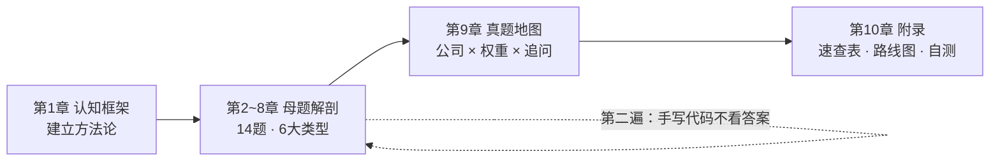
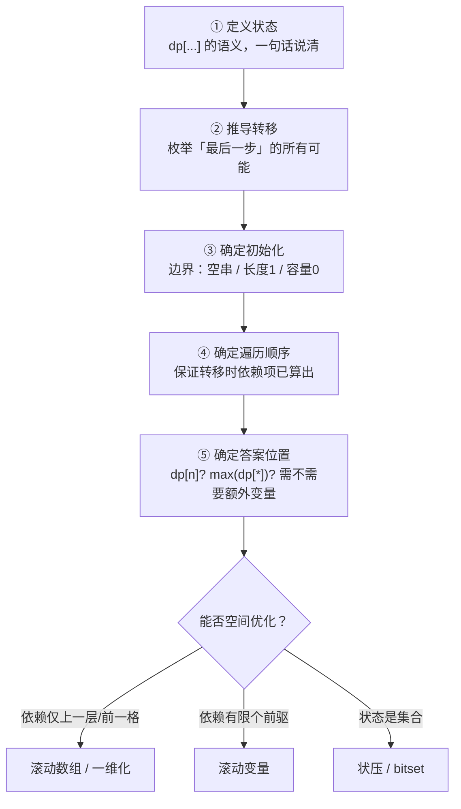
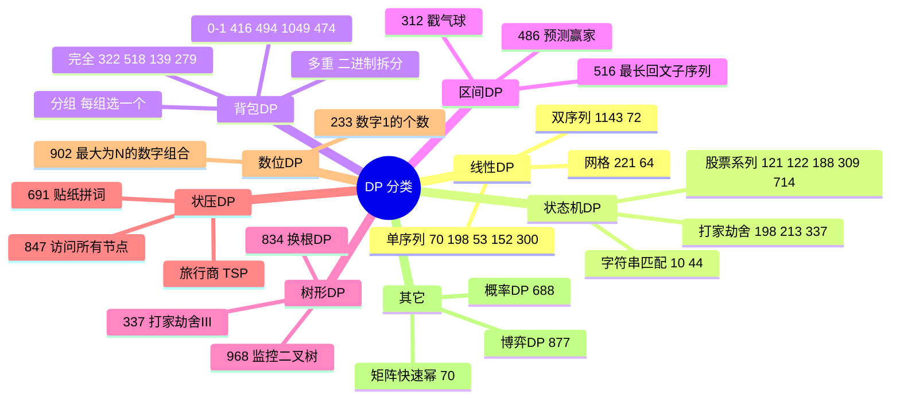
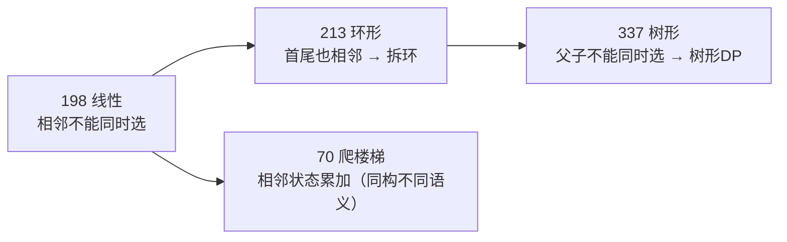
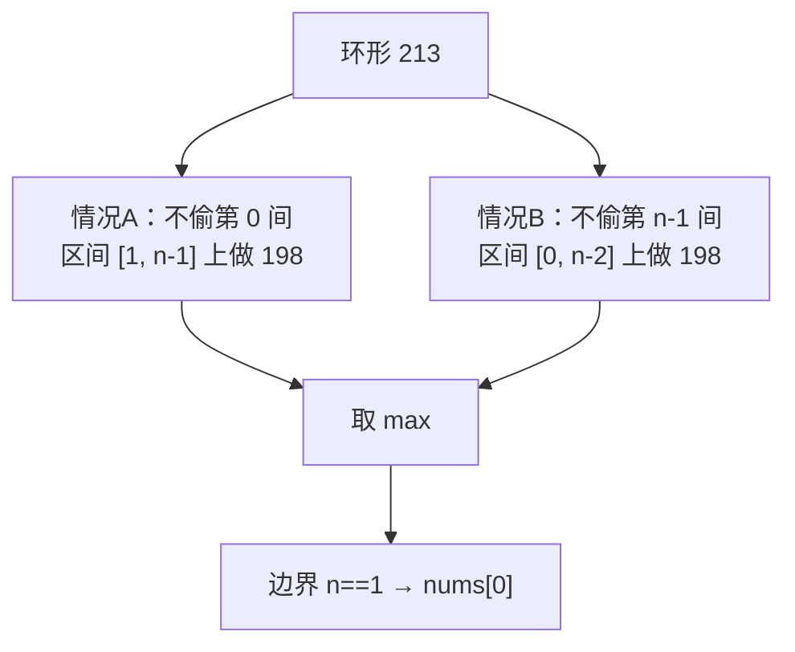
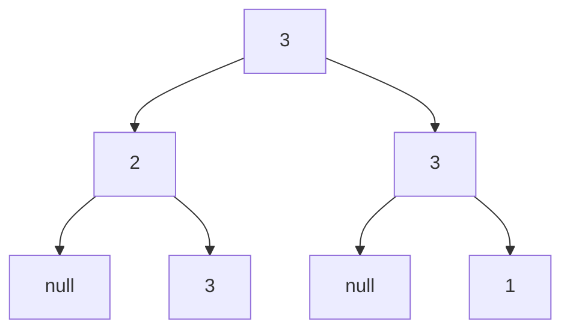
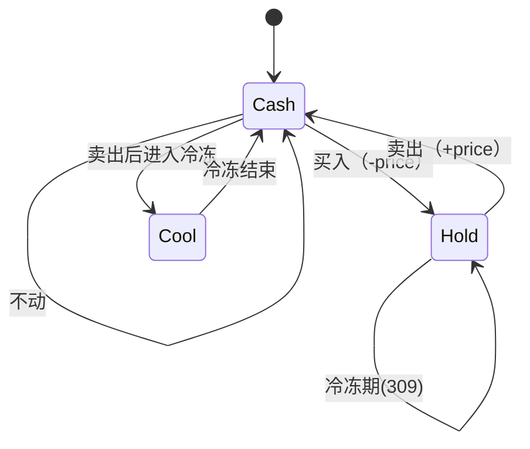
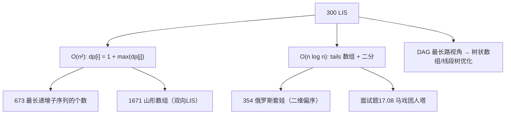
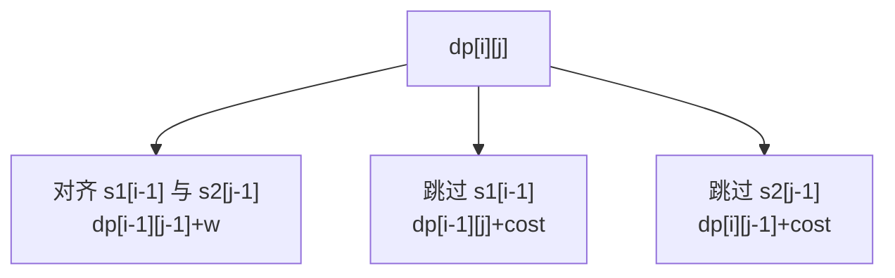
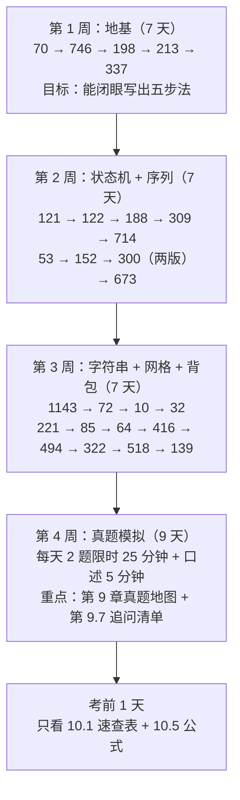

# 动态规划（DP）深度知识体系 · 14 题精讲 + 大厂面试真题全解

> **适用人群**：准备国内大厂（字节 / 阿里 / 腾讯 / 美团 / 快手 / 拼多多 / 京东 / 华为 / 百度 / 网易 / 小红书 / Shopee 等）后端、算法、数据开发岗位的候选人；也适合已能背题、但「换个场景就写不出状态定义」的同学。
>
> **本文的组织逻辑**：先建立一套「可复用的状态设计方法论」，再用 14 道母题做纵向解剖（每题都给：暴力 → 建模 → 状态 → 转移 → 初始化 → 遍历序 → 答案位置 → 代码 → 优化 → 追问），最后用「大厂真题地图」把知识点反向映射到真实面试场景。**母题吃透，变形题自然能接住**——这是本文最重要的设计意图。
>
> **符号约定**：`⭐` 表示该考点在大厂面试中的出现频次（1~5 星，★ 越多越高频）；「考核权重」给出的是**面试官评分维度的构成比例**（经验估计值，非官方数据）。

---

## 目录

- [第 0 章 阅读路径：这份文档怎么用](#第-0-章-阅读路径这份文档怎么用)
- [第 1 章 认知框架：DP 到底是什么](#第-1-章-认知框架dp-到底是什么)
  - [1.1 三个必要条件](#11-三个必要条件)
  - [1.2 DP 与其它范式的边界](#12-dp-与其它范式的边界)
  - [1.3 五步法：把 DP 变成流程](#13-五步法把-dp-变成流程)
  - [1.4 状态设计的四个提问](#14-状态设计的四个提问)
  - [1.5 DP 分类全景图](#15-dp-分类全景图)
  - [1.6 六大优化套路](#16-六大优化套路)
  - [1.7 复杂度怎么算](#17-复杂度怎么算)
  - [1.8 面试口述模板与评分维度](#18-面试口述模板与评分维度)
  - [1.9 十个高频坑](#19-十个高频坑)
- [第 2 章 线性 DP 与「打家劫舍」家族](#第-2-章-线性-dp-与打家劫舍家族)
- [第 3 章 状态机 DP：股票系列](#第-3-章-状态机-dp股票系列)
- [第 4 章 序列 DP：LIS 家族](#第-4-章-序列-dplis-家族)
- [第 5 章 子数组 DP](#第-5-章-子数组-dp)
- [第 6 章 字符串 DP](#第-6-章-字符串-dp)
- [第 7 章 二维网格 DP：最大正方形](#第-7-章-二维网格-dp最大正方形)
- [第 8 章 背包 DP：分割等和子集及家族](#第-8-章-背包-dp分割等和子集及家族)
- [第 9 章 大厂真题地图](#第-9-章-大厂真题地图)
- [第 10 章 附录](#第-10-章-附录)

---

## 第 0 章 阅读路径：这份文档怎么用



| 你的状态 | 建议入口 | 时间预算 |
|---|---|---|
| 完全没系统学过 DP，只会写暴力 | 第 1 章 → 第 2 章（70 / 198） | 2 天 |
| 能写中等题，但状态定义常卡住 | 第 1.4 节 + 第 3、4 章（状态机 / LIS） | 3 天 |
| 面试在即，只想抓高频 | 第 9 章真题地图 → 回查对应母题 | 1 天 |
| 想冲 P7 / 3-1 以上，需要讲清楚「为什么」 | 每节的「正确性证明」+「追问」+ 第 10.5 节自测 | 1 周 |

> **一条心法**：DP 的难度 90% 在「状态怎么定义」，10% 在「转移怎么写」。所有母题的价值，都在于给你提供**可迁移的状态模板**。所以每读完一题，请强迫自己回答一句：「这个状态定义，以后还能套在什么题上？」

---

## 第 1 章 认知框架：DP 到底是什么

### 1.1 三个必要条件

DP 不是「一种写法」，而是「一种对问题的分解方式」。能用 DP 的问题，必须同时满足三条：

| 条件 | 含义 | 反例（不满足会怎样） |
|---|---|---|
| **最优子结构** | 问题的最优解，由子问题的最优解组合而成 | 若最优解依赖子问题的「非最优解」，则无法只保存一个值 |
| **无后效性** | 状态一旦确定，后续决策不再反过来改变它；即「未来与到达该状态的路径无关」 | 若需要记住「我是怎么来的」，就要把路径信息塞进状态（维度爆炸） |
| **重叠子问题** | 递归分解后，同一个子问题被反复求解 | 若无重叠，退化为分治（如归并排序），DP 无收益 |

**用一句话概括三者的分工**：
- 最优子结构 → 保证「**能**用子问题答案拼出大问题答案」（转移方程的合法性）；
- 无后效性 → 保证「**只需**存子问题的答案，不必存过程」（状态压缩的合法性）；
- 重叠子问题 → 保证「**值得**存」（记忆化的收益来源）。

> **面试常被追问**：「这个题为什么无后效性？」
> 标准答法：**指明状态的语义里已经「吸收」了所有会影响未来的信息，而丢弃了不影响未来的信息**。例如 198 打家劫舍中，`dp[i]` 表示「考虑前 i 间房的最大金额」，它不区分「第 i 间偷了还是没偷」——这会出问题！所以必须把「第 i 间是否被偷」编码进状态（或用 `dp[i]` vs `dp[i-1]` 的错位技巧规避）。**凡是「当前决策会限制下一步选择」的场景，都要把该决策信息放进状态**。这句话是状态设计的核心判据，后面股票系列、打家劫舍 II/III 都是它的直接推论。

### 1.2 DP 与其它范式的边界

很多人卡住，不是因为不会 DP，而是因为**选错了范式**。这张表请在脑中固化：

| 范式 | 核心特征 | 时间复杂度量级 | 典型题 | 与 DP 的关系 |
|---|---|---|---|---|
| **暴力枚举 / 回溯** | 枚举所有方案，可剪枝 | 指数级 O(2^n)、O(n!) | 46 全排列、78 子集 | DP 是它的「去重版」 |
| **分治** | 子问题**互不重叠**，合并求解 | O(n log n) | 归并排序、23 合并 K 链表 | DP 是「子问题重叠」时的分治 + 缓存 |
| **贪心** | 每步取局部最优，**不回头** | O(n) / O(n log n) | 435 无重叠区间、55 跳跃游戏 | 贪心 = DP 的「转移只依赖单一最优分支」的退化情形 |
| **DP** | 存表、按序递推、状态可复现 | 状态数 × 转移代价 | 本文 14 题 | — |
| **BFS / Dijkstra** | 图上的最短路径 | O(V+E) / O(E log V) | 1091 最短路径、787 K 站中转 | **DAG 上的最长/最短路 ≡ DP**（第 4.3 节展开） |
| **二分答案** | 把「求最值」转成「可行性判定」 | O(log range × check) | 410 分割数组最大值 | 常与 DP 组合（DP 判定 + 二分） |
| **数学 / 矩阵快速幂** | 找递推的闭式或加速 | O(log n) | 70 爬楼梯 n=10^18 | DP 的「加速器」（第 2.1 节展开） |

**判断口诀（口述即可）**：
1. 求「方案数 / 最值 / 可行性」，且**决策序列有顺序** → 优先想 DP；
2. 求「具体方案（路径、选择集合）」→ DP 存「从哪来」+ 回溯（第 6.1 节给模板）；
3. 每步选择**只看当前**、且能证明不回头更优 → 贪心（先用 DP 验证贪心，是安全的面试策略）；
4. 状态是「图上的点」、转移是「边」、且图是 DAG → 直接按拓扑序 DP。

### 1.3 五步法：把 DP 变成流程



**最关键的一步是 ②「枚举最后一步」**——这是把「不知道怎么下手」变成「有章可循」的枢纽。具体操作：

> 假设我们已经得到了规模更小的答案，问：**最后一步做了什么决策？这个决策把问题切成了哪几个更小的子问题？**

举例：
- 70 爬楼梯：最后一步是「跨 1 阶」或「跨 2 阶」→ 切成 `n-1` 和 `n-2`；
- 198 打家劫舍：最后一间「偷」或「不偷」→ 偷则切到 `i-2`，不偷则切到 `i-1`；
- 72 编辑距离：最后一步是「删 / 插 / 替 / 不动」→ 分别切到三个子问题；
- 416 分割等和子集：最后一个数「选」或「不选」→ 切到「容量减去它」和「容量不变」。

**这个「最后一步枚举法」适用于本文 90% 的题**。请把它当作肌肉记忆。

### 1.4 状态设计的四个提问

面试现场，请在纸上依次回答这四问（也是你向面试官解释时的骨架）：

| # | 提问 | 作用 | 示例（152 乘积最大子数组） |
|---|---|---|---|
| Q1 | **状态里必须包含哪些「会影响未来」的信息？** | 防止漏维度 | 必须含「以 i 结尾」，且必须同时含「最大值/最小值」——因为负数会让最大最小互换 |
| Q2 | **哪些信息可以丢弃？** | 防止维度爆炸 | 不需要记住子数组起点；不需要记住乘了几个负数（符号已被 max/min 吸收） |
| Q3 | **状态是「前缀」还是「以 i 结尾」？** | 决定转移是否合法 | 子数组类必须「以 i 结尾」（否则无法保证连续）；子序列类可用「前 i 个」 |
| Q4 | **答案在 dp[n] 还是 max(dp[*])？** | 防止漏解 | 152 的答案不在最后一位，而在所有 `maxDp[i]` 的最大值 |

**Q3 是最容易出错的一问，单独强调**：

| 状态语义 | 适用场景 | 若用错的后果 |
|---|---|---|
| `dp[i]` = 前 i 个元素的答案 | 子序列、背包、字符串（可不连续） | 用于「连续子数组」会漏掉「必须含 i」的约束，转移写不出来 |
| `dp[i]` = **以 i 结尾**的答案 | 子数组、子串、LIS、股票（必须持有到最后） | 用于「子序列」会漏解，需要额外 `max` 汇总，但通常仍可用 |
| `dp[i][j]` = 区间 [i,j] 的答案 | 区间 DP（戳气球、回文） | 一维状态无法表达「两端合并」 |

> **经验法则**：只要题目里出现「**连续 / 子数组 / 子串 / 必须以某元素结束**」，状态就必须带「以 i 结尾」；只要出现「**任选 / 子序列 / 可以跳过**」，状态就可以是「前 i 个」。这一条能瞬间解决一大半「状态写不出来」的困境。

### 1.5 DP 分类全景图



本文覆盖的是**线性 DP、状态机 DP、序列 DP、字符串 DP、网格 DP、背包 DP**六大类（面试覆盖率约 85%），其余类型在附录给出迁移入口。

### 1.6 六大优化套路

| # | 套路 | 触发条件 | 效果 | 代表 |
|---|---|---|---|---|
| 1 | **滚动数组 / 一维化** | 转移只依赖「上一行」或「前 k 个」 | 空间 O(n×m) → O(m) | 1143、72、416 |
| 2 | **滚动变量** | 只依赖前 1~2 个状态 | 空间 → O(1) | 70、198、53、121 |
| 3 | **状态压缩（bitset）** | 状态是「布尔可达集合」，且转移是整体平移 | 时间 ×1/64，空间 ×1/64 | 416 的 bitset 版 |
| 4 | **矩阵快速幂** | 递推是**定系数线性**的，n 极大 | O(k³ log n) | 70（n=10^18）、935 |
| 5 | **单调队列 / 前缀和** | 转移形如 `max(dp[j] + w(j))`，j 有窗口约束 | O(n²) → O(n) | 188 的 O(nk)、多重背包 |
| 6 | **二分 / 树状数组 / 线段树** | 需要在「值域/历史」上求 max 或 count | O(n²) → O(n log n) | 300 的 O(n log n)、LIS 计数 |

> **面试策略**：永远先写 O(n²) 的正确解，再谈优化。**面试官扣分最多的是「优化了但写错」，而不是「没优化」**。优化的表达方式是：「这里可以用滚动数组把空间降到 O(m)，因为转移只依赖上一行，我可以现在改，也可以先保证正确性，您看需要吗？」——把选择权交给面试官，是加分项。

### 1.7 复杂度怎么算

**万能公式**：

```
时间复杂度 = 状态总数 × 单个状态的转移代价
空间复杂度 = 需要保存的状态数（未优化）
```

| 题 | 状态数 | 单状态代价 | 时间 | 空间 |
|---|---|---|---|---|
| 70 爬楼梯 | n | O(1) | O(n) | O(1) |
| 198 | n | O(1) | O(n) | O(1) |
| 337 树形 | n | O(1)（每个节点两次转移） | O(n) | O(h) 递归栈 |
| 188 股票 IV | n×k×2 | O(1) | O(nk) | O(k) |
| 300 朴素 | n | O(n)（扫前驱） | O(n²) | O(n) |
| 300 二分 | — | — | O(n log n) | O(n) |
| 1143 / 72 | n×m | O(1) | O(nm) | O(m) |
| 221 | n×m | O(1) | O(nm) | O(m) |
| 416 | target | O(1) | O(n·target) | O(target) |
| 416 bitset | target/64 | O(1) 字操作 | O(n·target/64) | O(target/64) |

> **注意一个面试细节**：416 的复杂度必须写成 `O(n × sum/2)`，并且要主动说明「这是**伪多项式**复杂度」——当 `sum` 很大（如元素是 10^9）时算法会退化。能说出「伪多项式」这个词，通常会被认为是准备充分的候选人。这是第 8 章的重要延伸点。

### 1.8 面试口述模板与评分维度

**开场（30 秒内把框架立住）**：
> 「这题我打算用动态规划。状态我定义为 `dp[i][j]`，表示……；转移我枚举最后一步的……几种情况；边界是……；答案取……。时间 O(...)，空间可以优化到 O(...)。您看这个方向对吗？我先写代码。」

**写码时（边说边写，避免沉默）**：
> 「这里我初始化成 0 而不是 -1，是因为……」「这个循环我写成倒序，因为一维化后正序会重复使用同一件物品。」

**收尾（主动给优化和边界，这是拉开差距的地方）**：
> 「写完了，我过一遍边界：空数组、长度 1、全负、超 int 范围。另外这个空间可以滚成一维，因为只依赖上一行；要不要我改？」

**评分维度与权重（面试官视角的经验分布）**：

| 维度 | 权重 | 观察点 | 常见失分 |
|---|---|---|---|
| **状态定义的正确性与清晰度** | 35% | 能否用一句话说清 `dp` 的含义；是否漏了必要维度 | 「`dp[i]` 表示到 i 为止」含糊其辞，后面转移自己都写不下去 |
| **转移方程的完备性** | 25% | 是否枚举全了「最后一步」的分支 | 漏掉「不操作」分支、漏掉负负得正 |
| **边界与初始化** | 15% | 空、长度 1、全 0、负数、溢出 | `dp[0]` 与 `dp[1]` 混用；416 不判奇偶 |
| **复杂度分析与优化** | 15% | 能否说出 O 记号并给出优化路径 | 只会说「O(n²)」，说不出为什么 |
| **代码质量与可读性** | 10% | 变量命名、无冗余、能一次跑对 | 下标越界、`int` 溢出（如 152 乘积） |

### 1.9 十个高频坑

1. **`dp[i]` 语义含糊**：写成「前 i 个」，却在转移里用了「必须含 i」的假设 → 全盘皆错。**先写一句人话注释**。
2. **一维化后遍历方向错**：0-1 背包必须**倒序**容量，完全背包**正序**。写反了不报错，但答案错（第 8.1 节给推导）。
3. **答案位置错**：子数组类（53/152/221）答案是「所有 dp 的 max」，不是 `dp[n]`。
4. **初始化错**：求 min 时忘了初始化为 `INF`；求「恰好装满」时忘了用 `-INF` 而非 0。
5. **下标偏移错**：字符串 DP 的 `dp[0][j]` 表示「空串 vs 长度 j」，循环从 1 开始，`charAt(i-1)`。
6. **负数导致 max/min 互换**：152 必须同时维护 max 与 min。
7. **int 溢出**：152 乘积、416 求和、188 的 `-INF` 取值（用 `Integer.MIN_VALUE/2` 而非 `MIN_VALUE`，避免加法下溢）。
8. **环形问题忘了拆环**：213 必须分成「不含首」与「不含尾」两种，且 n=1 特判。
9. **树形 DP 返回值语义没约定**：返回 `int[2]` 时，一定要注释 `[0]=不选本节点, [1]=选本节点`。
10. **递归深度**：树形 DP 在链状树上递归深度 = n，Java 默认栈可能爆（10^5 级），要提「可改迭代后序」。

---

## 第 2 章 线性 DP 与「打家劫舍」家族

### 2.0 本章主线：一条「约束升级」的演进链

「打家劫舍」系列是理解 DP 状态设计最好的教材，因为它把同一个核心矛盾（**相邻不能同时选**）在三种拓扑结构上反复演练：



| 版本 | 拓扑 | 额外约束 | 状态设计的关键动作 |
|---|---|---|---|
| 198 | 直线 | 相邻不可同选 | `dp[i] = max(dp[i-1], dp[i-2]+v[i])`，用「错位」表达「选/不选」 |
| 213 | 环 | 首尾也相邻 | **拆环**：分「不含首」「不含尾」两类，取 max |
| 337 | 树 | 父子不可同选 | **状态必须显式区分「选本节点/不选本节点」**，返回值携带两值 |
| 70 | 直线 | 每次走 1 或 2 阶 | `dp[i]=dp[i-1]+dp[i-2]`，计数型（加法而非 max） |

> **一个必须理解的对比**：198 里「选/不选」是用**下标错位**隐式表达的（`dp[i-1]` 天然代表「不选 i」），而 337 里必须**显式**表达（返回值 `[0]=不选, [1]=选`）。为什么？因为树上「不选 i」时，子节点仍然面临「选或不选」的自由，父节点无法用「错位」把两种自由都表达出来——**拓扑结构越复杂，状态必须越显式**。这是从线性 DP 跨到树形 DP 最重要的一次认知升级。

### 2.1 LeetCode 70 · 爬楼梯 ⭐⭐⭐⭐

**题意**：n 阶楼梯，每次可跨 1 或 2 阶，求到达顶部的方案数。

#### ① 从暴力到 DP 的推导

设 `f(n)` 为到达第 n 阶的方案数。**枚举最后一步**：要么从 n-1 跨 1 阶上来，要么从 n-2 跨 2 阶上来。所以：

```
f(n) = f(n-1) + f(n-2)
```

暴力递归会重复计算同一个 `f(k)` 指数次（`f(5)` 的计算树里 `f(2)` 出现 3 次，`f(3)` 出现 2 次）——这就是「重叠子问题」，也是 DP 的收益来源。

#### ② 五步法落地

| 步骤 | 内容 |
|---|---|
| 状态 | `dp[i]` = 到达第 i 阶的方案数（**注意是「到达」不是「跨过」**） |
| 转移 | `dp[i] = dp[i-1] + dp[i-2]`，i ≥ 2 |
| 初始化 | `dp[0] = 1`（站在地面，什么都不做，算 1 种方案）；`dp[1] = 1` |
| 遍历序 | i 从 2 到 n（依赖前两项，正序天然满足） |
| 答案 | `dp[n]` |

```java
// 滚动变量版：时间 O(n)，空间 O(1)
class Solution {
    public int climbStairs(int n) {
        if (n <= 1) return 1;          // 边界：n=1 只有 1 种，n=0 按题意返回 1
        int a = 1, b = 1;              // a = dp[i-2], b = dp[i-1]
        for (int i = 2; i <= n; i++) {
            int c = a + b;
            a = b;
            b = c;
        }
        return b;
    }
}
```

#### ③ 为什么 `dp[0]=1` 而不是 0

这是本題最经典的追问。**`dp[i]` 是「方案数」，空方案（一步不走）也是一种方案**。若 `dp[0]=0`，则 `dp[2]=dp[1]+dp[0]=1`，但正确答案是 2（`1+1` 与 `2`），直接错。同理，所有「计数型 DP」的边界都要用「空方案计数为 1」来初始化；而「最值型 DP」的边界才用 0 / INF。**计数用 1，最值用 0/INF，这是两条不能混的初始化法则。**

#### ④ 延伸一：每次可跨 1..k 阶 → 前缀和优化

```
dp[i] = dp[i-1] + dp[i-2] + ... + dp[i-k]
```

朴素是 O(nk)。用前缀和 `S[i] = S[i-1] + dp[i]` 可降到 O(n)：`dp[i] = S[i-1] - S[i-k-1]`。k=3 的版本就是**面试题 08.01 三步问题**（结果要对 1000000007 取模）。

```java
// 每次可走 1..k 阶，O(n)，取模版
public int climbK(int n, int k) {
    final int MOD = 1_000_000_007;
    int[] dp = new int[n + 1], pre = new int[n + 1];
    dp[0] = 1; pre[0] = 1;
    for (int i = 1; i <= n; i++) {
        dp[i] = pre[i - 1];                                  // sum dp[i-k..i-1]
        if (i - k - 1 >= 0) dp[i] = (dp[i] - pre[i - k - 1] + MOD) % MOD;
        pre[i] = (pre[i - 1] + dp[i]) % MOD;
    }
    return dp[n];
}
```

#### ⑤ 延伸二：n = 10^18 时怎么办 → 矩阵快速幂

递推是**常系数线性**的，可写成矩阵形式：

```
[ f(n)   ]   [ 1 1 ]^ (n-1)   [ f(1) ]
[ f(n-1) ] = [ 1 0 ]        * [ f(0) ]
```

```java
// O(k^3 log n)，k=2
public int climbStairsFast(long n) {
    if (n <= 1) return 1;
    long[][] base = {{1, 1}, {1, 0}};
    long[][] res = {{1, 0}, {0, 1}};          // 单位矩阵
    long e = n - 1;
    while (e > 0) {
        if ((e & 1) == 1) res = mul(res, base);
        base = mul(base, base);
        e >>= 1;
    }
    return (int) (res[0][0] + res[0][1]);      // f(n) = res[0][0]*f(1) + res[0][1]*f(0)
}
private long[][] mul(long[][] a, long[][] b) {
    long[][] c = new long[2][2];
    for (int i = 0; i < 2; i++)
        for (int j = 0; j < 2; j++)
            for (int t = 0; t < 2; t++) c[i][j] += a[i][t] * b[t][j];
    return c;
}
```

> **面试话术**：「如果 n 到 10^18，O(n) 会超时，但这题是常系数线性递推，可以用矩阵快速幂降到 O(log n)。第 k 阶的版本是 k×k 矩阵，代价 O(k³ log n)。」

#### ⑥ 延伸三：组合数学视角（通往 O(n) 的另一条路）

设一共走了 `x` 次「2 阶」，则总步数 `n - 2x` 次「1 阶」，共 `n - x` 步，方案数为从 `n-x` 步中挑 `x` 步走 2 阶：`C(n-x, x)`。于是

```
f(n) = Σ_{x=0}^{⌊n/2⌋} C(n-x, x)
```

**为什么值得知道**：面试官问「不用 DP 还能怎么做」，这个组合视角是很好的加分回答；同时也解释了为什么 `f(n)` 恰是斐波那契数列的错位（`f(n)=Fib(n+1)`）。

#### ⑦ 最近邻变体：746 使用最小花费爬楼梯

题意：`cost[i]` 是从第 i 阶向上爬的费用，每次可爬 1 或 2 阶，可以从 0 或 1 阶出发，求到「顶部」（n 之后）的最小花费。

```
dp[i] = 到达第 i 阶的最小花费
dp[0] = dp[1] = 0            // 可以从这两阶免费出发
dp[i] = min(dp[i-1] + cost[i-1], dp[i-2] + cost[i-2])   // 从 i-1 付 cost[i-1] 爬上来
答案 = dp[n]（把 n 代入上式展开，就是 min(dp[n-1] + cost[n-1], dp[n-2] + cost[n-2])，别再额外加一步）
```

**与 70 的对照**（这是理解「计数型 vs 最值型」的最佳对照）：

| | 70 爬楼梯 | 746 最小花费 |
|---|---|---|
| 语义 | 方案数 | 最小花费 |
| 转移算子 | `+`（求和） | `min`（取优） |
| 边界 | `dp[0]=1`（空方案算 1） | `dp[0]=dp[1]=0`（起点免费） |
| 答案位置 | `dp[n]` | 不在 `dp[n]`，在「最后一步」的 min |

#### ⑧ 常见追问与失分点

| 追问 | 应答要点 |
|---|---|
| 「为什么无后效性？」 | `dp[i]` 只依赖「还要走多少阶」，与「怎么走到 i 的」无关——**过程被丢弃，只留规模** |
| 「能不能用贪心？」 | 不能。贪心需要「每步局部最优 → 全局最优」，这里每步只有 1 种选择（走 1 或 2 阶都是「必须走」），是**计数**不是**决策** |
| 「n=0 怎么返回？」 | 按 LeetCode 约束 n≥1；若强行问，`dp[0]=1`（空方案）是数学上自洽的选择，但要说明这是约定 |
| 「溢出怎么办？」 | 面试题 08.01 要取模；未要求取模时用 `long` 并说明 `n≤45` 内不溢出 |

---

### 2.2 LeetCode 198 · 打家劫舍 ⭐⭐⭐⭐⭐

**题意**：一排房子 `nums[0..n-1]`，不能偷相邻两间，求最大金额。

#### ① 建模：把「相邻约束」翻译成状态

**枚举最后一步**：第 `i` 间房，只有两种决策：

- **偷** → 则第 `i-1` 间一定不能偷 → 前 `i-2` 间的最优解 + `nums[i]`；
- **不偷** → 则前 `i-1` 间随便偷 → 前 `i-1` 间的最优解。

于是：

```
dp[i] = max(dp[i-1], dp[i-2] + nums[i])
```

**这里要讲清楚一个极易含糊的点**：为什么「不偷 i」可以直接等于 `dp[i-1]`？因为 `dp[i-1]` 的语义是「**考虑前 i 间房能拿到的最大值**」，它**不要求**第 i-1 间被偷。所以 `dp[i-1]` 天然涵盖了「第 i 间不偷」的全部合法方案。**这就是「用下标错位隐式表达选/不选」的技巧**——它成立的前提是：状态的语义里没有「必须选最后一个」。

#### ② 五步法落地

| 步骤 | 内容 |
|---|---|
| 状态 | `dp[i]` = 只考虑前 `i+1` 间房（下标 0..i）能偷到的最大金额 |
| 转移 | `dp[i] = max(dp[i-1], dp[i-2] + nums[i])` |
| 初始化 | `dp[0] = nums[0]`；`dp[1] = max(nums[0], nums[1])` |
| 遍历序 | i 从 2 到 n-1 |
| 答案 | `dp[n-1]` |

```java
class Solution {
    public int rob(int[] nums) {
        if (nums.length == 1) return nums[0];
        int prev2 = nums[0];                              // dp[i-2]
        int prev1 = Math.max(nums[0], nums[1]);           // dp[i-1]
        for (int i = 2; i < nums.length; i++) {
            int cur = Math.max(prev1, prev2 + nums[i]);
            prev2 = prev1;
            prev1 = cur;
        }
        return prev1;
    }
}
```

#### ③ 用表格把转移「看见」

以 `nums = [2, 7, 9, 3, 1]` 为例：

| i | nums[i] | dp[i-2] + nums[i]（偷） | dp[i-1]（不偷） | dp[i] | 决策 |
|---|---|---|---|---|---|
| 0 | 2 | — | — | 2 | 偷 |
| 1 | 7 | — | — | 7 | 偷（2 与 7 取大） |
| 2 | 9 | 2 + 9 = 11 | 7 | **11** | 偷 0 和 2 |
| 3 | 3 | 7 + 3 = 10 | 11 | 11 | 不偷 |
| 4 | 1 | 11 + 1 = 12 | 11 | **12** | 偷 0、2、4 |

> 手推这张表是面试前的必备动作：它能同时验证「转移对不对」和「答案位置对不对」。

#### ④ 空间优化与不变式

滚动变量 `prev1 / prev2` 的正确性依赖一个**不变式**：进入第 i 轮循环时，`prev1 == dp[i-1]`、`prev2 == dp[i-2]`。更新顺序必须是「先算 cur，再平移」，**不能**先 `prev2 = prev1` 再算 cur（那样 `prev2` 已被覆盖）。

#### ⑤ 追问与延伸

| 追问 | 应答 |
|---|---|
| 「如果限制不能偷连续 k 间？」 | 状态要带「距离上次偷隔了几间」，即 `dp[i][j]`（j=0..k-1），O(nk)。**这题一旦把「间隔」参数化，198 的错位技巧就失效了**——因为「不偷」不再等价于「前 i-1 的最优」 |
| 「如果房子是环？」 | → 213，拆环 |
| 「如果房子是树？」 | → 337，树形 DP |
| 「如果允许偷完 i 后冷却 1 天？」 | → 状态机，参考 3.5 节 309 的写法 |
| 「能不能输出具体偷了哪几间？」 | 需要额外记录「从哪来」（`pre` 数组或决策数组），回溯即可。模板见 6.1 节 |

---

### 2.3 LeetCode 213 · 打家劫舍 II（环形）⭐⭐⭐⭐

**题意**：房子围成一圈，首尾也相邻，不能偷相邻两间。

#### ① 核心思想：环形 → 线性（拆环）

环形之所以难，是因为「第 0 间和第 n-1 间也相邻」，而 DP 是线性推进的，无法在最后回头检查首元素。

**关键观察**：任何合法方案都**不可能同时包含第 0 间和第 n-1 间**（它们相邻）。所以全部合法方案一定属于下面两类之一（可能两类都有）：

- **A 类：不偷第 0 间** → 问题退化成在 `[1, n-1]` 上的 198；
- **B 类：不偷第 n-1 间** → 问题退化成在 `[0, n-2]` 上的 198。

答案 = `max(A, B)`。



**为什么「取 max」不会重复计算或漏解**：
- 不漏：每个合法方案都至少满足 A 或 B 之一（因为不能同时含首尾）；
- 不重：即使一个方案同时满足 A 和 B（既不含首也不含尾），它在两边算出的值相同，取 max 不影响结果。

#### ② 代码

```java
class Solution {
    public int rob(int[] nums) {
        int n = nums.length;
        if (n == 1) return nums[0];        // 必须特判：环形长度为 1 时它「与自己相邻」
        return Math.max(
            robRange(nums, 0, n - 2),      // 不含最后一间
            robRange(nums, 1, n - 1)       // 不含第一间
        );
    }
    // 闭区间 [l, r] 上的 198
    private int robRange(int[] nums, int l, int r) {
        if (l > r) return 0;               // 空区间：n=1 时会用到（此处已特判，防御性保留）
        int prev2 = 0, prev1 = 0;          // 虚拟边界：相当于 dp[l-2]=dp[l-1]=0
        for (int i = l; i <= r; i++) {
            int cur = Math.max(prev1, prev2 + nums[i]);
            prev2 = prev1;
            prev1 = cur;
        }
        return prev1;
    }
}
```

> **虚拟边界技巧**：`prev2 = prev1 = 0` 让循环内部无需特判首元素，写法比重载 `dp[0]/dp[1]` 更干净。**代价是要保证「0 是最优解的下界」**——题目金额非负，成立；若金额可为负（求最大且必须选至少一间），这个技巧就会错，必须显式初始化 `dp[l]`。

#### ③ 追问

| 追问 | 应答 |
|---|---|
| 「n=2 时怎么处理？」 | 两间相邻，只能偷一间 → `robRange(0,0)=nums[0]`、`robRange(1,1)=nums[1]`，取 max，正确 |
| 「为什么不能直接 `dp[n-1]` 与 `dp[n-2]` 拼接？」 | 因为无法保证「最后不偷首」与「开头不偷尾」的一致性，容易重复/漏；**拆成两个独立子问题最安全** |
| 「如果是环 + 每 k 间不能连续？」 | 拆环仍然有效，但内层要换成 `dp[i][j]` 的 O(nk) 版本 |
| 「如果是二维网格、不能取相邻格？」 | 变成「网格上的独立集」，行内是 198，行间也是 198，两遍 DP（O(mn)） |

---

### 2.4 LeetCode 337 · 打家劫舍 III（树形 DP）⭐⭐⭐⭐⭐

**题意**：房子排成一棵二叉树，直接相连的父子节点不能同时偷。

#### ① 为什么线性技巧失效

在 198 中，「不偷 i」= `dp[i-1]`，因为线性结构里「前 i-1 个」只有一个方向。但在树上，一个节点有**两个孩子**，「不偷本节点」时左右孩子**各自独立**地面临「偷或不偷」的选择，父节点无法用一个标量同时表达两种自由。**所以必须让递归函数返回「两种状态下的最优值」。** 这是树形 DP 的通用范式。

#### ② 状态定义（约定必须写注释）

```java
// 返回 int[2]：
//   res[0] = 不选本节点时，本子树能获得的最大值
//   res[1] = 选本节点时，本子树能获得的最大值
```

转移：
- 选本节点 → 左右孩子都**必须不选**：`res[1] = node.val + L[0] + R[0]`
- 不选本节点 → 左右孩子**各自取 max**：`res[0] = max(L[0],L[1]) + max(R[0],R[1])`

```java
class Solution {
    public int rob(TreeNode root) {
        int[] res = dfs(root);
        return Math.max(res[0], res[1]);
    }
    private int[] dfs(TreeNode node) {
        if (node == null) return new int[]{0, 0};     // 空树：选/不选都是 0
        int[] L = dfs(node.left);
        int[] R = dfs(node.right);
        int take = node.val + L[0] + R[0];                              // 选本节点
        int skip = Math.max(L[0], L[1]) + Math.max(R[0], R[1]);         // 不选本节点
        return new int[]{skip, take};
    }
}
```

#### ③ 递归过程可视化

以 `[3,2,3,null,3,null,1]` 为例（层序建树）：



| 节点 | 左孩子 (skip,take) | 右孩子 (skip,take) | 本节点 (skip,take) |
|---|---|---|---|
| 叶子 3（2的右孩） | (0,0) | (0,0) | (0, 3) |
| 叶子 1（3的右孩） | (0,0) | (0,0) | (0, 1) |
| 2 | (0,0) | (0,3) | (3, 2) |
| 3（右子树） | (0,0) | (0,1) | (1, 3) |
| 根 3 | (3,2) | (1,3) | (max(3,2)+max(1,3)=2+3=5, 3+3+1=7) |

答案 `max(5,7)=7`（偷根 + 两个叶子）。**手推一遍这张表，树形 DP 就通了。**

#### ④ 树形 DP 的通用模板（可迁移）

```java
// 通用范式：后序遍历 + 返回值携带「有限种状态」
Result dfs(TreeNode node) {
    if (node == null) return BASE;                 // ① 空节点的语义要明确
    Result L = dfs(node.left);
    Result R = dfs(node.right);
    // ② 根据「本节点的选择」组合左右孩子的状态
    Result cur = merge(node, L, R);
    return cur;                                    // ③ 返回值必须是「供父节点决策」所需的全部信息
    // ④ 全局答案在递归中收集，或由根的返回值导出
}
```

**用这个模板去套其它树题**：
- **968 监控二叉树**：三状态（未覆盖 / 有摄像头 / 已覆盖），树形 DP + 状态机；
- **543 二叉树的直径**：返回「向下的最大深度」，全局维护 `left+right`；
- **124 最大路径和**：返回「单边最大贡献」，全局维护「过本节点的最大路径」；
- **834 距离之和（换根 DP）**：先求子树大小，再二次 DFS 换根。

#### ⑤ 968 监控二叉树（树形 DP + 状态机，重要延伸）

题意：在节点放摄像头可覆盖自身、父、子，求覆盖全树的最少摄像头数。

**状态设计（每个节点三种状态）**：

| 状态 | 含义 |
|---|---|
| `0` | 本节点**未被覆盖**（需要父节点放摄像头） |
| `1` | 本节点**放了摄像头** |
| `2` | 本节点**已被覆盖**，但自己没放摄像头 |

```java
class Solution {
    private int cameras = 0;
    public int minCameraCover(TreeNode root) {
        cameras = 0;
        if (dfs(root) == 0) cameras++;    // 根节点若仍未覆盖，只能自己放一个
        return cameras;
    }
    private int dfs(TreeNode node) {
        if (node == null) return 2;      // 空节点视为「已覆盖」，避免叶子被迫放摄像头
        int l = dfs(node.left), r = dfs(node.right);
        if (l == 0 || r == 0) { cameras++; return 1; }   // 有孩子没被覆盖 → 本节点必须放
        if (l == 1 || r == 1) return 2;                  // 孩子有摄像头 → 本节点被覆盖
        return 0;                                        // 孩子都只是「被覆盖」→ 本节点裸露
    }
}
```

> **为什么空节点返回 2 而不是 0**：若返回 0，叶子节点会被迫放摄像头（浪费）。返回 2 表达「没有孩子需要我管」，这是**哨兵语义**——树形 DP 里空节点的返回值，是必须精心设计的第一个决策。

#### ⑥ 复杂度与工程注意

- 时间 O(n)（每个节点访问一次），空间 O(h)（递归栈，最好 O(log n)，最坏链状 O(n)）。
- **工程追问**：「如果树是 10^5 的链，Java 递归会 StackOverflow 吗？」答案：会（默认栈约 512KB~1MB，深度 10^5 有风险）。解法：① 显式栈做后序；② 用 Morris 遍历改造；③ 把 `int[]` 返回改为「把结果写进节点的临时字段」。**能主动提这一点是很强的加分项**。

---

### 2.5 本章小结对照表

| 题 | 状态语义 | 转移 | 关键动作 | 时间/空间 |
|---|---|---|---|---|
| 70 | 到达 i 阶的方案数 | `dp[i]=dp[i-1]+dp[i-2]` | 计数边界 `dp[0]=1` | O(n)/O(1) |
| 746 | 到达 i 阶的最小花费 | `min(dp[i-1]+c[i-1], dp[i-2]+c[i-2])` | 答案不在 `dp[n]` | O(n)/O(1) |
| 198 | 前 i+1 间的最大 | `max(dp[i-1], dp[i-2]+v[i])` | 错位表达「选/不选」 | O(n)/O(1) |
| 213 | 环上的最大 | 拆成两段 198 | 拆环 + n=1 特判 | O(n)/O(1) |
| 337 | 子树「选/不选」双值 | `take / skip` 组合 | 状态**显式**化 | O(n)/O(h) |
| 968 | 三状态覆盖 | 状态机 + 后序 | 空节点哨兵语义 | O(n)/O(h) |

> **本章最该记住的一句话**：**「当前决策会限制下一步选择」时，必须把该决策放进状态。** 线性结构可以用「下标错位」偷懒，非线性结构（环、树）必须显式。

---

## 第 3 章 状态机 DP：股票系列

### 3.0 状态机 DP 的建模思想

股票系列之所以能「一题通吃五题」，是因为它本质是一个**有限状态机上的最优化**：每天的状态只有「持有 / 不持有」，决策只有「买 / 卖 / 不动」。把这三种决策画成图，转移就自动浮现。



**通用框架（四步）**：

1. 列出所有**状态**（不持有、持有、冷冻……）；
2. 列出每个状态的**入边**（谁可以转到我），写出 `dp[新] = max/min(旧状态 + 收益)`；
3. 处理**初始化**（第 0 天的状态：持有 = 负无穷或 `-price[0]`）；
4. 处理**交易次数**（若有限制，加一维 k）。

> **贯穿全章的核心技巧**：`-INF = Integer.MIN_VALUE / 2`。理由：`MIN_VALUE + price` 会**下溢**成正数，产生灾难性错误；用 `MIN_VALUE/2` 保证「加任何合法值后仍然极小」，且不会溢出。

### 3.1 LeetCode 121 · 买卖股票的最佳时机（1 次交易）⭐⭐⭐⭐⭐

**题意**：只能买一次、卖一次（先买后卖），求最大利润。不能同一天既买又卖（无意义）。

#### ① 解法一：一次遍历维护历史最低价（最优、最简）

```java
class Solution {
    public int maxProfit(int[] prices) {
        int minPrice = Integer.MAX_VALUE;
        int best = 0;
        for (int p : prices) {
            minPrice = Math.min(minPrice, p);       // 若今天卖，之前的最低买价
            best = Math.max(best, p - minPrice);    // 今天卖能赚多少
        }
        return best;
    }
}
```

**正确性**：「以第 i 天为卖出日的最优解」= `prices[i] - min(prices[0..i-1])`。枚举卖出日，取最大即可。**这是一个被压扁的 DP**：`minPrice` 就是 `dp` 的状态，只是被压成了一个变量。

#### ② 解法二：状态机（为 122/188 铺路）

```java
int cash = 0;                                 // 不持有，且尚未交易
int hold = Integer.MIN_VALUE / 2;             // 持有（负现金表示成本）
for (int p : prices) {
    hold = Math.max(hold, -p);                // 只允许买一次：只能从「0 现金」买
    cash = Math.max(cash, hold + p);          // 卖出
}
return cash;
```

> **必须讲清的关键细节**：121 的 `hold` 更新写的是 `-p` 而不是 `cash - p`。因为 `cash` 可能是「已经卖过一次赚到的钱」，若用 `cash - p` 就等于允许**第二次买入**，题目不允许。**这是 121 与 122 唯一的代码差异，也是最容易被面试官抓住的细节。**

#### ③ 追问

| 追问 | 应答 |
|---|---|
| 「为什么不能用 `cash - p`？」 | 会退化成无限次交易（122），121 只允许一次 |
| 「如果允许同一天买卖？」 | 收益不变（同价买卖净收益 0），不影响答案；但语义上应禁止 |
| 「如果要输出买入/卖出日期？」 | 维护 `minIdx` 与 `bestBuy/bestSell`，遍历时更新 |
| 「如果价格有负？」 | 121 的贪心仍成立（min 前缀 + 差），但要 `best` 初始化为 0 还是负无穷取决于「必须交易」与否 |

---

### 3.2 LeetCode 122 · 买卖股票的最佳时机 II（无限次）⭐⭐⭐⭐⭐

**题意**：可任意多次买卖（同一时间最多持一股），求最大利润。

#### ① 解法一：贪心（所有上涨段都吃）

```java
public int maxProfit(int[] prices) {
    int profit = 0;
    for (int i = 1; i < prices.length; i++)
        if (prices[i] > prices[i - 1]) profit += prices[i] - prices[i - 1];
    return profit;
}
```

**为什么贪心成立（交换论证）**：把一段连续上涨 `a < b < c` 拆成 `(a→b) + (b→c)` 与一次性 `a→c` 收益相同。所以「把每一次上涨都单独吃下」不劣于任何持仓策略；而任何下跌段持仓都会亏，故最优策略必然是「涨就持有，跌就空仓」。**这是「贪心 = DP 的转移只依赖单一最优分支」的典型证明方式。**

#### ② 解法二：状态机（可推广到 k 次）

```java
int cash = 0, hold = Integer.MIN_VALUE / 2;
for (int p : prices) {
    int newHold = Math.max(hold, cash - p);    // 可以反复买：用当前现金买
    int newCash = Math.max(cash, hold + p);    // 用「昨天」的持仓卖（避免同日反复）
    hold = newHold;
    cash = newCash;
}
return cash;
```

> **为什么 `newCash` 用旧 `hold`**：若用新 `hold`（当天刚买的），`hold + p = cash`，收益 0，不会更优，但语义上变成了「同日买卖」。显式用旧 `hold` 更严谨，也便于解释。

#### ③ 追问：「为什么 121 是 DP，122 是贪心，两者能统一吗？」

答：能。统一在 `dp[i][k][0/1]` 的框架里（见 188）。122 的贪心只是 `k→∞` 时的**特化解**。面试中**先给贪心（快、省），再给状态机（可推广）**，是最讨喜的答法。

---

### 3.3 LeetCode 188 · 买卖股票的最佳时机 IV（最多 k 次）⭐⭐⭐⭐⭐

**题意**：最多完成 `k` 笔交易（一笔 = 买一次 + 卖一次，且必须先买后卖），求最大利润。

#### ① 三维状态定义（这是本题的骨架）

```
dp[i][j][0] = 第 i 天结束、最多进行 j 笔交易、当天「不持有」时的最大利润
dp[i][j][1] = 第 i 天结束、最多进行 j 笔交易、当天「持有」时的最大利润
```

**约定「买入算一笔」**（这样卖出时 j 不变，转移更简洁）：

```
dp[i][j][0] = max( dp[i-1][j][0],              // 昨天不持有，今天不动
                   dp[i-1][j][1] + p[i] )      // 昨天持有，今天卖出（j 不变）
dp[i][j][1] = max( dp[i-1][j][1],              // 昨天持有，今天不动
                   dp[i-1][j-1][0] - p[i] )    // 昨天不持有且已用 j-1 笔，今天买入
```

#### ② 初始化（最容易错的地方）

| 状态 | 初始值 | 理由 |
|---|---|---|
| `dp[0][j][0]` | `0` | 第 0 天不持有，利润 0 |
| `dp[0][j][1]`（j≥1） | `-prices[0]` | 第 0 天买入 |
| `dp[i][0][0]` | `0` | 0 笔交易，永远 0 |
| `dp[i][0][1]` | `-INF` | 0 笔交易不可能持有（非法状态） |
| 所有 `dp[-1][...]` | 虚拟边界 | 用循环从第 0 天开始，无需负下标 |

#### ③ 状态转移表（以 k=2, prices=[3,2,6,5,0,3] 前 3 天为例）

| 天 | j | 不持有 dp0 | 持有 dp1 |
|---|---|---|---|
| 0 (p=3) | 1 | 0 | -3 |
| 0 | 2 | 0 | -3 |
| 1 (p=2) | 1 | max(0, -3+2)=0 | max(-3, 0-2)=-2 |
| 1 | 2 | 0 | max(-3, 0-2)=-2 |
| 2 (p=6) | 1 | max(0, -2+6)=4 | max(-2, 0-6)=-2 |
| 2 | 2 | 4 | max(-2, 0-6)=-2 |

> 注意 `dp1[2]` 在第 0 天也是 `-3`（通过 `dp0[1]-3` 得来）——**这表示「容量上限为 2，实际只用了 1 笔」**，是安全的「容量浪费」，不影响答案。这就是为什么答案可以直接取 `dp0[k]`。

#### ④ 代码（空间压缩到 O(k)）

```java
class Solution {
    public int maxProfit(int k, int[] prices) {
        int n = prices.length;
        if (n == 0 || k == 0) return 0;

        // 一笔交易至少需要 2 天；k >= n/2 时等价于「无限次」
        if (k >= n / 2) {
            int profit = 0;
            for (int i = 1; i < n; i++)
                if (prices[i] > prices[i - 1]) profit += prices[i] - prices[i - 1];
            return profit;
        }

        final int NEG = Integer.MIN_VALUE / 2;
        int[] dp0 = new int[k + 1];        // 不持有
        int[] dp1 = new int[k + 1];        // 持有
        java.util.Arrays.fill(dp0, 0);
        java.util.Arrays.fill(dp1, NEG);   // 第 0 天之前：持有是非法的

        for (int p : prices) {
            // 倒序遍历 j：保证 dp0[j-1] 仍是「上一轮」的值（当天不能多次买卖）
            for (int j = k; j >= 1; j--) {
                dp0[j] = Math.max(dp0[j], dp1[j] + p);
                dp1[j] = Math.max(dp1[j], dp0[j - 1] - p);
            }
        }
        return dp0[k];
    }
}
```

> **为什么必须倒序 j**：`dp1[j]` 依赖 `dp0[j-1]`。若正序，`dp0[j-1]` 已被**今天**更新过，等于允许「今天先卖再买」，即把一次交易拆成多次——会算出偏大的错误答案。**倒序保证依赖项是「昨天」的值。** 这一点与 0-1 背包「倒序容量」是同一个原理（见 8.1）。

#### ⑤ 复杂度与延伸

| 项 | 值 | 说明 |
|---|---|---|
| 时间 | O(n·k) | 状态 n×k×2，转移 O(1) |
| 空间 | O(k) | 滚掉天维度 |
| 若 k 极大 | 退化为 O(n) 贪心 | `k >= n/2` 判定 |

**追问清单**：

| 追问 | 应答要点 |
|---|---|
| 「为什么 `k >= n/2` 就等价无限次？」 | n 天最多只能做 `⌊n/2⌋` 笔完整交易（每笔至少占 2 天），k 超过它就没有约束力 |
| 「如果允许同一天买卖多次（高频交易）？」 | 题目语义禁止；若允许则答案发散（无意义），应澄清 |
| 「如果要输出所有交易？」 | 加 `decision` 数组记录「买/卖/不动」，从 `dp[n-1][k][0]` 回溯 |
| 「`NEG` 为什么不用 `Integer.MIN_VALUE`？」 | `MIN_VALUE + p` 会溢出成**正数**，导致非法状态被误判为最优 |

---

### 3.4 五题一表：股票家族的状态与转移对照

| 题 | 限制 | 状态 | 关键转移 | 答案 |
|---|---|---|---|---|
| **121** | 1 次 | `cash, hold` | `hold = max(hold, -p)`（**不是 cash-p**） | `cash` |
| **122** | 无限次 | `cash, hold` | `hold = max(hold, cash-p)` | `cash` |
| **188** | ≤ k 次 | `dp0[j], dp1[j]` | 三维模板 + 倒序 j | `dp0[k]` |
| **309** | 无限次 + 冷冻 1 天 | `hold, sold, rest` | 卖出后必须空仓一天 | `max(sold, rest)` |
| **714** | 无限次 + 手续费 | `hold, cash` | 买/卖各扣 `fee` | `cash` |

#### 3.4.1 309 最佳买卖股票时机含冷冻期

**三状态定义**：

| 状态 | 含义 | 明天能否买 |
|---|---|---|
| `hold` | 今天持有股票 | — |
| `sold` | 今天**刚卖出**（明天进入冷冻） | 不能 |
| `rest` | 不持有且**不在冷冻** | 能 |

转移：

```
newHold = max(hold, rest - p)      // 只能从「非冷冻的空仓」买入
newSold = hold + p                 // 今天卖出
newRest = max(rest, sold)          // 冷冻结束 → rest
```

```java
public int maxProfit(int[] prices) {
    final int NEG = Integer.MIN_VALUE / 2;
    int hold = NEG, sold = NEG, rest = 0;
    for (int p : prices) {
        int newHold = Math.max(hold, rest - p);
        int newSold = hold + p;
        int newRest = Math.max(rest, sold);
        hold = newHold; sold = newSold; rest = newRest;
    }
    return Math.max(sold, rest);
}
```

> **为什么不能用两个状态**：「冷冻期」是一个**必须被记住**的历史信息——它限制了下一天的买入。这正是 1.1 节说的「当前决策会限制下一步选择 → 必须进状态」。**309 是「无后效性被破坏后如何补维度」的最佳范例。**

#### 3.4.2 714 买卖股票的最佳时机含手续费

```java
public int maxProfit(int[] prices, int fee) {
    int cash = 0, hold = Integer.MIN_VALUE / 2;
    for (int p : prices) {
        hold = Math.max(hold, cash - p - fee);   // 买入付手续费
        cash = Math.max(cash, hold + p);         // 卖出（手续费已在买入时扣，避免重复）
    }
    return cash;
}
```

**细节**：手续费只在买入时扣一次，等价于「每笔交易净成本 +fee」。若买卖都扣，答案会少 `k*fee`。

### 3.5 状态机 DP 的迁移：另外两道经典

#### 3.5.1 91 解码方法（线性 DP + 状态机思想）⭐⭐⭐⭐

**题意**：`"226"` 可解为 `BZ`(2,26)、`VF`(22,6)、`BBF`(2,2,6)，求方案数。

**状态**：`dp[i]` = 前 i 个字符的解码方案数。

**转移（枚举最后一步：最后一个字符单独成码，或与前一字符组成两位数）**：

```
dp[i] = 0
if s[i-1] != '0'            dp[i] += dp[i-1]                        // 单独 1 位
if 10 <= s[i-2..i-1] <= 26  dp[i] += dp[i-2]                        // 两位（10~26）
```

```java
public int numDecodings(String s) {
    int n = s.length();
    if (n == 0 || s.charAt(0) == '0') return 0;
    int[] dp = new int[n + 1];
    dp[0] = 1; dp[1] = 1;
    for (int i = 2; i <= n; i++) {
        char c = s.charAt(i - 1), pc = s.charAt(i - 2);
        if (c != '0') dp[i] += dp[i - 1];
        int two = (pc - '0') * 10 + (c - '0');
        if (two >= 10 && two <= 26) dp[i] += dp[i - 2];
    }
    return dp[n];
}
```

**三个必踩的坑**：
1. `'0'` 不能单独成码（`"0"`、`"06"` 都要返回 0）；
2. `two` 必须 `>= 10`（否则 `"06"` 会被当作 6）；
3. `dp[0]=1` 是「空串算 1 种」，否则 `"10"`、`"26"` 会算成 0。

#### 3.5.2 1220 统计元音字母序列（状态机 + 矩阵快速幂）⭐⭐⭐

**题意**：按规则（a 后只能 e；e 后只能 a/i；i 后不能 i；o 后只能 i/u；u 后只能 a）生成长度 n 的字符串，求方案数。

这是**纯正的状态机 DP**：5 个状态，转移是固定的线性组合，`dp[i][c] = Σ dp[i-1][prev(c)]`。n 可达 10^5 时 O(n·5) 足够；若 n 到 10^9，就用 5×5 矩阵快速幂 O(125 log n)。

> **这一题证明了状态机 DP 的本质**：**状态 = 自动机的节点，转移 = 边，DP = 在时间轴上做前向传播。** 一切「有限状态 + 逐位推进」的题（正则匹配、密码锁、股票）都是它的实例。

---

## 第 4 章 序列 DP：LIS 家族

### 4.0 为什么 LIS 是「必考母题」

最长递增子序列（Longest Increasing Subsequence）是**序列类 DP 的元问题**，原因有三：

1. 它同时拥有 **O(n²) 的教科书解**和 **O(n log n) 的巧妙解**，一道题能考出两个层次；
2. 它的状态定义「以 i 结尾」是**子序列类问题的通用范式**，可迁移到 354、673、1671；
3. 它本质是 **DAG 上的最长路径**，是连接「DP」与「图论」的桥梁（4.3 节）。



### 4.1 LeetCode 300 · 最长递增子序列（O(n²) 解法）⭐⭐⭐⭐⭐

#### ① 状态定义：为什么必须「以 i 结尾」

**错误示范**：`dp[i] = 前 i 个元素的最长递增子序列长度`。这个定义无法转移——因为不知道「前 i-1 个的最优解是以什么值结尾的」，也就无法判断 `nums[i]` 能否接上去。**信息丢失了。**

**正确定义**：

```
dp[i] = 以 nums[i] 结尾的最长严格递增子序列的长度
```

这样 `nums[i]` 的确切值就在状态里，转移可行：

```
dp[i] = 1 + max{ dp[j] | 0 <= j < i 且 nums[j] < nums[i] }
        （若无满足条件的 j，则 dp[i] = 1，即自身单独成序列）
```

**答案**：`max(dp[0..n-1])`，**不是** `dp[n-1]`——因为最长递增子序列不一定以最后一个元素结尾。这是本题排名第一的失分点。

#### ② 代码与手推表

```java
class Solution {
    public int lengthOfLIS(int[] nums) {
        int n = nums.length, ans = 1;
        int[] dp = new int[n];
        for (int i = 0; i < n; i++) {
            dp[i] = 1;                                  // 自身单独成序列
            for (int j = 0; j < i; j++)
                if (nums[j] < nums[i]) dp[i] = Math.max(dp[i], dp[j] + 1);
            ans = Math.max(ans, dp[i]);                 // 边算边收答案
        }
        return ans;
    }
}
```

以 `nums = [10, 9, 2, 5, 3, 7, 101, 18]` 为例：

| i | nums[i] | 可接的前驱 j（nums[j] < nums[i]） | dp[i] |
|---|---|---|---|
| 0 | 10 | 无 | 1 |
| 1 | 9 | 无（10 > 9） | 1 |
| 2 | 2 | 无 | 1 |
| 3 | 5 | j=2 (dp=1) | 2 |
| 4 | 3 | j=2 (dp=1) | 2 |
| 5 | 7 | j=2(1), j=3(2), j=4(2) | **3**（2,5,7 或 2,3,7） |
| 6 | 101 | 全部 | 4 |
| 7 | 18 | j=2..5 | 4 |

答案 4（`2,3,7,101` 或 `2,5,7,101` 或 `2,3,7,18`）。

#### ③ 复杂度与「严格 / 非严格」的区别

- 时间 O(n²)，空间 O(n)。
- **严格递增**用 `nums[j] < nums[i]`；**非严格（不下降）**用 `nums[j] <= nums[i]`。这两个符号在二分版本里对应 `lower_bound` 与 `upper_bound`，**必须一致**，否则答案会差 1。

---

### 4.2 LeetCode 300 · O(n log n) 解法（tails + 二分）⭐⭐⭐⭐⭐

#### ① 算法（耐心排序 / patience sorting）

维护数组 `tails`，语义是：

```
tails[k] = 所有长度为 k+1 的递增子序列中，最小的那个「结尾值」
```

显然 `tails` 是**严格单调递增**的（长度越长，结尾必然越大）。对每个 `x = nums[i]`：

- 在 `tails` 中二分找**第一个 `>= x` 的位置 `pos`**（`lower_bound`）；
- 若 `pos == len`：说明 `x` 比所有结尾都大，可以接在最长的后面 → `tails[len++] = x`；
- 否则：`tails[pos] = x`（用更小的结尾替换，**不改变长度，但让未来更有希望**）。

答案 = `len`。

```java
class Solution {
    public int lengthOfLIS(int[] nums) {
        int n = nums.length;
        int[] tails = new int[n];
        int len = 0;
        for (int x : nums) {
            int lo = 0, hi = len;                 // 找第一个 >= x 的位置
            while (lo < hi) {
                int mid = (lo + hi) >>> 1;
                if (tails[mid] < x) lo = mid + 1;
                else hi = mid;
            }
            tails[lo] = x;
            if (lo == len) len++;
        }
        return len;
    }
}
```

以 `[10, 9, 2, 5, 3, 7, 101, 18]` 追踪：

| 处理 x | tails（len） | 动作 |
|---|---|---|
| 10 | [10] | 追加 |
| 9 | [9] | 替换 pos=0（更小结尾） |
| 2 | [2] | 替换 pos=0 |
| 5 | [2,5] | 追加 |
| 3 | [2,3] | 替换 pos=1（5→3，更有希望） |
| 7 | [2,3,7] | 追加 |
| 101 | [2,3,7,101] | 追加 |
| 18 | [2,3,7,18] | 替换 pos=3（101→18） |

最终 len=4 ✓。

#### ② 正确性证明（面试要能讲）

**不变式**：处理完前 i 个元素后，`tails` 严格递增，且 `tails[k]` 等于「长度 k+1 的递增子序列的最小结尾」。

**归纳**：
- **基础**：空数组满足。
- **替换 `tails[pos]` 合法**：因为 `pos` 是第一个 `>= x` 的位置，所以 `tails[pos-1] < x`（若 pos>0），说明存在长度 `pos` 的序列以 `< x` 的值结尾，接上 `x` 得到长度 `pos+1`、结尾 `x` 的序列，比原来的 `tails[pos]` 更小 → 更新为 `x` 合法且更优。同时 `x <= tails[pos] < tails[pos+1]`（严格性保持）。
- **`len` 的正确性**：`len` 只在「`x` 大于所有结尾」时 +1，说明确实找到了更长的序列；反之 `len` 不会虚增。**因为 `tails` 的长度就是「目前已发现的最长长度」，而任何长度为 L 的序列在处理到其最后一个元素时必然会触发一次追加。**

**贪心交换论证（更直观的说法）**：对同一个长度而言，结尾越小，未来能接的元素越多，所以「保留最小结尾」绝不会让答案变差。这是**贪心的正确性证明范式**：证明「替换不会丢失任何可行解」。

#### ③ `lower_bound` 还是 `upper_bound`？

| 题目要求 | 二分条件 | 说明 |
|---|---|---|
| 严格递增（LIS） | 第一个 `>= x`（lower_bound） | `x` 不能等于已有结尾 |
| 非严格递增（LNDS） | 第一个 `> x`（upper_bound） | `x` 可以等于已有结尾 |

**写错这个条件，答案会在有重复元素时出错。** 面试官常用 `[2,2,2]` 来测：LIS 应为 1，LNDS 应为 3。

#### ④ 延伸：如何还原出具体的那条 LIS

`tails` 只保留了长度信息，**丢了路径**。要还原，需额外记录「每个元素落在哪个长度」和「该长度的前一个元素下标」：

```java
// O(n log n) 求一条具体的最长递增子序列
public int[] lisPath(int[] a) {
    int n = a.length;
    int[] tails = new int[n];     // 值
    int[] idx = new int[n];       // tails[k] 当前对应的元素下标
    int[] pre = new int[n];       // 每个元素的前驱下标
    int len = 0;
    for (int i = 0; i < n; i++) {
        int lo = 0, hi = len;
        while (lo < hi) { int mid = (lo + hi) >>> 1; if (tails[mid] < a[i]) lo = mid + 1; else hi = mid; }
        pre[i] = (lo > 0) ? idx[lo - 1] : -1;    // 接在「长度 lo」的末尾
        tails[lo] = a[i];
        idx[lo] = i;
        if (lo == len) len++;
    }
    int[] path = new int[len];
    int cur = idx[len - 1];
    for (int k = len - 1; k >= 0; k--) { path[k] = a[cur]; cur = pre[cur]; }
    return path;
}
```

> **为什么 `cur = idx[len-1]` 一定在最优解里**：`idx[len-1]` 是「最后一个被放到 len-1 位置」的元素，它的 `pre` 链由「当时的」前驱构成，逐级长度递减，形成合法递增序列。**这是一个经典技巧，但面试中若被问「你这一定是最长吗」，回答「长度由 len 保证，合法性由 pre 链的构造保证」即可。**

#### ⑤ 两种解法怎么选

| | O(n²) DP | O(n log n) tails |
|---|---|---|
| 优点 | 能求「以每个位置结尾」的完整信息，便于扩展（计数 673、双向 1671） | 快；能过 n=10^5 |
| 缺点 | n 大时超时 | **丢失路径**；不能直接做「个数统计」（需另加树状数组） |
| 面试建议 | **先讲这个**（体现 DP 思维） | 再说「可以优化到 O(n log n)」并写出 |

> **面试话术**：「O(n²) 的 DP 是标准解，但 n 到 10^5 就不行。这题有个 O(n log n) 的贪心 + 二分：维护每个长度对应的最小结尾，用 `lower_bound` 替换。需要我写吗？」——**主动给出两层解法，是 LIS 这道题的最优表现。**

---

### 4.3 原理延伸：LIS 就是 DAG 上的最长路径

把每个元素看作图上一个节点，若 `i < j` 且 `a[i] < a[j]`，则连一条有向边 `i → j`。因为边只从下标小指向下标大，**这个图必然是 DAG**（拓扑序就是下标顺序）。

于是：

```
LIS 长度 = 该 DAG 上最长路径的节点数
```

**这个视角一次解释了三件事**：

1. **为什么 `dp[i] = 以 i 结尾` 能成立**：DAG 上「以 i 结尾的最长路径」正是标准的最长路 DP 定义，按拓扑序（下标序）递推即可；
2. **为什么可以用树状数组/线段树加速**：转移需要「所有 `a[j] < a[i]` 的 `dp[j]` 的最大值」，这是一个**值域上的前缀最大值查询**。把值离散化后用树状数组维护前缀 max，每次查询/更新 O(log n)，总 O(n log n)（与 tails 二分同阶，但**能同时支持计数和路径还原**）；
3. **为什么 LIS 能推广到多维**：多维偏序（如二维的「宽高都更大」）就是二维 DAG 上的最长链，可用「排序 + CDQ 分治 / 树套树」求解——**这是 354 的本质**。

```java
// 树状数组求 LIS（值域前缀最大值），O(n log n)，可扩展为计数
int[] bit;                       // 维护 [1..m] 的前缀 max
void update(int i, int v) { for (; i <= m; i += i & -i) bit[i] = Math.max(bit[i], v); }
int query(int i) { int r = 0; for (; i > 0; i -= i & -i) r = Math.max(r, bit[i]); return r; }
// 主流程：离散化 a → 对每个 i: dp = query(rank(a[i]) - 1) + 1; update(rank(a[i]), dp)
```

#### 4.3.1 673 最长递增子序列的个数 ⭐⭐⭐

**题意**：求**不同**的最长递增子序列的个数（相同数值不同位置算不同）。

**状态**：`dp[i]` = 以 i 结尾的 LIS 长度；`cnt[i]` = 以 i 结尾且长度恰为 `dp[i]` 的方案数。

**转移**（关键在「重置 vs 累加」）：

```java
for (int j = 0; j < i; j++) {
    if (nums[j] < nums[i]) {
        if (dp[j] + 1 > dp[i]) { dp[i] = dp[j] + 1; cnt[i] = cnt[j]; }        // 找到更长 → 重置
        else if (dp[j] + 1 == dp[i]) cnt[i] += cnt[j];                         // 同样长 → 累加
    }
}
```

**答案**：所有 `dp[i] == maxLen` 的 `cnt[i]` 之和。

```java
public int findNumberOfLIS(int[] nums) {
    int n = nums.length, maxLen = 0, ans = 0;
    int[] dp = new int[n], cnt = new int[n];
    for (int i = 0; i < n; i++) {
        dp[i] = 1; cnt[i] = 1;
        for (int j = 0; j < i; j++) {
            if (nums[j] < nums[i]) {
                if (dp[j] + 1 > dp[i]) { dp[i] = dp[j] + 1; cnt[i] = cnt[j]; }
                else if (dp[j] + 1 == dp[i]) cnt[i] += cnt[j];
            }
        }
        if (dp[i] > maxLen) { maxLen = dp[i]; ans = cnt[i]; }
        else if (dp[i] == maxLen) ans += cnt[i];
    }
    return ans;
}
```

> **为什么不会重复计数**：每条 LIS 有**唯一**的结尾位置 i，所以「按结尾位置分组、组内计数」天然无重复。**这是「计数型 DP 去重」的通用思路：找到一个能唯一标识方案的量（这里是结尾下标），按它分组。**

#### 4.3.2 354 俄罗斯套娃信封问题 ⭐⭐⭐⭐

**题意**：信封 `(w, h)`，只有宽高**都严格大于**另一个时才能套。求最多套几层。

**核心：二维偏序 → 一维 LIS**。

若直接按宽升序、高升序排序后求 LIS，会把「同宽但高更大」的两个信封误判为可套（宽度相等不满足严格大于）。**修正：宽升序、同宽时高降序**。

```java
public int maxEnvelopes(int[][] envelopes) {
    // 宽升序；同宽时高降序 —— 保证同宽的两个信封绝不会同时出现在递增序列里
    Arrays.sort(envelopes, (a, b) -> a[0] == b[0] ? b[1] - a[1] : a[0] - b[0]);
    int n = envelopes.length;
    int[] tails = new int[n];
    int len = 0;
    for (int[] e : envelopes) {
        int x = e[1], lo = 0, hi = len;
        while (lo < hi) { int mid = (lo + hi) >>> 1; if (tails[mid] < x) lo = mid + 1; else hi = mid; }
        tails[lo] = x;
        if (lo == len) len++;
    }
    return len;
}
```

**为什么「同宽高降序」是对的**（这是本题最值得讲的点）：
- 排序后，同宽的信封在序列中**连续出现**，且高度递减；
- LIS 要求高度严格递增，所以在这段递减的连续区间里，**最多只能取 1 个**；
- 因此「同宽取两个」被自动禁止 ✓；而不同宽时，宽度已严格递增（因为排序），高度递增即满足双严格 ✓。

> **同类题**：面试题 17.08 马戏团人塔（体重升序、身高降序）；300 的二维版；以及「导弹拦截」类问题。**记住这个模板：多维偏序 → 按第一维升序、第二维降序排序 → 对第二维求严格 LIS。**

#### 4.3.3 1671 得到山形数组的最少删除次数 ⭐⭐⭐

**题意**：删最少元素，使剩余序列呈「山形」（严格递增到峰值，再严格递减）。

**做法**：双向 LIS。

- `inc[i]` = 以 i 结尾的最长严格递增子序列长度（从左往右跑一遍 LIS）；
- `dec[i]` = 以 i 开头的最长严格递减子序列长度（从右往左跑一遍 LIS，即 `rev` 上的 LIS）；
- 对每个峰 `i`，若 `inc[i] >= 2 && dec[i] >= 2`，可保留 `inc[i] + dec[i] - 1` 个（峰被算两次）；
- 答案 = `n - max(...)`。

> **双向 LIS 是「山形 / 最长双调子序列」类问题的标准套路**，与股票系列的「持有/不持有」一样，属于必须背下来的模板。

---

## 第 5 章 子数组 DP

### 5.0 本章的核心陷阱：状态必须「以 i 结尾」

子数组（连续）类问题与子序列类问题的最大区别：

| | 子序列（可不连续） | 子数组（必须连续） |
|---|---|---|
| 状态 | `dp[i]` = 前 i 个的最优 | `dp[i]` = **以 i 结尾**的最优 |
| 答案 | `dp[n]` | `max(dp[*])` |
| 转移 | 可跳过 i | **必须含 i**，只能从 `dp[i-1]` 延伸或重新开始 |

**记住这张表，53 与 152 就不会写错。**

### 5.1 LeetCode 53 · 最大子数组和 ⭐⭐⭐⭐⭐

**题意**：求连续子数组的最大和（至少含一个元素）。

#### ① 状态与转移

```
dp[i] = 以 nums[i] 结尾的最大子数组和
dp[i] = max(nums[i], dp[i-1] + nums[i])
```

**语义解释**：要么「接在前一个后面」（`dp[i-1] + nums[i]`），要么「从 i 重新开始」（`nums[i]`）。**第二个分支是本题的灵魂**——它允许在累加和为负时果断切断。

**答案**：`max(dp[*])`（不是 `dp[n-1]`）。

```java
class Solution {
    public int maxSubArray(int[] nums) {
        int cur = nums[0], best = nums[0];       // 不能用 0 初始化，否则全负数时错
        for (int i = 1; i < nums.length; i++) {
            cur = Math.max(nums[i], cur + nums[i]);
            best = Math.max(best, cur);
        }
        return best;
    }
}
```

> **`best` 必须初始化为 `nums[0]`**。若初始化为 0，输入 `[-3,-1,-2]` 会返回 0，而正确答案是 -1。**这是本题第一失分点。**

#### ② 解法二：分治（O(n log n)，面试常问「不用 DP 怎么做」）

**分治思路**：最大子数组要么完全在左半、要么完全在右半、要么**跨过中点**。跨中点的情况可以 O(n) 算出：从中点向左累加取最大后缀和 + 从中点向右累加取最大前缀和。

```java
public int maxSubArray(int[] nums) { return solve(nums, 0, nums.length - 1); }
private int solve(int[] a, int l, int r) {
    if (l == r) return a[l];
    int mid = (l + r) >>> 1;
    int leftBest = solve(a, l, mid), rightBest = solve(a, mid + 1, r);
    int sum = 0, lMax = Integer.MIN_VALUE;
    for (int i = mid; i >= l; i--) { sum += a[i]; lMax = Math.max(lMax, sum); }
    sum = 0; int rMax = Integer.MIN_VALUE;
    for (int i = mid + 1; i <= r; i++) { sum += a[i]; rMax = Math.max(rMax, sum); }
    return Math.max(Math.max(leftBest, rightBest), lMax + rMax);
}
```

> **分治为什么是 O(n log n) 而不是 O(n)**：每层合并代价 O(n)，共 log n 层。而 DP 是 O(n) —— **这正好说明「DP 是把分治里的重复计算缓存下来」**（1.2 节的结论在这里被验证）。

#### ③ 解法三：前缀和视角（理解「最大子段和 = 最大差值」）

```
sum[i] = a[0] + ... + a[i]
最大子数组和 = max over j of ( sum[j] - min_{i < j} sum[i] )
```

```java
public int maxSubArray(int[] nums) {
    int minPre = 0, pre = 0, best = Integer.MIN_VALUE;
    for (int x : nums) {
        pre += x;
        best = Math.max(best, pre - minPre);   // 以当前位置结尾的最大和
        minPre = Math.min(minPre, pre);        // 更新历史最小前缀（必须在算完 best 之后）
    }
    return best;
}
```

> **顺序陷阱**：`minPre` 必须在 `best` 计算**之后**更新，否则 `pre - pre = 0` 会把全负数的情况算成 0。**这个「先算后更新」的顺序，与 198 的滚动变量是同一类细节。**

#### ④ 延伸：918 环形子数组的最大和 ⭐⭐⭐⭐

**关键分类**（与 213 拆环思路同源，但更巧妙）：

- 若最大子数组**不跨边界**：答案 = 普通 Kadane 最大值 `maxSum`；
- 若**跨边界**：它占用了「首段 + 尾段」，等价于「**总和 − 中间最小子数组和**」= `total - minSum`。

```java
public int maxSubarraySumCircular(int[] nums) {
    int total = nums[0];
    int maxEnd = nums[0], minEnd = nums[0], maxSum = nums[0], minSum = nums[0];
    for (int i = 1; i < nums.length; i++) {
        total += nums[i];
        maxEnd = Math.max(nums[i], maxEnd + nums[i]);   maxSum = Math.max(maxSum, maxEnd);
        minEnd = Math.min(nums[i], minEnd + nums[i]);   minSum = Math.min(minSum, minEnd);
    }
    // 全负数时 total - minSum = 0（空数组），非法，必须返回 maxSum
    return maxSum < 0 ? maxSum : Math.max(maxSum, total - minSum);
}
```

> **为什么必须判 `maxSum < 0`**：数组全为负时，`minSum == total`，`total - minSum = 0` 对应「什么都不取」，但题目要求非空。**这是环形题的统一陷阱**（213 的 n=1 特判是同一类问题的另一种表现）。

### 5.2 LeetCode 152 · 乘积最大子数组 ⭐⭐⭐⭐⭐

**题意**：求连续子数组的最大**乘积**。

#### ① 为什么 53 的写法直接搬过来会错

若只维护 `maxDp[i]`，遇到负数时：`maxDp[i-1] * 负数` 会变成**最小值**，而真正的最优可能来自 `minDp[i-1] * 负数`（负负得正，变成最大值）。**符号会翻转极值，所以必须同时维护最大和最小。**

#### ② 状态与转移

```
maxDp[i] = max( nums[i],                    // 从 i 重新开始
                maxDp[i-1] * nums[i],       // 接在最大后面
                minDp[i-1] * nums[i] )      // 接在最小后面（负负得正）
minDp[i] = min( nums[i],
                maxDp[i-1] * nums[i],
                minDp[i-1] * nums[i] )
```

```java
class Solution {
    public int maxProduct(int[] nums) {
        int maxEnd = nums[0], minEnd = nums[0], ans = nums[0];
        for (int i = 1; i < nums.length; i++) {
            int x = nums[i];
            // 必须先算完两个新值再赋值，否则 maxEnd 被覆盖后 minEnd 就错了
            int newMax = Math.max(x, Math.max(maxEnd * x, minEnd * x));
            int newMin = Math.min(x, Math.min(maxEnd * x, minEnd * x));
            maxEnd = newMax; minEnd = newMin;
            ans = Math.max(ans, maxEnd);
        }
        return ans;
    }
}
```

#### ③ 用表追踪（含负数与 0）

`nums = [2, 3, -2, 4]`：

| i | x | 候选 `x / maxEnd*x / minEnd*x` | maxEnd | minEnd | ans |
|---|---|---|---|---|---|
| 0 | 2 | 2 / — / — | 2 | 2 | 2 |
| 1 | 3 | 3 / 6 / 6 | 6 | 3 | 6 |
| 2 | -2 | -2 / -12 / -6 | **-2**（自己重新开始） | **-12** | 6 |
| 3 | 4 | 4 / -8 / -48 | **4** | **-48** | 6 |

i=3 时 `max(4, -2*4=-8, -12*4=-48) = 4`，所以 `maxEnd=4`；`ans` 保持 6（由 `2*3` 得到）。**注意 i=2 时 `maxEnd` 从 6 掉到 -2，是因为负数把最大变成了最小——这正是必须双状态的原因。**

`nums = [-2, 0, -1]`：i=1 时 x=0 → 候选全 0 → maxEnd=minEnd=0；i=2 → maxEnd=max(-1, 0, 0) = 0? 应该是 max(-1, 0*-1=0, 0*-1=0) = 0。ans 保持 0。但正确答案是 0（因为含 0 的子数组乘积是 0，而 [-1] 是 -1）。✓

#### ④ 三个必讲细节

| 细节 | 原因 |
|---|---|
| **候选里有 `nums[i]` 本身** | 允许「以 i 重新开始」，否则遇到 0 后整段作废 |
| **先算 newMax/newMin，再赋值** | `maxEnd` 被覆盖后再算 `minEnd` 会用错值（这是本题最常见的 bug） |
| **`int` 溢出风险** | LeetCode 数据保证结果在 int 内，但中间乘积可能溢出；面试可提「用 long 或提前判断」 |

#### ⑤ 延伸：1567 乘积为正数的最长子数组长度 ⭐⭐⭐

**状态**：`pos` = 以 i 结尾、乘积为正的最长长度；`neg` = 乘积为负的最长长度。

**转移（按符号分类）**：

| x 的符号 | 新 pos | 新 neg |
|---|---|---|
| 正 | `pos + 1` | `neg > 0 ? neg + 1 : 0` |
| 负 | `neg > 0 ? neg + 1 : 0` | `pos + 1` |
| 0 | 0 | 0 |

```java
public int maxLength(int[] nums) {
    int pos = nums[0] > 0 ? 1 : 0, neg = nums[0] < 0 ? 1 : 0, ans = pos;
    for (int i = 1; i < nums.length; i++) {
        int x = nums[i];
        if (x > 0) { pos = pos + 1; neg = neg > 0 ? neg + 1 : 0; }
        else if (x < 0) { int np = neg > 0 ? neg + 1 : 0; int nn = pos + 1; pos = np; neg = nn; }
        else { pos = 0; neg = 0; }
        ans = Math.max(ans, pos);
    }
    return ans;
}
```

> **这一题证明了「双状态」不只是 max/min，也可以是「正/负」这种**类别状态**。152 是「数值双状态」，1567 是「符号双状态」，本质相同：**当新元素的符号会翻转语义时，必须同时保留翻转前后的两个分支。**

#### ⑥ 延伸：1186 删除一次得到子数组最大和 ⭐⭐⭐

**状态机版 Kadane**：`dp0` = 未使用删除机会；`dp1` = 已使用。

```java
public int maximumSum(int[] arr) {
    int dp0 = arr[0], dp1 = Integer.MIN_VALUE / 2, ans = arr[0];
    for (int i = 1; i < arr.length; i++) {
        dp1 = Math.max(dp1 + arr[i], dp0);      // 继续（已删过） / 删掉 arr[i]（即不取它）
        dp0 = Math.max(dp0 + arr[i], arr[i]);   // 继续 / 从 i 重新开始
        ans = Math.max(ans, Math.max(dp0, dp1));
    }
    return ans;
}
```

**这是「带一次反悔机会」类问题的通用套路**：多加一维「是否已用掉特殊操作」，几乎所有「允许删除一次 / 修改一次 / 反转一次」的题都能这么套（如 727 最小窗口子序列、1744? 等）。

---

## 第 6 章 字符串 DP

### 6.0 双序列 DP 的统一框架

所有「两个字符串」的题，都是同一个模板：

```
dp[i][j] = 处理 s1 的前 i 个字符 与 s2 的前 j 个字符 的答案
```

**转移的四种基本动作**（对应编辑操作的四种可能）：

| 动作 | 转移 | 含义 |
|---|---|---|
| **匹配/对齐** | `dp[i-1][j-1] + w` | 让 `s1[i-1]` 与 `s2[j-1]` 配对 |
| **删除 s1 的字符** | `dp[i-1][j] + 1` | s1 少一个 |
| **插入 s2 的字符** | `dp[i][j-1] + 1` | s2 多一个（等于往 s1 插） |
| **替换** | `dp[i-1][j-1] + 1` | 把 s1 的字符改成 s2 的 |

**这四行是本章的全部**。1143、72、583、712、1035、1092、97 —— 全是它的不同权重/不同目标函数的实例。



### 6.1 LeetCode 1143 · 最长公共子序列 ⭐⭐⭐⭐⭐

**题意**：求两个字符串的最长公共子序列（可不连续）长度。

#### ① 状态与转移

```
dp[i][j] = s1 前 i 个 与 s2 前 j 个 的 LCS 长度

若 s1[i-1] == s2[j-1]:  dp[i][j] = dp[i-1][j-1] + 1
否则:                   dp[i][j] = max(dp[i-1][j], dp[i][j-1])
```

**初始化**：`dp[0][*] = dp[*][0] = 0`（空串与任何串的 LCS 为 0）。

**答案**：`dp[m][n]`。

```java
class Solution {
    public int longestCommonSubsequence(String s1, String s2) {
        int m = s1.length(), n = s2.length();
        int[][] dp = new int[m + 1][n + 1];
        for (int i = 1; i <= m; i++)
            for (int j = 1; j <= n; j++)
                dp[i][j] = s1.charAt(i - 1) == s2.charAt(j - 1)
                         ? dp[i - 1][j - 1] + 1
                         : Math.max(dp[i - 1][j], dp[i][j - 1]);
        return dp[m][n];
    }
}
```

#### ② 为什么「不等时取 max」而不考虑 `dp[i-1][j-1]`

因为若 `s1[i-1] != s2[j-1]`，则二者**不可能同时**是某个公共子序列的最后一个字符。此时最优解必然「至少放弃一个」：放弃 `s1[i-1]`（→ `dp[i-1][j]`）或放弃 `s2[j-1]`（→ `dp[i][j-1]`）。而 `dp[i-1][j-1]` 被这两个**包含**（`dp[i-1][j-1] <= dp[i-1][j]` 且 `<= dp[i][j-1]`），所以不必写。

#### ③ 空间压缩到 O(n)（面试高频要求）

```java
public int lcs(String s1, String s2) {
    int m = s1.length(), n = s2.length();
    int[] dp = new int[n + 1];
    for (int i = 1; i <= m; i++) {
        int diag = 0;                                  // 保存 dp[i-1][j-1]
        for (int j = 1; j <= n; j++) {
            int up = dp[j];                            // 保存 dp[i-1][j]，供下一列当 diag
            if (s1.charAt(i - 1) == s2.charAt(j - 1)) dp[j] = diag + 1;
            else dp[j] = Math.max(dp[j], dp[j - 1]);
            diag = up;
        }
    }
    return dp[n];
}
```

> **`diag` 的作用**：一维化后，`dp[j-1]` 已经是**本行**的值，`dp[i-1][j-1]` 丢了。必须在覆盖 `dp[j]` **之前**把旧值存进 `diag` 留给下一列。**这个「先存后写」的技巧是所有二维→一维压缩的通用要点**（72 同理）。

#### ④ 延伸：从 LCS 长出的整个家族

| 题 | 关系 | 关键改动 |
|---|---|---|
| **583 两个字符串的删除操作** | 只允许删 | 答案 = `m + n - 2*LCS` |
| **712 最小 ASCII 删除和** | 删除有不同代价 | 改成「最大权重公共子序列」，答案 = 总和 − 最大权重 |
| **1035 不相交的线** | 换皮 | **完全等价 LCS**（连线不相交 ⇔ 公共子序列） |
| **1092 最短公共超序列** | 要构造解 | 长度 = `m + n - LCS`，再按 dp 回溯拼接 |
| **1143 输出任意一条 LCS** | 方案还原 | 从 `(m,n)` 按 dp 回溯 |

**方案还原模板（通用）**：

```java
// 从 dp[m][n] 回溯出一条 LCS
StringBuilder sb = new StringBuilder();
int i = m, j = n;
while (i > 0 && j > 0) {
    if (s1.charAt(i-1) == s2.charAt(j-1)) { sb.append(s1.charAt(i-1)); i--; j--; }
    else if (dp[i-1][j] >= dp[i][j-1]) i--;     // 放弃 s1[i-1]
    else j--;                                    // 放弃 s2[j-1]
}
return sb.reverse().toString();
```

> **1092 的拼接细节**（面试常考「输出而不是长度」）：回溯时若 `s1[i-1]==s2[j-1]`，该字符进结果一次并双指针前移；否则把**较大 dp 方向**对应的字符也放进结果（因为它只在超序列里出现一次），并向该方向移动。一侧耗尽后，把剩余字符全部追加。**「长度题会做不算会，输出题会做才算懂。」**

### 6.2 LeetCode 72 · 编辑距离 ⭐⭐⭐⭐⭐

**题意**：把 `word1` 变成 `word2`，允许插入、删除、替换，求最少操作数。

#### ① 状态与转移（四种动作的完整枚举）

```
dp[i][j] = 把 word1 的前 i 个字符 变成 word2 的前 j 个字符 的最少操作数

若 w1[i-1] == w2[j-1]: dp[i][j] = dp[i-1][j-1]                      // 不用操作
否则: dp[i][j] = 1 + min(
        dp[i-1][j],      // 删除 w1[i-1]：w1 少一个，仍是「前 i-1 → 前 j」
        dp[i][j-1],      // 插入 w2[j-1]：w1 多一个，变成「前 i → 前 j-1」
        dp[i-1][j-1]     // 替换 w1[i-1] 为 w2[j-1]
      )
```

**初始化**：

```
dp[i][0] = i     // 把长度 i 的串变成空串：删 i 次
dp[0][j] = j     // 把空串变成长度 j：插 j 次
```

**答案**：`dp[m][n]`。

```java
class Solution {
    public int minDistance(String w1, String w2) {
        int m = w1.length(), n = w2.length();
        int[][] dp = new int[m + 1][n + 1];
        for (int i = 0; i <= m; i++) dp[i][0] = i;
        for (int j = 0; j <= n; j++) dp[0][j] = j;
        for (int i = 1; i <= m; i++) {
            for (int j = 1; j <= n; j++) {
                if (w1.charAt(i - 1) == w2.charAt(j - 1)) dp[i][j] = dp[i - 1][j - 1];
                else dp[i][j] = 1 + Math.min(dp[i - 1][j],
                                    Math.min(dp[i][j - 1], dp[i - 1][j - 1]));
            }
        }
        return dp[m][n];
    }
}
```

#### ② 为什么「删除」对应 `dp[i-1][j]`（方向别搞反）

这是本题最容易讲错的地方，必须用「**目标是谁**」来记：

| 操作 | 效果 | 状态怎么变 |
|---|---|---|
| 删除 `w1[i-1]` | w1 变短了 | 已处理完 w1 的前 i-1 个，w2 仍是前 j 个 → `dp[i-1][j]` |
| 插入 `w2[j-1]` 到 w1 | w2 的匹配进度前进了 | w1 仍处理完前 i 个（新插的字符已匹配），w2 前 j-1 个 → `dp[i][j-1]` |
| 替换 | 两者同步前进 | `dp[i-1][j-1]` |

> **口诀**：**「删自己 → i 减一；插别人 → j 减一」**。面试时说错方向，面试官会立刻认为你「背题没理解」。

#### ③ 表格演示（`horse` → `ros`，答案是 3）

| | "" | r | o | s |
|---|---|---|---|---|
| "" | 0 | 1 | 2 | 3 |
| h | 1 | 1 | 2 | 3 |
| o | 2 | 2 | 1 | 2 |
| r | 3 | 2 | 2 | 2 |
| s | 4 | 3 | 3 | **2** |
| e | 5 | 4 | 4 | **3** |

（`horse` → `ros`，共 3 步。一条最优路径：`horse` --替换 h→r--> `rorse` --删除第 2 个 r--> `rose` --删除 e--> `ros`。注意这里「替换」不是为了消除不相等，而是为了让后续的删除更省——**这说明编辑距离的最优解不能只盯着「字符是否相等」贪心**。）

#### ④ 空间优化

```java
public int minDistance(String w1, String w2) {
    int m = w1.length(), n = w2.length();
    int[] dp = new int[n + 1];
    for (int j = 0; j <= n; j++) dp[j] = j;
    for (int i = 1; i <= m; i++) {
        int diag = dp[0];        // dp[i-1][0]
        dp[0] = i;               // dp[i][0]
        for (int j = 1; j <= n; j++) {
            int up = dp[j];      // dp[i-1][j]
            dp[j] = w1.charAt(i - 1) == w2.charAt(j - 1)
                  ? diag
                  : 1 + Math.min(up, Math.min(dp[j - 1], diag));
            diag = up;
        }
    }
    return dp[n];
}
```

#### ⑤ 原理延伸：为什么「编辑距离」可以用 BFS 做

把状态 `(i, j)` 看作图上的节点，每个操作是一条权值为 1 的边，那么「从 `(0,0)` 到 `(m,n)` 的最短路径」就是答案。**这再次验证了 1.2 节的结论：DP 与 BFS 在状态图上是同一件事**——DP 是按拓扑序做批量松弛，BFS 是按层扩展。

> **面试追问**：「如果字符串很长（10^5），这题还能做吗？」答：O(mn) 的 DP 不可行。实际工程里用 **BFS + 双向搜索 + 剪枝**（只扩展「编辑距离下界 ≤ 当前最优」的状态），或者用 **Myers 差分算法**（git diff 用的就是它）。**能提到「LeetCode 是玩具规模，工程里用 diff 算法」，是很强的工程素养信号。**

#### ⑥ 延伸：97 交错字符串（同一模板的布尔版）

**题意**：`s3` 是否能由 `s1`、`s2` 交错（各自保持相对顺序）拼成。

```
dp[i][j] = s1 前 i 个 + s2 前 j 个 能否拼出 s3 的前 i+j 个
dp[i][j] = (dp[i-1][j] && s1[i-1]==s3[i+j-1]) || (dp[i][j-1] && s2[j-1]==s3[i+j-1])
```

**注意**：`s3` 的下标是 `i+j-1`，**不需要第三维**——这是「用两个维度编码三个字符串」的经典技巧（因为长度满足 `len3 = len1 + len2`）。

#### ⑦ 延伸：10 正则表达式匹配（状态机 + 双序列）⭐⭐⭐⭐⭐

```
dp[i][j] = s 的前 i 个字符 能否被 p 的前 j 个字符匹配

若 p[j-1] != '*':  dp[i][j] = match(s[i-1], p[j-1]) && dp[i-1][j-1]
若 p[j-1] == '*':  dp[i][j] = dp[i][j-2]                                   // 匹配 0 次
                            || (match(s[i-1], p[j-2]) && dp[i-1][j])       // 匹配 ≥1 次
```

**关键点**：`*` 作用于**前一个字符**，所以要用 `p[j-2]`；「匹配 0 次」对应 `dp[i][j-2]`（把 `x*` 整体删掉）；「匹配 ≥1 次」对应 `dp[i-1][j]`（**注意 j 不变**，因为 `*` 还能继续用）。**这道题是「双序列 + 状态机」的合体，是字符串 DP 的难度天花板，建议作为压轴练习。**

---

## 第 7 章 二维网格 DP：最大正方形

### 7.1 LeetCode 221 · 最大正方形 ⭐⭐⭐⭐⭐

**题意**：`m×n` 的 0/1 矩阵，求只含 1 的最大正方形面积。

#### ① 状态定义（关键：以 (i,j) 为「右下角」）

```
dp[i][j] = 以 (i, j) 为右下角的、全为 1 的最大正方形的边长
```

**为什么必须锚定「右下角」**：正方形的位置需要被唯一确定，否则状态无法转移。锚定右下角后，「更大正方形」与「更小正方形」之间有天然嵌套关系——左上角的 `k-1` 阶正方形，正是 `k` 阶正方形的子块。

#### ② 转移

```
若 matrix[i][j] == 0:  dp[i][j] = 0
否则:                  dp[i][j] = min(dp[i-1][j], dp[i][j-1], dp[i-1][j-1]) + 1
```

```java
class Solution {
    public int maximalSquare(char[][] matrix) {
        int m = matrix.length, n = matrix[0].length, best = 0;
        int[] dp = new int[n + 1];              // 一维滚动，dp[j] 对应上一行的 dp[i-1][j]
        for (int i = 1; i <= m; i++) {
            int diag = 0;                        // dp[i-1][j-1]
            for (int j = 1; j <= n; j++) {
                int up = dp[j];                  // 保存 dp[i-1][j]
                if (matrix[i - 1][j - 1] == '1') {
                    dp[j] = Math.min(Math.min(up, dp[j - 1]), diag) + 1;
                    best = Math.max(best, dp[j]);
                } else {
                    dp[j] = 0;
                }
                diag = up;
            }
        }
        return best * best;
    }
}
```

#### ③ 为什么是 `min` 而不是 `max`（严格证明，面试必答）

记 `k = dp[i][j]`，`matrix[i][j] == 1`。

**方向一（必要条件 → 所以是 min）**：若 `(i,j)` 为右下角存在边长 `k` 的全 1 正方形，则它的三个「k-1 阶子块」都是全 1：
- 上方块 `[i-k+1..i-1] × [j-k+1..j]` ⟹ `dp[i-1][j] ≥ k-1`
- 左方块 `[i-k+1..i] × [j-k+1..j-1]` ⟹ `dp[i][j-1] ≥ k-1`
- 左上方块 `[i-k+1..i-1] × [j-k+1..j-1]` ⟹ `dp[i-1][j-1] ≥ k-1`

所以 `k ≤ min(...) + 1`，即 **`dp[i][j]` 不可能超过 `min+1`**。

**方向二（充分条件 → `min+1` 可达）**：设 `min(...) = k-1`。则上述三个块都是全 1。现在考察目标 `k×k` 块 `[i-k+1..i] × [j-k+1..j]` 的每一个格子：
- 行在 `i-k+1..i-1` 且列在 `j-k+1..j-1` → 落在左上方块 ✓
- 列 `= j` 且行 `≤ i-1` → 落在上方块 ✓
- 行 `= i` 且列 `≤ j-1` → 落在左方块 ✓
- `(i,j)` 本身 → 是 1 ✓

四类并集恰好覆盖整个 `k×k` 块，所以边长 `k` 可达，即 **`dp[i][j] ≥ min+1`**。

两侧夹逼，`dp[i][j] = min+1`。∎

> **一句话版本（面试口述用）**：「右下角能扩成 `k` 阶，当且仅当它的上、左、左上三个方向都能扩成 `k-1` 阶——所以取三者最小再加一。取 max 就错了，因为只要有一边断了，正方形就撑不起来，这是木桶效应。」

#### ④ 手推表（经典例题）

```
1 0 1 0 0
1 0 1 1 1
1 1 1 1 1
1 0 0 1 0
```

| | 1 | 0 | 1 | 0 | 0 |
|---|---|---|---|---|---|
| **1** | 1 | 0 | 1 | 0 | 0 |
| **1** | 1 | 0 | 1 | 1 | 1 |
| **1** | 1 | 1 | 1 | **2** | **2** |
| **1** | 1 | 0 | 0 | 1 | 0 |

答案面积 4。**手推时重点看 `(3,4)` 处为什么是 2**：上=1、左=1、左上=1 → min=1 → 2。

#### ⑤ 与「最大矩形」的区别（必考对比）

| | 221 最大正方形 | 85 最大矩形 |
|---|---|---|
| 形状 | 正方形（宽=高） | 任意矩形 |
| 状态 | 边长 | 高度（悬线） |
| 转移 | `min(三向)+1` | 单调栈求直方图最大矩形 |
| 复杂度 | O(mn) | O(mn) |
| 为什么不能互换 | 正方形可用「三向 min」是因为三个子块能拼出完整方形 | 矩形需要「左右边界」，必须靠单调栈维护 |

#### ⑥ 家族延伸

**1277 统计全为 1 的正方形子矩阵** ⭐⭐⭐
把 221 的 `dp` 全部加起来即可：`dp[i][j]` 恰是「以 `(i,j)` 为右下角的方形个数」（边长 1..k 各一个）。

```java
// 在 221 的循环里把 best = Math.max(...) 换成 ans += dp[j] 即可
```

**85 最大矩形** ⭐⭐⭐⭐⭐（单调栈 / 悬线法）

逐行维护「以当前行为底、每列向上连续 1 的高度」，然后对每行做**直方图最大矩形**（单调栈）：

```java
public int maximalRectangle(char[][] matrix) {
    int m = matrix.length, n = matrix[0].length, ans = 0;
    int[] h = new int[n + 1];                         // 末尾哨兵 0
    for (int i = 0; i < m; i++) {
        for (int j = 0; j < n; j++) h[j] = matrix[i][j] == '1' ? h[j] + 1 : 0;
        Deque<Integer> st = new ArrayDeque<>();
        for (int j = 0; j <= n; j++) {
            while (!st.isEmpty() && h[st.peek()] >= h[j]) {
                int H = h[st.pop()];
                int W = st.isEmpty() ? j : j - st.peek() - 1;
                ans = Math.max(ans, H * W);
            }
            st.push(j);
        }
    }
    return ans;
}
```

> **为什么 85 不用 DP 的 `min` 技巧**：矩形的宽高不相等，无法用「三个子块的 min」拼出完整矩形——**形状约束越松，状态越难压缩成标量，就要借助单调栈这种「结构化的数据结构」**。这是「DP 不万能」的重要一课。

**1139 以 1 为边界的最大正方形** ⭐⭐⭐
条件加强为「四条边必须全是 1，内部随意」。做法：预处理每个格子向左/向上连续 1 的长度 `L[i][j]`、`U[i][j]`，枚举右下角与边长 `k`，检查 `L[i-k+1][j] ≥ k` 与 `U[i][j-k+1] ≥ k`（即左边和下边全 1）。朴素 O(mn·min(m,n))，可用「k 从大到小 + 提前 break」优化。

**1504 统计全 1 子矩形** ⭐⭐⭐
按行做「以当前行为底、每列连续 1 的个数」，再用单调栈统计「以每列为右边界」的子矩形数量，O(mn)。

#### ⑦ 一句话总结本章

> **网格 DP 的三个锚点**：锚定「右下角 / 以 i 结尾」、锚定「形状」（方形才能用 min）、锚定「答案位置」（`max(dp)` 而非 `dp[n][m]`）。

---

## 第 8 章 背包 DP：分割等和子集及家族

### 8.0 先讲透背包：四种背包与「正序 / 倒序」的因果

背包是 DP 里**唯一有完整理论体系**的分支，也是面试中「看起来会、一维化就写错」的重灾区。先建立模型，再看 416。

#### 8.0.1 0-1 背包（每个物品最多选一次）

**模型**：`n` 件物品，第 i 件重 `w[i]`、价值 `v[i]`，背包容量 `C`，求最大价值。

```
二维：dp[i][j] = 只考虑前 i 件、容量为 j 时的最大价值
      dp[i][j] = max(dp[i-1][j],                    // 不选 i
                     dp[i-1][j-w[i]] + v[i])        // 选 i（依赖「前 i-1 件」）
      dp[0][j] = 0,  dp[i][0] = 0
```

**一维化（滚动数组）**：

```java
for (int i = 0; i < n; i++)
    for (int j = C; j >= w[i]; j--)          // ★ 必须倒序
        dp[j] = Math.max(dp[j], dp[j - w[i]] + v[i]);
```

> **为什么必须倒序（这是背包的第一原理）**：
> 一维数组里，`dp[j-w[i]]` 在 `j` 从小到大遍历时**已经被本轮更新过**，它代表「已经选过第 i 件」；再用它转移就等于**把第 i 件选了两次**，0-1 背包就退化成完全背包。
> 倒序遍历时，`j - w[i] < j` 尚未被本轮触及，所以 `dp[j-w[i]]` 仍是「前 i-1 件」的值——**依赖关系正确**。
> **一句话记法：「0-1 倒序（怕重复选），完全正序（就要重复选）。」**

#### 8.0.2 完全背包（每个物品可选无限次）

```java
for (int i = 0; i < n; i++)
    for (int j = w[i]; j <= C; j++)          // ★ 正序，允许重复
        dp[j] = Math.max(dp[j], dp[j - w[i]] + v[i]);
```

**为什么正序就等价于无限次**：正序时 `dp[j-w[i]]` 已是本轮更新后的值，它内部可能已经包含若干个第 i 件，再加一个正好是「再选一次」——**这正是完全背包需要的语义**。

> **一个更本质的说法**：0-1 背包的状态转移图是**分层 DAG**（第 i 层只依赖第 i-1 层），必须按层倒着扫才能在一维里保住「层」；完全背包允许同层自环（同一物品反复用），所以正序即可。**理解这一点，就不会再记混。**

#### 8.0.3 多重背包（每件物品有数量上限 `c[i]`）

| 做法 | 复杂度 | 说明 |
|---|---|---|
| 拆成 `c[i]` 个 0-1 物品 | O(C·Σc) | 最朴素 |
| **二进制拆分** | O(C·Σlog c) | 把 `c` 拆成 `1,2,4,...,余数`，每组当一件 0-1 物品 |
| **单调队列优化** | O(nC) | 按余数分组，滑动窗口取 max |
| 转完全背包（若 `c*w > C`） | O(C) | 该物品实际上用不完 |

```java
// 二进制拆分模板
int cnt = 0;
for (int i = 0; i < n; i++) {
    int c = count[i], k = 1;
    while (c > 0) {
        int take = Math.min(k, c);
        weight[cnt] = take * w[i]; value[cnt] = take * v[i]; cnt++;
        c -= take; k <<= 1;
    }
}
```

#### 8.0.4 分组背包（每组内最多选一个）

```java
for (每组 g)
    for (int j = C; j >= 0; j--)         // 容量倒序（保证每组只选一个）
        for (每个物品 i in g)
            if (j >= w[i]) dp[j] = Math.max(dp[j], dp[j - w[i]] + v[i]);
```

**关键**：容量循环必须在**组外**、物品循环在**组内**。若反过来（物品在外），就退化成 0-1 背包，同组可以选多个。

#### 8.0.5 初始化：三种目标，三种初值（最容易错）

| 目标 | 初始化 | 理由 |
|---|---|---|
| 求**最大价值**（不要求装满） | `dp[*] = 0` | 「不装」也是合法方案，价值 0 |
| 求**最大价值**（**恰好装满**） | `dp[0]=0`，其余 `-INF` | 未装满的状态非法，不能被当作 0 参与 max |
| 求**方案数** | `dp[0]=1`，其余 `0` | 空方案算 1 种 |
| 求**最小代价** | `dp[0]=0`，其余 `+INF` | 未初始化视为不可达 |

> **面试高频追问**：「如果要求恰好装满，答案为什么不能是 `dp[C]` 直接返回？」答：因为若 `dp[C]` 仍是 `-INF`，说明无解，要返回「无解」而不是一个负数。

#### 8.0.6 二维费用背包

当「选一件物品」同时消耗**两种资源**（如 474 的 0 的个数和 1 的个数），就把容量维度加一维，**两个维度都倒序**（0-1 语义）。

### 8.1 LeetCode 416 · 分割等和子集 ⭐⭐⭐⭐⭐

**题意**：能否把数组分成两个子集，使两者元素和相等。

#### ① 问题转化（这一步是全部）

```
sum 为奇数 → 不可能（返回 false）
sum 为偶数 → 目标：能否选出若干数，使其和恰为 sum/2
```

于是它变成：**0-1 背包的「可行性判定」版**——物品重量 = 数值，容量 = `sum/2`，问能否**恰好装满**。

> **为什么是 0-1 而不是完全**：每个元素只能用一次。**为什么是「恰好」而不是「不超过」**：必须精确等于 `sum/2`。

#### ② 五步法

| 步骤 | 内容 |
|---|---|
| 状态 | `dp[j]` = 能否用已处理的部分元素凑出和 `j`（布尔） |
| 转移 | `dp[j] = dp[j] \|\| dp[j - x]`（不选 x / 选 x） |
| 初始化 | `dp[0] = true`（和为 0 由空集凑出） |
| 遍历序 | 物品在外、容量**倒序**（0-1） |
| 答案 | `dp[target]` |

```java
class Solution {
    public boolean canPartition(int[] nums) {
        int sum = 0;
        for (int x : nums) sum += x;
        if ((sum & 1) == 1) return false;             // 奇数直接排除
        int target = sum / 2;
        boolean[] dp = new boolean[target + 1];
        dp[0] = true;
        for (int x : nums) {
            if (x > target) return false;             // 单个元素就超标（可选优化）
            for (int j = target; j >= x; j--)         // 倒序：每个数只用一次
                dp[j] = dp[j] || dp[j - x];
            if (dp[target]) return true;              // 提前返回
        }
        return dp[target];
    }
}
```

#### ③ 位运算优化（bitset）——把 O(n·target) 降到 O(n·target/64)

思路：用一个二进制数的第 `j` 位表示「和 j 可达」。选一个数 `x` 就是 `bits |= bits << x`。

```java
// 写法一：BigInteger（一行流，可当面试彩蛋，工程不推荐）
public boolean canPartition2(int[] nums) {
    int sum = 0; for (int x : nums) sum += x;
    if ((sum & 1) == 1) return false;
    int target = sum / 2;
    java.math.BigInteger dp = java.math.BigInteger.ONE;
    for (int x : nums) dp = dp.or(dp.shiftLeft(x));
    return dp.testBit(target);
}
```

```java
// 写法二：long[] 手动移位（真正的工程写法，O(target/64) 每件物品）
public boolean canPartition3(int[] nums) {
    int sum = 0; for (int x : nums) sum += x;
    if ((sum & 1) == 1) return false;
    int target = sum / 2;
    int W = (target >> 6) + 1;
    long[] bits = new long[W];
    bits[0] = 1L;                                  // 第 0 位为 1：和 0 可达
    for (int x : nums) {
        int ws = x >> 6, bs = x & 63;
        for (int w = W - 1; w >= 0; w--) {         // 高位到低位，避免同件物品重复
            int src = w - ws;
            if (src < 0) continue;
            long v = bits[src] << bs;
            if (bs != 0 && src - 1 >= 0) v |= bits[src - 1] >>> (64 - bs);  // 跨字进位
            bits[w] |= v;
        }
    }
    return (bits[target >> 6] & (1L << (target & 63))) != 0;
}
```

> **面试话术**：「这题是 0-1 背包的可行性判定，标准解 O(n·sum/2)。因为状态是布尔集合且转移是整体平移，可以用 bitset 把常数降到 1/64；Java 里可以用 `long[]` 手写移位。不过要注意**伪多项式**风险：如果元素值到 10^9，`sum/2` 太大，这题实际上是 NP-hard，面试只要写出标准解即可。」

#### ④ 复杂度与「伪多项式」这个关键词

| 项 | 值 |
|---|---|
| 时间 | O(n · sum/2)，即 O(n·S) |
| 空间 | O(sum/2) |
| 性质 | **伪多项式**：复杂度依赖数值大小而非位数 |

> 416 是**弱 NP-hard**（分割问题），存在伪多项式算法。**能说出「这是伪多项式、本质 NP-hard」，是本题最高阶的加分点**，因为它证明你知道「DP 不是万能的」。

#### ⑤ 追问清单

| 追问 | 应答 |
|---|---|
| 「为什么先判奇偶？」 | 两个整数子集和相等 ⟹ 总和为偶数，这是必要条件，能挡掉一半输入 |
| 「为什么容量要倒序？」 | 0-1 背包，正序会让同一个数被用两次 |
| 「如果要求输出具体分组？」 | 记录 `pre[j]` = 达到 j 时用的最后一件物品下标，回溯；或用二维 dp 回溯 |
| 「如果有负数？」 | 不能直接做背包（下标不能负），需偏移或转成「带符号分配」问题 |
| 「如果元素值很大（10^9）？」 | O(n·S) 不可行，实际问题需 meet-in-the-middle（O(2^{n/2})）或近似算法 |

### 8.2 背包家族全景（一表打通）

| 题 | 背包类型 | 状态语义 | 转移关键 | 备注 |
|---|---|---|---|---|
| **416 分割等和子集** | 0-1 / 布尔 | 能否凑出 j | `dp[j] \|\|= dp[j-x]`，倒序 | 恰好装满 |
| **494 目标和** | 0-1 / 计数 | 凑出 j 的方案数 | `dp[j] += dp[j-x]`，倒序 | 需先做符号转化 |
| **474 一和零** | 0-1 / 二维费用 | 最多几个字符串 | 两个维度都倒序 | 费用是 0、1 的个数 |
| **1049 最后一块石头 II** | 0-1 / 最大容量 | 不超过 j 的最大和 | `dp[j]=max(dp[j],dp[j-x]+x)` | 答案 `sum-2*dp[t]` |
| **322 零钱兑换** | 完全 / 最小数 | 凑出 j 的最少硬币 | 正序，`min` | 不可达返回 -1 |
| **518 零钱兑换 II** | 完全 / 计数（组合） | 凑出 j 的组合数 | **物品在外、容量正序** | 顺序无关 |
| **377 组合总和 IV** | 完全 / 计数（排列） | 凑出 j 的排列数 | **容量在外、物品在内** | 顺序有关 |
| **279 完全平方数** | 完全 / 最小数 | 最少几个平方数 | 正序 | 物品是 `1,4,9,...` |
| **139 单词拆分** | 完全 / 布尔 | 前 j 能否被拆分 | 内层枚举单词 | 单词可重复用 |

#### 8.2.1 494 目标和（0-1 背包计数）⭐⭐⭐⭐

**题意**：给每个数加 `+` 或 `-`，使结果为 `target`，求方案数。

**转化（关键一步）**：设正号集合和为 `P`，负号集合和为 `N`，则

```
P - N = target,  P + N = sum  ⟹  P = (sum + target) / 2
```

于是变成「从数组中选若干数，使其和恰为 `(sum+target)/2`，求方案数」——**0-1 背包计数**。

```java
public int findTargetSumWays(int[] nums, int target) {
    int sum = 0;
    for (int x : nums) sum += x;
    int need = sum + target;
    if (need < 0 || (need & 1) == 1) return 0;     // 无解：P 必须是非负整数
    need >>= 1;
    int[] dp = new int[need + 1];
    dp[0] = 1;                                     // 空集凑出 0，算 1 种
    for (int x : nums)
        for (int j = need; j >= x; j--)            // 倒序，0-1
            dp[j] += dp[j - x];
    return dp[need];
}
```

> **两个易错点**：① `need < 0` 必须判（`target` 可能是大负数）；② 有 0 元素时方案数会翻倍，这是**正确的**（0 加正号或负号是两种不同方案），不要试图去重。

#### 8.2.2 474 一和零（二维费用）⭐⭐⭐⭐

```java
public int findMaxForm(String[] strs, int m, int n) {
    int[][] dp = new int[m + 1][n + 1];
    for (String s : strs) {
        int zeros = 0, ones = 0;
        for (char c : s.toCharArray()) { if (c == '0') zeros++; else ones++; }
        for (int i = m; i >= zeros; i--)
            for (int j = n; j >= ones; j--)
                dp[i][j] = Math.max(dp[i][j], dp[i - zeros][j - ones] + 1);
    }
    return dp[m][n];
}
```

> **为什么两个维度都倒序**：这是 0-1 语义（每个字符串只能用一次）。**只要有一个维度正序，同一个字符串就可能被重复使用。**

#### 8.2.3 1049 最后一块石头的重量 II（尽量平分）⭐⭐⭐⭐

**思路**：把石头分成两堆，使两堆和尽量接近 → `target = sum/2` 的 0-1 背包，求「不超过 target 的最大可凑和」。

```java
public int lastStoneWeightII(int[] stones) {
    int sum = 0;
    for (int x : stones) sum += x;
    int t = sum / 2;
    int[] dp = new int[t + 1];
    for (int x : stones)
        for (int j = t; j >= x; j--)
            dp[j] = Math.max(dp[j], dp[j - x] + x);
    return sum - 2 * dp[t];       // 两堆之差 = 总和 - 2*较小堆
}
```

> **与 416 的关系**：416 问「能否恰好平分」，1049 问「最接近平分差多少」。**1049 是 416 的「松弛版」，也是 416 不会做时最好的提示题。**

#### 8.2.4 322 零钱兑换（完全背包求最小个数）⭐⭐⭐⭐⭐

```java
public int coinChange(int[] coins, int amount) {
    int[] dp = new int[amount + 1];
    Arrays.fill(dp, amount + 1);          // 哨兵：amount+1 表示不可达
    dp[0] = 0;
    for (int c : coins)
        for (int j = c; j <= amount; j++)  // 正序：硬币可重复用
            dp[j] = Math.min(dp[j], dp[j - c] + 1);
    return dp[amount] > amount ? -1 : dp[amount];
}
```

> **哨兵为什么是 `amount+1` 而不是 `Integer.MAX_VALUE`**：`MAX_VALUE + 1` 会**溢出成负数**，导致 `min` 选出错误答案。这是背包题最常见的溢出坑。

#### 8.2.5 518 零钱兑换 II vs 377 组合总和 IV（组合 vs 排列）⭐⭐⭐⭐⭐

这是**背包计数题最重要的一组对照**，几乎每场面试都会问：

| | 518 零钱兑换 II | 377 组合总和 IV |
|---|---|---|
| 问的是 | **组合数**（顺序无关：`1+2` 与 `2+1` 算一种） | **排列数**（顺序有关：算两种） |
| 循环顺序 | **物品在外，容量在内（正序）** | **容量在外，物品在内** |
| 代码 | `for c: for j=c..A: dp[j]+=dp[j-c]` | `for j=1..T: for x: if j>=x dp[j]+=dp[j-x]` |
| 本质 | 每轮「只允许用第 i 种物品」→ 天然去序 | 每个容量都「重新考虑所有物品」→ 保留顺序 |

```java
// 518：组合数
public int change(int amount, int[] coins) {
    int[] dp = new int[amount + 1];
    dp[0] = 1;
    for (int c : coins)
        for (int j = c; j <= amount; j++) dp[j] += dp[j - c];
    return dp[amount];
}
```

```java
// 377：排列数
public int combinationSum4(int[] nums, int target) {
    int[] dp = new int[target + 1];
    dp[0] = 1;
    for (int j = 1; j <= target; j++)
        for (int x : nums)
            if (j >= x) dp[j] += dp[j - x];
    return dp[target];
}
```

> **一句话记法**：「**要组合 → 物品在外（先定种类，再定容量）；要排列 → 容量在外（每个容量重新挑一遍）。**」这句话能直接解决 90% 的背包计数题。

#### 8.2.6 139 单词拆分（完全背包 + 字符串匹配）⭐⭐⭐⭐⭐

```java
public boolean wordBreak(String s, List<String> wordDict) {
    Set<String> set = new HashSet<>(wordDict);
    int n = s.length();
    boolean[] dp = new boolean[n + 1];
    dp[0] = true;
    int maxLen = 0;
    for (String w : wordDict) maxLen = Math.max(maxLen, w.length());   // 剪枝：只枚举可能长度
    for (int i = 1; i <= n; i++)
        for (int j = Math.max(0, i - maxLen); j < i; j++)
            if (dp[j] && set.contains(s.substring(j, i))) { dp[i] = true; break; }
    return dp[n];
}
```

> **为什么它是「完全背包」语义**：同一个单词可以被反复使用（如 `"aaa"` + `["a"]`）。**这也是它必须用「内层枚举分割点」而不是「外层枚举单词」的原因**——分割点在外层才符合「按前缀推进」的字符串语义。

#### 8.2.7 279 完全平方数（完全背包求最小个数）⭐⭐⭐⭐

```java
public int numSquares(int n) {
    int[] dp = new int[n + 1];
    Arrays.fill(dp, n + 1);                     // 哨兵用 n+1：避免 MAX_VALUE+1 溢出成负数
    dp[0] = 0;
    for (int i = 1; i * i <= n; i++) {          // 物品：1,4,9,...
        int sq = i * i;
        for (int j = sq; j <= n; j++)           // 完全背包，正序
            dp[j] = Math.min(dp[j], dp[j - sq] + 1);
    }
    return dp[n];
}
```

> **数学延伸（面试可炫技）**：由**四平方定理**，答案只可能是 1、2、3、4。判 1（完全平方）、判 4（`n = 4^a(8b+7)`）、判 2（枚举一个平方数看剩余是否为平方）、否则为 3——可做到 O(√n)。**这是「DP 之外还有数论」的典型例子**，说明面试中「知道更优解」比「只会 DP」更有价值。

---

## 第 9 章 大厂真题地图

### 9.0 说明与权重口径

> **重要说明**：下表的「出现频次」与「考核权重」来自**公开面经、题目标签与社区统计的经验归纳**，用于帮你排复习优先级，**不代表任何公司的官方标准**。同一道题在不同部门、不同年份的权重差异很大；请把它当作「概率分布」，而不是「考纲」。

**权重标注方式**：

- `⭐~⭐⭐⭐⭐⭐`：面试出现频次（★ 越多越高频）；
- **考核维度权重**（合计 100%）：`状态设计 / 转移完备 / 边界 / 优化 / 代码`，用来对照 1.8 节的评分表；
- **考察层级**：`一面`（基础筛人）/ `二面`（深度与优化）/ `三面/终面`（系统思维、边界、工程）。

**总览热力图**（按「题型 × 频次」）：

| 题型 | 频次 | 代表题 | 一句话要害 |
|---|---|---|---|
| 线性 DP | ⭐⭐⭐⭐⭐ | 70、198、53 | 状态语义 + 初始化 |
| 状态机 DP | ⭐⭐⭐⭐⭐ | 121、122、188、309 | 显式状态 + 倒序 |
| 序列 DP | ⭐⭐⭐⭐⭐ | 300、1143 | 「以 i 结尾」+ 两层解法 |
| 字符串 DP | ⭐⭐⭐⭐⭐ | 72、10、32 | 四动作枚举 |
| 背包 | ⭐⭐⭐⭐⭐ | 416、322、518、139 | 正/倒序 + 组合/排列 |
| 网格 DP | ⭐⭐⭐⭐ | 221、64、85 | 锚定右下角 |
| 树形 DP | ⭐⭐⭐⭐ | 337、968 | 返回双状态 |
| 区间 DP | ⭐⭐⭐ | 312、5、96 | 枚举分割点 |
| 难题 DP | ⭐⭐⭐ | 887、1235 | DP + 二分 |

---

### 9.1 字节跳动：字符串 DP 与「难题筛人」

字节的 DP 题以**字符串、区间、状态机**为主，特点是**一面就给中等偏难，二面直接上难题**，并且**极爱追问优化与边界**。

| # | 题目 | 频次 | 考核维度权重 | 层级 | 考察点 |
|---|---|---|---|---|---|
| 1 | **72 编辑距离** | ⭐⭐⭐⭐⭐ | 状态 35 / 转移 25 / 边界 15 / 优化 15 / 代码 10 | 一面~二面 | 四动作枚举、方向别搞反、空间压缩 |
| 2 | **10 正则表达式匹配** | ⭐⭐⭐⭐⭐ | 状态 40 / 转移 30 / 边界 20 / 优化 0 / 代码 10 | 二面 | `*` 的两种语义（0 次 / ≥1 次） |
| 3 | **32 最长有效括号** | ⭐⭐⭐⭐⭐ | 状态 40 / 转移 25 / 边界 20 / 优化 5 / 代码 10 | 一面 | 「以 i 结尾」+ 跳过已匹配段 |
| 4 | **312 戳气球** | ⭐⭐⭐⭐ | 状态 40 / 转移 30 / 边界 15 / 优化 5 / 代码 10 | 二面~三面 | 区间 DP、虚拟边界 |
| 5 | **887 鸡蛋掉落** | ⭐⭐⭐⭐ | 状态 45 / 转移 25 / 边界 10 / 优化 15 / 代码 5 | 三面 | 换维度的思维（次数→楼层） |
| 6 | **1143 / 300 / 152** | ⭐⭐⭐⭐⭐ | 状态 35 / 转移 25 / 边界 20 / 优化 15 / 代码 5 | 一面 | 母题，必须 5 分钟写完 |

#### 9.1.1 32 最长有效括号（详解）⭐⭐⭐⭐⭐

**题意**：给只含 `(` `)` 的串，求最长有效（连续）括号子串长度。

**状态**：`dp[i]` = **以 `s[i]` 结尾**的最长有效括号长度。显然 `s[i]` 必须是 `)`，否则 `dp[i]=0`。

**转移分两种**：

```
① 若 s[i-1] == '('：  dp[i] = (i>=2 ? dp[i-2] : 0) + 2
② 若 s[i-1] == ')' 且 s[i-dp[i-1]-1] == '('：
      dp[i] = dp[i-1] + 2 + (i-dp[i-1]-2 >= 0 ? dp[i-dp[i-1]-2] : 0)
```

**② 的语义**：「我前面那段 `dp[i-1]` 已经配好了，再往前一个字符如果是 `(`，就能把我这段整个包起来，长度 +2；并且包起来之后还能接上更前面的有效段」。

```java
public int longestValidParentheses(String s) {
    int n = s.length(), ans = 0;
    int[] dp = new int[n];
    for (int i = 1; i < n; i++) {
        if (s.charAt(i) != ')') continue;
        if (s.charAt(i - 1) == '(') {
            dp[i] = 2 + (i >= 2 ? dp[i - 2] : 0);
        } else {
            int j = i - dp[i - 1] - 1;                       // 找「我这段」前面的那个字符
            if (j >= 0 && s.charAt(j) == '(')
                dp[i] = dp[i - 1] + 2 + (j - 1 >= 0 ? dp[j - 1] : 0);
        }
        ans = Math.max(ans, dp[i]);
    }
    return ans;
}
```

> **面试官爱问**：「为什么不能只用栈？」答：栈 O(n) 也能做（存下标，遇 `)` 弹栈算长度），但**DP 版本更能展示「以 i 结尾」的状态设计能力**，而且空间可以压到 O(1)（只需 `dp[i-1]` 和 `dp[i-2]` 附近的值——实际需要 `dp[i-dp[i-1]-2]`，跨度不定，所以严格 O(1) 需要额外技巧）。**答题策略：先给栈解（快），再给 DP 解（深）。**

#### 9.1.2 312 戳气球（区间 DP 详解）⭐⭐⭐⭐

**题意**：`nums` 两端视为 1，每次戳破一个气球获得 `左*自己*右` 的分数，求最大总分。

**关键思路转换**：正向「先戳哪个」无法定义子问题（戳完两边会合并）。**逆向思考**：枚举「**最后一个**被戳破的气球 k**」，则它的左右两边已经完全被戳完，且此时它的左右邻居就是区间边界 `i` 和 `j`。

**状态**：`dp[i][j]` = 开区间 `(i, j)` 全部戳破能获得的最大分数（`i`、`j` 是边界，不戳）。

```
dp[i][j] = max over k in (i, j):
             dp[i][k] + dp[k][j] + nums[i] * nums[k] * nums[j]
```

```java
public int maxCoins(int[] nums) {
    int n = nums.length;
    int[] a = new int[n + 2];                  // 加虚拟边界 1
    a[0] = a[n + 1] = 1;
    for (int i = 0; i < n; i++) a[i + 1] = nums[i];
    int[][] dp = new int[n + 2][n + 2];
    for (int len = 2; len <= n + 1; len++) {           // 枚举区间长度（必须由短到长）
        for (int i = 0; i + len <= n + 1; i++) {
            int j = i + len;
            for (int k = i + 1; k < j; k++)
                dp[i][j] = Math.max(dp[i][j],
                    dp[i][k] + dp[k][j] + a[i] * a[k] * a[j]);
        }
    }
    return dp[0][n + 1];
}
```

> **区间 DP 的三条铁律**：① 状态是 `[i, j]`；② **按区间长度从小到大**遍历（否则依赖未算）；③ 枚举「分割点 / 最后一个操作」。同类题：5 最长回文子串、516 最长回文子序列、96 不同的 BST、486 预测赢家。

#### 9.1.3 887 鸡蛋掉落（换维度思维）⭐⭐⭐⭐

**题意**：`k` 个蛋、`n` 层楼，求确定临界楼层所需的最少测试次数。

**常规思路（会超时）**：`dp[k][n]` = 最少次数，枚举第一颗蛋扔的楼层 → O(kn²)。

**换维度（正解）**：

```
dp[k][m] = 用 k 个蛋、允许 m 次测试，最多能确定多少层楼
dp[k][m] = dp[k-1][m-1] + dp[k][m-1] + 1
           （蛋碎了 → 往下 dp[k-1][m-1] 层；没碎 → 往上 dp[k][m-1] 层；当前这层 +1）
```

然后找最小的 `m` 使 `dp[k][m] >= n`。

```java
public int superEggDrop(int k, int n) {
    int[] dp = new int[k + 1];                 // dp[蛋数] = 当前次数下最多确定的楼层
    int m = 0;
    while (dp[k] < n) {
        m++;
        for (int e = k; e >= 1; e--)           // 倒序，用上一轮的 dp[e-1]
            dp[e] = dp[e] + dp[e - 1] + 1;
    }
    return m;
}
```

> **为什么这是「换维度」的典范**：原问题的状态是「楼层」，规模巨大且转移需要枚举；把「楼层」变成**被计算出来的答案**、把「次数」变成**状态维度**，转移就从 O(n) 降到 O(1)。**面试中这类「把求解目标变成状态」的转换，是区分 P6 与 P7 的分水岭。**

---

### 9.2 阿里巴巴：股票、背包与业务建模

阿里（含淘系、蚂蚁）偏好**「业务场景 → 抽象成 DP」**，常把「优惠券组合」「库存分配」「账单分期」包装成背包或区间问题。

| # | 题目 | 频次 | 考核维度权重 | 层级 | 考察点 |
|---|---|---|---|---|---|
| 1 | **188 股票 IV** | ⭐⭐⭐⭐⭐ | 状态 35 / 转移 30 / 边界 20 / 优化 10 / 代码 5 | 二面 | 三维状态 + 倒序 + `k>=n/2` 退化 |
| 2 | **121 / 122** | ⭐⭐⭐⭐⭐ | 状态 30 / 转移 25 / 边界 25 / 优化 15 / 代码 5 | 一面 | 贪心 vs DP 的统一 |
| 3 | **322 / 518 零钱** | ⭐⭐⭐⭐⭐ | 状态 30 / 转移 30 / 边界 15 / 优化 10 / 代码 15 | 一面 | 完全背包 + 组合/排列 |
| 4 | **139 单词拆分** | ⭐⭐⭐⭐ | 状态 35 / 转移 25 / 边界 20 / 优化 15 / 代码 5 | 一面 | 完全背包语义 |
| 5 | **91 解码方法** | ⭐⭐⭐⭐ | 状态 30 / 转移 30 / 边界 30 / 优化 5 / 代码 5 | 一面 | `'0'` 与 `10~26` 边界 |
| 6 | **72 编辑距离** | ⭐⭐⭐⭐ | 状态 35 / 转移 25 / 边界 15 / 优化 15 / 代码 10 | 二面 | 同上 |

#### 9.2.1 业务题转化示范：优惠券组合

> **场景**：用户有 `n` 张券（面额 `c[i]`，每张只能用一次），订单金额 `M`，问最多能抵扣多少（不超过 `M`）。

这就是 **416/1049 的同构题**：`target = M` 的 0-1 背包，`dp[j] = max(dp[j], dp[j-c[i]] + c[i])`，答案 `dp[M]`。**面试时要主动说出「这是 0-1 背包的容量最大化版本」，再写代码**——先建模、后编码，是阿里面试最看重的顺序。

> **延伸追问**：「如果券可以叠加使用、且每种券有多张？」→ 多重背包（二进制拆分）；「如果券有使用门槛（满 100 减 20）？」→ 状态要加「当前是否已满足门槛」，或先做可行性判定再优化。

---

### 9.3 腾讯：基础扎实度与「手推表格」

腾讯的 DP 题偏**经典、规范**，特点是**要求你手推小规模表格**，并解释每一步的值从哪来。

| # | 题目 | 频次 | 考核维度权重 | 层级 | 考察点 |
|---|---|---|---|---|---|
| 1 | **64 最小路径和** | ⭐⭐⭐⭐⭐ | 状态 30 / 转移 25 / 边界 25 / 优化 15 / 代码 5 | 一面 | 网格 DP、滚动一维 |
| 2 | **120 三角形最小路径和** | ⭐⭐⭐⭐ | 状态 30 / 转移 25 / 边界 20 / 优化 20 / 代码 5 | 一面 | 自底向上、原地修改 |
| 3 | **53 / 152** | ⭐⭐⭐⭐⭐ | 状态 30 / 转移 30 / 边界 20 / 优化 15 / 代码 5 | 一面 | 「以 i 结尾」+ 双状态 |
| 4 | **1143 / 300** | ⭐⭐⭐⭐⭐ | 状态 35 / 转移 25 / 边界 15 / 优化 20 / 代码 5 | 一面~二面 | 母题 + 优化 |
| 5 | **5 最长回文子串** | ⭐⭐⭐⭐ | 状态 30 / 转移 30 / 边界 25 / 优化 10 / 代码 5 | 一面 | 中心扩展 vs 区间 DP |

#### 9.3.1 64 最小路径和

```
dp[i][j] = grid[i][j] + min(dp[i-1][j], dp[i][j-1])
dp[0][j] = 前缀和,  dp[i][0] = 前缀和
答案 dp[m-1][n-1]
```

```java
public int minPathSum(int[][] g) {
    int m = g.length, n = g[0].length;
    int[] dp = new int[n];
    dp[0] = g[0][0];
    for (int j = 1; j < n; j++) dp[j] = dp[j - 1] + g[0][j];    // 第一行
    for (int i = 1; i < m; i++) {
        dp[0] += g[i][0];                                        // 第一列
        for (int j = 1; j < n; j++)
            dp[j] = Math.min(dp[j], dp[j - 1]) + g[i][j];         // 上 or 左
    }
    return dp[n - 1];
}
```

> **注意 `dp[j]` 在更新前是「上方」，`dp[j-1]` 是「左方（本轮已更新）」**——一维滚动时这两个语义必须分清，否则会把「上方」写成「左方」。

#### 9.3.2 120 三角形最小路径和（自底向上）

```java
public int minimumTotal(List<List<Integer>> t) {
    int n = t.size();
    int[] dp = new int[n];
    for (int j = 0; j < n; j++) dp[j] = t.get(n - 1).get(j);     // 最后一行
    for (int i = n - 2; i >= 0; i--)
        for (int j = 0; j <= i; j++)
            dp[j] = Math.min(dp[j], dp[j + 1]) + t.get(i).get(j); // 下方两个孩子
    return dp[0];
}
```

> **为什么自底向上更好**：自顶向下要处理「三角形边界不齐」的越界；自底向上每个节点都有两个孩子，转移对称、无特判。**这是「选对遍历方向能省掉边界判断」的经典案例。**

#### 9.3.3 5 最长回文子串（区间 DP + 中心扩展）

```java
// 中心扩展：O(n²) 时间、O(1) 空间
public String longestPalindrome(String s) {
    int n = s.length(), start = 0, maxLen = 1;
    for (int c = 0; c < n; c++) {
        for (int[] p : new int[][]{{c, c}, {c, c + 1}}) {        // 奇 / 偶 两种中心
            int l = p[0], r = p[1];
            while (l >= 0 && r < n && s.charAt(l) == s.charAt(r)) { l--; r++; }
            if (r - l - 1 > maxLen) { maxLen = r - l - 1; start = l + 1; }
        }
    }
    return s.substring(start, start + maxLen);
}
```

**区间 DP 版**：`dp[i][j] = (s[i]==s[j]) && (j-i<2 || dp[i+1][j-1])`，**按长度递增遍历**。**面试建议：先写中心扩展（快、省空间），再说明区间 DP 可求「回文个数 / 最长回文子序列」（516）。**

---

### 9.4 美团：场景化 DP 与「打家劫舍」全家

美团（含到店、外卖）的 DP 常包在**排班、路径、收益**场景里，`198/213/337` 与「区间调度 + DP」出现频率极高。

| # | 题目 | 频次 | 考核维度权重 | 层级 | 考察点 |
|---|---|---|---|---|---|
| 1 | **198 / 213 / 337** | ⭐⭐⭐⭐⭐ | 状态 40 / 转移 25 / 边界 20 / 优化 10 / 代码 5 | 一面 | 「相邻约束」三连 |
| 2 | **1235 规划兼职工作** | ⭐⭐⭐⭐ | 状态 35 / 转移 25 / 边界 15 / 优化 20 / 代码 5 | 二面 | DP + 二分 |
| 3 | **416 分割等和子集** | ⭐⭐⭐⭐ | 状态 30 / 转移 30 / 边界 15 / 优化 15 / 代码 10 | 一面 | 0-1 背包判定 |
| 4 | **322 零钱兑换** | ⭐⭐⭐⭐⭐ | 状态 30 / 转移 30 / 边界 15 / 优化 10 / 代码 15 | 一面 | 完全背包 |
| 5 | **152 乘积最大** | ⭐⭐⭐⭐ | 状态 40 / 转移 25 / 边界 20 / 优化 10 / 代码 5 | 一面 | 双状态 |

#### 9.4.1 1235 规划兼职工作（DP + 二分）

**题意**：`startTime / endTime / profit`，不能做时间重叠的工作，求最大收益。

**做法**：按**结束时间**排序；`dp[i]` = 前 i 个工作（排序后）的最大收益；对第 i 个，二分找「最后一个结束时间 <= 它的开始时间」的工作下标 `p`，则

```
dp[i] = max(dp[i-1], dp[p] + profit[i])
```

```java
public int maximumProfit(int[] start, int[] end, int[] profit) {
    int n = start.length;
    Integer[] idx = new Integer[n];
    for (int i = 0; i < n; i++) idx[i] = i;
    Arrays.sort(idx, (a, b) -> end[a] - end[b]);
    int[] dp = new int[n + 1];
    for (int i = 1; i <= n; i++) {
        int s = start[idx[i - 1]], p = profit[idx[i - 1]];
        int lo = 0, hi = i - 1;                    // 在前 i-1 个里找最后 end <= s
        while (lo < hi) {
            int mid = (lo + hi + 1) >>> 1;
            if (end[idx[mid - 1]] <= s) lo = mid; else hi = mid - 1;
        }
        dp[i] = Math.max(dp[i - 1], dp[lo] + p);
    }
    return dp[n];
}
```

> **这是「区间调度 + DP」的标准模板**，与 300 的「排序 + 二分」是同一家族（**排序定序 + 二分加速**）。同族题：1751、2008（进阶）。

---

### 9.5 快手 / 拼多多：高频、直接的 DP

| # | 题目 | 公司 | 频次 | 考核维度权重 | 考察点 |
|---|---|---|---|---|---|
| 1 | **152 乘积最大子数组** | 快手 | ⭐⭐⭐⭐⭐ | 状态 40 / 转移 30 / 边界 20 / 代码 10 | 双状态、0 与负数 |
| 2 | **300 LIS** | 快手 | ⭐⭐⭐⭐⭐ | 状态 30 / 转移 20 / 优化 30 / 代码 10 | 两层解法 |
| 3 | **1143 LCS** | 快手 | ⭐⭐⭐⭐⭐ | 状态 30 / 转移 30 / 边界 20 / 优化 20 | 空间压缩 |
| 4 | **416 / 494 / 1049** | 拼多多 | ⭐⭐⭐⭐⭐ | 状态 30 / 转移 30 / 边界 20 / 代码 20 | 背包三兄弟 |
| 5 | **322 / 518 / 279** | 拼多多 | ⭐⭐⭐⭐⭐ | 状态 25 / 转移 35 / 边界 20 / 优化 20 | 完全背包 + 组合/排列 |
| 6 | **96 不同的 BST** | 拼多多 | ⭐⭐⭐ | 状态 45 / 转移 30 / 边界 15 / 代码 10 | 卡特兰 / 区间划分 |
| 7 | **221 最大正方形** | 京东 | ⭐⭐⭐⭐ | 状态 35 / 转移 30 / 边界 15 / 优化 20 | 三向 min |

#### 9.5.1 96 不同的二叉搜索树（区间 DP / 卡特兰）

**状态**：`dp[n]` = n 个节点能构成的 BST 个数。

**枚举根**：根分到 `i` 个左节点、`n-1-i` 个右节点，左右独立：

```
dp[n] = Σ_{i=0}^{n-1} dp[i] * dp[n-1-i]
dp[0] = dp[1] = 1
```

```java
public int numTrees(int n) {
    int[] dp = new int[n + 1];
    dp[0] = dp[1] = 1;
    for (int len = 2; len <= n; len++)
        for (int i = 0; i < len; i++)
            dp[len] += dp[i] * dp[len - 1 - i];
    return dp[n];
}
```

> **本质是卡特兰数** `C_n = (1/(n+1)) * C(2n, n)`，可用组合数公式 O(n) 计算（需防溢出）。**能说出「这是卡特兰数」，是本题的加分点。**

---

### 9.6 其它公司速查

| 公司 | 高频 DP 题 | 风格 |
|---|---|---|
| **华为** | 64、198、300、91；机试常见「最大收益/资源分配」模拟 + DP | 重工程实现、输入输出处理、边界健壮性 |
| **百度** | 1143、72、5、300、53 | 重基础、要求写测试用例 |
| **网易** | 96、264 丑数 II、343 整数拆分 | 偏数学 + DP 结合 |
| **小红书** | 300、1143、53、152、416 | 难度中等偏上，重代码质量与命名 |
| **Shopee** | 背包全家、188、72 | 重「一题多解」与复杂度分析 |
| **微软 / 亚马逊（外企）** | 72、322、139、152、221、5 | 重沟通（先讲思路再写）、要求跑样例 |

#### 9.6.1 264 丑数 II（多指针 DP）

```java
public int nthUglyNumber(int n) {
    int[] dp = new int[n];
    dp[0] = 1;
    int p2 = 0, p3 = 0, p5 = 0;
    for (int i = 1; i < n; i++) {
        int next = Math.min(dp[p2] * 2, Math.min(dp[p3] * 3, dp[p5] * 5));
        dp[i] = next;
        if (next == dp[p2] * 2) p2++;
        if (next == dp[p3] * 3) p3++;
        if (next == dp[p5] * 5) p5++;      // 三个 if 而不是 else-if：去重
    }
    return dp[n - 1];
}
```

> **为什么是三个独立 `if`**：`dp[p2]*2` 与 `dp[p3]*3` 可能相等（如 6），若用 `else if` 只会推进一个指针，导致重复元素进入数组。

#### 9.6.2 343 整数拆分

```
dp[i] = max over j in [1, i-1] of max(j * (i-j), j * dp[i-j])
```

**为什么要同时比较 `j*(i-j)`**：因为 `(i-j)` 可以不拆，拆了反而更小。

**数学延伸（O(1) 解）**：最优是尽量拆成 3，余 1 时改成 `2*2`，余 2 时乘 2。**面试中先给 DP，再给数学，是标准加分路径。**

#### 9.6.3 44 通配符匹配（与 10 对照）

```
dp[i][j] = s 前 i 能否被 p 前 j 匹配
若 p[j-1] == '*':  dp[i][j] = dp[i-1][j] || dp[i][j-1]      // * 匹配一个字符 / 匹配空
若 p[j-1] == '?' 或相等:  dp[i][j] = dp[i-1][j-1]
否则 0
初始化：dp[0][0]=true; dp[0][j] = dp[0][j-1] && p[j-1]=='*'
```

> **10 与 44 的区别**：10 的 `*` 修饰**前一个字符**（`x*` 是一个整体，可重复 0+ 次）；44 的 `*` 是**独立通配符**（匹配任意串）。**这两题的初始化与转移完全不同，面试官常连着问，务必分清。**

---

### 9.7 「变形追问」清单（面试官最爱的 20 个转向）

> 下表是你写完母题后最可能被追问的方向。**每题只需回答「状态加什么维度 / 转移改哪一项」**，不必重写代码。

| # | 原题 | 追问 | 应答要点 |
|---|---|---|---|
| 1 | 70 | n 到 10^18 | 矩阵快速幂 O(log n) |
| 2 | 70 | 每次可走 1..k | 前缀和 O(n)，或 k×k 矩阵 |
| 3 | 198 | 不能偷连续 k 间 | 状态加「距上次偷的间隔」，O(nk) |
| 4 | 198 | 输出偷了哪几间 | `pre` 数组回溯 |
| 5 | 213 | n=1 / n=2 | 特判；拆环后区间为空 |
| 6 | 337 | 树是 10^5 的链 | 递归会爆栈，改显式栈后序 |
| 7 | 121 | 允许多次但要求「卖出后才能买」 | 就是 122 |
| 8 | 188 | k 极大 | `k >= n/2` 退化为贪心 |
| 9 | 188 | 加冷冻期 | 三状态（309） |
| 10 | 300 | 求具体序列 | 记录 `pos` + `pre` 回溯 |
| 11 | 300 | 求个数 | 加 `cnt[]`，重置/累加（673） |
| 12 | 300 | 二维偏序 | 排序（宽升、高降）+ LIS（354） |
| 13 | 53 | 环形 | `max(maxSum, total - minSum)` + 全负特判（918） |
| 14 | 53 | 允许删一次 | 双状态 `dp0/dp1`（1186） |
| 15 | 152 | 乘积为正最长 | 正/负双状态（1567） |
| 16 | 1143 | 输出 LCS | dp 回溯；或 1092 最短公共超序列 |
| 17 | 72 | 只有插入删除 | 退化为 `m+n-2LCS`（583） |
| 18 | 221 | 统计所有正方形 | dp 求和（1277） |
| 19 | 221 | 任意矩形 | 单调栈（85） |
| 20 | 416 | 元素值到 10^9 | 伪多项式失效，NP-hard；meet-in-the-middle |

---

## 第 10 章 附录

### 10.1 状态设计速查表（20 条模板，考前背这一张）

| # | 题目特征（看到这些词就套） | 状态模板 | 转移要点 | 代表题 |
|---|---|---|---|---|
| 1 | 「每次走 1/2 步」「方案数」 | `dp[i]` = 到达 i 的方案数 | 加法；`dp[0]=1` | 70 |
| 2 | 「一排，相邻不能同时选」 | `dp[i]` = 前 i+1 个的最优 | `max(dp[i-1], dp[i-2]+v)` | 198 |
| 3 | 「围成一圈，相邻不能同选」 | 拆两段 + 各自 198 | 取 max；n=1 特判 | 213 |
| 4 | 「树，父子不能同选」 | 返回 `(不选, 选)` 双值 | 后序组合 | 337 |
| 5 | 「最多 k 次交易 / k 次操作」 | `dp[天][次数][状态]` | 多维 + 倒序 | 188 |
| 6 | 「冷冻期 / 手续费 / 冷却」 | 三状态 | 显式编码限制 | 309、714 |
| 7 | 「连续子数组的最值」 | `dp[i]` = **以 i 结尾** | 可从 i 重新开始 | 53、152 |
| 8 | 「乘积 / 带符号累乘」 | max + min 双状态 | 负数翻转 | 152、1567 |
| 9 | 「最长递增子序列」 | `dp[i]` = 以 i 结尾 或 tails | 二分替换 | 300、354、673 |
| 10 | 「两个字符串的最长公共…」 | `dp[i][j]` 前 i 前 j | 相等取斜对角 | 1143 |
| 11 | 「变成另一个串的最少操作」 | `dp[i][j]` | 删/插/替 三选一 | 72、583、712 |
| 12 | 「只含 1 的最大正方形」 | `dp[i][j]` 右下角边长 | `min(三向)+1` | 221 |
| 13 | 「网格从左上到右下的最值」 | `dp[i][j]` | 上 / 左 | 64、120 |
| 14 | 「区间内合并 / 戳破 / 消除」 | `dp[i][j]` 区间 | 枚举最后操作，**按长度遍历** | 312、5、96 |
| 15 | 「能否选出子集和 = target」 | 布尔 `dp[j]` | 0-1，倒序 | 416 |
| 16 | 「硬币/物品可无限用」 | `dp[j]` 最小/最大 | 完全背包，正序 | 322、279 |
| 17 | 「组合数（顺序无关）」 | `dp[j]` 计数 | **物品在外、容量正序** | 518 |
| 18 | 「排列数（顺序有关）」 | `dp[j]` 计数 | **容量在外、物品在内** | 377 |
| 19 | 「同时消耗两种资源」 | `dp[i][j]` 二维费用 | 两维都倒序 | 474 |
| 20 | 「用 k 次操作最多能覆盖多少」 | 把**目标**当状态 | 换维度 | 887 |

### 10.2 复杂度与优化对照表

| 题 | 朴素 | 优化后 | 手法 | 优化是否必须 |
|---|---|---|---|---|
| 70 | O(n) / O(n) | O(n) / O(1) | 滚动变量 | 空间必优 |
| 70（n 极大） | O(n) 不可行 | O(log n) | 矩阵快速幂 | 视 n 而定 |
| 188 | O(nk) / O(nk) | O(nk) / O(k) | 滚动 + 倒序 | 空间常被追问 |
| 300 | O(n²) | O(n log n) | tails + 二分 | n=10^5 时必须 |
| 53 | O(n) / O(n) | O(n) / O(1) | 滚动变量 | 常被要求 |
| 1143 | O(nm) / O(nm) | O(nm) / O(min(n,m)) | 一维 + diag | 高频要求 |
| 72 | O(nm) / O(nm) | O(nm) / O(n) | 一维 + diag | 高频要求 |
| 221 | O(nm) / O(nm) | O(nm) / O(n) | 一维 + diag | 常被要求 |
| 416 | O(n·S) | O(n·S/64) | bitset | 加分项 |
| 337 | O(n) / O(h) | — | — | 需说明爆栈风险 |

### 10.3 30 天冲刺路线



**每日三步法（每題 40 分钟）**：

1. **10 分钟想**：只写状态定义与转移方程，不写代码；卡住就看「最后一步枚举」。
2. **15 分钟写**：手写完整代码（含初始化、边界），写完自己跑 3 个用例（空、长度 1、全负/全 0）。
3. **15 分钟复盘**：问自己三句——「状态能不能再省一维？」「答案位置对吗？」「这题能变成哪道真题？」

> **不要「看题解 → 觉得自己会了 → 下一题」**。DP 的唯一有效训练是**手写 + 口述**。看懂的题，24 小时后有 50% 概率写不出来。

### 10.4 面试现场 checklist（12 条，进考场前扫一眼）

- [ ] 先问清**约束**：`n` 多大？值域？是否要求输出方案？是否要取模？
- [ ] 先用一句话说出**状态语义**（含「以 i 结尾」还是「前 i 个」）。
- [ ] 说明**为什么无后效性**（状态的语义已吸收所有影响未来的信息）。
- [ ] 枚举**最后一步**的所有分支，确认没有遗漏（尤其「不操作」分支）。
- [ ] 明确**初始化**，并说明为什么是这个值（计数=1，最值=0/INF）。
- [ ] 明确**遍历顺序**，并说明为什么（一维化后正/倒序）。
- [ ] 明确**答案位置**（`dp[n]` 还是 `max(dp)`）。
- [ ] 报**复杂度**，并区分「状态数 × 转移代价」。
- [ ] 主动给**空间优化**，并说明依赖关系。
- [ ] 检查**边界**：空、长度 1、全负、全 0、重复元素、溢出。
- [ ] 代码写完**口述跑一个样例**（面试官很看重这个动作）。
- [ ] 收尾时**主动提一个延伸**（「这题如果改成环形/树形/加冷却，状态就要加一维」）。

### 10.5 一页纸公式速记（考前 10 分钟）

```
70    dp[i] = dp[i-1] + dp[i-2]          dp[0]=dp[1]=1        答案 dp[n]
746   dp[i] = min(dp[i-1]+c[i-1], dp[i-2]+c[i-2])             答案 min(最后两步)
198   dp[i] = max(dp[i-1], dp[i-2]+v[i])  dp[0]=v0, dp[1]=max(v0,v1)
213   max( rob[0..n-2], rob[1..n-1] )    n==1 → v0
337   take = v + L[0] + R[0];  skip = max(L) + max(R)
121   hold = max(hold, -p);  cash = max(cash, hold+p)
122   hold = max(hold, cash-p);  cash = max(cash, oldHold+p)
188   dp0[j] = max(dp0[j], dp1[j]+p);  dp1[j] = max(dp1[j], dp0[j-1]-p)   // j 倒序
309   hold=max(hold,rest-p); sold=hold+p; rest=max(rest,oldSold)
714   hold=max(hold,cash-p-fee); cash=max(cash,hold+p)
300   dp[i]=1+max(dp[j] | j<i, a[j]<a[i])；tails: lower_bound 替换
53    cur = max(x, cur+x);  ans = max(ans, cur)
152   maxEnd=max(x, maxEnd*x, minEnd*x); minEnd=min(...)
1143  eq ? dp[i-1][j-1]+1 : max(dp[i-1][j], dp[i][j-1])
72    eq ? dp[i-1][j-1] : 1+min(dp[i-1][j], dp[i][j-1], dp[i-1][j-1])
221   dp[i][j] = min(上, 左, 左上) + 1
416   dp[j] |= dp[j-x]        // j 倒序，dp[0]=true
```

### 10.6 自测题（12 题，答案在下一节）

1. **198** 如果把状态定义成「前 i 间**且必须偷第 i 间**」，转移怎么写？会不会更简单？
2. **213** 为什么不能「把数组复制一份接在后面」再跑 198？
3. **188** 如果把 `j` 的循环写成**正序**，会引入什么错误？为什么倒序能避免？
4. **300** 若要求「最长**不下降**子序列」，二分的判断条件要怎么改？用 `[2,2,2]` 验证。
5. **53** 如果 `cur` 和 `best` 都初始化为 0，输入 `[-3,-1,-2]` 会输出什么？正确值是多少？
6. **152** 如果只维护 `maxEnd`、不维护 `minEnd`，输入 `[-2,3,-4]` 会输出什么？正确值是多少？
7. **1143** 一维压缩时变量 `diag` 到底保存的是哪个格子？
8. **72** 如果只允许「替换」、不允许插入删除（且两串等长），答案是什么？
9. **221** 为什么转移是 `min` 而不是 `max`？请给出一个 2×2 的反例说明用 `max` 会错。
10. **416** 如果 `sum` 是奇数，但允许「丢弃一个元素」，最小改动是什么？
11. **518 / 377** 为什么循环顺序相反？如果 518 也用「容量在外」，算出来的是什么？
12. **887** 为什么把「楼层」从状态里挪出去、变成被计算的结果？这带来什么复杂度收益？

### 10.7 自测题答案

1. **能写，但更麻烦**。设 `f[i]` = 必偷 i 的最大值，则 `f[i] = v[i] + max(0, f[i-2], f[i-3], …, f[0])`（因为 i-1 不能偷，i-2 可偷可不偷）→ 需要维护**前缀 max**，O(n) 仍可行，但状态含义变窄、边界更多（i=0、i=1 要特判），最终答案还要再取一次 max。**结论：「不必须偷」的宽松定义更省，这就是「状态宁宽勿窄」的原则。**
2. **会算错**。复制后长度变 2n，DP 可能选出**超过 n 个元素**或**同一元素被选两次**，语义完全变了（相当于允许绕环多圈）。要正确做，必须限定「窗口长度 ≤ n 且不重复」，代价远高于拆环。**结论：环形问题优先拆环，不要复制数组。**
3. **正序会让 `dp0[j-1]` 变成「今天已卖出」的值**，于是 `dp1[j] = max(..., dp0[j-1] - p)` 等价于「今天卖了立刻再买」，把一次交易拆成多次，理论上会**高估**收益（把 k 次限制放宽）。倒序时 `dp0[j-1]` 仍是上一轮的（昨天）值，语义正确。**本质与 0-1 背包倒序同源。**
4. 改成**第一个 `> x`**（`upper_bound`）。因为允许相等元素接续，`x` 可以替换「等于自己」的结尾而不损失长度。`[2,2,2]`：严格 LIS = 1，不下降 LNDS = 3。
5. 会输出 **0**；正确值是 **-1**。因为 `max(0, 负数)` 永远是 0，`best` 被「空数组」这个非法方案污染。**这是子数组题的第一号坑。**
6. 会输出 **3**（`[3]`）；正确值是 **24**（`-2 * 3 * -4`）。只维护 max 时，`minEnd=-2` 这个「负得最多」的状态丢失，无法在第三步负负得正。
7. `diag` 保存的是 **`dp[i-1][j-1]`**（上一行、上一列）。因为一维化后 `dp[j-1]` 已被本行覆盖，必须提前把旧值存进 `diag`。
8. 答案是**汉明距离**（逐位比较不同字符的个数）；若允许「替换 + 交换」则是另一类问题。**这说明：操作集合一变，DP 的转移项就整组变，不能照搬。**
9. 因为「右下角能扩成 k 阶」要求上、左、左上**三个方向都至少有 k-1 阶**，缺一不可（木桶效应）。反例：`[[1,1],[1,0]]`，右下角是 0 → `dp=0`；若把 0 当 1 用 `max`，会得到 2×2 的错误答案。**用 `max` 会把「一边断了」的情况也当成能扩。**
10. 加一维「是否已丢弃」：`dp[j][0/1]`，转移时 `dp[j][1] = dp[j][0]`（丢弃当前元素）。或者枚举丢弃哪个元素做 n 次 416，O(n²·S)。**「允许一次特殊操作」→ 加一个 0/1 维度，这是通用套路（1186 同源）。**
11. 518 是**组合**（`1+2` 与 `2+1` 同一种），所以必须「物品在外」——每轮只允许引入一种新硬币，天然去序。若容量在外、物品在内，每个容量都会「重新挑一遍所有硬币」，算出来就是**排列数**（即 377 的答案）。**一句话：组合 → 物品在外；排列 → 容量在外。**
12. 原状态 `dp[k][n]` 的转移要枚举「第一颗蛋扔哪层」，单状态代价 O(n)，总 O(kn²)。把「楼层」改成**被计算出来的可达楼层数**、把「次数 m」当成状态维度后，转移变成常数项 `dp[k-1][m-1] + dp[k][m-1] + 1`，总 O(k·答案)，而答案约为 O(log n) 级，实际极快。**本质：把「枚举决策」换成「累加能力」，是 DP 降维的高级手法。**

### 10.8 术语中英对照（外企/英文面试用）

| 中文 | English |
|---|---|
| 状态 | state |
| 状态转移方程 | state transition (recurrence) |
| 最优子结构 | optimal substructure |
| 无后效性 | no after-effect / Markov property |
| 重叠子问题 | overlapping subproblems |
| 记忆化搜索 | memoization (top-down) |
| 递推 / 自底向上 | tabulation (bottom-up) |
| 滚动数组 | rolling array / space rolling |
| 状态压缩 | state compression |
| 伪多项式 | pseudo-polynomial |
| 0-1 背包 | 0-1 knapsack |
| 完全背包 | unbounded / complete knapsack |
| 区间 DP | interval DP |
| 树形 DP | tree DP |

---

## 结语：这份文档该怎么用

1. **第一遍（3 天）**：只读第 1 章 + 第 2 章，把五步法写到能背。DP 的地基是「状态语义」，不是「转移技巧」。
2. **第二遍（1 周）**：按第 2~8 章顺序，**每题先遮住答案自己写**，写完对照「易错点」自查。写不出来的题，标记后第二天重写。
3. **第三遍（3 天）**：只看第 9 章真题地图 + 9.7 追问清单，训练「被追问时的反应」。
4. **考前**：10.1 速查表 + 10.5 公式 + 10.4 checklist，各扫一遍（约 20 分钟）。

> **最后一句话**：DP 的题目是无穷的，但**状态模板是有限的**。这份文档里的 20 条速查表，覆盖了国内大厂 DP 面试的绝大多数场景。真正拉开差距的，不是「见过多少题」，而是**面对新题时，能否在 3 分钟内说出一句准确的状态定义**。

---

> **免责说明**：本文中的算法与代码均以 LeetCode 题面为准，示例代码为面试可手写级别（未做极端输入的性能工程化）；第 9 章的「出现频次 / 考核权重」为基于公开面经与题目标签的**经验估计**，仅用于复习优先级参考，不代表任何公司的官方考核标准。实际面试请以岗位 JD 与面试官要求为准。


