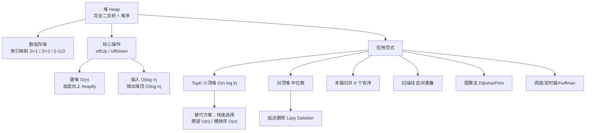
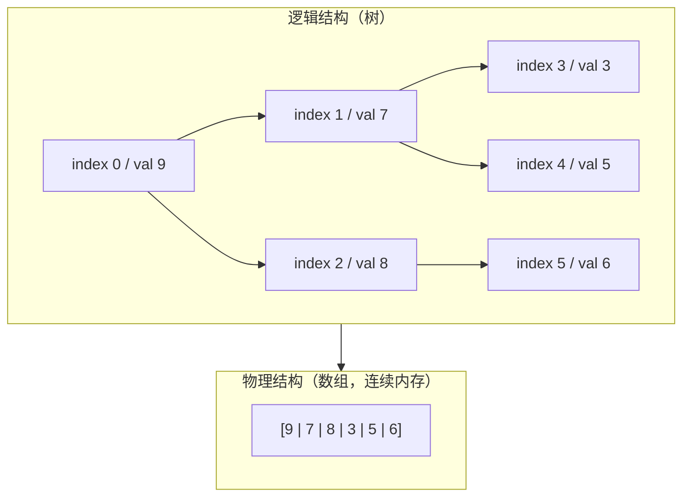
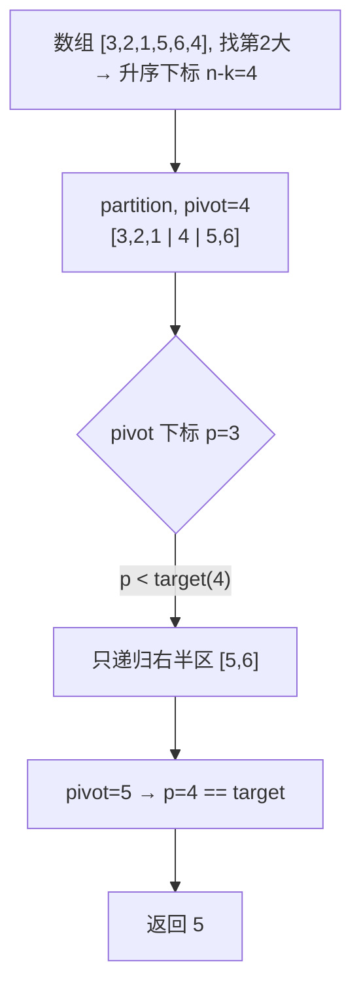
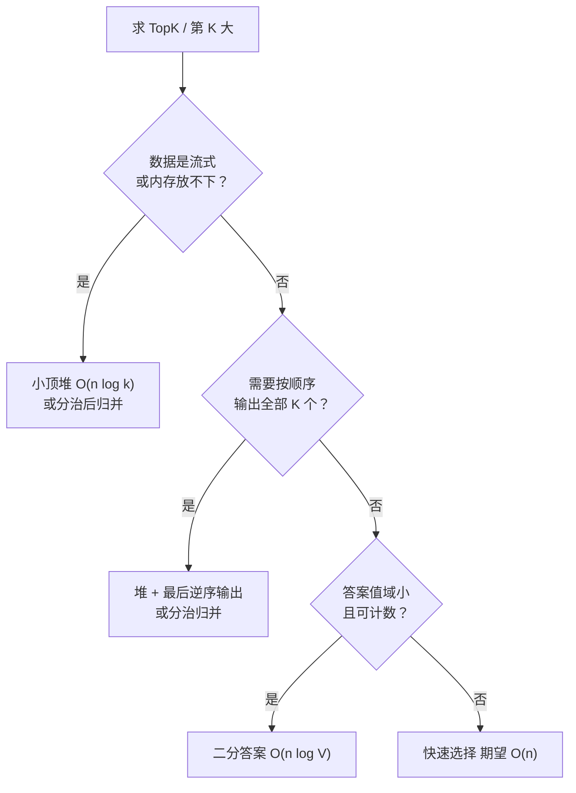
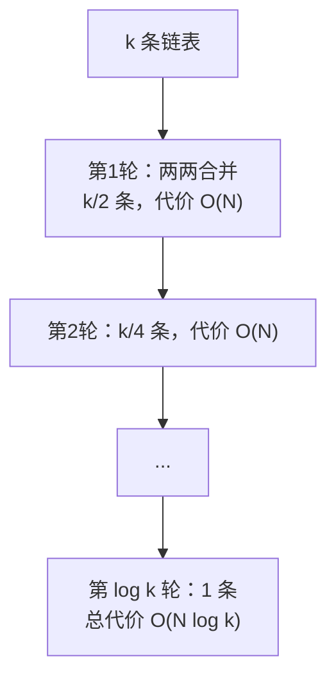
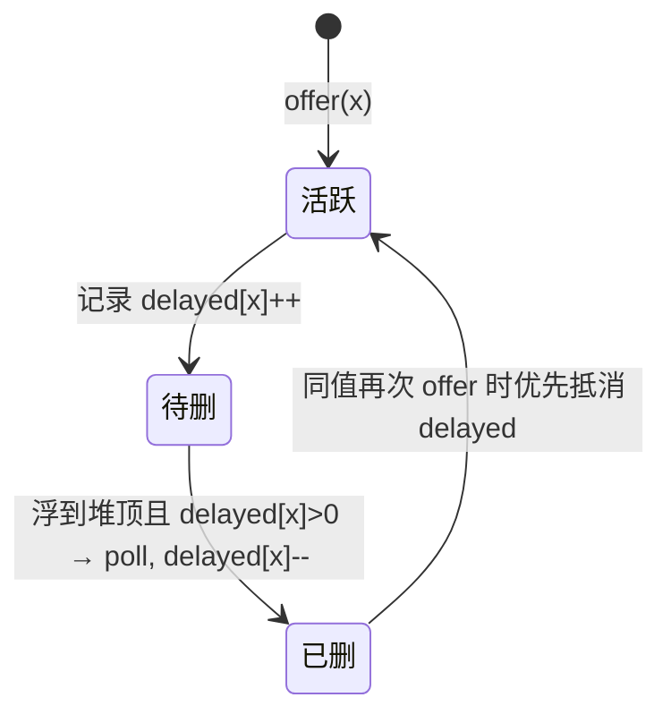

# 堆 / 优先队列 / TopK 专题深度笔记

> 覆盖：215 · 23 · 295 · 253 · 347 五道母题 + 底层原理 + 工程实现 + 大厂真题题库
> 语言主线：Java（附 Python / C++ 关键差异）
> 适用：大厂后端 / 算法岗面试、笔试速通、工程落地

---

## 目录

- [0. 导读：这张知识地图怎么用](#0-导读这张知识地图怎么用)
- [1. 堆的底层原理](#1-堆的底层原理)
- [2. 工程实现剖析：Java / Python / C++ 的优先队列](#2-工程实现剖析java--python--c-的优先队列)
- [3. TopK 的两大范式与选择策略](#3-topk-的两大范式与选择策略)
- [4. 五道母题精讲](#4-五道母题精讲)
- [5. 延伸知识点](#5-延伸知识点)
- [6. 大厂面试题库（含考核程度标注）](#6-大厂面试题库含考核程度标注)
- [7. 答题模板 · 易错清单 · 复杂度速查](#7-答题模板--易错清单--复杂度速查)
- [8. 学习路径与刷题顺序](#8-学习路径与刷题顺序)

---

## 0. 导读：这张知识地图怎么用

### 0.1 知识地图



### 0.2 考核程度标注约定

| 标注 | 含义 | 面试含义 |
|---|---|---|
| ★★★★★ | 极高频，几乎必考 | 必须 3 分钟内给出思路 + 10 分钟内 bug-free 代码 |
| ★★★★ | 高频 | 要能说出两种以上解法并比较复杂度 |
| ★★★ | 中频，常见变体 | 能讲清思路即可，代码允许小瑕疵 |
| ★★ | 低频 / 高区分度 | 通常是加分题，考“你知道这个结构存在吗” |

### 0.3 一条主线，五个母题的定位

| 题号 | 题名 | 本质考察点 | 一句话记忆 |
|---|---|---|---|
| 215 | 数组中的第 K 个最大元素 | TopK 的**堆 / 快速选择 / 二分**三选一 | 求第 K 大 → **小顶堆**，别用大顶堆 |
| 23 | 合并 K 个升序链表 | **多路归并**，堆中放“候选头” | 堆里放的不是全部元素，是每条链的当前指针 |
| 295 | 数据流的中位数 | **对顶堆**，两个堆保持规模差 ≤ 1 | 左边大顶堆，右边小顶堆，中位数从堆顶取 |
| 253 | 会议室 II | **扫描线 / 小顶堆维护最早结束** | 堆里放“正在用的会议结束时间”，能复用就 poll |
| 347 | 前 K 个高频元素 | **哈希 + 堆**，或桶排序做到 O(n) | 频率是 1..n 的整数 → 可以直接用桶降维 |

---

## 1. 堆的底层原理

### 1.1 什么是堆：两个约束，不是“排序”

堆（Heap）不是“排好序的树”，它只保证**一条弱约束**：

> **堆序性质（heap property）**：任意节点的值 ≤（或 ≥）其所有孩子的值。

由此推出唯一保证：**根节点是整个集合的最值**。除此之外，兄弟之间、左右子树之间**没有任何大小关系**。

```
大顶堆（Max-Heap）              小顶堆（Min-Heap）
        9                            1
      /   \                        /   \
     7     8                      3     2
    / \   /                      / \   /
   3   5 6                      8   5 9
```

对比三种“有序结构”的定位差异：

| 结构 | 保证 | 取最值 | 插入 | 查找任意值 | 典型用途 |
|---|---|---|---|---|---|
| 堆 | 父 ≥ 子 | O(1) | O(log n) | O(n) | 只关心最值的场景 |
| 二叉搜索树 | 左 < 根 < 右（全序） | O(log n) | O(log n) | O(log n) | 需要范围查询 / 前驱后继 |
| 跳表 | 全序 + 多层索引 | O(1) | O(log n) | O(log n) | Redis ZSet、排行榜 |
| 单调队列 | 窗口内单调 | O(1) | 摊还 O(1) | — | 滑动窗口最值 |

**关键洞察**：堆用“放弃全序”换来了“极低常数 + 极简实现 + 内存紧凑”。这就是为什么 Dijkstra 用堆不用红黑树——虽然两者渐进复杂度相同，但堆的常数小 3~5 倍、无指针跳转、缓存友好。

### 1.2 为什么用数组存：完全二叉树的编号性质

堆是一棵**完全二叉树**（除最后一层外全满，最后一层从左到右连续填充）。这个性质带来一个极强的工程优势：**可以用数组连续存储，无需任何指针**。



索引映射公式（0-based）：

| 关系 | 公式 | 位运算写法（更快） |
|---|---|---|
| 左孩子 | `2*i + 1` | `(i << 1) + 1` |
| 右孩子 | `2*i + 2` | `(i << 1) + 2` |
| 父节点 | `(i - 1) / 2` | `(i - 1) >>> 1` |
| 是否叶子 | `i >= size / 2` | `i >= (size >>> 1)` |

> **为什么 `(i-1)/2` 要用 `>>>` 而不是 `/`？**
> 当 `i = 0` 时，`(0-1)/2` 在 Java 中等于 `0`（向零取整），`(0-1)>>>1` 等于 `2147483647`。Java `PriorityQueue` 的 `siftUp` 循环条件是 `while (k > 0)`，所以 k=0 时根本不会进循环，两种写法都安全。但如果你自己写 `siftDown` 需要“父节点”时忘记边界，用 `/` 会得到 0 而进入死循环风险区域。**结论：边界判断永远写在循环条件里，别依赖除法取整的巧合。**

**数组存储的三条硬约束**（面试常问“为什么堆能用数组而普通二叉树不行”）：

1. **完全性**保证数组不会有空洞，长度 = 节点数，空间利用率 100%；
2. **连续性**保证 `queue[i]` 与 `queue[2i+1]` 在同一 cache line 附近 → 顺序访问，**缓存命中率极高**；
3. **无指针**意味着没有对象头开销、没有 GC 追踪压力（Java 里 `Object[] queue` 只存引用，但树节点 `TreeNode` 每个对象至少 16 字节头）。

### 1.3 两个核心操作：siftUp 与 siftDown

所有堆操作都是这两个原语的组合。

#### siftUp（上浮）：用于插入

新元素放在数组末尾（保持完全性），然后与父节点比较，**只要比父小（小顶堆）就交换**，一路向上。

```
插入 2 到小顶堆：          2 上浮到根
      3                        2
    /   \                    /   \
   5     4        →         3     4
  / \   /                 / \   /
 8  9  6                 8  9  6
                         /
                        5   ← 原节点被推下来
```

Java 实现（取自 JDK `PriorityQueue.siftUpComparable`，已简化）：

```java
// 小顶堆：key 比父小就上浮
private void siftUp(int k, E key) {
    while (k > 0) {
        int parent = (k - 1) >>> 1;
        Object e = queue[parent];
        if (key.compareTo((E) e) >= 0) break;   // 已满足堆序，停
        queue[k] = e;                            // 父下移
        k = parent;                              // 继续向上
    }
    queue[k] = key;   // 最后一次落位（避免每次交换的 3 次赋值）
}
```

> **工程细节**：JDK 用“单次赋值 + 最后落位”代替 `swap`。一次 `siftUp` 路径长度 h，`swap` 需要 3h 次写，这种做法只需 h+1 次写。这是面试里能加分的细节。

**复杂度**：路径长度 = 树高 = ⌊log₂n⌋，即 **O(log n)**。

#### siftDown（下沉）：用于弹出堆顶 / 建堆

把末尾元素搬到根（保持完全性），然后与**较小（小顶堆）的那个孩子**比较，比它就下沉。

```
弹出堆顶 1：  把末尾 9 放到根，再下沉
      1                        9                        3
    /   \                    /   \                    /   \
   3     4        →         3     4        →         9     4
  / \   /                 / \   /                  / \
 8  5  6                 8  5  6                  8   5  6
```

Java 实现（JDK `siftDownComparable`）：

```java
private void siftDown(int k, E key) {
    int half = size >>> 1;          // 非叶子节点个数；k >= half 说明是叶子，直接落位
    while (k < half) {
        int child = (k << 1) + 1;                 // 左孩子
        Object c = queue[child];
        int right = child + 1;
        // 取两个孩子中较小的
        if (right < size && ((Comparable<? super E>) c).compareTo((E) queue[right]) > 0) {
            c = queue[child = right];
        }
        if (key.compareTo((E) c) <= 0) break;    // 已满足堆序
        queue[k] = c;
        k = child;
    }
    queue[k] = key;
}
```

**两个必须讲清的细节**：

1. **为什么先取较小孩子？** 因为下沉后父节点必须同时 ≤ 两个孩子。如果和较大的孩子交换，交换后 key 会大于较小的孩子，堆序被破坏。
2. **为什么循环条件是 `k < half` 而不是判断孩子越界？** `half = size/2` 恰好是第一个叶子节点的下标。`k < half` 等价于“k 有孩子”，省掉两次数组越界检查，是 JDK 的一个微优化。

**复杂度**：O(log n)。

#### 一个容易被追问的点：siftUp 和 siftDown 的“代价不对称”

| 操作 | 最坏移动次数 | 为什么 |
|---|---|---|
| siftUp | h = log₂n | 从叶子走到根，**必然**走满 |
| siftDown | h = log₂n | 从根走到叶子，**可能**提前停 |

但**建堆**时这个不对称性反转了——见下节，这是 O(n) 建堆证明的核心。

### 1.4 建堆为什么是 O(n)，而不是 O(n log n)

**朴素做法**：n 次 `add()` → 每次 siftUp O(log n) → 总计 O(n log n)。

**heapify 做法**：从**最后一个非叶子节点**（下标 `n/2 - 1`）开始，**倒序**对每个节点做 `siftDown`。

```java
// 关键：从 n/2-1 递减到 0
for (int i = (size >>> 1) - 1; i >= 0; i--) {
    siftDown(i, (E) queue[i]);
}
```

**为什么倒序？** 因为 `siftDown(i)` 要求 i 的左右子树**已经是堆**。叶子天然是堆，所以从最后一个非叶子节点往上处理，每次处理时子树都已就绪。

#### O(n) 的严格证明（面试高频，必背）

设堆高度 h = ⌊log₂n⌋。第 i 层（根为第 0 层）有 **2^i** 个节点，每个节点最多下沉 **h - i** 层。

```
总代价 T(n) = Σ(i=0 → h) 2^i * (h - i)
```

令 k = h - i，则：

```
T(n) = Σ(k=0 → h) 2^(h-k) * k = 2^h * Σ(k=0 → h) k / 2^k
```

利用等比-等差级数求和公式 `Σ(k=0→∞) k/2^k = 2`：

```
T(n) ≤ 2^h * 2 = 2^(h+1) = 2 * 2^h
```

而 `2^h ≤ n`，所以 **T(n) ≤ 2n = O(n)**。

**直觉解释（比公式更好记）**：

- 底层节点极多，但**几乎不用移动**（叶子不用动，倒数第二层最多动 1 层）；
- 顶层节点要移动很多层，但**数量极少**（只有 1 个根，2 个第二层）。
- 代价按指数衰减，数量按指数增长，两者相乘后**收敛**。

```
层数 i    节点数 2^i    最多下沉 (h-i)    该层总代价
  0          1             h              h
  1          2             h-1            2(h-1)
  2          4             h-2            4(h-2)
  ...
  h-1        n/4            1              n/4
  h          n/2            0              0
                                  合计 ≈ 2n
```

**对比：为什么 siftUp 建堆（逐个插入）是 O(n log n)？**
逐个插入时，第 i 层节点插入时**可能走满 i 层**（向上到根），代价是 `Σ 2^i * i = O(n log n)`。方向反了，代价就反了。这是“**同一棵树，从下往上比从上往下便宜**”的经典例子。

> **追问：那为什么 STL 的 `make_heap` 也是 O(n)，而 `push_heap` 是 O(log n)？** 同一个道理。任何“批量构建”的场景都应该走 heapify 而不是 n 次 insert。工程含义：**初始化定时器堆、初始化任务队列时，用批量建堆**。

### 1.5 堆的完整操作复杂度

| 操作 | 二叉堆 | 说明 |
|---|---|---|
| peek（取最值） | **O(1)** | 直接取 `queue[0]` |
| offer / push | **O(log n)** | 末尾插入 + siftUp |
| poll / pop | **O(log n)** | 取根 + 末尾搬根 + siftDown |
| build（heapify） | **O(n)** | 自底向上 siftDown |
| remove(任意) | **O(n) + O(log n)** | 需先 `indexOf` 线性查找 |
| contains | **O(n)** | 无哈希索引 |
| size / isEmpty | O(1) | 计数器 |
| 找第 k 大（堆内） | O(k log n) | 连续 poll k 次 |
| 内存 | **O(n)**，无额外指针 | 数组 |

**这张表里最该记住的两个“坑”**：

1. **`remove(Object)` 和 `contains` 都是 O(n)**。因为堆没有维护“值 → 下标”的索引。若业务真的需要频繁删除任意元素，要么用 `TreeSet`，要么自己实现**索引堆**（见 5.4），要么用**延迟删除**（见 5.2）。
2. **堆不支持高效 decrease-key**。Java `PriorityQueue` 只能“新插入一个更小的 + 旧的那个留着等它被 poll 出来时跳过”——这就是 Dijkstra 中常见的 lazy 写法，也是斐波那契堆被理论上推崇、工程上却少用的原因。

### 1.6 堆排序：堆的副产品，但不是最优选择

```java
public void heapSort(int[] a) {
    int n = a.length;
    // 1. 建大顶堆 O(n)
    for (int i = n / 2 - 1; i >= 0; i--) siftDown(a, i, n);
    // 2. 逐个把堆顶换到末尾，堆区缩小，重新下沉 O(n log n)
    for (int end = n - 1; end > 0; end--) {
        swap(a, 0, end);
        siftDown(a, 0, end);
    }
}
```

| 排序 | 平均 | 最坏 | 额外空间 | 稳定 | 特点 |
|---|---|---|---|---|---|
| 堆排序 | O(n log n) | **O(n log n)** | O(1) | ❌ | 最坏也 O(n log n)，但**缓存不友好**，常数大 |
| 快速排序 | O(n log n) | O(n²) | O(log n) 栈 | ❌ | 实际最快，常数小 |
| 归并排序 | O(n log n) | O(n log n) | O(n) | ✅ | 稳定，可外部排序 |

**为什么工程上快排 > 堆排？** 堆排每次 `siftDown` 访问的是 `i`、`2i+1`、`2i+2`，在 n 较大时这三个下标**跨度极大**，几乎每次都是 cache miss（尤其 n > L3 cache）。快排的顺序扫描则是完美的预取模式。这就是“渐进复杂度相同，实际差 3 倍”的经典案例——面试时能讲出**缓存局部性**这一层，是明显的加分项。

---

## 2. 工程实现剖析：Java / Python / C++ 的优先队列

很多候选人能写出算法，却答不出“`PriorityQueue` 内部是什么”。这一章是拉开差距的地方。

### 2.1 Java `java.util.PriorityQueue` 全解剖

| 维度 | 事实 | 面试价值 |
|---|---|---|
| 底层结构 | **二叉小顶堆**（数组 `Object[] queue`） | ★★★ |
| 默认容量 | **11**（`DEFAULT_INITIAL_CAPACITY = 11`） | ★★ 冷知识，偶尔问 |
| 扩容策略 | `oldCap < 64 ? 2*oldCap+2 : oldCap + oldCap>>1` | ★★★ 很有意思：小容量时 2n+2，大容量时 1.5n |
| 是否有序 | **迭代器不保证顺序**，只有 `peek/poll` 有序 | ★★★★ 极易错 |
| 是否线程安全 | **否**；线程安全用 `PriorityBlockingQueue` | ★★★★ |
| 是否允许 null | **否**，`offer(null)` 抛 NPE | ★★★ |
| 元素要求 | 实现 `Comparable` 或传入 `Comparator`；否则 `ClassCastException` | ★★★ |
| 是否稳定 | **否**，相同优先级顺序不确定 | ★★★ |
| remove(Object) | O(n) 线性查找 + O(log n) 删除 | ★★★★ |
| 是否可迭代删除 | 可以，但**删除后必须重新堆化**（用 iterator.remove 会做 siftDown/siftUp） | ★★ |

#### 关键源码：`offer` 与 `poll`

```java
public boolean offer(E e) {
    if (e == null) throw new NullPointerException();
    modCount++;
    int i = size;
    if (i >= queue.length) grow(i + 1);       // 扩容
    size = i + 1;
    if (i == 0) queue[0] = e;                 // 第一个元素，直接放根
    else siftUp(i, e);                        // 否则上浮
    return true;
}

public E poll() {
    if (size == 0) return null;
    int s = --size;
    modCount++;
    E result = (E) queue[0];                  // 堆顶
    E x = (E) queue[s];                       // 末尾元素
    queue[s] = null;                          // 置空，帮助 GC
    if (s != 0) siftDown(0, x);               // 末尾搬到根再下沉
    return result;
}
```

#### 三个高频追问的标准答案

**Q1：`PriorityQueue` 遍历为什么是乱序的？**
因为底层是数组形式存储的**堆**，不是有序数组。堆只保证父子关系，中序遍历不是有序的。要按顺序取出必须循环 `poll()`（O(n log n)）。如果需要“可遍历的有序集合”，用 `TreeSet` / `TreeMap`。

**Q2：无界队列会不会 OOM？**
`PriorityQueue` 逻辑上无界（没有 `capacity` 上限检查），只受 `Integer.MAX_VALUE - 8` 和内存限制。生产环境用 `PriorityBlockingQueue(capacity)` 也**不会**在满时阻塞（它也是无界的，`capacity` 只是初始值）——这是新手最容易踩的坑：**用 `PriorityBlockingQueue` 做有界队列会导致内存失控**。真正有界的优先级队列需要自己封装（入队前判断 size 并拒绝）。

**Q3：`Comparator` 写 `(a,b) -> a - b` 有什么风险？**
整型溢出。比如 `a = -2_000_000_000, b = 1_000_000_000`，`a - b` 溢出为负数，排序结果反转。**规范写法**：

```java
(a, b) -> Integer.compare(a, b)              // 升序（小顶堆）
(a, b) -> Integer.compare(b, a)              // 降序（大顶堆）
Comparator.comparingInt(x -> x)              // 同上，推荐
```

同理 `a.val - b.val` 在链表节点值可能为负数且范围大时也会溢出 → 用 `Integer.compare(a.val, b.val)`。

#### 自定义大顶堆的四种写法

```java
// 1. Lambda（最常用）
new PriorityQueue<>((a, b) -> Integer.compare(b, a));

// 2. 显式 Comparator
new PriorityQueue<>(Comparator.reverseOrder());

// 3. 匿名内部类（老代码常见）
new PriorityQueue<>(new Comparator<Integer>() {
    public int compare(Integer a, Integer b) { return b - a; }
});

// 4. 取负法（Python 常用，Java 不推荐：破坏语义、MIN_VALUE 取负仍溢出）
new PriorityQueue<>();  // 存 -x，取出时再取负
```

#### `PriorityQueue` 的“三不要”

1. **不要在遍历中修改元素的可比较字段**。堆序会失效，之后所有操作结果未定义（不是报错，是**静默错误**，最难排查）。
2. **不要用 `PriorityQueue` 存可变对象并依赖它的排序做业务判断**。
3. **不要在多线程共享**。`PriorityQueue` 的 `modCount` 只在迭代器做 fail-fast 检查，并发写会导致数组状态损坏。

### 2.2 Python `heapq` 要点

```python
import heapq

h = []
heapq.heappush(h, 5)        # O(log n)
heapq.heappop(h)            # O(log n)，弹出最小
h[0]                        # peek，O(1)
heapq.heapify(h)            # O(n) 建堆，原地
heapq.heappushpop(h, x)     # 先 push 再 pop，比两次操作快（siftDown only）
heapq.heapreplace(h, x)     # 先 pop 再 push（等价但语义不同：返回旧最小值）
```

**Python 只有小顶堆**，三个常用技巧：

```python
# 技巧1：取负实现大顶堆
heapq.heappush(h, -x)
max_val = -h[0]

# 技巧2：元组比较，第一元素为主键（要求后续元素可比较！）
heapq.heappush(h, (dist, node_id))     # 按 dist 排序
# 若 node_id 不可比较（如自定义对象），加一个自增计数器避免 TypeError
heapq.heappush(h, (dist, cnt, node))

# 技巧3：固定大小 TopK —— 维护大小为 k 的最小堆
if len(h) < k:
    heapq.heappush(h, x)
elif x > h[0]:
    heapq.heapreplace(h, x)
```

**`heapq` 的底层源码**（值得一读，比 Java 更直观）：

```python
def _siftdown(heap, startpos, pos):
    newitem = heap[pos]
    while pos > startpos:
        parentpos = (pos - 1) >> 1
        parent = heap[parentpos]
        if newitem < parent:
            heap[pos] = parent
            pos = parentpos
            continue
        break
    heap[pos] = newitem

def _siftup(heap, pos):
    endpos = len(heap)
    startpos = pos
    newitem = heap[pos]
    childpos = 2 * pos + 1
    while childpos < endpos:
        rightpos = childpos + 1
        if rightpos < endpos and not heap[childpos] < heap[rightpos]:
            childpos = rightpos          # 取较小的孩子
        heap[pos] = heap[childpos]
        pos = childpos
        childpos = 2 * pos + 1
    heap[pos] = newitem
    _siftdown(heap, startpos, pos)       # 最后再上浮一次（因为可能放到了叶子）
```

> **注意 Python 的命名是反的**：`_siftup` 实际做的是“下沉到叶子”，`_siftdown` 做的是“上浮”。`_siftup` 末尾还调用一次 `_siftdown`，因为“一路把孩子搬上来”可能导致新元素放在叶子后仍小于父节点。**这是一个极好的面试追问点：为什么 Python 的 heappop 要两次调整？**

### 2.3 C++ STL `priority_queue`

```cpp
#include <queue>
// 默认是【大顶堆】（与 Java/Python 相反！）
std::priority_queue<int> maxHeap;

// 小顶堆：三个模板参数
std::priority_queue<int, std::vector<int>, std::greater<int>> minHeap;

// 自定义比较：注意 greater 语义 —— 返回 true 表示 a 的优先级低于 b（排后面）
struct Cmp {
    bool operator()(const ListNode* a, const ListNode* b) const {
        return a->val > b->val;      // 小顶堆：值小的优先
    }
};
std::priority_queue<ListNode*, std::vector<ListNode*>, Cmp> pq;
```

**C++ 的三个坑**：

1. 默认是**大顶堆**，与 Java（小顶堆）、Python（小顶堆）相反，笔试时最容易写错。
2. 不支持 `erase(iterator)`，只支持 `pop()`（弹堆顶）。要删除任意元素必须用 `std::multiset` / 手写堆。
3. `priority_queue` 底层是 `std::vector` + `std::make_heap` / `push_heap` / `pop_heap` 三个算法，**可以自己用 `vector` + 这三个函数实现可自定义的堆**：

```cpp
vector<int> v = {3, 1, 4, 1, 5};
make_heap(v.begin(), v.end(), greater<int>());   // O(n) 建小顶堆
pop_heap(v.begin(), v.end(), greater<int>());    // 把最值移到末尾
v.pop_back();
v.push_back(9);
push_heap(v.begin(), v.end(), greater<int>());   // 上浮
```

### 2.4 三语言对照速查

| 项目 | Java | Python | C++ |
|---|---|---|---|
| 默认类型 | 小顶堆 | 小顶堆 | **大顶堆** |
| 反转为大/小 | `Comparator.reverseOrder()` | 取负 | `greater<>` / `less<>` |
| 建堆 | 逐个 add 或循环 siftDown | `heapify()` | `make_heap()` |
| 取顶 | `peek()`（空返回 null） | `h[0]`（空抛 IndexError） | `top()`（空 UB） |
| 弹出 | `poll()`（空返回 null） | `heappop()`（空抛 IndexError） | `pop()`（空 UB） |
| 删除任意 | `remove(o)` O(n) | 无原生支持 | 无 |
| 线程安全 | `PriorityBlockingQueue` | 无（GIL 不等于安全） | 无 |

---

## 3. TopK 的两大范式与选择策略

### 3.1 范式一：小顶堆法（流式、内存友好）

**核心反直觉点**：**求“第 K 大 / 最大的 K 个”，用的是小顶堆。**

为什么？因为堆的作用是“**守住门槛**”：

- 小顶堆的堆顶是**当前 K 个候选中最小的那个**，也就是“**进入 TopK 的最低门槛**”；
- 新元素来了，只要 `x > 门槛`，就说明它比候选中最小的大，有资格进来 → `poll()` 踢掉门槛，`offer(x)`；
- 如果 `x <= 门槛`，它连第 K 名都比不过，直接丢掉，**连堆都不用进**。

```java
public int findKthLargest(int[] nums, int k) {
    PriorityQueue<Integer> heap = new PriorityQueue<>();   // 小顶堆
    for (int x : nums) {
        if (heap.size() < k) {
            heap.offer(x);
        } else if (x > heap.peek()) {       // 严格大于才替换（等于可不换，省操作）
            heap.poll();
            heap.offer(x);
        }
    }
    return heap.peek();                     // 堆顶 = 第 K 大
}
```

**复杂度**：时间 **O(n log k)**，空间 **O(k)**。

**为什么空间是最大优势**：n = 10 亿、k = 100 时，只需 100 个元素的内存。这就是“**海量数据 TopK**”的标准解法，也是分布式面试题的起点。

### 3.2 范式二：快速选择 Quickselect（一次性、期望线性）

思想：借用快排的 partition。每次 partition 后，pivot 落在最终位置 p：

- `p == target` → 找到答案，返回；
- `p < target` → 答案在右半区，只递归右半；
- `p > target` → 答案在左半区，只递归左半。

因为每次**只递归一半**，递推式 `T(n) = T(n/2) + O(n)` → **O(n)**（期望）。



#### 标准实现（三路划分，正确处理重复元素）

```java
import java.util.Random;

class Solution {
    private final Random rand = new Random();

    public int findKthLargest(int[] nums, int k) {
        // 第 k 大 == 升序排列中的下标 n-k
        return quickSelect(nums, 0, nums.length - 1, nums.length - k);
    }

    private int quickSelect(int[] a, int lo, int hi, int target) {
        // 随机 pivot，避免有序数组退化
        int pivot = a[lo + rand.nextInt(hi - lo + 1)];
        int lt = lo, i = lo, gt = hi;
        // 三路划分：[lo, lt) < pivot, [lt, gt] == pivot, (gt, hi] > pivot
        while (i <= gt) {
            if (a[i] < pivot)      swap(a, lt++, i++);
            else if (a[i] > pivot) swap(a, i, gt--);
            else                   i++;
        }
        if (target < lt)      return quickSelect(a, lo, lt - 1, target);
        if (target > gt)      return quickSelect(a, gt + 1, hi, target);
        return a[target];     // target ∈ [lt, gt]
    }

    private void swap(int[] a, int i, int j) {
        int t = a[i]; a[i] = a[j]; a[j] = t;
    }
}
```

**为什么必须三路划分？** 考虑 `nums = [1,1,1,...,1]`（全相同）找第 K 大。两路划分时 `pivot == 1`，所有元素都 ≤ 或 ≥ pivot，partition 无法把数组切开（分成 `[全部]` 和 `[空]`），退化为 **O(n²)**。三路划分把“等于区”整体跳过，全相同数组一次搞定，**O(n)**。

**为什么必须随机化 pivot？** 对已排序数组（例如 `[1,2,3,...,n]` 取 `a[hi]` 作 pivot），每次只能切掉 1 个元素 → 递归 n 层 → **O(n²)** 且栈溢出。随机化后期望深度 O(log n)。

#### 最坏 O(n²) 怎么彻底解决？—— BFPRT / Median of Medians

**思路**：不随机，而是**在线性时间内找到一个“保证不太偏”的 pivot**（中位数的中位数）。

```
1. 把数组按 5 个一组分成 ⌈n/5⌉ 组
2. 每组内部排序（常数规模，O(1)），取各组中位数 → ⌈n/5⌉ 个中位数
3. 递归地求这 ⌈n/5⌉ 个中位数的中位数 M   ← 这就是 pivot
4. 用 M 做 partition，然后只在包含 target 的那一半递归
```

**为什么保证 O(n)**：设 pivot 为 M。至少有 `3n/10 - 6` 个元素 ≤ M，也至少有 `3n/10 - 6` 个元素 ≥ M（几何证明：每组 5 个数中，中位数前有 2 个比它小，M 之前有约一半组的中位数比 M 小）。

所以每轮 partition 后问题规模**至多缩小到 7n/10**：

```
T(n) ≤ T(n/5) + T(7n/10) + O(n)
```

因为 `1/5 + 7/10 = 9/10 < 1`，根据主定理（或直接几何级数求和），**T(n) = O(n)**，最坏情况也成立。

> **面试怎么说**：Java 的 `Arrays.sort` 对基本类型用 Dual-Pivot Quicksort（双轴快排），对对象用 TimSort；JDK 里**没有**内置 BFPRT。工程上实践是“随机化 + 三路划分 + 小数组插排 + 递归改迭代”就足够，BFPRT 因为常数巨大（约 10~20 倍）几乎没人用在真实系统里，**它的价值是理论保证**。

### 3.3 范式三：二分答案（值域二分 / 计数二分）

当**答案的取值范围已知且可数**，且能快速算出“≤ x 的元素有多少个”时，可以二分答案。

```java
// 例：找第 K 小，nums ∈ [-10^4, 10^4]
int lo = -10000, hi = 10000;
while (lo < hi) {
    int mid = lo + (hi - lo) / 2;              // 防溢出写法！
    int cnt = 0;
    for (int x : nums) if (x <= mid) cnt++;    // 计数 O(n)
    if (cnt < k) lo = mid + 1;                  // 不够 k 个，答案更大
    else hi = mid;
}
return lo;
```

**复杂度**：O(n log V)，V 是值域宽度。值域小的时候（如 `int` 只需 31 轮）非常快，且**天然支持海量数据外部存储**（每轮只需扫一遍文件）。

**适用面**：这是 **378（有序矩阵第 K 小）**、**719（第 K 小距离对）**、**668（乘法表第 K 小）**、**第 K 大子数组和** 的标准解法。凡题目里出现“**第 K 小 / 第 K 大 + 答案可判定**”，就该想到它。

### 3.4 三范式横向对比（面试必答）

| 维度 | 小顶堆 TopK | 快速选择 | 二分答案 |
|---|---|---|---|
| 时间复杂度 | O(n log k) | 期望 O(n)，最坏 O(n²)（BFPRT 可 O(n)） | O(n log V) |
| 空间 | **O(k)** | O(1)（原地）/ O(log n) 栈 | **O(1)** |
| 是否需全部数据在内存 | ❌ 不需要，**流式友好** | ✅ 需要（要随机访问 partition） | ❌ 只需顺序扫描 |
| 是否支持动态追加 | ✅ **天然支持**（数据流） | ❌ 每来新数据都要重算 | 部分支持 |
| 是否有序输出 TopK | ❌ 只给第 K 个，要给全部得再 poll | 部分有序（pivot 左侧都更小） | 需额外一轮收集 |
| 最坏情况 | 稳定 O(n log k) | 会退化（随机化后概率极低） | 稳定 |
| 典型场景 | 实时排行榜、日志 Top IP、大文件 | 单机一次性计算 | 分布式 / 外部存储 / 答案空间小 |

**决策树**：



### 3.5 一个必须理解的“反直觉”总结

| 目标 | 用哪种堆 | 堆里存什么 | 堆顶含义 |
|---|---|---|---|
| 最大的 K 个 / 第 K 大 | **小顶堆** | 当前最大的 K 个 | 这 K 个里**最小**的（门槛） |
| 最小的 K 个 / 第 K 小 | **大顶堆** | 当前最小的 K 个 | 这 K 个里**最大**的（门槛） |
| 中位数 | 大顶堆 + 小顶堆 | 各存一半 | 两堆顶共同决定 |
| 合并 K 个有序 | **小顶堆** | 每路的当前头 | 全局下一个最小 |
| 会议室最少数量 | **小顶堆** | 正在开会的最早结束时间 | 哪个房间最先空出来 |

**记忆口诀**：**“要留下的那一半，堆顶放最差的；被淘汰的，一定比堆顶更差。”**

---

## 4. 五道母题精讲

> 每道题固定结构：**题意 → 考点 → 思路推演 → 图解 → 代码 → 复杂度 → 易错点 → 面试追问**

---

### 4.1 LeetCode 215 · 数组中的第 K 个最大元素

#### 题意与约束

```
给定整数数组 nums 和整数 k，请返回数组中第 k 个最大的元素。
注意：是排序后的第 k 个最大元素，不是第 k 个不同的元素。

输入: [3,2,1,5,6,4], k = 2     输出: 5
输入: [3,2,3,1,2,4,5,5,6], k = 4  输出: 4

约束：1 <= k <= nums.length <= 10^5, -10^4 <= nums[i] <= 10^4
要求：时间复杂度必须优于 O(n log n)
```

#### 考点拆解

| 层次 | 考察点 | 面试官想看什么 |
|---|---|---|
| 基础 | 知道 TopK 用堆 | 能否立刻写出小顶堆，且**方向不写反** |
| 进阶 | 知道快速选择 | 能否说清“为什么期望 O(n)” |
| 高级 | 三路划分 / 随机化 / BFPRT | 是否理解最坏情况会退化、怎么救 |
| 工程 | 值域小时用计数/二分 | 是否会根据约束选最优方案 |
| 边界 | k=1、k=n、大量重复 | 是否主动提边界 |

#### 思路推演：从“最笨”到“最优”

```
思路0  排序后取 a[n-k]                       O(n log n)   ← 面试第一句就能说，但会被要求优化
思路1  小顶堆维护 K 个                       O(n log k)   ← 面试标准答案
思路2  大顶堆全塞进去，poll K 次              O(n + k log n) ← 次优，k 大时退化到 O(n log n)
思路3  快速选择（随机+三路）                 期望 O(n)     ← 想要更快时给
思路4  二分答案（值域 [-10^4,10^4]）          O(n log V)   ← 值域小，天然适合分布式
思路5  计数排序（值域小）                     O(n + V)     ← 本题 V=2*10^4，理论最优
```

> **思路2 为什么会退化**：如果 k ≈ n，`n + k log n ≈ n log n`，还不如直接排序。而且它需要把全部 n 个元素放进堆，空间 O(n)——**方向错了**：求第 K 大要用小顶堆，且只保留 k 个。

#### 图解：小顶堆如何“守住门槛”

```
nums = [3,2,1,5,6,4], k = 2     目标：保留最大的 2 个

初始  heap = []
① 3   → heap=[3]
② 2   → heap=[2,3]          堆顶 2 = 当前第 2 大的门槛
③ 1   → 1 ≤ 2  丢弃          heap=[2,3]
④ 5   → 5 > 2  踢掉 2，进 5   heap=[3,5]   堆顶 3（新的门槛）
⑤ 6   → 6 > 3  踢掉 3，进 6   heap=[5,6]   堆顶 5
⑥ 4   → 4 ≤ 5  丢弃          heap=[5,6]

答案 = 堆顶 = 5  ✅（第 2 大）
```

#### 解法一：小顶堆（标准答案，★★★★★）

```java
class Solution {
    public int findKthLargest(int[] nums, int k) {
        // 小顶堆：堆顶是 K 个候选中【最小】的那个 = 门槛
        PriorityQueue<Integer> heap = new PriorityQueue<>(k);
        for (int x : nums) {
            if (heap.size() < k) {
                heap.offer(x);
            } else if (x > heap.peek()) {        // 严格大于门槛才替换
                heap.poll();
                heap.offer(x);
            }
        }
        return heap.peek();
    }
}
```

**一个常被追问的优化**：`x > heap.peek()` 的判断让**大多数元素连 offer 都不需要**（只有 log 次比较，但省掉了 offer 的 log n 次调整）。在 k 小、n 大时这个剪枝非常有效——**n=10^9, k=10 时，99.99999% 的元素只做一次比较就被丢弃**。

**更简洁但略慢的写法**（面试可用，代码短）：

```java
PriorityQueue<Integer> heap = new PriorityQueue<>();
for (int x : nums) {
    heap.offer(x);
    if (heap.size() > k) heap.poll();   // 始终保持 size = k
}
return heap.peek();
```
每次都要 offer + 可能 poll，常数更大，但代码短不易错。**建议先用这种写法讲清思路，再说优化版。**

**Python**：

```python
class Solution:
    def findKthLargest(self, nums: List[int], k: int) -> int:
        heap = []
        for x in nums:
            if len(heap) < k:
                heapq.heappush(heap, x)
            elif x > heap[0]:
                heapq.heapreplace(heap, x)   # 一步完成 pop+push，比 heapreplace 前的两次操作快
        return heap[0]
```

> `heapreplace` 比 `heappop` + `heappush` 快，因为它只做一次 siftDown。

#### 解法二：快速选择（期望 O(n)，★★★★）

```java
class Solution {
    private final Random rand = new Random();

    public int findKthLargest(int[] nums, int k) {
        return quickSelect(nums, 0, nums.length - 1, nums.length - k);
    }

    private int quickSelect(int[] a, int lo, int hi, int target) {
        if (lo == hi) return a[lo];
        int pivot = a[lo + rand.nextInt(hi - lo + 1)];
        int lt = lo, i = lo, gt = hi;
        while (i <= gt) {
            if (a[i] < pivot)      swap(a, lt++, i++);
            else if (a[i] > pivot) swap(a, i, gt--);
            else                   i++;
        }
        if (target < lt)      return quickSelect(a, lo, lt - 1, target);
        else if (target > gt) return quickSelect(a, gt + 1, hi, target);
        else                  return a[target];
    }

    private void swap(int[] a, int i, int j) {
        int t = a[i]; a[i] = a[j]; a[j] = t;
    }
}
```

**三路划分的循环不变量**（面试手写时心里要有这个图）：

```
[ lo ...... lt )   < pivot
[ lt ...... gt ]   == pivot
( gt ...... hi ]   > pivot
        ↑
        i 扫描指针

- a[i] < pivot  → 与 a[lt] 交换，lt++, i++        （lt 位置是 == 区左边界，交换安全）
- a[i] > pivot  → 与 a[gt] 交换，gt--，i 不动       （换过来的元素还没检查，i 不能动！）
- a[i] == pivot → i++
```

> **最容易写错的地方**：`a[i] > pivot` 时 **i 不能自增**。因为从 `gt` 换过来的元素还没被检查过。

**迭代版**（避免递归栈，面试若被问“能否不用递归”）：

```java
public int findKthLargest(int[] nums, int k) {
    int target = nums.length - k, lo = 0, hi = nums.length - 1;
    Random rand = new Random();
    while (true) {
        int pivot = nums[lo + rand.nextInt(hi - lo + 1)];
        int lt = lo, i = lo, gt = hi;
        while (i <= gt) {
            if (nums[i] < pivot) swap(nums, lt++, i++);
            else if (nums[i] > pivot) swap(nums, i, gt--);
            else i++;
        }
        if (target < lt) hi = lt - 1;
        else if (target > gt) lo = gt + 1;
        else return nums[target];
    }
}
```

#### 解法三：二分答案（O(n log V)，★★★）

```java
class Solution {
    public int findKthLargest(int[] nums, int k) {
        int target = nums.length - k;     // 转成第 (n-k+1) 小，即找第 target 小的数
        int lo = -10000, hi = 10000;
        while (lo < hi) {
            int mid = lo + (hi - lo) / 2;              // 不用 (lo+hi)/2 防溢出
            int cnt = 0;                                // ≤ mid 的元素个数
            for (int x : nums) if (x <= mid) cnt++;
            if (cnt <= target) lo = mid + 1;            // 不够，答案在右边
            else hi = mid;
        }
        return lo;
    }
}
```

**为什么这里是 `cnt <= target` 而不是 `cnt < k`？** 因为要找的是“第 target 小的值本身”，而 `cnt(mid)` 统计的是 `≤ mid` 的个数。若 `cnt ≤ target`，说明 mid 往左的数不足以覆盖 target+1 个位置，答案必然 > mid。**边界一错就死循环或差一**，这是二分最典型的坑。

**更稳妥的写法（找第一个满足 cnt > target 的 mid）**：

```java
int lo = -10000, hi = 10000;
while (lo < hi) {
    int mid = lo + (hi - lo) / 2;
    int cnt = 0;
    for (int x : nums) if (x <= mid) cnt++;
    if (cnt <= target) lo = mid + 1;
    else hi = mid;
}
return lo;
```
和上面等价——记住模板：**“找第一个满足条件的值”用 `lo=mid+1 / hi=mid`，返回 `lo`。**

#### 复杂度与正确性

| 解法 | 时间 | 空间 | 备注 |
|---|---|---|---|
| 排序 | O(n log n) | O(log n) | 不满足题目要求 |
| **小顶堆** | **O(n log k)** | **O(k)** | 最稳，流式友好 |
| 大顶堆 poll k 次 | O(n + k log n) | O(n) | k 大时退化 |
| **快速选择** | **期望 O(n)**，最坏 O(n²) | O(1) / O(log n) 栈 | 实际最快 |
| BFPRT | O(n) 最坏 | O(n) | 理论保证，常数大 |
| 二分答案 | O(n log V) | O(1) | V=值域宽度 |
| 计数排序 | O(n + V) | O(V) | V=2·10⁴ 时最优 |

**正确性证明（小顶堆）**：归纳法。处理完前 i 个元素后，堆中恰为前 i 个元素中最大的 min(i, k) 个。
- 基础：i ≤ k 时全部进堆，成立。
- 归纳：第 i+1 个元素 x 到来。若 `size < k`，x 是前 i+1 个中最大的 ≤ k 个之一，进堆成立；若 `size == k` 且 `x > 堆顶`，则 x 大于原 K 个中最小的，替换后仍为最大的 K 个；若 `x ≤ 堆顶`，x 不可能进入前 K，丢弃成立。∎

#### 易错点清单

| 错误 | 后果 | 正确做法 |
|---|---|---|
| 求第 K 大用了**大顶堆** | 结果完全错 | 求最大 K 个 → **小顶堆** |
| `heap.peek()` 前没判空 | NPE | 保证 size ≥ k 后再 peek |
| k = n 时堆里装 n 个 | 退化为 O(n log n) | 允许，但要知道复杂度 |
| 快速选择用 `a[hi]` 做 pivot | 有序数组退化为 O(n²) | 随机化 |
| 两路划分处理重复元素 | 全相同时 O(n²) | 三路划分 |
| `(lo+hi)/2` | int 溢出 | `lo + (hi-lo)/2` |
| 三路划分中 `a[i] > pivot` 时也 `i++` | 漏检元素，答案错 | i 不动 |
| 混淆“第 K 大”与“第 K 小” | 下标算错 | 第 K 大 = 升序 `n-k` |
| 二分边界 `cnt < k` vs `cnt <= target` | 差一 | 明确统计语义 |

#### 面试追问与标准答法

**Q：如果数据是 10 亿个数，内存只有 1GB，怎么求第 K 大？**

> 三层回答：
> 1. **小顶堆 + 流式读取**：内存只需 O(k)，边读边维护（如果 k 很小）；
> 2. **k 较大时**：先按哈希 / 范围把数据**分片落盘**（比如按 `value % 100` 分 100 个文件），每片单独求 TopK，最后对 100·k 个候选再求一次 TopK（**分治 + 归并**）；
> 3. **值域二分**（最省内存）：每轮扫一遍全量数据，统计 `≤ mid` 的个数，二分 31 轮即可定位，**空间 O(1)、IO 31 遍**。适合“内存完全不够、但磁盘可重复读”的场景。

**Q：堆解法和快选怎么选？**

> - 数据**流式 / 动态增长 / 内存放不下** → 堆（唯一选择）；
> - 数据**静态、在内存、只求一次** → 快选（更快，常数小）；
> - 需要**多次查询不同 K** → 排序一次 O(n log n) 或维护有序结构；
> - 需要**同时输出 TopK 全部且有序** → 堆 + 最后排序 k 个（O(k log k)）。

**Q：为什么第 K 大不直接用 `Arrays.sort`？** 因为题目明确要求优于 O(n log n)，且实际 n=10^5 时快选约快 3 倍。

---

### 4.2 LeetCode 23 · 合并 K 个升序链表

#### 题意与约束

```
给你一个链表数组，每个链表都已经按升序排列。
请你将所有链表合并到一个升序链表中，返回合并后的链表。

输入: lists = [[1,4,5],[1,3,4],[2,6]]
输出: [1,1,2,3,4,4,5,6]

约束：k == lists.length, 0 <= k <= 10^4, 0 <= lists[i].length <= 500
     -10^4 <= lists[i][j] <= 10^4
     所有链表元素总数 sum 不超过 10^4
```

#### 考点拆解

| 层次 | 考察点 |
|---|---|
| 基础 | 能否想到“每轮从 k 个链头里取最小” |
| 核心 | **堆里放什么**：放 k 个链头，不是放全部元素 |
| 进阶 | 分治两两归并 vs 堆的复杂度与常数对比 |
| 高级 | 外部排序 / 败者树 / 多路归并的工程实现 |
| 细节 | 空链表、k=0、链表长度差异极大 |

#### 思路推演

```
思路0  把所有元素倒进数组，排序，重建链表     O(N log N)，N=总元素数  ← 太笨
思路1  两两合并，串行                          O(k² · m)             ← k 大时爆炸
思路2  每次线性扫 k 个链头取最小                O(N · k)              ← k 大时爆炸
思路3  小顶堆维护 k 个链头                     O(N log k)            ← 标准答案
思路4  分治：两两归并，层数 log k              O(N log k)            ← 同样复杂度，常数更小
思路5  败者树（loser tree）                    O(N log k)            ← 进阶，外部排序用
```

**关键洞察**：这是**多路归并（k-way merge）**。k 路归并的本质就是“**每次从 k 个候选头里选最小的**”，而“从 k 个候选中选最小”正是**堆**的天然职责。所以：

> **堆的大小 = 路数 k，堆中元素 = 每条路的当前头指针。**

#### 图解

```
lists: [1→4→5], [1→3→4], [2→6]

初始堆（k=3）:  (1,A) (1,B) (2,C)          A/B/C 代表三条链的当前节点

① poll (1,A) → 输出 1，A 前进到 4，push (4,A)
   堆: (1,B) (2,C) (4,A)         输出: 1
② poll (1,B) → 输出 1，B 前进到 3，push (3,B)
   堆: (2,C) (3,B) (4,A)         输出: 1→1
③ poll (2,C) → 输出 2，C 前进到 6，push (6,C)
   堆: (3,B) (4,A) (6,C)         输出: 1→1→2
④ poll (3,B) → 输出 3，B 前进到 4，push (4,B)
   堆: (4,A) (4,B) (6,C)         输出: 1→1→2→3
⑤ poll (4,A) → 输出 4，A 前进到 5，push (5,A)
   堆: (4,B) (5,A) (6,C)         输出: ...→4
⑥ poll (4,B) → 输出 4，B 到头，不 push
   堆: (5,A) (6,C)               输出: ...→4→4
⑦⑧ 依次输出 5、6
最终: 1→1→2→3→4→4→5→6  ✅
```

#### 解法一：小顶堆（标准答案，★★★★★）

```java
class Solution {
    public ListNode mergeKLists(ListNode[] lists) {
        if (lists == null || lists.length == 0) return null;

        // 小顶堆，按节点值升序；用 Integer.compare 避免溢出
        PriorityQueue<ListNode> pq = new PriorityQueue<>(
            lists.length, (a, b) -> Integer.compare(a.val, b.val));

        // 初始：每条链的头节点入堆（空链表跳过）
        for (ListNode head : lists) {
            if (head != null) pq.offer(head);
        }

        ListNode dummy = new ListNode(0), tail = dummy;
        while (!pq.isEmpty()) {
            ListNode cur = pq.poll();       // 全局最小
            tail.next = cur;                // 接到结果链尾
            tail = cur;
            if (cur.next != null) {
                pq.offer(cur.next);         // 该路的下一元素入堆
            }
        }
        tail.next = null;                   // 防御性置空
        return dummy.next;
    }
}
```

**为什么堆里只放 k 个？** 因为每条链已经有序，**只有链头可能是当前最小值**。堆里最多 k 个元素，`N` 次 offer/poll 各 O(log k) → **O(N log k)**。若把全部 N 个元素都入堆，就是 O(N log N)，丢失了“已有序”这个信息。

**Python 版（注意元组比较的坑）**：

```python
class Solution:
    def mergeKLists(self, lists: List[Optional[ListNode]]) -> Optional[ListNode]:
        heap = []
        for i, node in enumerate(lists):
            if node:
                # 加索引 i 作为第二元素：避免 ListNode 不可比较导致 TypeError
                heapq.heappush(heap, (node.val, i, node))
        dummy = tail = ListNode(0)
        while heap:
            val, i, node = heapq.heappop(heap)
            tail.next = node
            tail = node
            if node.next:
                heapq.heappush(heap, (node.next.val, i, node.next))
        tail.next = None
        return dummy.next
```

> **必讲坑**：Python 的元组比较在第一个元素相等时会比较第二个。如果直接存 `(val, node)`，`ListNode` 没有实现 `__lt__` → `TypeError: '<' not supported`。**必须加一个可比较的 tiebreaker（如索引 i）**。这个坑在 347、373、23 里都会出现。

#### 解法二：分治两两归并（★★★★，常数更小）

**思路**：把 k 条链两两配对合并，一轮后变成 k/2 条，再两两合并……共 log k 轮，每轮总代价 O(N)，总计 O(N log k)。



```java
class Solution {
    public ListNode mergeKLists(ListNode[] lists) {
        if (lists == null || lists.length == 0) return null;
        int interval = 1;
        while (interval < lists.length) {
            for (int i = 0; i + interval < lists.length; i += interval * 2) {
                lists[i] = mergeTwo(lists[i], lists[i + interval]);
            }
            interval *= 2;
        }
        return lists[0];
    }

    private ListNode mergeTwo(ListNode a, ListNode b) {
        ListNode dummy = new ListNode(0), tail = dummy;
        while (a != null && b != null) {
            if (a.val <= b.val) { tail.next = a; a = a.next; }
            else                { tail.next = b; b = b.next; }
            tail = tail.next;
        }
        tail.next = (a != null) ? a : b;    // 剩余部分整体接上，O(1)
        return dummy.next;
    }
}
```

**为什么分治比堆常数小？** 堆版每次操作都要做 `siftDown`（log k 次比较 + 数组写），且比较是**随机内存访问**；分治版的 `mergeTwo` 是**顺序遍历**，cache 友好、无额外对象分配，实测快 2~3 倍。但堆版有一个分治没有的优势：**可以流式处理**（如果链表是慢慢到来的）。

#### 解法三：败者树（★★★★ 进阶，面试官眼前一亮）

**问题**：堆版每次 `poll` 后都要 `offer` 新元素，两次 O(log k) 调整。败者树（loser tree）是**多路归并的专用结构**，每次只需 **O(log k)** 且常数更小，**支持 k 路、只需记录败者**。

思路：一棵完全二叉树，叶子是 k 路，内部节点记录“**比赛的败者**”（较小者胜出向上），根节点的上方记录**全局胜者**（最小）。

```
k=4 路，叶子 L0..L3，内部节点 B0..B2 记败者

                 ┌─ 胜者 = min(L0..L3)（存在 root 上方）
             B2 ─┤
        ┌────┐   └─ 败者
      B1     B1'
   ┌──┐    ┌──┐
  L0  L1  L2  L3
```

**优势**：胜者路径上的节点需要更新，但只需比较**兄弟节点记录的败者**，沿路径 O(log k) 次比较，**且不需要交换数据**。这是外部排序（k 路归并大文件）的标准实现，面试说出“败者树”通常直接判定为“懂系统”。

> **加分说法**：`sort` 命令的外部排序、Hadoop MapReduce 的 merge、Kafka 的日志合并（`LogSegment` 归并）、Lucene 的 segment merge 都用多路归并；k 通常取几十到上百，此时**堆的 log k 比较 + 对象分配**会成为瓶颈，工程上用**败者树或自研的堆**。

#### 复杂度对比

| 解法 | 时间 | 空间 | 特点 |
|---|---|---|---|
| 全部倒入数组排序 | O(N log N) | O(N) | 丢失有序信息，最差 |
| 逐个合并（串行） | O(k²·m) | O(1) | k 大时不可用 |
| 线性扫描 k 个链头 | O(N·k) | O(1) | 同上 |
| **小顶堆** | **O(N log k)** | **O(k)** | 标准，流式友好 |
| **分治两两归并** | **O(N log k)** | O(1)（递归 O(log k) 栈） | 常数最小 |
| 败者树 | O(N log k) | O(k) | 外部排序首选 |

> N = 所有链表元素总数，m = 单链表平均长度。注意：**总元素数 N 是固定的**，所以 `k²m = k·N`，即“逐个合并”是 O(kN)。

#### 易错点清单

| 错误 | 后果 |
|---|---|
| 把所有节点一次性入堆 | 空间 O(N)，复杂度退化 O(N log N) |
| 忘记跳过 `null` 链表 | NPE |
| `lists.length == 0` 未处理 | 数组越界 |
| 用 `a.val - b.val` 作比较 | 值域大时溢出，排序错乱 |
| Python 元组未加 tiebreaker | `TypeError` |
| 最后没 `tail.next = null` | 特定期望下形成环（原链表尾部可能还有残留引用） |
| 分治中 `i += interval * 2` 写成 `i += interval` | 重复合并，结果错 |

#### 面试追问与标准答法

**Q：如果 k = 10^4，每个链表很长，堆解法还行吗？** O(N log k) 中 log k ≈ 14，可接受。但**堆里同时有 10^4 个元素**，每次 siftDown 都是随机访问 → 缓存不友好。此时**分治归并更优**（顺序访问）。若 N 极大（外部排序），用**败者树**。

**Q：为什么分治是 log k 层？** 每轮把链表数减半，`k → k/2 → k/4 → ... → 1`，共 ⌈log₂k⌉ 轮；每轮遍历所有 N 个元素一次，故 O(N log k)。

**Q：如果有 k 个**有序数组**而不是链表？** 同样用堆，但入堆的是 `(value, arrayIndex, elementIndex)` 三元组，因为数组需要下标定位。这也是 **373（查找和最小的 K 对数字）** 的模板。

**Q：合并后的链表如果有环怎么办？** 加 `tail.next = null`；或用**快慢指针**检测（Brent 算法）。工程上更常见的是“断言 + 单测”。

---

### 4.3 LeetCode 295 · 数据流的中位数

#### 题意与约束

```
中位数是有序整数列表中的中间值。如果列表的大小是偶数，则没有中间值，
中位数是两个中间值的平均值。

实现 MedianFinder 类：
  MedianFinder()          初始化
  void addNum(int num)    从数据流中添加一个整数
  double findMedian()     返回目前所有元素的中位数

输入: ["MedianFinder","addNum","addNum","findMedian","addNum","findMedian"]
     [[],[1],[2],[],[3],[]]
输出: [null,null,null,1.5,null,2.0]
```

#### 考点拆解

| 层次 | 考察点 |
|---|---|
| 基础 | 想到“分两半” |
| 核心 | **对顶堆**结构 + 平衡策略 |
| 细节 | 插入顺序（先入堆 A 再转移到 B）保证有序性不变 |
| 进阶 | 延迟删除（480 滑动窗口中位数）、堆的“可删除”改造 |
| 高级 | 数据分布倾斜时用计数数组 / 分桶优化 |

#### 核心思想：对顶堆（Two-Heap / 双堆）

**把有序序列从中间切开，左右两半各用一个堆维护**：

```
              small（大顶堆）        |        large（小顶堆）
      存【较小的一半】，堆顶是这半的最大 | 存【较大的一半】，堆顶是这半的最小
                                  |
    ┌────────────────────────┐    |    ┌────────────────────────┐
    │        7               │    |    │        10              │
    │      /   \             │    |    │      /    \            │
    │     3     5            │    |    │     12    15           │
    └────────────────────────┘    |    └────────────────────────┘
            ↑ 堆顶 = 左半最大           ↑ 堆顶 = 右半最小

   不变式 (Invariant):
     ① max(small) <= min(large)        —— 有序性
     ② small.size() == large.size() 或 small.size() == large.size() + 1   —— 平衡性

   中位数 = ① size 相等 → (small.peek + large.peek) / 2
            ② small 多 1 → small.peek
```

**为什么用“大顶堆 + 小顶堆”这个组合？**
因为我们要频繁访问的是**左半的最大值**和**右半的最小值**——恰好是两个堆的堆顶。这就是“**取边界值**”问题，而堆是获取边界值最快的结构。

#### 插入的两种写法：为什么推荐“先入对方堆再转移”

**写法A（直觉但需要额外比较，容易错）**：

```java
// 错误示范：靠比较决定放哪边
if (small.isEmpty() || num <= small.peek()) small.offer(num);
else large.offer(num);
// 然后平衡……但 small.peek() 和 large.peek() 的关系可能被破坏
```

问题：如果 `num <= small.peek()` 放进 small 后，small 的规模可能超出，需要把 small 的最大搬到 large；但此时还可能存在 `small.peek() > large.peek()` 的隐性违规——需要写一堆 if。

**写法B（推荐，优雅且不会错）**：

> **规则：新元素一律先进“对方堆”，然后把对方堆的堆顶转移回自己。**
> 由于“对方堆”是一个有界的堆，弹出的元素一定是该堆的极值，从而自动维护了有序性。

```java
class MedianFinder {
    // small：大顶堆，存较小的一半；堆顶 = 左半最大值
    private final PriorityQueue<Integer> small = new PriorityQueue<>((a, b) -> Integer.compare(b, a));
    // large：小顶堆，存较大的一半；堆顶 = 右半最小值
    private final PriorityQueue<Integer> large = new PriorityQueue<>();

    public void addNum(int num) {
        if (small.size() == large.size()) {
            // 目标：让 small 比 large 多 1
            large.offer(num);            // 先塞进 large
            small.offer(large.poll());   // 把 large 的最小转移给 small
        } else {
            // 目标：让两边相等
            small.offer(num);            // 先塞进 small
            large.offer(small.poll());   // 把 small 的最大转移给 large
        }
    }

    public double findMedian() {
        if (small.size() == large.size()) {
            return (small.peek() + large.peek()) / 2.0;   // 注意 2.0，不能写 2
        }
        return small.peek();
    }
}
```

**为什么这样一定正确？手推 4 步**：

```
插入 1: small(0)==large(0) → large.offer(1); small.offer(large.poll()=1)
        → small=[1], large=[]                  中位数=1        ✅
插入 2: small(1)!=large(0) → small.offer(2); large.offer(small.poll()=2)
        → small=[1], large=[2]                 中位数=1.5      ✅
插入 0: small(1)==large(1) → large.offer(0); small.offer(large.poll()=0)
        → small=[1,0](顶1), large=[2]          中位数=1        ✅
插入 3: small(2)!=large(1) → small.offer(3); large.offer(small.poll()=3)
        → small=[1,0], large=[2,3](顶2)        中位数=1.5      ✅
```

**不变式自动成立的证明**：
- 情况1（两边相等，进入 else）：新元素进 small 后，small 有 n+1 个（原 n/2 + 1），弹出其**最大**给 large。由于 large 原有元素都 ≥ 原 small 的所有元素，而新元素无论多大，被弹出的是 small 中的最大值，所以 large 新增值 ≥ 原 small 所有值 → `max(small) ≤ min(large)` 成立。
- 情况2（small 多 1，进入 if）：新元素进 large，弹出 large 的**最小**给 small。同理成立。

> **这个“先入对方、再转移堆顶”的手法就是本算法的灵魂**，比“先比较再平衡”少一半的分支，且天然防止有序性违规。面试时能主动讲出这一点，是明显的理解深度信号。

#### Python 版（取负技巧）

```python
import heapq

class MedianFinder:
    def __init__(self):
        self.small = []   # 存 -x，实现大顶堆
        self.large = []   # 小顶堆

    def addNum(self, num: int) -> None:
        if len(self.small) == len(self.large):
            heapq.heappush(self.large, num)
            heapq.heappush(self.small, -heapq.heappop(self.large))
        else:
            heapq.heappush(self.small, -num)
            heapq.heappush(self.large, -heapq.heappop(self.small))

    def findMedian(self) -> float:
        if len(self.small) == len(self.large):
            return (-self.small[0] + self.large[0]) / 2.0
        return -self.small[0]
```

#### 复杂度

| 操作 | 时间 | 空间 |
|---|---|---|
| addNum | **O(log n)**（常数次 heap 操作） | — |
| findMedian | **O(1)** | — |
| 总体 | — | **O(n)** |

**对比其他方案**：

| 方案 | addNum | findMedian | 评价 |
|---|---|---|---|
| 每次插入后排序 | O(n log n) | O(1) | 太慢 |
| 有序数组 + 二分插入 | O(n)（搬移） | O(1) | 插入慢 |
| 链表 + 中位指针 | O(n)（找位置） | O(1) | 插入慢 |
| **对顶堆** | **O(log n)** | **O(1)** | 最优平衡 |
| 平衡 BST（如 TreeMap 计数） | O(log n) | O(log n) 或 O(1) | 也可，但常数大 |

#### 易错点清单

| 错误 | 后果 |
|---|---|
| `(small.peek() + large.peek()) / 2` | **整数除法**，1.5 变 1；且两数相加可能 int 溢出 |
| 用 `2.0` 但 peaks 是 `long` 很大 | 精度损失（本题值域小，无碍） |
| 平衡策略写成 `small.size() >= large.size()` | 差 2 时中位数取错 |
| 插入时先比较再决定放哪 | 需要处理有序性违规，容易漏 |
| 两边都放同一个堆 | 完全失效 |
| 空流时调 `findMedian()` | 本题保证至少 1 个元素，但工程上要判空 |

#### 面试追问与标准答法

**Q1（经典 follow-up）：如果数据流中 99% 的整数都在 0 到 100 范围内，如何优化？**

> **用计数数组**。开一个 `int[101]` 统计每个值出现次数，再维护 `total`。`findMedian()` 时从 0 累加到 `total/2` 找到中位数位置，O(100) = O(1)。
>
> 但要注意：**剩下 1% 可能落在任意范围**，所以不能只开 101 的数组。正确做法是**分桶 + 计数**：
> - 对 [0,100] 用细粒度计数（101 个桶）；
> - 对区间外的值，用“离群值集合”+ 一个额外的排序结构（或另一个对顶堆）单独处理；
> - 查询时先确定中位数落在“主区间”还是“离群区”，再定位。
>
> **更通用的工程答案**：这就是**直方图 + 分位数**问题，工业界用 **t-digest**、**GK（Greenwald-Khanna）算法** 做**近似分位数**（误差可控、空间 O(1/ε · log n)），适用于监控系统 P50/P99 延迟统计。Prometheus 的 histogram、ClickHouse 的 `quantile` 都是这个路子。

**Q2：如果要求“删除任意元素”也支持（滑动窗口中位数 480）？**

> 对顶堆**不支持高效删除**（`remove` 是 O(n) 查找 + 重新堆化）。标准做法是**延迟删除（Lazy Deletion）**：
> - 维护一个 `HashMap<Integer, Integer> delayed` 记录“已被逻辑删除但还在堆里的元素及次数”；
> - 每次 `poll` 前循环检查堆顶是否在 `delayed` 中，是则弹出并递减计数（`prune`）；
> - 同时维护 `smallSize`、`largeSize` 两个**逻辑计数**（不含已删除的）。
>
> 详见 [5.2 延迟删除](#52-延迟删除lazy-deletion--对顶堆的必备搭档)。

**Q3：为什么 findMedian 是 O(1) 而不是 O(log n)？** 因为中位数只依赖两个堆顶，而堆顶访问是 `queue[0]`，O(1)。

**Q4：如果数据量是 10^9 且内存不足？** 精确中位数需要全量信息，无法用小内存精确计算。工程上用**近似算法**（t-digest / GK / 蓄水池抽样 + 分桶），或**两次扫描**（第一次建直方图估范围，第二次精确定位）。

---

### 4.4 LeetCode 253 · 会议室 II

#### 题意与约束

```
给你一个会议时间安排的数组 intervals，每个会议时间都会包括开始和结束的
两个时间 intervals[i] = [start_i, end_i]。
返回 至少 需要多少间会议室，才能满足所有会议。

输入: [[0,30],[5,10],[15,20]]     输出: 2
输入: [[7,10],[2,4]]               输出: 1

约束：1 <= intervals.length <= 10^4, 0 <= start < end <= 10^6
```

#### 考点拆解

| 层次 | 考察点 |
|---|---|
| 基础 | 理解“最大重叠数 = 需要的房间数” |
| 核心 | 扫描线（差分）或 小顶堆维护最早结束 |
| 进阶 | 两种解法的等价性证明、`end <= start` 的边界（半开区间） |
| 高级 | 与 435（无重叠区间）、452（最少箭矢）、56（合并区间）的家族关系 |

#### 关键洞察：问题等价于“求最大重叠区间数”

任一时刻 t 同时进行的会议数 = 该时刻需要的房间数。所以：

> **答案 = 所有时间点上，重叠区间数量的最大值。**

这是**区间重叠问题的第一性原理**，435（删除最少区间使不重叠）、452（最少箭矢射气球）、253（最少会议室）都是它的变体，只是问法不同。

#### 解法一：扫描线 / 差分（O(n log n)，★★★★）

**思路**：把每个区间 `[s, e)` 变成两个事件：`s` 处 +1，`e` 处 -1。按时间排序后前缀和的最大值就是答案。

**边界约定**：本题 `end_i` 是“会议结束时刻”，**结束的瞬间房间就可以被下一个会议使用**（半开区间 `[start, end)`）。所以当同一时刻既有结束又有开始时，**必须先处理结束（-1）再处理开始（+1）**，否则会多算一间。

```java
class Solution {
    public int minMeetingRooms(int[][] intervals) {
        int n = intervals.length;
        int[] starts = new int[n], ends = new int[n];
        for (int i = 0; i < n; i++) {
            starts[i] = intervals[i][0];
            ends[i] = intervals[i][1];
        }
        Arrays.sort(starts);
        Arrays.sort(ends);

        int rooms = 0, maxRooms = 0, j = 0;
        for (int i = 0; i < n; i++) {
            // 只要有会议在 starts[i] 之前（含同一时刻）结束，就释放房间
            while (j < n && ends[j] <= starts[i]) {
                rooms--;
                j++;
            }
            rooms++;                      // 开新会议
            maxRooms = Math.max(maxRooms, rooms);
        }
        return maxRooms;
    }
}
```

**为什么这个双指针是正确的？** 因为 `starts` 和 `ends` 都已排序，按 `starts[i]` 递增处理时，所有 `ends[j] <= starts[i]` 的会议**必然已经结束**，且这些会议不会再影响后续（它们的 `end` 更小）。`j` 单调递增，总复杂度 O(n)（排序主导为 O(n log n)）。

**差分数组版本**（值域小时可用，值域 10^6 会 MLE）：
```java
int[] diff = new int[1000001];
for (int[] it : intervals) { diff[it[0]]++; diff[it[1]]--; }
int cur = 0, max = 0;
for (int d : diff) { cur += d; max = Math.max(max, cur); }
```
> 面试提醒：值域 10^6 时差分数组占 4MB 尚可，但若值域 10^9 就必须弃用，回到排序扫描线或用 `TreeMap` 做离散差分。

#### 解法二：小顶堆（O(n log n)，★★★★★ 推荐）

**思路**：按开始时间排序。维护一个**小顶堆，存“正在进行中的会议的结束时间”**（即每个已占用房间的释放时间）。

- 新会议到来时，看**堆顶（最早结束的会议）**能否腾出房间：
  - `堆顶 <= 新会议开始时间` → 房间已空，弹出堆顶（复用该房间），再压入新会议的结束时间；
  - 否则 → 所有房间都在用，只能新开一间（直接压入结束时间）。
- 最终**堆的大小就是需要的房间数**。

```java
class Solution {
    public int minMeetingRooms(int[][] intervals) {
        if (intervals.length == 0) return 0;
        // 按开始时间升序
        Arrays.sort(intervals, (a, b) -> Integer.compare(a[0], b[0]));

        // 小顶堆：每个元素 = 一个房间的释放时刻
        PriorityQueue<Integer> endTimes = new PriorityQueue<>();
        for (int[] it : intervals) {
            // 最早释放的房间能否在本会议开始前空出来？
            if (!endTimes.isEmpty() && endTimes.peek() <= it[0]) {
                endTimes.poll();          // 复用该房间（先弹出旧的结束时间）
            }
            endTimes.offer(it[1]);        // 占用（或新开）房间，记录新结束时间
        }
        return endTimes.size();
    }
}
```

#### 图解

```
intervals = [[0,30],[5,10],[15,20]]，按 start 排序后： [0,30] [5,10] [15,20]

初始 heap = []

① [0,30]  heap 空 → offer 30        heap = [30]         rooms = 1
② [5,10]  堆顶 30 > 5 → 不能复用     heap = [10,30]      rooms = 2
③ [15,20] 堆顶 10 <= 15 → 复用       poll 10; offer 20   heap = [20,30]   rooms = 2

答案 = heap.size() = 2  ✅

另一个例子 [[7,10],[2,4]]：
① [2,4]   heap=[4]
② [7,10]  堆顶 4 <= 7 → 复用      poll 4; offer 10    heap=[10]  → 答案 1 ✅
```

#### 两种解法的关系与对比

| 维度 | 扫描线（排序双指针） | 小顶堆 |
|---|---|---|
| 时间 | O(n log n) | O(n log n) |
| 空间 | **O(n)**（两个数组） | O(n)（堆） |
| 常数 | **更小**（无对象分配） | 略大（Integer 装箱 + 堆调整） |
| 可读性 | 中等（要理解双指针） | **直观**（“房间 → 释放时间”语义清晰） |
| 能否输出“具体分配方案” | ❌ 只能给数量 | ✅ 可扩展（堆中存 (结束时间, 房间号)） |
| 能否流式处理 | ❌ 需要全量排序 | 部分（按 start 有序输入时可用） |

> **本质等价**：堆解法里“堆的大小”就是“当前重叠数”，每次 poll 相当于扫描线里的 -1，每次 offer 相当于 +1。两者数学上完全等价。**面试时先说堆（直观），再说扫描线（更省空间/常数更小），是加分节奏。**

#### 易错点清单

| 错误 | 后果 |
|---|---|
| 忘记先按 `start` 排序 | 堆解法的贪心前提失效，结果错 |
| 边界用 `endTimes.peek() < it[0]`（少了 `=`） | 把“刚好结束”当成“还在用”，答案偏大 |
| 用 `endTimes.peek() <= it[1]` | 比较对象搞错（应该是新会议的**开始**时间） |
| 扫描线中同刻先处理 +1 后处理 -1 | 答案偏大 1 |
| `intervals.length == 0` 未处理 | 排序空数组没问题，但要 return 0 |
| 差分数组值域开太小 | 数组越界 |

#### 面试追问与标准答法

**Q：如果要输出“每个会议分配了哪间会议室”，怎么做？**

> 堆中存 `(结束时间, 房间号)`。同时维护一个“空闲房间号池”（也可以用一个小顶堆，存空闲房间号）。流程：
> 1. 弹出所有 `结束时间 <= 当前开始` 的房间，把房间号放回空闲池；
> 2. 空闲池非空 → 取最小房间号分配；否则新建房间号；
> 3. 把 `(该会议结束时间, 房间号)` 压入堆。
>
> 这就是**房间分配 + 贪心最小化房间号**的标准做法，Kafka 的分区分配、CDN 的节点调度都是这个模型。

**Q：如果有“最多同时 k 场会议”的约束，问最多能安排多少场？** 变成**带容量约束的区间调度**：按结束时间贪心 + 计数（每次选结束最早的，能放就放），或转成**最大流 / 二分图匹配**。这已超出堆的范畴，但能说出来是极强的信号。

**Q：253 / 435 / 452 / 56 的区别？**

| 题 | 问什么 | 核心手法 |
|---|---|---|
| **253** | 最少**房间数** = 最大**重叠数** | 扫描线 / 小顶堆 |
| 435 | 最少**删除**几个区间使互不重叠 = 最多**保留**几个 | 按 end 排序 + 贪心（O(n log n)） |
| 452 | 最少**箭矢**射穿所有气球 = 最多**不重叠**点数 | 同上，按 end 排序 + 贪心 |
| 56 | **合并**重叠区间 | 按 start 排序 + 顺序合并 |
| 57 | 在有序区间集中**插入**一个区间 | 二分 + 合并 |

> **家族记忆法**：**“重叠数 → 扫描线；选最多 → 按 end 贪心；合并 → 按 start 排序”**。

---

### 4.5 LeetCode 347 · 前 K 个高频元素

#### 题意与约束

```
给你一个整数数组 nums 和一个整数 k，请你返回其中出现频率前 k 高的元素。
你可以按任意顺序返回答案。

输入: nums = [1,1,1,2,2,3], k = 2     输出: [1,2]
输入: nums = [1], k = 1               输出: [1]

约束：1 <= nums.length <= 10^5, k 的取值范围是 [1, 数组中不相同的元素的个数]
     题目数据保证答案唯一（频率相同的元素顺序任意）
进阶：你所设计算法的时间复杂度 必须 优于 O(n log n)
```

#### 考点拆解

| 层次 | 考察点 |
|---|---|
| 基础 | 哈希统计频率 |
| 核心 | 频率当权重求 TopK → 小顶堆 |
| 进阶 | **频率是 1..n 的整数 → 可用桶排序做到 O(n)** |
| 细节 | 堆中元素的比较方式、返回顺序、`Comparator` 溢出 |
| 延伸 | 数据倾斜、海量数据分布式求 TopK |

#### 思路推演

```
思路0  统计频率后按频率排序取前 k            O(n + m log m)     m=不同元素数
思路1  统计频率 + 小顶堆维护 k 个            O(n + m log k)     ← 标准答案
思路2  统计频率 + 桶排序（频率作下标）        O(n)               ← 最优，⭐进阶答案
思路3  统计频率 + 快速选择                    O(n) 期望          ← 也可，但常数不如桶
```

**本题的“题眼”**：**频率的取值范围是 [1, n]**，是一个**小整数集合**。凡是“排名 / 次数 / 长度”这类值域受限的整数，都可以用**桶（数组下标当值）**把 log 干掉。

#### 解法一：哈希 + 小顶堆（★★★★★ 标准答案）

```java
class Solution {
    public int[] topKFrequent(int[] nums, int k) {
        // 1. 统计频率 O(n)
        Map<Integer, Integer> freq = new HashMap<>();
        for (int x : nums) freq.merge(x, 1, Integer::sum);

        // 2. 小顶堆：按频率升序，堆顶是当前 k 个中频率最低的（门槛）
        PriorityQueue<int[]> heap = new PriorityQueue<>(
            (a, b) -> Integer.compare(a[1], b[1]));

        for (Map.Entry<Integer, Integer> e : freq.entrySet()) {
            heap.offer(new int[]{e.getKey(), e.getValue()});
            if (heap.size() > k) heap.poll();       // 超了就踢掉最低频的
        }

        // 3. 取出结果（顺序无所谓）
        int[] res = new int[k];
        for (int i = 0; i < k; i++) res[i] = heap.poll()[0];
        return res;
    }
}
```

**为什么 `heap.offer` 后立刻 `poll` 比“先判断门槛再决定是否替换”更简单？**
因为需要比较的“门槛”是 `heap.peek()[1]`，而新元素的频率已知，理论上可以先判断。但**先 offer 再 poll** 只需一次分支，代码更短，且常数差异不大（`log k` 很小）。面试建议：**用简洁写法讲清思路，再提“可以先用 peek 剪枝”作为优化**。

**用 Map.Entry 直接入堆的写法**（避免数组对象）：
```java
PriorityQueue<Map.Entry<Integer, Integer>> heap =
    new PriorityQueue<>(Comparator.comparingInt(Map.Entry::getValue));
for (Map.Entry<Integer, Integer> e : freq.entrySet()) {
    heap.offer(e);
    if (heap.size() > k) heap.poll();
}
```

**Python 版**：
```python
class Solution:
    def topKFrequent(self, nums: List[int], k: int) -> List[int]:
        freq = Counter(nums)
        # nlargest 内部就是小顶堆实现，等价于手写
        return [x for x, _ in heapq.nlargest(k, freq.items(), key=lambda t: t[1])]
        # 或手写：
        # heap = []
        # for x, c in freq.items():
        #     if len(heap) < k: heapq.heappush(heap, (c, x))
        #     elif c > heap[0][0]: heapq.heapreplace(heap, (c, x))
        # return [x for c, x in heap]
```

#### 解法二：桶排序（O(n)，★★★★ 进阶，面试官最想听的）

**核心**：频率最大是 `n`，所以开 `n+1` 个桶，第 `i` 个桶放“出现 i 次的所有元素”。**从后往前**数，凑够 k 个即可。

```java
class Solution {
    public int[] topKFrequent(int[] nums, int k) {
        Map<Integer, Integer> freq = new HashMap<>();
        for (int x : nums) freq.merge(x, 1, Integer::sum);

        int n = nums.length;
        // 桶：下标 = 频率，值 = 该频率下的元素列表（频率最大为 n，故开 n+1 个桶）
        List<Integer>[] buckets = new List[n + 1];
        for (Map.Entry<Integer, Integer> e : freq.entrySet()) {
            int f = e.getValue();
            if (buckets[f] == null) buckets[f] = new ArrayList<>();
            buckets[f].add(e.getKey());
        }

        int[] res = new int[k];
        int idx = 0;
        for (int f = n; f >= 1 && idx < k; f--) {
            if (buckets[f] == null) continue;
            for (int x : buckets[f]) {
                res[idx++] = x;
                if (idx == k) break;
            }
        }
        return res;
    }
}
```

> 上面第一段清理桶的循环是冗余的（写代码时别留），直接第二段即可。

**为什么是 O(n)**：统计 O(n)，建桶 O(m)，倒序扫描 O(n)。**没有 log**。

**但要注意一个陷阱**：如果所有元素都不同（m = n，频率全为 1），那么桶数组要开 n+1 个，且 `ArrayList` 对象 m 个 → **空间 O(n)**，这是可接受的。但如果值域极大（比如统计的是 URL 长度），桶就退化。

#### 三种解法对比

| 解法 | 时间 | 空间 | 适用 |
|---|---|---|---|
| 排序 | O(n + m log m) | O(m) | 简单，m 小时够用 |
| **小顶堆** | **O(n + m log k)** | **O(m + k)** | 通用、流式友好 |
| **桶排序** | **O(n)** | O(n) | **频率值域小**，本题最优 |
| 快速选择 | 期望 O(n) | O(m) | 也可，但实现更复杂 |

> **面试策略**：先给堆解法（稳妥、通用），再主动说“因为频率值域是 1..n，可以用桶排序做到 O(n)，但空间换时间”。这一句就能拿到“进阶”评分。

#### 易错点清单

| 错误 | 后果 |
|---|---|
| `Comparator` 写成 `(a,b) -> b[1] - a[1]` 做大顶堆 | 逻辑反了（应该小顶堆） |
| `heap.size() > k` 判断写成 `>= k` | 只留 k-1 个 |
| 返回 `heap` 的顺序当作“从高到低” | 小顶堆弹出是**从低到高**，若要降序需反转 |
| 桶数组开 `n` 而非 `n+1` | 频率 = n 时越界（如全部同一元素） |
| 忘记 `k` 可能等于不同元素数量 | 结果仍正确，但要保证桶扫完时 idx==k |
| Python 用 `(count, value)` 元组 | value 是 int 可比较，没问题；但若 value 是对象则 TypeError |

#### 面试追问与标准答法

**Q：如果要“按频率降序，频率相同按字典序升序”输出（692 题）？**

> 堆的比较器要变成**双关键字**：
> ```java
> PriorityQueue<String> heap = new PriorityQueue<>((a, b) -> {
>     int ca = freq.get(a), cb = freq.get(b);
>     if (ca != cb) return Integer.compare(ca, cb);      // 频率升序（小顶堆）
>     return b.compareTo(a);                              // 频率相同：字典序【大】的排前面 → 堆顶是字典序大的（先被淘汰）
> });
> ```
> 技巧：小顶堆要“淘汰最差的”，所以**次要关键字要反着写**——堆顶应该是“字典序最大的”（因为它最不该保留）。**最后逆序弹出**得到正确顺序。这是 692 最容易写错的地方。

**Q：海量数据（10 亿条日志）求 TopK 高频 IP？**

> 分三层：
> 1. **分片**：按 IP 哈希取模分成 100 个文件，保证同一 IP 落在同一片；
> 2. **各片独立求 TopK**：每片内用哈希 + 小顶堆，得到 100×k 个候选；
> 3. **归并**：把 100×k 个候选汇总（每片的频率是片内频率，需要合并同 IP 的计数），再求一次 TopK。
>
> **注意坑**：不能直接把各片的“TopK 元素”合并——一个 IP 在每片都可能进入 TopK，但合并后它的总频率可能高于别片的第一名。所以**必须先按 IP 聚合全局频率，再求 TopK**；分片只解决“单机内存不足”，聚合仍需一次 shuffle。这就是 MapReduce 的 `combine → shuffle → reduce` 模型。

**Q：能不能用近似算法？** 可以用 **Count-Min Sketch**（固定内存的近似计数）+ 小顶堆，得到**近似 TopK**，误差可控。这是 Redis、网络流量监控的常用手段。**Space-Saving**（Misra-Gries）算法更省：只保留 k 个计数器，来新元素时若在表中则 +1，不在则替换计数最小的并 +1，天然给出“重频元素”的近似结果。

---

## 5. 延伸知识点

> 这一章是“从会做题到懂系统”的分水岭。面试里能主动引出的深度，往往比多做一道题更值钱。

### 5.1 对顶堆（Two-Heap）：一个范式，五个变体

对顶堆的本质是：**用两个方向相反的堆，共同维护一个有序序列的两端**。

```
        ┌──────────────┐         ┌──────────────┐
        │  大顶堆 small │         │  小顶堆 large │
        │  存左半（较小）│         │  存右半（较大）│
        │   堆顶 = 左端最大         │   堆顶 = 右端最小
        └──────────────┘         └──────────────┘
                    ↑ 中间 = 分位点
```

| 变体 | 维护什么 | 典型题 |
|---|---|---|
| 中位数 | 左半 / 右半 各 50% | 295、剑指 41、480 |
| 第 K 大（动态） | 左半 (n-k) 个 / 右半 k 个 | 703 数据流第 K 大 |
| 动态百分位（P99） | 左半 99% / 右半 1% | 延迟监控、SLA 统计 |
| 双端优先队列 | 同时支持取最大和取最小 | 面试设计题 |
| 滑动窗口中位数 | 上述 + 延迟删除 | 480 |

#### 双端优先队列（Double-Ended Priority Queue, DEPQ）

**需求**：同时支持 `insert`、`getMax`、`getMin`、`deleteMax`、`deleteMin`，全部 O(log n)。

**方案**：对顶堆 + **交叉平衡**（不是简单按大小分，而是让两堆共享中间元素）。标准实现是**对称最小-最大堆（Symmetric Min-Max Heap）**或**区间堆（Interval Heap）**——单个结构、数组存储、双向 O(log n)。

> 面试话术：“工程上我会用两个堆 + 懒删除实现，代价是删除时 O(n) 查找；如果要严格 O(log n)，用 **区间堆**：数组偶数位置存区间下界、奇数位置存上界，根节点保存全局 min 和 max，插入时二分下潜。”

#### 703 · 数据流中的第 K 大元素（对顶堆的“单堆版”）

```java
class KthLargest {
    private final PriorityQueue<Integer> heap = new PriorityQueue<>();   // 小顶堆
    private final int k;

    public KthLargest(int k, int[] nums) {
        this.k = k;
        for (int x : nums) add(x);
    }

    public int add(int val) {
        heap.offer(val);
        if (heap.size() > k) heap.poll();   // 永远只留最大的 k 个
        return heap.peek();                 // 堆顶 = 第 k 大
    }
}
```

**要点**：初始化时逐个 `add` 是 O(n log k)；若 n 极大可以用**一次 heapify + 截断**（但截断需要构建全部，反而更慢）。**结论：流式场景就该逐个 add。**

### 5.2 延迟删除（Lazy Deletion）：对顶堆的必备搭档

#### 问题：堆不支持“删除任意元素”

`PriorityQueue.remove(o)` 需要 **O(n) 线性查找**，且删除后要重新 `siftDown`/`siftUp`。**480（滑动窗口中位数）**每滑动一步都要删除一个离开窗口的元素，若每次 O(n)，总 O(n²)，必然超时。

#### 解法：不真删，只记账

**核心思想**：

> **不在堆里删除元素，而是记录“这个值已经逻辑上失效了”，等到它浮到堆顶时再真正弹出。**



**为什么可行？** 因为堆是**惰性**的——只要不影响“堆顶正确”，内部的脏数据就无害。只有当脏数据**爬到堆顶**时，才会污染 `peek`，此时才需要清理。

#### 完整实现：480 滑动窗口中位数

```java
class DualHeap {
    // small：大顶堆（存较小一半），large：小顶堆（存较大一半）
    private final PriorityQueue<Integer> small;
    private final PriorityQueue<Integer> large;
    // 延迟删除表：值 -> 待删除次数
    private final Map<Integer, Integer> delayed;
    private final int k;
    private int smallSize;   // 逻辑大小（不含待删）
    private int largeSize;

    public DualHeap(int k) {
        this.k = k;
        this.small = new PriorityQueue<>((a, b) -> Integer.compare(b, a));
        this.large = new PriorityQueue<>();
        this.delayed = new HashMap<>();
        this.smallSize = 0;
        this.largeSize = 0;
    }

    public double getMedian() {
        if (k % 2 == 1) return small.peek();
        return (small.peek() + large.peek()) / 2.0;
    }

    public void insert(int num) {
        if (smallSize == largeSize) {
            large.offer(num);
            small.offer(large.poll());
            smallSize++;
        } else {
            small.offer(num);
            large.offer(small.poll());
            largeSize++;
        }
        prune();   // 插入后立刻清理，保证 peek 有效
    }

    public void erase(int num) {
        delayed.merge(num, 1, Integer::sum);
        // 判断该元素在哪个堆（用大小关系 + 是否已满）
        if (num <= small.peek()) {
            smallSize--;
            if (num == small.peek()) prune();
        } else {
            largeSize--;
            if (num == large.peek()) prune();
        }
        // 若删除导致规模不平衡，需要搬移
        makeBalance();
        prune();
    }

    private void prune() {
        // 清理 small 堆顶的待删元素
        while (!small.isEmpty() && delayed.getOrDefault(small.peek(), 0) > 0) {
            int top = small.poll();
            delayed.merge(top, -1, Integer::sum);
        }
        // 清理 large 堆顶的待删元素
        while (!large.isEmpty() && delayed.getOrDefault(large.peek(), 0) > 0) {
            int top = large.poll();
            delayed.merge(top, -1, Integer::sum);
        }
    }

    private void makeBalance() {
        if (smallSize > largeSize + 1) {
            large.offer(small.poll());
            smallSize--;
            largeSize++;
            prune();
        } else if (smallSize < largeSize) {
            small.offer(large.poll());
            largeSize--;
            smallSize++;
            prune();
        }
    }
}
```

> **注意 `erase` 中的判断**：`num <= small.peek()` 用来确定元素原本在哪个堆。这个判断依赖“small 存较小一半”的不变式。**但如果待删元素已经不在堆顶，这个判断依然正确**，因为所有 ≤ small.peek 的元素一定在 small 里（若 small 为空则要注意边界）。这是 480 官方题解的核心逻辑，也是最容易写错的地方。

#### 延迟删除的复杂度分析（摊还）

- 每次 `erase` 只做 O(1) 记账；
- `prune` 每弹出一个脏元素，就消耗 `delayed` 中的一个计数，**每个元素最多被真正弹出一次**；
- 所以 n 次操作的总 `prune` 次数 ≤ n，**摊还 O(1)**，总复杂度 O(n log n)。

> **这是“摊还分析”的经典案例**，面试时说“每个元素最多被 prune 一次，所以摊还 O(1)”是标准答法。

#### 延迟删除的其他应用场景

| 场景 | 用法 |
|---|---|
| 239 滑动窗口最大值 | 大顶堆 + 延迟删除（但**单调队列**更优，见 5.5） |
| Dijkstra | 同一节点多次入堆，弹出时若 `dist > bestDist[v]` 就跳过（惰性跳过 = 延迟删除的思想） |
| 任务调度 | 取消的任务不删除，弹出时检查状态标志 |
| 定时器 | Netty 的时间轮同样用“取消标记”而非立即摘除 |

### 5.3 可并堆（Mergeable Heap）：当堆需要“合并”

**需求**：两个堆要合并成一个堆，且保持 O(log n) 复杂度。

**二叉堆的致命缺陷**：合并两个堆需要**逐个弹出重建**，O(n log n)。因为数组存储的完全二叉树结构无法“拼接”。

**解决方案一览**：

| 结构 | 合并 merge | insert | deleteMin | decrease-key | 结构特点 |
|---|---|---|---|---|---|
| 二叉堆 | **O(n)** ❌ | O(log n) | O(log n) | O(log n) | 数组 + 完全二叉树 |
| 左偏树（Leftist Heap） | **O(log n)** | O(log n) | O(log n) | O(log n) | 链表 + 零路径长（npl） |
| 斜堆（Skew Heap） | 摊还 O(log n) | 摊还 O(log n) | 摊还 O(log n) | 摊还 O(log n) | 左偏树简化版，无 npl 记录 |
| 二项堆（Binomial Heap） | O(log n) | O(log n) | O(log n) | O(log n) | 森林 + 二项树 |
| 斐波那契堆 | **O(1)** | **O(1)** | O(log n) 摊还 | **O(1)** 摊还 | 森林 + 懒合并 |
| 配对堆（Pairing Heap） | **O(1)** 摊还 | O(1) | O(log n) 摊还 | O(log n) 摊还 | 极简，实践最快之一 |

#### 左偏树：最容易手写的可并堆

**定义**：每个节点记录 `npl`（null path length，到最近空节点的最短路径长度）。约束：**左孩子的 npl ≥ 右孩子的 npl**（“左偏”）。

**合并算法**（递归）：

```
merge(a, b):
  1. 若 a 或 b 为空，返回另一个
  2. 保证 a.val <= b.val（小顶堆），否则交换
  3. a.right = merge(a.right, b)        // 递归合并右子树
  4. 若 a.left 的 npl < a.right 的 npl: 交换左右孩子   // 维持左偏性质
  5. a.npl = a.right.npl + 1
  6. 返回 a
```

```java
class LeftistHeap {
    static class Node {
        int val, npl;
        Node left, right;
        Node(int v) { val = v; npl = 0; }
    }

    Node root;

    Node merge(Node a, Node b) {
        if (a == null) return b;
        if (b == null) return a;
        if (a.val > b.val) { Node t = a; a = b; b = t; }   // 小顶堆：a 更小
        a.right = merge(a.right, b);
        if (npl(a.left) < npl(a.right)) { Node t = a.left; a.left = a.right; a.right = t; }
        a.npl = npl(a.right) + 1;
        return a;
    }

    private int npl(Node n) { return n == null ? -1 : n.npl; }

    void push(int v) { root = merge(root, new Node(v)); }
    int pop() { int v = root.val; root = merge(root.left, root.right); return v; }
}
```

**复杂度**：合并沿**最右路径**递归，长度 O(log n)（因为左偏性质保证右路径长度 ≤ log(n+1)）→ **O(log n)**。

**典型应用**：**可并堆 + 并查集 = 可持久化左偏树**（求区间第 K 小）、**Huffman 编码的多路合并**、**K 短路问题的并行合并**。

#### 斐波那契堆：理论最优，工程少用

**为什么理论上被推崇**：Dijkstra / Prim 的复杂度瓶颈在 `decrease-key`。二叉堆 O(log n)，斐波那契堆 **O(1) 摊还** → Dijkstra 从 O((V+E) log V) 降到 **O(E + V log V)**。

**为什么工程不用**：

1. **常数巨大**（约 5~10 倍于二叉堆）；
2. 结构复杂（循环双向链表 + 标记位），实现容易错；
3. **缓存不友好**（大量指针跳转）；
4. 实际图规模下，二叉堆的 log V（V=10^5 时约 17）代价远小于斐波那契堆的常数开销。

> **面试标准答**：我知道斐波那契堆在理论上给出 O(E + V log V)，但工程上（如 NetworkX、Boost）默认仍用二叉堆或配对堆，因为常数和实现复杂度。**这也是“渐进复杂度不等于实际性能”的最好例子。**

#### 配对堆：实践中的性价比之王

**结构**：多叉树，每个节点有 `firstChild` 和 `nextSibling`（“左孩子右兄弟”表示法）。

- `merge`：比较两个根的较小者，把大的挂成小的第一个孩子 → **O(1)**
- `deleteMin`：删除根，把它的所有孩子**两两配对合并**，再从左到右合并 → 摊还 O(log n)

**优势**：实现极简（比左偏树还短），实测快于二叉堆（尤其 decrease-key 场景）。**Boost 的 `pairing_heap`、Haskell 的默认堆**都用它。

### 5.4 索引堆：支持“按名字修改优先级”

**问题**：Dijkstra 中要把 `dist[v]` 变小（decrease-key），标准 `PriorityQueue` 做不到。

**三种解法**：

| 方案 | 做法 | 复杂度 | 缺点 |
|---|---|---|---|
| **惰性入堆**（最常用） | 每次松弛都 push 新 `(dist, v)`，弹出时若 `dist > best[v]` 就跳过 | O(E log E) | 堆中可能有重复项，日志膨胀 |
| **索引堆** | 堆中存 index，额外维护 `pos[index]`（元素在堆中的位置），支持 O(log n) 修改 | O((V+E) log V) | 需自己实现，位置维护易错 |
| **不 decrease-key 的 Dijkstra** | 只 push，不更新 | 同上 | 需要额外跳过判断 |

#### 惰性 Dijkstra 代码（工程最常用）

```java
public int[] dijkstra(int n, List<int[]>[] graph, int src) {   // graph[u] = {v, w}
    int[] dist = new int[n];
    Arrays.fill(dist, Integer.MAX_VALUE);
    dist[src] = 0;

    PriorityQueue<int[]> pq = new PriorityQueue<>((a, b) -> Integer.compare(a[0], b[0]));
    pq.offer(new int[]{0, src});   // {当前距离, 节点}

    while (!pq.isEmpty()) {
        int[] cur = pq.poll();
        int d = cur[0], u = cur[1];
        if (d > dist[u]) continue;         // ★ 惰性跳过：这是过期记录
        for (int[] e : graph[u]) {
            int v = e[0], w = e[1];
            if (d + w < dist[v]) {
                dist[v] = d + w;
                pq.offer(new int[]{dist[v], v});   // 不修改旧记录，直接压新的
            }
        }
    }
    return dist;
}
```

> **关键理解**：`dist[u]` 始终是“当前最优”，而堆里可能有多个 `u` 的旧记录。`if (d > dist[u]) continue` 就是**延迟删除**的典型应用。总入堆次数 ≤ E（每条边最多松弛成功一次），所以 O(E log E)。

#### 索引堆的核心：位置数组

```java
class IndexedHeap {
    private final int[] heap;    // 堆中存的是【元素 id】
    private final int[] pos;     // pos[id] = 该 id 在 heap 中的下标
    private final int[] key;     // key[id] = 优先级
    private int size;

    void swap(int i, int j) {
        int a = heap[i], b = heap[j];
        heap[i] = b; heap[j] = a;
        pos[a] = j; pos[b] = i;      // ★ 关键：同步维护位置
    }

    void decreaseKey(int id, int newKey) {
        key[id] = newKey;
        siftUp(pos[id]);              // 变小只需上浮
    }
}
```

**应用**：Dijkstra 的严格 O((V+E) log V)、Prim 的 O(E log V)、任务调度中的“修改任务优先级”。

### 5.5 堆的六大经典应用场景

#### 应用一：Dijkstra / Prim（图算法）

- **Dijkstra**：每次取“当前距离最小的未确定节点” → 小顶堆。
- **Prim**：每次取“离生成树最近的边界点” → 小顶堆。
- **A\***：`f = g + h` 作为优先级 → 小顶堆（启发式搜索）。
- **复杂度**：二叉堆 O((V+E) log V)；斐波那契堆 O(E + V log V)。

#### 应用二：Huffman 编码（数据压缩）

**算法**：每次取**频率最小的两个节点**合并，合并后的新节点（频率为两者之和）放回堆。

```
字符频率: a=45, b=13, c=12, d=16, e=9, f=5

① 取 f(5)、e(9) → 合并为 14
② 取 c(12)、b(13) → 合并为 25
③ 取 14、d(16) → 合并为 30
④ 取 25、30 → 合并为 55
⑤ 取 a(45)、55 → 合并为 100（根）

         100
        /   \
      45     55
            /  \
          25    30
         / \   / \
       12 13 14  16
             / \
            5   9
```

**复杂度**：n 次 poll + n 次 offer → O(n log n)。**这是“贪心 + 堆”的教科书案例**，也是 HTTP/2 的 HPACK 静态表、ZIP/JPEG 的熵编码基础。

#### 应用三：任务调度 / 定时器（工程重点）

**需求**：大量定时任务，按触发时间排序，取最早到期的执行。

| 方案 | 插入 | 取最近到期 | 删除 | 适用 |
|---|---|---|---|---|
| **最小堆** | O(log n) | O(log n) | O(n) | 任务量 < 10^5，通用 |
| **时间轮（Timing Wheel）** | **O(1)** | O(1) | O(1) | 任务量大、超时时间固定范围 |
| **分层时间轮** | O(1) | O(1) | O(1) | Netty / Kafka / Linux 内核 |

**为什么工程偏爱时间轮？** 最小堆的 `O(log n)` 在 n = 10^7 个连接时（如 Netty 的百万连接超时管理）会成为瓶颈，且每次都要加锁。时间轮把时间分成固定大小的槽（tick），任务挂在对应槽的链表上，**指针按 tick 推进**，O(1)。

> **Netty `HashedWheelTimer`** 默认 512 个槽、tick = 100ms；**Kafka** 用分层时间轮管理请求超时；**Linux 内核**用 `timer_list`（早期是时间轮，后期改为红黑树 + 分级）。**面试时说“最小堆适合任务量中等、超时范围不固定的场景；百万级连接用时间轮”** 是高水平回答。

#### 应用四：滑动窗口最值（239）—— 堆 vs 单调队列

**堆解法**（大顶堆 + 延迟删除）：
```java
public int[] maxSlidingWindow(int[] nums, int k) {
    PriorityQueue<int[]> pq = new PriorityQueue<>((a, b) -> Integer.compare(b[0], a[0])); // {值, 下标}
    int[] res = new int[nums.length - k + 1];
    for (int i = 0; i < nums.length; i++) {
        pq.offer(new int[]{nums[i], i});
        int left = i - k + 1;
        if (left >= 0) {
            while (pq.peek()[1] < left) pq.poll();   // 过期元素：延迟删除
            res[left] = pq.peek()[0];
        }
    }
    return res;
}
```

| 方案 | 时间 | 空间 | 特点 |
|---|---|---|---|
| 大顶堆 + 延迟删除 | O(n log n) | O(n) | 通用，可支持“第 K 大”的窗口查询 |
| **单调队列** | **O(n)** 摊还 | O(k) | 只适合最值 |
| 稀疏表（Sparse Table） | O(n log n) 预处理 + O(1) 查询 | O(n log n) | 静态数组、多次查询 |

> **为什么单调队列更快？** 因为它**维护的是“候选者按值递减、按下标递增”的双调队列**，每个元素最多入队/出队一次 → 摊还 O(1)。堆虽然也是 O(log n)，但**每次都要调整整棵树**。**能说出“单调队列是堆在‘窗口滑动’这一特定场景下的特化优化”**，是深度信号。

#### 应用五：外部排序 / 多路归并（大数据）

**场景**：10GB 文件排序，内存 1GB。

```
1. 分块：每次读 1GB 进内存，快排后写回磁盘 → 10 个有序小文件（run）
2. 多路归并：用大小为 10 的小顶堆，每次取最小写出，读下一元素入堆
3. 输出：全局有序
```

- 堆大小 = 路数 k，内存占用 O(k + buffer)；
- 每元素 O(log k)；
- **k 太大时用败者树**（见 4.2），减少比较次数。

> 这就是 Unix `sort -S 1G` 的原理，也是 **MapReduce 的 reduce-side merge**、**Lucene 的 segment merge** 的基础。

#### 应用六：LFU / 缓存淘汰（延伸对比）

| 策略 | 数据结构 | 淘汰依据 |
|---|---|---|
| LRU | 哈希 + 双向链表 | 最久未使用 |
| **LFU** | **哈希 + 频次桶（双向链表）+ 最小频次指针** | 使用次数最少 |
| FIFO | 队列 | 最早进入 |
| ARC | 多队列 + 自适应 | 综合 |

**LFU（460）为什么不用堆？** 因为需要 O(1) 的 `get` 和 `put`。堆的 `delete` 是 O(n)、`decrease-key` 也难做。**LFU 的标准解法是“频次桶 + 每个桶一个双向链表”**，`minFreq` 指针指向最小频次桶 → 全 O(1)。这是“**堆用不上时，用桶 + 链表**”的经典反例，面试时对比着讲非常有说服力。

### 5.6 海量数据 / 分布式 TopK

#### 三种典型约束下的解法

| 约束 | 解法 | 关键点 |
|---|---|---|
| n 大、k 小、单机内存够 | 小顶堆流式 | O(n log k)，O(k) 空间 |
| n 大、k 大、单机内存不够 | **哈希分片 + 各片 TopK + 归并** | 同一 key 必须落同一片 |
| 只要近似结果 | Count-Min Sketch / Space-Saving | 固定内存，误差可控 |

#### 哈希分片的正确姿势

```
错误做法：把每片的 TopK 直接合并求 TopK
  → 一个元素可能在各片都进 TopK，但合并后它的总频率未必最高
  → 且各片的计数是【局部】的，不能直接相加

正确做法：
  ① 按 key 哈希分片（保证同一 key 只出现在一片）
  ② 每片内做【完整聚合】（哈希计数）
  ③ 每片内求 TopK，得到 k 个 (key, 片内计数)
  ④ 汇总所有片的候选（最多 100*k 个），再次按 key 聚合（不同片不会有同 key，所以直接比大小即可）
  ⑤ 对候选求全局 TopK
```

> **注意**：由于哈希分片保证同 key 不跨片，第 ④ 步不需要再聚合，直接对候选求 TopK 即可。**但如果分片是按范围（如 IP 段）而不是哈希，就可能跨片，必须先聚合。**

#### 面试中常问的“10 亿个数找中位数”

**精确解**：需要全量信息，单机内存不足时**无法用小内存精确求**。可行方案：

1. **外部排序后取中间**（O(n log n) IO，代价高）；
2. **桶排序 / 值域二分**：按值域分桶统计计数，定位中位数所在桶，再对该桶细分 → **两遍扫描**，空间 O(桶数)；
3. **近似解**：t-digest / GK 算法，误差可控。

### 5.7 堆的变体：d 叉堆与其他工程优化

| 变体 | 特点 | 场景 |
|---|---|---|
| **d 叉堆** | 每个节点 d 个孩子，树高 log_d n | d=4 时**缓存更友好**（4 个孩子常在同一个 cache line），插入稍慢、删除更快 |
| **二项堆** | 森林结构，支持 merge O(log n) | 教学 / 可并堆入门 |
| **斐波那契堆** | decrease-key O(1) | 理论最优，工程少用 |
| **配对堆** | O(1) merge，实践快 | Boost、Haskell |
| **左偏树 / 斜堆** | O(log n) merge | 可持久化、竞赛 |
| **区间堆（DEPQ）** | 同时 O(log n) 取最大最小 | 双端优先队列 |
| **Treap / 跳表** | 全序，支持范围查询 | 需要比堆更多能力时 |

**d 叉堆为什么 d=4 更好？**
- 树高从 `log₂n` 降到 `log₄n` = 一半，`siftDown` 的比较次数少；
- 但每个节点要比较 d 个孩子（d 次），综合最优在 d=3~4；
- 4 个孩子的下标连续（`4i+1..4i+4`），**一次 cache line 加载**（64 字节 = 8 个 int，4 个孩子只需半条 cache line）。
- 实测比二叉堆快 20~30%，在 n 很大时更明显。

---

## 6. 大厂面试题库（含考核程度标注）

> **标注说明**：★ 数量 = 考核程度；`公司` 列为近年高频出现的来源（面试题回忆、公开面经、题库统计），非官方出题记录。
> **每题按“考点 → 思路 → 关键代码 → 追问”组织**，代码只给核心片段，完整实现可回看第 4 章同类模板。

### 6.1 ★★★★★ 必考级（背熟模板，10 分钟内 bug-free）

---

#### 【★★★★★】LC 215 · 数组中的第 K 个最大元素

| 来源 | 阿里 / 字节 / 腾讯 / 美团 / 快手 / 华为 |
|---|---|
| 考察维度 | 堆方向、快选、复杂度比较、边界 |
| 目标 | 时间 O(n log k) 或期望 O(n)，空间 O(k) / O(1) |

**必须能一口气说完的三句话**：

1. 求第 K **大** → 维护大小为 k 的**小顶堆**（堆顶是门槛）；
2. 堆 O(n log k)、快选期望 O(n)，流式用堆、静态用快选；
3. 快选要**随机化 pivot + 三路划分**，否则有序/重复数组退化为 O(n²)。

**高频追问链**（面试官通常连问 3~4 层）：

```
Q1 只写堆 → Q2 能不能 O(n) → Q3 快选最坏情况怎么办 → Q4 BFPRT 原理 → Q5 10 亿数据怎么算
```

**Q4 答案要点**：5 个一组取中位数，递归求中位数之中位数作 pivot，保证每次至少砍掉 30%，递推 `T(n) ≤ T(n/5) + T(7n/10) + O(n)` → O(n)。

**代码**：见 [4.1](#41-leetcode-215--数组中的第-k-个最大元素)。

**变体预警**：改成「第 K 小」时要换**大顶堆**；改成「前 K 个」要输出全部而非堆顶；改成「第 K 个不同的」需要先去重。

---

#### 【★★★★★】LC 23 · 合并 K 个升序链表

| 来源 | 字节 / 阿里 / 腾讯 / 华为 / 微软 |
|---|---|
| 考察维度 | 多路归并、堆中放什么、分治对比 |
| 目标 | O(N log k)，N = 总节点数 |

**答题骨架**：

```
① 堆里放【每条链的当前头】，大小 ≤ k
② 每次 poll 出全局最小接到结果链，再把它的 next 入堆
③ 空链表跳过；`Integer.compare` 防溢出；末尾置 null
④ 对比：分治两两归并同样 O(N log k)，常数更小但不可流式
```

**最容易被扣分的点**：

- 把**所有节点**一次性入堆 → 退化为 O(N log N)，且空间 O(N)；
- Python 元组 `(val, node)` 缺 tiebreaker → `TypeError`；
- 忘记 `tail.next = null`。

**代码**：见 [4.2](#42-leetcode-23--合并-k-个升序链表)。

**变体**：合并 K 个**有序数组**（`(val, arrIdx, elemIdx)` 三元组）；合并 K 个**文件**（外部排序，用败者树）。

---

#### 【★★★★★】LC 295 / 剑指 Offer 41 · 数据流的中位数

| 来源 | 字节 / 腾讯 / 微软 / 阿里 / 小红书 |
|---|---|
| 考察维度 | 对顶堆、平衡策略、插入顺序 |
| 目标 | addNum O(log n)，findMedian O(1) |

**必须讲出的“灵魂”**：

> **新元素先进“对方堆”，再把对方堆的堆顶转移回来** —— 这样天然维护 `max(small) ≤ min(large)`，不需要任何显式比较。

**平衡不变式**：`small.size() == large.size()` 或 `small.size() == large.size() + 1`。

**四种追问**：

| 追问 | 答法 |
|---|---|
| 99% 数据在 0~100 怎么优化 | 计数数组 + 离群值单独处理；工业界用 t-digest |
| 支持删除任意元素 | 延迟删除（480 的做法，见 5.2） |
| 为什么 findMedian O(1) | 只依赖两个堆顶，`queue[0]` |
| 10 亿数据内存不够 | 精确解需全量；工程用近似分位数 / 两遍扫描 |

**必错点**：`/ 2` 写成整数除法；用 `>=` 做平衡判断导致差 2。

---

#### 【★★★★★】LC 253 · 会议室 II

| 来源 | 字节 / 腾讯 / Google / 美团 |
|---|---|
| 考察维度 | 区间重叠 → 扫描线 / 堆、贪心正确性 |
| 目标 | O(n log n) |

**两句话讲清本质**：

> 最少房间数 = **最大重叠数**。堆的大小就是「当前重叠的会议数」。

**堆解法三步**：按 start 排序 → 堆顶（最早结束）`<=` 新 start 就 poll 复用 → offer 新 end → 返回堆大小。

**关键边界**：`<=` 不是 `<`（会议结束的那一瞬间就可以复用房间）。

**追问：输出具体分配方案？** 堆存 `(endTime, roomId)`，另用一个空闲房间号小顶堆。

**家族题速记**：253 最大重叠（扫描线）｜435 最多保留（按 end 贪心）｜452 最少箭矢（按 end 贪心）｜56 合并区间（按 start 排序）。

---

#### 【★★★★★】LC 347 · 前 K 个高频元素

| 来源 | 阿里 / 美团 / 快手 / 字节 / 拼多多 |
|---|---|
| 考察维度 | 哈希 + 堆、桶排序降维 |
| 目标 | O(n log k)，进阶 O(n) |

**两段式回答**（决定评分档位）：

```
第一段（保底）：哈希统计 + 小顶堆 O(n log k)
第二段（加分）：频率值域是 1..n → 桶排序 O(n)，空间换时间
```

**追问：频率相同按字典序（692）？** 比较器要双关键字，且**次要关键字反着写**（小顶堆淘汰“字典序最大”的），最后逆序输出。

**追问：10 亿日志求 TopK IP？** 哈希分片 → 片内完整聚合 → 片内 TopK → 汇总候选 → 全局 TopK。**不能直接把各片 TopK 合并**（局部计数不能相加）。

---

#### 【★★★★★】LC 703 · 数据流中的第 K 大元素

| 来源 | 字节 / 阿里 / 亚马逊 |
|---|---|
| 考察维度 | 堆的在线维护、初始化复杂度 |
| 目标 | add O(log k)，空间 O(k) |

**一句话**：小顶堆只保留最大的 k 个，堆顶即答案。**这题是 215 的“流式版”，必须秒答。**

**追问**：初始化 n 很大时，是逐个 add 还是先 heapify 再截断？→ 逐个 add 是 O(n log k)，若 k 接近 n 则接近 O(n log n)；先建堆再截断需要 O(n) + 删除 n-k 个 O((n-k) log n)，**两者都要会算，并说清 k 小时的优劣**。

---

#### 【★★★★★】LC 480 · 滑动窗口中位数（困难）

| 来源 | Google / 字节 / 微软 |
|---|---|
| 考察维度 | 对顶堆 + **延迟删除** + 平衡 |
| 目标 | O(n log k) |

**这是“堆能力”的天花板题**，考察三件事叠加：

1. 对顶堆维护中位数；
2. **删除**（堆不支持）→ 延迟删除 + `prune`；
3. 删除后**重新平衡** → `makeBalance`。

**核心代码**：见 [5.2](#52-延迟删除lazy-deletion--对顶堆的必备搭档)。

**摊还分析标准答法**：每个元素最多被 `prune` 真正弹出一次 → 总 prune 次数 ≤ n → **摊还 O(1)**。

**常见追问**：如果不用延迟删除，用 `remove(Object)` 会怎样？→ 每次 O(k) 查找，总 O(nk)，k=10^5 时必 TLE。

---

#### 【★★★★★】LC 239 · 滑动窗口最大值

| 来源 | 字节 / 腾讯 / 阿里 / 美团 |
|---|---|
| 考察维度 | 堆 + 延迟删除 vs 单调队列 |
| 目标 | 堆 O(n log n) / 单调队列 O(n) |

**双解法必答**：

```java
// 解法1：单调队列（最优，O(n)）
public int[] maxSlidingWindow(int[] nums, int k) {
    Deque<Integer> dq = new ArrayDeque<>();   // 存下标，值单调递减
    int[] res = new int[nums.length - k + 1];
    for (int i = 0; i < nums.length; i++) {
        while (!dq.isEmpty() && nums[dq.peekLast()] <= nums[i]) dq.pollLast();
        dq.offerLast(i);
        if (dq.peekFirst() <= i - k) dq.pollFirst();   // 过期
        if (i >= k - 1) res[i - k + 1] = nums[dq.peekFirst()];
    }
    return res;
}
```

**为什么单调队列比堆好？** 每个元素最多进出队一次 → 摊还 O(1)；堆需要 O(log n) 调整且要处理过期元素。**但堆的通用性更强**：如果窗口内要查「第 K 大」而非最大值，单调队列失效，只能堆 + 延迟删除。

---

### 6.2 ★★★★ 高频级（能讲清两种解法 + 复杂度）

---

#### 【★★★★】LC 378 · 有序矩阵中第 K 小的元素

| 来源 | 字节 / 阿里 / 微软 |
|---|---|
| 考点 | 二分答案（值域二分）或 堆多路归并 |
| 目标 | O(n log(max−min)) 或 O(k log n) |

**矩阵性质**：每行升序、每列升序 → 整体**不是**全序，不能直接二分下标，但可以**二分值**。

```java
public int kthSmallest(int[][] matrix, int k) {
    int n = matrix.length;
    int lo = matrix[0][0], hi = matrix[n - 1][n - 1];
    while (lo < hi) {
        int mid = lo + (hi - lo) / 2;
        int cnt = countLE(matrix, mid);      // 统计 ≤ mid 的个数
        if (cnt < k) lo = mid + 1;
        else hi = mid;
    }
    return lo;
}

// 从右上角出发，利用行列单调性 O(n) 计数
private int countLE(int[][] m, int x) {
    int n = m.length, i = 0, j = n - 1, cnt = 0;
    while (i < n && j >= 0) {
        if (m[i][j] <= x) { cnt += j + 1; i++; }   // 该行左侧全部 ≤ x
        else j--;
    }
    return cnt;
}
```

**为什么从右上角出发？** 因为右上角是该行最大、该列最小，向左一定变小、向下一定变大，形成**单向决策**，O(n) 完成计数。

**堆解法**：把每行第一个入堆，弹出后压入该行下一个，弹出 k 次 → O(k log n)。**k 小用堆，k 大用二分。**

---

#### 【★★★★】LC 373 · 查找和最小的 K 对数字

| 来源 | 字节 / 阿里 / 拼多多 |
|---|---|
| 考点 | 多路归并 + 堆，**去重设计** |
| 目标 | O(k log k) |

**核心技巧：避免重复对**。把 `nums2` 的每个下标看作“一路”，初始把 `(0,0)…(0,min(k,m)-1)` 或 `(0..min(k,n)-1, 0)` 入堆，**弹出 `(i,j)` 后只推进 `j`**（`(i, j+1)`），这样每个 pair 只会被生成一次。

```java
public List<List<Integer>> kSmallestPairs(int[] a, int[] b, int k) {
    List<List<Integer>> res = new ArrayList<>();
    if (a.length == 0 || b.length == 0) return res;
    // 小顶堆：{i, j, sum}
    PriorityQueue<int[]> pq = new PriorityQueue<>((x, y) -> Integer.compare(x[2], y[2]));
    for (int i = 0; i < Math.min(a.length, k); i++) pq.offer(new int[]{i, 0, a[i] + b[0]});
    while (k-- > 0 && !pq.isEmpty()) {
        int[] cur = pq.poll();
        res.add(Arrays.asList(a[cur[0]], b[cur[1]]));
        if (cur[1] + 1 < b.length) {
            pq.offer(new int[]{cur[0], cur[1] + 1, a[cur[0]] + b[cur[1] + 1]});
        }
    }
    return res;
}
```

**为什么只推进 j 不推进 i？** 因为初始已把 `i = 0..k-1` 的 `(i,0)` 全放进去了，每个 `i` 代表一路，逐路推进 j 就覆盖了所有对，且不重复。**这是多路归并去重的标准手法。**

---

#### 【★★★★】LC 264 · 丑数 II

| 来源 | 字节 / 腾讯 / 阿里 |
|---|---|
| 考点 | 小顶堆 + 去重 或 三指针 DP |
| 目标 | 堆 O(n log n) / DP O(n) |

```java
// 堆解法（直观但有重复，需 Set 去重）
public int nthUglyNumber(int n) {
    PriorityQueue<Long> pq = new PriorityQueue<>();     // long 防溢出
    Set<Long> seen = new HashSet<>();
    pq.offer(1L); seen.add(1L);
    long cur = 1;
    for (int i = 0; i < n; i++) {
        cur = pq.poll();
        for (long f : new long[]{2, 3, 5}) {
            if (seen.add(cur * f)) pq.offer(cur * f);
        }
    }
    return (int) cur;
}
```

**为什么用 `long`？** `cur * 5` 可能超过 `int` 上限（第 1690 个丑数约 2·10⁹ 但中间会超）。**这是本题最经典的溢出坑。**

```java
// DP 三指针（最优 O(n)，无去重开销）
public int nthUglyNumber(int n) {
    int[] dp = new int[n];
    dp[0] = 1;
    int i2 = 0, i3 = 0, i5 = 0;
    for (int i = 1; i < n; i++) {
        int next = Math.min(dp[i2] * 2, Math.min(dp[i3] * 3, dp[i5] * 5));
        dp[i] = next;
        if (next == dp[i2] * 2) i2++;
        if (next == dp[i3] * 3) i3++;
        if (next == dp[i5] * 5) i5++;
    }
    return dp[n - 1];
}
```

**为什么三个 `if` 不能写成 `else if`？** 因为可能存在 `dp[i2]*2 == dp[i3]*3`（如 6 = 3*2 = 2*3），三个指针都要前进，否则会生成重复值。

---

#### 【★★★★】LC 973 · 最接近原点的 K 个点

| 来源 | 字节 / 亚马逊 / 美团 |
|---|---|
| 考点 | 距离为权重的 TopK（大顶堆） |
| 目标 | O(n log k) |

**要点**：求**最近**的 k 个 → 用**大顶堆**（堆顶是当前 k 个中距离最大的，作为门槛）。比较时用**平方距离**避免开方（浮点误差 + 性能）。

```java
public int[][] kClosest(int[][] points, int k) {
    // 大顶堆：堆顶 = 当前 k 个中最远的
    PriorityQueue<int[]> pq = new PriorityQueue<>(
        (a, b) -> Integer.compare(b[2], a[2]));
    for (int[] p : points) {
        int d = p[0] * p[0] + p[1] * p[1];       // 平方距离，防开方
        pq.offer(new int[]{p[0], p[1], d});
        if (pq.size() > k) pq.poll();
    }
    int[][] res = new int[k][];
    for (int i = 0; i < k; i++) {
        int[] t = pq.poll();
        res[i] = new int[]{t[0], t[1]};
    }
    return res;
}
```

**追问**：`p[0]*p[0]` 会不会溢出？坐标范围 ±10⁴，平方和 ≤ 2·10⁸ < 2³¹−1，安全。但若坐标到 10⁵ 就必须用 `long`。

---

#### 【★★★★】LC 692 · 前 K 个高频单词

| 来源 | 阿里 / 字节 / 亚马逊 |
|---|---|
| 考点 | 堆的双关键字比较器（**最容易写错**） |
| 目标 | O(n + m log k) |

```java
public List<String> topKFrequent(String[] words, int k) {
    Map<String, Integer> freq = new HashMap<>();
    for (String w : words) freq.merge(w, 1, Integer::sum);

    // 小顶堆："最差"的在堆顶 —— 频率低、字典序大
    PriorityQueue<String> pq = new PriorityQueue<>((a, b) -> {
        int fa = freq.get(a), fb = freq.get(b);
        if (fa != fb) return Integer.compare(fa, fb);   // 频率升序 → 低频在堆顶
        return b.compareTo(a);                           // 字典序降序 → 字典序大的在堆顶（先被淘汰）
    });

    for (String w : freq.keySet()) {
        pq.offer(w);
        if (pq.size() > k) pq.poll();
    }

    List<String> res = new ArrayList<>(k);
    while (!pq.isEmpty()) res.add(pq.poll());   // 从小顶堆弹出是"最差→最好"
    Collections.reverse(res);                    // 反转得到"高频→低频"
    return res;
}
```

**为什么 `b.compareTo(a)` 而不是 `a.compareTo(b)`？** 因为我们要让**字典序大的**排在堆顶（它最不该保留，应优先被淘汰）。`b.compareTo(a)` 表示“b 小于 a 时返回负”，即 a 更大时优先级更低 → a 浮到堆顶。**这个反向思维是本题的核心难点。**

---

#### 【★★★★】LC 407 · 接雨水 II（困难）

| 来源 | 字节 / Google / 快手 |
|---|---|
| 考点 | **优先队列 + BFS**（从最矮的边界向内灌水） |
| 目标 | O(mn log(mn)) |

**核心思想**：水从**最低的边界**往里灌。用小顶堆维护“当前已确定的边界格子”，每次取最矮的，它决定了相邻格子的水位上限。

```java
public int trapRainWater(int[][] height) {
    int m = height.length, n = height[0].length;
    if (m < 3 || n < 3) return 0;

    boolean[][] visited = new boolean[m][n];
    PriorityQueue<int[]> pq = new PriorityQueue<>((a, b) -> Integer.compare(a[2], b[2]));

    // 1. 所有边界格子入堆
    for (int i = 0; i < m; i++) {
        for (int j = 0; j < n; j++) {
            if (i == 0 || i == m - 1 || j == 0 || j == n - 1) {
                pq.offer(new int[]{i, j, height[i][j]});
                visited[i][j] = true;
            }
        }
    }

    int res = 0;
    int[] dir = {-1, 0, 1, 0, -1};
    while (!pq.isEmpty()) {
        int[] cur = pq.poll();                 // 当前最低的边界
        int h = cur[2];
        for (int d = 0; d < 4; d++) {
            int x = cur[0] + dir[d], y = cur[1] + dir[d + 1];
            if (x < 0 || x >= m || y < 0 || y >= n || visited[x][y]) continue;
            visited[x][y] = true;
            // 相邻格子能存水 = max(0, 当前边界高度 - 自身高度)
            res += Math.max(0, h - height[x][y]);
            // 新的边界高度 = max(当前边界, 自身高度)
            pq.offer(new int[]{x, y, Math.max(h, height[x][y])});
        }
    }
    return res;
}
```

**为什么这题是堆而不是普通 BFS？** 因为必须**总是从最低的边界开始拓展**（类似 Dijkstra 的贪心），普通队列 FIFO 无法保证顺序正确。**本质是“最短路径”思想在二维水位问题上的应用**。

---

#### 【★★★★】LC 857 · 雇佣 K 名工人的最低成本（困难）

| 来源 | 字节 / Google |
|---|---|
| 考点 | 排序 + **大顶堆**（堆顶是已选中的最大 quality，超员时优先踢掉） |
| 目标 | O(n log n) |

**核心洞察**：把工人按 `wage / quality`（性价比 ratio）升序排序，枚举“**当前工人作为基准 ratio**”。此时所有 `ratio ≤ 当前 ratio` 的工人都愿意接受 `工资 = 当前ratio × 各自quality`，所以总成本 = `当前ratio × Σquality`。要最小化成本 → 在候选人中选 **k 个 quality 最小**的，即用**大顶堆保留最小值、踢掉最大值**。

```java
public double mincostToHireWorkers(int[] quality, int[] wage, int k) {
    int n = quality.length;
    double[][] workers = new double[n][2];       // [0]=ratio, [1]=quality
    for (int i = 0; i < n; i++) {
        workers[i][0] = (double) wage[i] / quality[i];
        workers[i][1] = quality[i];
    }
    Arrays.sort(workers, (a, b) -> Double.compare(a[0], b[0]));   // ratio 升序

    // ★ 大顶堆：堆顶 = 已选工人中 quality 最大的，超员时踢掉它
    PriorityQueue<Integer> pq = new PriorityQueue<>(Comparator.reverseOrder());
    int sumQ = 0;
    double ans = Double.MAX_VALUE;
    for (double[] w : workers) {
        pq.offer((int) w[1]);
        sumQ += (int) w[1];
        if (pq.size() > k) sumQ -= pq.poll();               // 踢掉最大的 quality
        if (pq.size() == k) ans = Math.min(ans, sumQ * w[0]);   // 以当前 ratio 为基准结算
    }
    return ans;
}
```

**为什么是“大顶堆踢最大”？** 目标是让 `Σquality` 最小，所以当堆超过 k 个时必须踢掉**最大**的 quality。要 O(log n) 取最大值 → **必须用大顶堆**。

> **本题最经典的踩坑**：Java 的 `new PriorityQueue<>()` 是**小顶堆**，`poll()` 取最小值。若直接这么写，被踢掉的是 quality 最小的工人，`Σquality` 反而被“优化”成最大 → 答案偏大。**面试时先口头确认方向：“我要踢最大的，所以用 `Comparator.reverseOrder()`。”** 这一句能直接体现你是否真正理解。

---

#### 【★★★★】LC 1439 · 有序数组中第 K 个最小数组和（困难）

| 来源 | 字节 / Google |
|---|---|
| 考点 | 多路归并 + 堆（k 路和） |
| 目标 | O(k log k) 或 O(k·m log k) |

**思路（逐行归并降维）**：

- 只有第一行时，前 k 小的和就是这一行的前 k 个元素（`pre = [0]` 起步）。
- 处理第 `i` 行时，把 `pre` 中的每个元素当作**一路**，每路与当前行的第 0 列组合，即为该路的起始候选 → 入堆。弹出全局最小的和，再推进**该路的列下标**（`col+1`）。
- 因为 `pre` 和当前行都是单调递增的，所以「`pre[a] + row[b]`」构成一个行列都递增的矩阵，**多路归并恰好取前 k 小**，无需算出全部 `pre.length × row.length` 个和。
- 每轮只保留前 k 个 → 复杂度 `O(k log k)` 每行，总 `O(m·k log k)`。

```java
public int kthSmallest(int[][] mat, int k) {
    int[] pre = new int[]{0};                      // 初始：虚拟的"第 0 行"，和只有 0
    for (int[] row : mat) {
        // 堆元素：{sum, baseIdx, colIdx}
        PriorityQueue<int[]> pq = new PriorityQueue<>((a, b) -> Integer.compare(a[0], b[0]));
        for (int i = 0; i < pre.length; i++) {
            pq.offer(new int[]{pre[i] + row[0], i, 0});     // 每路取第 0 列为起点
        }
        int[] cur = new int[Math.min(k, pre.length * row.length)];
        for (int t = 0; t < cur.length; t++) {
            int[] node = pq.poll();
            cur[t] = node[0];
            int baseIdx = node[1], col = node[2];
            if (col + 1 < row.length) {                      // 该路推进到下一列
                pq.offer(new int[]{pre[baseIdx] + row[col + 1], baseIdx, col + 1});
            }
        }
        pre = cur;                                 // 保留前 k 小，作为下一行的 base
    }
    return pre[k - 1];
}
```

> **关键点**：堆里**必须同时存 `baseIdx` 和 `colIdx`**，否则无法在弹出后推进该路。用 `sum - row[col]` 反推 base 的做法既不稳健也容易错 —— 这是本题最常见的实现事故。

---

#### 【★★★★】LC 786 · 第 K 个最小的素数分数

| 来源 | 字节 / Google |
|---|---|
| 考点 | 堆 + 多路归并（分数矩阵） |
| 目标 | O(k log n) |

**思路**：`arr` 递增。固定分子 `i`，分母 `j` 越大分数越小，所以**第 i 行的最小分数在 `j = n-1`**。把每个 `i` 看作一路，起点 `(i, n-1)`，每弹出一个就令 `j-1`（分数变大）继续入堆 —— 这就是「行列递增矩阵」上的多路归并，第 k 次弹出即为答案。

> 注意方向容易搞反：**不能从 `(i, i+1)` 起步**，那是该行的最大分数，堆顶就不是全局最小值了。

```java
public int[] kthSmallestPrimeFraction(int[] arr, int k) {
    int n = arr.length;
    // 小顶堆：a/b < c/d  ⟺  a*d < c*b，用交叉相乘避免浮点
    PriorityQueue<int[]> pq = new PriorityQueue<>((a, b) ->
        Integer.compare(arr[a[0]] * arr[b[1]], arr[b[0]] * arr[a[1]]));

    for (int i = 0; i < n - 1; i++) pq.offer(new int[]{i, n - 1});   // 每行的最小分数

    for (int t = 1; t < k; t++) {          // 弹出 k-1 次
        int[] cur = pq.poll();
        if (cur[1] - 1 > cur[0]) {         // 分母还能继续缩小
            pq.offer(new int[]{cur[0], cur[1] - 1});
        }
    }
    int[] ans = pq.poll();
    return new int[]{arr[ans[0]], arr[ans[1]]};
}
```

**关键点**：

- 比较用 **`a/b` vs `c/d` → `a*d` vs `c*b` 交叉相乘**，完全避免浮点误差与精度问题。**这是分数比较的标准技巧，面试必考。**
- 乘积上界：`arr[i] ≤ 3·10⁴`，两个相乘 ≤ 9·10⁸ < `Integer.MAX_VALUE`，`int` 安全；若值域更大必须用 `long`。
- 复杂度 `O((n + k) log n)`，与 `k` 线性相关，远优于枚举全部 `n²/2` 个分数。

---

### 6.3 ★★★ 中频级（讲清思路即可）

---

#### 【★★★】LC 1046 · 最后一块石头的重量

| 来源 | 字节 / 阿里 |
|---|---|
| 考点 | 大顶堆模拟 |
| 目标 | O(n log n) |

```java
public int lastStoneWeight(int[] stones) {
    PriorityQueue<Integer> pq = new PriorityQueue<>(Comparator.reverseOrder());  // 大顶堆
    for (int s : stones) pq.offer(s);
    while (pq.size() > 1) {
        int a = pq.poll(), b = pq.poll();
        if (a != b) pq.offer(a - b);
    }
    return pq.isEmpty() ? 0 : pq.peek();
}
```

**考点只有一个**：Java 默认是小顶堆，要取最大值必须显式改成大顶堆。**这题是“堆方向感”的体检题。**

---

#### 【★★★】LC 313 · 超级丑数

| 来源 | 字节 |
|---|---|
| 考点 | 多路归并 / 堆 + Set 去重 |
| 目标 | O(n·k log(n·k)) |

```java
public int nthSuperUglyNumber(int n, int[] primes) {
    PriorityQueue<Long> pq = new PriorityQueue<>();
    Set<Long> seen = new HashSet<>();
    pq.offer(1L); seen.add(1L);
    long cur = 1;
    for (int i = 0; i < n; i++) {
        cur = pq.poll();
        for (int p : primes) {
            long nx = cur * p;
            if (seen.add(nx)) pq.offer(nx);
        }
    }
    return (int) cur;
}
```

**与 264 的差异**：264 的因子固定为 2/3/5，可以三指针 DP 做到 O(n)；313 的因子是**变长数组**，DP 需要 k 个指针 + 每轮求 k 个最小值（O(nk)），堆解法的 O(nk log) 反而更通用。

---

#### 【★★★】LC 502 · IPO

| 来源 | 阿里 / 字节 |
|---|---|
| 考点 | 贪心 + 堆（可做项目按利润取最大） |
| 目标 | O(n log n + k log n) |

```java
public int findMaximizedCapital(int k, int w, int[] profit, int[] capital) {
    int n = profit.length;
    int[][] proj = new int[n][2];
    for (int i = 0; i < n; i++) { proj[i][0] = capital[i]; proj[i][1] = profit[i]; }
    Arrays.sort(proj, (a, b) -> Integer.compare(a[0], b[0]));   // 按启动资金排序

    PriorityQueue<Integer> pq = new PriorityQueue<>(Comparator.reverseOrder());  // 利润大顶堆
    int i = 0;
    while (k-- > 0) {
        while (i < n && proj[i][0] <= w) pq.offer(proj[i++][1]);   // 当前资金能启动的都入堆
        if (pq.isEmpty()) break;
        w += pq.poll();      // 做利润最大的项目
    }
    return w;
}
```

**考点**：**“两阶段筛选”**——先用排序/指针把“资金够的”放进堆，再用堆选“利润最大的”。这个模式在“任务调度”“课程安排”类题里反复出现。

---

#### 【★★★】LC 355 · 设计推特

| 来源 | 字节 / 腾讯 |
|---|---|
| 考点 | 堆合并多个有序流（按时间戳取最近 10 条） |
| 目标 | getNewsFeed O(F log F)，F = 关注数 |

**核心**：每个用户维护自己的推文链表（头插法，越新越靠前）。`getNewsFeed` 时把**关注者们的链表头**入堆（按时间戳），弹出 10 次，每次把该链的下一条入堆 —— **和 23 题完全同一个模板**。

```java
// 关键片段：大顶堆按时间戳
PriorityQueue<int[]> pq = new PriorityQueue<>((a, b) -> Integer.compare(b[2], a[2]));
for (int uid : followees) {
    if (tweets.get(uid) != null) pq.offer(new int[]{uid, 0, tweets.get(uid).time});  // {uid, 链表内下标, 时间}
}
```

**加分点**：指出“这是 23 题（合并 K 个有序链表）在业务场景下的直接应用”。

---

#### 【★★★】LC 719 · 找出第 K 小的距离对

| 来源 | 字节 / Google |
|---|---|
| 考点 | **二分答案 + 双指针计数** |
| 目标 | O(n log n log W) |

```java
public int smallestDistancePair(int[] nums, int k) {
    Arrays.sort(nums);
    int lo = 0, hi = nums[nums.length - 1] - nums[0];
    while (lo < hi) {
        int mid = lo + (hi - lo) / 2;
        // 统计距离 <= mid 的对数（双指针 O(n)）
        int cnt = 0, j = 0;
        for (int i = 0; i < nums.length; i++) {
            while (nums[i] - nums[j] > mid) j++;
            cnt += i - j;
        }
        if (cnt < k) lo = mid + 1;
        else hi = mid;
    }
    return lo;
}
```

**为什么双指针计数是 O(n)？** 因为 `j` 只增不减，i 递增时 j 也单调递增，总移动次数 ≤ n。

---

#### 【★★★】LC 668 · 乘法表中第 K 小的数

| 来源 | 字节 / 微软 |
|---|---|
| 考点 | 二分答案（值域 1..m·n） |
| 目标 | O(m log(mn)) |

```java
public int findKthNumber(int m, int n, int k) {
    int lo = 1, hi = m * n;
    while (lo < hi) {
        int mid = lo + (hi - lo) / 2;
        int cnt = 0;
        for (int i = 1; i <= m; i++) cnt += Math.min(n, mid / i);   // 第 i 行有 min(n, mid/i) 个数 ≤ mid
        if (cnt < k) lo = mid + 1;
        else hi = mid;
    }
    return lo;
}
```

**核心计数公式**：第 i 行的数是 `i, 2i, 3i, ..., ni`，其中 ≤ mid 的个数是 `min(n, ⌊mid/i⌋)`。**这个公式要能现场推导。**

---

#### 【★★★】面试题 17.09 · 第 k 个数（3、5、7 的乘积）

| 来源 | 字节 / 阿里 |
|---|---|
| 考点 | 同 264（堆 + 三指针） |
| 目标 | O(k log k) / O(k) |

**注意**：本题只含因子 3、5、7（不含 2），且第 1 个数是 1。三指针 DP 完全适用，把 2 换成 3 即可。

---

#### 【★★★】LC 1631 · 最小体力消耗路径

| 来源 | 字节 / 美团 |
|---|---|
| 考点 | **Dijkstra 变体**：路径代价 = 路径上最大高度差 |
| 目标 | O(mn log(mn)) |

```java
public int minimumEffortPath(int[][] heights) {
    int m = heights.length, n = heights[0].length;
    int[][] dist = new int[m][n];
    for (int[] r : dist) Arrays.fill(r, Integer.MAX_VALUE);
    dist[0][0] = 0;

    // 小顶堆 {effort, x, y}
    PriorityQueue<int[]> pq = new PriorityQueue<>((a, b) -> Integer.compare(a[0], b[0]));
    pq.offer(new int[]{0, 0, 0});
    int[] dir = {-1, 0, 1, 0, -1};

    while (!pq.isEmpty()) {
        int[] cur = pq.poll();
        int e = cur[0], x = cur[1], y = cur[2];
        if (e > dist[x][y]) continue;        // 惰性跳过
        if (x == m - 1 && y == n - 1) return e;
        for (int d = 0; d < 4; d++) {
            int nx = x + dir[d], ny = y + dir[d + 1];
            if (nx < 0 || nx >= m || ny < 0 || ny >= n) continue;
            int ne = Math.max(e, Math.abs(heights[nx][ny] - heights[x][y]));  // ★ 代价是 max
            if (ne < dist[nx][ny]) {
                dist[nx][ny] = ne;
                pq.offer(new int[]{ne, nx, ny});
            }
        }
    }
    return 0;
}
```

**关键**：Dijkstra 的“代价”从“加法”变成“取 max”，**贪心性质依然成立**（因为 max 是单调不减的），所以仍可用优先队列。**能说出“这是把 Dijkstra 的松弛条件从 + 改成 max”，是强信号。**

---

#### 【★★★】LC 743 · 网络延迟时间（Dijkstra 模板）

| 来源 | 阿里 / 字节 / 华为 |
|---|---|
| 考点 | Dijkstra + 惰性堆 |
| 目标 | O((V+E) log V) |

**必背模板**（见 [5.4](#54-索引堆支持按名字修改优先级)）。**追问方向**：

- 为什么用 `if (d > dist[u]) continue`？→ 延迟删除过期记录；
- 负权边怎么办？→ Dijkstra 失效，用 Bellman-Ford / SPFA；
- 堆里元素太多怎么办？→ 索引堆严格 O(V log V)；或用配对堆。

---

### 6.4 ★★ 低频但高区分度（说出思路即加分）

---

#### 【★★】手写一个 d 叉堆（4 叉堆）

```java
class DHeap {
    private final int d;
    private final int[] heap;
    private int size;

    DHeap(int capacity, int d) { this.d = d; this.heap = new int[capacity]; }

    private void siftDown(int i) {
        while (true) {
            int best = i;
            for (int k = 1; k <= d; k++) {
                int c = d * i + k;
                if (c < size && heap[c] < heap[best]) best = c;
            }
            if (best == i) break;
            swap(i, best);
            i = best;
        }
    }
    // 注意：父节点 = (i - 1) / d
}
```
**为什么 d=4？** 树高降为 `log₄n`（一半），4 个孩子下标连续（一次 cache line 内），实测比二叉堆快 20~30%。

---

#### 【★★】设计一个支持删除任意元素的优先队列

**考点**：索引堆 or 延迟删除，能否说清两者的取舍。

| 方案 | 删除 | 内存 | 适用 |
|---|---|---|---|
| 索引堆 `pos[]` | O(log n) | 精确 | 需要精确 size、遍历 |
| 延迟删除 `delayed` | 摊还 O(1) | 会膨胀 | 删除量大但堆顶访问频繁 |
| `TreeSet` 替代 | O(log n) | 精确 | 需要有序遍历 |

**加分**：指出 Java `PriorityQueue.remove(Object)` 是 O(n)，生产环境应避免。

---

#### 【★★】左偏树 / 可并堆

**考点**：二叉堆 merge 是 O(n)，可并堆是 O(log n)。**能画出 npl 定义 + 说出“沿最右路径合并”** 即可。

见 [5.3](#53-可并堆mergeable-heap当堆需要合并)。

---

#### 【★★】时间轮 vs 最小堆（定时器设计）

**考点**：区分“算法结构”和“工程结构”。

```
最小堆：O(log n) 插入/取出，适合任务量中等、超时时间分散
时间轮：O(1) 插入/取出，适合百万级连接、超时时间集中在固定范围
分层时间轮：秒/分/时/天多级，Netty HashtableWheelTimer、Kafka、Linux 内核
```

**加分**：说出 Netty 默认 512 槽 / 100ms tick；Kafka 用分层时间轮管理请求超时。

---

#### 【★★】双端优先队列（DEPQ）

**考点**：同时 O(log n) 取最大/最小。对顶堆 + 交叉平衡，或**区间堆**（单数组、偶数位存下界、奇数位存上界）。

---

#### 【★★】分布式 / 海量数据 TopK

**考点**：分片策略 + 局部 TopK + 归并正确性。见 [5.6](#56-海量数据--分布式-topk)。

**必答的坑**：局部计数不能直接相加，必须先按 key 聚合（哈希分片保证同 key 不跨片）。

---

#### 【★★】第 K 大子数组和（字节高频变体，无固定题号）

**题意**：给定数组（可含负数），求所有子数组和中第 K 大的。

**解法**：`prefix[i]` 表示前 i 项和，子数组和 = `prefix[j] - prefix[i]`（j > i）。转化为「在 prefix 数组中找第 K 大的差值对」→ **二分答案 + 计数**（统计 `prefix[j] - prefix[i] >= x` 的对数，用树状数组/双指针），或**堆 + 分治**。

**加分**：说出“这是 215 的二维化，值域二分是唯一能在 O(n log V) 内解决的方法”。

---

#### 【★★】最接近 target 的 K 个元素

**题意**：有序数组，找与 target 距离最近的 k 个。

**解法**：二分找到插入位置，然后**双指针向两侧扩展**取 k 个（O(log n + k)）。**这题故意不用堆**——面试官想看你会不会“用更合适的结构”。若数组无序，则用大顶堆维护 k 个。

---

#### 【★★】LFU 缓存（460）与堆的关系

**考点**：说明“为什么这里不用堆”。

> LFU 需要 O(1) 的 get/put，而堆的删除是 O(n)、decrease-key 也难以 O(1)。标准解法是**频次桶 + 双向链表 + minFreq 指针**，全部 O(1)。**能主动对比堆的局限，比硬套堆更加分。**

---

### 6.5 题库速查表

| # | 题号 | 题名 | 核心手法 | 考核 | 高频公司 |
|---|---|---|---|---|---|
| 1 | 215 | 第 K 个最大元素 | 小顶堆 / 快选 / 二分 | ★★★★★ | 全部大厂 |
| 2 | 23 | 合并 K 个升序链表 | 多路归并 + 堆 | ★★★★★ | 字节、阿里、华为 |
| 3 | 295 / 剑指41 | 数据流中位数 | 对顶堆 | ★★★★★ | 字节、腾讯、微软 |
| 4 | 253 | 会议室 II | 扫描线 / 小顶堆 | ★★★★★ | 字节、腾讯、Google |
| 5 | 347 | 前 K 个高频元素 | 哈希 + 堆 / 桶排序 | ★★★★★ | 阿里、美团、快手 |
| 6 | 703 | 数据流第 K 大 | 小顶堆在线维护 | ★★★★★ | 字节、亚马逊 |
| 7 | 480 | 滑动窗口中位数 | 对顶堆 + 延迟删除 | ★★★★★ | Google、字节 |
| 8 | 239 | 滑动窗口最大值 | 单调队列 / 堆 | ★★★★★ | 字节、腾讯 |
| 9 | 378 | 有序矩阵第 K 小 | 值域二分 / 堆 | ★★★★ | 字节、微软 |
| 10 | 373 | 和最小的 K 对数字 | 多路归并去重 | ★★★★ | 字节、拼多多 |
| 11 | 264 | 丑数 II | 堆 + Set / 三指针 DP | ★★★★ | 字节、腾讯 |
| 12 | 973 | 最接近原点的 K 个点 | 大顶堆 | ★★★★ | 字节、亚马逊 |
| 13 | 692 | 前 K 个高频单词 | 双关键字比较器 | ★★★★ | 阿里、亚马逊 |
| 14 | 407 | 接雨水 II | 优先队列 + BFS | ★★★★ | 字节、Google |
| 15 | 857 | 雇佣 K 名工人 | 排序 + 堆 | ★★★★ | 字节、Google |
| 16 | 1439 | 第 K 小数组和 | 多路归并 | ★★★★ | 字节 |
| 17 | 786 | 第 K 小素数分数 | 堆 + 交叉相乘 | ★★★★ | 字节 |
| 18 | 1046 | 最后一块石头 | 大顶堆模拟 | ★★★ | 字节、阿里 |
| 19 | 313 | 超级丑数 | 堆 + Set | ★★★ | 字节 |
| 20 | 502 | IPO | 贪心 + 堆 | ★★★ | 阿里、字节 |
| 21 | 355 | 设计推特 | 堆合并有序流 | ★★★ | 字节、腾讯 |
| 22 | 719 | 第 K 小距离对 | 二分 + 双指针 | ★★★ | 字节、Google |
| 23 | 668 | 乘法表第 K 小 | 二分答案 | ★★★ | 字节、微软 |
| 24 | 17.09 | 第 k 个数 | 堆 / DP | ★★★ | 字节、阿里 |
| 25 | 1631 | 最小体力消耗 | Dijkstra 变体 | ★★★ | 字节、美团 |
| 26 | 743 | 网络延迟时间 | Dijkstra 模板 | ★★★ | 阿里、华为 |
| 27 | — | d 叉堆实现 | 数据结构实现 | ★★ | 字节、Google |
| 28 | — | 可删除优先队列 | 索引堆 / 懒删除 | ★★ | 阿里、字节 |
| 29 | — | 时间轮定时器 | 工程设计 | ★★ | 字节、腾讯 |
| 30 | — | 分布式 TopK | 分片 + 归并 | ★★ | 阿里、字节 |
| 31 | 460 | LFU 缓存 | 频次桶（对比堆） | ★★ | 字节、阿里 |

---

## 7. 答题模板 · 易错清单 · 复杂度速查

### 7.1 面试答题四段式（堆类题目通用）

```
① 语义确认（30 秒）
   - "第 K 大" 还是 "第 K 小"？含不含重复？k 是否保证合法？
   - 数据规模？是否流式？内存限制？

② 方案对比（1 分钟）
   - 暴力：排序 O(n log n)
   - 堆：O(n log k)，空间 O(k)，流式友好
   - 快选：期望 O(n)，但需全量随机访问
   - 桶/二分：值域受限时 O(n)
   → 结论："我选堆，因为..."

③ 编码（5~8 分钟）
   - 先写主干，再补边界（空、k=1、k=n）
   - 比较器统一用 Integer.compare
   - 堆方向写在注释里："小顶堆，堆顶=门槛"

④ 复杂度与追问（1 分钟）
   - 时间/空间 + 为什么
   - 主动抛一个延伸："如果数据变成流式，这个解法天然适用"
```

### 7.2 高频错误总清单（考前扫一遍）

| # | 错误 | 出现在 | 后果 | 修正 |
|---|---|---|---|---|
| 1 | 求第 K 大用大顶堆 | 215/973 | 答案完全错 | 求最大 K 个 → 小顶堆 |
| 2 | 求最近 K 个用小顶堆 | 973 | 答案错 | 求最小 K 个 → 大顶堆 |
| 3 | `a - b` 作比较器 | 23/215 | 溢出导致排序错 | `Integer.compare(a, b)` |
| 4 | Python 元组缺 tiebreaker | 23/373 | `TypeError` | 加索引 i |
| 5 | `(x + y) / 2` | 295 | 整数除法丢小数 | `/ 2.0` |
| 6 | 快选没随机化 | 215 | 有序数组 O(n²) | 随机 pivot |
| 7 | 快选两路划分 | 215 | 全相同 O(n²) | 三路划分 |
| 8 | 三路划分 `>pivot` 时 i++ | 215 | 漏检元素 | i 不动 |
| 9 | `(lo+hi)/2` | 二分类 | int 溢出 | `lo + (hi-lo)/2` |
| 10 | 会议室边界用 `<` | 253 | 答案偏大 | 用 `<=` |
| 11 | 扫描线同刻先 +1 后 -1 | 253 | 答案偏大 | 先 -1 |
| 12 | 桶数组开 n | 347 | 频率=n 越界 | 开 n+1 |
| 13 | 692 双关键字方向写反 | 692 | 顺序错 | 次要关键字反写 |
| 14 | 丑数不用 long | 264/313 | 溢出 | `long` |
| 15 | 264 三指针用 else-if | 264 | 生成重复值 | 三个独立 if |
| 16 | Dijkstra 不判 `d > dist[u]` | 743 | 结果偶尔错/变慢 | `continue` 跳过 |
| 17 | 堆里塞全部元素 | 23 | O(N log N) + O(N) 空间 | 只放 k 个 / 每路头 |
| 18 | `PriorityQueue` 遍历当有序 | 通用 | 结果乱序 | 循环 poll |
| 19 | 忘记 `tail.next = null` | 23 | 链表成环 | 显式置空 |
| 20 | 用 `remove(Object)` 删堆中元素 | 480 | O(n) TLE | 延迟删除 |
| 21 | 坐标平方用 int（坐标 10⁵） | 973 | 溢出 | `long` |
| 22 | 分数比较用 double | 786 | 精度误差 | 交叉相乘 |
| 23 | 平衡条件 `>=` | 295 | 差 2，中位数错 | `==` + 多 1 规则 |
| 24 | 空链表未跳过 | 23 | NPE | `if (head != null)` |
| 25 | 忘记 `k == 0` / `k > 元素数` | 通用 | 越界/空指针 | 前置校验 |

### 7.3 复杂度速查表

#### 堆操作

| 操作 | 二叉堆 | d 叉堆 | 斐波那契堆 | 配对堆 |
|---|---|---|---|---|
| peek | O(1) | O(1) | O(1) | O(1) |
| insert | O(log n) | O(log_d n) | **O(1)** 摊还 | **O(1)** |
| deleteMin | O(log n) | O(d·log_d n) | O(log n) 摊还 | O(log n) 摊还 |
| decreaseKey | O(log n) | O(log_d n) | **O(1)** 摊还 | O(log n) 摊还 |
| merge | **O(n)** | O(n) | **O(1)** | **O(1)** |
| build | **O(n)** | O(n) | O(n) | O(n) |

#### 解法对比

| 问题 | 堆 | 快选 | 二分答案 | 桶排序 | 单调队列 |
|---|---|---|---|---|---|
| 第 K 大 | O(n log k) | 期望 O(n) | O(n log V) | — | — |
| 前 K 高频 | O(n log k) | 期望 O(n) | — | **O(n)** | — |
| 滑动窗口最值 | O(n log n) | — | — | — | **O(n)** |
| 合并 K 有序 | O(N log k) | — | — | — | — |
| 中位数（流式） | **O(log n)/次** | — | — | O(V)/次 | — |

### 7.4 三个必备模板（背下来）

#### 模板一：固定大小 TopK（小顶堆）

```java
// 求前 k 大
PriorityQueue<Integer> heap = new PriorityQueue<>();
for (int x : data) {
    if (heap.size() < k) heap.offer(x);
    else if (x > heap.peek()) { heap.poll(); heap.offer(x); }
}
// heap 中是最大的 k 个；heap.peek() 是第 k 大
```

#### 模板二：对顶堆（动态中位数）

```java
PriorityQueue<Integer> small = new PriorityQueue<>((a, b) -> Integer.compare(b, a)); // 大顶堆
PriorityQueue<Integer> large = new PriorityQueue<>();                               // 小顶堆

void add(int num) {
    if (small.size() == large.size()) { large.offer(num); small.offer(large.poll()); }
    else                             { small.offer(num); large.offer(small.poll()); }
}
double median() {
    return small.size() == large.size()
        ? (small.peek() + large.peek()) / 2.0
        : small.peek();
}
```

#### 模板三：多路归并（K 路取最小）

```java
// 以「K 个有序数组」为例
PriorityQueue<int[]> pq = new PriorityQueue<>((a, b) -> Integer.compare(a[0], b[0])); // {val, arrIdx, elemIdx}
for (int i = 0; i < k; i++) {
    if (arr[i].length > 0) pq.offer(new int[]{arr[i][0], i, 0});
}
while (!pq.isEmpty()) {
    int[] cur = pq.poll();
    int val = cur[0], i = cur[1], j = cur[2];
    // 处理 val
    if (j + 1 < arr[i].length) pq.offer(new int[]{arr[i][j + 1], i, j + 1});
}
```

---

## 8. 学习路径与刷题顺序

### 8.1 七天攻坚计划

| Day | 内容 | 目标 |
|---|---|---|
| 1 | 第 1 章（原理）+ 手写 siftUp/siftDown/建堆 | 能在白纸上画出建堆过程，讲出 O(n) 证明 |
| 2 | 215 + 703 | 三种解法都能写，且知道何时选哪个 |
| 3 | 23 + 373 | 理解「堆里放什么」；分治对比 |
| 4 | 295 + 480 | 对顶堆 + 延迟删除，这是分水岭 |
| 5 | 253 + 347 | 扫描线 + 桶排序，学会「降维」思维 |
| 6 | 378 / 407 / 857 / 786 | 二分答案 + 堆的复合应用 |
| 7 | 第 5 章（延伸）+ 第 7 章模板 | 能主动讲出可并堆、时间轮、分布式 TopK |

### 8.2 刷题优先级（按投入产出比）

```
第一梯队（必须 100% 熟练）：215 → 23 → 295 → 253 → 347
第二梯队（拿分关键）：703 → 239 → 378 → 973 → 692
第三梯队（区分度）：480 → 407 → 857 → 373 → 786
第四梯队（加分项）：1631 → 743 → 264 → 502 → 355
第五梯队（深度）：d 叉堆 / 左偏树 / 时间轮 / 分布式 TopK（口述即可）
```

### 8.3 检验是否真懂的五个自问

1. 为什么求第 K 大要用**小顶堆**？（答不出“门槛”就是没懂）
2. 建堆为什么是 O(n) 而不是 O(n log n)？（要能说出“代价按层指数衰减”）
3. `PriorityQueue.remove(Object)` 为什么是 O(n)？（要能说出“没有 value→index 索引”）
4. 对顶堆插入为什么要“先进对方堆再转移”？（要能说出“自动维护有序性”）
5. 延迟删除为什么是摊还 O(1)？（要能说出“每个元素最多被 prune 一次”）

---

## 附录：一页纸总结

```
【本质】堆 = 完全二叉树 + 堆序，数组存储，只保证根是最值。

【两个原语】siftUp（插入）/ siftDown（删顶、建堆）。
【建堆】自底向上 siftDown，O(n)；逐个插入是 O(n log n)。

【TopK 铁律】
  求最大 K 个 → 小顶堆（堆顶 = 门槛）
  求最小 K 个 → 大顶堆
  堆里只放 k 个，永远不放 n 个。

【三范式】
  堆     O(n log k)   流式 / 内存受限 / 动态
  快选   期望 O(n)     静态 / 全量在内存 / 只求一次
  二分   O(n log V)    值域小 / 外部存储 / 分布式

【五道母题】
  215  第 K 大        → 小顶堆 / 快选 / 值域二分
  23   合并 K 链表     → 堆放每路头 / 分治 / 败者树
  295  流式中位数      → 对顶堆，先进对方再转移
  253  会议室          → 最大重叠 = 扫描线 / 小顶堆
  347  前 K 高频       → 哈希+堆 / 频率值域小 → 桶排序

【延迟删除】不真删，记账 delayed，堆顶脏了才 prune，摊还 O(1)。
【可并堆】二叉堆 merge 是 O(n)；左偏树/配对堆/斐波那契堆才快。

【最大陷阱】
  堆方向反了 / 比较器溢出 / 整数除法 / 快选不随机 / 两路划分遇重复
```

---

> **免责与使用说明**：本文中的复杂度、源码片段、算法证明均以「面试与教学」为目标整理，Java 代码以 JDK 17 的 `PriorityQueue` 行为为准；不同版本 JDK 的扩容阈值、`siftUp` 实现细节可能有差异，工程落地请以实际源码为准。题目编号对应 LeetCode（部分为面试真题变体，已标注“无固定题号”）。


