# 数据结构底层原理与操作逻辑深度解析（附国内大厂面试题）

> 目标：不是背复杂度表，而是搞清「一块内存 + 一套不变量（invariant）+ 一组维护该不变量的操作」这三件事。
> 每一节都回答三个问题：**它在内存里长什么样？操作时机器到底在干什么？为什么必须这么设计（不这么设计会付出什么代价）？**

---

## 目录

- [第 0 章 导论：抛开内存谈数据结构都是空谈](#第-0-章-导论抛开内存谈数据结构都是空谈)
- [第 1 章 数组：把"随机访问"做到极致](#第-1-章-数组把随机访问做到极致)
- [第 2 章 链表：把"局部插入删除"做到极致](#第-2-章-链表把局部插入删除做到极致)
- [第 3 章 栈与队列：被约束的线性表](#第-3-章-栈与队列被约束的线性表)
- [第 4 章 哈希表：用空间换 O(1) 的艺术](#第-4-章-哈希表用空间换-o1-的艺术)
- [第 5 章 树与二叉搜索树：有序性的第一次进化](#第-5-章-树与二叉搜索树有序性的第一次进化)
- [第 6 章 红黑树：工程上最划算的平衡树](#第-6-章-红黑树工程上最划算的平衡树)
- [第 7 章 B 树 / B+ 树：为磁盘 IO 而生的树](#第-7-章-b-树--b-树为磁盘-io-而生的树)
- [第 8 章 堆：只维护"偏序"的完全二叉树](#第-8-章-堆只维护偏序的完全二叉树)
- [第 9 章 跳表：用概率换掉平衡操作](#第-9-章-跳表用概率换掉平衡操作)
- [第 10 章 图与并查集](#第-10-章-图与并查集)
- [第 11 章 字符串结构：Trie 与 AC 自动机](#第-11-章-字符串结构trie-与-ac-自动机)
- [第 12 章 全景对比总表](#第-12-章-全景对比总表)
- [第 13 章 国内大厂面试题（按数据结构分类 · 含考核等级）](#第-13-章-国内大厂面试题按数据结构分类--含考核等级)
- [附录 A 复杂度速查与"感知数量级"](#附录-a-复杂度速查与感知数量级)
- [附录 B 面试临场答题框架](#附录-b-面试临场答题框架)

---

## 第 0 章 导论：抛开内存谈数据结构都是空谈

### 0.1 一切数据结构都只是"内存的排列方式 + 访问规则"

程序运行时，你能支配的只有两种存储：

| 存储 | 特点 | 访问延迟（量级） | 谁在用 |
|---|---|---|---|
| CPU 寄存器 | 最快，数量极少（几十个） | < 1 ns | 编译器的临时变量 |
| L1 / L2 / L3 Cache | 快，容量小（KB~MB 级） | L1 ~1ns，L2 ~4ns，L3 ~15ns | 硬件自动缓存，程序员只能"讨好"它 |
| 主存 DRAM | 容量大，慢 | ~60–120 ns | 所有数据结构真正的家 |
| SSD / 磁盘 | 极大，极慢 | SSD ~50–100 μs，HDD ~5–10 ms | 数据库、文件系统 |

**关键结论：一个 `cache miss`（约 100ns）的时间里，CPU 能执行约 300 条指令。**

这句话是整份笔记的"母题"：**同样的 O(n)，数组可能比链表快 10–50 倍，因为差的是常数因子里的 cache miss 次数。** 大厂面试问"数组和链表谁快"，标准答案从来不是"插入删除链表快"，而是"**看场景 + 看常数 + 看缓存**"。

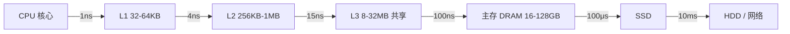

> **量级直觉**：如果 L1 访问是 1 秒，那么主存访问就是 100 秒（一分半），SSD 是 28 小时，HDD 是 30 天。所以数据库索引设计的一切折衷，都是在"减少磁盘 IO 次数"，而不是"减少比较次数"。

### 0.2 缓存行（Cache Line）：内存搬运的最小单位

CPU 不是按字节读内存的，而是按 **缓存行（通常 64 字节）** 整块搬进 L1。

- 读 `int a[0]`，会连带把 `a[0..15]` 一共 64 字节全部拉进缓存 → **顺序访问的第 2–16 个元素几乎是免费的**。
- 这就是**空间局部性（spatial locality）**：数组天然满足，链表天然违反。
- **时间局部性（temporal locality）**：刚访问的数据很可能再被访问（循环里的计数器、哈希桶头指针）。

由此推出一条工程铁律：**顺序扫描优于跳跃访问，紧凑布局优于分散布局。** 这也是为什么现代 C++/Rust 生态会推崇"结构体数组（SoA/AoS）"、为什么 Redis 用 listpack/ziplist 而不是纯链表。

### 0.3 数据结构的三个核心矛盾

任何数据结构都在这三个维度上做取舍，**没有全能选手**：

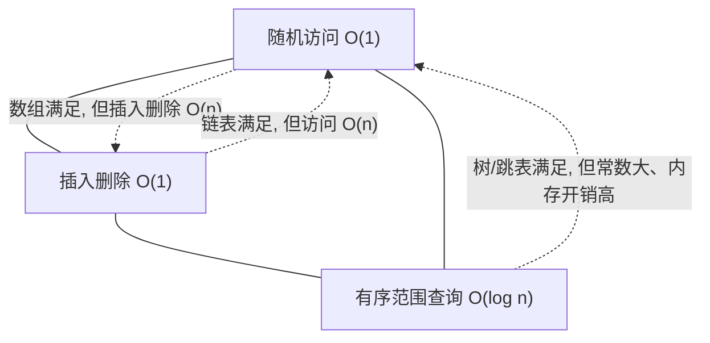

1. **随机访问 vs 插入删除**：连续布局换来 `base + i * size` 的常数时间寻址，代价是中间插入要搬移后缀。
2. **时间 vs 空间**：哈希表是典型——用 1.5~2 倍的空间浪费，把查找从 O(log n) 压到 O(1)。
3. **有序 vs 无序**：无序结构（数组、哈希）插入快但无法范围查询；有序结构（树、跳表）能 `range`、`predecessor`，但每次操作都要维护序。

### 0.4 复杂度符号的真实含义（面试常被追问）

| 记号 | 含义 | 面试陷阱 |
|---|---|---|
| `O(1)` | 上界是常数，与 n 无关 | 哈希表"平均 O(1)"，最坏 O(n)。说"O(1)"必须补"均摊/期望" |
| `均摊 O(1)` | 单次可能 O(n)，但连续 m 次操作总代价 O(m) | 动态数组扩容、并查集路径压缩都属此类 |
| `期望 O(1)` | 对随机化输入取期望（哈希、跳表） | 可被构造攻击（Hash Collision DoS），所以 Java 引入红黑树 |
| `O(log n)` | 对数，底数不影响渐进阶 | 但实际常数差很多：二叉树每层一次 cache miss，B+ 树每层一次磁盘 IO |
| `O(n log n)` | 比较排序的理论下界 | 想突破必须放弃"比较"（基数排序、计数排序） |

**"均摊分析"三种方法**（这是红黑树/动态数组章节的前置知识）：

- **聚合分析**：n 次操作总代价 / n。例：2 倍扩容的 n 次 push，拷贝总次数 `1+2+4+...+n < 2n`，摊还 ≤ 3。
- **核算法（记账法）**：每次 push 存 3 块钱，1 块付插入、2 块存起来付将来搬移。
- **势能法**：定义势函数 `Φ = 2·size − capacity`，摊还代价 = 实际代价 + `ΔΦ`。**扩容瞬间实际代价 O(n)，但 Φ 从 n 掉到 −n，摊还仍是 O(1)。** 面试若能写出势能法，直接从"背过"升到"懂"。

### 0.5 本笔记的统一分析框架

面对任何一个数据结构，按这五步拆（面试答题也用这五步）：

1. **内存布局**：连续 or 离散？每个元素额外开销多少字节？
2. **不变量**：它靠什么规则维持"结构合法"？（BST 序、红黑树 5 条性质、堆的父子大小关系、B+ 树的阶）
3. **核心操作的机械过程**：寻址公式 / 指针改写 / 旋转 / 分裂合并 / 上浮下沉。
4. **代价来源**：搬移、指针追逐、旋转次数、IO 次数、再哈希。
5. **失效边界**：什么输入会退化？（有序插入退化成链表、哈希碰撞攻击、负权边破坏 Dijkstra）

---

## 第 1 章 数组：把"随机访问"做到极致

### 1.1 内存长什么样

数组 = **一块连续的内存 + 元素类型固定（因此元素大小固定）**。

```
低地址                                              高地址
┌──────┬──────┬──────┬──────┬──────┬──────┐
│ a[0] │ a[1] │ a[2] │ a[3] │ a[4] │ a[5] │   int 数组，每格 4 字节
└──────┴──────┴──────┴──────┴──────┴──────┘
  base   +4     +8     +12    +16    +20      ← 地址 = base + i * 4
```

### 1.2 为什么随机访问是 O(1)：一条乘法 + 一条加法

`a[i]` 编译后基本就是：

```c
*(base + i * sizeof(T))   // 一条 imul/lea + 一次内存读
```

**它是 O(1) 的原因不是"快"，而是"与 i 无关"** —— 无论 i 是 0 还是 10 亿，都只做一次乘法和一次加法。对比链表取第 i 个要跳 i 次指针，这就是结构性差异。

**为什么下标从 0 开始（高频面试题）**：若从 1 开始，公式变成 `base + (i−1)*size`，每次访问多一条减法指令；C 语言里数组名会退化为指针，`a[i]` 的定义就是 `*(a+i)`，从 0 开始才能让"数组下标"和"指针偏移"语义完全重合。Dijkstra 曾论述过 0-based 的区间表示更优雅（`[lo, hi)` 半开区间长度恰为 `hi-lo`）。**这是"省一条指令 + 语义自洽"的胜利，不是玄学。**

### 1.3 插入 / 删除为什么是 O(n)：后缀整体搬移

在位置 k 插入：

```
插入前: [A][B][C][D][E]
              ↑ 在 index=2 插入 X
第一步 搬移: [A][B][ ][C][D][E]     C,D,E 全部右移一格  → 需搬 (n-k) 个
第二步 写入: [A][B][X][C][D][E]
```

- 尾部插入/删除 = O(1)（无搬移）→ 这正是**栈**的基础。
- 头部插入/删除 = O(n)。
- `memmove` 是高度优化的（按 cache line + SIMD 批量搬），所以**小数组的 O(n) 搬移实际比想象中便宜**，这也是"小数据量下数组吊打链表"的原因之一。

### 1.4 动态数组的扩容：1.5 倍还是 2 倍？（工程细节题）

Java `ArrayList` 用 `oldCap + (oldCap >> 1)` = **1.5 倍**；Go slice、C++ `vector`（MSVC 1.5，GCC/libstdc++ 2.0）多用 **2 倍**。

**为什么扩容必须"按倍数"而不是"加常数"？**
- 若每次 `+k`，n 次 push 总拷贝 `O(n²/k)`，摊还变 O(n)。**必须几何增长才能保证摊还 O(1)。**

**1.5 倍 vs 2 倍的真实权衡**：

| 维度 | 1.5 倍 | 2 倍 |
|---|---|---|
| 摊还拷贝次数 | 每元素平均搬 ~3 次（几何级数 1+1/1.5+... ≈ 2 倍原空间） | 每元素 ~2 次 |
| 内存峰值 | 新旧两块并存时 **2.5 倍** | **3 倍** |
| 能否复用已释放的块 | **能**：1.5 倍序列 `1,2,3,5,8,12,18...`，前面的空闲块总大小可能刚好装下新块（glibc/jemalloc 的 bin 复用），减少碎片 | 2 倍序列 `1,2,4,8...`，新块永远比此前所有空闲块之和还大，**必然重新 mmap** |
| 拷贝总量 | 略多 | 略少 |

**面试答法**："1.5 倍主要是为了**内存复用与碎片控制**——按 1.5 增长时，此前释放的相邻空闲块有机会拼成一个足够大的连续区，避免每次都向 OS 申请新页；2 倍拷贝更少、摊还更快，但内存峰值和碎片更差。ArrayList 是库，面对的是不确定的堆环境，所以选保守的 1.5。"

**扩容机械过程（必须能描述）**：

```java
// ArrayList.add -> ensureCapacityInternal -> grow
int newCapacity = oldCapacity + (oldCapacity >> 1);
// 1) 申请新数组  2) Arrays.copyOf 全量拷贝  3) 引用指向新数组  4) 旧数组等 GC
```

注意：**扩容是"全量拷贝 + 老数组交给 GC"，不是 realloc 的原地扩展。** C 的 `realloc` 可能原地扩展（`mremap`），Java 不能。

### 1.5 数组的"隐形优势"：缓存与预取

同样遍历 100 万个 `int`：

- 数组：4MB，按 64B 一行共 65536 行，顺序读，硬件预取器（stride prefetcher）提前取下一行 → 几乎全是 cache hit，实测 ~0.5–1 ms。
- 链表：100 万个节点散落在堆各处，每个节点访问前都要先取 `next` 指针，而该指针指向的地址未知 → **每个节点一次 cache miss**，约 100 ns × 100 万 = **100 ms 级**。

**差两个数量级。** 这就是"链表适合频繁插入删除"这句话必须加前缀"**当插入删除点已知、且元素本身很大或需要稳定引用时**"。

> 延伸：**节点池 / 内存池（arena）**。C++ 的 `std::deque` 用"分段连续块 + 中控数组"，既保留 O(1) 头尾插入，又让块内访问保持局部性；Redis 的 `listpack` 把链表压成连续字节数组。

### 1.6 多维数组：行主序 vs 列主序（字节/阿里常考的性能细节）

C/C++/Java/Go 都是**行主序**：`a[i][j] = base + (i*COLS + j) * size`。

```c
// 版本 A：i 在外层，j 在内层 —— 内存连续跳，cache 友好
for (i) for (j) sum += a[i][j];

// 版本 B：j 在外层，i 在内层 —— 每次跨越一整行，cache 不友好
for (j) for (i) sum += a[i][j];
```

对 1000×1000 的 `int` 矩阵，B 版本可能慢 **5–10 倍**（取决于矩阵是否装得进 L2/L3）。**原理**：A 版本一次 cache line 命中 16 个元素；B 版本每个元素都可能 miss 并触发一次行淘汰。

> 面试延伸：这也是 `Matmul` 分块（tiling / loop blocking）、以及"按行遍历二维数组"这类代码规范背后的硬核原因。

### 1.7 数组的变体与延伸结构（区分度加分项）

| 结构 | 布局 | 解决的问题 |
|---|---|---|
| 静态数组 | 编译期定长 | 无扩容成本，但需预估上限 |
| 动态数组 | 定长 + 几何扩容 | 摊还 O(1) 尾部追加 |
| 环形缓冲区 ring buffer | 定长 + 两个游标 `head/tail` 取模回绕 | **无锁队列、日志缓冲、流式数据处理**；Disruptor、Kafka 都靠它 |
| 稀疏表 Sparse Table | 原数组 + `log n` 层区间最值 | **O(1) 查询 RMQ（不可变）**，预处理 O(n log n) |
| 差分数组 | `d[i] = a[i]-a[i-1]` | 区间加 O(1)，前缀和 O(n) 还原 |
| 前缀和数组 | `s[i]=Σa[0..i]` | 区间和 O(1) |
| 位图 Bitmap / BitSet | 每个 bit 代表一个元素 | 10 亿整数去重只需 125MB；**Redis SETBIT、Roaring Bitmap** |
| 结构体数组 SoA vs AoS | 字段分开存 or 一起存 | SoA 对 SIMD 和缓存更友好（游戏引擎、列存数据库） |

**环形缓冲区的坑（面试可延伸）**：`head/tail` 自增后对 `capacity` 取模。若 capacity 不是 2 的幂，取模是除法指令（约 20–40 cycle）；**取 2 的幂后可用 `& (cap-1)` 代替 `%`** —— 这和 HashMap 容量必须是 2 的幂是同一个理由。

```c
// 环形队列的空/满判定（两种写法）
// 写法1：牺牲一个槽位：full = (tail+1) % cap == head
// 写法2：维护 size 计数（更常用，Disruptor 用序号单调递增 + 掩码）
```

---

## 第 2 章 链表：把"局部插入删除"做到极致

### 2.1 内存布局：用指针把离散的块"串"起来

```
head
 ↓
┌────────┬──────┐   ┌────────┬──────┐   ┌────────┬──────┐
│ data   │ next │──▶│ data   │ next │──▶│ data   │ next │──▶ null
└────────┴──────┘   └────────┴──────┘   └────────┴──────┘
 0x7f10              0x2a38              0x9c04
（三个节点在堆上地址互不相邻，甚至不在同一页、同一 cache line）
```

**每个节点的真实成本**：

- 单向链表：`sizeof(T) + 8`（64 位指针）。
- 双向链表：`sizeof(T) + 16`（`prev` + `next`）。
- **Java 的 `LinkedList` 更贵**：`Node` 对象头（16B，含 mark word + klass 指针）+ 两个引用（8B×2）+ `data` 引用（8B）= **每个节点至少 40 字节的额外开销**，还要算对象对齐填充（8 字节对齐）。
- C++ `std::list` 也是"每节点一次 malloc"，分配器元数据（glibc 每块 8–16B）再叠一层。

> 所以：**"链表节省插入删除时间"的代价是"每个元素多花 2–5 倍内存 + 每次访问多花一次 cache miss"。** 这就是为什么 Java 里 `LinkedList` 在绝大多数场景都比 `ArrayList` 慢，`Effective Java` 明确说"优先用 ArrayList"。

### 2.2 为什么不能随机访问 —— 指针追逐（pointer chasing）

取第 i 个元素必须**串行地**依赖前一个节点的 `next`：

```c
Node* p = head;
for (int k = 0; k < i; k++) p = p->next;   // 关键：p->next 的值在读到 p 之前 unknown
```

CPU 想预取都做不到——**下一个地址依赖上一次 load 的结果**（load-to-use 依赖链）。现代 CPU 是乱序执行 + 多级流水，但对这种"地址依赖链"无能为力，只能等。这就是链表遍历慢的微架构原因：不只是 cache miss，还有**依赖链无法并行**。

而数组/哈希的遍历是可预测地址，CPU 可以同时发射多个 load。

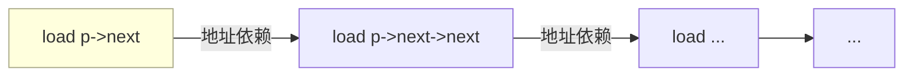

### 2.3 插入删除 O(1) 的三个前提（最经典的面试陷阱）

**书上都写"链表插入删除 O(1)"，但这句话缺了三个前提：**

1. **你已持有插入位置的"前驱节点"指针**。如果只知道"在下标 k 处插入"，仍要 O(k) 走到前驱 → 整体 O(n)。
2. **你有办法在 O(1) 内拿到那个节点**（例如已经持有了它的引用、或通过哈希表映射）。这就是 **LRU = 双向链表 + 哈希表** 的本质：哈希负责 O(1) 定位，链表负责 O(1) 摘挂。
3. **不要求"按序访问"**。链表第 i 个元素依然要 O(i)。

**给出待删节点本身（不给前驱）的单链表删除** → 只能"狸猫换太子"：把后继的 `data` 拷到当前节点，然后删后继。**O(1)，但有两个致命限制**：节点必须是"可拷贝的"（不能是 `const`、不能是有唯一地址语义的对象）、且**不能是尾节点**。这是高频陷阱题。

```c
// 狸猫换太子：node 为待删节点，且 node->next != NULL
void deleteNode(Node* node) {
    Node* nxt = node->next;
    node->data = nxt->data;   // 内容覆盖
    node->next = nxt->next;   // 跳过 nxt
    free(nxt);
}
```

### 2.4 四种形态与"哨兵节点"

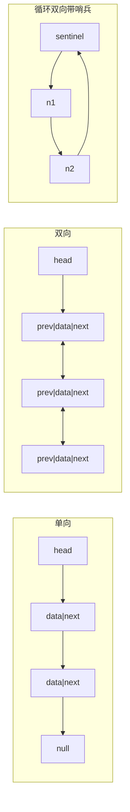

- **单向**：省空间；删除需前驱；只能单向遍历。
- **双向**：`prev` 指针换来"删除给定节点 O(1)"和"向前遍历"（LRU 必需，因为要把节点移到表头，需要改它的前驱的 `next`）。
- **循环**：尾节点的 `next` 指回头，适合"轮流调度"（时间片轮转、约瑟夫环）。
- **哨兵（sentinel / dummy head）**：**这是工程上最重要的技巧**。
  - 不带头结点时，在头部插入/删除需要**特判 `head == null`**，代码分支多、易错。
  - 加一个 `dummy` 后，**所有插入删除都变成"在某个真实前驱之后操作"，统一成一条代码路径**。
  - Linux 内核的 `list_head`、Java `LinkedList`（JDK6 的 `header` 哨兵）都是这个思路。
  - **C 语言没有引用，用"指向指针的指针"（`Node**`）或二级指针可以避免哨兵**：`*pp = (*pp)->next`，这是 LeetCode 上"不额外开 dummy 也能优雅删除"的写法。

> **Linux 内核的侵入式链表（intrusive list）**：`struct list_head { struct list_head *next, *prev; }` 被**嵌入**到用户结构体里，通过 `container_of(ptr, type, member)` 由成员地址反算出外层对象地址（`ptr - offsetof(...)`）。好处是**零额外分配、零类型限制、一个对象可同时挂多条链**；代价是不能直接存"值类型"，且只能靠宏做类型转换。面试聊到"链表的工程实现"时提到这个会非常有区分度。

### 2.5 链表的真实应用场景（回答"什么时候必须用链表"）

| 场景 | 为什么非链表不可 |
|---|---|
| **LRU Cache**（Leabc/Redis/Guava） | 需要在 O(1) 内把任意节点从中间摘出并挂到头：双向链表 + 哈希表。数组做不到 O(1) 摘除中间元素 |
| **内存分配器的 free list**（glibc malloc、tcmalloc） | 空闲块本身就是链表节点，元数据直接写在空闲块内部（0 额外开销） |
| **多队列调度（Linux CFS 的红黑树 vs 多级反馈队列链表）** | 元素需要"在多个队列间移动"而不重新分配 |
| **跳表底层** | 每层都是有序链表 |
| **撤销栈 / 浏览器历史 / 编辑器的行** | 需要"稳定的迭代器"——插入删除不会让其他元素的引用失效（数组扩容会让旧引用指向废弃内存） |
| **大对象 + 稀疏修改** | 拷贝成本远大于指针成本（如 1KB 的结构体） |

> **关键对照**：`ArrayList` 的致命问题不是"插入慢"，而是**"每次扩容都让所有旧引用/迭代器失效"**（`modCount` 与 `ConcurrentModificationException`）。当你需要长期持有元素引用且元素会频繁增删时，链表（或 `std::list`/`std::map` 的稳定迭代器）才是对的。

### 2.6 链表的经典算法模式（为第 13 章铺垫）

1. **快慢指针**：判环（Floyd）、找中点、找倒数第 k 个。
2. **反转**：迭代三指针 `prev/cur/next`；递归到表尾再回改指针。
3. **归并**：链表排序唯一"自然"的 O(n log n) 方案（归并只需改指针，不需要额外空间移动数据）。
4. **拆分 + 重组**：K 个一组翻转、重排链表（找中点 + 反转后半 + 合并）。
5. **双指针求交**：两链表交点（走完自己走对方，路径等长）。

---

## 第 3 章 栈与队列：被约束的线性表

**一句话：栈和队列不是新结构，是对"操作位置"的约束。** 约束带来的是**语义**，而不是性能——底层仍是数组或链表，复杂度完全继承。

### 3.1 栈：只允许在一端操作

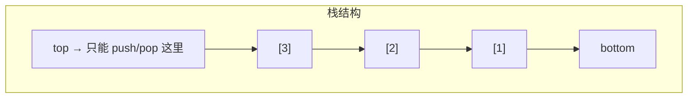

- **数组实现**：`push` = `a[++top]=x`，`pop` = `a[top--]`，**O(1) 且常数极小、cache 完美**。这是首选实现。
- **链表实现**：只能在头部操作（头部插入删除 O(1)）；用尾指针做栈则删除是 O(n)（单向拿不到前驱）。
- **为什么函数调用用栈**：需要 LIFO 语义（后调用的先返回），且**需要"栈帧连续分配"以提高局部性**；现代 CPU 用 `rsp/rbp` 寄存器直接维护栈指针，push/pop 都是一条指令。

**工程上的栈容量问题**：线程栈默认 1MB（Linux）/ 512KB–1MB（Windows），**递归过深会栈溢出**。因此：
- 深递归要改迭代（显式栈在堆上）；
- 尾递归可被编译器优化成循环（**但 Java/Go 不支持尾递归优化**，C/C++ -O2 支持）；
- `StackOverflowError` 与 `OutOfMemoryError` 是两类不同异常。

**单调栈（Monotonic Stack）—— 面试最高频的栈技巧**：

维护一个"元素单调"的栈，**在入栈前把破坏单调性的元素弹出**，弹出的瞬间就确定了这些元素"左边/右边第一个更大（更小）的元素"。

```java
// 下一个更大元素：每个元素最多入栈一次、出栈一次 → 总 O(n)
int[] nextGreater(int[] a) {
    int n = a.length; int[] res = new int[n];
    Deque<Integer> st = new ArrayDeque<>();   // 存下标
    for (int i = n - 1; i >= 0; i--) {
        while (!st.isEmpty() && a[st.peek()] <= a[i]) st.pop();
        res[i] = st.isEmpty() ? -1 : a[st.peek()];
        st.push(i);
    }
    return res;
}
```

**为什么是 O(n)**：每个下标**恰好入栈一次、出栈一次**，所有 `while` 循环的弹出次数总和 ≤ n。这是"摊还分析"的又一实例（第 0.4 节）。

典型题：接雨水（单调栈 / 双指针 / 动态规划三解）、柱状图中最大的矩形、每日温度、最大矩形、去除重复字母（字典序）。

### 3.2 队列：两端分别操作

- **数组实现必须"环形"**：否则 `head` 前移会浪费前缀空间。`head/tail` 取模回绕，容量取 2 的幂后可用 `& (cap-1)`（第 1.7 节）。
- **链表实现**：`head` 出队、`tail` 入队，双指针都 O(1)，这是"链表唯一比数组更适合的场景之一"。
- **双端队列 Deque**：两头都能进出。Java `ArrayDeque` 用**循环数组**实现（比 `LinkedList` 快很多，官方推荐用它代替 `Stack` 和 `LinkedList`）；C++ `std::deque` 用**分段连续块 + 中控 map**。

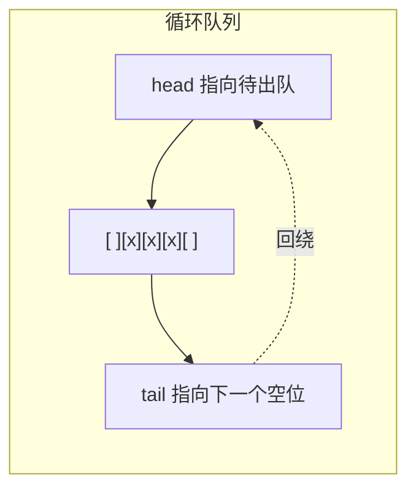

**队列的应用层次**：

| 场景 | 说明 |
|---|---|
| BFS | 需要"按层"顺序，天然 FIFO |
| 生产者-消费者 | 环形缓冲 + 原子游标（Disruptor 的 `Sequence` + `& mask`） |
| 线程池任务队列 | `ArrayBlockingQueue`（有界，防 OOM）vs `LinkedBlockingQueue`（默认无界 `Integer.MAX_VALUE`，**是线上 OOM 的常见原因**）vs `SynchronousQueue`（零容量，直接交接） |
| 消息队列 | Kafka 用 **磁盘上的分段日志 + 顺序写 + 消费者 offset**，本质是"持久化的超大环形队列" |
| 单调队列 | 滑动窗口最大值：队首保持最大，入队前从队尾弹掉更小的 |

**单调队列求滑动窗口最大值（O(n)）**：

```java
// 队首是窗口内最大值下标；队尾入队前弹掉所有比它小的
Deque<Integer> dq = new ArrayDeque<>();
for (int i = 0; i < n; i++) {
    while (!dq.isEmpty() && a[dq.peekLast()] <= a[i]) dq.pollLast();
    dq.addLast(i);
    if (dq.peekFirst() <= i - k) dq.pollFirst();   // 过期出窗
    if (i >= k - 1) res[i-k+1] = a[dq.peekFirst()];
}
```

**双栈实现队列**：`in` 栈负责 push，`out` 栈负责 pop；`out` 为空时把 `in` 整体倒入 `out`。**摊还 O(1)**（每个元素最多被倒两次）。反向"队列实现栈"则是 push 时倒腾，或"只用一个队列 + 循环 n-1 次"。

**优先队列 ≠ 队列**：队列是 FIFO（按到达顺序），优先队列是按优先级出队 → 底层是**堆**（第 8 章），不是链表/数组的简单推广。

---

## 第 4 章 哈希表：用空间换 O(1) 的艺术

### 4.1 核心思想与三个必须回答的问题

哈希表 = **一个数组 + 一个把 key 映射成下标的函数 + 一套处理"映射冲突"的规则**。

它把"比较查找"变成"**计算下标 + 常数次比较**"。要真正理解并答好面试，必须能回答三个问题：

1. **哈希函数怎么设计**？（为什么 Java 要"高低 16 位异或"）
2. **冲突了怎么办**？（链地址法 vs 开放寻址法）
3. **装满了怎么办**？（装载因子、扩容、rehash）

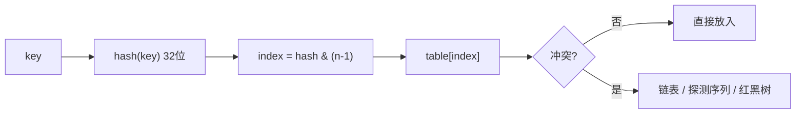

### 4.2 哈希函数：目标不是"无冲突"，而是"均匀 + 快"

**任何哈希函数都有冲突**（鸽巢原理：key 空间无穷，桶空间有限）。所以设计目标只有两个：

- **均匀性**：让每个桶被选中的概率近似相等，降低桶长方差。
- **计算廉价**：每次 get/put 都要算，不能做昂贵运算。

常见手段：

| 手段 | 说明 | 典型 |
|---|---|---|
| 除留余数 | `h % m` | 要求 m 为质数才均匀；**若 m 是 2 的幂，只有低位参与，极易冲突** |
| 乘法散列 | `floor(m * frac(k*A))`，A ≈ 0.618 | 与 m 无关，理论均匀 |
| 位运算 | `h & (m-1)`，m 为 2 的幂 | **比取模快 20–40 倍**（无除法指令），代价是必须做"高低位混合" |
| 扰动/雪崩 | 高低位异或、murmur finalizer | Java HashMap、MurmurHash、xxHash |
| 一致性哈希 | 环形 + 虚拟节点 | 分布式缓存，节点增减只影响相邻区间 |

### 4.3 为什么 Java 8 的 HashMap 要做"高 16 位与低 16 位异或"

```java
static final int hash(Object key) {
    int h;
    return (key == null) ? 0 : (h = key.hashCode()) ^ (h >>> 16);
}
```

**推导逻辑（这是面试的标准深挖链）**：

1. 因为 `index = hash & (n-1)`，而 n 通常是 2 的 16 次方左右（默认 16，扩容到 2^30），`n-1` 的二进制是"低 k 位全 1、高位全 0"。
2. 所以**下标只由 hash 的低 k 位决定，高位完全被丢弃**。
3. 如果某些 key 的 `hashCode()` 高位差异大、低位恰好相同（现实很常见：`String.hashCode` 是 `31*s + ...`，低位模式重复性高；或者 `Integer` 直接用值本身），就会**大量撞桶**。
4. 把高 16 位异或到低 16 位，**让高位信息也参与下标计算**，相当于一次廉价的"雪崩"（avalanche），成本只有一次 `xor` + 一次 `shr`。

> **延伸问题：为什么是"异或"而不是"与/或"？** 异或的可逆性和"位翻转"特性让分布更接近随机；与/或会引入偏向（`x & y` 结果的 1 位只会更少，`x | y` 只会更多）。

### 4.4 冲突解决（一）：链地址法（Separate Chaining）

**同义词挂成一条链**，桶里存链表头。

```
table[3] ──▶ [k1,v1] ──▶ [k2,v2] ──▶ null
table[7] ──▶ null
```

- 优点：实现简单；**装载因子可以 > 1**；删除简单（不用墓碑）；不会"聚簇"。
- 缺点：**指针追逐 + 节点分散**（小 map 时 cache 不友好）；每个节点有额外对象开销。
- 代表：**Java HashMap / ConcurrentHashMap、C++ `unordered_map`（多数实现）、Redis `dict`**。

### 4.5 冲突解决（二）：开放寻址法（Open Addressing）

**不挂链，冲突就按"探测序列"找下一个空桶**，所有元素都在数组里。

| 探测方式 | 序列 | 特点 |
|---|---|---|
| 线性探测 | `(h+1), (h+2), ...` | 实现最简单、**cache 极友好（连续扫描）**；但会产生**一次聚簇（primary clustering）**，长连续块越滚越大 |
| 二次探测 | `h+1², h-1², h+2², ...` | 缓解一次聚簇，但可能**探测不到所有桶**（表长需为 4k+3 质数或 2 的幂且步长设计好） |
| 双重散列 | `h1 + i*h2` | 探测序列最接近随机，聚簇最少；需 h2 与表长互质 |
| **Robin Hood（罗宾汉）** | 线性探测 + "劫富济贫"：若当前元素的探测距离大于占位者，则**互换** | 让所有元素探测距离方差最小，**长尾延迟显著改善**；Rust `hashbrown`、Python dict 都用线性探测系 |
| **Swiss Table** | 分组（16 个一组）+ SIMD 匹配控制字节 | Google Abseil；一次 SIMD 比较 16 个槽，**每秒数亿次查找** |

**开放寻址的致命问题：删除会产生"墓碑（tombstone）"。** 如果直接把槽置空，后续查找会提前终止 → 误判 key 不存在。所以必须标记 `DELETED`（墓碑），查找时遇到墓碑要继续往后找，遇到真空才停。**墓碑多了会污染表，只能定期 rehash 重建。**

**两种方案的真实对比（面试高区分度）**：

| 维度 | 链地址法 | 开放寻址法 |
|---|---|---|
| 内存 | 每元素额外指针/对象 | **零额外指针**，全在数组里 |
| 缓存 | 差（指针追逐） | **好**（同一 cache line 内探测） |
| 装载因子上限 | 可 > 1 | **必须 < 1**，实践中 0.5–0.75 |
| 删除 | 简单 | **需要墓碑，易退化** |
| 长尾延迟 | 偶发长链 | 高装载因子时探测长度急升 |
| 适用 | 元素大、需要稳定引用、Java 系 | 元素小、追求吞吐与内存密度（Go map、Rust、Abseil、Python） |

> **为什么 Go 的 map 用开放寻址 + 桶（bucket of 8）**：一个桶 8 个槽 + 8 个 `tophash` 字节，正好一个 cache line 附近，一次比较就能筛掉大部分槽（只比对 tophash 低 8 位，命中才比对完整 key）。**"先比 1 字节，再比全 key"** 是降低 cache miss 的经典手法（与 Bloom Filter 的"用少量位先筛"同源）。

### 4.6 装载因子与扩容（rehash）

**装载因子 α = 元素数 / 桶数。**

- 链地址法：α 直接是"平均链长"。查找代价 ≈ `1 + α/2`（成功）或 `1 + α`（失败）。
- 开放寻址法：理论推导（Knuth）成功查找 ≈ `(1 + 1/(1-α))/2`，α=0.75 时约 2.5 次探测；α→1 时**急剧恶化**。
- **所以 HashMap 默认 0.75**：这不是拍脑袋，而是**时间与空间的折衷点**——再高冲突陡增、再低浪费空间。Java 注释里明确提到了泊松分布的推导基础。

**扩容代价**：n 个元素全部重新计算下标并搬迁 → **O(n)**，单次是"停顿"。摊还后每次 put 仍是 O(1)。

**Java HashMap 的扩容很巧妙**：容量始终是 2 的幂，扩容是 ×2，于是 `index = hash & (n-1)` 中新表的 n-1 只多了一个最高位。因此：

- 旧下标为 `i` 的元素，新下标**要么仍是 `i`，要么是 `i + oldCap`**（取决于 hash 在新增那一位上是 0 还是 1）。
- 所以 JDK8 不需要重新计算 hash，只需按 `(e.hash & oldCap) == 0` 把链表**拆成"低位链 loHead"和"高位链 hiHead"两组**，分别挂到 `j` 和 `j+oldCap`。
- 这避免了 JDK7 的"每个元素重新算 index"和"头插法导致链表逆序"问题。

```
扩容前 n=16, oldCap=16, 新 n=32
hash=0b...0_1010  →  旧 index = 1010 & 01111 = 10     新 index = 1010 & 11111 = 10      （低位链，j=10）
hash=0b...1_1010  →  旧 index = 1010 & 01111 = 10     新 index = 1010 & 11111 = 11010   （高位链，j+16=26）
                  ↑ 第 5 位（值 16 的那一位）决定去哪
```

### 4.7 Java HashMap 源码级完整剖析（JDK 8）

**结构**：

```java
transient Node<K,V>[] table;          // 桶数组，长度永远是 2 的幂
static class Node<K,V> implements Map.Entry<K,V> {
    final int hash; final K key; V value; Node<K,V> next;   // 链表节点
}
static final class TreeNode<K,V> extends LinkedHashMap.Entry<K,V> {
    TreeNode<K,V> parent, left, right, prev; boolean red;    // 红黑树节点
}
```

**关键常量（必背，也是面试考点）**：

| 常量 | 值 | 含义 |
|---|---|---|
| `DEFAULT_INITIAL_CAPACITY` | 16 | 默认桶数 |
| `MAXIMUM_CAPACITY` | 1 << 30 | 上限（int 正数范围内能表示的最大 2 的幂） |
| `DEFAULT_LOAD_FACTOR` | 0.75 | 默认装载因子 |
| `TREEIFY_THRESHOLD` | 8 | 链长 ≥ 8 尝试树化 |
| `UNTREEIFY_THRESHOLD` | 6 | 树节点 ≤ 6 退化为链表 |
| `MIN_TREEIFY_CAPACITY` | 64 | **表容量 < 64 时优先扩容而非树化** |

**为什么"链长 8 转红黑树"？—— 泊松分布的定量回答（这是最能加分的推导）**

理想哈希下，一个桶内落入 k 个元素的概率服从二项分布，λ = 0.5（n 个元素、n/2 个桶）：

```
P(k) = (0.5^k * e^-0.5) / k!    （泊松近似）
k=0: 0.60653066
k=1: 0.30326533
k=2: 0.07598543
k=3: 0.01263524
k=4: 0.00157940
k=5: 0.00015794
k=6: 0.00001317
k=7: 0.00000094
k=8: 0.00000006    ← 亿分之六
```

也就是说，**在哈希函数正常的前提下，链长达到 8 的概率约为 6×10⁻⁸**，几乎不可能出现。所以"阈值 8"的含义是：**树化不是为了日常性能，而是为了给"哈希被恶意构造/哈希函数退化"这一极端情况兜底**——正常时永远用链表（省内存、快），异常时自动切换到 O(log n)。

**为什么退回来是 6 而不是 8？—— 加一个"滞后带（hysteresis）"**：如果进/退都用 8，那么链长在 8 附近抖动（删一个变 7、加一个变 8）会反复树化/退化，开销巨大。取 6/8 形成缓冲区间，是典型的"防抖动"设计。

**为什么 `MIN_TREEIFY_CAPACITY = 64`？—— 冲突可能只是因为"表太小"**：表只有 16 个桶时，即使哈希很均匀，也很容易撞。此时正确做法是**扩容（把冲突分散开）**，而不是仓促建树（树节点比链表节点更重）。所以 `treeifyBin` 里先判断 `tab.length < 64 ? resize() : 真正树化`。

**put 的完整流程（面试几乎必考，要能背下来）**：

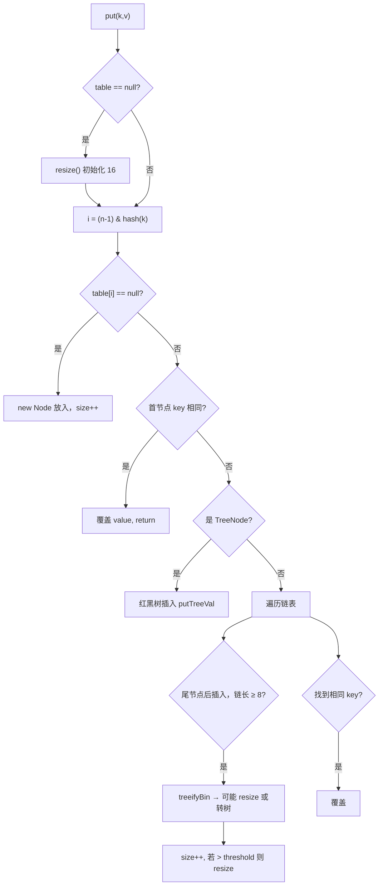

**`resize()` 的流程**（两件事：容量翻倍 + 迁移）：遍历旧表每个桶，分四种情形处理：`null` / 单节点 / 链 / 树。树节点迁移时还要**拆分红黑树**（`split`，必要时退化为链表）。

**初始容量为什么会被"向上取整到 2 的幂"**：

```java
static final int tableSizeFor(int cap) {   // cap=10 → 16
    int n = cap - 1;
    n |= n >>> 1; n |= n >>> 2; n |= n >>> 4; n |= n >>> 8; n |= n >>> 16;
    return (n < 0) ? 1 : (n >= MAXIMUM_CAPACITY) ? MAXIMUM_CAPACITY : n + 1;
}
```
五次右移或运算把"最高位 1 之后的所有位都填成 1"，再 +1 得到 2 的幂。**为什么先 `cap-1`**：若 cap 本身已是 2 的幂，不减 1 会得到 2 倍（如 8 → 8|4|2|1 = 15 → 16？实际不减 1 时 n=8 二进制 1000，填满后 1111，+1 = 16，就翻倍了）。减 1 保证幂次输入不被放大。

**为什么容量必须是 2 的幂（三重理由，面试要全说）**：

1. `h & (n-1)` 等价于 `h % n`，但**位运算比取模快**（无除法指令，约 20–40 cycle → 1 cycle）。
2. 扩容时可用"高低位拆分"迁移，**不必重算 hash**（如上 4.6 节）。
3. `n-1` 是"低位全 1 的掩码"，配合扰动函数让下标分布均匀；若 n 不是 2 的幂，掩码有 0 位，某些桶永远用不到。

**JDK 7 vs JDK 8 的差异（高频对比题）**：

| 维度 | JDK 7 | JDK 8 |
|---|---|---|
| 结构 | 数组 + 单向链表 | 数组 + 链表 + **红黑树** |
| 插入 | **头插法** | **尾插法** |
| 扩容迁移 | 每元素重算 index，头插导致**链表逆序** | 高低位拆分，**顺序保持** |
| 哈希 | 一次 hash + 多次移位异或（`hash()` 里 4 次扰动） | 一次 `h ^ (h>>>16)` |
| 并发扩容 | **可能形成环形链表 → 死循环（CPU 100%）** | 可能丢数据/覆盖，但**不会成环** |

**为什么 JDK 8 把头插改成尾插**：头插在**并发扩容**时，两个线程同时迁移同一条链会形成环（`A.next=B, B.next=A`），之后 `get` 一个不存在的 key 就死循环。改为尾插后，虽然**仍不是线程安全的**（可能丢失更新、size 计数错误），但至少不会死循环。**注意：这不是"解决了并发问题"，只是"把一个致命 bug 降级成数据错误"。**

**为什么 HashMap 线程不安全（具体三种失败模式）**：

1. **数据覆盖**：两个线程同时 `put` 到同一个空桶，后写覆盖先写。
2. **size 错乱**：`++size` 非原子。
3. **迁移期读到 null 或旧值**：`resize` 期间 `table` 引用被替换，读者可能看到半迁移状态。

→ 并发场景的正确答案：`ConcurrentHashMap`（分段/CAS + synchronized 桶头）、`Collections.synchronizedMap`（全表锁，吞吐差），或干脆用不可变 Map。

**ConcurrentHashMap（JDK 8）关键点（腾讯/阿里高频）**：

- **放弃 JDK7 的 Segment 分段锁**，改为 **`Node<K,V>[] table` + CAS 插入空桶 + `synchronized` 锁单个桶头节点**。
- 锁粒度 = 一个桶 → 并发度≈桶数，且**只有发生冲突的桶才加锁**。
- `size()` 用 `baseCount + CounterCell[]`（类似 LongAdder 的分片计数）避免热点。
- **`key`/`value` 不允许 null**（因为 `get` 返回 null 无法区分"不存在"与"值为 null"，而并发场景需要精确语义）。
- 扩容支持**多线程协助迁移**（`transfer` 中用 `ForwardingNode` 标记已迁移桶，`helpTransfer`）。
- 读操作基本无锁（`tabAt` 用 `Unsafe`/`VarHandle` 的 volatile 语义）。

### 4.8 Redis dict：渐进式 rehash（工程上的"无停顿"扩容）

单个 dict 其实是**两个哈希表**：

```c
typedef struct dict {
    dictht ht[2];        // ht[0] 正在用，ht[1] 扩容时才启用
    long rehashidx;      // -1 表示未在 rehash
} dict;
```

**渐进式 rehash 过程**：

1. 扩容时给 `ht[1]` 分配 `2*ht[0].used` 的空间（扩容）/ `used` 的空间（缩容）。
2. `rehashidx = 0`。
3. **每次增删改查操作，顺带把 `ht[0]` 中 `rehashidx` 桶上的整条链迁移到 `ht[1]`，然后 `rehashidx++`。**
4. 查找要**先查 ht[0] 再查 ht[1]**（因为元素可能还在旧表）。
5. 全部迁完后，`ht[0]` 释放，`ht[1]` 变成 `ht[0]`，`rehashidx = -1`。

**为什么这么设计**：Redis 是**单线程**的。若一次性 rehash 一个百万 key 的表，会阻塞事件循环几百毫秒，导致所有客户端超时。**把 O(n) 的搬迁成本摊到 n 次操作上，每次只做 O(1)**。这是"摊还"在真实系统中的经典落地。

**扩容/缩容触发条件**：`used/ht[0].size >= 1` 且**没有子进程在 fork**（BGSAVE/AOF rewrite 时不扩容，避免 COW 内存翻倍）；`>= 5` 时强制扩容；负载 < 0.1 时缩容。

> **延伸：Redis 的 scan 为什么要 cursor**：因为渐进式 rehash 期间桶在迁移，用游标 + 位反转（reverse binary iteration）保证"不漏不重"地遍历所有桶。

### 4.9 一致性哈希（分布式场景）

普通取模哈希 `node = hash(key) % N` 的问题：**增加/减少一台机器，几乎所有 key 的落点都变**（缓存雪崩）。

**一致性哈希**：把 `0~2^32-1` 组成一个环，节点和 key 都哈希到环上，key 顺时针找到第一个节点。

- 增删一个节点只影响**环上相邻区间**（平均 1/N 的 key 需迁移）。
- 问题：节点少时**数据倾斜**（分布不均）。
- 解决：**虚拟节点（virtual node）**——每个物理节点映射为 100~1000 个虚拟节点散布在环上，均衡性大幅提升。
- 应用：**Dubbo 的负载均衡、Twemproxy、Cassandra、Kafka 分区（部分场景）**。
- 替代：**Rendezvous Hash（HRW，最高随机权重）**——不需要环和虚拟节点，每个 key 对所有节点算权重取最大，节点增减只影响该节点自己的部分，实现更简单且均衡性更好。

### 4.10 布隆过滤器（Bloom Filter）：用位数组做"存在性预判"

**结构**：m 位的位数组 + k 个独立哈希函数。插入：k 个位置全置 1。查询：k 位**全为 1 才"可能存在"**，任一位为 0 则"一定不存在"。

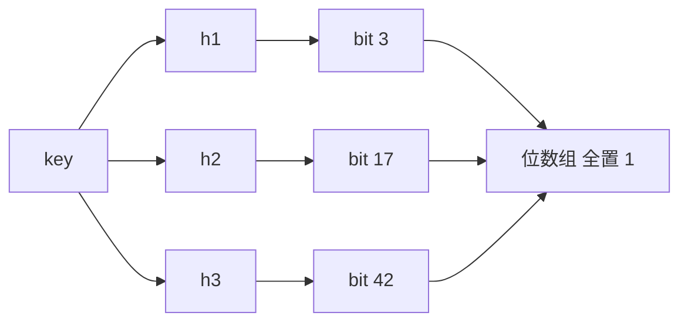

- **只有假阳性（false positive），没有假阴性**。误判率：

  `P ≈ (1 - e^(-kn/m))^k`，最优 `k = (m/n) ln 2 ≈ 0.693 * m/n`。

  例：n=1 亿，m=10 亿位（125MB），k=7 → 误判率约 **0.8%**。
- **不能删除**（删除会把共享位清零，误伤其他 key）→ **计数布隆过滤器（Counting Bloom）** 用计数器替代 bit，或 **Cuckoo Filter** 支持删除且空间更省。
- 应用：**缓存穿透防护**（先查布隆，不存在直接返回）、爬虫 URL 去重、HBase/LevelDB 的 SSTable 查找加速、邮箱垃圾邮件判定。

> **延伸：为什么"缓存穿透"要用布隆而不是"缓存空值"**：缓存空值会被大量随机 key 打爆内存（每个空值也占一个 entry），布隆只需每 key 几个 bit，且能挡在 Redis 之前。

### 4.11 哈希表的失效边界（面试"什么时候别用哈希"）

1. **需要有序遍历 / 范围查询**（`range(10, 20)`、`第 k 小`）：哈希**完全无序**，必须用树/跳表。→ `TreeMap`、Redis `ZSET`。
2. **需要"最小/最大/前驱/后继"**：`floorKey`、`ceilingKey` → 树。
3. **哈希函数可能被攻击**：`String` 的哈希可预测 → **Hash-Flooding DoS**。防御：加随机种子（SipHash）、树化（Java 8）、限制单桶长度。
4. **元素需要稳定顺序/可复现**：哈希遍历顺序不稳定（Java 8 虽比 7 稳定些，但仍不保证），做 diff、快照、幂等计算会出问题。
5. **装载因子接近上限时性能悬崖**：开放寻址在 α→0.9 时探测长度爆炸，长尾延迟不可控。

---

## 第 5 章 树与二叉搜索树：有序性的第一次进化

### 5.1 为什么需要树：数组与链表的"两头为难"

- 数组：查得快 O(log n)，插入删除 O(n)。
- 链表：插入删除快，查得慢 O(n)。
- **有序数组**：二分 O(log n) 查，但插中间要搬 O(n)。

**树的思路**：把"二分查找的决策过程"物化成一棵结构。每个节点保存一个"分界值"，左小右大，于是**查找路径 = 二分路径**，而插入只需改若干指针，不用搬移 → **查、插、删都 O(log n)**（前提是树平衡）。

### 5.2 二叉树的三种遍历与"为什么用栈/队列"

| 遍历 | 顺序 | 实现本质 | 应用 |
|---|---|---|---|
| 前序 | 根→左→右 | 栈（或递归） | 复制树、序列化、表达式前缀 |
| 中序 | 左→根→右 | 栈 | **BST 中序 = 升序序列**（判断合法性、第 k 小） |
| 后序 | 左→右→根 | 栈（双栈/单栈+lastVisited） | 释放内存、算子树高度、表达式求值 |
| 层序 | 逐层 | **队列（BFS）** | 求宽度、右视图、最短路径 |

**迭代中序的模板（面试必写）**：

```java
Deque<TreeNode> st = new ArrayDeque<>();
TreeNode cur = root;
while (cur != null || !st.isEmpty()) {
    while (cur != null) { st.push(cur); cur = cur.left; }  // 一路向左
    cur = st.pop(); visit(cur);                            // 弹出即访问
    cur = cur.right;                                       // 转向右子树
}
```

**Morris 遍历（O(1) 空间的中序）**——区分度很高的加分点：
利用叶子节点的空 `right` 指针做"线索"：把 `cur` 的**前驱节点**（左子树最右节点）的 `right` 临时指向 `cur`，于是遍历完左子树后能"自动回到" cur。访问完再把指针还原。**时间 O(n)、空间 O(1)，代价是会临时修改树结构（非线程安全）。**

### 5.3 二叉搜索树（BST）：不变量与退化

**不变量（invariant）**：对任意节点，`左子树所有值 < 节点值 < 右子树所有值`。

> **常见错误**：只比较"父与子"，那是错的。判断一棵树是否 BST 必须传上下界（`min, max`）或利用中序递增。

**操作**：
- 查找：比较 → 走左/右，路径长度 = 树高 h。
- 插入：走到空位挂上，O(h)。
- 删除：三种情形——叶子直删；单子提上来；**双子用"后继（右子树最左）或前驱"替换值再删后继**。

**退化问题（面试必问）**：如果按**升序/降序**插入，BST 退化成一条链：

```
插入 1,2,3,4,5:
1
 \
  2
   \
    3
     \
      4  → 查找 5 需要 5 次，n 次插入总 O(n²)
```

**这就是所有平衡树存在的理由**：把树高从 O(n) 压回 O(log n)。`h ≤ log2(n+1)` 是理想情况，平衡树允许的松弛是 `h ≤ c*log2(n)`（c=1.44 for 红黑树，c≈1.44 for AVL 实际更接近 1.0）。

### 5.4 平衡树家族全景（先建立地图，再深挖红黑树）

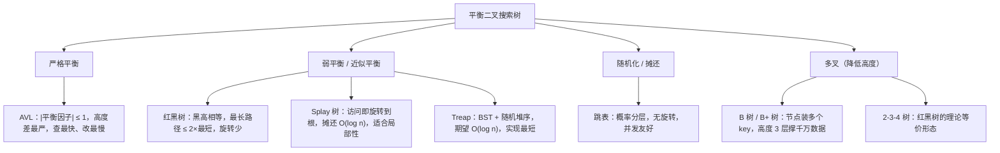

**一句话选型口诀**：
- 查多改少 → AVL；
- 改多查少、通用容器 → **红黑树**；
- 需要并发无锁 / 范围查询且实现简单 → **跳表**；
- 数据在磁盘、按页读 → **B+ 树**；
- 只要堆顶 → 堆。

---

## 第 6 章 红黑树：工程上最划算的平衡树

> 红黑树是"面试能问多深"的天花板之一。要答得漂亮，必须走通这条链：**5 条性质 → 为什么能保证 O(log n) → 插入/删除的机械过程 → 与 2-3-4 树的等价 → 为什么工程上选它而不是 AVL**。

### 6.1 五条性质（必须张口就来）

1. 每个节点是**红**或**黑**。
2. **根节点是黑**。
3. **所有叶子（NIL / 空节点）是黑**。
4. **红节点的两个子节点都是黑**（即不存在连续两个红节点；等价说法：红节点的父节点必为黑）。
5. **从任一节点到其所有后代叶子（NIL）的路径上，黑节点数目相同**（称"黑高 black-height"相等）。

> **注意第 3 条**：这里说的"叶子"是**外部 NIL 节点**，不是"没有孩子的节点"。很多教材（CLRS）用哨兵 `T.nil` 表示所有空指针，好处是让"空"也有颜色（黑），使得性质 5 对"没有孩子的节点"也成立。

**推论（面试常问）**：
- 性质 4 + 5 ⇒ **最长路径 ≤ 2 × 最短路径**（最长路径红黑交替，最短路径全黑）。
- 由此 **h ≤ 2·log₂(n+1)**，所有操作 O(log n)。

**黑高证明的推导（能写出来就是高分）**：
设某节点 x 的黑高为 `bh(x)`。先证"以 x 为根的子树至少含 `2^bh(x) − 1` 个内部节点"（对 bh 归纳：bh=0 时只有 NIL，节点数 ≥ 0 = 2^0−1；bh=k 时两个子节点黑高至少 k−1，各自 ≥ 2^(k−1)−1，加自身得 ≥ 2·(2^(k−1)−1)+1 = 2^k−1）。
再由性质 4，从根到叶的路径上黑节点 ≥ h/2，即 `bh(root) ≥ h/2`。于是
`n ≥ 2^(h/2) − 1` ⇒ `h ≤ 2·log₂(n+1)`。∎

### 6.2 最关键的理解视角：红黑树 = 2-3-4 树（B 树的二叉表示）

**这是理解红黑树的"任督二脉"。** 如果只背 5 条性质和旋转案例，你永远记不住；一旦理解等价关系，所有规则都变成"自然的"。

**映射规则**：把"红节点"看作"**和它的黑父节点合并成同一个多键节点**"。

- 一个黑节点 + 0 个红孩子 → 2-节点（1 个 key）
- 一个黑节点 + 1 个红孩子 → 3-节点（2 个 key）
- 一个黑节点 + 2 个红孩子 → 4-节点（3 个 key）

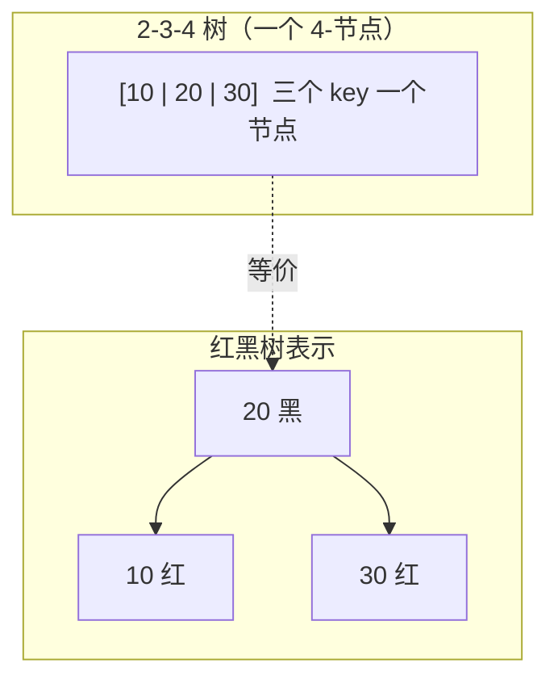

**于是 5 条性质全部有了"多路树"的解释**：
- 性质 4（无连续红）⇒ 一个 4-节点最多"黑+两红"，不会出现"红红黑"这种超过 4-节点容量的结构。
- 性质 5（黑高相等）⇒ **2-3-4 树是完美平衡的**（所有叶子在同一层），这正是 B 树的性质。
- 红节点必为左孩子（LLRB/左倾红黑树）⇒ 每个多键节点只有一种规范表示，避免同一棵 2-3-4 树有多种红黑编码。

**由此推出一条实用记忆法**：
> **红黑树的插入 = 2-3-4 树的"分裂"；红黑树的删除 = 2-3-4 树的"借位/合并"。** 所有旋转和变色，都是"在不破坏二叉结构的前提下模拟多键节点的分裂与合并"。

### 6.3 旋转：唯一的结构调整原语

**左旋（left rotate）**：把右孩子提上来，自己降为左孩子。

```
      x                y
     / \              / \
    a   y    ==>     x   c
       / \          / \
      b   c        a   b
```

**代码（必须能默写，指针顺序错了整棵树就断了）**：

```java
void leftRotate(Node x) {
    Node y = x.right;        // y 是 x 的右孩子
    x.right = y.left;        // 1. y 的左子树 b 交给 x 的右
    if (y.left != null) y.left.parent = x;
    y.parent = x.parent;     // 2. y 接上 x 的父
    if (x.parent == null) root = y;
    else if (x == x.parent.left) x.parent.left = y;
    else x.parent.right = y;
    y.left = x;              // 3. x 成为 y 的左孩子
    x.parent = y;
}
```

**记忆口诀**："**被提上去的节点（y）拿走自己的内侧子树（y.left）给降下来的节点（x）当外侧子树**"。左旋看 y 的左，右旋看 y 的右。旋转**不改变中序序列**（BST 序保持），只改变形状 → 所以旋转是"合法的重塑"。

### 6.4 插入：三步框架 + 三种情形

**框架**：按 BST 插入新节点 → **染成红色**（为什么是红？染红只可能违反性质 4（连续红），染黑会违反性质 5（黑高不等），而修复"连续红"比修复"黑高不等"容易得多）→ 修复（fixup）。

**设 z 为新插入节点，p = z.parent，g = z.parent.parent，u = 叔叔（g 的另一个孩子）。**

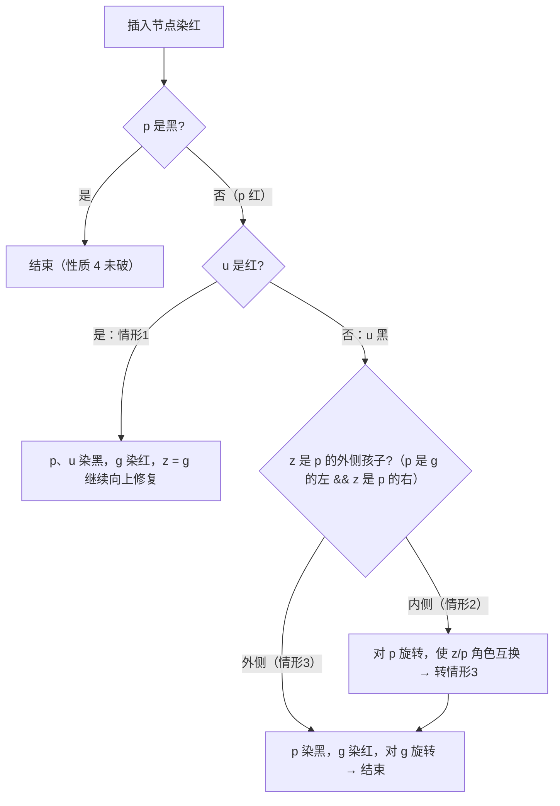

**逐情形说明**：

**情形 1：叔叔是红**（p、u 都红，g 必黑）
→ p、u 变黑，g 变红。**这相当于 2-3-4 树里一个 4-节点分裂，中间 key 上移给父节点**。但 g 变红后可能和它的父（gg）构成连续红 → **把 z 上移到 g，继续循环**（最多向上 log n 层，每层 O(1)）。

**情形 2：叔叔黑，z 是"内侧"孩子**（p 是 g 的左孩子，z 是 p 的右孩子）
→ 先对 **p 左旋**，让 z 变成"外侧"（此时 z 成了 g 的左孩子，p 成了 z 的左孩子），**然后转情形 3**。这一步是"把折线掰直"。

```
   g(B)                g(B)
   /                   /
 p(R)      ==>       z(R)
   \                 /
   z(R)            p(R)
```

**情形 3：叔叔黑，z 是"外侧"孩子**
→ **p 染黑，g 染红，对 g 旋转**（p 是左孩子则右旋）。此时 p 成为子树根，黑高恢复。

```
     g(B)                 p(B)
     /                   /   \
   p(R)   z(R)   ==>   z(R)   g(R)
   /
 z(R)
```

**插入的旋转次数上界（高频追问）**：**最多 2 次旋转**。因为情形 1 只变色不旋转且向上传播，最终只会落在情形 2+3（2 次旋转）或情形 3（1 次旋转）后终止。**"插入最多 2 次旋转、删除最多 3 次旋转"是红黑树相对 AVL 的核心优势。**

### 6.5 删除：为什么难，以及 4 种情形

**难点**：删除可能减少某条路径的黑节点数，破坏性质 5（黑高相等），而"黑高不等"的修复要**向上借位**，逻辑更绕。

**第一步：把"删除任意节点"归约为"删除最多一个孩子的节点"**
- 若 z 有两个孩子 → 用**后继 y（右子树最左，或前驱）**的值覆盖 z，然后删除 y。y 最多只有一个右孩子。
- 于是只剩三种简单情形：无孩子 / 一个孩子。

**第二步：设被删节点为 y，用 x（y 的唯一孩子或 NIL）顶替它的位置，parent = y 的父。**

- **若 y 是红** → 直接删，黑高不变，**结束**（红节点不贡献黑高）。
- **若 y 是黑** → 顶替上来的 x 相当于"**双重黑（double black）**"——它所在的路径少了一个黑节点。需要修复，**4 种情形**（以 x 是左孩子为例，右孩子镜像）：

设 **w = x 的兄弟**。

| 情形 | 条件 | 操作 | 结果 |
|---|---|---|---|
| **1** | w 是**红** | w 染黑，parent 染红，对 parent **左旋** | 转化为 2/3/4（此时新兄弟是黑的） |
| **2** | w 黑，且 w 的**两个孩子都黑** | w **染红**，x 上移到 parent，继续循环 | 把"双重黑"上推一层；若 parent 原为红则染黑后结束 |
| **3** | w 黑，w 的**左孩子红、右孩子黑** | w.left 染黑，w 染红，对 w **右旋** | 转化为情形 4 |
| **4** | w 黑，w 的**右孩子红**（外侧红） | w 取 parent 的颜色，parent 染黑，w.right 染黑，对 parent **左旋**，x = root | **结束** |

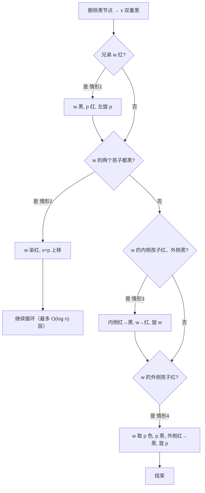

**删除的旋转次数上界**：**最多 3 次**（情形 1 的 1 次 + 情形 3 的 1 次 + 情形 4 的 1 次）。情形 2 只变色不旋转，但可能连续向上传播 O(log n) 次（每次 O(1) 变色）。

> **为什么说"删除比插入难 3 倍"**：插入的修复"要么立即结束，要么向上传播但代价是单纯的变色"；删除的修复需要**判断兄弟及其两个孩子的颜色组合**（4 种），且情形 1→2/3/4、情形 3→4 有转化链。这就是为什么很多实现（如 Java `TreeMap`）把删除逻辑写得非常长。

### 6.6 与 2-3-4 树的对应：把上述规则"翻译"一遍

| 红黑树操作 | 2-3-4 树语义 |
|---|---|
| 情形 1（父红叔红 → 父叔变黑、祖父变红） | **4-节点分裂**，中间 key 上移插入父节点 |
| 情形 2 + 3（旋转两次） | 把一个"折线型"的 3-节点**旋转成直线型**（规范化为左倾表示），再分裂 |
| 删除情形 2（兄弟红、双黑孩子 → 兄弟变红、上移） | **合并**：把父节点的一个 key 下移，与兄弟合并成更大的节点 |
| 删除情形 3/4（旋转兄弟/父） | **借位**：从兄弟那里"挪一个 key"过来，维持所有叶子同层 |

**记住这张表，红黑树就从"背案例"变成"推导"**：所有规则都是 B 树分裂/合并/借位在二叉结构里的模拟。

### 6.7 为什么工程上选红黑树而不是 AVL（面试高频对比题）

| 维度 | AVL | 红黑树 |
|---|---|---|
| 平衡严格度 | 极严：`|h(left) − h(right)| ≤ 1` | 弱：最长 ≤ 2×最短 |
| 树高 | ≈ 1.44 log₂n（更矮） | ≈ 2 log₂n（略高） |
| **查找** | **更快**（层数少，比较次数少） | 稍慢（多 1/3 层） |
| **插入调整** | 最多 **2 次旋转**，但**可能向上回溯 O(log n) 层更新平衡因子** | 最多 **2 次旋转**，且回溯只做变色，**O(1) 次旋转** |
| **删除调整** | 最坏需 **O(log n) 次旋转**（沿路径一路转） | 最多 **3 次旋转**，其余是 O(log n) 次变色 |
| 实现复杂度 | 中（要维护 height/bf） | 高（但旋转次数少，实际更快） |
| 适合 | **读远多于写**（如只读索引、静态数据） | **读写均衡的通用容器** |

**结论话术**："AVL 把'查找'优化到极致，红黑树把'**插入删除的调整代价**'优化到极致。通用 Map/Set 面对的是混合负载，且旋转的代价远大于一次比较（旋转要写多个指针、破坏 cache），所以工业界（Java TreeMap、C++ std::map、Linux 内核、Nginx）都选红黑树。"

### 6.8 红黑树的真实工程落地（说出来很加分）

| 系统 | 用途 | 为什么是红黑树 |
|---|---|---|
| **Java `TreeMap` / `TreeSet`** | 有序 Map，`floorKey/ceilingKey/subMap` | 需要有序 + 增删频繁 |
| **Java 8 `HashMap` 桶** | 冲突严重时把链表转树 | 防哈希攻击，把最坏 O(n) 降到 O(log n) |
| **Linux 内核 `CFS` 调度器** | 按 `vruntime` 排序就绪进程（`sched_entity` 挂在红黑树） | 需要每次 O(log n) 取最小 vruntime，且进程频繁进出 |
| **Linux `epoll`** | 管理 fd 集合（早期实现） | 大量 fd 的增删查 |
| **Linux `rbtree` 通用库**（`include/linux/rbtree.h`） | 侵入式红黑树，被内存管理、ext4 extent 树、`timer` 等复用 | 内核无 STL，需要零分配、可嵌入 |
| **Nginx `ngx_rbtree`** | 定时器（timer）管理、`geo` 模块 | 需要 O(log n) 找最近的超时 |
| **C++ `std::map`/`std::set`** | 有序关联容器 | 标准要求有序 + O(log n) |
| **Java `TreeMap` 的 `NavigableMap`** | 范围查询 | 树的天然优势，哈希做不到 |

> **延伸：Linux CFS 为什么用红黑树而不是最小堆？** 堆只能 O(1) 取最小，但**删除任意一个进程（进程休眠/退出）需要先找到它在堆里的位置 → 堆没有 O(log n) 的任意删除**（除非额外维护索引）。红黑树支持 O(log n) 任意删除 + O(log n) 取最小，正好匹配"进程随时进出"的场景。**这是"选型要看操作集合，不只是看最常用的那个操作"的经典案例。**

### 6.9 其他平衡树一句话速览（用于对比加分）

- **AVL**：平衡因子 ∈ {−1,0,1}，四种旋转（LL/RR/LR/RL）。
- **Treap**：BST 的 key + 堆的随机 priority，**插入即旋转到满足堆序**，期望 O(log n)，代码最短（竞赛常用）。
- **Splay 树**：每次访问把节点旋转到根（zig/zig-zig/zig-zag），**摊还 O(log n)**，对"局部性访问"极优（缓存场景），但最坏单次 O(n)。
- **替罪羊树（Scapegoat）**：不平衡超过阈值就**整棵子树重建**，无需旋转，摊还 O(log n)。
- **B 树/B+ 树**：见第 7 章，多叉降高度，为磁盘设计。

---

## 第 7 章 B 树 / B+ 树：为磁盘 IO 而生的树

### 7.1 为什么二叉平衡树不能用于磁盘

假设 MySQL 用红黑树存 2000 万行数据：
- 树高 ≈ 2·log₂(2×10⁷) ≈ **48 层**。
- 磁盘上每个节点是**一次磁盘 IO**（因为节点间不连续），48 次 × 100 μs ≈ **4.8 ms 只为找一个 key**（这还是 SSD；HDD 是 48×5ms = 240 ms）。
- 而一次 IO 能读 **4KB/8KB/16KB**（一个页），却只用了 32 字节 → **99.5% 的带宽被浪费**。

**核心洞察：磁盘 IO 的代价按"次数"算，不按"字节数"算。** 所以要"**一次 IO 尽量多读有用信息**"，即**提高节点的分支因子（fan-out）**，把树压矮。

### 7.2 B 树：多路平衡搜索树

**定义（m 阶 B 树）**：
- 每个节点最多 m 个孩子、m−1 个 key。
- 除根外，每个节点至少 ⌈m/2⌉ 个孩子。
- 所有叶子在**同一层**（完美平衡）。
- 节点内 key 有序，孩子区间按 key 划分。

```
              [ 30 | 60 ]
            /      |      \
     [10|20]   [40|50]   [70|80]
      / | \      /  \      /  \
   ... 叶子在同一层 ...
```

**操作逻辑**：
- **查找**：节点内**二分查找** key，命中则返回（B 树允许内部节点存数据），否则下探对应孩子。
- **插入**：先插到叶节点，若 key 数超过 m−1 → **分裂（split）**：中间 key 上移到父，左右两半成为两个子节点；父节点也可能溢出 → **递归向上分裂**；根分裂则树高 +1。
- **删除**：若节点 key 数少于下限 → **借位（从兄弟借一个 key，父节点中转）**；兄弟也借不了 → **合并（merge）**；可能递归向上。

**B 树的"节点 = 磁盘页"设计**：一个节点就是一次 IO 的单位。InnoDB 默认页 **16KB**。

### 7.3 B+ 树：为"范围查询"和"更高扇出"优化的变体

**与 B 树的四点差异**：

1. **所有数据（或数据指针）只在叶子节点**，内部节点只存"索引 key + 孩子指针"。
2. **叶子节点用双向链表串起来** → **范围查询只需"定位起点 + 顺着链表扫"**，不用回溯树。
3. **内部节点的 key 是叶子最大值的"副本"**（冗余），因此内部节点能存更多 key → **扇出更大 → 树更矮**。
4. 所有查询都要走到叶子 → **查询路径长度稳定**（性能可预测）。

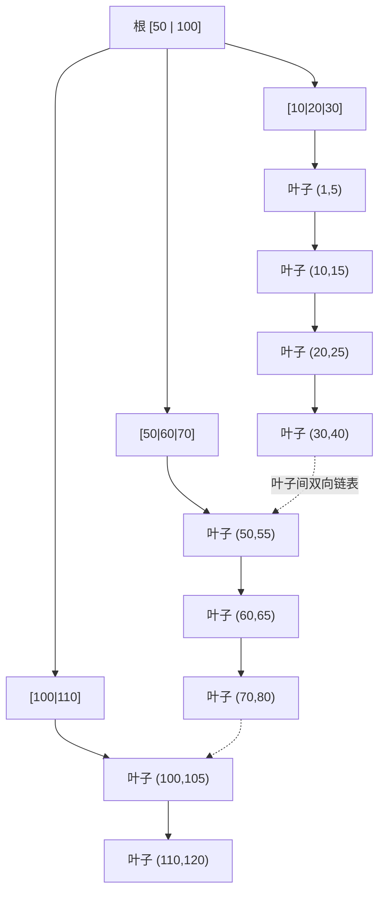

### 7.4 关键计算：3 层 B+ 树能存多少行？（字节/阿里必考）

以 InnoDB 为例：
- 页大小 **16KB = 16384 B**。
- 主键类型 `BIGINT`：8 字节；页内指针 **6 字节**（InnoDB 用 6 字节的页号偏移）→ 一个索引项 **14 字节**。
- 页头/页尾开销约 200 B，可用 ≈ 16184 B。
- **非叶子页扇出 ≈ 16184 / 14 ≈ 1156**（常取约 1170）。
- 叶子页存行：假设单行 1KB → 每页约 **16 行**。

| 层数 | 可存行数 | 说明 |
|---|---|---|
| 1 层（只有叶子） | ~16 | — |
| 2 层 | 1170 × 16 ≈ **1.9 万** | 根是 1 个页 |
| **3 层** | 1170 × 1170 × 16 ≈ **2190 万** | **最常见答案：3 层 ≈ 2000 万行** |
| 4 层 | ≈ **256 亿** | 实际几乎不会到这层 |

**结论话术**："3 层 B+ 树大约能撑 2000 万行，而查找只需 **3 次磁盘 IO**（根页常驻内存，实际 2 次）。这就是为什么 MySQL 单表建议控制在千万级——再大就要 4 层 IO。"

> **反向推论（面试延伸）**：如果主键用 `VARCHAR(255)` 或 UUID，索引项从 14B 涨到 200+B，扇出从 1170 掉到 ~80，3 层只能存 **80×80×16 ≈ 10 万** 行 → 被迫 4~5 层。**这就是"为什么推荐自增整型主键"的硬核原因**（另一个原因是自增主键避免页分裂、保证顺序写）。

### 7.5 InnoDB 索引的完整图景（把 B+ 树落到真实表上）

**聚簇索引（Clustered Index）**：主键 B+ 树的**叶子节点直接存放整行数据**。所以"表数据本身就是一棵 B+ 树"，主键查询 = 一次树的下降。

**二级索引（Secondary Index）**：叶子存的是"**索引列值 + 主键值**"，不含整行。查询非索引列时必须**回表**：先查二级索引拿到主键，再用主键查聚簇索引。

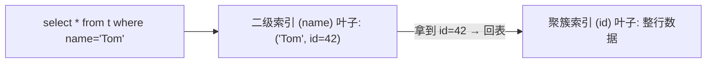

- **回表成本**：额外一次树查找（可能多次随机 IO）。→ 所以有**覆盖索引（covering index）**：如果 `select` 的列都在索引里，就不需要回表（`Using index`）。
- **最左前缀原则**：联合索引 `(a,b,c)` 的 B+ 树是**按 a 排序、a 相同按 b、b 相同按 c**。所以：
  - `where a=?` ✅；`where a=? and b=?` ✅；`where b=?` ❌（无法定位 a 的区间）。
  - **`where a=? and c=?` 只能用到 a**（c 无法跳过 b 定位有序区间），但 MySQL 5.6+ 有**索引下推（ICP）**，可以在索引层过滤 c，减少回表次数——**但"用不到 c 的定位"这一点不变**。
- **范围查询会中断后续列**：`where a>10 and b=5` 中 b 无法用索引定位，因为 a 是范围，b 在 a 的不同值内不全局有序。**这就是"范围列后面放等值列会失效"的原理。**
- **页分裂**：随机插入（如 UUID）会让页不断"裂开"，产生 50% 左右的**碎片率**；自增主键总是追加到最右页，分裂少、顺序写。**这是"顺序写 vs 随机写"在索引层的体现。**

**为什么 MySQL 不用 B 树 / 红黑树 / 哈希 / 跳表（五种结构的完整对比）**：

| 结构 | 为什么不用 |
|---|---|
| **红黑树 / AVL** | 树高 20~50 层 → 几十次磁盘 IO；节点太小，浪费页带宽 |
| **B 树** | 内部节点也存数据 → 数据行大时扇出骤降，树变高；**范围查询要中序回溯，不能顺序扫** |
| **哈希索引** | O(1) 等值查询很强，但**不支持范围查询、排序、最左前缀、LIKE 前缀**；且哈希冲突需遍历链（InnoDB 的自适应哈希索引 AHI 只是"内存里的加速缓存"，仍以 B+ 树为准） |
| **跳表** | 内存结构（指针跳转），磁盘上节点分散 → 每次跳都是一次随机 IO；Redis 用跳表是因为**数据在内存**且要支持范围查询与并发简单 |
| **B+ 树** ✅ | 扇出最大（内部只存 key）、树最矮（3 层撑千万）、**叶子链表支持范围扫**、查询路径稳定 |

**LSM-Tree 对照组（面试延伸）**：LevelDB/RocksDB/HBase 用 **LSM（MemTable + 多层 SSTable + 后台 compaction）**。写路径是"内存 + 顺序追加 WAL + 顺序刷盘"，**写吞吐远高于 B+ 树**（B+ 树每次写要随机定位页、可能分裂）。代价是**读要查多层（读放大）、compaction 消耗 IO（写放大）、空间放大**。
> 口诀：**B+ 树读友好（读放大 1），LSM 写友好（写放大换读放大）**。这解释了为什么"MySQL 适合 OLTP 混合负载，而 HBase/ClickHouse 适合写多/批量导入"。

### 7.6 B 树/B+ 树的其他落地

- **文件系统**：ext4 的 extent 树、NTFS 的 MFT、Btrfs/XFS 的 B 树（Btrfs 几乎一切皆 B 树）。
- **数据库**：SQLite、MySQL InnoDB、Oracle（B+ 树）、SQL Server。
- **MongoDB**：WiredTiger 引擎用 B 树。
- **Redis**：不用 B 树（内存场景），但 `zset` 用跳表；`sorted set` 的大范围删除用"跳表 + 分层"。

---

## 第 8 章 堆：只维护"偏序"的完全二叉树

### 8.1 核心思想：放弃全序，只保"父 ≥ 子"

**堆不变量**：大顶堆中，`a[parent] ≥ a[child]`（小顶堆反之）。**只要父子有序，兄弟/堂兄弟完全无序**。

这个"弱要求"的回报是：**可以用数组存完全二叉树，零指针开销，且 O(1) 取最值**。

### 8.2 数组表示：为什么完全二叉树能用数组存

**完全二叉树**：除最后一层外都填满，最后一层从左到右连续。→ **节点的位置与"层序编号"一一对应，没有空洞**。

```
        0
      /   \
     1     2
    / \   / \
   3   4 5   6

数组: [0][1][2][3][4][5][6]
下标关系（0-based）：
  parent(i) = (i - 1) / 2
  left(i)   = 2*i + 1
  right(i)  = 2*i + 2
```

> **注意**：若用 1-based（算法教材常见），公式是 `parent = i/2, left = 2i, right = 2i+1`，更对称但浪费 `a[0]`。**Java `PriorityQueue` 用 0-based。**

### 8.3 上浮（sift-up）与下沉（sift-down）：唯一的两个原语

**插入 = 追加到数组末尾 + 上浮**：

```java
void siftUp(int i) {
    while (i > 0) {
        int p = (i - 1) >> 1;
        if (a[p] >= a[i]) break;       // 大顶堆：父已不小于子，停止
        swap(p, i); i = p;             // 否则交换，继续向上比较
    }
}
// 复杂度 O(log n)，最多走树高
```

**删除堆顶 = 把末尾元素移到堆顶 + 下沉**：

```java
void siftDown(int i) {
    int n = size;
    while (true) {
        int l = 2*i+1, r = l+1, largest = i;
        if (l < n && a[l] > a[largest]) largest = l;   // 先与左比
        if (r < n && a[r] > a[largest]) largest = r;   // 再与右比
        if (largest == i) break;
        swap(i, largest); i = largest;
    }
}
```

**为什么删除堆顶要把"最后一个元素"提上来，而不是"删完再调整"**？因为要维持**完全二叉树形态**（数组连续无洞）。末尾元素提到根后，只有"根到叶子的一条路径"可能违反堆序，所以只需**沿一条路径下沉**，O(log n)。若随便找个元素填坑，会破坏形状或需要全局重建。

### 8.4 建堆为什么是 O(n) 而不是 O(n log n)（高频证明题）

**错误做法**：n 次插入，每次上浮 O(log n) → O(n log n)。
**正确做法（Floyd 建堆）**：**从最后一个非叶节点 `n/2-1` 开始，依次向前对每个节点下沉**。

**证明（两种写法都行）**：

**① 按层求和（最直观）**：
高度为 h 的节点（叶子 h=0）下沉代价为 `O(h)`。高度 h 的节点数最多 `n/2^(h+1)`。总代价

```
Σ_{h=0}^{log n} (n / 2^(h+1)) * O(h) = O(n * Σ h/2^(h+1)) = O(n * 2) = O(n)
```

因为 `Σ h/2^h` 收敛到常数 2（几何-算术级数）。**关键点：绝大多数节点在底层，而底层节点的下沉代价接近 0。** 这是"按层加权"的核心洞察。

**② 交换次数上界**：可以证明总交换次数 < 2n（每个节点下沉的路径长度期望很小）。

> **面试答法**："自底向上建堆时，高度为 h 的节点有 n/2^(h+1) 个，下沉代价 h，求和 ≤ 2n，所以是 O(n)。直觉是'越往下节点越多、越不用下沉'。"

### 8.5 堆的局限：为什么不能"任意删除/查找"

- **查找任意元素 O(n)**：堆只有父子关系，无法二分定位。
- **删除任意元素**：需要有办法 O(1) 定位它（否则先 O(n) 找）。→ 若维护"元素 → 数组下标"的哈希映射，可 O(log n)：把末尾元素填到该位置，再**上浮或下沉（二者选其一，取决于新值与父/子的关系）**。**这正是 Dijkstra 用堆 + 索引表、以及"可删除堆"的实现思路。**
- **合并两个堆**：普通二叉堆 O(n)；**左偏树/斜堆/斐波那契堆**支持 O(log n) 甚至 O(1) 合并。

### 8.6 堆的工程应用（比"堆排序"重要得多）

| 应用 | 细节 |
|---|---|
| **优先队列 / 任务调度** | `PriorityQueue`、`ScheduledThreadPoolExecutor` 的延迟队列（`DelayedWorkQueue` 就是二叉堆） |
| **TopK（海量数据取最大 K 个）** | 维护**大小为 K 的小顶堆**：新元素 > 堆顶则替换堆顶并下沉。时间 `O(n log K)`，空间 `O(K)`。**注意方向：取最大 K 用小顶堆**（这是最常被记反的点，因为堆顶要被"淘汰最差者"） |
| **数据流中位数** | **大顶堆存小半 + 小顶堆存大半**，保持两堆大小差 ≤ 1，中位数在堆顶。`O(log n)` 插入、`O(1)` 查询 |
| **定时器** | 最小堆按"到期时间"排序，`O(log n)` 插入、`O(1)` 取最近到期。但**大量定时器频繁增删**时，**时间轮（Time Wheel）**更优：O(1) 插入删除，Kafka/Netty 都用（Netty 的 `HashedWheelTimer`）。**面试延伸点：堆 vs 时间轮的选择依据是"定时器数量 + 精度 + 取消频率"** |
| **Huffman 编码** | 每次取两个最小频率合并 |
| **Dijkstra / Prim** | 每次取距离最小的未访问节点（配合"可删除堆"或 lazy deletion） |
| **堆排序** | 建堆 O(n) + n 次取顶 O(n log n)，**原地、不稳定**；工程上少用（cache 不友好，跳来跳去），`sort.Introsort` 用快排 |

> **延伸：为什么 `PriorityQueue` 遍历时不保证有序？** 因为堆只保证"父 ≥ 子"，层序数组不是有序序列。要得到有序结果必须**逐个 poll**（O(n log n)）。很多人踩过"直接遍历 PriorityQueue 得到乱序"的坑。

> **延伸：为什么 Java 的 `PriorityQueue` 不允许 null？** 因为 `siftUp/siftDown` 要调用 `compareTo`，null 会 NPE；且 null 无法参与比较语义。

---

## 第 9 章 跳表：用概率换掉平衡操作

### 9.1 结构：多层有序链表 + 随机晋升

```
level 3:  head ────────────────────────────▶ 30 ──────────▶ null
level 2:  head ────────▶ 10 ────────────────▶ 30 ────▶ 50 ─▶ null
level 1:  head ─▶ 5 ────▶ 10 ────▶ 20 ──────▶ 30 ────▶ 50 ─▶ null
level 0:  head ─▶ 5 ─▶ 8 ─▶ 10 ─▶ 15 ─▶ 20 ─▶ 25 ─▶ 30 ─▶ 40 ─▶ 50 ─▶ null  （原始有序链表）
```

- 每个节点在插入时**随机决定层数**：`while (random() < p) level++`，通常 p = 1/4 或 1/2，最大层 32。
- **查找**：从最高层开始，能往右就往右，不能就下降一层。期望路径长度 O(log n)。
- **插入/删除**：先查找定位（O(log n)），再改各层指针。**没有旋转、没有变色。**

### 9.2 为什么期望是 O(log n)（用"反向分析"证明）

**技巧：从目标节点倒着往回看。** 因为 `while(random()<p)` 生成层数，等价于"**每一层以概率 p 继续向上**"。

反向路径：从目标节点向"左上"走，每一步是"上升一层（概率 p）"或"左移一个节点（概率 1−p）"。**正向查找路径长度 = 反向爬升路径长度**。反向爬升中，期望每上升 1 层要走 `1/p` 个横向步，总共上升 `log_{1/p}(n)` 层 →

**期望查找代价 = O(log_{1/p} n / p)**，p=1/4 时约 `2 log₂n` 次比较。

**关键：不依赖输入分布，只依赖随机数**——这是它相对平衡树的优势：**不存在"最坏输入导致退化"**（只存在概率极低的长路径）。

### 9.3 为什么 Redis 用跳表而不用红黑树（腾讯/阿里必考）

Redis `ZSET` 需要：**按 score 排序 + 范围查询（ZRANGEBYSCORE）+ 排名（ZRANK）+ 按 member 查找（O(1)）+ 并发/实现简单**。

| 维度 | 跳表 | 红黑树 |
|---|---|---|
| 实现难度 | **简单**（无旋转、无删除 4 情形） | 复杂（旋转 + 变色 + 4 情形） |
| 范围查询 | **天然**：找到起点后沿 level 0 顺序扫，**cache 友好**（指针少跳） | 需要中序后继，且树节点分散 |
| 排名 ZRANK | 节点存 `span`（跨越节点数），**O(log n) 沿途累加** | 需要额外维护 `size` 字段 + 中序排名，实现繁琐 |
| 并发 | 改指针少，**容易做无锁/细粒度锁**（ConcurrentSkipListMap） | 旋转影响面大，锁范围难缩小 |
| 内存 | 平均 **1/(1−p) ≈ 1.33 倍**指针（p=1/4） | 每节点 3 指针 + 颜色位 |
| 最坏 | 概率性 O(log n) | 确定性 O(log n) |

**Redis 作者 antirez 的原话大意**：跳表"更容易实现、更容易做范围查询、更容易调（改 p 就能调平衡）、且在并发下更容易加锁"。**注意：跳表不适合磁盘（节点离散，每次跳可能一次随机 IO）——这是它不能替代 B+ 树的原因。**

### 9.4 其他落地

- **Java `ConcurrentSkipListMap` / `ConcurrentSkipListSet`**：JDK 中唯一的并发有序 Map（无锁 CAS 实现）。
- **LevelDB / RocksDB 的 MemTable**：跳表（写多、需要有序迭代）。
- **Lucene 的倒排索引跳表**（用于 skip list 加速 posting list 求交）。
- **HBase 的 MemStore** 早期也用过跳表（现为 `ConcurrentSkipListMap`）。

---

## 第 10 章 图与并查集

### 10.1 两种存储：矩阵 vs 邻接表

| | 邻接矩阵 `n×n` | 邻接表 `n 个链表/数组` |
|---|---|---|
| 空间 | **O(n²)**（稀疏图浪费巨大） | **O(n + e)** |
| 判断 `(u,v)` 是否有边 | **O(1)** | O(deg(u)) |
| 遍历 u 的所有邻居 | O(n)（扫一整行） | **O(deg(u))** |
| 适用 | **稠密图**、需要频繁判边、Floyd 算法 | **稀疏图**（绝大多数现实图） |

**工程上的第三种**：**CSR（压缩稀疏行）/ CSC**——用两个数组 `offsets` + `adjacency` 存邻接表，**零指针、内存连续**。这是所有图计算框架（Spark GraphX、Pregel、Boost Graph）的标准做法，因为遍历邻居变成顺序扫描，cache 友好。

```c
// CSR
int offsets[] = {0, 3, 5, 8};      // 节点 i 的邻居在 adjacency[offsets[i] .. offsets[i+1])
int adjacency[] = {1,2,3, 0,3, 0,1,3};
```

> **延伸：为什么"节点编号要紧凑"（0..n-1）**：哈希表式的"任意 id 映射"会让遍历时指针/下标跳跃，破坏局部性。图框架都要求"先重编号（reindex）"。

### 10.2 遍历：BFS 用队列，DFS 用栈（或递归）

- **BFS**：层序扩张，**无权图最短路径**（边权都为 1 时）。队列实现，`O(n+e)`。
- **DFS**：一路到底再回溯，栈/递归实现。用于**连通分量、拓扑排序、判环、割点**。

```java
// BFS 最短路径（无权）
int[] dist = new int[n]; Arrays.fill(dist, -1); dist[s] = 0;
Deque<Integer> q = new ArrayDeque<>(); q.add(s);
while (!q.isEmpty()) {
    int u = q.poll();
    for (int v : adj[u]) if (dist[v] == -1) { dist[v] = dist[u] + 1; q.add(v); }
}
```

> **易错点**：**入队时就标记 visited**，而不是出队时。否则同一节点会被多次入队，复杂度退化成指数级。

### 10.3 拓扑排序（DAG 的线性化）

- **Kahn 算法（BFS）**：统计入度，入度为 0 入队，出队时把邻居入度减 1，减到 0 再入队。若最终输出节点数 < n → **存在环**。
- **DFS 后序逆序**：DFS 完成顺序的逆序即拓扑序，需三色标记（白/灰/黑），遇到"灰"即**有环**。

应用：**编译器的依赖解析、Maven/Gradle 的构建顺序、任务调度、课程表、AOV 网、数据库迁移脚本顺序、K8s 的资源依赖**。

### 10.4 最短路：三种算法的适用边界

| 算法 | 边权 | 复杂度 | 适用 |
|---|---|---|---|
| **BFS** | 全为 1 | O(n+e) | 无权图 |
| **Dijkstra** | 非负 | 二叉堆 O((n+e) log n)，斐波那契堆 O(e + n log n) | **单源、非负权** |
| **Bellman-Ford** | 可负（无负环） | O(n·e) | 有负权边 |
| **Floyd** | 可负（无负环） | O(n³) | **多源全对**、稠密图、n 小 |
| **SPFA** | 可负 | 平均 O(e)，最坏 O(n·e) | BF 的队列优化（**可被构造卡死**，竞赛慎用） |
| **A\*** | 非负 + 启发函数 | 取决于启发质量 | 地图导航、游戏寻路 |

**Dijkstra 为什么不能处理负权（面试高频证明）**：
Dijkstra 的核心假设是"**一旦节点被弹出堆（确定最短距离），它的距离不可能再变小**"。这依赖"路径延长不会让总距离变小"，即 `d(u) ≤ d(u) + w` 要求 `w ≥ 0`。若存在负权边，从已确定的节点出发可能找到更短的路径 → 假设崩塌。

**反例**：`s→a (1), s→b (2), b→a (−2)`。Dijkstra 先弹 a（dist 1）并标记确定，但真实最短是 `s→b→a = 0`。

> **延伸**：也可用"**势能重加权（Johnson 算法）**"把负权转化为非负，再用 Dijkstra。

### 10.5 并查集（Union-Find / DSU）：近 O(1) 的集合合并

**结构**：每个元素有 `parent` 指针，形成**森林**；根节点的 `parent` 指向自己。

**两个优化（缺一不可）**：

1. **路径压缩（Path Compression）**：`find` 时把路径上所有节点直接挂到根上。

```java
int find(int x) {
    return parent[x] == x ? x : (parent[x] = find(parent[x]));  // 递归写法极简
}
// 迭代写法（避免深递归爆栈）
int find(int x) {
    int r = x;
    while (parent[r] != r) r = parent[r];     // 找根
    while (parent[x] != r) { int nxt = parent[x]; parent[x] = r; x = nxt; }  // 压缩
    return r;
}
```

2. **按秩/按大小合并（Union by Rank/Size）**：把矮树挂到高树下，避免"链化"。

```java
void union(int a, int b) {
    int ra = find(a), rb = find(b);
    if (ra == rb) return;
    if (rank[ra] < rank[rb]) parent[ra] = rb;
    else if (rank[ra] > rank[rb]) parent[rb] = ra;
    else { parent[rb] = ra; rank[ra]++; }
}
```

**复杂度**：只用路径压缩 → 摊还 `O(log n)`（甚至更松）；只用按秩合并 → `O(log n)`；**两者都用 → 摊还 `O(α(n))`，α 是反阿克曼函数，对任何现实 n（包括 10^80）都 ≤ 4，视为 O(1)**。

> **面试加分点**：能说出"反阿克曼函数 α(n) < 5"和"它是理论上最优的摊还复杂度之一"，比只说"接近 O(1)"强得多。

**典型应用**：
- **Kruskal 最小生成树**（按边权排序 + 并查集判环）；
- **连通性判定**（朋友圈、网络连通、等式传递 `a=b, b=c ⇒ a=c`）；
- **岛屿数量 / 被围绕的区域**；
- **账户合并（LeetCode 721）**、**最长连续序列**；
- **图片染色/区域分割**（图像处理里的 connected components）。

---

## 第 11 章 字符串结构：Trie 与 AC 自动机

### 11.1 Trie（前缀树 / 字典树）

**结构**：每条边代表一个字符，从根到某节点的路径构成一个前缀；节点标记 `isEnd` 表示一个完整单词。

```
(root)
 ├─ c ─ a ─ t  (isEnd)        → "cat"
 │        └─ r  (isEnd)       → "car"
 └─ d ─ o ─ g  (isEnd)        → "dog"
```

- **查找/插入**：O(L)，L = 字符串长度，**与词库大小 n 无关**。
- **前缀查询**：走到前缀末尾，遍历其子树即所有补全。
- **空间问题**：每个节点一个 `Map<char, Node>` 或 26 叉数组 → 内存爆炸（26 个指针 × 8B = 208B/节点）。
  - 优化：**压缩字典树（Radix Tree / Patricia Trie）**——把只有一个孩子的链合并成一条边（Linux 内核的**路由表**就用 Radix Tree，Redis 的 `rax` 也是）。
  - 优化：**双数组 Trie（Double-Array Trie）**——用两个整型数组表示状态转移，内存紧凑，**分词器（jieba/HanLP）和搜索引擎词典**常用。
  - 优化：**DAWG（有向无环词图）**——合并相同后缀，进一步压缩。

**应用**：**输入法/搜索联想、IP 路由（最长前缀匹配）、拼写检查、敏感词过滤（DFA）、Aho-Corasick 的 base、Trie 上做 XOR 最大异或对**。

> **敏感词过滤为什么用 Trie/DFA**：一次扫描文本 O(text_len × max_word_len)，与词库大小无关；配合"失败指针"（AC 自动机）可做到 O(text_len)。

### 11.2 AC 自动机（Aho-Corasick）

**动机**：多模式串匹配。Trie 单独用，每次失配都要回退到根重新扫（O(n·L)）；AC 自动机加了 **fail 指针（失配指针）**：

- `fail[u]` = u 所代表串的**最长真后缀**在 Trie 中的节点。
- 构造时用 **BFS** 逐层求 fail（`fail[child] = go(fail[parent], c)`），与 KMP 的 `next` 数组思想同源。
- **匹配时沿 fail 链跳转，总复杂度 O(text_len + 匹配次数)**。
- 应用：**敏感词/多关键词过滤、病毒特征码扫描（Snort/ClamAV）、DNA 序列匹配、日志关键词告警**。

### 11.3 其他字符串结构一句话

| 结构 | 用途 |
|---|---|
| **后缀数组 / 后缀自动机（SAM）** | 所有子串问题、最长公共子串、不同子串计数，O(n) 构建 |
| **后缀树** | 同上，但常数大、实现难（多被 SAM 替代） |
| **回文树（Palindromic Tree）** | 回文子串统计 |
| **Rope / 平衡树字符串** | 大文本编辑器（如 VSCode 的部分实现思路）的 O(log n) 插入删除 |
| **哈希 + 滚动哈希** | 子串相等判断 O(1)（Rabin-Karp） |

---

## 第 12 章 全景对比总表

### 12.1 时间复杂度总表

| 结构 | 查找 | 插入 | 删除 | 取最值 | 有序遍历/范围 | 空间（每元素额外） |
|---|---|---|---|---|---|---|
| 数组（无序） | O(n) | O(1) 尾 / O(n) 中 | O(n) | O(n) | 需排序 | 0 |
| 动态数组 | O(n) | 摊还 O(1) 尾 | O(n) | O(n) | 需排序 | ≈1.5~2 倍容量 |
| 有序数组 | **O(log n)** | O(n) | O(n) | O(1) | ✅ O(n) | 0 |
| 单向链表 | O(n) | **O(1)**（有前驱） | **O(1)**（有前驱） | O(n) | ✅ | 8B |
| 双向链表 | O(n) | O(1) | O(1) | O(n) | ✅ | 16B |
| 哈希表（链地址） | **期望 O(1)** / 最坏 O(n) | 期望 O(1) | 期望 O(1) | O(n) | ❌ | 指针 + 1.5~2× 桶 |
| 哈希表（开放寻址） | 期望 O(1) | 期望 O(1) | 期望 O(1)（墓碑） | O(n) | ❌ | 0（但装载因子 < 1） |
| BST（可能退化） | O(h)，最坏 O(n) | O(h) | O(h) | O(h) | ✅ | 16B（两指针） |
| AVL | O(log n) | O(log n) + ≤2 旋 | O(log n) + O(log n) 旋 | O(log n) | ✅ | 16B + 平衡因子 |
| **红黑树** | O(log n) | O(log n) + ≤2 旋 | O(log n) + ≤3 旋 | O(log n) | ✅ | 16B + 1 bit |
| **跳表** | 期望 O(log n) | 期望 O(log n) | 期望 O(log n) | O(1) 最小 | ✅ | ≈1.33×8B（p=1/4） |
| **B+ 树** | O(log_m n)（≈3 次 IO） | O(log_m n) | O(log_m n) | 叶子端点 | ✅（叶子链表） | 高扇出，页内紧凑 |
| **二叉堆** | O(n)（任意）/ O(1) 堆顶 | O(log n) | O(log n) 堆顶 | **O(1)** | ❌ | 0（数组） |
| Trie | O(L) | O(L) | O(L) | ❌ | 按前缀 | 高（每节点多指针） |
| 并查集 | 摊还 **O(α(n))≈O(1)** | O(α(n)) | — | — | ❌ | 2 个数组 |

### 12.2 "选型决策树"（面试答"你会选什么结构"时的框架）

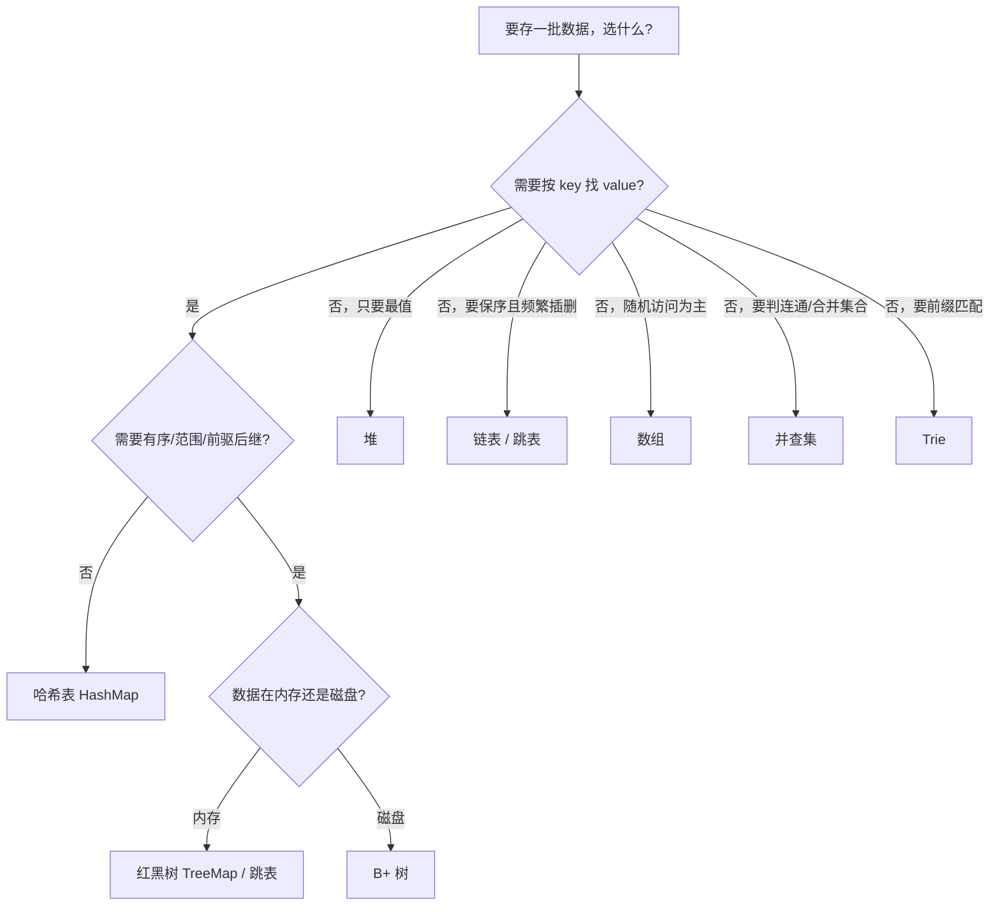

### 12.3 内存开销直觉（为什么"链表常常更慢"）

| 结构 | 存 100 万个 `int`（4B）实际占用 | 说明 |
|---|---|---|
| `int[1000000]` | **4 MB** | 紧凑 |
| `ArrayList<Integer>` | ≈ 4 MB（数组）+ **16 MB**（100 万个 Integer 对象，每对象 16B 头 + 4B 值 + 对齐） | **装箱是最大开销** |
| `LinkedList<Integer>` | ≈ **24 MB+**（每 Node 40B：16 头 + 8 prev + 8 next + 8 引用） | 6 倍于数组 |
| `HashMap<Integer,Integer>` | ≈ **64 MB+**（Node 32B + 桶数组 1.5~2×） | 16 倍 |

> 这解释了为什么"高性能场景要用**原始类型数组 / 自定义开放寻址 Map（如 Eclipse Collections、fastutil、HPPC）**"来避开装箱和指针。

---

## 第 13 章 国内大厂面试题（按数据结构分类 · 含考核等级）

### 13.0 考核等级说明（阅读本文档的图例）

| 等级 | 标记 | 含义 | 面试中的实际权重 |
|---|---|---|---|
| **必考 / 核心** | ★★★ | 一面二面几乎必问，答不出基本判负 | 决定"过不过" |
| **高频 / 进阶** | ★★☆ | 中高级岗常问，答好显著加分 | 决定"评级高低" |
| **加分 / 深水区** | ★☆☆ | 区分度极高，能答出"源码级/工程级"细节 | 决定"是否 SP/是否被记住" |

**答题四段式（每道题都按这个结构组织）**：
1. **一句话结论**（先给答案，别绕）
2. **原理/过程**（为什么，机器在干什么）
3. **边界与反例**（什么情况下不成立）
4. **延伸**（相关但更高层的问题，主动给出 = 展示知识网）

---

### 13.1 数组（Array）

#### 题 1-1：为什么数组下标从 0 开始？`★★★`

**来源**：阿里 / 字节 / 美团 一面热身题，几乎每年出现。

**考核点**：是否理解"数组 = 基址 + 偏移"，而不是只会说"习惯"。

**解答**：

1. **寻址公式**：`a[i] 的地址 = base + i * sizeof(T)`。i 从 0 开始，公式只有"一次乘法 + 一次加法"。
2. **若从 1 开始**：`addr = base + (i − 1) * sizeof(T)`，每次访问**多一条减法指令**。在数组是"最热的底层结构"的前提下，这条指令会被执行亿万次。
3. **C 语言的语义绑定**：`a[i]` 被定义为 `*(a + i)`。如果下标从 1 开始，`a[1]` 就要对应 `*(a+0)`，则"指针偏移"与"下标"错位一位，编译器/指针运算都要额外补偿。**从 0 开始让"下标 = 偏移量"，语义完全自洽。**
4. **区间表示更优雅**（Dijkstra 的论述）：半开区间 `[lo, hi)` 的长度恰好是 `hi − lo`，且"空区间"可表示为 `[i, i)`，不需要特判 `hi = lo − 1` 这种别扭形式。

**可能追问**：
- *"那为什么有些语言（如 MATLAB、Lua、R）从 1 开始？"* → 这些语言的数组更多面向数学/矩阵语义（矩阵下标习惯 1-based），且它们是"高层抽象"，不做指针运算，所以没有"省指令"的收益，反而更贴近人的计数习惯。
- *"Go 的 slice 为什么是 `[lo:hi]` 左闭右开？"* → 同上半开区间理由，且 `len = hi - lo`、`cap = cap - lo`。

---

#### 题 1-2：`ArrayList` 的扩容机制？为什么是 1.5 倍而不是 2 倍？`★★★`

**来源**：阿里 / 美团 / 京东，Java 岗几乎必问；C++ 岗会问 `std::vector` 的 1.5/2 倍差异。

**考核点**：摊还分析 + 内存管理（碎片/复用）的工程权衡。

**解答**：

**扩容过程（JDK 8）**：

```java
private void grow(int minCapacity) {
    int oldCapacity = elementData.length;
    int newCapacity = oldCapacity + (oldCapacity >> 1);   // 1.5 倍
    if (newCapacity - minCapacity < 0) newCapacity = minCapacity;
    if (newCapacity - MAX_ARRAY_SIZE > 0) newCapacity = hugeCapacity(minCapacity);
    elementData = Arrays.copyOf(elementData, newCapacity);  // 全量拷贝
}
```

- 默认初始容量 10（**注意：是第一次 add 时才分配，不是构造时**——`new ArrayList<>()` 内部是空数组 `DEFAULTCAPACITY_EMPTY_ELEMENTDATA`，延迟到首次 add 才分配 10，节省内存）。
- 扩容 = **申请新数组 + `Arrays.copyOf` 全量拷贝 + 旧数组等 GC**，不是原地扩展。

**为什么必须"按倍数"**：若每次 +k，n 次 add 的总拷贝 = `k + 2k + ... + n ≈ n²/2k`，**摊还 O(n)**，无法接受。几何增长才能让总拷贝 < 2n，摊还 O(1)。
**势能法证明**：`Φ = 2·size − capacity`。不扩容时实际代价 1，`ΔΦ = +2`，摊还 3；扩容时实际代价 `1 + size`，`Φ` 从 `size` 变到 `−(size)` 左右（容量翻倍后 `2·size − 1.5·size = 0.5 size`），总摊还仍是常数。

**1.5 的核心理由（这是加分的部分）**：
- **内存复用**：按 1.5 增长时，序列是 `10, 15, 22, 33, 49, 74, 111...`（近似 1.5ⁿ），**前面释放掉的连续块的总和，有机会凑出一个足够大的连续空闲区**（因为 glibc/jemalloc 的 bin 是按大小分级复用的，1.5 倍增长时新块大小常落在"已释放块拼起来够用"的区间）。
- **按 2 增长时**，`1,2,4,8,16...`，新块永远 **≥ 之前所有块之和**，**必然要重新向 OS 申请（mmap/brk）**，产生更多缺页和碎片。
- **代价**：1.5 倍拷贝次数更多（每元素平均多搬约 1 次）、内存峰值 2.5 倍 vs 3 倍。

**结论话术**："1.5 倍是'**少一次向 OS 要内存、少一些碎片**'换'**多一次拷贝**'。JDK 作为库，面对不确定的堆环境，选了保守方案；C++ 的 libstdc++ 选 2 倍是追求摊还更快，MSVC 选 1.5。"

**可能追问**：
- *"ArrayList 的 remove 会缩容吗？"* → **不会**。只有 `trimToSize()` 手动缩容。这是为了避免"删一个就缩、再加又扩"的抖动。
- *"ArrayList 扩容时旧数组什么时候释放？"* → 由 GC 决定，不是立即。所以大 ArrayList 反复扩容会**短时间占用 2.5 倍内存**，可能导致 OOM。
- *"为什么不用 LinkedList？"* → 见题 2-1。

---

#### 题 1-3：数组的"随机访问 O(1)"是绝对的吗？`★★☆`

**来源**：字节（偏底层/性能岗）、腾讯 CSIG。

**考核点**：是否懂"渐进复杂度 ≠ 真实耗时"，cache/预取/缺页。

**解答**：

**不是。** 严格说，"**计算地址**"是 O(1)，但"**取到数据**"的代价取决于数据在哪一级存储：

| 数据所在 | 访问延迟 |
|---|---|
| L1 cache | ~1 ns（4–5 cycle） |
| L2 | ~4 ns |
| L3 | ~15 ns |
| 主存（一次 cache miss） | **~60–120 ns** |
| 被换出到 swap/磁盘（major page fault） | **~ms 级** |

所以：
- **顺序访问 100 万元素** ≈ 全在 cache，几 ms 内。
- **随机访问 100 万次（每次跨很大跨度）** → 几乎每次 miss + 可能 TLB miss，可能慢 **50–100 倍**。
- 数组特别大（超过物理内存）时，随机访问会触发**缺页**，性能从 ns 级跌到 ms 级。

**延伸（这是真正的答案）**：
- **"O(1) 的常数可以差 5 个数量级"**，这就是为什么算法题里"O(n) 的数组遍历"能秒杀"O(n) 的链表遍历"。
- **哈希表声称 O(1)**，但一次 get 至少 1 次随机内存访问（桶）+ 可能 1 次链上节点访问 → 实际 ~10–100 ns，而"数组下标访问"是 ~1–4 ns。
- **B+ 树 3 层 3 次 IO** 的说法，其实第一层（根页）几乎总在 buffer pool 里 → 实际 2 次 IO。**"IO 次数"也要算缓存命中**。

---

#### 题 1-4：为什么按行遍历二维数组比按列快？`★★☆`

**来源**：字节跳动（后端/基础架构）、华为。

**考核点**：内存布局（行主序）+ cache line + 硬件预取。

**解答**：

C/C++/Java/Go 都是**行主序**：`a[i][j]` 的地址 = `base + (i * COLS + j) * sizeof(T)`。同一行的元素**地址连续**。

- **按行遍历（i 外层）**：访问序列连续 → 一次 cache line（64B）能覆盖 16 个 `int` → **命中率 ≈ 15/16**，且硬件 stride prefetcher 能识别"步长固定"并提前取下一行。
- **按列遍历（j 外层）**：`a[0][j], a[1][j], ...` 每次跨 `COLS * 4` 字节 → 如果 `COLS * 4` 大于 cache line，**每次都是新的 cache line**，且访问跨度大，预取器难识别（或识别为"跨步"但预取窗口不够）→ **几乎每次都 miss**，还会不断淘汰后续要用的行（thrashing）。

**实测差异**：1000×1000 `int` 矩阵，行优先比列优先快 **5–10 倍**（矩阵超出 L2 时更明显）。

**延伸**：
- **矩阵乘法优化**：`ijk` → `ikj`（把 `b[k][j]` 提到内层，让循环体访问连续），再进一步做**分块（tiling/blocking）**，让每个块能装进 L1/L2，可提速 10 倍以上。这是 BLAS 库（OpenBLAS/MKL）的基本功。
- **列主序语言**：Fortran、MATLAB、R（`matrix`）、Julia（默认列主序）→ 在这些语言里"按列遍历更快"。
- **列式存储**（Parquet、ClickHouse）：把"一列的所有值"连续存，**分析型查询（聚合某列）只需扫这一列**，IO 大幅减少——本质是把"行主序的 cache 问题"在数据库层面重新组织。

---

#### 题 1-5：如何用 O(1) 空间实现"原地"删除数组中的重复元素 / 移动零？`★★☆`

**来源**：字节 / 快手 手撕题（LeetCode 26、283、27 系列）。

**考核点**：双指针 + 对"数组连续布局"的利用。

**解答（以"删除有序数组重复项"为例，LC 26）**：

```java
int removeDuplicates(int[] a) {
    if (a.length == 0) return 0;
    int slow = 0;                          // slow 指向"已处理区"的最后一个有效位置
    for (int fast = 1; fast < a.length; fast++) {
        if (a[fast] != a[slow]) a[++slow] = a[fast];  // 只有不同才写入
    }
    return slow + 1;                        // 返回新长度
}
```

**为什么 O(1) 空间可行**：数组是**可覆盖**的连续内存，"读指针"总在"写指针"前面（`fast >= slow`），所以**写不会破坏还没读的数据**。这是"原地算法"能成立的不变量。

**延伸**：
- **移动零（LC 283）**：同样的双指针，先写非零，末尾补零。
- **移除元素（LC 27）**：快慢指针覆盖。
- **为什么不能用于链表**：链表没有"覆盖"语义（覆盖会破坏节点连接），但链表可以用"改指针"实现 O(1) 空间，反而更简单。

---

### 13.2 链表（LinkedList）

#### 题 2-1：LinkedList 和 ArrayList 到底谁快？为什么 Java 官方推荐 ArrayList？`★★★`

**来源**：阿里 / 美团 / 拼多多，Java 岗高频。

**考核点**：是否脱离"教科书复杂度"谈真实性能。

**解答**：

**标准答案不是"看场景"，而是"几乎总是 ArrayList 更快"，除了少数明确场景。**

**逐项对比**：

| 操作 | ArrayList | LinkedList | 真实胜者 |
|---|---|---|---|
| `get(i)` 随机访问 | O(1)，1 次寻址 | **O(n)**，指针追逐 | ArrayList（差 100 倍级） |
| 尾部 add | 摊还 O(1) | O(1)（有 tail 指针） | 接近，但 ArrayList 常数小 |
| 头部 add | O(n) 搬移（`memmove` 很快） | O(1) | **链表**（但 n 小时 memmove 也就几微秒） |
| 中间 add/remove | O(n) 搬移 | **需要先 `get(i)` 定位 → 仍 O(n)** | 实测 **ArrayList 更快**（因为链表定位的指针追逐比 memmove 慢得多） |
| 迭代遍历 | **顺序扫描，cache 完美** | 每节点 1 次 cache miss | **ArrayList 快 5–50 倍** |
| 内存 | 1.5~2 倍容量（元素紧凑） | 每 Node 至少 40B | ArrayList |

**关键洞察（一定要说）**：
> **`LinkedList` 的"插入删除 O(1)"只在"你已经通过 Iterator 或 `listIterator()` 持有了位置"时成立。** 一旦通过下标 `add(i, x)`，它内部要先 `node(i)` 走 i 步 → O(n)，而这个 O(n) 的常数（指针追逐 + cache miss）**远大于数组的 memmove 常数**（后者是连续内存批量搬，带宽极高）。

**唯一该用 LinkedList 的场景**：
1. 需要**稳定的迭代器**：在遍历中大量删除当前元素（`Iterator.remove()` 是 O(1)），而 ArrayList 每次删除都要搬移。
2. 需要当作 **Deque/Queue**（头尾操作）——但此时 `ArrayDeque` 更优。
3. 元素本身极大，拷贝成本远高于指针。
4. 需要"多个链表共享节点"的结构（如 LRU 的链 + 哈希）。

**结论话术**："`LinkedList` 是教科书为了讲清'指针结构'而存在的；工程上它唯一的刚性优势是**迭代器稳定性**和**在遍历中 O(1) 删除**。Joshua Bloch 在《Effective Java》里明确写过他**从不使用 LinkedList**。"

---

#### 题 2-2：单链表只给待删节点（不给头），如何 O(1) 删除？有什么限制？`★★★`

**来源**：腾讯 / 字节，经典陷阱题。

**考核点**：能否意识到"节点地址语义"与"值语义"的区别。

**解答**：

**"狸猫换太子"**：把后继节点的值拷到当前节点，再删后继。

```java
void deleteNode(ListNode node) {     // node 不是尾节点
    node.val = node.next.val;         // 1. 值覆盖
    node.next = node.next.next;       // 2. 摘掉后继
}
```

**为什么可行**：单链表删除需要"前驱"，而你没前驱；但你可以**把自己的身份"变成"后继**——从外部看，被删的"值"消失了，链表结构完整。

**三个致命限制（面试真正想听的）**：
1. **不能是尾节点**（没有后继可"借"）。这道题的标准输入保证"node 不是尾节点"。
2. **破坏"节点身份"**：任何持有 `next` 节点引用的外部代码，现在会指向一个"值变了"的节点；如果有 `node → 外部对象` 的映射（如 LRU 的哈希表），映射会错位。**所以 LRU 不能用这招，必须用双向链表。**
3. **不可用于 `const` / 不可拷贝对象**（C++ 里 `const T`、含 `mutex` 的结构不能赋值）。

**延伸**：
- **C 语言的替代方案**：**二级指针**（`ListNode **pp`），或**"哨兵 + 双向链表"**。Linux 内核的 `list_del` 之所以是 O(1)，正是因为它有 `prev`。
- **为什么双向链表能 O(1) 删任意节点**：`node->prev->next = node->next; node->next->prev = node->prev`，两条赋值，不依赖外部前驱。

---

#### 题 2-3：快慢指针判环，为什么一定相遇？环入口怎么求？`★★★`

**来源**：几乎所有大厂手撕（LC 141/142）。

**考核点**：数学推导能力（不是背结论）。

**解答**：

**判环**：slow 每次 1 步，fast 每次 2 步。

**为什么一定相遇（证明）**：
- 若存在环，两指针进入环后，**fast 相对 slow 每次追近 1 步**（速度差 = 1）。
- 设环长 C，slow 进环时与 fast 的距离为 d（0 ≤ d < C）。相对速度 1 → 最多 C 步后追上。**因此必然相遇，且 slow 在环内最多走 C 步** → 总时间 O(n)。

**求环入口（数学推导，这是加分点）**：
- 设头到环入口距离 `a`，入口到相遇点距离 `b`，相遇点到入口（沿环继续）距离 `c`，环长 `L = b + c`。
- 相遇时：`slow 走 = a + b`；`fast 走 = a + b + kL`（多绕了 k 圈）。
- 且 `fast = 2 * slow` → `a + b + kL = 2(a + b)` → **`a = kL − b = (k−1)L + c`**。
- **含义**：`a`（头到入口）等于 `c + 整数圈`。所以**让一个指针从头出发、另一个从相遇点出发，同速前进，它们必在入口相遇**。

```java
ListNode detectCycle(ListNode head) {
    ListNode slow = head, fast = head;
    while (fast != null && fast.next != null) {
        slow = slow.next; fast = fast.next.next;
        if (slow == fast) {                 // 相遇
            ListNode p = head;
            while (p != slow) { p = p.next; slow = slow.next; }  // 同速走
            return p;                        // 入口
        }
    }
    return null;
}
```

**延伸**：
- **为什么用 2 倍速而不是 3 倍？** 3 倍也能相遇（速度差 2，也是整数），但**推导入口的等式不再那么漂亮**，且 slow 可能走更多步。2 倍是最优的（速度差小，slow 少走）。
- **找中点**：slow 1 步、fast 2 步，fast 到尾时 slow 在中点。**注意偶数节点时 slow 指向前半的最后一个还是后半第一个，取决于循环条件**（`fast != null` vs `fast.next != null`）。
- **应用**：链表归并排序的"找中点拆分"、判断回文（找中点 + 反转后半）。

---

#### 题 2-4：反转链表（迭代 + 递归），以及 K 个一组反转 `★★★`

**来源**：字节跳动**最爱**（据面经统计，链表题里出现频率第一）。

**考核点**：指针操作的严谨性 + 边界处理。

**解答（迭代版，必须零 bug 默写）**：

```java
ListNode reverse(ListNode head) {
    ListNode prev = null, cur = head;
    while (cur != null) {
        ListNode nxt = cur.next;   // ① 先存后继（否则断链后找不到）
        cur.next = prev;           // ② 反向指
        prev = cur;                // ③ prev 前移
        cur = nxt;                 // ④ cur 前移
    }
    return prev;                   // 结束时 cur=null，prev 是新头
}
```

**记忆口诀**："**存后继 → 改指向 → 挪两个**"。顺序错一步就断链。

**递归版**：

```java
ListNode reverse(ListNode head) {
    if (head == null || head.next == null) return head;
    ListNode newHead = reverse(head.next);   // 先把后面的全反转
    head.next.next = head;                   // 让后继指回自己
    head.next = null;                        // 自己断开（防止成环）
    return newHead;
}
```

**递归的栈深度 = n**，n 大时栈溢出（Java 默认栈约 512KB~1MB，递归 1 万层就可能爆）。**面试要主动提这一点。**

**K 个一组反转（LC 25，字节高频）**：

```java
ListNode reverseKGroup(ListNode head, int k) {
    ListNode dummy = new ListNode(0); dummy.next = head;
    ListNode pre = dummy, end = dummy;
    while (true) {
        for (int i = 0; i < k && end != null; i++) end = end.next;   // 找第 k 个
        if (end == null) break;                                       // 不足 k 个，保持原样
        ListNode start = pre.next, next = end.next;                   // 记住区间与后继
        end.next = null;                                              // 截断
        pre.next = reverse(start);                                    // 反转这段
        start.next = next;                                            // 接回后继（start 变成了段尾）
        pre = start; end = start;                                     // 前移
    }
    return dummy.next;
}
```

**关键点**：`dummy` 哨兵让"第一组"不需要特判；`start` 反转后变成**段尾**，正好用来连接后继。

**延伸**：**两两交换（LC 24）**是 k=2 的特例；**重排链表（LC 143）**= 找中点 + 反转后半 + 合并。

---

#### 题 2-5：手写 LRU Cache（`get`/`put` 都 O(1)）`★★★`

**来源**：字节 / 阿里 / 腾讯 / 美团，**命中率最高的手撕题之一**。

**考核点**：**"哈希 + 双向链表"的组合思维**，以及为什么必须是双向链表。

**解答**：

**为什么需要两个结构**：
- **哈希表**：O(1) 通过 key 找到节点。
- **双向链表**：O(1) 把节点从任意位置摘除 / 挂到头部（表示"最近使用"）。
- **单向链表不行**：要把节点移到头部，必须改它前驱的 `next`，单向拿不到前驱。
- **用 `LinkedHashMap` 也行**（它内部就是"哈希 + 双向链表"，`accessOrder=true` + 重写 `removeEldestEntry`），但面试要求手写。

```java
class LRUCache {
    class Node { int k, v; Node prev, next; Node(int k,int v){this.k=k;this.v=v;} }
    private final Map<Integer, Node> map = new HashMap<>();
    private final Node head = new Node(0,0), tail = new Node(0,0);  // 哨兵：省去空表特判
    private final int cap;

    public LRUCache(int capacity) {
        cap = capacity;
        head.next = tail; tail.prev = head;      // 双向循环/双哨兵结构
    }
    private void remove(Node n) { n.prev.next = n.next; n.next.prev = n.prev; }
    private void addFirst(Node n) { n.next = head.next; n.prev = head; head.next.prev = n; head.next = n; }

    public int get(int key) {
        Node n = map.get(key);
        if (n == null) return -1;
        remove(n); addFirst(n);                  // 提升为最近使用
        return n.v;
    }
    public void put(int key, int value) {
        Node n = map.get(key);
        if (n != null) { n.v = value; remove(n); addFirst(n); return; }
        if (map.size() == cap) {                 // 淘汰最久未使用（tail.prev）
            Node lru = tail.prev; map.remove(lru.k); remove(lru);
        }
        Node x = new Node(key, value); map.put(key, x); addFirst(x);
    }
}
```

**复杂度**：`get`/`put` 都是 O(1)（哈希 O(1) + 链表摘挂 O(1)）。

**延伸（面试官几乎必追）**：
1. **"为什么不用 `LinkedHashMap` 直接实现？"** → 能用（`new LinkedHashMap<>(cap, 0.75f, true)` + 重写 `removeEldestEntry`），但考的是"你懂不懂它内部就是哈希+双向链表"。
2. **"如何做线程安全？"** → 加 `synchronized`（全表锁，吞吐差）或分段锁；Guava 的 `Cache` 用**分段 + 并发队列**（近似 LRU）；Caffeine 用 **W-TinyLFU**（窗口 LRU + 频率草图 Count-Min Sketch），比纯 LRU 命中率更高。
3. **"LRU 的缺陷？"** → **一次全表扫描（如批量导出）会把热数据全部淘汰**（"缓存污染"）。解法：**LRU-K / 2Q / ARC / W-TinyLFU**（引入访问频率维度）。
4. **"Redis 的 LRU 怎么实现？"** → Redis 不维护全局链表（内存开销大），而是**随机采样 N 个 key（默认 5），淘汰其中最久未访问的**（近似 LRU）+ **24 位时钟时间戳**（精度 1 秒级）。这是"用近似换内存/速度"的经典权衡。

---

#### 题 2-6：链表排序（要求 O(n log n)、O(1) 空间）`★★★`

**来源**：字节 / 小米。

**考核点**：为什么链表**只能用归并**（不能用快排），以及自底向上的 O(1) 空间实现。

**解答**：

**为什么链表选归并而不是快排**：
- 快排依赖**随机访问**来选 pivot 和分区（`partition` 要从两端向中间扫）。链表只能单向走，分区要额外指针，且**最坏 O(n²)**（链表上很难做随机化 pivot）。
- 归并**只需要改指针**，不需要搬移元素 → 天然适合链表，且**稳定**、最坏也是 O(n log n)。

**递归版（空间 O(log n) 栈）**：

```java
ListNode sortList(ListNode head) {
    if (head == null || head.next == null) return head;
    ListNode slow = head, fast = head.next;          // 注意 fast 起点 head.next，为了让 slow 落在"前半段末尾"
    while (fast != null && fast.next != null) { slow = slow.next; fast = fast.next.next; }
    ListNode mid = slow.next; slow.next = null;       // 断开
    return merge(sortList(head), sortList(mid));
}
ListNode merge(ListNode a, ListNode b) {
    ListNode d = new ListNode(0), t = d;
    while (a != null && b != null) {
        if (a.val <= b.val) { t.next = a; a = a.next; } else { t.next = b; b = b.next; }
        t = t.next;                                    // 稳定：相等取 a
    }
    t.next = (a != null) ? a : b;                      // 尾部直接接剩余
    return d.next;
}
```

**自底向上（真 O(1) 空间）**：从 `step=1` 开始，每轮把链表按 `step` 切成段、两两合并，`step *= 2`。**需要额外维护"每段长度 = step"的切分**。这是"面试官追问空间复杂度"时的答案。

**边界陷阱（必须主动说明）**：
- `fast = head.next` 而不是 `head`，否则**偶数长度时会死循环**（slow 落在后半段开头，两半无法切分）。
- `merge` 里相等时取 `a` → **保证稳定性**。

---

#### 题 2-7：为什么链表不能二分查找？`★★☆`

**来源**：腾讯 / 华为（考察"复杂度背后的前提条件"）。

**解答**：

二分查找的**前提是"能在 O(1) 内定位到中点"**。数组靠 `base + mid * size` 直接算出地址；链表要"走到第 mid 个"就得跳 mid 次指针 → 每次二分的"定位成本"是 O(mid)，总成本 `O(n/2 + n/4 + ...) = O(n)`，**退化成线性**。

**注意一个反直觉结论**：**"链表能二分"在理论上可行**（有序链表 + 跳表），但**跳表不是二分**，它是"用空间换定位"（多级索引），复杂度 O(log n)。**真正的"链表二分"需要先建索引**，这就变成了跳表。

**延伸**：**有序数组 vs 有序链表做范围查询** —— 数组靠二分 O(log n) 定位 + O(k) 输出；链表靠跳表 O(log n) 定位 + O(k) 输出。这就是为什么 Redis 的 ZSET 用跳表（内存 + 需要范围查询）。

---

### 13.3 栈与队列

#### 题 3-1：单调栈：接雨水 / 柱状图最大矩形 `★★★`

**来源**：字节 / 阿里 / 美团，算法轮必考级。

**考核点**：能否说清"为什么每个元素只进出一次 → O(n)"，以及单调栈的"语义"。

**解答（以 LC 84 柱状图最大矩形为例）**：

**核心思路**：对每根柱子，找它**左边第一个比它矮**和**右边第一个比它矮**的位置，两者之间的宽度 × 它的高度 = 以它为高的最大矩形。单调栈就是"**在一次扫描中同时维护'左边第一个更矮'的信息**"。

```java
int largestRectangleArea(int[] h) {
    int n = h.length, max = 0;
    Deque<Integer> st = new ArrayDeque<>();          // 存下标，栈内高度单调递增
    for (int i = 0; i <= n; i++) {
        int cur = (i == n) ? 0 : h[i];               // 末尾补 0，强制弹出所有剩余
        while (!st.isEmpty() && h[st.peek()] > cur) {
            int height = h[st.pop()];                // 弹出的是"以它为高的矩形"的边界
            int left = st.isEmpty() ? -1 : st.peek(); // 弹出后的栈顶 = 左边第一个更矮
            max = Math.max(max, height * (i - left - 1));
        }
        st.push(i);
    }
    return max;
}
```

**为什么 O(n)**：每个下标**入栈一次、出栈至多一次**，`while` 的弹出总次数 ≤ n。**这是"摊还分析"的直接应用**。

**语义记忆法**："**栈里存的是'还没找到右边更矮柱子'的候选**；一旦遇到更矮的，候选就'结算'了"。

**接雨水（LC 42）三个解法对比（面试常要求"说出三种"）**：

| 解法 | 时间 | 空间 | 思路 |
|---|---|---|---|
| 暴力 | O(n²) | O(1) | 每个位置向左右找最高，取 min |
| 动态规划（预处理左右最高） | O(n) | O(n) | `leftMax[i]`、`rightMax[i]`，水量 = `min(l,r) − h[i]` |
| **单调栈** | O(n) | O(n) | 按"层"计算，遇到更矮就结算一层水 |
| **双指针** | O(n) | **O(1)** | 从两端向中间，维护 `leftMax/rightMax`，**哪边矮就结算哪边** |

**双指针的正确性（加分点）**：若 `leftMax < rightMax`，则位置 `left` 的水量一定由 `leftMax` 决定（右边一定有更高的挡板），可以直接结算并右移。

---

#### 题 3-2：两个栈实现队列 / 两个队列实现栈 `★★☆`

**来源**：腾讯 / 网易。

**解答**：

**双栈队列（摊还 O(1)）**：

```java
Deque<Integer> in = new ArrayDeque<>(), out = new ArrayDeque<>();
void push(int x) { in.push(x); }
int pop() {
    if (out.isEmpty()) while (!in.isEmpty()) out.push(in.pop());  // 倒一次
    return out.pop();
}
```

**摊还分析**：每个元素最多被"倒入 out"一次、被"从 in 弹出"一次、被"从 out 弹出"一次 → 总 O(1)。**注意：不能说"pop 是 O(n)"，要说"摊还 O(1)，单次最坏 O(n)"**。

**双队列栈**：push 时把新元素放入空队列，再把另一队列的所有元素搬过来；或 push 直接入队，pop 时把前 n−1 个搬到另一个队列再弹出最后一个。前者 push O(n)、pop O(1)；后者 push O(1)、pop O(n)。

**延伸**：**为什么生产环境不用"双栈队列"当并发队列？** 因为倒栈瞬间会阻塞（一次 O(n)），不适合实时性要求高的场景；应使用 `LinkedBlockingQueue`/`ArrayBlockingQueue`/`Disruptor`。

---

#### 题 3-3：最小栈（O(1) 取最小值）`★★☆`

**来源**：字节、滴滴。

**解答（两种写法）**：

**写法 A：辅助栈存"当前最小值"（每个元素对应一个 min）**

```java
Deque<Integer> s = new ArrayDeque<>(), minS = new ArrayDeque<>();
void push(int x) { s.push(x); minS.push(minS.isEmpty() ? x : Math.min(x, minS.peek())); }
void pop() { s.pop(); minS.pop(); }
int getMin() { return minS.peek(); }
```

**写法 B：单栈存差值（省空间，但要 long 防溢出）**

```java
Deque<Long> st = new ArrayDeque<>(); long min = 0;
void push(int x) {
    if (st.isEmpty()) { st.push(0L); min = x; }
    else { st.push((long) x - min); if (x < min) min = x; }
}
void pop() {
    long d = st.pop();
    if (d < 0) min = min - d;       // 说明弹出的就是最小值，恢复旧的 min
}
int top() { long d = st.peek(); return (int)(d < 0 ? min : min + d); }
int getMin() { return (int) min; }
```

**为什么写法 B 可行**：栈里存"**当前值与当时最小值的差**"，差为负说明"当前值就是新的最小值"。**这是用"编码"省掉一个辅助栈的经典技巧**（思想同"差分数组"）。

**延伸**：**"最大频率栈"（LC 895）**用"每个频率一个栈 + 全局频率栈"，是同类思路的进阶。

---

### 13.4 哈希表（Hash Table）

> 这一组是 **Java 岗的"血海"**：阿里/美团/京东的 P6+ 面试，HashMap 相关问题几乎必出，且一定会往源码细节追。

#### 题 4-1：讲讲 HashMap 的底层结构（JDK 8）`★★★`

**来源**：所有 Java 岗一面。

**标准作答（按"结构 → 常量 → put 流程 → 扩容"四步走，不要散着说）**：

**① 结构**：
> "JDK 8 是**数组 + 链表 + 红黑树**。数组叫 `table`，每个桶存一个 `Node`（链表节点）或 `TreeNode`（红黑树节点）。`Node` 有 `hash/key/value/next` 四个字段。当某个桶的链长 ≥ 8 且表容量 ≥ 64 时，链表转成红黑树，把该桶的最坏查找从 O(n) 降到 O(log n)。"

**② 关键常量**：默认容量 16、装载因子 0.75、树化阈值 8、退化阈值 6、树化最小容量 64、最大容量 2^30。

**③ put 流程（要能按顺序说出 6 步）**：
1. 计算 `hash = (h = key.hashCode()) ^ (h >>> 16)`；
2. 若 `table` 为 null → `resize()` 初始化（默认 16）；
3. `i = (n - 1) & hash` 定位桶；
4. 桶为空 → 直接 `new Node` 放入；
5. 桶非空 → 若首节点 key 相同则覆盖；若是树节点则走 `putTreeVal`；否则遍历链表，**尾插**，途中若链长达到 8 则 `treeifyBin`；
6. `size++`，若 `size > threshold`（= 容量 × 0.75）则 `resize()`。

**④ 扩容**：容量 ×2，用 `(e.hash & oldCap)` 把每个桶的链表**拆成"低位链 j"和"高位链 j+oldCap"**，不重算 hash；树节点走 `split`，必要时退化为链表。

**加分点（主动说）**：
- JDK 7 是"数组 + 链表 + **头插法**"，JDK 8 改**尾插**是为了**避免并发扩容成环**。
- `threshold` 在首次 put 时才由 `tableSizeFor` 算出（构造时只记录 `initialCapacity`）。
- `key` 可以为 null（固定放在 `table[0]`，因为 `hash(null)=0`）；`Hashtable` 和 `ConcurrentHashMap` 不允许 null。

---

#### 题 4-2：为什么容量必须是 2 的幂？`★★★`

**来源**：阿里 / 美团 / 字节，几乎必然紧接 4-1。

**解答（三个理由要全说，缺一个就是"背过没懂"）**：

1. **`h & (n-1)` 等价于 `h % n`，但快 20–40 倍**。
   - `%` 是除法指令，现代 x86 的 `idiv` 需要 20–40 cycle；`&` 只要 1 cycle。
   - 前提：n 是 2 的幂时，`n-1` 是"低位全 1 的掩码"，`h & (n-1)` 恰好取出 h 的低 log₂n 位 = `h % n`。

2. **扩容时能"高低位拆分"**，不必重新计算每个元素的 hash 和下标。
   - 容量从 n 到 2n，`2n-1` 比 `n-1` 只多一个最高位。所以新下标只能落在 `i` 或 `i+n` 两个位置，由 `hash & n` 那一位决定。**这让扩容从"全量重算"变成"两条链表分流"，非常快。**

3. **保证掩码"无空位"，分布均匀**。
   - 若 n 不是 2 的幂（如 15），`n-1 = 14 = 0b1110`，最低位永远是 0 → **所有奇数 hash 都被挤到偶数桶，一半桶永远空着**。
   - 只有 `n-1` 低位全 1，才能让"每一位 hash 都参与定位"。

**追问：*"那如果 initialCapacity 传了 10 怎么办？"***
→ 构造时会用 `tableSizeFor(10)` 向上取整到 **16**（`n |= n>>>1; n|=n>>>2; ...` 把最高位后面全填 1，再 +1）。

**追问：*"为什么最大容量是 1<<30 而不是 1<<31？"***
→ `int` 是 32 位有符号，`1<<31` 是负数；且 `tableSizeFor` 用 `n+1` 运算，需要预留正数范围。`MAXIMUM_CAPACITY = 1 << 30 = 1073741824`。

---

#### 题 4-3：`hash()` 为什么要 `h ^ (h >>> 16)`？`★★★`

**来源**：阿里 P7 / 美团 L8 深挖题。

**解答（要能讲出完整的因果链）**：

1. **下标只由 hash 的"低 log₂n 位"决定**（因为 `& (n-1)` 只保留低位）。默认 n=16 时，**只有低 4 位参与**！
2. 如果直接用 `hashCode()`，那么**高位信息完全浪费**。而现实中很多类的 `hashCode` 低位模式高度重复：
   - `Integer.hashCode()` 返回**值本身** → 小整数（1..16）的低 4 位全不同，还行；但 `1000, 1016, 1032...`（相差 16 的倍数）低 4 位全相同 → **全撞一个桶**。
   - `String.hashCode()` = `31^n * ...`，是 31 的多项式，**低位分布也有规律**。
   - 自定义对象常直接返回某个 int id → 更糟。
3. 把高 16 位**异或**到低 16 位，相当于做了一次廉价的"**雪崩（avalanche）**"，让高位也影响低位。**成本只有两条指令（shr + xor）**。

**为什么是 `>>>` 而不是 `>>`？**
→ 无符号右移。若用 `>>`（算术右移），负数会补 1，高位符号位污染低位，反而让分布变差。

**为什么是 16 位而不是 8 位？**
→ 因为容量最大可到 2^30，需要低 30 位都尽量随机。`h ^ (h>>>16)` 让低 16 位混合了高 16 位；低 16 位之外的部分（16~30 位）本身已经来自 hash 的高位，足够随机。16 是"用一次异或覆盖 int 一半宽度"的折中。

**延伸**：**为什么不用 MurmurHash？** → 太慢。HashMap 的 hash 会被调用**每次 get/put**，必须极廉价。**质量够用 + 极快**才是工程选择。

---

#### 题 4-4：为什么链长 8 转红黑树、6 退回链表？`★★★`

**来源**：阿里 / 字节（这题答出泊松分布就基本"过关变优秀"）。

**解答**：

**① 阈值 8 的来源：泊松分布**
在理想哈希（每个桶均匀）下，n 个元素散到 n/2 个桶，单个桶内元素数 k 近似服从 λ=0.5 的泊松分布：

```
P(k) = (0.5^k · e^-0.5) / k!
P(8) ≈ 0.00000006   （约 6×10⁻⁸，亿分之六）
```

→ **正常情况下链长到 8 的概率几乎为零**。所以树化的含义是：**"如果真到了 8，说明哈希函数被攻击或严重退化，此时必须兜底"**。
**树化的目的不是"提升日常性能"，而是"防御最坏情况（Hash Collision DoS）"。**

**② 为什么不是 7 或 9？**
- 树节点比链表节点**重得多**（`TreeNode` 有 parent/left/right/prev + red 标志，约 2 倍内存），树化有额外成本（建树、`tieBreakOrder` 比较）。
- 7 太小：正常负载下偶尔冲突到 7 也会树化，浪费内存；9 太晚：链长 9 的查找已经是 9 次比较，收益已经很大。
- **8 是"链表的平均查找成本 ≈ 4 次，与树的 log₂8 = 3 次相当"的交叉点附近**（经验值 + 泊松概率的双重论证）。

**③ 为什么退回是 6 而不是 8？—— 防抖动（hysteresis）**
若进出都用 8，链长在 7~8 之间反复抖动（删一个 7、加一个 8）会**反复树化/退化**，每次树化的建树成本很高。**6/8 之间留一个缓冲带**（像硬件里的"迟滞比较器"），是典型的工程防抖设计。

**④ 为什么还要 `MIN_TREEIFY_CAPACITY = 64`？**
链长 8 可能只是"**表太小**"造成的（n=16 时 8 个元素撞一起很正常）。这时正确做法是**扩容分散冲突**，而不是树化。所以 `treeifyBin` 里先判断：

```java
if (tab == null || (n = tab.length) < MIN_TREEIFY_CAPACITY) resize();  // 先扩容
else treeify(tab, i);                                                  // 再树化
```

**延伸**：**为什么不用跳表代替红黑树？** → 跳表需要额外的随机层，内存比红黑树还大，且单桶元素很少（≤8 时红黑树可能都没树化），红黑树的确定性 O(log n) 更可控。

---

#### 题 4-5：HashMap 为什么线程不安全？JDK 7 的"成环"是怎么回事？`★★★`

**来源**：阿里 / 美团（并发 + 集合的交叉题，非常高频）。

**解答（要讲清"具体失败模式"，不能只说"没加锁"）**：

**JDK 8 的三种不安全表现**：
1. **数据覆盖**：两个线程同时 put 到同一个空桶，`tab[i] = newNode(...)` 后写覆盖先写，**其中一个元素丢失**。
2. **size 错误**：`++size` 不是原子操作，可能少计/多计，导致扩容时机错乱。
3. **读到中间态**：`resize()` 期间 `table` 引用被替换，读线程可能看到"部分迁移"的表，`get` 可能返回 null（明明刚 put 过）。

**JDK 7 的"死循环成环"（经典事故）**：
- JDK 7 用**头插法**迁移链表：`newTable[i] = e; e.next = oldHead`。
- 两个线程同时 `resize` 同一条链（比如 `A→B`）：
  - 线程 1 处理到 A，暂挂：`A.next = B` 尚未改；
  - 线程 2 完成迁移，链变成 `B→A`；
  - 线程 1 恢复，执行 `A.next = newHead`，而 newHead 已经是 B，且 **B.next 已经是 A** → 形成 `A→B→A` 的环。
- 之后任何 `get` 一个不在这条链上的 key，遍历到环里就**永远出不来** → **CPU 100%，线程卡死**。

**JDK 8 为什么"不会成环"**：改成**尾插 + 高低位拆分**，迁移时保持原顺序（`loHead/loTail`），不会反转指针 → 消除了环。**但这只是把"致命 hang"降级为"数据错误"，并没有变成线程安全。**

**正确结论**：
> "HashMap **任何版本都不是线程安全的**。JDK 8 只是修掉了 JDK 7 的**成环死循环**这个致命 bug，但仍会丢数据/读到脏值。并发场景请用 `ConcurrentHashMap`。"

**追问：*"那 `Collections.synchronizedMap` 呢？"***
→ 它给**每个方法都加同一把锁（全表锁）**，能保证安全但**并发度 = 1**（所有读写串行），高并发下吞吐极差。`ConcurrentHashMap` 用 CAS + 桶级锁，并发度 ≈ 桶数。

**追问：*"为什么 Hashtable 被淘汰？"***
→ 同样全表锁，且不允许 null key/value，方法都用 `synchronized` 修饰，性能差。**已被 `ConcurrentHashMap` 完全取代。**

---

#### 题 4-6：ConcurrentHashMap（JDK 8）的 put 流程？`★★★`

**来源**：阿里 / 蚂蚁 / 美团（并发必考）。

**解答（按步骤说，重点在"锁的粒度"）**：

```java
// 简化版 putVal
for (Node<K,V>[] tab = table;;) {
    if (tab == null || (n = tab.length) == 0) tab = initTable();       // ① 懒初始化（CAS sizeCtl）
    else if ((f = tabAt(tab, i = (n-1) & hash)) == null) {             // ② 桶为空 → CAS 直接放
        if (casTabAt(tab, i, null, new Node<>(hash, key, value)))
            break;
    }
    else if ((fh = f.hash) == MOVED) tab = helpTransfer(tab, f);        // ③ 正在扩容 → 协助迁移
    else {
        synchronized (f) {                                              // ④ 只锁这一个桶的头节点
            if (tabAt(tab, i) == f) {                                   //    double check
                // 链表尾插 / 树插入；binCount 达 8 则 treeifyBin
            }
        }
        if (binCount != 0) { if (binCount >= TREEIFY_THRESHOLD) treeifyBin(tab, i); break; }
    }
}
addCount(1L, binCount);                                                 // ⑤ 分片计数 + 判扩容
```

**四个关键设计（这是加分点）**：

1. **锁粒度 = 单个桶的头节点**（`synchronized (f)`），而不是整表。并发度 ≈ 桶数。
2. **空桶用 CAS 无锁插入**：绝大多数 put 落在空桶，**完全无锁**，这是吞吐高的核心原因。
3. **`MOVED` 标记（`ForwardingNode`）+ `helpTransfer`**：扩容时把已迁移的桶放一个 `ForwardingNode`（其 `hash = MOVED`），其他线程遇到就**帮忙迁移**，把 O(n) 的扩容成本并行化。
4. **`size()` 用 `baseCount + CounterCell[]`**（类似 `LongAdder` 的分片计数），避免 `size++` 成为热点。`size()` 是**近似值**（JDK 8 的 `sumCount`）。

**追问：*"为什么 key/value 不允许 null？"***
→ `get` 返回 null 时无法区分"key 不存在"和"value 就是 null"。单线程 HashMap 用 `containsKey` 可以补，但并发场景下"两次调用之间状态可能变化"，**必须一次调用得到确定语义**。

**追问：*"JDK 7 的 Segment 分段锁 vs JDK 8 的桶锁，哪个好？"***
→ JDK 8 更好：Segment 固定 16 段（并发度上限 16），且**每次都要锁整段**；JDK 8 锁到"桶"级，并发度随容量增长，且引入了 CAS 无锁路径。

---

#### 题 4-7：开放寻址 vs 链地址，怎么选？`★★☆`

**来源**：字节（Go/Rust 岗）、腾讯。

**解答（给出"工程判据"，不要只列优缺点）**：

**判据一：元素大小**
- 元素**小**（如 key/value 各 8 字节）→ 开放寻址（省掉指针，内存密度高，cache 友好）。Go map、Rust `HashMap`（hashbrown）、Abseil `flat_hash_map` 都这样。
- 元素**大**（如 1KB 的 value）→ 链地址（桶里只存指针，避免"每次探测都搬一个大对象"）。

**判据二：是否需要删除**
- **频繁删除** → 链地址（开放寻址要维护墓碑，删多了性能崩，必须定期 rehash）。
- **几乎不删**（配置表、只读缓存）→ 开放寻址。

**判据三：是否需要"稳定引用"**
- Java 里 `HashMap` 的 key 对象在扩容后"引用不变"（Node 对象还是那个），但 `table` 数组会换 → 若外部持有 `Map.Entry`，链地址下 entry 对象不变（更安全）。开放寻址在 rehash 时会**搬移所有元素**，引用全失效。

**判据四：装载因子上限**
- 开放寻址必须 < 1（实践 0.5–0.75），**内存利用率低但查询快**；链地址可以 > 1（但链变长）。

**典型答案**："Go 的 map 选开放寻址（桶内 8 个槽 + tophash 预筛），是因为 Go 的 value 通常小、追求内存密度；Java 的 HashMap 选链地址，是因为 Java 对象本身有对象头，再省指针意义不大，且需要"稳定 Node 引用"来支持迭代器/entrySet。"

---

#### 题 4-8：布隆过滤器原理、误判率、怎么删除？`★★☆`

**来源**：字节 / 腾讯（缓存/爬虫/风控方向）。

**解答**：

**结构**：m 位数组 + k 个哈希函数。
- 插入：k 个位置全置 1。
- 查询：k 位**全 1 → "可能存在"**；任一位 0 → **"一定不存在"**。

**误判率公式（要能写）**：
```
P ≈ (1 − e^(−kn/m))^k          最优 k = (m/n)·ln2 ≈ 0.693·m/n
```
**例**：n=1 亿、m=10 亿位（**125 MB**）、k=7 → **误判率 ≈ 0.8%**。

**为什么"没有假阴性"**：插入时把 k 位都置了 1，之后不可能变 0（除非删除），所以"存在的元素一定被判为存在"。

**删除问题**：**标准布隆不能删除**——一个位可能被多个 key 共享，清零会误伤别的 key（产生假阴性，破坏"绝不漏判"的保证）。
**解法**：
1. **计数布隆（Counting Bloom）**：每位换成 4 位计数器，删除时减 1。代价是内存 ×4。
2. **Cuckoo Filter（布谷鸟过滤器）**：存指纹 + 两个候选桶，支持删除，空间比计数布隆更省，且查询更快（2 次桶访问）。**这是现代系统的首选**（如 RedisBloom 的 `CF.ADD`）。
3. **分层/分代布隆**：定期整体重建（适合"只增不删但有生命周期"的场景，如 URL 去重按天分片）。

**工程用法（这才是重点）**：
- **缓存穿透**：请求 → 先查布隆 → 不存在直接返回 404，**不打到 DB/Redis**。
  - 为什么不用"缓存空值"？→ 恶意构造大量随机 key，每个都占一个缓存 entry，**内存被打爆**；布隆每 key 只需几个 bit。
- **爬虫 URL 去重**、**推荐系统"已看过"过滤**、**HBase/LevelDB 的 SSTable 查找加速**（先查布隆，不存在就不用读磁盘块）。

---

### 13.5 树与红黑树

#### 题 5-1：红黑树的五条性质？为什么它能保证 O(log n)？`★★★`

**来源**：阿里 / 字节 / 华为（"你懂不懂红黑树"的入场题）。

**解答**：

**五条性质**（见 6.1 节）：红/黑着色、根黑、叶子（NIL）黑、红节点的孩子必黑、任一节点到所有后代 NIL 的黑节点数相同（黑高相等）。

**为什么 O(log n)（完整证明）**：

1. **由性质 4（无连续红）**：从根到叶的任何路径上，红节点数 ≤ 黑节点数（红必须被黑隔开）。设路径长 h，黑节点数 ≥ h/2。
2. **由性质 5（黑高相等）**：设根的黑高为 bh。每条到叶路径上的黑节点数恰为 bh（不含 NIL 或含 NIL，取决于定义，结论相同）。→ `bh ≥ h/2`。
3. **由性质 2、3 归纳**："黑高为 bh 的子树至少有 `2^bh − 1` 个内部节点"（对 bh 归纳，见 6.1 节）。
4. 于是 `n ≥ 2^bh − 1 ≥ 2^(h/2) − 1` → **`h ≤ 2·log₂(n+1)`**。

**一句话总结**："**红黑树用'黑高相等'把树压成'最长路径 ≤ 2×最短路径'，所以树高是 O(log n)，所有操作都是 O(log n)。**"

**追问**：*"为什么要求根是黑？"*
→ 若根是红，则根的父（无）无法满足性质 4 的配对，且"黑高"定义需特判。规定根黑让性质 5 对所有节点统一成立，且不影响渐进复杂度（最多多染一次色）。

---

#### 题 5-2：红黑树插入的三种情况，每次最多几次旋转？`★★★`

**来源**：阿里 P7 / 字节 3-1（真·深水区）。

**解答**（按 6.4 节的三种情形说，重点是"结论 + 为什么"）：

**新节点染红**（理由：染红只可能违反性质 4，容易修；染黑必违反性质 5，难修）。

| 情形 | 条件 | 操作 |
|---|---|---|
| **1** | 父红、**叔红** | 父、叔变黑，祖父变红，**以祖父为新节点继续向上** |
| **2** | 父红、叔黑、**z 是内侧孩子** | 对父旋转，转成情形 3 |
| **3** | 父红、叔黑、**z 是外侧孩子** | 父变黑、祖父变红，对祖父旋转，**结束** |

**关键结论：插入最多 2 次旋转。**
**为什么**：情形 1 只**变色**不旋转（可能向上传播 O(log n) 层，但每层 O(1)）；一旦进入情形 2/3 就**必然终止**（情形 2 转 3 是 1 次旋转，情形 3 是 1 次旋转）。所以旋转次数 ∈ {0, 1, 2}。

**"最多 2 次旋转"的实际意义**：**旋转要写 6 个指针**（比一次比较贵几十倍），所以"次数少"比"层数少"更重要。这就是红黑树胜过 AVL 的地方。

**延伸：插入时"为什么情形 1 向上传播不会破坏平衡？"**
→ 情形 1 等价于 2-3-4 树的"**4-节点分裂，中间键上移**"，上移可能让父节点变成 4-节点（即"父红+叔红"），于是继续分裂。**整个过程完全对应 B 树的分裂，天然保持"所有叶子同层"。**

---

#### 题 5-3：红黑树删除的 4 种情况？为什么删除比插入难？`★★★`

**来源**：字节 / 阿里（能答出这题的基本是"红黑树真懂"）。

**解答**（按 6.5 节的框架说，重点是"归约 + 双重黑 + 4 情形"）：

**第一步：归约**
- 被删节点 z 若有两个孩子 → 用**后继 y**（右子树最左）的值覆盖 z，转而删除 y。y 至多有一个右孩子。
- 于是只剩"删叶子 / 删单孩子节点"两种情况。

**第二步：判断是否需要修复**
- 被删的 y 是**红** → 直接删，黑高不变，**结束**。
- 被删的 y 是**黑** → 顶替的 x（可能是 NIL）变成"**双重黑**"，**少了一个黑**，必须修复。

**第三步：4 种情形**（x 是左孩子，w 是兄弟）：

| 情形 | 条件 | 操作 | 结果 |
|---|---|---|---|
| **1** | w **红** | w 黑、父红、对父**左旋** | 转 2/3/4 |
| **2** | w 黑，**两孩子都黑** | w 变红，**x 上移到父**，继续循环 | 双重黑上推；父原为红则染黑结束 |
| **3** | w 黑，**内侧红、外侧黑** | 内侧红变黑、w 变红、对 w **右旋** | 转 4 |
| **4** | w 黑，**外侧红** | w 取父色、父黑、外侧红变黑、对父**左旋**，x=root | **结束** |

**为什么难（这是本题真正的考点）**：
1. **插入只需看"父和叔"的颜色**（3 种组合）；**删除要看"兄弟 + 兄弟的两个孩子"的颜色**（4 种组合），且情形之间有转化链（1→2/3/4、3→4）。
2. **"双重黑"会向上传播**：情形 2 把问题推给父节点，可能连续 O(log n) 层（每层只是变色，O(1)）。
3. **NIL 也要参与判断**：x 可能是 nil，代码里必须把 nil 当作"黑色节点"处理（这就是为什么 CLRS 用哨兵 `T.nil`）。
4. **删除最多 3 次旋转**（1 + 1 + 1），但**变色次数 O(log n)**。

**一句话总结（面试话术）**："插入是'**局部修补**'，删除是'**黑高借贷**'——少了一个黑节点，要么向兄弟'借'（旋转），要么向上'合并'（变色上推），本质是 B 树的借位/合并。"

---

#### 题 5-4：为什么用红黑树而不是 AVL？`★★★`

**来源**：阿里 / 美团（对比选型题）。

**解答**（用 6.7 节的表，重点说"代价结构"）：

| | AVL | 红黑树 |
|---|---|---|
| 平衡 | 严格（高度差 ≤ 1） | 弱（最长 ≤ 2×最短） |
| 树高 | ~1.44 log n | ~2 log n |
| 查找 | **更快**（层少） | 略慢 |
| 插入旋转 | ≤ 2 次，但**要回溯更新平衡因子** | ≤ 2 次，回溯只变色 |
| 删除旋转 | **最坏 O(log n) 次** | **≤ 3 次** |

**核心论点**：
> "AVL 优化'查找'，红黑树优化'**修改时的调整代价**'。一次旋转要写 6 个指针 + 可能触发 cache miss，**成本远大于一次 key 比较**。所以当插入删除频繁时，红黑树总代价更低。通用容器（`TreeMap`、`std::map`、Linux 内核、Nginx）面对的是混合负载，故选红黑树；AVL 更适合'**一次构建、长期只读**'的场景（如静态索引、内存数据库的只读索引）。"

**追问：*"那为什么不用跳表？"***
→ 跳表指针多、内存大（约 1.33 倍），且**最坏是概率性的**；红黑树是**确定性最坏 O(log n)**，在"延迟必须可预测"的内核/中间件里更受青睐。（但并发场景跳表更好，见 4-8/9-3。）

---

#### 题 5-5：判断一棵树是否为 BST / 求第 K 小 / 最近公共祖先（LCA）`★★☆`

**来源**：字节 / 快手 手撕。

**解答（三个都要能写）**：

**① 判断 BST（不能用"只比父节点"）**

```java
boolean isValid(TreeNode n, long min, long max) {   // 用 long 防 Integer.MIN_VALUE 边界
    if (n == null) return true;
    if (n.val <= min || n.val >= max) return false;
    return isValid(n.left, min, n.val) && isValid(n.right, n.val, max);
}
// 调用：isValid(root, Long.MIN_VALUE, Long.MAX_VALUE)
```
**为什么错法会错**：`[5,1,4,null,null,3,6]` 中，`4` 是 `5` 的右孩子（满足"父 > ?"检查），但 `3` 在 `4` 的左子树里却小于 5 → 违反 BST。**必须传上下界，或中序遍历检查递增。**

**② BST 第 K 小**：中序遍历 + 计数，或用"子树 size"做 O(h) 的二分下降（每个节点存 `size`，`size(left)+1` 与 k 比较决定往哪走）。

**③ LCA（二叉搜索树版）**：利用 BST 序，从根下降：

```java
TreeNode lca(TreeNode r, TreeNode p, TreeNode q) {
    while (r != null) {
        if (p.val < r.val && q.val < r.val) r = r.left;
        else if (p.val > r.val && q.val > r.val) r = r.right;
        else return r;          // 一个在左一个在右，或其中之一就是 r
    }
    return null;
}
```
**普通二叉树版**：后序遍历，`左/右子树是否含 p 或 q`，第一个"两边都找到"的节点就是 LCA。**O(n)。**

**延伸**：**"O(1) 查询 LCA"** 需要 **欧拉回路 + RMQ（Sparse Table / 线段树）**，预处理 O(n log n)、查询 O(1)。这是"树 → 数组"的经典转化。

---

#### 题 5-6：二叉树层序遍历 / 右视图 / 最大宽度 `★★☆`

**来源**：腾讯 / 美团 手撕。

**解答（BFS 模板，注意 `size` 快照）**：

```java
List<List<Integer>> levelOrder(TreeNode root) {
    List<List<Integer>> res = new ArrayList<>();
    if (root == null) return res;
    Deque<TreeNode> q = new ArrayDeque<>(); q.add(root);
    while (!q.isEmpty()) {
        int size = q.size();                 // ← 关键：快照当前层节点数
        List<Integer> level = new ArrayList<>(size);
        for (int i = 0; i < size; i++) {     // 只处理这一层
            TreeNode n = q.poll();
            level.add(n.val);
            if (n.left != null) q.add(n.left);
            if (n.right != null) q.add(n.right);
        }
        res.add(level);
    }
    return res;
}
```

**关键点**：**必须先取 `size` 再循环**。若写成 `for (int i = 0; i < q.size(); i++)`，队列在循环中增长，会"跨层"处理错误。

**右视图** = 每层最后一个（`i == size - 1`）；**最大宽度** = 每层 `size` 取 max（若算"包含 null 的宽度"要用**节点编号**，防止溢出用 `long`）。

**延伸**：**Z 字形遍历**用 `Collections.reverse` 隔层反转，或 `addFirst`（`LinkedList` 才有 `addFirst`，`ArrayDeque` 也有）。

---

### 13.6 B 树 / B+ 树与数据库索引

#### 题 6-1：为什么 MySQL 用 B+ 树，不用 B 树 / 红黑树 / 哈希 / 跳表？`★★★`

**来源**：阿里 / 美团 / 字节 / 京东，**后端岗最高频的"数据结构选型题"**。

**解答（这是"五选一"的完整对比，必须逐一说清"为什么不行"）**：

**前提：磁盘 IO 的代价按"次数"算**
一次随机 IO ≈ 100 μs（SSD）/ 5–10 ms（HDD），而一次内存比较 ≈ 100 ns。**差了 3–5 个数量级**。所以设计目标是**最小化 IO 次数**，而不是"最小化比较次数"。

| 候选 | 为什么不用（关键理由） |
|---|---|
| **红黑树 / AVL** | 每个节点只存 1 个 key + 2 个指针。2000 万行 → 树高 ≈ 2log₂(2×10⁷) ≈ **48 层** → 最坏 **48 次随机 IO**。且每次 IO 读 16KB 只用了 32 字节，**带宽浪费 99.5%** |
| **B 树** | ① **内部节点也存数据行**：行大时每页只能放几个 key+行，扇出骤降，树变高；② **范围查询要中序回溯**：找到下界后，要在树里不断"找后继"，每条记录都是一次独立的树下降；③ 数据分散在内部与叶子，**缓存局部性差** |
| **哈希索引** | ① **不支持范围查询**（`between`、`>`、`order by`、`like 'x%'` 全废）；② **不支持最左前缀**；③ 不支持排序；④ 哈希冲突要遍历链。→ InnoDB 只用它做"自适应哈希索引（AHI）"这一层内存加速，**从未作为主索引结构** |
| **跳表** | 节点是**离散的堆内存块**，每次"跳"可能是一次随机 IO；没有"页"的概念，**无法利用 16KB 页一次读多个 key**。→ 跳表适合内存（Redis），不适合磁盘 |
| **B+ 树 ✅** | ① **内部节点只存 key + 指针**（14B/项）→ 扇出 **~1170** → **3 层撑 2000 万行，只需 3 次 IO**；② **叶子用双向链表串联** → 范围查询"定位起点 + 顺序扫链表"，**完全顺序 IO**；③ **所有查询都到叶子** → 路径长度稳定，延迟可预测；④ 叶子页内数据紧凑 → **一次 IO 读满 16KB 全是有效数据** |

**一句话话术**："**B+ 树是唯一同时满足'高扇出（矮）+ 叶子链表（范围扫）+ 页内紧凑（带宽不浪费）'的结构**。红黑树矮不下来，B 树扫不动范围，哈希有序不了，跳表用不上页。"

**追问：*"为什么扇出是 1170？"***
→ `16KB 页 / (8B 主键 + 6B 指针) ≈ 1170`。**这就是"主键类型越短，树越矮"的定量依据。**

**追问：*"为什么不用"哈希 + B+ 树"混合？"***
→ InnoDB **已经在做**：AHI（自适应哈希索引）会自动为"频繁等值查询"的热点页建哈希索引，命中就跳过 B+ 树下降。**这是"用内存换 IO"的典型分层设计。**

---

#### 题 6-2：3 层 B+ 树能存多少数据？怎么算的？`★★★`

**来源**：字节 / 阿里（数据量估算题，考"工程数量感"）。

**解答（完整推导，见 7.4 节）**：

**参数**：
- 页大小 16KB = 16384B
- 主键 `BIGINT` 8B，页内指针 6B → 索引项 **14B**
- 页头页尾开销约 200B → 可用 ≈ 16184B
- **非叶子扇出** = 16184 / 14 ≈ **1156**（业内常取 **1170**）
- **叶子每页行数**：假设单行 1KB → **16 行**

**结果**：

| 层数 | 行数 |
|---|---|
| 2 层 | 1170 × 16 ≈ **1.87 万** |
| **3 层** | 1170 × 1170 × 16 ≈ **2190 万**（≈ **2000 万**） |
| 4 层 | ≈ **256 亿** |

**结论**：3 层约 2000 万行，**查询 3 次 IO**（根页常驻 buffer pool，实际 2 次）。

**追问：*"如果每行 100 字节呢？"***
→ 叶子每页 16384/100 ≈ **163 行** → 3 层 ≈ 1170 × 1170 × 163 ≈ **2.2 亿**。

**追问：*"主键用 UUID（36 字符 VARCHAR）会怎样？"***
→ 索引项 ≈ 36 + 2（长度）+ 6 = 44B → 扇出 ≈ **368** → 3 层只能存 `368×368×16 ≈ 217 万` 行，**要 4 层才能到 8 亿**。→ **这就是"别用 UUID 当主键"的量化理由。**

**追问：*"为什么主键建议自增？"*（两个理由，都要说）**
1. **空间**：整型 8B vs 字符串 36B，扇出差 3 倍。
2. **写性能**：自增主键总是追加到最右页 → **顺序写、页分裂少**；随机主键（UUID）会不断插入中间页 → **频繁页分裂（每页 50% 碎片）+ 随机 IO**。

---

#### 题 6-3：聚簇索引 vs 二级索引？什么是回表？`★★★`

**来源**：所有后端岗（MySQL 八股核心）。

**解答**：

**聚簇索引（clustered index）**：**索引和数据存在一起**——B+ 树的叶子节点直接存**整行数据**。InnoDB **每张表有且只有一个聚簇索引**，默认是主键；没有主键则用第一个 `UNIQUE NOT NULL` 索引；都没有则隐式生成 6 字节 `ROWID`。

**二级索引（secondary / 辅助索引）**：叶子节点存 **"索引列的值 + 主键值"**，**不存整行**。

**回表（back to table）**：通过二级索引找到主键后，**再用主键去聚簇索引查一次，拿到整行**。

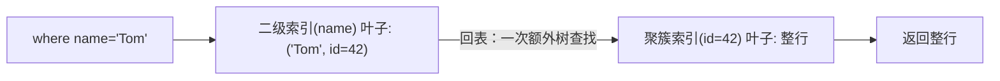

**代价**：回表是一次**额外的 B+ 树下降**（可能是一次随机 IO，因为主键 42 所在页可能与当前页不相邻）。**大量回表 = 大量随机 IO**。

**覆盖索引（covering index）**：若 `SELECT` 的列**全部包含在索引里**，就**不需要回表**（`EXPLAIN` 显示 `Using index`）。

```sql
-- 索引 (name, age)
SELECT name, age FROM t WHERE name = 'Tom';   -- 覆盖索引，不回表
SELECT * FROM t WHERE name = 'Tom';           -- 需要回表
```

**延伸（面试常追问）**：
1. **"为什么二级索引不直接存整行？"** → 若存整行，每个二级索引都要备份一份数据（空间 ×N），且**更新一行要维护所有索引的数据副本**，写放大严重。
2. **"为什么 InnoDB 必须有主键？"** → 聚簇索引就是"表本身"，没有主键就无法组织数据；且二级索引需要存主键值。
3. **"MyISAM 呢？"** → **非聚簇索引**：索引和数据分离，叶子存"行地址（offset）"，**所有索引地位平等**，查询都要"索引 → 地址 → 读数据"。所以 MyISAM 的主键索引不比二级索引快。

---

#### 题 6-4：最左前缀原则的原理？为什么 `a=? and c=?` 用不到 c？`★★★`

**来源**：阿里 / 美团（SQL 优化必考）。

**解答**：

**原理：联合索引 `(a, b, c)` 的 B+ 树是"按 a 排序，a 相同按 b 排序，b 相同按 c 排序"**。

- **`where a=?`** ✅：a 在全局有序，能定位到一个连续区间。
- **`where a=? and b=?`** ✅：a 确定后，b 在该 a 的区间内有序，能进一步定位。
- **`where b=?`** ❌：b 只在"同一 a"内有序，跨 a 是乱的 → 无法定位区间，**只能全表扫**（或用 `index skip scan`，MySQL 8.0 有但收益有限）。
- **`where a=? and c=?`** ⚠️：**只能用到 a**。因为 a 确定后，c 在"同一 a 内"并不连续——中间隔着 b，不同 b 值的 c 交替出现 → 无法定位 c 的连续区间。
  - 但 **MySQL 5.6+ 有索引下推（ICP，Index Condition Pushdown）**：在**索引层**就过滤 c，**减少回表次数**。→ `EXPLAIN` 的 `Extra` 会显示 `Using index condition`。
  - **注意：ICP 是"减少回表"，不是"让 c 参与定位"，它仍需扫完 a 区间内所有索引项。**

**范围查询会"截断"后续列**：

```sql
-- 索引 (a, b)
where a > 10 and b = 5    -- b 无法定位！
```
因为 `a > 10` 是范围，会跨越多个 a 值，而 **b 只在单个 a 内有序**，跨 a 就乱了 → 只能对每个 a 值分别扫 b。

**口诀**："**等值在前、范围在后；一旦范围，后面全废（定位层面）**"。

**延伸**：
- **`order by` 也能用索引**：若 `order by a, b` 且索引是 `(a,b)`，可直接顺序读索引（免排序）；若 `order by b, a` 则不行（除非索引是 `(b,a)`）。
- **`distinct`、`group by`** 同理，可利用索引的天然有序性避免临时表。
- **索引列顺序怎么定？** → ① 等值查询多的列在前；② 区分度（基数）高的列在前（但也要结合查询模式，不能只看基数）；③ 范围列尽量放最后。

---

#### 题 6-5：为什么 MySQL 单表建议控制在千万级？`★★☆`

**来源**：阿里（DBA/架构方向）。

**解答**：

**核心原因：B+ 树层数 = IO 次数。**
- 3 层 ≈ **2000 万行**（假设 1KB/行）。**超过这个量，树就变成 4 层**，每次查询多一次 IO（+100 μs，即延迟翻倍以上）。
- 更关键的是**"根页常驻 buffer pool"**：3 层时 1 次 IO（根+中间层都在内存）→ 4 层时 2 次 IO。

**其他原因**：
- **DDL 代价**：加索引/改表结构要重建整表，千万级以上的 `ALTER TABLE` 可能锁表数小时。
- **备份/恢复时间**：单表越大，`mysqldump`/物理备份越慢，RTO 变长。
- **buffer pool 命中率**：单表太大时，热数据与冷数据争抢 buffer pool，命中率下降。
- **复制延迟**：大表上的批量操作会产生巨大 binlog，从库回放慢。

**反例（什么时候可以超千万）**：
- 行很短（如 100B → 3 层可存 2 亿）；
- 主键短（int 而非 bigint，扇出更大）；
- 查询几乎都是"按主键/覆盖索引"（不回表、不扫大范围）。

**解法（而不是"必须分表"）**：
1. **分区表**（按时间 RANGE 分区）—— 减少单次扫描范围，但**分区键选择错误会导致跨分区查询更慢**。
2. **冷热分离**：历史数据归档到 OLAP/对象存储。
3. **分库分表**（ShardingSphere、MyCat）—— 最后手段，会带来分布式事务、跨片 Join、全局排序等问题。

---

### 13.7 堆（Heap）

#### 题 7-1：建堆为什么是 O(n)？`★★☆`

**来源**：字节 / 腾讯（考"是否只会背结论"）。

**解答**（两种证明，见 8.4 节）：

**① 按层求和**：
自底向上建堆，从 `n/2-1` 开始对每个节点 `siftDown`。高度 h 的节点数 ≤ `n/2^(h+1)`，其下沉代价 O(h)：

```
总代价 = Σ_{h=0}^{⌊log n⌋} (n / 2^(h+1)) · O(h) = O(n · Σ h/2^h) = O(n)
```
因为 `Σ_{h≥0} h/2^h = 2`（收敛常数）。

**直觉**："**绝大多数节点在底层，而底层节点几乎不用下沉**。真正"贵"的高节点数量极少。"

**② 对比错误做法**：n 次插入（每次 `siftUp` O(log n)）= **O(n log n)**。**关键区别：上浮是"从底往上"，每个叶子都要走满树高；下沉是"从上往下"，越往下节点越多但下沉越短。**

**追问：*"建堆后数组是排好序的吗？"***
→ **不是**。堆只保证"父 ≥ 子"，层序数组**不是有序序列**。堆排序需要 n 次"取堆顶 + 下沉"。

---

#### 题 7-2：海量数据 TopK（1 亿个数取最大 100 个）`★★★`

**来源**：字节 / 阿里 / 美团（分治 + 堆的经典组合题）。

**解答**：

**单机内存够（1 亿 int = 400MB）**：

```java
// 取最大 100 个 → 用「小顶堆」，容量 100
PriorityQueue<Integer> heap = new PriorityQueue<>(100);   // 默认小顶堆
for (int x : nums) {
    if (heap.size() < 100) heap.offer(x);
    else if (x > heap.peek()) { heap.poll(); heap.offer(x); }   // 比最差的强，替换
}
// heap 里就是最大 100 个
```

**关键点（最常被记反）**：**取"最大 K 个"要用"小顶堆"**。因为堆顶是"当前 K 个里最差的那个"，新元素只有比它强才值得替换。**取最小 K 个则用大顶堆。**

**复杂度**：时间 `O(n log K)`，空间 `O(K)`。优于"全排序 O(n log n)"，也优于"快排 partition O(n)"（后者的最坏 O(n²)，且内存放不下时要多次 IO）。

**内存不够（分治 + 归并）**：
1. **按 hash/范围把 1 亿个数分成 100 个文件**（保证同一元素只在一个文件）。
2. 每个文件独立求 Top100（小顶堆）。
3. **归并 100 个"Top100"** → 再取全局 Top100（用堆或直接排序 1 万个数）。

**追问：*"为什么不用快排的 partition？"***
→ ① `partition` 要**多次随机访问**，数据在磁盘时要反复 IO；② 最坏 O(n²)（如已排序数据）；③ 划分后仍需处理两半。**堆是"一次扫描 + O(K) 空间"，最适合流式/海量场景。**

**追问：*"如果数据是流式的、K 会变？"*** → 用**平衡树/跳表 + 计数**，或 **Count-Min Sketch + 堆**（近似 TopK，如 Caffeine 的 W-TinyLFU）。

---

#### 题 7-3：数据流中位数（两个堆）`★★★`

**来源**：字节 / 腾讯 / 快手（高频手撕）。

**解答**：

**结构**：`maxHeap` 存**较小的一半**（堆顶是这半的最大值），`minHeap` 存**较大的一半**（堆顶是这半的最小值）。**保持 `maxHeap.size() - minHeap.size() ∈ {0, 1}`**。

```java
PriorityQueue<Integer> maxH = new PriorityQueue<>((a,b) -> b - a);  // 大顶堆
PriorityQueue<Integer> minH = new PriorityQueue<>();                 // 小顶堆

void add(int x) {
    if (maxH.isEmpty() || x <= maxH.peek()) maxH.offer(x);
    else minH.offer(x);
    // 平衡：谁多了就往对方挪
    if (maxH.size() > minH.size() + 1) minH.offer(maxH.poll());
    else if (minH.size() > maxH.size()) maxH.offer(minH.poll());
}
double median() {
    if (maxH.size() == minH.size()) return (maxH.peek() + minH.peek()) / 2.0;
    return maxH.peek();
}
```

**为什么这样对**：中位数 = "排序后中间位置"。大顶堆的堆顶是"前一半的最大"，小顶堆的堆顶是"后一半的最小"，二者的交界正好是中位数。

**复杂度**：`add` O(log n)，`median` O(1)。

**追问：*"如果要求 O(1) 插入？"*** → 用**分桶/位图**（值域有限时）或 **有序数组 + 二分插入 O(n)**（插入慢但查询快）。**没有结构能同时 O(1) 插入 + O(1) 中位数**（除非值域极小）。

**追问：*"滑动窗口中位数？"*** → 需要**支持删除的堆**（lazy deletion：堆里存值 + 哈希表计数，弹出时检查是否已失效）或**双平衡树/跳表**（O(log n) 删任意元素）。**这是"堆不能任意删除"这一局限的直接体现。**

---

#### 题 7-4：定时器怎么设计？堆 vs 时间轮 `★★★`

**来源**：腾讯 / 字节（中间件/框架方向，Netty/Kafka 相关）。

**解答**：

**方案 A：最小堆（按到期时间）**
- `add` O(log n)，取最近到期 O(1)，`tick` 时反复检查堆顶是否到期。
- 缺点：**大量定时器 + 频繁取消**时，`remove` 需要先 O(n) 找到（除非维护索引）；且每次 tick 要检查堆顶，**空转开销**。

**方案 B：时间轮（Time Wheel）**
- 把时间分成 N 个槽（如 512），每个槽挂一个链表；指针每秒走一格，走到哪个槽就执行该槽所有任务。
- `add` **O(1)**（算槽位 + 挂链），`cancel` **O(1)**（从链表摘除）。
- 多级时间轮（时/分/秒）解决"跨度大"的问题（类似钟表）。
- **Netty `HashedWheelTimer`、Kafka 的 `TimingWheel`、Linux 内核 timer wheel** 都用它。

**选型判据（面试话术）**：
| 场景 | 选择 |
|---|---|
| 定时器数量少（< 1 万）、需要精确排序、偶尔取消 | **最小堆**（`ScheduledThreadPoolExecutor` 的 `DelayedWorkQueue`） |
| 数量巨大（十万+）、精度要求不苛刻、频繁增删 | **时间轮** |
| 需要"按时间范围批量触发" | 时间轮（堆做不到 O(1) 批量） |

**追问：*"Java 的 ScheduledThreadPoolExecutor 为什么用堆不用时间轮？"***
→ 定时任务数量通常不大（线程池的调度任务），且需要**精确的到期顺序**与"取消"（`Future.cancel` 用 `remove` + 堆索引）。**时间轮的精度受槽粒度限制**（Netty 默认 100ms），不适合精确调度。

> **延伸（很加分）**：`DelayedWorkQueue` 里每个 `ScheduledFutureTask` 有 `heapIndex`，所以 `remove` 是 O(log n) 而不是 O(n)——**这正是"可删除堆（带索引）"的实现**，与题 7-3 的滑动窗口中位数思路一致。

---

#### 题 7-5：堆排序为什么工程上不用？`★★☆`

**来源**：字节（算法基础）。

**解答**：

**理论**：建堆 O(n) + n 次"取顶下沉" O(n log n)，**原地、最坏 O(n log n)**（比快排的最坏 O(n²) 好）。

**为什么工程不用**：
1. **cache 不友好**：`siftDown` 每次从 `i` 跳到 `2i+1`，**跨层跳跃**，地址不连续 → 每次比较都可能 cache miss。快排是"顺序扫描 + 局部划分"，局部性好得多。
2. **常数大**：每次取顶要 `swap(0, n-1)` 再下沉，写操作多。
3. **不稳定**：交换会打乱相等元素的相对顺序。
4. **无法利用"数据基本有序"**：快排/插入排序在近乎有序的数据上极快（接近 O(n)），堆排序**始终 O(n log n)**。

**工程实践**：`std::sort` 用 **Introsort（快排 + 堆排 + 插入排序）**——快排为主，递归过深时切堆排（保证 O(n log n) 最坏），小数组切插入排序（常数小）。**堆排是"兜底"，不是主力。**

---

### 13.8 图与并查集

#### 题 8-1：岛屿数量 / 朋友圈（DFS/BFS/并查集三解）`★★★`

**来源**：字节 / 阿里 手撕常客（LC 200、547）。

**解答（三种解法都要能写，并说清差异）**：

**① DFS 染色（最简）**

```java
int numIslands(char[][] g) {
    int cnt = 0;
    for (int i = 0; i < g.length; i++)
        for (int j = 0; j < g[0].length; j++)
            if (g[i][j] == '1') { cnt++; dfs(g, i, j); }
    return cnt;
}
void dfs(char[][] g, int i, int j) {
    if (i < 0 || i >= g.length || j < 0 || j >= g[0].length || g[i][j] != '1') return;
    g[i][j] = '0';                      // 原地标记（省 visited 数组）
    dfs(g, i+1, j); dfs(g, i-1, j); dfs(g, i, j+1); dfs(g, i, j-1);
}
```

**风险**：递归深度 = 岛屿大小，**大岛屿会栈溢出** → 生产代码要用**显式栈/队列**（BFS）。

**② BFS**：把 DFS 换成队列，无栈溢出风险，但需要 `O(min(m,n))` 的队列空间。

**③ 并查集**：把每个 `'1'` 与右/下邻居 `union`，最后统计"根节点数"（`find(i)==i` 的个数）。

**三解对比（面试话术）**：

| 解法 | 时间 | 空间 | 优点 | 缺点 |
|---|---|---|---|---|
| DFS | O(mn) | O(mn) 最坏栈 | 代码最短 | 栈溢出风险 |
| BFS | O(mn) | O(min(m,n)) | 无栈溢出 | 队列开销 |
| 并查集 | O(mn α) | O(mn) | **适合"动态加边"**（如"加一个点后岛数变多少"） | 常数大、需额外数组 |

**关键延伸**：**"如果图是动态的（不断有新的陆地出现），用哪个？"** → **并查集**（DFS/BFS 每次都要重扫全图，并查集只需 union 新点与邻居，O(α)）。

**追问（LC 130 被围绕的区域）**：从**边界**上的 O 出发 DFS，标记为"安全"，剩下的 O 全部翻成 X。**这是"反向思维"的经典技巧**（从边界找"逃出去"的区域，而不是判断每个区域是否被围）。

---

#### 题 8-2：拓扑排序（课程表 / 任务调度）`★★★`

**来源**：字节 / 美团 / 快手。

**解答（Kahn 算法，BFS）**：

```java
boolean canFinish(int n, int[][] pre) {
    List<List<Integer>> adj = new ArrayList<>();
    for (int i = 0; i < n; i++) adj.add(new ArrayList<>());
    int[] indeg = new int[n];
    for (int[] p : pre) { adj.get(p[1]).add(p[0]); indeg[p[0]]++; }  // p[1] → p[0]
    Deque<Integer> q = new ArrayDeque<>();
    for (int i = 0; i < n; i++) if (indeg[i] == 0) q.add(i);
    int done = 0;
    while (!q.isEmpty()) {
        int u = q.poll(); done++;
        for (int v : adj.get(u)) if (--indeg[v] == 0) q.add(v);
    }
    return done == n;          // 有环则 done < n
}
```

**为什么能判环**：**环上的节点入度永远无法减到 0**（每个节点都被环内另一个节点指着），所以永远进不了队列 → 最终 `done < n`。

**DFS 版判环（三色标记）**：白（未访问）/ 灰（在栈上）/ 黑（已完成）。遇到"灰"→ **有环**。**比 Kahn 更适合"求具体环"**。

**延伸**：
- **求拓扑序（LC 210）**：Kahn 的 `done` 顺序就是拓扑序。
- **字典序最小的拓扑序**：把队列换成**优先队列（小顶堆）**。
- **应用**：Maven/Gradle 构建顺序、K8s 资源依赖、数据库迁移脚本、编译器的头文件依赖、AOV 网。

---

#### 题 8-3：并查集实现 + 路径压缩 + 按秩合并 `★★☆`

**来源**：腾讯 / 华为（手撕模板题）。

**解答**（见 10.5 节的完整代码）。

**必须能说清的三件事**：

**① 路径压缩的两种写法**
- 递归：`parent[x] = find(parent[x])`——极简，但**深度大时会有栈溢出风险**（虽然压缩后深度很快变 1）。
- 迭代（两趟）：先找根，再压缩整条路径。

**② 按秩合并为什么必要**
- 只压缩不按秩：`union` 时若总把 a 挂到 b 下，可能形成长链（最坏 O(n)）。
- **按秩/按大小**：把矮树挂到高树下，树高保持 O(log n)。
- **两者结合**：摊还 `O(α(n))`，α(n) < 5。

**③ 为什么 α(n) 是"最优"**
- Tarjan 证明了：**在"只能比较"的模型下，任何并查集算法的摊还复杂度下界就是 α(n)**。所以并查集是"理论上已最优"的结构之一。

**延伸**：
- **带权并查集**：维护"到根的距离/关系"（如"食物链"LC 543 的三种关系、等式传递 `a/b=2` LC 399）。**`find` 时要同时更新权值**，这是最难写对的变体。
- **可撤销并查集**：不能路径压缩（会破坏历史），只能用按秩合并 + 记录操作栈（回滚）。
- **持久化并查集**：用可持久化数组（主席树）保存每个版本。

---

#### 题 8-4：Dijkstra 为什么不能处理负权边？`★★☆`

**来源**：字节 / 腾讯。

**解答**（见 10.4 节）：

**核心**：Dijkstra 的贪心正确性依赖"**已出堆的节点距离已确定，不会再变小**"。这要求"任何路径延长都不会让总长变短"，即所有边权 ≥ 0。

**反例**：`s→a: 1`, `s→b: 2`, `b→a: −2`。
- 初始 `dist[a]=1, dist[b]=2`，堆弹 `a`（1）并标记确定；
- 之后处理 `b→a` 时算出 `dist[a]=0 < 1`，但 `a` 已"确定" → **算法不会更新，结果错误**。

**解法**：
- **Bellman-Ford**（O(ne)，可处理负权，还能检测负环：第 n 轮仍能松弛则有负环）；
- **SPFA**（队列优化，平均快但最坏 O(ne)，可被网格图卡死）；
- **Johnson 算法**：用 Bellman-Ford 算"势能" h(v)，把边权重加权为 `w'(u,v) = w(u,v) + h(u) − h(v) ≥ 0`，再对每个源跑 Dijkstra。**这是"负权图的多源最短路"的标准解法。**

**延伸**：**"为什么 Dijkstra + 斐波那契堆是 O(e + n log n)？"** → `decrease-key` 摊还 O(1)，每个节点出堆一次 O(log n)，每条边 relaxation 一次 O(1)。**但斐波那契堆常数极大，实际不如二叉堆**（这是"理论最优 ≠ 实践最优"的经典例子）。

---

#### 题 8-5：最小生成树（Prim vs Kruskal）`★★☆`

**来源**：美团 / 华为。

**解答**：

| | Prim | Kruskal |
|---|---|---|
| 思路 | 从一个点开始，每次加"连接树与外部的最短边" | 按边权排序，用并查集判环，能连就加 |
| 结构 | **堆**（取最小边） | **并查集 + 排序** |
| 复杂度 | 二叉堆 O(e log n)，斐波那契堆 O(e + n log n) | O(e log e)（排序主导） |
| 适合 | **稠密图**（e ≈ n²） | **稀疏图**（e ≈ n） |

**两者都正确（MST 的 cut property）**：对任意"割"，横跨割的最小边必在 MST 中。Prim 和 Kruskal 都是这条性质的贪心实现。

**延伸**：**"MST 唯一吗？"** → 边权**互不相同**时唯一；有相等边权时可能有多棵。

---

### 13.9 Trie 与字符串结构

#### 题 9-1：实现 Trie（前缀树），并分析空间 `★★☆`

**来源**：字节 / 腾讯（手撕 + 追问空间优化）。

```java
class Trie {
    class Node { Node[] ch = new Node[26]; boolean end; }
    Node root = new Node();
    void insert(String s) {
        Node p = root;
        for (char c : s.toCharArray()) {
            int i = c - 'a';
            if (p.ch[i] == null) p.ch[i] = new Node();
            p = p.ch[i];
        }
        p.end = true;
    }
    boolean search(String s) {
        Node p = walk(s); return p != null && p.end;
    }
    boolean startsWith(String s) { return walk(s) != null; }
    private Node walk(String s) {
        Node p = root;
        for (char c : s.toCharArray()) {
            if ((p = p.ch[c - 'a']) == null) return null;   // 注意：先赋值再判空
        }
        return p;
    }
}
```

**空间分析（面试追问重点）**：26 个引用 = `26 × 8B = 208B`/节点（还未算对象头 16B）。1 万个单词、平均 10 字符 → 10 万节点 → **约 20 MB**。**这是"用空间换 O(L) 查找"的极端案例。**

**三种优化（能说出来就是加分）**：
1. **`HashMap<Character, Node>`**：适合字符集大（中文/Unicode），但**每个节点一个 HashMap 对象**，开销也不小。
2. **压缩字典树（Radix Tree / Patricia Trie）**：把"单孩子链"合并成一条边。**Linux 路由表、Redis rax** 都用它。
3. **双数组 Trie（Double-Array Trie）**：用 `base[]` + `check[]` 两个整型数组表示状态转移，**内存紧凑、查询快**，是中文分词器（jieba、HanLP）和搜索引擎词典的标准实现。
4. **`isEnd` 用位标记**：把 `end` 塞进 `ch[]` 的某个位里（如用 `null` 判断），省一个 boolean（对齐开销可能反而更大，需实测）。

**延伸**：**"Trie 上求最大异或对（LC 421）"** → 把每个数按二进制位建 Trie（31→0），查询时**贪心走相反位**（能取反就取反），O(31n)。这是"用 Trie 做位运算"的经典。

---

#### 题 9-2：敏感词过滤为什么用 Trie/DFA 而不是 `String.contains`？`★★☆`

**来源**：腾讯 / 字节（内容安全方向）。

**解答**：

**`contains` 的问题**：m 个敏感词、文本长 n、词长 L → 每个词做一次 KMP 是 `O(n + L)`，总 `O(m(n+L))`。**词库 10 万条时完全不可行**。

**Trie/DFA**：把**所有词建一棵 Trie**，文本从头扫一遍，每个位置沿 Trie 走；失配就回退。**复杂度 O(n × 最长词长)**，**与词库大小无关**。加上 **AC 自动机的 fail 指针**，可做到 **O(n + 匹配数)**。

**工程实现（这才是完整答案）**：
1. **DFA 最小化**：把 Trie 转成状态机，合并等价状态，进一步压缩。
2. **首字符哈希 + Trie**：先用"首字符"快速过滤（文本里 90% 的字符不是任何敏感词的首字）。
3. **变体处理**：跳过空格/标点/全半角/大小写/繁简/拼音/火星文（谐音）→ 需要**归一化层**。
4. **AC 自动机 + 输出链**：每个节点存"以该节点结尾的所有词"，通过 fail 链**继承**后缀的匹配（`output[u] |= output[fail[u]]`）。

---

### 13.10 综合与场景设计题（区分度最高）

#### 题 10-1：设计一个"排行榜"（Redis ZSET 底层为什么是跳表？）`★★★`

**来源**：腾讯 / 字节 / 阿里（场景设计 + 结构选型的复合题）。

**需求**：按 score 排序、取 Top N、查某个用户排名、按分数区间查、实时更新。

**为什么不用 HashMap**：无序，取 Top N 要全排序 O(n log n)。

**为什么不用红黑树**：能 O(log n) 有序，但 ① 范围查询要中序后继，节点分散、cache 差；② **排名（rank）需要每个节点存 `size` 字段并维护**，实现复杂；③ 并发加锁难（旋转影响面大）。

**为什么用跳表**：① **范围查询天然**（找到起点后沿 level 0 顺序扫，**内存连续性好于树**）；② **排名**：每个节点存 `span`（到下一节点的跨度），`ZRANK` 沿途累加 span，**O(log n)**；③ 实现简单、无旋转；④ 并发易加锁。

**Redis ZSET 的双结构**：`dict`（member → score，O(1) 查分数）+ `zskiplist`（按 score 有序 + span 支持排名）。**"哈希负责点查，跳表负责范围与排名"——和 LRU 的"哈希 + 链表"是同一个思想。**

**追问：*"score 相同怎么排序？"*** → 按 **member 字典序**（Redis 用 `sdscmp`），保证**全序**（否则排名不稳定）。

**追问：*"如何做"分页取第 100–200 名"？"*** → `ZREVRANGE key 99 199`，跳表 O(log n + 100)。**这也是跳表 span 的用武之地**（若用红黑树，需要额外维护子树大小）。

---

#### 题 10-2：设计一个"短链接"（发号器 + 冲突）`★★☆`

**来源**：字节 / 腾讯（系统设计入门题）。

**解答要点（数据结构相关的部分）**：

- **发号**：`Redis INCR` / 雪花算法（Snowflake：时间戳 + 机器 ID + 序列号）→ **全局唯一、趋势递增**。
- **编码**：10 进制 → 62 进制（`0-9a-zA-Z`），7 位可表示 **62^7 ≈ 3.5 万亿**。
- **冲突/去重**：`HashMap<长链, 短码>`（内存）+ DB 唯一索引（持久化）。
- **为什么不用"随机生成 + 查表判重"**：随机碰撞概率随存量上升（生日悖论），高并发下要多次重试。**发号器（自增）无冲突**，是主流方案。
- **跳转**：`302` 重定向（`301` 会被浏览器永久缓存，无法统计点击）。

---

#### 题 10-3：设计 LRU / LFU / 2Q / TinyLFU，并比较命中率 `★★☆`

**来源**：字节 / 阿里（缓存方向，P7+ 常问）。

**解答**：

| 策略 | 结构 | 缺点 | 改进 |
|---|---|---|---|
| **LRU** | 哈希 + 双向链表 | **一次全表扫描会污染缓存**（把热数据挤光） | — |
| **LFU** | 哈希 + 频率计数 + **频率桶（按频率分组的双向链表）** | ① 新数据"频率低"长期进不来（**缓存污染的另一面**）；② 频率只增不减，**过时热点占坑** | **LFU-Aging**：定期衰减频率；**新数据给初始频率**（如 1 或平均值） |
| **LRU-K** | 记录最近 K 次访问时间，第 K 次才算"热" | 内存大（要存 K 个时间戳） | 近似：2Q |
| **2Q** | `A1`（FIFO 准入队列）+ `Am`（LRU 主队列）+ `A1out`（淘汰历史） | 参数需调 | — |
| **TinyLFU** | **Count-Min Sketch**（频率草图）+ **窗口 LRU** + **SLRU**（分段 LRU） | 实现复杂 | **Caffeine 的实现**，命中率通常最优 |

**O(1) LFU 的关键设计（很加分）**：维护 `freq` 从小到大排列的**双向链表组**（每个频率一个链表），节点记录自己所在频率；访问时把节点从 `freq` 移到 `freq+1` 链表头部。**取最小频率 = 链表组头**，O(1)。这就是 Redis 的 `LFU` 近似实现（用 8 位计数器 + 概率递增，省内存）。

**结论话术**："**LRU 假设'最近用过的还会用'，LFU 假设'用得多的更可能再用'。真实负载往往'既有热点又有扫描'，所以 Caffeine 用 W-TinyLFU（窗口 LRU 抗突发 + 频率草图抗扫描）。**"

---

#### 题 10-4：设计一个"点赞/热搜"的 TopK 实时统计 `★★☆`

**来源**：字节 / 微博 / 快手（大数据 + 数据结构结合）。

**解答（分层设计）**：

1. **计数层**：`Count-Min Sketch`（概率计数，O(1) 更新、固定内存）或 `Redis HINCRBY`（精确但内存大）。
2. **TopK 层**：**小顶堆**（内存中维护 K 个候选）+ **定期快照**（避免每次查询都重算）。
3. **滑动窗口**：按时间分片（如每分钟一个桶），**查询最近 1 小时 = 合并 60 个桶**（滑动窗口的"分桶"实现），过期桶整体丢弃。
4. **去重/防刷**：`Bitmap/Bloom` 做用户级去重。

**为什么"分桶"比"精确滑动窗口"好**：精确的滑动窗口需要记录每个事件的时间戳（内存爆炸），分桶只需 O(桶数) 的计数器，**误差可控（最多一个桶的边界误差）**。

---

### 13.11 高频手撕题速查清单（按数据结构 · 按难度）

> 说明：标 ⭐ 的为"出现率极高，建议默写"，标 🔁 的为"同一模板的变体"。

**数组类**

| 题 | 编号 | 核心技巧 | 难度 |
|---|---|---|---|
| 三数之和 ⭐ | LC 15 | 排序 + 双指针 + 去重 | 中 |
| 盛最多水的容器 ⭐ | LC 11 | 双指针（移动短板） | 中 |
| 最长连续序列 🔁 | LC 128 | 哈希集合 + 只从"序列起点"扩展 | 中 |
| 旋转数组 / 原地去重 🔁 | LC 189/26 | 三步反转 / 快慢指针 | 中 |
| 螺旋矩阵 | LC 54 | 四边界收缩 | 中 |
| 下一个排列 | LC 31 | 找"峰前" + 交换 + 反转后缀 | 中 |
| 颜色分类（三路快排） | LC 75 | 荷兰国旗三指针 | 中 |

**链表类（面试出现率最高的一组）**

| 题 | 编号 | 核心技巧 | 难度 |
|---|---|---|---|
| 反转链表 ⭐ | LC 206 | 三指针 | 易 |
| K 个一组翻转 ⭐ | LC 25 | dummy + 分段反转 | 难 |
| 环形链表 II ⭐ | LC 142 | 快慢指针 + 数学推导 | 中 |
| 合并两个有序链表 ⭐ | LC 21 | dummy + 归并 | 易 |
| 合并 K 个有序链表 🔁 | LC 23 | 优先队列（小顶堆） | 难 |
| 排序链表 ⭐ | LC 148 | 归并（自顶/自底） | 中 |
| LRU Cache ⭐ | LC 146 | 哈希 + 双向链表 | 中 |
| 相交链表 | LC 160 | 双指针"走对方的路" | 易 |
| 回文链表 | LC 234 | 找中点 + 反转后半 | 易 |
| 重排链表 | LC 143 | 中点 + 反转 + 合并 | 中 |
| 复制带随机指针的链表 | LC 138 | 哈希 / 原地"织入-拆开" | 中 |

**栈/队列类**

| 题 | 编号 | 核心技巧 | 难度 |
|---|---|---|---|
| 有效括号 ⭐ | LC 20 | 栈 | 易 |
| 最小栈 ⭐ | LC 155 | 辅助栈 / 差值编码 | 易 |
| 接雨水 ⭐ | LC 42 | 单调栈 / 双指针 / DP | 难 |
| 柱状图最大矩形 ⭐ | LC 84 | 单调栈 + 哨兵 | 难 |
| 滑动窗口最大值 ⭐ | LC 239 | 单调队列 | 难 |
| 每日温度 | LC 739 | 单调栈 | 中 |
| 逆波兰表达式 | LC 150 | 栈求值 | 中 |
| 两个栈实现队列 | 剑指 09 | 摊还分析 | 易 |

**哈希/设计类**

| 题 | 编号 | 核心技巧 | 难度 |
|---|---|---|---|
| 两数之和 ⭐ | LC 1 | 哈希（边查边存） | 易 |
| 字母异位词分组 | LC 49 | 哈希键（排序/计数编码） | 中 |
| 最长无重复子串 ⭐ | LC 3 | 滑动窗口 + 哈希（记位置） | 中 |
| 手写 HashMap | — | 数组 + 链表 + 扩容 | 高 |
| 设计 LFU | LC 460 | 频率桶双向链表 | 高 |
| 设计推特（合并时间线） | LC 355 | 哈希 + 堆/链表归并 | 中 |

**树类**

| 题 | 编号 | 核心技巧 | 难度 |
|---|---|---|---|
| 层序遍历 ⭐ | LC 102 | BFS + size 快照 | 中 |
| 验证 BST ⭐ | LC 98 | 上下界 / 中序 | 中 |
| 最近公共祖先 ⭐ | LC 236 | 后序遍历 | 中 |
| 二叉树最大路径和 | LC 124 | 后序 + 全局最优 | 难 |
| 从前序+中序构造 | LC 105 | 分治 + 索引映射 | 中 |
| 路径总和 II | LC 113 | 回溯 | 中 |
| 二叉树的直径 | LC 543 | 后序求深度 | 易 |
| 对称二叉树 | LC 101 | 双指针递归 | 易 |
| 序列化/反序列化 ⭐ | LC 297 | 前序 + 空标记 | 难 |

**堆类**

| 题 | 编号 | 核心技巧 | 难度 |
|---|---|---|---|
| 数组第 K 大 ⭐ | LC 215 | 堆 / 快排 partition | 中 |
| 数据流中位数 ⭐ | LC 295 | 双堆 | 难 |
| 合并 K 个链表 | LC 23 | 小顶堆 | 难 |
| 前 K 个高频元素 | LC 347 | 哈希计数 + 堆 / 桶排序 | 中 |
| 任务调度器 | LC 621 | 贪心 + 计数 | 中 |

**图/并查集类**

| 题 | 编号 | 核心技巧 | 难度 |
|---|---|---|---|
| 岛屿数量 ⭐ | LC 200 | DFS/BFS/并查集 | 中 |
| 课程表 ⭐ | LC 207 | 拓扑排序（判环） | 中 |
| 单词接龙 | LC 127 | BFS + 预处理 | 难 |
| 冗余连接 | LC 684 | 并查集判环 | 中 |
| 朋友圈 | LC 547 | 并查集 / DFS | 中 |
| 除法求值 | LC 399 | **带权并查集 / 图 DFS** | 难 |

**Trie/字符串类**

| 题 | 编号 | 核心技巧 | 难度 |
|---|---|---|---|
| 实现 Trie ⭐ | LC 208 | 26 叉数组 | 中 |
| 单词搜索 II | LC 212 | Trie + 回溯 + 剪枝 | 难 |
| 最大异或对 | LC 421 | 二进制 Trie + 贪心 | 中 |

---

## 附录 A 复杂度速查与"感知数量级"

### A.1 同复杂度下的真实耗时（现代 CPU，量级）

| n | O(log n) | O(n) | O(n log n) | O(n²) | O(2ⁿ) |
|---|---|---|---|---|---|
| 10 | 3 | 10 | 33 | 100 | 1024 |
| 100 | 7 | 100 | 664 | 1 万 | 不可行 |
| 1 千 | 10 | 1 千 | 1 万 | 100 万 | — |
| 1 万 | 13 | 1 万 | 13 万 | **1 亿（~1s）** | — |
| 10 万 | 17 | 10 万 | 170 万 | **100 亿（不可行）** | — |
| 100 万 | 20 | 100 万 | 2000 万 | — | — |
| 1 亿 | 27 | 1 亿（**~0.1–1s**） | 27 亿（**~30s**） | — | — |

**经验值（单机、现代 CPU、内存中）**：
- 简单操作（加/比较/赋值）≈ **10⁸–10⁹ 次/秒**（顺序访问、cache 命中）
- 随机内存访问 ≈ **10⁷ 次/秒**（每次 ~100ns）
- 磁盘随机 IO ≈ **10⁴ 次/秒**（SSD）/ **500 次/秒**（HDD）

**由此推出的"编程竞赛/工程经验法则"**：
- n ≤ 20 → 可以 2ⁿ（打表/状压）
- n ≤ 1000 → O(n³) 勉强（10⁹ 次太多，O(n²) 稳）
- n ≤ 10⁵ → 必须 O(n log n) 或 O(n)
- n ≥ 10⁷ → 只能 O(n)，且要**顺序访问**

### A.2 各语言常用结构的底层实现对照

| 结构 | Java | C++ | Go | Python | Rust |
|---|---|---|---|---|---|
| 动态数组 | `ArrayList` | `vector` | `slice` | `list`（非数组！） | `Vec` |
| 链表 | `LinkedList`（双向） | `list`（双向） | `container/list` | 无内置 | `LinkedList` |
| 哈希表 | `HashMap`（链+树） | `unordered_map`（链） | `map`（开放寻址桶） | `dict`（开放寻址+紧凑） | `HashMap`（hashbrown） |
| 有序表 | `TreeMap`（红黑树） | `map`（红黑树） | 无（需三方） | 无 | `BTreeMap`（B 树！） |
| 堆 | `PriorityQueue` | `priority_queue` | `container/heap` | `heapq` | `BinaryHeap` |
| 双端队列 | `ArrayDeque`（循环数组） | `deque`（分段块） | 无 | `collections.deque`（分块） | `VecDeque`（环形） |
| 并发有序 Map | `ConcurrentSkipListMap` | — | — | — | — |

> **注意几个反直觉点**：
> - Python 的 `list` 是**动态数组**（不是链表）；`dict` 是**开放寻址 + 紧凑布局**（3.6+ 内存优化后非常省）。
> - Rust 的 `BTreeMap` 用 **B 树**（不是红黑树）—— 因为 B 树分支多、cache 更友好，**现代 CPU 上比红黑树快**。
> - Java 的 `ArrayDeque` 是**循环数组**，官方文档明确说"用作栈/队列时比 `LinkedList` 快"。

---

## 附录 B 面试临场答题框架

### B.1 "讲讲 XX 的底层"类问题：四层递进法

```
第 1 层：一句话定性          → "HashMap 是数组+链表+红黑树，用哈希做 O(1) 定位"
第 2 层：结构与不变量        → 桶数组、Node/TreeNode、装载因子、树化阈值
第 3 层：一次操作的全过程    → put 的 6 步（hash → 定位 → 插入 → 树化 → 扩容）
第 4 层：设计权衡与失效边界  → 为什么 2 的幂、为什么 8/6、为什么线程不安全
```

**判分逻辑**：第 1 层答对 = 及格；第 2 层 = 良好；第 3 层 = 优秀；第 4 层 = 有亮点。

### B.2 "为什么用 A 不用 B"类问题：三维对比法

```
维度 1：操作集合     → 需要哪些操作？范围查询？排名？删除任意元素？
维度 2：代价结构     → 时间（含常数/cache）、空间、最坏 vs 期望
维度 3：工程约束     → 数据在内存还是磁盘？并发？实现复杂度？可预测延迟？
```

**示例（MySQL 为什么 B+ 树）**：
- 操作集合：等值 + 范围 + 排序 + 最左前缀 → 排除哈希
- 代价结构：IO 次数主导 → 需要高扇出 → 排除二叉树
- 工程约束：数据在磁盘、要顺序扫 → 需要叶子链表 → 排除 B 树

### B.3 "手撕代码"的检查清单（写完自查，能避免 80% 的 bug）

1. **空/null 输入**是否处理（`head == null`、`n == 0`）。
2. **单元素 / 两元素**是否会死循环或越界（链表尤其）。
3. **循环条件**是 `while (cur != null)` 还是 `while (cur.next != null)`。
4. **指针改写顺序**：改之前是否已保存后继。
5. **返回值**：返回的是 `head` 还是 `dummy.next`。
6. **整数溢出**：`(a + b) / 2` 要写 `a + (b - a) / 2`；`long` 防 `int` 溢出。
7. **递归深度**是否可能爆栈（n > 1 万要改迭代）。
8. **稳定性**是否被要求（相等元素的相对顺序）。

### B.4 高频"送命题"速答（背下来能救场）

| 问题 | 一句话答案 |
|---|---|
| HashMap 线程安全吗？ | 不安全（丢数据/脏读），JDK8 只修了成环，用 ConcurrentHashMap |
| 为什么容量 2 的幂？ | `&` 替代 `%`、扩容高低位拆分、掩码无空位 |
| 为什么链长 8 转树？ | 泊松分布 P(8)≈6×10⁻⁸，为防哈希攻击兜底 |
| 为什么 6 退回链表？ | 防 7/8 边界抖动（迟滞） |
| 红黑树最多几次旋转？ | 插入 ≤2，删除 ≤3 |
| 为什么红黑树不用 AVL？ | 旋转代价 >> 比较代价，红黑树改得快 |
| 为什么 MySQL 不用红黑树？ | 树高 48 层 = 48 次 IO；B+ 树 3 层 = 3 次 |
| 为什么 B+ 树比 B 树好？ | 内部只存 key（扇出大）+ 叶子链表（范围扫） |
| 3 层 B+ 树多少行？ | ≈1170×1170×16 ≈ 2000 万 |
| 建堆为什么 O(n)？ | 底层节点多但下沉少，Σ n/2^(h+1) · h = O(n) |
| 取最大 K 用什么堆？ | **小顶堆**（堆顶淘汰最差） |
| 链表插入 O(1) 的前提？ | 已持有前驱节点（否则找位置是 O(n)） |
| 为什么链表不能二分？ | 定位中点需 O(n)，二分前提被破坏 |
| 跳表为什么期望 O(log n)？ | 反向分析：每层上升概率 p，期望 log_{1/p} n 层 |
| 并查集复杂度？ | 路径压缩+按秩合并 → 摊还 O(α(n)) < 5 |
| Dijkstra 为什么不能负权？ | 已出堆节点的距离不再变小的假设崩塌 |

---

## 附录 C 复习路径建议（按面试时间倒排）

### C.1 只有 3 天

1. **第 1 天**：数组 / 链表 / 栈队列（第 1–3 章）+ 手撕：反转链表、LRU、快慢指针、单调栈。
2. **第 2 天**：哈希（第 4 章，**重点 HashMap 源码细节 + 6 个必背答案**）+ 红黑树 5 条性质与旋转。
3. **第 3 天**：B+ 树与索引（第 7 章）+ 堆（第 8 章）+ 过一遍附录 B.4 的速答表。

### C.2 有 2 周

- 第 1 周：把第 1–8 章**逐节画出结构图**（自己手绘，比看更有效）+ 每天 3 道手撕。
- 第 2 周：第 9–12 章 + 第 13 章按"数据结构的分类"各挑 2 道深挖 + 用附录 B 的框架**口述**每道八股（说出来比默读有效 3 倍）。

### C.3 长期（想真正"懂"而不是"背"）

按这条线打通"为什么"：
```
内存层级与 cache line（第 0 章）
  → 数组为什么快（1.5 节）
  → 链表为什么慢（2.2 节 cache miss + 依赖链）
  → 哈希为什么要扰动（4.3 节）
  → 树为什么需要平衡（5.3 节退化）
  → 红黑树为什么这么设计（6.2 节 2-3-4 树等价）
  → B+ 树为什么矮（7.4 节扇出计算）
  → 堆为什么能 O(1) 取最值（8.1 节弱不变量）
```

**每打通一环，你会发现自己不再需要"背"，而是能"推"。** 这就是面试官真正想看到的。

---

## 结语

这份笔记反复在讲同一件事：

> **数据结构 = 用某种内存布局 + 一条不变量，把某一类操作的成本压到最低，代价是把另一类操作的成本抬高。**

- 数组把"随机访问"压到 O(1)，代价是插入删除 O(n)；
- 链表反过来；
- 哈希把"查找"压到 O(1)，代价是"空间 + 无序"；
- 红黑树把"有序 + 增删"都压到 O(log n)，代价是"常数 + 实现复杂度"；
- B+ 树把"磁盘 IO 次数"压到 3 次，代价是"写放大 + 页分裂"；
- 堆把"取最值"压到 O(1)，代价是"无法任意查找"；
- 跳表把"有序 + 并发"都变得简单，代价是"概率性最坏 + 内存放大"。

**面试考的不是"你记住了几个复杂度"，而是"你能不能针对一个具体场景，说清取舍的代价在哪里、为什么这样选更划算"。**


