# 算法专题：并查集 / 分治 / 位运算
## —— 深度笔记 + 大厂面试真题精讲（含考核权重与原理延伸）

> **适用范围**：后端研发（Java / Go / C++）、大数据、算法岗的**手写代码轮**与**基础原理轮**。
> **配套母题**：547. 省份数量、912. 排序数组、剑指 Offer 51. 数组中的逆序对、136. 只出现一次的数字。
> **阅读方式**：每一部分都按「是什么 → 为什么这样设计 → 复杂度怎么来的 → 代码模板 → 工程坑 → 面试真题（权重+详解）」递进，可当复习手册，也可当面试前的查漏清单。

---

## 目录

- [第 0 章 全局认知：三类考点在面试中的真实定位](#第-0-章-全局认知三类考点在面试中的真实定位)
- [第一部分 并查集（Union-Find / DSU）](#第一部分-并查集union-find--dsu)
  - [1.1 本质：动态维护等价类](#11-本质动态维护等价类)
  - [1.2 数据结构：代表元森林](#12-数据结构代表元森林)
  - [1.3 朴素实现与退化问题](#13-朴素实现与退化问题)
  - [1.4 路径压缩](#14-路径压缩)
  - [1.5 按秩合并 / 按大小合并](#15-按秩合并--按大小合并)
  - [1.6 复杂度：为什么是 O(α(n))](#16-复杂度为什么是-oαn)
  - [1.7 五种变体（带权 / 种类 / 可撤销 / 删除 / 位掩码聚合）](#17-五种变体)
  - [1.8 母题 547 省份数量 全解](#18-母题-547-省份数量-全解)
  - [1.9 并查集大厂真题清单（含权重）](#19-并查集大厂真题清单含权重)
- [第二部分 分治（Divide and Conquer）](#第二部分-分治divide-and-conquer)
  - [2.1 本质与三要素](#21-本质与三要素)
  - [2.2 复杂度分析：递归树与主定理](#22-复杂度分析递归树与主定理)
  - [2.3 分治的四种典型形态](#23-分治的四种典型形态)
  - [2.4 母题 912 排序数组 全解](#24-母题-912-排序数组-全解)
  - [2.5 母题 剑指 Offer 51 逆序对 全解](#25-母题-剑指-offer-51-数组中的逆序对-全解)
  - [2.6 分治大厂真题清单（含权重）](#26-分治大厂真题清单含权重)
- [第三部分 位运算（Bit Manipulation）](#第三部分-位运算bit-manipulation)
  - [3.1 底层：补码、符号位、移位语义](#31-底层补码符号位移位语义)
  - [3.2 十大必背技巧](#32-十大必背技巧)
  - [3.3 母题 136 只出现一次的数字 及整个系列](#33-母题-136-只出现一次的数字-及整个系列)
  - [3.4 位运算大厂真题清单（含权重）](#34-位运算大厂真题清单含权重)
- [第四部分 三者交叉：能把面试官问住的那几道题](#第四部分-三者交叉能把面试官问住的那几道题)
- [第五部分 面试答题框架与评分拆解](#第五部分-面试答题框架与评分拆解)
- [附录 A 模板代码速查](#附录-a-模板代码速查)
- [附录 B 复杂度速查表](#附录-b-复杂度速查表)
- [附录 C 21 天刷题路径](#附录-c-21-天刷题路径)

---

# 第 0 章 全局认知：三类考点在面试中的真实定位

很多人把这三块当成"零散技巧"，其实它们在面试里承担的是**三种不同的考察职能**，答法完全不同：

| 考点 | 面试官真正想看的能力 | 出题形态 | 出现频率（后端/算法岗估算） | 典型陷阱 |
|---|---|---|---|---|
| **并查集** | 你能不能把"业务问题"抽象成"等价类/连通性"模型 | 中等偏难的图/集合题，或直接"手写一个并查集" | 中（15%~25%） | 忘记路径压缩导致退化、用 parent[i] 直接判连通 |
| **分治** | 你能不能自己推复杂度、能不能处理"跨区间贡献" | 排序、逆序对、第 K 大、合并类问题 | **高（40%+）** | 只会背模板，被追问"为什么 O(n log n)"答不上 |
| **位运算** | 你对计算机底层表示是否真的清楚 | 出现次数类、状态压缩、系统源码细节 | 高（30%+） | 移位语义（`>>` vs `>>>`）、溢出、负数 |

**一句话总结三者的关系**：

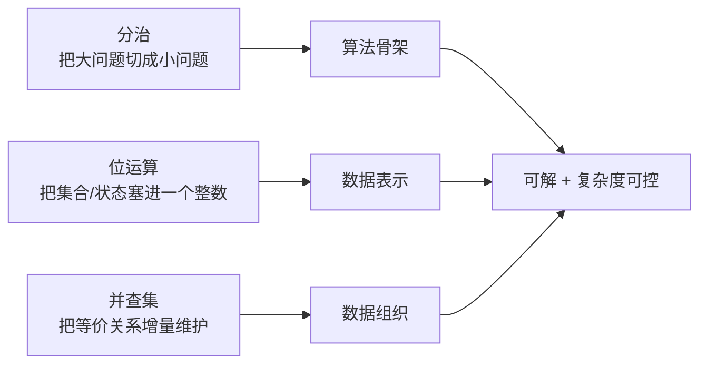

- **分治**是"怎么切"（算法骨架）；
- **位运算**是"怎么省"（表示与常数优化）；
- **并查集**是"怎么记"（增量维护关系）。

真正的高区分度题目，往往同时考两个：例如 *190. 颠倒二进制位*（分治 + 位运算）、*快速幂*（分治 + 位运算）、*Borůvka 最小生成树*（分治并行 + 并查集）、*40 亿整数找缺失数*（分治 + 位运算）。

---

# 第一部分 并查集（Union-Find / DSU）

## 1.1 本质：动态维护等价类

### 定义

并查集（Disjoint Set Union, DSU）维护一个**元素全集被划分为若干不相交子集**的结构，支持两个操作：

| 操作 | 语义 | 你要回答的问题 |
|---|---|---|
| `find(x)` | 返回 x 所属集合的**代表元**（canonical representative） | "x 属于哪一类？" |
| `union(x, y)` | 把 x、y 所在的两个集合**合并为一个** | "把这两类算作同一类" |

判定两个元素同类：`find(x) == find(y)`。

### 为什么需要它：和"静态图遍历"的区别

这是面试第一道分水岭。假设你要处理"朋友的朋友是朋友"：

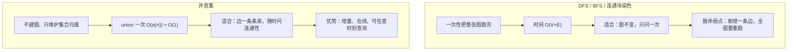

**结论（记住这句面试话术）**：
> 并查集适用于「**只合并、不拆分**、需要在合并过程中随时查询连通性」的场景。它的代价是**丢失了图的拓扑信息**——它只能告诉你"同不同类"，永远无法告诉你"经过哪些点"、也无法回答"两点间最短距离"。

### 三类典型业务映射

| 业务场景 | 元素 | 等价关系 | 查询 |
|---|---|---|---|
| 社交网络好友圈 | 用户 | 好友关系（传递闭包） | 两个用户是否在同一圈子 |
| 网络连通性 / 机房分区 | 主机、交换机 | 有物理链路 | 两台机器是否可达 |
| 数据对账 / 借贷流水匹配 | 流水号 | 疑似同一笔业务（同金额、同时间窗） | 两条流水是否同一笔 |
| 编译器的变量别名分析 | 变量 | 指针赋值 `a = b` | 两变量是否同址 |
| 图像连通域标记 | 像素 | 相邻且颜色相近 | 像素属于哪个色块 |

> 注意最后两个：**编译器别名分析**和**图像连通域（two-pass 算法）**是并查集在工程里的经典落地，说来比刷题更有说服力（Two-pass connected component labeling 就是用并查集合并临时标号）。

## 1.2 数据结构：代表元森林

并查集不用哈希、不用图，只用一个 **`parent[]` 数组**表示一片森林：

- 每个元素是一个节点，`parent[x]` 指向它的父节点；
- **根节点满足 `parent[root] == root`**（自环），根就是该集合的**代表元**；
- 一个集合 = 一棵树；全集 = 一片森林。

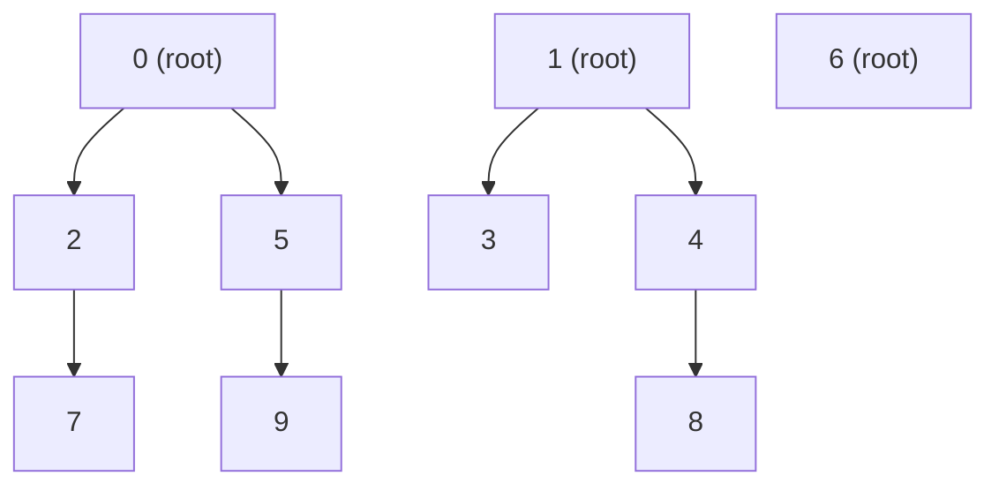

对应 `parent` 数组（父指针表示法，注意"箭头方向是子指向父"）：

| i | 0 | 1 | 2 | 3 | 4 | 5 | 6 | 7 | 8 | 9 |
|---|---|---|---|---|---|---|---|---|---|---|
| parent[i] | 0 | 1 | 0 | 1 | 1 | 0 | 6 | 2 | 4 | 5 |

三个集合：`{0,2,5,7,9}`（根 0）、`{1,3,4,8}`（根 1）、`{6}`（根 6）。

**关键认知**：树形结构**没有语义**。0-2-7 和 0-7-2 在并查集里完全等价。树的形状纯粹是"合并历史"的副产品，这正是后面要优化的对象——既然形状无意义，那就把它压平。

## 1.3 朴素实现与退化问题

```java
// 朴素版：无任何优化
int[] parent;
void init(int n) { for (int i = 0; i < n; i++) parent[i] = i; }

int find(int x) {
    while (parent[x] != x) x = parent[x];   // 一路向上找根
    return x;
}

void union(int x, int y) { parent[find(x)] = find(y); }  // 把一棵树挂到另一棵的根下
```

**退化场景**：如果依次执行 `union(0,1), union(1,2), union(2,3), ...`，并且实现是 `parent[find(x)] = find(y)`（把 x 的根挂到 y 的根），会形成一条**长链**：

```
0 → 1 → 2 → 3 → 4 → ... → n-1     （find(0) 要爬 n 层）
```

此时：

| 操作 | 复杂度 | 原因 |
|---|---|---|
| `find` | O(n) 最坏 | 链状树 |
| `union` | O(n) | 内含两次 find |
| m 次操作 | **O(m·n)** | n = 10^5, m = 10^5 直接 10^10 超时 |

> **面试高频追问**：为什么不直接 `parent[x] = y`（不看根）？因为那样会把 y 所在的整棵树"接到 x 底下"，如果 x 原本是某棵树的中间节点，y 的根就会丢失，集合关系被破坏。**union 必须对根操作**，这是最容易写错的一行。

## 1.4 路径压缩

### 思想

`find(x)` 反正要一路走到根，既然如此，**顺手把沿途所有节点直接挂到根上**。下次再查就是 O(1)。

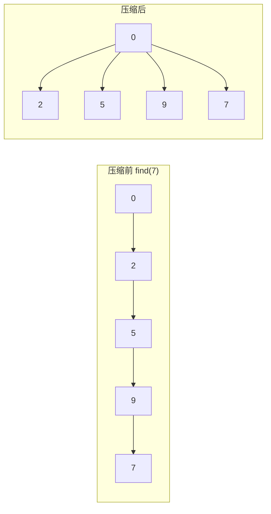

### 递归写法（简洁，但要注意栈深）

```java
int find(int x) {
    if (parent[x] == x) return x;
    return parent[x] = find(parent[x]);   // 回溯时把 x 直接挂到根
}
```

### 迭代写法（推荐，防爆栈）

```java
int find(int x) {
    int root = x;
    while (parent[root] != root) root = parent[root];   // 第一趟：找根
    while (parent[x] != root) {                        // 第二趟：沿途改指向
        int next = parent[x];
        parent[x] = root;
        x = next;
    }
    return root;
}
```

### 为什么工程上优先用迭代版

| 风险 | 说明 |
|---|---|
| **栈溢出** | 递归深度 = 树高。构造最坏链（1e6 次 `union(i, i+1)` 的特定顺序）后，一次 `find(0)` 递归 1e6 层，Java 默认栈（-Xss 512KB~1MB，每帧约 100B）直接 `StackOverflowError` |
| **函数调用开销** | 迭代版无调用栈，常数更小 |
| **尾递归不优化** | JVM 不做尾递归优化，别指望编译器救你 |

> 真实事故场景：LeetCode 上用递归 find 提交 1e6 级别的并查集题目（如 *959. 由斜杠划分区域* 类网格题）会偶发 SOE，而本地小数据完全看不出问题。**面试时主动说"我用迭代实现避免栈溢出"，是加分项。**

### 只做路径压缩的复杂度

单独路径压缩的摊还复杂度是 **O((m + n) log n)**（不是 O(α)，也不是 O(log n) 单次）。单次最坏仍是 O(n)（第一次访问长链时），只是摊还后很快变 O(1)。

## 1.5 按秩合并 / 按大小合并

### 思想

合并两棵树时，**把矮的挂到高的下面**，避免树高增长。树高只会在"两棵同高的树合并"时 +1，因此树高 ≤ log₂n。

| 策略 | 维护什么 | 合并规则 |
|---|---|---|
| **按秩（rank）合并** | 树高的上界（不精确，只增不减） | `rank[a] < rank[b]` 则 a 挂到 b；相等则任选一个挂，并把新根 rank+1 |
| **按大小（size）合并** | 集合元素个数 | 小的挂到大的下面，新根 size 相加 |

> **为什么 rank 不需要精确维护？** 因为路径压缩会把树压平，但没人愿意往下走一遍去更新 rank（那就退化成 O(n) 了）。我们只需要一个"上界"作为启发式：rank 只增不减，因此"按秩"实际上变成"按历史上界"。这不影响正确性，也不影响 O(α) 的结论。

```java
int[] parent, rank;

void union(int x, int y) {
    int rx = find(x), ry = find(y);
    if (rx == ry) return;
    if (rank[rx] < rank[ry])      parent[rx] = ry;
    else if (rank[rx] > rank[ry]) parent[ry] = rx;
    else { parent[ry] = rx; rank[rx]++; }
}
```

**只做按秩合并（不压缩）**：复杂度 O(m log n)，单次最坏 O(log n)（因为树高 ≤ log n）。

**两者同时用**：O(m·α(n)) ≈ O(m)，单次摊还近似 O(1)。

## 1.6 复杂度：为什么是 O(α(n))

### 反阿克曼函数 α(n)

| n | α(n) |
|---|---|
| 10 | 3 |
| 10^5 | 3 |
| 10^9 | 4 |
| 10^600 | 4 |
| 宇宙原子数（~10^80） | 4 |

阿克曼函数 A(m, n) 增长极快（A(4, 2) 就已经是 2^(2^(2^...)) 级别的天文数字），其反函数 α 增长极慢——**在可观测宇宙的数据规模内，α(n) ≤ 4**。所以工程上直接当作 O(1)。

### 结论出处

Tarjan 于 1975 年证明：在"路径压缩 + 按秩合并（或按大小合并）"下，m 次操作的总复杂度为 **O(m·α(m, n))**，并且这个界是**紧的**（存在达到该界的操作序列）。在"仅路径压缩"或"仅按秩合并"的模型下，下界与上界分别是 Ω(m log n) / O(m log n) 级别。

> **面试怎么讲**（三层递进，能讲完这三层就是 A 档）：
> 1. **直觉层**：压缩让"重复查询"变便宜，按秩让"树高"受控，二者结合使每次操作几乎 O(1)；
> 2. **量化层**：摊还复杂度 O(α(n))，其中 α 是反阿克曼函数，n < 10^600 时 α ≤ 4；
> 3. **可证明层**：可以给出"按秩合并后树高 ≤ log n，每进行一次代价高的 find 就会显著压缩大量节点，用势能/摊还分析可得总代价上界"——如果面试官深挖到证明，坦诚说"完整证明需要摊还分析，我只记得结论和思路"，比硬编强。

### 一张表说清"优化组合"

| 实现 | 单次最坏 | m 次总复杂度 |
|---|---|---|
| 朴素 | O(n) | O(mn) |
| 仅路径压缩 | O(n) | O((m+n) log n) 摊还 |
| 仅按秩合并 | O(log n) | O(m log n) |
| 路径压缩 + 按秩合并 | O(n)（极罕见） | **O(m α(n))** |

## 1.7 五种变体

### 变体 1：带权并查集（Weighted DSU / 带偏移量）

**适用**：元素之间存在**可传递的数值关系**，例如"a 比 b 大 3"、"a 是 b 的 2 倍"、"x 与 y 奇偶性相反"。

**核心**：除了 `parent[]`，再维护一个 `weight[x]` = **x 到父节点的偏移量**。`find` 时同步累加偏移；`union` 时要**反推出两棵树根之间的偏移**。

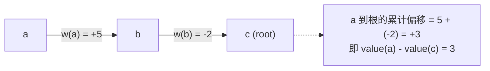

```java
// 带权并查集：find 同时返回根，并把 weight 累加到根
int[] parent, weight;

int find(int x) {
    if (parent[x] == x) return x;
    int root = find(parent[x]);          // 先递归到根，此时 parent[x] 已压缩
    weight[x] += weight[parent[x]];      // 累加：x→老父 + 老父→根
    parent[x] = root;
    return root;
}

// 已知 relation: value(x) - value(y) = w，合并
boolean union(int x, int y, int w) {
    int rx = find(x), ry = find(y);
    if (rx == ry) return weight[x] - weight[y] == w;  // 校验是否矛盾
    parent[rx] = ry;
    weight[rx] = w + weight[y] - weight[x];           // 关键推导，见下
    return true;
}
```

**推导（一定要会，面试常让现场推）**：设 `weight[i] = value(i) - value(parent[i])`，则 `value(x) - value(rx) = weight[x]`，`value(y) - value(ry) = weight[y]`。要让 `value(x) - value(y) = w` 且把 `rx` 挂到 `ry`，则
`value(rx) - value(ry) = w + weight[y] - weight[x]`，这正是新的 `weight[rx]`。

**经典题**：*399. 除法求值*（a/b = 2，求 c/d；把除法关系当"倍数关系"传递）、*990. 等式方程的可满足性*（相等约束 + 不等约束矛盾检测）。

### 变体 2：种类并查集（敌人的敌人是朋友）

**适用**：元素之间只有"同类/异类"两种关系，且关系可传递。

**做法**：**开两倍空间**，`i` 表示"i 属于 A 类"，`i + n` 表示"i 属于 B 类"。
- `x` 与 `y` 同类：`union(x, y)` 且 `union(x+n, y+n)`；
- `x` 与 `y` 异类：`union(x, y+n)` 且 `union(x+n, y)`。

**校验矛盾**：`find(x) == find(x+n)` 说明自相矛盾。

**经典题**：*食物链（NOI 2001 / 洛谷 P2024）*、*886. 可能的二分法*（把图二染色问题转成 DSU 判矛盾）。

### 变体 3：可撤销并查集（Rollback DSU）

**适用**：需要"加边 → 回退 → 再加边"的场景（如 DFS 回溯、线段树分治、动态图连通性离线处理）。

**要点（三条铁律，缺一不可）**：
1. **不能路径压缩**（压缩会破坏历史结构，无法撤销）→ 只靠按秩/按大小合并，复杂度 O(log n)/次；
2. 所有修改（`parent`、`rank`/`size`）都记到**栈**里；
3. `union` 时不再按"根大小"合并也要严格遵守，回退时按栈逆序还原。

```java
int[] parent, size;
Deque<int[]> history = new ArrayDeque<>();   // 记录 {child, oldParent, oldSizeOfRoot}

int find(int x) { while (parent[x] != x) x = parent[x]; return x; }  // 无压缩！

boolean union(int x, int y) {
    int rx = find(x), ry = find(y);
    if (rx == ry) { history.push(new int[]{-1, -1, -1}); return false; }
    if (size[rx] < size[ry]) { int t = rx; rx = ry; ry = t; }   // 大的当根
    history.push(new int[]{ry, parent[ry], size[rx]});
    parent[ry] = rx; size[rx] += size[ry];
    return true;
}

void rollback() {
    int[] h = history.pop();
    if (h[0] == -1) return;
    parent[h[0]] = h[1]; size[find(h[0])] = h[2];   // 注意：先恢复 parent 再恢复 size
}
```

> 这就是**线段树分治 + 可撤销并查集**解决"动态图连通性"的标准组合（每条边的存活时间挂在时间线段树上，DFS 遍历时加边、退出时回滚）。

### 变体 4：支持删除的并查集（虚拟节点 / 时间戳）

并查集天生**不支持删除**（拆分会把集合切成未知块）。工程解法有三种，按场景选：

| 场景 | 解法 | 说明 |
|---|---|---|
| **离线、删边** | **倒序处理** | 删除变成添加：把"删 k 条边后的连通块数"转成"从空图开始加回边"。这是最高频技巧 |
| **删点、但可建虚点** | 每个点建一个"墓碑副本" | 删除 = 把当前点指向副本，旧连接留在旧点上 |
| **动态增删、要在线** | Link-Cut Tree / Euler Tour Tree / 动态树 | 超出面试范围，知道名字 + O(log n) 即可 |
| **每条边有存活区间** | 线段树分治 + 可撤销 DSU | 见变体 3 |

**倒序技巧的经典题**：*1970. 你能穿过矩阵的最后一天*（二分 + DSU / 倒序并查集）、*803. 打砖块*（**倒序 + 并查集**，把这题当成并查集模板题背下来）。

### 变体 5：位掩码聚合（DSU + Bit Mask）

**适用**：每个连通块需要维护"包含哪些类型"的集合信息（颜色、技能、标签），且类型数 ≤ 64（用 `long`）或 ≤ 32（用 `int`）。

**做法**：在根节点上挂一个 `mask[]`，合并时 `mask[newRoot] |= mask[oldRoot]`，查询时 `find(x)` 后读根。

```java
long[] mask;   // mask[root] 的二进制第 k 位为 1 表示该连通块含类型 k

void union(int x, int y) {
    int rx = find(x), ry = find(y);
    if (rx == ry) return;
    if (rank[rx] < rank[ry]) parent[rx] = ry, mask[ry] |= mask[rx];
    else { parent[ry] = rx; mask[rx] |= mask[ry]; if (rank[rx] == rank[ry]) rank[rx]++; }
}
```

> **为什么这个技巧值钱**：它把"集合合并"从 O(k)（HashSet 合并）或 O(k log k) 降到一条 `|=` 指令。在 n 个连通块、m 次合并的规模下，这是常数级的质变。工程里用于"告警风暴聚合（同一连通故障域合并标签）"、"风控团伙识别（合并设备指纹特征）"。

## 1.8 母题 547 省份数量 全解

### 题目

> 有 `n` 个城市，其中一些彼此相连，另一些没有。如果城市 a 与城市 b 直接相连，且城市 b 与城市 c 直接相连，那么城市 a 与城市 c 间接相连。**省份**是一组直接或间接相连的城市，组内不含其他没有相连的城市。
> 给你一个 `n × n` 的矩阵 `isConnected`，其中 `isConnected[i][j] = 1` 表示第 i 个城市和第 j 个城市直接相连，`isConnected[i][j] = 0` 表示二者不直接相连。返回矩阵中**省份的数量**。
> 约束：`1 <= n <= 200`，`isConnected[i][i] == 1`，矩阵对称。

### 建模：这是"连通块计数"最纯的形态

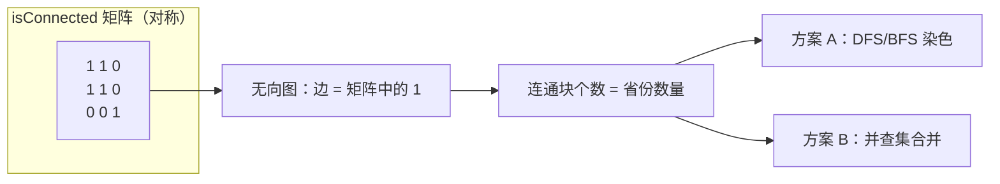

先看清三种解法的**适用边界**，这比代码本身更重要：

| 方案 | 时间 | 空间 | 何时该选 |
|---|---|---|---|
| DFS / BFS 染色 | O(n²) | O(n) | 矩阵已给定、只查一次 —— **本题最优** |
| 并查集 | O(n²·α) | O(n) | 边是流式来的、要动态查、要多次查询 |
| 位运算加速（BitSet） | O(n²/64) | O(n²/64) | n 达到 10^4~10^5 且需位矩阵运算时 |

### 解法一：DFS（推荐，写法最短）

```java
class Solution {
    public int findCircleNum(int[][] isConnected) {
        int n = isConnected.length;
        boolean[] visited = new boolean[n];
        int provinces = 0;
        for (int i = 0; i < n; i++) {
            if (!visited[i]) {          // 发现一个新连通块
                provinces++;
                dfs(isConnected, visited, i);
            }
        }
        return provinces;
    }
    private void dfs(int[][] g, boolean[] visited, int i) {
        visited[i] = true;
        for (int j = 0; j < g.length; j++) {
            if (g[i][j] == 1 && !visited[j]) dfs(g, visited, j);
        }
    }
}
```

**执行过程（矩阵 `[[1,1,0],[1,1,0],[0,0,1]]`）**：

| 步骤 | i | visited 状态 | provinces | 动作 |
|---|---|---|---|---|
| 1 | 0 | [F,F,F] | 1 | 从 0 出发，标记 0，发现 1，标记 1；1 的邻居只有 0（已访问） |
| 2 | 1 | [T,T,F] | 1 | 已访问，跳过 |
| 3 | 2 | [T,T,F] | 2 | 新连通块，标记 2 |
| 结束 | — | — | **2** | 正确 |

### 解法二：并查集（本题的标准"并查集入门"写法）

```java
class Solution {
    int[] parent, rank;
    int count;                                  // 实时维护连通块数

    public int findCircleNum(int[][] isConnected) {
        int n = isConnected.length;
        parent = new int[n]; rank = new int[n]; count = n;   // 初始 n 个孤立点
        for (int i = 0; i < n; i++) parent[i] = i;

        for (int i = 0; i < n; i++)
            for (int j = i + 1; j < n; j++)       // 只需上三角，避免重复
                if (isConnected[i][j] == 1) union(i, j);

        return count;
    }

    int find(int x) {
        int root = x;
        while (parent[root] != root) root = parent[root];
        while (parent[x] != root) { int next = parent[x]; parent[x] = root; x = next; }
        return root;
    }

    void union(int x, int y) {
        int rx = find(x), ry = find(y);
        if (rx == ry) return;
        if (rank[rx] < rank[ry]) parent[rx] = ry;
        else if (rank[rx] > rank[ry]) parent[ry] = rx;
        else { parent[ry] = rx; rank[rx]++; }
        count--;                                // 每次成功合并，块数减 1
    }
}
```

**关键细节（面试官就盯这几行）**：

1. **`j = i + 1` 只遍历上三角**：矩阵对称，全遍历会把每条边处理两遍，虽然正确但浪费一半时间（虽然 union 第二次直接 return，但 find 的常数开销还在）。
2. **`count` 初值为 n，成功 union 后自减**：这是"连通块计数"的通用写法，比最后扫一遍数根节点更省（也更能体现"在线维护"的思想）。
3. **`if (rx == ry) return;`** 必须在 `count--` 之前。
4. **不要在循环里用 `parent[i]` 判连通**，必须 `find(i)`。

### 解法三：DFS vs 并查集的取舍（面试必问）

| 维度 | DFS | 并查集 |
|---|---|---|
| 时间复杂度 | O(n²) | O(n²·α(n))，常数略大 |
| 迭代实现 | 需显式栈（防爆栈） | 天然无递归 |
| 边动态增加 | ❌ 要重跑 | ✅ O(α) 增量 |
| 需要路径/拓扑信息 | ✅ 可记录 | ❌ 只知道同类 |
| 内存 | visited + 栈 | parent + rank |

**标准回答**：
> "本题矩阵是给定的、只查一次，DFS 是最优解，O(n²) 且常数最小。如果条件改成'边会陆续加入，每次加入后要返回省份数'，那必须用并查集，DFS 每次都要 O(n²) 重跑。所以选型的判断点是**边的变化性**，不是数据规模。"

### 追问链（网上真实面经里出现过的追问方向）

| 追问 | 答题要点 |
|---|---|
| n = 10^6，矩阵存不下怎么办？ | 不可能给矩阵；给**边列表**（稀疏图），用并查集，复杂度 O(E·α)，空间 O(n)。矩阵版 O(n²) 内存 10^12 字节，直接不可行 |
| 边是流式的（不能存全图），要随时回答"现在有几个省" | 并查集天然在线；维护 `count` 变量即可 |
| 要支持"删边"呢？ | 在线删边 → Link-Cut Tree / Euler Tour Tree；离线 → 倒序处理（删除变添加） |
| 要输出每个省包含哪些城市 | 并查集 `find` 后按根分组即可（Map<root, List>）；DFS 则在染色时收集 |
| 矩阵不对称（有向图）怎么办？ | 有向图的"强连通分量"不能用普通并查集，要用 **Tarjan / Kosaraju**。若只问"可达性传递"，用并查集是错的——这是常见陷阱 |
| 除了矩阵，每个城市还有别的属性要聚合 | 用 **变体 5：位掩码聚合**（见 1.7） |

### 同类题（同一个模型换个壳）

| 题号 | 题目 | 差异点 | 权重 |
|---|---|---|---|
| 323 | 无向图中连通分量的数目（Plus 会员题） | 给边列表而非矩阵 | ★★★☆☆ |
| 200 | 岛屿数量 | 网格 → 一维映射 `i*m + j` | ★★★★★ |
| 695 | 岛屿的最大面积 | 合并时维护 size，取最大 | ★★★★☆ |
| 130 | 被围绕的区域 | 边界岛屿打标 + 反向思维 | ★★★★☆ |
| 1020 | 飞地的数量 | 与 130 同类 | ★★★☆☆ |
| 959 | 由斜杠划分区域 | 每格拆 4 个三角（**拆分建模**的经典） | ★★★★☆ |
| 128 | 最长连续序列 | 哈希更优，但并查集可做（合并相邻值域） | ★★★★☆ |
| 547 / 1971 | 省份数量 / 寻找图中是否存在路径 | 最基础模板 | ★★★★★ |

> **959 的建模思路值得单独记**：每个 1×1 格子按两条对角线拆成 4 个区域（上右下左），再根据字符 `'/'`、`'\'`、`' '` 决定哪两个区域连通，最后跨格子合并。这类"把二维对象拆成若干原子再合并"的做法，是并查集最考验建模能力的地方。

## 1.9 并查集大厂真题清单（含权重）

> **权重说明**：★ 数 = 出现频率 × 考察深度 的综合评级。★★★★★ 表示"近两年一线大厂后端岗高频出现、且能深挖"；★★★ 表示"中等频率、作为加分项"。公司标注基于公开面经与 LeetCode 企业题库分布的**统计归纳**，仅作方向参考，不代表某公司必考。

### 1.9.1 手写实现类（基础关，★★★★★）

**题目**：实现一个并查集，支持 `union` / `find` / `isConnected`，并说明复杂度。

**考察点**：路径压缩 + 按秩合并的完整实现；能否主动说出 O(α(n))。

**标准代码（面试可直接写这版）**：

```java
class DSU {
    private final int[] parent, rank;
    private int count;
    public DSU(int n) {
        parent = new int[n]; rank = new int[n]; count = n;
        for (int i = 0; i < n; i++) parent[i] = i;
    }
    public int find(int x) {
        int root = x;
        while (parent[root] != root) root = parent[root];
        while (parent[x] != root) { int nxt = parent[x]; parent[x] = root; x = nxt; }
        return root;
    }
    public boolean union(int x, int y) {
        int rx = find(x), ry = find(y);
        if (rx == ry) return false;
        if (rank[rx] < rank[ry])      parent[rx] = ry;
        else if (rank[rx] > rank[ry]) parent[ry] = rx;
        else { parent[ry] = rx; rank[rx]++; }
        count--;
        return true;
    }
    public boolean isConnected(int x, int y) { return find(x) == find(y); }
    public int getCount() { return count; }
}
```

**加分话术**：
- "如果元素是字符串/对象而不是 0~n-1，我会用 `HashMap<String, String>` 或先做坐标压缩（离散化）再映射到数组。"
- "如果并发场景，我会给 union 加锁或按分区拆分后归并；真正高并发的连通性一般用分布式图计算而非单机 DSU。"
- "稀疏图且节点编号极大时，用哈希表实现 parent，避免开大数组。"

### 1.9.2 岛屿类（字节 / 美团 / 快手，★★★★★）

**200. 岛屿数量**（LeetCode 高频 Top 20，字节跳动后端面经高频）

- **考察**：网格 → 一维映射 + 并查集合并；或 DFS（多数人选 DFS，能讲清"为什么并查集也能做"才加分）。
- **并查集做法关键**：把 `(i,j)` 映射为 `i * m + j`；只向右、向下两个方向合并（避免重复）；初始 `count = 所有陆地格子数`，每成功合并一次 -1。
- **易错**：水域格子的 parent 也要初始化（或跳过，但映射时必须保证不越界）；边界判断 `j + 1 < m`、`i + 1 < n`。

```java
// 核心片段
for (int i = 0; i < n; i++)
    for (int j = 0; j < m; j++)
        if (grid[i][j] == '1') {
            land++;
            if (i + 1 < n && grid[i+1][j] == '1') dsu.union(i*m+j, (i+1)*m+j);
            if (j + 1 < m && grid[i][j+1] == '1') dsu.union(i*m+j, i*m+j+1);
        }
```

- **延伸追问**："如果地图是动态的，每秒有一座岛沉没/浮现？" → 沉没（删点）用**倒序**：把所有沉没先当作已沉没，逆着时间加回，每次加回后与四邻合并。

### 1.9.3 关系推理类（腾讯 / 阿里 / 华为，★★★★★）

**990. 等式方程的可满足性**

- **题意**：给一组 `a==b` / `a!=b`，问是否存在矛盾。
- **解法**：两阶段。**先处理所有 `==` 做 union，再检查每个 `!=` 的 `find` 是否相同**。顺序不能反。
- **原理**：等价关系有传递性、对称性、自反性；`a==b, b==c` 蕴含 `a==c`，这正是并查集维护的等价类闭包。
- **代码骨架**：

```java
public boolean equationsPossible(String[] equations) {
    int[] p = new int[26];
    for (int i = 0; i < 26; i++) p[i] = i;
    for (String e : equations)
        if (e.charAt(1) == '=') union(p, e.charAt(0)-'a', e.charAt(3)-'a');
    for (String e : equations)
        if (e.charAt(1) == '!' && find(p, e.charAt(0)-'a') == find(p, e.charAt(3)-'a')) return false;
    return true;
}
```

- **权重拆解**：思路 ★★★★★（"先合并全部等式再校验不等式"这个顺序是考点）；实现 ★★☆☆☆。
- **延伸**："如果约束是 `a > b` 呢？" → 并查集只能处理等价（等价类是"无向"的），**偏序关系要用拓扑排序**。这个追问能直接区分"背题"和"理解"。

**399. 除法求值**（带权并查集，阿里 / 字节高频，★★★★★）

- **题意**：给 `a/b = 2.0`、`b/c = 3.0`，求 `a/c`、`a/e`（不可达返回 -1）。
- **建模**：凡是通过乘除关系能连起来的变量属于同一"连通块"，且块内任意两者比值可求 → 带权并查集，`weight[x] = value(x) / value(parent[x])`。
- **复杂度**：建图 O(E·α)，每次查询 O(α)。
- **易错**：
  - `find` 递归中必须先 `root = find(parent[x])` 再累乘 `weight[x] *= weight[parent[x]]`（顺序错就用了错误的老父值）；
  - 查询时若 `find(x) != find(y)` 返回 -1；
  - 结果 = `weight[x] / weight[y]`（**除，不是乘**，方向极易搞反）。
- **面试深挖点**：为什么用 double 不用 BigDecimal？→ 精度与性能权衡；工程上汇率换算建议用整数最小单位（分）+ 定点数，避免浮点累积误差。

### 1.9.4 图论结合类（★★★★★）

**684. 冗余连接**（并查集最经典的"检测环"应用）

- **题意**：一棵树多了一条边，找出这条边。
- **原理**：按顺序加边，**第一条使两端已同属一个集合的边就是成环边**。
- **复杂度**：O(n·α)。
- **延伸（685. 冗余连接 II，★★★☆☆，有向图版）**：有向图要分三种情况讨论（无入度 2 的节点 → 有环；有入度 2 的节点 → 尝试删两条候选边之一再判环），是并查集题里难度最高的一类。**这题是"并查集 + 分类讨论"的代表，阿里/字节终面常出。**

**1584. 连接所有点的最小费用**（Kruskal 最小生成树）

- **要点**：把所有点对距离排序（O(n² log n) 边数），Kruskal 用并查集判断"是否已连通"，选 n-1 条边即停。
- **复杂度**：O(E log E)，E = n(n-1)/2。
- **面试延伸**："点很多但边稀疏怎么办？" → 改用 Prim + 堆（O(E log V)）；"完全图 n=10^5 呢？" → 距离不能全算，需要用几何性质（如 Manhattan MST 的分治/扫描线构造，属于高阶）。

**721. 账户合并**（哈希 + 并查集，★★★★☆）

- **要点**：邮箱是"元素"，同一账户内所有邮箱 union；再按根聚合。**先给邮箱分配 id（哈希映射），再做 DSU**——这是"元素不是 0~n-1 整数"的标准处理法。
- **易错**：同一邮箱出现在两个账户时，账户要合并；输出需按字典序。

**765. 情侣牵手**（★★★☆☆，脑筋急转弯 + 并查集）

- **要点**：把"情侣对"当节点，n 对情侣构成一张图，每处错位形成一条边；答案 = n - 连通块数。**这题的价值在于"用并查集数环数/连通块数"的转化思维**，直接贪心交换也能做。

**803. 打砖块**（倒序并查集，★★★★★，字节/美团高频）

- **要点**：正向"打掉"是删除（并查集不支持），**逆序**变成"加回"；用一个虚拟超级源点连接所有第一行的砖块，答案 = 加回该砖块后新增的、与超级源点连通的砖块数。
- **这是"删除 → 倒序加回"思想的头号模板题，务必背熟。**

**947. 移除最多的同行或同列石头**（★★★☆☆）

- **要点**：同一行/同一列的石头视为连通（行号、列号作为节点，用 `x` 和 `~y` 或 `y + n` 区分），答案 = 石头数 - 连通块数。
- **技巧**：把列坐标加偏移，避免行/列编号冲突。

### 1.9.5 字符串 / 数组上的并查集（★★★★☆）

**128. 最长连续序列**

- 标准解是哈希表 O(n)：对每个数，若 `num-1` 不存在则向后扩展。
- **并查集解**：对每个 `x`，若 `x+1` 存在则 `union(x, x+1)`，块内维护 size，答案 = max(size)。适合"数会动态插入"的变体（哈希法每次插入都要重算，DSU 只需 union + 更新 size）。
- **面试价值**：能说出"两种解法各自适配的场景"比只会一种强。

### 1.9.6 并查集题目速查表

| 题号 | 题目 | 核心技巧 | 难度 | 权重 |
|---|---|---|---|---|
| 547 | 省份数量 | 模板入门 | 中 | ★★★★★ |
| 200 | 岛屿数量 | 网格映射 | 中 | ★★★★★ |
| 695 | 岛屿最大面积 | 合并维护 size | 中 | ★★★★☆ |
| 130 / 1020 | 被围绕的区域 / 飞地 | 边界预处理 | 中 | ★★★★☆ |
| 990 | 等式方程可满足性 | 先等后不等 | 中 | ★★★★★ |
| 399 | 除法求值 | 带权 DSU | 中 | ★★★★★ |
| 684 / 685 | 冗余连接 I / II | 判环 / 分类讨论 | 中 / 难 | ★★★★★ / ★★★☆☆ |
| 721 | 账户合并 | 哈希建 id | 中 | ★★★★☆ |
| 765 | 情侣牵手 | 数连通块 | 难 | ★★★☆☆ |
| 803 | 打砖块 | 倒序加回 | 难 | ★★★★★ |
| 947 | 移除石头 | 行列当节点 | 中 | ★★★☆☆ |
| 959 | 斜杠划分区域 | 拆 4 区域建模 | 难 | ★★★★☆ |
| 1584 / 1135 | 最小费用连通 / 最低成本联通所有城市 | Kruskal | 中 | ★★★★☆ |
| 1971 / 1970 | 是否存在路径 / 最后一天 | 模板 / 二分+DSU | 易 / 中 | ★★★☆☆ |
| 886 | 可能的二分法 | 种类 DSU / 染色 | 中 | ★★★☆☆ |
| 1697 | 检查边长度限制的路径是否存在 | 离线排序 + DSU | 难 | ★★★★☆ |

> **1697 单独提一句**：把查询按 limit 排序，边按权重排序，边加边回答——这是"**离线 + 排序 + DSU**"的经典组合，大数据岗和算法岗都爱问。

---

# 第二部分 分治（Divide and Conquer）

## 2.1 本质与三要素

### 定义

分治 = **分解（Divide）→ 解决（Conquer）→ 合并（Combine）**：

1. 把规模为 n 的问题**切成若干规模更小的子问题**；
2. **递归**求解子问题（小到可以直接求解时返回基线结果）；
3. 把子问题的解**合并**成原问题的解。

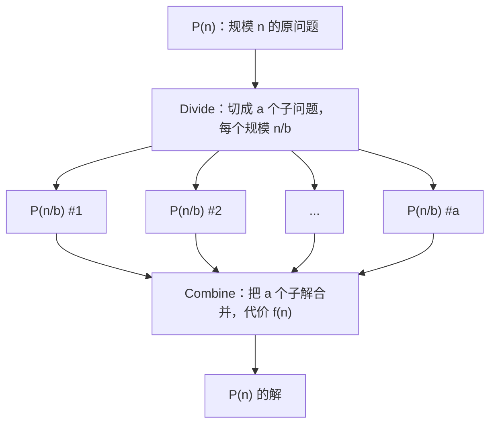

### 三要素（缺一不可，面试时用这个框架判断"这题能不能分治"）

| 要素 | 含义 | 反例（为什么不能分治） |
|---|---|---|
| **可分** | 问题能按某种维度切成规模严格更小的子问题 | "求 1 到 n 的和"可以（对半切）；"求第 n 个斐波那契数"按 n 切会**重复子问题**（那是 DP） |
| **独立** | 子问题之间**不重叠**、互不影响 | 若子问题重叠 → 分治会指数爆炸（斐波那契递归 O(φⁿ)），应改**记忆化/DP** |
| **可合并** | 子解能在"多项式时间内"拼成原解 | "求数组最大值"可合并（max）；"求数组的中位数"合并代价高（需整体重排），通常不这么切 |

> **一句话把分治和 DP 划清界限**：
> **分治** = 子问题**不重叠**，自顶向下，合并代价是主角；
> **DP** = 子问题**重叠**，自底向上（或记忆化），状态转移是主角。
> 面试里被问"这题能不能用分治"，先反问自己"子问题重不重叠"。重叠就老老实实 DP。

### 分治 vs 减治（Decrease and Conquer）

| | 分治 | 减治 |
|---|---|---|
| 切几份 | **多份**（通常 2 份） | **只保留一份**继续递归 |
| 典型 | 归并排序、快排、逆序对 | 二分查找、快速幂、欧几里得算法 |
| 复杂度 | 常见 Θ(n log n) | 常见 Θ(log n) |
| 关系 | 减治是分治的退化形式（切完只解一份，其余丢弃） | — |

**二分查找为什么算减治**：`T(n) = T(n/2) + O(1)`，另一个半边直接丢掉，不需要"合并"。这点讲清楚，能挡住面试官"二分算不算分治"的追问。

## 2.2 复杂度分析：递归树与主定理

### 递归树法（最通用，不需要记公式）

把递归展开成树，**总复杂度 = Σ(每层所有节点的代价)**。

以归并排序 `T(n) = 2T(n/2) + Θ(n)` 为例：

```
层 0：        n                    ← 合并代价 n
层 1：     n/2    n/2              ← 合计 n
层 2：   n/4 n/4 n/4 n/4           ← 合计 n
 ...
层 log n：1 1 1 ... 1（共 n 个）    ← 合计 n
```

每层代价都是 n，共 `log₂n + 1` 层 ⇒ **Θ(n log n)**。

### 主定理（Master Theorem）

对形如 **T(n) = a·T(n/b) + f(n)** 的递归式（a ≥ 1, b > 1），令 **c = log_b a**（"叶子总代价"的量级 n^c），比较 `f(n)` 与 `n^c`：

| 情况 | 条件 | 结果 | 直觉 |
|---|---|---|---|
| **① 叶子主导** | `f(n) = O(n^{c-ε})`（f 严格更小） | `T(n) = Θ(n^c)` | 合并很便宜，时间全花在叶子 |
| **② 平衡** | `f(n) = Θ(n^c · log^k n)` | `T(n) = Θ(n^c · log^{k+1} n)` | 每层代价相同，× 层数 |
| **③ 根主导** | `f(n) = Ω(n^{c+ε})` 且满足正则条件 `a·f(n/b) ≤ δ·f(n)`（δ<1） | `T(n) = Θ(f(n))` | 合并太贵，时间全花在根 |

### 用主定理秒算常见算法

| 算法 | 递归式 | a | b | c = log_b a | f(n) | 情况 | 结果 |
|---|---|---|---|---|---|---|---|
| 归并排序 | 2T(n/2) + n | 2 | 2 | 1 | n = Θ(n^1) | ② k=0 | **Θ(n log n)** |
| 二分查找 | T(n/2) + 1 | 1 | 2 | 0 | 1 = Θ(n^0) | ② k=0 | **Θ(log n)** |
| 二叉树的遍历 | 2T(n/2) + 1 | 2 | 2 | 1 | 1 = O(n^{0}) | ① | **Θ(n)** |
| 快速幂 | T(n/2) + 1（n 为指数） | 1 | 2 | 0 | 1 | ② | **Θ(log n)** |
| Karatsuba 乘法 | 3T(n/2) + n | 3 | 2 | log₂3≈1.585 | n | ① | **Θ(n^1.585)** |
| 最近点对 | 2T(n/2) + n | 2 | 2 | 1 | n | ② | **Θ(n log n)** |
| 朴素大整数乘法（分块） | 4T(n/2) + n | 4 | 2 | 2 | n | ① | Θ(n²)（没优化） |
| 二分 + 线性扫描合并（T(n)=2T(n/2)+n²） | 2 | 2 | 1 | n² | ③（正则成立） | **Θ(n²)** |

**主定理的适用边界（面试官爱挖的坑）**：

- ❌ **子问题规模不等**（如 `T(n) = T(n/3) + T(2n/3) + n`）→ 主定理不适用，要用 **Akra–Bazzi 方法**或递归树硬算（此例结果为 Θ(n log n)）。
- ❌ **子问题数量随 n 变化**（如 `T(n) = T(n-1) + T(n-2) + 1`）→ 不是分治式，是 DP 式。
- ❌ **a 不是常数**（如 `T(n) = n·T(n/2) + n`）。
- ⚠️ **正则条件**容易被忽略：情况 ③ 必须验证 `a·f(n/b) ≤ δ·f(n)`。例如 `T(n) = 2T(n/2) + n²/log n`，虽然 `f(n) = Ω(n^{1+ε})` 看似成立，但正则条件不满足，不能用情况 ③。
- ⚠️ **BFPRT（线性时间选择）不满足主定理形式**：`T(n) ≤ T(n/5) + T(7n/10) + O(n)`，需用**代换法/递归树**得 O(n)（因为 1/5 + 7/10 = 9/10 < 1，几何级数收敛）。**这个"9/10 < 1 所以线性"的论证是高频面试点。**

### 代换法（Substitution）示例：证明 BFPRT 是 O(n)

猜 `T(n) ≤ cn`，代入：
`T(n) ≤ c·n/5 + c·7n/10 + a·n = c·(9/10)n + a·n`。
要 ≤ cn，需 `a·n ≤ c·n/10`，即取 `c ≥ 10a` 即可 ⇒ **O(n)**。核心就是"子问题总规模 < n"。

## 2.3 分治的四种典型形态

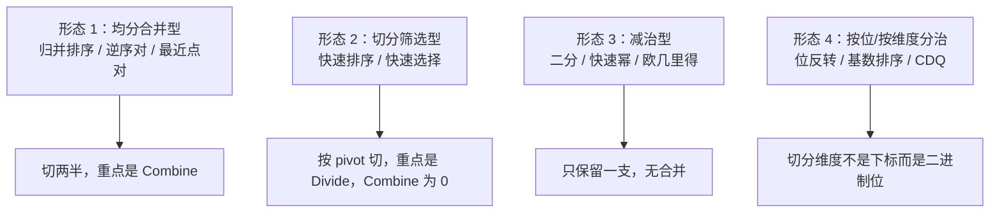

| 形态 | Combine 代价 | 复杂度来源 | 代表 |
|---|---|---|---|
| 均分合并 | Θ(n) | 每层 Θ(n) × log n 层 | 归并排序、逆序对、315、493、327 |
| 切分筛选 | 0（划分即完成一部分工作） | 平均 log n 层，每层 Θ(n) | 快排、快选、BFPRT |
| 减治 | 0 | 规模按比例缩小 | 二分、快速幂、gcd |
| 按位分治 | Θ(n)（每层） | 位宽 w 层 | 190 位反转、基数排序、40 亿整数分治 |

## 2.4 母题 912 排序数组 全解

### 题目

> 给你一个整数数组 `nums`，请你将该数组升序排列。**不要使用任何内置函数**，设计并实现时间复杂度为 `O(n log n)` 的算法。
> 约束：`1 <= nums.length <= 5·10^4`（部分题库版本为 10^5），`-5·10^4 <= nums[i] <= 5·10^4`。

### 为什么这题"看起来简单，挂人很多"

面试官出 912 的真实目的不是"你会不会排序"，而是：

| 考察层 | 具体问题 |
|---|---|
| **能不能写对** | 归并的 `mid = l + (r-l)/2`、区间开闭、临时数组拷贝位置，错一个就死循环或越界 |
| **会不会退化** | 快排选 `nums[l]` 当 pivot，遇到**已排序数组**直接 O(n²) → LeetCode 有专门的反向用例卡这个 |
| **懂不懂工程** | Java 的 `Arrays.sort(int[])` 用的是**双轴快排**，`Arrays.sort(Object[])` 用的是 **TimSort**，为什么不一样？ |
| **能不能延伸** | 稳定排序、外部排序、并行排序、只排部分、链表排序 |

### 解法一：归并排序（最稳，推荐首选）

```java
class Solution {
    public int[] sortArray(int[] nums) {
        int[] tmp = new int[nums.length];
        mergeSort(nums, tmp, 0, nums.length - 1);
        return nums;
    }
    private void mergeSort(int[] a, int[] tmp, int l, int r) {
        if (l >= r) return;                       // 基线：0 或 1 个元素天然有序
        int mid = l + (r - l) / 2;
        mergeSort(a, tmp, l, mid);
        mergeSort(a, tmp, mid + 1, r);
        if (a[mid] <= a[mid + 1]) return;         // 小优化：已经有序就跳过合并
        merge(a, tmp, l, mid, r);
    }
    private void merge(int[] a, int[] tmp, int l, int mid, int r) {
        int i = l, j = mid + 1, k = l;
        while (i <= mid && j <= r) tmp[k++] = (a[i] <= a[j]) ? a[i++] : a[j++];  // <= 保证稳定
        while (i <= mid) tmp[k++] = a[i++];
        while (j <= r)  tmp[k++] = a[j++];
        for (int t = l; t <= r; t++) a[t] = tmp[t];   // 拷回
    }
}
```

**过程示意（`[5,2,3,1]`）**：

```
[5,2,3,1]
  ├─ 左 [5,2] → [5] [2] → merge → [2,5]
  └─ 右 [3,1] → [3] [1] → merge → [1,3]
merge([2,5], [1,3]) → [1,2,3,5]
```

| 指标 | 值 |
|---|---|
| 时间 | 最好/最坏/平均 **Θ(n log n)**（与数据分布无关，这点比快排强） |
| 空间 | **O(n)**（tmp 数组）；递归栈 O(log n) |
| 稳定 | ✅（`a[i] <= a[j]` 取左边） |
| 原地 | ❌（数组版需要 O(n) 辅助空间；链表版可以做到 O(1) 非递归栈） |

**为什么归并是"稳定"的**：合并时若左右相等，**优先取左边**，左边元素原本在左边，相对顺序保持。

### 解法二：快速排序（必须写"防退化版"）

```java
class Solution {
    public int[] sortArray(int[] nums) {
        quickSort(nums, 0, nums.length - 1);
        return nums;
    }
    private void quickSort(int[] a, int l, int r) {
        while (l < r) {                                   // 尾递归改循环，缩小栈深
            int p = partition(a, l, r);
            if (p - l < r - p) { quickSort(a, l, p - 1); l = p + 1; }   // 先排短的，栈深 O(log n)
            else { quickSort(a, p + 1, r); r = p - 1; }
        }
    }
    private int partition(int[] a, int l, int r) {
        int idx = l + ThreadLocalRandom.current().nextInt(r - l + 1);   // 随机 pivot
        swap(a, l, idx);
        int pivot = a[l], i = l, j = r;
        while (i < j) {
            while (i < j && a[j] >= pivot) j--;           // 从右找 < pivot
            while (i < j && a[i] <= pivot) i++;           // 从左找 > pivot
            if (i < j) swap(a, i, j);
        }
        swap(a, l, i);                                   // pivot 归位
        return i;
    }
    private void swap(int[] a, int i, int j) { int t = a[i]; a[i] = a[j]; a[j] = t; }
}
```

**快排的三个坑（面试现场最容易踩）**：

| 坑 | 后果 | 解法 |
|---|---|---|
| 固定取 `a[l]` 做 pivot | 已排序/逆序数组 → 每次划分 0:n-1 → **O(n²)**，LeetCode 直接 TLE | 随机化 / 三数取中 |
| 大量重复元素 | 等于 pivot 的元素全挤在一侧 → 也退化 | **三路划分**（<、=、>） |
| 递归只处理一侧却用两个递归调用 | 最坏栈深 O(n) → SOE | **尾递归优化 + 先递归较短区间** |

**三路划分（荷兰国旗，重复元素多时接近 O(n)）**：

```java
// [l, lt) < pivot, [lt, i) == pivot, (gt, r] > pivot
int lt = l, i = l, gt = r;
while (i <= gt) {
    if (a[i] < pivot) swap(a, lt++, i++);
    else if (a[i] > pivot) swap(a, i, gt--);
    else i++;
}
```

| 指标 | 值 |
|---|---|
| 时间 | 平均 Θ(n log n)，**最坏 O(n²)**（概率极低，随机化后期望仍 n log n） |
| 空间 | O(log n) 栈（优化后） |
| 稳定 | ❌（划分会交换） |
| 原地 | ✅ |
| 常数 | **比归并小**（无额外数组、缓存友好），所以工程上快排更快 |

### 解法三：堆排序（O(1) 空间，但常数大）

```java
void heapSort(int[] a) {
    int n = a.length;
    for (int i = n / 2 - 1; i >= 0; i--) siftDown(a, i, n);    // 建堆 O(n)
    for (int i = n - 1; i > 0; i--) { swap(a, 0, i); siftDown(a, 0, i); }  // 逐个取出 O(n log n)
}
void siftDown(int[] a, int i, int n) {
    while (true) {
        int max = i, l = 2*i+1, r = 2*i+2;
        if (l < n && a[l] > a[max]) max = l;
        if (r < n && a[r] > a[max]) max = r;
        if (max == i) return;
        swap(a, i, max); i = max;
    }
}
```

> **堆排序的真实价值**：它是唯一"**最坏 O(n log n) + O(1) 额外空间 + 原地**"的排序。工程里用于**内存极紧的嵌入式**、**实时系统**（不能接受快排的最坏退化）。Java 的 `PriorityQueue` 是二叉堆，但 `Arrays.sort` 不用堆排——因为常数太差（缓存不友好，随机访问跳来跳去）。

### 三种排序横向对比（面试必答表）

| | 归并 | 快排 | 堆排 |
|---|---|---|---|
| 最好 | n log n | n log n | n log n |
| 平均 | n log n | n log n | n log n |
| **最坏** | **n log n** | **n²** | **n log n** |
| 空间 | O(n) | O(log n) | **O(1)** |
| 稳定 | ✅ | ❌ | ❌ |
| 缓存友好 | 较好（顺序访问） | **最好** | 差（跳跃访问） |
| 实际常数 | 中 | **最小** | 最大 |

### 面试延伸：工程里的排序长什么样

**（1）Java 双轴快排（Dual-Pivot Quicksort）**

- `Arrays.sort(int[], ...)` 走 `DualPivotQuicksort`：选**两个 pivot** 把数组切成 3 段（<p1、[p1,p2]、>p2），减少比较次数约 10%~20%。
- 长度 < 47（`INSERTION_SORT_THRESHOLD`）时退化为**插入排序**（小数组插入排序更快）。
- 元素值域很小（如 byte）时用**计数排序**。
- 为什么基本类型用快排？**基本类型不需要稳定性**（相同值无法区分），而快排原地、常数小。

**（2）TimSort（Python / Java 对象数组 / Android）**

- 归并 + 插入的混合：先找天然**升序/降序 run**，短的 run 用二分插入补齐到最小长度（通常 32/64），再用**归并**合并 run（合并时用 galloping 加速）。
- 特点：**稳定**、对"部分有序"的真实数据接近 O(n)。
- 为什么对象用 TimSort？**对象数组要求稳定排序**（业务上 `List<Order>` 按金额排，相同金额希望保持原顺序）。

**（3）外部排序（数据 > 内存）**


- 关键点：**分块 + k 路归并（用堆选最小）**；I/O 次数 ≈ 2 × 数据量 × log_k(块数)。
- 这也是 **MapReduce / Spark 外部排序**的底层逻辑：map 阶段产生有序 run，reduce 阶段归并。

**（4）并行排序**

- 归并排序天然可并行（左右子数组独立），Java 8 的 `Arrays.parallelSort` 用 ForkJoin 分块 + 归并。
- 快排并行难在 pivot 划分是全局操作。
- **面试话术**："归并的分解是数据无关的，快排的分解依赖 pivot，所以分布式排序（如 Spark 的 sort）更接近归并/范围分区，而不是快排。"

### 912 的追问清单

| 追问 | 要点 |
|---|---|
| 只要求前 k 个有序？ | 部分排序：堆 O(n log k) 或快选 + 局部快排 |
| 数据几乎有序？ | 插入排序 O(n)（TimSort 也是这个思路） |
| 值域很小（-5e4~5e4）？ | **计数排序** O(n + range)，本题甚至可以直接用它 |
| 内存只有 1MB？ | 外部排序 / 多路归并 |
| 要稳定且原地？ | 理论上"稳定 + 原地 + O(n log n)"三者不可兼得（归并需 O(n)，原地归并是 O(n²)；堆排/快排不稳定）——**这个"三选二"结论是加分点** |
| 链表排序？ | 见下面 148 |

## 2.5 母题 剑指 Offer 51. 数组中的逆序对 全解

### 题目

> 在数组中的两个数字，如果**前面一个数字大于后面的数字**，则这两个数字组成一个逆序对。输入一个数组，求出这个数组中的逆序对的总数。
> 约束：`0 <= 数组长度 <= 50000`，结果用 int 返回（最大逆序对数 = n(n-1)/2 ≈ 1.25·10⁹，在 int 范围内，但**中间计算建议用 long**）。

### 核心思想：分治"跨区间贡献"

暴力是 O(n²)（每对都查）。分治的关键洞察：

> 把数组分成左右两半。总逆序对数 = **左半内部** + **右半内部** + **跨左右**。
> 前两项递归求解；第三项在**归并的合并阶段**顺便统计。

**为什么能在归并时统计？** 因为归并时左右两半各自**已经有序**。当左指针 `i` 指的元素 **大于** 右指针 `j` 指的元素时，左半从 i 到 mid 的**所有元素**都 ≥ a[i] > a[j]，于是**一次性得到 `mid - i + 1` 个**逆序对——这就是"用有序性把 O(n²) 的枚举压成 O(n)"。

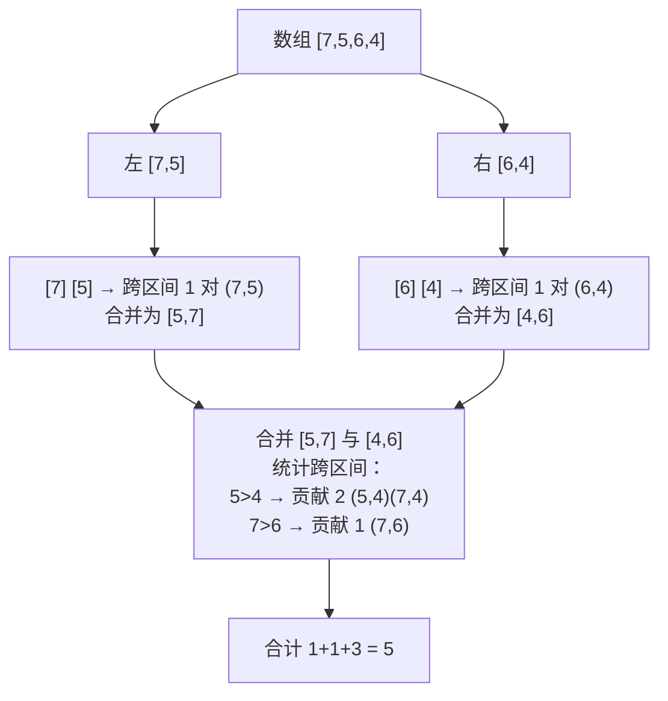

### 归并解法（标准答案）

```java
class Solution {
    private int[] tmp;
    public int reversePairs(int[] nums) {
        tmp = new int[nums.length];
        return (int) mergeCount(nums, 0, nums.length - 1);
    }
    private long mergeCount(int[] a, int l, int r) {
        if (l >= r) return 0;
        int mid = l + (r - l) / 2;
        long cnt = mergeCount(a, l, mid) + mergeCount(a, mid + 1, r);   // 内部
        // 跨区间统计 + 合并
        int i = l, j = mid + 1, k = l;
        while (i <= mid && j <= r) {
            if (a[i] <= a[j]) {
                tmp[k++] = a[i++];                    // 不构成逆序（相等不算）
            } else {
                cnt += mid - i + 1;                   // ★ 核心：一次结算一批
                tmp[k++] = a[j++];
            }
        }
        while (i <= mid) tmp[k++] = a[i++];
        while (j <= r)  tmp[k++] = a[j++];
        System.arraycopy(tmp, l, a, l, r - l + 1);
        return cnt;
    }
}
```

### 逐步追踪（`[7,5,6,4]`）

| 阶段 | 左半 | 右半 | 比较 | 贡献 | 累计 |
|---|---|---|---|---|---|
| 递归 [7,5] | [7] | [5] | 7 > 5 | mid-i+1 = 1 | 1 |
| 递归 [6,4] | [6] | [4] | 6 > 4 | 1 | 2 |
| 合并 [5,7] + [4,6] | i=0(5) | j=0(4) | 5 > 4 | mid-i+1 = 2 | 4 |
| 继续 | i=0(5) | j=1(6) | 5 ≤ 6 | 0（取左） | 4 |
| 继续 | i=1(7) | j=1(6) | 7 > 6 | mid-i+1 = 1 | **5** |

### 四个致命细节（面试官就抓这些）

| 细节 | 正确做法 | 错误后果 |
|---|---|---|
| **相等时取左边** | `if (a[i] <= a[j])` 取左 | 用 `<` 会把相等也算逆序，答案偏大（且破坏稳定性） |
| **贡献量是 `mid - i + 1`** | 因为左半 `[i, mid]` 全部 ≥ a[i] > a[j] | 写成 1 就退化成 O(n²) 的错误计数 |
| **用 long 累加** | 最大 1.25e9，int 勉强够，但多测合并/变体容易溢出 | 溢出后变负数 |
| **合并必须真的做** | tmp 归并 + 拷回 | 不做合并就没有有序性，统计失效 |

### 解法二：树状数组（BIT）+ 离散化

**思路**：从**右往左**扫，对每个 `a[i]`，统计"右侧已经出现的、比它小的元素个数"，即 `query(rank - 1)`；然后把 `rank` 位置上 +1。

```java
class Solution {
    public int reversePairs(int[] nums) {
        int n = nums.length;
        // 1) 离散化：值 → 1..m 的名次
        int[] sorted = nums.clone();
        Arrays.sort(sorted);
        Map<Integer, Integer> rank = new HashMap<>();
        int m = 0;
        for (int v : sorted) if (!rank.containsKey(v)) rank.put(v, ++m);

        int[] bit = new int[m + 1];
        long ans = 0;
        for (int i = n - 1; i >= 0; i--) {
            int r = rank.get(nums[i]);
            ans += query(bit, r - 1);     // 右侧严格更小的个数
            update(bit, r, 1);
        }
        return (int) ans;
    }
    private void update(int[] bit, int i, int v) {
        for (; i < bit.length; i += i & -i) bit[i] += v;
    }
    private int query(int[] bit, int i) {
        int s = 0;
        for (; i > 0; i -= i & -i) s += bit[i];
        return s;
    }
}
```

> **注意 `i & -i`**：这就是**位运算 lowbit**，与第三部分直接呼应——`x & (-x)` 取出最低位的 1，正是 BIT 跳转的核心。**"逆序对 + 树状数组 + lowbit"是把三个知识点串起来的最佳范例。**

| | 归并分治 | 树状数组 |
|---|---|---|
| 时间 | O(n log n) | O(n log n)（含离散化排序） |
| 空间 | O(n) | O(n) |
| 常数 | 较大（递归 + 拷贝） | 较小 |
| 可扩展性 | 适合"带索引"的变体（315） | 适合"值域查询"的变体（327） |
| 是否需离散化 | 否 | 是（值域大时） |

### 解法三：线段树（了解即可）

- 建树 O(m)，单点更新 + 区间查询 O(log m)，思路与 BIT 一致。
- **面试价值**：如果你能说"BIT 能做的，线段树都能做，但线段树常数更大、代码更长；线段树的优势是支持区间修改/区间最值等更复杂操作"，说明你懂两者的边界。

### 变体家族（这一族是"分治统计"的富矿）

| 题号 | 题目 | 与母题的差异 | 关键点 | 权重 |
|---|---|---|---|---|
| 剑指 51 / 面试题 51 | 数组中的逆序对 | 母题 | `a[i] > a[j]` 计数 | ★★★★★ |
| **493** | 翻转对 | 条件变成 `a[i] > 2·a[j]` | **不能用同一次归并统计**！必须先单独双指针统计跨区间，再做归并（因为 2 倍关系破坏了"一批结算"的单调性） | ★★★★★ |
| **315** | 计算右侧小于当前元素的个数 | 要输出每个位置的结果 | 归并时要**携带原始下标**；或 BIT 从右往左 | ★★★★★ |
| **327** | 区间和的个数 | 前缀和 + 值域区间 | 转成"前缀和数组中 `lower ≤ S[j] - S[i] ≤ upper` 的对数" | ★★★★★ |
| 2428 / 2179 类 | 各种"统计对" | 条件变形 | 核心：能否在归并时"批量结算" | ★★★☆☆ |
| 1649 | 统计全为 1 的子矩阵 | 不是逆序对，但同属"分治计数" | 按行切分统计跨行贡献 | ★★★★☆ |

**493 的写法要点（必考细节）**：

```java
// 在归并之前，先做一次"只统计不合并"的双指针
int j = mid + 1;
for (int i = l; i <= mid; i++) {
    while (j <= r && (long) a[i] > 2L * a[j]) j++;   // 2L 防溢出
    cnt += j - (mid + 1);
}
// 然后再正常归并（这次归并只为排序，不再计数）
```

> **为什么不能合并成一次？** 因为 `a[i] > 2a[j]` 的成立性对 i 的移动**不是单调的累积关系**（1 个 i 可能对应多个 j，且归并中 i、j 交错移动会打乱双指针的单调前提）。**这是本题最容易出错的地方，也是区分"背模板"与"真理解"的分水岭。**

**327 的转化（三步走）**：
1. 前缀和 `pre[0]=0, pre[k]=a[0]+...+a[k-1]`；
2. 原题 `lower ≤ sum(i..j) ≤ upper` ⇔ `lower ≤ pre[j] - pre[i] ≤ upper` ⇔ `pre[j] - upper ≤ pre[i] ≤ pre[j] - lower`（i < j）；
3. 在归并中对前缀和数组做"统计 + 排序"，双指针左右夹（因为有两个界，需要两个指针）。

## 2.6 分治大厂真题清单（含权重）

### 2.6.1 排序类（★★★★★，几乎是必考）

**148. 排序链表**（字节 / 腾讯 / 阿里高频，★★★★★）

- **为什么单独考链表**：链表的归并可以做到 **O(1) 额外空间**（数组归并必须 O(n)）。
- **三个必须写对的点**：
  1. **找中点用快慢指针**：`slow` 走 1 步、`fast` 走 2 步，`fast` 到尾部时 `slow` 在中点（偶数个时取**前**中点，避免死循环）；
  2. **必须断开**：`slow.next = null`，否则递归无限；
  3. **合并用 dummy 头**，避免空指针判断分支。
- **自底向上归并（进阶，O(1) 空间无递归栈）**：`step = 1, 2, 4, 8...` 每次两两合并长度为 step 的段。**能写出这个版本，说明你不是背题。**

```java
ListNode sortList(ListNode head) {
    if (head == null || head.next == null) return head;
    ListNode slow = head, fast = head.next;
    while (fast != null && fast.next != null) { slow = slow.next; fast = fast.next.next; }
    ListNode mid = slow.next; slow.next = null;          // 断开
    ListNode l = sortList(head), r = sortList(mid);
    return merge(l, r);
}
ListNode merge(ListNode a, ListNode b) {
    ListNode dummy = new ListNode(0), t = dummy;
    while (a != null && b != null) {
        if (a.val <= b.val) { t.next = a; a = a.next; }   // <= 保证稳定
        else { t.next = b; b = b.next; }
        t = t.next;
    }
    t.next = (a != null) ? a : b;
    return dummy.next;
}
```

**23. 合并 K 个升序链表**（★★★★★）

- **三种解法对比表**（面试必须能说清优劣）：

| 方案 | 时间 | 空间 | 适用 |
|---|---|---|---|
| 顺序两两合并 | O(k²n)（k 个链表各长 n） | O(1) | 差，别写 |
| **分治两两合并** | **O(kn log k)** | O(log k) 栈 | 推荐，实现简单 |
| **最小堆（PriorityQueue）** | O(kn log k) | O(k) | 流式/动态场景更好 |

- **分治版关键**：`mergeRange(lists, l, r)` 对半切，合并左右结果 —— 这就是"归并排序的外壳套在链表上"。
- **追问**："k = 10^5，总元素 10^6？" → 分治递归深度 log k ≈ 17，没问题；堆方案空间 k 个节点引用也可控。**分治和堆在这里复杂度相同，选实现更简单的分治。**

**215. 数组中的第 K 个最大元素**（★★★★★，字节/美团极高频）

| 方案 | 时间 | 说明 |
|---|---|---|
| 排序后取 | O(n log n) | 基线，先说出来 |
| 小顶堆 | O(n log k) | 适合**流式数据**（数据不断来，只要 top k） |
| **快速选择（quickselect）** | **平均 O(n)**，最坏 O(n²) | 面试主答案，基于 partition |
| **BFPRT / 中位数的中位数** | **最坏 O(n)** | 加分项，能讲清"为什么 9/10 < 1"就赢 |

- **快速选择要点**：每次 partition 后只递归**包含第 k 个的那一侧**，另一边直接丢弃 → 期望 O(n)（几何级数 n + n/2 + n/4 + ... = 2n）。
- **最坏 O(n²) 的触发**：每次 pivot 都取到极值（有序数组 + 固定 pivot）。
- **BFPRT 五步**：① 5 个一组排序取中位数；② 对中位数数组递归求中位数的中位数 p；③ 用 p 划分；④ 判断 k 落在哪边；⑤ 只递归一侧。**关键是这保证了每次至少淘汰 3n/10 个元素**（p 至少有 3n/10 个元素比它小/大），于是 T(n) ≤ T(n/5) + T(7n/10) + O(n)。

**4. 寻找两个正序数组的中位数**（★★★★★，难度标"困难"，阿里/字节终面常客）

- **核心**：不用归并（O(m+n) 会被要求优化），而是**二分分割点**。
- **思路**：在较短数组 A 上二分 `i`（A 左半取 i 个），则 B 左半取 `j = (m+n+1)/2 - i` 个。需要满足 `A[i-1] ≤ B[j]` 且 `B[j-1] ≤ A[i]`。
- **复杂度**：**O(log min(m,n))** —— 这是"分治作用在答案空间上"的典型（二分答案/划分位置，而不是二分数据）。
- **易错**：用 `Integer.MIN_VALUE / MAX_VALUE` 处理越界（`i=0` 或 `i=m` 时）；奇数长度取左半最大，偶数取两侧均值。
- **一句话总结**："把'找中位数'转成'找一条分割线，使左半元素全部 ≤ 右半元素'"。

### 2.6.2 分治计数类（★★★★★）

| 题号 | 题目 | 核心 | 提示 |
|---|---|---|---|
| 剑指 51 | 逆序对 | 归并跨区间 | 母题 |
| 493 | 翻转对 | 双指针统计 + 归并 | `2L *` 防溢出，且统计与合并不混 |
| 315 | 右侧小于当前元素 | 归并带下标 | 用 `index[]` 数组，或 BIT 倒序 |
| 327 | 区间和个数 | 前缀和 + 双指针 | 两个界，两个指针 |
| 1649 | 全 1 子矩阵 | 按行分治 | 每行高度直方图贡献 |
| 1508 / 1585 类 | 子数组和排序 | 堆 + 二分 | 偏难 |

**315 的实现要点（最容易被追问）**：

```java
// 归并时带上原始下标
int[] idx;   // idx[k] 表示"当前排在第 k 位的元素，原始下标是多少"
// 合并阶段：当右半元素 a[j] 被取出时，说明它比左半 [i, mid] 都小
//   → 左半这些元素的"右侧小于自己的个数"都 +1
//   为避免 O(n) 逐个加，反向思考：
//   当左半元素 a[i] 被取出时，说明右半已经取出了 j-(mid+1) 个比它小的
```

> **两种等价写法**：① 右半取出时给左半剩余元素统一 +1（需懒标记/差分）；② **左半取出时，把"右半已取出的个数"记给它的原始下标**。第二种是标准写法，代码里只需 `count[idx[i]] += j - (mid+1)`。

### 2.6.3 分治经典模型题（★★★★☆）

**53. 最大子数组和（分治解法）**

- 主流的 O(n) Kadane 是 DP，但面试官常问"分治怎么做"。
- **分治**：最大子数组要么在左半、要么在右半、要么**跨越中点**。跨中点的情况用"从中点向左求最大后缀和 + 向右求最大前缀和"O(n) 求出。
- 复杂度 Θ(n log n)。**价值在于训练"跨区间贡献"的思维**，与逆序对同源。

```java
int solve(int[] a, int l, int r) {
    if (l == r) return a[l];
    int mid = l + (r - l) / 2;
    int left = solve(a, l, mid), right = solve(a, mid+1, r);
    int sum = 0, lmax = Integer.MIN_VALUE;
    for (int i = mid; i >= l; i--) { sum += a[i]; lmax = Math.max(lmax, sum); }
    sum = 0; int rmax = Integer.MIN_VALUE;
    for (int i = mid+1; i <= r; i++) { sum += a[i]; rmax = Math.max(rmax, sum); }
    return Math.max(Math.max(left, right), lmax + rmax);
}
```

**169. 多数元素（分治解法）**

- 若某元素在数组中过半，则它至少在左半或右半中过半 → 递归求出左右候选，再数出现次数校验。
- 复杂度 Θ(n log n)；最优是 Boyer-Moore 投票 O(n)/O(1)。**面试写法：先给投票法（最优），再讲分治法（体现思维广度）。**

**241. 为运算表达式设计优先级**

- 本质：**按运算符切分**，每个运算符位都是一个"分治切点"，笛卡尔积合并左右结果。
- 递归式 `T(n) = Σ T(i)·T(n-i)` → **卡特兰数级**，n=20 会爆；需**记忆化**（字符串 → 结果列表）。
- **这题是"分治 + 记忆化 = 区间 DP"的桥**，能说出"分治去重后就是 DP"很加分。

**105 / 106. 从前序/中序（后序）构造二叉树**

- 前序第一个是根，在中序中定位根 → 左右子树长度确定 → 递归。
- 优化：用 HashMap 存中序的"值→下标"，把每层定位从 O(n) 降到 O(1)，总 O(n)。
- **易错**：递归边界 `(preL, preR, inL, inR)` 四个参数的含义；数组越界；重复元素时不唯一。

**50. Pow(x, n) / 剑指 16. 数值的整数次方**（★★★★★，分治 + 位运算双考点）

```java
double myPow(double x, int n) {
    long N = n;                       // 防 -Integer.MIN_VALUE 取反溢出
    if (N < 0) { x = 1 / x; N = -N; }
    double ans = 1.0, base = x;
    while (N > 0) {                   // 二进制分解指数：位运算版分治
        if ((N & 1) == 1) ans *= base;
        base *= base;
        N >>= 1;
    }
    return ans;
}
```

- **为什么必须用 long 存 n**：`n = -2147483648` 时 `-n` 溢出仍是负数 → 死循环。
- **递归版**：`x^n = x^{n/2} · x^{n/2} · (n 奇数 ? x : 1)`，T(n)=T(n/2)+O(1) → O(log n)。**迭代版把"分治"落到了二进制位分解上，是分治与位运算的天然交汇点。**

**大整数乘法（Karatsuba）**

- 朴素分块乘法：4 次子乘法 → Θ(n²)。
- Karatsuba：用 `(a1+a0)(b1+b0) - a1b1 - a0b0` 把 4 次乘法降为 **3 次**，代价是加法变多 → Θ(n^1.585)。
- 面试价值：不必会写完整代码，能讲清"**用加减法换乘法**"的思路 + 主定理算出 1.585 就是 A 档。

**最近点对（Closest Pair）**

- 分治：按 x 排序切两半，递归求左右最小距离 d；跨中线的点按 y 排序，只需比较 y 差 < d 的点，且每个点最多比 7 个邻居 → O(n)。
- 总 Θ(n log n)。**"每个点最多比 7 个"这个常数结论是面试的高分点**（因为宽度 d 的带子里最多放 8 个点，否则会违反 d 是最小距离）。

### 2.6.4 分治在工程/系统题里的影子（★★★★☆，大数据岗重点）

| 工程场景 | 分治思想 | 面试说法 |
|---|---|---|
| **海量数据排序** | 分块 + 多路归并 | 外部排序，见 2.4 |
| **Top K（10 亿数据取最大 100）** | 分块统计 top100 → 归并 | 或哈希分桶后各桶取 top100 |
| **海量 URL 去重** | 哈希分桶（同一 URL 必落同一桶）→ 各桶内去重 | **分治 + 哈希**，桶数受内存限制 |
| **统计海量日志的 UV** | 分桶 + 位图/精确去重 | 或 HyperLogLog（近似） |
| **MapReduce** | map 切分 → shuffle 按 key 分区 → reduce 归并 | 本质是**分治 + 分组** |
| **分布式排序** | 范围分区（range partition） | 类似归并；采样确定分区边界 |
| **快速排序的工程化** | 内省排序（introsort）= 快排 + 堆排 + 插入 | 深度超限转堆排，避免 O(n²) |
| **归并排序的工程化** | TimSort | 找 run + 插入 + 归并 |

> **"10 亿个数找最大 100 个"标准答法**（字节/阿里大数据面高频）：
> ① 数据切成 k 块（k 由内存定），每块维护一个 size=100 的**小顶堆**，得到 k 个有序 top100；
> ② 对 k 个 top100 做 **k 路归并**（堆），取全局前 100。
> 复杂度 O(N log 100)，内存 O(k × 100)。

### 2.6.5 分治题目速查表

| 题号 | 题目 | 技巧 | 难度 | 权重 |
|---|---|---|---|---|
| 912 | 排序数组 | 归并/快排/堆 | 中 | ★★★★★ |
| 148 | 排序链表 | 链表归并 + 断开 | 中 | ★★★★★ |
| 23 | 合并 K 个升序链表 | 分治合并 / 堆 | 难 | ★★★★★ |
| 215 | 第 K 大 | 快选 / 堆 / BFPRT | 中 | ★★★★★ |
| 4 | 两个正序数组的中位数 | 二分分割线 | 难 | ★★★★★ |
| 剑指 51 | 逆序对 | 归并计数 | 难 | ★★★★★ |
| 493 / 315 / 327 | 翻转对 / 右侧更小 / 区间和 | 归并变体 | 难 | ★★★★★ |
| 53 | 最大子数组（分治版） | 跨中点 | 中 | ★★★★☆ |
| 169 | 多数元素（分治版） | 候选 + 校验 | 易 | ★★★☆☆ |
| 241 | 表达式加括号 | 按运算符切分 | 中 | ★★★☆☆ |
| 105 / 106 | 重建二叉树 | 分治 + 哈希 | 中 | ★★★★☆ |
| 50 / 剑指 16 | Pow(x,n) | 快速幂 | 中 | ★★★★★ |
| 240 / 74 | 搜索二维矩阵 | 分治式缩减 / 二分 | 中 | ★★★☆☆ |
| 95 / 96 | 不同的二叉搜索树 | 卡特兰 + 分治/DP | 中 | ★★★☆☆ |

---

# 第三部分 位运算（Bit Manipulation）

## 3.1 底层：补码、符号位、移位语义

### 3.1.1 整数的三种表示

| 表示 | 规则 | 例子（8 位，+5 / -5） |
|---|---|---|
| **原码** | 最高位符号位（0 正 1 负），其余是绝对值 | `0000 0101` / `1000 0101` |
| **反码** | 正数同原码；负数符号位不变，其余取反 | `0000 0101` / `1111 1010` |
| **补码** | 正数同原码；负数 = 反码 + 1 | `0000 0101` / `1111 1011` |

**为什么用补码**（面试常问）：

1. **把减法变成加法**：`a - b = a + (-b)`，硬件只需一个加法器，不需要单独的减法电路；
2. **消除 +0 和 -0**：原码里 `0000 0000` 和 `1000 0000` 都是 0，补码里只有一个 0，表示范围多出一个数；
3. **范围不对称**：n 位补码表示 `[-2^{n-1}, 2^{n-1}-1]`。以 32 位 int 为例，范围是 `[-2147483648, 2147483647]`，**负数比正数多一个**。

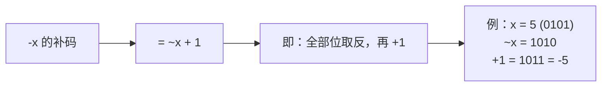

### 3.1.2 一个必须内化的恒等式

**`-x = ~x + 1`**（补码定义）。

由它可推出本专题最值钱的公式：

**`x & (-x) = x & (~x + 1)` = 取出 x 的最低位的 1（lowbit）**

**证明**：设 x 的二进制最低位 1 在第 k 位（从 0 计），则 x 的第 0~k-1 位全为 0、第 k 位为 1。`~x` 的第 0~k-1 位全为 1、第 k 位为 0。`~x + 1` 会使低 k 位发生进位：第 0~k-1 位归零、第 k 位变回 1，高位保持 `~x` 的翻转状态。于是 `x & (~x+1)` 只有第 k 位同时为 1，其余全为 0。

```
x      = 1011 0100
~x     = 0100 1011
~x + 1 = 0100 1100
x & -x = 0000 0100   ← 只有第 2 位（值 4）保留
```

> **lowbit 的两个用途**：① 树状数组的跳转 `i += i & -i`；② 取出最低位 1 用于分组（260 题的核心）。

### 3.1.3 移位语义：三种语言三种坑

| 运算 | Java（int, 32 位） | C/C++ | Python |
|---|---|---|---|
| `x << k` | 逻辑左移，**移位量取 k & 31**（`1 << 33` == `1 << 1`） | 移位量 ≥ 位宽是 **UB** | 无限精度，任意 k |
| `x >> k` | **算术右移**（符号位复制，即"向下取整除以 2^k"） | 有符号负数右移**实现定义**（gcc 实际是算术） | 算术右移（保留符号，`-1 >> 1 == -1`） |
| `x >>> k` | **逻辑右移**（高位补 0） | 无此运算符，用无符号类型 | **无此运算符**（需先转成非负或用掩码） |
| `-x` | `~x + 1` | 同 | `~x + 1`（`~x = -x-1`） |
| 溢出 | 静默回绕（`Integer.MAX_VALUE + 1 == MIN_VALUE`） | 有符号溢出是 UB | **不会溢出**（自动扩位） |

**必须记住的三个事实**：

1. **Java 的移位量是 mod 32**：`1 << 32 == 1`，`1 << 33 == 2`。这不是 bug 是 JLS 规定（字节码 `ishl` 只用低 5 位）。**面试写 `1 << n` 时若 n 可能 ≥ 32，必须用 `1L << n`。**
2. **Java 的 `>>` 对负数是算术右移**：`-8 >> 1 == -4`，`-1 >> 1 == -1`（永远到不了 0，**负数右移写 while 循环会死循环**）。
3. **Python 没有溢出，也没有 `>>>`**：做位运算题时要把"32 位有符号"的语义手动模拟出来（如 `n & 0xFFFFFFFF`，再判断符号）。

```java
// 典型错误：Java 中用 >> 处理"无符号"场景
int n = -1;
while (n > 0) { ... }        // 死循环！n 永远 > 0 因为 -1 >> 1 还是 -1... 
                             // 实际上 -1 > 0 为 false，不进循环；换成 n != 0 才是死循环
// 正确：用 >>> 或无符号比较
while (n != 0) { n >>>= 1; } // 逻辑右移，32 次后变 0
```

### 3.1.4 有符号 vs 无符号：一个"看起来对但错"的例子

**求 `-1` 的二进制中 1 的个数**：

| 语言/写法 | 结果 | 原因 |
|---|---|---|
| Java `Integer.bitCount(-1)` | 32 | 补码全 1，正确 |
| Java `while (n > 0) { cnt++; n &= n-1; }` | 0 | `n > 0` 直接跳过 |
| Java `while (n != 0) { cnt++; n &= n-1; }` | 32 | 正确 |
| C `while (n) { cnt++; n &= n-1; }`（int n=-1） | 32 | 正确 |
| Python `bin(-1).count('1')` | 0 | Python 的 -1 是 `...111` 无限 1，`bin` 返回 `-0b1` |

> **结论**：涉及负数时，先明确"是 32 位还是无限位"，再选模板。面试时主动指出这一点，面试官会认为你真懂底层。

## 3.2 十大必背技巧

### 技巧 1：`x & (x - 1)` —— 清除最低位的 1

```
x      = 1011 0100
x - 1  = 1011 0011
x&(x-1)= 1011 0000   ← 最低位的 1 被清零
```

**用途 A：统计 1 的个数（Brian Kernighan 算法）**

```java
int countOnes(int x) {
    int cnt = 0;
    while (x != 0) { x &= x - 1; cnt++; }   // 每次消掉一个 1
    return cnt;
}
```
复杂度 **O(popcount)**，而非 O(32)。比"逐位检查"快，因为循环次数 = 1 的个数。

> Java 的 `Integer.bitCount` 更快，用的是 **SWAR（SIMD Within A Register）** 并行位计数：
> ```java
> public static int bitCount(int i) {
>     i = i - ((i >>> 1) & 0x55555555);                    // 每 2 位一组计数
>     i = (i & 0x33333333) + ((i >>> 2) & 0x33333333);      // 每 4 位一组
>     i = (i + (i >>> 4)) & 0x0f0f0f0f;                     // 每 8 位一组
>     i = i + (i >>> 8);                                    // 每 16 位
>     i = i + (i >>> 16);                                   // 合并
>     return i & 0x3f;
> }
> ```
> **这个实现本身就是"分治 + 位运算"的杰作**：把 32 位分成 16 组 → 8 组 → 4 组 → 2 组 → 1 组，每层用掩码 + 移位并行处理所有组。O(log 32) = O(1)。面试能默写出这个，是极强的信号。

**用途 B：判断是否为 2 的幂**

```java
boolean isPowerOfTwo(int n) { return n > 0 && (n & (n - 1)) == 0; }
```
原理：2 的幂的二进制只有 1 个 1，减 1 后变成"低位全 1"，与运算必为 0。

**用途 C：判断是否为 4 的幂**

```java
boolean isPowerOfFour(int n) {
    return n > 0 && (n & (n - 1)) == 0 && (n & 0xAAAAAAAA) == 0;
    // 0xAAAAAAAA = 1010...1010，4 的幂的 1 必在偶数位（第 0、2、4... 位）
}
```

### 技巧 2：`x & (-x)` —— lowbit

见 3.1.2。用于 BIT、分组、`Integer.highestOneBit` 的反面。

```java
int lowbit(int x) { return x & -x; }              // 最低位的 1
int highestOneBit(int x) {                        // 最高位的 1（Java 实现）
    x |= x >>> 1; x |= x >>> 2; x |= x >>> 4; x |= x >>> 8; x |= x >>> 16;
    return x - (x >>> 1);
}
```
`highestOneBit` 的思路：**把最高位 1 向右"铺满"**（每次用已铺开的长度翻倍），再减掉右移一位的结果。又是"分治式倍增"。

### 技巧 3：异或的四条性质

| 性质 | 表达式 |
|---|---|
| 交换律 | `a ^ b = b ^ a` |
| 结合律 | `(a ^ b) ^ c = a ^ (b ^ c)` |
| 自反（消去） | `a ^ a = 0`，`a ^ 0 = a` |
| 按位独立 | 每一位的结果只依赖该位 |

**由这四条推出**：一串数异或的结果，等于"出现奇数次的那些数的异或"，因为出现偶数次的全部两两抵消。

**用途 A：不用临时变量交换（但有坑）**

```java
a ^= b; b ^= a; a ^= b;
// 坑：若 a 和 b 是同一个变量（同一地址），会变成 0
// int[] arr; swap(arr, i, i) → arr[i] 变成 0
```
> **面试话术**："异或交换在 a、b 是同一变量时会清零，工程上不如临时变量（编译器优化后临时变量版本同样快，且可读性更好）。这题考的是理解，不是实践。"

**用途 B：判断奇偶**：`x & 1 == 1` 为奇。

**用途 C：求绝对值（无分支，仅作了解）**

```java
int mask = x >> 31;                    // 负数得 -1（全 1），正数得 0
int abs = (x + mask) ^ mask;           // 等价于 (x ^ mask) - mask
// 注意：Integer.MIN_VALUE 会溢出，仍是负数
```

### 技巧 4：取位 / 置位 / 清位 / 翻转位（"四位一体"）

```java
boolean getBit(int x, int k)   { return ((x >> k) & 1) == 1; }
int  setBit(int x, int k)      { return x | (1 << k); }
int  clearBit(int x, int k)    { return x & ~(1 << k); }
int  toggleBit(int x, int k)   { return x ^ (1 << k); }
int  updateBit(int x, int k, boolean v) { return v ? setBit(x,k) : clearBit(x,k); }
```

**取低 k 位**：`x & ((1 << k) - 1)`。
**取高 k 位**（32 位）：`x >>> (32 - k)`。
**清最低位的 1 以外的所有位**：`x & -x`。
**把最低位的 0 置 1**：`x | (x + 1)`。

> **工程映射（说出来很加分）**：
> - **权限系统**：`READ=1<<0, WRITE=1<<1, EXEC=1<<2`，用户权限 `perm`，判断 `(perm & READ) != 0`，授权 `perm |= WRITE`，回收 `perm &= ~WRITE`。这就是 Linux 文件权限 `rwx`（421）的本质。
> - **TCP 标志位**：SYN / ACK / FIN 各占一位，抓包时的 flags 字段就是这玩意。
> - **IPv4 子网掩码**：`/24` ⇔ `255.255.255.0` ⇔ `0xFFFFFF00`，主机号 = `ip & ~mask`，网络号 = `ip & mask`。**"判断两个 IP 是否同子网"= `(ip1 & mask) == (ip2 & mask)`，这是网络岗必考。**

### 技巧 5：子集枚举 `i = (i - 1) & mask`

```java
// 枚举 mask 的所有子集（含空集和自身），按降序
for (int sub = mask; sub > 0; sub = (sub - 1) & mask) { ... }
// 总次数 = 2^popcount(mask)
```
**原理**：减 1 让最低位的 1 变 0、其后的 0 变 1，再与 mask 相与就"裁掉"了不属于 mask 的位，得到下一个字典序更小的子集。

**复杂度**：枚举所有 mask 的子集总时间 `Σ 2^{popcount} = 3^n`（n 位每位有三种状态：不在 mask / 在 mask 但不在 sub / 在 sub）。**这是"3^n 枚举"的标准写法**（如 *982. 按位与为零的三元组* 类）。

### 技巧 6：二进制枚举 + Gosper's Hack（枚举固定 popcount 的组合）

```java
// 下一个 popcount 相同的数
int nextComb(int x) {
    int low = x & -x;
    int t = x + low;
    return t | (((x ^ t) >> 2) / low);
}
```
**用途**：枚举"选 k 个"的所有组合（状态压缩题）。不用 Gosper 也能做（`for i in 0..2^n` 判断 popcount），但 Gosper 是 O(1) 跳到下一个、且总数精确 C(n,k)。

### 技巧 7：位运算实现加减乘除

**加法**（*371. 两整数之和*，不能用 +）：

```java
int add(int a, int b) {
    while (b != 0) {
        int carry = (a & b) << 1;    // 进位：同 1 的位置产生进位，左移一位
        a = a ^ b;                   // 无进位和：异或就是"不进位的加法"
        b = carry;
    }
    return a;
}
```
**原理**：`a ^ b` = 本位和（不进位），`(a & b) << 1` = 进位。循环直到进位为 0。**这是全加器的软件实现，面试讲这句会被认可。**

**减法**：`a - b = add(a, add(~b, 1))`（即 a + (-b)）。

**乘法**：`a * b = Σ (b 的第 i 位为 1 ? a << i : 0)`，O(32)。

```java
int multiply(int a, int b) {
    int res = 0;
    while (b != 0) {
        if ((b & 1) == 1) res += a;
        a <<= 1; b >>>= 1;           // 注意 b 用无符号右移，否则负数死循环
    }
    return res;
}
```

**除法**（*29. 两数相除*，不能用 * / %，且要处理溢出）：

```java
// 核心：把被除数不断减去"除数 << k"，k 从大到小
// 关键边界：dividend = MIN, divisor = -1 → 结果溢出，返回 MAX
long a = Math.abs((long) dividend), b = Math.abs((long) divisor);
long ans = 0;
for (int i = 31; i >= 0; i--) {
    if ((a >> i) >= b) { ans += 1L << i; a -= b << i; }
}
return (int) ((dividend ^ divisor) < 0 ? -ans : ans);
```
**必须用 long 的核心原因**：`Math.abs(Integer.MIN_VALUE)` 仍是负数（补码范围不对称，见 3.1.1）。这是位运算题最经典的溢出坑。

### 技巧 8：按位统计（每一位独立计数）

**模板**：对一个数组，**逐位统计 1 的个数**，再按题意决定该位是 0 还是 1。

```java
int ans = 0;
for (int k = 0; k < 32; k++) {
    int cnt = 0;
    for (int x : nums) cnt += (x >> k) & 1;
    if (cnt % 3 != 0) ans |= (1 << k);    // 模 k 计数
}
```
**用途**：137（出现 3 次）、面试题 17.19、任意"出现 k 次"的通用解法。**这是位运算里最"万能"的模板，背下来能解一族题。**

### 技巧 9：位图（Bitmap）/ BitSet

**一个 int 表示 32 个布尔**，内存压缩 32 倍。

```java
class BitMap {
    private final long[] bits;                    // 每个 long 管 64 位
    public BitMap(int n) { bits = new long[(n >> 6) + 1]; }
    public void set(int i)   { bits[i >> 6] |=  (1L << (i & 63)); }
    public void clear(int i) { bits[i >> 6] &= ~(1L << (i & 63)); }
    public boolean get(int i){ return (bits[i >> 6] & (1L << (i & 63))) != 0; }
}
```
**用途**：
- **40 亿整数去重 / 找缺失**：40 亿 × 4B = 16GB，位图只需 40 亿 bit = **512MB**（可接受）；
- **Bitmap 排序**：值域 0~N 的整数，置位后顺序扫描输出，O(N)；
- **Redis 的 BITCOUNT / SETBIT / GETBIT**、**布隆过滤器**（多个哈希 + 位图，只有假阳性无假阴性）；
- **Java 的 `BitSet`**、**Lucene 倒排索引的位图（Roaring Bitmap，分段 + 容器，压缩率极高）**。

> **面试题"40 亿个不重复的 unsigned int，内存 1G，找出一个不存在的数"** 的两种解法（第四部分详讲）：位图法（512MB）与**按位分治**法（内存 O(1) 级别，反复读文件）。

### 技巧 10：状态压缩（把"集合"塞进一个整数)

**核心**：n 个元素，每个"选/不选"，用 int 的第 i 位表示元素 i 是否被选。`state ∈ [0, 2^n)`。

```java
// 例：1125. 最小的必要团队 —— dp[mask] 表示覆盖技能集 mask 的最少人数
// dp[0] = 0; 转移：dp[mask | team[k]] = min(dp[mask|team[k]], dp[mask] + 1)
```

| 场景 | n 上限 | 复杂度 | 代表题 |
|---|---|---|---|
| 子集枚举 | 20 | O(2^n) | 78. 子集 |
| 状压 DP | 20~22 | O(2^n·n) | 1125、464、691、1494、1799、526 |
| 棋盘状压（插头 DP） | 列数 ≤ 12 | O(n·2^m) | 1349 类、LCP 类 |
| TSP | 20 | O(2^n·n²) | 经典状压 |

> **判断能不能状压**：看 n 是否 ≤ 20~22。超过 25 基本不行（2^25 = 3300 万状态 × 转移就爆）。

## 3.3 母题 136. 只出现一次的数字 及整个系列

### 3.3.1 母题本体

> 给你一个**非空**整数数组 `nums`，除某个元素只出现**一次**外，其余每个元素均出现**两次**。找出那个只出现了一次的元素。
> 要求：线性时间复杂度，**不使用额外空间**。

### 解法：全员异或

```java
class Solution {
    public int singleNumber(int[] nums) {
        int ans = 0;
        for (int x : nums) ans ^= x;
        return ans;
    }
}
```

### 为什么对：三层证明（面试要讲到第二层，能讲第三层是加分）

**第一层（代数）**：异或满足交换律、结合律，且 `a ^ a = 0`、`a ^ 0 = a`。因此整串异或可以任意重排为 `(x1^x1) ^ (x2^x2) ^ ... ^ single ^ 0...0 = single`。

**第二层（按位独立，关键）**：异或是**逐位**运算，每一位互不影响。对任意一位：
- 若该位在 single 中是 1：其它数成对出现，这一位上 1 的个数是"2k + 1"（奇数），异或结果为 1；
- 若该位在 single 中是 0：1 的个数是偶数，异或结果为 0。
每一位都被正确还原 ⇒ 整个数被正确还原。**这个论证可以推广到任何"按位统计"的场景（137、260 都靠它）。**

**第三层（硬件）**：异或 = 无进位加法，天然可并行（CPU 一个周期处理 32/64 位），所以 O(n) 且常数极小。

### 复杂度

| | 值 |
|---|---|
| 时间 | O(n)，n-1 次异或 |
| 空间 | **O(1)** |

### 边界与变体入口

| 情况 | 结果 |
|---|---|
| 数组只有 1 个元素 | 返回它本身 |
| 有负数 | 补码下异或依然成立（无需特判） |
| 有 0 | `x ^ 0 = x`，不影响 |
| 元素重复 3 次而非 2 次 | 异或法失效 → 见 137 |

### 3.3.2 系列一：137. 只出现一次的数字 II（其余出现三次）

**为什么异或失效**：`a ^ a ^ a = a`（不是 0），三个相同元素不会抵消。

#### 解法 A：按位统计 mod 3（最通用、最好讲）

对每一位统计 1 的个数，`% 3` 后剩下的就是 single 在该位的值。

```java
class Solution {
    public int singleNumber(int[] nums) {
        int ans = 0;
        for (int k = 0; k < 32; k++) {
            int cnt = 0;
            for (int x : nums) cnt += (x >>> k) & 1;   // 用 >>> 保证负数也按位取
            if (cnt % 3 != 0) ans |= (1 << k);
        }
        return ans;
    }
}
```

| | 值 |
|---|---|
| 时间 | O(32n) = O(n) |
| 空间 | O(1) |
| 优点 | **模板化，改成"出现 k 次"只需把 3 改成 k** |
| 缺点 | 常数 32 倍，比解法 B 慢 |

#### 解法 B：两位状态机（ones / twos），O(n) 且常数极小

**思想**：用一个"二进制计数器"记录每一位上 1 出现的次数 mod 3。因为 mod 3 需要 0、1、2 三个状态，用**两个 bit**（`ones`、`twos`）表示：

| 累计次数 mod 3 | twos | ones |
|---|---|---|
| 0 | 0 | 0 |
| 1 | 0 | 1 |
| 2 | 1 | 0 |
| 3 → 归 0 | 0 | 0 |

```java
class Solution {
    public int singleNumber(int[] nums) {
        int ones = 0, twos = 0;
        for (int x : nums) {
            ones = (ones ^ x) & ~twos;    // 先更新 ones
            twos = (twos ^ x) & ~ones;    // 再用"新的 ones"更新 twos
        }
        return ones;
    }
}
```

**为什么这样写对（现场推导，这是面试的杀手锏）**：

设某一位当前状态是 `(twos, ones)`，来一个新 bit `x`：

- 若 `x = 0`：状态不变。`ones ^ 0 = ones`，`& ~twos` 不改变（因为 twos=1 时 ones 必为 0，不影响）；`twos ^ 0 = twos`，`& ~ones(new)` 也不变。✅
- 若 `x = 1` 且当前 `(0,0)`：`ones = (0^1) & ~0 = 1`；`twos = (0^1) & ~1 = 0` → 状态 `(0,1)`，计数 1。✅
- 若 `x = 1` 且当前 `(0,1)`：`ones = (1^1) & ~0 = 0`；`twos = (0^1) & ~0 = 1` → 状态 `(1,0)`，计数 2。✅
- 若 `x = 1` 且当前 `(1,0)`：`ones = (0^1) & ~1 = 0`；`twos = (1^1) & ~0 = 0` → 状态 `(0,0)`，计数归 0。✅

**关键：`ones` 必须先算，`twos` 用新的 `ones` 算。** 顺序写反就错（很多人背错在这里）。

**推广到"出现 k 次"**：k=4 用 3 个 bit，k=5 用 3 个 bit…… 通用写法是用一个"模 k 计数器"，每来一个 x，对所有计数器位做"加 1 mod k"的位运算。k 为 2 的幂时可退化为纯位运算技巧；k=3 的两位版本是最常考的。

#### 解法 C：数学法（求和）

`(所有元素之和 - single) % 3 == 0` ⇒ `single = (3 * 不同元素之和 - 数组总和) / 2`。
**问题**：需要 HashSet 存不同元素（O(n) 空间），且大数会溢出。**只作为"能说出第三种思路"的加分项，不推荐作为主答案。**

### 3.3.3 系列二：260. 只出现一次的数字 III（两个单身 + 其余成对）

**思路三步**：

1. **全员异或** 得 `xorAll = a ^ b`（a、b 是两个目标数）；
2. **取 lowbit** `mask = xorAll & -xorAll`——这一位在 a 和 b 中**必然不同**（否则 xorAll 该位为 0），所以能用来**把数组分成两组**，每组各含一个目标数；
3. **两组分别全员异或**，得到 a 和 b。

```java
class Solution {
    public int[] singleNumber(int[] nums) {
        int xorAll = 0;
        for (int x : nums) xorAll ^= x;
        int mask = xorAll & -xorAll;          // 分组依据：a、b 在这一位不同
        int a = 0, b = 0;
        for (int x : nums) {
            if ((x & mask) == 0) a ^= x;       // 该位为 0 的一组
            else                 b ^= x;       // 该位为 1 的一组
        }
        return new int[]{a, b};
    }
}
```

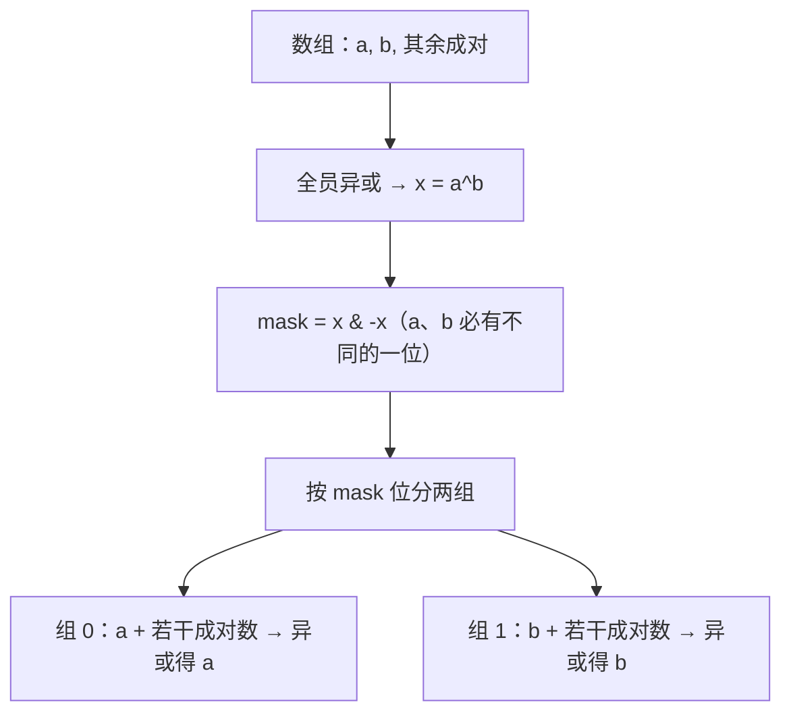

**易错点**：
- `mask` 必须来自 `xorAll`，不是随便取一位；
- 分组后每组内成对元素依然会抵消，这是正确性的保证；
- 返回顺序任意（题目通常不校验）。

### 3.3.4 系列三：268. 缺失数字

> `0..n` 中缺了一个数，数组长度 n，找出它。

**解法 A（异或）**：把 `0..n` 全部异或，再与数组异或，剩下的就是缺失的数。**利用了"同一个数出现两次会抵消"**。

```java
int missingNumber(int[] nums) {
    int x = 0;
    for (int i = 0; i <= nums.length; i++) x ^= i;
    for (int v : nums) x ^= v;
    return x;
}
```
**解法 B（求和）**：`n(n+1)/2 - sum`，注意用 long 防溢出。
**面试对比**：求和法在"值域很大"时溢出；异或法不会溢出，是更优选择。**这个对比是加分点。**

### 3.3.5 系列四：645. 错误的集合（一个重复 + 一个缺失）

**异或法**：

1. 全员异或（数组 + `1..n`）⇒ 得 `dup ^ missing`；
2. lowbit 分组 ⇒ 分成两组，各得一个候选；
3. **校验**：遍历数组，看哪个候选真的出现在数组里 ⇒ 那个是 dup，另一个是 missing。

> **关键差异（很容易忽略）**：260 里两个数**都在**数组里，分组后直接得到答案；645 里**一个是数组里的重复值、一个是数组里不存在的值**，分组后得到的两个值是"候选"，必须回头**校验**才知道谁是 dup。**面试时主动指出这个区别，是理解深度的体现。**

### 3.3.6 系列五：面试题 17.19. 消失的两个数字（1..N 缺两个）

与 260 同构：把 `1..N` 的全集与数组一起异或（或用 `xorAll = xor(1..N) ^ xor(数组)`），得 `a^b`，lowbit 分组，两组各自异或。

```java
// 注意数组是 1..N 缺 2 个，长度为 N-2
int xorAll = 0;
for (int i = 1; i <= n; i++) xorAll ^= i;
for (int v : nums) xorAll ^= v;
int mask = xorAll & -xorAll;
int a = 0, b = 0;
for (int i = 1; i <= n; i++) { if ((i & mask) == 0) a ^= i; else b ^= i; }
for (int v : nums)          { if ((v & mask) == 0) a ^= v; else b ^= v; }
```

### 3.3.7 系列六：如果"出现一次的数是 3 个"？

这是**位运算 + 分治**的经典综合题（面试官用来压轴）：

**思路**：
1. 逐位统计 1 的个数 mod 2，得到 `x = a ^ b ^ c`。取 `x` 的某个为 1 的位 `k`；
2. **按第 k 位分组**。因为 `x` 的第 k 位为 1，说明 a、b、c 中**奇数个**在该位为 1 ⇒ 要么 1 个、要么 3 个。若 3 个，换一位重试；
3. 于是能分成两组：一组含 1 个目标数（其余成对），另一组含 2 个目标数；
4. 组 1 直接用异或；组 2 用 **260 的 lowbit 分组法**；
5. **（可选）分治优化**：不必真的分组，而是在递归中按位"筛"——每次用一位把候选集合减半，直到只剩 1 个候选。

> **这题的价值**：它同时考了 ① 按位统计 ② lowbit 分组 ③ 分治递归 ④ 对"异或消去"适用范围的理解。**能讲清这四层，位运算基本就没死角了。**

### 3.3.8 系列七：区间异或 / 前缀异或

**性质**：`xor(l..r) = pre[r] ^ pre[l-1]`（异或的"前缀和"）。

**经典题**：
- *1310. 子数组异或查询*：`pre[r] ^ pre[l-1]`；
- *1447 类*：异或性质构造；
- **"数组中异或和为 0 的最长子数组"**：等价于找两个相同的前缀异或值 ⇒ 哈希表存"第一次出现的位置"（与"两数之和"同构）。
- *1542? / 1737 类*：贪心 + 位运算。

## 3.4 位运算大厂真题清单（含权重）

### 3.4.1 基础必刷（★★★★★）

| 题号 | 题目 | 核心 | 一句话要点 |
|---|---|---|---|
| 136 / 137 / 260 | 只出现一次的数字 I/II/III | 异或 / 按位 mod / lowbit 分组 | 全系列必须会，是本专题的门面 |
| 191 | 位 1 的个数 | `x & (x-1)` | O(popcount) |
| 190 | 颠倒二进制位 | **分治 + 位运算** | 5 组掩码蝶形交换，见 4.1 |
| 231 / 342 | 2 的幂 / 4 的幂 | `x & (x-1)` | 4 的幂要判偶数位 |
| 461 | 汉明距离 | `bitCount(x ^ y)` | 转成 popcount |
| 477 | 汉明距离总和 | **按位统计 0/1 个数相乘** | `cnt1 * cnt0` 累加，别两两算 |
| 201 | 数字范围按位与 | 找公共前缀 | `while (m < n) n &= n-1` |
| 371 | 两整数之和 | 异或 + 进位 | 全加器 |
| 338 | 比特位计数 | DP + lowbit | `dp[i] = dp[i >> 1] + (i & 1)` 或 `dp[i & (i-1)] + 1` |
| 50 / 剑指 16 | Pow(x,n) | 快速幂 | 指数二进制分解 |
| 29 | 两数相除 | 移位减法 + long 防溢出 | `Math.abs(MIN)` 仍是负 |

**477 的详解（很能体现"位运算思维"）**：

```java
public int totalHammingDistance(int[] nums) {
    int ans = 0, n = nums.length;
    for (int k = 0; k < 32; k++) {
        int cnt1 = 0;
        for (int x : nums) cnt1 += (x >>> k) & 1;
        ans += cnt1 * (n - cnt1);       // 该位上"一个 1 一个 0"的组合数
    }
    return ans;
}
```
> **思维转换**：求"所有对的汉明距离之和"，不要枚举 O(n²) 对，而要**按位独立**——每一位的贡献 = 该位 1 的个数 × 0 的个数。**这个"按位独立求和"是位运算最重要的思想方法，比任何技巧都值钱。**

### 3.4.2 进阶（★★★★☆）

| 题号 | 题目 | 核心 | 提示 |
|---|---|---|---|
| 89 | 格雷编码 | `g(i) = i ^ (i >> 1)` | 相邻只差一位 |
| 393 | UTF-8 编码验证 | 掩码判断字节前缀 | 工程感强 |
| 405 / 168 | 数字转十六进制/Excel 表列名 | 进制 + 位运算 | 模拟题 |
| 957? / 1239 | 状态压缩 | 位掩码 | — |
| 78 | 子集 | `i & (1 << k)` 枚举 | 2^n |
| 1125 | 最小的必要团队 | 状压 DP | `dp[mask]` |
| 464 | 我能赢吗 | 状压 + 博弈 | 记忆化搜索 |
| 691 | 贴纸拼词 | 状压 DP | 状态是"已拼出的字符集" |
| 1799 | N 次操作后的最大分数和 | 状压 DP | gcd + 分组 |
| 1494 | 并行课程 II | 状压 + 前置依赖 | 难 |
| 526 | 优美的排列 | 状压 / 回溯 | — |
| 1542 / 数位 DP 系列 | 数位统计 | 按位 + 计数 | 高阶 |

### 3.4.3 工程/源码类（★★★★★，后端岗的"加分题"）

这类题不出现在 LeetCode，但**在一面/二面的"你了解 XXX 源码吗"里高频出现**。下表按"能答出即显著加分"整理：

#### Java 生态

| 位置 | 代码/机制 | 为什么用位运算 | 面试怎么讲 |
|---|---|---|---|
| `HashMap.hash()` | `(h = key.hashCode()) ^ (h >>> 16)` | 让**高 16 位参与低位运算**，因为取桶下标用 `(n-1) & hash`，只用低位；不扰动会让高位信息丢失、碰撞加剧 | `HashMap` 容量为 2 的幂，所以用 `& (n-1)` 代替 `% n`（**位运算替代取模，因为 n 是 2 的幂时两者等价且更快**） |
| `HashMap.tableSizeFor()` | `-1 >>> Integer.numberOfLeadingZeros(cap - 1)` | 求"≥ cap 的最小 2 的幂"，用前导零个数一步算出 | 讲"为什么容量必须是 2 的幂"→ 为了让 `& (n-1)` 成立，且扩容时元素"要么原位、要么原位+oldCap"（**这也是位运算带来的优雅**） |
| `ConcurrentHashMap.spread()` | `(h ^ (h >>> 16)) & 0x7fffffff` | 同 hash 扰动 + **最高位清零**（负数 hash 会与 MOVED 标记冲突） | `0x7fffffff` 掩码的用途：保留 31 位，兼容负 hash |
| `ThreadPoolExecutor.ctl` | `ctl = (runState << 29) \| workerCount`；`workerCountOf(c) = c & CAPACITY` | **把"线程池状态（高 3 位）+ 线程数（低 29 位）"打包进一个 AtomicInteger**，一次 CAS 同时改两个字段，保证状态与数量的一致性 | 这是"**用一个 int 承载两个语义**"的经典设计，能讲清"为什么要打包"（原子性 + 省锁）非常加分 |
| `AQS.state` | int 状态，`Semaphore` 用它存许可数、`ReentrantLock` 存重入次数 | 用 CAS 对 int 做原子加减 | 讲"为什么 int 够用"（重入次数不会超过 2^31） |
| `Integer.bitCount` | SWAR 并行位计数 | 见技巧 1 | 能默写掩码表就是 A 档 |
| `Arrays.binarySearch` | `mid = (low + high) >>> 1` | **防溢出**：`(low+high)` 可能超 int；用无符号右移代替除法 | 讲"JDK 里这个 bug 存在了 9 年才被 Joshua Bloch 指出"——**故事性极强，面试加分** |
| `String.hashCode` | `h = 31 * h + c` | 31 = 32-1，`31*h = (h<<5) - h`，**编译器会自动优化成移位减法** | 讲"为什么选 31"（奇素数、分布均匀、可移位优化） |
| Netty `EventExecutorChooser` | `idx & (executors.length - 1)` | 2 的幂时用 `&` 代替 `%` | 与 HashMap 同源 |
| Netty `PooledByteBufAllocator` | 按 `Integer.Sizes` 位运算计算规格化内存 | 位运算快速对齐 | — |
| Disruptor | `Sequence` 前后填充（padding） | 让变量独占缓存行，**避免伪共享** | 讲"缓存行 64 字节 + 填充"，是与位运算无关但常一起问的底层题 |

> **一段可以直接背的面试话术（HashMap）**：
> "HashMap 的容量强制为 2 的幂，这样做有两个目的：一是把取模 `hash % n` 换成 `hash & (n-1)`，因为 n 是 2 的幂时两者数学等价，但位与比取模快得多（除法指令约 20+ 周期，位与 1 周期）；二是扩容时元素的新位置只有两种可能——原位置或原位置 + oldCap，判断方式是看 hash 的对应位是否为 1，这样就不需要重新计算 hash。为了保证低位分布均匀，又加了 `h ^ (h >>> 16)` 的高低位异或扰动。"

#### Redis

| 机制 | 位运算应用 | 要点 |
|---|---|---|
| **Bitmap** | `SETBIT/GETBIT/BITCOUNT/BITOP` | 底层是 SDS 字符串，按位寻址；`BITCOUNT` 用 popcount 按字节/字统计。**用于签到、UV 统计、在线状态** |
| **HyperLogLog** | 用 6 bit 存寄存器值（`2^14 = 16384` 个寄存器，共 12KB） | 基数估计，误差 0.81%；**桶号取 hash 低 14 位，前导零个数计数** —— 全是位运算 |
| **Cluster 槽位** | `slot = CRC16(key) & 16383` | 16384 = 2^14，用 `&` 代替 `%` |
| **dict 扩容** | `hash & (size-1)` | 同 HashMap |
| **SDS** | 用 flags 的低 3 位标记类型（sdshdr5/8/16/32/64） | "一个字段两种语义" |

#### 操作系统 / 网络 / 数据库

| 场景 | 位运算 | 说明 |
|---|---|---|
| Linux 文件权限 | `rwx` = 4/2/1，`chmod 755` | 权限判定 = 按位与；`umask` = 按位与非 |
| 文件描述符管理 | `fd_set` 是位图 | `select` 用 1024 位位图表示 fd 集合 |
| 页表项 | 标志位（Present/Dirty/Accessed） | 物理地址高位 + 低位标志，用掩码拆分 |
| IPv4 / CIDR | 掩码与运算 | `网络号 = ip & mask`；`/24` ⇔ `0xFFFFFF00` |
| TCP flags | 9 个标志位 | 抓包 `flags=0x12`（SYN+ACK） |
| InnoDB 页 | 16KB 对齐，偏移计算用移位 | — |
| 布隆过滤器 | k 个哈希 → k 个 bit 置 1 | **只有假阳性，没有假阴性**；Redis Module / Guava 都有 |
| 压缩算法（如 LZ4 / zstd） | 位打包、变长编码 | 高位标记 + 低位数据 |
| CRC 校验 | 多项式异或（无进位乘法） | 硬件 CRC 指令 |
| **一致性哈希** | `hash & (2^32 - 1)` 环 | 虚拟节点用位运算加速定位 |

> **面试高频串联题**："10 亿用户签到，如何用 Redis 存一年？"
> 答：每人每年 365 bit ≈ 46 字节，`SETBIT key:uid:2026 dayOffset 1`，`BITCOUNT` 统计。10 亿用户 ≈ 46GB（可接受）；或按用户分 key、按年归档。**这题的标准答案就是 Bitmap，说不出 Bitmap 基本等于不会。**

### 3.4.4 位运算题目速查表

| 题号 | 题目 | 技巧 | 难度 | 权重 |
|---|---|---|---|---|
| 136 / 137 / 260 | 只出现一次 I/II/III | 异或族 | 易/中/中 | ★★★★★ |
| 191 / 190 | 位数统计 / 位反转 | `x&(x-1)` / 分治掩码 | 易/中 | ★★★★★ |
| 231 / 342 / 326 | 2/4/3 的幂 | `x&(x-1)` | 易 | ★★★★☆ |
| 461 / 477 | 汉明距离 / 总和 | popcount / 按位计数 | 易/中 | ★★★★★ |
| 201 / 371 | 范围按位与 / 两数之和 | 公共前缀 / 全加器 | 中 | ★★★★☆ |
| 338 / 89 | 比特位计数 / 格雷编码 | DP+lowbit / `i^(i>>1)` | 中 | ★★★★☆ |
| 29 / 50 | 两数相除 / Pow | 移位 / 快速幂 | 中 | ★★★★★ |
| 78 / 1125 / 464 | 子集 / 状压 DP | 枚举 / 状压 | 中/难 | ★★★★☆ |
| 693 / 762 | 交替位 / 二进制表示质数 | `x ^ (x>>1)` | 易 | ★★★☆☆ |
| 面试题 05.01 / 05.07 | 插入 / 配对交换 | 掩码 | 易 | ★★★☆☆ |
| 面试题 17.19 | 消失的两个数字 | lowbit 分组 | 中 | ★★★★☆ |
| 645 / 268 | 错误的集合 / 缺失数字 | 异或 / 求和 | 易/中 | ★★★★☆ |

---

# 第四部分 三者交叉：能把面试官问住的那几道题

> 单点知识容易背，**交叉点才区分档次**。下面 6 个题都是"两个或三个知识点同时在场"，且都是真实面经出现过的。

## 4.1 190. 颠倒二进制位 —— 分治 + 位运算

> 给定 32 位无符号整数，将其二进制位**左右颠倒**。如 `00000010100101000001111010011100` → `00111001011110000010100101000000`。

### 解法 A：逐位（朴素）

```java
public int reverseBits(int n) {
    int ans = 0;
    for (int i = 0; i < 32; i++) {
        ans = (ans << 1) | (n & 1);   // 每次取 n 的最低位，塞到 ans 的最低位置
        n >>>= 1;
    }
    return ans;
}
```
O(32) = O(1)，但面试官会说"能不能更快/更少循环"。

### 解法 B：分治（蝶形交换，O(log 32) 步）

**思路（这就是归并排序的位级翻版）**：

1. 相邻 **1 位**一组，组内交换；
2. 相邻 **2 位**一组，组间交换；
3. 相邻 **4 位**一组，组间交换；
4. 8 位 → 16 位 → 32 位。


```java
public int reverseBits(int n) {
    n = (n >>> 1) & 0x55555555 | (n & 0x55555555) << 1;
    n = (n >>> 2) & 0x33333333 | (n & 0x33333333) << 2;
    n = (n >>> 4) & 0x0f0f0f0f | (n & 0x0f0f0f0f) << 4;
    n = (n >>> 8) & 0x00ff00ff | (n & 0x00ff00ff) << 8;
    n = (n >>> 16) & 0x0000ffff | (n & 0x0000ffff) << 16;
    return n;
}
```

**为什么这么对（面试要讲的三点）**：

1. **每轮处理的是"独立的块"**，块之间互不影响 ⇒ 可以一次性用掩码 + 移位对所有块**并行**处理。这就是分治的"并行合并"。
2. **必须用 `>>>`**：Java 的 `>>` 对负数是算术右移（高位补 1），会污染结果。这是本题最经典的坑。
3. **复杂度 = O(log w)，w=32 ⇒ 常数 5 轮**。总的位运算次数 ≈ 5 × 6 = 30 次操作，但**无循环、无分支**，实际比 32 次循环更快（且可被 SIMD 化）。

> **延伸（面试官可能追问）**：这个"蝶形"结构就是 **FFT（快速傅里叶变换）的 Cooley–Tukey 蝶形运算**同构——都是"分治 + 位反转序重排"。能说出这个联系，说明你不是在背题。

## 4.2 快速幂：分治 + 位运算（已在 2.6 讲，这里只强调交叉视角）

| 视角 | 表达 |
|---|---|
| **分治视角** | `x^n = x^{n/2} · x^{n/2}`，T(n)=T(n/2)+O(1)，O(log n) |
| **位运算视角** | 把 n 写成二进制 `n = Σ b_i 2^i`，则 `x^n = Π (x^{2^i})^{b_i}`，只需在"平方序列"上按位取用 |
| **本质** | 两种视角是同一件事：**二进制分解 = 分治的展开**。递归版的 `x^{n/2}` 就是 `x^{2^i}` 的平方链 |

**这个"双视角"是面试回答"你怎么想到快速幂的"的最佳答案**：不是背公式，而是"指数可以二进制分解，每平方一次就前进一步"。

## 4.3 40 亿整数找缺失数 —— 分治 + 位运算（大数据岗必考）

> **题目**：给 40 亿个**不重复**的 unsigned int（范围 0 ~ 2^32-1），内存 1GB，找出一个**不在其中**的数。
> **追问**：若内存只有 10MB 呢？若允许少量错误呢？

### 解法 A：位图（1GB 内存版本）

```java
// 2^32 bit = 512MB < 1GB ✅
byte[] bitmap = new byte[1 << 29];   // 即 512MB
for (int x : data) bitmap[x >> 3] |= (1 << (x & 7));
// 扫描找第一个 0 位 → 就是缺失数
```

| | 值 |
|---|---|
| 空间 | 2^32 bit = **512MB** |
| 时间 | 读一遍 + 扫一遍 |
| 前提 | 有 1GB 内存 |

> **注意**：Java 的数组最大长度受限，且 512MB 连续内存分配可能失败；工程上要分块 mmap 或用 `long[]`（每个管 64 位）。

### 解法 B：按位分治（10MB 内存版本，这才是考点）

**核心思想**：**不需要一次装下全部数据，用"统计 + 分组"逐位收敛**。

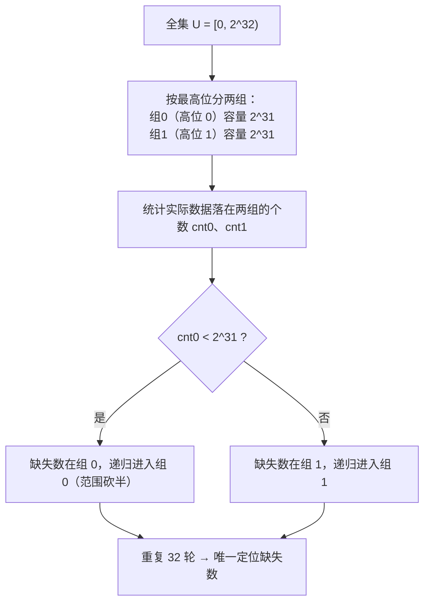

**为什么一定存在"不满"的一组**：数据只有 40 亿 < 2^32 ≈ 42.9 亿，总容量比数据多 2.9 亿，所以至少有一个子区间是"有名额空缺"的。每轮把范围砍半，32 轮（= 位宽）后范围只剩 1 个数，它就是缺失数。

**工程实现要点**：

| 要点 | 做法 |
|---|---|
| 内存只装一批 | 每次从文件读一块（如 1MB），对块内每个数判断该位是 0/1，累加计数 |
| 不需要保留数据 | 只保留 `cnt0`、`cnt1` 两个 long，内存 O(1) |
| 下一轮要重新读文件 | 32 轮 × 每次读全量 → I/O 放大 32 倍，**这是代价** |
| 优化 | 把"已确定的前缀"作为过滤条件，只处理命中的数；或用**多路划分**（一次读入按 k 位分成 2^k 个桶，减少轮数，但需要 2^k 个文件/缓冲） |

**复杂度**：时间 O(32 × N)（I/O 主导），空间 O(1)（或 O(2^k) 桶计数）。

> **面试话术**："这题的本质是**用'容量 vs 实际数量'的差来判断缺失在哪一半**，是二分查找在'值域'上的应用，而每次判断只需要 O(N) 的计数 —— 所以是 O(N log V)，空间可以做到常数。它同时用了位运算（按位取 0/1）和分治（值域折半）。"

### 追问：允许少量错误 + 内存极小

→ **布隆过滤器 / 抽样**：内存 10MB 存不下 40 亿的位图（512MB），但可以用"**统计抽样 + 概率**"（如 Count-Min Sketch），或者用"**分桶 + 只处理最大的桶**"的近似思路。**能说出"精确解需要 512MB，近似解才可能在 10MB 内完成"，说明你懂理论下界。**

### 追问：40 亿个数找**重复**的那个（只有一个重复）

→ **位图两次遍历**：第一次置位，若某位已被置位 → 就是重复的数。512MB + O(N)。

### 追问：内存 1MB，找**出现两次**的数

→ 位图升级为 **2 bit 计数器**（0 次/1 次/2 次），仍需 1GB；内存不够则分治（按位分桶，每桶处理完再归并结果）。

## 4.4 Borůvka 最小生成树 —— 分治并行 + 并查集

> 面试题："n 个点 m 条边的图，求 MST。Kruskal 是 O(m log m)，有没有能并行的算法？"

**Borůvka 算法**（1926 年，比 Kruskal/Prim 更早）：

```
重复以下步骤直到连通块数 = 1：
  1. 对每个连通块，找它的"最小出边"（连到别的连通块的边中权重最小的）
  2. 把这些边全部加入 MST（同一轮加的边一定不会成环，因为每个块只出一条）
  3. 用并查集合并
```

| 性质 | 值 |
|---|---|
| 轮数 | **O(log V)**（每轮连通块数至少减半，因为每个块至少能和另一个块合并，形成"块对"） |
| 每轮 | 遍历所有边 O(E) |
| 总 | **O(E log V)** |
| 优势 | **每轮内各连通块完全独立 ⇒ 天然可并行**（Spark/MPI 上的大规模 MST 常用它） |

> **为什么这题值得讲**：它是"**分治（按连通块并行）+ 并查集（合并阶段）**"的教科书级组合，且能回答"为什么大数据场景不用 Kruskal"（Kruskal 需要全局排序，O(m log m) 的排序是瓶颈；Borůvka 只需多轮局部扫描，可分布式）。

## 4.5 线段树分治 + 可撤销并查集 —— 动态图连通性

> **题目**：n 个点，m 条边，每条边有一个"存活时间区间" `[l, r]`（时间轴 1..T）；q 次询问，问某时刻图是否连通。

**做法**：

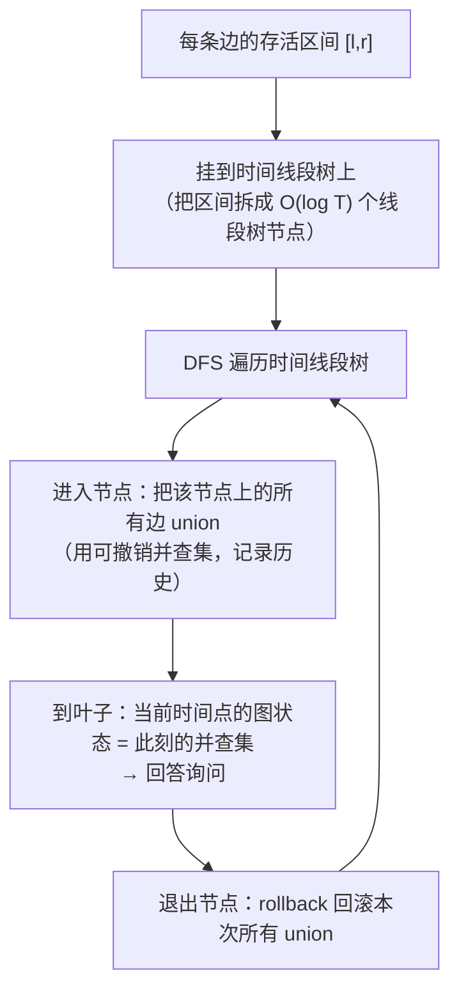

| 指标 | 值 |
|---|---|
| 时间 | O((m log T + q) · log n) |
| 空间 | O(m log T)（边的副本） |
| 关键 | 可撤销 DSU **不能路径压缩**（见 1.7 变体 3） |

> **这是"分治 + 并查集"最高级的组合**，也是动态连通性问题的离线标准解。能讲清"为什么必须可撤销、为什么不能路径压缩"，基本锁定了图论方向的高分。

## 4.6 并查集 + 位掩码：连通块特征聚合

> **自拟面试题**：n 个城市（n ≤ 10^5），m 条双向道路，每个城市有一个颜色（颜色数 ≤ 64）。求每个连通块内**不同颜色的个数**；支持动态加边、动态查询。

**朴素做法**：每个连通块维护 `HashSet<Integer>`，合并时 `addAll` → 单次合并 O(k)，总体可退化到 O(n²)。

**位掩码做法**：连通块颜色数 ≤ 64 ⇒ 用 `long` 的 64 位表示颜色集合；合并 = `mask |= mask`（一条指令）。

```java
// 完整实现
class DSUWithMask {
    int[] parent, rank;
    long[] mask;
    DSUWithMask(int n, int[] color) {
        parent = new int[n]; rank = new int[n]; mask = new long[n];
        for (int i = 0; i < n; i++) { parent[i] = i; mask[i] = 1L << color[i]; }
    }
    int find(int x) { while (parent[x] != x) x = parent[x]; return x; }  // 简化版，生产用压缩
    void union(int x, int y) {
        int rx = find(x), ry = find(y);
        if (rx == ry) return;
        if (rank[rx] < rank[ry]) { parent[rx] = ry; mask[ry] |= mask[rx]; }
        else { parent[ry] = rx; mask[rx] |= mask[ry]; if (rank[rx] == rank[ry]) rank[rx]++; }
    }
    int distinctColors(int x) { return Long.bitCount(mask[find(x)]); }
}
```

| | HashSet | 位掩码 |
|---|---|---|
| 合并 | O(k) | **O(1)** |
| 空间 | O(n·k) 最坏 | O(n) 个 long |
| 限制 | 无 | 颜色数 ≤ 64 |

> **工程映射**：这个技巧在"告警风暴聚合（合并故障域标签）"、"风控团伙识别（合并设备指纹特征位）"、"权限合并（多个角色权限位或）"里都是标准做法。**把算法题讲成工程方案，是社招面试的加分项。**

## 4.7 分治 + 计数：海量数据求第 K 大

> 10 亿个数，内存 100MB，求第 K 大（K 较小或较大）。

**分桶 + 递归（值域分治）**：

1. 取一个 pivot（如中位数采样），统计 `> pivot` 的个数 `cnt`；
2. 若 `K ≤ cnt` → 第 K 大在"大于 pivot"的部分，递归进入；
3. 否则 → 在"小于等于 pivot"的部分找第 `K - cnt` 大；
4. 每轮把数据范围缩小，且**只需扫一遍文件**（不必全载入内存）。

**这与快速选择（quickselect）同构，只是把"数组内 partition"换成"文件流式扫描 + 分桶"。**

> **与 3.4 的位图法对比**：位图法要求值域小且密集（O(V) 空间）；分桶法适用任意值域，但需要多轮 I/O。**能说清"什么时候用位图、什么时候用分桶"，就是大数据岗的合格线。**

## 4.8 交叉题目速查

| 题目 | 涉及考点 | 难度 | 权重 |
|---|---|---|---|
| 190 颠倒二进制位 | 分治 + 位运算（蝶形） | 中 | ★★★★★ |
| 50 / 29 快速幂 / 两数相除 | 分治 + 位运算 + 溢出 | 中 | ★★★★★ |
| 40 亿整数找缺失 | 分治 + 位运算 + I/O | 难 | ★★★★★ |
| Borůvka MST | 分治并行 + 并查集 | 难 | ★★★☆☆ |
| 动态图连通性 | 线段树分治 + 可撤销 DSU | 难 | ★★★★☆ |
| 连通块颜色聚合 | 并查集 + 位掩码 | 中 | ★★★★☆ |
| 海量数据第 K 大 | 分治 + 计数 / 位图 | 中 | ★★★★★ |
| 137（出现 3 次的数） | 位运算 + 状态机 | 中 | ★★★★★ |
| 3 个单身数 | 位运算 + 分治 | 难 | ★★★☆☆ |
| 1125 最小必要团队 | 状压 + DP | 难 | ★★★★☆ |

---

# 第五部分 面试答题框架与评分拆解

## 5.1 六步答题法（适用于本专题所有题）

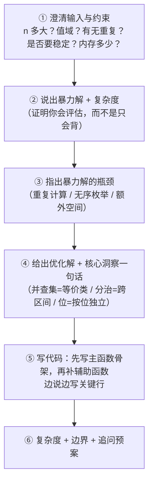

**每一步的实际话术**（可直接背）：

| 步骤 | 话术 |
|---|---|
| ① 澄清 | "我先确认几个约束：n 的量级是 10^4 还是 10^6？值域有界吗？需要稳定排序吗？允许 O(n) 额外空间吗？" |
| ② 暴力 | "最直接的做法是枚举所有对/所有点，O(n²)。我先把它说出来作为基线。" |
| ③ 瓶颈 | "瓶颈在于重复判断同一类关系/重复比较已有序的部分，这里的信息被浪费了。" |
| ④ 洞察 | "所以我把'关系'抽象成等价类用并查集增量维护；/ 我在归并时利用左右已有序，一次结算一批逆序对；/ 我对每一位独立统计，因为位之间互不影响。" |
| ⑤ 编码 | "先写并查集的 find 和 union（迭代版避免爆栈），主逻辑只做合并和计数。" |
| ⑥ 收尾 | "时间 O(n α(n))，空间 O(n)。边界我考虑 n=1、全孤立、重复元素、负数。" |

## 5.2 评分维度拆解（面试官打分表还原）

| 维度 | 权重（估算） | 满分表现 | 扣分表现 |
|---|---|---|---|
| **正确性** | 40% | 一次跑通，边界正确 | 死循环、越界、相等条件写错 |
| **复杂度** | 25% | 主动分析到最优，能给出摊还/期望分析 | 只会说"O(n²) 能过"，说不出为什么 |
| **代码质量** | 15% | 命名清晰、无冗余、模板熟练 | 变量名 a/b/c、重复代码、缩进乱 |
| **边界与异常** | 10% | 主动列边界并验证 | 等面试官指出来才改 |
| **沟通与延伸** | 10% | 能讲清"为什么"、能答追问 | 只会背代码，一问原理就卡 |

> **关键结论**：从这张表看，**"能讲清为什么"占了 35%（复杂度 25% + 沟通 10%）**。这就是为什么本文反复强调"原理层"——刷题量相同的人，差距主要在这里。

## 5.3 三个考点各自的"必答金句"

**并查集**
> "并查集适合**只合并不拆分、需要随时查询连通性**的场景，代价是丢失拓扑信息。路径压缩 + 按秩合并后摊还 O(α(n))，α 是反阿克曼函数，实际可视为 O(1)。删除边要用倒序处理或可撤销并查集。"

**分治**
> "分治适用于**子问题不重叠且可合并**的场景。复杂度用主定理判断：比较 f(n) 与 n^{log_b a}。归并排序是情况②，所以是 n log n；逆序对的关键是**利用有序性把跨区间统计从 O(n²) 压到 O(n)**。"

**位运算**
> "位运算的核心思想是**按位独立**：每一位互不影响，所以可以对每一位单独统计再拼回去。异或能消去偶数次出现的元素，就是因为 a^a=0 且满足交换结合律。"

## 5.4 常见翻车点清单（考前自查）

### 并查集

- [ ] `union` 里写成了 `parent[x] = y`（没先 `find` 到根）
- [ ] 用 `parent[i] == parent[j]` 判连通（应 `find(i) == find(j)`）
- [ ] 递归 `find` 在 1e6 数据上爆栈
- [ ] `count--` 放在了 `if (rx == ry) return;` 之前
- [ ] 网格映射 `i*m + j` 时把 `n`（行数）和 `m`（列数）搞反
- [ ] 带权并查集里 `weight` 的减法方向写反（`w + wy - wx` vs `w + wx - wy`）

### 分治

- [ ] 归并的 `mid` 写成 `(l + r + 1) / 2` 后区间划分不匹配 → 死循环
- [ ] 归并忘记 `arraycopy` 拷回
- [ ] 快排固定 pivot → 有序数组 TLE
- [ ] 快排递归两侧不做尾递归优化 → 栈溢出
- [ ] 逆序对里 `<=` 写成 `<`（相等被误算）
- [ ] 逆序对贡献写成 1（应为 `mid - i + 1`）
- [ ] 493 里把"统计"和"归并"合并成一次（2 倍条件不满足单调性）
- [ ] 用 int 累加可能溢出的计数（用 long）
- [ ] 链表归并没有 `slow.next = null` → 无限递归

### 位运算

- [ ] Java 负数用 `>>` 当逻辑右移
- [ ] `1 << n` 当 n ≥ 32（应用 `1L << n`）
- [ ] `Math.abs(Integer.MIN_VALUE)` 以为得到正数
- [ ] 异或交换同一个变量 → 清零
- [ ] 137 的 `ones/twos` 更新顺序写反
- [ ] 260 里 `mask` 取自错误的数（必须来自 `a^b`）
- [ ] 用 `while (n > 0)` 处理可能为负的 n
- [ ] Python 里忘了整数无限精度，负数位运算语义与 C/Java 不同

## 5.5 面对追问的三级应答策略

| 追问类型 | 示例 | 应答策略 |
|---|---|---|
| **深化型** | "为什么是 O(α(n))？" | 先给结论 + 直觉，再坦白"完整证明需要摊还分析"（**不要硬编**） |
| **扩展型** | "如果数据是流式的/要支持删除？" | 立即切换到"倒序 / 可撤销 / 在线数据结构"三选一，说明代价 |
| **对比型** | "为什么不用 XXX？" | 用表格化对比（时间/空间/稳定性/可实现性），给出一句"选型判据" |
| **挑战型** | "你这解法最坏是 O(n²) 吧？" | **承认 + 量化概率 + 给兜底方案**（"是，在极端分布下会退化，所以工程上用内省排序/三数取中兜底"） |

> **最忌讳**：被指出问题时硬辩。**承认局限 + 给出兜底，是高级工程师的标志。**

---

# 附录 A 模板代码速查

## A.1 并查集（生产级，迭代 find）

```java
class DSU {
    private final int[] parent, rank;
    private int count;
    public DSU(int n) {
        parent = new int[n]; rank = new int[n]; count = n;
        for (int i = 0; i < n; i++) parent[i] = i;
    }
    public int find(int x) {
        int root = x;
        while (parent[root] != root) root = parent[root];
        while (parent[x] != root) { int nxt = parent[x]; parent[x] = root; x = nxt; }
        return root;
    }
    public boolean union(int x, int y) {
        int rx = find(x), ry = find(y);
        if (rx == ry) return false;
        if (rank[rx] < rank[ry]) parent[rx] = ry;
        else if (rank[rx] > rank[ry]) parent[ry] = rx;
        else { parent[ry] = rx; rank[rx]++; }
        count--; return true;
    }
    public boolean connected(int x, int y) { return find(x) == find(y); }
    public int count() { return count; }
}
```

## A.2 归并排序 + 逆序对（二合一）

```java
class MergeSortTemplate {
    int[] tmp;
    long inversions;                    // 逆序对计数

    void sort(int[] a) { tmp = new int[a.length]; mergeSort(a, 0, a.length - 1); }

    void mergeSort(int[] a, int l, int r) {
        if (l >= r) return;
        int mid = l + (r - l) / 2;
        mergeSort(a, l, mid);
        mergeSort(a, mid + 1, r);
        if (a[mid] <= a[mid + 1]) return;        // 已有序，跳过
        merge(a, l, mid, r);
    }

    void merge(int[] a, int l, int mid, int r) {
        int i = l, j = mid + 1, k = l;
        while (i <= mid && j <= r) {
            if (a[i] <= a[j]) tmp[k++] = a[i++];
            else { inversions += mid - i + 1; tmp[k++] = a[j++]; }
        }
        while (i <= mid) tmp[k++] = a[i++];
        while (j <= r)   tmp[k++] = a[j++];
        System.arraycopy(tmp, l, a, l, r - l + 1);
    }
}
```

## A.3 快排（随机 pivot + 三路 + 尾递归优化）

```java
void quickSort(int[] a, int l, int r) {
    while (l < r) {
        int[] range = partition3(a, l, r);       // 返回 [lt, gt]，等于区
        if (range[0] - l < r - range[1]) { quickSort(a, l, range[0] - 1); l = range[1] + 1; }
        else { quickSort(a, range[1] + 1, r); r = range[0] - 1; }
    }
}
int[] partition3(int[] a, int l, int r) {
    int idx = l + ThreadLocalRandom.current().nextInt(r - l + 1);
    swap(a, l, idx);
    int pivot = a[l], lt = l, i = l, gt = r;
    while (i <= gt) {
        if (a[i] < pivot) swap(a, lt++, i++);
        else if (a[i] > pivot) swap(a, i, gt--);
        else i++;
    }
    return new int[]{lt, gt};
}
```

## A.4 快速选择（第 K 小）

```java
int quickSelect(int[] a, int k) {             // k 从 0 计（即第 k+1 小）
    int l = 0, r = a.length - 1;
    while (true) {
        int p = partition(a, l, r);           // 用 A.3 的单 pivot 版即可
        if (p == k) return a[p];
        if (p < k) l = p + 1; else r = p - 1;
    }
}
```

## A.5 树状数组（BIT）

```java
class BIT {
    private final int[] tree;
    public BIT(int n) { tree = new int[n + 1]; }
    public void add(int i, int v) { for (; i < tree.length; i += i & -i) tree[i] += v; }
    public int sum(int i) { int s = 0; for (; i > 0; i -= i & -i) s += tree[i]; return s; }
    public int range(int l, int r) { return sum(r) - sum(l - 1); }
}
```

## A.6 位运算工具箱

```java
// 基础
boolean isOdd(int x)      { return (x & 1) == 1; }
int  lowbit(int x)        { return x & -x; }
int  clearLowestOne(int x){ return x & (x - 1); }
int  setBit(int x, int k) { return x | (1 << k); }
int  clearBit(int x, int k){ return x & ~(1 << k); }
int  toggleBit(int x, int k){ return x ^ (1 << k); }
int  getBit(int x, int k) { return (x >>> k) & 1; }
boolean isPow2(int x)     { return x > 0 && (x & (x - 1)) == 0; }
int  popcount(int x)      { int c = 0; while (x != 0) { x &= x - 1; c++; } return c; }
int  maskLowK(int x, int k){ return x & ((1 << k) - 1); }

// 无进位加 / 进位
int add(int a, int b) {
    while (b != 0) { int carry = (a & b) << 1; a ^= b; b = carry; }
    return a;
}

// 枚举子集
for (int sub = mask; sub > 0; sub = (sub - 1) & mask) { /* ... */ }

// 状态压缩 DP 骨架
// dp[mask] = min/max/count；转移枚举"加入第 i 个元素"：newMask = mask | (1 << i)
```

## A.7 可撤销并查集（线段树分治配套）

```java
class RollbackDSU {
    int[] parent, size;
    Deque<int[]> st = new ArrayDeque<>();      // {child, oldParent, oldSizeOfRoot}

    RollbackDSU(int n) {
        parent = new int[n]; size = new int[n];
        for (int i = 0; i < n; i++) { parent[i] = i; size[i] = 1; }
    }
    int find(int x) { while (parent[x] != x) x = parent[x]; return x; }   // 禁止压缩

    void union(int x, int y) {
        int rx = find(x), ry = find(y);
        if (rx == ry) { st.push(new int[]{-1, -1, -1}); return; }
        if (size[rx] < size[ry]) { int t = rx; rx = ry; ry = t; }
        st.push(new int[]{ry, parent[ry], size[rx]});
        parent[ry] = rx; size[rx] += size[ry];
    }
    void rollback() {
        int[] h = st.pop();
        if (h[0] == -1) return;
        size[find(h[0])] = h[2];      // 先恢复 size（此时父指针还没换回去）
        parent[h[0]] = h[1];
    }
}
```

## A.8 BFPRT：最坏 O(n) 的第 K 小（215 的满分答案）

```java
class BFPRT {
    // 返回数组 a 中第 k 小（k 从 0 计）
    int select(int[] a, int l, int r, int k) {
        if (l == r) return a[l];
        int pivot = medianOfMedians(a, l, r);
        int[] range = partitionAround(a, l, r, pivot);     // [lt, gt]：等于 pivot 的区间
        if (k < range[0])      return select(a, l, range[0] - 1, k);
        if (k > range[1])      return select(a, range[1] + 1, r, k);
        return a[k];
    }

    // 五步中位数的中位数：保证 pivot 至少有 3n/10 个元素比它小/大
    int medianOfMedians(int[] a, int l, int r) {
        int n = r - l + 1;
        if (n <= 5) { insertionSort(a, l, r); return a[l + (n - 1) / 2]; }
        int m = (n + 4) / 5;                                // ceil(n/5) 组
        int[] medians = new int[m];
        for (int i = 0; i < m; i++) {
            int s = l + i * 5, e = Math.min(s + 4, r);
            insertionSort(a, s, e);
            medians[i] = a[(s + e) / 2];
        }
        return select(medians, 0, m - 1, m / 2);            // 递归求中位数的中位数
    }

    // 三路划分，返回等于 pivot 的区间 [lt, gt]
    int[] partitionAround(int[] a, int l, int r, int pivot) {
        int lt = l, i = l, gt = r;
        while (i <= gt) {
            if (a[i] < pivot)      swap(a, lt++, i++);
            else if (a[i] > pivot) swap(a, i, gt--);
            else i++;
        }
        return new int[]{lt, gt};
    }

    void insertionSort(int[] a, int l, int r) {
        for (int i = l + 1; i <= r; i++) {
            int v = a[i], j = i - 1;
            while (j >= l && a[j] > v) { a[j + 1] = a[j]; j--; }
            a[j + 1] = v;
        }
    }
    void swap(int[] a, int i, int j) { int t = a[i]; a[i] = a[j]; a[j] = t; }
}
```

**复杂度推导（面试必背）**：

- 找 pivot 的代价 `T(n/5)`（对 m ≈ n/5 个中位数递归）；
- 划分后，pivot 至少有 `3n/10` 个元素比它小、也至少有 `3n/10` 个比它大（因为每个 5 人组里至少有 3 个元素与 pivot 同侧，共 n/5 组 → 至少 3·(n/5)/2 = 3n/10）；
- 所以递归的剩余规模 ≤ `7n/10`；
- `T(n) ≤ T(n/5) + T(7n/10) + O(n)`，因 `1/5 + 7/10 = 9/10 < 1`，几何级数收敛 ⇒ **O(n)**（详见 2.2 代换法）。

## A.9 两个有序数组的第 K 小 / 中位数（4 题的 O(log k) 写法）

```java
class KthTwoSorted {
    // 第 k 小（k 从 1 计）
    int kth(int[] A, int[] B, int k) {
        if (A.length > B.length) return kth(B, A, k);       // 保证 A 更短，减少递归深度
        if (A.length == 0) return B[k - 1];
        if (k == 1) return Math.min(A[0], B[0]);

        int i = Math.min(A.length, k / 2);                  // A 贡献 i 个
        int j = Math.min(B.length, k / 2);                  // B 贡献 j 个
        if (A[i - 1] > B[j - 1]) {
            // A 的前 i 个不可能全部进入前 k，砍掉 B 的前 j 个（已确定比 A[i-1] 小）
            return kth(slice(A, 0, i), slice(B, j, B.length), k - j);
        } else {
            return kth(slice(A, i, A.length), slice(B, 0, j), k - i);
        }
    }
    int[] slice(int[] a, int from, int to) { return Arrays.copyOfRange(a, from, to); }

    double findMedianSortedArrays(int[] A, int[] B) {
        int t = A.length + B.length;
        if ((t & 1) == 1) return kth(A, B, t / 2 + 1);
        return (kth(A, B, t / 2) + kth(A, B, t / 2 + 1)) / 2.0;
    }
}
```

**三个要点**：

1. **每次砍掉 k/2 个"确定不可能进入前 k"的元素** ⇒ `T(k) = T(k/2) + O(1)` ⇒ **O(log k)**；
2. **裁掉的是"较小那一侧的前缀"**：若 `A[i-1] > B[j-1]`，说明 `B[0..j-1]` 全部小于 `A[i-1]`，且 `A[i-1]` 之前的都排不进前 k 的这一段，故可安全丢弃 `B` 的前 j 个，同时 k 减去 j；
3. **生产代码用下标版**（`l1, l2, k`）避免 `copyOfRange` 的 O(n) 拷贝，否则复杂度退化为 O(n log n)。

---

# 附录 B 复杂度速查表

## B.1 结构 / 操作

| 结构 | 单次 | m 次 | 备注 |
|---|---|---|---|
| 并查集（压缩+按秩） | O(α(n)) 摊还 | O(m α(n)) | α ≤ 4 |
| 并查集（仅压缩） | O(n) 最坏 | O((m+n) log n) | — |
| 并查集（仅按秩） | O(log n) | O(m log n) | — |
| 树状数组 | O(log n) | — | lowbit 跳转 |
| 线段树 | O(log n) | — | 常数大 |
| 位图 | O(1) 置位/查询 | — | 空间 n/8 字节 |

## B.2 排序

| 算法 | 最好 | 平均 | 最坏 | 空间 | 稳定 |
|---|---|---|---|---|---|
| 归并 | n log n | n log n | n log n | O(n) | ✅ |
| 快排 | n log n | n log n | **n²** | O(log n) | ❌ |
| 三路快排 | n（全相等） | n log n | n² | O(log n) | ❌ |
| 堆排 | n log n | n log n | n log n | **O(1)** | ❌ |
| 插入 | n | n² | n² | O(1) | ✅ |
| 计数 | — | O(n+k) | O(n+k) | O(k) | ✅ |
| TimSort | n | n log n | n log n | O(n) | ✅ |
| 内省排序 | n log n | n log n | n log n | O(log n) | ❌ |

## B.3 递归式 → 复杂度

| 递归式 | 结果 | 依据 |
|---|---|---|
| T(n)=2T(n/2)+n | Θ(n log n) | 主定理 ② |
| T(n)=T(n/2)+1 | Θ(log n) | 主定理 ② |
| T(n)=2T(n/2)+1 | Θ(n) | 主定理 ① |
| T(n)=3T(n/2)+n | Θ(n^1.585) | 主定理 ①（Karatsuba） |
| T(n)=T(n/3)+T(2n/3)+n | Θ(n log n) | 递归树/Akra-Bazzi（主定理不适用） |
| T(n)=T(n/5)+T(7n/10)+n | Θ(n) | 代换法（9/10 < 1） |
| T(n)=2T(n/5)+n | Θ(n) | 主定理 ①（c=log_5 2≈0.43 < 1） |

## B.4 位运算相关

| 操作 | 复杂度 |
|---|---|
| popcount（Kernighan） | O(popcount) |
| popcount（SWAR） | O(1)（5 次移位+掩码） |
| 位反转（分治） | O(log 32) = O(1) |
| 快速幂 | O(log n) |
| 状压 DP | O(2^n · n) |
| 子集枚举（所有 mask 的子集） | O(3^n) |

---

# 附录 C 21 天刷题路径

| 天 | 主题 | 题目 | 目标 |
|---|---|---|---|
| 1-2 | 并查集模板 | 547 → 200 → 695 → 1971 | 手写模板不看提示，2 分钟写完 |
| 3-4 | 关系推理 | 990 → 399（带权） | 能现场推带权公式 |
| 5 | 判环 / 生成树 | 684 → 1584 | 理解"加边时判连通"的作用 |
| 6 | 倒序思想 | 803 → 1970 | 能主动想到"删除转添加" |
| 7 | 建模难 | 959 → 947 → 721 | 会拆点、会用行列当节点 |
| 8 | 复习 | 上面所有错题 | 错题重写一遍 |
| 9-10 | 排序 | 912（归并/快排/堆三版）→ 148 → 23 | 三种排序都能盲写 |
| 11 | 快选 | 215（快选 + 堆 + BFPRT） | 能讲 BFPRT 的 9/10 |
| 12 | 二分分割 | 4 | 能把"中位数"转成"分割线" |
| 13-14 | 分治计数 | 剑指 51 → 493 → 315 → 327 | 四个变体各写一遍 |
| 15 | 分治经典 | 53（分治版）→ 169 → 241 → 105 | 训练"跨区间/切分点"思维 |
| 16 | 快速幂 | 50 → 29 | 处理 MIN_VALUE 边界 |
| 17-18 | 位运算基础 | 136 → 137 → 260 → 191 → 190 | 137 的状态机要能推导 |
| 19 | 位运算进阶 | 338 → 461 → 477 → 201 → 371 | 掌握"按位独立" |
| 20 | 状压 | 78 → 1125 → 464 | 能判断"n ≤ 20 才可状压" |
| 21 | 交叉 / 系统 | 40 亿整数题 + HashMap 源码复述 + Borůvka | 能讲成工程方案 |

**每天固定动作（30 分钟）**：

1. 不看题解**手写**（20 分钟）；
2. 对照本文的"翻车点清单"**自查**（5 分钟）；
3. 用一句话写下"这题的**核心洞察**"（5 分钟）——这一步是"背题"和"会了"的分界线。

---

# 结语：三句话记住整个专题

1. **并查集**：把"关系"抽象成**等价类**，用**压缩 + 按秩**把 O(n) 摊还成 O(1)；它记不住路径，只记得"同类"。
2. **分治**：把问题切成**不重叠**的子问题，用**主定理**算复杂度；真正的难点永远是 **Combine**（跨区间贡献）。
3. **位运算**：**每一位独立**，所以能"逐个统计再拼回"；异或能消去偶数次，是因为 `a^a=0` 且可交换结合。

> 三条一旦内化，你看到任何新题都会先问三个问题：
> **"这里有没有等价类要维护？"** → 并查集
> **"能不能切成不重叠的两半，合并代价是多少？"** → 分治
> **"能不能按位拆开，把 O(n) 的枚举变成 O(1) 的位操作？"** → 位运算

---

## 说明与免责

- **题目编号与约束**：以 LeetCode 中文站 / 剑指 Offer 官方题面为准；不同时期题目的数据范围可能调整（如 912 从 5 万调整到 10 万），答题时以现场题面为准。
- **"大厂/权重"标注**：基于公开面经、LeetCode 企业题库与社区统计的**归纳性判断**，用于安排复习优先级，不代表任何公司的实际考纲或承诺。
- **复杂度结论**：并查集 O(α(n))、BFPRT O(n)、Karatsuba Θ(n^1.585) 等均为经典结论（Tarjan 1975、Blum-Floyd-Pratt-Rivest-Tarjan 1973、Karatsuba 1962），本文只给结论与直觉，完整证明需摊还分析 / 代换法，可自行查阅《算法导论》相关章节。
- **代码**：均为 Java 实现，可直接在 LeetCode 提交；工程化使用需补充参数校验、并发保护与内存边界处理。
