# 算法面试核心知识体系（75 道高频题 · 13 个专题深度整理）

> 适用对象：Java 后端 / 大数据开发 / 通用研发岗社招 & 校招。
> 覆盖范围：链表、二叉树、动态规划、双指针滑动窗口、二分答案、单调栈/队列、堆、BFS/DFS/图论、贪心、数据结构设计、并查集/分治/位运算、字符串/Trie。
> 每个题目统一按「题意 → 核心思想 → 图解 → 代码（Java）→ 复杂度 → 易错点 → 延伸变种 → 大厂考察（公司 + 权重）」的结构展开。

---

## 0. 为什么这 60 题就是大厂算法面试的"基本盘"

大厂算法面试（字节、阿里、腾讯、美团、快手、滴滴、华为、小红书、拼多多、蚂蚁）有一个非常稳定的出题逻辑：**不是考察你会不会做怪题，而是考察你对 8 类"经典思维模型"的掌握是否形成肌肉记忆**。

这 60 余题恰好落在这 8 个模型上：

| 思维模型 | 本质一句话 | 对应题号 |
|---|---|---|
| 指针操作 / 虚拟头 | 用"多指针 + 断链重连"在 O(1) 空间内改结构 | 206、25、24、19、21、23、160、141、142 |
| 递归与遍历序 | 把"树的问题"降维成"子树的问题" | 94、102、110、236、124、543、98、105、297 |
| 状态定义与转移 | DP 的全部功夫都在"状态怎么定义" | 70、198、213、337、121、122、188、300、53、152、1143、72、221、416 |
| 窗口的单调性 | 用"左右指针只前进"把 O(n²) 打成 O(n) | 3、76、209、438、11、15、42、560 |
| 二分的边界 | 把"求最值"转成"判定可行性 + 单调性" | 704、33、34、162、875、1011 |
| 单调性维护 | 用栈/队列丢掉"永远不可能成为答案"的元素 | 739、496、84、239、907 |
| 局部最优的合理性 | 证明"局部最优能推全局最优"，否则不能贪心 | 56、45、134、455 |
| 顺序与缓存 | 用 O(1) 结构维护访问顺序/频次 | 146、460、155、295、253 |

> 面试官的真实评分维度（字节/阿里内部 rubric 的常见表述）：
> 1. **能否说出思路而不是背代码**（权重最高，约 40%）
> 2. **边界与异常处理**（空输入、单元素、溢出、重复值，约 20%）
> 3. **复杂度分析是否准确**（约 15%）
> 4. **代码是否可运行、命名与结构是否清晰**（约 15%）
> 5. **能否应对 follow-up 变种**（约 10%，但往往是决定 offer 等级的关键）

---

## 1. 全量知识地图

```mermaid
graph TD
    A[算法面试基本盘] --> B[线性结构<br/>链表/数组/字符串]
    A --> C[树形结构<br/>二叉树/BST/Trie]
    A --> D[状态机式思维<br/>动态规划]
    A --> E[区间与窗口<br/>双指针/二分/单调栈]
    A --> F[图与搜索<br/>BFS/DFS/拓扑/并查集]
    A --> G[工程化能力<br/>数据结构设计]

    B --> B1[反转与重连<br/>206/25/24]
    B --> B2[快慢指针<br/>141/142/19/160]
    B --> B3[归并与合并<br/>21/23]

    C --> C1[遍历序<br/>94/102]
    C --> C2[自底向上返回信息<br/>110/543/124/236]
    C --> C3[BST 性质<br/>98/105]
    C --> C4[序列化<br/>297]

    D --> D1[线性 DP<br/>70/198/213/53/152]
    D --> D2[序列 DP<br/>300/1143/72]
    D --> D3[树形 DP<br/>337]
    D --> D4[状态压缩 DP<br/>416/221/188]
    D --> D5[股票系列状态机<br/>121/122/188]

    E --> E1[滑窗<br/>3/76/209/438]
    E --> E2[对撞与去重<br/>11/15/42]
    E --> E3[前缀和<br/>560]
    E --> E4[二分答案<br/>875/1011]
    E --> E5[单调栈<br/>739/496/84/907/239]

    F --> F1[网格 DFS/BFS<br/>200/994/79]
    F --> F2[拓扑排序<br/>207]
    F --> F3[逆向/多源<br/>417/994]
    F --> F4[并查集<br/>547]

    G --> G1[LRU/LFU<br/>146/460]
    G --> G2[双栈/双堆<br/>155/295/253]
```



### 一张"从暴力到最优"的降维图（面试最常用的叙事线）

```
暴力枚举 O(n^2)/O(2^n)
   │  ① 发现"重复计算"        → 记忆化 / DP / 前缀和
   │  ② 发现"单调性"          → 双指针 / 滑动窗口 / 单调栈 / 二分
   │  ③ 发现"只需局部信息"    → 贪心 / 分治
   │  ④ 发现"结构可复用"      → 哈希表 / 堆 / 并查集 / Trie
   ▼
O(n log n) 或 O(n)
```

面试时把这条线讲出来，比直接甩最优解更能拿高分——因为它证明你**是推导出来的，不是背出来的**。

---

## 2. 复杂度速查（面试必须张口就来）

| 结构 / 操作 | 时间复杂度 | 空间 | 备注 |
|---|---|---|---|
| 单链表反转（迭代） | O(n) | O(1) | 三指针 pre/cur/nxt |
| 单链表反转（递归） | O(n) | O(n) 栈 | 递归深度 = n |
| K 个一组翻转 | O(n) | O(1) | 每段先数够 k 再翻 |
| 快慢指针判环 | O(n) | O(1) | 相遇后一指针回头 |
| 合并两个有序链表 | O(n+m) | O(1) | 虚拟头结点 |
| 合并 K 个链表（堆） | O(N log k) | O(k) | N 为总节点数 |
| 合并 K 个链表（分治） | O(N log k) | O(log k) | 两两归并 |
| 二叉树遍历（递归/迭代） | O(n) | O(h) | h 为树高，最坏 O(n) |
| 二叉树层序 | O(n) | O(w) | w 为最大宽度 |
| 原地 Morris 遍历 | O(n) | O(1) | 面试加分项 |
| 爬楼梯 / 打家劫舍 | O(n) | O(1) 可优化 | 滚动变量 |
| LIS（二分优化） | O(n log n) | O(n) | tails 数组 |
| LCS / 编辑距离 | O(nm) | O(nm)→O(min(n,m)) | 滚动数组 |
| 滑动窗口（不定长） | O(n) | O(字符集) | 每个元素最多进出一次 |
| 三数之和 | O(n²) | O(1)（不计排序栈） | 排序 + 双指针 |
| 接雨水（双指针） | O(n) | O(1) | 单调栈 O(n) 空间 |
| 和为 K 的子数组（前缀和+哈希） | O(n) | O(n) | 负数场景唯一正解 |
| 二分查找 | O(log n) | O(1) | 注意 mid 溢出、区间开闭 |
| 二分答案 | O(n log M) | O(1) | 判定函数必须单调 |
| 单调栈 | O(n) 均摊 | O(n) | 每个元素入栈出栈各一次 |
| 滑动窗口最大值（单调队列） | O(n) | O(k) | 队首即答案 |
| 柱状图最大矩形 | O(n) | O(n) | 哨兵技巧 |
| 堆 TopK | O(n log k) | O(k) | 比全排序 O(n log n) 优 |
| 数据流中位数（双堆） | O(log n) 插入 / O(1) 查询 | O(n) | 大小堆平衡 |
| LRU | get/put O(1) | O(capacity) | 哈希 + 双向链表 |
| LFU | get/put O(1) | O(capacity) | 频次桶 + 双向链表 |
| 岛屿数量 DFS | O(mn) | O(mn) 最坏 | 沉岛法免 visited |
| 拓扑排序 | O(V+E) | O(V+E) | 入度表 + 队列 |
| 并查集（路径压缩+按秩合并） | 近似 O(1) 均摊 | O(n) | α(n) 反阿克曼 |
| 归并排序 | O(n log n) | O(n) | 稳定排序 |
| 归并求逆序对 | O(n log n) | O(n) | 分治经典应用 |
| Trie | 插入/查询 O(L) | O(总字符数) | 前缀共享 |
| 中心扩展求最长回文 | O(n²) | O(1) | Manacher 可到 O(n) |

---

## 3. 大厂考察权重矩阵（实测高频分布）

> 说明：★ 数量代表"被问到的概率 × 追问深度"。5★ = 几乎必考/常作为压轴追问；4★ = 高频；3★ = 中频；2★ = 低频但有区分度。

| 题目 | 字节 | 阿里 | 腾讯 | 美团 | 快手 | 滴滴 | 华为 | 小红书 | 综合权重 |
|---|---|---|---|---|---|---|---|---|---|
| 206 反转链表 | ★★★★★ | ★★★★★ | ★★★★★ | ★★★★★ | ★★★★★ | ★★★★ | ★★★★★ | ★★★★★ | 5★ 必会 |
| 25 K 个一组翻转 | ★★★★★ | ★★★★ | ★★★★ | ★★★★ | ★★★★ | ★★★ | ★★★★ | ★★★★★ | 5★ |
| 141/142 环形链表 | ★★★★ | ★★★★ | ★★★★ | ★★★ | ★★★★ | ★★★ | ★★★★ | ★★★★ | 4★ |
| 21 合并两个有序链表 | ★★★★ | ★★★★ | ★★★★ | ★★★★ | ★★★ | ★★★ | ★★★★ | ★★★ | 4★ |
| 23 合并 K 个升序链表 | ★★★★★ | ★★★★ | ★★★★ | ★★★★ | ★★★★ | ★★★ | ★★★★ | ★★★★ | 5★ |
| 19 删除倒数第 N 个 | ★★★★ | ★★★★ | ★★★ | ★★★★ | ★★★ | ★★★ | ★★★ | ★★★★ | 4★ |
| 160 相交链表 | ★★★ | ★★★ | ★★★ | ★★★ | ★★★ | ★★★ | ★★★ | ★★★ | 3★ |
| 24 两两交换 | ★★★★ | ★★★ | ★★★ | ★★★ | ★★★ | ★★★ | ★★★ | ★★★★ | 4★ |
| 94 中序遍历 | ★★★★ | ★★★★ | ★★★★ | ★★★ | ★★★ | ★★★ | ★★★★ | ★★★★ | 4★（Morris 加分） |
| 102 层序遍历 | ★★★★★ | ★★★★★ | ★★★★★ | ★★★★ | ★★★★ | ★★★★ | ★★★★★ | ★★★★ | 5★ |
| 236 最近公共祖先 | ★★★★★ | ★★★★ | ★★★★ | ★★★★ | ★★★★ | ★★★ | ★★★★ | ★★★★ | 5★ |
| 124 最大路径和 | ★★★★★ | ★★★★★ | ★★★★ | ★★★★ | ★★★★ | ★★★ | ★★★★ | ★★★★ | 5★ |
| 98 验证 BST | ★★★★ | ★★★★ | ★★★★ | ★★★★ | ★★★ | ★★★ | ★★★★ | ★★★★ | 4★ |
| 105 前序+中序构造 | ★★★★ | ★★★★ | ★★★ | ★★★★ | ★★★ | ★★★ | ★★★ | ★★★★ | 4★ |
| 297 序列化 | ★★★★★ | ★★★★ | ★★★★ | ★★★ | ★★★★ | ★★★ | ★★★★ | ★★★★ | 4★ |
| 543 直径 | ★★★★ | ★★★ | ★★★★ | ★★★ | ★★★ | ★★★ | ★★★ | ★★★ | 4★ |
| 110 平衡二叉树 | ★★★★ | ★★★ | ★★★★ | ★★★ | ★★★ | ★★★ | ★★★ | ★★★ | 4★ |
| 70 爬楼梯 | ★★★ | ★★★ | ★★★ | ★★★ | ★★★ | ★★★ | ★★★ | ★★★ | 3★（热身） |
| 198/213 打家劫舍 | ★★★★ | ★★★★ | ★★★ | ★★★★ | ★★★ | ★★★ | ★★★ | ★★★ | 4★ |
| 337 打家劫舍 III | ★★★★ | ★★★★ | ★★★ | ★★★ | ★★★ | ★★★ | ★★★ | ★★★ | 4★ |
| 121/122 买卖股票 | ★★★★ | ★★★★ | ★★★★ | ★★★★ | ★★★ | ★★★★ | ★★★ | ★★★ | 4★ |
| 188 股票 IV | ★★★★★ | ★★★★ | ★★★ | ★★★ | ★★★ | ★★★ | ★★★ | ★★★★ | 4★（区分度高） |
| 300 LIS | ★★★★★ | ★★★★★ | ★★★★ | ★★★★ | ★★★★ | ★★★ | ★★★★ | ★★★★ | 5★ |
| 53 最大子数组和 | ★★★★ | ★★★★ | ★★★★ | ★★★★ | ★★★ | ★★★ | ★★★★ | ★★★ | 4★ |
| 152 乘积最大子数组 | ★★★★ | ★★★ | ★★★ | ★★★ | ★★★ | ★★★ | ★★★ | ★★★ | 4★ |
| 1143 LCS | ★★★★ | ★★★★ | ★★★ | ★★★ | ★★★ | ★★★ | ★★★★ | ★★★ | 4★ |
| 72 编辑距离 | ★★★★★ | ★★★★ | ★★★★ | ★★★★ | ★★★★ | ★★★ | ★★★★ | ★★★★ | 5★ |
| 221 最大正方形 | ★★★★ | ★★★★ | ★★★ | ★★★ | ★★★ | ★★★ | ★★★ | ★★★ | 4★ |
| 416 分割等和子集 | ★★★★ | ★★★ | ★★★ | ★★★ | ★★★ | ★★★ | ★★★★ | ★★★ | 4★ |
| 3 无重复最长子串 | ★★★★★ | ★★★★★ | ★★★★★ | ★★★★★ | ★★★★ | ★★★★ | ★★★★ | ★★★★★ | 5★ 必会 |
| 76 最小覆盖子串 | ★★★★★ | ★★★★★ | ★★★★ | ★★★★ | ★★★★ | ★★★ | ★★★★ | ★★★★ | 5★ |
| 15 三数之和 | ★★★★★ | ★★★★ | ★★★★ | ★★★★ | ★★★★ | ★★★ | ★★★★ | ★★★★ | 5★ |
| 11 盛最多水 | ★★★★ | ★★★ | ★★★★ | ★★★ | ★★★ | ★★★ | ★★★ | ★★★ | 4★ |
| 42 接雨水 | ★★★★★ | ★★★★ | ★★★★★ | ★★★★ | ★★★★ | ★★★ | ★★★★ | ★★★★ | 5★ |
| 560 和为 K 子数组 | ★★★★★ | ★★★★ | ★★★★ | ★★★★ | ★★★ | ★★★ | ★★★★ | ★★★★ | 5★ |
| 209 长度最小子数组 | ★★★★ | ★★★ | ★★★ | ★★★ | ★★★ | ★★★ | ★★★ | ★★★ | 4★ |
| 438 字母异位词 | ★★★★ | ★★★ | ★★★★ | ★★★ | ★★★ | ★★★ | ★★★ | ★★★ | 4★ |
| 704 二分查找 | ★★★ | ★★★ | ★★★ | ★★★ | ★★★ | ★★★ | ★★★ | ★★ | 3★（写对才算过） |
| 33 旋转排序数组 | ★★★★★ | ★★★★ | ★★★★ | ★★★★ | ★★★ | ★★★ | ★★★★ | ★★★★ | 4★ |
| 34 第一个和最后一个位置 | ★★★★★ | ★★★★ | ★★★★ | ★★★★ | ★★★ | ★★★ | ★★★★ | ★★★★ | 4★ |
| 162 寻找峰值 | ★★★★ | ★★★ | ★★★ | ★★★ | ★★★ | ★★★ | ★★★ | ★★★ | 4★ |
| 875 爱吃香蕉的珂珂 | ★★★★★ | ★★★★ | ★★★★ | ★★★★ | ★★★ | ★★★ | ★★★ | ★★★★ | 4★（二分答案代表） |
| 1011 运送包裹 | ★★★★★ | ★★★★ | ★★★★ | ★★★★ | ★★★ | ★★★ | ★★★ | ★★★ | 4★ |
| 739 每日温度 | ★★★★★ | ★★★★ | ★★★★ | ★★★★ | ★★★ | ★★★ | ★★★★ | ★★★★ | 4★ |
| 496 下一个更大元素 I | ★★★★ | ★★★ | ★★★ | ★★★ | ★★★ | ★★★ | ★★★ | ★★★ | 4★ |
| 84 柱状图最大矩形 | ★★★★★ | ★★★★★ | ★★★★ | ★★★★ | ★★★★ | ★★★ | ★★★★ | ★★★★ | 5★ |
| 239 滑动窗口最大值 | ★★★★★ | ★★★★ | ★★★★ | ★★★★ | ★★★★ | ★★★ | ★★★★ | ★★★★ | 5★ |
| 907 子数组最小值和 | ★★★ | ★★★★ | ★★★ | ★★★ | ★★★ | ★★ | ★★★ | ★★★ | 4★（单调栈进阶） |
| 215 第 K 大 | ★★★★★ | ★★★★ | ★★★★ | ★★★★ | ★★★★ | ★★★★ | ★★★★ | ★★★★ | 5★ |
| 295 数据流中位数 | ★★★★★ | ★★★★ | ★★★★ | ★★★ | ★★★★ | ★★★ | ★★★★ | ★★★★ | 5★ |
| 253 会议室 II | ★★★★ | ★★★★ | ★★★ | ★★★★ | ★★ | ★★★ | ★★ | ★★★ | 3★ |
| 347 前 K 高频 | ★★★★ | ★★★★ | ★★★★ | ★★★★ | ★★★ | ★★★ | ★★★ | ★★★ | 4★ |
| 200 岛屿数量 | ★★★★★ | ★★★★★ | ★★★★ | ★★★★ | ★★★★ | ★★★ | ★★★★★ | ★★★★ | 5★ |
| 994 腐烂的橘子 | ★★★★★ | ★★★★ | ★★★★ | ★★★★ | ★★★ | ★★★ | ★★★★ | ★★★★ | 4★ |
| 207 课程表 | ★★★★★ | ★★★★★ | ★★★★ | ★★★★ | ★★★★ | ★★★ | ★★★★ | ★★★★ | 5★ |
| 417 太平洋大西洋 | ★★★ | ★★★ | ★★★ | ★★ | ★★ | ★★★ | ★★ | ★★★ | 3★ |
| 79 单词搜索 | ★★★★ | ★★★ | ★★★★ | ★★★ | ★★★ | ★★★ | ★★★★ | ★★★ | 4★ |
| 56 合并区间 | ★★★★★ | ★★★★ | ★★★★ | ★★★★★ | ★★★★ | ★★★★ | ★★★★ | ★★★★ | 5★ |
| 45 跳跃游戏 II | ★★★★ | ★★★ | ★★★ | ★★★ | ★★★ | ★★★ | ★★★ | ★★★ | 4★ |
| 134 加油站 | ★★★ | ★★★ | ★★★ | ★★★ | ★★ | ★★★ | ★★★ | ★★ | 3★ |
| 455 分发饼干 | ★★ | ★★ | ★★ | ★★★ | ★★ | ★★ | ★★★ | ★★ | 2★ |
| 146 LRU | ★★★★★ | ★★★★★ | ★★★★★ | ★★★★★ | ★★★★★ | ★★★★ | ★★★★ | ★★★★★ | 5★ 设计题之王 |
| 460 LFU | ★★★★ | ★★★★★ | ★★★ | ★★★ | ★★★★ | ★★★ | ★★ | ★★★★ | 4★ |
| 155 最小栈 | ★★★★ | ★★★ | ★★★ | ★★★ | ★★★ | ★★★ | ★★★ | ★★★ | 3★ |
| 547 省份数量 | ★★★ | ★★★★ | ★★★ | ★★★ | ★★★ | ★★ | ★★★ | ★★★ | 4★ |
| 912 排序数组 | ★★★★ | ★★★★ | ★★★★ | ★★★ | ★★★ | ★★★ | ★★★★ | ★★★ | 4★ |
| 剑指51 逆序对 | ★★★★★ | ★★★★ | ★★★★ | ★★★ | ★★★★ | ★★★ | ★★★★ | ★★★ | 4★ |
| 136 只出现一次 | ★★★★ | ★★★★ | ★★★★ | ★★★ | ★★★★ | ★★★ | ★★★★ | ★★★ | 4★ |
| 20 有效括号 | ★★★★★ | ★★★★★ | ★★★★★ | ★★★★ | ★★★★ | ★★★★ | ★★★★★ | ★★★★★ | 5★ |
| 49 字母异位词分组 | ★★★★ | ★★★★ | ★★★★ | ★★★★ | ★★★ | ★★★ | ★★★★ | ★★★★ | 4★ |
| 208 实现 Trie | ★★★★ | ★★★★ | ★★★ | ★★★ | ★★★ | ★★★ | ★★★ | ★★★ | 4★ |
| 5 最长回文子串 | ★★★★★ | ★★★★ | ★★★★ | ★★★★ | ★★★★ | ★★★ | ★★★★ | ★★★★ | 5★ |

---

## 4. 本手册的使用方式（建议按此节奏）

1. **第一遍（建立模型，1–2 天）**：只看每题的「核心思想 + 图解」，把 8 个思维模型记住，不写代码。
2. **第二遍（写对，3–5 天）**：关掉代码块，自己默写，重点抠「易错点」小节（这一节是面试官抓你的地方）。
3. **第三遍（应对追问，2–3 天）**：只看「延伸变种」，逼自己现场推出变种解法——这才是拉开 offer 等级的部分。
4. **面试前一天**：只看第 13 章「一题多解、优化空间、复杂度与边界 case 总表」和第 3 节权重矩阵。

---

## 5. 一条贯穿全篇的"面试答题模板"

任何一题，都按这五步说：

```
① 一句话确认题意与输入约束（含数据范围、是否含负数、是否可修改原结构）
② 暴力解 + 复杂度（证明你有基本盘，且给后面优化提供"对照基线"）
③ 指出暴力解的浪费点在哪（重复计算 / 无序 / 未利用单调性）
④ 给出优化解 + 关键不变式（invariant，这是加分核心）
⑤ 主动补边界 case + 复杂度 + 一个 follow-up
```

> 例：解 42 接雨水时，第④步的关键不变式是"`leftMax` 一定不小于当前 left 左侧所有柱子的高度，因此 `min(leftMax, rightMax) = leftMax` 时可以直接结算 left"。能说出来这一句，面试官就知道你不是背的。

---

## 6. 全篇目录

| 章节 | 内容 | 题目数 |
|---|---|---|
| 第 1 章 | 链表：指针、重连与不变式 | 9 |
| 第 2 章 | 二叉树：遍历序、递归返回值与自底向上思维 | 9 |
| 第 3 章 | 动态规划：状态定义、转移与空间优化 | 14 |
| 第 4 章 | 双指针 / 滑动窗口 / 前缀和 | 8 |
| 第 5 章 | 二分查找与二分答案 | 6 |
| 第 6 章 | 单调栈 & 单调队列 | 5 |
| 第 7 章 | 堆（优先队列）与 TopK 问题 | 5 |
| 第 8 章 | BFS / DFS / 图论 | 5 |
| 第 9 章 | 贪心：正确性证明比代码更重要 | 4 |
| 第 10 章 | 数据结构设计题：LRU / LFU / 最小栈 | 3 |
| 第 11 章 | 并查集 / 分治 / 位运算 | 4 |
| 第 12 章 | 字符串与 Trie | 4 |
| 第 13 章 | 一题多解、空间优化、复杂度与边界 case（总复习） | 汇总 |

> 共 **76 个题目条目**（23 合并 K 个链表在第 1、7 章各出现一次，去重后 **75 道**），另有 **200+ 个延伸变种题号**在各题的"延伸变种"小节中给出。
> 建议阅读顺序：第 0 章 → 第 1 章（建立指针直觉）→ 第 2 章（建立递归直觉）→ 第 3 章（建立状态直觉）→ 其余按需 → 第 13 章收尾。

---

# 第 1 章 链表：指针、重连与不变式

链表题在面试中的定位是**"基础分 + 稳定性测试"**。它不难，但极容易写崩：90% 的挂人点不是"想不到思路"，而是**空指针、断链顺序错、虚拟头没返回、环的数学推错**。

## 1.0 链表题的五个通用心法

| 心法 | 说明 | 适用题 |
|---|---|---|
| **虚拟头结点 dummy** | `dummy.next = head`，任何"可能删除/插入头结点"的题，一律用 dummy，最后 `return dummy.next` | 19、24、25、21、23、92、203 |
| **三指针 pre/cur/nxt** | 反转的通用骨架，`nxt` 必须在改 `cur.next` **之前**保存 | 206、92、25、24 |
| **快慢指针** | 找中点、判环、找倒数第 k 个，同一套骨架 | 141、142、19、876、143 |
| **画图再写码** | 链表题必须在纸上画 3 个节点的变化，靠脑补必错 | 全部 |
| **先想清楚"谁指向谁"** | 写代码前先在注释里写 `a.next = b; b.next = c;` 的顺序，再落笔 | 全部 |

### 链表题的"边界 case 清单"（每道题都过一遍）

1. 空链表 `head == null`
2. 单节点 `head.next == null`
3. 操作发生在头结点（删除头、在头前插入）
4. 操作发生在尾结点（删除尾、k 恰好等于长度）
5. k 大于链表长度
6. 链表长度奇/偶（涉及中点、两两交换）
7. 存在环（涉及遍历结束条件）

---

## 1.1 【206】反转链表（Reverse Linked List）

**权重：5★ 必会｜字节/阿里/腾讯/美团/快手/华为/小红书 全部高频**

### 题意
反转一个单链表。`1→2→3→4→5` 变成 `5→4→3→2→1`。

### 核心思想：三个指针把"指向"逐个掰回来

反转的本质是：**每个节点原本指向后继，现在要指向前驱**。而一旦把 `cur.next` 改成 `pre`，就丢失了原先后继的位置，所以必须先把 `nxt` 存下来。

```
初始:  pre=null   cur=1 → 2 → 3 → null
step1: pre=null   cur=1   先存 nxt=2；改 1.next=null；pre=1, cur=2
step2: pre=1      cur=2   先存 nxt=3；改 2.next=1；   pre=2, cur=3
step3: pre=2      cur=3   先存 nxt=null；改 3.next=2；pre=3, cur=null
结束:  pre=3 → 2 → 1 → null   ✔
```

**关键不变式（面试要说出这句）**：在循环任意时刻，`pre` 指向的链表是"已经反转好的前缀"，且 `pre` 是该前缀的**新头**；`cur` 指向"尚未处理的剩余部分"的头；两者之间没有任何连接。

### 代码（迭代，推荐）
```java
class Solution {
    public ListNode reverseList(ListNode head) {
        ListNode pre = null, cur = head;
        while (cur != null) {
            ListNode nxt = cur.next;  // ① 先保存后继，防止断链
            cur.next = pre;           // ② 反转指向
            pre = cur;                // ③ pre 前移
            cur = nxt;                // ④ cur 前移（用保存好的 nxt）
        }
        return pre;                   // 循环结束时 cur=null，pre 是新头
    }
}
```

### 代码（递归，考察你对栈的理解）
```java
class Solution {
    public ListNode reverseList(ListNode head) {
        // base case：空链表或单节点，反转后就是自己
        if (head == null || head.next == null) return head;
        // 先递归反转 head.next 及其之后的部分，得到新头 newHead
        ListNode newHead = reverseList(head.next);
        // 此时 head.next 已经是"反转后链表的尾节点"，让它指回 head
        head.next.next = head;
        head.next = null;   // 断开，否则形成环
        return newHead;
    }
}
```
递归的理解要点：**`reverseList(head.next)` 返回后，`head.next` 这个节点仍然存在，只是它现在是反转后链表的最后一个节点**，所以 `head.next.next = head` 就是把 head 挂到尾部。

### 复杂度
| 解法 | 时间 | 空间 |
|---|---|---|
| 迭代 | O(n) | O(1) |
| 递归 | O(n) | O(n)（递归栈） |

### 易错点（面试官最爱抓）
1. `return pre` 写成 `return head`——head 现在是尾节点。
2. 忘记先存 `nxt`，导致 `cur.next = pre` 后走不下去（NPE 或死循环）。
3. 递归版忘记 `head.next = null` → **形成环**，输出死循环。这是最高频的错误。
4. 只写了 `if (head == null)` 没写 `head.next == null` → 单节点时 NPE。

### 延伸变种
| 变种 | 差异 | 关键改动 |
|---|---|---|
| **92. 反转链表 II** | 只反转 `[m, n]` 区间 | dummy + 走到 m-1 位置，记录 `pre` 和 `left`，反转 n-m+1 个后重连：`pre.next=right; left.next=cur` |
| **234. 回文链表** | 判回文，要求 O(1) 空间 | 快慢指针找中点 → 反转后半 → 逐个比较 → （可选）恢复 |
| **143. 重排链表** | L0→Ln→L1→Ln-1 | 找中点 + 反转后半 + 合并两链 |
| **25. K 个一组** | 分组反转 | 见 1.2 |
| **反转双向链表** | 每个节点还要维护 prev | 交换 `node.prev` 与 `node.next` 后整体反转指针语义 |
| **每 k 个一组，不足 k 保持原序** | 25 的常见 follow-up | 先数够 k 再翻，不足直接 break |

### 大厂追问实录
> **字节**："不用递归，也不许多余变量，怎么反转？"——三指针就是答案。
> **阿里**："如果链表长度是 10^7，递归会怎样？"——栈溢出（StackOverflowError），必须迭代。
> **腾讯**："反转后原来的 head 是什么？"——尾节点，`head.next == null`。

---

## 1.2 【25】K 个一组翻转链表（Reverse Nodes in k-Group）

**权重：5★｜字节/小红书高频压轴，常作为 206 的进阶追问**

### 题意
每 k 个节点一组翻转，**不足 k 个的部分保持原顺序**。k=2 时 `1→2→3→4→5` → `2→1→4→3→5`。

### 核心思想
把"整链反转"降维成"**每段长度恰为 k 的局部反转 + 段间重连**"，关键有三件事：

1. **每段必须先"数够 k 个"**，数不够就直接结束（这是"不足 k 保持原序"的实现）。
2. 段内反转用 206 的三指针骨架，但要**记录段的原始首尾**，反转后首尾互换。
3. 用 `dummy` 把"第一段"和"中间段"统一处理，避免特判头结点。

```
dummy → 1 → 2 → 3 → 4 → 5,  k = 2

        groupPrev   kth
           ↓         ↓
dummy → [1 → 2] → 3 → 4 → 5        反转后: dummy → 2 → 1 → 3 ...
                              ↑
                        groupNext（下一段的头）
```

**关键操作（面试必背的四步）**：
```
start  = groupPrev.next          // 本段原头，反转后会变成段尾
end    = kth                     // 本段原尾，反转后会变成段头
next   = kth.next                // 下一段起点
reverse(start, end)              // 反转 [start, end]，返回新头 end
groupPrev.next = end             // 接上段头
start.next     = next            // 段尾接下一段
groupPrev      = start           // 下一轮：段尾就是新的 groupPrev
```

### 代码
```java
class Solution {
    public ListNode reverseKGroup(ListNode head, int k) {
        ListNode dummy = new ListNode(0, head);
        ListNode groupPrev = dummy;

        while (true) {
            // ① 从 groupPrev 往后数 k 个，找到本段尾 kth
            ListNode kth = groupPrev;
            for (int i = 0; i < k && kth != null; i++) kth = kth.next;
            if (kth == null) break;              // 不足 k 个，剩余保持原序

            ListNode start = groupPrev.next;      // 本段原头
            ListNode next  = kth.next;            // 下一段头
            reverseBetween(start, kth);           // 反转 [start, kth]
            // 反转后：kth 是段头，start 是段尾
            groupPrev.next = kth;
            start.next     = next;
            groupPrev      = start;               // 段尾成为下一段的 groupPrev
        }
        return dummy.next;
    }

    // 反转 [head, tail] 这一段（tail 是原尾，反转后成为新头），返回新头
    private ListNode reverseBetween(ListNode head, ListNode tail) {
        ListNode pre = null, cur = head;
        ListNode stop = tail.next;                 // 反转的右边界（不含）
        while (cur != stop) {
            ListNode nxt = cur.next;
            cur.next = pre;
            pre = cur;
            cur = nxt;
        }
        return pre;                                // == 原 tail
    }
}
```

### 复杂度
时间 **O(n)**（每个节点被访问常数次：数 k 一次 + 反转一次）；空间 **O(1)**。

> 注意：虽然"数 k 个"会让每个节点被多遍历一次，但仍是 O(n)（系数 2）。有人会误答 O(nk)，这是错的——因为每段的 k 次遍历是**分摊到该段 k 个节点**上的。

### 易错点
1. **只反转了 k 个却忘了把不足 k 的部分跳出去**：`if (kth == null) break` 必须在反转前。
2. `groupPrev = start` 写错成 `groupPrev = kth` → 下一轮会从段头重新数，死循环。
3. `start.next = next` 漏掉 → 段尾仍指向 next（其实恰好也对），但如果 next 是 null 后重连顺序不同会出错；**必须显式接**。
4. k=1 时应原样返回，代码天然正确（反转 1 个等于不变），但要能解释。

### 延伸变种
- **不足 k 也反转**（LeetCode 变体）：数不够时直接把剩余全部反转，去掉 `if (kth==null) break`，改成 `kth` 为真实尾。
- **从尾部开始按 k 分组**：先求长度，算出"需要跳过的前缀长度 = n % k"，从那里开始。
- **每 k 个一组，但要求组间也重排（组逆序）**：先分组反转，再把组当节点做一次整体反转。
- **合并两个变种**：25 + 92，区间 [m,n] 内按 k 分组。

### 大厂追问实录
> **字节**："这个写法每轮要重新数 k 个，能不能只遍历一次？"——可以：先用一次遍历求总长 n，然后 `n / k` 段直接翻，省掉重复的"试探"，但代码更绕，通常面试官接受 O(n) 的当前写法。
> **小红书**："如果链表有环怎么办？"——这题前提是无环；有环则"数 k 个"永不结束，需要先判环（142）。

---

## 1.3 【141 / 142】环形链表 I / II

**权重：4★｜腾讯/华为/字节常考，142 的数学推导是区分点**

### 141 题意
判断链表是否有环。**要求 O(1) 空间**（这直接封死了"哈希表存节点"的写法）。

### 核心思想：Floyd 判圈（龟兔赛跑）
慢指针每次走 1 步，快指针每次走 2 步。若有环，快指针一定会在环内"套圈"追上慢指针；若无环，快指针先到 `null`。

**为什么一定相遇（面试要能证明）**：设环长 L。当慢指针刚进入环时，快指针已在环内某处，两者距离 d ∈ [0, L)。每轮快追 1 步，距离变为 (d-1) mod L，因此最多 L 轮必定追平（d=0 即相遇）。**所以不会"永远错过"**。

### 代码（141）
```java
public class Solution {
    public boolean hasCycle(ListNode head) {
        ListNode slow = head, fast = head;
        while (fast != null && fast.next != null) {   // 两个条件缺一不可
            slow = slow.next;
            fast = fast.next.next;
            if (slow == fast) return true;
        }
        return false;
    }
}
```

### 142 题意
返回**入环的第一个节点**，无环返回 null。

### 核心思想：相遇后，一个指针回到 head，两者同速前进，再次相遇点即入环点

**数学推导（必须会推，这是本题的全部价值）**：

设：
- 头到入环点距离 = `a`
- 入环点到相遇点距离 = `b`
- 相遇点回到入环点（沿环前进方向）距离 = `c`
- 环长 `L = b + c`

相遇时：
- 慢指针走了 `a + b`
- 快指针走了 `a + b + nL`（n 为快指针在环内多绕的圈数，n ≥ 1）

因为快速度是慢的 2 倍：
```
2(a + b) = a + b + nL
=> a + b = nL
=> a = nL - b = (n-1)L + (L - b) = (n-1)L + c
```

**结论**：`a = c + (n-1)L`。也就是说，从 head 走 `a` 步到入环点，等价于**从相遇点走 `c` 步到入环点**（可能多绕了 n-1 整圈，但落点相同）。

因此：**一个指针从 head 出发，一个从相遇点出发，同速每次 1 步，它们一定在入环点相遇**。

```
head ──a──► 入环点 ──b──► 相遇点
                ▲              │
                └──── c ───────┘
```

### 代码（142）
```java
public class Solution {
    public ListNode detectCycle(ListNode head) {
        ListNode slow = head, fast = head;
        while (fast != null && fast.next != null) {
            slow = slow.next;
            fast = fast.next.next;
            if (slow == fast) {                 // 第一次相遇
                ListNode p = head;
                while (p != slow) {             // 同步前进
                    p = p.next;
                    slow = slow.next;
                }
                return p;                       // 入环点
            }
        }
        return null;
    }
}
```

### 复杂度
时间 O(n)（a + b + c ≤ 2n 量级）、空间 O(1)。

### 易错点
1. `while (fast != null && fast.next != null)` 少写一个判断 → 偶数长度无环时 NPE。
2. 142 里第二次循环用 `p != fast` 也行（此时 fast==slow），但混用变量易错。
3. 误以为"相遇点就是入环点"——这是最常见的错误认知。
4. 141 允许修改链表（"删除节点"法）但 142 要求原结构，注意别混。

### 延伸变种
| 变种 | 做法 |
|---|---|
| 求环长 | 相遇后，一个指针不动，另一个绕一圈计数 |
| 找中点（876） | 快慢指针，快到头时慢在中点；偶数长度要区分"前中/后中"（`fast.next != null` 控制） |
| 判断两链表是否相交（160） | 见 1.7，本质是"走到 null 就换头"，等价于制造一个环 |
| 求"环的入口 + 环长 + 交点"三合一 | 142 + 环长统计 |

### 大厂追问实录
> **腾讯**："为什么快指针不能一次走 3 步？"——可以，但**不保证一定相遇**（3 步时追击速度 2，若环长为 2 的倍数可能跳过）；走 2 步能保证，因为追击速度 1 一定追平。
> **华为**："不用快慢指针怎么做？"——哈希表 O(n) 空间；或"标记访问法"（修改结构，面试要问清是否允许）。

---

## 1.4 【21】合并两个有序链表（Merge Two Sorted Lists）

**权重：4★｜基础必会，常作为 23 的前置提问**

### 核心思想
两条链各自有序 → **归并**。用 `dummy` 统一"结果链还没节点"这一特殊情形，`tail` 始终指向结果链尾。

```
l1: 1 → 2 → 4
l2: 1 → 3 → 4
dummy → (每次取较小的挂到 tail 后面)
结果: 1 → 1 → 2 → 3 → 4 → 4
```

### 代码（迭代）
```java
class Solution {
    public ListNode mergeTwoLists(ListNode list1, ListNode list2) {
        ListNode dummy = new ListNode(0), tail = dummy;
        while (list1 != null && list2 != null) {
            if (list1.val <= list2.val) {   // <= 保证稳定性（相等时取 l1）
                tail.next = list1;
                list1 = list1.next;
            } else {
                tail.next = list2;
                list2 = list2.next;
            }
            tail = tail.next;
        }
        tail.next = (list1 != null) ? list1 : list2;  // 剩余部分直接接上，O(1)
        return dummy.next;
    }
}
```

### 代码（递归，简洁但 O(n+m) 栈）
```java
class Solution {
    public ListNode mergeTwoLists(ListNode l1, ListNode l2) {
        if (l1 == null) return l2;
        if (l2 == null) return l1;
        if (l1.val <= l2.val) {
            l1.next = mergeTwoLists(l1.next, l2);
            return l1;
        } else {
            l2.next = mergeTwoLists(l1, l2.next);
            return l2;
        }
    }
}
```

### 复杂度
时间 O(n+m)；迭代空间 O(1)，递归空间 O(n+m)。

### 易错点
1. 忘记 `tail.next = 剩余链`，导致结果链尾部丢失（这是最高频错误）。
2. `<=` 与 `<` 的选择：要求"稳定"时用 `<=`（相等取前一条链），面试可主动说明。
3. 没使用 dummy，导致"结果为空"时需特判头结点。

### 延伸变种
- **合并 K 个**（23）：分治或堆。
- **合并后去重**（保留一个/全删）：加一个 `if (tail.val == 当前值) skip`。
- **合并两个有序数组**（88，从后往前填，O(1) 空间）。
- **合并时倒序**（结果链逆序）：把节点用"头插法"挂到 dummy 后。

---

## 1.5 【23】合并 K 个升序链表（Merge k Sorted Lists）

**权重：5★｜字节/阿里/美团高频，重点在"为什么堆比逐个合并好"**

### 三个层次的解法（面试要能全说）

| 解法 | 时间 | 空间 | 评价 |
|---|---|---|---|
| ① 逐个合并（两两串行） | O(k²n) | O(1) | 最差，会被追问 |
| ② 分治（两两配对归并） | O(N log k) | O(log k) | 最优且稳定，N 为总节点数 |
| ③ 最小堆 | O(N log k) | O(k) | 实现直观，适合现场写 |

> 关键洞察：`①` 之所以差，是因为**前面的链表被反复遍历**（第 i 次合并要重走前 i-1 条链）。分治把"重复遍历"从 k 次降到 log k 次。

### 解法②：分治（推荐现场写）
```java
class Solution {
    public ListNode mergeKLists(ListNode[] lists) {
        if (lists == null || lists.length == 0) return null;
        return merge(lists, 0, lists.length - 1);
    }
    private ListNode merge(ListNode[] lists, int l, int r) {
        if (l == r) return lists[l];
        if (l > r) return null;
        int mid = l + (r - l) / 2;
        ListNode a = merge(lists, l, mid);
        ListNode b = merge(lists, mid + 1, r);
        return mergeTwo(a, b);
    }
    private ListNode mergeTwo(ListNode a, ListNode b) {
        ListNode dummy = new ListNode(0), tail = dummy;
        while (a != null && b != null) {
            if (a.val <= b.val) { tail.next = a; a = a.next; }
            else               { tail.next = b; b = b.next; }
            tail = tail.next;
        }
        tail.next = a != null ? a : b;
        return dummy.next;
    }
}
```
**分治的正确性**：把 k 条链两两合并，第 1 轮剩 k/2 条（每条长度 2n），第 2 轮剩 k/4 条（长度 4n）……共 log k 轮，每轮总工作量 O(N)。故 O(N log k)。

### 解法③：最小堆（代码更短，但要注意比较器）
```java
class Solution {
    public ListNode mergeKLists(ListNode[] lists) {
        if (lists == null || lists.length == 0) return null;
        // 小顶堆，按节点值排序（注意：不能直接存 ListNode 而不给比较器）
        PriorityQueue<ListNode> pq = new PriorityQueue<>(
            Math.max(1, lists.length), (a, b) -> a.val - b.val);
        for (ListNode node : lists) if (node != null) pq.offer(node);

        ListNode dummy = new ListNode(0), tail = dummy;
        while (!pq.isEmpty()) {
            ListNode min = pq.poll();       // 取全局最小
            tail.next = min; tail = tail.next;
            if (min.next != null) pq.offer(min.next);   // 该链的下一个入堆
        }
        return dummy.next;
    }
}
```
**堆解法的关键**：堆里**最多只有 k 个元素**（每条链只放"当前头"），所以是 O(k) 空间；每次 poll+offer 是 O(log k)，共 N 次 → O(N log k)。

### 复杂度对比
| 解法 | 时间 | 空间 |
|---|---|---|
| 逐个串行 | O(k²n) → 更准确是 O(N·k) | O(1) |
| 分治 | O(N log k) | O(log k) 递归栈 |
| 堆 | O(N log k) | O(k) |

### 易错点
1. `PriorityQueue` 不给比较器 → 报 `ClassCastException`（ListNode 不可比较）。
2. `lists` 为空数组 vs `lists = [null, null]`：前者返回 null，后者也要返回 null（堆解法天然处理）。
3. 分治的 `if (l >= r)` 写成 `if (l > r)` 但没处理 l==r。
4. 堆解法忘记 `if (min.next != null)` 判空 → NPE。

### 延伸变种
- **K 个有序数组合并**：同一思路（数组用索引代替 next）。
- **K 个链表求"第 K 小元素"**：堆里放 k 个，poll 到第 K 次即答案（等价 378 第 K 小）。
- **外部排序（大数据场景）**：K 路归并就是磁盘多路归并排序的核心，**这是大数据岗最爱延伸的点**——问"1TB 文件、内存 1GB 怎么排序"，答案就是"分块排序 + K 路归并"。

### 大厂追问实录
> **字节**："为什么堆解法是 O(N log k) 而不是 O(N log N)？"——因为堆大小恒为 k，操作代价 log k。
> **阿里**："如果 k 非常大（10 万条链），分治和堆哪个好？"——分治更省内存（堆要 O(k) 且比较器调用频繁），且缓存局部性更好。
> **美团**："用 Java 8 的 stream 能一行写吗？"——能，但面试别炫技。

---

## 1.6 【19】删除链表的倒数第 N 个结点

**权重：4★｜高频，考察"一次遍历"（快慢指针）**

### 核心思想：快指针先走 n 步，然后快慢同步走，快到尾时慢指向"待删节点的前驱"

因为要删除节点，必须拿到**前驱**，所以用 dummy + 让 `fast` 先走 n+1 步（或让 slow 从 dummy 起始），使 `slow` 停在待删节点的前一个。

```
dummy → 1 → 2 → 3 → 4 → 5,  n = 2（删 4）

fast 先走 n+1 = 3 步，停在 3；然后 fast、slow 同步走
当 fast == null 时，slow 停在 3（即待删节点 4 的前驱）
```

### 代码（一次遍历，推荐）
```java
class Solution {
    public ListNode removeNthFromEnd(ListNode head, int n) {
        ListNode dummy = new ListNode(0, head);
        ListNode fast = dummy, slow = dummy;
        for (int i = 0; i <= n; i++) fast = fast.next;   // fast 先走 n+1 步
        while (fast != null) {                            // 同步前进
            fast = fast.next;
            slow = slow.next;
        }
        slow.next = slow.next.next;                       // 跳过待删节点
        return dummy.next;
    }
}
```
> 用 `n+1` 步 + `slow` 从 dummy 出发，等价于"slow 停在待删节点前驱"，一次遍历完成，且**天然处理"删除头结点"**（此时 slow 就是 dummy）。

### 复杂度
时间 O(L)（L 为链长），空间 O(1)。**只遍历一次**是本解法的卖点。

### 易错点
1. 走得步数差 1：`n` 步时 slow 停在待删节点本身，删不掉（因为没有前驱）。
2. n 等于链表长度（删头）必须靠 dummy 才能处理。
3. 题目保证 n 合法，但面试可主动补一句"若 n 非法需先校验"。

### 延伸变种
- **删除倒数第 n 个 + 返回是否删除成功**。
- **删除所有值为 val 的节点**（203）：dummy + 单指针。
- **删除重复元素**（83 保留一个 / 82 全删）：82 需要 `pre` 记录"最后一个确定保留的节点"。
- **"倒数第 k 个"泛化**：求倒数第 k 个节点的值 → 同样快慢指针，不需 dummy。

---

## 1.7 【160】相交链表（Intersection of Two Linked Lists）

**权重：3★｜思路巧妙，考察"消除长度差"的思维**

### 核心思想：双指针走完自己的链后换到对方链头，走的总路程相同

设 A 独有部分长 a，B 独有部分长 b，公共部分长 c。
- 指针 p 走 A 全程 `a+c`，再走 B 的 `b`（到交点前）→ 总 `a+c+b`
- 指针 q 走 B 全程 `b+c`，再走 A 的 `a` → 总 `b+c+a`

**两者总路程相等**（都是 a+b+c），所以若相交，它们必然**同时到达交点**；若不相交，它们会同时变成 `null`，循环自然结束。

```
A:      a1 → a2 ↘
                  c1 → c2 → c3
B: b1 → b2 → b3 ↗
p 走完 A 后跳 B 头；q 走完 B 后跳 A 头 → 在 c1 相遇
```

### 代码
```java
public class Solution {
    public ListNode getIntersectionNode(ListNode headA, ListNode headB) {
        ListNode p = headA, q = headB;
        while (p != q) {
            p = (p == null) ? headB : p.next;   // 走完自己换对方
            q = (q == null) ? headA : q.next;
        }
        return p;   // 相交则交点，不相交则同时为 null
    }
}
```
> 代码只有 5 行，但**必须能解释为什么不相交时不会死循环**：不相交时两指针总路程都是 a+b，走完即同时为 null，循环结束。

### 复杂度
时间 O(a+b+c) = O(m+n)，空间 O(1)。

### 易错点
1. 用 `p.next == null` 判断而不是 `p == null` → 少走一步，错位。
2. 误以为"值相等即相交"——必须**节点引用相同**（面试要强调这点，这是链表题的语义陷阱）。
3. 若允许改结构，可"首尾相连成环"再套 142，但会破坏原链表。

### 延伸变种
- **两个链表是否有公共节点（只判 bool）**：同上，最后判 `p != null`。
- **Y 形链表的"分叉点"**：就是交点。
- **三个链表的公共交点**：两两求交，再求交。

---

## 1.8 【24】两两交换链表中的节点（Swap Nodes in Pairs）

**权重：4★｜小红书/字节常考，考察"三个指针一起改"**

### 核心思想：每次处理两个节点，必须**先保存第三个节点**，再按 `pre → 2 → 1 → next` 的顺序改三条边

```
pre → 1 → 2 → 3
目标：pre → 2 → 1 → 3

改边顺序（错一步就断链）：
  pre.next = 2     ①  （pre 指向 2）
  2.next   = 1     ②  （2 指向 1）—— 此时 1 还指向 3，链暂时"闭环"但可继续
  1.next   = 3     ③  （1 指向 3）
```

### 代码（迭代，dummy 统一处理）
```java
class Solution {
    public ListNode swapPairs(ListNode head) {
        ListNode dummy = new ListNode(0, head);
        ListNode pre = dummy;
        while (pre.next != null && pre.next.next != null) {   // 至少还剩 2 个
            ListNode first = pre.next, second = first.next;
            ListNode next = second.next;      // ③ 先保存后续
            pre.next = second;                // ①
            second.next = first;              // ②
            first.next = next;                // ③
            pre = first;                      // 下一轮的 pre 是"本组第二个"
        }
        return dummy.next;
    }
}
```

### 代码（递归，更能体现"分组"思想）
```java
class Solution {
    public ListNode swapPairs(ListNode head) {
        if (head == null || head.next == null) return head;
        ListNode second = head.next;
        head.next = swapPairs(second.next);   // 先解决后面的
        second.next = head;
        return second;
    }
}
```

### 复杂度
时间 O(n)；迭代空间 O(1)，递归 O(n)。

### 易错点
1. 改边顺序错 → 断链或成环。**必须先存 `next`**。
2. `pre = first` 写成 `pre = second` → 下一轮从错误位置开始，死循环。
3. 循环条件写成 `pre.next != null` 一个 → 奇数长度时 NPE。
4. 递归版 `head.next = swapPairs(second.next)` 必须在 `second.next = head` 之前，否则 second.next 已被改。

### 延伸变种
- **25 K 个一组**：本题是 k=2 的特例，统一成"段内反转"。
- **交换相邻的"值"而非节点**（只交换 val）：更简单但面试官常故意问"能不能只交换值"，答"可以，但链表题通常要求换节点"。
- **奇偶位节点分离**（328）：把奇数位连一起、偶数位连一起。

---

## 1.9 本章"链表题通用代码模板"（背下来）

```java
// 模板 A：遍历 + 虚拟头（删除/插入类）
ListNode dummy = new ListNode(0, head);
ListNode pre = dummy, cur = head;
while (cur != null) {
    // ... 判断
    pre = cur; cur = cur.next;
}
return dummy.next;

// 模板 B：区间反转 [start, end]
ListNode reverse(ListNode start, ListNode end) {
    ListNode pre = null, cur = start, stop = end.next;
    while (cur != stop) {
        ListNode nxt = cur.next; cur.next = pre; pre = cur; cur = nxt;
    }
    return pre;   // 新头 = 原 end
}

// 模板 C：快慢指针
ListNode slow = head, fast = head;
while (fast != null && fast.next != null) { slow = slow.next; fast = fast.next.next; }
```

---

## 1.10 本章大厂面试题汇总（含权重）

| 公司 | 题目 | 权重 | 追问方向 |
|---|---|---|---|
| 字节 | 206 反转链表 | ★★★★★ | 递归改迭代、局部反转 |
| 字节 | 25 K 个一组翻转 | ★★★★★ | 不足 k 保持原序、能否一次遍历 |
| 字节 | 23 合并 K 个链表 | ★★★★★ | 堆 vs 分治、k 极大时选型 |
| 阿里 | 146 LRU（与链表强相关） | ★★★★★ | 双向链表 + 哈希 |
| 阿里 | 142 环形链表 II | ★★★★ | 数学证明、为什么快指针走 2 步 |
| 腾讯 | 141/142 | ★★★★ | 不用快慢指针的替代方案 |
| 美团 | 21 合并两个有序链表 | ★★★★ | 稳定性、能否原地 |
| 快手 | 24 两两交换 | ★★★ | 三指针顺序 |
| 滴滴 | 19 删除倒数第 N | ★★★ | 一次遍历、删头结点 |
| 华为 | 160 相交链表 | ★★★ | 长度差消除、值 vs 引用 |
| 小红书 | 25、24、206 | ★★★★ | 链表 + 虚拟头的组合题 |

---

# 第 2 章 二叉树：遍历序、递归返回值与自底向上思维

二叉树是**大厂区分度最高的一类题**。原因很简单：链表只有一个"下一步"，树有两个分支，**必须靠递归把问题降维**。面试官通过树题看三件事：

1. 你能否写出**没有冗余 null 判断**的递归；
2. 你能否区分"**自顶向下传参**"和"**自底向上返回**"两类递归；
3. 你能否把"看起来要遍历整棵树"的题优化成 **O(h) 空间**或 **O(1) 空间（Morris）**。

## 2.0 二叉树题的四个通用心法

### 心法一：递归的"三要素 + 一个信任"
```java
返回类型 dfs(参数) {
    if (终止条件) return 边界值;      // ① 终止条件
    // ② 处理当前层（前序位置：进入节点时）
    L = dfs(left);                  // ③ 递归左右（信任：dfs 一定返回正确结果）
    R = dfs(right);
    // ④ 处理当前层（后序位置：离开节点时）
    return 组合(L, R);
}
```
> "**信任递归**"是最重要的一句：写 `dfs(left)` 时不要去想它内部怎么实现，只要相信它返回了正确的子树信息。做不到这一点的人，写树题会陷入"递归展开"的泥潭。

### 心法二：三种遍历的"位置语义"

```java
void traverse(TreeNode root) {
    if (root == null) return;
    // 【前序】进入节点时：适合"自顶向下传参"（层级、路径、范围）
    traverse(root.left);
    // 【中序】BST 的中序 = 升序序列（98、230、538 全用它）
    traverse(root.right);
    // 【后序】离开节点时：适合"自底向上汇总"（高度、路径和、子树信息）
}
```

| 位置 | 能拿到什么 | 典型题 |
|---|---|---|
| 前序 | 只知道自己 + 祖先传下来的信息 | 102（带层号）、257（路径）、112（路径和）、98（传上下界） |
| 中序 | 左子树已处理完 | 94、98、230（第 k 小）、538（累加树） |
| 后序 | 左右子树的结果都已返回 | 110、543、124、236、337 |

### 心法三："返回单值"还是"返回多值/全局变量"

| 题目 | 递归函数返回什么 | 答案在哪 |
|---|---|---|
| 110 平衡 | 子树高度（-1 表示不平衡） | 返回值里 |
| 543 直径 | 子树高度 | **全局变量**（因为答案可能不在根） |
| 124 最大路径和 | 子树"单边最大贡献" | **全局变量** |
| 236 LCA | 子树中找到的节点 | 返回值里 |

> 规律：**答案是"穿过某个节点的一条路径"时，必须在后序位置用全局变量更新**，因为递归只能向上返回"一条边方向"的信息。

### 心法四：树题必查的边界
1. `root == null`（空树）
2. 单节点
3. 只有左链 / 只有右链（退化成链表，递归深度 O(n)）
4. 节点值含负数（124、543 必须考虑）
5. 节点值重复（98 的"等于"是非法）
6. 数值溢出（98 用 `long` 上下界）

---

## 2.1 【94】二叉树的中序遍历（递归 + 迭代 + Morris）

**权重：4★｜字节/华为常考，Morris 是加分项**

### 核心思想
中序 = 左 → 根 → 右。递归是"天然"的，但面试官更想看**迭代版**：因为递归 O(h) 空间，迭代用显式栈也是 O(h)，而 **Morris 遍历能把空间降到 O(1)**。

### 代码一：递归
```java
class Solution {
    List<Integer> res = new ArrayList<>();
    public List<Integer> inorderTraversal(TreeNode root) {
        dfs(root);
        return res;
    }
    private void dfs(TreeNode node) {
        if (node == null) return;
        dfs(node.left);        // 左
        res.add(node.val);     // 根
        dfs(node.right);       // 右
    }
}
```

### 代码二：迭代（显式栈，最通用）
```java
class Solution {
    public List<Integer> inorderTraversal(TreeNode root) {
        List<Integer> res = new ArrayList<>();
        Deque<TreeNode> stack = new ArrayDeque<>();
        TreeNode cur = root;
        while (cur != null || !stack.isEmpty()) {
            while (cur != null) {          // 一路向左压栈
                stack.push(cur);
                cur = cur.left;
            }
            cur = stack.pop();             // 弹出最左节点
            res.add(cur.val);              // 访问
            cur = cur.right;               // 转向右子树
        }
        return res;
    }
}
```
> **这个模板是三序遍历的"通用骨架"**：只需调整 `res.add(cur.val)` 的位置：
> - 前序：入栈前访问（或 `push` 后立即访问）
> - 中序：出栈时访问（如上）
> - 后序：最麻烦，见下方

### 代码三：后序遍历的迭代（"根右左"再反转）
```java
// 后序 = 左右根；把"根右左"的结果反转即可 → 前序模板改两处
public List<Integer> postorderTraversal(TreeNode root) {
    LinkedList<Integer> res = new LinkedList<>();
    Deque<TreeNode> stack = new ArrayDeque<>();
    if (root != null) stack.push(root);
    while (!stack.isEmpty()) {
        TreeNode cur = stack.pop();
        res.addFirst(cur.val);        // 头插，等价于最后反转
        if (cur.left != null)  stack.push(cur.left);   // 注意：先左后右，出栈才先右
        if (cur.right != null) stack.push(cur.right);
    }
    return res;
}
```

### 代码四：Morris 中序（O(1) 空间，加分项）
**思路**：利用叶子节点的空右指针，建立"临时线索"回到祖先，遍历完再断开。

```java
class Solution {
    public List<Integer> inorderTraversal(TreeNode root) {
        List<Integer> res = new ArrayList<>();
        TreeNode cur = root;
        while (cur != null) {
            if (cur.left == null) {
                res.add(cur.val);          // 没有左子树，直接访问并右移
                cur = cur.right;
            } else {
                // 找左子树的"最右节点"（中序前驱）
                TreeNode pre = cur.left;
                while (pre.right != null && pre.right != cur) pre = pre.right;
                if (pre.right == null) {
                    pre.right = cur;       // 建立线索
                    cur = cur.left;        // 进入左子树
                } else {
                    pre.right = null;      // 线索已用完，断开恢复原树
                    res.add(cur.val);      // 左子树已处理完，访问自己
                    cur = cur.right;
                }
            }
        }
        return res;
    }
}
```
**Morris 的复杂度**：时间 O(n)（每条边最多被走 2 次），空间 O(1)。
**为什么不是 O(n log n)**：虽然"找前驱"看着要循环，但每条**右指针边**在整个过程中只被走常数次（摊销分析）。

### 复杂度
| 解法 | 时间 | 空间 |
|---|---|---|
| 递归 | O(n) | O(h)，最坏 O(n) |
| 迭代栈 | O(n) | O(h) |
| Morris | O(n) | O(1) |

### 易错点
1. 迭代版 `while (cur != null \|\| !stack.isEmpty())` 两个条件缺一 → 漏访问。
2. Morris 忘记"断开线索"（`pre.right = null`）→ 死循环且破坏原树。
3. Morris 找前驱时的终止条件 `pre.right != null && pre.right != cur` 缺一个 → 首轮就死循环。

### 延伸变种
| 变种 | 关键点 |
|---|---|
| 前序 / 后序 Morris | 前序在"建线索时"访问；后序需要"反转左子树右边界"技巧（较难，一般不必现场写） |
| 230 BST 第 k 小 | 中序计数，到 k 停（迭代版可在 O(h+k) 停） |
| 538 把 BST 转累加树 | **反中序**（右根左）累加 |
| 98 验证 BST | 中序严格递增判定 |
| 恢复 BST（99） | 中序找"逆序对"，交换两个错误节点 |
| 迭代器（173） | 把"栈 + 一路向左"拆成 `hasNext/next` |

### 大厂追问实录
> **字节**："不用递归也不用栈，怎么做中序？"——Morris。
> **华为**："递归深度会不会爆？"——退化成链时 h=n，10^5 节点会栈溢出，所以生产环境用迭代或 Morris。

---

## 2.2 【102】二叉树的层序遍历（BFS）

**权重：5★ 必会｜几乎所有公司都考，是 BFS 模板题**

### 核心思想
用队列做 BFS，**每轮先记下当前层节点数 `size`**，循环 `size` 次即可"分层"。

```
        3
       / \
      9  20
         / \
        15  7

queue: [3] → 出3入9,20 → 层1=[3]
queue: [9,20] → 出9(无子), 出20入15,7 → 层2=[9,20]
queue: [15,7] → 层3=[15,7]
```

### 代码
```java
class Solution {
    public List<List<Integer>> levelOrder(TreeNode root) {
        List<List<Integer>> res = new ArrayList<>();
        if (root == null) return res;                  // 空树直接返回
        Deque<TreeNode> q = new ArrayDeque<>();
        q.offer(root);
        while (!q.isEmpty()) {
            int size = q.size();                       // ★ 当前层节点数，必须固定
            List<Integer> level = new ArrayList<>(size);
            for (int i = 0; i < size; i++) {
                TreeNode cur = q.poll();
                level.add(cur.val);
                if (cur.left  != null) q.offer(cur.left);
                if (cur.right != null) q.offer(cur.right);
            }
            res.add(level);
        }
        return res;
    }
}
```

### 复杂度
时间 O(n)（每个节点进出队一次）；空间 O(w)（w 为最大层宽，最坏 n/2）。

### 易错点
1. **`size` 必须在循环外取**：写成 `for (int i = 0; i < q.size(); i++)` 会因队列动态变化而错乱。
2. 用 `ArrayList` 当队列 + `remove(0)` → O(n²)。
3. 空树未判 → 返回 `[[]]` 而非 `[]`。
4. 用 `LinkedList` 做队列没问题，但 `ArrayDeque` 更快且不允许 null。

### 延伸变种（层序 BFS 的"全家桶"，面试极爱串问）
| 题 | 差异 |
|---|---|
| 107 层序自底向上 | `res.add(0, level)` 或用 `LinkedList.addFirst` |
| 199 右视图 | 每层取**最后一个** |
| 637 每层平均值 | 累加求和 / size |
| 515 每层最大值 | 每层取 max |
| 116/117 填充 next 指针 | 层序时把前一个节点的 next 指向当前（117 允许"完美二叉树"外的形态） |
| 429 N 叉树层序 | 子节点列表循环 |
| 111 最小深度 | BFS 首次遇到叶子即答案（比 DFS 更优，避免遍历全树） |
| 993 堂兄弟节点 | 层序记录父节点，同层不同父 |

### 大厂追问实录
> **美团**："不用队列，怎么层序？"——用两个 ArrayList 交替存"当前层/下一层"，空间一样但常数更大；或用 DFS 带深度参数（`res.get(depth).add(val)`），时间 O(n) 空间 O(h)。
> **字节**："如果要打印成锯齿形（103）？"——加一个 `boolean leftToRight`，反向时 `addFirst` 或最后 `reverse`。

---

## 2.3 【236】二叉树的最近公共祖先（LCA）

**权重：5★｜字节/阿里/快手高频，是"后序遍历返回值"的经典代表**

### 核心思想：后序遍历，返回"这棵子树里找到了什么"

递归定义（非常优雅）：
- 若 `root` 为 null 或等于 p/q → 返回 root（**找到目标或到底了**）
- 递归左右，得到 `L`、`R`
- **若 L 和 R 都非空** → p、q 分别在两侧，**当前 root 就是 LCA**
- 若只有一边非空 → 返回非空那一边（说明 p、q 都在那一侧，或只找到一个）
- 两边都空 → 返回 null

```java
class Solution {
    public TreeNode lowestCommonAncestor(TreeNode root, TreeNode p, TreeNode q) {
        if (root == null || root == p || root == q) return root;
        TreeNode L = lowestCommonAncestor(root.left,  p, q);
        TreeNode R = lowestCommonAncestor(root.right, p, q);
        if (L != null && R != null) return root;   // ★ 分居两侧 → 当前就是 LCA
        return (L != null) ? L : R;                // 都在一侧，或只找到一个
    }
}
```

### 为什么"找到就返回"是对的（面试必须讲清）
关键洞察：**若当前子树同时包含 p 和 q，那么返回值一定是 LCA；若只包含其中一个，返回值是那个节点本身**。因为递归是自底向上的，最先"两侧都非空"的那一层就是最低的公共祖先。

### 复杂度
时间 O(n)（最坏遍历全树）；空间 O(h)。

### 易错点
1. 试图用"路径数组 + 比对前缀"——思路可行但代码长、易错，且空间 O(n)。
2. 只在"L 和 R 都非空"返回，忘记 `root == p || root == q` 的短路 → p 是 q 的祖先时出错。
3. 混淆 BST 版本（235）：BST 可以用"值比较 + 单向递归"，不必后序。

### 延伸变种
| 变种 | 做法 |
|---|---|
| **235 BST 的 LCA** | 从根开始：若 p、q 都小于 root → 去左；都大于 → 去右；否则 root 即答案。O(h) |
| **带 parent 指针的 LCA（1650）** | 转成 160 相交链表问题 |
| **多个节点的 LCA（1676）** | 递归：`count` 子树内命中数，== nodes 数即 LCA |
| **LCA 的"距离"** | 分别求 root→p、root→q 深度，`dist = d(p)+d(q)-2d(lca)` |
| **LCA 但节点可能不存在（1644）** | 需要额外校验 p、q 是否真的在树里 |

### 大厂追问实录
> **字节**："如果要调用 10 万次 LCA 查询？"——预处理：`Binary Lifting`（倍增）或 `Tarjan 离线`，O(n log n) 预处理 + O(log n) 查询。**这是"从 O(n) 到 O(log n)"的标准延伸，答出来很加分。**
> **阿里**："p 是 q 的父亲，你的代码返回什么？"——返回 p（正确，因为 p 自己是祖先）。

---

## 2.4 【124】二叉树中的最大路径和（Binary Tree Maximum Path Sum）

**权重：5★｜字节压轴常客，区分"贡献值"与"答案值"是唯一难点**

### 核心思想：后序返回"单边最大贡献"，全局变量记录"可拐弯的路径和"

**两个必须分清的概念（本题全部难点）**：

| 概念 | 定义 | 用途 |
|---|---|---|
| **贡献值 gain(node)** | 从 node 出发，**向下走一条边方向**能得到的最大和（只能选左或右，不能两边都要） | 作为**返回值**给父节点用 |
| **答案值** | `node.val + gain(left) + gain(right)`，即"以 node 为最高点、左右都走"的路径 | 用来更新**全局最大值** |

```
        -10
        /  \
       9   20
          /  \
         15   7
以 20 为顶点的路径: 15 + 20 + 7 = 42（这是答案）
但 20 返回给父亲的贡献值只能是 20 + max(15,7) = 35（因为路径不能分叉）
```

### 代码
```java
class Solution {
    int max = Integer.MIN_VALUE;          // ★ 必须是 MIN_VALUE，因为可能有负数
    public int maxPathSum(TreeNode root) {
        gain(root);
        return max;
    }
    // 返回：以 node 为起点、向下延伸的"单边最大贡献"（不含则返回 0）
    private int gain(TreeNode node) {
        if (node == null) return 0;
        int L = Math.max(gain(node.left),  0);   // ★ 负数直接舍弃（不走这一边）
        int R = Math.max(gain(node.right), 0);
        max = Math.max(max, node.val + L + R);   // 以 node 为"拐点"的完整路径
        return node.val + Math.max(L, R);        // 向上只能选一条边
    }
}
```

### 复杂度
时间 O(n)；空间 O(h)。

### 易错点（这题的坑极多）
1. `max` 初始化为 0 → 全负数树返回 0（错误，应为最大单节点值）。
2. 返回值写成 `node.val + L + R` → 路径分叉，父节点复用时会重复计算。
3. 忘记 `Math.max(gain(...), 0)` → 负贡献被带入，答案偏小。
4. 把 `max` 更新放在前序 → 此时 L、R 还未计算。
5. 混淆 543（边数）与 124（点权和）。

### 延伸变种
| 变种 | 差异 |
|---|---|
| **543 直径** | 返回"高度"，全局记录 `L + R`（边数），**不需要 max(...,0)** |
| **687 最长同值路径** | 只有"值与父相同"才能连边 |
| **124 的"最短路径"版** | 用 min 替代 max，注意不能舍弃负值（因为负的更短） |
| **路径不能"拐弯"（只能一条竖直链）** | 直接求"最大子数组和"的树版：`max(gain(L)+val, gain(R)+val, val)` |
| **求路径本身（不只和）** | 需要记录"从哪来"，用 parent 或返回路径列表 |

### 大厂追问实录
> **字节**："为什么返回时只能选一边？"——因为这是一条**简单路径**，在树中任意节点处最多有两个分支，若返回两边，父节点再往上的路径就会"重访"该节点的子树。
> **快手**："节点数 10^5，递归会爆栈吗？"——退化成链会，工程上用迭代后序（显式栈 + 状态标记）。

---

## 2.5 【98】验证二叉搜索树（Validate BST）

**权重：4★｜"陷阱题"代表，考的是你有没有被"只比较父子"骗到**

### 三个层次的解法（面试全说）
| 解法 | 思路 | 时间/空间 | 评价 |
|---|---|---|---|
| ① 只比较父子 | `left.val < root.val < right.val` | O(n) | **错的**（反例：`[5,1,4,null,null,3,6]`，4 在右子树却小于 5） |
| ② 中序判定递增 | BST 中序必为严格递增 | O(n) / O(h) | 正确且最优，推荐 |
| ③ 上下界传递 | 前序传 `(low, high)` | O(n) / O(h) | 正确，最直观 |

### 代码一：中序（推荐，最简洁）
```java
class Solution {
    TreeNode pre = null;                  // 记录中序前一个节点
    public boolean isValidBST(TreeNode root) {
        if (root == null) return true;
        if (!isValidBST(root.left)) return false;      // 左
        if (pre != null && pre.val >= root.val) return false;  // ★ 必须 >= （等于也非法）
        pre = root;                                     // 更新前驱
        return isValidBST(root.right);
    }
}
```

### 代码二：上下界（用 long 防溢出）
```java
class Solution {
    public boolean isValidBST(TreeNode root) {
        return valid(root, Long.MIN_VALUE, Long.MAX_VALUE);
    }
    private boolean valid(TreeNode node, long low, long high) {
        if (node == null) return true;
        if (node.val <= low || node.val >= high) return false;  // 开区间
        return valid(node.left,  low,      node.val)
            && valid(node.right, node.val, high);
    }
}
```
> **为什么用 `long`**：若节点值就是 `Integer.MIN_VALUE`，用 `int low = Integer.MIN_VALUE` 时 `node.val <= low` 会误判（相等的初值）。这是本题最经典的"边界坑"。

### 复杂度
时间 O(n)；空间 O(h)（中序版还有 O(1) 的 Morris 变体）。

### 易错点
1. 只判父子（最常见，直接挂）。
2. `pre.val >= root.val` 写成 `>` → 重复值被判为合法 BST（LeetCode 语义：严格递增）。
3. 用 `Integer.MIN_VALUE` 作初值 → 溢出/误判。
4. 中序版 `pre` 写成方法内局部变量（每次递归都会重置）→ 失效。

### 延伸变种
| 变种 | 关键点 |
|---|---|
| **230 BST 第 k 小** | 中序计数到 k |
| **99 恢复 BST** | 中序找两处逆序：第一个逆序的"前"、第二个逆序的"后"，交换 |
| **285 BST 中序后继** | 有右子树 → 右子树最左；否则向上找"我是左孩子"的祖先 |
| **700/701 BST 查找/插入** | 利用大小关系单向递归，O(h) |
| **108 有序数组转 BST** | 中点作根，递归，天然平衡 |
| **判定是否"完全二叉树"** | 层序：遇到 null 后不能再出现非 null |

---

## 2.6 【105】从前序与中序遍历序列构造二叉树

**权重：4★｜"分治 + 索引映射"的经典，考的是能不能做到 O(n)**

### 核心思想
- **前序第一个 = 根**
- 在**中序**中找到根的位置 `idx`，左侧 `[0, idx)` 是左子树的中序，右侧是右子树的中序
- 左子树长度 `leftLen = idx - inLeft`，据此切分前序
- 递归构造

```
preorder = [3, 9, 20, 15, 7]
inorder  = [9, 3, 15, 20, 7]

根 = 3；在中序中 idx=1 → 左子 [9]，右子 [15,20,7]
左子树前序 = [9]
右子树前序 = [20,15,7]（长度 3）
递归 → 20 为右子根，其左 [15]、右 [7]
```

### 代码（哈希表预存索引，O(n)）
```java
class Solution {
    Map<Integer, Integer> idxOf = new HashMap<>();
    public TreeNode buildTree(int[] preorder, int[] inorder) {
        for (int i = 0; i < inorder.length; i++) idxOf.put(inorder[i], i);
        return build(preorder, 0, preorder.length - 1, 0, inorder.length - 1);
    }
    private TreeNode build(int[] pre, int preL, int preR, int inL, int inR) {
        if (preL > preR) return null;                 // 空区间
        int rootVal = pre[preL];                      // 前序首元素是根
        TreeNode root = new TreeNode(rootVal);
        int idx = idxOf.get(rootVal);                 // 根在中序中的位置
        int leftLen = idx - inL;                      // ★ 左子树节点数
        root.left  = build(pre, preL + 1, preL + leftLen,     inL,     idx - 1);
        root.right = build(pre, preL + leftLen + 1, preR,     idx + 1, inR);
        return root;
    }
}
```

### 复杂度
时间 O(n)（每个节点一次 + 哈希 O(1) 查）；空间 O(n)（哈希 + 递归栈）。

> 若每次线性查找根在中序的位置 → 时间 O(n²)，**这是一半人的答案，会被追问**。

### 易错点
1. `leftLen` 计算错（写成 `idx - inL + 1`）→ 左右子树切错，答案错乱。
2. 前序右子起点 `preL + leftLen + 1` 写成 `preL + leftLen`。
3. 递归终止条件 `preL > preR` 写成 `>=` → 漏掉叶子节点。
4. 用 `Arrays.copyOfRange` 切数组 → 空间 O(n log n)，会被指出。

### 延伸变种
| 变种 | 关键点 |
|---|---|
| **106 中序 + 后序** | 后序最后一个是根；先建右子树（或反过来调整索引） |
| **889 前序 + 后序** | 不唯一！前序第二个是左子根，需要长度信息但**无法唯一确定**，返回任意一棵 |
| **105 的迭代版** | 用栈模拟：前序入栈，遇到中序当前值就弹栈并转右 |
| **序列化/反序列化** | 297：只用一个序 + null 占位即可还原 |
| **BST 的前序还原（1008）** | 利用 BST 性质，前序可直接按上下界还原 |
| **构造"平衡"的树** | 108：有序数组取中点 |

### 大厂追问实录
> **美团**："如果节点值有重复，还能还原吗？"——**不能唯一还原**（除非题目保证值唯一），这是题目前提。
> **字节**："不用递归，能用栈做吗？"——能，迭代版 O(n) 但代码绕，面试一般接受递归。

---

## 2.7 【297】二叉树的序列化与反序列化

**权重：4★｜"工程感"最强的一题，考的是设计思维与可逆性**

### 核心思想
序列化的本质是**把"结构 + 值"编码成线性串，且必须能被无损还原**。关键技术点：

1. **必须记录空节点**（否则结构信息丢失，无法区分 `[1,2]` 和 `[1,null,2]`）。
2. 用**单一遍历 + null 占位**即可（前序最常见，因为"根在前"解码时顺序自然）。
3. 分隔符要选"值里不可能出现的"，如 `,` 和 `#`。

### 代码（前序 DFS）
```java
public class Codec {
    // 序列化：前序 + null 标记 "#"
    public String serialize(TreeNode root) {
        StringBuilder sb = new StringBuilder();
        ser(root, sb);
        return sb.toString();
    }
    private void ser(TreeNode node, StringBuilder sb) {
        if (node == null) { sb.append("#,"); return; }
        sb.append(node.val).append(',');
        ser(node.left, sb);
        ser(node.right, sb);
    }

    // 反序列化：按顺序消费 token
    public TreeNode deserialize(String data) {
        Deque<String> q = new ArrayDeque<>(Arrays.asList(data.split(",")));
        return de(q);
    }
    private TreeNode de(Deque<String> q) {
        String t = q.poll();
        if (t.equals("#")) return null;
        TreeNode node = new TreeNode(Integer.parseInt(t));
        node.left  = de(q);
        node.right = de(q);
        return node;
    }
}
```

### 代码（BFS 层序版，更"工程化"，能处理超深树）
```java
public class Codec {
    public String serialize(TreeNode root) {
        if (root == null) return "#";
        StringBuilder sb = new StringBuilder();
        Deque<TreeNode> q = new ArrayDeque<>();
        q.offer(root);
        while (!q.isEmpty()) {
            TreeNode cur = q.poll();
            if (cur == null) { sb.append("#,"); continue; }   // ★ null 也要输出占位
            sb.append(cur.val).append(',');
            q.offer(cur.left);      // 允许 offer null
            q.offer(cur.right);
        }
        return sb.toString();
    }
    public TreeNode deserialize(String data) {
        String[] tokens = data.split(",");
        if (tokens[0].equals("#")) return null;
        TreeNode root = new TreeNode(Integer.parseInt(tokens[0]));
        Deque<TreeNode> q = new ArrayDeque<>();
        q.offer(root);
        int i = 1;
        while (!q.isEmpty() && i < tokens.length) {
            TreeNode cur = q.poll();
            if (i < tokens.length && !tokens[i].equals("#")) {
                cur.left = new TreeNode(Integer.parseInt(tokens[i]));
                q.offer(cur.left);
            }
            i++;
            if (i < tokens.length && !tokens[i].equals("#")) {
                cur.right = new TreeNode(Integer.parseInt(tokens[i]));
                q.offer(cur.right);
            }
            i++;
        }
        return root;
    }
}
```
> 注意：`ArrayDeque` **不允许 null**，BFS 版若想 `q.offer(null)` 会抛 NPE，所以上面用 `continue` 跳过了子节点的入队（用 `if (cur == null)` 分支处理）。若要用 `LinkedList` 则可以存 null。

### 复杂度
时间 O(n)；空间 O(n)（字符串 + 队列/栈）。

### 易错点
1. 不输出 null → 无法还原（这是最核心的错）。
2. `split(",")` 后末尾空串处理（Java 的 `split` 会丢弃尾部空串，所以序列最好不加末尾逗号或用 `split(",", -1)`）。
3. `Integer.parseInt("#")` → NumberFormatException。
4. 节点值可能是负数、0：`#` 不能与值混淆（所以用 `#` 而非 `0`）。
5. 空树序列化为 `""` 再 `split` 得到 `[""]`，需特判。

### 延伸变种
| 变种 | 关键点 |
|---|---|
| **用"中序 + 前序"双序列** | 需要两个串，且不能有重复值（105） |
| **BST 的序列化** | 只需前序，利用大小关系还原（1008），**可省掉 null 标记** |
| **N 叉树序列化（428）** | 每个节点要记录"子节点个数" |
| **序列化到"括号表达式"** | `1(2,3)` 形式，人类可读 |
| **流式/分布式场景** | 需考虑分块传输与压缩（大数据岗延伸点） |

### 大厂追问实录
> **字节**："如果树有 10^6 节点，DFS 递归会栈溢出，怎么办？"——改用 BFS 层序版（队列在堆上，不受调用栈限制）。
> **阿里**："序列化后能不能保证"最小长度"？"——不能，但可以压缩（Huffman / 变长编码），属于额外设计题。

---

## 2.8 【543】二叉树的直径（Diameter of Binary Tree）

**权重：4★｜和 124 是"孪生题"，面试常连着问**

### 核心思想
直径 = **任意两节点间最长路径的边数**。路径一定经过某个"最高点"，在该点处 `L高度 + R高度` 最大。

```java
class Solution {
    int max = 0;                     // ★ 初始 0 是对的（至少 0 条边）
    public int diameterOfBinaryTree(TreeNode root) {
        height(root);
        return max;
    }
    private int height(TreeNode node) {
        if (node == null) return 0;
        int L = height(node.left);
        int R = height(node.right);
        max = Math.max(max, L + R);   // ★ 边数，不加 node.val
        return 1 + Math.max(L, R);    // 返回高度（节点数口径）
    }
}
```

### 与 124 的对照（面试最爱问的"区别"）
| | 543 直径 | 124 最大路径和 |
|---|---|---|
| 返回 | 子树高度 | 子树最大单边贡献 |
| 全局更新 | `L + R`（边数） | `val + L + R`（点权和） |
| 是否舍弃负值 | 不需要（高度非负） | 需要 `max(0, ...)` |
| 单位 | 边 | 点权 |

### 复杂度
时间 O(n)；空间 O(h)。

### 易错点
1. 返回 `max` 时误加 1（边数 vs 节点数口径混淆）。
2. 认为"直径一定经过根"→ 反例很多（最长路径在某一侧子树内）。
3. `max` 初始化为 0 但题目要求"节点数"口径时应为 1。

### 延伸变种
- **1246 删除回文子数组**（不是树，仅示意变种思路）：区间 DP。
- **求直径并输出路径**：递归返回"高度 + 端点"，全局记录两端。
- **N 叉树直径**：取"最大两个子树高度之和"。
- **树的"重心"**：删掉某点后最大连通块最小。

---

## 2.9 【110】平衡二叉树（Balanced Binary Tree）

**权重：4★｜考察"自底向上 + 提前剪枝"，O(n²) 写法会被追问**

### 核心思想
平衡 = 每个节点左右子树高度差 ≤ 1。**自底向上**一次遍历即可：返回高度，若某子树已不平衡则返回 `-1` 作为"污染标记"，向上短路。

### 代码（自底向上，O(n)）
```java
class Solution {
    public boolean isBalanced(TreeNode root) {
        return height(root) != -1;
    }
    private int height(TreeNode node) {
        if (node == null) return 0;
        int L = height(node.left);
        if (L == -1) return -1;                 // ★ 提前剪枝
        int R = height(node.right);
        if (R == -1) return -1;
        if (Math.abs(L - R) > 1) return -1;     // 不平衡
        return 1 + Math.max(L, R);
    }
}
```

### 反面写法（自顶向下，O(n²)）
```java
// 每个节点都重新算一次高度 → 链状树退化为 O(n^2)
public boolean isBalanced(TreeNode root) {
    if (root == null) return true;
    return Math.abs(h(root.left) - h(root.right)) <= 1
        && isBalanced(root.left) && isBalanced(root.right);
}
```
> 面试时**先写这个再优化**是很好的叙事：先 O(n²)，指出"高度被重复计算"，改成后序返回 → O(n)。

### 复杂度
时间 O(n)；空间 O(h)。

### 易错点
1. 用 `-1` 作为标记但没在所有分支检查 → 污染值被当成高度参与计算。
2. `Math.abs(L-R) > 1` 写成 `>= 1`。
3. 空树返回 `true`（正确），但有人返回 false。

### 延伸变种
- **AVL 树的插入/删除**（工程延伸）：失衡时四种旋转 LL/RR/LR/RL。
- **红黑树**：与 AVL 的取舍（插入删除性能 vs 严格平衡）。
- **判断"完全二叉树"**：层序遇 null 后不得再有非 null。
- **判断"满二叉树"**：节点数 = 2^h - 1。

---

## 2.10 本章大厂面试题汇总

| 公司 | 题目 | 权重 | 追问方向 |
|---|---|---|---|
| 字节 | 102 层序 | ★★★★★ | 锯齿形、右视图、DFS 实现层序 |
| 字节 | 124 最大路径和 | ★★★★★ | 为什么不能返回两边 |
| 字节 | 236 LCA | ★★★★★ | 多次查询优化（倍增） |
| 阿里 | 94 中序（Morris） | ★★★★ | O(1) 空间、线索二叉树 |
| 阿里 | 110 平衡 | ★★★★ | O(n²) → O(n) 优化路径 |
| 腾讯 | 543 直径 | ★★★★ | 与 124 的区别 |
| 美团 | 105 构造 | ★★★★ | 重复值、迭代版 |
| 快手 | 297 序列化 | ★★★★ | 栈溢出、压缩 |
| 华为 | 98 验证 BST | ★★★★ | 中序 vs 上下界、溢出 |
| 小红书 | 102、236 | ★★★★ | 组合题（层序 + LCA） |

---

# 第 3 章 动态规划：状态定义、转移与空间优化

DP 是**大厂区分"普通"和"优秀"的分水岭**。面试官在 DP 题上几乎不看你能不能写出来，而是看三件事：

1. 你能否**把状态说清楚**（一句话定义 f[i] 的含义，不含糊）；
2. 你能否**推出转移方程**，而不是"记得这题这么写"；
3. 你能否**优化空间**（滚动数组 / 状态压缩），并解释为什么可以。

## 3.0 DP 的"四步法"（每道题都按这个说）

```
① 定义状态：f[i][j] 表示"考虑了前 i 个…，且处于状态 j 时的最优值"
   —— 关键是把"约束"塞进下标里
② 找转移：f[i] 由哪些"更小的子问题"推来（通常是 i-1、i-2、或枚举一个分割点 k）
③ 定初值：f[0]、f[0][0] 等"空问题"的答案，以及非法状态的哨兵值
④ 定答案：f[n] 还是 max(f[...])，注意"答案不一定在最后一项"
```

### DP 题型的五大类（本题单全覆盖）

| 类型 | 特征 | 状态定义套路 | 代表题 |
|---|---|---|---|
| **线性 DP（爬楼梯型）** | 每步只依赖前 1~2 个状态 | `f[i] = f[i-1] + f[i-2]` 变体 | 70、198、213、53、152 |
| **序列 DP（双串）** | 两个序列的匹配/编辑 | `f[i][j]`：A 前 i 与 B 前 j | 1143、72 |
| **序列 DP（单串 LIS 型）** | 前后依赖但长度不限 | `f[i]`：以 i **结尾**的最优 | 300 |
| **树形 DP** | 树上父子约束 | `f[node][选/不选]` | 337 |
| **背包 / 状压** | "选或不选"的组合约束 | `f[j]`：容量恰为 j 能否达成 | 416、221、188（状态机版） |

### 一个极其重要的判别：`f[i]` 是"以 i 结尾"还是"前 i 个"

- **"以 i 结尾"**（LIS、最大子数组和）：便于表达"相邻依赖"，答案是 `max(f[i])`。
- **"前 i 个"**（打家劫舍、背包）：便于表达"选/不选第 i 个"，答案是 `f[n]`。

> 面试时这句区分说出来，面试官立刻知道你做过题而不是背过题。**选错口径是 DP 写崩的第一大原因。**

---

## 3.1 【70】爬楼梯（Climbing Stairs）

**权重：3★｜热身题，但"为什么是斐波那契"常被追问**

### 状态与转移
`f[i]` = 爬到第 i 阶的方法数。
最后一步只能是"跨 1 阶"或"跨 2 阶"：
```
f[i] = f[i-1] + f[i-2]
f[0] = 1, f[1] = 1
```

```java
class Solution {
    public int climbStairs(int n) {
        if (n <= 2) return n;
        int a = 1, b = 2;                 // f[1], f[2]
        for (int i = 3; i <= n; i++) {
            int c = a + b;
            a = b; b = c;
        }
        return b;
    }
}
```

### 复杂度
时间 O(n)，空间 O(1)（滚动变量）。

### 易错点
1. `n = 1` 时返回 1，`n = 2` 返回 2，初值写错。
2. 用递归不记忆化 → O(2^n)，n=45 就超时。
3. `int` 溢出：n=45 时 f(45)≈1.8e9 接近 int 上限（LeetCode 只到 45，但面试若问 n=100 需用 `long` / 矩阵快速幂）。

### 延伸变种
| 变种 | 做法 |
|---|---|
| 每次可跨 1..m 阶 | `f[i] = sum(f[i-1..i-m])`，用前缀和优化到 O(n) |
| 不能连续跨 2 阶 | 加一维状态：`f[i][上一步是否跨2]` |
| n 极大（10^18） | **矩阵快速幂** O(log n)，转移矩阵 `[[1,1],[1,0]]` |
| 带"破损台阶" | 破损处 `f[i] = 0` |
| 746 最小花费爬楼梯 | 从"计数"变"最优化"：`f[i] = min(f[i-1]+cost, f[i-2]+cost)` |

### 大厂追问实录
> **字节**："n = 10^9 怎么办？"——矩阵快速幂 / 通项公式（斐波那契闭式），后者有精度问题。
> **美团**："这题和斐波那契什么关系？"——完全同构，`f[n] = Fib(n+1)`。

---

## 3.2 【198】打家劫舍（House Robber）

**权重：4★｜"选/不选"的入门范式**

### 状态与转移
`f[i]` = 考虑前 i 间房能偷到的最大金额。
对第 i 间：**偷** → 不能偷 i-1，得 `f[i-2] + nums[i]`；**不偷** → `f[i-1]`。
```
f[i] = max(f[i-1], f[i-2] + nums[i])
f[0] = 0, f[1] = nums[0]
```

```java
class Solution {
    public int rob(int[] nums) {
        int pre = 0, cur = 0;              // f[i-2], f[i-1]
        for (int x : nums) {
            int nxt = Math.max(cur, pre + x);
            pre = cur; cur = nxt;
        }
        return cur;
    }
}
```

### 复杂度
时间 O(n)，空间 O(1)。

### 易错点
1. 初值：`pre=0, cur=0` 对应 f[-1]=0, f[0]=0，能自然处理 n=1。
2. 写成 `max(pre + x, cur + x)` → 语义错（不能"偷了还叠加"）。
3. 认为"隔一间必偷"→ 贪心错，必须 DP。

### 延伸变种
| 变种 | 变化 |
|---|---|
| **213 环形** | 首尾相邻 → 分两种情况：`[0,n-2]` 与 `[1,n-1]` |
| **337 树形** | 父子不能同选 → `f[node][0/1]` |
| **打家劫舍 IV（2560）** | 二分答案 + 可行性 DP |
| **不能偷"连续 k 间"** | 状态加维：`f[i][j]` 表示"已连续偷 j 间" |
| **金额可能为负** | DP 仍成立，但要允许"一间都不偷"（答案 ≥ 0） |

---

## 3.3 【213】打家劫舍 II（环形）

**权重：4★｜考察"环形如何处理成线性"的转化能力**

### 核心思想：环 → 拆成两条链
首尾相邻意味着：**第一间和最后一间不能同时偷**。因此分两种情况取最大：
- 情况 A：不偷最后一间 → 在 `[0, n-2]` 上做 198
- 情况 B：不偷第一间 → 在 `[1, n-1]` 上做 198

```java
class Solution {
    public int rob(int[] nums) {
        int n = nums.length;
        if (n == 1) return nums[0];
        if (n == 2) return Math.max(nums[0], nums[1]);
        return Math.max(robRange(nums, 0, n - 2), robRange(nums, 1, n - 1));
    }
    private int robRange(int[] nums, int l, int r) {
        int pre = 0, cur = 0;
        for (int i = l; i <= r; i++) {
            int nxt = Math.max(cur, pre + nums[i]);
            pre = cur; cur = nxt;
        }
        return cur;
    }
}
```

### 复杂度
时间 O(n)，空间 O(1)。

### 易错点
1. n=1、n=2 未特判 → 数组越界。
2. 认为"取两种情况的最大值"会漏解——不会，因为任何合法方案必然属于 A 或 B。
3. 只做 `[0, n-2]` 一种 → 漏掉"偷最后一间"的最优解。

### 延伸变种
- **环 + 相邻 k 间不能偷**：状态扩张。
- **房屋排成"树 + 一个环"（基环树）**：先拆环边 → 两次树形 DP。
- **如果首尾"距离 2"也算相邻**：拆成更多段。

---

## 3.4 【337】打家劫舍 III（树形 DP）

**权重：4★｜"树形 DP 入门"，也是"返回值设计"的经典**

### 核心思想：每个节点返回两个值
对节点 `u`：
- `f[u][0]` = **不偷 u** 时，u 子树的最大金额
- `f[u][1]` = **偷 u** 时，u 子树的最大金额

转移：
```
f[u][0] = Σ max(f[v][0], f[v][1])      // u 不偷，孩子偷不偷都行
f[u][1] = u.val + Σ f[v][0]            // u 偷，孩子不能偷
```

```java
class Solution {
    public int rob(TreeNode root) {
        int[] r = dfs(root);
        return Math.max(r[0], r[1]);
    }
    private int[] dfs(TreeNode node) {      // 返回 {不偷, 偷}
        if (node == null) return new int[]{0, 0};
        int[] L = dfs(node.left);
        int[] R = dfs(node.right);
        int notRob = Math.max(L[0], L[1]) + Math.max(R[0], R[1]);
        int rob    = node.val + L[0] + R[0];
        return new int[]{notRob, rob};
    }
}
```

### 复杂度
时间 O(n)，空间 O(h)。

### 易错点
1. 只返回一个 int（"最大值"）→ 无法区分"是否偷了当前节点"，信息不足。
2. `f[u][1]` 用 `f[v][1]` → 违反"父子不能同偷"。
3. 混淆"全局变量"和"返回值"：本题必须**返回值**，因为子树信息要向上汇总。

### 延伸变种
| 变种 | 状态 |
|---|---|
| **树上"相邻不能同色"染色** | 同上，两状态 |
| **"父子不能同时选"但要求恰好选 k 个** | 加一维计数 `f[u][j][0/1]` |
| **"距离 ≤ 2 不能同选"** | 需要记住祖父状态 → 三维 |
| **"选 k 个节点的最小代价"** | 树上背包 |

---

## 3.5 【121 / 122】买卖股票的最佳时机 I / II

**权重：4★｜"状态机 DP"的入门，188 的基础**

### 121（只能买卖一次）
**核心**：遍历时维护"历史最低价"，`利润 = 今天 - 历史最低`。

```java
class Solution {
    public int maxProfit(int[] prices) {
        int minPrice = Integer.MAX_VALUE, best = 0;
        for (int p : prices) {
            minPrice = Math.min(minPrice, p);        // 历史最低
            best = Math.max(best, p - minPrice);     // 今天卖出的利润
        }
        return best;
    }
}
```
等价 DP 视角：`f[i][0]` = 第 i 天不持股的最大收益，`f[i][1]` = 持股的最大收益（负数表示成本）。

### 122（可买卖无限次）
**核心**：只要"明天比今天贵"就买，把每段上升都吃掉（贪心 = DP 的特例）。

```java
class Solution {
    public int maxProfit(int[] prices) {
        int profit = 0;
        for (int i = 1; i < prices.length; i++)
            if (prices[i] > prices[i - 1]) profit += prices[i] - prices[i - 1];
        return profit;
    }
}
```
**为什么贪心正确**：任意一次交易 `[i, j]` 的收益等于 `Σ(p[k]-p[k-1]) for k in (i, j]`，把所有正增量都吃掉不会更差。

### 通用状态机视角（为 188 铺路）
```
状态：0 = 不持股（空仓），1 = 持股
第 i 天，已交易 j 次：
f[i][j][0] = max(f[i-1][j][0], f[i-1][j-1][1] + p[i])   // 今天卖出 → 完成第 j 次交易
f[i][j][1] = max(f[i-1][j][1], f[i-1][j][0] - p[i])     // 今天买入（不增加交易次数）
```

### 复杂度
121：O(n)/O(1)；122：O(n)/O(1)。

### 易错点
1. 121 用"最大 - 最小"但没保证顺序 → 先最大后最小会得到负利润。
2. 122 误以为"必须隔天交易"→ 题目允许当天卖出再买入（实际上无意义但允许）。
3. 121 允许"不交易"，答案为 0 而非负。

### 延伸变种
- **123 最多两次**：`f[j][0/1]`，j ∈ {0,1,2}。
- **188 最多 k 次**：见 3.6。
- **309 含冷冻期**：加状态"冷冻"（卖出后次日不能买）。
- **714 含手续费**：买入/卖出时扣 fee。
- **带"最多持有 m 股"**：状态加持股数。

---

## 3.6 【188】买卖股票的最佳时机 IV（最多 k 次交易）

**权重：4★（区分度高）｜字节/阿里爱问，重点在"k 的裁剪"和"空间优化"**

### 状态定义
`f[j][0]` = 已完成至多 j 次交易、**当前空仓**的最大收益
`f[j][1]` = 已完成至多 j 次交易、**当前持股**的最大收益

转移（按天滚动）：
```
今日卖出（完成第 j 次交易）: f[j][0] = max(f[j][0], f[j][1] + p)
今日买入（不增加次数）:      f[j][1] = max(f[j][1], f[j-1][0] - p)
```
> 注意"买入时用 f[j-1][0]"：这表示"上一笔交易最多 j-1 次已完成"，买入后进入"第 j 次进行中"。**这个下标方向是本题最容易搞反的地方。**

```java
class Solution {
    public int maxProfit(int k, int[] prices) {
        int n = prices.length;
        if (n == 0) return 0;
        k = Math.min(k, n / 2);                   // ★ 关键裁剪：最多 n/2 次有效交易
        int[][] f = new int[k + 1][2];
        for (int j = 0; j <= k; j++) f[j][1] = Integer.MIN_VALUE / 2;  // 持股状态非法初始化
        for (int p : prices) {
            for (int j = k; j >= 1; j--) {         // ★ 倒序，保证用的是"上一轮"的 f[j-1][0]
                f[j][0] = Math.max(f[j][0], f[j][1] + p);
                f[j][1] = Math.max(f[j][1], f[j - 1][0] - p);
            }
        }
        return f[k][0];
    }
}
```

### 复杂度
时间 O(n·k)，空间 O(k)。若 k ≥ n/2，退化为 122，可 O(n)/O(1)。

### 易错点（本题的"四大坑"）
1. **k 不裁剪**：k 可达 10^9，直接 O(nk) 超时/爆内存。必须 `k = min(k, n/2)`（一天最多完成一次买卖，n 天最多 n/2 次有效交易）。
2. **内层循环正序**：会导致 `f[j-1][0]` 已被本轮更新，等价于"同一天买卖多次"，答案偏大（虽然本题允许当天买卖，但语义变了）。标准写法是**倒序**。
3. `f[j][1]` 初始化为 0 → 表示"白持股"，收益虚高。应初始化为 `-∞`（用 `Integer.MIN_VALUE/2` 防溢出）。
4. 忘记"状态是'至多 j 次'"而不是"恰好 j 次"——若是"恰好"，答案要遍历 `max(f[j][0])`。

### 延伸变种
| 变种 | 变化 |
|---|---|
| 恰好 k 次（必须用完） | 答案 = `max over j of f[j][0]`，且初值/非法状态更严格 |
| 每次交易有手续费 | `f[j][0] = max(..., f[j][1] + p - fee)` |
| 含冷冻期（309） | 加第三维状态 |
| 最多 k 次 + 最多持有 m 股 | 四维 DP，可状态压缩 |
| k 极大但价格波动小 | 直接按 122 贪心 + 边界判断（k ≥ 上升段数时等价无限次） |

### 大厂追问实录
> **字节**："为什么可以裁剪 k 到 n/2？"——因为一次完整交易至少需要 2 天（买+卖），且同一天买卖无收益（p-p=0），所以有效交易次数 ≤ n/2。
> **阿里**："空间能不能到 O(1)？"——k 是变量时不能（要存 k 个状态）；若 k 固定为常数（如 2、4），可以。

---

## 3.7 【300】最长递增子序列（LIS）

**权重：5★｜字节/阿里必考，"O(n log n) 的 tails 数组"是加分点**

### 解法一：O(n²) DP（必须会，是理解的基础）
`f[i]` = **以 nums[i] 结尾**的最长递增子序列长度。
```
f[i] = 1 + max(f[j])  for j < i and nums[j] < nums[i]
答案 = max(f[i])
```

```java
class Solution {
    public int lengthOfLIS(int[] nums) {
        int n = nums.length, ans = 1;
        int[] f = new int[n];
        Arrays.fill(f, 1);
        for (int i = 0; i < n; i++) {
            for (int j = 0; j < i; j++)
                if (nums[j] < nums[i]) f[i] = Math.max(f[i], f[j] + 1);
            ans = Math.max(ans, f[i]);
        }
        return ans;
    }
}
```

### 解法二：O(n log n) 贪心 + 二分（tails 数组）
**核心洞察**：我们只关心"长度为 L 的递增子序列，其**末尾元素最小能是多少**"。末尾越小，越容易接上后面的数。

维护 `tails[len]` = 长度为 `len+1` 的递增子序列的**最小末尾值**。
对每个 `x`：找到 `tails` 中**第一个 ≥ x** 的位置，替换成 x（若都比 x 小，则追加）。

```java
class Solution {
    public int lengthOfLIS(int[] nums) {
        int[] tails = new int[nums.length];     // tails 天然有序（严格递增）
        int size = 0;
        for (int x : nums) {
            int l = 0, r = size;                // 在 [0, size) 中二分找第一个 >= x
            while (l < r) {
                int mid = l + (r - l) / 2;
                if (tails[mid] < x) l = mid + 1;
                else r = mid;
            }
            tails[l] = x;                       // 替换（或追加到 l == size）
            if (l == size) size++;
        }
        return size;
    }
}
```

### 为什么 tails 是"严格递增"的（正确性证明，面试要能讲）
归纳：处理 x 时，若 `tails[k-1] < x ≤ tails[k]`，替换后 `tails[k] = x`，仍有 `tails[k-1] < x = tails[k]`，且 `x ≤ 原 tails[k] < tails[k+1]`，故单调性保持。因此"第一个 ≥ x"的位置一定存在且唯一。

### 复杂度
| 解法 | 时间 | 空间 |
|---|---|---|
| DP | O(n²) | O(n) |
| tails 二分 | O(n log n) | O(n) |

### 易错点
1. **tails 二分找的是"第一个 ≥ x"（lower_bound）**，写成 `>` 会改变"严格递增"的语义。若求"非严格递增（LNDS）"，则找"第一个 > x"。
2. 混淆 `f[i]` 语义：写成"前 i 个的 LIS"→ 无法转移。
3. 认为 tails 就是答案序列——**不是**！tails 只是"每个长度的最小末尾"，答案只有长度。

### 延伸变种
| 变种 | 做法 |
|---|---|
| **673 最长递增子序列的个数** | 加 `cnt[i]` 计数，O(n²) |
| **354 信封嵌套（二维 LIS）** | 按宽度升序（宽度相同按高度降序）后做 LIS |
| **LIS 输出具体序列** | DP 记录前驱 `pre[i]`，回溯 |
| **最长递减 / 最长非降** | 取负 / 改比较符 |
| **LIS 的"字典序最小解"** | 贪心 + 后缀 LIS 数组 |
| **1671 删除最少元素使剩余为 LIS** | `n - LIS`（其实是"最长摆动序列"，用状态机 DP） |

### 大厂追问实录
> **字节**："tails 数组长度是不是就是答案？"——是。
> **阿里**："如果要求输出这个子序列？"——tails 丢掉了"从哪来"的信息，必须回到 O(n²) DP + 前驱记录（或维护 tails 每个位置的"候选链"）。
> **美团**："和'最长公共子序列'什么关系？"——LIS(A) = LCS(A, sorted(A))，但那个解法是 O(n²)，劣于 tails。

---

## 3.8 【53】最大子数组和（Maximum Subarray）

**权重：4★｜"Kadane 算法"，也是"分治"经典练手题**

### 解法一：Kadane（线性 DP，O(n)）
`f[i]` = **以 i 结尾**的最大子数组和。
```
f[i] = max(f[i-1] + nums[i], nums[i])
答案 = max(f[i])
```
**关键直觉**：如果"前面累积的和"是负数，那它只会拖累当前元素，**直接丢掉重开**。

```java
class Solution {
    public int maxSubArray(int[] nums) {
        int cur = nums[0], best = nums[0];
        for (int i = 1; i < nums.length; i++) {
            cur = Math.max(nums[i], cur + nums[i]);
            best = Math.max(best, cur);
        }
        return best;
    }
}
```

### 解法二：分治（O(n log n)，面试常问"能不能分治"）
思路：答案要么在左半、要么在右半、要么**跨越中点**。跨越中点的情况：从中点向左求最大后缀和 + 向右求最大前缀和。

```java
class Solution {
    public int maxSubArray(int[] nums) { return dc(nums, 0, nums.length - 1); }
    private int dc(int[] a, int l, int r) {
        if (l == r) return a[l];
        int mid = l + (r - l) / 2;
        int leftMax = dc(a, l, mid), rightMax = dc(a, mid + 1, r);
        // 跨中点：左半最大后缀 + 右半最大前缀
        int sum = 0, lSuffix = Integer.MIN_VALUE, rPrefix = Integer.MIN_VALUE;
        for (int i = mid; i >= l; i--)     { sum += a[i]; lSuffix = Math.max(lSuffix, sum); }
        sum = 0;
        for (int i = mid + 1; i <= r; i++) { sum += a[i]; rPrefix = Math.max(rPrefix, sum); }
        return Math.max(Math.max(leftMax, rightMax), lSuffix + rPrefix);
    }
}
```

### 复杂度
Kadane：O(n)/O(1)；分治：O(n log n)/O(log n)。

### 易错点
1. 初值用 0 → 全负数数组返回 0（错误）。
2. `cur` 更新后忘记更新 `best`（必须先更新 cur 再更新 best）。
3. 分治里"跨中点"用"最大前缀+最大后缀"而不是"整个区间和"。

### 延伸变种
| 变种 | 做法 |
|---|---|
| **要求返回子数组的起止下标** | 记录 `start`（当 `nums[i] > cur + nums[i]` 时重置） |
| **152 乘积最大** | 需要同时维护 min（负数乘负数变正） |
| **环形数组最大子数组和** | `max(Kadane, total - minSubarray)` |
| **子数组和 ≤ K 的最大值** | 前缀和 + 单调队列 / 二分 |
| **最大子矩阵和（363）** | 枚举行区间 + 列方向 Kadane，O(n²m) |

---

## 3.9 【152】乘积最大子数组（Maximum Product Subarray）

**权重：4★｜"为什么要同时维护 min"是唯一考点**

### 核心思想
乘法与加法不同：**负负得正**。因此以 i 结尾的最大乘积，可能来自"前一个最大值 × 当前正数"，也可能来自"**前一个最小值 × 当前负数**"。所以必须同时维护 max 和 min。

```
maxEnd[i] = max(nums[i], maxEnd[i-1]*nums[i], minEnd[i-1]*nums[i])
minEnd[i] = min(nums[i], maxEnd[i-1]*nums[i], minEnd[i-1]*nums[i])   // ★ 用"上一轮的"maxEnd
```

```java
class Solution {
    public int maxProduct(int[] nums) {
        int maxE = nums[0], minE = nums[0], best = nums[0];
        for (int i = 1; i < nums.length; i++) {
            int x = nums[i];
            int a = maxE * x, b = minE * x;         // ★ 先算，避免交叉污染
            maxE = Math.max(x, Math.max(a, b));
            minE = Math.min(x, Math.min(a, b));
            best = Math.max(best, maxE);
        }
        return best;
    }
}
```

### 复杂度
时间 O(n)，空间 O(1)。

### 易错点
1. **先更新 maxE 再算 minE** → minE 用了新的 maxE，结果错（必须缓存 a、b）。
2. 只维护 max → 遇到两个负数相乘时漏解（如 `[-2,3,-4]` 答案是 24）。
3. 遇到 0 时未重置：其实 `max(x, ...)` 已天然处理（0 会截断）。
4. 溢出：n 较大时乘积可能超 int，面试可提"用 long"。

### 延伸变种
- **1567 乘积为正的最长子数组**：统计负数个数奇偶。
- **乘积最大子序列（可不连续）**：贪心取所有 |x|>1 的数，注意符号。
- **和最大 + 乘积最大混合**：状态扩张。

---

## 3.10 【1143】最长公共子序列（LCS）

**权重：4★｜"双串 DP 的母题"，72 的前置**

### 状态与转移
`f[i][j]` = `A` 的前 i 个字符与 `B` 的前 j 个字符的 LCS 长度。
```
若 A[i-1] == B[j-1]:  f[i][j] = f[i-1][j-1] + 1
否则:                 f[i][j] = max(f[i-1][j], f[i][j-1])
```

```java
class Solution {
    public int longestCommonSubsequence(String a, String b) {
        int n = a.length(), m = b.length();
        int[][] f = new int[n + 1][m + 1];
        for (int i = 1; i <= n; i++) {
            char ca = a.charAt(i - 1);
            for (int j = 1; j <= m; j++) {
                if (ca == b.charAt(j - 1)) f[i][j] = f[i - 1][j - 1] + 1;
                else f[i][j] = Math.max(f[i - 1][j], f[i][j - 1]);
            }
        }
        return f[n][m];
    }
}
```

### 空间优化（滚动数组）
`f[i][j]` 只依赖 `f[i-1][*]` 和 `f[i][j-1]` → 可用一维 + 一个临时变量保存"左上角"：
```java
public int longestCommonSubsequence(String a, String b) {
    int n = a.length(), m = b.length();
    int[] f = new int[m + 1];
    for (int i = 1; i <= n; i++) {
        int diag = 0;                       // f[i-1][j-1]
        for (int j = 1; j <= m; j++) {
            int up = f[j];                  // 保存 f[i-1][j]
            if (a.charAt(i - 1) == b.charAt(j - 1)) f[j] = diag + 1;
            else f[j] = Math.max(f[j], f[j - 1]);
            diag = up;                      // 下一列的"左上角"
        }
    }
    return f[m];
}
```

### 复杂度
时间 O(nm)；空间 O(nm) → O(min(n,m))。

### 易错点
1. 下标 `i-1`/`j-1` 与 `f[i][j]` 的错位（字符串从 0 开始，DP 从 1 开始）。
2. `else` 分支写成 `f[i-1][j-1]` → 答案偏小。
3. 滚动数组的 `diag` 顺序错 → 用到了本轮的 `f[j-1]` 而不是上轮的 `f[i-1][j-1]`。

### 延伸变种
| 变种 | 变化 |
|---|---|
| **583 删除两个字符串的字符使相同** | `n + m - 2*LCS` |
| **1092 最短公共超序列** | 构造型：`n + m - LCS` 长度，需要输出串 |
| **1035 不相交的线** | 本质就是 LCS |
| **最长公共子串**（连续） | 状态改为"以 i,j 结尾的匹配长度"，不等则归零 |
| **LCS 输出具体序列** | 回溯 DP 表 |
| **1143 的"三个串"版** | 三维 DP |

---

## 3.11 【72】编辑距离（Edit Distance）

**权重：5★｜字节/阿里高频压轴，是"双串 DP 的终极形态"**

### 状态与转移（必须逐条讲清语义）
`f[i][j]` = 把 `word1` 的前 i 个字符变成 `word2` 的前 j 个字符，**最少操作数**。

三种操作对应三个方向（这是本题的核心理解）：
| 操作 | 对应转移 | 语义 |
|---|---|---|
| **插入**（在 word1 末尾插入 `b[j-1]`） | `f[i][j-1] + 1` | word2 的 j 已匹配，word1 的 i 还没动 |
| **删除**（删掉 `a[i-1]`） | `f[i-1][j] + 1` | word1 的 i 已消耗，word2 的 j 还没动 |
| **替换**（把 `a[i-1]` 换成 `b[j-1]`） | `f[i-1][j-1] + 1` | 两边各消耗一个 |
| **相等**（无需操作） | `f[i-1][j-1]` | 两个字符直接配上 |

```
f[i][j] = (a[i-1] == b[j-1]) ? f[i-1][j-1]
                             : 1 + min(f[i-1][j], f[i][j-1], f[i-1][j-1])
```

初始条件（**最容易错的地方**）：
- `f[0][j] = j`（空串变成 j 个字符，需插入 j 次）
- `f[i][0] = i`（i 个字符变成空串，需删除 i 次）

### 代码
```java
class Solution {
    public int minDistance(String a, String b) {
        int n = a.length(), m = b.length();
        int[][] f = new int[n + 1][m + 1];
        for (int i = 0; i <= n; i++) f[i][0] = i;
        for (int j = 0; j <= m; j++) f[0][j] = j;
        for (int i = 1; i <= n; i++)
            for (int j = 1; j <= m; j++) {
                if (a.charAt(i - 1) == b.charAt(j - 1)) f[i][j] = f[i - 1][j - 1];
                else f[i][j] = 1 + Math.min(f[i - 1][j - 1],
                                   Math.min(f[i - 1][j], f[i][j - 1]));
            }
        return f[n][m];
    }
}
```

### 复杂度
时间 O(nm)，空间 O(nm)（可滚动到 O(m)）。

### 易错点
1. 初值 `f[0][j] = 0` → 语义全错。
2. 相等时仍 `+1` → 答案偏大。
3. 只考虑"替换"不考虑"插入/删除" → 变成"汉明距离"（只适用等长串）。
4. 滚动数组时 `f[i][0]` 的处理：一维数组要记得每轮更新 `f[0]`。

### 延伸变种（本题是"编辑类问题"的母题）
| 变种 | 变化 |
|---|---|
| **583 删除使相同** | 不允许替换，`f[i][j]` 只用删除/插入 |
| **161 一次编辑** | 只需判断距离 ≤ 1，可 O(n) 双指针 |
| **712 最小 ASCII 删除和** | 代价从"次数"变"字符值" |
| **132 分割回文串 II** | 先预处理回文，再做区间 DP |
| **10 正则表达式匹配** | 状态机 DP，`*` 的处理是难点 |
| **44 通配符匹配** | `?`/`*` 的转移 |
| **编辑距离（只允许插入/删除，求最短）** | 等价于 LCS：`n+m-2*LCS` |

### 大厂追问实录
> **字节**："如果只允许插入和删除，不做替换，答案是什么？"——`n + m - 2*LCS`。
> **阿里**："要输出具体操作序列？"——从 `f[n][m]` 回溯，按三种来源判断。
> **美团**："n,m 都是 10^4 时 O(nm) 会超内存，怎么办？"——滚动数组 O(m)；若还不行，需要用"编辑距离的 O(nd) 算法（Myers 差分）"。

---

## 3.12 【221】最大正方形（Maximal Square）

**权重：4★｜"二维 DP 的优雅代表"，很多人第一反应是暴力**

### 状态与转移
`f[i][j]` = **以 (i,j) 为右下角**的全 1 正方形最大边长。
```
若 matrix[i][j] == '1':
    f[i][j] = 1 + min(f[i-1][j], f[i][j-1], f[i-1][j-1])
否则 f[i][j] = 0
```
**为什么是 min+1（直觉解释）**：以 (i,j) 为右下角要形成边长 L 的正方形，必须满足"左、上、左上"三个方向都能形成 L-1 的正方形。三者取 min 即最大可行。

```
1 1 1      1 1 1
1 1 1  →   1 2 2
1 1 1      1 2 3   ← 答案 3×3 = 9
```

```java
class Solution {
    public int maximalSquare(char[][] matrix) {
        int n = matrix.length, m = matrix[0].length, best = 0;
        int[][] f = new int[n + 1][m + 1];        // 多一行一列哨兵，省去边界判断
        for (int i = 1; i <= n; i++)
            for (int j = 1; j <= m; j++)
                if (matrix[i - 1][j - 1] == '1') {
                    f[i][j] = 1 + Math.min(f[i - 1][j],
                                  Math.min(f[i][j - 1], f[i - 1][j - 1]));
                    best = Math.max(best, f[i][j]);
                }
        return best * best;                        // ★ 返回面积
    }
}
```

### 复杂度
时间 O(nm)，空间 O(nm) → 可滚动到 O(m)。

### 易错点
1. 返回边长而不是面积（题目要面积）。
2. `min` 写成 `max`。
3. 滚动数组时"左上角"要用临时变量保存（同 LCS 的 `diag` 技巧）。
4. 空矩阵未判。

### 延伸变种
| 变种 | 变化 |
|---|---|
| **最大矩形（85）** | 不是正方形 → 单调栈 + 柱状图（84） |
| **最大全 1 矩形（只含 1 的最大矩形）** | 逐行累积高度 + 84 |
| **统计全 1 正方形的个数（1277）** | `sum(f[i][j])` 而不是 max |
| **允许翻转 k 个 0** | 状态加"已翻转次数" |
| **最大正方形（可旋转 45°）** | 坐标变换 |

---

## 3.13 【416】分割等和子集（01 背包）

**权重：4★｜"01 背包"的经典伪装，考的是"能不能识别出背包"**

### 转化（这一步是关键）
"分成两个等和子集" ⟺ "**能否选出一些数，使它们的和恰好为 total/2**"。
- 若 `total` 为奇数 → 不可能，直接 false。
- 问题变成：容量为 `total/2` 的 01 背包，问"能否恰好装满"。

### 状态与转移
`f[j]` = 能否用已处理的数凑出和恰好为 j。
```
f[0] = true
对每个 num:
    for j from target down to num:      // ★ 倒序！保证每个数只用一次
        f[j] = f[j] || f[j - num]
```

```java
class Solution {
    public boolean canPartition(int[] nums) {
        int total = 0;
        for (int x : nums) total += x;
        if ((total & 1) == 1) return false;        // 奇数直接排除
        int target = total / 2;
        boolean[] f = new boolean[target + 1];
        f[0] = true;
        for (int x : nums) {
            for (int j = target; j >= x; j--)       // ★ 倒序 = 01 背包
                if (f[j - x]) f[j] = true;
        }
        return f[target];
    }
}
```

### 复杂度
时间 O(n·target)，空间 O(target)。

### 易错点（这题的"命门"是遍历方向）
1. **正序遍历** → 变成"完全背包"（每个数可用无限次），答案错误。这是 01 背包 vs 完全背包的唯一区别。
2. `total` 用 int 溢出（若元素很大需 long）。
3. 忘记"和为奇数"的剪枝。
4. `f[j] = f[j] || f[j-num]` 写成 `f[j] = f[j-num]` → 丢失"不选"的分支。

> **01 背包 vs 完全背包的记忆口诀**：
> - 01 背包（每件最多 1 次）→ **容量倒序**
> - 完全背包（每件无限次）→ **容量正序**
> 因为正序时 `f[j-x]` 已经是"本轮更新过的"，等价于"再用一次"。

### 延伸变种
| 变种 | 变化 |
|---|---|
| **494 目标和（+/- 凑 target）** | 转化为 01 背包，求**方案数**（加法而非布尔） |
| **1049 最后一块石头的重量 II** | 尽量平分 → 也是"最接近 total/2 的子集和" |
| **474 一和零** | 二维背包（0 的个数、1 的个数两个容量） |
| **879 盈利计划** | 二维背包 + 计数 |
| **322 零钱兑换** | 完全背包求最小个数 |
| **518 零钱兑换 II** | 完全背包求方案数（正序） |

---

## 3.14 DP 章"通用代码骨架"与"优化清单"

### 骨架
```java
// 1) 线性 DP（滚动变量）
int pre = 初值1, cur = 初值2;
for (int i = 2; i <= n; i++) { int nxt = f(pre, cur, a[i]); pre = cur; cur = nxt; }
return cur;

// 2) 双串 DP（滚动数组 + diag）
int[] f = new int[m + 1];
for (int i = 1; i <= n; i++) {
    int diag = 初值;
    for (int j = 1; j <= m; j++) {
        int up = f[j];
        f[j] = 转移(diag, f[j], f[j-1], a[i-1], b[j-1]);
        diag = up;
    }
}
return f[m];

// 3) 01 背包
for (int x : items) for (int j = cap; j >= x; j--) f[j] = max(f[j], f[j-x] + v);

// 4) 状态机 DP（股票系列）
for (int p : prices) for (int j = k; j >= 1; j--) {
    f[j][0] = max(f[j][0], f[j][1] + p);
    f[j][1] = max(f[j][1], f[j-1][0] - p);
}
```

### "空间优化三问"（面试被问"能不能省空间"时按此回答）
1. **f[i] 依赖哪些行？** 只依赖 i-1 → 可降到 1 维；依赖 i-1、i-2 → 2 个变量即可。
2. **依赖"对角线"吗？** 是 → 需要 `diag` 临时变量保存旧值。
3. **是"恰好"还是"至多"？** "恰好"的非法状态要初始化成 `-∞`，否则会"白拿"非法最优解。

### DP 题"挂人点"TOP 5
1. 状态定义含糊（"f[i] 表示前 i 个的最优"——没定义"是否包含 i"）。
2. 遍历方向错（01 背包正序）。
3. 非法状态初值用了 0 而不是 -∞。
4. 答案取 `f[n]` 但实际应是 `max(f[i])`。
5. 交叉污染（先更新 max 再算 min，先更新 f[j] 再用 f[j-1]）。

---

## 3.15 本章大厂面试题汇总

| 公司 | 题目 | 权重 | 追问方向 |
|---|---|---|---|
| 字节 | 300 LIS | ★★★★★ | tails 证明、输出序列 |
| 字节 | 72 编辑距离 | ★★★★★ | 只删插的版本、O(nd) 算法 |
| 字节 | 188 股票 IV | ★★★★★ | k 裁剪、空间优化 |
| 阿里 | 300、72、1143 | ★★★★★ | 滚动数组、下标语义 |
| 阿里 | 416 分割等和子集 | ★★★★ | 01 vs 完全背包 |
| 腾讯 | 198/213 打家劫舍 | ★★★★ | 环形、树形 |
| 美团 | 53 最大子数组和 | ★★★★ | 分治版、输出区间 |
| 快手 | 152 乘积最大 | ★★★★ | 为什么维护 min |
| 滴滴 | 221 最大正方形 | ★★★ | 滚动数组、面积 vs 边长 |
| 华为 | 70 爬楼梯 | ★★★ | 矩阵快速幂 |
| 小红书 | 337 树形 DP | ★★★★ | 状态设计、加 k 约束 |

---

# 第 4 章 双指针 / 滑动窗口 / 前缀和

这一章是**字节面试的主战场**。三类题的技术含量不在"想到"，而在"**把不变式（invariant）讲清楚**"：

- 滑动窗口：**窗口内必须满足什么性质？左指针为什么可以无条件右移？**
- 对撞双指针：**为什么移动较矮的一方不会漏掉最优解？**
- 前缀和 + 哈希：**为什么下标要减 1？为什么是 `pre[i] - k` 而不是 `k - pre[i]`？**

## 4.0 三个模板（背下来，覆盖 90% 的题）

### 模板 A：不定长滑动窗口（"最长/最短满足某条件"）
```java
int l = 0;
Map/数组 window = ...;         // 窗口内的计数
for (int r = 0; r < n; r++) {
    add(window, a[r]);                  // ① 右指针进窗
    while (窗口不合法) {                 // ② 收缩左边界
        remove(window, a[l]);
        l++;
    }
    // ③ 此时窗口 [l, r] 是以 r 结尾的最优窗口
    ans = max/min(ans, r - l + 1);
}
```
**关键不变式**：循环体内 `[l, r]` 永远是"以 r 结尾的、满足条件的最长（或最短可行）窗口"。`l` **只增不减**，所以总复杂度 O(n)。

### 模板 B：定长滑动窗口（"窗口大小固定为 k"）
```java
for (int r = 0; r < n; r++) {
    add(a[r]);
    if (r >= k - 1) {
        // 处理 [r-k+1, r]
        remove(a[r - k + 1]);   // 或先处理后移除
    }
}
```

### 模板 C：前缀和 + 哈希（"子数组和/积满足某关系"）
```java
Map<Integer, Integer> cnt = new HashMap<>();
cnt.put(0, 1);                 // ★ 空前缀，必须要有
int pre = 0;
for (int x : a) {
    pre += x;
    ans += cnt.getOrDefault(pre - k, 0);   // 找"之前出现过 pre-k"
    cnt.merge(pre, 1, Integer::sum);
}
```

---

## 4.1 【3】无重复字符的最长子串（Longest Substring Without Repeating Characters）

**权重：5★ 必会｜字节/阿里/腾讯/美团/小红书 全部高频**

### 核心思想
不定长滑窗 + 字符计数。窗口内**不允许重复字符**，因此当新字符导致重复时，必须不断右移左边界，直到该字符的计数回到 1。

```java
class Solution {
    public int lengthOfLongestSubstring(String s) {
        int[] cnt = new int[128];        // ASCII 计数（若含 Unicode 用 HashMap）
        int l = 0, ans = 0;
        for (int r = 0; r < s.length(); r++) {
            char c = s.charAt(r);
            cnt[c]++;
            while (cnt[c] > 1) {          // 窗口不合法：c 重复了
                cnt[s.charAt(l)]--;
                l++;
            }
            ans = Math.max(ans, r - l + 1);
        }
        return ans;
    }
}
```

### 优化版：记录"上次出现位置"，l 直接跳（不必逐格收缩）
```java
public int lengthOfLongestSubstring(String s) {
    int[] last = new int[128];
    Arrays.fill(last, -1);
    int l = 0, ans = 0;
    for (int r = 0; r < s.length(); r++) {
        char c = s.charAt(r);
        if (last[c] >= l) l = last[c] + 1;   // ★ 直接跳到重复字符的下一位
        last[c] = r;
        ans = Math.max(ans, r - l + 1);
    }
    return ans;
}
```
> 注意 `if (last[c] >= l)` 这个条件：如果上次出现位置在窗口外（`< l`），则不影响当前窗口，不能跳。

### 复杂度
时间 O(n)（每个字符最多被 l 扫过一次）；空间 O(字符集) = O(1)（ASCII）。

### 易错点
1. **模板 A 写成 `if` 而不是 `while`** → 遇到连续重复时窗口没有收缩到位（虽然本题的"跳转版"可以用 if，但通用模板必须是 while）。
2. 优化版漏掉 `last[c] >= l` 判断 → l 回退，答案变大（错误）。
3. `ans` 更新位置写在 while 外面（正确）还是里面（会漏"收缩后"的窗口）。
4. 用 `HashMap` 时忘记 `remove` 计数为 0 的 key（不影响正确性但影响性能/语义）。

### 延伸变种
| 变种 | 变化 |
|---|---|
| **最多 k 个重复字符（340）** | 窗口内每个字符出现 ≤ k 次 |
| **最多含 2 个不同字符（159）** | 窗口内不同字符种类 ≤ 2 |
| **至少包含 k 个不同字符的最短子串** | 反向：求最短可行窗口（`while 合法则收缩`） |
| **替换 k 个字符后的最长重复子串（424）** | 窗口内"非目标字符数 ≤ k" |
| **无重复字符的最长子串 + 输出子串** | 记录 `start/end` |
| **字符串的排列/异位词** | 见 438 |

### 大厂追问实录
> **字节**："为什么是 O(n) 而不是 O(n²)？"——因为 `l` 单调不减，总共移动 n 次。
> **美团**："如果字符串是 Unicode（中文、emoji）？"——`char` 是 UTF-16 单元，需用 `codePoint` 或 `int[65536]`/`HashMap`。

---

## 4.2 【76】最小覆盖子串（Minimum Window Substring）

**权重：5★｜字节/阿里高频，是"滑窗双指针"的压轴题，比 3 难一个档次**

### 核心思想：窗口 + 计数器 + "已满足字符种类数"

需要判断"窗口是否覆盖 t 的所有字符（含重复次数）"。朴素做法是每次比较两个 map（O(∣Σ∣)），会退化成 O(n·∣Σ∣)。**优化技巧**：维护一个整数 `matched` 表示"已经满足数量要求的字符种类数"，当 `matched == t 中不同字符数` 时窗口合法。

```
t = "AABC"  → need = {A:2, B:1, C:1}, 种类数 = 3
窗口内某字符计数达到 need 值时，matched++（只加一次）
收缩时计数降到 need 以下，matched--
```

### 代码
```java
class Solution {
    public String minWindow(String s, String t) {
        int[] need = new int[128];
        for (char c : t.toCharArray()) need[c]++;
        int needKinds = 0;
        for (int v : need) if (v > 0) needKinds++;

        int[] win = new int[128];
        int l = 0, matched = 0;
        int bestL = -1, bestLen = Integer.MAX_VALUE;

        for (int r = 0; r < s.length(); r++) {
            char c = s.charAt(r);
            win[c]++;
            if (win[c] == need[c]) matched++;      // ★ 恰好达到要求才 +1

            while (matched == needKinds) {          // 窗口已合法 → 尝试收缩
                if (r - l + 1 < bestLen) { bestLen = r - l + 1; bestL = l; }
                char lc = s.charAt(l);
                if (win[lc] == need[lc]) matched--;  // 收缩前判断
                win[lc]--;
                l++;
            }
        }
        return bestL == -1 ? "" : s.substring(bestL, bestL + bestLen);
    }
}
```

### 关键细节（这题的全部难度）
1. **`matched` 的加减时机**：进窗时 `win[c] == need[c]` 才 `matched++`（不能用 `>=`，否则重复字符会重复计数）；出窗时 `win[lc] == need[lc]` 才 `matched--`。**必须在自减之前判断**，否则永远判不到。
2. **`while (matched == needKinds)` 而不是 `if`**：合法时要一直收缩，直到不合法，才能取到"最小"。
3. `need[c] == 0` 的字符（不在 t 中）不能被 `matched++`：因为 `win[c] == need[c]` 在 `need[c]=0` 且 `win[c]=0` 时会误触发。实际上下面的写法里，s 中出现的字符若 `need[c]=0`，则 `win[c]` 从 1 开始，不会等于 0，所以安全。但若 s 中出现"计数回落到 0"的情况需小心。**更稳妥的写法是 `if (need[c] > 0 && win[c] == need[c]) matched++;`**

### 复杂度
时间 O(n + m)（n = s 长度，m = t 长度）；空间 O(字符集)。

### 易错点
1. `matched` 用 `>=` 判断 → 重复字符时 matched 虚高，永远不合法或提前合法。
2. 忘记"收缩前判断 matched--"，导致收缩后 matched 不再减少，死循环。
3. 返回空串时返回 `null`（题目要求 `""`）。
4. `bestLen` 初始化为 0 → 永远不更新。

### 延伸变种
| 变种 | 变化 |
|---|---|
| **最短包含所有字符（不要求次数）** | `matched` 按"是否出现过"计 |
| **最长覆盖子串（t 的字符全部出现但可多）** | 反向：合法时扩展而非收缩 |
| **允许 t 中有重复字符，且 s 中可多** | 即本题 |
| **"最小覆盖子串"要求顺序一致（子序列）** | 变成"最短子序列包含 t"，用"下一个出现位置"表 O(n·∣Σ∣) |
| **多模式串（AC 自动机）** | 工程延伸 |

### 大厂追问实录
> **字节**："你的复杂度是 O(n·128) 吗？"——不是，`need` 是固定数组，比较是 O(1)（因为用 matched 代替了比较）。
> **阿里**："如果 t 为空？"——应返回 `""`（或按题意返回空串），需特判。

---

## 4.3 【15】三数之和（3Sum）

**权重：5★｜"排序 + 对撞双指针 + 去重"三件套，几乎每家公司都考**

### 核心思想
排序后固定第一个数 `nums[i]`，在 `[i+1, n-1]` 中用对撞双指针找 `nums[j] + nums[k] == -nums[i]`。
去重是本题的"第二道坎"：**三个位置都要去重**（i、j、k）。

```java
class Solution {
    public List<List<Integer>> threeSum(int[] nums) {
        List<List<Integer>> res = new ArrayList<>();
        Arrays.sort(nums);
        int n = nums.length;
        for (int i = 0; i < n - 2; i++) {
            if (nums[i] > 0) break;                      // ★ 剪枝：最小数 > 0 不可能
            if (i > 0 && nums[i] == nums[i - 1]) continue; // ★ i 去重
            int l = i + 1, r = n - 1, target = -nums[i];
            while (l < r) {
                int sum = nums[l] + nums[r];
                if (sum == target) {
                    res.add(List.of(nums[i], nums[l], nums[r]));
                    while (l < r && nums[l] == nums[l + 1]) l++;   // ★ j 去重
                    while (l < r && nums[r] == nums[r - 1]) r--;   // ★ k 去重
                    l++; r--;
                } else if (sum < target) l++;
                else r--;
            }
        }
        return res;
    }
}
```

### 复杂度
时间 O(n²)（排序 O(n log n) + 双层 O(n²)）；空间 O(log n)（排序栈）或 O(1)。

### 易错点（这题是"去重地狱"）
1. **i 去重写成 `nums[i] == nums[i+1]`** → 会漏掉"第一个解"（应该和"前一个"比）。
2. j/k 去重放在 `res.add` **之前** → 会跳过合法的解。
3. 去重时忘记 `l < r` 边界 → 越界。
4. `if (nums[i] > 0) break` 用 `continue` → 多跑无用循环（不致命但慢）。
5. 用 `List.of` 在某些 JDK 版本对 null 敏感（本题无 null，安全）。

### 延伸变种（"kSum"通用化，面试常问）
| 变种 | 做法 |
|---|---|
| **1 两数之和（无序）** | 哈希表 O(n) |
| **167 两数之和 II（有序）** | 对撞双指针 O(n) |
| **16 最接近的三数之和** | 排序 + 双指针，维护最小差 |
| **18 四数之和** | 外层再套一层 + 三数之和，去重更复杂 |
| **kSum 通用模板** | 递归：`kSum(k, start, target)`，k==2 时双指针 |
| **三数之和为 0 且要求"不同下标"** | 本题默认按值去重（题目要求不重复的三元组） |

### 大厂追问实录
> **美团**："能不能不排序？"——可以，用哈希，但要处理重复三元组，代码更复杂且常数更大。
> **字节**："如果数组里有 10^5 个 0？"——去重逻辑正确的话，只会产生一个 `[0,0,0]`，性能不受影响（因为 l/r 会跳过）。
> **阿里**："四数之和的去重怎么做？"——两层循环都做"与前一个比"，内层复用两数之和的去重。

---

## 4.4 【11】盛最多水的容器（Container With Most Water）

**权重：4★｜"对撞双指针为什么正确"的经典证明题**

### 核心思想
面积 = `min(h[l], h[r]) * (r - l)`。**从两端开始，每次移动较矮的一侧**。

**为什么移动矮的一侧不会漏掉最优解（必须能证明）**：
假设当前 `h[l] < h[r]`。若我们移动 `r`（高的那侧），则新的宽度更小，而高度上界仍是 `h[l]`（因为矮的没动），所以面积只会更小或相等——**移动高侧不可能产生更优解**。因此可以安全地排除所有"以 l 为左边界、r 为右边界"的组合，把 l 右移。

> 一句话：**"短板决定了高度，所以必须放弃短板"**。

```java
class Solution {
    public int maxArea(int[] h) {
        int l = 0, r = h.length - 1, ans = 0;
        while (l < r) {
            ans = Math.max(ans, Math.min(h[l], h[r]) * (r - l));
            if (h[l] < h[r]) l++;        // 移动矮的
            else r--;
        }
        return ans;
    }
}
```

### 复杂度
时间 O(n)，空间 O(1)。

### 易错点
1. 移动高的一侧 → 漏解（这是最典型的错误）。
2. `min` 写成 `max`。
3. 相等时移动任意一侧都可以（代码用 `else r--`，正确）。
4. 面积用 int 溢出：n 与 h 都到 10^4 时最大值 10^8，int 够用；但若 h 到 10^9 需 long。

### 延伸变种
- **接雨水（42）**：另一种"双指针 + 维护左右最大值"。
- **最大矩形（85）**：单调栈。
- **"能装最多水的容器"（三维）**：变成体积，需要三维双指针或排序。
- **如果容器壁可以倾斜**：物理模型变化，需要几何推导。

---

## 4.5 【42】接雨水（Trapping Rain Water）

**权重：5★｜腾讯/字节压轴常客，三种解法都要会**

### 题意与核心洞察
每个位置 i 的积水 = `min(左侧最高, 右侧最高) - h[i]`（若为负取 0）。
难点在于"如何高效得到每个位置的左右最高"。

### 解法一：动态规划预处理（O(n) 时间，O(n) 空间）
先从左扫一遍得 `leftMax[i]`，从右扫一遍得 `rightMax[i]`，再求和。

```java
public int trap(int[] h) {
    int n = h.length;
    if (n == 0) return 0;
    int[] L = new int[n], R = new int[n];
    L[0] = h[0];
    for (int i = 1; i < n; i++)  L[i] = Math.max(L[i-1], h[i]);
    R[n-1] = h[n-1];
    for (int i = n-2; i >= 0; i--) R[i] = Math.max(R[i+1], h[i]);
    int ans = 0;
    for (int i = 0; i < n; i++) ans += Math.min(L[i], R[i]) - h[i];
    return ans;
}
```
> 这个解法其实是"**每个位置取 min(左最高, 右最高)**"，是理解本题最快的方式，也是面试时"先说思路"的最佳选择。

### 解法二：双指针（O(n) 时间，O(1) 空间，最优）
**关键不变式（面试必答这句）**：当 `leftMax < rightMax` 时，位置 `l` 的积水**一定**由 `leftMax` 决定——因为右侧存在 `rightMax ≥ leftMax` 的高度，所以 `min(左最高, 右最高) = leftMax`。此时可以立刻结算 `l`，无需知道右侧精确的最高值。

```java
public int trap(int[] h) {
    int l = 0, r = h.length - 1;
    int leftMax = 0, rightMax = 0, ans = 0;
    while (l < r) {
        if (h[l] < h[r]) {                 // 左边更矮 → 结算 l
            leftMax = Math.max(leftMax, h[l]);
            ans += leftMax - h[l];
            l++;
        } else {                           // 右边更矮 → 结算 r
            rightMax = Math.max(rightMax, h[r]);
            ans += rightMax - h[r];
            r--;
        }
    }
    return ans;
}
```
注意这里比较的是 `h[l] < h[r]`（当前高度），而不是 `leftMax < rightMax`。两种写法都正确，但**用当前高度比较更简洁**，且同样满足"较矮的一侧先结算"的逻辑。

### 解法三：单调栈（O(n) 时间，O(n) 空间，按"层"计算）
**思路**：维护一个**递减栈**（存下标）。当遇到比栈顶高的柱子时，说明形成了一个"凹槽"，可以按"水层"横向计算。

```java
public int trap(int[] h) {
    Deque<Integer> st = new ArrayDeque<>();   // 存下标，高度递减
    int ans = 0;
    for (int i = 0; i < h.length; i++) {
        while (!st.isEmpty() && h[st.peek()] < h[i]) {
            int bottom = h[st.pop()];              // 凹槽底部
            if (st.isEmpty()) break;               // 左侧没有更高的柱子，装不了水
            int left = st.peek();
            int width = i - left - 1;
            int height = Math.min(h[left], h[i]) - bottom;
            ans += width * height;
        }
        st.push(i);
    }
    return ans;
}
```

### 复杂度对比
| 解法 | 时间 | 空间 | 面试评价 |
|---|---|---|---|
| 预处理数组 | O(n) | O(n) | 最易写，先答这个 |
| 双指针 | O(n) | O(1) | 最优，加分 |
| 单调栈 | O(n) | O(n) | 体现"按层结算"思维 |

### 易错点
1. 双指针忘记更新 `leftMax/rightMax` 就结算 → 结果为负。
2. 单调栈 `if (st.isEmpty()) break` 漏掉 → 左侧无柱时算出无效水量。
3. 单调栈 `width` 算成 `i - left`（多算 1）。
4. 双指针比较 `h[l] < h[r]` 时，用 `leftMax` 结算但 `leftMax` 可能小于 `h[l]`（要先 max）。

### 延伸变种
| 变种 | 变化 |
|---|---|
| **接雨水 II（407，二维）** | 最小堆 + BFS"从边界向内灌水" |
| **柱状图最大矩形（84）** | 从"求和"变"求最大面积"（单调栈） |
| **能存多少水（有蒸发）** | 逐轮模拟，O(n·maxH) |
| **三维接雨水** | 堆 + BFS |

### 大厂追问实录
> **腾讯**："双指针为什么不需要知道另一边精确的最大值？"——因为只需 `min`，当左 max 更小时，右侧只要"≥ 左 max"就足够，而 `rightMax ≥ h[r] > h[l] ≥ leftMax` 保证了这个条件。
> **字节**："如果数组长度 10^7，O(n) 空间会不会有问题？"——会，用双指针 O(1)。

---

## 4.6 【560】和为 K 的子数组（Subarray Sum Equals K）

**权重：5★｜"前缀和 + 哈希"的标志题，考察"含负数时不能用滑窗"这个关键认知**

### 核心思想
`pre[i] = a[0] + ... + a[i]`，则子数组 `(j, i]` 的和 = `pre[i] - pre[j]`。
要求 `pre[i] - pre[j] == k` ⟺ `pre[j] == pre[i] - k`。
因此：遍历 i，统计"之前出现过多少个前缀和等于 `pre[i] - k`"，累加即可。

```java
class Solution {
    public int subarraySum(int[] nums, int k) {
        Map<Integer, Integer> cnt = new HashMap<>();
        cnt.put(0, 1);                 // ★ 空前缀：允许"从下标 0 开始的子数组"
        int pre = 0, ans = 0;
        for (int x : nums) {
            pre += x;
            ans += cnt.getOrDefault(pre - k, 0);   // 之前有多少个前缀和 = pre - k
            cnt.merge(pre, 1, Integer::sum);
        }
        return ans;
    }
}
```

### 复杂度
时间 O(n)，空间 O(n)。

### 易错点（三个"致命"细节）
1. **`cnt.put(0, 1)` 不能漏**：否则"从 0 开始的子数组"（即 `pre[i] == k`）会被漏掉。
2. **必须"先查再放"**，顺序不能反：如果先 `cnt.put(pre)` 再查，会把自己算进去（相当于子数组长度为 0）。除非 k=0 时你要统计"空子数组"，否则错。
3. **含负数时不能用滑动窗口**：因为窗口和不再单调，右指针右移可能让和变小。**这是本题最重要的认知**（面试官非常爱问"为什么不用滑窗"）。

### 延伸变种
| 变种 | 做法 |
|---|---|
| **数组全为正 → 可用滑窗** | `while (sum >= k) sum -= a[l++]`，O(1) 空间 |
| **974 和可被 K 整除的子数组** | 前缀和取模 + 哈希（注意负数取模要 `((x % k) + k) % k`） |
| **523 连续子数组和（倍数）** | 同上，取模 + 哈希 |
| **1590 使数组和能被 P 整除的最短子数组** | 前缀和取模 + 记录"最早出现位置" |
| **1524 和为奇数的子数组数目** | 前缀和的奇偶性计数 |
| **525 连续数组（0/1 等数量）** | 0 记为 -1，前缀和相等即答案 |
| **最大子数组和（53）** | Kadane，不用哈希 |

### 大厂追问实录
> **字节**："如果 k 是负数？"——代码天然支持（`pre - k` 更大）。
> **阿里**："如果要求返回具体区间？"——`Map<Integer, List<Integer>>` 存每个前缀和的所有下标。
> **美团**："数组长度 10^7，HashMap 放不下？"——若值域小可用数组；否则需外部排序（大数据延伸）。

---

## 4.7 【209】长度最小的子数组（Minimum Size Subarray Sum）

**权重：4★｜"不定长滑窗求最短"的代表，和 3、76 形成三件套**

### 核心思想
**全为正数** → 窗口和随右指针单调增、随左指针单调减 → 可以用滑窗。
求"**最短**"时，窗口合法就收缩（与求最长时相反）。

```java
class Solution {
    public int minSubArrayLen(int target, int[] nums) {
        int l = 0, sum = 0, ans = Integer.MAX_VALUE;
        for (int r = 0; r < nums.length; r++) {
            sum += nums[r];
            while (sum >= target) {            // 合法 → 尽量收缩
                ans = Math.min(ans, r - l + 1);
                sum -= nums[l++];
            }
        }
        return ans == Integer.MAX_VALUE ? 0 : ans;
    }
}
```

### 复杂度
时间 O(n)，空间 O(1)。

### 易错点
1. 数组含负数时滑窗失效（本题保证正数，但要能说明）。
2. `while (sum > target)` 用严格大于 → 漏掉"恰好等于"的最短窗口（本题是 `>=`）。
3. 返回值：无解时返回 0（题目约定），不是 -1。
4. `ans` 用 `nums.length + 1` 初始化也可以，但容易忘记最终判断。

### 延伸变种
| 变种 | 变化 |
|---|---|
| **862 和至少为 K 的最短子数组（含负数）** | 前缀和 + **单调队列**（因为要维护"前缀和递增且下标递增"） |
| **最短子数组和 ≥ target 且允许负数** | 同上 |
| **最长子数组和 ≤ target（正数）** | 滑窗，`while (sum > target)` 收缩后更新 |
| **乘积 ≥ target 的最短子数组** | 滑窗 + 乘积（注意正数保证单调） |

---

## 4.8 【438】找到字符串中所有字母异位词（Find All Anagrams）

**权重：4★｜"定长滑窗 + 字符计数"的模板题**

### 核心思想
异位词 = 字符计数完全相同。窗口长度固定为 `p.length()`，滑动时**进一个、出一个**，每次比较计数是否匹配。

优化：用 `matched`（已满足的字符种类数）代替每次全量比较，把 O(26·n) 降到 O(n)。

```java
class Solution {
    public List<Integer> findAnagrams(String s, String p) {
        List<Integer> res = new ArrayList<>();
        int n = s.length(), m = p.length();
        if (n < m) return res;
        int[] need = new int[26], win = new int[26];
        for (char c : p.toCharArray()) need[c - 'a']++;
        int needKinds = 0;
        for (int v : need) if (v > 0) needKinds++;

        int matched = 0;
        for (int r = 0; r < n; r++) {
            int c = s.charAt(r) - 'a';
            if (win[c] < need[c]) matched++;      // ★ 只在"未达标"时加
            win[c]++;

            if (r >= m) {                          // 左边界出窗
                int lc = s.charAt(r - m) - 'a';
                if (win[lc] <= need[lc]) matched--; // ★ 出窗后"将低于要求"才减
                win[lc]--;
            }
            if (matched == needKinds) res.add(r - m + 1);
        }
        return res;
    }
}
```
> 也可以写成"先加右、再减左、最后判断"或"先减左、再加右"，只要 `matched` 的加减与 `win` 的变更严格配对即可。

### 复杂度
时间 O(n)，空间 O(1)（26 个字母）。

### 易错点
1. `matched` 的判定用 `win[c] == need[c]` 在"出窗"时会重复计数（要用 `<=` 配合自减顺序）。
2. 窗口未满就判断 `matched` → 提前匹配（因为 `matched == needKinds` 在窗口不足 m 时也可能成立，比如 need 中某些字符计数为 0）。
3. `r >= m` 的边界写成 `r > m`。
4. 返回的是**起始下标**，不是结束下标。

### 延伸变种
- **567 字符串的排列**（判断 s2 是否包含 s1 的异位词）：返回 bool 即可。
- **30 串联所有单词的子串**：单词级滑窗，`Map<String,Integer>`。
- **76 最小覆盖子串**：同族，但窗口不定长。
- **变位词分组（49）**：不是滑窗，是哈希分组。

---

## 4.9 本章"三件套"对照表（面试对比着说，非常加分）

| 维度 | 3 无重复最长 | 76 最小覆盖 | 209 最短 ≥ target |
|---|---|---|---|
| 窗口 | 不定长 | 不定长 | 不定长 |
| 目标 | 最长 | 最短 | 最短 |
| 合法判定 | 无重复 | 覆盖 t 全部计数 | sum ≥ target |
| 收缩时机 | 不合法时 | **合法时** | **合法时** |
| 关键技巧 | last 位置跳转 | matched 种类计数 | 前缀和单调性 |
| 复杂度 | O(n) | O(n+m) | O(n) |

**"求最长 → 不合法才收缩；求最短 → 合法就收缩"** 这一句话，是滑窗题的总纲。

---

## 4.10 本章大厂面试题汇总

| 公司 | 题目 | 权重 | 追问方向 |
|---|---|---|---|
| 字节 | 3 无重复最长子串 | ★★★★★ | 跳转优化、Unicode |
| 字节 | 76 最小覆盖子串 | ★★★★★ | matched 计数、边界 |
| 字节 | 560 和为 K | ★★★★★ | 含负数为何不用滑窗 |
| 阿里 | 15 三数之和 | ★★★★ | 四数之和、kSum 通用化 |
| 腾讯 | 42 接雨水 | ★★★★★ | 三种解法与不变式 |
| 美团 | 209、438 | ★★★★ | 定长/不定长滑窗区别 |
| 快手 | 11 盛最多水 | ★★★ | 双指针正确性证明 |
| 滴滴 | 76、3 | ★★★ | 工程化字符串处理 |
| 小红书 | 3、15、42 | ★★★★ | 组合与变种 |

---

# 第 5 章 二分查找与二分答案

二分是**"看起来最简单、写起来最容易错"**的一类题。面试官考二分，实际上是在考：

1. 你能否**精确描述区间语义**（左闭右闭 / 左闭右开）；
2. 你能否**正确判断"答案在左半边还是右半边"**；
3. 你能否识别出"**二分答案**"这种把"求最值"转成"判定可行性"的建模能力。

## 5.0 二分的三种写法（必须先统一口径，避免混用）

### 写法 A：左闭右闭 `[l, r]`（最直观）
```java
int l = 0, r = n - 1;
while (l <= r) {
    int mid = l + (r - l) / 2;
    if (check(mid)) return mid;
    else if (a[mid] < target) l = mid + 1;
    else r = mid - 1;
}
return -1;
```
- 循环条件 `l <= r`（因为区间非空时 l 可以等于 r）
- 收缩时 `mid ± 1`（因为 mid 已检查过）

### 写法 B：左闭右开 `[l, r)`（求"第一个满足条件的位置"最通用）
```java
int l = 0, r = n;              // r 取不到
while (l < r) {                // 区间为空时 l == r
    int mid = l + (r - l) / 2;
    if (check(mid)) r = mid;   // 答案在 [l, mid]
    else l = mid + 1;          // 答案在 [mid+1, r)
}
return l;                      // 第一个满足 check 的位置（可能 == n）
```
**这是最推荐的写法**：不用 `±1` 的纠结，天然表达"找第一个满足条件的位置"。

### 写法 C：`low < high` 的"答案区间收缩"（二分答案专用）
```java
int lo = 下界, hi = 上界;      // 答案一定在 [lo, hi] 内
while (lo < hi) {
    int mid = lo + (hi - lo) / 2;
    if (feasible(mid)) hi = mid;   // mid 可行 → 答案 ≤ mid
    else lo = mid + 1;             // mid 不可行 → 答案 > mid
}
return lo;
```

### 三个"必错点"
| 坑 | 说明 | 正确写法 |
|---|---|---|
| **mid 溢出** | `(l + r) / 2` 在 l、r 接近 int 上限时溢出 | `l + (r - l) / 2` |
| **死循环** | `l = mid` 且 mid 取下整 → 当 l+1==r 时 l 卡住 | 用 `mid + 1` 或 mid 取上整 `l + (r-l+1)/2` |
| **区间语义混用** | 条件是 `l <= r` 但收缩写 `l = mid` | 语义必须自洽 |

---

## 5.1 【704】二分查找（Binary Search）

**权重：3★｜"写不对直接挂"的入门题，字节/阿里必问**

```java
class Solution {
    public int search(int[] nums, int target) {
        int l = 0, r = nums.length - 1;
        while (l <= r) {
            int mid = l + (r - l) / 2;
            if (nums[mid] == target) return mid;
            else if (nums[mid] < target) l = mid + 1;
            else r = mid - 1;
        }
        return -1;
    }
}
```
### 复杂度
O(log n) 时间，O(1) 空间。

### 易错点
1. `while (l < r)` 配 `r = mid - 1` → 漏掉最后一个元素。
2. `mid = (l + r) / 2` 溢出。
3. 数组含重复元素时，返回的是"某一个"而非"第一个"（需要 34 的写法）。

### 延伸
- **含重复 → 找左/右边界**（34）。
- **无限长度数组（702）**：先倍增找上界，再二分。
- **二分查找的"判定树"**：最多 ⌈log₂(n+1)⌉ 次比较。
- **`Arrays.binarySearch` 的返回值语义**：找不到时返回 `-(insertionPoint) - 1`。

---

## 5.2 【33】搜索旋转排序数组（Search in Rotated Sorted Array）

**权重：4★｜"二分的变体判断"，考的是"哪半边有序"**

### 核心思想
旋转后数组分成两段，**必有一半是有序的**。判断 `nums[mid]` 落在哪一段：
- 若 `nums[l] <= nums[mid]` → **左半有序**：
  - `target` 在 `[nums[l], nums[mid])` 内 → `r = mid - 1`
  - 否则 → `l = mid + 1`
- 否则 → **右半有序**：
  - `target` 在 `(nums[mid], nums[r]]` 内 → `l = mid + 1`
  - 否则 → `r = mid - 1`

```java
class Solution {
    public int search(int[] nums, int target) {
        int l = 0, r = nums.length - 1;
        while (l <= r) {
            int mid = l + (r - l) / 2;
            if (nums[mid] == target) return mid;
            if (nums[l] <= nums[mid]) {                 // 左半有序
                if (nums[l] <= target && target < nums[mid]) r = mid - 1;
                else l = mid + 1;
            } else {                                     // 右半有序
                if (nums[mid] < target && target <= nums[r]) l = mid + 1;
                else r = mid - 1;
            }
        }
        return -1;
    }
}
```

### 复杂度
时间 O(log n)，空间 O(1)。

### 易错点
1. `nums[l] <= nums[mid]` 的 `<=` 写成 `<` → 当 `l == mid`（区间只有 2 个元素）时判断错。
2. 边界条件用 `<=` 还是 `<` 混淆（`target < nums[mid]` 与 `target <= nums[r]` 的不对称是刻意的，因为 mid 已判过不等）。
3. 数组**没有旋转**时（整体有序），代码仍然正确（走"左半有序"分支）。

### 延伸变种
| 变种 | 变化 |
|---|---|
| **81 有重复元素** | `nums[l] == nums[mid]` 时无法判断哪半有序 → `l++` 缩小区间，最坏 O(n) |
| **153 找旋转最小值** | 比较 `nums[mid]` 与 `nums[r]`：若 `nums[mid] > nums[r]` → 最小值在右侧 |
| **154 有重复的找最小值** | 同上 + `r--` 处理相等 |
| **面试变种：旋转后找 target 的"第一次出现"** | 先找旋转点，再在两段上分别二分 |

### 大厂追问实录
> **字节**："如果数组里有重复元素（81），复杂度还能是 O(log n) 吗？"——不能，最坏 O(n)（如 `[1,1,1,0,1]`）。
> **阿里**："怎么找旋转点？"——153 的解法，本质是"找第一个不满足递增的位置"。

---

## 5.3 【162】寻找峰值（Find Peak Element）

**权重：4★｜"二分不要求有序"的反直觉题，最能体现理解深度**

### 核心思想
题目保证"边界视为负无穷"，因此数组**必有峰值**。比较 `nums[mid]` 与 `nums[mid+1]`：
- 若 `nums[mid] < nums[mid+1]` → **上坡**，峰值一定在右侧 → `l = mid + 1`
- 否则 → **下坡**，峰值在左侧（含 mid）→ `r = mid`

**为什么二分在这里成立（关键）**：不是靠"有序"，而是靠"**单调性方向**"。只要沿着上坡走，必定到达一个峰值（因为边界是 -∞，不可能一直上坡）。

```java
class Solution {
    public int findPeakElement(int[] nums) {
        int l = 0, r = nums.length - 1;
        while (l < r) {
            int mid = l + (r - l) / 2;
            if (nums[mid] < nums[mid + 1]) l = mid + 1;   // 上坡，去右边
            else r = mid;                                  // 下坡，去左边（含 mid）
        }
        return l;
    }
}
```

### 复杂度
时间 O(log n)，空间 O(1)。

### 易错点
1. `r = mid - 1` → 可能跳过真正的峰值。
2. `nums[mid+1]` 越界（当 `l < r` 时 `mid < r`，故 `mid+1 <= r`，安全）。
3. 循环条件 `l <= r` 配 `r = mid` → 死循环。

### 延伸变种
| 变种 | 变化 |
|---|---|
| **1901 寻找峰值 II（二维）** | 按列二分，找该列最大值所在行，再比较相邻行 |
| **找"谷值"** | 比较方向反过来 |
| **找"任意局部极值"** | 同上，二分的"方向性"思想 |
| **852 山脉数组的峰顶** | 162 的简化版（保证只有一个峰） |

### 大厂追问实录
> **字节**："数组无序也能二分？"——能，二分依赖的不是"有序"，而是"**能用一个判断排除一半**"。

---

## 5.4 【34】在排序数组中查找元素的第一个和最后一个位置

**权重：4★｜"边界二分"的标准模板，几乎必问**

### 核心思想
两次二分：
- **左边界**：找"第一个 ≥ target"的位置（lowerBound）
- **右边界**：找"第一个 > target"的位置（upperBound）再减 1

```java
class Solution {
    public int[] searchRange(int[] nums, int target) {
        int left = lowerBound(nums, target);
        if (left == nums.length || nums[left] != target) return new int[]{-1, -1};
        int right = lowerBound(nums, target + 1) - 1;   // ★ 用 target+1 找右边界
        return new int[]{left, right};
    }
    // 第一个 >= x 的位置，范围 [0, n]
    private int lowerBound(int[] a, int x) {
        int l = 0, r = a.length;          // 左闭右开
        while (l < r) {
            int mid = l + (r - l) / 2;
            if (a[mid] >= x) r = mid;
            else l = mid + 1;
        }
        return l;
    }
}
```

### 复杂度
时间 O(log n)，空间 O(1)。

### 易错点
1. `target + 1` 溢出（target 为 Integer.MAX_VALUE 时）→ 用 `long` 或改写成 `upperBound` 单独函数。
2. 左边界返回 `n` 时未判越界就访问 `nums[left]` → 数组越界。
3. `lowerBound` 的 `r` 初始化为 `n-1`（左闭右开写法必须为 `n`）。
4. 混淆 lowerBound（首个 ≥）与 upperBound（首个 >）。

### 延伸变种
- **查找第一个 < target 的位置**：`lowerBound(target) - 1`。
- **插入位置（35）**：就是 `lowerBound(target)`。
- **统计 target 出现次数**：`upper - lower`。
- **"最接近 target 的 k 个数"（658）**：两侧各二分。
- **"第 k 个缺失的正整数"（1539）**：二分答案。

---

## 5.5 【875】爱吃香蕉的珂珂（Koko Eating Bananas）★ 二分答案的范式

**权重：4★｜字节/阿里高频，是"二分答案"的最佳教学题**

### 核心思想：把"求最小速度"转成"判定速度 k 是否可行"

**关键建模**：
- 判定函数 `canFinish(k)`：以速度 k 吃，所需总小时数 `Σ ceil(pile / k) ≤ h`？
- **单调性**：k 越大，总耗时越少 → `canFinish` 是"**false...false, true...true**"的单调布尔函数。
- 因此可以二分最小的可行 k。

```
速度 k:  1  2  3  4  5  6 ... 
可行:    F  F  F  T  T  T ...   ← 找第一个 T
```

### 代码
```java
class Solution {
    public int minEatingSpeed(int[] piles, int h) {
        int lo = 1, hi = 0;
        for (int p : piles) hi = Math.max(hi, p);    // 上界：最大堆（一小时吃完它）
        while (lo < hi) {
            int mid = lo + (hi - lo) / 2;
            if (canFinish(piles, mid, h)) hi = mid;  // 可行 → 尝试更小
            else lo = mid + 1;                       // 不可行 → 必须更快
        }
        return lo;
    }
    private boolean canFinish(int[] piles, int k, int h) {
        long hours = 0;                              // ★ 累加可能溢出 int
        for (int p : piles) hours += (p + k - 1) / k;   // ceil(p/k)
        if (hours > h) return false;                 // 提前剪枝
        return true;
    }
}
```

### 复杂度
时间 O(n log M)（M = max(piles)）；空间 O(1)。

### 易错点
1. **上界取错**：取 `sum(piles)` 会多 log 因子（虽然不致命但浪费时间/可能溢出）；取 `max(piles)` 是紧上界。
2. **`ceil` 用浮点**：`Math.ceil((double)p/k)` 有精度问题，必须用整数 `(p + k - 1) / k`。
3. **`hours` 用 int 溢出**：piles 到 10^9、n 到 10^5 时总和 10^14。
4. 下界取 0 → 除零。
5. 判定函数不满足单调性还硬二分（本题单调，但要能说明）。

### 延伸变种（"二分答案"家族，非常重要）
| 题 | 判定函数 |
|---|---|
| **1011 运送包裹** | 以容量 c 运送，需要天数 ≤ days |
| **410 分割数组的最大值** | 把数组切成 m 段，每段和 ≤ x 是否可行 |
| **1482 制作 m 束花** | 相邻约束下的"能否做出 m 束" |
| **1552 两球之间的磁力** | 最大化最小距离 → 判定"最小距离 ≥ d 是否可行" |
| **69 x 的平方根** | 判定 mid² ≤ x |
| **278 第一个错误的版本** | 经典二分判定 |
| **1283 使结果不超过阈值的最小除数** | 同上 |
| **1631 最小体力消耗路径** | 二分 + BFS/Dijkstra（"边权上界"二分） |

### 大厂追问实录
> **字节**："为什么可以二分？"——因为"速度"与"可行性"之间是**单调关系**：速度越大越可行。这是二分答案的**唯一前提**。
> **阿里**："如果 h 很小（小于 piles 数量）？"——仍正确（lo 会升到 max(piles)），只是"一小时一堆"是下限。

---

## 5.6 【1011】在 D 天内送达包裹的能力（Capacity To Ship Packages Within D Days）

**权重：4★｜875 的"同构题"，面试常作为 follow-up**

### 核心思想
完全同构于 875，只是把"速度"换成"载重"，把"小时"换成"天数"，且**货物不能拆分**（所以判定时要"整段装"）。

```java
class Solution {
    public int shipWithinDays(int[] weights, int days) {
        int lo = 0, hi = 0;
        for (int w : weights) { lo = Math.max(lo, w); hi += w; }
        // 下界 = 最重单件；上界 = 总和（一天运完）
        while (lo < hi) {
            int mid = lo + (hi - lo) / 2;
            if (canShip(weights, mid, days)) hi = mid;
            else lo = mid + 1;
        }
        return lo;
    }
    private boolean canShip(int[] w, int cap, int days) {
        int need = 1, cur = 0;
        for (int x : w) {
            if (cur + x > cap) { need++; cur = 0; }   // 装不下 → 新的一天
            cur += x;
            if (need > days) return false;             // 提前剪枝
        }
        return true;
    }
}
```

### 与 875 的对照（面试可直接说）
| | 875 香蕉 | 1011 包裹 |
|---|---|---|
| 二分对象 | 吃速 k | 载重 c |
| 下界 | 1 | max(weights)（单件不可拆） |
| 上界 | max(piles) | sum(weights) |
| 判定 | Σ ceil(p/k) ≤ h | 贪心装箱，天数 ≤ D |
| 能否拆分 | 能（同一小时可换堆？实际不能，但 ceil 表达"只吃一堆"） | 不能 |

### 复杂度
时间 O(n log(sum))，空间 O(1)。

### 易错点
1. 下界取 0 或 1 → 载重小于最重件，永远运不完（死循环？不会，但答案错误）。
2. `cur + x > cap` 判断后忘记 `cur = 0`。
3. `need` 初始化为 0 → 少算一天。
4. 溢出（sum 到 10^9 级，int 够；但若权重更大需 long）。

### 延伸变种
- **"包裹体积 + 重量双约束"**：判定函数加一个维度。
- **"k 辆车同时运"**：变为装箱/调度问题，通常 NP-hard，需要近似。
- **410 分割数组最大值**：同构但"段数固定"。
- **"最小化最大单程时间"**：二分 + 贪心。

---

## 5.7 二分答案的"通用模板"（务必背下来）

```java
// 求"最小可行值"
int lo = 下界, hi = 上界;              // 保证 lo 可行或 hi 可行
while (lo < hi) {
    int mid = lo + (hi - lo) / 2;
    if (feasible(mid)) hi = mid;        // mid 可行，答案 ≤ mid
    else lo = mid + 1;
}
return lo;

// 求"最大可行值"
while (lo < hi) {
    int mid = lo + (hi - lo + 1) / 2;   // ★ 取上整，防止死循环
    if (feasible(mid)) lo = mid;        // mid 可行，答案 ≥ mid
    else hi = mid - 1;
}
return lo;
```

> **"求最小用取下整 + hi=mid；求最大用取上整 + lo=mid"**——记住这一句，二分答案就不会死循环。

### 二分答案题的"识别信号"
1. 题目问"**最小/最大**的某个量（速度、容量、时间、距离、代价）"；
2. 该量有一个"**可行/不可行**"的判定，且判定**单调**；
3. 直接求最优很难，但"给定一个值判断行不行"很容易（O(n) 贪心/模拟）。

---

## 5.8 本章大厂面试题汇总

| 公司 | 题目 | 权重 | 追问方向 |
|---|---|---|---|
| 字节 | 875 珂珂吃香蕉 | ★★★★★ | 上界选择、溢出、判定单调性 |
| 字节 | 33 旋转数组 | ★★★★★ | 81 重复元素、找旋转点 |
| 阿里 | 34 第一个和最后一个位置 | ★★★★ | lowerBound/upperBound 模板 |
| 腾讯 | 704 二分查找 | ★★★ | 三种写法、死循环 |
| 美团 | 1011 运送包裹 | ★★★★ | 与 875 对比 |
| 快手 | 162 寻找峰值 | ★★★ | 无序为何可二分 |
| 滴滴 | 153/154 找最小值 | ★★★ | 旋转点 |
| 华为 | 704、34 | ★★★ | 边界处理 |

---

# 第 6 章 单调栈 & 单调队列

单调栈/队列的本质是**"用一个有序容器，把永远不会成为答案的元素永久淘汰"**。这类题在字节的考察比例很高，因为它能同时验证两件事：**你有没有识别出"最近更大/更小"这个模型**，以及**你能不能推导"贡献法"**。

## 6.0 单调栈的三个模板（区分"严格"与"非严格"）

### 模板 1：下一个更大元素（从左往右，维护递减栈）
```java
Deque<Integer> st = new ArrayDeque<>();   // 存下标，栈内值单调递减
for (int i = 0; i < n; i++) {
    while (!st.isEmpty() && a[st.peek()] < a[i]) {
        int idx = st.pop();
        ans[idx] = a[i];        // i 就是 idx 的"下一个更大"
    }
    st.push(i);
}
```

### 模板 2：下一个更小元素
把 `<` 换成 `>` 即可。

### 模板 3：左右边界（用于"以某元素为最值的区间"）
```java
// 左边界：i 左边第一个"严格小于"a[i] 的位置
// 右边界：i 右边第一个"小于等于"a[i] 的位置
// （一严一非严，是为了让"相等元素"只被计算一次）
```

### 关于"严格 vs 非严格"的判断口诀（非常重要）
> **当题目要求"每个元素作为最值只被统计一次"时，左右边界必须一个用严格、一个用非严格。**
> 若两边都用严格 → 相等元素会互相"挡住"，导致某些区间被重复/漏算；
> 若两边都用非严格 → 相等元素会把对方"完全吃掉"，导致漏算。

---

## 6.1 【739】每日温度（Daily Temperatures）

**权重：4★｜单调栈的"入门标准题"，字节/华为高频**

### 核心思想
对每天 i，找"右边第一个比它热"的位置 → **下一个更大元素**。维护一个**递减栈**（栈内温度从底到顶递减），当遇到更高温度时，栈顶元素全都找到了答案。

```
temperatures = [73, 74, 75, 71, 69, 72, 76, 73]

i=0 (73) push
i=1 (74) > 73 → pop 0, ans[0]=1; push 1
i=2 (75) > 74 → pop 1, ans[1]=1; push 2
i=3 (71) push
i=4 (69) push
i=5 (72) > 69 → pop 4, ans[4]=1; > 71 → pop 3, ans[3]=2; push 5
i=6 (76) > 72 → pop 5, ans[5]=1; > 75 → pop 2, ans[2]=4; push 6
i=7 (73) push
剩余 6、7 无解 → 0
```

```java
class Solution {
    public int[] dailyTemperatures(int[] T) {
        int n = T.length;
        int[] ans = new int[n];
        Deque<Integer> st = new ArrayDeque<>();   // 存下标
        for (int i = 0; i < n; i++) {
            while (!st.isEmpty() && T[st.peek()] < T[i]) {
                int idx = st.pop();
                ans[idx] = i - idx;
            }
            st.push(i);
        }
        return ans;      // 栈中剩余元素默认 0（无更大值）
    }
}
```

### 复杂度
时间 O(n)（每个元素入栈出栈各一次）；空间 O(n)。

### 易错点
1. 用 `<` 还是 `<=`：若用 `<=`，相等温度会互相 pop，答案仍是 0（本题语境下不致命，但语义变了）。
2. 存值而非下标 → 无法算距离。
3. `ans` 初始化为 -1（题目要求 0）。
4. 用 `Stack` 类（线程安全、慢），应该用 `ArrayDeque`。

### 延伸变种
| 变种 | 变化 |
|---|---|
| **496 下一个更大元素 I** | 两个数组，先用单调栈预处理 nums2 |
| **503 下一个更大元素 II（循环）** | 数组复制一遍（或取模遍历 2n） |
| **901 股票价格跨度** | 单调栈存"价格 + 跨度"，一次遍历 |
| **1475 商品折扣** | 找右侧第一个 ≤ 自己的价格 |
| **1124 表现良好的最长时间段** | 前缀和 + 单调栈 |

---

## 6.2 【496】下一个更大元素 I（Next Greater Element I）

**权重：4★｜739 的"跨数组版"，也是"哈希 + 单调栈"的组合题**

### 核心思想
对 `nums2` 用单调栈求出"每个元素的下一个更大值"，用 `HashMap` 存起来；再遍历 `nums1` 查表。

```java
class Solution {
    public int[] nextGreaterElement(int[] nums1, int[] nums2) {
        Map<Integer, Integer> next = new HashMap<>();
        Deque<Integer> st = new ArrayDeque<>();
        for (int x : nums2) {
            while (!st.isEmpty() && st.peek() < x) next.put(st.pop(), x);
            st.push(x);
        }
        int[] ans = new int[nums1.length];
        for (int i = 0; i < nums1.length; i++)
            ans[i] = next.getOrDefault(nums1[i], -1);
        return ans;
    }
}
```

### 复杂度
时间 O(n + m)，空间 O(n)。

### 易错点
1. 对 `nums1` 做单调栈（错误，答案在 nums2 的右侧）。
2. `getOrDefault(-1)` 写成 `get()`（返回 null 时拆箱 NPE）。
3. 题目保证 nums1 是 nums2 的子集，但代码不应依赖"值唯一"以外的假设。

### 延伸变种
- **503 循环数组**：遍历 2n 次，下标取模。
- **"下一个更小元素"**：符号反转。
- **"上一个更大元素"**：从右往左扫，或反转数组。
- **"最近的大于我的元素的下标差"（901）**：栈里存"值 + 累积跨度"。

---

## 6.3 【84】柱状图中最大的矩形（Largest Rectangle in Histogram）

**权重：5★｜字节/阿里高频压轴，单调栈的"毕业题"**

### 核心思想（两种等价叙述，都要会说）

**叙述一（枚举高度）**：对每根柱子 i，以它的高度 `h[i]` 为矩形高，向左右扩展到"第一个比它矮的柱子"为止，宽度 = `right - left - 1`，面积 = `h[i] * width`。取最大。

**叙述二（枚举"被弹出的时刻"）**：维护一个**递增栈**（栈内高度从底到顶递增）。当遇到比栈顶矮的柱子时，栈顶元素的"右边界"就确定了（当前 i），"左边界"是弹出后的新栈顶。此时立刻结算它的面积。

```
heights = [2, 1, 5, 6, 2, 3]

以 5 为高: 左边界 1（高度1），右边界 4（高度2）→ 宽 2 → 面积 10
以 6 为高: 左边界 2（高度5），右边界 4 → 宽 1 → 面积 6
以 2（最后一个）为高: 左边界 -1（哨兵），右边界 6（哨兵）→ 宽 6 → 面积 12? 
实际最优是 [1,5,6,2] 中的 5×2=10 或 6×1... 正确答案是 10
```

### 代码（带哨兵，最简洁）
```java
class Solution {
    public int largestRectangleArea(int[] h) {
        int n = h.length;
        int[] a = new int[n + 2];              // ★ 首尾加 0 作哨兵
        System.arraycopy(h, 0, a, 1, n);
        Deque<Integer> st = new ArrayDeque<>(); // 存下标，高度递增
        int ans = 0;
        for (int i = 0; i < a.length; i++) {
            while (!st.isEmpty() && a[st.peek()] > a[i]) {   // ★ 严格大于
                int height = a[st.pop()];
                int left = st.peek();                        // 弹出后的新栈顶 = 左边界
                int width = i - left - 1;
                ans = Math.max(ans, height * width);
            }
            st.push(i);
        }
        return ans;
    }
}
```

**为什么加哨兵（面试要能解释）**：
- **末尾加 0**：保证所有柱子最终都会被弹出结算（否则最后栈里残留的柱子无法确定右边界）。
- **开头加 0**：保证栈永不为空，结算时 `st.peek()` 一定有值，省去 `isEmpty` 判断。

### 复杂度
时间 O(n)（每根柱子入栈出栈各一次）；空间 O(n)。

### 易错点（本题的"经典三坑"）
1. **不加哨兵** → 最后残留的柱子漏算（这是最高频错误）。
2. `while` 条件用 `>=` → 相等高度时提前弹出，宽度算小（结果可能仍对，但会让"相等柱子"互相截断，某些用例错）。
3. **宽度公式**：`i - left - 1`，`left` 是"弹出后的栈顶"，不是"弹出元素的下标"。
4. `height` 用弹出值而非栈顶值（要先 `pop` 再取高度）。

### 延伸变种（这是"最大矩形"家族的母题）
| 变种 | 做法 |
|---|---|
| **85 最大矩形（0/1 矩阵）** | 逐行累积"以该行为底的柱高"，每行跑一次 84，O(nm) |
| **1504 统计全 1 子矩形** | 单调栈 + 贡献法 |
| **"最大矩形周长"** | 类似，但要注意周长公式 |
| **"接雨水"（42）** | 单调栈的另一种应用（按层结算） |
| **"直方图最大矩形"允许"挖空"** | 变种，需要更复杂的数据结构 |

### 大厂追问实录
> **字节**："为什么是 O(n)？"——每个下标入栈一次、出栈一次，总操作 2n。
> **阿里**："不用哨兵怎么写？"——循环结束后再跑一个 `while (!st.isEmpty())` 用 `i = n` 结算。
> **美团**："如果要求返回矩形的左右下标？"——在弹出时记录 `left+1` 和 `i-1`。

---

## 6.4 【239】滑动窗口最大值（Sliding Window Maximum）

**权重：5★｜字节/阿里高频，"单调队列"的标准题**

### 核心思想
维护一个**单调递减的双端队列**，队首永远是当前窗口的最大值。
- **进队**：新元素入队前，把队尾所有"≤ 新元素"的都弹出（它们永远不可能再成为最大值，因为新元素更大且更晚过期）。
- **出队**：若队首下标已滑出窗口（`<= i - k`），弹出队首。

```
nums = [1,3,-1,-3,5,3,6,7], k = 3

i=0: dq=[0]                      窗口 [1]         max=1
i=1: pop 0 (1<3), dq=[1]         窗口 [1,3]       max=3
i=2: dq=[1,2]                    窗口满          max=3 → ans[0]=3
i=3: dq=[1,2,3]                  窗口 [3,-1,-3]  max=3 → ans[1]=3
i=4: pop 3,2,1 (都<5), dq=[4]    窗口 [-1,-3,5]   max=5 → ans[2]=5
i=5: dq=[4,5]                    窗口 [-3,5,3]    max=5 → ans[3]=5
i=6: pop 5 (3<6), dq=[4,6]? 4 已过期 → 先出队首
    dq=[6]                       窗口 [5,3,6]     max=6 → ans[4]=6
i=7: pop 6 (6<7), dq=[7]         窗口 [3,6,7]     max=7 → ans[5]=7
```

### 代码
```java
class Solution {
    public int[] maxSlidingWindow(int[] nums, int k) {
        int n = nums.length;
        int[] ans = new int[n - k + 1];
        Deque<Integer> dq = new ArrayDeque<>();   // 存下标，值递减
        for (int i = 0; i < n; i++) {
            // ① 队首过期（滑出窗口左边界）
            while (!dq.isEmpty() && dq.peekFirst() <= i - k) dq.pollFirst();
            // ② 队尾小于等于当前值的都弹掉（它们永无出头之日）
            while (!dq.isEmpty() && nums[dq.peekLast()] <= nums[i]) dq.pollLast();
            dq.offerLast(i);
            // ③ 窗口形成后收集答案
            if (i >= k - 1) ans[i - k + 1] = nums[dq.peekFirst()];
        }
        return ans;
    }
}
```

### 复杂度
时间 O(n)（每个下标入队出队各一次）；空间 O(k)。

### 易错点
1. **`<=` 与 `<`**：队尾用 `<=` 弹出相等元素是正确的（保留最新的，避免旧元素先过期）；用 `<` 会导致队里堆积相等元素，浪费时间但不影响正确性。
2. **过期判断**：`dq.peekFirst() <= i - k`（写成 `< i - k` 会漏掉一个）。
3. **ans 数组大小**：`n - k + 1`，`i >= k - 1` 才开始收集。
4. 用 `PriorityQueue` 会退化为 O(n log n)（且无法 O(1) 删除过期元素）——面试官爱追问"为什么不用堆"。

### 为什么不用堆（面试必答）
- 堆的插入 O(log n)、查询 O(1)，但**删除"过期元素"需要 O(log n)**，且无法高效定位某元素。
- 单调队列的每个元素只进出一次，**均摊 O(1)**，总 O(n)。

### 延伸变种
| 变种 | 做法 |
|---|---|
| **滑动窗口最小值** | 单调递增队列（符号反转） |
| **862 和至少为 K 的最短子数组** | 前缀和 + 单调队列 |
| **1438 绝对差不超过限制的最长连续子数组** | 两个单调队列（max + min） |
| **1696 跳跃游戏 VI** | DP + 单调队列优化 |
| **"滑动窗口中位数"（480）** | 双堆 + 延迟删除 |
| **"滑窗内第 k 大"** | 需要更复杂结构（平衡树/分块） |

### 大厂追问实录
> **字节**："k 很大（等于 n）呢？"——退化为"求全局最大值"，队列 O(n) 仍正确。
> **阿里**："流式数据、k 未知？"——同上，但要注意内存增长（可加"过期清理"）。

---

## 6.5 【907】子数组的最小值之和（Sum of Subarray Minimums）

**权重：4★（单调栈进阶）｜阿里/字节爱问，核心是"贡献法 + 去重"**

### 核心思想：每个元素作为"最小值"被统计多少次
对元素 `a[i]`，设：
- `L` = 左边第一个**严格小于** `a[i]` 的位置（不存在则为 -1）
- `R` = 右边第一个**小于等于** `a[i]` 的位置（不存在则为 n）

则以 `a[i]` 为最小值的子数组个数 = `(i - L) * (R - i)`。
总和 = `Σ a[i] * (i - L) * (R - i)`。

**为什么左边用"严格小于"、右边用"小于等于"（本题的灵魂）**：
数组里可能有**相等的元素**。若两边都用"严格小于"，那么对于 `[2,2,2]`，中间的 2 会算出"包含两边的区间"，与左边 2 的区间**重复**；若两边都用"小于等于"，会**漏算**。采用"左严右非严"（或反之）可以保证：**每个子数组的最小值只被"最左边（或最右边）的那个相等元素"认领一次**，从而达到"不重不漏"。

```java
class Solution {
    public int sumSubarrayMins(int[] a) {
        int n = a.length, MOD = 1_000_000_007;
        long ans = 0;
        Deque<Integer> st = new ArrayDeque<>();      // 递增栈
        // 一次遍历同时求 L 和 R（更简洁的写法）
        for (int i = 0; i <= n; i++) {
            int cur = (i == n) ? Integer.MIN_VALUE : a[i];   // 末尾哨兵
            while (!st.isEmpty() && a[st.peek()] >= cur) {    // ★ >= 保证"右边第一个 ≤"
                int idx = st.pop();
                int left = st.isEmpty() ? -1 : st.peek();    // 左边第一个严格小于
                ans = (ans + (long) a[idx] * (idx - left) * (i - idx)) % MOD;
            }
            if (i < n) st.push(i);
        }
        return (int) ans;
    }
}
```

### 复杂度
时间 O(n)，空间 O(n)。

### 易错点
1. **左右边界的严格性搞反** → 相等元素重复计数（结果偏大）。
2. `ans` 不用 `long` → 乘积溢出（`a[i]` 到 10^4、区间到 10^5 级，乘积 10^13）。
3. 取模位置错误（先乘后模，不能先模后乘的中间结果溢出）。
4. 末尾哨兵用 `Integer.MAX_VALUE` 而不是 `MIN_VALUE` → 无法弹出栈内所有元素。

### 延伸变种
| 变种 | 做法 |
|---|---|
| **子数组最大值之和** | 单调递减栈，符号反转 |
| **2104 子数组范围和** | `sum(max) - sum(min)` |
| **1856 子数组最小乘积的最大值** | 单调栈求"以 i 为最小值的最大区间" + 前缀和求区间和 |
| **2281 子数组最小值的和（带长度约束）** | 加长度限制，需要更复杂统计 |
| **"子数组的最小值的最大值"** | 本质是"最大化最小值"→ 二分 + 单调栈 |

---

## 6.6 单调栈/队列的"通用心法"

### 什么时候想到单调栈（识别信号）
1. 题目要求"**下一个/上一个 更大/更小**"；
2. 题目要求"**以某元素为最值的所有区间**"（贡献法）；
3. 数据是"**一维 + 需要在线维护最值**"（滑动窗口）；
4. 出现"**柱状图 / 温度 / 股票跨度**"这类"相邻依赖"的场景。

### 为什么能降到 O(n)（核心论证）
每个元素**最多入栈一次、出栈一次**。虽然内层有 `while`，但 `while` 的总执行次数 ≤ n。这是**均摊分析（amortized analysis）**的经典案例，面试要能说出"均摊"两个字。

### 单调栈的"方向选择表"
| 目标 | 栈内单调性 | 弹出条件 |
|---|---|---|
| 下一个更大 | 递减 | `a[top] < a[i]` |
| 下一个更小 | 递增 | `a[top] > a[i]` |
| 下一个更大或相等 | 递减（严格） | `a[top] <= a[i]` |
| 上一个更大 | 递减（从右往左扫） | 同上 |

---

## 6.7 本章大厂面试题汇总

| 公司 | 题目 | 权重 | 追问方向 |
|---|---|---|---|
| 字节 | 84 柱状图最大矩形 | ★★★★★ | 哨兵、85 扩展、返回下标 |
| 字节 | 239 滑动窗口最大值 | ★★★★★ | 为什么不用堆、1548 变种 |
| 字节 | 739 每日温度 | ★★★★ | 503 循环、901 |
| 阿里 | 907 子数组最小值和 | ★★★★ | 严格性、取模、贡献法 |
| 阿里 | 84、239 | ★★★★★ | 均摊分析 |
| 腾讯 | 84 | ★★★★ | 与接雨水对比 |
| 美团 | 496 | ★★★ | 哈希 + 单调栈组合 |
| 快手 | 239 | ★★★★ | 单调队列实现细节 |
| 滴滴 | 739、84 | ★★★ | 工程场景（监控数据） |

---

# 第 7 章 堆（优先队列）与 TopK 问题

堆是**工程感最强**的一类题。面试官通过堆题考察：

1. 你是否知道 **`PriorityQueue` 默认是小顶堆**（Java 里最容易记反的常识）；
2. 你是否理解 **"求第 K 大要用小顶堆"** 这个反直觉的结论；
3. 你是否能用堆设计出 **O(1)/O(log n) 的在线结构**（中位数、会议室）；
4. 你是否知道 **"快速选择（quickselect）"能把第 K 大做到平均 O(n)**。

## 7.0 Java 中堆的"六个必备常识"

```java
// ① 默认是小顶堆
PriorityQueue<Integer> minHeap = new PriorityQueue<>();

// ② 大顶堆需要比较器（注意是 b - a，不是 a - b）
PriorityQueue<Integer> maxHeap = new PriorityQueue<>((a, b) -> b - a);
// 更安全的写法（防止 b-a 溢出）：
PriorityQueue<Integer> maxHeap2 = new PriorityQueue<>(Comparator.reverseOrder());

// ③ 常用操作与复杂度
// offer/add  O(log n)
// poll/remove 弹出堆顶  O(log n)
// peek  查看堆顶  O(1)
// remove(Object)  O(n)  ← 注意！这是"延迟删除"的根源

// ④ 初始化 heapify 是 O(n)，不是 O(n log n)
PriorityQueue<Integer> pq = new PriorityQueue<>(list);   // O(n)

// ⑤ 不要用 (a, b) -> a - b 处理可能溢出的值（如 a=MIN, b=MAX 时会溢出）
// 用 Comparator.comparingInt / Integer.compare

// ⑥ PriorityQueue 不允许 null，非线程安全
```

> **面试高频追问**："`PriorityQueue` 的 `remove(Object)` 复杂度是多少？"——**O(n)**，因为它要线性查找。这就是 LRU/LFU 不能用"堆 + 删除"实现的根本原因（要用哈希 + 链表）。

---

## 7.1 【215】数组中的第 K 个最大的元素（Kth Largest Element）

**权重：5★｜字节/阿里/腾讯高频，三种解法都要会**

### 解法一：排序（O(n log n)）
```java
public int findKthLargest(int[] nums, int k) {
    Arrays.sort(nums);
    return nums[nums.length - k];
}
```
最简单，但面试官一定会问"能不能更快"。

### 解法二：小顶堆（O(n log k)，适合"数据流/海量数据"）
**核心洞察（反直觉但必须记牢）**：求**第 K 大**，要维护一个**大小为 K 的小顶堆**。因为堆顶是"这 K 个里最小的"，也就是"当前的第 K 大候选"；来了更大的就把堆顶淘汰。

```
nums = [3,2,1,5,6,4], k = 2
维护 size=2 的小顶堆：
3 → [3]
2 → [2,3]
1 → 1 < 2，丢弃
5 → 5 > 2，弹出 2，入 5 → [3,5]
6 → 6 > 3，弹出 3，入 6 → [5,6]
4 → 4 < 5，丢弃
答案 = 堆顶 5  ✔
```

```java
public int findKthLargest(int[] nums, int k) {
    PriorityQueue<Integer> pq = new PriorityQueue<>();   // 小顶堆
    for (int x : nums) {
        pq.offer(x);
        if (pq.size() > k) pq.poll();     // 超过 k 个就淘汰最小的
    }
    return pq.peek();
}
```

### 解法三：快速选择（Quickselect，平均 O(n)）
**核心思想**：借用快速排序的 `partition`。每次 partition 后，主元的位置 `p` 就确定了（左边都比它小，右边都比它大）。若 `p` 恰好是目标位置 → 返回；否则只递归**一边**。

```java
class Solution {
    public int findKthLargest(int[] nums, int k) {
        int target = nums.length - k;              // 第 k 大 = 升序下标 n-k
        int l = 0, r = nums.length - 1;
        Random rand = new Random();
        while (true) {
            int p = partition(nums, l, r, rand);
            if (p == target) return nums[p];
            else if (p < target) l = p + 1;
            else r = p - 1;
        }
    }
    private int partition(int[] a, int l, int r, Random rand) {
        int idx = l + rand.nextInt(r - l + 1);     // ★ 随机化，避免有序数组退化
        swap(a, idx, r);
        int pivot = a[r], i = l;
        for (int j = l; j < r; j++)
            if (a[j] < pivot) swap(a, i++, j);
        swap(a, i, r);
        return i;
    }
    private void swap(int[] a, int i, int j) { int t = a[i]; a[i] = a[j]; a[j] = t; }
}
```

### 复杂度对比（面试必背这张表）
| 解法 | 时间 | 空间 | 适用场景 |
|---|---|---|---|
| 排序 | O(n log n) | O(log n) | 数据量小、要求简单 |
| 小顶堆 | O(n log k) | O(k) | **海量数据 / 数据流 / k 很小** |
| 快速选择 | 平均 O(n)，最坏 O(n²) | O(1) | 数据可全放内存、要求最快 |
| 计数/桶排序 | O(n + V) | O(V) | 值域小且已知（如 347） |

### 易错点
1. **求第 K 大用小顶堆**（记反成"大顶堆"→ 答案变成第 K 小）。
2. `pq.size() > k` 写成 `>= k` → 只留 k-1 个。
3. quickselect 不做随机化 → 遇到有序数组退化为 O(n²)。
4. `target = n - k` 写成 `k - 1`（那是第 k 小）。
5. quickselect 的 `partition` 边界写错（`i` 与 `j` 混用）。

### 延伸变种（"第 K 问题"家族）
| 题 | 做法 |
|---|---|
| **703 数据流中的第 K 大** | 维护 size=k 的小顶堆，`add` 时比较堆顶 |
| **347 前 K 个高频元素** | 哈希计数 + 小顶堆（或桶排序） |
| **973 最接近原点的 K 个点** | 大顶堆存"最远"的，或 quickselect |
| **658 找到 K 个最接近的元素** | 二分 + 双指针 |
| **"第 K 小的元素"（BST 230）** | 中序遍历 |
| **"两个有序数组的第 K 小"（4）** | 二分划分，O(log(min(m,n))) |
| **海量数据 TopK（10 亿个数取前 100）** | 分块 + 每块小顶堆 + 归并（**大数据岗必考**） |

### 大厂追问实录
> **字节**："10 亿个数、内存 1GB，怎么找第 K 大？"——分块（比如 100 块），每块求 TopK（小顶堆），再对 100×K 个候选做一次 TopK。
> **阿里**："quickselect 最坏 O(n²)，怎么保证？"——随机化主元 / 三数取中 / `median-of-medians`（理论 O(n) 但常数大）。
> **美团**："如果 k = n/2？"——quickselect 最优（平均 O(n)），堆是 O(n log n)。

---

## 7.2 【23】合并 K 个升序链表（堆解法回顾）

> 完整三种解法见第 1 章 1.5 节，这里只强调**堆思路的要点**。

**核心**：堆里**最多放 k 个节点**（每条链只放当前头），每次取全局最小挂到结果链，再把该链的下一个节点入堆。

- 时间 **O(N log k)**（N 为总节点数，每次操作 log k）
- 空间 **O(k)**

**面试对比话术**：
> "堆解法和分治都是 O(N log k)。**堆是 O(k) 空间、分治是 O(log k) 栈空间**；堆的比较器调用更频繁（常数更大），分治的缓存局部性更好。k 特别大（10 万条链）时，分治更省内存。"

---

## 7.3 【295】数据流的中位数（Find Median from Data Stream）

**权重：5★｜字节/阿里高频设计题，"双堆平衡"是唯一考点**

### 核心思想：大顶堆存"较小的一半"，小顶堆存"较大的一半"
- `maxHeap`（左半边）：堆顶是左半边的**最大值**
- `minHeap`（右半边）：堆顶是右半边的**最小值**
- **约定**：`maxHeap` 的元素个数 ≥ `minHeap` 的元素个数，且差值 ≤ 1。

则：
- 总数为奇数 → 中位数 = `maxHeap.peek()`
- 总数为偶数 → 中位数 = `(maxHeap.peek() + minHeap.peek()) / 2.0`

```
数据: 1, 2, 3, 4, 5
maxHeap: [2,1]（顶 2）
minHeap: [3,4,5]（顶 3）
奇数个 → 中位数 = 2? 错！应该约定 maxHeap 更大一侧...
```

**正确的约定**（必须固定，否则代码会乱）：**`maxHeap` 比 `minHeap` 多 0 或 1 个元素**，且所有 `maxHeap` 元素 ≤ 所有 `minHeap` 元素。

插入流程（**四步，顺序不能变**）：
```
① 先塞进 maxHeap
② 把 maxHeap 的堆顶（最大值）搬到 minHeap    ← 保证"左半边全部 ≤ 右半边"
③ 若 minHeap 比 maxHeap 多，把 minHeap 堆顶搬回 maxHeap
④ 最终保证 maxHeap.size() >= minHeap.size() 且差 ≤ 1
```

### 代码
```java
class MedianFinder {
    private PriorityQueue<Integer> maxHeap = new PriorityQueue<>(Comparator.reverseOrder());
    private PriorityQueue<Integer> minHeap = new PriorityQueue<>();

    public void addNum(int num) {
        maxHeap.offer(num);                    // ①
        minHeap.offer(maxHeap.poll());         // ② 把左半最大搬到右半
        if (minHeap.size() > maxHeap.size())   // ③ 平衡
            maxHeap.offer(minHeap.poll());
    }

    public double findMedian() {
        if (maxHeap.size() > minHeap.size()) return maxHeap.peek();
        return (maxHeap.peek() + minHeap.peek()) / 2.0;   // ★ 2.0 不能是 2
    }
}
```

### 复杂度
`addNum` O(log n)；`findMedian` O(1)；空间 O(n)。

### 易错点（这题全是坑）
1. **除以 2 写成 `/2`** → 整数除法，小数部分丢失（必须 `/2.0`）。
2. **先塞 minHeap** → 大小关系反了，中位数错误。
3. 只做"大小平衡"不做"值域平衡"（即只保证 size 差 ≤ 1，但没搬移堆顶）→ 左半边可能有比右半边大的元素。
4. `maxHeap.peek() + minHeap.peek()` 溢出（两值接近 int 上限时）→ 用 `(a + b) / 2.0` 前先转 long 或写成 `a/2.0 + b/2.0`。
5. 用 `TreeSet` + 双指针也能做（但 Java 的 TreeSet 不支持重复元素）。

### 延伸变种
| 变种 | 做法 |
|---|---|
| **480 滑动窗口中位数** | 双堆 + **延迟删除**（用 `Map` 记录"待删"，`prune` 时清理堆顶） |
| **数据流第 K 大** | 单堆（size=k） |
| **数据流的中位数（要求 O(1) 插入）** | 需要"两个堆 + 有序结构"，或直接用 `TreeMap` 计数 |
| **"滑动窗口众数"** | 哈希 + 桶 |
| **"在线求分位数"** | 双堆泛化 / 近似算法（t-digest） |

### 大厂追问实录
> **字节**："为什么两个堆就够？"——因为中位数只依赖"中间的一个/两个元素"，双堆恰好把"中间"暴露在堆顶。
> **阿里**："如果数据量 10^9，内存放不下？"——近似算法（如 t-digest、GK 草图），或分桶统计。

---

## 7.4 【253】会议室 II（Meeting Rooms II）

**权重：3★｜"堆 + 排序"的经典应用，字节/美团爱考**

### 核心思想
按**开始时间**排序，维护一个"**正在进行中的会议的结束时间**"小顶堆。
- 新会议来了，若堆顶（最早结束的）**已结束**（`end <= 新start`）→ 可以复用这个房间，弹出堆顶。
- 否则需要新房间。
- 最后把新会议的结束时间入堆。
- **答案 = 堆的最大 size**（或过程中记录的峰值）。

```java
class Solution {
    public int minMeetingRooms(int[][] intervals) {
        if (intervals.length == 0) return 0;
        Arrays.sort(intervals, (a, b) -> a[0] - b[0]);        // 按开始时间排
        PriorityQueue<Integer> pq = new PriorityQueue<>();     // 存结束时间（小顶堆）
        for (int[] it : intervals) {
            if (!pq.isEmpty() && pq.peek() <= it[0]) pq.poll();  // ★ <= ：前一会议结束即可复用
            pq.offer(it[1]);
        }
        return pq.size();
    }
}
```

### 复杂度
时间 O(n log n)（排序 + 每次 log n）；空间 O(n)。

### 易错点
1. `pq.peek() <= it[0]` 用 `<` → 边界"结束即开始"被判为冲突（题目通常允许）。
2. 排序用结束时间 → 逻辑错。
3. `intervals` 为空的处理。
4. 返回"过程中最大 size"还是"最终 size"：**最终 size 就是峰值**（因为只增不减地统计了所有未结束的）。

### 延伸变种
| 变种 | 做法 |
|---|---|
| **56 合并区间** | 排序 + 比较 `end` 与下一个 `start`（不用堆） |
| **"最多同时进行的会议数"（扫描线）** | 把"开始 +1、结束 -1"排序，求前缀和最大值。O(n log n)，**面试常作为"不用堆"的替代方案** |
| **"会议室 + 每人有偏好"** | 贪心 + 堆的复杂变种 |
| **"最少会议室（允许调整）"** | 区间图着色，NP-hard 的近似 |

### 大厂追问实录
> **字节**："不用堆怎么做？"——扫描线：`(start, +1)` 和 `(end, -1)` 一起排序（**结束要在开始之前**处理，即 `-1` 排在 `+1` 前），求前缀和峰值。
> **美团**："如果会议可以拆分？"——退化为"总时长 / 房间数"的判定，可用二分答案。

---

## 7.5 【347】前 K 个高频元素（Top K Frequent Elements）

**权重：4★｜"哈希 + TopK"的组合，考察能否做到 O(n)**

### 三种解法
| 解法 | 时间 | 说明 |
|---|---|---|
| ① 哈希计数 + 全排序 | O(n log n) | 最直观 |
| ② 哈希计数 + 小顶堆（size=k） | O(n log k) | 标准解法 |
| ③ 哈希计数 + **桶排序** | **O(n)** | 最优，因为频率 ≤ n |

### 代码（桶排序，最优）
```java
class Solution {
    public int[] topKFrequent(int[] nums, int k) {
        Map<Integer, Integer> cnt = new HashMap<>();
        for (int x : nums) cnt.merge(x, 1, Integer::sum);
        // 桶：下标 = 频率，值 = 该频率下的所有元素
        List<Integer>[] bucket = new List[nums.length + 1];
        for (Map.Entry<Integer, Integer> e : cnt.entrySet()) {
            int f = e.getValue();
            if (bucket[f] == null) bucket[f] = new ArrayList<>();
            bucket[f].add(e.getKey());
        }
        int[] ans = new int[k];
        int idx = 0;
        for (int f = bucket.length - 1; f >= 0 && idx < k; f--) {   // 从高频率往低扫
            if (bucket[f] != null)
                for (int x : bucket[f]) { if (idx < k) ans[idx++] = x; }
        }
        return ans;
    }
}
```

### 代码（小顶堆，通用性更强）
```java
public int[] topKFrequent(int[] nums, int k) {
    Map<Integer, Integer> cnt = new HashMap<>();
    for (int x : nums) cnt.merge(x, 1, Integer::sum);
    // 堆里存 key，按频次比较（小顶堆：频次最小的在堆顶）
    PriorityQueue<Integer> pq = new PriorityQueue<>(
        (a, b) -> cnt.get(a) - cnt.get(b));
    for (int key : cnt.keySet()) {
        pq.offer(key);
        if (pq.size() > k) pq.poll();
    }
    int[] ans = new int[k];
    for (int i = k - 1; i >= 0; i--) ans[i] = pq.poll();   // 倒序填充
    return ans;
}
```

### 复杂度
桶排序 O(n) 时间 + O(n) 空间；堆 O(n log k)。

### 易错点
1. 桶数组大小用 `n` 而不是 `n+1`（频率可能等于 n）。
2. 桶排序从**高到低**遍历（要最大的 k 个）。
3. 堆的比较器用 `cnt.get(a) - cnt.get(b)` 在计数极大时溢出（本题 n ≤ 10^5，安全，但要能说明）。
4. 返回顺序不重要（题目允许任意顺序），但堆解法倒序填充更自然。

### 延伸变种
| 变种 | 做法 |
|---|---|
| **692 前 K 个高频单词（按字典序）** | 堆的比较器加第二关键字 |
| **"出现次数最多的 k 个"（流式）** | 需要近似算法（Misra-Gries / Count-Min Sketch） |
| **"频率相同按首次出现排序"** | 记录首次下标 |
| **"TopK 且要求有序输出"** | 堆弹出后反转 |

---

## 7.6 堆题的"识别信号"与"选型表"

### 什么时候用堆
1. 需要**反复取"当前最值"**（最大/最小）；
2. **数据流/在线**场景（不能全排序）；
3. **TopK**（k 远小于 n）；
4. **合并多个有序序列**；
5. **"最近/最早/最紧急"的调度**（会议室、任务调度、Dijkstra）。

### 选型决策表
| 需求 | 数据结构 | 复杂度 |
|---|---|---|
| 静态数组求第 K 大 | quickselect | 平均 O(n) |
| 流式求第 K 大 | size=k 小顶堆 | O(log k) 每次 |
| 流式求中位数 | 双堆 | O(log n) 每次 |
| 值域小、求 TopK | 桶排序 / 计数 | O(n) |
| 合并 k 个有序 | 堆 / 分治 | O(N log k) |
| 需要"删除任意元素" | 堆不适用（O(n)）→ 用平衡树/哈希+链表 | — |

---

## 7.7 本章大厂面试题汇总

| 公司 | 题目 | 权重 | 追问方向 |
|---|---|---|---|
| 字节 | 215 第 K 大 | ★★★★★ | 三种解法、海量数据 |
| 字节 | 295 中位数 | ★★★★★ | 双堆平衡、延迟删除 |
| 字节 | 23 合并 K 链（堆） | ★★★★★ | 堆 vs 分治 |
| 阿里 | 295、215 | ★★★★★ | `/2.0`、溢出 |
| 腾讯 | 347 TopK 高频 | ★★★★ | 桶排序 O(n) |
| 美团 | 253 会议室 II | ★★★ | 扫描线替代 |
| 快手 | 215、295 | ★★★★ | 流式场景 |
| 滴滴 | 253、347 | ★★★ | 调度场景 |
| 华为 | 215 | ★★★★ | 堆的实现原理（上浮/下沉） |

---

# 第 8 章 BFS / DFS / 图论

图论题在面试中的地位是**"区分有没有系统性思维"**。它不难，但极容易写成"能跑但会超时/会爆栈/会漏 case"的代码。面试官在这类题上关注：

1. 你是否能**先建图/定状态**，再考虑搜索方式；
2. 你是否知道 **BFS 求最短、DFS 求连通/存在性**；
3. 你是否能识别 **"多源 BFS""逆向搜索""拓扑排序"** 这三种降维技巧；
4. 你是否会**原地标记**省掉 visited 数组。

## 8.0 三大模板（网格类题目直接套）

### 模板 A：网格 DFS（求连通块）
```java
int[][] dirs = {{1,0},{-1,0},{0,1},{0,-1}};
void dfs(char[][] g, int i, int j) {
    if (i < 0 || i >= m || j < 0 || j >= n || g[i][j] != '1') return;  // 边界 + 条件
    g[i][j] = '0';                        // ★ 原地标记（省 visited）
    for (int[] d : dirs) dfs(g, i + d[0], j + d[1]);
}
```

### 模板 B：网格 BFS（求最短步数）
```java
Deque<int[]> q = new ArrayDeque<>();
q.offer(new int[]{si, sj});
boolean[][] vis = new boolean[m][n];
vis[si][sj] = true;
int step = 0;
while (!q.isEmpty()) {
    int size = q.size();                  // ★ 分层，用于计步
    for (int k = 0; k < size; k++) {
        int[] cur = q.poll();
        if (到达目标) return step;
        for (int[] d : dirs) {
            int ni = cur[0] + d[0], nj = cur[1] + d[1];
            if (合法 && !vis[ni][nj]) { vis[ni][nj] = true; q.offer(new int[]{ni, nj}); }
        }
    }
    step++;
}
```

### 模板 C：拓扑排序（有向图 + 依赖）
```java
// Kahn（BFS 版）：入度为 0 的先出队
int[] indeg = new int[n];
List<List<Integer>> g = new ArrayList<>();
// 建图：g.get(u).add(v); indeg[v]++;
Deque<Integer> q = new ArrayDeque<>();
for (int i = 0; i < n; i++) if (indeg[i] == 0) q.offer(i);
int cnt = 0;
while (!q.isEmpty()) {
    int u = q.poll(); cnt++;
    for (int v : g.get(u)) if (--indeg[v] == 0) q.offer(v);
}
return cnt == n;     // 全部出队 → 无环
```

### 网格题的"五个边界"
1. 空网格 / 单格
2. 起点/终点本身就是障碍
3. 起点 == 终点
4. 完全不可达（返回 -1 还是 0？看题意）
5. 递归深度（大网格用 BFS 或显式栈）

---

## 8.1 【200】岛屿数量（Number of Islands）

**权重：5★ 必会｜字节/阿里/华为高频，网格 DFS 模板题**

### 核心思想：遍历每个格子，遇到 '1' 就计数并"沉岛"
"沉岛"= 把连通的 '1' 全改成 '0'，等价于标记已访问，**省掉 visited 数组**（空间从 O(mn) 降到递归栈 O(mn) 最坏）。

```java
class Solution {
    public int numIslands(char[][] grid) {
        int m = grid.length, n = grid[0].length, cnt = 0;
        for (int i = 0; i < m; i++)
            for (int j = 0; j < n; j++)
                if (grid[i][j] == '1') { cnt++; dfs(grid, i, j); }
        return cnt;
    }
    private void dfs(char[][] g, int i, int j) {
        if (i < 0 || i >= g.length || j < 0 || j >= g[0].length || g[i][j] != '1') return;
        g[i][j] = '0';                                  // 沉岛
        dfs(g, i + 1, j); dfs(g, i - 1, j);
        dfs(g, i, j + 1); dfs(g, i, j - 1);
    }
}
```

### 复杂度
时间 O(mn)（每格访问常数次）；空间 O(mn)（最坏全 1，递归深度）。

### 易错点
1. 边界判断与 `grid[i][j] != '1'` 的顺序（先判边界再取下标，否则越界）。
2. 忘记"沉岛"→ 死循环。
3. 修改了输入数组（面试要主动说明"我原地修改了 grid，如果需要保留请告知"）。
4. 大网格 DFS 爆栈 → 换 BFS 或迭代。

### 延伸变种（"岛屿"全家桶，面试极爱串问）
| 题 | 变化 |
|---|---|
| **695 最大岛屿面积** | DFS 返回面积，取 max |
| **463 岛屿的周长** | 每格 4 边，遇相邻陆地减 2 |
| **1254 统计封闭岛屿** | 先把"靠边的陆地"全部沉掉，再统计 |
| **1905 统计子岛屿** | 用 grid1 做"掩码"，只统计 grid2 中与 grid1 全对应的岛 |
| **694 不同岛屿的数量（形状去重）** | DFS 记录"相对坐标序列"，用 Set 去重 |
| **827 最大人工岛** | 先给每个岛编号 + 面积，再枚举填海位置 |
| **934 最短的桥** | 两岛间的 BFS（多源） |

### 大厂追问实录
> **字节**："如果网格 1000×1000 全是陆地？"——DFS 递归深度 10^6 会 StackOverflow，必须 BFS 或显式栈。
> **阿里**："不修改原数组怎么做？"——加 visited，空间 O(mn)（可用 bitset 压缩）。

---

## 8.2 【994】腐烂的橘子（Rotting Oranges）

**权重：4★｜"多源 BFS"的标准题，字节/美团高频**

### 核心思想：多源 BFS + 分层计步
**所有腐烂橘子同时开始扩散** → 把它们全部作为 BFS 的**初始层**（这就是"多源"）。每扩散一层代表 1 分钟。

```
初始:  2 1 1      第 1 分钟: 2 2 1      第 2 分钟: 2 2 2
       1 1 0                 2 1 0                2 2 0
       0 1 1                 0 1 1                0 2 1  ...
```

```java
class Solution {
    public int orangesRotting(int[][] g) {
        int m = g.length, n = g[0].length;
        Deque<int[]> q = new ArrayDeque<>();
        int fresh = 0;
        for (int i = 0; i < m; i++)
            for (int j = 0; j < n; j++) {
                if (g[i][j] == 2) q.offer(new int[]{i, j});   // ★ 多源入队
                else if (g[i][j] == 1) fresh++;
            }
        if (fresh == 0) return 0;                                  // 边界：没有新鲜橘子

        int[][] dirs = {{1,0},{-1,0},{0,1},{0,-1}};
        int minutes = 0;
        while (!q.isEmpty() && fresh > 0) {                        // ★ 没有新鲜橘子就提前结束
            int size = q.size();
            for (int k = 0; k < size; k++) {
                int[] cur = q.poll();
                for (int[] d : dirs) {
                    int ni = cur[0] + d[0], nj = cur[1] + d[1];
                    if (ni >= 0 && ni < m && nj >= 0 && nj < n && g[ni][nj] == 1) {
                        g[ni][nj] = 2;                              // 原地标记
                        fresh--;
                        q.offer(new int[]{ni, nj});
                    }
                }
            }
            if (q.size() > 0) minutes++;         // ★ 只有真的扩散了才计入时间
        }
        return fresh == 0 ? minutes : -1;
    }
}
```

### 复杂度
时间 O(mn)，空间 O(mn)。

### 易错点（本题的"三个经典坑"）
1. **`minutes++` 的位置**：如果放在循环外无条件自增，最后一层会多算 1 分钟（因为最后一层扩散后队列为空，不该计时）。正确做法是"本层确实向外扩散了才 +1"，或在最后一层之后不再加。
2. **`fresh == 0` 提前返回 0**：没有新鲜橘子时是 0 分钟，不是 1 分钟。
3. 最后 `fresh > 0` 说明有橘子永远烂不了（被 0 隔开）→ 返回 -1。
4. 多源 BFS 需要"所有源一次性入队"，不能一个源一个源地跑。

### 延伸变种
| 变种 | 变化 |
|---|---|
| **542 01 矩阵（最近 0 的距离）** | 多源 BFS，答案矩阵 |
| **1091 二进制矩阵中的最短路径** | 单源 BFS（8 方向） |
| **1162 地图分析（离陆地最远的海）** | 多源 BFS，答案是最后一层 |
| **"扩散时间不同"（每个源有不同速度）** | 需要 Dijkstra（优先队列） |
| **"橘子有免疫/有障碍"** | 同上，加条件 |

### 大厂追问实录
> **字节**："为什么是多源 BFS 而不是每个源单独 BFS？"——单独跑是 O(k·mn)，会超时；多源一次 O(mn)。
> **美团**："如果扩散速度不同（每分钟扩散 1 格 vs 2 格）？"——用 Dijkstra（按到达时间排序），或"分轮模拟"。

---

## 8.3 【207】课程表（Course Schedule）★ 拓扑排序

**权重：5★｜字节/阿里高频，考察"环检测"的两种实现**

### 核心思想：判断有向图是否有环
`numCourses` 门课，`prerequisites[i] = [a, b]` 表示"学 a 前必须先学 b"，即边 `b → a`。
- **能修完全部课** ⟺ **图无环** ⟺ **拓扑排序能输出全部节点**。

### 解法一：Kahn（BFS + 入度）
```java
class Solution {
    public boolean canFinish(int n, int[][] pre) {
        List<List<Integer>> g = new ArrayList<>();
        for (int i = 0; i < n; i++) g.add(new ArrayList<>());
        int[] indeg = new int[n];
        for (int[] p : pre) {
            g.get(p[1]).add(p[0]);      // b → a
            indeg[p[0]]++;
        }
        Deque<Integer> q = new ArrayDeque<>();
        for (int i = 0; i < n; i++) if (indeg[i] == 0) q.offer(i);
        int done = 0;
        while (!q.isEmpty()) {
            int u = q.poll(); done++;
            for (int v : g.get(u)) if (--indeg[v] == 0) q.offer(v);
        }
        return done == n;               // 全部修完 → 无环
    }
}
```

### 解法二：DFS 三色标记（0 未访问 / 1 访问中 / 2 已完成）
```java
class Solution {
    int[] color;
    List<List<Integer>> g;
    public boolean canFinish(int n, int[][] pre) {
        g = new ArrayList<>();
        for (int i = 0; i < n; i++) g.add(new ArrayList<>());
        for (int[] p : pre) g.get(p[1]).add(p[0]);
        color = new int[n];
        for (int i = 0; i < n; i++)
            if (!dfs(i)) return false;
        return true;
    }
    private boolean dfs(int u) {
        if (color[u] == 1) return false;        // ★ 遇到"访问中" → 有环
        if (color[u] == 2) return true;         // 已完成，直接返回
        color[u] = 1;
        for (int v : g.get(u)) if (!dfs(v)) return false;
        color[u] = 2;
        return true;
    }
}
```

### 复杂度
时间 O(V + E)，空间 O(V + E)。

### 易错点
1. **边的方向反了**：`pre = [a, b]` 是"先 b 后 a"，边是 `b → a`，入度加在 `a` 上。
2. DFS 三色只用 `visited`（两色）→ 无法区分"访问中"和"已完成"，会把"菱形依赖"误判为环。
3. `done == n` 写成 `done == n-1`。
4. 有重复边 / 自环 → Kahn 天然处理（入度会加多次），但 DFS 要小心自环。

### 延伸变种
| 变种 | 变化 |
|---|---|
| **210 课程表 II（输出顺序）** | Kahn 的 `done` 序列就是拓扑序（不唯一） |
| **269 火星词典（拓扑序）** | 需要先构建字符依赖图，注意"前缀非法"判断 |
| **802 找到最终的安全状态** | 反向图 + 拓扑（出度为 0 的才是安全） |
| **1203 项目管理** | 拓扑 + 同组排序（两次拓扑） |
| **"关键路径"（工程延伸）** | 拓扑 + DP 求最长路径 |

### 大厂追问实录
> **字节**："两种解法的区别？"——Kahn 天然给出拓扑序、不用递归；DFS 更好写"环检测"，且能处理"只需要判断"的场景。
> **阿里**："如果有多个连通分量？"——两种解法都天然处理（外层循环 / 初始把所有入度 0 的入队）。
> **美团**："如果课程有"学分"约束，要求最大化学分？"——变成"带权拓扑 + 贪心/DP"。

---

## 8.4 【417】太平洋大西洋水流问题（Pacific Atlantic Water Flow）

**权重：3★｜"逆向搜索"的代表题，考察思维转换**

### 核心思想：正向是"每个格子往下流"，逆向是"从两个大洋往高处爬"
**正向**：对每个格子做 DFS/BFS 看能否同时到达两个洋 → O((mn)²)，太慢。
**逆向**：太平洋能"倒流"到的格子 = 从**左边界和上边界**出发，向"高度 ≥ 当前"的方向 DFS；大西洋同理（右边界和下边界）。两者取交集。

```
正向：水往低处流（每个点出发，看能否到达边界）—— O((mn)^2)
逆向：海往高处涨（从边界出发，看能覆盖哪些点）—— O(mn)  ×2
```

```java
class Solution {
    int m, n;
    int[][] dirs = {{1,0},{-1,0},{0,1},{0,-1}};
    public List<List<Integer>> pacificAtlantic(int[][] h) {
        m = h.length; n = h[0].length;
        boolean[][] pac = new boolean[m][n], atl = new boolean[m][n];
        for (int i = 0; i < m; i++) {
            dfs(h, i, 0, pac);        // 左边界 → 太平洋
            dfs(h, i, n - 1, atl);    // 右边界 → 大西洋
        }
        for (int j = 0; j < n; j++) {
            dfs(h, 0, j, pac);        // 上边界
            dfs(h, m - 1, j, atl);    // 下边界
        }
        List<List<Integer>> res = new ArrayList<>();
        for (int i = 0; i < m; i++)
            for (int j = 0; j < n; j++)
                if (pac[i][j] && atl[i][j]) res.add(List.of(i, j));
        return res;
    }
    private void dfs(int[][] h, int i, int j, boolean[][] vis) {
        if (i < 0 || i >= m || j < 0 || j >= n || vis[i][j]) return;
        vis[i][j] = true;
        for (int[] d : dirs) {
            int ni = i + d[0], nj = j + d[1];
            if (ni >= 0 && ni < m && nj >= 0 && nj < n && !vis[ni][nj] && h[ni][nj] >= h[i][j])
                dfs(h, ni, nj, vis);        // ★ 逆向：只允许"往高处或等高"走
        }
    }
}
```

### 复杂度
时间 O(mn)（每个格子最多被两个 DFS 各访问一次）；空间 O(mn)。

### 易错点
1. **条件写成 `h[ni][nj] <= h[i][j]`**（正向）→ 逻辑反了，必须 `>=`。
2. 四个边界的方向搞混（左+上 = 太平洋，右+下 = 大西洋）。
3. 用"正向 + 记忆化"仍会超时（记忆化的状态是 (i,j) 但不含"从哪来"，信息不完整）。

### 延伸变种
| 变种 | 做法 |
|---|---|
| **994 腐烂橘子** | 多源 BFS（本质也是"从源向外扩"） |
| **130 被围绕的区域** | 从边界 O 出发，标记"不被围"的，剩下全变 X |
| **1254 封闭岛屿** | 同 130 的逆向思路 |
| **"能流到某个点的所有源"** | 逆向 DFS |
| **"最大人工岛"（827）** | 正向编号 + 枚举 |

### 大厂追问实录
> **字节**："正向为什么慢？"——每个起点都要跑一次完整搜索，状态无法复用（因为"能否到边界"依赖路径，不是单纯的点可达性）。
> **阿里**："如果要求输出"水流路径"？"——逆向 DFS 记录 parent，可以还原路径。

---

## 8.5 【79】单词搜索（Word Search）

**权重：4★｜"网格 + 回溯"的经典，考剪枝与状态恢复**

### 核心思想：DFS 回溯
从每个格子出发，沿四个方向匹配 `word` 的下一个字符；匹配失败就**恢复现场**（回溯）。

```java
class Solution {
    int m, n;
    int[][] dirs = {{1,0},{-1,0},{0,1},{0,-1}};
    public boolean exist(char[][] b, String word) {
        m = b.length; n = b[0].length;
        for (int i = 0; i < m; i++)
            for (int j = 0; j < n; j++)
                if (dfs(b, word, i, j, 0)) return true;
        return false;
    }
    private boolean dfs(char[][] b, String w, int i, int j, int k) {
        if (i < 0 || i >= m || j < 0 || j >= n || b[i][j] != w.charAt(k)) return false;
        if (k == w.length() - 1) return true;          // 匹配完
        char tmp = b[i][j];
        b[i][j] = '#';                                 // ★ 标记已用（防止走回头路）
        for (int[] d : dirs)
            if (dfs(b, w, i + d[0], j + d[1], k + 1)) { b[i][j] = tmp; return true; }
        b[i][j] = tmp;                                 // ★ 恢复现场
        return false;
    }
}
```

### 复杂度
时间 O(mn·4^L)（L 为单词长度，最坏指数，但实际剪枝后很快）；空间 O(L)（递归深度）。

### 易错点
1. **忘记恢复 `b[i][j]`** → 影响其他起点的搜索。
2. 用 `visited` 数组但不回溯 → 同上。
3. `k == w.length()-1` 判断放在"字符匹配"之后（顺序不能反）。
4. 不剪枝（每个格子都完整跑 4^L）→ 大数据超时。

### 延伸变种
| 变种 | 变化 |
|---|---|
| **212 单词搜索 II（一次找多个词）** | 用 **Trie + DFS** 剪枝（前缀不匹配就停），否则会 TLE |
| **980 不同路径 III** | 回溯 + 必须走完所有空格 |
| **"允许最多 k 次字符修改"** | 状态加"已修改次数" |
| **"单词可以拐弯但不能重复格子"** | 本题即此 |
| **"在网格中找所有单词"** | Trie + 记忆化 |

### 大厂追问实录
> **字节**："212 为什么必须用 Trie？"——朴素解法对每个词都跑一次 DFS，是 O(k·mn·4^L)；Trie 让所有词共享前缀，一次 DFS 即可，O(mn·4^L) 但 L 是"最长前缀"。
> **美团**："如果需要返回所有匹配路径？"——`List<int[]>` 收集，注意深拷贝。

---

## 8.6 BFS vs DFS 的"选型决策表"

| 场景 | 选 BFS | 选 DFS |
|---|---|---|
| 无权图最短路径 | ✅（天然最短） | ❌（要遍历全部才知最短） |
| 连通块 / 可达性 | 也可以 | ✅（代码短、空间省） |
| 拓扑排序 | ✅（Kahn） | ✅（三色） |
| 环检测 | ✅（入度） | ✅（三色） |
| 层数/扩散时间 | ✅（分层） | ❌ |
| 需要"路径回溯" | 需存 parent | ✅（递归栈天然） |
| 深度极大（10^6） | ✅（栈在堆上） | ❌（爆栈） |

### "搜索空间"的复杂度速记
| 图 | BFS/DFS 复杂度 |
|---|---|
| 网格 m×n | O(mn) |
| 邻接表 V+E | O(V+E) |
| 邻接矩阵 | O(V²) |
| 状态空间（如 8 数码） | O(状态数) |

---

## 8.7 本章大厂面试题汇总

| 公司 | 题目 | 权重 | 追问方向 |
|---|---|---|---|
| 字节 | 200 岛屿数量 | ★★★★★ | 695/1254/827 变种、大网格爆栈 |
| 字节 | 207 课程表 | ★★★★★ | Kahn vs DFS、210 输出顺序 |
| 阿里 | 200、207 | ★★★★★ | 图建模、环检测 |
| 腾讯 | 994 腐烂橘子 | ★★★★ | 多源 BFS、时间统计 |
| 美团 | 79 单词搜索 | ★★★★ | 212 Trie 优化 |
| 快手 | 200、994 | ★★★★ | 复杂度分析 |
| 滴滴 | 417 | ★★★ | 逆向量化 |
| 华为 | 200、207 | ★★★★ | 工程图论（依赖分析） |
| 小红书 | 200、994 | ★★★★ | 组合场景 |

---

# 第 9 章 贪心：正确性证明比代码更重要

贪心题在面试中的尴尬之处是：**代码往往 5 行，但要证明"为什么这样贪是对的"却要 5 分钟**。面试官几乎一定会问："**你怎么保证贪心是最优的？**"——答不上来的，会被判定为"碰巧做对了"。

## 9.0 贪心的三种"证明套路"（必须掌握）

### 套路一：交换论证（Exchange Argument）
**思路**：假设最优解 `OPT` 与贪心解 `GREEDY` 在第一个不同的选择处不同，然后**把 OPT 的选择替换成 GREEDY 的选择**，证明"不会变差"。反复替换后，OPT 被改成 GREEDY，故 GREEDY 也是最优。

> 适用：区间调度、分发饼干、任务安排。

### 套路二：反证法 + 单调性
**思路**：假设贪心不是最优，则存在更优解，推出与"贪心每步都取当前最优"矛盾。

> 适用：跳跃游戏、股票买卖。

### 套路三：与 DP 对齐（"贪心是 DP 的压缩"）
**思路**：写出 DP 转移，观察它实际上只依赖"一个最优前缀"，于是可以只维护一个量。

> 适用：122 股票、45 跳跃游戏、55 跳跃游戏。

### 什么时候"不能"贪心（识别信号）
1. 局部最优会**影响后续可行性**（如 0/1 背包按"单位价值"贪心是错的）；
2. 需要**全局约束**（如"恰好装满"）；
3. 反例容易构造（面试时若被问"能贪心吗"，先想反例）。

---

## 9.1 【56】合并区间（Merge Intervals）

**权重：5★｜美团/字节高频，"排序 + 贪心"的模板题**

### 核心思想
按**左端点升序**排序。维护当前合并区间 `[curL, curR]`：
- 若下一个区间 `start <= curR` → **有重叠（或相邻）**，合并：`curR = max(curR, end)`
- 否则 → 当前区间定稿，压入结果，开始新区间

```
[1,3] [2,6] [8,10] [15,18]
排序后：
cur=[1,3]，next=[2,6]：2<=3 → 合并 cur=[1, max(3,6)=6]
next=[8,10]：8>6 → 定稿 [1,6]，cur=[8,10]
next=[15,18]：15>10 → 定稿 [8,10]，cur=[15,18]
结束 → 压入 [15,18]
答案：[[1,6],[8,10],[15,18]]
```

```java
class Solution {
    public int[][] merge(int[][] intervals) {
        Arrays.sort(intervals, (a, b) -> Integer.compare(a[0], b[0]));   // ★ 按左端点
        List<int[]> res = new ArrayList<>();
        for (int[] it : intervals) {
            if (res.isEmpty() || res.get(res.size() - 1)[1] < it[0]) {
                res.add(new int[]{it[0], it[1]});          // 无重叠 → 新区间
            } else {
                res.get(res.size() - 1)[1] =
                    Math.max(res.get(res.size() - 1)[1], it[1]);   // ★ max，不能直接赋值
            }
        }
        return res.toArray(new int[res.size()][]);
    }
}
```

### 复杂度
时间 O(n log n)（排序主导）；空间 O(n)（结果）。

### 易错点（本题的"三坑"）
1. **排序按左端点**，不能按右端点。
2. **合并时 `max(curR, end)`**：直接赋值 `end` 会导致"包含关系"被缩短（如 `[1,10]` 与 `[2,3]`）。
3. `curR < start`（严格小于）才能算"不重叠"；若题目规定"端点相接也算重叠"，则用 `<=` 判断。

### 为什么贪心正确（交换论证，面试要能说）
按左端点排序后，**第一个区间一定是"最左"的**，它要么独立成一个结果区间，要么与后续重叠而必须合并。任何最优解都必然包含"从最左区间开始"的合并，因此贪心地从最左开始合并不会丢失最优解。

### 延伸变种（区间家族）
| 题 | 变化 |
|---|---|
| **57 插入区间** | 找插入位置，三段处理 |
| **435 无重叠区间（最少删除）** | 按**右端点**排序，贪心保留"结束最早"的 |
| **452 用最少的箭引爆气球** | 同上，按右端点排序 |
| **1024 视频拼接** | 区间覆盖类贪心（45 的变种） |
| **1288 删除被覆盖区间** | 排序后去"包含"的 |
| **253 会议室 II** | 堆 / 扫描线 |

### 大厂追问实录
> **美团**："如果要合并的是"时间区间"且有跨天？"——先做归一化（转成分钟），再合并。
> **字节**："如果 n = 10^6？"——排序 O(n log n) 仍是瓶颈，除非用桶排序（值域小）。

---

## 9.2 【45】跳跃游戏 II（Jump Game II）

**权重：4★｜"贪心 + 隐式 BFS"的代表，字节/阿里常考**

### 核心思想：把数组按"能跳到的范围"分层
把 `nums` 看成"**每个位置能跳多远**"。维护一个"当前能到达的最远边界 `reach`"，在边界内扫描，记录"下一层能到达的最远边界 `nextReach`"。当扫描到当前边界末尾时，**步数 +1，边界推进到 `nextReach`**。

```
nums = [2,3,1,1,4]
i=0: reach=2, nextReach=max(0+2)=2
i=1: nextReach=max(2, 1+3=4)=4
i=2: reach=2 到了 → 步数=1，reach=4
i=3: nextReach=max(4, 3+1=4)=4
i=3 之后 reach=4 >= n-1 → 结束，答案 2
```

```java
class Solution {
    public int jump(int[] nums) {
        int steps = 0, reach = 0, nextReach = 0;
        for (int i = 0; i < nums.length - 1; i++) {   // ★ 不遍历最后一个
            nextReach = Math.max(nextReach, i + nums[i]);
            if (i == reach) {                          // 当前层扫描完毕
                steps++;
                reach = nextReach;
            }
        }
        return steps;
    }
}
```

### 复杂度
时间 O(n)，空间 O(1)。

### 易错点
1. 循环到 `n-1`（最后一个元素不需要再跳）→ 会多算一步。
2. `if (i == reach)` 写在 `nextReach` 更新之前 → 少算/多算。
3. 与 55（能否到达）混淆：55 只需判断 `reach >= n-1`，45 要计步数。
4. 认为"每次跳最远的"就是最优 → 严格说不是"每次跳最远"，而是"**在当前可达范围内选能扩到最远的**"，本质是 BFS 分层。

### 为什么贪心正确（与 BFS 等价）
把"从 0 出发，跳 k 步能到达的位置集合"记为 `S_k`。贪心算法实际上是在逐层计算 `S_0, S_1, S_2, ...`，而 `S_{k+1}` 只依赖 `S_k` 中所有位置能到达的最远点。因此**贪心的步数 = BFS 的最短层数**，必然最优。

### 延伸变种
| 题 | 变化 |
|---|---|
| **55 跳跃游戏（能否到达）** | 只维护 `reach`，`reach < i` 即失败 |
| **1306 跳跃游戏 III（跳到 0）** | 有向图 BFS/DFS，注意"不能回头" |
| **1345 跳跃游戏 IV（等值跳）** | BFS + "同值只扩展一次"优化 |
| **1696 跳跃游戏 VI（最大得分）** | DP + 单调队列 |
| **1024 视频拼接** | 区间覆盖贪心 |

---

## 9.3 【134】加油站（Gas Station）

**权重：3★｜"总油量 + 起点枚举"的经典，证明很漂亮**

### 核心思想
两个结论（面试要能分别证明）：

**结论 1**：若 `Σ(gas) < Σ(cost)`，则无论从哪出发都不可能绕一圈 → 返回 -1。
（证明：跑完一圈的总消耗固定，总油量不足必然中途断油。）

**结论 2**：若总油量足够，则**从任意起点开始"贪心模拟"，若在某个点断油，则该点之前的所有点都不可能是答案**，可以直接从断油点的下一个位置重新开始。最终剩下的起点就是答案。
（证明：若从 A 出发能到 B 但到不了 C，则从 A、B 之间的任何点出发，到达 C 时的剩余油量只会更少——因为它们少了 A→该点这段的"净收益"。）

```java
class Solution {
    public int canCompleteCircuit(int[] gas, int[] cost) {
        int total = 0, tank = 0, start = 0;
        for (int i = 0; i < gas.length; i++) {
            total += gas[i] - cost[i];        // 全局净收益
            tank  += gas[i] - cost[i];        // 当前起点累积
            if (tank < 0) {                   // 断油 → 前面都不可能
                start = i + 1;
                tank = 0;                     // ★ 重置累积（不是重置 total）
            }
        }
        return total >= 0 ? start : -1;
    }
}
```

### 复杂度
时间 O(n)，空间 O(1)。

### 易错点
1. **`tank` 重置但 `total` 不重置**（`total` 是全局判断，必须累加到底）。
2. `start = i + 1` 越界（当最后一个点断油时 start = n，但此时 `total < 0` 必然成立，返回 -1，安全）。
3. 认为"从油量最多的站出发"→ 反例很多。
4. 忘记"只有一个站"的边界（代码天然处理）。

### 延伸变种
- **"环形数组中找唯一可行的起点"**：本题。
- **"允许中途加油（每个站可多加）"**：变成更复杂的模拟。
- **"最少加油次数"**：贪心 + 优先队列。
- **"电动车充电桩"**：同类建模。

### 大厂追问实录
> **美团**："为什么断油点之前的都不行？"——用"前缀和"的语言：从 A 到 C 的路径上存在某个前缀和为负的位置。从 A 之后的任意点出发，到该位置的"可用油量"只可能更少（因为少了一段正的净收益）。
> **字节**："如果要求输出所有可行起点？"——本题保证唯一（题目设定），否则需 O(n²)。

---

## 9.4 【455】分发饼干（Assign Cookies）

**权重：2★｜"双指针贪心"的入门，考的是"为什么排序 + 小的优先"**

### 核心思想
**用小饼干去满足"最容易满足"的孩子**。两个数组都排序，双指针：若当前饼干能满足当前孩子 → 两者都前进；否则换更大的饼干。

```java
class Solution {
    public int findContentChildren(int[] g, int[] s) {
        Arrays.sort(g); Arrays.sort(s);
        int i = 0, j = 0;
        while (i < g.length && j < s.length) {
            if (s[j] >= g[i]) { i++; j++; }    // 满足 → 都前进
            else j++;                          // 饼干太小 → 换下一个（更大）
        }
        return i;
    }
}
```

### 复杂度
时间 O(n log n + m log m)（排序）；空间 O(1)。

### 易错点
1. 两个数组排序方向相反 → 逻辑混乱。
2. `s[j] >= g[i]` 用 `>` → 相等时被判不满足（题目要求"≥ 胃口"即可）。
3. 用"最大饼干喂最大胃口"的贪心 → 也正确但代码更绕；标准是"最小可行"。

### 为什么贪心正确
**交换论证**：若最优解用饼干 `s_j` 满足了孩子 `g_k`，而贪心用更小的 `s_i` 满足了 `g_k`（`g_k ≤ s_i ≤ s_j`），则把最优解中的 `s_j` 换成 `s_i` 仍然可行（`s_i` 对其他孩子的满足能力只会更强或相等），故不劣。

### 延伸变种
| 题 | 变化 |
|---|---|
| **135 分发糖果** | 双向扫描（左右各一遍取 max），**不是简单贪心** |
| **881 救生艇** | 排序 + 双指针（最重配最轻） |
| **"任务分配（收益最大）"** | 变成二分图匹配 / 匈牙利算法 |
| **"每个孩子要吃多个饼干"** | 变成背包/流问题 |

---

## 9.5 贪心的"识别信号"与"反例清单"

### 看到这些信号，先想贪心
1. 题目要求"**最少/最多**"，且**局部选择不影响全局可行性**；
2. 有**排序后的单调结构**（区间、时间、重量）；
3. 可以写成"**每一步取当前最优，且不会回头**"；
4. 数据规模大（10^5+），DP 会超时。

### 经典"贪心陷阱"（面试官爱考"这题能贪心吗"）
| 问题 | 贪心错在哪 |
|---|---|
| **0/1 背包（按单位价值贪心）** | 剩余容量可能浪费，需要 DP |
| **找零钱（币值非规范）** | 如币值 {1,3,4} 凑 6：贪心 4+1+1=3 枚，最优 3+3=2 枚 |
| **区间覆盖（按左端点贪心）** | 应按"右端点"或"覆盖最远"贪 |
| **任务调度（按收益贪心）** | 可能有截止时间约束，需 EDF |
| **图的最短路（按边权贪心）** | 需 Dijkstra，不是简单贪心 |

> **面试应答模板**："这题我会先尝试贪心，但要验证两点：① 局部最优是否会影响后续可行性；② 能否构造反例。如果存在反例，就退回 DP。"

---

## 9.6 本章大厂面试题汇总

| 公司 | 题目 | 权重 | 追问方向 |
|---|---|---|---|
| 美团 | 56 合并区间 | ★★★★★ | 435/452 按右端点、57 插入 |
| 字节 | 45 跳跃游戏 II | ★★★★ | 55/1306/1345/1696 家族 |
| 字节 | 134 加油站 | ★★★ | 证明、输出所有起点 |
| 阿里 | 56、45 | ★★★★ | 贪心正确性 |
| 腾讯 | 56 | ★★★★ | 区间合并工程场景 |
| 快手 | 45、56 | ★★★ | 时间/资源调度 |
| 华为 | 455、56 | ★★★ | 资源分配 |
| 小红书 | 56、45 | ★★★★ | 现实场景建模 |

---

# 第 10 章 数据结构设计题：LRU / LFU / 最小栈

设计题是**"offer 分档器"**。它不像算法题有明确的最优解，而是考察：

1. 你能否**先想清楚"需要哪些操作、每个操作要什么复杂度"**；
2. 你能否**组合多个基础结构**（哈希 + 链表、双栈、双堆）来达到目标复杂度；
3. 你能否写出**没有 bug 的工程代码**（边界、容量、并发语义）。

> 字节的 LRU 几乎是"必考题"，而且经常要求**手写双向链表**（不允许直接用 `LinkedHashMap`）。

## 10.0 设计题的"三步法"

```
① 列操作表：get / put / add / delete / getMin ... 每个的期望复杂度
② 找"瓶颈操作"：哪个操作最贵？用什么结构消掉它？
③ 组合结构：通常 = 哈希表（定位） + 有序结构（顺序） + 计数/聚合（统计）
```

### 常见"结构组合"速查
| 需求 | 组合 |
|---|---|
| O(1) 查找 + O(1) 按访问顺序淘汰 | `HashMap` + **双向链表**（LRU） |
| O(1) 查找 + O(1) 按频次淘汰 | `HashMap` + **频次桶（双向链表）**（LFU） |
| O(1) push/pop/min | **双栈** 或 单栈存差值（最小栈） |
| O(1) 插入/查询 + 前缀 | **Trie** |
| O(log n) 任意删除 + 取最值 | 平衡树 / `TreeMap` |
| O(1) 随机访问 + O(1) 删除 | **数组 + 哈希（存下标）**（O(1) 删除任意元素） |

---

## 10.1 【146】LRU 缓存（LRU Cache）

**权重：5★ 设计题之王｜字节/阿里/腾讯/美团/快手/小红书 全部高频**

### 需求分析
- `get(key)`：若存在返回 value 并**标记为最近使用**，否则 -1 → **O(1)**
- `put(key, value)`：若已存在则更新并标记最近使用；若不存在则插入；**超容量时淘汰"最久未使用"** → **O(1)**

### 为什么单一结构不够（面试必答）
| 结构 | 缺陷 |
|---|---|
| 数组 | 删除/移动 O(n) |
| 单链表 | 查找 O(n)，删除需要前驱 |
| `HashMap` | 无序，无法知道"谁最久未用" |
| `LinkedHashMap` | 可以（`accessOrder=true` + 重写 `removeEldestEntry`），但**面试通常禁止直接用** |

**正解**：`HashMap<key, Node>`（O(1) 定位）+ **双向链表**（O(1) 移动/删除，头=最新，尾=最旧）。

### 核心实现细节（写错就挂）
1. 用 **dummy head 和 dummy tail** 两个哨兵，杜绝 null 判断（这是最高频的加速技巧）。
2. 链表节点存 `key` 和 `value`：**淘汰尾节点时需要用 key 去删 map**（只存 value 就删不掉）。
3. `get` 命中后要 `moveToHead`。
4. `put` 已存在时要**更新 value + moveToHead**（不能只更新 value）。
5. 容量为 0 的边界（题目保证 ≥ 1，但要能说明）。

### 代码（手写双向链表，面试标准答案）
```java
class LRUCache {
    class Node {
        int key, value;
        Node prev, next;
        Node(int k, int v) { key = k; value = v; }
    }
    private final Map<Integer, Node> map = new HashMap<>();
    private final Node head = new Node(0, 0);   // 哨兵：head.next 是"最新"
    private final Node tail = new Node(0, 0);   // 哨兵：tail.prev 是"最旧"
    private final int capacity;

    public LRUCache(int capacity) {
        this.capacity = capacity;
        head.next = tail;
        tail.prev = head;
    }

    public int get(int key) {
        Node node = map.get(key);
        if (node == null) return -1;
        moveToHead(node);
        return node.value;
    }

    public void put(int key, int value) {
        Node node = map.get(key);
        if (node != null) {                 // 已存在：更新 + 提为最新
            node.value = value;
            moveToHead(node);
            return;
        }
        if (map.size() == capacity) {       // 超容量：淘汰尾部（最旧）
            Node lru = tail.prev;
            removeNode(lru);
            map.remove(lru.key);            // ★ 必须用节点里的 key 删 map
        }
        Node newNode = new Node(key, value);
        map.put(key, newNode);
        addToHead(newNode);
    }

    // ---- 链表基础操作 ----
    private void addToHead(Node node) {     // 插到 head 之后
        node.prev = head;
        node.next = head.next;
        head.next.prev = node;
        head.next = node;
    }
    private void removeNode(Node node) {    // 从链表中摘除
        node.prev.next = node.next;
        node.next.prev = node.prev;
    }
    private void moveToHead(Node node) {
        removeNode(node);
        addToHead(node);
    }
}
```

### 复杂度
`get` O(1)，`put` O(1)；空间 O(capacity)。

### 易错点（逐条对着检查）
| # | 错误 | 后果 |
|---|---|---|
| 1 | 节点不存 key | 淘汰时无法从 map 删除，内存泄漏 + 数据错 |
| 2 | `addToHead` 的四行顺序错 | 断链 / 自环 |
| 3 | `put` 已存在时只更新 value | LRU 顺序不更新，淘汰错对象 |
| 4 | 淘汰时先 `map.remove` 再 `removeNode` | 可以，但顺序无关；关键是两者都要做 |
| 5 | 忘记 `head.next = tail; tail.prev = head` 初始化 | NPE |
| 6 | `map.size() > capacity` 判断用在插入后 | 可能临时超容（可接受但语义不同） |

### 更简单的写法（`LinkedHashMap`，面试可用但要问一句）
```java
class LRUCache extends LinkedHashMap<Integer, Integer> {
    private final int capacity;
    public LRUCache(int capacity) {
        super(capacity, 0.75f, true);        // ★ accessOrder = true
        this.capacity = capacity;
    }
    public int get(int key) { return super.getOrDefault(key, -1); }
    public void put(int key, int value) { super.put(key, value); }
    @Override
    protected boolean removeEldestEntry(Map.Entry<Integer, Integer> eldest) {
        return size() > capacity;
    }
}
```
> 面试时建议说：**"工程上我会用 LinkedHashMap，但为了展示对底层结构的理解，我手写一版。"** 这句话很加分。

### 延伸变种
| 变种 | 变化 |
|---|---|
| **LFU（460）** | 按频次淘汰，需频次桶 |
| **带过期时间的 LRU** | 节点加 `expire`，`get` 时校验 |
| **"容量按字节算"** | 节点加 `size`，维护总字节 |
| **"多线程安全 LRU"** | 分段锁 / `ConcurrentHashMap` + 每段独立链表（工程延伸） |
| **"LRU 但要 O(1) 随机访问第 k 个"** | 需要"哈希 + 链表 + 跳表" |
| **Redis 的近似 LRU** | 采样淘汰（不精确但省内存，**大数据岗爱问**） |

### 大厂追问实录
> **字节**："如果 `put` 的 key 已存在，算不算"使用"？"——算，要 moveToHead（LeetCode 语义）。
> **阿里**："怎么保证线程安全且高性能？"——分段（如 16 段），每段一个 LRU + 独立锁；或 `ConcurrentHashMap` + `ConcurrentLinkedDeque`（但要处理并发淘汰的一致性）。
> **美团**："Redis 为什么不用严格 LRU？"——严格 LRU 需要双向链表，内存开销大（每 key 两个指针）；Redis 用"采样 N 个 key，淘汰其中最久未用的"，近似且省内存。

---

## 10.2 【460】LFU 缓存（LFU Cache）

**权重：4★｜阿里/字节高频，"LFU 比 LRU 难在哪"是核心**

### 需求分析
- `get(key)`：返回 value，**频次 +1**
- `put(key, value)`：插入或更新（频次 +1），**超容量时淘汰"频次最低"的；频次相同则淘汰"最久未使用"的（LRU 作为 tie-breaker）**

### 核心设计：三层结构
```
① HashMap<key, Node>            —— O(1) 定位
② HashMap<freq, DoublyLinkedList> —— 每个频次一个"桶"，桶内按 LRU 排序
③ minFreq                       —— 记录当前最小频次，淘汰时 O(1) 取桶
```

**关键操作**（这是 LFU 的全部难度）：
- **频次 +1**：从 `bucket[f]` 中摘除节点，插入 `bucket[f+1]` 的头部；若 `bucket[f]` 空了，且 `f == minFreq`，则 `minFreq++`。
- **淘汰**：从 `bucket[minFreq]` 的**尾部**取节点删除。
- **新插入**：频次 = 1，插入 `bucket[1]` 头部，`minFreq = 1`。

```
capacity = 2
put(1,1) → freq1: [1]
put(2,2) → freq1: [2,1]
get(1)   → freq2: [1], freq1: [2], minFreq=1
put(3,3) → 容量满，淘汰 freq1 的尾部 = 2 → freq1: [3], minFreq=1
get(2)   → -1（已被淘汰）
```

### 代码（用 `LinkedHashSet` 简化桶内 LRU，工程上最常用）
```java
class LFUCache {
    class Node {
        int key, value, freq = 1;
        Node(int k, int v) { key = k; value = v; }
    }
    private final Map<Integer, Node> map = new HashMap<>();
    // freq -> (按插入顺序排列的 key 集合)，LinkedHashSet 的迭代顺序 = 插入顺序
    private final Map<Integer, LinkedHashSet<Integer>> buckets = new HashMap<>();
    private final int capacity;
    private int minFreq = 0;

    public LFUCache(int capacity) { this.capacity = capacity; }

    public int get(int key) {
        Node node = map.get(key);
        if (node == null) return -1;
        increaseFreq(node);
        return node.value;
    }

    public void put(int key, int value) {
        if (capacity <= 0) return;
        Node node = map.get(key);
        if (node != null) {                 // 已存在：更新值 + 提升频次
            node.value = value;
            increaseFreq(node);
            return;
        }
        if (map.size() == capacity) {        // 淘汰：minFreq 桶的"最旧"（队首）
            LinkedHashSet<Integer> set = buckets.get(minFreq);
            int victim = set.iterator().next();     // 最早插入的
            set.remove(victim);
            if (set.isEmpty()) buckets.remove(minFreq);
            map.remove(victim);
        }
        Node newNode = new Node(key, value);       // freq = 1
        map.put(key, newNode);
        buckets.computeIfAbsent(1, k -> new LinkedHashSet<>()).add(key);
        minFreq = 1;                               // ★ 新节点频次 1，最小频次必为 1
    }

    private void increaseFreq(Node node) {
        int f = node.freq;
        LinkedHashSet<Integer> oldSet = buckets.get(f);
        oldSet.remove(node.key);
        if (oldSet.isEmpty()) {
            buckets.remove(f);
            if (f == minFreq) minFreq++;           // ★ 关键：最小桶空了才递增
        }
        node.freq = f + 1;
        buckets.computeIfAbsent(f + 1, k -> new LinkedHashSet<>()).add(node.key);
    }
}
```

### 复杂度
`get`/`put` 均 **O(1)**（均摊）；空间 O(capacity)。

### 易错点（LFU 的"四大坑"）
1. **`minFreq` 何时 +1**：只有当"`f == minFreq` 且该桶空了"时才 +1。写成"只要移除就 +1"会错。
2. **新插入后 `minFreq = 1`**：必须重置（因为新节点频次最低）。
3. **淘汰时从队首取**（`LinkedHashSet` 的迭代顺序是插入顺序，队首 = 最早插入 = 最久未使用）。
4. **容量为 0** 时要直接 return（否则 `minFreq` 桶为空，NPE）。
5. `put` 已存在时，**也要 `increaseFreq`**（不是只更新 value）。

### 与 LRU 的对照（面试必答）
| | LRU | LFU |
|---|---|---|
| 淘汰依据 | **时间**（最久未用） | **频次**（最低频；同频用时间） |
| 核心结构 | 哈希 + 1 条双向链表 | 哈希 + **每个频次一条链表** + minFreq |
| 关键变量 | 无 | `minFreq` |
| 实现难度 | 中 | 高（频次桶的维护） |
| 适用场景 | 热点随时间变化 | 热点稳定、长期高频 |
| 缺点 | 偶发大批量扫描会"洗掉"热点 | 老热点"赖着不走"（频次只增不减） |

> **加分回答**："工程上常用 **LRU-K / 2Q / TinyLFU** 折中：TinyLFU 用 Count-Min Sketch 估计频次，解决 LFU 的内存开销；Caffeine 用的就是 W-TinyLFU。"

### 延伸变种
- **LFU 但频次有上限**：超过阈值后所有节点频次"衰减"（老化）。
- **LRU + LFU 混合（2Q）**：两个队列，一个"试用区"、一个"保护区"。
- **"按访问间隔淘汰"（LRU-K）**：记录最近 k 次访问时间。
- **"LFU 的 O(1) 空间"**：不可能，至少 O(n)。

### 大厂追问实录
> **阿里**："LFU 的频次会不会无限增长？"——会，工程上要做**频次衰减**（如每隔一段时间所有 freq 减半），否则老热点永不淘汰。
> **字节**："为什么要用 LinkedHashSet 而不是普通 HashSet？"——因为要维护"同频次内的 LRU 顺序"，`LinkedHashSet` 天然保序且 O(1) 增删。

---

## 10.3 【155】最小栈（Min Stack）

**权重：3★｜"双栈/差值"的经典小题，考察空间优化**

### 需求
`push`、`pop`、`top`、`getMin` 全部 **O(1)**。

### 解法一：辅助栈（最直观）
主栈存值，辅助栈存"**当前最小值**"（与主栈同步 push/pop）。
```java
class MinStack {
    private final Deque<Integer> st = new ArrayDeque<>();
    private final Deque<Integer> minSt = new ArrayDeque<>();
    public void push(int x) {
        st.push(x);
        minSt.push(minSt.isEmpty() ? x : Math.min(minSt.peek(), x));
    }
    public void pop() { st.pop(); minSt.pop(); }
    public int top() { return st.peek(); }
    public int getMin() { return minSt.peek(); }
}
```
**复杂度**：全部 O(1)；空间 O(n)。

### 解法二：单栈存差值（空间更省，考察数学思维）
栈里存"`x - 当前最小值`"，并用一个变量 `min` 记录当前最小值。
- `push(x)`：若栈空 → 存 0，`min = x`；否则存 `x - min`，若 `x < min` 则更新 `min = x`。
- `pop()`：弹出 `d`，若 `d < 0`（说明弹出的是"更小的新最小值"）→ `min = min - d`（还原旧 min）。
- `top()`：若栈顶 `d >= 0` → `min + d`；否则 `min`（因为栈顶就是当前 min）。
- `getMin()`：`min`。

```java
class MinStack {
    private final Deque<Long> st = new ArrayDeque<>();   // 用 long 防溢出
    private long min = 0;
    public void push(int x) {
        if (st.isEmpty()) { st.push(0L); min = x; }
        else {
            long d = (long) x - min;
            st.push(d);
            if (x < min) min = x;
        }
    }
    public void pop() {
        long d = st.pop();
        if (d < 0) min = min - d;          // 还原旧 min
    }
    public int top() {
        long d = st.peek();
        return d < 0 ? (int) min : (int) (min + d);
    }
    public int getMin() { return (int) min; }
}
```
**复杂度**：全部 O(1)；空间 O(n) 但**每个元素只存一个 long**（比双栈省一半）。

### 易错点
1. **差值解法必须用 `long`**：`x - min` 可能溢出 int（如 `x = MAX, min = MIN`）。
2. `pop` 时判断 `d < 0` 才还原 min（`d == 0` 表示"等于 min"，不需要还原）。
3. 双栈解法里 `minSt.push(Math.min(...))` 忘记"与主栈同步"（辅助栈必须在每次 push/pop 都操作）。
4. 空栈时 `peek()` → NPE（题目保证操作合法，但工程上要判断）。

### 延伸变种
| 变种 | 做法 |
|---|---|
| **最大栈** | 符号反转 |
| **"O(1) 取中位数"的栈** | 需要更复杂结构（双栈 + 平衡） |
| **"带 min 的队列"（单调队列）** | 239 的单调队列 |
| **"支持 O(1) 取 min 且可任意删除"** | 需要"栈 + 有序结构"（如 `TreeMap` + 计数） |

---

## 10.4 设计题的"面试话术模板"

```
① "我先明确需要哪些操作，以及每个操作的复杂度目标。"（展示需求分析）
② "单一结构做不到，因为…（指出瓶颈）。"
③ "所以我组合 A + B：A 负责 O(1) 定位，B 负责 O(1) 顺序维护。"
④ "关键不变式是…（比如 head 是最新、tail 是最旧、minFreq 是最小频次）。"
⑤ "边界我会考虑：容量为 0/1、key 重复、pop 空栈。"
```

### 设计题"最常被追问"的五个点
1. **能不能不用内置的 `LinkedHashMap`？** → 手写双向链表。
2. **线程安全吗？** → 分段锁 / `ConcurrentHashMap`。
3. **内存怎么算？** → 每节点几个指针 + map 开销。
4. **和 Redis 的实现差异？** → 近似 LRU、采样淘汰、LFU 衰减。
5. **能否扩展到分布式？** → 一致性哈希 + 本地缓存 + 失效广播。

---

## 10.5 本章大厂面试题汇总

| 公司 | 题目 | 权重 | 追问方向 |
|---|---|---|---|
| 字节 | 146 LRU | ★★★★★ | 手写双向链表、线程安全 |
| 阿里 | 146、460 | ★★★★★ | LFU 频次桶、内存/衰减 |
| 腾讯 | 146 | ★★★★★ | 与 Redis 对比 |
| 美团 | 146、295 | ★★★★ | 组合结构 |
| 快手 | 146、460 | ★★★★ | 工程实现 |
| 滴滴 | 146 | ★★★★ | 并发 |
| 华为 | 155 最小栈 | ★★★ | 差值法、溢出 |
| 小红书 | 146、155 | ★★★★ | 设计感 |

---

# 第 11 章 并查集 / 分治 / 位运算

这三块知识在面试中扮演不同角色：

- **并查集**：解决"**动态连通性**"，是"图论题的第二选择"（第一是 DFS/BFS）；
- **分治**：**归并排序及其变体**（逆序对、区间统计），是"排序类追问"的主战场；
- **位运算**：**空间 O(1) 的"奇技淫巧"**，常作为"能不能再省点空间"的追问。

## 11.0 并查集的"五个组件"（背下来）

```java
class UnionFind {
    int[] parent, rank;      // rank 可用 size 替代
    int count;               // 连通分量个数

    UnionFind(int n) {
        parent = new int[n];
        rank = new int[n];
        count = n;
        for (int i = 0; i < n; i++) parent[i] = i;
    }
    int find(int x) {                       // ★ 路径压缩（递归版最简洁）
        return parent[x] == x ? x : (parent[x] = find(parent[x]));
    }
    void union(int a, int b) {              // ★ 按秩合并
        int ra = find(a), rb = find(b);
        if (ra == rb) return;
        if (rank[ra] < rank[rb])      { parent[ra] = rb; }
        else if (rank[ra] > rank[rb]) { parent[rb] = ra; }
        else { parent[rb] = ra; rank[ra]++; }
        count--;
    }
    boolean connected(int a, int b) { return find(a) == find(b); }
}
```

**复杂度**：单次操作**均摊 O(α(n))**（反阿克曼函数，实际可视为常数，n=10^9 时 α(n) ≤ 4）。
**为什么是 α(n)**：路径压缩把树高摊平；按秩合并保证树高 O(log n)；两者结合后总复杂度为 O(n·α(n))（Tarjan 1975 的结论）。

### 并查集 vs DFS/BFS（选型）
| 场景 | 并查集 | DFS/BFS |
|---|---|---|
| **静态**连通块统计 | 可以，但多此一举 | ✅ 更简单 |
| **动态加点/加边** | ✅ 天然支持 | ❌ 需要重建 |
| 需要"**离线**批量查询" | ✅ | 需要多次 BFS |
| 有向图连通性 | ❌（并查集只适合无向） | ✅ |
| 需要"具体路径" | ❌ | ✅ |

---

## 11.1 【547】省份数量（Number of Provinces）

**权重：4★｜阿里高频，并查集/DFS 双解法必须都会**

### 题意
`isConnected[i][j] == 1` 表示 i 与 j 直接相连（无向）。求连通分量个数。

### 解法一：并查集（推荐，最"工程"）
```java
class Solution {
    int[] parent, rank;
    int count;
    public int findCircleNum(int[][] isConnected) {
        int n = isConnected.length;
        parent = new int[n]; rank = new int[n]; count = n;
        for (int i = 0; i < n; i++) parent[i] = i;
        for (int i = 0; i < n; i++)
            for (int j = i + 1; j < n; j++)
                if (isConnected[i][j] == 1) union(i, j);
        return count;
    }
    private int find(int x) { return parent[x] == x ? x : (parent[x] = find(parent[x])); }
    private void union(int a, int b) {
        int ra = find(a), rb = find(b);
        if (ra == rb) return;
        if (rank[ra] < rank[rb]) parent[ra] = rb;
        else if (rank[ra] > rank[rb]) parent[rb] = ra;
        else { parent[rb] = ra; rank[ra]++; }
        count--;
    }
}
```

### 解法二：DFS（把矩阵当邻接矩阵）
```java
public int findCircleNum(int[][] g) {
    int n = g.length, cnt = 0;
    boolean[] vis = new boolean[n];
    for (int i = 0; i < n; i++)
        if (!vis[i]) { cnt++; dfs(g, i, vis); }
    return cnt;
}
private void dfs(int[][] g, int i, boolean[] vis) {
    vis[i] = true;
    for (int j = 0; j < g.length; j++)
        if (g[i][j] == 1 && !vis[j]) dfs(g, j, vis);
}
```

### 复杂度
并查集：O(n²·α(n))（要遍历矩阵）；DFS：O(n²)（邻接矩阵）。

### 易错点
1. 只遍历 `j < i` 的一半 → 漏边（无向图对称，遍历 `j > i` 即可）。
2. `count` 忘记初始化或忘记在 union 成功后自减。
3. DFS 的 `vis` 只标记"当前节点"，忘记标记就死循环。
4. 并查集的 `find` 递归版在 n 极大时可能爆栈（可用迭代版）。

### 延伸变种
| 题 | 变化 |
|---|---|
| **200 岛屿数量** | 网格 4 邻接，并查集/DFS 均可 |
| **130 被围绕的区域** | 逆向标记 + 并查集"虚拟边界节点" |
| **990 等式方程的可满足性** | 并查集 + 先处理 `==` 再校验 `!=` |
| **684 冗余连接** | 并查集"第一条成环的边" |
| **685 冗余连接 II** | 有向图，需要先处理"入度为 2"的节点 |
| **721 账户合并** | 并查集按 email 合并 |
| **1202 交换字符串中的元素** | 并查集分连通块 + 块内排序 |

### 大厂追问实录
> **阿里**："为什么并查集比 DFS 更适合"动态"场景？"——因为 DFS 每次加点都要重跑，而并查集是增量维护。
> **字节**："路径压缩会不会破坏 rank 的语义？"——会略微影响，但按秩合并 + 路径压缩的组合仍有 O(α(n)) 的界。

---

## 11.2 【912】排序数组（Sort an Array）

**权重：4★｜"手写排序"是基本功，考察稳定性和最坏情况**

> 题目要求 O(n log n) 且不能用内置 `sort`。面试常见追问：**快排最坏 O(n²) 怎么办？归并的空间怎么省？堆排为什么不稳定？**

### 解法一：归并排序（稳定，最坏也 O(n log n)）
```java
class Solution {
    public int[] sortArray(int[] nums) {
        int[] tmp = new int[nums.length];
        mergeSort(nums, 0, nums.length - 1, tmp);
        return nums;
    }
    private void mergeSort(int[] a, int l, int r, int[] tmp) {
        if (l >= r) return;
        int mid = l + (r - l) / 2;
        mergeSort(a, l, mid, tmp);
        mergeSort(a, mid + 1, r, tmp);
        if (a[mid] <= a[mid + 1]) return;        // ★ 优化：已有序则跳过合并
        int i = l, j = mid + 1, k = l;
        while (i <= mid && j <= r) tmp[k++] = (a[i] <= a[j]) ? a[i++] : a[j++];  // ★ <= 保证稳定
        while (i <= mid) tmp[k++] = a[i++];
        while (j <= r)   tmp[k++] = a[j++];
        System.arraycopy(tmp, l, a, l, r - l + 1);
    }
}
```
- 时间：O(n log n)（最好/最坏/平均都是）
- 空间：O(n)（tmp）+ O(log n)（递归栈）
- **稳定**：`<=` 保证相等时取左半

### 解法二：快速排序（平均 O(n log n)，最坏 O(n²)）
```java
class Solution {
    public int[] sortArray(int[] nums) {
        quickSort(nums, 0, nums.length - 1);
        return nums;
    }
    private void quickSort(int[] a, int l, int r) {
        while (l < r) {
            int p = partition(a, l, r);
            // ★ 优化："小区间优先递归"，把大区间留到循环里（栈深度 O(log n)）
            if (p - l < r - p) { quickSort(a, l, p - 1); l = p + 1; }
            else               { quickSort(a, p + 1, r); r = p - 1; }
        }
    }
    private int partition(int[] a, int l, int r) {
        int idx = l + (int) (Math.random() * (r - l + 1));    // ★ 随机化，避免退化
        swap(a, idx, r);
        int pivot = a[r], i = l;
        for (int j = l; j < r; j++)
            if (a[j] < pivot) swap(a, i++, j);
        swap(a, i, r);
        return i;
    }
    private void swap(int[] a, int i, int j) { int t = a[i]; a[i] = a[j]; a[j] = t; }
}
```
- 时间：平均 O(n log n)，**最坏 O(n²)**（每次划分极不均衡，如全相同元素 + 固定主元）
- 空间：O(log n)（优化后）
- **不稳定**

#### 快排的三个优化（面试必答）
1. **随机化主元**（或三数取中）：避免有序数组退化。
2. **三路划分（Dutch Flag）**：处理"大量重复元素"，把数组分成 `< pivot | == pivot | > pivot`，重复元素一次搞定，避免 O(n²)。
3. **小区间用插入排序**：长度 < 16 时插入排序更快（常数小）。

#### 三路划分代码（应对"全相同"用例）
```java
private void quickSort3(int[] a, int l, int r) {
    if (l >= r) return;
    int pivot = a[l + (int)(Math.random() * (r - l + 1))];
    int lt = l, i = l, gt = r;
    while (i <= gt) {
        if (a[i] < pivot)      swap(a, lt++, i++);
        else if (a[i] > pivot) swap(a, i, gt--);
        else i++;
    }
    quickSort3(a, l, lt - 1);
    quickSort3(a, gt + 1, r);
}
```

### 解法三：堆排序（最坏 O(n log n)，原地 O(1)）
```java
public int[] sortArray(int[] a) {
    int n = a.length;
    for (int i = n / 2 - 1; i >= 0; i--) siftDown(a, i, n);      // 建堆 O(n)
    for (int i = n - 1; i > 0; i--) { swap(a, 0, i); siftDown(a, 0, i); }
    return a;
}
private void siftDown(int[] a, int i, int n) {
    while (true) {
        int max = i, l = 2 * i + 1, r = 2 * i + 2;
        if (l < n && a[l] > a[max]) max = l;
        if (r < n && a[r] > a[max]) max = r;
        if (max == i) return;
        swap(a, i, max);
        i = max;
    }
}
```
- 时间：O(n log n)（建堆 O(n) + n 次下沉）
- 空间：**O(1)**
- **不稳定**

### 三种排序对照（面试必背）
| | 时间（平均/最坏） | 空间 | 稳定 | 适用 |
|---|---|---|---|---|
| 归并 | O(n log n) / O(n log n) | O(n) | ✅ | 需要稳定、链表排序、外部排序 |
| 快排 | O(n log n) / **O(n²)** | O(log n) | ❌ | 通用最快（常数小）、缓存友好 |
| 堆排 | O(n log n) / O(n log n) | **O(1)** | ❌ | 内存受限、需要最坏保证 |
| 插入 | O(n²) / O(n²) | O(1) | ✅ | 小数组、近乎有序 |
| 计数/桶/基数 | O(n+k) | O(n+k) | ✅（基数） | 值域小/整数 |

> **Java 的 `Arrays.sort` 用了什么？**
> - 基本类型（`int[]`）：**双轴快排（Dual-Pivot Quicksort）**，不稳定，O(n log n)。
> - 对象类型（`Integer[]`）：**TimSort**（归并 + 插入的混合），**稳定**，最坏 O(n log n)。
> 这个"为什么基本类型不保证稳定"的问题，字节/阿里都问过。

### 易错点
1. 快排 `partition` 的边界（`i` 的初值、`swap(a,i,r)` 的位置）。
2. 归并 `tmp` 数组每次新建 → O(n log n) 空间，必须复用。
3. `a[mid] <= a[mid+1]` 优化漏掉 → 已有序时仍合并（不致命但慢）。
4. 堆排建堆从 `n/2-1` 开始（叶子节点无需下沉）。
5. 递归深度：快排最坏 O(n) 栈（有序数组 + 固定主元），需要随机化。

### 延伸变种
- **148 排序链表**：归并排序（快慢指针找中点），O(n log n)/O(log n)。
- **"稳定排序"要求**：只能用归并/TimSort。
- **"外部排序"**（大数据）：分块 + 归并（第 1 章 23 题的延伸）。
- **"求第 k 大"**：quickselect（第 7 章 215）。
- **"逆序对"**：归并分治（见 11.3）。

---

## 11.3 【剑指 Offer 51】数组中的逆序对（Reverse Pairs）

**权重：4★｜字节/华为高频，是"归并分治"的最佳应用题**

### 核心思想：在归并排序的"合并"阶段统计跨区间的逆序对
设左右两半已各自有序。合并时，若 `a[i] > a[j]`（左半元素大于右半元素），则**左半从 i 到 mid 的所有元素都大于 a[j]**，贡献 `mid - i + 1` 个逆序对。

```
左半: [3, 5, 7]   右半: [1, 2, 6]
合并时:
 j 指向 1: a[i]=3 > 1 → 贡献 mid-i+1 = 3（3,5,7 都 > 1）
 j 指向 2: a[i]=3 > 2 → 贡献 3
 j 指向 6: a[i]=3 < 6 → 左指针前进...
```

```java
class Solution {
    int[] tmp;
    long count = 0;                     // ★ 用 long，逆序对最多 n(n-1)/2 ≈ 5e9
    public int reversePairs(int[] nums) {
        tmp = new int[nums.length];
        mergeSort(nums, 0, nums.length - 1);
        return (int) count;
    }
    private void mergeSort(int[] a, int l, int r) {
        if (l >= r) return;
        int mid = l + (r - l) / 2;
        mergeSort(a, l, mid);
        mergeSort(a, mid + 1, r);
        int i = l, j = mid + 1, k = l;
        while (i <= mid && j <= r) {
            if (a[i] <= a[j]) tmp[k++] = a[i++];       // ★ <= ：相等不算逆序
            else {
                count += mid - i + 1;                   // ★ 核心：一批逆序
                tmp[k++] = a[j++];
            }
        }
        while (i <= mid) tmp[k++] = a[i++];
        while (j <= r)   tmp[k++] = a[j++];
        System.arraycopy(tmp, l, a, l, r - l + 1);
    }
}
```

### 复杂度
时间 O(n log n)，空间 O(n)。

### 易错点（这题的"三坑"）
1. **`a[i] <= a[j]` 用 `<`** → 相等元素被算成逆序对（错误）。
2. **`count` 用 int** → n = 10^5 时最大 5×10^9，溢出（必须 long）。
3. **贡献公式 `mid - i + 1`** 写成 `j - i` 或 `mid - l + 1`（都是常见错误）。
4. 归并后忘记 `System.arraycopy` 回写 → 上层统计错。

### 延伸变种
| 题 | 变化 |
|---|---|
| **493 翻转对（reverse pairs，2*right < left）** | 归并前先"双指针统计"跨区间对数，再合并 |
| **315 右侧小于当前元素的个数** | 归并 + 记录每个元素的原下标（或树状数组） |
| **327 区间和的个数** | 前缀和 + 归并（统计 `sum[j] - sum[i] ∈ [l, r]`） |
| **"前序/后序遍历求逆序对"** | 同一思路 |
| **树状数组解法** | 离散化 + BIT，O(n log n)，代码更短但需要理解 BIT |

### 大厂追问实录
> **字节**："除了归并，还能用什么？"——树状数组（BIT）/ 线段树，都是 O(n log n)；或者"插入排序 + 计数"（O(n²)，不推荐）。
> **华为**："如果数组是链表？"——链表归并排序，同样可以在合并时统计。

---

## 11.4 【136】只出现一次的数字（Single Number）

**权重：4★｜"位运算"的入门必考，字节/阿里/腾讯都问**

### 核心思想：异或的三个性质
1. `a ^ a = 0`
2. `a ^ 0 = a`
3. **异或满足交换律、结合律**

因此把所有元素异或起来，成对的都消掉，剩下的就是"只出现一次"的那个。

```java
class Solution {
    public int singleNumber(int[] nums) {
        int ans = 0;
        for (int x : nums) ans ^= x;
        return ans;
    }
}
```

### 复杂度
时间 O(n)，**空间 O(1)**（这是本题的全部价值）。

### 易错点
1. 用哈希表（O(n) 空间）→ 违背题目"O(1) 空间"的要求。
2. 用排序（O(n log n)）→ 时间不满足"线性"。
3. 忘记"其余元素出现两次"这个前提。

### 延伸变种（"只出现一次"家族，面试极爱串问）
| 题 | 变化 | 做法 |
|---|---|---|
| **137 只出现一次 II（其余出现 3 次）** | 三进制计数 | 用两个变量 `ones/twos` 做状态机；或按位统计"模 3 余 1" |
| **260 只出现一次 III（两个数出现一次）** | 分组异或 | 先全部异或得 `x^y`，取最低位的 1 分组，两组分别异或 |
| **面试变种：其余出现 k 次** | 按位统计模 k | O(32n) |
| **268 缺失的数字** | 异或 或 求和 | `0..n` 异或所有元素 |
| **"找唯一重复的数"** | 二分 / 环检测（142） | — |

#### 137 的状态机写法（面试加分）
```java
public int singleNumber(int[] nums) {
    int ones = 0, twos = 0;
    for (int x : nums) {
        ones = (ones ^ x) & ~twos;
        twos = (twos ^ x) & ~ones;
    }
    return ones;
}
```
> 解释：`ones` 记录"出现 1 次的位"，`twos` 记录"出现 2 次的位"；出现第 3 次时自动清零（模 3 计数）。

#### 260 的分组技巧
```java
public int[] singleNumberIII(int[] nums) {
    int xor = 0;
    for (int x : nums) xor ^= x;
    int lowBit = xor & (-xor);          // ★ 取最低位的 1（x & -x）
    int a = 0, b = 0;
    for (int x : nums) {
        if ((x & lowBit) == 0) a ^= x;
        else b ^= x;
    }
    return new int[]{a, b};
}
```

### 位运算"必备技巧表"
| 操作 | 表达式 | 用途 |
|---|---|---|
| 取最低位 1 | `x & -x` | 分组、树状数组 |
| 清除最低位 1 | `x & (x - 1)` | 统计 1 的个数 |
| 判断 2 的幂 | `x > 0 && (x & (x-1)) == 0` | — |
| 取第 i 位 | `(x >> i) & 1` | 位统计 |
| 置第 i 位 | `x \| (1 << i)` | 状态压缩 |
| 清第 i 位 | `x & ~(1 << i)` | 状态压缩 |
| 交换两数 | `a ^= b; b ^= a; a ^= b;` | 面试趣味题 |
| 绝对值 | `(x ^ (x >> 31)) - (x >> 31)` | 无分支 |

---

## 11.5 本章大厂面试题汇总

| 公司 | 题目 | 权重 | 追问方向 |
|---|---|---|---|
| 阿里 | 547 省份数量 | ★★★★ | 并查集 vs DFS、动态加点 |
| 字节 | 912 排序数组 | ★★★★ | 快排最坏、TimSort、稳定性 |
| 字节 | 剑指 51 逆序对 | ★★★★★ | 493/315/327、树状数组 |
| 腾讯 | 136 只出现一次 | ★★★★ | 137/260、位统计 |
| 美团 | 912、51 | ★★★ | 归并优化 |
| 快手 | 136、137 | ★★★★ | 状态机 |
| 华为 | 547、912 | ★★★★ | 工程实现 |
| 滴滴 | 136、260 | ★★★ | 位运算技巧 |

---

# 第 12 章 字符串与 Trie

字符串题的"含金量"来自三点：**编码细节（ASCII / Unicode / 大小写）**、**哈希键的设计（怎么把"异位词"映射成同一个 key）**、以及**前缀结构的复用（Trie）**。

## 12.0 字符串题的"四个通用注意点"

| 注意点 | 说明 |
|---|---|
| **字符集** | 面试默认 ASCII；若含中文/emoji，`char` 只是 UTF-16 单元，`Character.codePointAt` 才可靠 |
| **大小写** | 题目没说"忽略大小写"就必须区分 |
| **空串 / 单字符** | 几乎所有字符串题的第一个边界 |
| **不可变** | Java 的 `String` 不可变，循环内 `s += c` 是 O(n²)，**必须用 `StringBuilder`** |

> **一个高频扣分点**：在循环里用 `s = s + ch` 拼接，n=10^5 时直接 TLE。面试时要主动说"我用 StringBuilder"。

---

## 12.1 【20】有效的括号（Valid Parentheses）

**权重：5★ 必会｜几乎每家公司都考，栈的"第一课"**

### 核心思想：栈 + 括号配对
遍历字符串：
- 遇左括号 → 入栈
- 遇右括号 → 栈顶必须是"对应的左括号"，否则非法；匹配则弹出
- 遍历结束 → **栈必须为空**

```java
class Solution {
    public boolean isValid(String s) {
        Deque<Character> st = new ArrayDeque<>();
        for (char c : s.toCharArray()) {
            if (c == '(' || c == '[' || c == '{') st.push(c);
            else {
                // ★ 先判空，再判配对（顺序不能反，否则空栈时 peek 报错）
                if (st.isEmpty()) return false;
                char top = st.pop();
                if (c == ')' && top != '(') return false;
                if (c == ']' && top != '[') return false;
                if (c == '}' && top != '{') return false;
            }
        }
        return st.isEmpty();          // ★ 必须判空
    }
}
```

### 复杂度
时间 O(n)，空间 O(n)。

### 易错点（这题"三坑"）
1. **最后忘记 `return st.isEmpty()`** → `"("` 会返回 true（最高频错误）。
2. **`st.isEmpty()` 判断放在 `peek` 之后** → 空栈 NPE。
3. 用三个计数器（数括号个数）→ 只能判断"数量平衡"，无法判断"顺序正确"（如 `"([)]"` 会被误判）。

### 延伸变种（括号家族）
| 题 | 变化 |
|---|---|
| **22 括号生成** | 回溯 + 剪枝（剩余左括号 ≥ 右括号） |
| **32 最长有效括号** | 栈存下标 / DP / 双计数器 |
| **301 删除无效括号** | BFS 逐层删除 + 去重 |
| **921 使括号有效的最少添加** | 贪心计数 |
| **856 括号的分数** | 栈 + 分数计算 |
| **"多种括号且要返回第一个错误位置"** | 记录下标 |
| **"括号匹配 + 求最大嵌套深度"** | 栈 size 的最大值 |

### 大厂追问实录
> **字节**："如果只有一种括号 `()`，能用 O(1) 空间吗？"——可以，用一个计数器（左括号 +1、右括号 -1，中途不能 < 0，结尾必须为 0）。
> **阿里**："`"([)]"` 为什么非法？"——因为栈顶是 `[` 而遇到了 `)`，配对失败。这正是"计数器法"做不到的。

---

## 12.2 【49】字母异位词分组（Group Anagrams）

**权重：4★｜"哈希键设计"的经典题**

### 核心思想：把"异位词"映射到同一个 key
两个字符串是异位词 ⟺ 字符计数完全相同。因此 key 可以设计为：
- **方案 A（排序）**：把字符串排序后作为 key（`"eat"→"aet"`）。时间 O(n·L log L)。
- **方案 B（计数）**：`"a1b2c3..."` 形式（26 个数字拼接）。时间 O(n·L)，**更优**。

```java
class Solution {
    public List<List<String>> groupAnagrams(String[] strs) {
        Map<String, List<String>> map = new HashMap<>();
        for (String s : strs) {
            char[] cs = s.toCharArray();
            Arrays.sort(cs);                       // 方案 A：排序作 key
            String key = new String(cs);
            map.computeIfAbsent(key, k -> new ArrayList<>()).add(s);
        }
        return new ArrayList<>(map.values());
    }
}
```

### 方案 B（计数 key，O(n·L)）
```java
public List<List<String>> groupAnagrams(String[] strs) {
    Map<String, List<String>> map = new HashMap<>();
    for (String s : strs) {
        int[] cnt = new int[26];
        for (char c : s.toCharArray()) cnt[c - 'a']++;
        StringBuilder sb = new StringBuilder();
        for (int v : cnt) sb.append(v).append('#');    // ★ 用 # 分隔，避免 "1,11" 与 "11,1" 混淆
        map.computeIfAbsent(sb.toString(), k -> new ArrayList<>()).add(s);
    }
    return new ArrayList<>(map.values());
}
```

### 复杂度
方案 A：O(n·L log L)；方案 B：O(n·L)；空间 O(n·L)。

### 易错点
1. **方案 B 缺少分隔符** → `[1,11]` 与 `[11,1]` 会生成同一个 key（`"111"`），分组错误。**这是本题最隐蔽的坑**。
2. `Arrays.sort(char[])` 会修改原字符数组（不影响原字符串，因为 `toCharArray` 是拷贝）。
3. 含 Unicode 时 `int[26]` 不够（需 `int[65536]` 或 `HashMap`）。
4. 返回类型是 `List<List<String>>`，`map.values()` 要转成 `ArrayList`（否则是视图）。

### 延伸变种
| 题 | 变化 |
|---|---|
| **242 有效的字母异位词（两串判断）** | 计数比较 |
| **438 找到所有字母异位词** | 定长滑窗（第 4 章） |
| **"同构字符串"（205）** | 双向映射 |
| **"单词规律"（290）** | 双向映射（词 ↔ 字符） |
| **"最小覆盖子串"（76）** | 计数 + 滑窗 |
| **"字母异位词的编辑距离"** | 组合题 |

### 大厂追问实录
> **字节**："方案 A 和 B 的复杂度差在哪？"——A 每组要排序 O(L log L)，B 是 O(L)；但 A 的常数更小（Java 的排序很快），实际差别不大。
> **阿里**："如果字符串长度 10^5，方案 B 的 key 会很长（26 段），有优化吗？"——可以哈希成一个 64 位整数（Zobrist hashing），但有碰撞风险。

---

## 12.3 【208】实现 Trie（前缀树）

**权重：4★｜"数据结构设计"的字符串版，字节/阿里常考**

### 核心思想
Trie 是"**共享前缀的树**"：每个节点有 26 个子指针（对应 a-z），`isEnd` 标记"是否有单词在此结束"。

```
插入 "apple", "app":
        root
         |
         a
         |
         p
         |
         p (isEnd=true, "app")
         |
         l
         |
         e (isEnd=true, "apple")
```

**三个操作**（全部 O(L)，L 为单词长度）：
- `insert`：沿路径走，缺节点就创建，最后 `isEnd = true`
- `search`：沿路径走，走不通 → false；走通且 `isEnd` → true（**必须检查 isEnd**）
- `startsWith`：沿路径走，走通 → true（**不需要检查 isEnd**）

### 代码
```java
class Trie {
    private static class Node {
        Node[] children = new Node[26];
        boolean isEnd;
    }
    private final Node root = new Node();

    public void insert(String word) {
        Node cur = root;
        for (char c : word.toCharArray()) {
            int i = c - 'a';
            if (cur.children[i] == null) cur.children[i] = new Node();
            cur = cur.children[i];
        }
        cur.isEnd = true;                 // ★ 标记词尾
    }

    public boolean search(String word) {
        Node node = find(word);
        return node != null && node.isEnd;   // ★ 必须是"词尾"才算存在
    }

    public boolean startsWith(String prefix) {
        return find(prefix) != null;         // ★ 只要路径存在即可
    }

    private Node find(String s) {
        Node cur = root;
        for (char c : s.toCharArray()) {
            int i = c - 'a';
            if (cur.children[i] == null) return null;
            cur = cur.children[i];
        }
        return cur;
    }
}
```

### 复杂度
`insert`/`search`/`startsWith` 均 O(L)；空间 O(总字符数 × 26)（最坏），实际远小（共享前缀）。

### 易错点
1. **`search` 忘记检查 `isEnd`** → `"app"` 会被判为存在（当只插入了 `"apple"` 时）。
2. **`startsWith` 误检查 `isEnd`** → 前缀判断失败。
3. `children` 用 `Map<Character, Node>` 更省空间（但常数更大）；面试可说明取舍。
4. 大小写/非字母字符：`c - 'a'` 会越界（需扩展到 128 或用 Map）。

### 延伸变种（Trie 的"高价值应用"）
| 题 | 用途 |
|---|---|
| **211 添加与搜索单词（含 `.` 通配）** | DFS 匹配 `.` |
| **212 单词搜索 II** | Trie + 网格 DFS（**必须用 Trie 才不超时**） |
| **648 单词替换（词根替换）** | Trie 找最短词根 |
| **677 键值映射（前缀和求和）** | Trie 节点存 `sum` |
| **745 前缀和后缀搜索** | 双 Trie（正序 + 倒序） |
| **1032 字符流** | Trie + 逆序插入（从后往前匹配） |
| **14 最长公共前缀** | Trie 或直接两两比较 |
| **421 数组中两个数的最大异或** | **二进制 Trie**（0/1 两个孩子） |
| **"敏感词过滤"（工程）** | Trie + AC 自动机（**字节的内容安全场景必问**） |

### 大厂追问实录
> **字节**："Trie 和哈希表比，优势在哪？"——Trie 支持**前缀查询**和**有序遍历**，哈希不行；但 Trie 的空间开销大（26 叉）。
> **阿里**："如果字符集是中文（几万个字）？"——用 `HashMap` 代替定长数组，或"双数组 Trie（DAT）"压缩。
> **美团**："敏感词过滤怎么做？"——Trie 前缀树逐字符匹配，O(L) 判断一个位置是否是敏感词开头；工业级用 **AC 自动机**（Trie + fail 指针）做多模式匹配。

---

## 12.4 【5】最长回文子串（Longest Palindromic Substring）

**权重：5★｜字节/腾讯高频，中心扩展是标准答案，Manacher 是加分项**

### 核心思想（三种解法，从易到优）

**解法一：中心扩展（O(n²)，最常写）**
回文串有 `2n-1` 个"中心"（n 个字符中心 + n-1 个间隙中心）。以每个中心向两边扩展，记录最长。

```java
class Solution {
    public String longestPalindrome(String s) {
        if (s == null || s.length() < 2) return s;
        int start = 0, maxLen = 1;
        for (int i = 0; i < s.length(); i++) {
            int len1 = expand(s, i, i);        // 奇数长度（中心是一个字符）
            int len2 = expand(s, i, i + 1);    // 偶数长度（中心是两个字符之间）
            int len = Math.max(len1, len2);
            if (len > maxLen) { maxLen = len; start = i - (len - 1) / 2; }
        }
        return s.substring(start, start + maxLen);
    }
    private int expand(String s, int l, int r) {
        while (l >= 0 && r < s.length() && s.charAt(l) == s.charAt(r)) { l--; r++; }
        return r - l - 1;                       // ★ 回退一步后的长度
    }
}
```
**起始下标的推导（易错点）**：中心为 `i`、长度 `len` 时，起点 = `i - (len - 1) / 2`（整数除法，对奇偶都成立）。

**解法二：区间 DP（O(n²) 时间，O(n²) 空间）**
`f[i][j]` = `s[i..j]` 是否回文。`f[i][j] = (s[i]==s[j]) && (j-i < 2 || f[i+1][j-1])`。按"长度"从小到大枚举。

**解法三：Manacher（O(n)，面试加分项）**
核心技巧：**插入分隔符**把"奇偶"统一，并利用"回文半径的对称性"跳过重复计算。

```java
public String longestPalindrome(String s) {
    // ① 预处理：abc → ^#a#b#c#$
    StringBuilder sb = new StringBuilder("^#");
    for (char c : s.toCharArray()) sb.append(c).append('#');
    sb.append('$');
    String t = sb.toString();
    int n = t.length();
    int[] p = new int[n];            // p[i] = 以 i 为中心的回文半径
    int c = 0, r = 0;                // 当前最右回文的中心、右边界
    int maxLen = 0, center = 0;
    for (int i = 1; i < n - 1; i++) {
        int mirror = 2 * c - i;      // i 关于 c 的对称点
        if (i < r) p[i] = Math.min(r - i, p[mirror]);   // ★ 复用对称信息
        while (t.charAt(i + p[i] + 1) == t.charAt(i - p[i] - 1)) p[i]++;  // 扩展
        if (i + p[i] > r) { c = i; r = i + p[i]; }       // 更新最右回文
        if (p[i] > maxLen) { maxLen = p[i]; center = i; }
    }
    int start = (center - maxLen) / 2;                   // 映射回原串下标
    return s.substring(start, start + maxLen);
}
```
**Manacher 的复杂度为什么是 O(n)**：`r` 单调右移，每次成功的扩展都会让 `r` 前进，总扩展次数 ≤ 2n。

### 复杂度对比
| 解法 | 时间 | 空间 | 评价 |
|---|---|---|---|
| 暴力枚举 + 判断 | O(n³) | O(1) | 不可接受 |
| 中心扩展 | O(n²) | O(1) | **面试标准答案** |
| 区间 DP | O(n²) | O(n²) | 易写但费空间 |
| Manacher | **O(n)** | O(n) | 加分项 |

### 易错点
1. **中心扩展的 `start` 计算**（`i - (len-1)/2`），写成 `i - len/2` 对奇数长度会偏 1。
2. `expand` 返回值 `r - l - 1`（回退一步），写成 `r - l` 会多 2。
3. 偶数中心 `expand(i, i+1)` 忘记传。
4. Manacher 的哨兵 `^` 和 `$` 必须不同且不在字符集中（否则会误扩展）。
5. 单字符 / 空串的特判。

### 延伸变种
| 题 | 变化 |
|---|---|
| **647 回文子串（计数）** | 中心扩展，每个中心累加 `(len+1)/2` |
| **132 分割回文串 II（最少分割）** | 预处理回文表 + 区间 DP |
| **131 分割回文串（输出方案）** | 回溯 + 预处理 |
| **214 最短回文串（前补字符）** | KMP / Manacher 找"最长回文前缀" |
| **9 回文数** | 数字反转 / 转字符串 |
| **125 验证回文串** | 双指针 + 跳过非字母数字 |
| **"最长回文子序列"（516）** | 区间 DP（不要求连续） |

### 大厂追问实录
> **字节**："中心扩展为什么是 O(n²)？"——n 个中心，每个最多扩展 n/2 次。
> **腾讯**："Manacher 的核心思想一句话？"——**利用"最右回文的对称性"避免重复扩展**，把每个位置的扩展代价摊平成 O(1)。
> **美团**："如果要求"最长回文子串"且字典序最小？"——中心扩展时取"更靠左"的解。

---

## 12.5 字符串高频"技巧清单"

| 技巧 | 用途 | 示例题 |
|---|---|---|
| `StringBuilder` 拼接 | 避免 O(n²) | 所有构造类 |
| `char[]` + `Arrays.sort` | 异位词 key | 49 |
| 计数数组 `int[26]` | 字符统计 | 242、438、76 |
| 双向映射 `Map<Character,Character>` | 同构判断 | 205、290 |
| KMP / `strStr` | 子串查找 | 28、214 |
| Trie | 前缀/多模式 | 208、212、648 |
| Manacher | 最长回文 | 5、214 |
| 中心扩展 | 回文类 | 5、647、132 |
| 滚动哈希（Rabin-Karp） | 子串判等 | 1044、187 |
| AC 自动机 | 多模式匹配 | 敏感词（工程） |

---

## 12.6 本章大厂面试题汇总

| 公司 | 题目 | 权重 | 追问方向 |
|---|---|---|---|
| 字节 | 20 有效括号 | ★★★★★ | 22/32、O(1) 空间 |
| 字节 | 5 最长回文 | ★★★★★ | Manacher、516 子序列 |
| 字节 | 208 Trie | ★★★★ | 212、1032、敏感词 |
| 阿里 | 49 异位词分组 | ★★★★ | key 设计、Unicode |
| 腾讯 | 5、20 | ★★★★ | 复杂度与边界 |
| 美团 | 20、49 | ★★★★ | 工程场景（表达式解析） |
| 快手 | 208、212 | ★★★ | Trie 优化 |
| 华为 | 20、5 | ★★★★ | 编译原理延伸（括号/词法） |
| 小红书 | 5、49 | ★★★★ | 文本处理 |

---

# 第 13 章 一题多解、空间优化、复杂度与边界 case（总复习）

这一章是**面试前一晚唯一需要翻的部分**。它把前面 12 章里"散落的追问点"压缩成 6 张表 + 3 个模板。

---

## 13.1 一题多解对照总表（面试前必扫）

> 面试官判断"你是不是背题"，最常用的一招就是：**让你换一种解法**。下表每一行都对应一道必会题，第二列是"最该先说的解法"，第三列是"被追问时该给的解法"。

| 题 | 面试先说（稳妥） | 追问时给（加分） | 关键差异 |
|---|---|---|---|
| 206 反转链表 | 三指针迭代 O(1) 空间 | 递归（说明栈风险） | 空间 |
| 25 K 个一组 | 分组反转 + dummy | 先求长度省重复遍历 | 常数 |
| 141/142 环 | 快慢指针 | 哈希表 / 环长 / 数学证明 | 空间与证明 |
| 23 合并 K 链 | 分治 O(N log k) | 最小堆、逐个合并的对比 | 空间/常数 |
| 94 中序 | 递归 / 显式栈 | **Morris O(1)** | 空间 |
| 102 层序 | BFS + size 分层 | DFS 带深度 | 空间/顺序 |
| 110 平衡 | 后序返回高度（O(n)） | 自顶向下 O(n²) 作对照 | 时间 |
| 124 最大路径和 | 后序 + 全局变量 | 输出路径 / 树形迭代 | 空间 |
| 543 直径 | 后序高度 | 输出端点 / N 叉树 | 变种 |
| 98 验证 BST | 中序递增 | 上下界（long 防溢出） | 边界 |
| 105 构造 | 哈希索引 O(n) | 迭代栈版 | 时间 |
| 297 序列化 | 前序 + null 标记 | BFS 层序（防爆栈）、BST 省 null | 鲁棒性 |
| 70 爬楼梯 | 滚动变量 O(1) | 矩阵快速幂 O(log n) | 时间 |
| 198/213 打家劫舍 | DP + 环拆两段 | 树形（337） | 建模 |
| 188 股票 IV | 二维状态机 + k 裁剪 | 滚动数组 / 退化到 122 | 空间 |
| 300 LIS | O(n²) DP | **tails + 二分 O(n log n)** | 时间 |
| 53 最大子数组 | Kadane | **分治 O(n log n)** | 方法 |
| 72 编辑距离 | 二维 DP | 滚动数组、只删插版 | 空间 |
| 416 分割等和 | 01 背包倒序 | 位运算 bitset 优化 | 常数 |
| 3 无重复子串 | 计数 + while 收缩 | **last 位置跳转** | 常数 |
| 76 最小覆盖 | matched 种类计数 | 逐字符比较（会慢） | 时间 |
| 15 三数之和 | 排序 + 双指针 + 去重 | 哈希法 / kSum 通用化 | 稳定性 |
| 42 接雨水 | 预处理数组 O(n) | **双指针 O(1)**、单调栈 | 空间/思维 |
| 560 和为 K | 前缀和 + 哈希 | 全正数时用滑窗 | 适用条件 |
| 704/34 二分 | 左闭右开 lower_bound | 左闭右闭、递归 | 边界 |
| 33 旋转数组 | 判断哪半有序 | 先找旋转点再两段二分 | 复杂度 |
| 875/1011 二分答案 | 判定 + 二分 | 换上下界、剪枝 | 常数 |
| 84 柱状图 | 单调栈 + 哨兵 | 无哨兵、枚举高度 O(n²) 对照 | 鲁棒性 |
| 239 滑窗最大值 | 单调队列 | 堆（会被追问复杂度） | 时间 |
| 907 最小值和 | 贡献法 + 单调栈 | 分治 / 稀疏表 RMQ | 方法 |
| 215 第 K 大 | 小顶堆 O(n log k) | **quickselect 平均 O(n)**、桶排序 | 时间 |
| 295 中位数 | 双堆 | 平衡树 / 有序数组 | 结构 |
| 200 岛屿 | DFS 沉岛 | BFS（防爆栈）、并查集 | 鲁棒性 |
| 207 课程表 | Kahn | DFS 三色 | 方法 |
| 417 水流 | **逆向 DFS** | 正向 + 记忆化（会超时） | 思维 |
| 56 合并区间 | 排序 + 贪心 | 扫描线 / 堆 | 方法 |
| 134 加油站 | 一次遍历 + 断点重置 | 暴力 O(n²) 对照 | 时间 |
| 146 LRU | 哈希 + 手写双向链表 | `LinkedHashMap`（要问是否允许） | 工程 |
| 460 LFU | 频次桶 + minFreq | 平衡树 / 排序列表 | 结构 |
| 547 省份 | 并查集 | DFS | 动态性 |
| 912 排序 | 归并（稳定） | **快排 + 三路划分**、堆排 O(1) 空间 | 稳定性 |
| 剑指 51 逆序对 | 归并分治 | 树状数组 / 线段树 | 结构 |
| 136 只出现一次 | 异或 | 按位统计（扩展 137） | 空间 |
| 5 最长回文 | 中心扩展 O(n²) | **Manacher O(n)**、区间 DP | 时间 |
| 208 Trie | 数组 children | HashMap children（省空间） | 空间 |

### "一题多解"的答题顺序建议
```
① 先说最稳的（能跑对、复杂度可接受）→ 让面试官放心
② 主动指出它的瓶颈（时间/空间/常数）
③ 给出优化解，并说明"为什么能优化"（利用了哪个性质）
④ 最后说"工程上我会选哪个"，体现判断力
```
> 千万不要一上来就抛最优解——面试官会怀疑你背过，并且一旦你写错，就没有"退路"了。

---

## 13.2 空间优化技巧清单（被问"能不能省空间"时按此查）

| 技巧 | 适用 | 典型题 |
|---|---|---|
| **滚动数组 / 滚动变量** | DP 只用前 1~2 行 | 198、70、72、1143 |
| **`diag` 临时变量** | 滚动后还需"左上角" | 1143、221 |
| **原地标记** | 网格搜索省 visited | 200、994、79 |
| **两指针代替额外数组** | 双指针 | 42、11、15 |
| **位运算代替集合** | 状态压缩 / 只出现一次 | 136、137、416（bitset） |
| **Morris 遍历** | 树遍历 O(1) | 94 |
| **哨兵节点** | 链表省 null 判断 | 146、19、24、84 |
| **迭代代替递归** | 深树/深图防爆栈 | 94、200、297 |
| **复用输入数组** | 结果可直接写回 | 912（归并用 tmp 是必需的，快排原地） |
| **不存整体只存统计量** | 只维护 min/max/count | 121、53、295 |
| **哈希 + 链表代替"堆 + 删除"** | 需要 O(1) 任意删除 | 146、460 |

### 空间优化的"三句免责话术"
1. "这个优化**不改变时间复杂度**，只是常数/空间上的改进。"
2. "代价是**可读性下降**，工程上是否值得要看场景。"
3. "如果数据规模不大，我会**优先选易读版本**。"

---

## 13.3 复杂度速查（按"操作"查，面试最常用）

### 数组 / 链表 / 栈 / 队列
| 操作 | 数组 | 链表 | 栈/队列 |
|---|---|---|---|
| 随机访问 | O(1) | O(n) | — |
| 头部插入/删除 | O(n) | O(1) | O(1) |
| 尾部插入/删除 | O(1)（均摊） | O(1)（有尾指针） | O(1) |
| 中间插入/删除 | O(n) | O(1)（已知前驱） | — |
| 查找 | O(n) / O(log n)（有序） | O(n) | — |

### Java 容器（面试常被问"这个 API 多快"）
| 容器/操作 | 复杂度 | 备注 |
|---|---|---|
| `ArrayList.add`（尾部） | O(1) 均摊 | 扩容 1.5 倍 |
| `ArrayList.add(index)` | O(n) | 需要搬移 |
| `ArrayList.remove(0)` | O(n) | **不要当队列用** |
| `LinkedList.addFirst/Last` | O(1) | — |
| `LinkedList.get(i)` | O(n) | **不要随机访问** |
| `HashMap.get/put` | O(1) 平均，O(n) 最坏 | 链表→红黑树（≥8 且容量 ≥64） |
| `HashSet.add/contains` | O(1) 平均 | — |
| `TreeMap.get/put` | O(log n) | 红黑树 |
| `PriorityQueue.offer/poll` | O(log n) | `peek` O(1) |
| `PriorityQueue.remove(Object)` | **O(n)** | 线性查找 |
| `PriorityQueue` 构造（传集合） | **O(n)** | heapify，不是 O(n log n) |
| `ArrayDeque.push/pop/offer/poll` | O(1) 均摊 | 比 `LinkedList` 快 |
| `StringBuilder.append` | O(1) 均摊 | — |
| `String.substring`（Java 7+） | O(n) | 会拷贝（Java 6 是共享） |
| `Arrays.sort(int[])` | O(n log n) | 双轴快排，不稳定 |
| `Arrays.sort(Object[])` | O(n log n) | TimSort，稳定 |
| `Collections.sort` | O(n log n) | 同上 |
| `ConcurrentHashMap.get/put` | O(1) 平均 | 分段/CAS |

### 算法复杂度"量级直觉"（n = 10^5 时）
| 复杂度 | 10^5 规模下是否可行 |
|---|---|
| O(n) | ✅ 轻松 |
| O(n log n) | ✅ 常见上限 |
| O(n√n) | ⚠️ 勉强（约 3×10^7） |
| O(n²) | ❌ 10^10，超时 |
| O(2^n) | ❌ 只能 n ≤ 20 |
| O(n!) | ❌ 只能 n ≤ 10 |

---

## 13.4 边界 case 总表（每道题写完代码，逐条过一遍）

### 通用 12 条
1. **空输入**：`null`、`[]`、`""`、`0`
2. **单元素**：`[1]`、`"a"`
3. **两元素**：最容易暴露"差 1"错误
4. **全相同**：`[1,1,1]`、`"aaa"`（去重、快排退化、单调栈相等）
5. **全不同 / 严格递增递减**：快排退化、二分方向
6. **极值**：`Integer.MIN_VALUE / MAX_VALUE`（溢出、上下界）
7. **负数**：DP 初值、前缀和、最大子数组
8. **k 边界**：`k = 1`、`k = n`、`k > n`
9. **目标不存在**：返回 -1 / 0 / null 按题意
10. **操作在首/尾**：链表删头、数组首尾
11. **规模极大**：递归爆栈、int 溢出（用 long）
12. **需要"不修改原输入"吗**：主动问一句面试官

### 分题型"专属边界"
| 题型 | 必查边界 |
|---|---|
| 链表 | 空链、单节点、删头、k 大于长度、有环 |
| 树 | 空树、单节点、退化链（递归深度）、节点值为负、值重复 |
| DP | 初值、非法状态 -∞、答案位置（f[n] vs max） |
| 滑窗 | 窗口长度 0/1、目标不可达、含负数 |
| 二分 | mid 溢出、死循环、区间语义、全不满足 |
| 单调栈 | 栈空、尾部残留、相等元素 |
| 堆 | 容量为 0、k > n、`peek` 空堆 |
| 图 | 起点=终点、不可达、自环、重复边、多个连通分量 |
| 位运算 | 负数右移（算术移位）、溢出 |
| 字符串 | 空串、单字符、Unicode、大小写 |

---

## 13.5 面试"沟通模板"（把思路说得像工程师，而不是像学生）

### 模板：开场 30 秒
```
"这题我理解是：【一句话复述题意 + 关键约束】。
 我先想暴力解：【方法 + 复杂度】。
 它的瓶颈在于【重复计算 / 无序 / 未利用单调性】。
 所以我会用【方法】，核心不变式是【一句话】。
 复杂度 O(...)，空间 O(...)。
 边界我会考虑【列举 2-3 个】。"
```

### 模板：被问"还有别的解法吗"
```
"有。【解法 B】，复杂度是 O(...)，它把【某操作】从 O(n) 降到 O(log n)。
 代价是【空间/常数/可读性】。
 工程上我会选【A 或 B】，因为【场景理由】。"
```

### 模板：被问"你这代码有问题吗"
```
"我自查三个点：① 空输入；② 边界下标（差 1）；③ 溢出。
 另外这里【指出一个已知的取舍】，如果要求【X】，我会改成【Y】。"
```
> 主动指出自己的"已知局限"，**比等面试官发现要好得多**——这体现的是工程判断力。

### 模板：完全不会时的应对（不要沉默）
```
"这题我没做过原题，但我会这样拆：
 ① 先明确输入输出和约束；
 ② 想一个能跑的暴力解（哪怕 O(n²)）；
 ③ 找出瓶颈，尝试用【哈希/二分/单调性/DP】优化；
 ④ 如果卡住，我先写暴力版保证有解，再逐步优化。"
```
> 面试官**允许你不会**，但不允许你"不说话"或"直接放弃"。

---

## 13.6 高频追问 TOP 20（几乎每场都会撞上 2-3 个）

| # | 追问 | 标准答法要点 |
|---|---|---|
| 1 | 为什么用这个数据结构？ | 指出"瓶颈操作"和"用它消掉了什么" |
| 2 | 能不能不用额外空间？ | 原地标记 / 双指针 / Morris / 滚动变量 |
| 3 | 递归会不会爆栈？ | 深度 O(h) vs O(n)，工程用迭代 |
| 4 | 有没有溢出风险？ | 乘积/累加用 long，二分用 `l+(r-l)/2` |
| 5 | 时间复杂度怎么算的？ | 说清"每个元素被访问几次" |
| 6 | 为什么这里用 `<` 不用 `<=`？ | 语义（严格/非严格）+ 去重 + 稳定性 |
| 7 | 如果数据是流式的？ | 堆（size=k）/ 双堆 / 单调队列 |
| 8 | 如果数据 10 亿条？ | 分块 + 归并 / 外部排序 / 近似算法 |
| 9 | 多线程安全吗？ | 分段锁 / CAS / 无锁队列 |
| 10 | 分布式怎么扩展？ | 一致性哈希 / 分片 / 本地缓存+广播 |
| 11 | 怎么保证稳定性？ | 归并/TimSort；`<=` 取左 |
| 12 | 最坏情况是什么？ | 快排退化 / 哈希碰撞 / 退化树 |
| 13 | 怎么处理重复元素？ | 去重策略（左严右非严 / 跳过相等） |
| 14 | 能不能输出具体路径/方案？ | 记录 parent / 回溯 DP 表 |
| 15 | 如果要求"第 K 个"？ | 堆 / quickselect / 二分 |
| 16 | 和 XX 题的区别？ | 一句话对比（口径/单位/复杂度） |
| 17 | 为什么贪心是对的？ | 交换论证 / 反证 / 与 BFS 等价 |
| 18 | 为什么二分可行？ | 单调性（不是有序性） |
| 19 | 用了什么设计模式？ | 见 13.7 |
| 20 | 你还能优化吗？ | 常数优化 / 剪枝 / 位运算 / 预处理 |

---

## 13.7 面试中的"设计模式"（字节/阿里爱问"这题对应什么模式"）

| 模式 | 算法题的体现 | 典型题 |
|---|---|---|
| **模板方法** | 滑窗/二分/回溯的固定骨架 | 3、76、704 |
| **策略模式** | 比较器（`Comparator`） | 23、347、179 |
| **责任链** | 多级过滤（敏感词/校验链） | 208 引申 |
| **观察者** | 事件驱动（工程题） | — |
| **单例** | 全局缓存/配置 | 146 引申 |
| **享元** | 共享节点/字符（Trie 前缀共享） | 208 |
| **迭代器** | 树的迭代遍历 | 173、94 |
| **状态机** | 股票系列 / 正则匹配 | 188、10 |
| **分治** | 归并 / 快排 / 构造树 | 912、105、51 |
| **备忘录（缓存）** | 记忆化搜索 | 70、329 |

---

## 13.8 复习计划（14 天版，按"模型"而不是"题号"排）

| 天 | 内容 | 目标 |
|---|---|---|
| D1 | 链表 9 题 | 三指针 + dummy 肌肉记忆 |
| D2 | 二叉树遍历 4 题（94/102/110/543） | 递归三要素 + 后序返回 |
| D3 | 二叉树进阶 5 题（236/124/98/105/297） | 自底向上 + 全局变量 |
| D4 | DP 线性 5 题（70/198/213/53/152） | 状态定义 + 滚动 |
| D5 | DP 序列 4 题（300/1143/72/221） | 双串 + 二分优化 |
| D6 | DP 背包/状态机 5 题（337/121/122/188/416） | 状态机 + 遍历方向 |
| D7 | **复盘**：只看第 13 章 + 默写模板 | 查漏 |
| D8 | 滑窗 4 题（3/76/209/438） | 三件套对照 |
| D9 | 双指针 4 题（15/11/42/560） | 不变式 + 证明 |
| D10 | 二分 6 题 | 边界 + 二分答案 |
| D11 | 单调栈/队列 5 题 | 贡献法 + 哨兵 |
| D12 | 堆 5 题 + 设计题 3 题 | 选型 + 手写链表 |
| D13 | 图论 5 题 + 并查集/分治/位运算 4 题 | 模板 + 证明 |
| D14 | 字符串 4 题 + **全量复盘** | 综合 |

### 每天的标准流程（约 2.5 小时）
```
① 20 分钟：只看"核心思想 + 图解"，不写代码
② 40 分钟：默写代码，写完自己跑 3 个边界
③ 30 分钟：对照"易错点"自查，错的记到错题本
④ 30 分钟：看"延伸变种"，口头推一遍解法
⑤ 20 分钟：把这道题"讲"给空气听（模拟面试）
⑥ 10 分钟：记录"今天最容易被追问的点"
```

---

## 13.9 面试当天的"最后 10 条检查清单"

1. 链表题：dummy 建了吗？断链顺序对吗？返回 `dummy.next` 了吗？
2. 树题：`null` 判了吗？返回值语义说清了吗？全局变量初始化对吗？
3. DP：状态定义一句话能说清吗？遍历方向对吗？非法状态是 -∞ 吗？
4. 滑窗：收缩用 `while` 吗？`l` 单调吗？
5. 二分：`mid` 溢出防了吗？`l`/`r` 更新会不会死循环？
6. 单调栈：尾部残留处理了吗？相等元素用严格还是非严格？
7. 堆：求第 K 大是不是用了小顶堆？`/2.0` 写了吗？
8. 图：边方向对吗？多源入队了吗？环检测用三色吗？
9. 字符串：`StringBuilder` 用了吗？`isEmpty` 判了吗？
10. 所有题：**复杂度报了吗？边界主动说了吗？**

---

## 13.10 收尾：这份手册的"使用说明书"

| 阶段 | 怎么用这份文档 |
|---|---|
| **面试前 1 个月** | 按 13.8 计划逐章精读 + 默写 |
| **面试前 1 周** | 只看每章的「核心思想 + 易错点 + 延伸变种」 |
| **面试前 1 天** | 只看第 13 章（一题多解表 + 复杂度表 + 边界表 + 追问 TOP20） |
| **面试前 1 小时** | 只看 13.9 的 10 条检查清单 |
| **面试后** | 把被问到的题 + 没答上的追问，补充进"错题本" |

> 最后一句：**算法的"会"，不是"能写出来"，而是"能解释为什么这样写、还能怎么改"。** 这份手册每一节的"易错点"和"延伸变种"，就是把这个"为什么"和"还能怎么改"拆开给你看的部分。