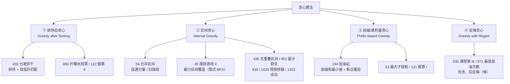
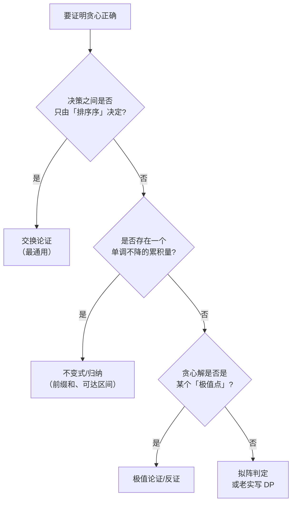
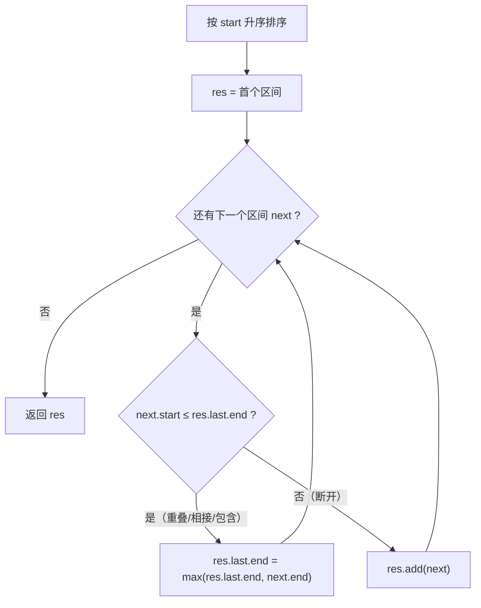
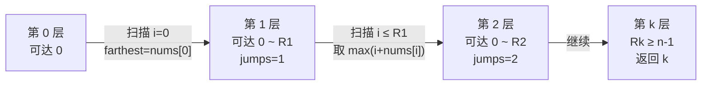
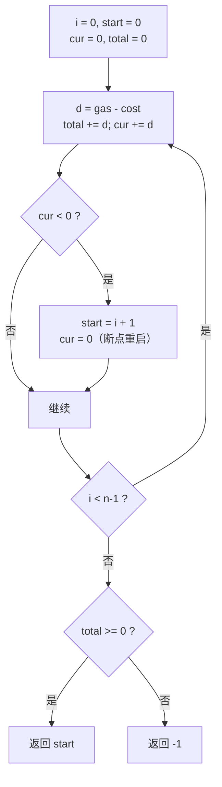
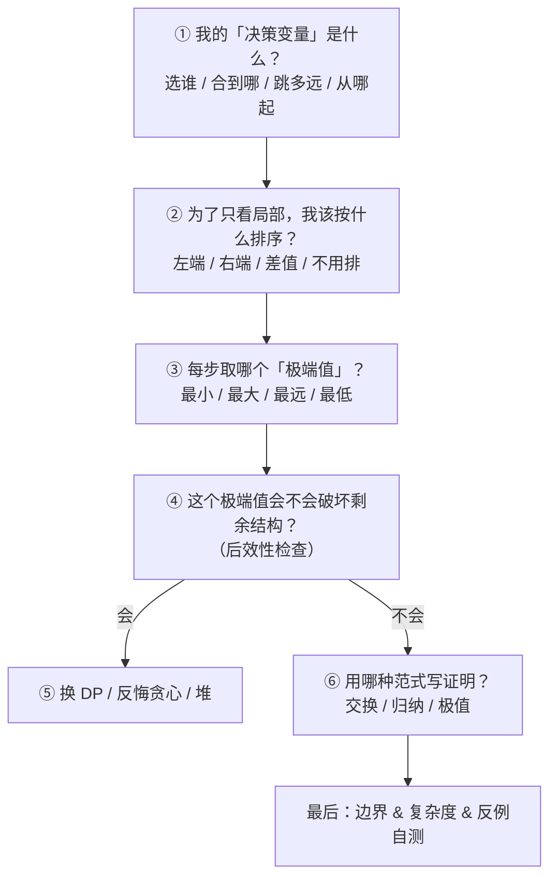
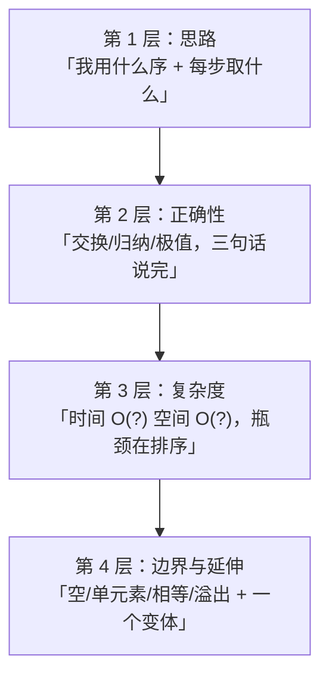

# 贪心算法专题精讲：从「局部最优」到「可证明的全局最优」

> **文档定位**：一份面向大厂技术面（Java 后端 / 算法 / 数据开发）的贪心算法深度学习文档。
> 以 LeetCode **455 分发饼干、56 合并区间、45 跳跃游戏 II、134 加油站** 四题为骨架，
> 向上抽象出贪心的**可证明性方法论**，向下延伸到**区间问题族、前缀和技巧族、拟阵理论**，
> 并整理各厂高频面试题（含考核程度标注、完整推导与 follow-up 追问链）。
>
> **阅读方式**：第 0~1 章是"心法"，务必先读；第 3~6 章是四道题的"逐题解剖"，
> 可对照刷题；第 8 章是面试冲刺；第 9 章是拉开差距的数学地基；第 10 章是临考速查。
>
> **一句话结论**：贪心不是"感觉对就行"，而是"**先猜一个局部最优选择，再用交换论证/归纳/反证把它钉死**"。
> 面试里能写对代码的人很多，能说清"为什么这个贪心不会错"的人很少——后者才是分水岭。

---

## 目录

- [第 0 章 认知地图：四道题在贪心谱系中的坐标](#第-0-章-认知地图四道题在贪心谱系中的坐标)
- [第 1 章 贪心的本质、边界与可证明性](#第-1-章-贪心的本质边界与可证明性)
  - [1.1 三要素定义](#11-三要素定义)
  - [1.2 贪心 vs 动态规划 vs 搜索 vs 二分答案](#12-贪心-vs-动态规划-vs-搜索-vs-二分答案)
  - [1.3 贪心什么时候会错：反例库](#13-贪心什么时候会错反例库)
  - [1.4 四大正确性证明范式](#14-四大正确性证明范式)
  - [1.5 识别信号：什么样的题该想贪心](#15-识别信号什么样的题该想贪心)
  - [1.6 贪心四步法模板](#16-贪心四步法模板)
- [第 2 章 排序贪心：消除「后效性」的第一把钥匙](#第-2-章-排序贪心消除后效性的第一把钥匙)
- [第 3 章 455 分发饼干：贪心的入门范式](#第-3-章-455-分发饼干贪心的入门范式)
- [第 4 章 56 合并区间：扫描线与连通分量](#第-4-章-56-合并区间扫描线与连通分量)
- [第 5 章 45 跳跃游戏 II：隐式 BFS 与区间贪心](#第-5-章-45-跳跃游戏-ii隐式-bfs-与区间贪心)
- [第 6 章 134 加油站：前缀和最小值与唯一性](#第-6-章-134-加油站前缀和最小值与唯一性)
- [第 7 章 四题横向对比与方法论沉淀](#第-7-章-四题横向对比与方法论沉淀)
- [第 8 章 国内大厂面试题库（含考核程度与详解）](#第-8-章-国内大厂面试题库含考核程度与详解)
- [第 9 章 贪心的数学地基（进阶）](#第-9-章-贪心的数学地基进阶)
- [第 10 章 速查手册与自测清单](#第-10-章-速查手册与自测清单)

---

## 第 0 章 认知地图：四道题在贪心谱系中的坐标

贪心题看起来零散，实际上只有**少数几种"结构骨架"**。四道题恰好覆盖了四种最典型的骨架：



**把四题放在同一张"决策流"上看得更清楚**——它们回答的是同一个问题的四个变体：

| 问题变体 | 你在选什么 | 选完为什么不用回头 | 代表题 |
|---|---|---|---|
| 选择"匹配对" | 谁配谁 | 交换后不劣（交换论证） | 455 分发饼干 |
| 选择"合并/切分点" | 边界在哪 | 左端点最小者必须被覆盖（不变式） | 56 合并区间 |
| 选择"下一步落脚点" | 跳多远 / 跳到哪 | 可达集是连续区间，最远 = 最优（层等价 BFS） | 45 跳跃游戏 II |
| 选择"起点" | 从哪出发 | 前缀和最低点之后处处非负（极值论证） | 134 加油站 |

> **记忆锚点**：贪心题九成可以归到一句话——"**先排序（或先算前缀），再在每个决策点取极端值，最后用交换/不变式证明这个极端值不被更优解绕过**"。

---

## 第 1 章 贪心的本质、边界与可证明性

### 1.1 三要素定义

一个算法被称为贪心，需要同时满足：

1. **贪心选择性质（Greedy Choice Property）**
   每一步都取当前看起来最优的那个局部选择，且**不需要**回看未来数据。
2. **最优子结构（Optimal Substructure）**
   做出贪心选择后，原问题的剩余部分的最优解 + 该选择 = 原问题最优解。
3. **无后效性（No After-effect）**
   当前决策**不改变**后续子问题的"可用资源集合"的形态（只改变规模/参数），
   因此后续仍然可以用同一套贪心规则继续做。

第三点最容易被忽略，而它恰恰是贪心与 DP 的分水岭：

- **分发饼干**：给最小的孩子一块饼干后，剩下的仍是"饼干集合 + 孩子集合"，**结构不变** → 无后效。
- **跳跃游戏 II**：从 i 起跳后，剩下的仍是"从落点跳到终点"，**结构不变** → 无后效。
- **0-1 背包**：拿走一个物品后，剩余容量变了，剩余物品的"最优密度"可能变化，**结构被破坏** → 有后效 → 贪心失效。
- **零钱兑换（币值 1/3/4，凑 6）**：先拿 4，剩 2 只能用 1+1，共 3 枚；最优是 3+3，2 枚 → 贪心失效。

**"无后效"是判断能不能贪心的第一直觉；"交换论证"是把它写成证明的唯一手段。**

### 1.2 贪心 vs 动态规划 vs 搜索 vs 二分答案

| 维度 | 贪心 | 动态规划 | BFS/DFS | 二分答案 |
|---|---|---|---|---|
| 决策方式 | 每步取局部最优，不回退 | 枚举所有转移，取全局最优 | 枚举所有路径 | 枚举"答案值"，用可行性判定 |
| 时间复杂度 | 通常 O(n log n) 或 O(n) | O(n^2)/O(nW) 等 | 指数 ~ 多项式 | O(n log V) |
| 依赖前提 | 贪心选择性质（需证明） | 无后效性 + 最优子结构 | 状态空间可枚举 | 单调性（可行 ⇒ 更大也可行） |
| 典型失误 | 想当然贪心，样例过、隐藏用例挂 | 状态/转移漏写 | 超时/爆栈 | 判定函数写错 |
| 相互关系 | 贪心 ⊂ DP 的"每层只有一个候选"的特例 | DP 是贪心的"兜底" | BFS 常是贪心的"证明工具" | 常与贪心组合（贪心判定） |

> **两个极重要的等价关系**（面试可直接讲，显得懂原理）：
> 1. **贪心 = 转移只有 1 个候选的 DP**。给 DP 写状态转移时，如果发现 `dp[i] = min(dp[j] + 1)` 里总取最小的那个 j，那它就是贪心。
> 2. **45 跳跃游戏 II 的贪心 = 隐式图上的 BFS 层数**。贪心的 `currentEnd` 就是 BFS 的"当前层右边界"，`jumps` 就是层数。这句话能把"凭感觉的贪心"瞬间升级成"有模型的正解"。

### 1.3 贪心什么时候会错：反例库

面试官最爱问："你这个贪心为什么对？能不能举一个它错的例子？"——能主动说出反例边界，比背答案更值钱。

**反例 1：零钱兑换（币值 1,3,4；目标 6）**

```
贪心：6 → 拿 4 → 剩 2 → 1+1 → 共 3 枚
最优：3+3 → 共 2 枚
失败原因：拿走 4 后剩余子问题的"最优结构"变了（有后效）
```

**反例 2：0-1 背包（按单位价值贪心）**

```
容量 10，物品：A(w=6,v=6, 密度1.0)、B(w=5,v=5, 密度1.0)、C(w=5,v=5.9, 密度1.18)
按密度贪心先拿 C，剩 5 只能拿 B，总 10.9；最优是 A+B = 11
失败原因：离散容量导致"装不满"，密度序不等于最优序
```

**反例 3：区间覆盖——「每次选左端点最小的区间」**

```
目标：连续覆盖 [0, 10]
区间：[0,2]、[2,3]、[3,10]、[0,10]

「左端点最小」先选 [0,2]，再 [2,3]，再 [3,10] → 用了 3 个
最优：[0,10] 一个就够 → 1 个

→ 正确贪心是「在能接上的区间里，选右端点最远的」，而不是「选左端点最小的」
```

**反例 4：跳跃游戏——「每次落到能跳最远的那一格」**

```
nums = [5, 0, 0, 0, 6, 0, 0, 0, 0, 0, 0]（n = 11，终点下标 10）
「落到最远」：0 → 5，而 nums[5] = 0，卡死在 5，永远到不了 10
最优：0 → 4（nums[4] = 6）→ 10，2 步

→ 正确的不变式是「在当前可达区间 [0, curEnd] 内，选 i + nums[i] 最大的那一格」，
   而不是「落在物理上最远的那一格」——落点最远 ≠ 延伸最远
```

> **这四条反例的共同点**：贪心失败的场景 = **局部最优的选择破坏了剩余问题的最优结构**。
> 反过来，"无后效 + 交换后不劣"就是贪心成立的充分条件。

### 1.4 四大正确性证明范式

这是本文档最核心的一节。四种范式覆盖了 95% 的贪心证明题。

#### 范式 A：交换论证（Exchange Argument）——最通用

**套路**：设 `OPT` 是某个最优解。证明"存在一个最优解，它的第一个决策与贪心相同"。
做法是把 `OPT` 的第一个决策**换成**贪心的决策，证明换完之后：
① 仍然合法；② 目标值不变差。于是归纳下去，贪心整体不劣于最优 ⇒ 贪心就是最优。

**标准模板（面试可直接口述）**：

> 设最优解 O = {o₁, o₂, …}。贪心第一步选 g。
> 若 g ∈ O，跳过；否则设 O 中承担 g 角色的是 o₁。
> 交换 g 与 o₁ 的位置：合法性由【引理：g 与 o₁ 可互换而不破坏约束】保证；
> 目标值由【引理：交换后不劣】保证。
> 故存在包含 g 的最优解。对剩余子问题归纳，贪心最优。∎

**455 分发饼干就用这个范式**（详见 3.3）。

#### 范式 B：不变式 / 归纳法（Invariant & Induction）

**套路**：定义"处理完前 k 个元素后的状态 S_k"，证明 S_k 对任意最优解都**不劣**，
并且 S_k 一旦成立就不会被后续破坏。

- **56 合并区间**："前 k 个区间的最右覆盖边界 R_k 是任何合法分解都必须达到的右边界"。
- **45 跳跃游戏 II**："走 k 步能到达的位置集合恰好是连续区间 [0, R_k]"。

#### 范式 C：反证法 + 极值论证（Extremal Argument）

**套路**：假设存在更优解，取它与贪心**第一个不同的决策点**，用极值性质导出矛盾。

- **134 加油站**：设贪心起点 s（前缀和全局最小点的下一个位置）。若存在可行起点 t 比它更"早"，
  则在 s 之前某个位置前缀和会低于全局最小值，与"全局最小"矛盾。

#### 范式 D：拟阵（Matroid）/ 拟阵交——最"数学"的证明

**套路**：如果问题的"可行集族"构成一个**拟阵**，则"按权重从小到大加元素、能加就加"的贪心必然最优。
最小生成树（Kruskal）、任务调度中的部分匹配问题都落在这个框架里。

- **分发饼干的推广（二分图匹配）一般不是拟阵**，所以一般二分图匹配必须用匈牙利算法，不能贪心；
  但"饼干-孩子"这种**区间/阈值结构**的匹配是"拟阵的退化形式"，所以能贪。
  这个对比是面试的**高光回答**（详见 9.1）。

#### 四种范式的选择决策树



### 1.5 识别信号：什么样的题该想贪心

出现以下任意 3 条以上，优先怀疑是贪心（而不是 DP/搜索）：

- ✅ 有"**最少/最多**数量" + "**每个物品只能用一次/每个位置只能覆盖一次**"
- ✅ 元素可以**排序**，且排序后相邻元素的关系**只依赖局部**（左端点/右端点/差值）
- ✅ 题目**只问数量（跳数、区间数、孩子数）**，不问"具体方案"或"方案数"
- ✅ 有明显**单调性**：越早完成越好、越大越省、越远越优
- ✅ 数据规模 `n ≤ 1e5`，且答案与"排序"强相关（提示 O(n log n)）
- ✅ 存在"**最优解里一定包含某个极端元素**"的直觉（最小、最左、最右、最大）

反之，出现下面信号要警惕贪心失效：

- ⚠️ 有"容量""重量""体积"等**离散约束**（背包类）
- ⚠️ 选择之间会**互相影响剩余可选项的形态**（后效性）
- ⚠️ 需要输出**方案计数**或**具体方案**（常常 DP/搜索）
- ⚠️ 目标函数是"**平方和/方差/最大最小**"这类非线性组合

### 1.6 贪心四步法模板


**四步法的落地清单（写在草稿纸上）**：

1. 我要选的"决策变量"到底是什么？（配谁 / 合并到哪 / 跳多远 / 从哪起）
2. 为了让它"只依赖局部"，我该按什么排序？（左端点 / 右端点 / 差值 / 结束时间）
3. 排序后，第 i 步的"最优局部选择"是哪个？（最小的、最远的、最左的）
4. 我能不能构造一个反例？能 → 换成 DP；不能 → 尝试交换论证写 3 行证明。
5. 边界：`n=0/1`、全相等、全重叠、无法完成（返回 -1/0）。

---

## 第 2 章 排序贪心：消除「后效性」的第一把钥匙

### 2.1 为什么"排序"几乎是贪心的前置动作

贪心最难缠的敌人是**后效性**：第 i 步的选择会改变第 i+1 步可选项的形态。
排序做的事情，是**把"全局的、无序的资源"重排成"局部的、单调的资源"**，
使得"第 i 步只看第 i 个元素"就足够——后效性被排序"吸收"进了下标顺序里。

用一句话概括：

> **排序把"两两比较的全局约束"降维成"相邻比较的局部约束"。**
> 一旦约束只依赖相邻元素，贪心就有了立足点。

举例说明这种"降维"：

| 原问题约束 | 排序后约束 | 结论 |
|---|---|---|
| 任意两个区间是否重叠 | 只需检查"当前区间左端点 vs 已合并块右端点" | 56 可贪 |
| 任意两个孩子与饼干的匹配 | 只需比较"最小饼干 vs 最小胃口" | 455 可贪 |
| 任意两个区间不重叠 | 只需比较"当前左端点 vs 上一个右端点" | 435 可贪 |
| 任意两个区间是否相交（射箭） | 只需比较"当前左端点 vs 上一支箭位置" | 452 可贪 |

### 2.2 排序键的选择方法论

**排序键 = 你想让"贪心决策"只依赖的那一维。** 选错键，贪心立刻失效。

#### 键 1：按**右端点**升序（结束时间早的优先）

适用：**"最多能选多少个互不冲突的东西"** 类问题。

- 435 无重叠区间（求最少删除 = n - 最多保留）
- 452 用最少数量的箭引爆气球
- 646 最长数对链
- 1353 最多可以参加的会议数目（还需小顶堆）
- 面试原题：会议室安排、课程安排、活动选择问题（Activity Selection）

**为什么是右端点而不是左端点？** 因为"结束得早"给后面留的时间最多，
这是一个**严格可交换的支配关系**：若最优解选了结束更晚的 A 而没选结束更早的 B，
把 A 换成 B 不会与任何已选区间冲突（B 结束更早），且不减少数量。

#### 键 2：按**左端点**升序（起点早的优先）

适用：**"把东西合并/切开/覆盖成连续块"** 类问题。

- 56 合并区间
- 57 插入区间
- 986 区间列表的交集
- 128 最长连续序列（排序后扫）
- 面试原题：合并日志时间段、合并 IP 段、合并磁盘碎片

**为什么是左端点？** 因为要判断"能否接上"，必须保证"前一个块的右端点已经确定"，
而左端点升序保证**不会有一个更早开始的区间突然插进来**——这是"前缀已封闭"的前提。

#### 键 3：按**差值 / 比值 / 复合维度**

- 406 根据身高重建队列：先按 `h` 降序、`k` 升序，再逐个插入到第 k 位。
- 871 最低加油次数：不排序，用"反悔堆"。
- 179 最大数：按 `a+b > b+a` 排序（不是普通字典序）。
- 135 分发糖果：不排序，双向扫描。
- 881 救生艇：排序 + 双指针（最重配最轻）。

#### 排序键决策表（背下来）

| 题目问的是 | 排序键 | 方向 | 贪心动作 |
|---|---|---|---|
| 最多选几个不重叠 | 右端点 | 升序 | 能选就选 |
| 最少删几个使之不重叠 | 右端点 | 升序 | 冲突就删右端点大的 |
| 最少几支箭/几个点穿透所有区间 | 右端点 | 升序 | 箭放在当前右端点 |
| 合并/切分/覆盖成块 | 左端点 | 升序 | 维护当前块右边界 |
| 最少几个区间覆盖 [0,n] | 左端点 | 升序 | 在能接上的里选右端点最远 |
| 最大数量匹配（阈值型） | 两边都排 | 升序 | 最小配最小 |
| 最大数/最优拼接 | 自定义比较器 | — | 按拼接结果排序 |

> ⚠️ **Java 比较器溢出坑**：`(a, b) -> a[0] - b[0]` 在 `a[0] = -2^31, b[0] = 2^31-1` 时会溢出成负数导致排序错误。
> **必须用 `Integer.compare(a[0], b[0])` 或 `Comparator.comparingInt(x -> x[0])`**。
> 这是国内大厂笔试里真实挂过人的细节，写代码时养成肌肉记忆。

---

## 第 3 章 455 分发饼干：贪心的入门范式

### 3.1 题意与建模

> 你有孩子胃口数组 `g`，饼干尺寸数组 `s`。若 `s[j] >= g[i]`，饼干 j 可以满足孩子 i。
> 每个孩子最多一块饼干，每块饼干最多给一个孩子。求**最多能满足几个孩子**。

- 输入：`g = [1,2,3], s = [1,1]` → 输出 `1`
- 输入：`g = [1,2], s = [1,2,3]` → 输出 `2`

**建模**：这是一个**二分图最大匹配**问题（左边孩子、右边饼干，边为 `s[j] >= g[i]`）。
一般二分图最大匹配要用匈牙利算法 `O(VE)`，但这张图有特殊结构——
**边集由"阈值"决定**（胃口小的孩子能连更多饼干，是"嵌套/链式"结构）。
这种特殊结构让贪心可行。**"为什么这里能贪、一般匹配不能贪"，是面试的分水岭问题**。

### 3.2 解法演化：从暴力到双指针

#### 解法 1：暴力枚举（O(m·n) 甚至 O(m!))

每个孩子去扫所有饼干找一块能给的。最坏 `O(mn)`，而且需要回溯（因为可能给错导致后面更优解丢失）。
**正确但慢，且容易写错**。它的价值在于：**让我们意识到"给错会浪费"，从而推出贪心**。

#### 解法 2：排序 + 双指针（正解，O(m log m + n log n))

**核心观察**：如果一块饼干能满足胃口大的孩子，它一定能满足胃口小的孩子（单调性）。
所以**用小饼干去满足"最容易满足"（胃口最小）的孩子**，把大饼干留给大胃口。

```
g 升序： [1, 2, 3]
s 升序： [1, 1]

i 指向孩子，j 指向饼干：
j=0 (s=1) vs g[0]=1 → 满足，i=1, j=1
j=1 (s=1) vs g[1]=2 → 不满足，j=2 结束
结果 i = 1
```

**代码（Java，主推）**：

```java
class Solution {
    public int findContentChildren(int[] g, int[] s) {
        Arrays.sort(g);
        Arrays.sort(s);
        int i = 0;                       // 孩子指针：指向"当前最饿的未被满足的孩子"
        for (int j = 0; j < s.length && i < g.length; j++) {
            if (s[j] >= g[i]) {          // 这块饼干能喂饱当前最饿的孩子
                i++;                     // 孩子被满足，换下一个
            }
            // 否则这块饼干太小，对任何孩子都没用（因为 g[i] 已是最小胃口），直接丢弃
        }
        return i;
    }
}
```

> **关键注释**：`s[j] < g[i]` 时"直接丢弃"是安全的——因为 `g[i]` 是**剩余孩子中胃口最小**的，
> 连他都不够，给谁都不够。这一句就是"贪心合理性"的口语版证明。

**Python**：

```python
class Solution:
    def findContentChildren(self, g: List[int], s: List[int]) -> int:
        g.sort(); s.sort()
        i = 0
        for cookie in s:
            if i < len(g) and cookie >= g[i]:
                i += 1
        return i
```

**Go**：

```go
func findContentChildren(g []int, s []int) int {
    sort.Ints(g); sort.Ints(s)
    i := 0
    for j := 0; j < len(s) && i < len(g); j++ {
        if s[j] >= g[i] { i++ }
    }
    return i
}
```

#### 解法 3：二分写法（同等复杂度，代码更"工程"）

把饼干排序后，对每个孩子二分找**最小的能满足他的饼干**（`lower_bound(g[i])`），
找到就消耗掉。这种写法在"饼干不能重复用"的场景更自然，但需要额外的"已用"标记或删除操作，
**在数组上不如双指针优雅**，在 `TreeMap`/`multiset` 上才合适。

> **面试表达技巧**：先说"这是二分图匹配，一般要匈牙利"，再说"但这张图是阈值型（嵌套结构），
> 所以可以排序后双指针贪心"，最后补一句"如果用 `TreeMap` 做在线版本，就是每个孩子
> `ceiling(g[i])`"，层次立刻拉开。

### 3.3 正确性证明（交换论证完整版）

**命题**：设 `g` 升序、`s` 升序。贪心算法（最小饼干配最小胃口）得到的匹配数最大。

**证明（交换论证）**：

对任意一个最优匹配 `OPT`，设贪心第一步为"用最小饼干 `s₁` 满足最小胃口 `g₁`"（若 `s₁ < g₁` 则 `s₁` 无法满足任何孩子，直接丢弃，这一步显然不劣）。

- 若 `OPT` 中 `s₁` 恰好配给 `g₁`，无需交换。
- 否则分两种情况：
  1. **`OPT` 中 `s₁` 未匹配任何孩子**。设 `OPT` 中 `g₁` 配的是 `s_k`（必存在，否则可以把 `s₁` 加进去使匹配数 +1，与最优矛盾）。
     由于 `s₁` 是最小饼干，`s₁ ≤ s_k`；又 `s_k ≥ g₁`（`s_k` 能配 `g₁`），故 `s₁ ≥ g₁`，
     于是把 `s₁` 配给 `g₁`、释放 `s_k`，匹配数不变。交换合法。
  2. **`OPT` 中 `s₁` 配给 `g_m`（`m ≠ 1`）**。因 `g₁ ≤ g_m` 且 `s₁ ≥ g_m`（能配 `g_m`），
     故 `s₁ ≥ g₁`，可把 `s₁` 改配给 `g₁`；原配 `g₁` 的饼干 `s_k` 满足 `s_k ≥ s₁ ≥ g_m`，
     把 `s_k` 改配给 `g_m`。**两块饼干互换孩子，匹配数不变，合法性保持**。
- 于是**存在一个包含贪心第一步的最优解**。移除 `s₁` 与 `g₁` 后，剩余问题规模缩小且结构不变（无后效），
  对剩余问题归纳，贪心整体最优。∎

> **一句话面试版**："最小饼干配最小胃口，是因为最小饼干如果连最小胃口都满足不了就直接废掉；
> 如果能满足，那它配给最小胃口一定不亏——任何最优解都能通过一次交换把它调成这样。"

### 3.4 复杂度与常数优化

| 项 | 复杂度 | 说明 |
|---|---|---|
| 排序 | `O(n log n + m log m)` | 主导项 |
| 双指针扫描 | `O(n + m)` | 每个指针单向移动 |
| 空间 | `O(1)`（原地排序） / `O(log n)`（递归栈） | Java `Arrays.sort(int[])` 是双轴快排，栈 `O(log n)` |
| 总 | **O(n log n + m log m)** | 已是最优量级（排序下界） |

**能不能做到 O(n + m)？** 如果胃口和饼干的取值范围很小（比如 `≤ 1000`），
可以用**计数排序 + 双指针**做到 `O(n + m + V)`。这是"值域换时间"的经典套路，
也是面试 follow-up 的加分点：*"如果饼干尺寸都在 1~1000，能不能优化到线性？"*

```java
// 计数排序版本（值域 V 很小时）
public int findContentChildrenCounting(int[] g, int[] s, int V) {
    int[] cg = new int[V + 1], cs = new int[V + 1];
    for (int x : g) cg[x]++;
    for (int x : s) cs[x]++;
    int i = 0, j = 0, ans = 0;
    while (i <= V && j <= V) {
        while (i <= V && cg[i] == 0) i++;      // 找下一个有需求的孩子
        while (j <= V && cs[j] == 0) j++;      // 找下一块有货的饼干
        if (i > V || j > V) break;
        if (j >= i) {                           // 饼干能喂这个胃口
            int k = Math.min(cg[i], cs[j]);
            ans += k; cg[i] -= k; cs[j] -= k;
            if (cg[i] == 0) i++;
            if (cs[j] == 0) j++;
        } else {
            j++;                                // 饼干太小，整类丢弃
        }
    }
    return ans;
}
```

### 3.5 易错点清单

| # | 错误 | 后果 | 修正 |
|---|---|---|---|
| 1 | 把 `g` 和 `s` 语义搞反 | 全错 | 记法："**g** = 胃口(greed)，**s** = 尺寸(size)" |
| 2 | 双指针遍历"孩子"而不是"饼干" | 逻辑仍对但写法更绕 | 遍历饼干更简洁：饼干是"被动消耗"的一方 |
| 3 | `s[j] < g[i]` 时 `i++` | 把没满足的孩子当成满足了 | **只有 `>=` 才 `i++`** |
| 4 | 忘记 `i < g.length` 判断 | 越界 | 循环条件里带上 |
| 5 | 认为"最大饼干配最大胃口"错 | 其实也对（对称贪心） | 两种对称策略都正确，别在面试里说错 |
| 6 | 认为「最大饼干配最小胃口」对 | 错，浪费大饼干 | 反例 `g=[1,2], s=[1,2]`：大配小只能得 1，最优为 2 |

> **反例补充（第 6 条）**：`g = [1, 2]`，`s = [1, 2]`。
> 
> - 「最大饼干配最小胃口」：先把 2 给胃口 1，剩下 1 满足不了胃口 2 → 得 **1**；
> - 最优：1 给 1、2 给 2 → 得 **2**。
> 
> **所以「大饼干配小胃口」是错的，会浪费资源。** 而对称的「**最大饼干配最大胃口**」是正确的：
> 若最大的饼干连最大的胃口都满足不了，它就谁也满足不了，可以直接丢弃；否则用它喂最大的胃口一定不亏（同样可用交换论证证明）。
> 
> 一句话记法：**配对的双方必须「同向」——小配小，或大配大；交叉配对（大配小）必然浪费。**

### 3.6 延伸一：为什么一般二分图匹配不能贪心

考虑图：左 `{A, B}`，右 `{1, 2}`，边 `A-1, A-2, B-1`。
按"A 先挑 1"贪心：A 占 1，B 只能配…没有边了 → 匹配数 1。
最优：A-2, B-1 → 匹配数 2。**贪心失败**。

**失败原因**：一般图里"某个点选了某条边"会**改变剩余子图的结构**（后效性），
而 455 的图是**阈值图（chain graph / 嵌套邻域）**：胃口小的孩子邻域包含胃口大的孩子的邻域。
**嵌套结构 ⇒ 交换不会破坏结构 ⇒ 无后效 ⇒ 贪心可行。**

> 这句话可以直接背下来，面试官问"这题为什么不用匈牙利"时，答"因为邻域是嵌套的阈值结构，
> 满足贪心选择性质，用交换论证即可证明"。

### 3.7 延伸二：拟阵视角（可选加分）

把"饼干"视为资源、"孩子"视为需求，可行集 = "存在一个匹配覆盖该孩子子集"。
这个可行集族构成一个**拟阵（ transversal matroid 的退化形式）**，
拟阵的"贪心最优性定理"直接给出：按任意顺序加元素、能加就加，得到的极大独立集就是最大独立集。
（详见 9.1 节的拟阵定义与证明框架。）

### 3.8 变体练习

| 题号 | 题目 | 与 455 的关系 |
|---|---|---|
| 881 | 救生艇 | 排序 + 双指针，但配对是"最重 + 最轻"，**双向贪心** |
| 870 | 优势洗牌 | 田忌赛马：排序后"能赢就用最小的赢，赢不了就用最小的送" |
| 2410 | 运动员和训练师的最大匹配 | 与 455 几乎同构 |
| 826 | 安排工作以达到最大收益 | 排序 + 双指针 + 单调栈（按难度排序） |
| 2071 | 你可以安排的最多任务数目 | 455 + 二分答案 + 药丸（**贪心判定 + 二分** 组合） |
| 2009 | 使数组连续的最少操作数 | 排序 + 滑动窗口（不是贪心但同源） |

---

## 第 4 章 56 合并区间：扫描线与连通分量

### 4.1 题意与"闭合区间"陷阱

> 给定区间数组 `intervals`，合并所有重叠区间，返回互不重叠且覆盖输入中所有区间的结果。
> **重叠定义包含端点相接**：`[1,2]` 与 `[2,3]` 视为重叠（因为 `2 <= 2`）。

- `[[1,3],[2,6],[8,10],[15,18]]` → `[[1,6],[8,10],[15,18]]`
- `[[1,4],[4,5]]` → `[[1,5]]`
- `[[1,4],[0,4]]` → `[[0,4]]`（**包含关系**，必须取 `max`）
- `[]` → `[]`

> ⚠️ **第一坑**：判断条件是 `next.start <= cur.end`，**不是 `<`**。
> 写 `<` 会让 `[[1,4],[4,5]]` 输出两个区间，LeetCode 直接 WA。

### 4.2 解法演化

#### 解法 1：暴力反复合并（O(n²) ~ O(n³)）

两两检查、发现重叠就合并、重新扫描，直到一轮无变化。
正确但慢，且**边界容易写崩**（合并后数组长度变化、原地删除）。**面试别写这个当答案**，但可以说"这是暴力基线"。

#### 解法 2：按左端点排序 + 一次扫描（正解，O(n log n))



**为什么"只和最后一个块比"就够？**
因为按左端点升序后，`next.start` 一定 `≥` 之前所有区间的 `start`。
若 `next.start > res.last.end`，则 `next` 与 `res.last` 断开；而 `res.last` 的 `start` 是当前块中最大的，
块内其他区间 `start` 更小、`end` 也不会超过 `res.last.end`，所以 `next` 与**整个当前块**都断开。
**"前缀已封闭"是这条贪心的命门。**

### 4.3 反例：不排序会怎样

```
intervals = [[2,6],[1,3],[8,10]]
不排序直接扫：cur=[2,6]，next=[1,3]：1 <= 6 重叠 → 合并成 [1,6]（因为要取 min start）
再 next=[8,10]：8 > 6 → 新块 → 结果 [[1,6],[8,10]] 似乎也对
但若 intervals = [[2,3],[1,4],[5,6]]：cur=[2,3]，next=[1,4] 重叠 → [1,4]；
再 [5,6] → 也对。
真正出问题的是"新块被更早的区间二次覆盖"：
intervals = [[5,7],[1,3],[2,6]]：
不排序：cur=[5,7]，next=[1,3] → 不重叠（3 < 5），新块 [1,3]；
next=[2,6] → 与 [1,3] 重叠 → [1,6]；但 [1,6] 与 [5,7] 也重叠，却已经在结果里没被合并 → 输出 [[5,7],[1,6]] ❌
```

> **结论**：不排序时"新块可能向后吞并已输出的块"，需要回溯 —— 这正是"排序消除后效性"的价值。

### 4.4 正确性证明：连通分量 / 凸包视角

**形式化**：把每个区间看成一个"点集"（实数轴上的集合）。合并的语义是求
**"区间并集的连通分量凸包"**——即把数轴上被覆盖的区域按连通性切成若干段，每段输出其 `[最小左, 最大右]`。

**引理 1（连通性只依赖相邻）**：将区间按 `start` 升序排列为 `I₁…Iₙ`。
若 `Iᵢ` 与 `Iₖ`（`k > i+1`）连通，则 `Iᵢ` 与 `Iᵢ₊₁` 必连通。
*证明*：连通意味着存在链 `Iᵢ = J₀, J₁, …, J_m = Iₖ` 相邻重叠。反设 `Iᵢ` 与 `Iᵢ₊₁` 不重叠，
即 `Iᵢ₊₁.start > Iᵢ.end`。由于排序，所有 `j > i` 的区间 `start ≥ Iᵢ₊₁.start > Iᵢ.end`，
故 `Iᵢ` 与任何后续区间都不重叠，与连通矛盾。∎

**引理 2（贪心恰好求出每个连通分量的凸包）**：扫描到 `Iₖ` 时，
若 `res.last.end < Iₖ.start`，则 `res.last` 所在分量的所有区间都已处理完（由引理 1），
开启新分量不会漏；若 `≥`，则 `Iₖ` 与当前分量连通，并入并更新右端点为两者最大，凸包正确。∎

**定理**：算法输出的区间数 = 区间并集的连通分量数，且每个输出都是对应分量的凸包。
由于"最少的互不重叠区间数"就等于连通分量数（一个分量内必须被一个区间覆盖，跨分量不可能被一个区间覆盖而不产生空隙），
故输出即为**最优且唯一**。

> **面试可讲的一句话**："合并区间其实是个**唯一解**问题——答案等于把数轴上被覆盖的区域按连通性切片，
> 贪心只是高效地求连通分量。所以不存在'另一种更优的合并方式'，这题的贪心不是'猜'，是'算'。"

### 4.5 代码

**Java（主推，注意比较器与返回值类型）**：

```java
class Solution {
    public int[][] merge(int[][] intervals) {
        if (intervals.length == 0) return new int[0][];
        // 必须用 Integer.compare，避免 a[0]-b[0] 溢出
        Arrays.sort(intervals, (a, b) -> Integer.compare(a[0], b[0]));

        List<int[]> res = new ArrayList<>();
        int[] cur = intervals[0];                 // 复用引用，注意不要直接改原数组
        for (int i = 1; i < intervals.length; i++) {
            int[] next = intervals[i];
            if (next[0] <= cur[1]) {              // 重叠或相接（<= 而非 <）
                cur[1] = Math.max(cur[1], next[1]);   // 处理"包含"情形
            } else {
                res.add(new int[]{cur[0], cur[1]});   // 必须 new，避免后续被改
                cur = next;
            }
        }
        res.add(new int[]{cur[0], cur[1]});
        return res.toArray(new int[res.size()][]);
    }
}
```

**两个隐蔽的坑**：

1. **`res.add(cur)` 直接加引用**：若 `cur` 后续被修改（例如又合并了一次），已加入的区间也会变。
   → 必须 `new int[]{cur[0], cur[1]}` 拷贝。
2. **`cur = intervals[0]` 后原地修改**：会**篡改输入数组**。有些面试官会追问"能不能不修改输入"，
   要求 `int[] cur = intervals[0].clone()`。**加分细节。**

**Python**：

```python
class Solution:
    def merge(self, intervals: List[List[int]]) -> List[List[int]]:
        intervals.sort(key=lambda x: x[0])
        res = []
        for itv in intervals:
            if res and itv[0] <= res[-1][1]:
                res[-1][1] = max(res[-1][1], itv[1])
            else:
                res.append(list(itv))     # 拷贝，避免共享引用
        return res
```

**C++（面试手写常见）**：

```cpp
class Solution {
public:
    vector<vector<int>> merge(vector<vector<int>>& intervals) {
        if (intervals.empty()) return {};
        sort(intervals.begin(), intervals.end(),
             [](const vector<int>& a, const vector<int>& b){ return a[0] < b[0]; });
        vector<vector<int>> res;
        for (auto& itv : intervals) {
            if (!res.empty() && itv[0] <= res.back()[1])
                res.back()[1] = max(res.back()[1], itv[1]);
            else res.push_back(itv);
        }
        return res;
    }
};
```

### 4.6 边界与坑清单

| # | 场景 | 期望 | 陷阱 |
|---|---|---|---|
| 1 | `intervals = []` | `[]` | 直接取 `intervals[0]` 会越界 |
| 2 | 只有一个区间 | 原样返回 | 循环不执行，别忘了末尾 `add` |
| 3 | `[[1,4],[2,3]]` 包含 | `[[1,4]]` | 直接赋值 `cur[1]=next[1]` 会缩短成 `[1,3]` |
| 4 | `[[1,2],[2,3]]` 相接 | `[[1,3]]` | 用 `<` 判断会漏合并 |
| 5 | 坐标含 `Integer.MIN/MAX_VALUE` | 正常 | `a[0]-b[0]` 溢出 |
| 6 | 认为「最大饼干配最小胃口」对 | 错，浪费大饼干 | 反例 `g=[1,2], s=[1,2]`：大配小只能得 1，最优为 2 |
| 7 | 修改了输入数组 | 可能被判"副作用" | 用 `clone()` |
| 8 | 相同 `start` 不同 `end` | 与 `max` 一致 | 排序稳定与否都不影响结果（因为都要取 max） |

### 4.7 延伸一：扫描线（Sweep Line）——另一种完全不同的视角

合并区间还可以用**事件点 + 差分**来做，这是"扫描线"的通用框架：

- 每个区间拆成两个事件：`(start, +1)`、`(end, -1)`（注意闭合区间是 `end+1` 处 `-1`）。
- 按坐标排序事件，维护"当前覆盖计数 `cnt`"。
- `cnt` 从 0 变正的位置 = 一个连通分量的左端点；`cnt` 从正变 0 的位置 = 右端点。

```java
// 扫描线版本（适合坐标范围大但区间数适中，或需要"被覆盖次数"的场景）
public int[][] mergeSweep(int[][] intervals) {
    List<int[]> events = new ArrayList<>();
    for (int[] itv : intervals) {
        events.add(new int[]{itv[0], 1});
        events.add(new int[]{itv[1] + 1, -1});   // 闭合区间：[l, r] 在 r+1 处失效
    }
    events.sort((a, b) -> a[0] == b[0] ? a[1] - b[1] : Integer.compare(a[0], b[0]));
    List<int[]> res = new ArrayList<>();
    int cnt = 0, start = 0;
    for (int[] e : events) {
        if (cnt == 0) start = e[0];              // 覆盖开始
        cnt += e[1];
        if (cnt == 0) res.add(new int[]{start, e[0] - 1});
    }
    return res.toArray(new int[0][]);
}
```

> **两种解法的适用边界**（面试常问"还有别的做法吗"时的标准回答）：
> - 排序合并：`O(n log n)`，**输出区间本身**，最常用。
> - 扫描线：`O(n log n)`，能顺带求"**最大重叠数**"（会议室数量/CPU 峰值），
>   也能处理"**坐标是开区间/半开区间**"的变体。
> - 若坐标范围小（如 `≤ 1e6`），可用**差分数组** `O(n + V)`，这是"值域小"的最优解。
> - 若区间**动态插入**（数据流），需要 `TreeMap` 维护有序不相交区间（LeetCode 352 / 715）。

### 4.8 延伸二：合并区间的工程映射（面试加分素材）

| 工程场景 | 与合并区间的对应 |
|---|---|
| 内存碎片整理 / 伙伴系统 | 空闲块区间合并，`[start, end]` 相邻即合并 |
| Kafka / 日志 offset 回溯 | 消费位点区间合并，找连续可回溯段 |
| 监控告警抑制 | 多告警时间窗合并成"故障窗口" |
| 视频剪辑多段裁剪 | 时间轴片段合并，避免重复渲染 |
| IP 段/端口段合并 | 防火墙规则压缩（区间并集最小表示） |
| 日历忙闲（FreeBusy） | 多人忙区间合并求"共同空闲"（合并后取补集） |
| 数据库 LSM / SSTable key range | key 区间重叠检测 |
| Git diff hunk 合并 | 相邻 hunk 合并显示 |

> 这些映射不用全说，挑 1~2 个讲清楚即可。**"能把这题讲到工程里"是 P6/P7 面试的常见加分点。**

### 4.9 变体题族

| 题号 | 题目 | 与 56 的关系 |
|---|---|---|
| 57 | 插入区间 | 56 的"插入一个新区间后再合并"，可 `O(n)` 三阶段扫描 |
| 986 | 区间列表的交集 | 双指针求交集（不是合并，是"求交"） |
| 228 | 汇总区间 | 合并的逆问题：把连续数字切成区间 |
| 163 | 缺失的区间 | 求补集（与合并互补） |
| 128 | 最长连续序列 | 排序后等价于"合并 + 取最大块长度"（但最优是哈希 O(n)） |
| 352 | 将数据流变为多个不相交区间 | 动态版合并，`TreeMap` |
| 715 | Range 模块 | 动态区间增删查，线段树/TreeMap |
| 732 | 我的日程安排表 III | 扫描线求最大重叠数（**不是合并**） |
| 2406 | 将区间分为最少组数 | 扫描线/小顶堆求最大重叠（**贪心+堆**） |

> **易混淆辨析**（面试高频追问）：
> - **"最少区间数覆盖"** → 排序 + 贪心（45/1024）。
> - **"最少分组使组内不重叠"** → 等于"最大重叠层数"，用**小顶堆**或扫描线，**不是**合并区间。
> - **"合并重叠区间"** → 排序 + 一次扫描（56）。
> 三者长得像，解法完全不同，说错就暴露"只背题不理解"。

---

## 第 5 章 45 跳跃游戏 II：隐式 BFS 与区间贪心

### 5.1 题意与关键前提

> `nums[i]` 表示"站在下标 i 时，**最多**能向前跳 `nums[i]` 步"（即可以跳到 `[i+1, i+nums[i]]` 内任意位置）。
> 从下标 0 出发，求到达 `n-1` 的**最少跳跃次数**。题目保证**一定可以到达**。

- `nums = [2,3,1,1,4]` → `2`（0→1→4）
- `nums = [2,3,0,1,4]` → `2`（0→2→4 不行，2 处为 0；实际 0→1→4）
- `nums = [0]` → `0`
- `nums = [1,2,3]` → `2`

**两个极易读错的前提**（面试官会故意含糊）：

1. **"最多跳 nums[i] 步"不是"必须跳这么多"**。可以只跳 1 步。这条性质是"可达集是连续区间"的根源。
2. **`nums[i] = 0` 不是死亡**，只是"从这格无法再前进"，但可以跳过它（如果前一跳能越过）。

> 如果题目改成"**必须恰好跳 nums[i] 步**"，问题立刻变成另一道题（可达集是离散点集，贪心失效，需要 BFS/DP）。
> **"能否少跳"这一句，决定了贪心是否成立。** 这是本题最值得在面试里主动指出的细节。

### 5.2 三种视角，一条主线

#### 视角 1：动态规划（O(n²)，理解用）

`dp[i]` = 到达 i 的最少跳数。

```
dp[0] = 0
dp[i] = min{ dp[j] + 1 | j < i 且 j + nums[j] >= i }
```

正确但慢。它的价值：**让你看到"dp[i] 只依赖能覆盖 i 的那些 j"，而其中最小的一定是最靠左的"**——
这正是贪心的来源。

#### 视角 2：隐式 BFS（模型用）

把下标当节点，`i` 向 `[i+1, i+nums[i]]` 连边（隐式，不建图）。
BFS 的层数就是最少跳数。问题：边数可达 `O(n²)`，直接 BFS 会超时。

**关键性质（本题的"题眼"）**：

> **走 k 步能到达的位置集合，恰好是一个连续区间 `[0, R_k]`。**

*证明*：归纳。`k=1` 时，从 0 能到 `[1, nums[0]]`，加上 0 本身，即 `[0, R_1]`，连续。
若 `k` 步可达 `[0, R_k]`，则 `k+1` 步可达 `= ∪_{i ≤ R_k} [i, i+nums[i]]`。
由于每个 `[i, i+nums[i]]` 都从 `i` 开始，而 `i` 取遍 `[0, R_k]` 的每个整数，
**相邻区间的并必然首尾相接**（`i+1` 落在 `[i, i+nums[i]]` 或至少与下一个区间相接），
故并集为 `[0, max_i(i+nums[i])]`，仍连续。∎

**这个性质的证明只用到"可以少跳"**——若必须恰好跳 `nums[i]` 步，可达集立刻出现空洞。

#### 视角 3：区间贪心（实现用，O(n)）

因为可达集是连续区间，BFS 的"层"就退化成"右边界"。于是：

```
currentEnd = 当前层右边界（本层能到的最远处）
farthest   = 下一层右边界（在当前层所有位置能延伸到的最远处）
jumps      = 已经走过的层数
```

扫描 `i`，维护 `farthest = max(farthest, i + nums[i])`；
当 `i` 走到 `currentEnd`（本层耗尽）时，必须再跳一次：`jumps++`，`currentEnd = farthest`。



### 5.3 正确性证明：贪心 = BFS 层数

**记 `R_0 = 0`，`R_k = max_{0 ≤ i ≤ R_{k-1}} (i + nums[i])`。**

**引理（层可达性）**：走 `k` 步的可达集合 `= [0, R_k]`（`R_k` 单调不减）。
*证明*：5.2 视角 2 的归纳证明，其中 `R_k` 的定义正是"从上一层所有位置延伸的最远处"。∎

**定理**：最少跳数 `= min{ k | R_k ≥ n-1 }`，且贪心算法恰好输出该值。
*证明*：
- 由引理，`k` 步可达 `n-1` ⟺ `R_k ≥ n-1`，故最少跳数就是最小的这样的 `k`。
- 贪心在 `i == currentEnd` 时 `jumps++` 并把 `currentEnd` 置为 `farthest`。
  而 `farthest` 在扫过 `[0, currentEnd]` 的过程中累积的是 `max(i+nums[i])`，正是 `R_{jumps}` 的定义。
  所以每轮 `jumps++` 后 `currentEnd = R_jumps`，`jumps` 恒等于"当前层的层号"。
  当 `currentEnd ≥ n-1` 时循环结束（因为 `i` 只扫到 `n-2`，一旦层边界覆盖终点即已满足），输出层号 = 最小跳数。∎

> **一句话面试版**："这题的贪心不是'每次跳最远'，而是'**每次把当前能到达的整段区间里，能延伸到的最远处作为下一层的边界**'。
> 它本质是 BFS 的按层扩展，只是利用了'可达集是连续区间'把 BFS 压成了 O(n) 的单次扫描。"

### 5.4 代码

**Java（主推）**：

```java
class Solution {
    public int jump(int[] nums) {
        int n = nums.length;
        int jumps = 0, curEnd = 0, farthest = 0;
        // 注意 i < n - 1：站在 n-1 时不需要再跳，否则会多算一跳
        for (int i = 0; i < n - 1; i++) {
            farthest = Math.max(farthest, i + nums[i]);
            if (i == curEnd) {          // 当前层已扫描完，必须起跳
                jumps++;
                curEnd = farthest;      // 进入下一层
                if (curEnd >= n - 1) break;   // 可提前退出（可选优化）
            }
        }
        return jumps;
    }
    // n == 1 时循环不执行，返回 0，正确
}
```

**如果题目不保证可达（即 55 题的判定版）**，需要加"卡死"检测：

```java
public int jumpOrMinusOne(int[] nums) {
    int n = nums.length, jumps = 0, curEnd = 0, farthest = 0;
    for (int i = 0; i < n - 1; i++) {
        farthest = Math.max(farthest, i + nums[i]);
        if (i == curEnd) {
            if (farthest == curEnd) return -1;   // 无法前进，卡死
            jumps++; curEnd = farthest;
        }
    }
    return jumps;
}
```

**Python**：

```python
class Solution:
    def jump(self, nums: List[int]) -> int:
        jumps = cur_end = farthest = 0
        for i in range(len(nums) - 1):
            farthest = max(farthest, i + nums[i])
            if i == cur_end:
                jumps += 1
                cur_end = farthest
        return jumps
```

**C++（另一种"边界外扩"的等价写法，更直观）**：

```cpp
int jump(vector<int>& nums) {
    int n = nums.size(), jumps = 0, curEnd = 0, farthest = 0;
    for (int i = 0; i < n - 1; ++i) {
        farthest = max(farthest, i + nums[i]);
        if (i == curEnd) { ++jumps; curEnd = farthest; }
    }
    return jumps;
}
```

### 5.5 复杂度

| 项 | 值 | 说明 |
|---|---|---|
| 时间 | **O(n)** | 每个下标访问一次 |
| 空间 | **O(1)** | 三个变量 |
| DP 版 | O(n²) 时间 / O(n) 空间 | 面试若先写 DP 再优化，是加分路径 |
| BFS 显式建图 | O(n²) 边 | 会 MLE/TLE，说明"为什么必须用贪心" |

### 5.6 易错点清单

| # | 错误 | 后果 | 修正 |
|---|---|---|---|
| 1 | 循环写到 `i < n` | 最后多算一跳 | `i < n - 1` |
| 2 | `n == 1` 没特判 | 若用 `while` 写法会返回 1 | 循环写法天然返回 0；`while` 写法需特判 |
| 3 | 把 `farthest` 当成"直接落点" | 会漏掉中间更优跳板 | 只更新"边界"，不改变当前位置 |
| 4 | 在 `i == curEnd` 之前就 `curEnd = farthest` | 层被打乱，跳数偏少 | 只在"本层扫完"时换层 |
| 5 | 认为"跳到最远处"就是最优 | 逻辑上不严谨（虽然本题结果常对） | 正确表述是"取区间内延伸最远者" |
| 6 | `nums[i] = 0` 时死循环 | 若用 while 且不推进 i | for 循环天然推进 i |

> **第 5 条值得展开**：很多人把本题说成「每次跳到能跳最远的格子」——这是**错的**，而且有干净反例。
> `nums = [5, 0, 0, 0, 6, 0, 0, 0, 0, 0, 0]`（n = 11）：
> 从 0 出发，最远能落到下标 5，但 `nums[5] = 0`，落下去就**卡死**，永远到不了 10；
> 而最优是 0 → 4 → 10（`nums[4] = 6`，两步到终点）。
> 
> **症结**：正确的不变式是「在**当前可达区间** `[0, curEnd]` 内，选 `i + nums[i]` 最大的那一格」，
> 而不是「落在物理上最远的那一格」。**落点最远 ≠ 延伸最远**，这就是「位置」与「边界」的区别。

### 5.7 延伸一：跳跃游戏全家桶

| 题号 | 题目 | 核心变化 | 解法 |
|---|---|---|---|
| 55 | 跳跃游戏 I（能否到达） | 只问可行性 | 维护 `maxReach`，`i > maxReach` 即 false，**O(n)** |
| 45 | 跳跃游戏 II（最少步数） | 问最少步 | 本节区间贪心，**O(n)** |
| 1306 | 跳跃游戏 III（能否到 0 值下标） | 可向左/右跳，落到 0 就停 | **BFS/DFS**（不是贪心，因为可达集不连续） |
| 1345 | 跳跃游戏 IV（值相同可瞬移） | 图的边由"相同值"给出 | **BFS + 删点优化**（每个值只扩展一次，保证 O(n)） |
| 1340 | 跳跃游戏 V（只能往更矮处跳，限距 d） | 有向无环，带距离约束 | **记忆化 DFS / DP** |
| 1696 | 跳跃游戏 VI（最多跳 k 步，最大化得分） | 目标从"最少步"变"最大分" | **DP + 单调队列**（滑动窗口最大值） |
| 1871 | 跳跃游戏 VII（只能落在 '0'，距离在 [min,max]） | 落点受限 + 距离区间 | **BFS + 前缀和/滑窗** 优化跳转 |

> **面试延伸话术**："55 和 45 能贪，是因为'可以少跳'让可达集连续；
> 1306 一旦允许左右跳、1345 一旦允许瞬移，可达集变成离散点集，贪心立刻失效，必须 BFS。
> **能不能贪，取决于可达集是否连续、决策是否无后效**。"——这段话能证明你不是背题。

**55 跳跃游戏 I 参考代码**（面试常连带问）：

```java
public boolean canJump(int[] nums) {
    int maxReach = 0;
    for (int i = 0; i < nums.length; i++) {
        if (i > maxReach) return false;        // 这个位置根本到不了
        maxReach = Math.max(maxReach, i + nums[i]);
        if (maxReach >= nums.length - 1) return true;
    }
    return true;
}
```

### 5.8 延伸二：与"最少区间覆盖"是同一个模板

把 45 抽象成几何问题：

> 给定若干区间 `[l_i, r_i]`，最少选几个区间能**连续覆盖** `[0, n-1]`？

这是**区间覆盖（Interval Covering）** 问题，标准贪心：

1. 按左端点升序排序；
2. 维护 `curEnd`（已覆盖到的右端）和 `farthest`（在 `l_i ≤ curEnd` 的区间里能到的最远右端）；
3. 每轮把 `curEnd` 推进到 `farthest`，计数 +1；
4. 若某轮 `farthest == curEnd`（无法推进）→ 无解。

```java
// 通用模板：区间覆盖 [0, target]，返回最少区间数，无解返回 -1
public int minCover(int[][] intervals, int target) {
    Arrays.sort(intervals, (a, b) -> Integer.compare(a[0], b[0]));
    int count = 0, curEnd = 0, farthest = 0, i = 0, n = intervals.length;
    while (curEnd < target) {
        while (i < n && intervals[i][0] <= curEnd) {   // 所有"接得上"的区间
            farthest = Math.max(farthest, intervals[i][1]);
            i++;
        }
        if (farthest == curEnd) return -1;             // 推进不了，断层
        count++; curEnd = farthest;
    }
    return count;
}
```

**45 是这个模板的 O(n) 特例**：区间是隐式的 `[i, i+nums[i]]`，且天然按左端点有序（`i` 递增），
所以不需要排序，也不需要内层 while —— 扫一遍就是"不断地把 `farthest` 取最大"。

**同一模板的两道经典应用**：

```java
// 1024 视频拼接：clips[i] = [start, end]，覆盖 [0, time]
public int videoStitching(int[][] clips, int time) {
    Arrays.sort(clips, (a, b) -> Integer.compare(a[0], b[0]));
    int count = 0, curEnd = 0, farthest = 0, i = 0;
    while (curEnd < time) {
        while (i < clips.length && clips[i][0] <= curEnd) {
            farthest = Math.max(farthest, clips[i][1]); i++;
        }
        if (farthest == curEnd) return -1;
        count++; curEnd = farthest;
    }
    return count;
}
```

```java
// 1326 灌溉花园的最少水龙头数目：ranges[i] 覆盖 [i-ranges[i], i+ranges[i]]
// 先转成区间数组，再用同一模板（注意 target = n，花园是 [0, n] 的 n+1 个点）
public int minTaps(int n, int[] ranges) {
    int[] maxRight = new int[n + 1];           // maxRight[l] = 左端点为 l 的区间最远右端
    for (int i = 0; i <= n; i++) {
        int l = Math.max(0, i - ranges[i]);
        maxRight[l] = Math.max(maxRight[l], i + ranges[i]);
    }
    int count = 0, curEnd = 0, farthest = 0;
    for (int i = 0; i < n; i++) {              // 只需覆盖到 n-1 段
        farthest = Math.max(farthest, maxRight[i]);
        if (i == curEnd) {                     // 与 45 完全同构！
            if (farthest == curEnd) return -1;
            count++; curEnd = farthest;
        }
    }
    return count;
}
```

> **看出 1326 与 45 的代码几乎一字不差了吗？**
> 因为 `ranges[i]` 转成"以 `i` 为左端点的最远右端"后，就是 45 的 `i + nums[i]`。
> **"把题变成'每个位置有一个最远右端'"是这一类题的统一入口。**

### 5.9 延伸三：为什么不用"二分答案 + 可行性判定"

有人会想："最少步数" 有单调性（k 步能到 ⇒ k+1 步也能到），能不能二分 `k`？
理论上可以，但判定"k 步能否到达"本身就是 O(n) 扫描（算 `k` 次 `R` 迭代，或直接模拟 k 层），
二分后变成 `O(n log n)`，**比贪心的 O(n) 更差，还多写了判定函数**。
**当一个量可以"一遍扫出来"时，不要套二分。** 这是"算法选择经济性"的常识，面试可以主动提。

---

## 第 6 章 134 加油站：前缀和最小值与唯一性

### 6.1 题意与"唯一解"这个强前提

> `gas[i]` 是第 i 站可加的油，`cost[i]` 是从 i 到 i+1 的耗油。油箱初始为空、容量无限。
> 从某站出发，顺时针绕一圈回到起点，中途油量不能为负。**若存在解，解唯一**；无解返回 `-1`。

- `gas = [1,2,3,4,5]`, `cost = [3,4,5,1,2]` → `3`
- `gas = [2,3,4]`, `cost = [3,4,3]` → `-1`

**"容量无限"极其关键**：如果油箱有容量上限，问题会变成"带约束的可行性 + 可能无解"，贪心不再适用。
面试官如果要加难度，就会在这里下手（见 6.7 的 follow-up）。

**"解唯一"也是关键**：它让我们可以只找"某一个"起点而不必枚举。而唯一性本身
是**可以从数学上推出来的**（见 6.5），不是题目的额外假设。

### 6.2 从暴力到 O(n)

#### 暴力（O(n²)）

枚举每个起点 `s`，模拟走 `n` 步，看油量是否始终 `≥ 0`。`n ≤ 1e5` 时 `1e10` 次运算必超时。

#### 第一步优化：总油量判定（O(n) 的"必要条件"）

```
若 Σgas < Σcost  →  一定无解（总油不够跑完一圈）
若 Σgas ≥ Σcost  →  一定有解（后面证明）
```

这条判定把"无解"这一分支直接砍掉，**剩下只需找起点**。

#### 第二步：断点重启（O(n)）

维护 `cur`（从"当前候选起点"到现在的累计净油）。一旦 `cur < 0`：

- 说明**从当前候选起点出发，走到这里就趴窝了**；
- 更强的事实：**候选起点到这里的任何位置都不能作为起点**（因为前缀都在下降）；
- 于是把起点重置为 `i+1`，`cur` 清零，继续。



### 6.3 数学本质：净收益前缀和

定义**净收益序列**与**前缀和**：

```
d[i] = gas[i] - cost[i]          （第 i 段的净收益）
P[0] = 0,  P[k] = Σ_{i=0}^{k-1} d[i]   （到达第 k 站时的累计净油）
```

**从 `s` 出发可行的充要条件**：

> 对旅途中每一个时刻，累计油量 `≥ 0`。
> 而"从 `s` 出发走到 `k`"的累计油量 `= P[k] - P[s]`（把 `P` 按下标展开成 2n 长的序列）。
> 所以 **从 `s` 可行 ⟺ 对所有 `k ∈ [s, s+n]`，`P[k] ≥ P[s]` ⟺ `P[s]` 是该区间内的最小值**。

**于是问题变成纯几何题**：

> 在折线 `P[0], P[1], …, P[n]`（再把前 n 段复制一遍变成 `P[n..2n]`）上，
> 找一个点 `s`，使得它右侧一整圈（长度 `n`）内没有任何点低于它。**即找"全局最低点"**。

```
P:  0 ──╮           ╭── 4        （示例 gas=[1,2,3,4,5], cost=[3,4,5,1,2]）
        │  ╭──╮  ╭──╯
        ╰──╯  ╰──╯
        -2   -2  ...              ← 最低点出现在 P[3] = -2
                                   起点 = 最低点之后 → 3 ✓
```

- `P[0]=0, P[1]=-2, P[2]=-4, P[3]=-6, P[4]=-3, P[5]=0`
  （`d = [-2,-2,-2,3,3]`，累计 `0,-2,-4,-6,-3,0`）
- 全局最低点是 `P[3] = -6` → 起点 `3`。从 3 出发的展开前缀：`0, 3, 6, 4, 2, 0`，全部 `≥ 0` ✓

**为什么"最低点之后"一定可行？**
因为 `P[s]` 是全局最小，所有 `P[k] ≥ P[s]`，所以 `P[k] - P[s] ≥ 0` 恒成立 —— 油量永不为负。
**为什么总油量 `≥ 0` 就一定存在这样的点？** 因为 `P[n] = total ≥ P[0] = 0`，
折线从 0 出发、终点不低于 0，所以最低点必在 `[0, n]` 内（不在尾部），取它即可。

### 6.4 正确性证明（极值论证 + 交换论证双版本）

**版本 A（极值论证，最优雅）**：

设 `P` 在 `[0, n]` 上的最小值首次出现在 `m`，取起点 `s = m + 1 (mod n)`。
则由 6.3，对任意 `k ∈ [s, s+n]`，`P[k] ≥ P[s]`（`P[s]` 是全局最小），故可行。
又由"总油量 ≥ 0"，最小值必存在，故**有解时一定找得到**。∎

**版本 B（交换论证，面试口语版）**：

设 `OPT` 的起点为 `t`。若 `t = s` 结束；否则考虑 `t` 到 `s` 的这一段（不跨圈，取展开后的顺序）。
因为从 `t` 出发全程可行，所以 `P[k] ≥ P[t]` 对所有 `k` 成立，特别地 `P[s] ≥ P[t]`。
但 `s` 是"全局最小之后"，`P[s] = min P ≤ P[t]`，故 `P[s] = P[t]`，
即 `t` 也是全局最小点，**把 `t` 换成 `s` 不劣**（可行性与 `P[s]` 相同）。∎

> **一句话面试版**："把每段净收益累成前缀和，起点必须选在**前缀和曲线的最低点之后**——
> 只有从最低点出发，后面所有相对高度才都非负。总油量不够就直接 -1。"

### 6.5 "解唯一"是怎么来的

**命题**：若总油量 `≥ 0` 且存在多个全局最小值点 `m₁ < m₂ < …`，则从 `m₁+1` 和 `m₂+1` 出发**都可行**。

*证明*：两者都满足"右侧一圈内所有 `P[k] ≥ P[s]`"（因为 `P[s]` 是全局最小）。∎

**推论**：**解唯一 ⟺ 全局最小值点唯一**。所以题目说"若存在解则唯一"，等价于说
"这组数据的 `P` 曲线不会在最低水平线上停留两次"。这也解释了为什么
**返回值 `start` 只能有一个**，不需要考虑多解。

> 面试追问："如果有多解怎么办？" 答："返回任意一个合法起点即可，
> 贪心给的 `argmin + 1` 就是合法的；如果要**最小下标**的起点，
> 需要取**第一个**最小值点，而不是最后一个。"

### 6.6 代码（三种写法，从"模拟"到"纯前缀和"）

#### 写法 1：断点重启（最常用，逻辑最直观）

```java
class Solution {
    public int canCompleteCircuit(int[] gas, int[] cost) {
        int total = 0, cur = 0, start = 0;
        for (int i = 0; i < gas.length; i++) {
            int d = gas[i] - cost[i];
            total += d;
            cur += d;
            if (cur < 0) {          // 从 start 走到 i 已经趴窝
                start = i + 1;      // 断点重启：0..i 都不可能是起点
                cur = 0;
            }
        }
        return total >= 0 ? start : -1;   // 总油不足 → 无解
    }
}
```

> **`start` 会不会越界成 `n`？** 不会。若 `start == n` 意味着在最后一段 `cur` 变负，
> 而 `cur` 是在最后一次重启后从 0 累加的，若它变负则 `total` 必然也 `< 0`（前面各段累计非负），
> 此时返回 `-1`。若 `total >= 0`，则 `cur` 不可能在最后一段变负，`start ≤ n-1`。**可以放心。**

#### 写法 2：纯前缀和最小值（最"数学"，一行核心）

```java
class Solution {
    public int canCompleteCircuit(int[] gas, int[] cost) {
        int sum = 0, minSum = 0, start = 0;   // minSum 初始为 P[0] = 0
        for (int i = 0; i < gas.length; i++) {
            sum += gas[i] - cost[i];          // sum = P[i+1]
            if (sum < minSum) {               // 出现更低的谷底
                minSum = sum;
                start = i + 1;                // 最低点之后
            }
        }
        return sum >= 0 ? start : -1;         // sum = P[n] = 总净油
    }
}
```

> 这两种写法是**同一个证明的两个面孔**：写法 1 的"`cur<0` 就重启"，
> 恰好等价于"记录 `P` 的严格最小值并取其后一位"。
> `cur` 就是"相对当前候选最低点的偏移"，它变负 ⇔ 出现了新的更低谷底。

#### Python

```python
class Solution:
    def canCompleteCircuit(self, gas: List[int], cost: List[int]) -> int:
        total = cur = start = 0
        for i, (g, c) in enumerate(zip(gas, cost)):
            d = g - c
            total += d
            cur += d
            if cur < 0:
                start = i + 1
                cur = 0
        return start if total >= 0 else -1
```

### 6.7 易错点清单

| # | 错误 | 后果 | 修正 |
|---|---|---|---|
| 1 | 忘记判定 `total < 0` | 返回非法起点 | 最后统一判总油 |
| 2 | `cur < 0` 时只重置 `cur` 不改 `start` | 起点错 | 必须 `start = i + 1` |
| 3 | 重置起点后把 `cur` 保留负值 | 起点错误 | `cur = 0` |
| 4 | 用 `cur <= 0` 重启 | 边界仍对，但可能改变"唯一解"的选择 | 用 `< 0` 更贴合"油量可以为 0"的语义 |
| 5 | 复用 `total` 当 `cur` | 逻辑混乱 | 两个变量分开 |
| 6 | 认为"油箱有容量上限" | 模型错误 | 本题容量无限；有上限时需另建模型 |
| 7 | 试图枚举所有起点 | O(n²) 超时 | 用断点重启/前缀和 |

### 6.8 延伸一：前缀和技巧族（这套工具能解一整类题）

加油站是"**前缀和 + 极值**"的典型。同一套工具还能解：

| 题号 | 题目 | 前缀和用法 |
|---|---|---|
| 53 | 最大子段和 | `max(P[j] - min_{i<j} P[i])`（**Kadane**） |
| 121 | 买卖股票的最佳时机 | 同上，`minPrice` 就是"前缀最小值" |
| 918 | 环形子数组的最大和 | 环形 → 展开 2n + 单调队列 |
| 152 | 乘积最大子数组 | 前缀积 + 维护 max/min（**负负得正**） |
| 134 | 加油站 | 前缀和最小值点 → 起点 |
| 525 | 连续数组（0/1 等量） | 前缀和 + 哈希（把 0 当 -1） |
| 560 | 和为 K 的子数组 | 前缀和 + 哈希计数 |
| 1248 | 统计优美子数组 | 前缀和 + 差分计数 |
| 238 | 除自身以外数组的乘积 | 前缀积 + 后缀积（"双向前缀"） |
| 42 | 接雨水 | 前缀最大 + 后缀最大（双向） |
| 2389 / 209 | 长度最小的子数组 | 前缀和 + 滑动窗口 |

**Kadane 与加油站的关系（面试高光点）**：

- Kadane 求"最大子段和"：`ans = max_k (P[k] - min_{j<k} P[j])`——**用前缀最小值当"锚点"**。
- 加油站求"可行起点"：`start = argmin P + 1`——**用前缀最小值的"位置"当"锚点"**。
- **同一个"前缀最小值"，一个取"值"做差，一个取"位置"定起点。** 这就是"同一工具的不同投影"。

```java
// Kadane：本质就是"前缀和 - 前缀最小值"
public int maxSubArray(int[] nums) {
    int sum = 0, minPrefix = 0, best = Integer.MIN_VALUE;
    for (int x : nums) {
        sum += x;                        // P[k]
        best = Math.max(best, sum - minPrefix);   // P[k] - min P[j]
        minPrefix = Math.min(minPrefix, sum);     // 更新前缀最小值
    }
    return best;
}
```

### 6.9 延伸二：与"反悔贪心"的对比（871 最低加油次数）

| 维度 | 134 加油站 | 871 最低加油次数 |
|---|---|---|
| 油箱 | **无限容量** | 有限容量 `capacity` |
| 站点 | 每站必过，油量固定 | 每站可选加/不加，加油量固定为 `fuel[i]` |
| 目标 | 找**起点** | 最少**加油次数** |
| 解法 | 前缀和 + 极值（**O(n)**，无堆） | **反悔贪心 + 大顶堆**（O(n log n)） |
| 为什么不能用同一个贪心 | 有容量约束 → 后效性回来了 | 需要"先少加、不够再反悔补加" |

```java
// 871 反悔贪心：先"免费"通过，油不够就把之前经过的加油站里油量最大的"补加"一次
public int minRefuelStops(int target, int startFuel, int[][] stations) {
    PriorityQueue<Integer> pq = new PriorityQueue<>((a, b) -> b - a);  // 大顶堆
    int ans = 0, prev = 0, fuel = startFuel;
    for (int[] st : stations) {
        fuel -= st[0] - prev;
        while (fuel < 0 && !pq.isEmpty()) {   // 反悔：补加历史最大的一桶
            fuel += pq.poll(); ans++;
        }
        if (fuel < 0) return -1;
        pq.offer(st[1]); prev = st[0];
    }
    fuel -= target - prev;
    while (fuel < 0 && !pq.isEmpty()) { fuel += pq.poll(); ans++; }
    return fuel >= 0 ? ans : -1;
}
```

> **对比总结（可背）**：
> - **134**：没有容量约束 ⇒ 只需判断"前缀是否非负" ⇒ **极值贪心，O(n)**。
> - **871**：有容量约束 ⇒ 必须"延迟决策 + 反悔" ⇒ **堆贪心，O(n log n)**。
> **"约束是否破坏无后效性"再一次成为分界线。**

### 6.10 面试 follow-up 预演

| 追问 | 应答要点 |
|---|---|
| "为什么不用模拟每个起点？" | O(n²) 超时；断点重启把"被否决的起点区间"整段跳过，均摊 O(n) |
| "为什么 `cur<0` 就能一次性否掉 `start..i` 所有起点？" | 从 `start` 到 `i` 的每个前缀都 `≥0`，任意 `t∈(start,i]` 出发到 `i` 的净油 `= P[i]-P[t] ≤ P[i]-P[start] < 0`，故都不可行 |
| "多解怎么办？" | 取第一个最小值点（最小下标）；题设保证唯一时可任取 |
| "油箱有容量上限呢？" | 贪心失效，需要"前缀和 + 容量约束"的可行性判定，通常退化为 O(n²) 或需要更复杂的模型（如单调队列/DP） |
| "如果允许逆时针走呢？" | 把 `gas/cost` 反转（`cost[i]` 对应 `i→i-1` 变为 `cost[i-1]`），等价于原问题 |
| "总油量刚好等于总耗油呢？" | 仍然 `total >= 0` 成立；此时全程油量"贴地飞行"，最低点之后恰好可行 |

---

## 第 7 章 四题横向对比与方法论沉淀

### 7.1 一张表看穿四道题

| 维度 | 455 分发饼干 | 56 合并区间 | 45 跳跃游戏 II | 134 加油站 |
|---|---|---|---|---|
| **问题类型** | 阈值型最大匹配 | 区间并集切片 | 最少区间覆盖（隐式） | 环形前缀可行性 |
| **排序键** | `g`、`s` 均升序 | 左端点升序 | **不用排序**（下标天然有序） | **不用排序**（顺序即环序） |
| **每步贪心决策** | 最小饼干配最小胃口 | 能接上就并入，否则开新块 | 本层扫完就换层，边界取最远 | 累计为负就断点重启 |
| **正确性范式** | 交换论证 | 不变式 + 连通分量 | 归纳（层可达性）+ BFS 等价 | 极值论证（全局最低点） |
| **时间复杂度** | O(m log m + n log n) | O(n log n) | **O(n)** | **O(n)** |
| **空间复杂度** | O(1) | O(n)（存结果） | O(1) | O(1) |
| **答案是否唯一** | 数量唯一，方案不唯一 | **方案也唯一**（连通分量决定） | 步数唯一，路径不唯一 | 起点唯一（题设保证） |
| **一句话本质** | 小配小，大配大 | 求数轴被覆盖区域的连通分量 | BFS 层数压成一次扫描 | 前缀和最低点之后必可行 |
| **最容易挂的细节** | `>=` 才 `i++` | `<=` 而非 `<`，`max` 而非赋值 | `i < n-1` | `total` 与 `cur` 分开判 |

### 7.2 四道题共享的"贪心设计六问"

把这六个问题写在草稿纸上，任何贪心题都按这个顺序问自己：



**六问对应四道题的答案**：

| 六问 | 455 | 56 | 45 | 134 |
|---|---|---|---|---|
| ① 决策变量 | 哪块饼干给哪个孩子 | 当前块是否吸收下一个 | 这一层跳到哪里 | 起点在哪 |
| ② 排序 | 两个数组都升序 | 左端点升序 | 无需排序 | 无需排序 |
| ③ 极端值 | 最小饼干 / 最小胃口 | 最早开始的区间 | 区间内延伸最远者 | 前缀和最低点 |
| ④ 后效性 | 无（剩余仍是同构匹配） | 无（前缀已封闭） | 无（可达集仍是区间） | 无（环形展开后仍线性） |
| ⑤ 若破坏怎么办 | 用匈牙利算法 | —— | 用 BFS/DP | 加容量约束后失效 |
| ⑥ 证明范式 | 交换论证 | 归纳 + 连通分量 | 归纳 + BFS 层等价 | 极值论证 |

### 7.3 贪心的"调试方法论"

贪心题最难的是"样例过了但隐藏用例挂"。三个自检手段：

#### 手段 1：小数据穷举对拍（最有效）

写一个 `O(2^n)` 或 `O(n!)` 的暴力解，随机生成 `n ≤ 8` 的小数据，跑 1000 组对比。
**这是发现"贪心反例"的唯一可靠方法**，比盯着代码看强 10 倍。

```java
// 以 455 为例的对拍骨架
public static void main(String[] args) {
    Random r = new Random();
    for (int t = 0; t < 1000; t++) {
        int n = r.nextInt(6) + 1, m = r.nextInt(6) + 1;
        int[] g = new int[n], s = new int[m];
        for (int i = 0; i < n; i++) g[i] = r.nextInt(6) + 1;
        for (int i = 0; i < m; i++) s[i] = r.nextInt(6) + 1;
        int fast = greedy(g, s), slow = brute(g, s);
        if (fast != slow) {
            System.out.println("MISMATCH: " + Arrays.toString(g) + " " + Arrays.toString(s)
                + " fast=" + fast + " slow=" + slow);
            return;
        }
    }
    System.out.println("ALL OK");
}
```

#### 手段 2：构造"极端数据"

- 全相等（`[2,2,2,2]`）→ 检查相等时该不该合并/该不该选。
- 全 0 / 全 1 → 检查退化情形。
- 单调递增 / 递减 → 检查指针边界。
- 一个超大数（`Integer.MAX_VALUE`）→ 检查溢出（比较器、`i + nums[i]`、`mid = (lo+hi)/2`）。
- 只有一个元素 → 检查循环是否执行。

#### 手段 3：把"贪心不变量"写成断言

```java
// 45 中的不变量：始终 curEnd >= i，且 farthest >= curEnd
assert curEnd >= i;
assert farthest >= curEnd;
```
一旦断言挂了，立刻定位到"边界更新错了"。

> **面试心态**：面试官让你"证明一下"，不是要形式化数学，而是要听到
> **"我把最优解的第一个决策换成贪心的，结果不劣"** 这句话。能说清这个骨架就够。

### 7.4 贪心的"失败信号"再强化

| 题目特征 | 贪心是否可行 | 替代方案 |
|---|---|---|
| 有容量/重量/体积上限 | ❌ 通常不行 | DP / 反悔贪心 |
| 需要"恰好"满足某个值 | ❌ | DP / BFS |
| 目标是最小化"最大某物" | ⚠️ 需二分 + 贪心判定 | 二分答案 |
| 选项之间互相影响"可选项集合形态" | ❌ | DP / 搜索 |
| 只问"数量/次数"且可排序 | ✅ | 贪心 |
| 可达/可覆盖集合是"连续区间" | ✅ | 区间贪心 |
| 是"前缀/累积量"的单调问题 | ✅ | 前缀和 + 极值 |
| 需要"延迟决策、允许反悔" | ✅（反悔贪心） | 堆 + 贪心 |

---

## 第 8 章 国内大厂面试题库（含考核程度与详解）

### 8.1 分级标准与总览

> **说明**：下表的"公司归属"基于公开面经、题解社区与训练营的高频统计整理，
> **不是任何公司的官方题库**，仅用于训练时分配精力。同一道题常被多家公司复用，
> 归属只代表"该题在对应公司的面经里出现得更集中"。

**考核程度（★）= 出现频率 × 追问深度**，并给出"考核维度权重"：

| 星级 | 含义 | 面试要求 |
|---|---|---|
| ★★★★★ | **必考级**：一面/二面高频，常作为"主力题" | 5 分钟内 bug-free + 说清证明 + 扛住 3 轮 follow-up |
| ★★★★ | **高频级**：常见主力题 | 10 分钟内 bug-free + 能说复杂度与思路来源 |
| ★★★ | **常规级**：可能作为第二题 | 思路正确，边界清楚 |
| ★★ | **了解级**：多作为 follow-up 或变体 | 能说出思路与差异即可 |
| ★ | **冷门**：见到就赚到 | 知道模型就行 |

**考核维度权重写法**：`编码 : 证明 : 延伸`（例如 `5:2:3` 表示更看重"能不能讲出延伸"）。

#### 总览表（25 题）

| # | 题号 | 题目 | 主要出现公司 | 难度 | 考核程度 | 维度权重 | 核心考点 |
|---|---|---|---|---|---|---|---|
| 1 | 45 | 跳跃游戏 II | 字节、拼多多、滴滴 | 中 | ★★★★★ | 4:2:4 | 隐式 BFS / 区间覆盖 |
| 2 | 56 | 合并区间 | 字节、美团、腾讯 | 中 | ★★★★★ | 5:2:3 | 排序 + 扫描 |
| 3 | 134 | 加油站 | 阿里、蚂蚁、滴滴 | 中 | ★★★★★ | 3:4:3 | 前缀和极值 + 唯一性 |
| 4 | 435 | 无重叠区间 | 字节、美团、华为 | 中 | ★★★★ | 5:2:3 | 右端点排序贪心 |
| 5 | 452 | 最少箭矢引爆气球 | 美团、华为、字节 | 中 | ★★★★ | 5:2:3 | 点覆盖 = 右端点贪心 |
| 6 | 122 | 买卖股票 II | 阿里、腾讯、拼多多 | 易 | ★★★★ | 5:1:2 | 差分拆分 / 交换论证 |
| 7 | 763 | 划分字母区间 | 阿里、字节 | 中 | ★★★★ | 4:2:4 | 最远出现位置 = 边界 |
| 8 | 630 | 课程表 III | 阿里、蚂蚁 | 难 | ★★★★ | 3:3:4 | 反悔贪心 + 大顶堆 |
| 9 | 870 | 优势洗牌 | 腾讯、网易 | 中 | ★★★★ | 4:2:4 | 田忌赛马 / 双指针 |
| 10 | 55 | 跳跃游戏 I | 阿里、拼多多、字节 | 中 | ★★★ | 5:1:2 | 最大可达维护 |
| 11 | 455 | 分发饼干 | 京东、腾讯、华为 | 易 | ★★★ | 5:2:1 | 排序 + 双指针 |
| 12 | 1024 | 视频拼接 | 字节、快手 | 难 | ★★★☆ | 4:2:4 | 区间覆盖模板 |
| 13 | 1353 | 最多会议数目 | 美团、字节 | 难 | ★★★☆ | 4:2:3 | 贪心 + 小顶堆 |
| 14 | 406 | 身高重建队列 | 快手、小红书 | 中 | ★★★★ | 4:3:3 | 插入式贪心 |
| 15 | 621 | 任务调度器 | 腾讯、字节 | 中 | ★★★☆ | 4:3:2 | 构造 + 公式 |
| 16 | 179 | 最大数 | 腾讯、华为 | 中 | ★★★☆ | 5:2:1 | 自定义比较器 |
| 17 | 646 | 最长数对链 | 美团、百度 | 中 | ★★★ | 5:1:2 | 右端点贪心（LIS 变体） |
| 18 | 2406 | 分成最少组数 | 美团、滴滴 | 中 | ★★★★ | 4:2:4 | 最大重叠 = 分组数 |
| 19 | 376 | 摆动序列 | 拼多多、字节 | 中 | ★★★ | 4:2:2 | 拐点计数贪心 |
| 20 | 1005 | K 次取反后最大和 | 快手、小红书 | 易 | ★★☆ | 4:2:1 | 绝对值贪心 |
| 21 | 871 | 最低加油次数 | 滴滴、阿里 | 难 | ★★★☆ | 3:3:4 | 反悔贪心 |
| 22 | 875 | 爱吃香蕉的珂珂 | 百度、字节 | 中 | ★★★★ | 3:2:4 | 二分 + 贪心判定 |
| 23 | 410 | 分割数组的最大值 | 百度、华为 | 难 | ★★★★ | 4:3:3 | 二分 + 贪心判定 |
| 24 | 881 | 救生艇 | 京东、华为 | 中 | ★★★ | 5:1:1 | 排序 + 双指针 |
| 25 | 121 | 买卖股票的最佳时机 | 全员（入门题） | 易 | ★★★ | 5:1:1 | 前缀最小值 |

> **精力分配建议**：先把 1~4 号（四道骨架题）打到"能默写 + 能证 + 能延伸"，
> 再把 5~9 号（区间族 + 前缀族 + 堆贪心）补齐，最后用 10~25 号刷手感。
> **★ 多不等于重要，★ 前面的题一旦被问必追问到底。**

---

### 8.2 字节跳动（6 题）

> 字节的贪心题风格：**题目不长、代码量小、追问极深**。常从"写出来"快速切到
> "为什么对""还有别的解法吗""数据量放大 10 倍怎么办"。

#### 8.2.1 【45】跳跃游戏 II ★★★★★ `4:2:4`

**题干**：同第 5 章。

**为什么字节爱考**：代码只有 8 行，但能否讲清"这不是贪心，是 BFS 层数"直接分层。

**解答**：见 5.4～5.5。核心代码：

```java
public int jump(int[] nums) {
    int jumps = 0, curEnd = 0, farthest = 0;
    for (int i = 0; i < nums.length - 1; i++) {
        farthest = Math.max(farthest, i + nums[i]);
        if (i == curEnd) { jumps++; curEnd = farthest; }
    }
    return jumps;
}
```

**追问链（字节真实风格，三层）**：

| 轮次 | 追问 | 应答要点 |
|---|---|---|
| 1 | "为什么 `i < n-1`？" | 站在终点不需要再跳，否则多计一层 |
| 2 | "这算贪心还是 BFS？" | 本质是 BFS 层扩展，因为"可达集是连续区间"才压成 O(n) |
| 3 | "如果 `nums[i]` 是'必须恰好跳这么多'呢？" | 可达集变成离散点集，贪心失效 → BFS/DP，复杂度 O(n²) 或 O(n) 图搜 |
| 4（压力） | "如果要求输出**字典序最小**的跳跃路径？" | 贪心不再够用：需要 BFS 记录每层最左前驱，或 DP 回填；O(n²) 可接受 |
| 5（发散） | "如果数组是环形的，回到起点最少几步？" | 展开 2n + 同一套层扩展，注意终点变成"回到起点" |

**延伸**：把本题与 1024 视频拼接、1326 浇水放在一起讲"区间覆盖模板"，是字节面试的加分动作。

---

#### 8.2.2 【56】合并区间 ★★★★★ `5:2:3`

**题干**：同第 4 章。

**字节常见问法**：给的是"**日志时间区间**"或"**用户在线时段**"，要求合并成连续段。

**解答**：见 4.5。核心代码：

```java
public int[][] merge(int[][] intervals) {
    if (intervals.length == 0) return new int[0][];
    Arrays.sort(intervals, (a, b) -> Integer.compare(a[0], b[0]));
    List<int[]> res = new ArrayList<>();
    int[] cur = intervals[0].clone();
    for (int i = 1; i < intervals.length; i++) {
        if (intervals[i][0] <= cur[1]) cur[1] = Math.max(cur[1], intervals[i][1]);
        else { res.add(cur); cur = intervals[i].clone(); }
    }
    res.add(cur);
    return res.toArray(new int[0][]);
}
```

**追问链**：

| 轮次 | 追问 | 应答要点 |
|---|---|---|
| 1 | "为什么按左端点排序？按右端点行不行？" | 按右端点会让"新块可能被更早开始的区间二次覆盖"，需要回溯 |
| 2 | "`<=` 还是 `<`？" | 闭合区间相接视为重叠 → `<=`；若是半开区间 `[l, r)` 则用 `<` |
| 3 | "能不能不排序，O(n) 做？" | 一般不能；若坐标值域小（≤1e6）可用差分数组 O(n+V)；**必须排序的本质是"求连通分量"** |
| 4 | "如果区间是**动态插入**的？" | `TreeMap` 维护有序不相交区间，插入时向两侧合并（Leet 352/715） |
| 5 | "怎么求'被覆盖次数最多的点'？" | 扫描线/差分，不是合并；求"最大重叠层数" |

**延伸**：内存碎片合并、Kafka offset 区间、告警窗口合并——挑一个讲透。

---

#### 8.2.3 【435】无重叠区间 ★★★★ `5:2:3`

**题干**：给定区间集合，求**最少移除几个**区间，使剩余区间互不重叠。

**思路**：等价于"**最多保留几个互不重叠的区间**"，答案 = `n - 最多保留数`。
按**右端点升序**，能选就选（当前左端点 `>=` 上一个右端点）。

**证明（交换论证）**：设最优保留集第一个区间为 `O₁`，贪心选的是右端点最小的 `G₁`。
因 `G₁.end ≤ O₁.end`，把 `O₁` 换成 `G₁`：与后续区间不冲突（结束更早），数量不变。
归纳即得。∎

```java
public int eraseOverlapIntervals(int[][] intervals) {
    if (intervals.length == 0) return 0;
    Arrays.sort(intervals, (a, b) -> Integer.compare(a[1], b[1]));
    int kept = 1, end = intervals[0][1];
    for (int i = 1; i < intervals.length; i++) {
        if (intervals[i][0] >= end) {   // 不重叠（端点相接也算不重叠）
            kept++;
            end = intervals[i][1];
        }
    }
    return intervals.length - kept;
}
```

**易错**：这题"端点相接"算**不重叠**，所以用 `>=`；而 452 里"端点相接"算**相交**，用 `>`。
**两题只差一个等号，是面试最爱考的对比。**（详见 8.2.4）

**复杂度**：O(n log n) / O(1)。

**追问**："如果要输出被删除的区间列表？" → 贪心时记录被跳过的即可，仍是 O(n log n)。

---

#### 8.2.4 【452】用最少数量的箭引爆气球 ★★★★ `5:2:3`

**题干**：气球是 `[x_start, x_end]`，箭沿 x 轴垂直射，一支箭能引爆所有包含该 x 坐标的气球。求最少箭数。

**本质**：**用最少的点"刺穿"所有区间**（point cover / hitting set for intervals）。

**贪心**：按右端点升序；箭放在**当前区间的右端点**；若下一个区间左端点 `> 箭位置`，则必须新增一支箭。

**为什么放在右端点**：放在右端点能覆盖"最靠右"的区间，对后续最"宽容"（与 435 同一支配关系）。

```java
public int findMinArrowShots(int[][] points) {
    if (points.length == 0) return 0;
    Arrays.sort(points, (a, b) -> Integer.compare(a[1], b[1]));
    int arrows = 1, pos = points[0][1];
    for (int[] p : points) {
        if (p[0] > pos) {      // 端点相接仍可一箭双穿 → 用 >
            arrows++;
            pos = p[1];
        }
    }
    return arrows;
}
```

**与 435 的对比（必背）**：

| | 435 无重叠区间 | 452 最少箭矢 |
|---|---|---|
| 目标 | 选最多互不重叠 | 用最少的点覆盖所有区间 |
| 排序键 | 右端点 | 右端点 |
| 判定 | `start >= end` 才能选 | `start > arrow` 才需新箭 |
| 端点相接 | 算**不冲突** | 算**可同箭**（即"重叠"） |
| 关系 | 两者是"独立集"与"点覆盖"的对偶 | —— |

> **区间图的完美性**：区间图是**完美图（perfect graph）**，
> 最大独立集 = 最小团覆盖，最小点覆盖有贪心解——这是 435/452 都能贪的深层原因（见 9.3）。

**追问**："如果气球是三维的？" → 区间变成立方体，点覆盖问题变成 NP-hard，只能近似。

---

#### 8.2.5 【1024】视频拼接 ★★★☆ `4:2:4`

**题干**：`clips[i] = [start, end]`，选最少片段覆盖 `[0, time]`（片段可重叠、可重复用）。

**思路**：**区间覆盖模板**（见 5.8）。先把"以 l 为左端点的区间"压成"最远右端"，再用 45 的层扩展。

```java
public int videoStitching(int[][] clips, int time) {
    int[] maxRight = new int[time + 1];              // maxRight[l] = 以 l 为左端点能到的最远右端
    for (int[] c : clips) {
        if (c[0] <= time) maxRight[c[0]] = Math.max(maxRight[c[0]], Math.min(c[1], time));
    }
    int count = 0, curEnd = 0, farthest = 0;
    for (int i = 0; i <= time; i++) {
        farthest = Math.max(farthest, maxRight[i]);
        if (i == curEnd) {
            if (farthest == curEnd) return -1;   // 断层
            count++; curEnd = farthest;
            if (curEnd >= time) break;
        }
    }
    return curEnd >= time ? count : -1;
}
```

> 注意 `maxRight` 数组大小是 `time+1`，且片段右端可能超过 `time`，用 `Math.min(c[1], time)` 截断，避免越界语义。

**追问**："和 45 有什么关系？" → 45 是"每个下标 `i` 都有一个隐式区间 `[i, i+nums[i]]`"，
1024 是"给定区间集合"；**两者共用同一个覆盖模板，45 因为天然有序所以少一层排序**。

**延伸**：1326 灌溉花园（同一模板）、最少区间覆盖线段（经典贪心）。

---

#### 8.2.6 【1353】最多可以参加的会议数目 ★★★☆ `4:2:3`

**题干**：`events[i] = [startDay, endDay]`，一个会议可在区间内任一天参加，同一天只能参加一个。求最多参加几个。

**思路（按天推进 + 小顶堆）**：
1. 按 `startDay` 升序排序；
2. 逐天推进，把"今天已开始"的会议压入**小顶堆（按 endDay）**；
3. 堆顶 `endDay < 今天` 的会议**过期**，弹出（再也参加不了）；
4. 今天若堆非空，取 `endDay` 最小的那个参加（**EDF：最早截止优先**）；
5. 堆空时**直接跳到下一个会议的开始日**（避免空转 `maxDay` 天）。

```java
public int maxEvents(int[][] events) {
    Arrays.sort(events, (a, b) -> Integer.compare(a[0], b[0]));
    PriorityQueue<Integer> pq = new PriorityQueue<>();     // 小顶堆：endDay
    int i = 0, day = 0, ans = 0, n = events.length;
    while (i < n || !pq.isEmpty()) {
        if (pq.isEmpty()) day = events[i][0];              // 跳到下一个会议开始日
        while (i < n && events[i][0] <= day) pq.offer(events[i++][1]);
        while (!pq.isEmpty() && pq.peek() < day) pq.poll(); // 过期，永久丢弃
        if (!pq.isEmpty()) { pq.poll(); ans++; }            // 今天参加最早截止的那个
        day++;
    }
    return ans;
}
```

**为什么"每天选结束最早"是对的（交换论证）**：设最优方案在某天 `d` 参加了会议 `X`，而贪心选了 `Y`（`Y.end ≤ X.end`，且 `Y` 也在 `d` 开始）。
把最优解中的 `X` 换成 `Y`：`Y` 在 `d` 天合法，且它结束更早，**后续可选集合只会变大**，不劣。归纳即得。∎

**复杂度**：`O(n log n)`（排序 + 每个会议进出堆一次）；`day` 的跳跃优化保证总推进步数不超过 `O(n + 区间跨度)`，实测 `O(n log n)`。

**易错**：① `pq.peek() < day` 才是过期（当天仍可参加，故用 `<`）；② 忘记"跳空"优化会在 `lastDay = 1e9` 的数据上超时；③ 同一天多个会议只能选一个，所以"取出一个"而不是全部弹出。

**追问**："如果同一天可以参加多个（不同时段）？" → 变成"区间调度 + 容量"，用 2406 的堆思路（复用已空出的资源）。
**追问**："如果要最大化'总时长'而不是'场次'？" → 变成带权版本，贪心失效，需 DP/最大权匹配。

---
### 8.3 阿里巴巴 / 蚂蚁集团（5 题）

> 阿里系偏"**业务建模 + 数学证明**"。134 这类题常被包装成"环形配送""库存周转"，
> 考察点是"你能否把业务变成前缀和模型"。

#### 8.3.1 【134】加油站 ★★★★★ `3:4:3`

**题干**：同第 6 章。

**阿里式包装**：给一圈仓库的"入库量 / 出库量"，找一个能维持库存不为负的起点。

**解答**：见 6.6。两种写法都要会，因为面试官常要求"再用另一种思路写一遍"。

```java
// 写法 1：断点重启
public int canCompleteCircuit(int[] gas, int[] cost) {
    int total = 0, cur = 0, start = 0;
    for (int i = 0; i < gas.length; i++) {
        int d = gas[i] - cost[i];
        total += d; cur += d;
        if (cur < 0) { start = i + 1; cur = 0; }
    }
    return total >= 0 ? start : -1;
}
```

```java
// 写法 2：前缀和最低点
public int canCompleteCircuit2(int[] gas, int[] cost) {
    int sum = 0, minSum = 0, start = 0;
    for (int i = 0; i < gas.length; i++) {
        sum += gas[i] - cost[i];
        if (sum < minSum) { minSum = sum; start = i + 1; }
    }
    return sum >= 0 ? start : -1;
}
```

**追问链（阿里最爱问证明）**：

| 轮次 | 追问 | 应答要点 |
|---|---|---|
| 1 | "为什么 `cur<0` 后可以直接跳到 `i+1`？" | 从 `start` 到 `i` 的任意 `t` 出发到 `i` 的净油 `= P[i]-P[t] ≤ P[i]-P[start] < 0`，全部不可行 |
| 2 | "怎么证明有解时解唯一？" | 全局最小点唯一 → 起点唯一；多最小值点则多解，与题设矛盾 |
| 3 | "如果油箱有容量上限？" | 贪心失效，需带约束的可行性判定，通常 O(n²) 或需 DP |
| 4 | "如果要求'O(n) 且能处理逆时针'？" | 反转边权（`cost` 整体移位），同一套模型 |
| 5 | "和最大子段和有什么共同点？" | 都是"前缀和 + 极值"：Kadane 用**前缀最小值**做差，本题用**其位置**定起点 |

**复杂度**：O(n) / O(1)。

---

#### 8.3.2 【122】买卖股票的最佳时机 II ★★★★ `5:1:2`

**题干**：可以无限次交易（同一时间只能持有一股），求最大利润。

**思路（差分拆分）**：总利润 = 所有"相邻两天的正差价"之和。

```java
public int maxProfit(int[] prices) {
    int profit = 0;
    for (int i = 1; i < prices.length; i++)
        if (prices[i] > prices[i - 1]) profit += prices[i] - prices[i - 1];
    return profit;
}
```

**证明（上下界夹逼，等价于交换论证）**：记 `d[i] = p[i] - p[i-1]`。
严格证明：
- **下界**：策略「每个 `d[i] > 0` 就第 `i-1` 天买、第 `i` 天卖」，利润恰为 `Σ max(0, d[i])`，故 `OPT ≥ Σ max(0, d[i])`。
- **上界**：任意方案的每一笔交易 `[b, s]` 利润 `= p[s] - p[b] = Σ_{i=b+1}^{s} d[i] ≤ Σ max(0, d[i])`；多笔交易互不重叠，累加后仍 `≤ Σ max(0, d[i])`。
- 两侧相等 ⇒ 贪心最优。∎

**为什么是贪心而不是 DP**：因为"无限次交易"让"卖飞"的顾虑消失——
**今天卖了明天还能买回来**，所以每个上涨段都可以独立收割。若限制"卖出后冷却 1 天"（Leet 309），
就必须 DP（状态机：持有/冷冻/空仓）。

**追问**："如果只能交易 k 次？" → 188 题，DP `O(nk)`，贪心失效（因为次数是稀缺资源）。

---

#### 8.3.3 【763】划分字母区间 ★★★★ `4:2:4`

**题干**：把字符串切成尽量多的片段，使同一字母只出现在一个片段中。

**思路**：预处理每个字母的**最后出现位置** `last[c]`；扫描时维护"当前片段必须延伸到的最远处" `end = max(end, last[c])`。
当 `i == end` 时，说明当前片段内所有字母都不会在后面出现 → 切一刀。

**这个结构与 45 完全同构**：`end` 就是"当前层边界"，`last[c]` 就是"从当前位置能延伸到的最远点"。

```java
public List<Integer> partitionLabels(String s) {
    int[] last = new int[26];
    for (int i = 0; i < s.length(); i++) last[s.charAt(i) - 'a'] = i;
    List<Integer> res = new ArrayList<>();
    int start = 0, end = 0;
    for (int i = 0; i < s.length(); i++) {
        end = Math.max(end, last[s.charAt(i) - 'a']);
        if (i == end) {
            res.add(end - start + 1);
            start = i + 1;
        }
    }
    return res;
}
```

**证明**：设第一个片段的右端为 `e`。由于 `s[0]` 的最后出现位置为 `last[s[0]]`，任何合法切分必须 `e ≥ last[s[0]]`；
贪心取 `e = max(last[c])` over 片段内字符，是**最小可行右端**（再小就会切断某字母）。
对剩余串归纳。∎

**复杂度**：O(n) / O(26) = O(1)。

**追问**："如果要求'每个片段内字母不重复'？" → 变成滑窗 + 哈希，不再是本题。
**易混点**：本题切分**唯一**（因为"最小可行右端"唯一），这也是贪心结果确定的原因。

---

#### 8.3.4 【630】课程表 III ★★★★ `3:3:4`

**题干**：`courses[i] = [duration, lastDay]`，从第 1 天开始，同一时间上一门课，求最多能上几门。

**思路（反悔贪心）**：
1. 按 `lastDay` 升序排序（越早截止越优先，这是 EDF 调度思想）。
2. 维护"已选课程的时长总和 `time`"和"已选课程时长的大顶堆"。
3. 能塞下就塞；塞不下就**把已选里最长的那门踢掉**（反悔），换成当前这门（它截止更晚、更短可能）。
4. 堆的大小即答案。

```java
public int scheduleCourse(int[][] courses) {
    Arrays.sort(courses, (a, b) -> Integer.compare(a[1], b[1]));   // 按截止日升序
    PriorityQueue<Integer> pq = new PriorityQueue<>((a, b) -> b - a);  // 大顶堆：时长
    int time = 0;
    for (int[] c : courses) {
        if (time + c[0] <= c[1]) {          // 直接能上
            pq.offer(c[0]); time += c[0];
        } else if (!pq.isEmpty() && c[0] < pq.peek()) {  // 反悔：换掉最长的那门
            time += c[0] - pq.poll();
            pq.offer(c[0]);
        }
    }
    return pq.size();
}
```

**为什么正确（交换论证）**：对前 `i` 门课，贪心维护的是"**在数量最多的前提下，总时长最小**"的集合。
- 若新课程能加入，则数量 +1（显然最优）。
- 若不能加入，则任何"数量相同"的方案里，把最长的那门换成当前这门，总时长更小或相等，且截止更晚 ⇒ 不劣。
- 归纳可得"每个前缀上贪心集合的 (数量, 时长) 都是帕累托最优"。∎

**复杂度**：O(n log n) / O(n)。

**追问**："这算贪心还是 DP？" → 是"带反悔的贪心"，本质是**拟阵交/带权拟阵**思想（见 9.2）。

---

#### 8.3.5 【55】跳跃游戏 I ★★★ `5:1:2`

**题干**：能否从 0 跳到 `n-1`。

```java
public boolean canJump(int[] nums) {
    int maxReach = 0;
    for (int i = 0; i < nums.length; i++) {
        if (i > maxReach) return false;
        maxReach = Math.max(maxReach, i + nums[i]);
        if (maxReach >= nums.length - 1) return true;
    }
    return true;
}
```

**与 45 的关系**：55 问"能否"，只需维护最远可达；45 问"几步"，需要"分层"。
**面试常连问**："先做 55，再做 45"——如果 55 用 BFS 写，45 自然能推出来。

**易错**：`i > maxReach` 而不是 `i >= maxReach`；`maxReach` 初始为 0 且 `nums[0]` 可能为 0（此时 `n>1` 直接 false）。

---

### 8.4 腾讯（5 题）

> 腾讯偏"**工程感 + 边界严谨**"，喜欢在简单题上加"输入规模""并发/流式"等约束。

#### 8.4.1 【121】买卖股票的最佳时机 ★★★ `5:1:1`

**题干**：只能买卖一次，求最大利润。

```java
public int maxProfit(int[] prices) {
    int minPrice = Integer.MAX_VALUE, ans = 0;
    for (int p : prices) {
        ans = Math.max(ans, p - minPrice);
        minPrice = Math.min(minPrice, p);
    }
    return ans;
}
```

**本质**：`max_{j} (p[j] - min_{i<j} p[i])` —— "前缀最小值"的又一个投影。
**注意顺序**：必须先算 `ans` 再更新 `minPrice`，否则会"当天买当天卖"（结果为 0 虽不影响最大值的正确性，
但在"允许同一天买卖"语义下没错，严谨写法仍是先算后更新）。

---

#### 8.4.2 【455】分发饼干 ★★★ `5:2:1`

**题干**：同第 3 章。腾讯常把它作为"热身题"，1 分钟内要写完。

```java
public int findContentChildren(int[] g, int[] s) {
    Arrays.sort(g); Arrays.sort(s);
    int i = 0;
    for (int j = 0; j < s.length && i < g.length; j++)
        if (s[j] >= g[i]) i++;
    return i;
}
```

**追问**："如果饼干数量是 1e9（数据流）？" → 不能全排序，需要"按值域计数 + 双指针"或"在线 `TreeMap.ceiling`"。
**追问**："如果每个孩子可以吃多块饼干？" → 变成"饼干总和 ≥ 胃口总和"的判定，贪心不再需要（只需求和比较）。

---

#### 8.4.3 【870】优势洗牌 ★★★★ `4:2:4`

**题干**：`A` 和 `B` 等长，重排 `A` 使 `A[i] > B[i]` 的位置尽量多（田忌赛马）。

**思路**：
- `A` 升序。
- `B` 按值降序处理（用下标记录原位置）。
- 对 `B` 中最大的：若 `A` 的最大能赢 → 用最大的赢；否则用 `A` 的最小去"送"（反正赢不了，消耗掉最小的）。

```java
public int[] advantageCount(int[] A, int[] B) {
    int n = A.length;
    Arrays.sort(A);
    int[][] b = new int[n][2];
    for (int i = 0; i < n; i++) b[i] = new int[]{B[i], i};
    Arrays.sort(b, (x, y) -> Integer.compare(y[0], x[0]));   // B 降序
    int lo = 0, hi = n - 1;
    int[] ans = new int[n];
    for (int[] x : b) {
        if (A[hi] > x[0]) ans[x[1]] = A[hi--];     // 能赢就用最大的赢
        else ans[x[1]] = A[lo++];                  // 赢不了用最小的送
    }
    return ans;
}
```

**正确性直觉**：若最大 `A` 赢不了最大 `B`，那它赢不了任何 `B`，只能当"炮灰"，
而用**最小**的当炮灰最划算（保留大的去赢后面的）。这是"**双端贪心**"，比单指针难一档。

**复杂度**：O(n log n)。

**追问**："如果要**严格大于**改成**大于等于**？" → 判定改 `>=` 即可，结构不变。

---

#### 8.4.4 【179】最大数 ★★★☆ `5:2:1`

**题干**：把数组拼成最大的数（字符串形式）。

**思路**：自定义比较器：`a` 排在 `b` 前 ⟺ `a+b > b+a`（字符串拼接比较）。

```java
public String largestNumber(int[] nums) {
    String[] arr = new String[nums.length];
    for (int i = 0; i < nums.length; i++) arr[i] = String.valueOf(nums[i]);
    Arrays.sort(arr, (a, b) -> (b + a).compareTo(a + b));   // 降序
    if (arr[0].equals("0")) return "0";                     // 全 0 特判
    StringBuilder sb = new StringBuilder();
    for (String s : arr) sb.append(s);
    return sb.toString();
}
```

**为什么这个比较器是"合法的"**：它满足**传递性**（这是本题最容易被追问的点）。
设 `a+b ≥ b+a`、`b+c ≥ c+b`，可推出 `a+c ≥ c+a`（经典结论，可用"拼接长度+字典序"论证）。
**若不满足传递性，`Arrays.sort` 会抛出 `Comparison method violates its general contract`。**

**坑**：`arr[0].equals("0")` 判全零（否则返回 `"00"`）；比较器**不要用减法**（字符串比较 + 溢出）。

---

#### 8.4.5 【621】任务调度器 ★★★☆ `4:3:2`

**题干**：`tasks` 是任务类型，相同任务之间必须有长度 `n` 的冷却。求完成所有任务的最短时间。

**思路（桶思想）**：出现次数最多的任务有 `max` 次，形成 `max` 个"桶"，桶之间间隔 `n`。
最短时间 = `max(总任务数, (max - 1) * (n + 1) + 出现 max 次的种类数)`。

```java
public int leastInterval(char[] tasks, int n) {
    int[] cnt = new int[26];
    for (char c : tasks) cnt[c - 'A']++;
    int max = 0, maxCount = 0;
    for (int x : cnt) {
        if (x > max) { max = x; maxCount = 1; }
        else if (x == max) maxCount++;
    }
    return Math.max(tasks.length, (max - 1) * (n + 1) + maxCount);
}
```

**为什么是"构造"而不是"模拟贪心"**：因为最优解的形状被"最多次数的任务"锁定——
它必须占 `max` 个位置，每两个之间至少 `n` 个空位。其余任务要么填满空位，要么溢出成额外长度。
**这是"证明驱动的构造"，不是"每步选最优"**，面试要说清区别。

---

### 8.5 美团（4 题）

> 美团贪心题几乎都来自业务：**外卖配送、商家营业时段、骑手排班、优惠券叠加**。
> 56/435/452 是美团"配送时段合并与冲突"的三件套。

#### 8.5.1 【56】合并区间 · 美团版 ★★★★★ `5:2:3`

**业务包装**：给商家的一周营业时段 `[[9,12],[11,14],[18,20]]`，合并成"实际营业连续段"。

**解法同 4.5**。**美团特别爱追问"数据量 1e6 且时段都落在 [0, 1440] 内怎么优化"**：

```java
// 值域小 → 差分数组 O(n + V)，V = 1440
public int[][] mergeByDiff(int[][] intervals, int V) {
    int[] diff = new int[V + 2];
    for (int[] itv : intervals) {
        diff[itv[0]]++;
        diff[itv[1] + 1]--;
    }
    List<int[]> res = new ArrayList<>();
    int cnt = 0, start = 0;
    for (int t = 0; t <= V; t++) {
        if (cnt == 0 && diff[t] > 0) start = t;
        cnt += diff[t];
        if (cnt == 0 && t > 0 && diff[t] < 0) res.add(new int[]{start, t - 1});
    }
    return res.toArray(new int[0][]);
}
```

> 差分数组的细节：需要判断"从 0 变正"和"从正变 0"的时刻，边界容易写错，面试时先写排序版再优化。

---

#### 8.5.2 【435】无重叠区间 · 美团版 ★★★★ `5:2:3`

**业务包装**："一个骑手同一时刻只能接一单，给一批订单时段，最多能接几单 / 最少拒几单。"

**解法同 8.2.3**。**追问**："如果订单有权重（收益不同）？" → 变成"**带权区间调度**"，
贪心失效，必须 DP：`dp[i] = max(dp[i-1], w[i] + dp[p(i)])`，其中 `p(i)` 是"与 i 不冲突的最后一个区间"（二分查找）。

> **这是美团最爱的一刀**：把无权变带权，看你会不会立刻切到 DP。**"无权贪心、带权 DP"是区间调度的铁律。**

```java
// 带权区间调度（Leet 1235 的骨架）
public int jobScheduling(int[] start, int[] end, int[] profit) {
    int n = start.length;
    int[][] jobs = new int[n][3];
    for (int i = 0; i < n; i++) jobs[i] = new int[]{start[i], end[i], profit[i]};
    Arrays.sort(jobs, (a, b) -> Integer.compare(a[1], b[1]));
    int[] dp = new int[n + 1];
    for (int i = 1; i <= n; i++) {
        int lo = 0, hi = i - 1, target = jobs[i - 1][0];   // 找最后一个 end <= start 的
        while (lo < hi) {
            int mid = (lo + hi + 1) >>> 1;
            if (jobs[mid - 1][1] <= target) lo = mid; else hi = mid - 1;
        }
        dp[i] = Math.max(dp[i - 1], dp[lo] + jobs[i - 1][2]);
    }
    return dp[n];
}
```

---

#### 8.5.3 【452】最少箭矢 · 美团版 ★★★★ `5:2:3`

**业务包装**："一个取餐点能覆盖若干订单的取餐时间窗，最少设几个取餐点。"

**解法同 8.2.4**。**追问**："如果取餐点有'容量上限'（一个点只能服务 k 单）？" →
变成"区间点覆盖 + 容量"，贪心需改成"每次放点时尽量服务 k 个"，或退化为网络流。

---

#### 8.5.4 【2406】将区间分为最少组数 ★★★★ `4:2:4`

**题干**：把区间分成若干组，组内区间互不重叠，求最少组数。

**核心洞察**：最少组数 = **任意时刻的最大重叠数**（区间图的色数 = 最大团，因区间图是完美图）。

**两种写法**：

```java
// 写法 1：小顶堆（按左端点排序，堆存"每组当前右端"）
public int minGroups(int[][] intervals) {
    Arrays.sort(intervals, (a, b) -> Integer.compare(a[0], b[0]));
    PriorityQueue<Integer> pq = new PriorityQueue<>();   // 堆顶 = 最早结束的组
    for (int[] itv : intervals) {
        if (!pq.isEmpty() && pq.peek() < itv[0]) pq.poll();  // 该组已空出，可复用
        pq.offer(itv[1]);
    }
    return pq.size();
}
```

```java
// 写法 2：扫描线（事件点），等价但更"数学"
public int minGroupsSweep(int[][] intervals) {
    List<int[]> ev = new ArrayList<>();
    for (int[] itv : intervals) {
        ev.add(new int[]{itv[0], 1});
        ev.add(new int[]{itv[1] + 1, -1});   // 闭合区间：右端点之后才释放
    }
    ev.sort((a, b) -> a[0] != b[0] ? Integer.compare(a[0], b[0]) : Integer.compare(a[1], b[1]));
    int cur = 0, ans = 0;
    for (int[] e : ev) {
        cur += e[1];
        ans = Math.max(ans, cur);
    }
    return ans;
}
```

**为什么"最大重叠数"就是答案**：
- 下界：某时刻有 `k` 个区间同时覆盖该点，它们两两重叠，必须分在 `k` 个不同组 ⇒ 组数 ≥ k。
- 上界：按左端点顺序，每次把新区间放进"已空出的组"（堆顶右端 < 当前左端），
  若没有可复用的组才开新组。这个过程用到的组数恰为"扫描时的最大重叠数"（因为每个"开新组"的时刻，
  所有已有组的右端都 ≥ 当前左端，即当前点被 `组数` 个区间同时覆盖）。∎

**易错**：`pq.peek() < itv[0]` 而非 `<=`（端点相接可同组）；扫描线用 `itv[1]+1` 释放。

**与 56/435 的区别（必背三件套）**：

| 题目 | 问的是 | 解法 |
|---|---|---|
| 56 合并区间 | 并集切成几段 | 排序 + 一次扫描 |
| 435 无重叠 | 最多留几个 | 右端点排序贪心 |
| 2406 最少分组 | 最大重叠层数 | 堆 / 扫描线 |

---

### 8.6 快手 / 小红书（3 题）

> 这类"内容/社区"公司的贪心题偏"**构造性**"：不是"选最优"，而是"排出最优顺序"。

#### 8.6.1 【406】根据身高重建队列 ★★★★ `4:3:3`

**题干**：`people[i] = [h, k]`，`k` 表示"排在这个人前面且身高 `≥ h` 的人数"。重建队列。

**思路（插入式贪心）**：
1. 按 `h` **降序**、`k` **升序**排序；
2. 依次把每个人**插入到下标 `k`** 的位置。

```java
public int[][] reconstructQueue(int[][] people) {
    Arrays.sort(people, (a, b) ->
        a[0] == b[0] ? Integer.compare(a[1], b[1]) : Integer.compare(b[0], a[0]));
    List<int[]> res = new ArrayList<>();
    for (int[] p : people) res.add(p[1], p);   // 插到第 k 位
    return res.toArray(new int[0][]);
}
```

**为什么正确（不变式）**：
- 处理到第 `i` 个人时，队列里已有 `i` 个人，**全都比当前人高**（因为是降序处理）。
- 把当前人插到下标 `k`，则它前面恰好有 `k` 个"比他高或相等"的人 ⇒ 满足 `k` 的定义。
- 插入不会改变已有人的相对顺序，也不会改变"他前面比他高的人数"——
  因为插入点在他后面的人不受影响；插入点在他前面的人，本来就在他前面，且都比他高（或相等），
  他的 `k` 是相对"全局"定义的，插入只会增加"前面的人"，但**新增的都是比他高的**，
  而他的 `k` 已经由插入位置精确控制。∎

**复杂度**：`O(n²)`（`ArrayList` 中间插入是 `O(n)`）。若要求 `O(n log n)`，需要平衡树/跳表按秩插入。

**追问**："为什么先按身高降序？" → 因为"矮的人插进来不会影响高的人的 `k`"（矮的排在后面或前面都不改变"比他高的人数"）。
**若先处理矮的，后面插入的高个会打乱已定的 `k`。**

**为什么 `h` 相同时按 `k` 升序**：相同身高的人互相"算作 ≥"，先插入 `k` 小的，避免后来的同高者把前面的挤乱。

---

#### 8.6.2 【1005】K 次取反后最大化的数组和 ★★☆ `4:2:1`

**题干**：选恰好 `k` 个元素取反（可重复选同一个），使数组和最大。

**思路（绝对值贪心）**：
1. 优先把**负数**取反（越负越优先，等价于按绝对值从大到小）；
2. 若 `k` 还有剩，全部用在**绝对值最小**的元素上（反复取反，奇数余数才真正减分）。

```java
public int largestSumAfterKNegations(int[] nums, int k) {
    Arrays.sort(nums);
    int i = 0;
    while (i < nums.length && k > 0 && nums[i] < 0) {
        nums[i] = -nums[i];
        i++; k--;
    }
    int sum = 0, min = Integer.MAX_VALUE;
    for (int x : nums) { sum += x; min = Math.min(min, x); }
    if (k % 2 == 1) sum -= 2 * min;   // 还剩奇数次，翻转最小的那个
    return sum;
}
```

**易错**：翻转负数后数组**不再有序**，必须重新找全局最小值（不能直接用 `nums[0]`）。

**追问**："如果是'至多 k 次'？" → 直接不翻正数，`if (k%2==1)` 那段去掉。
**追问**："如果每次必须选不同的元素？" → 变成"选 k 个绝对值最大的负数翻转"，贪心不变，只是不能重复选。

---

#### 8.6.3 【376】摆动序列 ★★★ `4:2:2`

**题干**：求最长"摆动子序列"（相邻差值正负交替）。

**思路（拐点计数）**：只保留"趋势转折点"。维护 `up`（当前以"上升"结尾的最长长度）、`down`（以"下降"结尾）。

```java
public int wiggleMaxLength(int[] nums) {
    if (nums.length < 2) return nums.length;
    int up = 1, down = 1;
    for (int i = 1; i < nums.length; i++) {
        if (nums[i] > nums[i - 1]) up = down + 1;       // 上升：接在"下降"后面
        else if (nums[i] < nums[i - 1]) down = up + 1;  // 下降：接在"上升"后面
    }
    return Math.max(up, down);
}
```

**为什么这是贪心**：单调段中间的"平台/缓坡"都应该被跳过，只取段的**端点**作为摆动点。
在单调段中，取"最后一个"（极值）比取"任意一个"更优——这用交换论证可证（把中间点换成端点不劣）。

**追问**："如果要求输出该子序列？" → 记录每次 `up/down` 更新时的下标即可（`O(n)` 空间）。

---

### 8.7 拼多多 / 滴滴（3 题）

> 拼多多偏"**短平快、代码要一次过**"；滴滴偏"**地理/调度建模**"，134 与 871 几乎必考一题。

#### 8.7.1 【55】/【45】跳跃游戏 I / II · 拼多多版 ★★★★ `5:2:3`

拼多多常见问法："给一个数组，每格能跳 `nums[i]` 步，**最少几步到终点**"，就是 45。
**追问"能否到达"就是 55。** 两题在同一场面试里连着问很常见。

**解答**：见 8.3.5（55）与 5.4（45）。

**拼多多式追加**："如果 `nums[i]` 是负数（表示"被迫后退"）呢？"
→ 可达集不再连续（会向左），贪心失效，只能 BFS/DP；这是"验证你是否真理解前提"的问题。

---

#### 8.7.2 【134】加油站 · 滴滴版 ★★★★ `3:4:3`

**业务包装**："一条环形线路上有 n 个加油站，第 i 站能加 `gas[i]` 升，到下一站耗 `cost[i]` 升，
油箱无限大，求能跑完全程的起点。"

**解答**：见 8.3.1。**滴滴一定会追问"如果油箱容量是 C 呢"**：

> 容量约束下，"前缀和非负"不再充分（可能中途油太多装不下而浪费，也可能某段太长跑不到）。
> 需要 DP 或"带容量约束的前缀和 + 状态压缩"，没有 O(n) 贪心解。
> **能答出"这里贪心会失效、为什么失效"比硬编一个错解更加分。**

---

#### 8.7.3 【871】最低加油次数 ★★★☆ `3:3:4`

**题干**：从 0 到 `target`，油箱容量 `startFuel`，路上有加油站 `[位置, 油量]`，求最少加油次数。

**思路（反悔贪心）**：
- **先假设一路不加，能过就过**（把经过的加油站油量丢进大顶堆）；
- 油不够时，从堆里"补加"油量最大的那一桶（相当于**反悔**：早知道该在这儿加）；
- 堆空还不够 → `-1`。

```java
public int minRefuelStops(int target, int startFuel, int[][] stations) {
    PriorityQueue<Integer> pq = new PriorityQueue<>((a, b) -> b - a);   // 大顶堆
    int ans = 0, prev = 0;
    long fuel = startFuel;
    for (int[] st : stations) {
        fuel -= st[0] - prev;
        while (fuel < 0 && !pq.isEmpty()) { fuel += pq.poll(); ans++; }
        if (fuel < 0) return -1;
        pq.offer(st[1]);
        prev = st[0];
    }
    fuel -= target - prev;
    while (fuel < 0 && !pq.isEmpty()) { fuel += pq.poll(); ans++; }
    return fuel >= 0 ? ans : -1;
}
```

**为什么"反悔"是对的（交换论证）**：设最优解在站点集合 `S` 加油。
当贪心在某处缺油时，它从"已路过的站点"里挑油量最大的 `x` 补加——
任何最优解若要走出这个困境，也必须在"已路过的某站"加过油；把最优解里那次加油换成 `x`，
油量更多、次数不变 ⇒ 不劣。归纳即得。∎

**复杂度的关键**：`prev` 必须每站更新，`fuel` 用 `long`（`int` 可能溢出）。

**追问**："如果要求输出'在哪些站加油'？" → 堆里存 `(油量, 下标)`，弹出时记录下标。
**追问**："如果每站只能加固定量、且不能反悔？" → 变成 DP（`dp[i][j]` 表示到 i 站加 j 次的最大油量）。

---

### 8.8 百度 / 华为 / 京东 / 网易（5 题）

> 百度偏"**二分 + 贪心判定**"（这是它最爱的组合）；华为偏"**边界与工程健壮性**"；
> 京东/网易偏"**基础扎实度**"。

#### 8.8.1 【875】爱吃香蕉的珂珂 ★★★★ `3:2:4`

**题干**：`piles` 堆香蕉，每小时吃一堆中的 `k` 根（吃不完的留到下小时），`h` 小时内吃完，求最小 `k`。

**思路**：`k` 具有**单调性**（`k` 越大越容易在 `h` 内吃完）→ **二分答案**；
判定函数用**贪心**：每堆需要 `ceil(pile / k)` 小时，累加判断是否 `≤ h`。

```java
public int minEatingSpeed(int[] piles, int h) {
    int lo = 1, hi = 0;
    for (int p : piles) hi = Math.max(hi, p);
    while (lo < hi) {
        int mid = lo + (hi - lo) / 2;
        long hours = 0;
        for (int p : piles) hours += (p + mid - 1) / mid;
        if (hours <= h) hi = mid; else lo = mid + 1;
    }
    return lo;
}
```

**为什么"判定用贪心"是合法的**：每堆独立，**没有跨堆的决策**，所以"每堆用最少小时吃完"就是全局最少小时。
**这是"独立子问题 + 单调性"的标准组合。**

**易错**：`hours` 用 `long`（`1e9` 堆 × `1e9` 小时会溢出 `int`）；`mid` 用 `lo + (hi-lo)/2` 防溢出。

**追问**："如果同一小时只能吃一堆？" → 判定还是 `Σ ceil(pile/k) ≤ h`，不变。
**追问**："如果每小时可以吃不同堆（并行）？" → 判定变成 `max ceil(pile/k) ≤ h`，二分依旧。

---

#### 8.8.2 【410】分割数组的最大值 ★★★★ `4:3:3`

**题干**：把数组切成 `k` 段连续子数组，使"各段和的最大值"最小。

**思路**：二分"最大段和 `x`"，判定"能否切成 `≤ k` 段使每段和 `≤ x`"（贪心：能装就装，装不下就切）。

```java
public int splitArray(int[] nums, int k) {
    long lo = 0, hi = 0;
    for (int x : nums) { lo = Math.max(lo, x); hi += x; }
    while (lo < hi) {
        long mid = lo + (hi - lo) / 2;
        int cnt = 1;
        long sum = 0;
        for (int x : nums) {
            if (sum + x > mid) { cnt++; sum = x; }
            else sum += x;
        }
        if (cnt <= k) hi = mid; else lo = mid + 1;
    }
    return (int) lo;
}
```

**为什么判定用贪心最优**：固定上界 `x` 时，"尽量多装"得到的段数**最少**（每一步都尽可能延展，
不会比任何其他切法用更多段）。所以"贪心段数 ≤ k" ⟺ "可行"。

**下界 `lo = max(nums)` 不能省**：单个元素必须自成一段，若 `x < max` 永远不可行。

**追问**："如果要求输出切分方案？" → 二分出 `x` 后，再贪心扫一遍记录切点。
**追问**："如果 k 很大（> n）？" → 返回 `max(nums)`（只能每个元素一段）。

---

#### 8.8.3 【452】最少箭矢 · 华为版 ★★★ `5:2:3`

华为常把 452 与 435 放一起问，**只看你会不会区分端点相接**。

| | 452 | 435 |
|---|---|---|
| 端点相接 | 一箭可穿（视为重叠） | 视为不冲突 |
| 判定 | `p[0] > pos` | `p[0] >= end` |
| 返回值 | 箭数 | `n - 保留数` |

**华为特别在意的点**：`points[i][0]`、`points[i][1]` 可能是 `Integer.MIN/MAX_VALUE`，
`Integer.compare` 必须用；排序后 `pos` 初始化不能是 0（要取 `points[0][1]`）。

---

#### 8.8.4 【881】救生艇 ★★★ `5:1:1`

**题干**：每艇最多 2 人、承重 `limit`，求最少艇数。

**思路**：排序 + 双指针：最重的人上艇，若最轻的能同乘则带上，否则独自一艇。

```java
public int numRescueBoats(int[] people, int limit) {
    Arrays.sort(people);
    int l = 0, r = people.length - 1, boats = 0;
    while (l <= r) {
        if (people[l] + people[r] <= limit) l++;   // 最轻的能搭上
        r--; boats++;                              // 最重的必占一艇
    }
    return boats;
}
```

**证明**：最重的人 `r` 必须占一艇（没人比他更需要"单独名额"），若最轻的 `l` 能与他同乘，
则"带上 `l`"不会让任何其他人失去机会（`l` 是最容易搭配的），故贪心不劣。

---

#### 8.8.5 【646】最长数对链 ★★★ `5:1:2`

**题干**：`pairs[i] = [a, b]`，`b > a`，选最多的数对使 `b1 < a2 < b2 < a3 …`。

**解法**：与 435 完全同构（按右端点升序，能接就接），只是判定用**严格** `>`。

```java
public int findLongestChain(int[][] pairs) {
    Arrays.sort(pairs, (a, b) -> Integer.compare(a[1], b[1]));
    int cnt = 0, end = Integer.MIN_VALUE;
    for (int[] p : pairs) {
        if (p[0] > end) { cnt++; end = p[1]; }
    }
    return cnt;
}
```

**延伸**："如果 `pairs` 无序且要求 `O(n log n)` 以下？" → 这是"二维偏序的最长链"，
本质是 **Dilworth 定理**的应用（最长链长度 = 最少反链划分数），与 2406 是同一套理论。

---

### 8.9 贪心题在面试里的"四问结构"（怎么答才像 P6+）

面试官问一道贪心题，通常按四层推进。**你要主动把四层都答完**，而不是等他问。



**话术模板（可直接背）**：

> "这题的决策变量是【选谁/合到哪/跳多远/从哪起】。
> 我按【左端点/右端点/升序】排序，每步取【最小/最远/最低】。
> 正确性上，假设最优解的第一个决策与贪心不同，我可以把它换成贪心的而不劣——
> 因为【结束更早/右端更远/前缀非负】，所以存在一个包含贪心选择的最优解，归纳即可。
> 时间 `O(n log n)`，空间 `O(1)`，瓶颈在排序。
> 边界上要注意【相等时是否合并/端点相接/空数组】。
> 另外它可以退化成【某变体】，那时贪心会失效，需要【DP/BFS/二分】。"

**评分维度（面试官心里的表）**：

| 维度 | 权重 | 观察点 |
|---|---|---|
| 代码正确性 | 40% | 一次过、无越界、无溢出、边界齐 |
| 思路来源 | 20% | 能否说出"为什么想到排序/前缀和"，而不是背题 |
| 正确性论证 | 20% | 能否用交换论证/不变式讲清"不会错" |
| 复杂度与优化 | 10% | 能否说出瓶颈、能否给 O(n) 版本 |
| 延伸与边界 | 10% | 能否举反例、说变体、讲工程映射 |

> **一句忠告**：贪心题**代码分值不高，证明分值很高**。
> 同一道 56，能写出代码是及格，能讲"连通分量/答案唯一"是良好，
> 能讲"扫描线/差分/动态插入 TreeMap"是优秀。

---

## 第 9 章 贪心的数学地基（进阶）

> 这一章不要求面试必答，但**能答的人会明显区分开来**。核心是回答一个元问题：
> **"什么样的结构，贪心一定最优？"**

### 9.1 拟阵（Matroid）：贪心最优的充分条件

#### 定义

一个**拟阵** `M = (E, I)` 由有限集 `E` 和"独立集族" `I ⊆ 2^E` 构成，满足：

1. **非空**：`∅ ∈ I`。
2. **遗传性（hereditary）**：若 `A ∈ I` 且 `B ⊆ A`，则 `B ∈ I`。
3. **交换性（exchange / augmentation）**：若 `A, B ∈ I` 且 `|A| < |B|`，
   则存在 `e ∈ B \ A` 使 `A ∪ {e} ∈ I`。

**极大独立集**称为**基（basis）**；所有基大小相同（由 3 可证），称为**秩（rank）**。

#### 拟阵贪心定理（Edmonds）

> 给每个元素 `e` 一个权重 `w(e)`，要找一个**最大权基**。
> **贪心算法**："按权重从大到小扫描，能加就加"，得到的基一定最优。

*证明骨架（交换论证）*：设贪心基 `G`，最优基 `O`。取 `G` 中权重最大的、不在 `O` 中的元素 `e`。
由交换性，存在 `f ∈ O \ G` 使 `O - f + e` 仍是基。而贪心选 `e` 时 `f` 也可选（因为 `f` 尚未被排除），
故 `w(e) ≥ w(f)`，替换不劣。重复至 `G = O`。∎

#### 三个经典拟阵（对应三道"贪心必最优"的题）

| 拟阵 | 独立集定义 | 对应贪心算法 | 对应题目 |
|---|---|---|---|
| **图拟阵（graphic matroid）** | 无环的边集（森林） | Kruskal 最小生成树 | MST |
| **划分拟阵（partition matroid）** | 每个"桶"内至多取 1 个 | 按权重取每桶最大 | 455 的抽象版 |
| **横截拟阵（transversal matroid）** | 可被匹配覆盖的左端集合 | 增广路（匈牙利） | 二分图匹配 |

> **455 的深层解释**：把"每个孩子"看成一个桶、"每块饼干"看成元素，
> 饼干进桶需满足 `s ≥ g`。这个"可行集族"满足拟阵三公理（因为邻域是嵌套的），
> 所以"按某个顺序能加就加"必然最优。**这就是"为什么这题不用匈牙利"的数学答案。**

#### 为什么 0-1 背包不是拟阵

背包的可行集 `{S : Σw(S) ≤ W}` **不满足交换性**：
取 `A = {重 5}`、`B = {重 3, 重 3}`（`|A| < |B|`，都可行，`W = 6`），
但 `A ∪ {任一重 3}` 超重 → 不可行。**交换性失效 ⇒ 不是拟阵 ⇒ 贪心不可靠。**

> 这一句"背包为什么不能贪，因为它不满足拟阵交换性"是**极高含金量的回答**。

### 9.2 拟阵交与"反悔贪心"（630 的理论解释）

**拟阵交（matroid intersection）**：两个拟阵 `M₁`、`M₂` 在同一元素集上，
求"同时独立于两个拟阵"的最大集。它有**多项式算法**，但**不是简单贪心**。

- **630 课程表 III** 的可行集 = "时长 ≤ 截止日" ∩ "每个时段至多一门"，
  接近"两个拟阵的交"，所以**纯贪心不够，需要"反悔"（堆）**来修补。
- **871** 也是同一类：容量约束让"贪心选择"可能失效，需要"延迟 + 反悔"。

> **"能用纯贪心"和"需要反悔"的分界线**：可行集族是否**单个拟阵**。
> 是 → 纯贪心；否（两个约束交叉）→ 反悔/拟阵交/DP。

### 9.3 区间图为什么这么"好贪"（完美图）

**区间图（interval graph）**：每个区间是一个顶点，重叠则连边。

**关键定理**：区间图是**弦图（chordal）**，从而是**完美图（perfect graph）**——
对任意诱导子图，**色数 = 最大团大小（ω = χ）**。

这直接解释了 Friendly 的三件事：

1. **2406 最少分组数 = 最大重叠数**：分组 = 染色，最大重叠 = 最大团 ⇒ `χ = ω`。**这是定理，不是巧合。**
2. **435 最多不重叠区间数 = 最大独立集**：完美图里最大独立集可在多项式时间求（贪心即可）。
3. **452 最小点覆盖**：区间图的点覆盖有贪心解（右端点贪心），因为"点覆盖"在区间结构上有单调性。

> **面试可以说**："这三题看着像三个技巧，其实是同一个定理的三个推论——区间图是完美图，
> 色数等于团数，所以'最大重叠''最少分组''最多独立'都能贪心算出来。"

### 9.4 贪心失效时的"近似保证"

当问题不是拟阵（如集合覆盖、一般调度），贪心仍可给出**有保证的近似比**：

| 问题 | 贪心 | 近似比 | 说明 |
|---|---|---|---|
| 集合覆盖 | 每次选覆盖未覆盖元素最多的集合 | `H(n) ≈ ln n` | 最坏情况下差 `ln n` 倍 |
| 最小顶点覆盖（一般图） | 取极大匹配的端点 | 2-近似 | 匹配是下界 |
| 装箱（Bin Packing） | First Fit | ≤ 1.7×OPT | 经典近似 |
| `k`-中心 | 贪心取最远点 | 2-近似 | k-center 的 Gonzalez 算法 |
| 调度（最小化最大完成时间） | LPT（最长优先） | `4/3 - 1/(3m)` | Graham 界 |

> **面试价值**：如果被问"贪心一定最优吗"，答"不一定；但对 XX 结构（拟阵/区间图）最优，
> 对一般集合覆盖只有 `ln n` 近似"——这是"知道边界"的表现。

### 9.5 在线贪心 vs 离线贪心（排序的代价）

- **离线（offline）**：可以先看全部数据、排序 → 贪心几乎总能工作。
- **在线（online）**：数据流式到达，**不能排序** → 贪心需要额外结构。

| 场景 | 离线做法 | 在线做法 |
|---|---|---|
| 455 匹配 | 排序 + 双指针 | `TreeMap.ceiling(g)`，每个孩子 `O(log n)` |
| 56 合并 | 排序 + 扫描 | `TreeMap` 维护不相交区间，插入时合并（Leet 352/715） |
| 435 区间调度 | 右端点排序 | 维护"当前最优结束时间"，但仍需"能预知未来"→ 在线无法最优 |
| 45 跳跃 | 顺序天然有序 | 天然在线，`O(1)` 空间 |

> **一句话**："**排序是贪心的'预知未来'**。一旦不能排序，贪心的最优性往往就没了——
> 这就是为什么流式场景要用堆/平衡树/近似算法。"

### 9.6 交换论证的形式化模板（写论文/答面试都能用）

设问题有：
- 可行解集合 `F`（每个解是决策序列 `d₁, d₂, …, dₙ`）；
- 目标函数 `cost: F → ℝ`（最小化）；
- 贪心算法输出 `G = (g₁, g₂, …, gₙ)`。

**要证**：`cost(G) ≤ cost(D)` 对所有 `D ∈ F`。

**三步模板**：

1. **局部交换引理**：对任意 `D ∈ F`，若 `D` 的第一个决策 `d₁ ≠ g₁`，
   则存在 `D' ∈ F`，使 `d'₁ = g₁` 且 `cost(D') ≤ cost(D)`。
2. **归纳**：对剩余子问题（规模 `n-1`）重复步骤 1，得到 `G` 与某个最优解逐步一致。
3. **结论**：`cost(G) ≤ cost(OPT)`，又 `G ∈ F`，故 `G` 最优。∎

**"局部交换引理"的四种常见证法**：

| 证法 | 适用 | 关键句 |
|---|---|---|
| 支配（dominance） | 排序类 | "g₁ 的某个指标比 d₁ 更极端，替换后约束更松" |
| 交换两个元素 | 匹配类 | "两块资源互换对象，匹配数不变" |
| 删除+重插 | 插入类（406） | "插入位置由 k 唯一决定，不影响已排元素" |
| 前缀不变式 | 累积量类（134） | "P[g₁] 是全局最小，替换后所有相对前缀仍非负" |

---

## 第 10 章 速查手册与自测清单

### 10.1 四个模板（背到能默写）

#### 模板 1：排序 + 双指针（阈值匹配 / 救生艇）

```java
Arrays.sort(a); Arrays.sort(b);
int i = 0;
for (int j = 0; j < b.length && i < a.length; j++)
    if (b[j] >= a[i]) i++;
return i;
```

#### 模板 2：左端点排序 + 扫描（合并 / 插入 / 交集）

```java
Arrays.sort(intervals, (x, y) -> Integer.compare(x[0], y[0]));
List<int[]> res = new ArrayList<>();
for (int[] itv : intervals) {
    if (!res.isEmpty() && itv[0] <= res.get(res.size() - 1)[1])
        res.get(res.size() - 1)[1] = Math.max(res.get(res.size() - 1)[1], itv[1]);
    else res.add(new int[]{itv[0], itv[1]});
}
```

#### 模板 3：右端点排序 + 贪心（区间调度 / 点覆盖）

```java
Arrays.sort(intervals, (x, y) -> Integer.compare(x[1], y[1]));
int cnt = 0, end = Integer.MIN_VALUE;
for (int[] itv : intervals)
    if (itv[0] > end) { cnt++; end = itv[1]; }   // 435 用 >=，452/646 用 >
```

#### 模板 4：区间覆盖（最少区间 / 跳跃 / 视频拼接）

```java
int count = 0, curEnd = 0, farthest = 0, i = 0;
while (curEnd < target) {
    while (i < n && intervals[i][0] <= curEnd) farthest = Math.max(farthest, intervals[i][1]), i++;
    if (farthest == curEnd) return -1;
    count++; curEnd = farthest;
}
```

### 10.2 二十条口诀

1. **能排序就先排序**——排序是贪心的"预知未来"。
2. **问"最多几个不冲突"→ 右端点排序**。
3. **问"合并成几段"→ 左端点排序**。
4. **问"最少几个覆盖"→ 左端点排序 + 取最远右端**。
5. **端点相接算不算重叠，决定用 `<=` 还是 `<`**（435 vs 452）。
6. **匹配类必须"同向配"**：小配小、大配大，不能大配小。
7. **"最少步数"若有连续可达性 → 就是 BFS 层数**。
8. **"累积量不能为负"→ 找前缀和最低点**。
9. **总收益为负 → 直接无解**（134）。
10. **断点重启的依据是"前缀和更低"**，不是"这一段亏了"。
11. **合并区间的答案唯一**（连通分量决定），不存在"更优合并"。
12. **最少分组数 = 最大重叠数**（区间图完美性）。
13. **带权区间调度 → 贪心失效，必须 DP**。
14. **有容量约束 → 贪心通常失效，用反悔/DP**。
15. **塞不下就踢掉最长的**（630/871 的反悔套路）。
16. **能二分就二分判定，判定内部用贪心**（875/410）。
17. **比较器一律 `Integer.compare`**，禁止 `a-b`。
18. **`i < n-1` 是跳跃类题的生命线**。
19. **翻转负数后数组不再有序，必须重找最小值**（1005）。
20. **写完先构造三个反例：全相等、单元素、极值**。

### 10.3 全部易错点汇总（考前 5 分钟扫一遍）

| 类别 | 具体坑 |
|---|---|
| 排序 | `a[0]-b[0]` 溢出；`Integer.MIN_VALUE` 参与比较；相等元素的稳定性 |
| 边界 | 空数组；单元素；`n == 1` 时循环体不执行；`start == n` |
| 端点 | 闭合/半开区间的 `<=` vs `<`；`[1,2]` 与 `[2,3]` 是否合并 |
| 包含 | `[1,4]` 与 `[2,3]` 必须 `max` 而非赋值 |
| 指针 | 双指针移动方向；`i` 与 `j` 混淆；`while` 忘记推进 |
| 溢出 | `i + nums[i]` 超 `int`；`(lo+hi)/2`；累加和用 `long` |
| 引用 | `List.add(cur)` 加入引用后被改；原地修改输入数组 |
| 返回值 | `int[][]` vs `List`；无解返回 `-1` 还是 `0` |
| 语义 | "最多跳" vs "恰好跳"；"容量无限" vs "有上限" |
| 证明 | 把"贪心直觉"当证明；说不出反例边界 |

### 10.4 分层题单（按"先骨架、再变体、后跨界"）

**第一层：四道骨架（必须能默写 + 能证）**

- 455 分发饼干 · 56 合并区间 · 45 跳跃游戏 II · 134 加油站

**第二层：区间族（同一模板的横向扩展）**

- 55 跳跃游戏 I · 435 无重叠区间 · 452 最少箭矢 · 646 最长数对链
- 1024 视频拼接 · 1326 灌溉花园 · 2406 最少分组 · 1353 最多会议
- 57 插入区间 · 986 区间交集 · 228 汇总区间 · 163 缺失区间 · 352 动态区间

**第三层：前缀和 / 累积量族**

- 53 最大子段和 · 121/122/123/188 股票系列 · 918 环形子数组
- 152 乘积最大子数组 · 525 连续数组 · 560 和为 K · 42 接雨水
- 763 划分字母区间 · 376 摆动序列

**第四层：反悔贪心 / 堆贪心**

- 630 课程表 III · 871 最低加油次数 · 502 IPO · 1642  furthest building
- 2406 最少分组（堆版）· 1353 最多会议（堆版）

**第五层：贪心 + 二分 / 贪心 + DP**

- 875 爱吃香蕉 · 410 分割数组最大值 · 1011 运送包裹 · 2071 最多任务
- 1235 带权区间调度（DP）· 309 股票冷冻期（DP 状态机）

**第六层：跨界（证明与理论）**

- 406 身高重建（插入贪心）· 179 最大数（比较器传递性）· 870 田忌赛马
- 621 任务调度（构造）· 1005/881（双指针）· 768/769 难度的"分块贪心"

### 10.5 参考资料

- **CLRS《算法导论》第 16 章**：贪心算法的形式化框架（拟阵、交换论证、任务调度）。
- **《算法设计》Kleinberg & Tardos 第 4 章**：贪心交换论证的标准写法（区间调度、Huffman、最小生成树）。
- **OI Wiki · 拟阵**：拟阵公理、拟阵交、拟阵贪心定理的完整证明。
- **LeetCode 官方题解**：56 / 45 / 134 / 455 四种语言实现与多解法对比。
- **Codeforces / AtCoder 的贪心专题**：训练"构造反例"的能力。
- **《Programming Pearls》第 4/14 章**：排序与扫描线在工程中的用法。

---

## 附录：自测 12 题（含答案要点）

> 用法：遮住答案，先口述 60 秒，再对照要点。**能讲清"为什么"才算过。**

**Q1. 455 里 `s[j] < g[i]` 时为什么可以直接丢弃 `s[j]`？**
A：因为 `g[i]` 是剩余孩子中**胃口最小**的，连最小的都满足不了，对任何孩子都无用。

**Q2. 56 为什么必须按左端点排序，按右端点会出什么问题？**
A：按右端点排序时，后续可能出现"左端点更早、右端更远"的区间，需要回头合并已输出的块 → 需要回溯，破坏 O(n) 扫描。

**Q3. 56 的答案为什么是唯一的？**
A：合并结果 = 数轴上被覆盖区域的**连通分量凸包**，由输入唯一决定，与算法无关。

**Q4. 45 的 `farthest` 和 `curEnd` 分别是什么？**
A：`curEnd` = 当前 BFS 层的右边界（本层能到的最远）；`farthest` = 下一层的右边界（在 `[0,curEnd]` 内延伸最远）。

**Q5. 45 为什么 `i` 只扫到 `n-2`？**
A：站在 `n-1` 时已到终点，不需要再跳；扫到 `n-1` 会多计一层。

**Q6. 134 里 `cur < 0` 后为什么 `start = i+1` 而不是 `start = i`？**
A：第 `i` 段本身净收益为负或使累计为负，`i` 也不能作为起点；起点必须是 `i+1`。

**Q7. 134 如何证明"有解时解唯一"？**
A：起点必须选在前缀和全局最低点之后；若最低点不唯一，则多个起点都可行 → 多解，与题设矛盾。

**Q8. 435 与 452 的判定条件为什么差一个等号？**
A：435 中端点相接的两个区间**不冲突**（可同时保留），故 `start >= end`；452 中端点相接的气球**可被同一支箭穿透**（视为重叠），故 `start > arrow` 才需新箭。

**Q9. 2406 为什么"最少分组数 = 最大重叠数"？**
A：下界由"同一时刻 k 个区间两两重叠 → 需 k 组"给出；上界由贪心（复用已空出的组）构造达到；本质是区间图完美性（`χ = ω`）。

**Q10. 630 里为什么要用大顶堆"反悔"？**
A：截止日排序后，直接贪心可能"塞进一门长课"而挤掉后面两门短课；踢掉已选里最长的那门，能在"数量不减"的前提下让总时长最小。这是"两个约束交叉"导致的拟阵交换性失效。

**Q11. 871 的反悔贪心为什么不会漏掉最优解？**
A：任何可行方案在"缺油点"之前必须在某站加过油；把那次加油换成"已路过站中油量最大者"，油量更多、次数不变，故不劣。

**Q12. 什么结构下贪心"一定"最优？**
A：可行集族构成**拟阵**时（图拟阵→MST、划分拟阵→阈值匹配、横截拟阵→匹配）；或问题具有"区间图完美性"这类结构。反之（背包、集合覆盖、带权调度）贪心只能近似或失效。

---

> **文档结束**。
> 建议使用顺序：先按第 0~1 章建立"证明意识"，再把四道骨架题各写 3 遍（手写、不看题解），
> 然后用第 8 章的追问链自测，最后用第 9 章回答"为什么贪心是对的"这类元问题。
> **贪心的门槛从来不在代码，而在"你敢不敢说它一定对，并且说得出理由"。**
