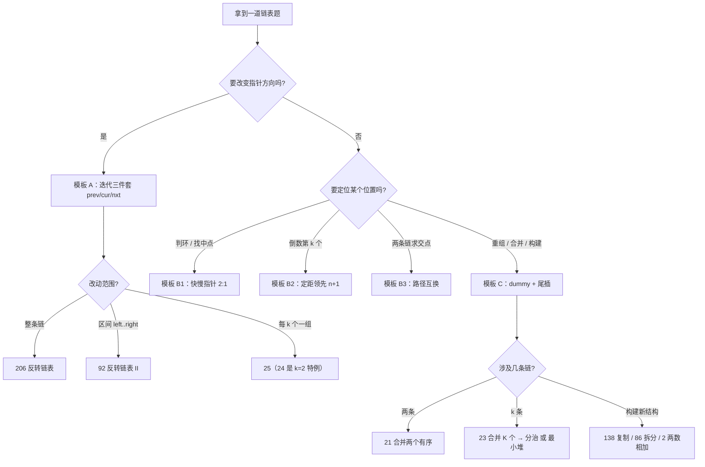

# 链表专题：LeetCode 九题深度精讲 + 大厂高频面试题库

> **适用人群**：准备国内大厂（字节/阿里/腾讯/美团/快手/百度/滴滴等）后端 & 算法岗面试，希望把「链表」这一块从"能写出来"提升到"讲清原理、扛住追问"的候选人。
>
> **难度标记体系**（全文统一）：
> - `★☆☆` 入门：会写模板即可，面试一般不单独考
> - `★★☆` 常考：需要讲清思路 + 复杂度 + 边界
> - `★★★` 必考/高频：要求一次写对、能推导原理、能延伸变体
> - `🔥` 面试官最爱追问的点
>
> **说明**：文中"大厂考核程度"依据近年公开面经与题库分布归纳，属于经验性统计，不同部门/年份会有波动，仅供复习优先级参考，不代表官方口径。

---

## 目录

- [第 0 章 先建立地基：链表的底层认知](#第-0-章-先建立地基链表的底层认知)
- [第 1 章 206. 反转链表 ★★★](#第-1-章-206-反转链表-)
- [第 2 章 25. K 个一组翻转链表 ★★★](#第-2-章-25-k-个一组翻转链表-)
- [第 3 章 141. 环形链表 ★★★](#第-3-章-141-环形链表-)
- [第 4 章 142. 环形链表 II ★★★](#第-4-章-142-环形链表-ii-)
- [第 5 章 21. 合并两个有序链表 ★★☆](#第-5-章-21-合并两个有序链表-)
- [第 6 章 23. 合并 K 个升序链表 ★★★](#第-6-章-23-合并-k-个升序链表-)
- [第 7 章 19. 删除链表的倒数第 N 个结点 ★★☆](#第-7-章-19-删除链表的倒数第-n-个结点-)
- [第 8 章 160. 相交链表 ★★☆](#第-8-章-160-相交链表-)
- [第 9 章 24. 两两交换链表中的节点 ★★☆](#第-9-章-24-两两交换链表中的节点-)
- [第 10 章 通用模板 / 易错点总表 / 复杂度速查](#第-10-章-通用模板--易错点总表--复杂度速查)
- [第 11 章 大厂高频面试题库（含考核权重）](#第-11-章-大厂高频面试题库含考核权重)
- [第 12 章 延伸题清单（同一模板的其他考法）](#第-12-章-延伸题清单同一模板的其他考法)

---

# 第 0 章 先建立地基：链表的底层认知

> 这一章不刷题，但你面试时的"深度分"几乎全从这里来。面试官区分"背过模板"和"懂数据结构"的方式，就是问这些。

## 0.1 链表到底是什么：一句话本质

链表是**用"指针"把散落在内存中的节点串成逻辑线性序列**的结构。

关键词是"散落"。数组的线性关系由**地址连续性**保证（`a[i] = base + i * sizeof(T)`，一条指令算出地址）；链表的线性关系由**节点内部存储的 next 指针**保证，必须"跳一次"才能到下一个元素。

这带来两个直接后果，也是所有链表题复杂度的根源：

| 维度 | 数组 / 动态数组 | 单链表 |
|---|---|---|
| 随机访问第 i 个元素 | **O(1)**，纯算术寻址 | **O(n)**，必须从头走 |
| 头部插入/删除 | O(n)（要整体搬移） | **O(1)** |
| 已知节点后插入/删除 | O(n)（搬移） | **O(1)**（改指针） |
| 按值查找 | O(n) | O(n) |
| 内存连续性 | 连续 | 离散，靠指针 |
| 缓存友好度 | **极高**（顺序预取、cache line 命中） | **极差**（几乎每次访问都 cache miss） |
| 额外空间开销 | 无（可能有预留容量浪费） | 每节点 1~2 个指针 |
| 扩容代价 | 需要 realloc + 整体拷贝 | 无（天然可增长） |

## 0.2 🔥 追问："链表插入是 O(1)，那它是不是比数组快？"

这是最经典的陷阱题。标准答法分三层：

1. **"插入 O(1)"有隐藏前提**：你得**已经持有**插入位置的节点指针。如果只知道"下标 i"，找位置本身就要 O(n)。所以严格说：链表的"结构修改"是 O(1)，但"定位"是 O(n)。
2. **常数与硬件层面的差距**：链表的指针跳转几乎每一步都是一次 cache miss（现代 CPU 一次主存访问约 60~100ns，而 L1 命中 ~1ns）。数组顺序扫描则能做到一次 cache line（64B）喂饱十几个元素，还能被硬件预取器（hardware prefetcher）自动预取后续地址。实测同一规模下"遍历"操作，数组常比链表快 **5~20 倍**——虽然二者都是 O(n)。
3. **内存放大**：Java 中 `class ListNode { int val; ListNode next; }` 在 64 位 HotSpot 开启指针压缩（`-XX:+UseCompressedOops`）下：对象头 12B + `int` 4B + 引用 4B = 20B，按 8 字节对齐后 **24B**；而数组里存一个 `int` 只要 4B。链表有 **6 倍空间放大**，还额外产生大量小对象增加 GC 压力。C++ 中 `struct Node { int val; Node* next; }` 是 16B（4B + 4B padding + 8B 指针）。

**结论**：链表的价值不在"绝对更快"，而在**结构性优势**——节点在别处已被引用时不失效（数组扩容/移动会让旧引用全部作废）、天然支持 O(1) 拼接与拆分、无预留容量浪费。这也是为什么 `std::list` 在实践中很少用，而"侵入式链表"（如 Linux 内核 `list_head`、Java 的 `LinkedList` 用作 LRU 链表）依然重要。

> **延伸：侵入式链表（intrusive linked list）**
> Linux 内核的 `struct list_head` 把"指针域"嵌进业务结构体内部，用 `container_of` 宏从指针反推结构体首地址。好处：一个对象可以同时挂在多条链表上、不需要为链表节点单独分配内存、不产生额外小对象。Java 的 `LinkedList` 则是"容器式"链表（`Node` 独立对象）。这是面试中"你了解内核链表吗"的标准考点。

## 0.3 节点定义与"必须牢记的三个字段名"

```java
// Java（LeetCode 官方定义）
class ListNode {
    int val;
    ListNode next;
    ListNode() {}
    ListNode(int val) { this.val = val; }
    ListNode(int val, ListNode next) { this.val = val; this.next = next; }
}
```

```cpp
// C++
struct ListNode {
    int val;
    ListNode *next;
    ListNode() : val(0), next(nullptr) {}
    ListNode(int x) : val(x), next(nullptr) {}
    ListNode(int x, ListNode *next) : val(x), next(next) {}
};
```

```python
# Python
class ListNode:
    def __init__(self, val=0, next=None):
        self.val = val
        self.next = next
```

**注意**：Java 是**引用传递的引用值**。`ListNode p = head;` 只是让 `p` 指向同一对象；`p = p.next` 不改变 `head`；但 `p.next = x` **会**改变链表本身。几乎所有链表题的 bug 都来自混淆"移动指针"和"修改指针域"这两件事。

## 0.4 三大核心套路（9 道题全部落在这三个框架里）

```
套路 A：迭代三件套（prev / cur / next）
        └─ 用于「就地改指针」类：206 反转、25 分组反转、24 两两交换、92 区间反转
套路 B：快慢双指针（同向追击 / 定距平移）
        └─ 用于「位置/环」类：141 判环、142 找入口、19 删倒数第 N、876 找中点
套路 C：dummy 哨兵 + 尾插（tail insert）
        └─ 用于「重组/合并/删除头节点」类：21 合并、23 合并 K、19 删头、24
递归：结构归纳法的天然载体
        └─ 206 / 25 / 21 / 24 都有极简递归解，面试要求「两种写法都会」
```

**为什么"就地改指针"必须用三件套？** 因为 `cur.next = prev` 这一句执行后，**通往后续节点的唯一通道就断了**。所以在覆盖 `cur.next` 之前，必须先把 `cur.next` 存到临时变量 `nxt`。这个顺序是铁律：

```
1. nxt   = cur.next      // 先备份去处（保命）
2. cur.next = prev       // 再改指向（断链）
3. prev  = cur           // prev 推进
4. cur   = nxt           // cur 推进（用备份，不能用 cur.next，因为已被改）
```

> 🔥 **面试官常问**："如果第 3、4 步写反了会怎样？"——`prev = cur; cur = nxt;` 与 `cur = nxt; prev = cur;` 结果一样（都是 prev 指向旧 cur）。真正致命的是**漏掉第 1 步**，或者第 4 步写成 `cur = cur.next`（此时 `cur.next` 已被改成 prev，会死循环/回退）。

## 0.5 dummy 哨兵节点：为什么它是"面试礼仪"

```java
ListNode dummy = new ListNode(0, head);   // dummy.next 指向真正的头
ListNode pre = dummy;                     // pre 始终是「待处理区间的前驱」
...
return dummy.next;                        // 返回时跳过哨兵
```

**它解决三类"头节点特判"**：

1. **删除可能发生在头部**（19 题删倒数第 N，N 恰好等于长度时删的就是 head）。
2. **结果链表为空起始**（21/23 合并时第一个节点还没确定）。
3. **需要在头部之前做插入/翻转**（24/25 第一组的 pre 必须存在）。

**收益量化**：一个 dummy 节点（24B）换掉 3~5 个 `if (head == null || ...)` 分支。这些分支恰恰是最容易漏的地方——**90% 的链表 WA 都发生在"长度 1 或 2 的用例"上**。所以：

> **准则**：只要题目涉及"可能改变头节点"或"从头构建新链表"，先写 dummy，再想逻辑。

## 0.6 链表题的"七个死亡边界"

面试时**先在纸上列出来**，再动手写代码，这一步就能拿到"思路清晰"的评价：

| # | 边界 | 触发场景 | 检查点 |
|---|---|---|---|
| 1 | `head == null` | 空链表 | 直接返回 |
| 2 | 单节点 `head.next == null` | 反转/交换/分组 | 是否访问 `p.next.next` |
| 3 | 双节点 | 24/25 的 k=2 | dummy 是否正确接回 |
| 4 | 操作落在最后一个节点 | 19 删尾、142 环尾 | `fast.next == null` 判断 |
| 5 | 操作落在头节点 | 19 N=len | 是否有 dummy |
| 6 | 链表长度 < k | 25 题 | 不足 k 是否保持原序 |
| 7 | 环/交叉结构 | 141/142/160 | 是否会无限循环 |

## 0.7 复杂度速查（9 题总览）

| 题号 | 题目 | 时间 | 空间（迭代） | 空间（递归） | 核心套路 |
|---|---|---|---|---|---|
| 206 | 反转链表 | O(n) | O(1) | O(n) 栈 | A |
| 25 | K 个一组翻转 | O(n) | O(1) | O(n/k) 栈 | A + 递归/C |
| 141 | 环形链表 | O(n) | O(1) | — | B |
| 142 | 环形链表 II | O(n) | O(1) | — | B + 数学 |
| 21 | 合并两个有序链表 | O(m+n) | O(1) | O(m+n) 栈 | C |
| 23 | 合并 K 个升序 | O(N log k) | O(k) 堆 / O(log k) 分治 | — | C + 分治/堆 |
| 19 | 删除倒数第 N | O(n) | O(1) | — | B（定距） |
| 160 | 相交链表 | O(m+n) | O(1) | — | B（路径互换） |
| 24 | 两两交换 | O(n) | O(1) | O(n) 栈 | A + 递归 |

> `N` 在 23 题中指所有链表节点总数，`k` 是链表条数。

---

# 第 1 章 206. 反转链表 ★★★

> LeetCode 206 / 剑指 Offer 24 / 面试出现率常年 Top 3。**这题是整章的"母题"**，25、92、24、143、234 全部由它派生。

## 1.1 题目

给你单链表的头节点 `head`，请你反转链表，并返回反转后的链表。

```
输入：1 → 2 → 3 → 4 → 5 → NULL
输出：5 → 4 → 3 → 2 → 1 → NULL
```

约束：链表中节点数目范围 `[0, 5000]`，`-500 <= Node.val <= 500`。
**进阶**：分别用迭代和递归实现。

## 1.2 🔥 本题真正在考什么

不是"会不会反转"，而是：

1. 你能不能在**没有 prev 指针**的单向结构里维持"前驱"信息；
2. 你能不能说清**为什么必须缓存 next**（断链风险）；
3. 你能不能说清**递归版本的栈深度**与工程风险；
4. 你能不能说清**返回值到底是哪个节点**（很多人返回了原来的 head）。

## 1.3 解法一：迭代三指针（标准答案，必须默写）

### 图解

```
初始:     prev=NULL   cur=1 → 2 → 3 → NULL
                        ↑

第 1 轮:  nxt = 2          （备份）
          1.next = NULL    （断链，1 变成新尾巴）
          prev = 1, cur = 2
          NULL ← 1   2 → 3 → NULL

第 2 轮:  nxt = 3
          2.next = 1
          prev = 2, cur = 3
          NULL ← 1 ← 2   3 → NULL

第 3 轮:  nxt = NULL
          3.next = 2
          prev = 3, cur = NULL  → 循环结束
          NULL ← 1 ← 2 ← 3
                         ↑
                     prev 就是新头
```

### 代码

```java
class Solution {
    public ListNode reverseList(ListNode head) {
        ListNode prev = null;      // 已反转部分的头
        ListNode cur = head;       // 待反转部分的头
        while (cur != null) {
            ListNode nxt = cur.next;   // ① 备份（保命，必须在改指针前）
            cur.next = prev;           // ② 反向指
            prev = cur;                // ③ prev 前移
            cur = nxt;                 // ④ cur 前移（用备份）
        }
        return prev;                   // cur == null 时，prev 是新头
    }
}
```

```cpp
ListNode* reverseList(ListNode* head) {
    ListNode* prev = nullptr;
    ListNode* cur = head;
    while (cur) {
        ListNode* nxt = cur->next;
        cur->next = prev;
        prev = cur;
        cur = nxt;
    }
    return prev;
}
```

```python
def reverseList(self, head: ListNode) -> ListNode:
    prev, cur = None, head
    while cur:
        nxt = cur.next
        cur.next = prev
        prev, cur = cur, nxt
    return prev
```

**复杂度**：时间 O(n)，空间 O(1)（只用了 3 个指针，且 `nxt` 在循环内可复用，严格常数空间）。

### 🔥 三个高频追问

**Q1：为什么 `return prev` 而不是 `return head`？**
因为 `head` 反转后变成了**尾节点**，它的 `next` 已被置为 `null`（第一轮就断了）。返回它只能拿到 `1 → NULL`。`prev` 在循环结束时恰好是最后一个被处理的原尾节点，即新头。

**Q2：循环条件写 `cur != null` 还是 `cur.next != null`？**
必须 `cur != null`。若写 `cur.next != null`，最后一个节点不会被处理，`nxt` 也会在最后抛出 NPE（访问 `null.next`）。

**Q3：如果链表有 5000 个节点，递归写法会怎样？**
Java 默认线程栈约 512KB~1MB，每帧约几十字节，5000 层递归大概能过，但 LeetCode 上若节点数到 10^5 就会 `StackOverflowError`。**工程结论：链表的递归解只适合"深度 ≤ 千级"的场景**，生产中一律用迭代（或尾递归改写，但 JVM 不做尾调用优化 TCO）。

## 1.4 解法二：递归（"把反转交给子链表")

### 核心思维（结构归纳法）

定义 `reverseList(head)` 的**语义**：返回以 `head` 为头的链表**反转后的新头**。
那么：

1. **递归单元**：先让 `1 → 2 → 3 → 4 → 5` 中的 `2..5` 反转好，得到 `5 → 4 → 3 → 2 → NULL`，并返回新头 `5`。
2. **合并**：此时 `head = 1`，`head.next = 2` 仍是原样（2 的 `next` 已被改成 `NULL`，因为它是反转后的尾巴）。要做的是：
   - `2.next = 1`（把 1 挂到已反转部分尾部）
   - `1.next = NULL`（1 成为新的尾）
3. **返回** 子递归给出的新头 `5`。

```
reverse(1→2→3)
  └ reverse(2→3)
      └ reverse(3)
          └ reverse(NULL) → 返回 NULL（base）
          ⇒ 返回 3
      ⇒ p = 3,  2.next.next = 3.next = 2  (把 2 挂到 3 后面)
        2.next = NULL
        return 3
  ⇒ p = 3, 1.next.next = 2.next = 1
    1.next = NULL
    return 3
结果: 3 → 2 → 1 → NULL
```

```java
class Solution {
    public ListNode reverseList(ListNode head) {
        // base case：空链表或单节点，反转后就是自己
        if (head == null || head.next == null) return head;

        // 先反转 head.next 及其后的所有节点，p 是反转后的新头（原尾节点）
        ListNode p = reverseList(head.next);

        // 把当前 head 接到"已反转部分"的尾部：
        // head.next 现在是已反转部分的尾节点，所以让它的 next 指向 head
        head.next.next = head;
        head.next = null;   // head 成为新的尾节点，必须断掉旧指向，否则成环

        return p;
    }
}
```

```python
def reverseList(self, head):
    if not head or not head.next:
        return head
    p = self.reverseList(head.next)
    head.next.next = head
    head.next = None
    return p
```

**复杂度**：时间 O(n)，空间 **O(n)**（递归栈 n 层）。

### 🔥 递归版最致命的 bug

```java
head.next.next = head;
head.next = null;      // ← 这一行忘了，链表成环！
```

如果漏掉 `head.next = null`，则原 head（现在的尾）仍然指向它原来的后继，而那个后继已经指回 head → **形成 2 节点环**，打印时死循环，判题时报 "cycle detected" 或不返回。这一行是递归解的"送分/送命分界线"。

### 🔥 追问："递归版能不能改成尾递归从而 O(1) 空间？"

可以，但需要**额外的两个参数**（prev、newHead），本质上是"把迭代的循环变量塞进函数参数"：

```java
private ListNode reverse(ListNode cur, ListNode prev) {
    if (cur == null) return prev;              // 尾递归出口
    ListNode nxt = cur.next;
    cur.next = prev;
    return reverse(nxt, cur);                  // 尾调用
}
```

**注意**：JVM **不做尾调用优化**（TCO），所以即使写成尾递归，Java 里空间仍是 O(n)。C/C++ 在 `-O2` 下可能把它优化成循环；Python 有 `sys.setrecursionlimit` 但同样不 TCO。**面试正确答法**："逻辑上等价于迭代，但 JVM/CPython 不保证 TCO，所以生产代码直接用 while 循环。"

## 1.5 解法三：头插法（"新建链表"思路，适合讲给面试官当第二解)

维护 `dummy`，每次从原链表**摘头**，插到新链表头部：

```java
public ListNode reverseList(ListNode head) {
    ListNode dummy = new ListNode(0);   // 新链表的哨兵
    ListNode cur = head;
    while (cur != null) {
        ListNode nxt = cur.next;        // 备份原链表后继
        cur.next = dummy.next;          // 摘下来的节点指向当前新头
        dummy.next = cur;               // 成为新头
        cur = nxt;
    }
    return dummy.next;
}
```

与解法一等价，但**多一个 dummy 节点**；优点是"新链表"这个心智模型直观，且天然适配"反转 + 重组"的组合题（如 92、25）。

## 1.6 本章延伸（面试官会顺着 206 往下问）

### 延伸 1：92. 反转链表 II（反转区间 [left, right]）★★★

**关键**：不是整条反转，而是**局部**。要先用 dummy 定位到 `left-1` 处的 `pre`，然后反转 `right-left+1` 个节点，最后把三段接起来。

```java
public ListNode reverseBetween(ListNode head, int left, int right) {
    ListNode dummy = new ListNode(0, head);
    ListNode pre = dummy;
    for (int i = 0; i < left - 1; i++) pre = pre.next;   // pre 停在 left-1

    ListNode cur = pre.next;        // 区间第一个节点（反转后变区间尾）
    ListNode prev = null;
    for (int i = 0; i < right - left + 1; i++) {         // 只反转区间长度
        ListNode nxt = cur.next;
        cur.next = prev;
        prev = cur;
        cur = nxt;
    }
    // 此时 prev 是新区间头，cur 是区间后的第一个节点
    pre.next.next = cur;    // 区间尾（原区间头）接后半段
    pre.next = prev;        // 区间前驱 接 新区间头
    return dummy.next;
}
```

**🔥 顺序陷阱**：`pre.next.next = cur` 必须在 `pre.next = prev` **之前**执行。因为 `pre.next` 会被覆盖，一旦先改了 `pre.next`，你就**再也找不到**原来的区间头（区间尾）了。这是本题唯一的坑，也是面试官最爱看你写错的地方。

**复杂度**：O(n) 时间，O(1) 空间。定位 + 反转共走一遍。

### 延伸 2：234. 回文链表 ★★★

**思路（O(1) 空间的"三段式"）**：

1. 141 的模板找**中点**（快慢指针，快走 2 慢走 1）；
2. 206 模板**反转后半段**；
3. 双指针**逐位比较**；
4. （可选）把后半段再反转回来，恢复原链表 —— **生产代码必须恢复**，否则会修改调用方的数据结构（这是面试加分点）。

```java
public boolean isPalindrome(ListNode head) {
    if (head == null || head.next == null) return true;
    // 1. 找前半段尾（快慢指针，奇数时 slow 落在中间，从 slow.next 开始比）
    ListNode slow = head, fast = head;
    while (fast.next != null && fast.next.next != null) {
        slow = slow.next; fast = fast.next.next;
    }
    // 2. 反转后半段
    ListNode second = reverse(slow.next);
    ListNode p1 = head, p2 = second;
    boolean ok = true;
    while (p2 != null) {                 // 只用后半段长度（前段可能多 1 个）
        if (p1.val != p2.val) { ok = false; break; }
        p1 = p1.next; p2 = p2.next;
    }
    slow.next = reverse(second);         // 3. 恢复原链表（工程必备）
    return ok;
}
```

**复杂度**：O(n) 时间，O(1) 空间。**这是 206 + 141 模板的组合题**，大厂（字节、腾讯）非常爱考。

### 延伸 3：143. 重排链表（L0→Ln→L1→Ln-1…）★★★

**三段式**：① 找中点（141 模板）→ ② 反转后半段（206 模板）→ ③ **交替合并**两段（21 模板的变体）。

```java
public void reorderList(ListNode head) {
    if (head == null || head.next == null) return;
    ListNode slow = head, fast = head;
    while (fast.next != null && fast.next.next != null) {
        slow = slow.next; fast = fast.next.next;
    }
    ListNode l2 = reverse(slow.next);    // 后半段反转
    slow.next = null;                    // 切成两段，前半段以 slow 结尾

    ListNode l1 = head;
    while (l2 != null) {                 // 交替拼接
        ListNode n1 = l1.next, n2 = l2.next;
        l1.next = l2;
        l2.next = n1;
        l1 = n1; l2 = n2;
    }
}
```

**🔥 细节**：`slow.next = null` 这一步必须做，否则前半段尾部还连着后半段，拼接时会出现自环（`l1.next = l2` 后 `l1` 走到后半段，形成环）。

### 延伸 4：反转的"宏观 vs 微观"视角（🔥 高区分度答法）

面试官问"你怎么理解反转链表"时，一个能立刻区分层级的回答：

> **微观视角**：每个节点的 `next` 指针方向取反。局部看是"改一个字段"。
> **宏观视角**：反转 = **把链表从"尾到头"重新串一遍**。所以反转必然使"原头变尾、原尾变头"，必然要求 O(n) 次指针写操作——**任何反转/逆序类操作都不可能低于 O(n)**，因为你至少要碰一次每个节点（除非用"反向遍历"的辅助结构，如栈，但那是 O(n) 空间换时间，不划算）。
>
> **信息论视角**：链表只存了"后继"信息且不可回溯，反转相当于要把 n 条有向边全部换向，每条边至少读一次写一次。

---

# 第 2 章 25. K 个一组翻转链表 ★★★

> LeetCode 25 / 字节跳动面试出现率极高（有多份面经提到"手写 + 要求 15 分钟写完 + 口头讲清指针变化"）。**难度：Hard，但套路完全由 206 + dummy 组成。**

## 2.1 题目

给你链表的头节点 `head`，每 `k` 个节点一组进行翻转，请你返回修改后的链表。
- `k` 是一个正整数，它的值**小于或等于**链表的长度。
- 如果节点总数不是 `k` 的整数倍，那么请将**最后剩余的节点保持原有顺序**。
- **不能只是单纯地改变节点内部的值**，而是需要进行实际的节点交换。

```
示例 1: k = 2
输入: 1→2→3→4→5
输出: 2→1→4→3→5

示例 2: k = 3
输入: 1→2→3→4→5
输出: 3→2→1→4→5      ← 最后 2 个节点不足 k，保持 4→5 原序

示例 3: k = 1
输出: 原样
```

## 2.2 🔥 本题在考什么（五个层次）

| 层次 | 考点 | 常见失分 |
|---|---|---|
| L1 | 分组遍历，判断剩余是否够 k 个 | 边界判断用 `end == null` vs `end.next == null` |
| L2 | 组内反转（206 的子过程） | 反转范围写成了"到尾节点"，把 `end.next` 弄丢 |
| L3 | **组间拼接**（最难） | 接不回下一组，或 `pre` 更新错位 |
| L4 | 不足 k 的处理 | 直接把剩余也反转了（题目要求保持原序） |
| L5 | 递归 / 迭代双写法 + 复杂度 | 递归深度 O(n/k) 是否会栈溢出 |

**一句话本质**：这题 = **"找到每组的 (start, end)，反转 [start, end]，然后维护组前驱 pre"**。真正难的只有"反转后谁是头、谁是尾"。

## 2.3 指针角色定义（先画清楚再写代码）

```
dummy → [组1] → [组2] → ... → 剩余不足k的段
  ↑       ↑
  pre   groupHead

每组三个关键节点：
├─ pre       : 上一组的「尾节点」（也就是本组的前驱）；初始 = dummy
├─ start     : 本组原第一个节点（反转后会变成「本组尾」）
└─ end       : 本组原第 k 个节点（反转后会变成「本组头」）
```

**反转前后的角色翻转表**（背下来，这题就通了）：

| 节点 | 反转前身份 | 反转后身份 | 后续要做的连接 |
|---|---|---|---|
| `start` | 组头 | **组尾** | `start.next` 要指向**下一组的头** |
| `end` | 组尾 | **组头** | 要被 `pre.next` 指向 |
| `pre` | 上一组组尾 | 不变 | `pre.next = end`，然后 `pre = start` |

## 2.4 解法一：迭代（推荐，O(1) 空间）

### 图解（k=2，链表 1→2→3→4→5）

```
Step 0:  dummy → 1 → 2 → 3 → 4 → 5
          ↑
        pre,end

Step 1:  end 前进 k 步 → end = 2（组1 = [1,2]）
         start = 1, next = end.next = 3
         反转 [1,2] 得 2 → 1
         pre.next = 2       (dummy → 2)
         start.next = 3     (1 → 3)
         结果:  dummy → 2 → 1 → 3 → 4 → 5
         推进:  pre = start(=1), end = pre(=1)

Step 2:  end 从 1 前进 2 步 → end = 4（组2 = [3,4]）
         start = 3, next = 5
         反转得 4 → 3
         pre.next = 4       (1 → 4)
         start.next = 5     (3 → 5)
         结果:  dummy → 2 → 1 → 4 → 3 → 5
         推进:  pre = 3, end = 3

Step 3:  end 从 3 前进 2 步 → 走 1 步到 5，第 2 步 → null
         end == null → break（剩余 1 个不足 k，保持原序）
返回 dummy.next = 2 → 1 → 4 → 3 → 5  ✓
```

### 代码

```java
class Solution {
    public ListNode reverseKGroup(ListNode head, int k) {
        ListNode dummy = new ListNode(0, head);
        ListNode pre = dummy;        // 上一组的尾（本组前驱）
        ListNode end = dummy;        // 用于探测本组第 k 个节点

        while (end.next != null) {
            // ① 让 end 走 k 步，定位本组最后一个节点
            for (int i = 0; i < k && end != null; i++) {
                end = end.next;
            }
            if (end == null) break;  // 剩余不足 k 个，保持原序，直接结束

            // ② 记录关键节点
            ListNode start = pre.next;      // 本组原头（反转后成组尾）
            ListNode next = end.next;       // 下一组的头（反转后要接回来）

            // ③ 反转 [start, end] 这一段（把它从链表上"摘下来"再反转）
            end.next = null;                // 先切断，避免反转时越界
            pre.next = reverse(start);      // reverse 返回反转后的新头（原 end）

            // ④ 把本组尾（原 start）接回下一组
            start.next = next;

            // ⑤ 推进：pre 指向本组尾，end 复位到 pre
            pre = start;
            end = pre;
        }
        return dummy.next;
    }

    // 标准 206 反转，返回新头
    private ListNode reverse(ListNode head) {
        ListNode prev = null, cur = head;
        while (cur != null) {
            ListNode nxt = cur.next;
            cur.next = prev;
            prev = cur;
            cur = nxt;
        }
        return prev;
    }
}
```

```python
class Solution:
    def reverseKGroup(self, head: ListNode, k: int) -> ListNode:
        dummy = ListNode(0, head)
        pre, end = dummy, dummy
        while end.next:
            for _ in range(k):
                if end is None:
                    break
                end = end.next
            if end is None:
                break
            start = pre.next
            nxt = end.next
            end.next = None            # 切段
            pre.next = self.reverse(start)
            start.next = nxt
            pre, end = start, start
        return dummy.next

    def reverse(self, head):
        prev, cur = None, head
        while cur:
            nxt = cur.next
            cur.next = prev
            prev, cur = cur, nxt
        return prev
```

**复杂度**：时间 O(n)（每个节点被访问常数次：探测 1 次 + 反转 1 次），空间 O(1)。

### 🔥 本解法六个易错点（面试官逐条盯着看）

1. **`for` 循环里 `end != null` 的条件**：`for (int i = 0; i < k && end != null; i++)`。若省略 `end != null`，剩余不足 k 时会 NPE。
2. **`while (end.next != null)` vs `while (true)`**：用 `end.next != null` 可以在"剩余不足 k"时提前退出，但注意每轮开始 `end = pre` 已复位，`pre` 始终是有效节点（至少是 dummy），所以 `end.next` 不会 NPE。
3. **`end.next = null` 必须写**：如果不切断，`reverse(start)` 会把整条链表都反转掉（因为 206 的循环是"到 null 为止"）。
4. **`pre.next = reverse(start)` 必须先于 `start.next = next`**？其实顺序可以换，但**都不能在 `end.next = null` 之前**。真正的问题是 `next = end.next` 必须在 `end.next = null` **之前**取到，否则 `next` 永远是 null。
5. **`pre = start` 而不是 `pre = end`**：反转后 `start` 是组尾，`pre` 必须指向组尾才能接下一组。写错成 `pre = end` 会让 `pre` 指向组头，下一组会插到组内。
6. **`end = pre` 复位**：忘记复位会让 `end` 从上一组末尾继续走，导致分组错位（跳组）。

### 🔥 追问："如果 k 大于链表长度怎么办？"

题目保证 `k <= 长度`，但工程上应处理。当前实现天然安全：`for` 里 `end != null` 兜住，走完就 `break`，返回**原样链表**。这正是"不足 k 保持原序"的语义。

## 2.5 解法二：递归（更优雅，O(n/k) 栈空间）

### 核心思维

`reverseKGroup(head, k)` 的语义：返回"从 head 开始每 k 个一组反转"后的**新头**。

1. **探测**：从 head 走 k 步，若不足 k → 直接 `return head`（保持原序，这也是 base case）。
2. **反转本组 [head, tail)**（左闭右开），得到新头。
3. **递归处理剩余**：`head.next = reverseKGroup(tail, k)`（此时 head 已是本组尾）。
4. **返回**新头。

**关键技巧：用"左闭右开"区间 `[head, tail)` 反转**，天然不需要切链（`end.next = null`），代码更干净。

```
reverseKGroup(1→2→3→4→5, k=2)
├─ 探测: 走 2 步得 tail = 3
├─ 反转 [1,3) → 2→1，newHead = 2，此时 head(1).next = null
├─ head.next = reverseKGroup(3→4→5, 2)
│   ├─ 探测 tail = 5
│   ├─ 反转 [3,5) → 4→3
│   ├─ 3.next = reverseKGroup(5, 2)
│   │   └─ 探测: 走 2 步 → null，不足 2 → return 5（原样）
│   └─ return 4
└─ return 2
结果: 2→1→4→3→5  ✓
```

```java
class Solution {
    public ListNode reverseKGroup(ListNode head, int k) {
        // ① 探测：不足 k 个，保持原序（同时是递归出口）
        ListNode tail = head;
        for (int i = 0; i < k; i++) {
            if (tail == null) return head;
            tail = tail.next;
        }
        // ② 反转 [head, tail)
        ListNode newHead = reverse(head, tail);
        // ③ head 现在是本组尾，接上后续递归结果
        head.next = reverseKGroup(tail, k);
        return newHead;
    }

    // 反转 [head, tail) —— 左闭右开，走到 tail 就停，不碰 tail
    private ListNode reverse(ListNode head, ListNode tail) {
        ListNode prev = null, cur = head;
        while (cur != tail) {
            ListNode nxt = cur.next;
            cur.next = prev;
            prev = cur;
            cur = nxt;
        }
        return prev;   // 反转后的新头（原 tail 的前一个）
    }
}
```

```python
class Solution:
    def reverseKGroup(self, head, k):
        tail = head
        for _ in range(k):
            if not tail:
                return head
            tail = tail.next
        new_head = self._reverse(head, tail)
        head.next = self.reverseKGroup(tail, k)
        return new_head

    def _reverse(self, head, tail):     # 反转 [head, tail)
        prev, cur = None, head
        while cur is not tail:
            nxt = cur.next
            cur.next = prev
            prev, cur = cur, nxt
        return prev
```

**复杂度**：时间 O(n)，空间 **O(n/k)**（递归深度 = 组数）。比迭代版多用了栈，但**代码可读性碾压迭代版**。

> **面试策略**：先写递归（5 分钟、少 bug、好讲），再口头说"如果要求 O(1) 空间，我改成迭代维护 pre/end，代价是要额外处理切链和复位"。这样展示了你对两套解法的完整掌控。

## 2.6 为什么很多人用"栈"写这题（以及为什么它不优）

**栈解法**：每 k 个节点入栈，然后依次弹出重建。**优点**：无需处理指针反转。**缺点**：

- 空间 O(k)，不是 O(1)；
- 需要额外处理"不足 k"（不能弹）；
- **面试官通常会说"不允许用额外空间"**。

**不推荐，但可以提一句"栈解法的空间是 O(min(n,k))，本质是用栈把'逆序'这件事外包给了 LIFO 结构"** —— 显示你理解"反转 = 逆序输出"的同构性。

## 2.7 🔥 深度延伸：为什么这题必然 ≥ O(n)，且不能用"值交换"绕过

题目明确"不能只改值"。原因在于：**节点是有身份的**（可能有外部引用、可能有附属数据如 LRU 的 key、可能被 `HashMap` 索引）。只换 `val` 会让所有指向节点的外部引用语义错乱（指针仍指旧位置但值变了）。这也是**工程判断题**：在 LRU 缓存里，`Node` 的 `key` 若被"值交换"覆盖，`HashMap` 的映射就全错。

**复杂度下界证明**：每组至少 1 次反转，总节点 n 个，每个节点至少被读一次 next → Ω(n)。分组探测又多一次 → 常数因子 2，仍是 Θ(n)。**不存在 O(k) 或 O(n/k) 的解法**（因为必须碰每个节点）。

---

# 第 3 章 141. 环形链表 ★★★

> LeetCode 141。**这题是"双指针存在性证明"的入门题**，但它真正的价值在于：它是 142、160、876、287（寻找重复数）的共同祖先。面试官问 141，往往是为了引出 142 或"为什么快指针只能走 2 步"。

## 3.1 题目

给你一个链表的头节点 `head`，判断链表中是否有环。

如果链表中有某个节点，可以通过连续跟踪 `next` 指针再次到达，则链表中存在环。为了表示给定链表中的环，评测系统内部使用整数 `pos` 来表示链表尾连接到链表中的位置（索引从 0 开始）。**注意：`pos` 不作为参数进行传递，仅仅是为了标识链表的实际情况。**

- 如果链表中存在环，则返回 `true`；否则返回 `false`。
- **进阶**：你能用 O(1)（即常量）内存解决此问题吗？

```
输入: 3 → 2 → 0 → -4
              ↑________|
        pos = 1（尾节点 -4 连回索引 1 的节点 2）
输出: true
```

## 3.2 三种解法对比（面试要求"从 O(n) 空间优化到 O(1)"的完整叙事）

| 解法 | 时间 | 空间 | 是否修改数据 | 面试评价 |
|---|---|---|---|---|
| ① 哈希表（`HashSet<ListNode>`） | O(n) | **O(n)** | 否 | 及格答案，用来引出优化 |
| ② 计数截断法（走 10^4 步） | O(min(n, 10^4)) | O(1) | 否 | **投机取巧，不建议**，会被追问"如果节点数未知呢" |
| ③ **Floyd 判圈（快慢指针）** | O(n) | **O(1)** | 否 | **标准答案，必须给** |
| ④ 标记法（改 `val` 为哨兵值） | O(n) | O(1) | **是（破坏数据）** | 减分项，除非题目允许 |

### 解法①：哈希表（直观但费空间）

```java
public boolean hasCycle(ListNode head) {
    Set<ListNode> seen = new HashSet<>();
    while (head != null) {
        if (!seen.add(head)) return true;   // add 返回 false 说明已存在
        head = head.next;
    }
    return false;
}
```

**本质**：判断"序列中是否出现重复元素"。因为链表节点是对象，用**引用身份**（`hashCode` 默认是对象地址衍生值）做 key，能精确区分"值相同但不同节点"的情况。
**缺点**：O(n) 内存。对一个 10^6 节点的链表要额外几十 MB —— 这正是面试官要你优化的点。

> 🔥 **追问陷阱**："能不能用 `HashSet<Integer>` 存 val？" —— **不能**。链表里允许重复值（`1→1→1` 无环也会误判）。必须用节点**引用**。这是本题第一个区分点。

### 解法②：为什么"跑 10000 步"是错的（但要会解释）

LeetCode 141 的约束是"节点数 [0, 10^4]"。所以走 10001 步还没到 null 就必然有环（鸽巢原理）。这**能过题但过不了面试**：面试官会追问"如果节点数不确定（比如流式数据、10^9 节点）怎么办"，你就答不上来了。**正确姿态**：主动说出这个思路，然后说"它依赖节点数上界，不具一般性，所以我用 Floyd"。

### 解法③：Floyd 判圈（龟兔赛跑算法）

**核心思想**：在**有环**的跑道上，速度快的跑者一定会从后方"套圈"追上慢跑者。因为两者在环内的相对速度恒定，距离每轮缩短固定量，必然归零。

```java
public boolean hasCycle(ListNode head) {
    if (head == null || head.next == null) return false;  // 边界：0/1 个节点不可能成环
    ListNode slow = head, fast = head;
    while (fast != null && fast.next != null) {   // 顺序不能反！
        slow = slow.next;            // 慢指针走 1 步
        fast = fast.next.next;       // 快指针走 2 步
        if (slow == fast) return true;
    }
    return false;                    // fast 走到 null → 无环（链表必然有尽头）
}
```

```python
def hasCycle(self, head):
    slow = fast = head
    while fast and fast.next:
        slow, fast = slow.next, fast.next.next
        if slow == fast:
            return True
    return False
```

**复杂度**：时间 O(n)，空间 O(1)（只有两个引用变量）。

### 🔥 逐条拆解本解法的"送命细节"

**细节 1：`while (fast != null && fast.next != null)` 的顺序为什么不能反？**
`&&` 是短路求值。若写成 `fast.next != null && fast != null`，当 `fast == null` 时会先求 `fast.next` → **NPE**。**Java/C++ 必须把"更可能为 null 的对象的解引用"放在后面**。这是面试官最爱抓的一行。

**细节 2：为什么初始化 `slow = fast = head` 而不是 `slow = head, fast = head.next`？**
两种写法都正确。`fast = head.next` 的版本相当于"先走一步"，循环里只走 `fast.next`，可以少判断一次 `fast.next`。但**统一从 head 开始更不容易错**，也让"相遇点"的推导（142 题）更标准。

**细节 3：为什么无环时一定终止？**
单链表每个节点只有一个 `next`，无环 ⇒ 从 head 出发的路径是一条**有限简单路径**（长度 = n），必然在 n 步内到达 `null`。`fast` 每轮走 2 步，所以最多 ⌈n/2⌉ 轮就 `fast == null`。

**细节 4：`slow == fast` 比较的是什么？**
比较**引用**（对象身份），不是 `val`。Java 中 `==` 对引用类型比较地址，正确；C++ 比较指针，正确。**Python 中 `==` 会被 `ListNode` 的 `__eq__` 影响——LeetCode 的 ListNode 没有定义 `__eq__`，所以默认是身份比较，安全。但如果你的节点类重写了 `__eq__`，必须改用 `is`。** 这个细节在 Python 面试里是加分点。

## 3.3 🔥 数学证明：为什么快慢指针**一定**相遇？

设环长为 `L`，慢指针入环时（记为时刻 0，两者已在环内或快已在环内）快指针相对入口的偏移为 `x`，`0 ≤ x < L`。

沿前进方向，快指针"领先"慢指针的距离为：

```
d₀ = (L - x) mod L      ∈ [0, L-1]
```

相对速度 = `2 - 1 = 1` 步/轮。所以每轮距离减少 1：

```
dₜ = d₀ - t   （mod L 意义下）
```

当 `t = d₀` 时，`d = 0`，即两者重合。因为 `d₀ ≤ L-1`，所以**至多 L-1 轮**内必然相遇。∎

**更直观的三种表述**（面试可以任选一种讲，但要讲得流畅）：

- **鸽巢/模运算版**：在模 `L` 意义下，慢的位置是 `sₜ = s₀ + t`，快的是 `fₜ = f₀ + 2t`。要求 `sₜ ≡ fₜ (mod L)`，即 `t ≡ f₀ - s₀ (mod L)`，这个同余方程**对任意整数右边都有解**（因为系数是 1，与 L 互质），解为 `t ≡ d₀ (mod L)`。
- **相对运动版**：站在慢指针的参考系里，快指针以"1 步/轮"匀速逼近，距离有限（< L），必然撞上。
- **套圈版**：速度差 1，相当于快者每轮净追 1 个节点，环上总共 L 个位置，最多 L 轮追完一圈必然追上。

## 3.4 🔥🔥 深度追问："为什么快指针只能走 2 步，不能走 3 步、4 步？"

这是**区分"背过"与"真懂"的分水岭**。正确答案：**走 2 步能保证相遇（当且仅当速度差与环长"相容"）；走 3 步及以上不保证。**

### 严格分析

一般地，设快指针每轮走 `v` 步（`v ≥ 2`），慢走 1 步，则**速度差 `d = v - 1`**。相遇条件是同余方程

```
d · t ≡ (L - x)   (mod L)
```

有解。**线性同余方程 `d·t ≡ r (mod L)` 有解 ⟺ gcd(d, L) 整除 r**。

- `v = 2` ⇒ `d = 1` ⇒ `gcd(1, L) = 1` 整除任何 `r` ⇒ **一定有解**。✅
- `v = 3` ⇒ `d = 2`。若 `L` 为偶数且 `r = L - x` 为奇数，则 `gcd(2, L) = 2 ∤ r` ⇒ **无解，永远不相遇**。❌
- `v = 4` ⇒ `d = 3`。若 `L` 是 3 的倍数且 `r` 不是 3 的倍数 ⇒ 无解。❌

### 具体反例（v = 3，L = 4）—— 眼见为实

构造环长 `L = 4`（节点 `A(0) → B(1) → C(2) → D(3) → A(0)`）。慢指针入环时在 `A`，快指针在 `B`（即 `x = 1`，`r = L - x = 3`）。速度差 `d = 2`。

**解析式**：慢指针位置 `s(t) = t (mod 4)`；快指针每轮 +3，`f(t) = 1 + 3t ≡ 1 - t (mod 4)`。
相遇要求 `t ≡ 1 - t (mod 4)`，即 **`2t ≡ 1 (mod 4)`** —— 左边恒为偶数、右边为奇数，**无解**（正是 `gcd(2, 4) = 2 ∤ 1`）。

**逐轮验证**：

```
轮次   slow 位置   fast 位置   是否相遇
 0      A(0)        B(1)       否
 1      B(1)        A(0)       否   ← 恰好"擦肩而过"
 2      C(2)        D(3)       否
 3      D(3)        C(2)       否
 4      A(0)        B(1)       否   ← 状态完全回到轮 0，进入周期 4 的死循环
```

两个指针**每轮都在彼此相邻的位置上交错跳跃**，却**永远踩不到同一个格子**。这就是"走 3 步不保证相遇"的直观证据：**不是"追不上"，而是"每次都跳过节拍"。**

> **结论（可直接背的面试话术）**：走 2 步时速度差为 1，与任意环长互质，同余方程恒有解，所以**必然相遇**；走 3 步时速度差为 2，若环长为偶数且初始相位不匹配，就会"每次跳过节拍"，**永远错过**。所以"走 2 步"不是随便选的，而是**唯一保证通用的最小选择**。

> **延伸**：这也解释了为什么 Floyd 算法的理论保证依赖于"步长为 1 的相对运动"——它是"在整数模 L 群上做 +1 遍历"最简单可靠的方式。

## 3.5 复杂度严格分析

- **无环**：`fast` 每轮走 2 步，最多 `n/2` 轮到达 `null` ⇒ O(n)。
- **有环**：
  - 入环前：慢指针走 `a` 步（`a` = 头到入口距离），`fast` 走 `2a`；
  - 入环后：至多 `L - 1` 轮相遇；
  - 总轮数 `≤ a + L ≤ n`。
  ⇒ **O(n)**。
- **空间**：O(1)。

> 🔥 **追问**："最坏情况是多少轮？" —— 精确上界是 `a + L - 1` 轮（`a` 为入环前距离，`L` 为环长）。因为入环后最多 `L-1` 轮。

## 3.6 本章延伸：Floyd 判圈的真实应用（🔥 讲了就加分）

1. **Pollard's rho 因数分解算法**：用 `x² + c mod N` 的伪随机序列判环，找到 `N` 的因子。**这是 142 题"找环入口"的直接工业应用**——因为环入口恰好对应 `gcd(|x - y|, N)` 的非平凡因子。
2. **检测伪随机数生成器的周期**（如线性同余生成器 LCG 的周期长度）。
3. **判断"迭代函数"是否进入不动点/循环**：如 `f(x) = 各位数字平方和`（快乐数 202 题），本质求"迭代序列是否有环"。
4. **分布式系统中的"循环依赖检测"**（服务调用链、模块依赖图，退化为链表场景）。
5. **检测内存分配器的空闲链表是否被写坏**（调试期用 Floyd 检查 free list 成环）。

---

# 第 4 章 142. 环形链表 II ★★★

> LeetCode 142。**全球面试中"数学推导"含量最高的链表题之一。** 阿里、百度、字节的中高级岗高频。它考的不是代码（代码和 141 几乎一样），而是**你能不能在白板上 5 分钟把这个等式推出来并讲清每一步的几何意义**。

## 4.1 题目

给定一个链表的头节点 `head`，返回链表开始入环的第一个节点。**如果链表无环，则返回 `null`**。
不允许修改链表。**进阶**：用 O(1) 内存解决。

```
输入: 3 → 2 → 0 → -4 ，pos = 1
输出: 返回索引为 1 的节点（值 2）
解释:  tail(-4).next = 节点(2)
```

> **注意**：这题要求返回**节点引用**。LeetCode 的判题靠"这个节点之后的路径是否一致"来判断，所以你不能返回一个"值相同的新节点"。

## 4.2 记号定义（务必先写在白板上，面试官会认可你的严谨）

```
head ──a──▶ 环入口 E ──b──▶ 相遇点 M
                 ▲              │
                 └─────c────────┘

a = 头节点到环入口 E 的距离（边数）
b = 环入口 E 沿前进方向到相遇点 M 的距离
c = 相遇点 M 沿前进方向回到 E 的距离
L = 环长 = b + c
```

```
        a          b
   ●────────▶●──────────▶●  ← 相遇点 M
   head      E            │
             ▲            │
             └──── c ◀────┘
```

## 4.3 完整推导（面试必须能白板复现）

### 第一步：写出两者的路程

设相遇时**慢指针总步数**为 `S`，则：

- 慢指针：`S = a + b`（入环后走了 `b`，**关键前提：b < L，即慢指针在环内没走满一圈**）
- 快指针：总步数 `2S = 2(a + b)`。其中入环前走了 `a`，环内走了 `2S - a = a + 2b`。

### 第二步：快指针"多走的路"必是环长的整数倍

两者在**同一个节点 M** 相遇，意味着它们在环内的"位置"相同。快指针比慢指针在环内多走的距离差必须恰好是若干个整圈：

```
(a + 2b) - b = a + b = n·L      (n = 1, 2, 3, ...)
```

### 第三步：解出 a

```
a + b = nL
a = nL - b
a = nL - b = (n-1)L + (L - b) = (n-1)L + c
```

**即：`a = c + (n-1)·L`。**

### 第四步：几何解释（这一步才是得分点）

> `a = c + (n-1)L` 的物理含义是：**从 head 走到 E 的路程 `a`，等于"从相遇点 M 沿环前进 `c` 步到 E"，再加上"绕环 (n-1) 圈"。**
>
> 所以：**让一个指针从 head 出发、另一个从相遇点 M 出发，同速（每轮 1 步）前进，它们走完 `a` 步后必然在 E 相遇** —— 因为从 M 出发的那个指针走 `c` 步到 E，再绕 `(n-1)` 圈回到 E；从 head 出发的指针走 `a` 步也到 E。路径长度相等 ⇒ **同时到达**。

```
p1: head ──────a──────▶ E （直接到）
p2: M ──c──▶ E ──(n-1)L 圈──▶ E （绕圈后到）
     ↑
  两者走的"逻辑长度"都是 a
```

### 第五步：为什么 `b < L`（即"慢指针在环内走不满一圈"）

这是最容易被追问的**隐含前提**，必须证明：

慢指针刚入环时，快指针已在环内某处，与入口的沿前进方向距离为 `x`（`0 ≤ x < L`）。此时快指针在**前方**，两者沿环的距离为 `d₀ = (L - x) mod L ≤ L - 1`。
相对速度 1，所以 `d₀` 轮后相遇，即**慢指针在环内只走了 `d₀ ≤ L - 1` 步 < L**。∎

> 换句话说：**慢指针入环的时刻，快指针必然已经在环里了**（因为快指针先到尾部/环），所以"追及"发生在慢指针的第一圈内。这就是 `b < L` 的来源，也是"`n ≥ 1`"的来源（`a + b = nL`，若 `a+b < L` 则 `n=0`，但 `a+b ≥ b ` 且 `a+b` 严格大于 0，实际 `n ≥ 1` 因为快慢速度差导致快的至少多跑一圈）。

## 4.4 代码

```java
public class Solution {
    public ListNode detectCycle(ListNode head) {
        ListNode slow = head, fast = head;
        // Phase 1: 判环并找相遇点
        while (fast != null && fast.next != null) {
            slow = slow.next;
            fast = fast.next.next;
            if (slow == fast) {
                // Phase 2: 一个从头，一个从相遇点，同速前进
                ListNode p1 = head;
                ListNode p2 = slow;      // slow == fast，就是相遇点 M
                while (p1 != p2) {
                    p1 = p1.next;
                    p2 = p2.next;
                }
                return p1;               // 环入口 E
            }
        }
        return null;
    }
}
```

```python
def detectCycle(self, head):
    slow = fast = head
    while fast and fast.next:
        slow, fast = slow.next, fast.next.next
        if slow is fast:
            p1, p2 = head, slow
            while p1 is not p2:
                p1, p2 = p1.next, p2.next
            return p1
    return None
```

**复杂度**：时间 O(n)。**严格分析**：Phase 1 至多 `a + L` 轮；Phase 2 至多 `a` 步（`a ≤ n`）。总 O(n)。空间 O(1)。

> 🔥 **追问**："Phase 2 一定是走 `a` 步吗？" —— 不是"恰好"，是"至多 `a` 步"。若 `n = 1`（快指针只多绕一圈），则恰好 `a = c`，走 `c` 步；若 `n > 1`，从 M 出发的指针先走 `c` 步到 E，再绕 `(n-1)` 圈回到 E，所以走的总步数仍是 `a = c + (n-1)L` 步。两者**同时**到达，所以循环执行 `a` 步。**结论：Phase 2 的步数恰好是 `a`。**

## 4.5 五种解法对比（面试"一题多解"能力的展示）

| 解法 | 时间 | 空间 | 是否改数据 | 说明 |
|---|---|---|---|---|
| ① 哈希表：第一个重复节点 | O(n) | O(n) | 否 | 最直观，先给这个当 baseline |
| ② **Floyd + 同速二次追击** | O(n) | **O(1)** | 否 | **标准答案** |
| ③ 先求环长 L，再用"间隔 L"双指针 | O(n) | O(1) | 否 | 另一种 O(1) 思路，见下 |
| ④ 标记法（改 val/加 visited 字段） | O(n) | O(1) | **是** | 破坏数据，减分 |
| ⑤ 哨兵标记法（走过就把 `next` 指向哨兵） | O(n) | O(1) | **是** | O(1) 空间、实现极简，但**破坏输入且难以还原** |

### 解法③：环长 + 定距双指针（也很好讲）

```java
// 1. 用 Floyd 找到相遇点
// 2. 从相遇点绕一圈回到自己，得到环长 L
// 3. p1 = head, p2 = head 先走 L 步；然后两者同速走，相遇处即入口
```

**为什么？** 因为入口 E 满足"从头走 `x` 步到 E，则从 `x + L` 步的位置也到 E"。让 `p2` 领先 `p1` 恰好 `L` 步，两者同速前进，`p1` 到 E 时 `p2` 刚好也绕回 E。**这是"同余"的另一种表述，等价于 Floyd 的 `a = c + (n-1)L`。**

### 解法⑤：哨兵标记法（O(1) 空间，但会破坏输入）

**核心技巧**：把"这个节点已被访问"这一信息**编码进 `next` 指针** —— 走过的节点统一指向一个哨兵 `dummy`。

```java
ListNode detectCycle(ListNode head) {
    ListNode dummy = new ListNode(0);   // 仅作标记，不属于链表中的任何真实节点
    ListNode p = head;
    while (p != null) {
        if (p.next == dummy) return p;  // 本节点此前被访问过 ⇒ 它就是环入口
        ListNode nxt = p.next;          // 先备份，再改指针（老规矩）
        p.next = dummy;                 // 标记：p 已访问
        p = nxt;
    }
    return null;                        // 走到 null ⇒ 无环
}
```

**正确性推理**：环入口 `E` 是环上**第一个被访问**的节点。第一次到 `E` 时把它标记为 `dummy` 并继续绕环；绕完一圈回到 `E` 时，发现 `E.next == dummy`，说明 `E` 被访问过 ⇒ 返回 `E`。无环时最终走到原尾节点（其 `next` 为 null），标记后 `p = null` 退出，返回 `null`。

**复杂度**：时间 O(n)，空间 O(1)。

**为什么不该在面试里主推**：它**彻底摧毁了输入链表**，而且**无法还原**（原 `next` 信息已丢失，只能遍历到 `dummy` 停下，重建不了完整结构）。面试正确姿态是：**主答 Floyd，然后用一句"另外存在哨兵法这种 O(1) 但破坏输入的写法，不适用于需要保留输入的场合"收尾** —— 展示你见过它，也清楚它的代价。

## 4.6 🔥 高频变体：求环长

```java
// 在 Floyd 相遇后，从相遇点再走一圈回到相遇点
int cycleLength(ListNode meet) {
    ListNode p = meet.next;
    int len = 1;
    while (p != meet) { p = p.next; len++; }
    return len;
}
```

**应用**：检测哈希表/伪随机序列的周期长度、判断"迭代序列最终周期"（如 202 快乐数）。

## 4.7 🔥 高频变体：如何判断两个链表是否相交（不用 160 的解法）

**思路**：把 A 的尾接到 B 的头，若成环则相交，且环入口就是交点。**但这会破坏 A 的结构**，需要事后断开。**这就是 160 题与 142 题的统一视⻆**——面试官很吃这一套"题目之间的同构"。

**更完整论述见第 8 章（160 题）。**

---

# 第 5 章 21. 合并两个有序链表 ★★☆

> LeetCode 21。看起来最简单，但它是 **148（排序链表）、23（合并 K 个）、88（合并数组）的基石**。面试官常把它当"热手题"，要求 3 分钟内写完且零 bug，然后立刻加码问"如果要求不新建节点呢""如果要求稳定呢""如果有重复元素呢"。

## 5.1 题目

将两个升序链表合并为一个新的**升序**链表并返回。新链表是通过拼接给定的两个链表的所有节点组成的。

```
输入：l1 = 1→2→4,  l2 = 1→3→4
输出：1→1→2→3→4→4
```

**关键约束**：题目说"拼接给定的两个链表的所有节点"——这意味着**应当复用原节点（原地合并）**，而不是 `new ListNode()` 复制。两种做法都能过题，但面试要讲清区别。

## 5.2 解法一：迭代 + dummy + 尾插（工程首选）

### 核心结构

```
dummy → [已合并部分] → NULL
  ↑         ↑
  哨兵     tail（尾指针，始终指向已合并部分的最后一个节点）
```

每轮：比较 `l1.val` 与 `l2.val`，把**较小者摘下来挂到 tail 后面**，然后推进该链表和 tail。

```java
class Solution {
    public ListNode mergeTwoLists(ListNode l1, ListNode l2) {
        ListNode dummy = new ListNode(0);   // 哨兵：统一处理"第一个节点"的情况
        ListNode tail = dummy;              // 已合并部分的尾

        while (l1 != null && l2 != null) {
            if (l1.val <= l2.val) {         // ★ 用 <= 保证稳定（相等时优先取 l1）
                tail.next = l1;             // 摘下 l1 的头
                l1 = l1.next;               // l1 推进
            } else {
                tail.next = l2;
                l2 = l2.next;
            }
            tail = tail.next;               // ★ tail 必须推进，这一步最容易漏
        }
        // 收尾：把剩余的非空链表整体挂上（不需要再逐个遍历！）
        tail.next = (l1 != null) ? l1 : l2;

        return dummy.next;
    }
}
```

```python
def mergeTwoLists(self, l1, l2):
    dummy = tail = ListNode()
    while l1 and l2:
        if l1.val <= l2.val:
            tail.next, l1 = l1, l1.next
        else:
            tail.next, l2 = l2, l2.next
        tail = tail.next
    tail.next = l1 or l2
    return dummy.next
```

### 🔥 四个关键点（面试官会逐一检查）

**① 为什么用 `<=` 而不是 `<`？（稳定性）**
当归并用于**归并排序**时，`<=` 保证"相等元素保持原有相对顺序"（稳定排序）。若写 `<`，相等时取 `l2`，会让 l2 的元素跑到 l1 前面，破坏稳定性。**在 148 排序链表里，这个 `<` vs `<=` 不影响正确性但影响"是否稳定排序"的性质**——面试时主动指出这点，是明显的加分项。

**② 为什么收尾可以"整段挂上"而不是继续 while？**
因为**两个链表本身已经有序**。当一方为空时，另一方的剩余部分必然整体大于等于已合并部分的最大值，且内部已有序，所以直接 `tail.next = 剩余链表` 即可。这是 O(1) 的收尾，**把它写成 while 逐个摘节点不会错，但多做了无意义的指针操作**（面试官会问"能不能优化收尾"，标准答案就是这个）。

**③ `tail = tail.next` 为什么不能放在 if 分支里？**
放在外面是"两条分支共用的推进"。放在分支里必须写两次，容易漏。**统一放在 if-else 之后**是模板化的正确写法。

**④ 为什么必须用 dummy？**
因为"结果的第一个节点"在循环开始前是未知的（可能来自 l1，也可能来自 l2）。没有 dummy 就得写：

```java
// 无 dummy 的丑陋写法（面试不推荐）
ListNode head;
if (l1.val <= l2.val) { head = l1; l1 = l1.next; }
else                  { head = l2; l2 = l2.next; }
ListNode tail = head;
...
```

**多 3 行，多 2 个分支，多 1 个空指针风险。**

### 复杂度

- 时间 **O(m + n)**：每个节点恰好被摘一次。
- 空间 **O(1)**（迭代原地）。注意：**没有新建节点**，只改了 `next` 指针，是"原地归并"。

## 5.3 解法二：递归（结构归纳，最简洁）

### 思维模型

`merge(l1, l2)` 的语义：**返回合并后的链表头**。
若 `l1.val <= l2.val`，那么**全局最小的节点一定是 `l1`**（因为两链表都有序）。于是：

```
结果 = l1  +  merge(l1.next, l2)
```

即 `l1.next = merge(l1.next, l2); return l1;`。这就是"结构归纳"：**用更小规模的同类问题的解，构造当前问题的解**。

```java
class Solution {
    public ListNode mergeTwoLists(ListNode l1, ListNode l2) {
        if (l1 == null) return l2;      // base：一方为空，返回另一方
        if (l2 == null) return l1;
        if (l1.val <= l2.val) {
            l1.next = mergeTwoLists(l1.next, l2);   // l1 当选，递归合并剩余
            return l1;
        } else {
            l2.next = mergeTwoLists(l1, l2.next);
            return l2;
        }
    }
}
```

```python
def mergeTwoLists(self, l1, l2):
    if not l1: return l2
    if not l2: return l1
    if l1.val <= l2.val:
        l1.next = self.mergeTwoLists(l1.next, l2)
        return l1
    l2.next = self.mergeTwoLists(l1, l2.next)
    return l2
```

**复杂度**：时间 O(m+n)，空间 **O(m+n)**（递归栈深度 = 合并后链表长度）。

> 🔥 **追问**："递归版的空间能优化吗？" —— **不能**（在 JVM 上）。虽然它是尾递归形式（`return` 直接返回递归调用结果的前一步是赋值，严格说这**不是**纯尾递归，因为还有 `l1.next = ...` 的副作用）。即使改成纯尾递归，JVM 不做 TCO。所以 **m+n 超过 ~10^4 就有栈溢出风险**，生产必须用迭代。

## 5.4 🔥 深度延伸一：为什么这题"看起来简单"却仍是高频题

面试官的真实评估维度：

| 维度 | 考查点 |
|---|---|
| 编码基本功 | 3 分钟内写出无 bug 的指针操作 |
| 边界意识 | 空链表、单链表、全部相等、一方完全小于另一方 |
| 术语准确 | "稳定"、"原地"、"哨兵"、"尾插" |
| 延伸能力 | 能否立刻答出"合并 K 个怎么优化"（→ 23 题）、"归并排序怎么用"（→ 148 题） |
| 工程视角 | "如果链表有 10^9 节点，内存放不下怎么办" → 引出**外部归并排序**（见 5.6） |

## 5.5 深度延伸二：归并排序的 merge 子过程

归并排序的全部复杂度都压在 `merge` 上：

```
mergeSort(list, l, r):
    if (l >= r) return
    mid = (l + r) / 2
    mergeSort(list, l, mid)          // T(n/2)
    mergeSort(list, mid+1, r)        // T(n/2)
    merge(list, l, mid, r)           // O(n)
```

递推式 `T(n) = 2T(n/2) + O(n)` ⇒ 由主定理（Master Theorem）case 2：`T(n) = O(n log n)`。

**为什么归并排序是"稳定"的？** 因为 `merge` 时相等取左半边（`<=`）。**为什么归并的空间是 O(n)？** 因为 `merge` 需要辅助数组。而**链表归并排序可以做到 O(1) 额外空间**（148 题）——因为链表不需要辅助数组，直接改指针就能"原地归并"，这是链表相对数组的一个**结构性优势**（数组中原地归并是极难的，需要 O(n) 辅助或复杂的块交换）。

> **这是一道很好的"对比题"答法**：面试官问"链表排序为什么能做到 O(1) 空间而归并不行"，答"因为归并的核心需求是'把两个有序序列交错重排'，数组需要额外缓冲来避免覆盖，而链表的'重排'只需改指针，天然不需要缓冲"。

## 5.6 深度延伸三：外部排序（10^9 节点放不进内存怎么办）

真实工程问题（大厂数据岗常问）：

```
1. 分块：把大文件切成 M 块，每块能放进内存（如 1GB）
2. 块内排序：每块用快排/堆排 → 得到 M 个有序"顺串（run）"
3. 多路归并：用「k 路归并 + 最小堆」把 M 个顺串合并成一个有序大文件
   └─ 堆里只放 M 个元素（每个顺串的当前头），每次取最小输出并补充
4. 优化：若 M 很大，用「多轮归并」（每轮合并到 1 个更大的顺串）
```

**这正是 23 题（合并 K 个升序链表）的工程原型**。所以 23 题不是"玩具题"，而是**外排序 / MapReduce 的 reducer 端 / LSM-Tree 的 compaction / Lucene 的 segment merge 的数学模型**。

## 5.7 延伸题：148. 排序链表 ★★★（字节/腾讯高频）

**要求**：O(n log n) 时间 + **O(1)** 空间。

**三段式**：① 141 模板找中点并**切断** → ② 递归/自底向上归并 → ③ 21 模板 merge。

```java
// 自底向上归并（真正满足 O(1) 空间的做法，面试加分）
public ListNode sortList(ListNode head) {
    if (head == null || head.next == null) return head;
    int len = 0;
    for (ListNode p = head; p != null; p = p.next) len++;

    ListNode dummy = new ListNode(0, head);
    for (int step = 1; step < len; step <<= 1) {          // 每轮合并长度为 step 的段
        ListNode pre = dummy, cur = dummy.next;
        while (cur != null) {
            ListNode left = cur;
            ListNode right = split(left, step);            // 切出左段，返回右段头
            ListNode next = split(right, step);            // 切出右段，返回下一轮起点
            pre.next = merge(left, right);                 // 21 题模板
            while (pre.next != null) pre = pre.next;       // pre 走到合并段尾
            cur = next;
        }
    }
    return dummy.next;
}
```

**为什么不直接用递归归并？** 递归版空间是 **O(log n)**（递归栈），题目要求 O(1)。**自底向上迭代归并**才是严格 O(1)。这是 148 题最硬的部分，也是区分 ★★ 与 ★★★ 的地方。

---

# 第 6 章 23. 合并 K 个升序链表 ★★★

> LeetCode 23（Hard）。**美团、阿里、字节高频**，因为它是"多路归并"的原型，直接对应工程中的外排序、LSM-Tree compaction、MapReduce merge。面试官会要求你**从最朴素解法一路优化到最优**，并讲清每一步的复杂度来源。

## 6.1 题目

给你一个链表数组，每个链表都已经按升序排列。请你将所有链表合并到一个升序链表中，返回合并后的链表。

```
输入：lists = [[1,4,5],[1,3,4],[2,6]]
输出：[1,1,2,3,4,4,5,6]
```

约束：`k == lists.length`，`0 <= k <= 10^4`，`0 <= lists[i].length <= 500`，`-10^4 <= lists[i][j] <= 10^4`，`lists[i]` 按升序排列，所有链表节点总数不超过 `10^4`。

## 6.2 四种解法与复杂度全景（这张表是本题的核心得分点）

设 **N = 所有链表节点总数**，**k = 链表条数**，平均每条长度 **n = N/k**。

| # | 解法 | 时间 | 空间 | 评价 |
|---|---|---|---|---|
| ① | 全部塞进数组，排序后重建 | O(N log N) | O(N) | **最朴素，能过但不优**，且丢失"已有序"的信息 |
| ② | **顺序合并**（result = merge(result, lists[i])） | **O(k² n) = O(Nk)** | O(1) | 及格答案，但**会被追问优化** |
| ③ | **分治归并**（两两配对，自底向上） | **O(N log k)** | O(1)（迭代）/ O(log k)（递归栈） | **最优解之一，无额外结构** |
| ④ | **优先队列（最小堆）** | **O(N log k)** | **O(k)** | 最优解之一，**工程上最常用** |

> **面试标准叙事**：先说 ①（"我能想到最直接的"）→ 自己否掉（"但浪费了有序性"）→ 说 ②（"用 21 题的两两合并"）→ 被追问后给出复杂度 O(Nk) → 优化到 ③ 或 ④（"用分治/堆把'选最小'的成本从 O(k) 降到 O(log k)"）。**这条叙事线本身就是分数。**

## 6.3 解法②：顺序合并（为什么是 O(Nk)）

```java
public ListNode mergeKLists(ListNode[] lists) {
    ListNode ans = null;
    for (ListNode list : lists) {
        ans = mergeTwoLists(ans, list);   // 复用 21 题
    }
    return ans;
}
```

### 🔥 复杂度推导（必须会讲）

第 `i` 次合并时，`ans` 的长度是前 `i` 条链表的总长度 ≈ `i·n`，被合并的链表长度是 `n`。所以第 `i` 次代价 `O(i·n + n) = O(i·n)`。

```
总代价 = Σ(i=1..k) i·n = n·(1+2+...+k) = n·k(k+1)/2 = O(n k²) = O(N k)
```

**为什么它是"平方级"的？** 因为**同一个节点被反复搬运**：第 1 条链表的节点在后续 `k-1` 次合并中都会被"走一遍"。这是"顺序合并"的本质缺陷——**摊还到每个节点的搬运次数是 O(k)**。

> 🔥 **追问**："如果 k=10^4，n=1 呢？" —— 总节点 N = 10^4，但顺序合并要 `O(n k²) = O(10^8)` 次操作。**这就是为什么必须优化**——虽然 N 不大，但 `k²` 会炸。

## 6.4 解法③：分治归并（Divide & Conquer）—— O(N log k)

### 核心思想

不再"一条一条往里塞"，而是**两两配对合并**，像归并排序的合并阶段：

```
第 0 层： [L0] [L1] [L2] [L3] [L4] [L5] [L6] [L7]      k = 8 条
第 1 层： [L0+L1]  [L2+L3]  [L4+L5]  [L6+L7]           4 条，每条长度 2n
第 2 层： [L0..L3]        [L4..L7]                      2 条，每条长度 4n
第 3 层： [L0..L7]                                      1 条，长度 8n
```

### 复杂度推导（面试必答）

- **层数** = `log₂ k`（每层链表条数减半）。
- **每层的总工作量** = 该层所有链表的总节点数 = **N**（每个节点在该层恰好被处理一次）。
- 所以总时间 = `O(N log k)`。

**与顺序合并对比**：顺序合并相当于"退化成一条竖直的链"，每个节点被处理 `O(k)` 次；分治把"深度"从 `k` 压成了 `log k`。

### 代码（递归分治）

```java
class Solution {
    public ListNode mergeKLists(ListNode[] lists) {
        if (lists == null || lists.length == 0) return null;
        return merge(lists, 0, lists.length - 1);
    }

    // 合并 lists[l..r] 这一段链表
    private ListNode merge(ListNode[] lists, int l, int r) {
        if (l == r) return lists[l];          // 只剩一条，直接返回
        if (l > r) return null;               // 空区间
        int mid = l + (r - l) / 2;            // ★ 防溢出写法
        ListNode left = merge(lists, l, mid);
        ListNode right = merge(lists, mid + 1, r);
        return mergeTwoLists(left, right);    // 复用 21 题
    }
}
```

```python
def mergeKLists(self, lists):
    if not lists: return None
    def merge(l, r):
        if l == r: return lists[l]
        if l > r: return None
        mid = (l + r) // 2
        return self.mergeTwoLists(merge(l, mid), merge(mid + 1, r))
    return merge(0, len(lists) - 1)
```

- **时间** O(N log k)
- **空间** O(log k)（递归栈）—— **注意：这是递归版的空间，不是 O(1)**。若面试要求 O(1)，用 `解法④（堆）`，堆空间是 O(k) 也不算 O(1)；真正 O(1) 的是**迭代式两两配对**（见下）。

### 迭代式两两配对（严格 O(1) 额外空间）

```java
public ListNode mergeKLists(ListNode[] lists) {
    if (lists.length == 0) return null;
    int interval = 1;
    while (interval < lists.length) {
        for (int i = 0; i + interval < lists.length; i += interval * 2) {
            lists[i] = mergeTwoLists(lists[i], lists[i + interval]);
        }
        interval *= 2;    // 相当于自底向上"层"推进
    }
    return lists[0];
}
```

**这是"自底向上的分治"**：用 `interval` 表示当前每组的跨度，每轮把相邻两组并成一组，`interval` 倍增。**额外空间只有常数个变量**（复用 `lists` 数组本身作为存储）。**这个写法在面试中出现时，说明候选人真的理解"分治的层"这个概念，通常直接给到 hire。**

> **注意一个边界**：`for (int i = 0; i + interval < lists.length; i += 2*interval)` 这个条件保证只在"有成对"时合并，落单的最后一条**留到下一轮**（下一轮 `interval` 变大，它可能就找到搭档了，或者最终成为唯一剩余）。

## 6.5 解法④：优先队列（最小堆）—— O(N log k)，工程首选

### 核心思想

维护一个**大小为 k 的最小堆**，堆里放"每条链表当前未合并的头节点"。每次：

1. 弹出堆顶（当前全局最小）；
2. 挂到结果链表尾部；
3. 若该节点有后继，把后继**压回堆**。

**关键洞察**：堆里**只需要 k 个元素**（每条链表一个"游标"），而不是 N 个。这就是为什么堆解法是 `O(N log k)` 而不是 `O(N log N)`。

### 图解

```
lists: [1,4,5] [1,3,4] [2,6]

初始堆: {1(L0), 1(L1), 2(L2)}       ← 三条链表的头
弹出 1(L0) → 输出 1，压入 4(L0)
堆: {1(L1), 2(L2), 4(L0)}
弹出 1(L1) → 输出 1，压入 3(L1)
堆: {2(L2), 3(L1), 4(L0)}
弹出 2(L2) → 输出 2，压入 6(L2)
堆: {3(L1), 4(L0), 6(L2)}
...
输出: 1 1 2 3 4 4 5 6  ✓
```

### 代码

```java
class Solution {
    public ListNode mergeKLists(ListNode[] lists) {
        if (lists == null || lists.length == 0) return null;

        // 最小堆：按节点 val 比较
        PriorityQueue<ListNode> pq = new PriorityQueue<>(
            lists.length, (a, b) -> a.val - b.val   // ★ 见下方"溢出陷阱"
        );
        // 或用 Comparator.comparingInt(n -> n.val)

        for (ListNode node : lists) {
            if (node != null) pq.offer(node);       // ★ 必须过滤 null（空链表合法）
        }

        ListNode dummy = new ListNode(0);
        ListNode tail = dummy;
        while (!pq.isEmpty()) {
            ListNode min = pq.poll();               // 当前全局最小
            tail.next = min;                        // 尾插
            tail = tail.next;
            if (min.next != null) pq.offer(min.next);  // 该链表游标后移
        }
        return dummy.next;
    }
}
```

```python
import heapq
def mergeKLists(self, lists):
    heap = [(l.val, i, l) for i, l in enumerate(lists) if l]
    heapq.heapify(heap)
    dummy = tail = ListNode()
    while heap:
        val, i, node = heapq.heappop(heap)
        tail.next = node
        tail = tail.next
        if node.next:
            heapq.heappush(heap, (node.next.val, i, node.next))
    return dummy.next
```

### 🔥 五个必须讲的细节

**① 比较器写 `a.val - b.val` 的溢出陷阱**
`int` 相减在极端值（`Integer.MIN_VALUE - Integer.MAX_VALUE`）会**溢出**，导致排序错乱。本题值域 `[-10^4, 10^4]` 安全，但**面试官会追问"如果 val 是 long 或范围不限呢"**。标准答法：用 `Comparator.comparingInt(n -> n.val)` 或 `Integer.compare(a.val, b.val)`。**写 `a.val - b.val` 时主动补一句"这里我假设 val 在安全范围内，严谨写法应该用 Integer.compare"，就是加分。**

**② 为什么必须 `if (node != null)` 过滤？**
`lists[i]` 可能是空链表（题目允许 `length = 0`）。把 `null` 塞进堆，`poll` 出来后 `null.val` 直接 NPE。

**③ Python 为什么堆元组要带 `i`？**
`heapq` 比较元组时，若 `val` 相同会比较第二个元素 —— 如果第二个是 `ListNode`，Python 会尝试 `ListNode < ListNode` 并抛 `TypeError`。**加 `i`（链表索引）作为第二关键字，既避免比较节点，又保证"相等时按链表顺序"（稳定性）**。这是一个非常高频的 Python 面试坑。

**④ 堆的大小为什么是 O(k)，不是 O(N)？**
因为每个链表在堆里**最多只有一个代表节点**（当前游标）。出堆后立刻压入后继，所以堆大小恒 ≤ k。**这就是 `log k` 而非 `log N` 的来源。**

**⑤ 为什么 `tail.next = min` 而不是 `new ListNode(min.val)`？**
题目要求复用节点（原地拼接）。新建节点会让复杂度不变但空间从 O(k) 变成 O(N)，且破坏"节点身份"。

### 复杂度

- 时间：每个节点**入堆一次、出堆一次**，每次堆操作 `O(log k)` ⇒ **O(N log k)**。
- 空间：堆 `O(k)` + dummy/tail `O(1)` ⇒ **O(k)**。

## 6.6 🔥 分治 vs 堆：到底选哪个？（面试官最爱问的"取舍"）

| 维度 | 分治 | 优先队列 |
|---|---|---|
| 时间 | O(N log k) | O(N log k)（常数更大，因为每次都有上浮/下沉） |
| 空间 | O(1)（迭代版）/ O(log k)（递归版） | O(k) |
| 缓存友好度 | **好**（顺序遍历链表，局部性好） | **差**（堆数组随机访问 + 链表跳跃） |
| 代码可读性 | 递归版很短，迭代版稍绕 | 直观，但比较器和 null 处理要小心 |
| **工程适用场景** | **k 固定、数据量大、追求 O(1) 空间**（如外排序的中间轮） | **k 动态变化 / 流式数据 / 无法一次拿到所有链表**（如实时日志归并） |

**一句话结论（可以直接背）**：
> "如果 k 条链表都已经在内存里、且允许我改原结构，我用**分治**，它是纯指针操作、额外空间 O(1)、常数更小。如果数据是**流式到达**的（比如 k 个有序数据源实时推送），或者我不希望一次处理所有链表，我用**堆**，它天然支持增量插入。两者时间都是 O(N log k)，区别在空间与适用形态。"

## 6.7 深度延伸一：为什么"多路归并"的 log 底数是 k 而不是 2

这是个很好的"数学感"问题。

- **二路归并**（21 题）：每次从 2 个候选里选最小 ⇒ 比较 1 次 ⇒ `log₂`。
- **k 路归并**（23 题）：每次从 k 个候选里选最小。**朴素线性扫描**是 O(k) ⇒ 总 `O(Nk)`。**用堆**把"选最小"降到 `O(log k)` ⇒ 总 `O(N log k)`。
- **理论上限**：从 k 个元素中选最小，比较决策树至少有 k 个叶子，**信息论下界是 `⌈log₂ k⌉` 次比较**。堆达到了这个下界（常数因子 2）。所以 **`log k` 是不可再降的**——除非用更高级的结构（如**败者树**，见下）。

## 6.8 深度延伸二：败者树（Loser Tree）—— 为什么外排序真的用它

**问题**：堆的每次 `poll + offer` 要 `O(log k)` 且**常数大**（两次操作 = 一次下沉 + 一次上浮）。而外排序中 k 可能上千，N 上亿。有没有更快的？

**败者树（Loser Tree / Tournament Tree）**：

- 一棵完全二叉树，叶子是 k 个归并段。
- 每个内部节点记录"**败者**"（较小的输家），胜者继续向上传播。
- 根节点记录"**冠军**"（全局最小，即下一个输出）。
- **关键优势**：输出冠军并替换该叶子后，**只需沿该叶子到根的路径（log k 个节点）重赛**，每次比较 1 次 —— **更新代价 `O(log k)` 但常数只有堆的一半**，且**不需要交换元素**（只改指针/索引）。

**为什么工程上选败者树而非堆？** 因为外排序的瓶颈是 I/O，但内存内比较也很贵：堆的 `siftDown` 有大量数组下标计算和交换；败者树是"纯比较 + 索引赋值"。**这是"理论同阶、常数不同"的经典案例**，也是面试中"你了解外排序细节吗"的高级考点。

## 6.9 深度延伸三：这题在真实系统里的四个化身

| 系统 / 场景 | 多路归并的作用 |
|---|---|
| **外部排序（External Sort）** | 大文件分块排序后的 M 个顺串，用 k 路归并合并 |
| **LSM-Tree（LevelDB / RocksDB / HBase）** | Compaction：把多个 SSTable（各自有序）多路归并成新的 SSTable；`k-way merge iterator` 是核心 |
| **MapReduce / Spark Shuffle** | Reducer 端对 k 个 map 输出的有序分区做多路归并（`ExternalSorter`） |
| **Lucene / Elasticsearch** | Segment merge：多个倒排索引段归并成一个；`MultiLeafReader` 用堆维护各段游标 |
| **Kafka 消费** | 多分区消费时，客户端对多个 partition 的消息按 offset/时间做归并 |

> **面试话术**："23 题不是算法玩具，它是 LSM-Tree compaction 和 MapReduce reducer 的数学模型。堆里放 k 个游标这个技巧，在 RocksDB 的 `MergingIterator` 里就是标准实现。"

## 6.10 🔥 本题收尾：一个容易被忽略的优化

如果**某条链表为空**（`lists[i] == null`），应**在初始化时跳过**，而不是塞进堆。如果 k 很大且大量为空，跳过能把堆大小从 k 降到"有效链表数"，`log` 的底也变小。**这个细节面试时提一句，显得有工程直觉。**

---

# 第 7 章 19. 删除链表的倒数第 N 个结点 ★★☆

> LeetCode 19。腾讯、百度、快手高频。**它是"快慢指针"从"追击"转向"定距平移"的转折点**——同一个双指针框架，两种完全不同的用法。本题也是"dummy 节点必要性"最典型的教学案例。

## 7.1 题目

给你一个链表，删除链表的倒数第 `n` 个结点，并且返回链表的头结点。

```
输入：head = 1→2→3→4→5, n = 2
输出：1→2→3→5        （删掉了 4）

输入：head = 1, n = 1
输出：[]              （删掉了唯一的节点，返回 null）
```

约束：节点数 `sz`，`1 <= sz <= 30`，`1 <= n <= sz`。**进阶**：你能尝试使用一趟扫描实现吗？

## 7.2 解法一：两次遍历（求长度）

```java
public ListNode removeNthFromEnd(ListNode head, int n) {
    int len = 0;
    for (ListNode p = head; p != null; p = p.next) len++;
    ListNode dummy = new ListNode(0, head);
    ListNode pre = dummy;
    for (int i = 0; i < len - n; i++) pre = pre.next;   // pre 停在要删节点的前一个
    pre.next = pre.next.next;                           // 跨过被删节点
    return dummy.next;
}
```

**复杂度**：O(L) 时间，两趟；O(1) 空间。
**缺点**：要遍历两遍。题目"进阶"明确要求一趟，所以这只是 baseline。

## 7.3 解法二：快慢指针定距平移（一趟扫描，标准答案）

### 核心洞察

"倒数第 n 个"= **距离尾部 n 个位置**。所以：

1. 让 `fast` 先走 `n + 1` 步（从 dummy 算起）；
2. 然后 `slow` 和 `fast` **同速前进**，两者间距恒为 `n + 1`；
3. 当 `fast` 走到 `null` 时，`slow` 恰好停在**被删节点的前一个**（倒数第 n+1 个）。

```
n = 2, 链表 1→2→3→4→5

Step 1: fast 从 dummy 走 3 步（n+1 = 3）
        dummy → 1 → 2 → 3
        slow=dummy        fast=3

Step 2: 同步走，直到 fast == null
        slow=dummy  fast=3   →  slow=1  fast=4  →  slow=2  fast=5  →  slow=3  fast=null
                                                                        ↑
                                                                slow 停在 3（4 的前驱）

Step 3: slow.next = slow.next.next  ⇒ 3 → 5
结果: 1→2→3→5  ✓
```

**为什么走 `n+1` 步而不是 `n` 步？** 因为我们要让 `slow` 停在**前驱**位置（这样才能做 `slow.next = slow.next.next`）。若只走 `n` 步，`slow` 会停在**被删节点本身**，此时你无法删除它（单向链表拿不到前驱）。

> 🔥 **这就是本题最核心的"设计决策"，面试一定要讲出来**：`fast` 领先 `n+1`（而非 `n`）是为了让 `slow` 落在前驱。**如果题目改成"返回倒数第 n 个节点"（而不是删除），就只需要领先 `n` 步。**

### 代码

```java
class Solution {
    public ListNode removeNthFromEnd(ListNode head, int n) {
        ListNode dummy = new ListNode(0, head);   // ★ 关键：dummy 保证删头时也有 pre
        ListNode fast = dummy, slow = dummy;

        // ① fast 先走 n + 1 步
        for (int i = 0; i <= n; i++) {
            fast = fast.next;
        }
        // ② 同步前进，直到 fast 到 null
        while (fast != null) {
            fast = fast.next;
            slow = slow.next;
        }
        // ③ slow 是被删节点的前驱
        slow.next = slow.next.next;

        return dummy.next;
    }
}
```

```python
def removeNthFromEnd(self, head, n):
    dummy = ListNode(0, head)
    fast = slow = dummy
    for _ in range(n + 1):
        fast = fast.next
    while fast:
        fast, slow = fast.next, slow.next
    slow.next = slow.next.next
    return dummy.next
```

**复杂度**：时间 **O(L)**（一趟，fast 走 L+1 步，slow 走 L-n 步，共约 2L 步——严格说仍是 O(L) 且只遍历一遍）；空间 O(1)。

### 🔥 三个送命细节

**细节 1：`fast` 和 `slow` 都必须从 `dummy` 出发，不能从 `head` 出发。**
如果从 `head` 出发，`fast` 走 `n+1` 步在 `n = 1` 且只有 1 个节点时就会直接 NPE（`head.next.next` 越界）。从 `dummy` 出发则永远安全，因为 `dummy.next` 存在。

**细节 2：为什么必须有 dummy？**
考虑 `sz = 1, n = 1`：要删的是 head。没有 dummy 时 `slow` 初始化为 head，同步走完后 `slow` 无法表示"head 的前驱"，你必须特判 `if (n == sz) return head.next`。**有了 dummy，`slow` 可以是 `dummy`，`dummy.next = dummy.next.next` 就等价于 `head = head.next`，完全统一。**

**细节 3：`for (int i = 0; i <= n; i++)` 的边界。**
走 `n+1` 步，所以循环 `n+1` 次 ⇒ `i <= n`。写 `i < n` 就走少一步，`slow` 会停在被删节点上，`slow.next = slow.next.next` 会**删错节点**（删掉了被删节点的后继）。**这个 off-by-one 是本题最高频的 WA 原因。**

> **验证法**：`n = 1`（删最后一个）、`n = sz`（删第一个）、`sz = 1`（唯一节点）。**这三个用例手推一遍，能抓出 90% 的 off-by-one。**

## 7.4 解法三：栈（另一种"一趟"思路，但空间 O(n)）

```java
public ListNode removeNthFromEnd(ListNode head, int n) {
    Deque<ListNode> stack = new ArrayDeque<>();
    ListNode dummy = new ListNode(0, head);
    for (ListNode p = dummy; p != null; p = p.next) stack.push(p);
    for (int i = 0; i < n; i++) stack.pop();   // 弹出 n 个（含被删节点）
    ListNode pre = stack.peek();               // 此时栈顶是被删节点的前驱
    pre.next = pre.next.next;
    return dummy.next;
}
```

**思路**：把所有节点压栈（含 dummy），弹 `n` 次后栈顶就是前驱。
**复杂度**：时间 O(L)，空间 **O(L)**。
**评价**：能体现"倒序访问要用栈"的数据结构直觉，但**不满足 O(1) 空间**，面试时作为"第三解"提一句即可。

## 7.5 🔥 深度延伸：这题与"定距双指针"的通用模型

**定距双指针（Fixed-Gap Two Pointers）模板**：

```
用途：求"倒数第 k 个"、"倒数区间"、"距尾部固定距离的位置"
步骤：
  1. p1 从起点先走 gap 步（gap = k 或 k+1，取决于要不要前驱）
  2. p1、p2 同步走，直到 p1 到达边界
  3. 此时 p2 就是目标位置
适用条件：只需要"相对尾部的位置"，不需要知道总长度
```

**这套模板的其他用法**：

| 变体 | gap | p1 终止条件 | p2 结果 |
|---|---|---|---|
| 删除倒数第 n 个（19） | n+1 | `p1 == null` | 被删节点的前驱 |
| 返回倒数第 n 个节点 | n | `p1 == null` | 倒数第 n 个节点本身 |
| 找中点（876） | — | 用 2:1 速度比 | 中点 |
| 删除倒数区间 [a, b] | b+1 | `p1 == null` | 区间前驱 |

> **对比记忆**：
> - **141/142 是"速度比 2:1"的追击型双指针**（解决"是否有环/环在哪"）
> - **19 是"间距恒定"的平移型双指针**（解决"倒数位置"）
> - **160 是"路径互换"的补差型双指针**（解决"交点"）
>
> 三个都是"两个指针同向跑"，但**一个靠速度差、一个靠初始间距、一个靠路径拼接**。能把这三种讲清楚，双指针这一块就通了。

## 7.6 延伸题：876. 链表的中间结点 ★★☆

```java
public ListNode middleNode(ListNode head) {
    ListNode slow = head, fast = head;
    while (fast != null && fast.next != null) {   // ★ 决定"偶数时取哪个中点"
        slow = slow.next;
        fast = fast.next.next;
    }
    return slow;
}
```

**🔥 关键细节：偶数长度时返回哪个中点？**

- `while (fast != null && fast.next != null)` ⇒ 返回**偏右**的中点（`1→2→3→4` 返回 `3`）。
- `while (fast.next != null && fast.next.next != null)` ⇒ 返回**偏左**的中点（`1→2→3→4` 返回 `2`）。

**这个差异在 143（重排链表）和 234（回文链表）里非常关键**：

- 143 需要"前半段和后半段长度相等或前半段多 1"，用**偏左**（`fast.next != null && fast.next.next != null`）。
- 234 需要"从 slow.next 开始比较后半段"，用**偏左**。
- 876 题目明确要求"如果有两个中间结点，则返回第二个"，用**偏右**。

**写错这个条件，是 234/143 最常见的 WA 来源。** 面试时主动说"这里的中点取偏左还是偏右，取决于后续如何切分"，直接加分。

---

# 第 8 章 160. 相交链表 ★★☆

> LeetCode 160。**这题的精髓是一句"你走完你的路，再走我的路；我走完我的路，再走你的路，我们就会在终点相遇"。** 它考的是"用代数消除长度差"的思维，代码只有 5 行，但优雅度极高，是面试中的"品味题"。

## 8.1 题目

给你两个单链表的头节点 `headA` 和 `headB`，请你找出并返回两个单链表相交的起始节点。如果两个链表不存在相交节点，返回 `null`。

```
图示：
A:      a1 → a2 ↘
                 c1 → c2 → c3
B: b1 → b2 → b3 ↗

输入：intersectVal = 8, listA = [4,1,8,4,5], listB = [5,6,1,8,4,5], skipA = 2, skipB = 3
输出：Intersected at '8'
```

**重要约束**：
- **题目数据保证整个链式结构中不存在环**。
- **函数返回结果后，链表必须保持其原始结构**（不能改指针）。
- 相交的定义是**基于节点引用**，不是值。即 `c1` 必须是 A 和 B 中**同一个对象**。

## 8.2 解法一：哈希表（直观）

```java
public ListNode getIntersectionNode(ListNode headA, ListNode headB) {
    Set<ListNode> seen = new HashSet<>();
    for (ListNode p = headA; p != null; p = p.next) seen.add(p);
    for (ListNode q = headB; q != null; q = q.next) {
        if (seen.contains(q)) return q;    // 第一个出现在 A 里的 B 节点
    }
    return null;
}
```

**复杂度**：O(m+n) 时间，**O(m)** 空间。
**思路本质**：找"两个集合的第一个公共元素"，但元素是**节点引用**。

> 🔥 **追问**："能不能存 `val`？" —— **不能**。两个不同节点可以有相同 `val`，相交判定必须按**引用身份**。

## 8.3 解法二：路径互换双指针（最优美，O(1) 空间）

### 核心洞察（用等式说话）

设：

- A 独有部分长度 `a`，B 独有部分长度 `b`，**公共部分长度 `c`**。
- 则 `lenA = a + c`，`lenB = b + c`。

**让两个指针各自走"自己的链表 + 对方的链表"**：

```
p 走：A 的 a 段 → 公共 c 段 → B 的 b 段      总长 = a + c + b
q 走：B 的 b 段 → 公共 c 段 → A 的 a 段      总长 = b + c + a
```

**两者走的总长度相同（都是 `a + b + c`）！**

因此，**它们会在"走了恰好 `a + b + c` 步后同时到达终点"**。而在那之前，它们**第一次重合的位置必然是交点**——因为：

- 交点 `c1` 在 A 中的位置是 `a + 1`（从头数），在 B 中的位置也是 `b + 1`；
- `p` 走到 `c1` 需要 `a` 步（A 的独有段）；
- `q` 走到 `c1` 需要 `b` 步（B 的独有段）**再加上"从 B 切换回 A 后走 a 步"**……

严格说，**两者到达 `c1` 的时刻不同**。但关键结论是：

> **因为它们总路程相同，且"公共段之后的路径完全一致"（同一条链），所以如果它们在某时刻同时处于"公共段或之后"，它们就必然重合；而它们第一次重合的时刻，恰好是它们都进入公共段之后。**

**更严谨的表述**（面试推荐这个）：

```
p 走 a 步到 A 尾，然后跳到 headB，再走 b 步到达 c1  → 到达 c1 的总步数 = a + b
q 走 b 步到 B 尾，然后跳到 headA，再走 a 步到达 c1  → 到达 c1 的总步数 = b + a
```

**两者到达交点 `c1` 的总步数都是 `a + b`，所以它们是同一时刻到达！** 于是 `p == q` 那一刻就是交点。∎

### 图解（含"无交点"情形）

```
有交点：
A:  a1 → a2 ─┐
             ├→ c1 → c2 → c3 → null
B:  b1 → b2 →┘
             (b3 也可更长)

p: a1→a2→c1→c2→c3→null→(跳B)b1→b2→c1   ← 第 a+b 步到达 c1
q: b1→b2→c1→c2→c3→null→(跳A)a1→a2→c1   ← 第 b+a 步到达 c1
                                              ↑ 同时到达！

无交点：
A: a1 → a2 → null      (len = m)
B: b1 → b2 → b3 → null (len = n)
p: A 走 m 步到 null → 跳 B 走 n 步到 null → 再跳 A ... 但是！
   代码逻辑是"p 到 null 就跳对方"，所以 p 跳 B 后走 n 步到 null，
   此时 p 再次为 null，而 q 也已经在 A 走到 null → 两者同时为 null → 返回 null
```

### 代码

```java
public class Solution {
    public ListNode getIntersectionNode(ListNode headA, ListNode headB) {
        if (headA == null || headB == null) return null;
        ListNode p = headA, q = headB;
        // p、q 各走 a+c+b 和 b+c+a 步，最多走 (m+n) 后就同时为 null
        while (p != q) {
            p = (p == null) ? headB : p.next;   // 走完 A 就换到 B 的头
            q = (q == null) ? headA : q.next;   // 走完 B 就换到 A 的头
        }
        return p;    // 有交点返回交点；无交点时 p == q == null
    }
}
```

```python
def getIntersectionNode(self, headA, headB):
    p, q = headA, headB
    while p != q:
        p = p.next if p else headB
        q = q.next if q else headA
    return p        # 无交点时两者都是 None
```

**复杂度**：时间 **O(m + n)**（每个指针最多走 `m+n` 步），空间 **O(1)**。

### 🔥 四个必须讲清的细节

**① 为什么无交点时循环会终止，而不是死循环？**

关键在于**两个指针走过的总步数相同**。设 `lenA = m`、`lenB = n`：

- `p` 的路径：走完 A（`m` 步）→ 跳到 `headB` 走 `n` 步 → 到达 `null`。累计 `m + n` 步。
- `q` 的路径：走完 B（`n` 步）→ 跳到 `headA` 走 `m` 步 → 到达 `null`。累计 `n + m` 步。

两者**同步推进**，因此都会在第 `m + n` 步结束后**同时**变成 `null`，此刻 `p != q` 为 false，循环退出并返回 `null`。✅ **不会死循环。**

> ⚠️ **一个容易误判的点**：`p = (p == null) ? headB : p.next` 看上去像"`p` 一旦为 null 就会反复跳回 `headB`"。但 `p` 变 null 的**同一时刻** `q` 也恰好变 null（总步数相同），循环立刻退出，那次"跳回"**永远不会被执行**。
>
> 反过来说，这正是本题的隐藏前提：**"总路程相等 ⇒ 同时终止"。** 如果只让一个指针做路径互换（两者总步数不同），就会真死循环 —— 面试官常借此验证你是否理解本题：**"如果我只让 p 跳、不让 q 跳，会不会挂？"** 答案：**会**。一方到 null 后不断回到对方头部，而另一方永远在走。

**② `p = (p == null) ? headB : p.next` 为什么不能写成 `p = p.next == null ? headB : p.next`？**
二者等价（都是"到末尾就跳对方"），但**写法上要注意：`p == null` 时不能再访问 `p.next`**，所以必须先判 `p == null`。第二种写法在 `p` 已经是 `null` 时会 NPE。**用第一种。**

**③ 为什么不能直接比较 `val`？**
因为相交是**节点身份**的相交，不是值的相等。两个不同节点可以有相同的 `val`（如都为 1）。**比较 `p == q` 比的是引用地址。**

**④ 如果链表有环怎么办？**
题目保证无环。**若有环，这题会退化成"142 + 判交"的组合**——这也是面试官的一个延伸追问：先把 A 的尾连到 B 的头，若成环则相交，环入口即交点（见 4.7）。

## 8.4 解法三：长度差法（先对齐，再同步）

```java
public ListNode getIntersectionNode(ListNode headA, ListNode headB) {
    int lenA = 0, lenB = 0;
    for (ListNode p = headA; p != null; p = p.next) lenA++;
    for (ListNode q = headB; q != null; q = q.next) lenB++;

    ListNode p = headA, q = headB;
    // 让长的先走 |lenA - lenB| 步，两者"尾部对齐"
    while (lenA > lenB) { p = p.next; lenA--; }
    while (lenB > lenA) { q = q.next; lenB--; }

    while (p != null && p != q) { p = p.next; q = q.next; }
    return p;
}
```

**思路**：把两个链表"右对齐"（尾部对齐），然后同速前进，第一个相同节点就是交点。
**复杂度**：O(m+n) 时间，O(1) 空间。**但需要遍历 1.5 遍**（先求长度，再走）。

> **两种解法的对比（面试常问"哪个更好"）**：
> - **路径互换**：1 趟，代码 5 行，**没有显式求长度**，但"总步数相同"这个性质需要解释清楚。
> - **长度差法**：思路更"工程化"（先对齐再比较，非常直观），但需要两趟遍历。
> **答案**：路径互换更优雅（面试首选）；长度差法更适合"需要反复查询"的场景（可以先缓存长度）。

## 8.5 🔥 深度延伸：这题与 142 的同构关系

| | 142 环形链表 II | 160 相交链表 |
|---|---|---|
| 结构 | 一条链表，尾部回环 | 两条链表，尾部共享 |
| 求什么 | **环入口**（共享部分的起点） | **交点**（共享部分的起点） |
| 手段 | Floyd 判圈 + 同速二次追击 | 路径互换（总路程相等） |
| 数学 | `a = c + (n-1)L` | `a + b = b + a`（平凡但有效） |
| 空间 | O(1) | O(1) |

**本质相同**：都是**"两条路径在某个点合并"**的问题。142 的"环"是"同一条链表自己和自己相交"，160 是"两条链表互相相交"。

> **牛客/LeetCode 上有一道题叫"两个链表的第一个公共节点"（剑指 Offer 52），就是 160。** 面试时如果能主动说出"这题和 142 是同一个数学模型的两个特例"，会非常出彩。

## 8.6 延伸题：这题的"变体"

**变体 1：如果要求 O(1) 空间且不允许"路径互换"（比如链表不可重新遍历，只允许单向一次性读）？**
答案：**长度差法也不可行**（需要两趟）。此时只能**先把两条链表"从头对齐"**（需要知道长度）或者**用哈希**。**这是个"约束收紧后无解"的经典讨论点**——面试官想看你是否有"约束敏感度"。

**变体 2：三链表求公共交点？**
推广：三条链表共享一个后缀。可以两两求交（160 解法），但要注意"公共后缀"的传递性：若 A∩B = X，则三者的公共起点 ≤ X。**正确做法是先求出三者长度，把三个指针"尾部对齐"后同步走。**

---

# 第 9 章 24. 两两交换链表中的节点 ★★☆

> LeetCode 24。**它是 25 题（K 个一组）在 `k = 2` 时的特例**。面试官常把它当"25 题的简化版"先问，看你能否快速写出，再加大难度。

## 9.1 题目

给你一个链表，两两交换其中相邻的节点，并返回交换后链表的头节点。你必须在不修改节点内部的值的情况下完成本题（即，只能进行节点交换）。

```
输入：1→2→3→4
输出：2→1→4→3

输入：1→2→3
输出：2→1→3      （最后剩 1 个，保持原样）
```

## 9.2 解法一：迭代（dummy + 三指针）

### 图解

```
dummy → 1 → 2 → 3 → 4 → null
  ↑     ↑   ↑
  pre  first second

一轮：交换 first 和 second
  pre.next = second        (dummy → 2)
  first.next = second.next (1 → 3)
  second.next = first      (2 → 1)
  结果: dummy → 2 → 1 → 3 → 4
  pre = first (=1)         (pre 移到下一对的前驱)

二轮：first = 3, second = 4
  pre.next = 4, 3.next = null, 4.next = 3
  结果: dummy → 2 → 1 → 4 → 3
  pre = 3
  下一轮 first = pre.next = null → 结束
```

### 代码

```java
class Solution {
    public ListNode swapPairs(ListNode head) {
        ListNode dummy = new ListNode(0, head);
        ListNode pre = dummy;

        while (pre.next != null && pre.next.next != null) {   // ★ 必须两个条件
            ListNode first = pre.next;
            ListNode second = first.next;

            // 三步交换（顺序不能乱）
            pre.next = second;
            first.next = second.next;
            second.next = first;

            pre = first;      // ★ pre 移到下一对的前驱（即本对的"尾"，原 first）
        }
        return dummy.next;
    }
}
```

```python
def swapPairs(self, head):
    dummy = pre = ListNode(0, head)
    while pre.next and pre.next.next:
        first, second = pre.next, pre.next.next
        pre.next, first.next, second.next = second, second.next, first
        pre = first
    return dummy.next
```

**复杂度**：时间 O(n)，空间 O(1)。

### 🔥 五个关键点

**① `while (pre.next != null && pre.next.next != null)` 为什么是两个条件？**
- `pre.next != null`：还有至少 1 个节点（否则无需处理）。
- `pre.next.next != null`：还有**至少 2 个**节点（否则只剩一个，无法成对，保持原样）。
- **两者都必须有**。少第一个会 NPE，少第二个会把单节点也"交换"（导致 `first.next = second.next` 时 `second` 为 null，NPE）。

**② 三步交换的顺序为什么不能乱？**

```
正确顺序：
  1. pre.next = second          // 前驱接上新头（此时 first 仍被 pre 的旧值指向？不，pre.next 已改）
  2. first.next = second.next   // first 接上后半段（★ 必须在 second.next 被改之前！）
  3. second.next = first        // second 接上 first
```

**为什么第 2 步必须在第 3 步之前？** 因为第 3 步会覆盖 `second.next`。如果先做第 3 步，`second.next` 变成 `first`，那么第 2 步的 `second.next` 拿到的已经是 `first`，`first.next` 就会指向自己 → **自环，死循环**。

> 🔥 **这是本题唯一的"物理"陷阱**，和 206 的"先备份 next"是同一类问题：**改指针前必须先读取旧值**。

**③ `pre = first` 而不是 `pre = second`？**
交换后，本对的"尾"是 `first`（原第一个节点现在排在后面）。下一对的前驱必须是它。写 `pre = second` 会让 `pre` 指向本对的头，下一对会插到本对内部。

**④ 为什么 `dummy` 是必须的？**
第一对交换时，"第一对的前驱"不存在（`pre` 无处可指）。用 `dummy` 充当即可。**这是 24 题必须用 dummy 的唯一原因**——和 19 题"删头"、21 题"结果为空"是同一类需求。

**⑤ 顺序写 `pre.next = second; first.next = second.next; second.next = first;` 与 Python 的元组赋值 `pre.next, first.next, second.next = second, second.next, first` 等价吗？**
**等价**。Python 的元组赋值会**先计算右边所有值**（此时 `second.next` 还是旧值），再统一赋值。这天然避免了"第 2 步被第 3 步污染"的问题。**这是 Python 写法的一个隐藏优势，面试时可以提一句"Python 的 RHS-first 求值语义让这个交换天然安全"。**

## 9.3 解法二：递归（结构归纳，最简洁）

### 思维模型

`swapPairs(head)` 的语义：**返回以 head 开头、两两交换后的新头**。

- 若 `head == null || head.next == null`：无法成对，返回 `head`（base case）。
- 否则：设 `second = head.next`。新头必然是 `second`。
  - `head.next` 应该指向**"second 之后的剩余部分，两两交换后的结果"** ⇒ `head.next = swapPairs(second.next)`。
  - `second.next = head`。

```
swapPairs(1→2→3→4)
├─ second = 2
├─ head.next = swapPairs(3→4)
│   ├─ second = 4
│   ├─ 3.next = swapPairs(null) = null
│   ├─ 4.next = 3
│   └─ return 4
├─ 2.next = 1
└─ return 2
结果: 2→1→4→3  ✓
```

### 代码

```java
class Solution {
    public ListNode swapPairs(ListNode head) {
        if (head == null || head.next == null) return head;   // 0 或 1 个节点，原样返回

        ListNode second = head.next;                 // 新的头
        head.next = swapPairs(second.next);          // ★ 先递归处理剩余，再接回
        second.next = head;                          // 把 head 挂到 second 后面

        return second;
    }
}
```

```python
def swapPairs(self, head):
    if not head or not head.next:
        return head
    second = head.next
    head.next = self.swapPairs(second.next)
    second.next = head
    return second
```

**复杂度**：时间 O(n)，空间 **O(n/2)**（递归深度 = 对数）。

> 🔥 **顺序细节**：`head.next = swapPairs(second.next)` 必须在 `second.next = head` **之前**执行。因为第二步会覆盖 `second.next`，如果先做第二步，`swapPairs(second.next)` 的参数就变成了 `head`（自己），**无限递归**。

## 9.4 🔥 与 25 题的关系：为什么 24 是 25 的特例

把 25 题的 `k` 设为 2，就完全等价于 24 题：

```java
// 25 题的递归版，k = 2
public ListNode reverseKGroup(ListNode head, int k) {
    ListNode tail = head;
    for (int i = 0; i < k; i++) {
        if (tail == null) return head;
        tail = tail.next;
    }
    ListNode newHead = reverse(head, tail);
    head.next = reverseKGroup(tail, k);
    return newHead;
}
```

**当 `k = 2` 时**：`tail` 走到第 2 个节点的下一个；`reverse(head, tail)` 反转 2 个节点（正好等价于"交换"）；递归处理剩余。**这与 24 的递归版完全同构。**

**面试话术**："24 题是 25 题在 `k=2` 时的退化形式。25 题多出来的复杂度只在于'探测剩余是否够 k 个'和'反转区间 [start,end]'，其余骨架完全一样。"

**同理**，24 题也是 **206 题**的特例（反转长度为 2 的固定区间）。

> **这张"题目关系图"建议记在脑子里**：
>
> ```
>                     206 反转链表
>                    /            \
>           92 区间反转        24 两两交换 (k=2)
>                 \              /
>              25 K 个一组 (一般 k)
> ```
>
> 以及：
> ```
>        141 判环 ──▶ 142 环入口
>            │
>        876 找中点 ──▶ 234 回文链表
>            │              │
>            └──▶ 143 重排链表
>        21 合并两个 ──▶ 23 合并 K 个 ──▶ 148 排序链表
>                              │
>                         160 相交链表（同构：两条路径汇合）
> ```

---

# 第 10 章 通用模板 / 易错点总表 / 复杂度速查

## 10.0 一张图选模板（做题时的"决策树"）



> **使用方法**：先看"是否改指针方向"，再看"是否需要定位"，最后看"是几条链"。**90% 的链表题能在 3 秒内落到上面某一个叶子节点**，剩下的只是边界处理。

## 10.1 五大可复用模板（背下来，覆盖 90% 链表题）

### 模板 A：迭代三件套（就地改指针）

```java
// 语义：反转 [head, tail) —— 左闭右开；若 tail 传 null 即反转整条
ListNode reverse(ListNode head, ListNode tail) {
    ListNode prev = null, cur = head;
    while (cur != tail) {
        ListNode nxt = cur.next;   // ① 备份
        cur.next = prev;           // ② 反向
        prev = cur;                // ③ prev 前进
        cur = nxt;                 // ④ cur 前进
    }
    return prev;
}
```

**适用**：206、92、25、24、143（后半段）、234（后半段）。

### 模板 B1：快慢指针追击型（判环 / 找中点 / 找入口）

```java
// 判环
boolean hasCycle(ListNode head) {
    ListNode slow = head, fast = head;
    while (fast != null && fast.next != null) {
        slow = slow.next;
        fast = fast.next.next;
        if (slow == fast) return true;
    }
    return false;
}

// 找环入口（142）
ListNode detectCycle(ListNode head) {
    ListNode slow = head, fast = head;
    while (fast != null && fast.next != null) {
        slow = slow.next; fast = fast.next.next;
        if (slow == fast) {
            ListNode p = head;
            while (p != slow) { p = p.next; slow = slow.next; }
            return p;
        }
    }
    return null;
}

// 找中点（偏左 / 偏右取决于终止条件）
ListNode mid(ListNode head) {
    ListNode slow = head, fast = head;
    while (fast.next != null && fast.next.next != null) {  // 偏左
        slow = slow.next; fast = fast.next.next;
    }
    return slow;
}
```

### 模板 B2：定距平移型（倒数第 k 个）

```java
// 返回倒数第 k 个节点的前驱（配合 dummy 使用）
ListNode kthFromEnd(ListNode dummy, int k) {
    ListNode fast = dummy, slow = dummy;
    for (int i = 0; i <= k; i++) fast = fast.next;   // k+1 步 → slow 停在前驱
    while (fast != null) { fast = fast.next; slow = slow.next; }
    return slow;
}
```

### 模板 B3：路径互换型（相交）

```java
ListNode getIntersection(ListNode a, ListNode b) {
    ListNode p = a, q = b;
    while (p != q) {
        p = (p == null) ? b : p.next;
        q = (q == null) ? a : q.next;
    }
    return p;
}
```

### 模板 C：dummy + 尾插（重组 / 合并 / 构建）

```java
ListNode dummy = new ListNode(0);
ListNode tail = dummy;
// 循环：tail.next = 取出的节点; tail = tail.next;
tail.next = 剩余部分;          // 收尾
return dummy.next;
```

**适用**：21、23（分治的 merge 子过程）、86（分隔链表）、2（两数相加）、61（旋转）、138（复制）。

## 10.2 🔥 易错点总表（面试前 10 分钟速览）

| # | 易错点 | 正确做法 | 涉及题 |
|---|---|---|---|
| 1 | 改 `cur.next` 前没备份 | `nxt = cur.next` 必须是第一句 | 206/92/25/24 |
| 2 | `while (fast.next != null && fast != null)` | **顺序反了会 NPE**，必须 `fast != null && fast.next != null` | 141/142/876 |
| 3 | 忘记 `head.next = null` 使尾成环 | 递归反转必须断尾 | 206 递归 |
| 4 | 递归反转返回值写成 `head` | 应返回子递归给的**新头**（原尾） | 206/24/25 |
| 5 | 19 题 `fast` 走 `n` 步而非 `n+1` | 领先 **n+1** 才能让 slow 落在前驱 | 19 |
| 6 | 19 题无 dummy，删头时崩溃 | `dummy = new ListNode(0, head)` | 19 |
| 7 | 25 题 `pre = end` 而非 `pre = start` | 反转后 `start` 才是组尾 | 25 |
| 8 | 25 题忘记 `end = pre` 复位 | 每轮开始必须复位探测指针 | 25 |
| 9 | 25 题切链前先取 `next` | `next = end.next` 必须在 `end.next = null` **之前** | 25 |
| 10 | 21 题漏 `tail = tail.next` | 尾插后必须推进 tail | 21/23/86/2 |
| 11 | 21 题用 `<` 破坏稳定性 | 用 `<=` | 21/148 |
| 12 | 23 题堆里塞 `null` | `if (node != null) pq.offer(node)` | 23 |
| 13 | 23 题比较器 `a.val - b.val` 溢出 | 用 `Integer.compare` | 23 |
| 14 | Python heap 元组比较 ListNode | 加索引 `(val, i, node)` | 23 |
| 15 | 160 题误以为会死循环 | 两者总步数相同，同时到 null | 160 |
| 16 | 24 题先改 `second.next` 再改 `first.next` | 顺序必须 `pre → first → second` | 24 |
| 17 | 24 题 `pre = second` | 应为 `pre = first`（本对尾） | 24 |
| 18 | 143 题忘记 `slow.next = null` 切断 | 不切会自环 | 143 |
| 19 | 234/143 中点取偏左还是偏右 | 取决于后续切分方式 | 876/143/234 |
| 20 | 148 题用递归归并却声称 O(1) 空间 | 递归是 O(log n)，O(1) 要自底向上 | 148 |

## 10.3 复杂度速查（含延伸题）

| 题号 | 题目 | 时间 | 空间 | 一句话核心 |
|---|---|---|---|---|
| 206 | 反转链表 | O(n) | O(1) | prev/cur/nxt 三件套 |
| 92 | 反转区间 II | O(n) | O(1) | 定位 pre + 局部反转 + 接三段 |
| 25 | K 个一组 | O(n) | O(1)/O(n/k) | 探测 + 切段 + 反转 + 接回 |
| 24 | 两两交换 | O(n) | O(1)/O(n/2) | 25 的 k=2 特例 |
| 141 | 判环 | O(n) | O(1) | 速度差 1，必然相遇 |
| 142 | 环入口 | O(n) | O(1) | a = c + (n-1)L |
| 21 | 合并两个 | O(m+n) | O(1)/O(m+n) | dummy + 尾插 |
| 23 | 合并 K 个 | O(N log k) | O(k) 堆 / O(1) 分治 | 每层总工作量 N，共 log k 层 |
| 19 | 删倒数第 N | O(n) | O(1) | 定距 n+1 |
| 160 | 相交 | O(m+n) | O(1) | 总路程相等 |
| 876 | 中点 | O(n) | O(1) | 2:1 速度 |
| 234 | 回文 | O(n) | O(1) | 中点 + 反转 + 比较 |
| 143 | 重排 | O(n) | O(1) | 中点 + 反转 + 交替合并 |
| 148 | 排序 | O(n log n) | O(1) 自底向上 | 归并 + 迭代层推进 |
| 2 | 两数相加 | O(max(m,n)) | O(1)/O(n) | dummy + 进位 |
| 86 | 分隔链表 | O(n) | O(1) | 双 dummy 拆分再拼接 |
| 138 | 复制随机指针 | O(n) | O(1) | 三次遍历（穿插节点法） |
| 61 | 旋转链表 | O(n) | O(1) | 成环 + 断环 |
| 146 | LRU 缓存 | O(1) 每操作 | O(capacity) | 双向链表 + 哈希 |

---

# 第 11 章 大厂高频面试题库（含考核权重）

> **使用说明**：下表按公司归纳的题目分布来自公开面经与题库统计，**不同部门、不同年份差异很大**，仅用于**排复习优先级**。标注 `★★★` 的题建议练到"闭眼写对 + 能讲原理 + 能答追问"。
>
> **已在前文详述的 9 道题**，此处只给"考点定位 + 追问清单"，不再重复代码；**新增题**在 11.2 给完整解答。

## 11.1 各公司题目分布与考核程度

### 字节跳动（考察最硬，Hard 题出现率最高）

| 题号 | 题目 | 考核程度 | 考点定位 | 高频追问 |
|---|---|---|---|---|
| 25 | K 个一组翻转 | **★★★ 必考** | 分组 + 反转 + 拼接（第 2 章） | "能 15 分钟写完吗"、"O(1) 空间怎么写"、"k 大于长度呢" |
| 206 | 反转链表 | **★★★ 必考** | 母题（第 1 章） | "递归会栈溢出吗"、"不新建节点怎么做" |
| 143 | 重排链表 | **★★★ 高频** | 中点+反转+交替合并（11.2.2） | "为什么必须切断前半段"、"O(1) 空间方案" |
| 148 | 排序链表 | **★★★ 高频** | 归并 + 自底向上（5.7） | "为什么不用快排"、"O(1) 空间怎么保证" |
| 146 | LRU 缓存 | **★★★ 设计题必考** | 双向链表 + 哈希（11.3） | "为什么用双向"、"并发怎么改"、"LFU 怎么做" |
| 92 | 反转链表 II | **★★☆ 常考** | 区间反转（1.6 延伸 1） | "pre.next.next 为什么不能换顺序" |
| 2 | 两数相加 | **★★☆ 常考** | dummy + 进位（11.2.1） | "链表很长（不能转数字）怎么办"、"最高位进位" |
| 138 | 复制带随机指针的链表 | **★★☆ 常考** | 穿插节点法（11.2.6） | "O(1) 空间怎么做"、"能不能不改原链表" |
| 445 | 两数相加 II（正序） | ★★☆ | 栈 + 头插（11.2.3） | "不能反转链表怎么做" |

> **字节的考察风格**：**要求现场手写 + 边界自测 + 复杂度严格证明**，会追问常数项与"能不能不借助额外变量"。**特别注意 25 题，多份面经提到"要求 10-15 分钟写完并通过全用例"。**

### 阿里巴巴

| 题号 | 题目 | 考核程度 | 考点定位 | 高频追问 |
|---|---|---|---|---|
| 142 | 环形链表 II | **★★★ 高频** | 数学推导（第 4 章） | "把 a = c + (n-1)L 推一遍"、"b < L 为什么成立" |
| 23 | 合并 K 个升序 | **★★★** | 分治 / 堆（第 6 章） | "O(N log k) 怎么算出来的"、"堆和分治的取舍" |
| 206 | 反转链表 | **★★★** | 母题 | "尾递归能不能 O(1)" |
| 146 | LRU 缓存 | **★★★** | 设计题（11.3） | "get/put 都要 O(1) 怎么保证"、"并发改造" |
| 21 | 合并两个有序 | **★★☆** | dummy 尾插 | "稳定吗"、"能原地吗" |
| 25 | K 个一组 | ★★☆ | 分组反转 | "递归栈深度" |

> **阿里的考察风格**：**偏爱"原理 + 数学"**。142 的推导、23 的复杂度分析几乎标配，且喜欢**体系化追问**（"这个结构在 XX 系统里怎么用"）。

### 腾讯

| 题号 | 题目 | 考核程度 | 考点定位 | 高频追问 |
|---|---|---|---|---|
| 206 | 反转链表 | **★★★ 必考** | 母题 | "两种写法都写一下" |
| 24 | 两两交换 | **★★☆ 常考** | dummy 三指针（第 9 章） | "和 25 题什么关系" |
| 19 | 删倒数第 N | **★★☆ 常考** | 定距双指针（第 7 章） | "为什么走 n+1 步"、"不用 dummy 行不行" |
| 143 | 重排链表 | **★★☆** | 三段式 | "切链的必要性" |
| 234 | 回文链表 | **★★☆** | 中点+反转+比较（1.6 延伸 2） | "要恢复原链表吗"、"O(1) 空间" |
| 141 | 判环 | ★★☆ | Floyd | "为什么走 3 步不行"（高区分度） |
| 160 | 相交链表 | ★★☆ | 路径互换 | "无交点会不会死循环" |

> **腾讯的考察风格**：**偏"工程落地"**，代码要求干净，喜欢问"这段代码在线上会不会有问题"（空指针、栈溢出、破坏输入）。

### 美团

| 题号 | 题目 | 考核程度 | 考点定位 | 高频追问 |
|---|---|---|---|---|
| 21 | 合并两个有序 | **★★★ 必考**（热身题） | dummy 尾插 | "3 分钟能写完吗"、"扩展成 K 个" |
| 23 | 合并 K 个 | **★★★** | 分治/堆 | "N 和 k 分别是什么"、"外排序怎么用" |
| 206 | 反转链表 | **★★★** | 母题 | — |
| 19 | 删倒数第 N | **★★☆** | 定距 | "一趟扫描" |
| 160 | 相交链表 | **★★☆** | 路径互换 | "三链表求交" |
| 86 | 分隔链表 | ★★☆ | 双 dummy（11.2.4） | "能不能原地"、"稳定性" |
| 82/83 | 删除重复元素 | ★★☆ | dummy + 跳链（11.2.5） | "全删 vs 保留一个" |

> **美团的考察风格**：**"热身题 → 主菜 → 延伸"三段式**。先用 21 或 206 热身，再上 23 或 148，最后问"如果数据量到 10^8 怎么办"。**外排序/多路归并的工程落地是美团特色考点。**

### 快手 / 小红书 / 拼多多

| 题号 | 题目 | 考核程度 | 高频追问 |
|---|---|---|---|
| 25 | K 个一组 | **★★★**（快手偏多） | "迭代写法"、"组间连接顺序" |
| 92 | 反转区间 | ★★☆ | "left=1 时怎么办"（等价于删头场景） |
| 206 | 反转 | ★★★ | — |
| 148 | 排序链表 | ★★☆（小红书） | "为什么归并优于快排" |
| 142 | 环入口 | ★★☆ | 推导 |
| 2 | 两数相加 | ★★☆（拼多多） | "大数相加"、"链表逆序存储" |

### 百度 / 滴滴 / 京东

| 题号 | 题目 | 考核程度 | 高频追问 |
|---|---|---|---|
| 142 | 环形链表 II | **★★★**（百度偏多） | 完整推导 + "求环长" |
| 19 | 删倒数第 N | ★★☆ | "一趟 + O(1)" |
| 160 | 相交链表 | ★★☆ | "长度差法 vs 路径互换" |
| 141 | 判环 | ★★☆ | "为什么 2 步" |
| 206 | 反转 | ★★★ | — |
| 61 | 旋转链表 | ★★☆（滴滴） | "k 可能大于长度"（11.2.7） |
| 147 | 对链表插入排序 | ★☆（滴滴/京东） | "为什么 O(n²) 还能考" |

## 11.2 新增题完整解答

### 11.2.1 LeetCode 2. 两数相加 ★★☆

**题目**：两个**非空**链表，分别表示两个非负整数（**逆序存储**，每位一个节点）。将两数相加，以**相同形式**（逆序链表）返回。

```
输入：l1 = 2→4→3  (表示 342),  l2 = 5→6→4  (表示 465)
输出：7→0→8      (342 + 465 = 807)
```

**核心难点**：① 进位（carry）；② **两链长度不等**；③ **最高位进位**（如 5 + 5 = 10，要额外多一个节点）。

```java
class Solution {
    public ListNode addTwoNumbers(ListNode l1, ListNode l2) {
        ListNode dummy = new ListNode(0);
        ListNode tail = dummy;
        int carry = 0;

        while (l1 != null || l2 != null || carry != 0) {   // ★ carry != 0 处理最高位进位
            int x = (l1 != null) ? l1.val : 0;            // ★ 短链表补 0
            int y = (l2 != null) ? l2.val : 0;
            int sum = x + y + carry;

            carry = sum / 10;                             // 新进位
            tail.next = new ListNode(sum % 10);           // 当前位
            tail = tail.next;

            if (l1 != null) l1 = l1.next;                 // ★ 只推进非空的那个
            if (l2 != null) l2 = l2.next;
        }
        return dummy.next;
    }
}
```

```python
def addTwoNumbers(self, l1, l2):
    dummy = tail = ListNode(0)
    carry = 0
    while l1 or l2 or carry:
        x = l1.val if l1 else 0
        y = l2.val if l2 else 0
        carry, digit = divmod(x + y + carry, 10)
        tail.next = ListNode(digit)
        tail = tail.next
        l1 = l1.next if l1 else None
        l2 = l2.next if l2 else None
    return dummy.next
```

**复杂度**：时间 O(max(m,n))，空间 O(1)（只新建结果链表的节点，不计入额外空间）。

**🔥 追问链**：

1. **"while 里为什么多一个 `|| carry != 0`？"** —— 若不加，`5 + 5` 会漏掉最高位的 `1`。这是本题最高频的 WA。
2. **"如果链表很长（10^5 位）呢？"** —— 不能用 `long` 转数字（必溢出），必须**逐位模拟**。这正是本题的设计意图（**大数加法**）。
3. **"如果要求复用 l1 的节点（不新建）？"** —— 可以，但要处理长度不等与最高位进位（仍需新建 1 个节点），逻辑更绕。
4. **"如果数字是正序存储？"** —— 见 11.2.3（445 题）。

### 11.2.2 LeetCode 143. 重排链表 ★★★（完整版）

**题目**：`L0 → L1 → ... → Ln-1 → Ln` 重排为 `L0 → Ln → L1 → Ln-1 → L2 → Ln-2 → ...`。

```
输入：1→2→3→4→5
输出：1→5→2→4→3
```

**三段式思路**（链表"组合拳"的最佳范例）：

```
① 找中点（141 模板）→ 切成 L1（前半）、L2（后半）
② 反转 L2（206 模板）
③ 交替合并 L1 和 L2（21 模板变体）
```

**图解**：

```
原:   1 → 2 → 3 → 4 → 5
Step1 找中点 slow = 3（偏左）：L1 = 1→2→3,  L2 = 4→5（slow.next = null 切断）
Step2 反转 L2：L2 = 5→4
Step3 交替合并：1 → 5 → 2 → 4 → 3
```

```java
class Solution {
    public void reorderList(ListNode head) {
        if (head == null || head.next == null) return;

        // ① 找前半段尾（偏左中点）
        ListNode slow = head, fast = head;
        while (fast.next != null && fast.next.next != null) {
            slow = slow.next;
            fast = fast.next.next;
        }

        // ② 反转后半段并切断
        ListNode l2 = reverse(slow.next);
        slow.next = null;              // ★ 必须切断，否则拼接时自环

        // ③ 交替合并
        ListNode l1 = head;
        while (l2 != null) {           // 后半段不长于前半段，用它作循环条件
            ListNode n1 = l1.next;
            ListNode n2 = l2.next;
            l1.next = l2;              // 插入后半段的头
            l2.next = n1;              // 接回前半段的下一个
            l1 = n1;
            l2 = n2;
        }
    }

    private ListNode reverse(ListNode head) {
        ListNode prev = null, cur = head;
        while (cur != null) {
            ListNode nxt = cur.next;
            cur.next = prev;
            prev = cur;
            cur = nxt;
        }
        return prev;
    }
}
```

**复杂度**：时间 O(n)（三段各 O(n)），空间 O(1)。

**🔥 追问**：

1. **"`slow.next = null` 不写会怎样？"** —— 前半段尾部仍连着后半段；合并时 `l1` 会沿前半段走进已反转的后半段，与 `l2` 重复引用，**成环/死循环**。
2. **"能不能用 `ArrayDeque` 从两端取？"** —— 可以（全塞进 deque，左右交替取），空间 O(n)，**不满足 O(1)**。
3. **"为什么用偏左中点？"** —— 奇数长度时（`1→2→3→4→5`），偏左让 `L1 = 1→2→3`（3 个）、`L2 = 4→5`（2 个）；交替合并从**前半段**开始，所以前半段可以多 1 个。若用偏右，`L1` 只有 2 个、`L2` 有 3 个，最后会多出一个无法配对。

### 11.2.3 LeetCode 445. 两数相加 II（正序）★★☆

**题目**：链表**正序**存储（`7→2→4` 表示 724），返回正序的和链表。**进阶**：不允许反转链表。

**解法一：双栈**（把"逆序访问"外包给栈）

```java
public ListNode addTwoNumbers(ListNode l1, ListNode l2) {
    Deque<Integer> s1 = new ArrayDeque<>(), s2 = new ArrayDeque<>();
    for (ListNode p = l1; p != null; p = p.next) s1.push(p.val);
    for (ListNode q = l2; q != null; q = q.next) s2.push(q.val);

    ListNode head = null;
    int carry = 0;
    while (!s1.isEmpty() || !s2.isEmpty() || carry != 0) {
        int x = s1.isEmpty() ? 0 : s1.pop();     // 从个位开始
        int y = s2.isEmpty() ? 0 : s2.pop();
        int sum = x + y + carry;
        carry = sum / 10;
        // ★ 头插：因为从低位算起，结果要"向前长"
        head = new ListNode(sum % 10, head);
    }
    return head;
}
```

**复杂度**：时间 O(max(m,n))，空间 **O(m+n)**（两个栈）。

**解法二**：先反转 → 按 2 题做 → 再反转回来（额外空间 O(1)，但破坏输入，需恢复）。

**🔥 核心考点**：**"头插法"是正序加法的关键** —— 计算从低位（表尾）开始，而结果要从高位（表头）开始构建，所以每算出一位就**插到头部**。这与 206 的"头插法反转"是同一个技巧。

### 11.2.4 LeetCode 86. 分隔链表 ★★☆

**题目**：给链表和值 `x`，把所有**小于 x** 的节点排在**大于等于 x** 的节点之前，且**保留原始相对顺序**。

```
输入：head = 1→4→3→2→5→2, x = 3
输出：1→2→2→4→3→5
```

**双 dummy 思路**（两条链分别收集，最后拼接）：

```java
public ListNode partition(ListNode head, int x) {
    ListNode smallDummy = new ListNode(0), largeDummy = new ListNode(0);
    ListNode small = smallDummy, large = largeDummy;

    for (ListNode p = head; p != null; p = p.next) {
        if (p.val < x) { small.next = p; small = p; }
        else           { large.next = p; large = p; }
    }
    large.next = null;              // ★ 必须断尾
    small.next = largeDummy.next;   // 拼接
    return smallDummy.next;
}
```

**复杂度**：时间 O(n)，空间 O(1)。

**🔥 追问**："**为什么必须 `large.next = null`？**" —— 因为 `large` 的最后一个节点（原链表中某个 ≥ x 的节点）的 `next` 可能仍指向**原链表中排在它后面的节点**，而那个节点可能已被收进 `small` 链。这样 `large.next = small 链中的节点` 会形成**交叉环**。**这是"两条链利用原节点重组"的通用铁律**（同 328 奇偶链表）。

### 11.2.5 LeetCode 82/83. 删除排序链表中的重复元素 ★★☆

**83（同一值保留一个）**：

```java
public ListNode deleteDuplicates(ListNode head) {
    ListNode cur = head;
    while (cur != null && cur.next != null) {
        if (cur.val == cur.next.val) cur.next = cur.next.next;  // 跳过重复
        else cur = cur.next;                                    // 只在不同时才前进
    }
    return head;
}
```

**82（成段的重复值全部删除）** —— 需要 dummy，因为**头节点可能被删**：

```java
public ListNode deleteDuplicates(ListNode head) {
    ListNode dummy = new ListNode(0, head);
    ListNode pre = dummy, cur = head;
    while (cur != null) {
        if (cur.next != null && cur.val == cur.next.val) {
            int val = cur.val;
            while (cur != null && cur.val == val) cur = cur.next;  // 跳过整段
            pre.next = cur;                 // pre 跨过重复段
        } else {
            pre = cur;                      // 无重复，pre 前进
            cur = cur.next;
        }
    }
    return dummy.next;
}
```

**🔥 关键差异**：83 只需 `cur.next = cur.next.next`（逐个跳）；82 必须用内层 while **跳过整段**，且 `pre` 只在"无重复"时前进（写错就删不干净或误删）。

**复杂度**：均 O(n) 时间、O(1) 空间。

### 11.2.6 LeetCode 138. 复制带随机指针的链表 ★★☆

**题目**：每个节点除 `next` 还有 `random`（可指向任意节点或 null）。**深拷贝**该链表并返回新链表头。

**难点**：复制时 `random` 指向的**新节点可能尚未创建**。HashMap 解法（两遍遍历）正确但空间 O(n)。

**穿插节点法（O(1) 空间，三步）**：

```
原链表: A → B → C
Step1 在每个原节点后插入其副本:  A → A' → B → B' → C → C'
Step2 设副本的 random:          A'.random = A.random.next
Step3 拆成两条链:               原链 A→B→C ；新链 A'→B'→C'
```

```java
public Node copyRandomList(Node head) {
    if (head == null) return null;

    // Step1: 穿插副本
    for (Node p = head; p != null; p = p.next.next) {
        Node copy = new Node(p.val);
        copy.next = p.next;
        p.next = copy;
    }
    // Step2: 设置 random（p.random.next 恰好是 p.random 的副本）
    for (Node p = head; p != null; p = p.next.next) {
        if (p.random != null) p.next.random = p.random.next;
    }
    // Step3: 拆分
    Node newHead = head.next;
    for (Node p = head; p != null; ) {
        Node copy = p.next;
        p.next = copy.next;                                      // 恢复原链
        copy.next = (copy.next != null) ? copy.next.next : null;  // 构建新链
        p = p.next;
    }
    return newHead;
}
```

**复杂度**：时间 O(n)（三遍），空间 **O(1)**（除结果本身）。

**🔥 追问**："**为什么 `p.random.next` 就是副本？**" —— 因为 Step1 保证"每个原节点的副本紧跟在它后面"，所以 `p.random`（原节点）的 `next` 就是它的副本。**这是最漂亮的一点：用结构本身编码"原→新"的映射，替代 HashMap。**

### 11.2.7 LeetCode 61. 旋转链表 ★★☆

**题目**：给链表头 `head` 和 `k`，把每个节点向右移动 `k` 个位置。

```
输入：1→2→3→4→5, k = 2
输出：4→5→1→2→3
```

**三步法（成环 → 找断点 → 断环）**：

```java
public ListNode rotateRight(ListNode head, int k) {
    if (head == null || head.next == null || k == 0) return head;

    // ① 求长度并成环
    int len = 1;
    ListNode tail = head;
    while (tail.next != null) { tail = tail.next; len++; }
    tail.next = head;

    // ② 找断点：新头是原第 (len - k % len) 个节点（0-indexed）
    int step = len - k % len;              // ★ k 可能远大于 len
    ListNode newTail = head;
    for (int i = 0; i < step - 1; i++) newTail = newTail.next;

    // ③ 断环
    ListNode newHead = newTail.next;
    newTail.next = null;
    return newHead;
}
```

**复杂度**：时间 O(n)，空间 O(1)。

**🔥 追问**：

1. **"`k % len` 为什么必须取模？"** —— `k` 可达 `2×10^9`，不取模会走失控步数。取模后 `k ∈ [0, len-1]`。
2. **"`step = len - k % len` 为什么？"** —— 右移 `k` 等价于"新头是原第 `len - k` 个（0-indexed）"。当 `k % len == 0` 时 `step = len`，走 `len-1` 步到原 tail，`newHead = tail.next = head`，`tail.next = null`，结果不变 —— **逻辑自洽，不需要额外特判**。
3. **"成环再断环的优势？"** —— 避免"分段搬运"，只改两个指针。

### 11.2.8 LeetCode 234. 回文链表 ★★★（代码见 1.6 延伸 2，此处补追问）

**🔥 追问清单**：

1. **"比较时循环条件为什么是 `while (p2 != null)` 而不是 `p1 != null && p2 != null`？"** —— 反转后的后半段一定**不长于**前半段（偏左中点保证），用 `p2` 作条件，前半段多出的中间节点不会被比较（也不应被比较）。
2. **"要不要恢复原链表？"** —— **生产代码必须恢复**。`isPalindrome` 是查询方法，改动调用方数据结构是副作用。**主动提这点是明显的工程意识加分。**
3. **"能不能用递归做？"** —— 可以（递归到底 + 外层左指针的后序比较），空间 O(n)，是"用递归栈替代反转"的另一种思路。
4. **"如果 10^8 节点但只有 1MB 内存？"** —— 本 O(1) 方案正好适用，这是能直接答"我就用中点+反转"的场景题。

### 11.2.9 LeetCode 109 / 147（了解即可）

- **109（有序链表转 BST）**：快慢指针找中点建根 + 递归左右，O(n log n)（可优化至 O(n)）。
- **147（对链表插入排序）**：O(n²)，算法本身不优，**考的是"指针操作是否干净"**，出现在部分实习岗面试。

## 11.3 设计题：LeetCode 146. LRU 缓存 ★★★（链表 + 哈希的终极考法）

> **阿里、字节、腾讯设计题出现率第一名。** 它把"双向链表"与"哈希表"结合，是**唯一一个必须同时掌握"链表操作"与"哈希索引"的题**。

### 题目

设计 LRU（最近最少使用）缓存，支持：

- `get(key)`：key 存在则返回 value，否则 -1；
- `put(key, value)`：key 存在则更新，否则插入；容量满时**淘汰最久未使用的**。

**要求：`get` 与 `put` 均 O(1)。**

### 为什么必须是"双向链表 + 哈希"（推导而非记忆）

| 需求 | 如果没有哈希 | 如果不是双向链表 |
|---|---|---|
| `get` 按 key 定位节点 | 必须遍历 → **O(n)** ❌ | 哈希 O(1) ✅ |
| 淘汰最旧 | 需要尾节点 → 双向才能 O(1) 拿到 `tail` ✅ | 单链表删尾需**从头找前驱** → O(n) ❌ |
| 把节点移到头部 | 需要 `node.prev` 才能摘除 → 双向 O(1) ✅ | 单链表做不到 O(1) ❌ |

**结论**：**哈希提供"按 key 定位"O(1)，双向链表提供"按位置移动/删除"O(1)，缺一不可。**

### 「双哨兵」关键技巧

用 `head` 与 `tail` 两个哨兵组成一条链，让"插入头部""删除任意节点"**都不需要判空**：

```
head ⇄ node1 ⇄ node2 ⇄ ... ⇄ tail
（head.next 是最近使用，tail.prev 是最久未使用）
```

```java
class LRUCache {
    class Node {
        int key, val;
        Node prev, next;
        Node(int k, int v) { key = k; val = v; }
    }

    private final Map<Integer, Node> map = new HashMap<>();
    private final int capacity;
    private final Node head = new Node(0, 0);   // 哨兵：head.next 是最近使用
    private final Node tail = new Node(0, 0);   // 哨兵：tail.prev 是最久未使用

    public LRUCache(int capacity) {
        this.capacity = capacity;
        head.next = tail;
        tail.prev = head;
    }

    public int get(int key) {
        Node node = map.get(key);
        if (node == null) return -1;
        moveToHead(node);          // ★ 访问即"最近使用"
        return node.val;
    }

    public void put(int key, int value) {
        Node node = map.get(key);
        if (node != null) {        // 已存在：更新值 + 提升优先级
            node.val = value;
            moveToHead(node);
            return;
        }
        if (map.size() == capacity) {
            Node oldest = tail.prev;        // ★ 用哨兵，无需判空
            remove(oldest);
            map.remove(oldest.key);         // ★ 别忘了同步删哈希
        }
        Node newNode = new Node(key, value);
        addFirst(newNode);
        map.put(key, newNode);
    }

    // —— 双向链表原子操作 ——
    private void addFirst(Node node) {      // 插到 head 之后
        node.next = head.next;
        node.prev = head;
        head.next.prev = node;
        head.next = node;
    }

    private void remove(Node node) {        // 摘除任意节点
        node.prev.next = node.next;
        node.next.prev = node.prev;
    }

    private void moveToHead(Node node) {
        remove(node);
        addFirst(node);
    }
}
```

> Python 实战常直接用 `OrderedDict`（`move_to_end` + `popitem(last=False)`），但**面试要求手写双向链表**，上面这套必须会。

### 🔥 逐条追问（设计题的"深水区"）

**① "`remove` / `addFirst` 里为什么不判空？"**
**双哨兵**保证 `node.prev`、`node.next` 永不为 null（head/tail 本身是节点且首尾互指）。**哨兵的真正价值：消灭所有边界判断。**

**② "为什么 `get` 也要 moveToHead？"**
LRU 的定义是"最近**使用**"，`get` 也算使用。**这是本题最常被漏的一步。**

**③ "容量为 0 怎么办？"**
`put` 直接返回（LeetCode 约束 `capacity >= 1`，但工程必须处理）。

**④ "并发场景怎么改？"**（阿里高频追问）
- **粗粒度**：整表 `synchronized` —— 简单但吞吐差。
- **细粒度**：**分段锁**（把 key 哈希到 N 段，每段一条 LRU 链表 + 一把锁，类似 `ConcurrentHashMap` 1.7 的分段思想）。
- **无锁尝试**：`ConcurrentHashMap` + 并发队列 —— 但"原子地移动节点"极难无锁保证，实务仍用锁。
- **工业界**：Guava Cache 用**分段 LRU**；Caffeine 用 **W-TinyLFU + 环形缓冲 + 异步写回**降低锁竞争。

**⑤ "LRU 的缺点是什么？"**（"有没有深度"的分水岭）
- **缓存污染（cache pollution）**：一次全表扫描会把所有热数据挤出去，**顺序扫描抗性差**。
- 改进方向：**LRU-K**（看第 K 次最近访问）、**2Q**（新对象区 + 热对象区两队列）、**LFU**（按频率）、**W-TinyLFU**（窗口 LRU + 频率 sketch，Caffeine 采用）。

**⑥ "LFU 怎么做？"**
需要**频率桶**：每个频率对应一条双向链表，维护全局 `minFreq`；淘汰时从 `minFreq` 桶尾部取。**O(1) 的 LFU（LeetCode 460）比 LRU 难一个量级。**

**⑦ "Redis 的 LRU 怎么实现？"**（后端岗高频）
Redis **不用严格双向链表 LRU**，而是**近似 LRU**：每个对象有 24 bit 的 `lru` 时钟，淘汰时**随机采样 `maxmemory-samples`（默认 5）个 key，淘汰其中最旧的**。原因：严格 LRU 要维护全局链表且每次访问都移动节点，代价太高；采样法用极少内存与时间达到接近 LRU 的效果。**这个"工程近似"的取舍是极好的谈资。**

---

## 11.4 面试现场的时间与话术分配（实战）

以 25 题（K 个一组）为例，15 分钟手写环节的分配：

| 阶段 | 时间 | 动作 |
|---|---|---|
| 澄清 | 1 min | "k 一定 ≥ 1 吧？不足 k 个保持原序对吧？节点数量级大概多少（决定能不能递归）？" |
| 讲思路 | 3 min | "dummy + pre → 探测 k 个 → 切段反转 → 接回 → 复位 pre/end"（**边说边画图**） |
| 写代码 | 6 min | 边写边念关键行（"这里必须先把 next 存下来"） |
| 自测 | 3 min | 手推 `k=1`、`k=2`、`k>len`、`len=1` 四个用例 |
| 复杂度 | 1 min | "O(n) 时间、O(1) 空间；每节点被探测一次、反转一次" |
| 延伸 | 1 min | "O(1) 空间我这就是；递归版栈深度 O(n/k)，我可以写" |

> **经验**：**"边说边写"比"闷头写完再解释"评分明显更高** —— 面试官要看的是**决策过程**，不只是结果。

---

# 第 12 章 延伸题清单（同一模板的其他考法）

> 不必全刷，但**每题至少知道"用哪个模板"**。被问到"还做过什么链表题"时，能报名字 + 一句话思路就是加分。

| 题号 | 题目 | 难度 | 模板 | 一句话思路 |
|---|---|---|---|---|
| 2 | 两数相加 | 中 | C（dummy + 进位） | 逐位加 + carry |
| 445 | 两数相加 II | 中 | 栈 + 头插 | 正序用栈倒序，结果头插 |
| 61 | 旋转链表 | 中 | 成环 + 断环 | `k % len` 后找断点 |
| 82 | 删除重复元素 II | 中 | dummy + 跳链 | 整段跳过 |
| 83 | 删除重复元素 | 易 | 单指针 | 相同则跳 |
| 86 | 分隔链表 | 中 | 双 dummy | 两条链收集再拼，**记得断尾** |
| 92 | 反转链表 II | 中 | A（局部） | 定位 pre + 反转 + 接三段 |
| 109 | 有序链表转 BST | 中 | 中点 + 递归 | 快慢指针找中点建根 |
| 138 | 复制随机指针链表 | 中 | 穿插节点 | 三次遍历，O(1) 空间 |
| 143 | 重排链表 | 中 | B1 + A + 合并 | 中点 + 反转 + 交替 |
| 146 | LRU 缓存 | 中 | 双向链表 + 哈希 | 双哨兵 + moveToHead |
| 147 | 插入排序链表 | 中 | dummy + 插入 | O(n²)，考指针干净度 |
| 148 | 排序链表 | 中 | 归并 | 自底向上保证 O(1) |
| 160 | 相交链表 | 易 | B3 路径互换 | 总路程相等 |
| 203 | 移除链表元素 | 易 | dummy | 统一删除逻辑 |
| 206 | 反转链表 | 易 | A | 母题 |
| 234 | 回文链表 | 易 | B1 + A | 中点 + 反转 + 比较 + 恢复 |
| 237 | 删除节点（只给该节点） | 易 | 值覆盖 | 抄后继的值，再删后继 |
| 328 | 奇偶链表 | 中 | 双 dummy | 两条链交替收集 |
| 369 | 给单链表加一 | 中 | 反转 or 递归 | 从尾部进位 |
| 430 | 扁平化多级双向链表 | 中 | DFS / 迭代 | 遇 child 就插入并接手 |
| 708 | 循环有序列表插入 | 中 | 循环遍历 | 找插入点，注意全等/单节点 |
| 876 | 链表中点 | 易 | B1 | 2:1 速度 |
| 1171 | 删去总和为零的连续节点 | 中 | 前缀和 + 哈希 | 相同前缀和之间整段删除 |
| 1721 | 交换正数第 k 与倒数第 k 个节点 | 中 | B2 定距 | 两指针定位后交换值 |
| 2095 | 删除中间节点 | 中 | B1 | 找偏左中点的前驱 |
| 剑指 06 | 从尾到头打印链表 | 易 | 栈 / 递归 | 逆序输出 |
| 剑指 18 | 删除链表节点 | 易 | dummy | 同 203 |
| 剑指 22 | 链表中倒数第 k 个节点 | 易 | B2 | 定距 k |
| 剑指 24 | 反转链表 | 易 | A | 同 206 |
| 剑指 25 | 合并两个排序链表 | 易 | C | 同 21 |
| 剑指 35 | 复杂链表复制 | 中 | 穿插 | 同 138 |
| 剑指 52 | 两个链表的第一个公共节点 | 易 | B3 | 同 160 |
| 面试题 02.05 | 链表求和 | 中 | C | 同 2 |
| 面试题 02.07 | 链表相交 | 易 | B3 | 同 160 |

---

# 附录 A：一页纸速记（面试前 5 分钟看）

```
【五句口诀】
1. 改指针前先备份 next（nxt = cur.next）
2. 可能动头 → 加 dummy
3. 要前驱 → 双指针领先 n+1
4. 有环必相遇（速度差 1）；入口：a = c + (n-1)L
5. 合并 K 个 → 每层总工作量 N，共 log k 层

【四个"必须断"】
- 206 递归：head.next = null（防环）
- 25 迭代：end.next = null（防越界反转）
- 143：slow.next = null（防拼接自环）
- 86 / 328：第二条链尾 next = null（防交叉环）

【三个"不能反"的顺序】
- while (fast != null && fast.next != null)      ← 短路顺序
- pre.next.next = cur  然后  pre.next = prev     ← 92 题接三段
- next = end.next 必须在 end.next = null 之前    ← 25 题切链
```

# 附录 B：建议的 3 天复习路径

| 天 | 内容 | 目标 |
|---|---|---|
| **Day 1** | 206 → 92 → 24 → 25 | 彻底掌握"迭代三件套 + dummy"，不看题解写出 25 的迭代版与递归版 |
| **Day 2** | 141 → 142 → 160 → 876 → 234 → 143 | 掌握"双指针三种形态"，白板推导 `a = c + (n-1)L`，能解释"为什么不能走 3 步" |
| **Day 3** | 21 → 23 → 148 → 146 → 19 | 掌握"归并 + 堆 + 双向链表"，讲清 O(N log k) 推导与 LRU 并发改造 |

**每日固定动作**：每题写完**手推 4 个边界用例**（空 / 单 / 双 / 头尾），并在纸上写一行复杂度推导。**这比多刷 5 道题更有价值。**

# 附录 C：本文知识点索引

| 知识点 | 位置 |
|---|---|
| 链表 vs 数组的底层差异、cache 局部性、内存放大 | 0.1 / 0.2 |
| 侵入式链表（Linux `list_head`） | 0.2 |
| 三指针断链顺序的物理原因 | 0.4 / 9.2 |
| dummy 哨兵的三类用途 | 0.5 / 7.3 / 11.3 |
| 递归的结构归纳法 | 1.4 / 2.5 / 5.3 / 9.3 |
| 尾递归与 JVM 不做 TCO | 1.4 / 5.3 |
| 反转的信息论下界 Ω(n) | 1.6 |
| Floyd 判圈的模运算证明 | 3.3 |
| **为什么快指针不能走 3 步（gcd(2,L) 分析 + 反例）** | 3.4 |
| **142 推导 `a = c + (n-1)L` 与 `b < L` 的证明** | 4.3 |
| Pollard's rho / 伪随机序列周期检测 | 3.6 |
| 归并排序的 Master Theorem 分析 | 5.5 |
| **外部排序 / LSM-Tree compaction / MapReduce merge** | 5.6 / 6.9 |
| **O(N log k) 的逐层推导** | 6.4 |
| **败者树 vs 堆（同阶不同常数）** | 6.8 |
| 定距双指针通用模型 | 7.5 |
| 中点偏左/偏右的取舍 | 7.6 / 11.2.2 |
| 路径互换"总步数相同"性质（无交点不死循环） | 8.3 |
| 160 与 142 的同构 | 8.5 |
| 正序相加的头插法 | 11.2.3 |
| 双链重组必须断尾 | 11.2.4 |
| 穿插节点法（用结构编码映射） | 11.2.6 |
| **LRU：双向链表 + 哈希的必然性** | 11.3 |
| **LRU 缺陷 / LRU-K / 2Q / W-TinyLFU** | 11.3 追问 ⑤ |
| **Redis 近似 LRU（采样淘汰）** | 11.3 追问 ⑦ |
| LFU 的频率桶 | 11.3 追问 ⑥ |

---

> **免责声明**：本文题目解析、复杂度分析与"大厂考核程度"标注均基于公开题库与面经的归纳整理，属经验性参考。各公司、各部门、各年份的考察重点会变化，**不存在"背完必过"的题库**。真正值得练的目标是：**能在白板上把每个决策的"为什么"讲清楚** —— 这比记住答案重要得多。
