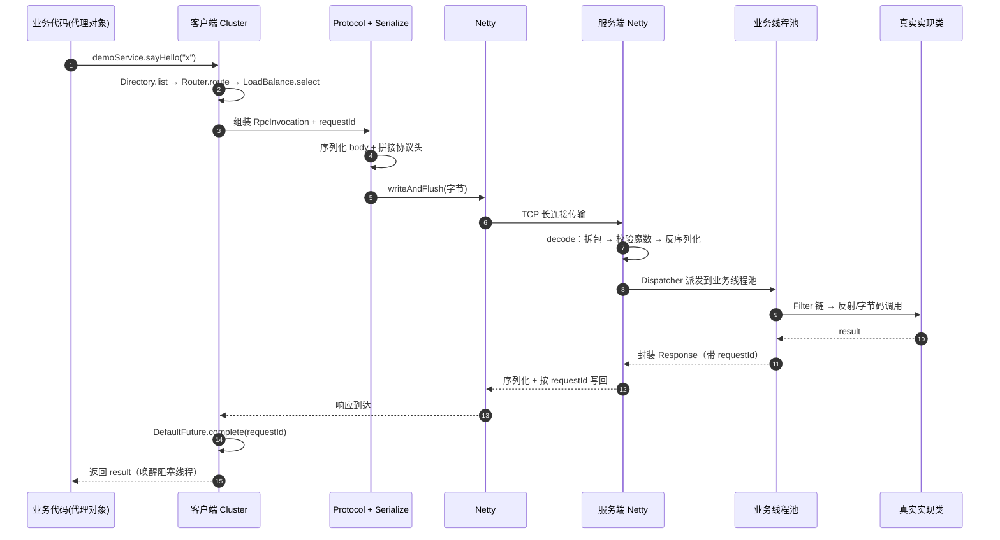
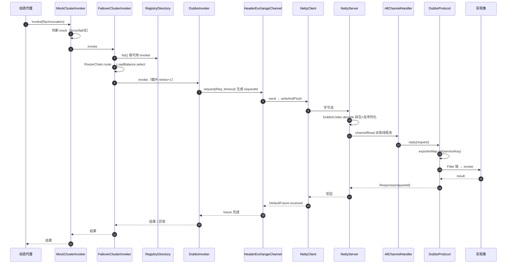

# Java RPC 框架深度知识体系

> **Dubbo / gRPC 底层原理 · 全链路拆解 · 大厂高频面试题精解**
>
> 版本：v1.0 ｜ 整理时间：2026-11 ｜ 覆盖：Dubbo 2.x/3.x、gRPC(Java)、Netty 4.x、Protobuf、HTTP/2
>
> 阅读建议：第 1~2 章是地基（不管面哪个厂都必须吃透），第 3 章 Dubbo 面向阿里系/美团/京东，第 4 章 gRPC 面向字节/腾讯/快手/外企，第 6 章面试题库按「公司 + 主题 + 难度星级」组织，可当刷题地图用。

---

## 目录

| 章节 | 内容 | 重要度 |
|---|---|---|
| 第一章 | RPC 的本质与全链路模型 | ★★★★★ |
| 第二章 | 底层原理逐层拆解（代理/序列化/网络/协议/线程/治理/异步） | ★★★★★ |
| 第三章 | Dubbo 深度剖析（架构、暴露、引用、调用、协议、SPI、3.x 演进） | ★★★★★ |
| 第四章 | gRPC 深度剖析（HTTP/2、Protobuf 编码、四种模式、调用链、LB） | ★★★★★ |
| 第五章 | 其他框架速览与横向对比选型 | ★★★ |
| 第六章 | 大厂面试题库（按公司 / 主题，带难度星级与详解） | ★★★★★ |
| 第七章 | 场景设计题与答题模板 | ★★★★ |
| 附录 | 术语表、参数速查、推荐阅读 | ★★★ |

---

# 第一章　RPC 的本质与全链路模型

## 1.1 一句话定义

**RPC（Remote Procedure Call，远程过程调用）**：让调用方像调用本地方法一样调用另一台机器（或另一个进程）上的方法，把「网络通信、序列化、寻址、容错」这些脏活全部隐藏起来。

关键词是 **"像调用本地方法一样"** ——这七个字决定了 RPC 框架全部的设计目标，也决定了它全部的难点：

```
本地调用：  调用方  →  [同一个 JVM 的方法栈]  → 被调方
              ↑
        编译器保证参数类型、返回值、异常

远程调用：  调用方  →  ┃  网络（不可靠）  ┃  → 被调方（可能不存在）
              ↑                ↑
        参数要「打包」      地址要「查找」
        返回值要「解包」    失败要「兜底」
```

本地调用只做了一件事：压栈跳转。而远程调用必须额外解决 **7 个问题**：

| # | 问题 | 解决手段 | 对应框架模块 |
|---|---|---|---|
| 1 | 方法调用如何变成"数据包" | 动态代理 + 方法元信息映射 | Proxy 层 |
| 2 | 参数/返回值怎么过网络 | 序列化 / 反序列化 | Serialize 层 |
| 3 | 数据怎么可靠、高效地传 | TCP + IO 多路复用 + 自定义协议 | Transport / Exchange 层 |
| 4 | 对方地址怎么定位 | 注册中心 / 服务发现 / 直连 | Registry 层 |
| 5 | 对方挂了怎么办 | 集群容错（重试/熔断/降级） | Cluster 层 |
| 6 | 调用怎么被记录、限流、鉴权 | Filter / 拦截器链 | Filter 层 |
| 7 | 异步、超时、上下文怎么传 | Future / Channel / Attachment | 调用模型层 |

> **理解抓手**：把 RPC 框架当成「本地方法调用 → 字节流 → 本地方法调用」的一次往返翻译器。面试时任何问题，只要能定位到上面 7 个问题中的哪一个，答案自然就有了层次。

## 1.2 RPC vs HTTP vs REST vs MQ —— 别混为一谈

这是被问得最多、也最容易答错的一道"送分题"。

```
┌──────────────────────────────────────────────────────────────────────┐
│                          通信方式的谱系                                │
├──────────────────────────────────────────────────────────────────────┤
│                                                                      │
│  进程内        跨进程/跨机                                             │
│  ┌──────┐     ┌─────────────────────────────────────────────┐        │
│  │方法调用│     │  同步请求-响应          异步消息              │        │
│  │      │     │  ┌──────────────┐      ┌──────────────┐     │        │
│  │      │     │  │ HTTP/REST    │      │ MQ (Kafka/    │     │        │
│  │      │     │  │ (通用、文本)   │      │ RocketMQ)    │     │        │
│  │      │     │  ├──────────────┤      │ (解耦、削峰)   │     │        │
│  │      │     │  │ RPC          │      └──────────────┘     │        │
│  │      │     │  │ (专用、二进制) │                            │        │
│  │      │     │  └──────────────┘                            │        │
│  └──────┘     └─────────────────────────────────────────────┘        │
└──────────────────────────────────────────────────────────────────────┘
```

**关键结论：RPC 不是"非 HTTP"的东西，gRPC 本身就是跑在 HTTP/2 上的。**

| 维度 | RESTful HTTP/1.1 | 私有协议 RPC（Dubbo） | gRPC（HTTP/2 + Protobuf） |
|---|---|---|---|
| 设计目标 | 资源表述、通用、人可读 | 内部服务高性能调用 | 内部服务 + 跨语言 + 流式 |
| 传输协议 | HTTP/1.1（短连接/长连接但串行） | 自定义二进制协议 over TCP | HTTP/2（多路复用） |
| 报文开销 | 大（Header 文本，几百字节起） | 极小（16 字节头 + 序列化体） | 小（HPACK 压缩 Header + 流式帧） |
| 序列化 | JSON（文本，慢、体积大） | Hessian2/Kryo/FST/Protobuf | Protobuf（二进制，最快之一） |
| 连接复用 | 弱（HTTP/1.1 pipeline 实际不可用） | 强（长连接 + 单连接多请求） | 强（单连接多路复用，Stream 级并发） |
| 服务治理 | 需额外框架（Spring Cloud） | 内建（注册中心/路由/容错/限流） | 需外部（xDS/自研 LB/拦截器） |
| 契约 | OpenAPI（可选） | Java 接口（强绑定语言） | .proto IDL（跨语言强契约） |
| 典型场景 | 对外 API、浏览器、第三方开放 | 内部高 QPS 服务调用 | 内部调用、移动端、跨语言、流式 |

> **加分表述**：RPC 描述的是「调用语义」，HTTP 描述的是「传输协议」。RPC 可以用 HTTP 承载（gRPC、JSON-RPC、Dubbo 的 rest 协议），HTTP 也可以承载非 RPC 语义（资源操作）。所以"RPC 比 HTTP 快"这句话在严格意义上是错的，准确说法是「私有二进制协议的 RPC 在内部高频调用场景下，比 HTTP/1.1 + JSON 的 REST 开销更小」。

## 1.3 RPC 框架的五大要素

任何 RPC 框架，剥掉外壳后都是这五个部分 + 两个可选件：

```
┌─────────────────────────────────────────────────────────────────────┐
│                          RPC 框架 = 5 + 2                            │
├─────────────────────────────────────────────────────────────────────┤
│                                                                     │
│   ① 通信模块 (Transport)     TCP/Netty/HTTP2  →  字节怎么搬           │
│            ↕                                                        │
│   ② 协议模块 (Protocol)      报文头设计 →  一次请求怎么被识别          │
│            ↕                                                        │
│   ③ 序列化模块 (Codec)       Java对象 ⇄ 字节 →  数据怎么变字节         │
│            ↕                                                        │
│   ④ 代理模块 (Proxy)         动态代理 →  本地接口怎么变远程调用        │
│            ↕                                                        │
│   ⑤ 服务治理 (Governance)    注册发现/路由/负载/容错 → 调谁、挂了咋办   │
│                                                                     │
│   ○ 可选① 监控埋点 (Monitor)   调用量/耗时/成功率/线程池              │
│   ○ 可选② 管理运维 (Ops/QoS)   telnet、动态配置、优雅上下线、控制台    │
└─────────────────────────────────────────────────────────────────────┘
```

## 1.4 一次 RPC 调用的全链路（总纲图）

**这是全书最重要的一张图，后面第三章（Dubbo）和第四章（gRPC）都是它的实例化。**

```
 调用方业务代码
   │  demoService.sayHello("world")          ← 以为是本地调用
   ▼
┌──────────────────────────────────────────────────────────────────────┐
│ ① 代理层：Proxy（JDK 动态代理 / Javassist / ByteBuddy 生成的字节码）      │
│    拦截方法调用 → 拿到 方法名/参数类型/参数值/接口名                        │
└──────────────────────────────────────────────────────────────────────┘
   ▼
┌──────────────────────────────────────────────────────────────────────┐
│ ② 集群层：Cluster（容错策略 + Directory 服务列表 + Router 路由 + LB 选机）  │
│    决定「调哪个 IP:PORT 的哪个 Invoker」，失败按策略重试                    │
└──────────────────────────────────────────────────────────────────────┘
   ▼
┌──────────────────────────────────────────────────────────────────────┐
│ ③ 调用层：Invoker（统一抽象，把"调用"这件事抽象成一个可组合的对象）        │
│    Filter 链（鉴权/限流/日志/监控/埋点） → 组装 Request 对象              │
└──────────────────────────────────────────────────────────────────────┘
   ▼
┌──────────────────────────────────────────────────────────────────────┐
│ ④ 协议层：Protocol / Exchange（生成 requestId、构造协议头、双向/单向）     │
└──────────────────────────────────────────────────────────────────────┘
   ▼
┌──────────────────────────────────────────────────────────────────────┐
│ ⑤ 序列化层：Serialize（对象 → 字节；Hessian2 / Protobuf / Kryo）        │
└──────────────────────────────────────────────────────────────────────┘
   ▼
┌──────────────────────────────────────────────────────────────────────┐
│ ⑥ 传输层：Transport（Netty Channel → TCP → 内核 socket 缓冲区）         │
└──────────────────────────────────────────────────────────────────────┘
   │
   │  ══════════════ 网络 ══════════════  (TCP 三次握手后长连接复用)
   │
   ▼
┌──────────────────────────────────────────────────────────────────────┐
│ ⑦ 传输层：Netty EventLoop 检测 OP_READ → 解码（拆包/校验/反序列化）        │
├──────────────────────────────────────────────────────────────────────┤
│ ⑧ 分发层：Dispatcher（IO 线程 → 业务线程池，防止 IO 被业务阻塞）          │
├──────────────────────────────────────────────────────────────────────┤
│ ⑨ 服务端 Invoker 链：Filter → 反射调用真实实现类 → 得到 result            │
├──────────────────────────────────────────────────────────────────────┤
│ ⑩ 回程：序列化 response → 按 requestId 找回原 Channel → 写回             │
└──────────────────────────────────────────────────────────────────────┘
   │
   ▼
 客户端 Netty 收到响应 → 按 requestId 从「未完成请求表」中取出 Future → 唤醒阻塞线程 → 返回结果
```

**同一链路的时序图版本（支持 Mermaid 的查看器可直接渲染）**：



**记住这一条链路的"分层名字"，比记住每层细节更有价值**：面试官问你"Dubbo 调用过程"，你按 ①②③④⑤⑥⑦⑧⑨⑩ 讲，逻辑天然清晰，且天然能延伸到任意一层。

---

# 第二章　底层原理逐层拆解

## 2.1 代理层：为什么 RPC 一定要用动态代理

### 2.1.1 问题本质

业务代码只有这样一个接口，没有实现类：

```java
public interface DemoService {
    String sayHello(String name);
}
```

调用方手里只有接口（API 包），没有实现。那 `demoService.sayHello("x")` 为什么会变成一个网络请求？

**答案：`demoService` 这个引用指向的对象，根本不是业务实现类，而是一个由框架运行时生成、`implements DemoService` 的代理对象。** 它的方法体里没有业务逻辑，只有"抓取方法信息 → 发请求 → 等响应 → 返回结果"。

### 2.1.2 三种代理实现的技术差异

| 方式 | 原理 | 是否需要接口 | 性能 | 谁在用 |
|---|---|---|---|---|
| **JDK 动态代理** | `Proxy.newProxyInstance` 运行时生成 `$Proxy0` 字节码，实现所有接口，方法体统一转给 `InvocationHandler.invoke(proxy, method, args)` | 需要（必须实现接口） | 反射调用，中等 | JDK 原生、Dubbo 可选 |
| **CGLIB** | 基于 ASM 生成**子类**，覆写目标方法，方法内直接 `methodInterceptor.intercept()` | 不需要（可代理类） | 比 JDK 快（无反射，但方法调用是 FastClass 索引） | Spring AOP |
| **Javassist** | 直接改字节码 / 生成字节码，可生成**硬编码调用**（把参数个数、类型写死在字节码里） | 需要接口 | 最快（接近本地调用） | **Dubbo 默认** |
| **ByteBuddy** | 更高层的字节码生成 API，支持 subclass / redefine / rebase | 可选 | 快，生成期稍慢 | gRPC? 否；Mockito、Hibernate |

**Dubbo 默认使用 Javassist 的根本原因**：Javassist 生成的是**"W wrapper 类"**，方法体里不经过反射，而是直接 `new Object[]{arg0, arg1}` 然后调用，避免了 `Method.invoke` 的反射开销与参数装箱/数组创建的开销（`ClassGenerator` 会缓存方法签名与参数索引）。可以配置 `proxy=javassist|jdk`。

> **JDK 动态代理细节（常被追问）**：
> 1. 生成的类名形如 `com.sun.proxy.$Proxy0`，是 `final` 的，继承 `Proxy`，实现接口。
> 2. `Proxy` 类里有个静态字段 `h`（`InvocationHandler`），`$Proxy0` 构造器 `super(h)` 把它存进去。
> 3. 方法体：`return (String) super.h.invoke(this, m3, new Object[]{"x"})`，其中 `m3` 是 `DemoService.sayHello` 的 Method 对象的静态缓存（避免每次 `getMethod`）。
> 4. 缓存：`WeakCache<ClassLoader, Class<?>[], Class<?>> proxyClassCache`，key 是「类加载器 + 接口数组指纹」。
> 5. **限制**：只能代理接口；`Object` 的 `equals/hashCode/toString` 也被转发到 handler；JDK 16+ 因强封装默认不允许 `defineClass` 到某些包（需 `--add-opens`）。

### 2.1.3 代理层还要处理的"隐形工作"

一个成熟的代理不只是"转发"，它还要：

```
Method → 元数据映射：
  ├─ 接口全限定名        →  服务唯一标识（Dubbo 的 serviceKey: group/interface:version）
  ├─ 方法名 + 参数类型数组 →  服务端反射定位 Method（必须精确匹配，class 数组）
  ├─ 参数值数组          →  序列化 body
  ├─ 返回类型            →  反序列化目标类型（泛型擦除后需显式携带）
  ├─ throws Exception    →  服务端异常包装成 RpcException 回传
  └─ @Override/重载方法  →  按「方法名+参数类型列表」区分，不能只用方法名
```

> **易错点**：重载方法 → `methodName + parameterTypes` 才是唯一键；泛型返回值（`List<User>`）→ 反序列化只能得到 `List<Map>`，这就是 Dubbo 里必须用 `PojoUtils` 还原或走 Hessian 类型信息的原因。

## 2.2 序列化层：RPC 的第二个性能瓶颈

### 2.2.1 序列化必须回答的 6 个问题

| 问题 | 说明 | 选型影响 |
|---|---|---|
| ① 体积 | 同样的数据多少字节 | 决定网络带宽与 GC 压力 |
| ② 速度 | 序列化 + 反序列化的 CPU 开销 | 决定单机 QPS 上限 |
| ③ 跨语言 | 是否只有 Java 能用 | 决定是否可多语言混布 |
| ④ 兼容性 | 加字段/删字段/改类型后旧客户端能否工作 | 决定能否平滑发布 |
| ⑤ 自描述 | 字节流里是否带类型信息 | 决定能否"不依赖接口"还原对象（泛化调用） |
| ⑥ 安全性 | 是否存在反序列化 RCE / autoType 漏洞 | 决定是否要白名单 |

### 2.2.2 主流序列化横向对比

| 序列化 | 体积 | 速度 | 跨语言 | 兼容性 | 自描述 | 备注 |
|---|---|---|---|---|---|---|
| **Java 原生** | 很大 | 慢 | 否 | 差（serialVersionUID 报错） | 是 | 只适合本地缓存 |
| **Hessian2** | 中 | 中 | 部分（多语言实现质量参差） | 好（字段名字符串） | 是（带类名） | **Dubbo 默认**；有 autoType 风险 |
| **Protobuf** | 极小 | 很快 | **优** | **好**（字段号） | 否（需 schema） | gRPC 默认；需 .proto |
| **Kryo** | 小 | 很快 | 否 | 差（需注册类，registrations） | 是 | 适合纯 Java 内网 |
| **FST** | 小 | 快 | 否 | 中 | 是 | 兼容 JDK 序列化 API |
| **fastjson2** | 中（文本） | 快 | 是（JSON） | 中 | 是 | 可读性好，体积大 |
| **Avro** | 小 | 快 | 优 | 好（schema evolution） | 否（需 schema） | 大数据生态 |
| **Thrift** | 小 | 快 | 优 | 中 | 否 | 与 Thrift RPC 绑定 |

### 2.2.3 三种序列化"设计范式"，这才是原理层面的答案

**① 自描述型（Java 原生 / Hessian / Kryo）**：字节流里带完整类型信息（类名、字段名），反序列化端不需要 schema。

```
Hessian2 大致格式：  [类名长度][类名字符串][字段1名][值1][字段2名][值2]...
                       ↑ 用了 "compact" 编码：类定义首次出现发送完整，后续用 short 引用
```

- **优点**：无需 IDL，Java 对象直接扔进去。
- **缺点**：体积大（字符串花销）、速度中等、跨语言差、安全风险（反序列化时按类名 `Class.forName` → autoType RCE，典型 payload 就是 `TemplatesImpl`、`JdbcRowSetImpl`）。
- **Dubbo 的防护**：`SerializeSecurityManager` + 类白名单/黑名单 + `dubbo.application.serialize.whitelist`。

**② Schema 型（Protobuf / Avro / Thrift）**：字节流里**只有字段编号 + 值**，没有字段名。

```
Protobuf：  [tag=(fieldNo<<3)|wireType][value]   ← 极省，字段名完全不传输
```

- **优点**：体积最小、解析最快（无需查字段名）、跨语言、兼容性好（字段号不变即可）。
- **缺点**：必须有 .proto 契约；不支持"任意 POJO 直接序列化"（导致 Dubbo 早期不能直接上 Protobuf，后来靠 `protostuff` 反射生成 schema 才绕过）。

**③ 文本型（JSON / XML）**：可读、通用、调试友好。

- **优点**：跨语言、人可读、浏览器友好。
- **缺点**：体积大（1.5~3 倍）、解析慢（字符串扫描 + 数字转换）、精度问题（long/double）、无类型。

> **一道很毒的追问**："Dubbo 为什么默认用 Hessian2 而不用 Protobuf？" 标准答案分三层：
> 1. **历史与生态**：Dubbo 是"接口即契约"的 Java RPC，用户直接把 POJO 扔进参数里，没有 IDL 编写习惯；Protobuf 需要额外维护 .proto，破坏"零侵入"。
> 2. **自描述需求**：Dubbo 的泛化调用、`Map` 传参、动态脚本调用依赖"字节流里带类型"这个能力，Protobuf 做不到。
> 3. **性能并非唯一目标**：Dubbo 的瓶颈主要在 IO 与线程模型，Hessian2 的可变长 + compact 已经够用；真要极致性能可切 `protobuf`/`kryo`/`fastjson2`。
>
> **纠偏/加分**：Dubbo 3.x 在 Triple 协议下已经默认拥抱 Protobuf（可 gRPC 互通），这是"从接口契约走向 IDL 契约"的一次重要转向。

---

## 2.3 通信层：Netty 为什么是 RPC 的"标配底座"

### 2.3.1 IO 模型的演进：为什么不能用 BIO

```
BIO（阻塞 IO）：一个连接一个线程
   Client1 ──┐
   Client2 ──┼──→ [ 线程1 ][ 线程2 ][ 线程3 ]...  10000 连接 = 10000 线程 = 崩
   Client3 ──┘        阻塞在 read()/accept()

NIO（非阻塞 + 多路复用）：一个线程管 N 个连接
   Client1..N ──→ [ Selector (epoll) ] → 就绪事件 → [ 少量 Worker 线程 ]
                 ↑ 内核告诉我们「哪个 fd 可读了」，而不是我们自己轮询
```

**核心机制（Linux）**：

| 机制 | 数据结构 | 时间复杂度 | 特点 |
|---|---|---|---|
| `select` | 位图（fd_set，最大 1024） | O(n) | 每次调用要把 fd 集合拷进内核，有上限 |
| `poll` | 链表（pollfd 数组） | O(n) | 无 1024 上限，仍需全量遍历 |
| `epoll` | 红黑树 + 就绪链表 | **O(1)**（只返回就绪 fd） | 无上限、无需拷贝集合、支持 LT/ET |

> **JDK NIO 在 Linux 上底层就是 epoll**（`EPollSelectorImpl` → `epoll_create/epoll_ctl/epoll_wait`），采用**水平触发（LT）**，这也是为什么 Netty 能在不特殊处理的情况下正确读数据。

**Reactor 三种模型**：

```
① 单 Reactor 单线程             ② 单 Reactor 多线程           ③ 主从 Reactor（Netty 采用）
┌────────────┐                 ┌────────────┐               ┌──────────────┐
│  Reactor   │                 │  Reactor   │               │ MainReactor  │ 只管 accept
│ (accept+   │                 │ (accept+IO)│               │   ↓          │
│  read+业务)│                 │     ↓      │               │ SubReactor×N │ 管 read/write
└────────────┘                 │ Thread Pool│               │   ↓          │
   业务阻塞则全挂                │  (业务)     │               │ Thread Pool  │ 业务
                               └────────────┘               └──────────────┘
```

**Netty 的主从 Reactor 落地**：

```java
// Server
EventLoopGroup boss   = new NioEventLoopGroup(1);        // 1 个线程，只处理 OP_ACCEPT
EventLoopGroup worker = new NioEventLoopGroup(cpu * 2);  // 处理 OP_READ/OP_WRITE
ServerBootstrap b = new ServerBootstrap()
    .group(boss, worker)
    .channel(NioServerSocketChannel.class)
    .childHandler(new ChannelInitializer<SocketChannel>() {
        protected void initChannel(SocketChannel ch) {
            ch.pipeline()
              .addLast(new LengthFieldBasedFrameDecoder(MAX, 0, 4, 0, 4)) // 拆包
              .addLast(new MyProtocolDecoder())   // 反序列化
              .addLast(new MyBusinessHandler());  // 业务
        }
    });
```

### 2.3.2 Netty 的六大核心组件（面试必背）

| 组件 | 作用 | 原理要点 |
|---|---|---|
| **EventLoopGroup / EventLoop** | 线程 + 事件循环 | 一个 `EventLoop` 绑定 **1 个线程 + 1 个 Selector + 1 个任务队列**；一个 Channel 一生只绑定一个 EventLoop（**无锁串行化**，这是 Netty 无锁设计的根基） |
| **Channel / ChannelPipeline** | 连接抽象 + 处理器链 | Pipeline 是**双向链表**（Head/SocketChannel/Tail），`addLast` 决定入站顺序；入站从 Head→Tail，出站从 Tail→Head |
| **ChannelHandler / ChannelHandlerContext** | 业务处理器 + 上下文 | `ctx.write()` 只往前一个出站 handler 传（就近），`channel.write()` 从 Tail 开始（全链）；**这是最常见的面试坑** |
| **ByteBuf** | 字节容器 | `readerIndex/writerIndex` 双指针（不用 flip）、支持**引用计数**（`retain/release`）、堆内/堆外、池化/非池化 |
| **ByteBufAllocator** | 内存分配 | 默认 `PooledByteBufAllocator`（jemalloc 思想：Arena → Chunk(16MB) → Page(16KB) → Subpage；tiny/small/normal/huge 四种规格，用 `PoolThreadCache` 做线程本地缓存） |
| **FastThreadLocal** | 高性能 ThreadLocal | 用**数组 + 唯一 index** 替代 Hash 表，消除 hash 冲突；数组做 **padding（填充）** 避免 CPU 伪共享（false sharing） |

**Netty 的"零拷贝"（4 种，必须能说出区别）**：

| # | 类型 | 说明 |
|---|---|---|
| 1 | **堆外直接内存（DirectByteBuf）** | 数据直接在堆外，`write` 时无需从堆内拷到堆外，**少一次 CPU 拷贝** |
| 2 | **CompositeByteBuf** | 把多个 ByteBuf 逻辑组合成一个，避免把 header+body 合并成大数组的拷贝 |
| 3 | **slice / duplicate** | 共享同一底层数组，只创建新的索引视图，零数据拷贝 |
| 4 | **FileRegion（transferTo）** | 底层 `sendfile`，文件内容**不经过用户态**直接送 socket（真正意义的零拷贝，但 Netty 对 SSL 场景不生效） |

> **经典追问**："Netty 零拷贝和操作系统零拷贝是一回事吗？" —— **不是**。OS 零拷贝（`sendfile`/`mmap`/`splice`）指"减少用户态与内核态之间的数据拷贝"；Netty 零拷贝主要指"减少 JVM 内的字节数组复制"，只有 `FileRegion` 那一条才真正对接了 OS 的 `sendfile`。

### 2.3.3 粘包 / 拆包：TCP 是"字节流"，没有"消息边界"

**本质**：TCP 只保证字节有序、可靠，**不保证一次 read 读到一条完整消息**。这是 TCP 的固有属性，不是"bug"。

```
发送方 write("AAAA")  write("BBBB")
接收方可能收到： "AAAABBBB"（粘包） / "AAA" + "ABBBB"（拆包） / "AAAA"+"BBBB"（正常）
```

**三种解决方案**：

| 方案 | 做法 | 优点 | 缺点 | 谁用 |
|---|---|---|---|---|
| **固定长度** | 每条消息固定 N 字节，不足补齐 | 实现最简单 | 浪费带宽，不灵活 | 极少 |
| **分隔符** | 用 `\r\n`、`\0` 等特殊字符分隔 | 可读性好 | 需转义，内容不能含分隔符 | Redis 协议(部分)、HTTP Header |
| **长度字段（Length-Prefixed）** | 报文头里放 body 长度，先读头再按长度读体 | **最通用、最高效** | 需处理头本身不完整的情况 | **Dubbo、gRPC、几乎所有二进制协议** |

**Netty 的 `LengthFieldBasedFrameDecoder` 五个参数（面试高频，必须能画图）**：

```
参数：maxFrameLength, lengthFieldOffset, lengthFieldLength, lengthAdjustment, initialBytesToStrip

例：协议 = [4字节长度L][body(L字节)]，要跳过长度字段只留 body
  lengthFieldOffset   = 0    长度字段在报文第 0 字节开始
  lengthFieldLength   = 4    长度字段占 4 字节
  lengthAdjustment    = 0    长度值 = 从「长度字段之后」到「报文末尾」的字节数(这里就是 body 长度)
  initialBytesToStrip = 4    解码后丢弃前 4 字节长度字段

例：协议 = [2字节魔数][4字节长度][body]，长度字段表示「整个报文长度」
  lengthFieldOffset = 2, lengthFieldLength = 4
  lengthAdjustment = -6   (因为长度值包含了头部6字节，需要减掉)
  initialBytesToStrip = 6
```

> **半包处理原理**：`LengthFieldBasedFrameDecoder` 继承 `ByteToMessageDecoder`，内部维护一个**累积缓冲区（cumulation ByteBuf）**。每次 `channelRead` 把新数据 `add` 进去，然后循环尝试 `decode`：只要累积数据还不够一个完整帧，就返回 `null` 等待下次；够一个完整帧才 `out.add(frame)`。**这就是"拆包"的工程答案：攒够了再给下游。**

## 2.4 协议层：报文头到底该放什么

### 2.4.1 一个优秀二进制协议头必须包含的信息

```
┌────────┬────────┬──────────┬────────────┬──────────┬─────────────┐
│ 魔数    │ 版本   │ 序列化ID  │ 消息类型     │ 请求ID    │ 数据长度     │
│ Magic  │ Version│ SerType  │ Req/Res/Evt│ RequestId│ BodyLength  │
│ 2字节   │ 1字节  │ 1字节     │ 1字节       │ 8字节     │ 4字节        │
└────────┴────────┴──────────┴────────────┴──────────┴─────────────┘
   ↑ 快速校验      ↑ 兼容演进  ↑ 决定codec  ↑ 心跳/单向/双向 ↑ 关联请求响应  ↑ 拆包
```

**每一项都是"有故事的"**：

| 字段 | 为什么需要 | 不要会怎样 |
|---|---|---|
| **魔数** | 快速识别"这是不是一个合法请求"，防脏数据/端口被 HTTP 打进来 | 会把任意垃圾数据当协议解析，导致诡异 bug |
| **版本号** | 协议演进（v1 头 16 字节，v2 加字段） | 无法平滑升级 |
| **序列化 ID** | 一个框架可同时支持多种序列化，需在报文里声明 | 只能全局固定一种 |
| **消息类型** | 区分 request / response / 心跳（heartbeat）/ 单向（oneway） | 心跳与业务混在一起，无法区分 |
| **请求 ID** | **客户端一个连接上有 N 个并发请求，响应必须能"对上号"** | 响应无法路由回对应的 Future，异步彻底失效 |
| **数据长度** | 拆包 | 粘包拆包无法解决 |

### 2.4.2 请求-响应关联：RPC 异步化的基石

```
客户端                              服务端
  │  req#1 ──────────────→          │
  │  req#2 ──────────────→          │
  │  req#3 ──────────────→          │  （三条请求共用一个 TCP 连接，交错发送）
  │                                  │
  │  ←────────────── res#2           │  （服务端处理完 2 先返回）
  │  ←────────────── res#3           │
  │  ←────────────── res#1           │
  │
  └─ 客户端用 Map<Long requestId, Future> 记录未完成请求
     收到 res#N 时 → map.remove(N) → future.complete(result)
```

**这就是为什么 RPC 能做到"单连接高并发"**：Dubbo 的 `DubboProtocol` 里有一个 `ConcurrentMap<String, ExchangeServer>`／客户端侧 `HeaderExchangeHandler` 里的 `uncompletedRequests`（`DefaultFuture` 内部静态 `ConcurrentHashMap<Long, DefaultFuture>`）。

> **对比 gRPC**：gRPC 用的是 HTTP/2 的 `StreamId`（一个连接上多个独立 Stream，每个 Stream 有自己的 HEADERS+DATA 帧序列），本质上"用协议层的流 ID 替代了应用层的 requestId"，更彻底。

---

## 2.5 线程模型：IO 线程与业务线程为什么要分开

### 2.5.1 分层的必然性

```
Netty EventLoop（IO 线程，数量 = CPU 核数 * 2）
  └─ 只做：read → decode → 交给业务线程池 → （不阻塞、不做业务）
                    │
                    ▼
Provider 业务线程池（默认 fixed 200）
  └─ 做：Filter 链 → 反序列化 → 反射调用实现类 → 业务逻辑（可能查 DB 500ms）
                    │
                    ▼
              encode → EventLoop 写回
```

**不分会怎样**：IO 线程被业务阻塞 → 该 `EventLoop` 绑定的所有 Channel（可能几百个连接）全部卡死 → **一个慢请求拖垮整台机器**。这在 RPC 里是"雪崩"的典型起点。

### 2.5.2 Dubbo 的 5 种 Dispatcher（`dubbo.protocol.dispatcher`）

| 策略 | 行为 | 适用 |
|---|---|---|
| `all`（**默认**） | 所有消息（请求、响应、心跳、事件）都派发到业务线程池 | 通用 |
| `direct` | 全部在 IO 线程上执行 | 业务极快（纯内存计算），省一次线程切换 |
| `message` | 只有请求/响应进线程池，心跳与事件在 IO 线程 | 减少线程池压力 |
| `execution` | 只把「请求」派发到线程池，其余在 IO 线程 | 高并发下更省 |
| `connection` | 连接建立/断开事件单独一个线程池，其余在 IO 线程 | 大量短连接（连接抖动频繁） |

> **追问点**："为什么默认是 `all` 而不是 `message`？" —— 因为默认策略要保证"任何回调都不阻塞 IO 线程"，`all` 最安全；`message`/`execution` 是性能优化的激进选项，需要业务保证心跳处理极快。

### 2.5.3 线程池打满的经典问题（必考场景题）

**症状**：请求超时、`RejectedExecutionException`、`Thread pool is exhausted`、CPU 不高但 QPS 上不去。

**Dubbo 默认线程池**：`fixed`，`threads=200`，`queues=0`（即 `SynchronousQueue`）。
- `queues=0` 的含义：**没有排队缓冲区**，线程都在忙时直接拒绝（快速失败）。
- 好处：不会因为队列堆积导致"延迟无限增长"（内存与 RT 双爆）。
- 坏处：突发流量直接抛拒绝异常，表现为客户端 `RpcException: server busy`。

**排查路径（背下来，这是面试的"过程"分）**：

```
1. 看异常：RpcException("Thread pool is exhausted, ...")   → 确认是服务端线程池满
2. 看线程栈：jstack -l <pid> | grep "DubboServerHandler"    → 200 个线程全在 RUNNABLE/WAITING
3. 看线程在干什么：
   - 都在 WAITING on socketRead → 下游依赖慢（DB/Redis/其他 RPC）→ 上游被阻塞
   - 都在 RUNNABLE 且 CPU 高 → 计算型热点（大对象序列化/正则/死循环）
4. 看 GC：jstat -gcutil → FGC 频繁 → STW 导致请求堆积
5. 决策：
   - 下游慢 → 加超时、加熔断、隔离线程池（按接口/按服务分组）
   - 突发流量 → queues 从 0 调整为一个合理值 + 拒绝策略（或改 limited/cached）
   - CPU 型 → 拆分 IO 密集与 CPU 密集服务，独立部署
```

**调优参数（Dubbo）**：

```properties
dubbo.protocol.threads=200            # 业务线程数（默认 200）
dubbo.protocol.threadpool=fixed       # fixed / cached / limited / eager
dubbo.protocol.queues=0               # 队列长度，0=SynchronousQueue
dubbo.protocol.accepts=0              # 最大可接受连接数，0=不限制
dubbo.protocol.iothreads=8            # Netty worker 线程数（默认 cpu+1，上限 32）
dubbo.protocol.dispatcher=all
```

## 2.6 服务治理：RPC 框架的"大脑"

### 2.6.1 服务发现的三种模式

| 模式 | 原理 | 优点 | 缺点 | 代表 |
|---|---|---|---|---|
| **直连** | 配置写死 IP 列表 | 简单、无依赖 | 无法弹性扩缩容 | 测试环境 |
| **注册中心（Push/Pull）** | Provider 启动时注册，Consumer 订阅，变更时推送 | 实时性好，有健康检查 | 注册中心成为关键依赖 | Dubbo + ZK/Nacos |
| **DNS / Service Mesh** | 通过 DNS 或 Sidecar（Envoy）做服务发现 | 语言无关、基础设施层解耦 | 需要运维体系支撑 | gRPC + xDS、Istio |

**ZooKeeper vs Nacos（对比必答）**：

| 维度 | ZooKeeper | Nacos |
|---|---|---|
| 一致性 | ZAB，强一致（CP） | AP（Distro 协议）/ CP 可切（Raft） |
| 容量 | 万级节点后写性能下降（全量广播） | 十万级实例（分级存储 + 增量推送） |
| 健康检查 | 靠临时节点会话（长连接心跳） | 客户端心跳 + 服务端主动探测 |
| 变更通知 | Watch（一次性，需重新注册） | UDP 推送 + 长轮询兜底 |
| 运维 | 需维护 ZK 集群，脑裂风险 | 自带控制台、配置中心合一 |
| 场景 | 老 Dubbo 2.x 主流 | Dubbo 3.x 推荐、Spring Cloud Alibaba |

> **深度延伸（面试官爱听）**：Dubbo 2.x 把**接口级**全量 URL 写进 ZK（`/dubbo/com.foo.DemoService/providers/...`），一个应用 50 个接口 × 100 个实例 = 5000 个节点；200 个应用 = 百万级节点 → ZK 直接被打挂。这就是 **Dubbo 3.x 改「应用级服务发现」的直接动因**（详见 3.8）。

### 2.6.2 负载均衡：5 种算法的原理与缺陷

| 算法 | 原理 | 优点 | 缺点 | Dubbo 实现要点 |
|---|---|---|---|---|
| **加权随机** | 按权重区间随机 | 简单、无状态 | 短时可能不均 | `RandomLoadBalance`（默认），用 `ThreadLocalRandom` |
| **加权轮询** | 按权重平滑轮询 | 长期均匀 | 慢节点仍被轮询到 | `RoundRobinLoadBalance`，2.7 用**平滑加权轮询**（避免 `[a,a,a,b,b]` 的突刺） |
| **最小活跃数** | 选"当前正在处理请求数最少"的节点 | 天然感知慢节点 | 需维护计数，且新节点"冷启动"易被压垮 | `LeastActiveLoadBalance`，活跃数用 `AtomicInteger`，相同活跃数时再按权重随机 |
| **一致性哈希** | 环 + 虚拟节点，同 key 稳定落到同节点 | 节点增减时影响面小（利于缓存） | 需 key（无参方法退化）、有热点 | `ConsistentHashLoadBalance`，默认 **160 个虚拟节点**（`replicaNumber`），用 MD5 前 4 字节 |
| **最短响应时间** | 预测"最快返回"的节点 | 对慢节点最敏感 | 统计有窗口滞后，易抖动 | `ShortestResponseLoadBalance`（2.7+），滑动窗口统计 |
| **P2C / 自适应** | 随机选 2 个，比较后选优（Power of Two Choices） | 兼顾负载与延迟，无需全局统计 | 需要较好的指标采集 | Dubbo 3.x `AdaptiveLoadBalance` |

**平滑加权轮询（SWRR）算法（手写题高频）**：

```java
// 每个节点维护 currentWeight；每轮：currentWeight += weight，选出 currentWeight 最大的，
// 然后该节点的 currentWeight -= totalWeight
// 效果：序列 A(5) B(1) C(1) → A A B A C A A （均匀散布，而不是 AAA BB C）

class Node {
    int weight;         // 固定权重
    int currentWeight;  // 动态权重
}
Node select(List<Node> nodes) {
    int totalWeight = 0;
    Node best = null;
    for (Node n : nodes) {
        n.currentWeight += n.weight;      // ① 每个节点加上自己的权重
        totalWeight += n.weight;
        if (best == null || n.currentWeight > best.currentWeight) best = n;  // ② 选最大的
    }
    best.currentWeight -= totalWeight;    // ③ 被选中的减去总权重
    return best;
}
```

> **"最少活跃数"为什么有坑**：新上线的实例活跃数为 0，会被瞬间选中大量请求 → **冷启动雪崩**。Dubbo 的处理是在"活跃数相同"时用**权重随机**做二次选择，并且配合"预热（warmup）"机制（`dubbo.application.warmup`，新实例权重从 10 逐步爬升到 100）。

### 2.6.3 集群容错：6 种策略

| 策略 | 行为 | 适用 | 风险 |
|---|---|---|---|
| **Failover（默认）** | 失败后按 `retries` 换其他节点重试 | 读多、幂等 | **非幂等写会重复提交** |
| **Failfast** | 失败立即抛异常，不重试 | 非幂等写（下单/支付） | 可用性略降 |
| **Failsafe** | 失败返回空结果（`null`/空集合），不抛异常 | 旁路功能（日志、埋点） | 静默失败，排查困难 |
| **Failback** | 失败先记下，后台定时重试 | 消息通知类 | 需保证最终一致 |
| **Forking** | 并行调多个（`forks=N`），有一个成功就返回 | 读多、要求低延迟 | 放大下游流量 |
| **Broadcast** | 所有节点都调一遍，任一报错即失败 | 缓存刷新、配置广播 | 流量 = N 倍 |
| **Zone-aware**（3.x） | 优先同 zone，zone 内全挂才跨 zone | 多机房/多可用区 | 需正确配置 zone |

> **必考组合题**："重试会不会导致重复下单？" —— **会**。因为 `Failover` 的重试发生在"客户端未收到响应"时，而服务端可能已经执行成功（响应在网络上丢了 / 服务端处理超时但已完成）。所以要分两种情况：
> - **超时重试**（`timeout`）→ 服务端可能已执行 → 必须靠**业务幂等**兜底（唯一键、去重表、状态机）。
> - **连接异常重试**（`connect refused`）→ 请求根本没发出去 → 可安全重试。
> Dubbo 的 `retries` 无法区分这两者，这是 `failover` 的固有语义缺陷，**写接口建议 `cluster=failfast` + `retries=0`**。

### 2.6.4 限流、熔断、降级——三个概念必须分清

| 概念 | 触发条件 | 动作 | 目标 | Dubbo 内建手段 |
|---|---|---|---|---|
| **限流** | QPS/并发数 超过阈值 | 拒绝新请求（快速失败） | 保护**自己**不被打挂 | `TpsLimitFilter`、`ExecuteLimitFilter`、Sentinel、自定义 Filter |
| **熔断** | 下游**错误率/慢调用比例** 超阈值 | 一段时间内**不再调用**下游（走 fallback） | 保护**自己**不被下游拖死 | Sentinel / Hystrix / 自研 Filter |
| **降级** | 主动（大促预案）或被动（熔断后） | 返回**兜底数据**（缓存/默认值） | 保住核心链路 | `@Reference(mock=...)`、`MockClusterInvoker`、`mock=true` |

**Dubbo 的服务降级（`mock`）三种配置**：

```java
@Reference(mock = "return null")                    // 直接返回 null
@Reference(mock = "force:return null")              // 强制降级（不看服务端是否可用），常用于大促
@Reference(mock = "fail:return null")               // 只有调用失败时才降级
```

**原理**：`MockClusterInvoker` 包在 `ClusterInvoker` 外面；`force:` 前缀直接跳过真实调用；`fail:` 前缀在真实调用抛 `RpcException` 时走 mock 逻辑；`return xxx` / `throw xxx` 会被解析成一段动态执行表达式（默认用 `MockInvoker` + `Javassist` 编译）。

> **延伸**：真正生产级的熔断要满足 **closed / open / half-open 三态**，滑动窗口统计，并且要"按接口 + 按下游方法"两个维度实现，避免同一个下游 A 接口的问题熔断掉 B 接口。

## 2.7 异步化与上下文透传

### 2.7.1 三种"异步"的含义（极易混淆）

| 类型 | 含义 | 例子 |
|---|---|---|
| **客户端异步** | 调用方不等结果，拿 Future | Dubbo `async=true`、gRPC `ListenableFuture` |
| **服务端异步** | Provider 的业务实现是异步的，但 IO 线程不被阻塞 | Dubbo `AsyncContext`（2.6）、`CompletableFuture` 返回值（2.7+） |
| **单向调用（oneway）** | 只发不等，无响应，天然"异步" | Dubbo `async` + 无返回值 |

**Dubbo 2.7 服务端异步的标准写法**：

```java
public CompletableFuture<String> sayHello(String name) {
    return CompletableFuture.supplyAsync(() -> {
        // 真正的耗时业务，跑在业务线程池里
        return "hello " + name;
    }, bizExecutor);
}
```

**原理（必答）**：Dubbo 的 `Invoker` 返回后，`DubboProtocol` 的 `reply()` 检查返回值；如果 `invocation.get() instanceof CompletableFuture`，则**不立即写回响应**，而是注册一个回调（`whenComplete` → 序列化 → 写回 Channel），IO 线程被立即释放。**这就是"服务端异步"的本质：把"等待业务结果"这件事从线程改为回调。**

### 2.7.2 上下文透传：ThreadLocal 的"断点"

**问题**：RPC 框架 + 线程池 + 异步 → `ThreadLocal` 里的 `traceId`、用户身份、灰度标 会在**切换线程时丢失**。

```
请求线程 A  [ThreadLocal: traceId=T1]
   │ submit 任务
   ▼
线程池线程 B [ThreadLocal 为空]  ← traceId 丢了！
```

**四种解法**（性能与正确性递增）：

| 方案 | 原理 | 问题 |
|---|---|---|
| **显式参数传递** | 把上下文当参数一路传下去 | 侵入性强 |
| **Dubbo Attachment** | `RpcContext.getContext().setAttachment("traceId", t)` → 自动序列化进协议 `attachments` 字段 → 服务端 `getRemoteAttachment()` 取 | 只解决"跨进程"，不解决"跨线程" |
| **InheritableThreadLocal** | 子线程继承父线程的副本 | **线程池复用线程时不生效**（线程创建时才有继承） |
| **TransmittableThreadLocal（TTL）** | Ali 开源；`TtlRunnable` 包装任务，`submit` 时**快照**、`run` 时**回放**、结束时**恢复** | 需包装所有线程池提交点 |

```java
// TTL 核心三步（面试能手写出来就是亮点）
// 1. 提交时捕获
TtlRunnable ttlTask = TtlRunnable.get(task);
// 2. 执行前 replay（把捕获的 holder 设到当前线程）
// 3. 执行后 restore（还原原值，避免污染复用线程）
executor.submit(TtlRunnable.get(() -> {
    log.info("traceId={}", TtlContext.get());  // T1 还在
}));
```

> **gRPC 的做法**：`io.grpc.Context` 是**不可变**的，用 `Context.current().withValue(key, v)` 派生新 Context，`attach()/detach()` 显式绑定到线程；配合 `Context.currentContextExecutor(executor)` 保证 executor 里的任务能看到正确 Context。**本质是把 ThreadLocal 变成"显式传递的不可变对象"，比 TTL 更安全。**

---

# 第三章　Dubbo 深度剖析

## 3.1 版本演进：为什么必须知道这条时间线

| 版本 | 年份 | 关键变化 | 面试价值 |
|---|---|---|---|
| 2.0 | 2011 | 阿里内部开源，基于 Netty3，ZK 注册中心 | 历史 |
| 2.5.x | 2014 | 引入 Netty4 可选，JDK8 | 老项目 |
| 2.6.x | 2017 | Netty4 默认，异步调用，**Hessian2 默认序列化** | ★★★ |
| **2.7.x** | 2019 | **异步全面升级为 CompletableFuture**、`ServiceConfig` 大重构、**元数据中心**、注册中心抽象（ZK/Nacos/Etcd）、`Triple` 初版、应用级服务发现雏形 | ★★★★★ |
| **3.0/3.1/3.2** | 2021+ | **应用级服务发现成为默认**、**Triple 协议正式（HTTP/2，兼容 gRPC）**、可伸缩架构（分层解耦）、流量治理、Mesh 化、Proxyless | ★★★★★ |

> **一句话总结演进主线**：**"从『接口级 + 私有协议 + Java 绑定』→『应用级 + HTTP/2 + 跨语言 + 可治理』"**。

## 3.2 整体架构：十层（自上而下）

```
┌─────────────────────────────────────────────────────────────────┐
│  Service   业务层   ① 用户写的 interface + impl（最贴近业务）        │
├─────────────────────────────────────────────────────────────────┤
│  Config    配置层   ② ServiceConfig / ReferenceConfig / @DubboService│
├─────────────────────────────────────────────────────────────────┤
│  Proxy     代理层   ③ ProxyFactory → JavassistProxyFactory(默认)    │
├─────────────────────────────────────────────────────────────────┤
│  Registry  注册层   ④ RegistryProtocol / RegistryFactory / ZK、Nacos│
├─────────────────────────────────────────────────────────────────┤
│  Cluster   集群层   ⑤ ClusterInvoker / Directory / Router / LB      │
├─────────────────────────────────────────────────────────────────┤
│  Monitor   监控层   ⑥ MonitorFilter / Metrics / 调用链              │
├─────────────────────────────────────────────────────────────────┤
│  Protocol  协议层   ⑦ DubboProtocol / TripleProtocol / RestProtocol │
├─────────────────────────────────────────────────────────────────┤
│  Exchange  交换层   ⑧ HeaderExchange（封装 Request/Response、心跳、Future）│
├─────────────────────────────────────────────────────────────────┤
│  Transport 传输层   ⑨ NettyServer / NettyClient / Mina / Grizzly   │
├─────────────────────────────────────────────────────────────────┤
│  Serialize 序列化层 ⑩ Hessian2 / Fastjson2 / Kryo / Protobuf       │
└─────────────────────────────────────────────────────────────────┘
```

**记忆方法**：`服务 → 配置 → 代理 → 注册 → 集群 → 监控 → 协议 → 交换 → 传输 → 序列化`，即 **"服配代注集监协交传序"**。
- **上四层**（Service/Config/Proxy/Registry）解决"暴露/引用"；
- **中两层**（Cluster/Monitor）解决"选谁/记谁"；
- **下四层**（Protocol/Exchange/Transport/Serialize）解决"怎么传"。

## 3.3 核心对象模型：理解 Dubbo 的"钥匙"

Dubbo 的一切都围绕 **URL + Invoker + Protocol** 三个概念转。

### 3.3.1 URL —— Dubbo 的"信息总线"

```
dubbo://192.168.1.10:20880/com.foo.DemoService?anyhost=true&application=demo-provider
      &interface=com.foo.DemoService&methods=sayHello&pid=1234&side=provider&
      timeout=3000&version=1.0.0&group=g1
└─┬──┘ └────────┬──────────┘ └──────────┬──────────┘ └──────────────┬─────────────┘
 protocol        address:port            path(serviceKey)          parameters
```

**为什么用 URL**：Dubbo 把所有配置信息（协议、地址、接口、方法列表、超时、版本、分组、PID、side）**全部塞进 URL 的字符串参数**，好处是：
1. 任何一个环节只要拿到 URL，就知道"调谁、怎么调、什么参数"；
2. 可以在注册中心里直接存 URL（字符串），无需序列化对象；
3. 各层之间只靠 URL 通信，**彻底解耦**（这是 Dubbo 十层架构能成立的设计基础）。

> **易错点**：`side=provider|consumer` 非常重要——注册中心里 provider 与 consumer 都注册 URL，靠 `side` 区分；`category=routers|configurators` 区分路由规则与动态配置。

### 3.3.2 Invoker —— 把"调用"抽象成一个对象

```
Invoker（顶层接口）
 ├─ AbstractProxyInvoker     ← 服务端：包住真实实现类，调用时反射/直接执行
 ├─ AbstractInvoker          ← 客户端：包住一个远程地址，调用时发请求
 │   └─ DubboInvoker         ← 具体走 Dubbo 协议
 │   └─ TripleInvoker        ← 具体走 Triple(HTTP/2) 协议
 ├─ AbstractClusterInvoker   ← 包住一组 Invoker，实现容错
 │   └─ FailoverClusterInvoker / FailfastClusterInvoker / ForkingClusterInvoker ...
 ├─ MockClusterInvoker       ← 包住 ClusterInvoker，实现降级
 ├─ InjvmInvoker             ← 同 JVM 直接调用（不等网络）
 └─ AsyncInvoker?           ← 异步
```

**核心洞察**：**Service → Invoker → Invoker → Invoker 层层包装，最终一次 `invoke(Invocation)` 就完成一次远程调用。** 面试时能用这句话解释"为什么 Dubbo 的扩展性这么好"，就到位了。

### 3.3.3 协议层对象

| 对象 | 角色 | 说明 |
|---|---|---|
| `Protocol` | 协议入口 | `export()`（暴露）、`refer()`（引用）、`destroy()` |
| `Exporter` | 暴露产物 | `DubboExporter`：把 `serviceKey → Invoker` 存进 `exporters` Map |
| `ExchangeServer / ExchangeClient` | 交换层 | 在 Transport 之上封装"请求-响应"语义（`request()` 返回 `Future`） |
| `TransportServer / Client` | 传输层 | `bind(port)` / `connect(url)`，底层是 Netty |
| `Codec2` | 编解码 | `encodeRequest / decodeResponse / decodeRequest / encodeResponse` |
| `ChannelHandler` 链 | 处理链 | `NettyServerHandler → HeartbeatHandler → AllChannelHandler → HeaderExchangeHandler` |

### 3.3.4 服务唯一标识（serviceKey）

```
serviceKey = group + "/" + interfaceName + ":" + version
例：  g1/com.foo.DemoService:1.0.0
```

**这是 Dubbo 的"服务坐标"**，也是注册中心里的节点名。**多版本、多分组共存**全靠它。

## 3.4 服务暴露（Export）全流程 —— 必考，要能画

```
① Spring 容器启动
   @DubboService 注解 → ServiceBean（implements ApplicationListener）
        │
        ▼  onApplicationEvent
② ServiceConfig.export()
   ├─ 校验+补全参数，生成 provider URL：dubbo://0.0.0.0:20880/com.foo.DemoService?...side=provider
   ├─ 本地暴露：exportLocal(url)  → InjvmProtocol.export() → InjvmExporter（同 JVM 走本地调用，不走网络）
   └─ 远程暴露：protocol.export(invoker)
        │
        ▼  注意：这里拿到的是 ProtocolFilterWrapper 的包装（Filter 链从这里插入）
③ ProtocolFilterWrapper.export()
   └─ 构建 Filter 链：EchoFilter → ClassLoaderFilter → GenericFilter → ContextFilter
                     → TokenFilter → AccessLogFilter → TimeoutFilter → ExceptionFilter → MonitorFilter
   └─ 最终包成 ListenerInvokerWrapper(invoker)
        │
        ▼
④ RegistryProtocol.export()
   ├─ doLocalExport(invoker)
   │     └─ DubboProtocol.export()  ← 真正"开端口"
   │           ├─ getServers()：若该端口没有 Server，则 openServer(url)
   │           │      └─ Exchangers.bind(url, requestHandler)
   │           │            └─ HeaderExchanger.bind()
   │           │                  ├─ Transporters.bind() → NettyServer.bind()  ← TCP LISTEN
   │           │                  └─ new HeaderExchangeHandler(handler)
   │           │                        └─ 包成 HeaderExchangeServer
   │           ├─ new DubboExporter(url, invoker, exporterMap)  ← serviceKey → Invoker 存表
   │           └─ exporterMap.put(serviceKey, exporter)
   ├─ register(registryUrl, registedProviderUrl)  ← 注册到 ZK/Nacos
   └─ subscribe(overrideSubscribeUrl, notifyListener) ← 订阅 override（路由/配置）变更
        │
        ▼
⑤ 注册中心节点（ZK 为例）
   /dubbo/com.foo.DemoService/providers/dubbo://192.168.1.10:20880/...   ← 临时节点(EPHEMERAL)
   /dubbo/com.foo.DemoService/configurators/...
   /dubbo/com.foo.DemoService/routers/...
        │
        ▼
⑥ NettyServer 的 ChannelPipeline（服务端）
   [ IdleStateHandler(心跳) ]
   [ DubboCodec（Decoder + Encoder） ]
   [ NettyServerHandler → HeartbeatHandler → AllChannelHandler → HeaderExchangeHandler ]
```

**关键细节（能说出这些就是"真读过源码"）**：

1. **端口共享**：同一个 `protocol + port` 上多个 service 共用一个 `NettyServer`，靠 `exporterMap` 按 `serviceKey` 路由 —— 所以 20 个接口只占 1 个端口。
2. **`ListenerInvokerWrapper`**：真正执行时的最外层是它，作用是"把 `invoke` 的异常统一收口"。
3. **两次包装**：`ProtocolFilterWrapper`（Filter 链）+ `ProtocolListenerWrapper`（ExporterListener，用于通知暴露完成）。
4. **本地暴露的意义**：同 JVM 内调自己的服务不走网络（`InjvmProtocol` 默认开启，`scope=local`），大幅降低单机内部调用的 RT。

## 3.5 服务引用（Refer）全流程 —— 同样必考

```
① 业务侧注入：@DubboReference → ReferenceBean（FactoryBean）
        │
        ▼  getObject()
② ReferenceConfig.get()  → createProxy(map)
   ├─ 判断直连 or 注册中心：检查 url / 是否有 registry
   └─ REFER 流程
        │
        ▼
③ RegistryProtocol.refer()
   ├─ 向注册中心注册 consumer URL（side=consumer）→ 让 provider 感知到我订阅了你
   ├─ subscribe(url, NotifyListener)  ← 订阅 providers/configurators/routers
   ├─ doRefer(cluster=FAILOVER, url)
   │    ├─ RegistryDirectory  ← 负责"本地缓存 + 变更刷新"
   │    │     ├─ subscribe → notify(url, urls) → toConfigurators / toRouters / toInvokers
   │    │     └─ 把 provider URL 转成 Invoker：
   │    │           protocol.refer(url, channel) → DubboProtocol.refer()
   │    │                 └─ getClients(url) → Exchangers.connect() → NettyClient
   │    │                 └─ new DubboInvoker(interface, url, clients, invokers)
   │    └─ new FailoverClusterInvoker(directory)   ← 用 Directory 生成 ClusterInvoker
   ├─ 把 ClusterInvoker 缓存到 invokers Map（key = serviceKey）
   └─ 构建 Filter 链（消费者侧：ConsumerContextFilter、FutureFilter、MonitorFilter...）
        │
        ▼
④ ProxyFactory.getProxy(invoker)
   └─ JavassistProxyFactory → Wrapper → new DemoService$Proxy(invoker)
      （这个对象的方法体就是：return (String) invoker.invoke(new RpcInvocation(method, args)).recreate()）
```

**关键点**：
- **`RegistryDirectory` 是 Dubbo 服务发现的核心**：它是一个 `NotifyListener`，接收注册中心推送的 URL 列表变更，然后 **`refreshInvoker()`** 重建 `Invoker`（注意：重建是"复用已有连接"，只对新增 URL 建连、对下线的 URL 销毁）。
- **Consumer 也注册**：很多人不知道——consumer 会把自己的 URL（`side=consumer`）注册到 ZK，目的是让 provider 能通过 `providers` 之外的节点感知消费者（用于后续的服务治理、路由下发）。
- **`ReferenceConfig` 有缓存**：同一个 JVM 内相同的 `serviceKey` + 相同参数，复用同一个 `Invoker`，避免重复建连。

## 3.6 一次调用的完整链路（客户端 12 步）

**这张图是面试的"标准答案骨架"，建议背到能默写。**

```
 ① demoService.sayHello("world")
    └─ 调用的是动态代理对象（Javassist 生成），不是实现类
 ② Proxy.invoke → RpcInvocation(methodName, parameterTypes, args, attachments)
 ③ InvokerInvocationHandler.invoke(invoker, invocation)
 ④ MockClusterInvoker.invoke()
    └─ 检查 mock 配置：force: / fail: / 无 → 直接进 ⑤
 ⑤ FailoverClusterInvoker.invoke(invocation)
    ├─ Directory.list(invocation)       ← 拿到所有可用 Invoker（已过滤）
    ├─ RouterChain.route()              ← 标签路由/条件路由/脚本路由（灰度核心）
    ├─ LoadBalance.select()             ← 选一台（随机/轮询/最小活跃/一致性哈希）
    └─ 循环 retries+1 次
 ⑥ AbstractInvoker.invoke()             ← 构造 Request，处理 async/returnType
 ⑦ AbstractProxyInvoker? （服务端才用）
 ⑧ DubboInvoker.doInvoke()
    ├─ clients 轮询取一个 ExchangeClient（多连接时按 index 轮转）
    ├─ (async) → channel.request(request, timeout) 返回 Future
    └─ (sync)  → future.get(timeout)                ← 阻塞在业务线程
 ⑨ HeaderExchangeChannel.request(request, timeout)
    ├─ 检查 channel 是否关闭
    ├─ new Request(id, twoWay, event, requestData)    ← id 由 AtomicLong 生成
    └─ channel.send(request, timeout) → 返回 DefaultFuture
 ⑩ NettyChannel.send()
    └─ channel.writeAndFlush(message) → Pipeline Tail
 ⑪ DubboCodec.encode() → 序列化 + 拼 16 字节头 → Netty EventLoop 写 socket
 ⑫ DefaultFuture.get(timeout)
    ├─ 用 requestId 在 DefaultFuture.FUTURES 中登记
    ├─ 等待 response（或超时 → 抛 TimeoutException，并从 FUTURES 移除，避免内存泄漏）
    └─ 响应到达时 HeaderExchangeHandler → DefaultFuture.received() → complete
```

**服务端 8 步**：

```
 ① Netty EventLoop 检测 OP_READ → DubboCodec.decode()
    ├─ 校验魔数 0xdabb
    ├─ 读 flag → 判断 req/res、2way、event（心跳）
    ├─ 读 status、requestId、dataLength
    └─ 按 serializationId 反序列化 body → Request
 ② NettyServerHandler.channelRead → 抛给下一个 handler
 ③ HeartbeatHandler（处理心跳：Event 类型的 Request 直接回 Response）
 ④ AllChannelHandler（Dispatcher=all）→ 把 Request 丢进 Provider 线程池
 ⑤ HeaderExchangeHandler.received()
    ├─ request.isTwoWay() → 调用 handler.reply() 拿结果
    └─ 组装 Response 写回
 ⑥ DubboProtocol 的内部 requestHandler.reply()
    ├─ exporterMap.get(serviceKey).getInvoker()
    ├─ 构建 RpcInvocation（含 attachments 还原到 RpcContext）
    └─ invoker.invoke(invocation)   ← 进入服务端 Filter 链
 ⑦ Filter 链：EchoFilter(是否 echo) → ClassLoaderFilter(切 TCCL) → GenericFilter(泛化)
             → ContextFilter(还原 Attachments) → TokenFilter → AccessLogFilter
             → TimeoutFilter → ExceptionFilter → MonitorFilter
 ⑧ AbstractProxyInvoker.invoke() → Wrapper.invokeMethod()（Javassist 直接调用）→ 真实实现类
    └─ 返回结果：如果是 CompletableFuture → 注册回调，异步写回（不阻塞线程池线程）
```

**时序图版本（Mermaid）**：



## 3.7 Dubbo 协议报文格式（16 字节头，必须能画出来）

```
 0        1        2        3        4 ──────── 11       12 ──── 15
┌────────┬────────┬────────┬────────┬────────────────┬──────────────┐
│ magic  │ magic  │ flag   │ status │   request id    │  data length │
│ 0xda   │ 0xbb   │        │        │   (8 bytes)     │  (4 bytes)   │
└────────┴────────┴────────┴────────┴────────────────┴──────────────┘
           └─────────────────────── 16 bytes ─────────────────────────┘

flag 字节（bit 从高到低）：
  bit7  : 0=Request  1=Response        (FLAG_REQUEST)
  bit6  : 1=需要响应(twoWay) 0=单向     (FLAG_TWOWAY)
  bit5  : 1=事件(心跳)                  (FLAG_EVENT)
  bit4-0: 序列化 ID (1=hessian2, 2=java, 3=compactedjava, 4=fastjson, 5=kryo,...)

status 字节（仅 Response 有效，Request 恒为 0）：
  0x14 OK(20)   0x15 CLIENT_TIMEOUT(21)  0x16 SERVER_TIMEOUT(22)
  0x32 BAD_REQUEST(50)  0x33 BAD_RESPONSE(51)  0x34 SERVICE_NOT_FOUND(60)
  0x35 SERVICE_ERROR(70) 0x36 CLIENT_ERROR(80) 0x37 SERVER_ERROR(90)
```

**一次完整的请求字节流（举例）**：

```
da bb  c2  00  00 00 00 00 00 00 00 01  00 00 00 2a   <body 42 bytes>
│  │   │  │   └──────── requestId=1 ────┘ └─len=42─┘
│  │   │  └─ status=0（请求无状态）
│  │   └─ flag=0xC2 = 1100 0010 → Request + twoWay + 序列化ID=2(hessian2)
│  └─ magic 0xbb
└─ magic 0xda
```

**为什么是 16 字节？为什么不是 JSON？**

| 设计 | 理由 |
|---|---|
| 魔数 `0xdabb` | 防止把非法数据（如 HTTP 请求误发到 dubbo 端口）当协议解析 |
| flag 合并多个标志位 | 1 字节装下"请求/响应、双向/单向、普通/心跳、5 位序列化 ID"，极致压缩 |
| requestId 用 8 字节 | 客户端是 `AtomicLong` 自增，长期运行不会溢出（4 字节 long 边缘有溢出风险） |
| data length 放最后 | 便于 `LengthFieldBasedFrameDecoder` 用 `lengthFieldOffset=12` 直接定位 |
| 二进制而非文本 | 头部仅 16 字节 vs HTTP 头几百字节；即便每秒 10 万次调用也只多 1.6MB/s |

---


## 3.8 Dubbo 3.x 的四个关键变革（阿里 P7 面试重点）

### 3.8.1 变革一：应用级服务发现（Interface-level → Application-level）

**2.x 的问题（必须能讲清楚数字）**：

```
2.x 注册中心结构（接口级）：
/dubbo/com.foo.OrderService/providers/  → 100 个实例 URL
/dubbo/com.foo.UserService/providers/   → 100 个实例 URL
... 一个应用导出 50 个接口 → 5000 个临时节点
    × 200 个应用 → 100 万节点，且节点内容（URL 字符串）每个 200+ 字节
    每次实例上下线 → ZK 触发大量 Watch → 客户端重建 Invoker → CPU 抖动
```

**3.x 的做法（应用级 + 元数据中心）**：

```
① 注册中心（只存"应用实例"）：
   /dubbo/{applicationName}/providers/  →  该应用所有实例的 IP:PORT（一份）
   例：demo-provider → [10.0.0.1:20880, 10.0.0.2:20880, ...]

② 元数据中心（Metadata Center，存"接口 → 方法 → 参数"）：
   key = {applicationName}:{interfaceName}:{version}
   value = { methods: [...], params: [...], returnType: ... }

③ Consumer 端：
   拉取应用实例列表 + 拉取元数据 → 在本地"拼"出可用的接口级 Invoker
```

**收益**：

| 维度 | 2.x 接口级 | 3.x 应用级 |
|---|---|---|
| 注册中心节点数 | O(应用数 × 接口数 × 实例数) | O(应用数 × 实例数)，**降 1~2 个数量级** |
| 地址变更影响 | 该接口所有 Consumer 重建 Invoker | 只有"应用名"维度变化，接口级无需感知 |
| 跨语言/Mesh | 难（接口是 Java 概念） | 易（应用即服务，天然对接 K8s/Service） |
| 元数据变更 | 需重新注册 URL | 元数据中心独立管理，可热更新 |

**迁移方案（"平滑升级"是考点）**：**双注册**（同时向注册中心写应用级 + 接口级 URL），消费者根据 `dubbo.application.register-mode=interface|instance|all` 决定订阅粒度，灰度期间 `all` 兼容新旧客户端，全量验证后切 `instance`。

### 3.8.2 变革二：Triple 协议（HTTP/2 + 兼容 gRPC）

```
Dubbo 协议（2.x）          Triple 协议（3.x）
┌──────────────┐          ┌────────────────────────────────┐
│ TCP 私有二进制 │   ──→    │ HTTP/2（多路复用、HPACK、流控）    │
│ 16字节头      │          │ Content-Type: application/grpc+proto │
│ Hessian2      │          │ Protobuf / JSON / Hessian2 可选    │
└──────────────┘          └────────────────────────────────┘
```

**为什么必须做 Triple（三层理由）**：

1. **跨语言**：私有二进制协议只有 Java/Go/Python 少数实现，无法与前端、Node、Rust 服务互通；
2. **穿透性**：HTTP/2 是标准协议，能穿网关（Nginx/Envoy）、能过 Service Mesh、能被 APM 识别；
3. **gRPC 互通**：可以直接调用标准 gRPC 服务（Dubbo 的 `Triple` 与 gRPC 在帧格式上"高度兼容"，实现了 **HTTP/2 + gRPC 帧语义**）。

**技术细节**：Triple 的"帧" = `1 字节压缩标志 + 4 字节长度 + payload`（这与 gRPC 的 length-prefixed message 完全一致），因此两者可以互调；Dubbo 3 提供 `TripleRestProtocol` 支持 REST 风格调用。

### 3.8.3 变革三：可伸缩架构（Layered → Scalable）

3.x 把十层重新语义化为 **五个可替换平面**：

```
 用户接口面 (User Interface)  ← 保持接口不变（兼容性）
      ↓
 服务治理面 (Service Governance)  ← 注册/元数据/路由/流量治理（可插拔）
      ↓
 数据平面 (Data Plane)          ← Protocol / Exchange / Transport（可替换）
      ↓
 基础能力面 (Base)              ← SPI / URL / 序列化 / 监控
```

**核心目的**：让 Dubbo 既能做"SDK 框架"（Proxyless 之前的形态），也能做"Mesh 里的控制面"（Proxyless Mesh，服务运行时零依赖）。

### 3.8.4 变革四：流量治理（Traffic Management）

3.x 把"路由 + 灰度 + 限流 + 熔断"做成了统一治理面，核心组件：

| 能力 | 实现 |
|---|---|
| **标签路由（Tag Router）** | provider 打 `tag=gray`，consumer 端 `dubbo.tag=gray` → 只调同 tag 的实例 → **全链路灰度发布的基础** |
| **条件路由（Condition Router）** | 规则表达式（`=> host != 10.0.0.1`）、方法级、黑白名单 |
| **应用级路由** | 按 application 维度做流量分配（`weight`） |
| **限流/熔断** | 内置 `sentinel` 适配 + `TpsLimitFilter` |

## 3.9 SPI 机制：Dubbo 扩展性的真正来源（★★★★★）

### 3.9.1 Java SPI 的三个致命缺陷

```java
// Java SPI：META-INF/services/com.example.Spi 文件里写实现类全名
// 缺点：
// ① 一次性加载所有实现（即使不用），浪费资源
// ② 无法按需获取（ServiceLoader 只能 iterate 全部）
// ③ 没有 IOC/AOP，不能注入依赖、不能包装（无法做 Wrapper）
```

### 3.9.2 Dubbo SPI 的三大增强

| 增强 | 说明 |
|---|---|
| **按名获取** | `ExtensionLoader.getExtensionLoader(X.class).getExtension("name")`，**KV 形式**（`@SPI` 注解 + 文件名 = 接口全名，文件内容 = `name=类全名`） |
| **IOC** | 加载扩展时，如果扩展类的 setter 方法参数是另一个扩展类型，自动注入（`injectExtension`） |
| **AOP / Wrapper** | 如果某个扩展类**构造函数只有一个参数且类型是接口本身**，就被判定为 Wrapper，自动"包"在真实扩展外面（这就是 `ProtocolFilterWrapper` 不用注册也能生效的原因） |
| **自适应（Adaptive）** | `@Adaptive` 标注在**类**上 → 该类就是自适应实现（人工写的，如 `AdaptiveCompiler`）；标注在**方法**上 → 运行时用 Javassist **动态生成** `Xxx$Adaptive` 类，方法体根据 URL 参数动态选择真正的扩展名 |

### 3.9.3 自适应扩展的字节码长什么样（能手写就是 S 级）

```java
// 接口定义
@SPI("dubbo")                     // 默认扩展名 = dubbo
public interface Protocol {
    @Adaptive({"protocol"})       // 从 URL 的 protocol 参数取值
    Exporter export(Invoker<?> invoker) throws RpcException;
}

// Dubbo 运行时生成的 Protocol$Adaptive（伪代码）
public class Protocol$Adaptive implements Protocol {
    public Exporter export(Invoker invoker) {
        if (invoker == null) throw new IllegalArgumentException("...");
        URL url = invoker.getUrl();
        String extName = url.getProtocol();          // 取 "protocol" 参数，即 "dubbo"/"tri"/"rest"
        if (extName == null) {
            throw new IllegalStateException("Fail to get extension(Protocol) name from url: " + url);
        }
        Protocol extension = ExtensionLoader.getExtensionLoader(Protocol.class)
                                            .getExtension(extName);
        return extension.export(invoker);
    }
}
```

**用途**：`Protocol`、`ProxyFactory`、`Cluster`、`LoadBalance`、`Registry`、`Serialization`、`Transporter` 全部是自适应扩展 → **"配置驱动"的根源**：你改一行 `dubbo.protocol.name=tri`，整个框架的协议实现就切换了。

### 3.9.4 扩展点加载的完整流程（会被追问"循环依赖怎么办"）

```
getExtension(name)
  ├─ 查缓存 ConcurrentMap<String, Holder<Object>> cachedInstances
  ├─ 未命中 → 加锁（synchronized on Holder）→ 双重检查
  ├─ 读 META-INF/dubbo/internal/、META-INF/dubbo/、META-INF/services/ 三处
  ├─ classes.get(name) → clazz
  ├─ 反射创建实例：
  │    ├─ 若构造函数参数是接口本身 → 递归 getExtension 得到被包装对象
  │    └─ injectExtension(instance)：遍历 setter，用 ExtensionFactory（SpiExtensionFactory + SpringExtensionFactory）注入
  ├─ 遍历 setWrapperClass 做 AOP 包装（按 Wrapper 排序）
  └─ 缓存并返回
```

> **循环依赖**：Dubbo 用 `LoadingStrategy` 与 `ExtensionLoader` 的 `loading` 标记避免死循环；若 A wrapper B、B wrapper A，会抛 `IllegalStateException: Extension ... is already loading`。这是"能说出来就很加分"的细节。

## 3.10 路由（Router）：灰度发布的底层

访 **RouterChain** → 依次执行（优先级从高到低）：

```
① TagRouter        标签路由（dubbo.tag=gray）→ 灰度核心
② AppRouter        应用级路由（3.x，按应用分配权重）
③ ConditionRouter  条件路由（表达式规则，最强但最慢，放最后）
④ ScriptRouter     脚本路由（Groovy/JS，慎用）
⑤ MockRouter       测试用
```

**TagRouter 的匹配逻辑**（面试常问"灰度怎么实现"）：

```
1. 消费端在 RpcContext.attachment 里设置 dubbo.tag=gray
2. TagRouter.route() 遍历 invoker 列表：
   - 如果一个实例打了 tag=gray → 加入 tagInvokers
   - 没有打 tag 的实例 → 加入 remainInvokers（作为兜底）
3. 返回结果：
   ├─ tagInvokers 非空 且 配置了 force=true → 只返回 tagInvokers（强制灰度）
   ├─ tagInvokers 非空 → tagInvokers + remainInvokers（灰度 + 正常流量都可达）
   └─ tagInvokers 为空 → 抛 NoProviderException（无可用实例，避免流量打错）
```

## 3.11 泛化调用（Generic Invocation）：无接口也能调

**场景**：网关、测试平台、服务治理平台，**没有服务的 API 包**，只有接口名字符串。

```java
ReferenceConfig<GenericService> ref = new ReferenceConfig<>();
ref.setInterface("com.foo.DemoService");          // 用字符串，不用 Class
ref.setGeneric(true);                              // 开启泛化
GenericService svc = ref.get();
Object result = svc.$invoke("sayHello",                       // 方法名
                            new String[]{"java.lang.String"}, // 参数类型（字符串）
                            new Object[]{"world"});            // 参数值
```

**原理（推理题高频）**：

```
GenericService 是 Dubbo 内置的"通用接口"，只有一个方法 $invoke(methodName, paramTypes, args)
   │
   ├─ 服务端：GenericFilter 拦截
   │     ├─ 若 invocation 是泛化调用（GenericService + $invoke）
   │     └─ 用 PojoUtils.generalize(args) 把 POJO 转成 Map（带 class 字段）
   │            ← 关键：把"强类型"降级为"弱类型 Map + 类名"，才能跨 classloader 传输
   │
   └─ 服务端：JavaBeanSerializeUtil / PojoUtils.realize() 把 Map 还原成真实 POJO
```

**延伸：为什么泛化调用必须用 Map 而不是 POJO？** —— 因为 POJO 的 `Class` 在客户端可能不存在（客户端只有 API 的字符串名），序列化时 `Hessian2` 会写类名，服务端 `Class.forName` 可能找不到对应类 → 端口不一致。**用 Map + 类名，让服务端来"实例化"，就绕开了 classloader 隔离问题。**

## 3.12 生产环境的 8 个经典坑（场景题的素材库）

| # | 现象 | 根因 | 解法 |
|---|---|---|---|
| 1 | 服务端线程池打满，`server busy` | `queues=0` + 下游慢 | 加超时、按接口隔离线程池、调 queues、限流 |
| 2 | 客户端超时但服务端显示成功 | 超时设置不一致（client 3000ms, server 执行 5s） | `timeout` 显式配置，Dubbo 默认 1000ms（要看清） |
| 3 | 偶发 `NoSuchMethodException` | 服务端接口更新了但客户端 jar 没更新（方法签名不一致） | 强约束 API 包版本，用 `check=true`（默认）校验 |
| 4 | 序列化失败 `HessianFieldException` | 新增了字段，但服务端用旧版本反序列化 | 发布顺序：先 provider 后 consumer；或字段加 `transient` |
| 5 | `No provider available` | 未注册成功 / 分组版本不匹配 / 注册中心连不上 | 看 `dubbo-admin`、看 `telnet` 的 `ls` 命令 |
| 6 | CPU 100% 但 QPS 很低 | 序列化对象过大（大 List、长字符串）→ GC/序列化 CPU | 分页、压缩、换 Protobuf/Kryo、查 `arthas` 火焰图 |
| 7 | 连接数暴涨 | 每个 Consumer 对每个 Provider 默认**共享一个长连接**；若 `connections>0` 则按 N 建 | 检查 `dubbo.reference.connections`、`lazy` 配置 |
| 8 | 服务下线时流量打到已死实例 | 优雅停机未开启 | `DubboShutdownHook` + `registry.unregister` + 先摘流量（`qos:offline`）再停 JVM |

**优雅停机标准姿势（Dubbo 2.7+ 内建）**：

```properties
dubbo.service.shutdown.wait=10000          # 等待在途请求处理完成
dubbo.service.shutdown.wait.seconds=10
```

流程：`ShutdownHook` 触发 → 从注册中心**注销**（先让新流量不再进来）→ 停止接收新请求 → 等待 `shutdown.wait` 让在途请求跑完 → 销毁 Netty / 线程池。

> **延伸（真正生产级还需要两步）**：
> 1. **无损下线（Graceful Offline）**：Dubbo 3 内建，先"标记为不可用"→ 客户端刷新地址列表 → 再等一个"流量衰减窗口"→ 才真正停服。否则总有客户端还没刷新到地址。
> 2. **K8s 场景**：配合 `preStop` hook + `terminationGracePeriodSeconds`，否则 Pod 直接被 SIGKILL。

---


# 第四章　gRPC 深度剖析

## 4.1 gRPC 是什么：三个"为什么"

```
gRPC = HTTP/2（传输） + Protobuf（序列化） + IDL（契约） + 流式语义（Streaming）
```

| 问题 | 答案 |
|---|---|
| **为什么用 HTTP/2 而不是私有协议** | ① 标准化，任何网关/Mesh/负载均衡都懂；② **多路复用**（单连接跑 N 个并发请求，无队头阻塞）；③ **Header 压缩（HPACK）**，Metadata 开销极低；④ 天然支持**流式**（Server/Client/Bi-Directional）；⑤ 有标准流控，天然背压（backpressure） |
| **为什么用 Protobuf 而不是 JSON** | ① 体积小 3~10 倍；② 解析快（无需字符串扫描，按 tag 直接跳）；③ 强类型 + 跨语言；④ 字段号机制天然向前/向后兼容 |
| **为什么用 IDL（.proto）而不是 Java 接口** | ① 跨语言（一个 .proto 生成 Java/Go/Python/C++/Rust…）；② 契约即文档；③ 客户端与服务端可独立演进（只要字段号不变） |

## 4.2 HTTP/2 核心机制（gRPC 的地基，面试必考）

### 4.2.1 从 HTTP/1.1 的"三个痛点"说起

```
HTTP/1.1 的问题：
① 队头阻塞（HOL Blocking）：一个 TCP 连接上请求串行，前一个响应没回来，后一个请求就得等
   → 浏览器只能开 6 个并发连接，靠"多连接"硬撑
② Header 冗余：每次请求都重复发 Cookie/UA/Accept，几百字节文本
③ 无服务端推送（HTTP/1.1 的 101 升级很别扭）
```

### 4.2.2 HTTP/2 的四个核心改进

**① 二进制帧 + 流（Stream）—— 多路复用的根本**

```
HTTP/2 连接 = 一条 TCP 连接，里面跑着多个"流"
┌───────────────────────────────────────────────────────────┐
│  TCP 连接                                                  │
│  ┌────────────┐  ┌────────────┐  ┌────────────┐           │
│  │ Stream 1   │  │ Stream 5   │  │ Stream 3   │  ← 每个流有唯一 ID │
│  │ HEADERS    │  │ HEADERS    │  │ HEADERS    │           │
│  │ DATA(1/3)  │  │ DATA(1/2)  │  │ DATA(1/1)  │           │
│  │ DATA(2/3)  │  │ DATA(2/2)  │  │ DATA(2/1)  │           │
│  │ DATA(3/3)  │  │            │  │            │           │
│  └────────────┘  └────────────┘  └────────────┘           │
│     ↑ 交错了发送，接收端按 StreamId 重组，互不阻塞            │
└───────────────────────────────────────────────────────────┘
```

**这就是 gRPC 单连接高并发的原理：一个 gRPC Channel 对应一条 HTTP/2 连接，可以同时承载成千上万个未完成的 RPC。**

**帧类型（10 种，能说出 5 个即可）**：

| 帧 | 类型码 | 作用 |
|---|---|---|
| `DATA` | 0x0 | 传 body |
| `HEADERS` | 0x1 | 传 header（含 `:method`/`:path`/`content-type`/自定义 metadata） |
| `PRIORITY` | 0x2 | 流优先级 |
| `RST_STREAM` | 0x3 | 中止某个流（gRPC 的 cancel 就靠它） |
| `SETTINGS` | 0x4 | 连接级参数协商（初始窗口大小、max concurrent streams） |
| `PUSH_PROMISE` | 0x5 | 服务端推送（gRPC 不用） |
| `PING` | 0x6 | 保活探测（gRPC 的 keepAlive 用它） |
| `GOAWAY` | 0x7 | 优雅关闭连接（告知对端"我不再接受新流"） |
| `WINDOW_UPDATE` | 0x8 | 流量控制（窗口增加） |
| `CONTINUATION` | 0x9 | HEADERS 太长时续帧 |

**② HPACK 头压缩**

```
静态表（61 个常见 header：:method GET、:status 200、content-type ...）+ 动态表（本次连接里出现过的）
→ 用一个"索引号"(如 0x82 = :method GET) 代替完整字符串
→ 首次发送完整，后续只发索引 → Header 从几百字节降到几字节
```

**③ 流量控制（背压的工程实现）**

```
连接级窗口 + 流级窗口（默认初始窗口 65535 字节，可用 SETTINGS 的 WINDOW_SIZE_IN_INCREMENT 扩大）
接收方每消费 N 字节 → 发 WINDOW_UPDATE 增加窗口
发送方窗口为 0 时 → 必须停发 → 天然的背压（backpressure），防止慢消费者被"内存打爆"
```

**④ 服务端推送（gRPC 不用，但要知道）**

### 4.2.3 "HTTP/2 解决队头阻塞了吗？"—— 这道题是个陷阱

**准确回答（分三层）**：

1. **应用层（HTTP 语义）的 HOL 解决了**：多个请求可以在同一连接并行，一个流的响应慢不影响另一个流。
2. **传输层（TCP）的 HOL 没解决**：如果发生**丢包**，TCP 的重传是按序的——一个包丢了，后面所有包都必须等它重传到达，整个连接（包括所有流）一起卡住。
3. **gRPC 的应对**：只能靠"减少单连接丢包影响"或"多连接"（如 `grpc.keepalive` + 连接池 + 多 Channel 打散）；HTTP/3（QUIC）才是真正解决传输层 HOL 的方案。

> **加分句**："所以 'HTTP/2 解决了队头阻塞' 这句话只在『无丢包』的理想网络下成立。真实的高丢包链路（跨机房、弱网移动端）上，HTTP/2 的多路复用反而会放大单点丢包的影响，这也是 gRPC 在弱网场景下需要 keepAlive + 连接池 + 超时重试配合的原因。"

## 4.3 Protobuf 编码原理（字节级别的理解，字节/腾讯必问）

### 4.3.1 三个基本编码技术

**① Varint（变长整数）—— 小数字省空间**

```
规则：每字节 7 位有效数据 + 1 位"是否还有后续"(MSB)
数值 300 = 0b1_0010_1100
  → 低 7 位 0101100 + MSB=1 → 0xAC
  → 高 7 位 0000010 + MSB=0 → 0x02
  → 编码结果：AC 02 （2 字节，比 int32 的 4 字节省一半）
数值 1 → 01 （1 字节）
数值 128 → 80 01 （2 字节）
```

**② ZigZag —— 让负数也变小**

```
问题：-1 的补码是 0xFFFFFFFF，用 varint 要 5 字节
解决：zigzag 把"有符号"映射为"无符号"：
  n >= 0 → 2n
  n < 0  → -2n - 1
  -1 → 1, 1 → 2, -2 → 3, 2 → 4
  编码后：-1 = 0x01（1 字节！）
对应类型：sint32 / sint64（注意：int32 负数仍然要 5 字节，这是 int32 与 sint32 的关键区别）
```

**③ TLV（Tag - Length - Value）—— 字段寻址**

```
Tag = (field_number << 3) | wire_type     ← 一个字节（field 号 < 16 时）
wire_type:
  0 = Varint          (int32/int64/uint32/uint64/bool/enum/sint)
  1 = 64-bit fixed    (fixed64/double)
  2 = Length-delimited(string/bytes/embedded message/packed repeated)
  5 = 32-bit fixed    (fixed32/float)

例：字段 3（string "abc"）
  tag = (3<<3)|2 = 0x1A
  length = 3
  value = 61 62 63
  最终：1A 03 61 62 63  （5 字节）
```

### 4.3.2 一个完整的对比：同一个对象，Protobuf vs JSON vs Java 序列化

```java
// 假设对象：{ "id": 1, "name": "Tom", "age": 18 }
```

| 格式 | 字节数 | 内容（16 进制） | 备注 |
|---|---|---|---|
| **Protobuf** | **约 14 字节** | `08 01 12 03 54 6F 6D 18 12` | 字段名完全不传，只有 field 号 |
| JSON | 约 38 字节 | `{"id":1,"name":"Tom","age":18}` | 字段名重复传输 |
| Java 序列化 | 约 100+ 字节 | 含类名、serialVersionUID、字段描述 | 最臃肿 |

### 4.3.3 proto3 的兼容性规则（发布事故的高发区）

| 规则 | 说明 | 违反后果 |
|---|---|---|
| **字段号一旦分配不可改** | 字段号是"身份"，改名无所谓，改号必炸 | 数据错位，读出脏数据 |
| **不要复用已删除的字段号** | 必须 `reserved` 掉 | 老客户端发的旧字段被新语义解读 |
| **加字段必须可选** | proto3 所有字段默认"可选" | 兼容 |
| **proto3 默认值不序列化** | `int32 x = 0` **不写入字节流** | **"0 与未设置无法区分"**——这是 proto3 最大的坑 |
| **枚举必须以 0 开头** | 且 0 表示"未设置" | 反序列化异常 |

**"默认值不序列化"的坑与解法（高频）**：

```protobuf
// 问题场景：UpdateUser 接口，用户想把 age 改成 0，但 age 没被序列化 → 服务端收不到 → 以为不更新
message UpdateUserReq { int32 age = 1; }

// 解法一（proto3.1+，推荐）：用 optional
message UpdateUserReq { optional int32 age = 1; }   // 生成 hasAge() 方法

// 解法二：用 wrapper 类型（有 null 语义）
message UpdateUserReq { google.protobuf.Int32Value age = 1; }
```

### 4.3.4 序列化性能解析（为什么 Protobuf 快）

| 环节 | JSON | Protobuf |
|---|---|---|
| 解析 | 字符扫描 → 找 `:` `,` `{` → 字符串转数字 | 读 tag → 直接按 wire_type 跳读 → 无字符串处理 |
| 字段定位 | 需要比较字段名（字符串比较） | `field_number` 直接 switch/查表 |
| 内存 | 大量临时 String | 直接写入目标字段 |
| 数字 | `"123456"` → `Integer.parseInt` | varint 直接读 |

> **实测经验值**：序列化速度 Protobuf ≈ 3~10 倍于 JSON，反序列化 ≈ 5~15 倍；体积约为 JSON 的 1/3 ~ 1/10（字段越多、字段名越长，优势越大）。

## 4.4 gRPC 四种通信模式

```protobuf
service UserService {
  rpc GetUser (GetUserReq) returns (User);                       // ① Unary（一元）
  rpc ListUsers (ListReq) returns (stream User);                  // ② Server Streaming
  rpc UploadLogs (stream LogEntry) returns (UploadResp);          // ③ Client Streaming
  rpc Chat (stream ChatMsg) returns (stream ChatMsg);             // ④ Bi-Directional
}
```

| 模式 | 语义 | HTTP/2 实现 | 典型场景 |
|---|---|---|---|
| **Unary** | 一请求一响应 | 1 个 HEADERS + 若干 DATA（半关） | 90% 的 RPC |
| **Server Streaming** | 一请求，多响应 | 服务端发多个 DATA 帧，最后 `END_STREAM` | 分页拉大数据、订阅推送、日志 tail |
| **Client Streaming** | 多请求，一响应 | 客户端发多个 DATA，半关后服务端回一个 | 批量上传、聚合计算 |
| **Bi-Directional** | 多请求多响应，**交错** | 双向 DATA 帧交错，靠流控协调 | 实时聊天、音视频信令、AI token 流式输出 |

**流式为什么只能在 HTTP/2 上做**：HTTP/1.1 的响应体长度需要 `Content-Length` 或 chunked，且**一个连接只有一个"当前响应"**，无法表达"交错的多条消息"，也无法做流级流量控制。HTTP/2 的 `Stream` + `DATA` 帧天然支持"边发边收"。

## 4.5 gRPC 一次调用的全链路（Java 实现）

**客户端侧**：

```
 ① 业务代码：userService.getUser(req)
    └─ userService 是 gRPC 生成的 Stub（UserServiceBlockingStub）
 ② ClientCalls.blockingUnaryCall(call, req)
    └─ 把请求交给 ClientCall
 ③ ManagedChannelImpl.newCall(methodDescriptor)
    ├─ ClientCallImpl  ← 一次调用的载体
    ├─ 拦截器链 ClientInterceptor（Metadata、认证、日志、重试）
    └─ ClientTransport（NettyChannelBuilder → NettyClientTransport）
 ④ ClientCallImpl.start(listener, metadata)
    ├─ 构造 HTTP/2 HEADERS：
    │    :method   = POST
    │    :path     = /com.foo.UserService/GetUser     ← 注意格式：/{package.Service}/{Method}
    │    :scheme   = http
    │    content-type = application/grpc
    │    te         = trailers
    │    grpc-timeout = 3000m                        ← deadline 编码成超时
    │    自定义 metadata（traceId、auth）
    └─ 开启一个新 Stream（分配 StreamId）
 ⑤ 消息编码：ProtoUtils.marshaller → MethodDescriptor.Marshaller.stream()
    → 输出 [压缩标志 1B][长度 4B][payload]  ← 这就是 gRPC 帧
 ⑥ NettyClientTransport.write(frame)
    └─ Netty 的 Http2FrameCodec → 写出 HEADERS + DATA 帧（可能被拆成多个 DATA）
 ⑦ 服务端处理后返回：HEADERS(响应) + DATA(响应体) + HEADERS(trailers，含 grpc-status)
 ⑧ 客户端 Http2ClientStream 收到 trailers → ClientCall.Listener.onClose(status, trailers)
 ⑨ ClientCalls 把结果 set 到 SettableFuture → blockingUnaryCall 的 future.get() 返回
```

**服务端侧**：

```
 ① Netty Server 的 Http2FrameCodec 解析 HEADERS → 得到 :path
 ② GrpcHttp2ServerHandler 根据 :path 找到 MethodDescriptor（服务注册表 ServerServiceDefinition）
 ③ 创建 ServerCallImpl（对应一个 stream）
 ④ ServerInterceptor 链（鉴权、日志、限流、异常转换）
 ⑤ 交给业务 Handler（ServerCalls.asyncUnaryCall / 用户实现的 bindService）
 ⑥ 业务返回后：ServerCallImpl.sendHeaders() → sendMessage(序列化) → close(status, trailers)
 ⑦ 写出 HEADERS + DATA + HEADERS(trailers: grpc-status=0, grpc-message)
```

**关键细节（能说出来就是"真用过"）**：

| 细节 | 说明 |
|---|---|
| `:path` 格式 | `/{package}.{Service}/{Method}`，如 `/com.foo.UserService/GetUser`，所以 gRPC 天然是"按方法路由"，可被 Envoy/Nginx 按 path 做路由 |
| **trailers 传状态** | gRPC **不用 HTTP 状态码表达业务错误**，而是用最后一个 `HEADERS` 帧（trailers）里的 `grpc-status`；HTTP 状态码几乎总是 200（除非是传输层错误） |
| `grpc-timeout` | deadline 编码为 `数字 + 单位`（`H/M/S/m/u/n`），服务端据此**主动取消**超时的调用（不是等客户端断开） |
| 长度前缀帧 | `[1B compressed-flag][4B length][payload]`，一个 DATA 帧里可能包含多个 gRPC 消息（流式时尤为重要）——**这就是为什么 gRPC 不需要额外的"拆包"逻辑** |
| 单连接 | 一个 `ManagedChannel` 默认对**每个 address** 建一条连接，高度复用；不要 per-request 建 Channel |

## 4.6 Metadata / Deadline / Status：gRPC 的"三件套"

```java
// ① Metadata：类似 HTTP Header，用于传 traceId、token、租户 ID
Metadata md = new Metadata();
md.put(Metadata.Key.of("trace-id", ASCII_STRING_MARSHALLER), "T-123");
stub.withInterceptors(MetadataUtils.newAttachHeadersInterceptor(md)).getUser(req);

// ② Deadline：客户端超时，并且会"向下游传播"
stub.withDeadlineAfter(3, TimeUnit.SECONDS).getUser(req);
// 服务端：Context.current().getDeadline() → 剩余时间；A 调 B 时把剩余时间继续传给 B

// ③ Status：标准错误码，共 17 个
```

| Code | 名称 | 典型原因 |
|---|---|---|
| 0 | OK | 成功 |
| 1 | CANCELLED | 客户端主动取消 / deadline |
| 2 | UNKNOWN | 服务端未捕获异常（**最常见，往往意味着有 bug**） |
| 3 | INVALID_ARGUMENT | 参数校验失败 |
| 4 | DEADLINE_EXCEEDED | 超时 |
| 5 | NOT_FOUND | 资源不存在 |
| 7 | PERMISSION_DENIED | 无权限 |
| 8 | RESOURCE_EXHAUSTED | 限流 / 配额耗尽 |
| 12 | UNIMPLEMENTED | 方法未实现（`:path` 找不到） |
| 13 | INTERNAL | 服务端内部错误 |
| 14 | UNAVAILABLE | 连接不上 / 服务不可用（**可重试**） |
| 16 | UNAUTHENTICATED | 未认证 |

> **必答的工程实践**：**只有 `UNAVAILABLE` 和 `DEADLINE_EXCEEDED`（幂等时）可以重试**，其他错误码重试无意义甚至会放大故障。`UNKNOWN/INTERNAL` 说明服务端有 bug，重试只会重复爆炸。

## 4.7 gRPC 的负载均衡：为什么默认是 pick_first（超高频坑）

**Java gRPC 的 LB 架构**：

```
ManagedChannel
 ├─ NameResolver（默认 DnsNameResolver：解析 example.com → 多个 IP）
 │     └─ 产出 List<EquivalentAddressGroup>
 └─ LoadBalancer（默认 PickFirstLoadBalancer）
       ├─ pick_first   ：只连列表里的第一个，通了就用，**不通才换下一个** ← 默认！
       ├─ round_robin  ：轮流连所有 address
       └─ grpclb / xds ：外部 LB（由服务端下发地址）
```

**经典故障现场**：

```
服务 A 有 3 个实例（10.0.0.1/2/3），都用同一个域名 user-svc 注册 DNS
客户端默认 pick_first → 只连 10.0.0.1 → 流量全打到 1 个实例
   ① 2/3 的机器资源闲置
   ② 10.0.0.1 挂了 → 所有请求一起失败，切到 .2 后又是一样
```

**解法（三条，要能说出来）**：

```java
// 方案 1：客户端显式开启 round_robin
ManagedChannel ch = ManagedChannelBuilder.forTarget("dns:///user-svc:9090")
    .loadBalancerFactory(RoundRobinLoadBalancerFactory.getInstance())
    .build();

// 方案 2：用 grpclb（gRPC LB 协议，由 LB 服务下发后端地址）
// 方案 3：用 xDS / Envoy / Service Mesh，客户端 pick_first 指向本地 sidecar（这是 Istio 的做法）
```

> **延伸（面试官最爱追问的"为什么"）**：为什么 gRPC 官方默认 pick_first？
> 因为 **gRPC 的定位是"客户端只负责连接，负载均衡应由基础设施层（LB/Mesh）负责"**。pick_first 的语义是"我连上一个就完事"，把"选哪个后端"的决策权交给前面那一层（Envoy/K8s Service/grpclb）。这在 Mesh 架构下是正确设计，但在"裸用 gRPC + DNS"的场景下就是灾难。

## 4.8 gRPC 的 8 个生产级坑

| # | 坑 | 现象 | 解法 |
|---|---|---|---|
| 1 | **默认 pick_first** | 流量全打一台 | 显式 `RoundRobinLoadBalancerFactory` |
| 2 | **maxInboundMessageSize 默认 4MB** | `RESOURCE_EXHAUSTED: message too large` | `maxInboundMessageSize(16*1024*1024)` 或分页/流式 |
| 3 | **Channel 复用不当** | 每次请求 new Channel → 连接数爆炸 + 频繁 TLS 握手 | Channel 是**线程安全的长生命周期对象**，全局单例（按 target + 配置维度） |
| 4 | **keepAlive 未开** | 空闲连接被中间设备（LB/NAT）静默断开 → 下次请求报 `UNAVAILABLE` | 开 `keepAliveTime(30s)` + `permitKeepAliveWithoutCalls(true)`；服务端也要配 `permitKeepAliveTime` |
| 5 | **流控窗口过小** | 大流式场景吞吐上不去 | 调 `SETTINGS` 的 `initialWindowSize`/`initialConnectionWindowSize`（如 1~4MB） |
| 6 | **服务端线程池配置** | 使用 `NettyServerBuilder` 默认 `ForkJoinPool`，CPU 型任务良好，但阻塞型任务会饿死 | 显式 `executor(ThreadPoolExecutor)` 按业务特性配置 |
| 7 | **Deadline 不传播** | A 调 B 超时了，但 B 还在继续，C 也被拖死 | 用 `Context.current().getDeadline()` 的剩余时间作为下游 deadline |
| 8 | **proto3 默认值丢失** | 更新接口"把字段改成 0/空字符串"不生效 | `optional` 或 wrapper 类型 |

## 4.9 Dubbo vs gRPC：一张表看清选型

| 维度 | Dubbo 3.x | gRPC |
|---|---|---|
| **契约** | Java 接口（也可用 IDL 生成） | .proto IDL（强制） |
| **传输** | Triple = HTTP/2；Dubbo = 私有 TCP | HTTP/2 |
| **序列化** | Hessian2（默认）/ Protobuf / JSON | Protobuf（唯一） |
| **服务治理** | **内建完整**（注册中心、路由、灰度、容错、限流、监控、控制台） | **几乎为零**（需 NameResolver + LB + 拦截器自建，或靠 Mesh） |
| **跨语言** | 3.x 起较好（Triple） | **原生最好** |
| **流式** | 3.x 支持（Triple 有 stream） | **原生强**（四种模式） |
| **生态/社区** | 国内为主，阿里系深度 | 全球，Google/K8s/Mesh 生态 |
| **运维门槛** | 低（内建治理），但需 ZK/Nacos | 高（需自建 LB/治理/观测） |
| **典型用户** | 阿里、美团、京东、携程、滴滴、有赞 | 字节、腾讯（部分）、Google、Netflix、跨语言场景 |
| **选型建议** | **内部 Java 微服务体系，要"开箱即用的治理能力"** | **跨语言、要 Mesh、要流式、要与海外/开源生态对接** |

> **一句话选型结论**："团队全是 Java + 需要灰度/路由/控制台/治理 → Dubbo 3；有多语言 + 要 Mesh/K8s 原生 + 需要流式 → gRPC（并配 Envoy/Istio 补治理）。"

---


# 第五章　其他 RPC 框架速览（知道"为什么它们没成主流"就够了）

| 框架 | 出身 | 特点 | 现状/评价 |
|---|---|---|---|
| **Thrift** | Facebook → Apache | IDL + 多语言 + 多传输/协议可选，性能极强 | 跨语言场景仍有市场；Java 生态治理能力弱 |
| **Motan** | 微博 | 轻量、无中心化（直连注册）、跨语言 | 已边缘化，但架构清晰，学习价值高 |
| **SOFA / SOFABolt** | 蚂蚁 | 基于 Bolt 协议（私有二进制）、Netty，蚂蚁内部 RPC 底座 | 内部使用，开源了 SOFABolt 通信层 |
| **Tars** | 腾讯 | IDL + 服务治理 + 灰度 + 监控，一体化 | 腾讯内部广泛使用，开源但社区一般 |
| **Spring Cloud OpenFeign** | Netflix/Pivotal | 声明式 HTTP 客户端，基于 Ribbon/LoadBalancer | 不是"高性能 RPC"，胜在简单 + 生态 |
| **RSocket** | Netflex | 反应式（Reactive）语义的二进制协议，支持请求/响应、流、通道 | 理念先进，生态小 |
| **JSON-RPC / XML-RPC** | 老标准 | 简单，跨语言 | 仅用于轻量集成 |
| **Fenta / HSF** | 阿里内部 | 早期 HSF，后被 Dubbo 取代 | 历史 |

**一句话总结**：**Dubbo 赢在"治理能力 + Java 生态"；gRPC 赢在"标准化 + 跨语言 + 流式"；Thrift 赢在"极致性能 + 多语言"但没有治理层。**

---

# 第六章　大厂面试题库（带难度星级 + 详解）

## 6.0 使用说明

**难度星级定义**：

| 星级 | 含义 | 出现频率 |
|---|---|---|
| ★★★★★ | **核心必考**，答不上来直接挂；要求讲清原理 + 源码级细节 | 几乎每场 |
| ★★★★ | 高频，要求能讲清"是什么 + 为什么 + 怎么做" | 大部分场次 |
| ★★★ | 中频，加分项，能答出主干即可 | 部分场次 |
| ★★ | 低频/了解即可 | 少数场次 |

**答题结构模板（所有题通用）**：

```
① 一句话结论（先给答案，别绕）
② 原理拆解（分层/分步骤，最好能画图）
③ 工程细节（参数、默认值、源码类名）
④ 延伸/对比/踩坑（这是拉开差距的地方）
⑤ 如果是我会怎么做（落地能力）
```

## 6.1 阿里系（阿里云 / 淘宝 / 天猫 / 蚂蚁 / 菜鸟）

> 阿里系面试特点是**"必须懂 Dubbo 源码级细节 + 有真实治理经验"**，会追问到 `Invoker` 的包装顺序、URL 里的参数、SPI 生成的字节码。

### Q1. 请完整讲一下 Dubbo 一次调用的全过程。★★★★★

**参考答案（按 3.6 的链路讲，重点在"分层"和"类名"）**：

```
客户端：
 1. 代理对象（JavassistProxyFactory 生成）拦截方法 → 构造 RpcInvocation
 2. InvokerInvocationHandler → MockClusterInvoker（降级） → FailoverClusterInvoker（容错）
 3. Directory.list() → RouterChain.route() → LoadBalance.select() → 选出 1 个 Invoker
 4. AbstractInvoker.invoke → DubboInvoker.doInvoke → 取 ExchangeClient
 5. HeaderExchangeChannel.request → new Request(id, twoWay, event, data)
 6. NettyChannel.send → DubboCodec.encode（序列化 + 16 字节头）
 7. DefaultFuture.get(timeout) 阻塞等待（或异步返回 Future）

服务端：
 8. Netty EventLoop read → DubboCodec.decode（校验魔数、拆包、反序列化）
 9. NettyServerHandler → HeartbeatHandler → AllChannelHandler（丢线程池）
10. HeaderExchangeHandler.received → DubboProtocol 的 requestHandler.reply
11. exporterMap.get(serviceKey).getInvoker() → 服务端 Filter 链 → AbstractProxyInvoker
12. Wrapper.invokeMethod() 反射/Javassist 调真实实现 → 序列化 Response → 按 requestId 写回
```

**必须点出的 3 个关键设计**：

| 设计 | 为什么 |
|---|---|
| **Invoker 层层包装** | 代理 / 降级 / 容错 / 路由 / 负载 / 协议 各司其职，可任意组合 → 扩展性 |
| **requestId + DefaultFuture** | 单连接多请求并发的基础，响应能精确对上号 |
| **两次序列化** | 请求体一次、响应体一次；头不做序列化（直接拼字节），省一次开销 |

**延伸（会被打断追问）**：`DefaultFuture` 只在 `get()` 时才把 future 放进 `FUTURES`？—— **不是**，`new DefaultFuture()` 时就 `FUTURES.put(id, this)`，并在 `get(timeout)` 超时后 `FUTURES.remove(id)`，否则会内存泄漏（这就是 Dubbo 大流量下"OOM 由于 FUTURES 未清理"的经典事故）。

### Q2. Dubbo 的服务暴露流程？为什么要"本地暴露"和"远程暴露"两次？★★★★

**答案要点**：

```
ServiceConfig.export()
  ├─ exportLocal(url)   → InjvmProtocol → InjvmExporter（同 JVM 调用不走网络）
  └─ protocol.export()  → ProtocolFilterWrapper(Filter链) → ProtocolListenerWrapper
        → RegistryProtocol.export()
              ├─ doLocalExport → DubboProtocol.export → openServer(Netty bind) → DubboExporter
              └─ register(registryUrl, providerUrl) → ZK/Nacos 写节点
```

**为什么要本地暴露**：一个应用内 A 服务调 B 服务，如果都走本机网络（`127.0.0.1:20880`），要经历"序列化 → TCP 协议栈 → 反序列化"，白白浪费 CPU 和延迟。`InjvmProtocol` 直接在同一个 JVM 内用 `Invoker.invoke()` 调用，**省掉序列化和网络两笔开销**。判断条件是 `scope=local|remote|none`（默认 `local` 在本机 + `remote` 对外）。

**追问：20 个接口暴露会开 20 个端口吗？** 不会。`DubboProtocol` 用 `Map<String, ExchangeServer> serverMap` 按 `host:port` 缓存，同一个 port 只 bind 一次，**多个 service 共用同一个 NettyServer**，靠 `exporterMap`（`serviceKey → Exporter`）在收到请求时路由。

### Q3. Dubbo 服务引用流程？RegistryDirectory 干了什么？★★★★

**答案要点**：

```
ReferenceConfig.createProxy()
  → RegistryProtocol.refer()
      ├─ 注册 consumer URL（side=consumer）
      ├─ subscribe(providers/configurators/routers)
      └─ doRefer() → new RegistryDirectory() → new FailoverClusterInvoker(directory)
```

**`RegistryDirectory` 的 4 个职责（这是重点）**：

| 职责 | 说明 |
|---|---|
| **服务发现** | 实现 `NotifyListener`，接收注册中心推送的 URL 变更 |
| **本地缓存** | 把 provider URL 缓存到本地文件（`dubbo-registry-*.cache`），**注册中心挂了也能启动** |
| **Invoker 重建** | `refreshInvoker()`：把 URL → Invoker；对已存在的 URL **复用连接**，只对新增的建连、对下线的销毁 |
| **路由/配置感知** | `toRouters()`、`toConfigurators()` 把注册中心里的规则转成 Router 与 Configurator |

**加分点**：`RegistryDirectory` 的 `forbidden` 机制——如果一个 provider URL 在重建时**建连失败**，会被标记为 `forbidden=true`，后续**不再尝试**，避免每次刷新都去连一个坏地址（防止"雪崩式重连"）。

### Q4. Dubbo SPI 与 Java SPI 的区别？★★★★★

| 维度 | Java SPI | Dubbo SPI |
|---|---|---|
| 加载方式 | 全量加载（`ServiceLoader.iterator` 遍历所有） | **按名加载**（`getExtension("dubbo")`），懒加载 + 缓存 |
| 文件位置 | `META-INF/services/` | `META-INF/dubbo/internal/`、`META-INF/dubbo/`、`META-INF/services/` 三处 |
| 文件格式 | 一行一个类全名 | `name=类全名`（**KV**） |
| IOC | 无 | **setter 注入**（`injectExtension`） |
| AOP | 无 | **Wrapper**（构造函数参数为接口本身，自动包装） |
| 自适应 | 无 | **`@Adaptive` + Javassist 动态生成字节码** |
| 异常处理 | 找不到抛 `ServiceConfigurationError` | 找不到抛 `IllegalStateException`，且**支持默认扩展**（`@SPI("dubbo")`） |

**一句话**：Java SPI 是"发现所有实现"，Dubbo SPI 是"**一个可注入、可包装、可按配置动态选择的小型 DI 容器**"。

### Q5. 什么是 Dubbo 的自适应扩展？它是怎么生成的？★★★★★

**答案（见 3.9.3）**，核心三句话：

1. `@Adaptive` 标在**方法**上 → Dubbo 用 `Javassist` 生成 `Xxx$Adaptive` 类，方法体根据 `URL` 里的参数值去 `ExtensionLoader.getExtension(name)` 动态选择实现；
2. `@Adaptive` 标在**类**上 → 该类就是"人工自适应"，如 `AdaptiveCompiler`、`AdaptiveExtensionFactory`（因为它们的逻辑不是"按 URL 选"，而是"按优先级选"）；
3. 生成的字节码里，方法体的固定套路是：`url.getParameter("protocol")` → 判空 → `getExtension` → 调用。

**延伸：为什么需要自适应？** 因为 Dubbo 的配置是"运行时才知道"的——同一个 `Protocol` 接口，可能这台机器用 `dubbo`，那台用 `tri`；如果不用自适应，就得在代码里写 `if (url.getProtocol().equals("dubbo")) ...`，无法扩展。**自适应把"策略选择"也变成了扩展点。**

### Q6. Dubbo 协议的报文结构？为什么这么设计？★★★★

（见 3.7，重点讲 16 字节头的每个字段 + flag 的位分配 + 为什么 requestId 是 8 字节）

**加分追问：如果让你加一个"链路追踪 ID"字段，怎么改？** —— 三种方案对比：

| 方案 | 做法 | 代价 |
|---|---|---|
| 改协议头 | 加 8 字节 traceId | 破坏兼容，需版本协商 |
| **放 attachments** | `RpcContext.getContext().setAttachment("tid", x)` → 序列化在 body 里 | **零协议改动**，主流做法 |
| 放 header 扩展位 | 利用 flag 的空闲 bit 做"是否有扩展头"标志 | 设计复杂，Dubbo 3 用的方式 |

**结论**：Dubbo 选择了 attachments（隐式参数），这就是为什么 `RpcContext` 是"隐式传参"而不是"显式参数"。

### Q7. Dubbo 的线程模型？Dispatcher 有几种？★★★★

（见 2.5）重点：

1. **为什么要分 IO 线程与业务线程**：防止业务阻塞拖垮所有连接；
2. 默认 `Dispatcher=all`，`iothreads=min(cpu+1, 32)`，`threadpool=fixed`，`threads=200`，`queues=0`；
3. `AllChannelHandler` 的实现：`getExecutorService().execute(new ChannelEventRunnable(channel, handler, state, message))`；
4. **`queues=0` 的深意**：用 `SynchronousQueue` 做"直接交接"，线程满即拒绝，**避免请求在队列里"排队等死"**（排队会导致超时率飙升 + 内存堆积）。

**追问：什么情况该调大 queues？** —— 当你的服务是"**流量有突发但处理很快（ms 级）**"时，一个小的队列（如 20~50）可以吸收毛刺；如果处理是"慢查询（几十~几百 ms）"，调大队列只会让超时更严重，此时应该**限流**而不是**排队**。

### Q8. Dubbo 的负载均衡算法？最小活跃数怎么实现？★★★★

（见 2.6.2）**必答的算法细节**：

```java
// LeastActiveLoadBalance 源码逻辑
// ① 遍历所有 invoker，找 getActive() 最小的
// ② 若最小活跃数有多个：
//    - 权重都相同 → 随机选一个
//    - 权重不同 → 按权重随机
// ③ 活跃数由 ActiveLimitFilter 维护：
//    RpcStatus.beginCount(url, methodName)  → AtomicInteger++  (调用前)
//    RpcStatus.endCount(url, methodName, ...) → AtomicInteger--  (调用后)
```

**延伸：最小活跃数的两个坑**：
- **冷启动**：新实例 active=0，会被瞬间打满 → 需要 `warmup` 预热（权重从 10 爬升）；
- **统计滞后**：active 只统计"在途请求数"，不反映"每个请求的耗时"，所以对"慢节点"感知不如 `shortestResponse`。

### Q9. Dubbo 的重试机制会不会导致重复扣款？怎么解决？★★★★★

**标准答案（分三层）**：

```
① 语义层：Failover 的 retries 是在"客户端未收到响应"时触发的
   → 而"未收到响应"包含两种情况：
     a) 连接异常（connect refused / 断连）→ 请求可能根本没到服务端 → 重试安全
     b) 读超时（read timeout）→ 服务端可能已经执行成功 → 重试 = 重复执行 ✗

② 框架层：Dubbo 无法区分 a/b（都表现为异常），所以必须靠业务兜底
   → 写接口：cluster=failfast + retries=0（牺牲可用性换正确性）
   → 读接口：cluster=failover + retries=2（可用性优先）

③ 业务层：幂等设计（4 种手段）
   - 唯一键 + 唯一索引（防重表）：INSERT 冲突即视为已处理
   - 状态机：只允许 待支付→已支付，重复请求直接返回上次结果
   - Token 机制：请求带一次性 token，服务端消费后失效
   - 版本号/CAS：UPDATE ... WHERE version = #{oldVersion}
```

**加分句**："重试本质上是**用『可能重复』换『更高可用』**，这是一个显式的 trade-off，不能用默认值蒙混过去。Dubbo 的 `retries` 默认是 2，这在写接口上是危险的默认值。"

### Q10. 服务降级怎么实现？`mock=force` 和 `mock=fail` 区别？★★★

（见 2.6.4）重点：`MockClusterInvoker` 的判断顺序

```java
public Result invoke(Invocation invocation) {
    String mock = url.getMethodParameter(methodName, "mock");
    if (mock != null && mock.startsWith("force")) {       // 强制降级：不看真实调用
        return doMockInvoke(invocation, null);
    }
    try {
        Result result = this.invoker.invoke(invocation);    // 真实调用
        if (result.getException() instanceof RpcException && mock.startsWith("fail")) {
            return doMockInvoke(invocation, ...);           // 失败降级
        }
        return result;
    } catch (RpcException e) { ... }
}
```

**延伸**：`force` 用于"大促前主动降级非核心服务"（削峰），`fail` 用于"服务挂了自动兜底"。**但真正的熔断应该是"自动的"（错误率超阈值自动进入 force 状态），`mock` 是"手动的"**，这也是为什么大厂都用 Sentinel 而不是 Dubbo 原生 mock。

### Q11. Dubbo 2.x 接口级服务发现有什么问题？3.x 怎么改的？★★★★★

（见 3.8.1）**这道题是阿里面试的"分水岭"，要讲出"数字"和"迁移方案"**：

1. 问题：节点数 = 应用 × 接口 × 实例，百万级；ZK 写放大；每次实例上下线 → 大量 Watch 风暴 → 客户端 CPU 抖动；
2. 3.x：注册中心只存**应用实例**，接口元数据放**元数据中心**（MetadataReport），消费端"实例 + 元数据"在本地组装；
3. 迁移：`register-mode=all` 双注册，新老客户端并存，灰度验证后切 `instance`。

**追问：应用级服务发现有什么新的问题？** —— ① 元数据与实例可能不一致（需版本号/哈希比对）；② 一个应用导出 50 个接口，但消费者只用 1 个，**会拉取全部接口的元数据**（浪费流量，3.x 用"懒加载/按需订阅"优化）；③ 应用名必须全局唯一且稳定（改名会断服务）。

### Q12. Dubbo 3 的 Triple 协议？为什么能兼容 gRPC？★★★★

**答案核心（三句话）**：

1. Triple 是 **基于 HTTP/2 的协议**，与 gRPC 共享"HTTP/2 帧 + `[1B flag][4B len][payload]` 消息格式 + `grpc-status` trailers"；
2. 因此 **Dubbo Triple 可以直接调用标准 gRPC 服务**（`Triple` 的 `content-type: application/grpc+proto`），反之亦然；
3. 优势：**可穿网关/Mesh、跨语言、协议标准化**；代价：比私有二进制协议多了 HTTP/2 的帧开销（虽有 HPACK，仍略高于私有协议）。

**追问：Dubbo 为什么不直接把默认协议换成 Triple？** —— 兼容性（2.x 客户端只认 dubbo 协议）+ 性能（私有协议头 16 字节 vs HTTP/2 的 HEADERS+DATA 至少几十字节）+ 迁移成本。3.x 的策略是"**双协议并行**，新服务用 tri，老服务保持 dubbo"。

### Q13. 如果让你从零设计一个 RPC 框架，你会怎么做？★★★★★

**这是最考验体系感的题，答案必须"分层 + 讲清 trade-off"**：

```
Step 1 定义契约与调用方式：
  - Java 接口 + 注解（零侵入） vs .proto IDL（跨语言）→ 先问业务是否需要跨语言
Step 2 代理层：JDK Proxy（简单）vs Javassist 生成字节码（性能）→ 先 JDK，性能不够再换
Step 3 序列化：默认 Hessian2/Protobuf；必须支持"可插拔 + 白名单"（安全）
Step 4 协议：定义魔数/版本/序列化ID/消息类型/requestId/长度；预留扩展位
Step 5 传输：Netty 主从 Reactor + LengthFieldBasedFrameDecoder + 心跳 IdleStateHandler
Step 6 调用模型：requestId + Future（同步转异步）；支持 oneway
Step 7 服务发现：注册中心（ZK/Nacos）+ 本地缓存（注册中心挂也能启动）
Step 8 治理：Router（标签/条件） + LoadBalance + Cluster（容错） + Filter（限流/熔断/日志）
Step 9 可观测：全链路 traceId（attachment 透传） + metrics（QPS/RT/成功率/线程池）
Step 10 运维：优雅上下线、动态配置、控制台、telnet/QoS
```

**加分点（说出这 3 条就是 S 级）**：

| 设计决策 | 说明 |
|---|---|
| **"分层解耦靠 URL 总线"** | 每层只依赖 `URL` 这个字符串，不依赖对象 → 极易插拔（Dubbo 的核心思想） |
| **"统一 Invoker 抽象"** | 让"远程调用""本地调用""mock 调用""集群调用"都是 `Invoker`，可以用装饰器模式无限包装 |
| **"默认值要保守"** | 超时要短（秒级）、重试要少（写接口 0）、队列要小（0~50）、连接要复用 |

### Q14. 泛化调用的原理？为什么用 Map 而不是 POJO？★★★

（见 3.11）重点：
1. `GenericService.$invoke(methodName, paramTypes, args)` 是内置的"通用接口"；
2. 客户端把 POJO `PojoUtils.generalize()` 转成 `Map<String,Object>`（带 `class` 字段），**绕开"客户端没有 POJO 类"的问题**；
3. 服务端 `GenericFilter` 拦截，`PojoUtils.realize()` 还原成真实 POJO，再走正常调用。

**追问：泛化调用的性能损失在哪？** —— 多了一次"POJO ⇄ Map"的双向转换（反射 + 字段遍历），比直接用 POJO 慢 30%~50%；且 Map 的序列化体积更大（字段名重复）。

### Q15. Dubbo 的一致性哈希怎么实现的？为什么要虚拟节点？★★★★

```java
// ConsistentHashLoadBalance 核心
// ① 对每个 Invoker，用 "ip:port" 生成 N 个虚拟节点（默认 160，replicaNumber）
// ② 虚拟节点的 hash = md5(ip:port + "-" + i) 的前 4 字节
// ③ 把所有虚拟节点按 hash 排序，构成 TreeMap<Long, Invoker>（哈希环）
// ④ 调用时：hash(参数) → TreeMap.ceilingEntry(hash) → 顺时针第一个节点
//    没找到则取 firstEntry（环回）
```

**为什么需要虚拟节点（三层原因）**：

1. **数据倾斜**：3 个真实节点如果只放 3 个点，环上分布极不均匀（可能 80% 的 key 打到 1 个节点）；
2. **节点增减的平滑性**：160 个虚拟节点后，增加/移除一个节点只影响约 `1/(N+1)` 的 key；
3. **权重表达**：虚拟节点数可以正比于权重（高配机器多放几个）。

**追问：为什么用 MD5 而不是 `hashCode()`？** —— `String.hashCode()` 分布不均（相邻字符串 hash 相近），且 32 位空间小、冲突多；MD5 前 4 字节（32 位）分布均匀，能显著减少环上碰撞。

### Q16. Dubbo 优雅停机怎么做？为什么"注销了还会有流量"？★★★

**答案（三步 + 一个坑）**：

```
① ShutdownHook 触发（JVM 收到 SIGTERM）
② 先从注册中心 unregister（让新流量不再发现我）
③ 关闭 Server，等待在途请求（dubbo.service.shutdown.wait=10s）
④ 销毁线程池/Netty
```

**"注销了还有流量"的三个原因（这是加分点）**：

| 原因 | 说明 | 解法 |
|---|---|---|
| **客户端地址列表有缓存** | Consumer 的 `RegistryDirectory` 不会立刻刷新 | **无损下线**：先 `qos offline` 标记 → 等一个"流量衰减窗口"（如 10s，让客户端刷新完）→ 再真停 |
| **重试/超时队列里的请求** | 已发出但还没回来的请求 | `shutdown.wait` 要大于 `timeout + retries*timeout` |
| **K8s 直接 SIGKILL** | `terminationGracePeriodSeconds` 太短 | `preStop` 里执行优雅停机脚本，且 grace period > 停机耗时 |

### Q17. Dubbo 的 Filter 链顺序？为什么这个顺序？★★★★

```
服务端（Provider）：
  EchoFilter → ClassLoaderFilter → GenericFilter → ContextFilter → TokenFilter
  → AccessLogFilter → TimeoutFilter → ExceptionFilter → MonitorFilter

客户端（Consumer）：
  ConsumerContextFilter → FutureFilter → MonitorFilter
```

**每个 Filter 为什么在这个位置（这是"读懂设计"的证明）**：

| Filter | 位置理由 |
|---|---|
| `EchoFilter` 最前 | 回声测试（`$echo`）要最先拦截，不能进业务 |
| `ClassLoaderFilter` 第二 | 切换 TCCL（线程上下文类加载器），否则后续反射加载类会找不到 |
| `GenericFilter` 第三 | 泛化调用要在参数转换之前完成 |
| `ContextFilter` 第四 | 还原 `RpcContext` 的 attachments（后续 Filter 与业务要读） |
| `TokenFilter` 第五 | 鉴权要在业务之前，但在上下文之后（鉴权可能需要读 attachment） |
| `AccessLogFilter` | 只记录，不影响流程 |
| `ExceptionFilter` 倒数第二 | 最外层统一把异常包装成 `RpcException`（**必须包在所有业务调用外面**） |
| `MonitorFilter` 最后 | 统计"最终结果"（含异常），必须在最外层 |

### Q18. 为什么 Dubbo 用 URL 做"配置总线"？★★★★

**三个理由**：

1. **无状态传递**：每层只需要一个字符串就能知道全部上下文（协议、地址、接口、方法、超时、版本、分组、token、serialization…），不需要在层间传递对象引用；
2. **天然可注册**：注册中心存的就是字符串，不需要序列化 Java 对象，跨语言友好；
3. **可拼接/可覆写**：`url.addParameter()` 可在任意层追加参数（如 `RegistryProtocol` 会往 URL 上加 `register.ip`），实现"配置的逐层增强"。

**代价（要能说出）**：URL 会变得巨长（几十个参数），可读性差；参数没有类型（全是字符串），需自行解析；这也是 Dubbo 3 引入"**结构化配置 + 元数据**"的原因之一。

### Q19. Dubbo 的三种异步分别是什么？服务端异步的原理？★★★★

（见 2.7.1）重点：
1. **客户端异步**：`async=true` → `DubboInvoker` 返回 `Future`，不阻塞业务线程；
2. **服务端异步**：Provider 返回 `CompletableFuture` → `DubboProtocol.reply()` 检测到是 Future → **不立刻写响应**，注册 `whenComplete` 回调 → IO 线程/线程池线程立刻释放；
3. **oneway（单向）**：`return` 无返回 + `async`，或 `send()` 直接发不等响应 → **协议头里 `twoWay=false`**。

**追问：异步调用丢了怎么办？** —— 三种情况：① 请求发出但服务端没收到（TCP 保证不会，除非断连）；② 服务端处理了但响应丢了（TCP 重传，除非断连）；③ 客户端超时后 Future 被移除，响应迟到 → **响应被丢弃且无回调**（这是"异步超时"的语义，业务需自行处理）。Dubbo 3 提供了 `CompletableFuture` + `whenComplete` 让业务能感知超时。

### Q20. Hessian 反序列化漏洞的原理？Dubbo 怎么防？★★★★

**原理（三步）**：

```
① Hessian2 是"自描述"的：字节流里带类名
② 反序列化时：读类名 → Class.forName(类名) → newInstance → 逐字段 set
③ 攻击：构造一个"类名 = 危险类"的字节流
   → 危险类的 setter / readObject / hashCode / toString 被触发
   → 典型 gadget：TemplatesImpl（触发字节码加载）、JdbcRowSetImpl（JNDI lookup）
   → 最终 RCE
```

**Dubbo 的防护（4 层）**：

| 层 | 手段 |
|---|---|
| **类白名单** | `SerializeSecurityManager` + `dubbo.application.serialize.whitelist=com.foo.*` |
| **黑名单** | 内置黑名单（`TemplatesImpl`、`JdbcRowSetImpl`、`BadAttributeValueExpException`…） |
| **关闭 autoType** | 类似 fastjson 的 `safeMode`（Hessian 的 `allowNonSerializable` 等） |
| **网络隔离** | RPC 端口不对外暴露（这是最根本的） |

**延伸**：这也是为什么**大厂内部 RPC 默认禁止"服务端反序列化任意类"**，只允许白名单内的 POJO；Dubbo 3 更是主推 **Protobuf**（schema 型序列化，字节流里没有类名，**天然没有 autoType 问题**）。

---

## 6.2 字节跳动 / 抖音 / TikTok

> 字节系特点是**偏 gRPC / Netty / 高并发 / 工程实现**，Java 岗也常考"Go 侧 gRPC 的经验"，重视"你实际调过什么参数"。

### Q21. gRPC 为什么选择 HTTP/2？★★★★★

**参考答案（四点，按重要性排序）**：

| # | 理由 | 展开 |
|---|---|---|
| 1 | **多路复用** | 一条连接承载 N 个并发 RPC，无应用层队头阻塞；相比 HTTP/1.1 的"6 连接 + 串行"提升巨大 |
| 2 | **Header 压缩（HPACK）** | gRPC 每次调用都有 Metadata（traceId、token、租户），文本 Header 会非常臃肿；HPACK 用静态表 + 动态表索引，把几百字节压到几字节 |
| 3 | **流式语义** | `DATA` 帧 + `Stream` 天然支持"边发边收"，才能实现 Server/Client/Bi 三种流；HTTP/1.1 无法表达 |
| 4 | **流量控制（背压）** | 连接级 + 流级窗口，防止慢消费者把内存打爆；这是"流式 RPC 不 OOM"的基础 |

**加分延伸**："HTTP/2 的代价是什么？" —— ① 协议栈更复杂（Netty 的 `Http2FrameCodec` 比私有协议重）；② 帧开销（每帧 9 字节头）；③ 单连接丢包会放大（TCP 层 HOL 未解决）；④ 部分老旧中间设备（防火墙/代理）对 HTTP/2 支持差。

### Q22. HTTP/2 的多路复用怎么实现的？真的解决了队头阻塞吗？★★★★★

**答案（见 4.2.2 + 4.2.3）**，必须讲出这个"分层结论"：

```
应用层 HOL：解决了。多个 Stream 并行，一个慢不影响另一个。
传输层 HOL：没解决。TCP 丢包 → 后续所有包按序等待 → 整个连接（所有 Stream）一起卡。
```

**追问：那 gRPC 在高丢包链路怎么办？** —— ① 开 `keepAlive` 快速发现死连接；② 用**多 Channel/多连接**打散（如按机房/按后端分组）；③ 用 QUIC（HTTP/3，gRPC over QUIC 已有实验实现）；④ 缩短 `deadline` + 幂等重试。

### Q23. Protobuf 的编码原理？varint 和 zigzag 是什么？★★★★★

（见 4.3）**必须能"手算"**：

```
题：字段 2，类型 int32，值 300，写出字节
答：tag = (2<<3)|0 = 0x10
    300 的 varint = AC 02
    结果：10 AC 02

题：字段 1，类型 sint32，值 -1
答：zigzag(-1) = 1 → varint = 01
    tag = (1<<3)|0 = 0x08
    结果：08 01   ← 只用了 2 字节（对比 int32 的 -1 需 5 字节）
```

**追问：为什么 int32 的 -1 要 5 字节？** —— 因为 int32 负数按补码当"无符号 32 位"处理，`0xFFFFFFFF` 需要 5 个 varint 字节（每字节 7 位，32 位需 5 字节）。**这就是 sint32/sint64 存在的意义。**

### Q24. proto3 字段默认值不序列化，会带来什么问题？怎么解决？★★★★

（见 4.3.3）**标准答案**：

```
问题：UpdateUser{age: 0} 更新接口 → age 没被序列化 → 服务端收到的是"未设置" → 无法区分
     "用户想把 age 改成 0" 与 "用户没传 age，不要改"
解决：
  ① proto3.1+ 的 optional（生成 hasAge()）
  ② wrapper 类型（google.protobuf.Int32Value，有 null 语义）
  ③ 用"全量更新 + 必填校验"的设计，避免依赖"是否设置"
  ④ 业务层用 version/时间戳做乐观锁
```

**延伸**："那 proto2 为什么没这个问题？" —— proto2 有 `required/optional` 的显式 presence 语义，序列化时会写"是否设置"；proto3 为了"极简 + 小体积"砍掉了它，结果引发大量线上事故，所以 3.15 又把 `optional` 加回来了（**这是 protobuf 历史上最著名的一次"倒退"**）。

### Q25. gRPC 的四种流式模式？分别对应什么 HTTP/2 行为？★★★★

（见 4.4）**加分点**：讲清"流式在服务端是怎么被消费的"

```java
// Server Streaming 服务端写法
public void listUsers(ListReq req, StreamObserver<User> observer) {
    for (User u : query(req)) {
        observer.onNext(u);        // 每个 onNext → 一个 DATA 帧
    }
    observer.onCompleted();        // → 发 trailers（grpc-status=0），END_STREAM
}
```

**关键**：`onNext()` 不是"立即 flush"，而是**写入 Netty 的 Channel 缓冲**，由 Netty 的 flush 策略决定何时真正发出；大流量时需要注意**背压**（`StreamObserver` 没有内建背压，要靠 `Context` 的 `CancellationListener` + 客户端消费速度控制）。

### Q26. gRPC 的超时（deadline）是怎么实现的？为什么不叫 timeout？★★★★

**答案三层**：

1. **不是 `timeout`，是 `deadline`（截止时间）**：客户端传的是"绝对时间点换算出的剩余时长"（`grpc-timeout: 3000m`），服务端拿到后**可以算出剩余时间**并向下游传播；
2. **实现**：客户端 `ClientCallImpl` 在 `start()` 时若 deadline 已过 → 直接 `close(DEADLINE_EXCEEDED)`；否则注册一个定时的 `CancellationListener`（Netty 的 `HashedWheelTimer`），到点后 `cancel()` → 发 `RST_STREAM` 帧；
3. **服务端感知**：`RST_STREAM` 到达 → Netty 的 `Http2Stream` 被 cancel → `Context` 的 `CancellationListener` 触发 → 业务可以通过 `Context.current().isCancelled()` 提前退出（**但注意：业务不会自动中断，需要自己检查**）。

**延伸**："deadline 应该怎么设置？" —— **必须"逐层递减"**：A 的总 deadline 5s，调 B 时给 4s（留 1s 处理自己的逻辑），B 调 C 给 3s。否则下游的 deadline 比上游还长，上游已经超时放弃，下游还在傻跑（**雪崩放大器**）。

### Q27. gRPC 的负载均衡怎么做？为什么默认 pick_first？★★★★

（见 4.7）**必答的三层**：

1. Java gRPC 的 LB 是"NameResolver + LoadBalancer"两段式；
2. 默认 `pick_first`（只连第一个地址）—— 官方设计意图是"把 LB 交给基础设施（Envoy/grpclb/K8s）"；
3. 裸用 DNS 时必须显式 `RoundRobinLoadBalancerFactory`，否则流量全打一台。

**追问：round_robin 有什么问题？** —— ① 是"客户端侧 LB"，每个客户端各自决策，**全局不一定均匀**（尤其客户端数量少时）；② 不感知后端负载（不知道谁快谁慢）；③ 后端扩缩容依赖 DNS 刷新周期（TTL）。**所以生产环境通常用"Mesh/Envoy 做服务端 LB + 客户端 pick_first 指向本地 sidecar"**。

### Q28. 一个 gRPC Channel 能同时发多少请求？受什么限制？★★★★

**答案（4 个限制维度）**：

| 限制 | 默认 | 如何调整 |
|---|---|---|
| **HTTP/2 max concurrent streams** | 服务端 SETTINGS 决定（Netty 默认 100） | 服务端 `maxConcurrentStreams` |
| **连接数** | 一个 Channel 对一个 address 一条连接 | `ManagedChannelBuilder.maxInboundMessageSize` 无关，连接数由 LB 决定 |
| **流控窗口** | 初始 64KB（可按 SETTINGS 调整） | `initialWindowSize` |
| **客户端线程池** | `SharedResourcePool` 共享 | 一般不用调 |

**关键结论**："一个 Channel 理论可并发 `maxConcurrentStreams` 个请求（默认 100），超过后**新的请求会在客户端排队**（不是拒绝），表现为 P99 延迟上升。所以**大 QPS 场景要调大 `maxConcurrentStreams`（如 1000）或多建 Channel**。"

### Q29. Netty 的 Reactor 模型？为什么 Netty 能做到"无锁串行化"？★★★★★

（见 2.3.1）**"无锁串行化"是 Netty 的灵魂，必须讲透**：

```
关键约束：一个 Channel 从注册到关闭，只绑定一个 EventLoop（一个线程）
    → 该 Channel 上所有的 read/write/handler 调用都在同一个线程里执行
    → 不存在多线程竞争 → 不需要加锁 → 没有锁开销、没有可见性问题、没有死锁

例外：如果业务 handler 里用了业务线程池（如 Dubbo 的 Dispatcher），
     则 handler 里访问共享状态仍需自己保证线程安全（因为跨线程了）
```

**追问：如果一个 Channel 的 handler 里做耗时操作会怎样？** —— 该 EventLoop 上绑定的**所有 Channel**（默认 `NioEventLoopGroup` 的线程数 = cpu*2，每个线程管理 N 个 Channel）全部被阻塞 → **一个慢请求拖垮一片连接** → 这就是为什么必须把业务丢到业务线程池。

### Q30. Netty 的零拷贝是什么？和 OS 的零拷贝是一回事吗？★★★★

（见 2.3.2）**必须能说出 4 种 + 区分概念**：

| Netty 零拷贝 | 是否对接 OS |
|---|---|
| 堆外 DirectByteBuf | 只是"减少 JVM 堆→堆外的一次拷贝" |
| CompositeByteBuf | 纯 Java 层逻辑组合，零数据拷贝 |
| slice/duplicate | 纯 Java 层视图，零数据拷贝 |
| **FileRegion（sendfile）** | **真正对接 OS 零拷贝** |

**OS 零拷贝三种**：`sendfile`（文件→socket，不经用户态）、`mmap`（映射到用户态，减少一次拷贝）、`splice`（管道间零拷贝）。

**一句话结论**："Netty 的‘零拷贝’是营销术语，大部分指‘避免 JVM 内字节数组复制’；只有 `FileRegion` 才是真正的 OS 级零拷贝。"

### Q31. 如何用 Netty 实现一个自定义协议的 RPC 服务端？（手写题）★★★★

**必须能写出这段骨架**：

```java
// ① 协议：魔数(4) + 版本(1) + 序列化(1) + 类型(1) + 请求ID(8) + 长度(4) + body
public class RpcDecoder extends ByteToMessageDecoder {
    protected void decode(ChannelHandlerContext ctx, ByteBuf in, List<Object> out) {
        if (in.readableBytes() < 19) return;          // 头不够，等
        in.markReaderIndex();
        int magic = in.readInt();
        if (magic != 0xCAFEBABE) { ctx.close(); return; }   // 非法协议，直接断开
        byte version = in.readByte();
        byte serType = in.readByte();
        byte msgType = in.readByte();
        long reqId = in.readLong();
        int len = in.readInt();
        if (in.readableBytes() < len) { in.resetReaderIndex(); return; }  // 半包，等
        byte[] body = new byte[len];
        in.readBytes(body);
        out.add(new RpcMessage(reqId, msgType, deserialize(serType, body));
    }
}

// ② Pipeline
ch.pipeline()
  .addLast(new IdleStateHandler(0, 0, 60, TimeUnit.SECONDS))   // 心跳：60s 没读写就发 ping
  .addLast(new RpcDecoder())
  .addLast(new RpcEncoder())
  .addLast(new BusinessHandlerGroup(executor))                // 业务丢线程池
  .addLast(new RpcServerHandler());
```

**必须提到的三个坑**：
1. `ByteToMessageDecoder` 的累积缓冲区**不会自动释放**，异常时必须 `ReferenceCountUtil.release()`，否则内存泄漏；
2. `SimpleChannelInboundHandler` 会自动 release msg，`ChannelInboundHandlerAdapter` 不会——**用错了就泄漏**；
3. 心跳要用 `IdleStateHandler` + `userEventTriggered`，**不要自己起定时器**（否则和 EventLoop 线程模型冲突）。

### Q32. 序列化怎么选型？如果让你在字节内部做一个 RPC，你选什么？★★★★

**答题框架（按场景分）**：

| 场景 | 推荐 | 理由 |
|---|---|---|
| 跨语言 / 强契约 / 长期演进 | **Protobuf** | 体积小、快、兼容好、无 autoType 风险 |
| 纯 Java 内部、追求极致性能 | **Kryo / FST** | 比 Hessian2 快 2~5 倍，但需注册类（兼容性差） |
| 需要"任意 POJO 直传"、快速迭代 | **Hessian2 / fastjson2** | 无需 IDL，但要注意安全与体积 |
| 大数据/离线 | **Avro / Parquet** | schema evolution + 列存 |
| 调试/日志/对外 API | **JSON** | 可读性 > 性能 |

**加分句**："字节内部大量使用 gRPC + Protobuf，本质上是用‘IDL 契约’换‘跨语言 + 兼容性 + 安全’，代价是每次改接口都要改 .proto 并重新生成代码。这是**工程规范**层面的取舍，不是纯性能问题。"

---

## 6.3 腾讯（含 CSIG / IEG / TEG）

> 腾讯系偏**"TCP / 网络底层 / 高并发 / 框架实现"**，喜欢问"你了解 TCP 吗""粘包怎么解决""Netty 内存泄漏怎么排查"。

### Q33. TCP 粘包的本质是什么？为什么 UDP 没有？★★★★★

**答案（一句话 + 展开）**：

> **TCP 是"面向连接的字节流"协议，它只保证字节有序到达，不保留"消息边界"；所谓"粘包"不是 TCP 的问题，而是"应用层没有定义消息边界"的问题。**

展开：

| 层面 | 说明 |
|---|---|
| **TCP 层** | 发送方的 `write` 只是把数据放进内核发送缓冲区，内核按 MSS 分段发送；接收方内核把收到的段放进接收缓冲区，应用层 `read` 读多少由应用决定 → **消息边界完全由应用层负责** |
| **为什么会"粘"** | ① Nagle 算法合并小包；② 接收方读得慢，多个包在缓冲区里；③ 网络传输中多个段到达时间接近 |
| **UDP 为什么没有** | UDP 是"面向报文"的，每个 `sendto` 对应一个完整的报文，内核保证"一次 `recvfrom` 拿到一个完整报文"（但可能丢、可能乱序） |

**解决（见 2.3.3）**：固定长度 / 分隔符 / **长度字段**（首选）。

**追问：为什么 HTTP 用 `\r\n\r\n` 分隔头 + `Content-Length`/`chunked` 表示体长度？** —— 因为它在文本协议里用了"双重方案"：头用分隔符（因为头长度不固定且需可读），体用长度字段（因为体可能很大、含二进制）。**这就是"分隔符 + 长度字段"的组合，两者并不互斥。**

### Q34. Netty 的内存泄漏怎么排查？ByteBuf 的引用计数怎么用？★★★★

**答案（排查路径 + 原理）**：

```
① 现象：老年代持续上涨、Full GC 后不降、最终 OOM；或者 Netty 打印
   "LEAK: ByteBuf.release() was not called before it's garbage-collected"
② 原理：ByteBuf 用引用计数（refCnt），池化内存（PooledByteBufAllocator）
   分配的内存必须 release 才能归还池子；未 release → 池子里的内存永远回不去
③ 排查：
   - 开启泄漏检测：-Dio.netty.leakDetection.level=paranoid（生产用 simple）
   - 看泄漏报告里的 "created at" 堆栈 → 定位分配点
   - 检查 Pipeline 里是否混用 SimpleChannelInboundHandler / ChannelInboundHandlerAdapter
   - 检查异常分支是否 return 前未 release
④ 常见根因：
   - 自定义 ByteToMessageDecoder 抛异常未释放 cumulation
   - ChannelFutureListener 里没 release
   - 用了 retainedSlice() 但没配对 release
   - 把 ByteBuf 存进 Map/静态变量（生命周期超出预期）
```

**必须记住的规则**：

| 规则 | 说明 |
|---|---|
| "谁分配谁释放" / "谁 retain 谁 release" | 基本原则 |
| `SimpleChannelInboundHandler` **自动 release** | 因为它内部 `finally { ReferenceCountUtil.release(msg) }` |
| `ChannelInboundHandlerAdapter` **不自动 release** | 必须手动释放（或 `super.channelRead` 传给下一个） |
| 写出去（`ctx.write`）的 msg | Netty 会在写完后释放，**不要自己再 release** |

### Q35. RPC 的 TCP 连接怎么管理？长连接会不会有问题？★★★★

**答案（4 个维度）**：

| 维度 | 说明 |
|---|---|
| **连接复用** | 默认"一个 Consumer 对 一个 Provider 一个长连接"（`connections=0` 表示共享）；Dubbo 的 `DubboInvoker` 持有 `ExchangeClient[]`（多个时可轮转） |
| **长连接的好处** | 省三次握手、省 TLS 握手、省端口、低延迟 |
| **长连接的问题** | ① 中间设备（NAT/LB）静默断连 → 需心跳（Dubbo 默认 60s 心跳）；② 单连接带宽/并发上限；③ 连接泄漏（客户端异常退出没关） |
| **连接数计算** | `连接数 = 客户端实例数 × 服务端实例数 × connections`；例：100 × 50 × 1 = 5000 条 → **服务端的 fd 与内存压力** |

**追问：为什么 Dubbo 默认共享一条连接而不按"每个请求一条"？** —— 因为 RPC 是"短小请求 + 高 QPS"，每条请求建连的话，三次握手（约 1ms）+ 四次挥手 + TIME_WAIT 的代价远大于收益；而 HTTP/1.1 之所以"看起来"要多连接，是因为它没有多路复用，**被迫**用多连接并行。

### Q36. 怎么做 RPC 的限流？单机限流和集群限流区别？★★★★

| 类型 | 算法 | 实现 | 问题 |
|---|---|---|---|
| **单机限流** | 计数器 / 滑动窗口 / 令牌桶 / 漏桶 | `Semaphore`、`RateLimiter`(Guava)、Sentinel | 集群总量 = 单机阈值 × 机器数，扩缩容时不准 |
| **集群限流** | Redis + Lua（令牌桶）/ 集中式配额 | Redis `INCR + EXPIRE`、Sentinel 集群流控 | 有网络开销、Redis 成瓶颈 |

**令牌桶 vs 漏桶（必答区别）**：

```
令牌桶：以固定速率放令牌，请求取令牌（取不到就拒绝/等待）
       → 允许"突发"（桶里攒了 N 个令牌可以一次性用掉）
漏桶：请求先进桶，以固定速率流出
       → 强制"匀速"，不允许突发（削峰）
```

**延伸（大厂真实做法）**：**"热点隔离 + 分级限流"**——按接口维度、按调用方（appKey）维度、按集群维度三层限流；核心接口单独线程池隔离，非核心接口限流阈值更低。

### Q37. 服务端 CPU 100% 但 QPS 很低，怎么排查？★★★★

**排查路径（这是"工程能力"题，答出步骤比答出原因更重要）**：

```
① top -Hp <pid> 找最耗 CPU 的线程
② printf "%x" <tid> → 转 16 进制 → jstack <pid> | grep -A 30 nid=0x<hex>
③ 看栈：
   - 序列化相关（Hessian2 的 writeObject / readObject）→ 大对象序列化
   - 正则（Pattern.matcher）→ 正则回溯（ReDoS）
   - 反射（Method.invoke 大量）→ 换 Javassist/字节码
   - GC 线程（G1 Ref Proc / Concurrent Mark）→ 内存问题
   - Netty EventLoop 里的业务代码 → IO 线程被阻塞
④ arthas：thread -n 3（最忙的 3 个线程）、trace、profiler（火焰图）
```

**常见根因（按频率排序）**：

| # | 根因 | 特征 |
|---|---|---|
| 1 | **单次请求返回数据过大**（大 List / 大 String） | 序列化 CPU 高、网络带宽打满、GC 频繁 |
| 2 | **GC 频繁**（Young GC 每秒多次 / Full GC） | `jstat -gcutil` 看 YGC/FGC 计数 |
| 3 | **日志打太多**（同步日志 + 大对象 toString） | 线程栈停在 `FileOutputStream.write` |
| 4 | **正则/字符串处理**（`split`、`replaceAll`） | 栈在 `Pattern` |
| 5 | **锁竞争**（`synchronized` 升级为重量级锁） | 大量线程 BLOCKED |
| 6 | **反射调用**（每次 `getMethod` + `invoke`） | 栈在 `Method.invoke` / `Class.getDeclaredMethods` |

### Q38. 为什么 RPC 框架都用 Netty 而不用原生 NIO？（送分但有坑）★★★

**答案（五条）**：

1. **API 太底层**：原生 NIO 的 `Selector` + `ByteBuffer` 需要自己处理 `OP_READ/OP_WRITE`、半包、`ByteBuffer` 的 `flip/clear`，极易出错；
2. **epoll 空轮询 bug**：JDK 的 epoll 在某些内核版本上会"空转"（`select` 返回 0 但 fd 就绪），导致 CPU 100%，**Netty 用 `selectCnt` 计数 + 重建 Selector 绕过**（这是最著名的"Netty 修 JDK bug"案例）；
3. **内存管理**：原生 NIO 的 `ByteBuffer` 无池化、无引用计数，高频分配导致 GC 压力；Netty 的 `PooledByteBufAllocator` 用 jemalloc 思想做池化；
4. **粘包拆包**：Netty 提供 `LengthFieldBasedFrameDecoder` 等一整套编解码器；
5. **线程模型与 Pipeline**：Netty 的"一个 Channel 绑定一个 EventLoop"的无锁串行化设计，原生 NIO 需自己实现。

**加分**：`io.netty.util.internal.PlatformDependent` 里还有很多"跨平台适配"（如 `kqueue` for macOS、`epoll` 的 native 实现 `netty-transport-native-epoll`），原生 NIO 都拿不到。

---


## 6.4 美团 / 点评 / 到家

> 美团系特点是**"服务治理 + 稳定性 + 大促场景"**，喜欢问"怎么保证高可用""限流熔断怎么落地""注册中心怎么选"。

### Q39. 你们怎么保证 RPC 的"高可用"？完整说一遍。★★★★★

**标准答案（分 6 层，从"预防"到"兜底"）**：

```
① 容量层：单机 QPS 压测 + 水位线（CPU 60%/线程池 70%）+ 容量评估公式
② 流量层：限流（单机/集群）+ 弹性扩缩容 + 大促前扩容预案
③ 隔离层：核心/非核心拆线程池、拆集群、拆部署；强弱依赖梳理
④ 容错层：超时（必须配）+ 重试（仅幂等）+ 熔断（错误率/慢调用比例）+ 降级（静态兜底/缓存兜底）
⑤ 发现层：注册中心双活 + 本地缓存（挂了也能启动）+ 健康检查 + 摘除坏实例
⑥ 兜底层：监控告警（成功率/RT/线程池/GC）+ 预案演练 + 一键切流/一键降级
```

**关键细节（拉开差距的地方）**：

| 细节 | 说明 |
|---|---|
| **超时必须"小于"上游超时** | 上游 3s → 下游 2.5s，否则下游白跑，还占着线程 |
| **重试必须"幂等"** | 见 Q9 |
| **熔断阈值要"按接口"** | 全站一个阈值必然误杀 |
| **降级要有"兜底数据"** | 直接返回 null 会让调用方 NPE，比不降级更糟 |
| **注册中心"双活"** | 两个 ZK 集群，客户端多注册中心（Dubbo 支持 `registry` 多地址，用 `,` 分隔；注意是"同时注册"不是"主备"） |

### Q40. 注册中心选 ZooKeeper 还是 Nacos？★★★★

（见 2.6.1）**必须讲出"CP/AP 的取舍"和"容量差异"**：

| 维度 | ZK | Nacos |
|---|---|---|
| 一致性模型 | ZAB 强一致（CP） | Distro（AP）+ Raft（CP 可选） |
| 服务发现语义 | 注册中心短暂不可用 → **写不可用**（但读可用） | AP 模式 → 分区时仍可读可注册 |
| 容量 | 万级变更多时 watch 风暴 | 十万级（服务端做聚合 + 增量推送） |
| 客户端 | Dubbo 2.x 默认 | Dubbo 3.x 推荐 |

**加分回答（这是最关键的 trade-off）**：

> "服务发现本质上是**AP 场景**——我宁可读到稍微陈旧的地址列表（最多几秒），也不能因为注册中心暂时不可写而**整个集群不能上线新实例**。ZK 的 CP 特性在这里其实是**过度的强一致**：地址列表的"最终一致 + 本地缓存"就够用了。所以 3.x 转向 Nacos（AP）不是'技术更先进'，而是'**语义更匹配**'。"

### Q41. 全链路灰度怎么实现？★★★★

**答案（四步 + 一个关键前提）**：

```
① 打标：Provider 实例打 tag（gray / base），或按机器 IP/机房分组
② 传递：入口（网关）根据用户/设备/比例决定是否走灰度 → 写入 RpcContext 的 attachment（dubbo.tag=gray）
③ 路由：每一跳都用 TagRouter 只调"同 tag"的实例（ConsistentHash 保证同用户固定落同一实例，避免灰度状态抖动）
④ 观测：灰度链路单独的监控大盘 + 对比指标（成功率、RT、错误率）
```

**关键前提（必须说到）**：**"灰度标必须能穿透全链路"** —— 靠 `RpcContext` attachment 逐跳透传（Dubbo 的 `ContextFilter` 会把 attachment 从 request 还原到 `RpcContext`，但**默认不透传到下游**，需要显式 `RpcContext.getContext().setAttachment()` 再发出去，或者在 Filter 里做"复制"）。

**追问：灰度出问题怎么快速回滚？** —— ① 切 tag（把流量切回 base）；② 关闭 tag 强制（`force=false`）；③ 直接下线灰度实例（但会中断已在上面的用户）。

## 6.5 京东 / 快手 / 拼多多 / 百度 / 滴滴 / 网易 / B站 / 小红书

> 这些厂更偏**"框架原理 + 场景落地"**，问法相对"标准化"，但对"细节准确性"要求高（答错默认值会被扣分）。

### Q42. Dubbo 的默认配置有哪些？（超高频的"细节题"）★★★★

**必须记住这张表（答错会被认为"没用过"）**：

| 配置 | 默认值 | 说明 |
|---|---|---|
| `dubbo.protocol.name` | `dubbo` | 3.x 可为 `tri` |
| `dubbo.protocol.port` | `20880` | |
| `dubbo.protocol.threads` | `200` | 业务线程数 |
| `dubbo.protocol.threadpool` | `fixed` | |
| `dubbo.protocol.queues` | `0` | SynchronousQueue |
| `dubbo.protocol.iothreads` | `min(cpu+1, 32)` | |
| `dubbo.protocol.dispatcher` | `all` | |
| `dubbo.protocol.serialization` | `hessian2` | |
| `dubbo.protocol.accepts` | `0` | 不限连接数 |
| `dubbo.consumer.timeout` | **`1000ms`** | **默认 1 秒！很多人以为是 3s** |
| `dubbo.consumer.retries` | `2` | Failover 默认重试 2 次 |
| `dubbo.consumer.cluster` | `failover` | |
| `dubbo.consumer.loadbalance` | `random` | |
| `dubbo.consumer.check` | `true` | 启动时检查 provider 是否存在 |
| `dubbo.consumer.connections` | `0` | 共享连接 |
| `dubbo.registry.check` | `true` | |
| `dubbo.service.shutdown.wait` | `10000ms`（2.7+） | 优雅停机等待 |

**加分**："`timeout` 默认 1000ms 是 Dubbo 的'历史坑'——很多线上超时问题都是因为没显式设置，而业务实际需要 2~3s。"

### Q43. Dubbo 的 SPI 扩展点有哪些？（能列举 6 个以上）★★★★

| 扩展点 | 作用 |
|---|---|
| `Protocol` | 协议（dubbo/tri/rest/rmi/hessian/injvm） |
| `ProxyFactory` | 代理方式（javassist/jdk） |
| `Cluster` | 容错策略（failover/failfast/failsafe/failback/forking/broadcast） |
| `LoadBalance` | 负载均衡（random/roundrobin/leastactive/consistenthash/shortestresponse） |
| `RouterFactory` | 路由（tag/condition/script/app/mock） |
| `RegistryFactory` | 注册中心（zookeeper/nacos/etcd/redis） |
| `Serialization` | 序列化（hessian2/fastjson2/kryo/fst/protobuf/protostuff/avro） |
| `Transporter` | 传输（netty3/netty4/mina/grizzly） |
| `Codec2` | 编解码（dubbo/tri） |
| `Filter` | 过滤器 |
| `ConfiguratorFactory` | 动态配置 |
| `Dispatcher` | 线程派发策略 |
| `ThreadPool` | 线程池类型（fixed/cached/limited/eager） |
| `ExtensionFactory` | 扩展注入工厂（SPI/Spring） |
| `MetadataReport` | 元数据中心 |
| `MetricsReporter` | 监控上报 |

### Q44. RPC 调用的 RT 突然从 10ms 涨到 500ms，怎么排查？★★★★★

**答案（这是"链路诊断"的经典题，答案必须"有序"）**：

```
Step 1 定位"是谁慢"：客户端 RT 500ms，服务端 RT 也是 500ms？还是服务端只有 10ms？
   ├─ 服务端 RT 也 500ms → 服务端问题（往下走 Step 2）
   ├─ 服务端 RT 10ms，客户端 500ms → 网络/客户端问题（Step 4）
   └─ 服务端 RT 无法观测 → 缺监控，先补

Step 2 服务端分层看耗时：
   ├─ 队列等待时间（进线程池前 → 出线程池后）→ 线程池打满（Q7/Q37）
   ├─ 业务执行时间（Filter 链 → 实现类）→ 下游依赖慢 / CPU / GC / 锁
   └─ 序列化时间（encode/decode）→ 大对象 / 复杂泛型 / Hessian 反射

Step 3 服务端资源看：
   ├─ CPU：top -Hp + 火焰图（Q37）
   ├─ 内存/GC：jstat -gcutil、GC 日志（YGC 频率、FGC 停顿）
   ├─ 线程：jstack 看是否大量 WAITING/BLOCKED
   └─ 网络：ss -s、netstat 看连接数/重传（netstat -s | grep retrans）

Step 4 网络层看：
   ├─ 是否有丢包（ping/mtr，看 RTT 抖动）
   ├─ 是否有重传（TCP retrans 比例 > 1% 就有问题）
   ├─ 是否触发了 Nagle/Delayed ACK（小包 + 40ms 延迟的经典组合）
   └─ 中间设备（LB/NAT）是否有连接数限制导致新建连接排队

Step 5 客户端看：
   ├─ 线程池/连接池是否打满（等连接）
   ├─ 是否 GC（客户端 Full GC 会导致请求发不出去）
   └─ 是否"负载均衡不均"（某台被打爆，其他空闲）
```

**加分（"Nagle + Delayed ACK"这个经典组合，能说出来就是老手）**：小包 + 未开 `TCP_NODELAY` → 发送方等更多数据（Nagle）→ 接收方延迟 ACK（40ms）→ **每次调用多 40ms**。RPC 框架一般默认 `TCP_NODELAY=true`（Netty 的 `ChannelOption.TCP_NODELAY`，Dubbo 默认开启）。

### Q45. Dubbo 和 Spring Cloud 的区别？怎么选？★★★

| 维度 | Dubbo | Spring Cloud |
|---|---|---|
| 定位 | **RPC 框架**（服务间调用） | **微服务解决方案套件**（配置/网关/链路/熔断…） |
| 通信 | 私有协议 / HTTP2，高性能 | HTTP（Feign/RestTemplate）+ 消息 |
| 治理 | 内建（注册/路由/容错/限流/控制台） | 组件拼装（Eureka/Nacos + Ribbon + Hystrix/Sentinel + Gateway） |
| 性能 | **高**（二进制 + 长连接） | 中（HTTP + JSON，虽有长连接但与 RPC 有差距） |
| 生态 | 国内为主 | 国际化、Spring 生态 |
| 选型 | 内部高频服务调用 | 需要"全家桶"、与 Spring 深度集成、对性能要求不极致 |

**一句话**："Dubbo 解决'怎么调'，Spring Cloud 解决'怎么组织一整套微服务'。二者可以共存（Spring Cloud 做基础设施 + Dubbo 做核心 RPC）。"

### Q46. 一个接口被 100 个服务调用，怎么防止"一个慢调用拖垮全部"？★★★★

**答案（隔离 + 保护 + 感知）**：

```
① 线程池隔离：按「接口」或「调用方」分配独立线程池（核心接口 200 线程，非核心 50）
   → 非核心慢，只打满自己的池
② 信号量隔离：每个接口限制"并发数"（Semaphore），超过直接拒绝（不排队）
③ 熔断：该接口错误率 > 50% → 熔断 30s → 走 fallback
④ 超时分级：核心接口 500ms，非核心 3s（越不核心越短，快速失败）
⑤ 依赖分级：画出"强弱依赖图"，弱依赖允许降级/异步化
⑥ 缓存兜底：非核心走本地缓存（Caffeine）+ 定期刷新，不实时调下游
```

**延伸（Hystrix/Sentinel 的"隔离"实现差异）**：

| 方案 | 隔离粒度 | 代价 |
|---|---|---|
| **线程池隔离**（Hystrix 默认） | 每个依赖一个线程池 | 线程数爆炸（100 个依赖 = 100 个池） |
| **信号量隔离**（Sentinel 默认） | 计数，不换线程 | 轻量，但"阻塞型"依赖仍会占住调用线程 |

### Q47. 为什么 RPC 要用"接口 + 动态代理"，而不是"直接发 HTTP 请求"？★★★

**三层回答**：

1. **开发体验**：`userService.getUser(id)` 是编译期检查的强类型调用，改方法签名会编译报错；HTTP 调用是"字符串拼 URL + 解析 JSON"，改字段只能靠运行时发现。
2. **性能**：动态代理 + 二进制协议 + 长连接，省掉 JSON 序列化、HTTP 头、建连开销（见 1.2 对比表）。
3. **治理能力**：因为调用被"代理"拦住了，框架才能在中间插入"路由、负载、容错、限流、监控、灰度"——**如果直接发 HTTP，这些都得业务自己做**。

**反过来说**："这也是 RPC 的缺点——**强绑定**：接口变了必须同步发版，跨团队协作成本高；所以对外 API 还是 REST/OpenAPI 更合适。"

### Q48. 如何在 RPC 中实现"调用链追踪"？★★★★

**答案（traceId 的生死之旅）**：

```
① 入口（网关/前端）：生成 traceId + spanId → 放进 HTTP Header / MQ 消息属性
② RPC 调用前：把 traceId 写进 RpcContext attachment（Dubbo）/ Metadata（gRPC）
③ 序列化：attachment 随协议体一起发送
④ 服务端：ContextFilter 从 attachment 还原到 RpcContext → MDC.put("traceId", x)
⑤ 服务端再调下游：从 RpcContext 取出 traceId → 继续写进 attachment（逐跳透传）
⑥ 异步/线程池：用 TTL（TransmittableThreadLocal）保证 traceId 跨线程
⑦ 落盘：日志格式里带 traceId → ELK 按 traceId 聚合
⑧ 可视化：Zipkin/Jaeger/SkyWalking 采集 span（开始时间、耗时、标签）
```

**三个坑（必须说）**：

| 坑 | 解法 |
|---|---|
| **attachment 默认不透传到下游** | Dubbo 的 `RpcContext` 是"每次调用后清空"的，需要 `ContextFilter` 手动复制，或用 `RpcContext.getServerContext()`（3.x） |
| **异步丢 MDC** | 用 TTL 包装线程池，或在 `CompletableFuture` 的 `whenComplete` 里手动设置 |
| **采样** | 全量采集成本高 → 头部采样（按 traceId 取模）+ 尾部采样（慢/错的全采） |

### Q49. 如果注册中心挂了，RPC 还能用吗？★★★

**答案（分"能不能调"和"能不能启动"）**：

| 场景 | 结果 | 原因 |
|---|---|---|
| **已在运行的 Consumer** | **能调** | `RegistryDirectory` 的 invoker 列表在内存里，地址不变就能继续调 |
| **重启 Consumer** | **能启动，但可能调不到** | 有"本地文件缓存"（`~/.dubbo/dubbo-registry-*.cache`），启动时读缓存 |
| **新 Provider 上线** | **注册不上** | 注册中心不可写 → 新实例别人发现不了 |
| **Provider 下线** | **摘不掉** | 消费者仍会调用已死实例 → 报错 → 靠"重试 + 健康检查"兜底 |

**加分**："所以生产上要做的是：① 注册中心集群（3 节点起）+ 多注册中心（Dubbo 支持 `address=zk1,zk2`）；② 客户端本地缓存；③ **不要用注册中心存'配置'**（配置中心要独立，否则注册中心挂了连配置都读不到）。"

### Q50. 如何设计一个"支持百万连接"的 RPC 网关？★★★★

**答案（这是"综合设计题"，答案要"分资源维度"）**：

```
① 连接层（C100K/C1000K 问题）：
   - 单机 fd 上限：ulimit -n 调到 100 万；内核参数 net.core.somaxconn、net.ipv4.tcp_max_syn_backlog
   - 内存：每个连接约 4~10KB（内核 socket 缓冲区 + Netty 的 Channel 对象）→ 100 万连接约 4~10GB
   - 线程模型：不能用"一连接一线程"，必须 Netty 主从 Reactor（少量 EventLoop 管百万连接）
② 协议层：
   - 用 HTTP/2 或私有二进制（避免 HTTP/1.1 的串行）
   - 心跳 + 空闲连接回收（否则僵尸连接吃内存）
③ 业务层：
   - 网关只做"路由 + 鉴权 + 限流 + 协议转换"，不做业务
   - 后端的 RPC 调用要异步（不阻塞 Netty 线程）→ 用 CompletableFuture + 回调
④ 治理层：
   - 限流：按 appKey/接口/连接 三个维度
   - 熔断：后端不可用时快速失败
   - 动态路由：后端扩缩容要能热更新
⑤ 观测层：
   - 连接数、QPS、RT、错误率、内存、fd 使用率
⑥ 高可用：
   - 网关多实例 + 前端 LB；单个网关实例故障只影响 1/N 的连接
```

**延伸**："百万连接最大的敌人不是 CPU，是**内存和 fd**；最容易忽略的是 **GC 停顿**——百万连接的堆很大，一次 Full GC 可能停 1s，导致大量请求超时。"

---


# 第七章　场景设计题与答题模板

## 7.1 六类高频场景题的"通用拆解框架"

面对"如果让你设计…/如果线上出现…"，用这个五步框架，任何题都不会答散：

```
Step 1 明确边界：量级（QPS/连接数/数据量）、一致性要求、延迟要求、是否跨语言
Step 2 分层拆解：接入层 → 通信层 → 序列化层 → 治理层 → 存储层 → 观测层
Step 3 讲 trade-off：每个选择说出"代价是什么"（这才是"设计"而非"背书"）
Step 4 讲异常路径：超时、重试、幂等、降级、容量、故障演练
Step 5 讲演进：MVP 怎么做 → 规模上去了怎么改（体现"分阶段"思维）
```

## 7.2 三个完整示范

### 示范 A：设计一个"支持 10 万 QPS、跨机房、多语言"的 RPC 体系

```
【边界】
  QPS 10 万（峰值 30 万），跨 3 个机房，Java + Go + Python 三种语言，P99 < 50ms

【架构】
  接入：K8s Service + 客户端 SDK（Java/Go/Python 三套，共用同一 .proto）
  通信：gRPC over HTTP/2（多路复用，单连接承载千级并发）
  序列化：Protobuf（体积小、跨语言、无 autoType）
  发现：Nacos（AP，应用级）+ 客户端本地缓存 + 每机房独立集群（就近）
  治理：Envoy（sidecar 模式）做 LB + 限流 + 熔断 + 灰度，客户端 pick_first 指向 sidecar
  观测：OpenTelemetry 采集 trace/metrics，按 traceId 聚合

【trade-off】
  - 选 gRPC 而非 Dubbo：跨语言 + Mesh 化是硬需求；代价是治理能力要自建（用 Envoy 补）
  - 选 Envoy 做 LB 而非客户端 LB：全局视角更准；代价是多一跳（约 0.2~0.5ms）+ 运维成本
  - 选 Protobuf 而非 JSON：体积/性能；代价是改接口要重新生成代码

【异常路径】
  - 超时：逐层递减（客户端 200ms → 网关 150ms → 后端 100ms）
  - 重试：只对 UNAVAILABLE 重试，且必须幂等（唯一键 + 状态机）
  - 熔断：Envoy 的 outlier detection（错误率 5xx + 慢调用）
  - 跨机房：同机房优先（zone-aware），机房故障时切流（DNS/控制面下发）

【演进】
  MVP：单机房 + gRPC + Nacos + 客户端 round_robin
  规模化：引入 Envoy/服务网格、多机房就近、按调用方隔离
```

### 示范 B：线上 P99 从 50ms 涨到 2s，如何 30 分钟内定位

```
【0-5 分钟：确认范围】
  - 是全站还是单接口？单机房还是全机房？新版本发布后还是突然？→ 决定"回滚 vs 排查"
【5-15 分钟：分层定位】
  - 客户端 RT vs 服务端 RT 对比（有无服务端监控埋点）
  - 服务端：线程池活跃数/队列长度、GC 日志、CPU、下游 RT
  - 网络：重传率、连接数、LB 后端健康
【15-25 分钟：定位根因（4 个最可能）】
  ① 线程池打满（下游慢）→ jstack 看线程在等什么
  ② GC（Full GC 停顿）→ jstat / GC 日志
  ③ 某台实例异常（负载不均）→ 看单实例指标分布
  ④ 连接池/连接数打满（新建连接排队）→ netstat/ss
【25-30 分钟：止血 + 复盘】
  - 止血：限流、切流、回滚、降级非核心
  - 复盘：加监控（队列等待时间、线程池水位、慢调用采样）
```

### 示范 C：如何让"服务发布"不产生一次超时

```
【问题】发布时，实例被杀 → 在途请求失败 → 客户端报错
【方案：五步无损下线】
  ① 前置：注册中心标记该实例 status=DOWN（不再被新流量选中）
  ② 等待：一个"流量衰减窗口"（≥ 客户端地址刷新周期，通常 5~10s）
  ③ 拒新：服务端设置"不再接受新请求"（Dubbo 3 的 QoS offline；gRPC 的 GOAWAY）
  ④ 等在途：等待在途请求完成（≤ shutdown.wait，需 > timeout + retries*timeout）
  ⑤ 销毁：关闭 Server → 反注册 → 停 JVM
【K8s 落地】
  - preStop hook 执行 ①②③④（sleep + 优雅停机）
  - terminationGracePeriodSeconds ≥ 停机总耗时（如 30s）
  - readinessProbe 先失败（让 Endpoint 摘除），再 preStop
【验证】
  - 发布期间成功率 ≥ 99.99%，P99 无突刺
```

---

# 附录 A　核心术语速查表

| 术语 | 全称/含义 | 一句话解释 |
|---|---|---|
| **RPC** | Remote Procedure Call | 远程过程调用 |
| **Invoker** | — | Dubbo 里"一次调用"的统一抽象，可层层包装 |
| **Exporter** | — | 服务暴露的产物，`serviceKey → Invoker` |
| **Directory** | — | 服务列表（`RegistryDirectory` 是动态刷新的） |
| **Router** | — | 从服务列表中"过滤"出可用的子集 |
| **LoadBalance** | — | 从可用子集中"选一个" |
| **Cluster** | — | 容错策略（重试/并行/广播） |
| **SPI** | Service Provider Interface | 扩展点机制（Dubbo 增强版） |
| **Adaptive** | — | 自适应扩展，运行时按 URL 选实现 |
| **Wrapper** | — | 扩展的 AOP 包装（构造函数参数为接口本身） |
| **serviceKey** | — | `group/interface:version`，服务唯一标识 |
| **URL** | — | Dubbo 的配置总线（协议 + 地址 + 参数） |
| **HPACK** | Header Compression for HTTP/2 | HTTP/2 头压缩 |
| **HOL** | Head-of-Line Blocking | 队头阻塞 |
| **varint** | Variable-length integer | 变长整数编码 |
| **zigzag** | — | 有符号→无符号映射（让负数变小） |
| **TTL** | TransmittableThreadLocal | 可跨线程池传递的 ThreadLocal |
| **MDC** | Mapped Diagnostic Context | 日志上下文（放 traceId） |
| **P2C** | Power of Two Choices | 随机选二选优的 LB 算法 |
| **SWRR** | Smooth Weighted Round Robin | 平滑加权轮询 |

# 附录 B　参数速查（面试前 5 分钟扫一遍）

## B.1 Dubbo

```properties
# 协议
dubbo.protocol.name=dubbo            # dubbo | tri | rest
dubbo.protocol.port=20880
dubbo.protocol.serialization=hessian2  # hessian2|fastjson2|kryo|protobuf
dubbo.protocol.threads=200
dubbo.protocol.threadpool=fixed      # fixed|cached|limited|eager
dubbo.protocol.queues=0
dubbo.protocol.iothreads=8
dubbo.protocol.dispatcher=all        # all|direct|message|execution|connection
dubbo.protocol.accepts=0

# 消费端
dubbo.consumer.timeout=1000
dubbo.consumer.retries=2
dubbo.consumer.cluster=failover      # failover|failfast|failsafe|failback|forking|broadcast
dubbo.consumer.loadbalance=random    # random|roundrobin|leastactive|consistenthash|shortestresponse
dubbo.consumer.check=true
dubbo.consumer.connections=0

# 注册/元数据（3.x）
dubbo.application.register-mode=all  # interface|instance|all
dubbo.registry.address=zookeeper://127.0.0.1:2181
dubbo.metadata-report.address=zookeeper://127.0.0.1:2181

# 停机
dubbo.service.shutdown.wait=10000
```

## B.2 gRPC（Java）

```java
ManagedChannel ch = ManagedChannelBuilder.forTarget("dns:///user-svc:9090")
    .loadBalancerFactory(RoundRobinLoadBalancerFactory.getInstance())  // 关键：改掉 pick_first
    .maxInboundMessageSize(16 * 1024 * 1024)                          // 默认 4MB
    .keepAliveTime(30, TimeUnit.SECONDS)
    .keepAliveTimeout(10, TimeUnit.SECONDS)
    .keepAliveWithoutCalls(true)
    .enableRetry().maxRetryAttempts(3)                                // 需配合 RetryPolicy
    .build();

stub.withDeadlineAfter(3, TimeUnit.SECONDS);
```

```java
Server server = NettyServerBuilder.forPort(9090)
    .maxConcurrentStreams(1000)              // 默认 100
    .maxInboundMessageSize(16 * 1024 * 1024)
    .permitKeepAliveTime(30, TimeUnit.SECONDS)
    .executor(bizExecutor)                   // 默认 ForkJoinPool
    .addService(new UserServiceImpl())
    .build();
```

## B.3 Netty

```java
new ServerBootstrap()
    .option(ChannelOption.SO_BACKLOG, 1024)
    .option(ChannelOption.SO_REUSEADDR, true)
    .childOption(ChannelOption.TCP_NODELAY, true)        // 关 Nagle，避免 40ms 延迟
    .childOption(ChannelOption.SO_KEEPALIVE, true)
    .childOption(ChannelOption.ALLOCATOR, PooledByteBufAllocator.DEFAULT)
    .childOption(ChannelOption.WRITE_BUFFER_WATER_MARK,
                 new WriteBufferWaterMark(32 * 1024, 64 * 1024));  // 写水位，防 OOM
```

# 附录 C　学习路径（按顺序看，效率最高）

```
第一轮（4 周）：建立骨架
  1. 手写一个"能跑的" RPC：JDK 代理 + Socket + 简单序列化（不追求性能）
  2. 读《Netty 权威指南》重点章节：Reactor、Pipeline、ByteBuf、粘包拆包
  3. 读 Dubbo 官方文档的"架构"部分 + 画一遍十层图

第二轮（6 周）：深入源码
  4. Dubbo：ServiceConfig → RegistryProtocol → DubboProtocol → DubboInvoker
     （按这条线读，比从 ExtensionLoader 开始容易）
  5. Dubbo：ExtensionLoader（SPI）+ Adaptive 字节码生成（反编译看 $Adaptive）
  6. gRPC-Java：ManagedChannelImpl → ClientCallImpl → NettyClientTransport
  7. Protobuf：读 `com.google.protobuf.CodedOutputStream` 的 `writeInt32` 实现

第三轮（4 周）：实战与治理
  8. 自己搭一套：Dubbo 3 + Nacos + Sentinel + SkyWalking，跑通"灰度 + 限流 + 链路追踪"
  9. 用 arthas 对自建服务做一次"线程池打满"的现场复现与排查
 10. 读 3 篇大厂技术博客（阿里 Dubbo 3 演进、字节 gRPC 实践、美团服务治理）
```

# 附录 D　一页纸速记（面试前最后一扫）

```
【RPC 五要素】代理 → 序列化 → 协议 → 传输 → 治理
【Dubbo 十层】服配代注集监协交传序
【Dubbo 头】da bb | flag | status | requestId(8B) | length(4B) = 16B
【Dubbo 三默认】timeout=1000ms, retries=2, cluster=failover, serialization=hessian2
【线程模型】IO 线程(cpu+1,≤32) + 业务线程池(fixed 200, queues=0) + Dispatcher=all
【SPI 三增强】按名获取 / IOC 注入 / Wrapper AOP / Adaptive 字节码
【3.x 四变革】应用级服务发现 / Triple(HTTP2) / 可伸缩 / 流量治理
【gRPC 三件套】HTTP2(多路复用+HPACK+流控) / Protobuf(TLV+varint+zigzag) / IDL
【Proto2 坑】默认值不序列化 → optional 或 wrapper
【gRPC 默认坑】pick_first 只连第一个 → 手动开 round_robin
【gRPC 三默认】max message 4MB / maxConcurrentStreams 100 / pick_first
【HTTP2 结论】应用层 HOL 解决，传输层 TCP HOL 未解决
【Netty 灵魂】一个 Channel 绑一个 EventLoop → 无锁串行化
【零拷贝】Netty 是"少复制 JVM 内字节"，FileRegion 才对接 OS sendfile
【重试本质】用"可能重复"换"更高可用" → 写接口 failfast + 幂等
【限流三态】熔断 closed/open/half-open；限流是拒绝，降级是兜底，隔离是不互相影响
```

---

> **本文档为知识整理，非官方文档。**
> 所有参数默认值以 Dubbo 3.2 / gRPC-Java 1.6x / Netty 4.1 为基准，不同小版本可能有差异，生产使用前请以官方文档与实测为准。
> 面试题编号与公司归属为「按公司技术栈风格归类的典型题」，不代表该公司原题，仅供备考参考。
