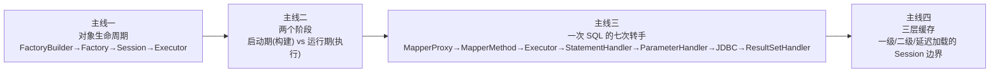
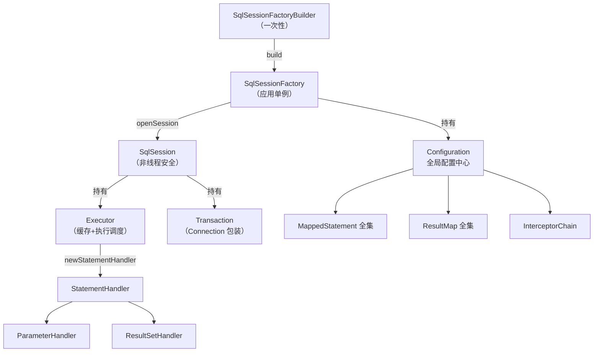
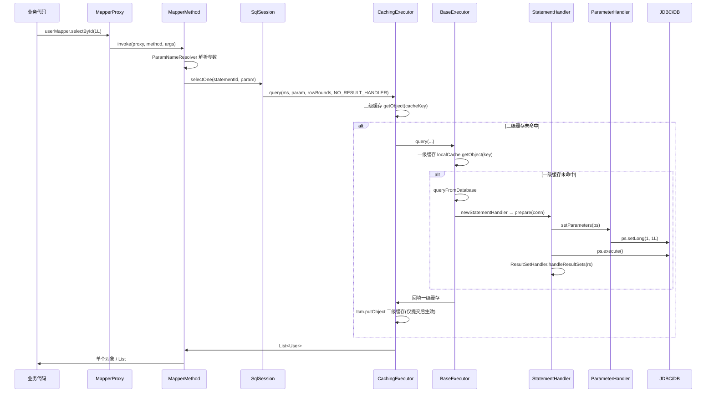
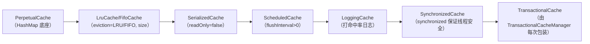
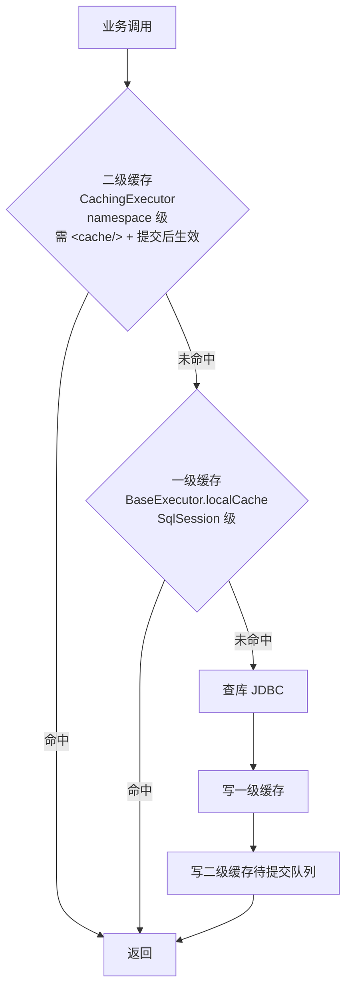
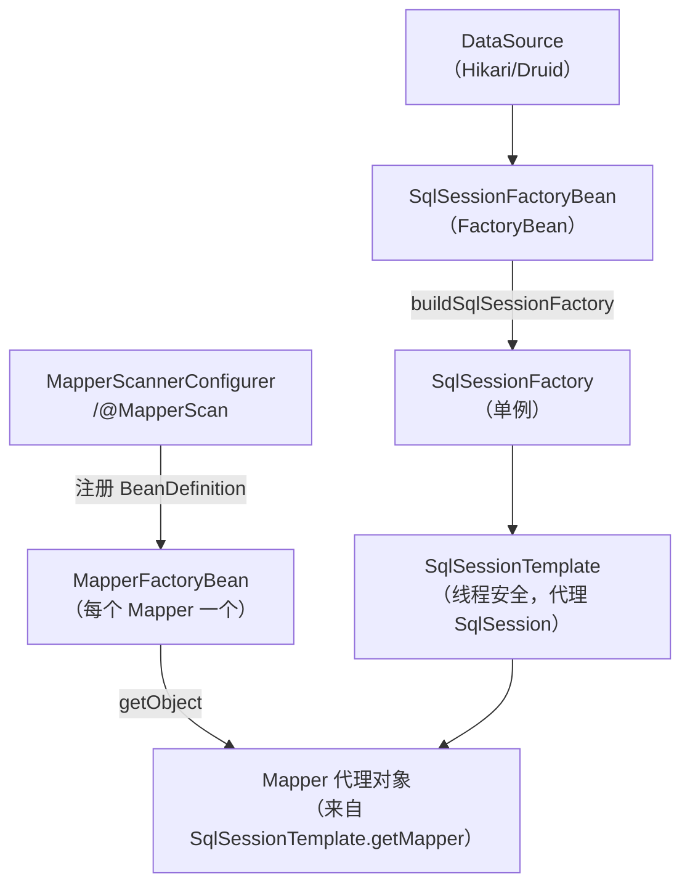
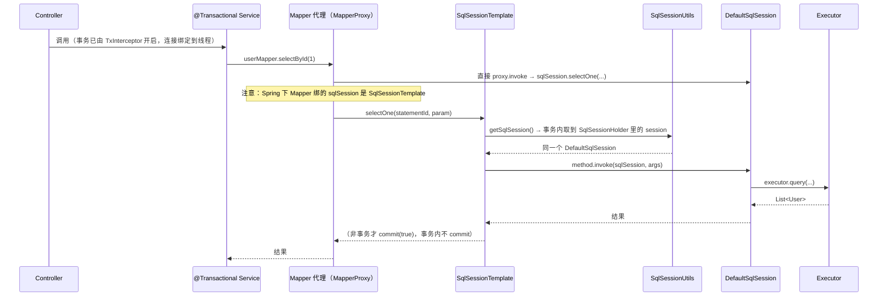
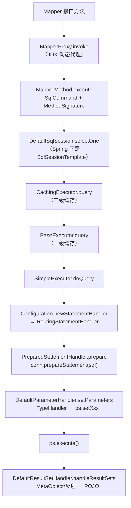

# MyBatis 底层原理与源码级深度笔记

> 版本基准：MyBatis 3.5.x（3.5.13 附近），Spring Boot 2.7/3.x + mybatis-spring 2.x/3.x，MyBatis-Plus 3.5.x。
> 文中出现的类名、方法名均可在 `org.apache.ibatis.*` 包下直接检索到，用于对照源码阅读。
> 全文标注体系：**【原理】**= 源码级事实；**【延伸】**= 关联知识；**【坑】**= 生产事故高发点；**【面试】**= 面试关联度。

---

## 目录

- [0. 阅读指南：用四条主线串起整个 MyBatis](#0-阅读指南用四条主线串起整个-mybatis)
- [1. 全局架构：MyBatis 到底替你做了什么](#1-全局架构mybatis-到底替你做了什么)
- [2. 启动阶段：配置如何变成 Configuration](#2-启动阶段配置如何变成-configuration)
- [3. 执行阶段：一次 Mapper 调用的完整链路](#3-执行阶段一次-mapper-调用的完整链路)
- [4. 最底层：真正落到 JDBC 的那一层](#4-最底层真正落到-jdbc-的那一层)
- [5. 缓存体系：CacheKey、一级缓存、二级缓存](#5-缓存体系cachekey一级缓存二级缓存)
- [6. `#{}` 与 `${}`：动态 SQL 与 OGNL](#6--与-动态-sql-与-ognl)
- [7. 参数处理与 TypeHandler](#7-参数处理与-typehandler)
- [8. 结果映射与延迟加载](#8-结果映射与延迟加载)
- [9. 分页：RowBounds 逻辑分页 vs 物理分页](#9-分页rowbounds-逻辑分页-vs-物理分页)
- [10. 插件体系：四大拦截对象与责任链](#10-插件体系四大拦截对象与责任链)
- [11. Spring 集成：SqlSessionTemplate 是关键](#11-spring-集成sqlsessiontemplate-是关键)
- [12. MyBatis-Plus 在 MyBatis 之上做了什么](#12-mybatis-plus-在-mybatis-之上做了什么)
- [13. 大厂面试题：分级详解](#13-大厂面试题分级详解)
- [14. 附录：源码阅读路线、常见坑清单、手写 Mini-MyBatis](#14-附录源码阅读路线常见坑清单手写-mini-mybatis)

---

## 0. 阅读指南：用四条主线串起整个 MyBatis

很多人读 MyBatis 源码读不下去，根因是**把它当成"一个解析 XML 的框架"**，于是一头扎进 `XMLConfigBuilder` 的细节里出不来。正确的读法是先建立四条主线，所有细节都往这四条线上挂。



**主线一：对象生命周期（谁活得长，谁必须单例）**

| 对象 | 生命周期 | 线程安全 | 说明 |
|---|---|---|---|
| `SqlSessionFactoryBuilder` | 方法级，用完即弃 | 是 | 只负责 build，build 完就没用了 |
| `SqlSessionFactory` | **应用级单例** | 是 | 持有整个 `Configuration`，构建代价极高 |
| `SqlSession` | 请求/事务级 | **否** | 包装一个 Connection + 一个 Executor |
| `Executor` | 跟随 SqlSession | 否 | 一级缓存的宿主 |
| `StatementHandler` | 单次 SQL 执行 | 否 | 每次 `doQuery/doUpdate` 都新建 |
| `MappedStatement` | **应用级**（启动时一次性创建） | 是（构建后只读） | 一条 SQL 的完整元数据 |

这张表是理解"为什么一级缓存会失效""为什么 Mapper 能并发调用"等一堆问题的钥匙。

**主线二：两个阶段**

- **启动期（Build Time）**：`SqlSessionFactoryBuilder.build()` → 解析 XML/注解 → 产出 `Configuration`（含 `MappedStatement` 全集、`ResultMap` 全集、`TypeHandlerRegistry`、`InterceptorChain`）。这一阶段把"字符串 SQL + 动态标签"编译成 `SqlSource`。
- **运行期（Runtime）**：`openSession()` → `getMapper()` → 代理调用 → `Executor` → `StatementHandler` → JDBC。这一阶段每次都要做：拼 `BoundSql`、算 `CacheKey`、查缓存、绑参数、执行、映射结果。

**关键认知**：`#{}` 与 `${}` 的区别、动态 SQL 的展开时机、`ResultMap` 的解析，**全都在启动期就决定了**；运行期只是按已编译好的结构"执行 + 填数据"。所以面试问"`#{}` 和 `${}` 区别"，答"预编译 vs 拼接"只是表层，能答到"在 `SqlSource` 构建阶段就分流"才是源码级。

**主线三：七次转手**

```
Mapper 接口方法
  └─① MapperProxy（JDK 动态代理）
      └─② MapperMethod（SqlCommand + MethodSignature）
          └─③ SqlSession（DefaultSqlSession / SqlSessionTemplate）
              └─④ Executor（CachingExecutor → SimpleExecutor）
                  └─⑤ StatementHandler（Routing → Prepared）
                      ├─⑥ ParameterHandler → TypeHandler → ps.setXxx()
                      └─⑦ ResultSetHandler → MetaObject/反射 → POJO
```

**主线四：Session 边界**

一级缓存挂在 `Executor`（即 `SqlSession`）上，二级缓存挂在 `MappedStatement` 的 `namespace` 上。所有"缓存为什么没生效"的问题，本质都是**问"这一刻的 SqlSession 是谁、是不是同一个、有没有被关掉"**。

---

## 1. 全局架构：MyBatis 到底替你做了什么

### 1.1 原生 JDBC 的五个痛点

```java
// 原生 JDBC 一次查询的真实工作量
Connection conn = null; PreparedStatement ps = null; ResultSet rs = null;
try {
    conn = dataSource.getConnection();
    ps = conn.prepareStatement("SELECT id,name,age FROM user WHERE id = ?");
    ps.setLong(1, id);
    rs = ps.executeQuery();
    User u = null;
    if (rs.next()) {
        u = new User();
        u.setId(rs.getLong("id"));
        u.setName(rs.getString("name"));   // 列名硬编码
        u.setAge(rs.getInt("age"));
    }
    return u;
} catch (SQLException e) {
    throw new RuntimeException(e);        // 异常语义弱
} finally {
    if (rs != null) try { rs.close(); } catch (SQLException ignored) {}
    if (ps != null) try { ps.close(); } catch (SQLException ignored) {}
    if (conn != null) try { conn.close(); } catch (SQLException ignored) {}
}
```

痛点归纳：

| 痛点 | 表现 | MyBatis 的解法 |
|---|---|---|
| ① 资源管理 | 三层 finally 嵌套，漏一个就连接泄漏 | `SqlSession` 统一 `close()`，内部层层委托关闭 |
| ② SQL 与代码耦合 | SQL 散落在 Java 字符串里，改一行要重新编译 | XML / 注解外置，启动期编译成 `MappedStatement` |
| ③ 参数映射 | 手写下标 `setLong(1, ...)`，加个字段全乱 | `#{}` + `ParameterMapping` + `TypeHandler` 自动绑定 |
| ④ 结果映射 | 手写 `rs.getXxx("列名")` | `ResultMap` + 自动映射（下划线转驼峰） |
| ⑤ 连接与事务 | 每次 `getConnection`，事务要手工管 | `Transaction` + `DataSource`（内置 `PooledDataSource`） |

**【延伸】MyBatis 不是"ORM"**
严格说 MyBatis 是 **"SQL Mapping Framework"**（半自动 ORM）：它管"SQL 到对象"的映射，不管"对象到表"的建模。JPA/Hibernate 是"全自动 ORM"，帮你生成 SQL，代价是不可控、复杂查询难优化。这就是国内互联网几乎全面选 MyBatis 的根本原因——**SQL 是可控资产，不是框架产物**。

### 1.2 三层架构

```
┌──────────────────────────────────────────────────────────┐
│ 接口层 API                                                │
│   SqlSession（selectOne/selectList/insert/update/delete） │
│   Mapper 接口（JDK 动态代理，面向业务）                     │
├──────────────────────────────────────────────────────────┤
│ 数据处理层 Core                                            │
│   参数处理 ParameterHandler → TypeHandler                  │
│   SQL 解析   SqlSource / SqlNode / DynamicContext          │
│   SQL 执行   Executor / StatementHandler                   │
│   结果映射   ResultSetHandler / ResultMap / MetaObject      │
├──────────────────────────────────────────────────────────┤
│ 基础支撑层 Foundation                                      │
│   缓存 Cache / CacheKey / TransactionalCache               │
│   反射 Reflector / MetaClass / MetaObject / ProxyFactory    │
│   类型 TypeHandlerRegistry / JdbcType                       │
│   日志 Log / LogFactory                                     │
│   资源 VFS / Resources / ClassLoaderWrapper                 │
│   数据源 DataSourceFactory（Unpooled/Pooled/JNDI）          │
│   事务 TransactionFactory（Jdbc/Managed/Spring）            │
│   插件 InterceptorChain / Plugin                            │
└──────────────────────────────────────────────────────────┘
```

### 1.3 四大核心对象（面试必须能画出来）



**`Configuration` 是 MyBatis 的"上帝对象"**：它同时是 8 个注册表的宿主。

```java
public class Configuration {
  protected Environment environment;
  protected boolean mapUnderscoreToCamelCase;
  protected boolean cacheEnabled = true;
  protected LocalCacheScope localCacheScope = LocalCacheScope.SESSION;
  protected ExecutorType defaultExecutorType = ExecutorType.SIMPLE;

  protected final TypeAliasRegistry typeAliasRegistry = new TypeAliasRegistry();
  protected final TypeHandlerRegistry typeHandlerRegistry = new TypeHandlerRegistry();
  protected final MapperRegistry mapperRegistry = new MapperRegistry(this);
  protected final Map<String, MappedStatement> mappedStatements = new StrictMap<>("Mapped Statements collection");
  protected final Map<String, ResultMap> resultMaps = new StrictMap<>("Result Maps collection");
  protected final Map<String, Cache> caches = new StrictMap<>("Caches collection");
  protected final InterceptorChain interceptorChain = new InterceptorChain();
  // ...
}
```

**【坑】`StrictMap` 的"近似匹配"**
`StrictMap.get()` 找不到精确 key 时会退化成"找唯一一个以 `key + "."` 开头的条目"，并在短 key 与全限定 key 冲突时抛异常 `Ambiguous collection`。这解释了为什么 `namespace` 写错（比如少个后缀）时，有时报"找不到 statement"，有时却能"歪打正着"跑起来——非常容易在生产上酿成"调用了别人的 SQL"的诡异 bug。

### 1.4 与同类框架的定位对比

| 维度 | MyBatis | Hibernate/JPA | Spring JdbcTemplate |
|---|---|---|---|
| SQL 控制权 | 完全手写，可精细调优 | 框架生成，需大量技巧干预 | 完全手写 |
| 对象映射 | 半自动（ResultMap + 自动映射） | 全自动（注解/元数据） | 手动 `RowMapper` |
| 学习成本 | 低（会 SQL 就会） | 高（脏检查、抓取策略、二级缓存） | 低 |
| 缓存能力 | 一级/二级（可插拔 Cache） | 一级/二级 + 查询缓存 | 无 |
| 动态 SQL | 内置 SqlNode 体系（最强） | 需 Criteria API | 无（手写拼接） |
| 大厂选型 | 主流（可审计、可优化） | 少（遗留系统多） | 报表/轻量场景 |
| 与分库分表 | 天然友好（ShardingSphere 可拦 SQL） | 困难 | 友好 |

**【面试】追问点**："既然 MyBatis 要手写 SQL，为什么不用 JPA？" 高分答案要落到**"SQL 的可观测性与可治理性"**：分库分表中间件（ShardingSphere）靠解析 SQL 做路由，而 Hibernate 生成的 SQL 形态不可控；DBA 审核、慢查询治理、索引优化都要求 SQL 是显式资产。

---

## 2. 启动阶段：配置如何变成 Configuration

这一阶段的目标只有一个：**把所有"字符串形态的 SQL"编译成"结构化的可执行对象"**。

### 2.1 入口链路

```java
// SqlSessionFactoryBuilder.build(InputStream)
public SqlSessionFactory build(InputStream inputStream, String environment, Properties properties) {
  try {
    XMLConfigBuilder parser = new XMLConfigBuilder(inputStream, environment, properties);
    return build(parser.parse());          // parser.parse() → Configuration
  } catch (Exception e) {
    throw ExceptionFactory.wrapException("Error building SqlSession.", e);
  } finally {
    ErrorContext.instance().reset();
    try { inputStream.close(); } catch (IOException e) { }
  }
}
```

`Configuration` 构建完成后，`build(Configuration)` 只是 `new DefaultSqlSessionFactory(config)` —— **极其廉价**，因为重活全在 `parse()` 里干完了。

```
mybatis-config.xml
  └─ XMLConfigBuilder.parse()
      ├─ parseConfiguration(root)
      │   ├─ properties        → variables（${} 在配置层的替换）
      │   ├─ settings          → Configuration 各字段
      │   ├─ typeAliases       → TypeAliasRegistry
      │   ├─ typeHandlers      → TypeHandlerRegistry
      │   ├─ plugins           → InterceptorChain.addInterceptor()
      │   ├─ environments      → Environment（DataSource + TransactionFactory）
      │   ├─ mappers           → XMLMapperBuilder / MapperAnnotationBuilder
      │   └─ ...
      └─ 得到完整 Configuration
```

**`settings` 中最影响行为的几个（面试常问"你配过哪些 settings"）**

| setting | 默认 | 影响 |
|---|---|---|
| `cacheEnabled` | true | 全局二级缓存开关（注意：只关二级，不关一级） |
| `localCacheScope` | SESSION | 一级缓存作用域；设为 `STATEMENT` 可缓解"会话内读到旧数据" |
| `mapUnderscoreToCamelCase` | false | 自动映射时 `user_name` → `userName` |
| `defaultExecutorType` | SIMPLE | 可全局切 BATCH |
| `defaultStatementTimeout` | null | JDBC 查询超时（秒） |
| `jdbcTypeForNull` | OTHER | 有些库（Oracle）对 null 类型敏感，需设 NULL |
| `lazyLoadingEnabled` | false | 全局延迟加载 |
| `aggressiveLazyLoading` | **false**（3.4.2+，早期为 true） | true 时"访问任一属性即加载全部懒加载属性" |
| `useGeneratedKeys` | false | 全局开启主键回填 |
| `logImpl` | 自动探测 | 决定 SQL 日志走 SLF4J/Log4j2 |

**【坑】`aggressiveLazyLoading` 的历史变更**
3.4.1 及以前默认 `true`，升级到 3.4.2+ 后默认 `false`。老项目升级后"延迟加载突然只加载单个字段"看似变好，但如果有代码依赖"触发一个属性就全量加载"的隐式行为，会出现 N+1 查询数量变化。这是典型的"框架默认值变更引发线上性能抖动"。

### 2.2 Mapper 接口与 XML 的绑定（重点）

这是启动期最核心、也最容易出错的一步。绑定关系**不靠文件名**，靠三样东西：

1. **`namespace` 必须等于 Mapper 接口的全限定名**；
2. **`MappedStatement.id` = `namespace + "." + 方法名`**；
3. **`MapperRegistry` 里登记 `接口全限定名 → MapperProxyFactory`**。

```java
// MapperRegistry.addMapper
public <T> void addMapper(Class<T> type) {
  if (type.isInterface()) {
    if (hasMapper(type)) throw new BindingException("Type " + type + " is already known to the MapperRegistry.");
    boolean loadCompleted = false;
    try {
      knownMappers.put(type, new MapperProxyFactory<>(type));
      // 关键：先注册接口，再去解析注解/XML
      MapperAnnotationBuilder parser = new MapperAnnotationBuilder(config, type);
      parser.parse();
      loadCompleted = true;
    } finally {
      if (!loadCompleted) knownMappers.remove(type);
    }
  }
}
```

`MapperProxyFactory` 只存了 `mapperInterface` 和 `Method → MapperMethod` 的缓存，`newInstance()` 时创建 `MapperProxy`：

```java
protected T newInstance(MapperProxy<T> mapperProxy) {
  return (T) Proxy.newProxyInstance(mapperInterface.getClassLoader(), new Class[]{mapperInterface}, mapperProxy);
}
```

**【原理】为什么必须是接口？**
因为实现方式是 **JDK 动态代理**，JDK 代理只能代理接口。这也是 MyBatis 与 JPA 的一个分水岭：MyBatis 的"Mapper"本质是"一个会被代理的接口 + 一份由 `MappedStatement` 描述的实现"。

### 2.3 `MappedStatement`：一条 SQL 的全部元数据

```java
public final class MappedStatement {
  private String resource;                 // 来源（xml 路径或注解类名）
  private Configuration configuration;     // 反向引用
  private String id;                       // namespace.methodName
  private SqlSource sqlSource;             // 【核心】SQL 的编译产物
  private StatementType statementType;     // STATEMENT / PREPARED / CALLABLE
  private SqlCommandType sqlCommandType;   // UNKNOWN/INSERT/UPDATE/DELETE/SELECT/FLUSH
  private ParameterMap parameterMap;       // 已废弃（强烈不建议用）
  private List<ResultMap> resultMaps;      // 结果映射
  private boolean flushCacheRequired;      // 执行前是否清缓存
  private boolean useCache;                // 是否走二级缓存
  private boolean resultOrdered;
  private KeyGenerator keyGenerator;       // 主键生成策略
  private String[] keyProperties; private String[] keyColumns;
  private boolean hasNestedResultMaps;
  private int fetchSize; private int timeout; private StatementType ...
  private Cache cache;                     // 该 namespace 的二级缓存
}
```

**易错点 1：`id` 冲突**
同一 `namespace` 下同名方法（**包括重载**）会产生相同 `id`：

```java
// Configuration.addMappedStatement
if (mappedStatements.containsKey(statement.getId())) {
  if (configuration.isSafeResultHandlerEnabled()) ...
  throw new IllegalArgumentException("Mapped Statements collection already contains value for " + statement.getId());
}
```

**【坑】** Mapper 接口**不支持方法重载**。`selectById(Long)` 与 `selectById(String)` 会直接启动失败（或互相覆盖）。这限制在很多团队里是靠"命名规范"（`selectById` / `selectByName`）规避的，而不是靠框架兜底。

**易错点 2：`namespace` 与 XML 文件名无关**
`mapper.xml` 叫 `UserMapper.xml` 但 `namespace` 写成 `com.xx.UserDao` → 接口 `UserMapper` 拿不到 statement，运行时报：

```
Invalid bound statement (not found): com.xx.UserMapper.selectById
```

这是 MyBatis 第一大报错，排查顺序应为：`namespace` → 方法名 → XML 是否被扫描到（`mapper-locations`）→ XML 与接口是否在同一 classpath 输出目录 → `target/classes` 里 XML 是否存在（Maven resources 未配置）。

### 2.4 `SqlSource`：`#{}` 与 `${}` 在这里分道扬镳

`SqlSource` 只有一个方法：

```java
public interface SqlSource {
  BoundSql getBoundSql(Object parameterObject);
}
```

它的三个实现决定了三种完全不同的 SQL 形态：

| 实现 | 何时产生 | `getBoundSql` 行为 | `#{}` 处理 | `${}` 处理 |
|---|---|---|---|---|
| `DynamicSqlSource` | SQL 里含 `<if>/<foreach>/<where>` 等动态标签，**或含 `${}`** | 每次执行时遍历 `SqlNode` 树生成 SQL，再二次解析 `#{}` | 转 `?` 并生成 `ParameterMapping` | **直接字符串替换**（有注入风险） |
| `RawSqlSource` | 纯静态 SQL，不含动态标签和 `${}` | 构造时已解析好，`getBoundSql` 只做参数填充 | 构建期已转 `?` | 不涉及 |
| `StaticSqlSource` | 最终产物 | 持有最终 SQL 字符串 + `ParameterMapping` 列表 | — | — |

关键在 `XMLScriptBuilder`（动态标签）与 `SqlSourceBuilder`（`#{}` → `?`）：

```java
// SqlSourceBuilder — 把 "...#{id,jdbcType=BIGINT}..." 转成 "...?..." 并生成 ParameterMapping
public SqlSource parse(String originalSql, Class<?> parameterType, Map<String, Object> additionalParameters) {
  ParameterMappingTokenHandler handler = new ParameterMappingTokenHandler(configuration, parameterType, additionalParameters);
  GenericTokenParser parser = new GenericTokenParser("#{", "}", handler);
  String sql = parser.parse(originalSql);
  return new StaticSqlSource(configuration, sql, handler.getParameterMappings());
}
```

`ParameterMappingTokenHandler.handleToken(content)` 解析的正是花括号里的"属性表达式"：

```
#{property, javaType=int, jdbcType=NUMERIC, typeHandler=XxxHandler, numericScale=2, mode=OUT, resultMap=xxx}
        ↑必填            ↑可选（其余全部可选）
```

**【原理】`${}` 的处理位置**
在 `DynamicSqlSource` 内部，`${}` 由 `TextSqlNode` 完成：

```java
// TextSqlNode.apply
public boolean apply(DynamicContext context) {
  GenericTokenParser parser = createParser(new BindingTokenParser(context, injectionFilter));
  context.appendSql(parser.parse(text));
  return true;
}
// BindingTokenParser.handleToken → context.getBindings().get(property) → 原样拼进 SQL
```

所以 `${}` 的替换发生在**运行期的字符串拼接**，而 `#{}` 的替换发生在**启动期的占位符编译**。这是二者安全差异的源码依据。

**【延伸】`GenericTokenParser` 是 MyBatis 里被复用最多的工具类**
三个地方都用它：`XMLMapperEntityResolver`（找 DOCTYPE）、`SqlSourceBuilder`（`#{}`）、`TextSqlNode`（`${}`）。它处理了转义 `\#{}` 等边界情况，也是"为什么我在 SQL 里写 `#{a} and #{b}` 能正确识别"的原因。

### 2.5 动态 SQL 的编译：`SqlNode` 组合树

动态 SQL 不是"运行时字符串模板"，而是**在启动期编译成一颗 `SqlNode` 树，运行期遍历这棵树往 `DynamicContext` 里 append SQL 片段**。

```java
public interface SqlNode {
  boolean apply(DynamicContext context);   // 返回 true 表示"产生有效内容"
}
```

| `SqlNode` 实现 | 对应标签 | 核心逻辑 |
|---|---|---|
| `MixedSqlNode` | 所有子节点的容器 | 依次 `apply`，是整棵树的根 |
| `IfSqlNode` | `<if test="">` | `ExpressionEvaluator.evaluateBoolean(test, bindings)` 为 true 才 apply |
| `ChooseSqlNode` | `<choose><when><otherwise>` | 顺序找第一个成立的分支 |
| `ForEachSqlNode` | `<foreach>` | 遍历集合，**给每个元素生成新的变量名**（`__frch_item_0`） |
| `TrimSqlNode` | `<trim>` / `<where>` / `<set>` | 先 apply 子节点到缓冲，再对首尾做前后缀裁剪 |
| `WhereSqlNode` | `<where>` | `TrimSqlNode` 子类：前缀 `WHERE`，去掉多余的 `AND/OR` |
| `SetSqlNode` | `<set>` | `TrimSqlNode` 子类：前缀 `SET`，去掉多余的 `,` |
| `VarDeclSqlNode` | `<bind>` | 把一个 OGNL 结果塞进 bindings |
| `StaticTextSqlNode` | 纯文本 | 直接 append |
| `TextSqlNode` | 含 `${}` 的文本 | 见上，做 `${}` 替换 |

**【原理】`ForEachSqlNode` 的变量命名是面试高频细节**
`<foreach collection="ids" item="id" index="i">#{id}</foreach>` 里，`#{id}` 会被替换成 `#{__frch_id_0}`、`#{__frch_id_1}`…… 同时向 `additionalParameters` 里放入 `__frch_id_0 → ids[0]` 的值。

两个后果：
1. **`<foreach>` 里不能用 `#{}` 之外的写法做下标运算**，只能靠 `index`；
2. **`additionalParameters` 是 `BoundSql` 的成员**，所以 `BoundSql` 才是"一次执行期最终 SQL + 参数"的载体。

**【坑】`<foreach>` 的 `collection` 属性**
- 参数是 `List` → 固定写 `list`（或 `@Param` 后的名字）；
- 参数是数组 → 固定写 `array`；
- 参数是 `Map` → 写 map 的 key；
- 单参数且是集合且**没加 `@Param`** → MyBatis 会把它包成 `{collection: xx, list: xx}`，两种名字都能用（见 3.3 节 `ParamNameResolver`）。

写成 `collection="ids"` 但方法是 `selectByIds(List<Long> ids)` 且无 `@Param` → 报：

```
Parameter 'ids' not found. Available parameters are [collection, list]
```

这是 MyBatis 第二大报错。

### 2.6 `BoundSql`：执行期的"最终 SQL 载体"

```java
public class BoundSql {
  private final String sql;                                  // 已含 ? 的最终 SQL
  private final List<ParameterMapping> parameterMappings;    // ? 与参数的对应关系
  private final Object parameterObject;                      // 原始入参
  private final Map<String, Object> additionalParameters;    // foreach/bind 产生的额外变量
  private final MetaObject metaParameters;                   // additionalParameters 的元对象
}
```

`DynamicSqlSource.getBoundSql` 的完整逻辑：

```java
public BoundSql getBoundSql(Object parameterObject) {
  DynamicContext context = new DynamicContext(configuration, parameterObject);
  rootSqlNode.apply(context);                          // ① 遍历 SqlNode 树 → 得到含 #{} 和已替换 ${} 的 SQL
  SqlSourceBuilder sqlSourceParser = new SqlSourceBuilder(configuration);
  Class<?> parameterType = parameterObject == null ? Object.class : parameterObject.getClass();
  SqlSource sqlSource = sqlSourceParser.parse(context.getSql(), parameterType, context.getBindings());  // ② #{} → ?
  BoundSql boundSql = sqlSource.getBoundSql(parameterObject);
  context.getBindings().forEach(boundSql::setAdditionalParameter);   // ③ foreach 变量迁入 BoundSql
  return boundSql;
}
```

**【原理】为什么动态 SQL 每次执行都要重新构建 `BoundSql`？**
因为 `<if>` 的成立条件依赖运行时参数。同一 `MappedStatement`，参数不同 → SQL 形态可能不同（可能多一个 `AND xxx=?`）。所以 `BoundSql` **不是线程安全的、不能跨请求复用**，每次执行都必须新建。这也是 `DynamicSqlSource` 下 `CacheKey` 必须用"最终 SQL 字符串"参与计算的原因。

**【延伸】`RawSqlSource` 的优化**
无动态标签时，`XMLScriptBuilder.parseScriptNode()` 会走 `parseDynamicTags`，若发现全是 `StaticTextSqlNode`，直接 `new RawSqlSource(configuration, sql, parameterType)` —— 字符串在**构造时**就被 `SqlSourceBuilder` 解析成 `StaticSqlSource`，运行期只是 `new BoundSql()` 拷贝。这就是"能用静态 SQL 就别用动态标签"的性能依据：**每少一次 `SqlNode` 遍历 + `GenericTokenParser` 扫描，就省下一次字符串处理开销**。在 QPS 上万的服务里，这是可测量的差异。

### 2.7 启动期装配插件链

```java
// XMLConfigBuilder.pluginElement
private void pluginElement(XNode parent) throws Exception {
  if (parent != null) {
    for (XNode child : parent.getChildren()) {
      String interceptor = child.getStringAttribute("interceptor");
      Properties properties = child.getChildrenAsProperties();
      Interceptor interceptorInstance = (Interceptor) resolveClass(interceptor).getDeclaredConstructor().newInstance();
      interceptorInstance.setProperties(properties);
      configuration.addInterceptor(interceptorInstance);   // → InterceptorChain
    }
  }
}
```

此时只是"登记"，真正包装发生在 `newExecutor/newStatementHandler/...` 时（见第 10 节）。

### 2.8 启动期产出物清单（一张表记住）

| 产出 | 位置 | 谁在用 |
|---|---|---|
| `MappedStatement` 全集 | `Configuration.mappedStatements` | `MapperMethod` 执行时按 id 取 |
| `ResultMap` 全集 | `Configuration.resultMaps` | `ResultSetHandler` |
| `MapperProxyFactory` | `Configuration.mapperRegistry` | `getMapper` |
| `TypeHandler` 注册表 | `TypeHandlerRegistry` | `ParameterHandler` / `ResultSetHandler` |
| `Interceptor` 链 | `InterceptorChain` | `pluginAll` |
| `Environment`（DataSource + TransactionFactory） | `Configuration.environment` | `openSession` |
| `Cache`（二级缓存实例） | `MappedStatement.cache` 与 `Configuration.caches` | `CachingExecutor` |

**【面试】"MyBatis 启动慢在哪？"**
答：**XML 解析 + `SqlSource` 编译 + `TypeHandler` 注册 + `VFS` 扫描 jar 内资源**。大项目里 `mapperLocations` 配成 `classpath*:**/*Mapper.xml` 时，`VFS` 要遍历所有 jar（`DefaultVFS` 对每个 jar 做解压式枚举），启动耗时能到秒级。优化手段：收敛通配符范围、用 `@MapperScan` 精确到包、排除无用 jar。

---
## 3. 执行阶段：一次 Mapper 调用的完整链路

这一节回答你问的"**操作底层是什么逻辑**"。先给一张时序图，后面逐段拆。



### 3.1 `MapperProxy`：接口为什么能直接调用

```java
public class MapperProxy<T> implements InvocationHandler, Serializable {
  private final SqlSession sqlSession;
  private final Class<T> mapperInterface;
  private final Map<Method, MapperMethodInvoker> methodCache;   // ConcurrentHashMap

  @Override
  public Object invoke(Object proxy, Method method, Object[] args) throws Throwable {
    try {
      if (Object.class.equals(method.getDeclaringClass())) {
        return method.invoke(this, args);              // toString/hashCode/equals 走原生
      }
      return cachedInvoker(method).invoke(proxy, method, args, sqlSession);
    } catch (Throwable t) {
      throw ExceptionUtil.unwrapThrowable(t);          // 拆掉 InvocationTargetException 包装
    }
  }

  private MapperMethodInvoker cachedInvoker(Method method) {
    return methodCache.computeIfAbsent(method, m -> {
      if (m.isDefault()) {                             // ① 接口 default 方法
        return new DefaultMethodInvoker(getMethodHandleJava9(m));
      } else {                                          // ② 普通抽象方法
        return new PlainMethodInvoker(new MapperMethod(mapperInterface, method, sqlSession.getConfiguration()));
      }
    });
  }
}
```

三个细节常被追问：

1. **`MapperMethod` 被缓存**（`methodCache` 是 `ConcurrentHashMap`）。所以 `MapperMethod` 的构建（含 `ParamNameResolver`）只在**第一次调用该方法**时发生一次，后续零开销。这也是"Mapper 代理对象可以放心每次 `getMapper` 重新拿"的依据——真正的重活被缓存了。
2. **`Object` 方法走原生实现**，否则 `toString()` 会去查 `MappedStatement` 直接报错。
3. **`default` 方法走 `MethodHandles`**，不经过 MyBatis，所以在 Mapper 接口里写 `default` 方法做参数校验是安全的。

### 3.2 `MapperMethod`：一次调用的"调度中枢"

```java
public class MapperMethod {
  private final SqlCommand command;          // 【是谁】statementId + 命令类型
  private final MethodSignature method;      // 【怎么调】返回类型 + 参数解析器

  public Object execute(SqlSession sqlSession, Object[] args) {
    Object result;
    switch (command.getType()) {
      case INSERT: {
        Object param = method.convertArgsToSqlCommandParam(args);
        result = rowCountResult(sqlSession.insert(command.getName(), param));
        break;
      }
      case UPDATE: { ... sqlSession.update ... }
      case DELETE: { ... sqlSession.delete ... }
      case SELECT:
        if (method.returnsVoid() && method.hasResultHandler()) {
          executeWithResultHandler(sqlSession, args);          // 流式处理，不返回 List
          result = null;
        } else if (method.returnsMany()) {
          result = executeForMany(sqlSession, args);            // List / 数组 / Collection
        } else if (method.returnsMap()) {
          result = executeForMap(sqlSession, args);             // @MapKey 场景
        } else if (method.returnsCursor()) {
          result = executeForCursor(sqlSession, args);          // Cursor<T> 流式游标
        } else {
          Object param = method.convertArgsToSqlCommandParam(args);
          result = sqlSession.selectOne(command.getName(), param);   // 单对象
          if (method.returnsOptional() && (result == null || !method.getReturnType().equals(result.getClass()))) {
            result = Optional.ofNullable(result);
          }
        }
        break;
      case FLUSH: result = sqlSession.flushStatements(); break;
      default: throw new BindingException("Unknown execution method for: " + command.getName());
    }
    if (result == null && method.getReturnType().isPrimitive() && !method.returnsVoid()) {
      throw new BindingException("Mapper method '" + command.getName() + "' attempted to return null from a method with a primitive return type (" + method.getReturnType() + ").");
    }
    return result;
  }
}
```

**【坑】返回 `int` 但 update 影响 0 行**
如果 Mapper 方法声明 `int updateXxx(...)`，正常返回 0 不会报错；但如果声明 `Integer`/`int` 且 `sqlSession.update` 返回 `null`（比如某些 `BATCH` 场景），就会命中上面那个 `BindingException`。这是 BATCH 模式下的经典坑。

`SqlCommand` 的构造是"绑定校验点"：

```java
public SqlCommand(Configuration configuration, Class<?> mapperInterface, Method method) {
  final String methodName = method.getName();
  final Class<?> declaringClass = method.getDeclaringClass();
  MappedStatement ms = resolveMappedStatement(mapperInterface, methodName, declaringClass, configuration);
  if (ms == null) {
    if (method.getAnnotation(Flush.class) != null) { name = null; type = SqlCommandType.FLUSH; }
    else throw new BindingException("Invalid bound statement (not found): " + mapperInterface.getName() + "." + methodName);
  } else {
    name = ms.getId();
    type = ms.getSqlCommandType();
    if (type == SqlCommandType.UNKNOWN) throw new BindingException("Unknown execution method for: " + name);
  }
}
```

`resolveMappedStatement` 里会向上找父接口（`declaringClass.isInterface()` 递归），这是"Mapper 接口继承"能用的原因：

```java
private MappedStatement resolveMappedStatement(Class<?> mapperInterface, String methodName, Class<?> declaringClass, Configuration configuration) {
  String statementId = mapperInterface.getName() + "." + methodName;
  if (configuration.hasStatement(statementId)) {
    return configuration.getMappedStatement(statementId);
  } else if (mapperInterface.equals(declaringClass)) {
    return null;
  }
  for (Class<?> superInterface : mapperInterface.getInterfaces()) {     // 递归父接口
    if (declaringClass.isAssignableFrom(superInterface)) {
      MappedStatement ms = resolveMappedStatement(superInterface, methodName, declaringClass, configuration);
      if (ms != null) return ms;
    }
  }
  return null;
}
```

**【延伸】"通用 Mapper / BaseMapper"能工作的机制就是这个**
MyBatis-Plus 的 `BaseMapper<T>` 里的 `selectById`，其 `MappedStatement` 是在启动期由 MP 动态注入的（id 用的是具体 Mapper 接口名 + `selectById`），所以 `resolveMappedStatement` 在具体接口上就能命中。这也解释了为什么"泛型 Mapper 必须被扫描到"——没有被 `addMapper` 的接口，不会有注入的 statement。

`MethodSignature` 负责"返回类型"的判定：

```java
public MethodSignature(Configuration configuration, Class<?> mapperInterface, Method method) {
  Type resolvedReturnType = TypeParameterResolver.resolveReturnType(method, mapperInterface);
  ...
  this.returnsMany = method.getReturnType().isArray() || Collection.class.isAssignableFrom(method.getReturnType());
  this.returnsMap = Map.class.isAssignableFrom(method.getReturnType());
  this.returnsCursor = Cursor.class.isAssignableFrom(method.getReturnType());
  this.returnsOptional = Optional.class.equals(method.getReturnType());
  this.mapKey = getMapKey(method);            // @MapKey("id")
  this.resultHandlerType = getResultHandlerType(method);   // 找 ResultHandler 参数
  this.paramNameResolver = new ParamNameResolver(configuration, method);
}
```

**【原理】`TypeParameterResolver`**
MyBatis 自己实现了一个泛型解析器（`org.apache.ibatis.reflection.TypeParameterResolver`），处理 `List<User>`、`Map<String, User>` 这种嵌套泛型。它不依赖 Spring 的 `GenericTypeResolver`，是为了让 MyBatis 在纯 Java 环境（非 Spring）可用。这就是"返回 `List<User>` 时能正确映射成 `User`"而不是"返回 `Map`"的原因之一（另一个是 `ResultMap` 的 `type`）。

### 3.3 `ParamNameResolver`：参数解析的全部规则（坑最多的一节）

```java
public ParamNameResolver(Configuration config, Method method) {
  final Class<?>[] paramTypes = method.getParameterTypes();
  final Annotation[][] paramAnnotations = method.getParameterAnnotations();
  final SortedMap<Integer, String> map = new TreeMap<>();
  int paramCount = paramAnnotations.length;
  for (int paramIndex = 0; paramIndex < paramCount; paramIndex++) {
    if (isSpecialParameter(paramTypes[paramIndex])) continue;   // RowBounds / ResultHandler 跳过
    String name = null;
    for (Annotation annotation : paramAnnotations[paramIndex]) {
      if (annotation instanceof Param) { hasParamAnnotation = true; name = ((Param) annotation).value(); break; }
    }
    if (name == null) {
      if (useActualParamName) {                                 // 前提：编译带 -parameters
        name = getActualParamName(method, paramIndex);
      }
      if (name == null) name = String.valueOf(map.size());      // 无 -parameters 时退化为 "0"/"1"
    }
    map.put(paramIndex, name);
  }
  names = Collections.unmodifiableSortedMap(map);
}
```

判断链条（**背下来，面试必考**）：

| 参数形态 | `getNamedParams` 返回 | SQL 里能用的名字 |
|---|---|---|
| **0 个参数** | `null` | 无 |
| **1 个参数 + 无 `@Param`** 且非集合/数组 | **原始对象本身**（`User`/`Long`/`Map`） | `#{任意属性名}`，`Map` 则 `#{key}` |
| **1 个参数 + 无 `@Param`** 且是 `Collection` | `ParamMap{collection=原对象, list=原对象, 实际参数名=原对象}` | `collection` / `list` / 实际参数名 |
| **1 个参数 + 无 `@Param`** 且是数组 | `ParamMap{array=原对象, 实际参数名=原对象}` | `array` / 实际参数名 |
| **1 个参数 + `@Param("u")`** | `ParamMap{u=原对象, param1=原对象}` | `u` / `param1` |
| **多参数** | `ParamMap{名字=值..., param1..N}` | `@Param` 名 / `param1`..`paramN` / `arg0`..`argN-1` |

```java
public Object getNamedParams(Object[] args) {
  final int paramCount = names.size();
  if (args == null || paramCount == 0) {
    return null;
  } else if (!hasParamAnnotation && paramCount == 1) {
    Object value = args[names.firstKey()];
    return wrapToMapIfCollection(value, useActualParamName ? names.get(names.firstKey()) : null);
  } else {
    final Map<String, Object> param = new ParamMap<>();
    int i = 0;
    for (Map.Entry<Integer, String> entry : names.entrySet()) {
      param.put(entry.getValue(), args[entry.getKey()]);
      final String genericParamName = GENERIC_NAME_PREFIX + (i + 1);     // "param1"
      if (!names.containsValue(genericParamName)) {
        param.put(genericParamName, args[entry.getKey()]);              // 兜底：param1/param2
      }
      i++;
    }
    return param;
  }
}
```

**【坑】`useActualParamName` 与编译参数**
- `useActualParamName` 默认 `true`，但它依赖 `Method.getParameters()` 能拿到真实名，即编译时加 `-parameters`（Maven：`<compilerArgs><arg>-parameters</arg></compilerArgs>`）。Spring Boot 的 `spring-boot-maven-plugin` 默认不传 `-parameters`，但 `spring-boot-starter-parent` 在 2.x 里通过 `maven-compiler-plugin` 的 `<parameters>true</parameters>` 开启了——**这是 Spring Boot 项目与纯 Maven 项目行为不一致的常见原因**。
- 没有 `-parameters` 时参数名退化成 `"0"/"1"`，而 `arg0/arg1` 是另一套（`ParamNameResolver` 在 3.4.x 后不再生成 `arg0`，只在 `ParamMap` 的父类 `StrictMap` 里……实际上 `arg0` 来自 JDK 反射对无参数名方法的默认命名）。**结论：生产代码一律显式加 `@Param`，不要赌编译参数。**

**【延伸】`ParamMap` 的"严格取值"**
`ParamMap` 继承 `HashMap` 并重写 `get`：key 不存在时抛 `BindingException("Parameter 'xxx' not found. Available parameters are [...]")`。这就是那句著名报错的出处——它把"可用参数名"直接列出来，是排查参数问题最快的线索。

### 3.4 `openSession` 与 `Executor` 的创建

```java
private SqlSession openSessionFromDataSource(ExecutorType execType, TransactionIsolationLevel level, boolean autoCommit) {
  Transaction tx = null;
  try {
    final Environment environment = configuration.getEnvironment();
    final TransactionFactory transactionFactory = getTransactionFactoryFromEnvironment(environment);
    tx = transactionFactory.newTransaction(environment.getDataSource(), level, autoCommit);
    final Executor executor = configuration.newExecutor(tx, execType);
    return new DefaultSqlSession(configuration, executor, autoCommit);
  } catch (Exception e) {
    closeTransaction(tx);
    throw ExceptionFactory.wrapException("Error opening session.  Cause: " + e, e);
  } finally {
    ErrorContext.instance().reset();
  }
}
```

```java
// Configuration.newExecutor —— 包装顺序：原始 Executor → 二级缓存 → 插件
public Executor newExecutor(Transaction transaction, ExecutorType executorType) {
  executorType = executorType == null ? defaultExecutorType : executorType;
  executorType = executorType == null ? ExecutorType.SIMPLE : executorType;
  Executor executor;
  if (ExecutorType.BATCH == executorType) {
    executor = new BatchExecutor(this, transaction);
  } else if (ExecutorType.REUSE == executorType) {
    executor = new ReuseExecutor(this, transaction);
  } else {
    executor = new SimpleExecutor(this, transaction);
  }
  if (cacheEnabled) {
    executor = new CachingExecutor(executor);          // 【关键】二级缓存是 Executor 装饰者
  }
  executor = (Executor) interceptorChain.pluginAll(executor);   // 插件最后包
  return executor;
}
```

**【原理】装饰顺序决定了插件的拦截点**
最终对象图：

```
Plugin(Interceptor_n)
  └─ ... 
      └─ Plugin(Interceptor_1)
          └─ CachingExecutor
              └─ SimpleExecutor（内含 localCache = PerpetualCache）
```

所以：
- 插件拦 `Executor.query` 时，**在执行二级缓存之前**（因为 Plugin 在 CachingExecutor 外层）。PageHelper 正是靠这一点，在二级缓存之前把 SQL 改写成带 `LIMIT` 的 SQL——否则二级缓存的 key 会是"未分页的 SQL"，导致分页错乱。
- 而 `StatementHandler` 是在 `SimpleExecutor.doQuery` 内部新建的，所以拦 `StatementHandler.prepare` 拿到的是"参数已解析、SQL 已 BoundSql"的最接近 JDBC 的时机。

**【面试】"四大可拦截对象，拦截顺序？"**
`Executor`（最外层，可改 SQL/缓存）→ `StatementHandler`（可改 SQL 与 Statement 行为）→ `ParameterHandler`（可改参数）→ `ResultSetHandler`（可改结果）。四者在调用链上是**串联**的，不是并列的。

### 3.5 `query` 主流程：三层缓存 + 一次真正查询

```java
// ① CachingExecutor：二级缓存
public <E> List<E> query(MappedStatement ms, Object parameterObject, RowBounds rowBounds,
                         ResultHandler resultHandler, CacheKey key, BoundSql boundSql) throws SQLException {
  Cache cache = ms.getCache();
  if (cache != null) {
    flushCacheIfRequired(ms);                         // insert/update/delete 默认 flushCache=true
    if (ms.isUseCache() && resultHandler == null) {   // select 默认 useCache=true
      ensureNoOutParams(ms, boundSql);                // 存储过程 OUT 参数不允许走二级缓存
      List<E> list = (List<E>) tcm.getObject(cache, key);
      if (list == null) {
        list = delegate.query(ms, parameterObject, rowBounds, resultHandler, key, boundSql);
        tcm.putObject(cache, key, list);              // 注意：只是"待提交队列"
      }
      return list;
    }
  }
  return delegate.query(ms, parameterObject, rowBounds, resultHandler, key, boundSql);
}
```

```java
// ② BaseExecutor：一级缓存
public <E> List<E> query(MappedStatement ms, Object parameter, RowBounds rowBounds,
                         ResultHandler resultHandler, CacheKey key, BoundSql boundSql) throws SQLException {
  if (closed) throw new ExecutorException("Executor was closed.");
  if (queryStack == 0 && ms.isFlushCacheRequired()) {
    clearLocalCache();                                // 嵌套查询时不重复清
  }
  List<E> list;
  try {
    queryStack++;
    list = resultHandler == null ? (List<E>) localCache.getObject(key) : null;
    if (list != null) {
      handleLocallyCachedOutputParameters(ms, key, parameter, boundSql);
    } else {
      list = queryFromDatabase(ms, parameter, rowBounds, resultHandler, key, boundSql);
    }
  } finally {
    queryStack--;
  }
  if (queryStack == 0) {
    for (DeferredLoad deferredLoad : deferredLoads) { deferredLoad.load(); }
    deferredLoads.clear();
    if (configuration.getLocalCacheScope() == LocalCacheScope.STATEMENT) {
      clearLocalCache();                              // STATEMENT 级：查完就清
    }
  }
  return list;
}
```

```java
// ③ queryFromDatabase：占位符防"嵌套查询击穿缓存"
private <E> List<E> queryFromDatabase(MappedStatement ms, Object parameter, RowBounds rowBounds,
                                      ResultHandler resultHandler, CacheKey key, BoundSql boundSql) throws SQLException {
  List<E> list;
  localCache.putObject(key, EXECUTION_PLACEHOLDER);   // 先占位，避免递归查询重复查库
  try {
    list = doQuery(ms, parameter, rowBounds, resultHandler, boundSql);
  } finally {
    localCache.removeObject(key);
  }
  localCache.putObject(key, list);                    // 再放真实结果
  if (ms.getStatementType() == StatementType.CALLABLE) {
    localOutputParameterCache.putObject(key, parameter);
  }
  return list;
}
```

**【原理】`EXECUTION_PLACEHOLDER` 的意义**
嵌套查询（`association` 的 `select` 属性）里，外层查询执行到一半会递归调用内层查询。如果内层恰好与外层同一条 SQL（循环引用），没有占位符就会无限递归。占位符的作用是"标记这个 key 正在被计算"，但由于 `localCache.getObject` 返回占位符时 `list != null` 会被当成命中——实际上这里靠的是 `queryStack` 与 `CacheKey` 不同来避免，占位符主要是"防止结果被提前误命中"。这段在面试里是"你读过 `BaseExecutor` 吗"的鉴别点。

```java
// ④ SimpleExecutor.doQuery：真正落地
public <E> List<E> doQuery(MappedStatement ms, Object parameter, RowBounds rowBounds,
                           ResultHandler resultHandler, BoundSql boundSql) throws SQLException {
  Statement stmt = null;
  try {
    Configuration configuration = ms.getConfiguration();
    StatementHandler handler = configuration.newStatementHandler(             // 【关键】
        wrapper, ms, parameter, rowBounds, resultHandler, boundSql);
    stmt = prepareStatement(handler, ms.getStatementLog());
    return handler.query(stmt, resultHandler);
  } finally {
    closeStatement(stmt);
  }
}

private Statement prepareStatement(StatementHandler handler, Log statementLog) throws SQLException {
  Statement stmt;
  Connection connection = getConnection(statementLog);                        // 懒获取
  stmt = handler.prepare(connection, transaction.getTimeout());               // 创建/复用 Statement
  handler.parameterize(stmt);                                                 // 绑参数
  return stmt;
}
```

### 3.6 `StatementHandler`：三个实现与"谁在拼 SQL"

`RoutingStatementHandler` 只是按 `ms.getStatementType()` 转发：

```java
public RoutingStatementHandler(Executor executor, MappedStatement ms, Object parameter, RowBounds rowBounds,
                               ResultHandler resultHandler, BoundSql boundSql) {
  switch (ms.getStatementType()) {
    case STATEMENT: delegate = new SimpleStatementHandler(executor, ms, parameter, rowBounds, resultHandler, boundSql); break;
    case PREPARED:  delegate = new PreparedStatementHandler(executor, ms, parameter, rowBounds, resultHandler, boundSql); break;
    case CALLABLE:  delegate = new CallableStatementHandler(executor, ms, parameter, rowBounds, resultHandler, boundSql); break;
    default: throw new ExecutorException("Unknown statement type: " + ms.getStatementType());
  }
}
```

| 实现 | JDBC 对象 | 参数怎么进去 | 适用 |
|---|---|---|---|
| `SimpleStatementHandler` | `Statement` | `parameterize()` **空实现**，参数必须已拼进 SQL（即只能用 `${}`） | 极少用，危险 |
| `PreparedStatementHandler` | `PreparedStatement` | `parameterHandler.setParameters(ps)` | **默认，99% 场景** |
| `CallableStatementHandler` | `CallableStatement` | 参数 + `registerOutParameter` | 存储过程 |

```java
// BaseStatementHandler 构造函数：所有 Handler 的公共装配
protected BaseStatementHandler(Executor executor, MappedStatement mappedStatement, Object parameterObject,
                               RowBounds rowBounds, ResultHandler resultHandler, BoundSql boundSql) {
  this.configuration = mappedStatement.getConfiguration();
  this.executor = executor;
  this.mappedStatement = mappedStatement;
  this.rowBounds = rowBounds;
  this.typeHandlerRegistry = configuration.getTypeHandlerRegistry();
  this.objectFactory = configuration.getObjectFactory();
  if (boundSql == null) {
    generateKeys(parameterObject);                              // 触发 SelectKey BEFORE
    boundSql = mappedStatement.getBoundSql(parameterObject);    // 动态 SQL 在这里才真正展开
  }
  this.boundSql = boundSql;
  this.parameterHandler = configuration.newParameterHandler(mappedStatement, parameterObject, boundSql);
  this.resultSetHandler = configuration.newResultSetHandler(executor, mappedStatement, rowBounds, parameterHandler, resultHandler, boundSql);
}
```

**【原理】`boundSql == null` 的意义**
`selectList` 走 `Executor.query` 时传 `boundSql = null`，由 `BaseStatementHandler` 现算；而 `Executor.query(6 参)` 是"已算好 `BoundSql` 和 `CacheKey`"的复用路径（插件/PageHelper 走这条）。这解释了为什么插件里能拿到 `BoundSql` 并修改 SQL——它就是在这里被创建后才传到 `StatementHandler`。

```java
// PreparedStatementHandler
public Statement prepare(Connection connection, Integer transactionTimeout) throws SQLException {
  ErrorContext.instance().sql(boundSql.getSql());
  Statement statement = null;
  try {
    statement = instantiateStatement(connection);            // ① ps = conn.prepareStatement(sql, ...)
    setStatementTimeout(statement, transactionTimeout);      // ② ps.setQueryTimeout(...)
    setFetchSize(statement);                                 // ③ ps.setFetchSize(...)
    return statement;
  } catch (SQLException e) { closeStatement(statement); throw e; }
  catch (Exception e) { closeStatement(statement); throw new ExecutorException(...); }
}

protected Statement instantiateStatement(Connection connection) throws SQLException {
  String sql = boundSql.getSql();
  if (mappedStatement.getKeyGenerator() instanceof Jdbc3KeyGenerator) {         // 自增主键
    String[] keyColumnNames = mappedStatement.getKeyColumns();
    if (keyColumnNames == null) return connection.prepareStatement(sql, PreparedStatement.RETURN_GENERATED_KEYS);
    else return connection.prepareStatement(sql, keyColumnNames);
  } else if (mappedStatement.getResultSetType() == ResultSetType.DEFAULT) {
    return connection.prepareStatement(sql);
  } else {
    return connection.prepareStatement(sql, mappedStatement.getResultSetType().getValue(), ResultSet.CONCUR_READ_ONLY);
  }
}

public void parameterize(Statement statement) throws SQLException {
  parameterHandler.setParameters((PreparedStatement) statement);               // 【参数在这里进 JDBC】
}

public <E> List<E> query(Statement statement, ResultHandler resultHandler) throws SQLException {
  PreparedStatement ps = (PreparedStatement) statement;
  ps.execute();                                                                // 【执行】
  return resultSetHandler.handleResultSets(ps);                                // 【映射】
}

public int update(Statement statement) throws SQLException {
  PreparedStatement ps = (PreparedStatement) statement;
  ps.execute();
  int rows = ps.getUpdateCount();
  Object parameterObject = boundSql.getParameterObject();
  KeyGenerator keyGenerator = mappedStatement.getKeyGenerator();
  keyGenerator.processAfter(executor, mappedStatement, ps, parameterObject);     // 【主键回填 AFTER】
  return rows;
}
```

### 3.7 `ParameterHandler` → `TypeHandler`：参数怎么变成 `ps.setXxx`

```java
public void setParameters(PreparedStatement ps) {
  ErrorContext.instance().activity("setting parameters").object(mappedStatement.getParameterMap().getId());
  List<ParameterMapping> parameterMappings = boundSql.getParameterMappings();
  if (parameterMappings != null) {
    for (int i = 0; i < parameterMappings.size(); i++) {
      ParameterMapping parameterMapping = parameterMappings.get(i);
      if (parameterMapping.getMode() != ParameterMode.OUT) {          // OUT 参数不绑
        Object value;
        String propertyName = parameterMapping.getProperty();
        if (boundSql.hasAdditionalParameter(propertyName)) {          // ① foreach/bind 产生的变量
          value = boundSql.getAdditionalParameter(propertyName);
        } else if (parameterObject == null) {
          value = null;
        } else if (typeHandlerRegistry.hasTypeHandler(parameterObject.getClass())) {
          value = parameterObject;                                    // ② 单参数直接是"值"本身
        } else {
          MetaObject metaObject = configuration.newMetaObject(parameterObject);
          value = metaObject.getValue(propertyName);                  // ③ 从 POJO/Map 里取属性
        }
        TypeHandler typeHandler = parameterMapping.getTypeHandler();
        JdbcType jdbcType = parameterMapping.getJdbcType();
        if (value == null && jdbcType == null) {
          jdbcType = configuration.getJdbcTypeForNull();              // ④ 默认 OTHER
        }
        typeHandler.setParameter(ps, i + 1, value, jdbcType);          // ⑤ 真正的 ps.setXxx
      }
    }
  }
}
```

**这 5 个分支就是"参数为什么取不到"的全部可能性表**：

| 分支 | 含义 | 典型故障 |
|---|---|---|
| ① `additionalParameters` | `foreach`/`bind` 生成的 `__frch_xx_n` | 手写 `#{__frch_id_0}` 一般不该出现 |
| ② 参数即值 | 单个基本类型/`String`/`Date` 参数 | 方法有 2 个参数但 SQL 只写 `#{id}` → 取到整个 `ParamMap` 当值 |
| ③ `MetaObject` | 从 POJO/Map 取属性 | 属性名写错（大小写/Ognl 找不到）会抛 `ReflectionException` |
| ④ `jdbcTypeForNull` | null 值类型推断 | **Oracle** 报 `ORA-17004: Invalid column type` |
| ⑤ `TypeHandler` | 类型转换 | 枚举/JSON/自定义类型没注册 handler 会走默认 `ObjectTypeHandler` |

**【坑】单参数 + 基本类型 + SQL 写了多属性**
```xml
<!-- 方法：User select(Long id, String name)  —— 忘了 @Param -->
<select id="select">SELECT * FROM user WHERE id = #{id}</select>
```
`getNamedParams` 返回的是 `ParamMap`，`#{id}` 找不到 → `Parameter 'id' not found`。**只要方法有 ≥2 个参数，必须全加 `@Param`**。

### 3.8 `ResultSetHandler`：结果怎么变成 POJO

`DefaultResultSetHandler.handleResultSets` 的骨架：

```java
public List<Object> handleResultSets(Statement stmt) throws SQLException {
  ErrorContext.instance().activity("handling results").object(mappedStatement.getId());
  final List<Object> multipleResults = new ArrayList<>();
  int resultSetCount = 0;
  ResultSetWrapper rsw = getFirstResultSet(stmt);                  // ① 拿第一个 ResultSet
  List<ResultMap> resultMaps = mappedStatement.getResultMaps();
  int resultMapCount = resultMaps.size();
  validateResultMapsCount(rsw, resultMapCount);
  while (rsw != null && resultMapCount > resultSetCount) {
    ResultMap resultMap = resultMaps.get(resultSetCount);
    handleResultSet(rsw, resultMap, multipleResults, null);        // ② 逐行映射
    rsw = getNextResultSet(stmt);                                  // ③ 多结果集（存储过程/多 select）
    cleanUpAfterHandlingResultSet();
    resultSetCount++;
  }
  String[] resultSets = mappedStatement.getResultSets();
  if (resultSets != null) { ... nestedResultMap 的 resultSets 属性 ... }
  return collapseSingleResultList(multipleResults);
}

private void handleResultSet(ResultSetWrapper rsw, ResultMap resultMap, List<Object> multipleResults, ResultMapping parentMapping) throws SQLException {
  if (parentMapping != null) {
    handleRowValues(rsw, resultMap, null, RowBounds.DEFAULT, parentMapping);
  } else if (resultHandler == null) {
    DefaultResultContext<Object> resultContext = new DefaultResultContext<>();
    ResultSet resultSet = rsw.getResultSet();
    handleRowValues(rsw, resultMap, resultContext, rowBounds, null);
    if (resultContext.getResultObject() != null) {
      multipleResults.add(resultContext.getResultObject());
    }
  } else {
    handleRowValues(rsw, resultMap, resultHandler, rowBounds, null);
  }
}
```

`handleRowValues` → 分两条路（这是 `ResultMap` 是否有"内联嵌套"的判据）：

```java
public void handleRowValues(ResultSetWrapper rsw, ResultMap resultMap, ResultHandler<?> resultHandler, RowBounds rowBounds, ResultMapping parentMapping) {
  if (resultMap.hasNestedResultMaps()) {                       // 含 association/collection + select+resultMap 组合(内联 join)
    ensureNoRowBounds();
    checkResultHandler();
    handleRowValuesForNestedResultMap(rsw, resultMap, resultHandler, rowBounds, parentMapping);
  } else {                                                    // 普通扁平映射
    handleRowValuesForSimpleResultMap(rsw, resultMap, resultHandler, rowBounds, parentMapping);
  }
}
```

**普通映射（`handleRowValuesForSimpleResultMap`）的完整过程：**

```java
private void handleRowValuesForSimpleResultMap(ResultSetWrapper rsw, ResultMap resultMap,
        ResultHandler<?> resultHandler, RowBounds rowBounds, ResultMapping parentMapping) throws SQLException {
  DefaultResultContext<Object> resultContext = new DefaultResultContext<>();
  ResultSet resultSet = rsw.getResultSet();
  skipRows(rowBounds, resultSet);                                      // ① RowBounds 的 offset 靠"丢弃"
  while (shouldProcessMoreRows(resultContext, rowBounds)               // ② limit 靠"提前 break"
         && !resultSet.isClosed() && resultSet.next()) {
    ResultMap discriminatedResultMap = resolveDiscriminatedResultMap(resultSet, resultMap, null);  // ③ discriminator
    Object rowValue = getRowValue(rsw, discriminatedResultMap, null);   // ④ 一行 → 一个对象
    storeObject(resultHandler, resultContext, rowValue, parentMapping, resultSet);                 // ⑤ 收进结果
  }
}
```

`getRowValue` 是映射的核心（**面试问"ResultMap 怎么映射"要能背这段**）：

```java
private Object getRowValue(ResultSetWrapper rsw, ResultMap resultMap, String columnPrefix) throws SQLException {
  final ResultLoaderMap lazyLoader = new ResultLoaderMap();
  Object rowValue = createResultObject(rsw, resultMap, lazyLoader, columnPrefix);   // ① 构造对象（含构造器映射）
  if (rowValue != null && !hasTypeHandlerForResultObject(rsw, resultMap.getType())) {
    final MetaObject metaObject = configuration.newMetaObject(rowValue);
    boolean foundValues = this.useConstructorMappings;
    if (shouldApplyAutomaticMappings(resultMap, false)) {
      foundValues = applyAutomaticMappings(rsw, resultMap, metaObject, columnPrefix) || foundValues;   // ② 自动映射
    }
    foundValues = applyPropertyMappings(rsw, resultMap, metaObject, lazyLoader, columnPrefix) || foundValues;  // ③ 显式映射
    ...
    foundValues = lazyLoader.size() > 0 || foundValues;
    rowValue = foundValues || configuration.isReturnInstanceForEmptyRow() ? rowValue : null;   // ④ 全空则返回 null
  }
  return rowValue;
}
```

**自动映射（`applyAutomaticMappings`）的三条规则：**

```java
private List<UnMappedColumnAutoMapping> createAutomaticMappings(ResultSetWrapper rsw, ResultMap resultMap, MetaObject metaObject, String columnPrefix) {
  final Map<String, Object> foundPropertyMap = new HashMap<>();     // 已显式映射的属性，不再自动映射
  int columnCount = rsw.getColumnNames().size();
  for (int i = 0; i < columnCount; i++) {
    String columnName = rsw.getColumnNames().get(i);
    String propertyName = ...;
    if (columnPrefix != null && ...) propertyName = propertyName.substring(columnPrefix.length());
    String propertyName = metaObject.findProperty(propertyName, configuration.isMapUnderscoreToCamelCase());  // ① 下划线转驼峰
    if (propertyName != null && metaObject.hasSetter(propertyName)) {   // ② 有 setter 才映射
      Class<?> propertyType = metaObject.getSetterType(propertyName);
      if (typeHandlerRegistry.hasTypeHandler(propertyType, rsw.getJdbcType(columnName))) {  // ③ 有 TypeHandler 才映射
        mappedColumnNames.add(...);
        autoMapping = new UnMappedColumnAutoMapping(columnName, propertyName, typeHandler, ...);
      }
    }
  }
}
```

| 规则 | 说明 | 常见问题 |
|---|---|---|
| `findProperty(name, useCamelCase)` | `user_name` → `userName`；**先精确匹配，再驼峰匹配** | `mapUnderscoreToCamelCase=false` 时映射不上 |
| 必须有 setter | 通过 `Reflector` 判定 | `final` 字段 / 无 setter 的字段映射不上 |
| 必须有 TypeHandler | `hasTypeHandler(propertyType, jdbcType)` | 时间类型/枚举类型不匹配 |
| 已显式映射的列跳过 | `mappedColumnNames` / `unmappedColumnNames` | `<result>` 写错 property 时不会自动兜底 |

**【原理】`MapUnderscoreToCamelCase` 的"模糊匹配"其实是精确的两级匹配**
`MetaClass.findProperty(name, useCamelCaseMapping)` 内部：先 `reflector.findPropertyName(name)`（大小写不敏感），找不到且开启驼峰时再 `removeUnderscore` 后匹配。所以 `USER_NAME`、`user_name`、`userName` 在开启驼峰时都能命中。**但 `USERNAME`（无下划线）与 `userName`（驼峰）也是靠"大小写不敏感"命中的**——这是很多人误以为"驼峰是模糊匹配"的原因。

### 3.9 `update` 流程与主键回填

```java
// BaseExecutor.update
public int update(MappedStatement ms, Object parameter) throws SQLException {
  ErrorContext.instance().resource(ms.getResource()).activity("executing an update").object(ms.getId());
  if (closed) throw new ExecutorException("Executor was closed.");
  clearLocalCache();                                      // 【关键】update 必清一级缓存
  return doUpdate(ms, parameter);
}
```

`SqlSession.update` 走的是 `Executor.update`，而 `CachingExecutor.update` 会先 `flushCacheIfRequired`（清二级缓存）。

主键回填有两种机制：

```java
// 机制一：Jdbc3KeyGenerator —— 依赖 JDBC 的 RETURN_GENERATED_KEYS
// 在 instantiateStatement 时：conn.prepareStatement(sql, Statement.RETURN_GENERATED_KEYS)
public void processAfter(Executor executor, MappedStatement ms, Statement stmt, Object parameter) {
  final String[] keyProperties = ms.getKeyProperties();
  final ResultSet rs = stmt.getGeneratedKeys();          // 从 Statement 上取
  ...
  assignKeys(configuration, rs, ms, parameter);          // 反射写回 keyProperty
}
```

```java
// 机制二：SelectKeyGenerator —— 先/后执行一条 select 拿序列
public void processBefore(Executor executor, MappedStatement ms, Statement stmt, Object parameter) {
  if (executeBefore) { processGeneratedKeys(executor, ms, parameter); }
}
public void processAfter(Executor executor, MappedStatement ms, Statement stmt, Object parameter) {
  if (!executeBefore) { processGeneratedKeys(executor, ms, parameter); }
}
```

| 方式 | 配置 | 原理 | 适用 |
|---|---|---|---|
| `useGeneratedKeys` | `useGeneratedKeys="true" keyProperty="id"` | JDBC `getGeneratedKeys()`，驱动层拿自增值 | MySQL / SQL Server |
| `selectKey` | `<selectKey order="BEFORE/AFTER">` | 执行一条独立 SQL 取序列，再反射写回 | Oracle 序列、复杂主键 |
| `selectKey` + `BEFORE` | `order="BEFORE"` | `BaseStatementHandler.generateKeys` 在**构造 BoundSql 前**触发，值会进 `BoundSql` 参与 insert | 序列值需要出现在 insert SQL 里 |
| `selectKey` + `AFTER` | `order="AFTER"` | `PreparedStatementHandler.update` 在 `execute` 后触发 | 自增后回查 |

**【坑】`useGeneratedKeys` 在 BATCH 模式下失效**
`BatchExecutor` 攒批后才 `executeBatch()`，`processAfter` 的时机与单条不同，需要 `Jdbc3KeyGenerator.processBatch` 单独处理。且 MySQL 驱动对 `executeBatch` + `getGeneratedKeys` 的支持有版本差异。**批量插入要回填主键，优先用 MP 的 `saveBatch` 或在单条循环里插**。

### 3.10 收尾：`close` 的层层委托

```java
// DefaultSqlSession.close
public void close() {
  try { executor.close(isCommitOrRollbackRequired(false)); }
  finally { closeCursors(); dirty = false; }
}
// BaseExecutor.close
public void close(boolean forceRollback) {
  try {
    try { rollback(forceRollback); }       // 有未提交则回滚
    finally { if (transaction != null) transaction.close(); }   // 关连接（或归还池）
  } catch (SQLException e) { ... }
  finally { transaction = null; closed = true; }
}
```

**`dirty` 标志**：`SqlSession` 里 `dirty = true` 在每次 `update` 后被置上，`close` 时用 `isCommitOrRollbackRequired` 判断"是否要强制回滚"。这是"忘记 commit 导致数据丢失"的源码级解释：**默认 `openSession()` 是 `autoCommit=false`，不 commit 就 close，改动会被 rollback**。

**【面试】"为什么我 update 成功但数据库没变？"**
三个可能：① 没 commit（MyBatis 原生 API）；② 事务被 `@Transactional(readOnly=true)` 或异常回滚；③ 连的是 `autoCommit=true` 但连接被池化复用后 `rollback`。MyBatis + Spring 下最常见是 ②——`@Transactional` 方法内抛了运行时异常，但被外层 `catch` 吞了，事务标记为 rollback-only。

---

## 4. 最底层：真正落到 JDBC 的那一层

这一节把"执行"彻底剥到 `java.sql` 之上。

### 4.1 `Connection` 从哪来：`Transaction` + `DataSource`

```java
// JdbcTransaction —— MyBatis 自带的"事务=一条连接"
public class JdbcTransaction implements Transaction {
  protected Connection connection;
  protected DataSource dataSource;
  protected TransactionIsolationLevel level;
  protected boolean autoCommit;

  public Connection getConnection() throws SQLException {
    if (connection == null) openConnection();       // 【懒获取】第一次用才拿连接
    return connection;
  }
  protected void openConnection() throws SQLException {
    connection = dataSource.getConnection();
    if (level != null) connection.setTransactionIsolation(level.getLevel());
    setDesiredAutoCommit(autoCommit);
  }
  public void commit() throws SQLException {
    if (connection != null && !connection.getAutoCommit()) { connection.commit(); }   // autoCommit 下 commit 是空操作
  }
  public void close() throws SQLException {
    if (connection != null) { resetAutoCommit(); connection.close(); }   // 池化时 close 是"归还"
  }
}
```

**【原理】"懒获取"带来两个后果**
1. `openSession()` 本身**不占连接**，所以大量 `openSession` 不会耗尽连接池（这点与很多人直觉相反）；
2. 但**第一个 SQL 执行时**才去池里取，取不到就在业务代码最深处抛 `Could not get a connection`，错误栈很深、定位困难。生产上建议配置连接池的 `connectionTimeout` 并监控 `activeCount`。

### 4.2 `PooledDataSource`：MyBatis 自带连接池的源码级结构

```java
public class PooledDataSource implements DataSource {
  private final PoolState state = new PoolState(this);
  private final UnpooledDataSource dataSource;          // 真正的物理连接工厂
  protected int poolMaximumActiveConnections = 10;      // 最大活跃
  protected int poolMaximumIdleConnections = 5;         // 最大空闲
  protected int poolMaximumCheckoutTime = 20000;        // 20s 强占
  protected int poolTimeToWait = 20000;                 // 拿不到时等待
  ...
}

public class PoolState {
  protected PooledDataSource dataSource;
  protected final List<PooledConnection> idleConnections = new ArrayList<>();    // 空闲
  protected final List<PooledConnection> activeConnections = new ArrayList<>();  // 活跃
  protected long requestCount = 0;
  protected long accumulatedRequestTime = 0;
  protected long accumulatedCheckoutTime = 0;
  protected long claimedOverdueConnectionCount = 0;
  protected long accumulatedCheckoutTimeOfOverdueConnections = 0;
  protected long accumulatedWaitTime = 0;
  protected long hadToWaitCount = 0;
  protected long badConnectionCount = 0;
}
```

`popConnection` 的核心逻辑（**面试问"连接池怎么实现的"可以直接讲这段**）：

```java
private PooledConnection popConnection(String username, String password) throws SQLException {
  boolean countedWait = false;
  PooledConnection conn = null;
  long t = System.currentTimeMillis();
  int localBadConnectionCount = 0;

  while (conn == null) {
    synchronized (state) {
      if (!state.idleConnections.isEmpty()) {
        // ① 有空闲 → 直接复用
        conn = state.idleConnections.remove(0);
      } else {
        // ② 没空闲，但活跃数未达上限 → 新建物理连接
        if (state.activeConnections.size() < poolMaximumActiveConnections) {
          conn = new PooledConnection(dataSource.getConnection(), this);
        } else {
          // ③ 已达上限 → 看最老的活跃连接是否"超时占用"
          PooledConnection oldestActiveConnection = state.activeConnections.get(0);
          long longestCheckoutTime = oldestActiveConnection.getCheckoutTime();
          if (longestCheckoutTime > poolMaximumCheckoutTime) {
            // 强占：回滚 + 摘掉 + 复用物理连接
            state.claimedOverdueConnectionCount++;
            state.accumulatedCheckoutTimeOfOverdueConnections += longestCheckoutTime;
            state.activeConnections.remove(oldestActiveConnection);
            if (!oldestActiveConnection.getRealConnection().getAutoCommit()) {
              oldestActiveConnection.getRealConnection().rollback();
            }
            conn = new PooledConnection(oldestActiveConnection.getRealConnection(), this);
            oldestActiveConnection.invalidate();
          } else {
            // ④ 等待（wait/notify）
            if (!countedWait) { state.hadToWaitCount++; countedWait = true; }
            state.wait(poolTimeToWait);
          }
        }
      }
      if (conn != null) {
        if (conn.getRealConnection().isClosed() || !conn.getRealConnection().isValid(1)) {
          conn.invalidate();            // 物理连接坏了 → 丢弃重来
          localBadConnectionCount++;
          conn = null;
          if (localBadConnectionCount > (poolMaximumIdleConnections + poolMaximumLocalBadConnectionTolerance)) {
            throw new SQLException(...);
          }
        } else {
          state.activeConnections.add(conn);
          state.requestCount++;
          conn.setCheckoutTimestamp(t);
          conn.setLastUsedTimestamp(t);
        }
      }
    }
  }
  return conn;
}
```

**`PooledConnection` 的核心技巧：用 `InvocationHandler` 把 `close()` 变成"归还"**

```java
public class PooledConnection implements InvocationHandler {
  private static final String CLOSE = "close";
  private static final Class<?>[] IFACES = new Class<?>[]{Connection.class};
  private final int hashCode;
  private final PooledDataSource dataSource;
  private final Connection realConnection;      // 物理连接
  private final Connection proxyConnection;     // 代理
  private long checkoutTimestamp;
  private long createdTimestamp;
  private long lastUsedTimestamp;
  private int connectionTypeCode;
  private boolean valid;

  public PooledConnection(Connection connection, PooledDataSource dataSource) {
    this.hashCode = connection.hashCode();
    this.realConnection = connection;
    this.dataSource = dataSource;
    this.createdTimestamp = System.currentTimeMillis();
    this.lastUsedTimestamp = System.currentTimeMillis();
    this.valid = true;
    this.proxyConnection = (Connection) Proxy.newProxyInstance(Connection.class.getClassLoader(), IFACES, this);
  }

  @Override
  public Object invoke(Object proxy, Method method, Object[] args) throws Throwable {
    final String methodName = method.getName();
    if (CLOSE.hashCode() == methodName.hashCode() && CLOSE.equals(methodName)) {
      dataSource.pushConnection(this);            // 【核心】close → 归还
      return null;
    } else {
      try {
        if (!Object.class.equals(method.getDeclaringClass())) { checkConnection(); }
        return method.invoke(realConnection, args);
      } catch (Throwable t) { throw ExceptionUtil.unwrapThrowable(t); }
    }
  }
}
```

**【坑】连接池选型**
MyBatis 自带的 `PooledDataSource` **能力很弱**：没有空闲检测线程、没有泄漏检测、`poolMaximumIdleConnections` 满了就直接物理关闭、强占（`poolMaximumCheckoutTime`）会粗暴回滚别人的事务。生产上**必须**换成 HikariCP / Druid。这也是一道高频面试题："MyBatis 自带连接池能用吗？"标准答案：能用但不建议，缺泄漏检测与空闲探活。

### 4.3 "预编译"的本质：客户端还是服务端？

`PreparedStatement` 的 `?` 占位有两个层次：

| 层次 | 发生位置 | 是否真正"预编译执行计划" |
|---|---|---|
| 客户端参数化 | JDBC 驱动把 `?` 与参数分开传递 | 是防注入的根基 |
| 服务端预编译 | 数据库解析 SQL 并缓存执行计划 | 需要驱动开启 + 服务端支持 |

**MySQL 的真相**：Connector/J 默认 `useServerPrepStmts=false`，所以：

- 驱动内部把 `SELECT ... WHERE id=?` 拼成完整 SQL 文本再发（**参数化在协议层是"文本替换+转义"**）；
- 服务端**不会**复用执行计划（每次都是新 SQL 文本 → 可能重新 hard parse）；
- 所以 MyBatis 的"预编译防注入"成立（因为参数值被正确转义/参数化，不会破坏 SQL 结构），但"预编译提升性能"在 MySQL 默认配置下**不成立**。

要真正服务端预编译：

```properties
# JDBC URL
...?useServerPrepStmts=true&cachePrepStmts=true&prepStmtCacheSize=250&prepStmtCacheSqlLimit=2048
```

**Oracle / PostgreSQL 则默认支持服务端 prepare**，`PreparedStatement` 能复用游标与计划。

**【延伸】为什么这条对面试很重要**
面试官问"`#{}` 是预编译，`${}` 是拼接，对吗？"——如果你只答"对"，是初级；答"`#{}` 会转成 `?` 走 `PreparedStatement`，但 MySQL 默认不开 `useServerPrepStmts`，所以是客户端参数化，防注入成立、计划复用不成立"，是高级。

### 4.4 一次调用对应的原始 JDBC 代码对照

把 MyBatis 的七层剥掉，一次 `selectById(1L)` 等价于：

```java
// ===== MyBatis 视角 =====
User u = userMapper.selectById(1L);

// ===== 等价 JDBC 视角 =====
Connection conn = dataSource.getConnection();                     // ← JdbcTransaction.openConnection()
try {
    String sql = "SELECT id, user_name, age FROM t_user WHERE id = ?";   // ← BoundSql.sql
    PreparedStatement ps = conn.prepareStatement(sql);            // ← PreparedStatementHandler.instantiateStatement
    ps.setLong(1, 1L);                                            // ← TypeHandler.setParameter
    ps.setQueryTimeout(30);                                       // ← setStatementTimeout
    ps.setFetchSize(100);                                         // ← setFetchSize
    ResultSet rs = ps.executeQuery();                             // ← PreparedStatementHandler.query → ps.execute()
    User u = null;
    if (rs.next()) {                                              // ← handleRowValuesForSimpleResultMap 的 while
        u = new User();                                           // ← createResultObject（ObjectFactory）
        u.setId(rs.getLong("id"));                                // ← 自动映射/显式映射 + TypeHandler.getResult
        u.setUserName(rs.getString("user_name"));
        u.setAge(rs.getInt("age"));
    }
    rs.close();                                                   // ← ResultSetHandler 内部 / 由 Statement 关闭带动
    ps.close();                                                   // ← closeStatement
    conn.commit();                                                // ← JdbcTransaction.commit
} finally {
    conn.close();                                                 // ← JdbcTransaction.close → PooledConnection 归还
}
```

**严格的对应关系表（这是"底层是什么逻辑"的最直白答案）：**

| MyBatis 环节 | JDBC 动作 |
|---|---|
| `JdbcTransaction.openConnection` | `dataSource.getConnection()` |
| `BaseStatementHandler` 构造 | `new MetaObject` / 无 |
| `PreparedStatementHandler.instantiateStatement` | `conn.prepareStatement(sql)` |
| `setStatementTimeout` | `ps.setQueryTimeout(seconds)` |
| `setFetchSize` | `ps.setFetchSize(rows)` |
| `DefaultParameterHandler.setParameters` | `ps.setLong/setString/setObject(...)` |
| `PreparedStatementHandler.query` | `ps.execute()` / `ps.executeQuery()` |
| `DefaultResultSetHandler` | `rs.next()` / `rs.getXxx()` |
| `JdbcTransaction.commit` | `conn.commit()` |
| `JdbcTransaction.close` | 池化：`PooledConnection.invoke("close")` → `pushConnection`；非池化：`conn.close()` |

### 4.5 `fetchSize` 的坑（MySQL 专属）

```java
// BaseStatementHandler.setFetchSize
protected void setFetchSize(Statement stmt) throws SQLException {
  if (fetchSize != null) { stmt.setFetchSize(fetchSize); }
}
```

- **MySQL 默认**：`fetchSize` 只在 `useCursorFetch=true` 且 `fetchSize > 0` 时生效，否则驱动一次把全部结果拉到客户端内存。
- **MySQL 流式查询的正确姿势**：`fetchSize = Integer.MIN_VALUE`（老驱动）或 `useCursorFetch=true + fetchSize=整百`。
- **Oracle**：`fetchSize` 直接影响网络往返次数（默认 10 行一取，设成 1000 能显著提速）。
- **PG**：需要 `autoCommit=false` 且 `fetchSize>0` 才是游标模式。

**【坑】导出大结果集时 OOM**
`selectList` 一次性把全部结果放进 `ArrayList`，哪怕 `fetchSize` 生效，内存也扛不住。正确做法：`Cursor<T>` + `@Transactional` 保证连接不断，或 `ResultHandler` 流式消费。

### 4.6 资源关闭的层层委托

```
SqlSession.close()
 └─ Executor.close(forceRollback)
     ├─ rollback(forceRollback)          // dirty 且未 commit → 回滚
     └─ Transaction.close()
         └─ Connection.close()
             └─ [池化] PooledConnection.invoke("close") → PooledDataSource.pushConnection()
                 ├─ 物理连接有效 → idleConnections.add() → notifyAll()
                 └─ 无效/idle 已满 → 物理 close()
```

而 `Statement` 是**每次 SQL 执行完立即关**（`SimpleExecutor.closeStatement(stmt)` 在 `finally` 里），不是 session 关闭时才关。这点很重要：`ReuseExecutor` 例外，它把 `Statement` 存在 `statementMap` 里复用。

---
## 5. 缓存体系：CacheKey、一级缓存、二级缓存

### 5.1 `CacheKey`：缓存命中的唯一判据

```java
public class CacheKey implements Cloneable, Serializable {
  private static final int DEFAULT_MULTIPLIER = 37;
  private static final int DEFAULT_HASHCODE = 17;
  private final int multiplier;
  private int hashcode;
  private long checksum;
  private int count;
  private List<Object> updateList;

  public CacheKey update(Object object) {
    int baseHashCode = object == null ? 1 : ArrayUtil.hashCode(object);
    count++;
    checksum += baseHashCode;
    baseHashCode *= count;
    hashcode = multiplier * hashcode + baseHashCode;   // 类似 String.hashCode 的滚动计算
    updateList.add(object);
    return this;
  }

  public boolean equals(Object object) {
    if (this == object) return true;
    if (!(object instanceof CacheKey)) return false;
    final CacheKey cacheKey = (CacheKey) object;
    if (hashcode != cacheKey.hashcode) return false;
    if (checksum != cacheKey.checksum) return false;
    if (count != cacheKey.count) return false;
    for (int i = 0; i < updateList.size(); i++) {   // 逐元素精确比较
      Object thisObject = updateList.get(i);
      Object thatObject = cacheKey.updateList.get(i);
      if (!ArrayUtil.equals(thisObject, thatObject)) return false;
    }
    return true;
  }
}
```

**`CacheKey` 由哪几部分构成（源码 `BaseExecutor.createCacheKey`）：**

```java
public CacheKey createCacheKey(MappedStatement ms, Object parameterObject, RowBounds rowBounds, BoundSql boundSql) {
  if (closed) throw new ExecutorException("Executor was closed.");
  CacheKey cacheKey = new CacheKey();
  cacheKey.update(ms.getId());                          // ① statementId（区分不同 SQL）
  cacheKey.update(rowBounds.getOffset());               // ② 分页偏移
  cacheKey.update(rowBounds.getLimit());                // ③ 分页条数
  cacheKey.update(boundSql.getSql());                   // ④ 最终 SQL 字符串（动态 SQL 展开后的）
  List<ParameterMapping> parameterMappings = boundSql.getParameterMappings();
  TypeHandlerRegistry typeHandlerRegistry = ms.getConfiguration().getTypeHandlerRegistry();
  for (ParameterMapping parameterMapping : parameterMappings) {
    Object value;
    String propertyName = parameterMapping.getProperty();
    if (boundSql.hasAdditionalParameter(propertyName)) {
      value = boundSql.getAdditionalParameter(propertyName);
    } else if (parameterObject == null) {
      value = null;
    } else if (typeHandlerRegistry.hasTypeHandler(parameterObject.getClass())) {
      value = parameterObject;
    } else {
      MetaObject metaObject = configuration.newMetaObject(parameterObject);
      value = metaObject.getValue(propertyName);
    }
    cacheKey.update(value);                             // ⑤ 每个参数值
  }
  if (configuration.getEnvironment() != null) {
    cacheKey.update(configuration.getEnvironment().getId());   // ⑥ 环境 ID（3.5.x 新增，多数据源隔离）
  }
  return cacheKey;
}
```

**【原理】为什么 SQL 字符串也要进 key？**
因为 `DynamicSqlSource` 下同一 statement 可产出不同 SQL（`<if>` 分支不同）。只靠 `statementId + 参数` 不够——但参数已进 key，所以理论上够。**`sql` 进 key 的真正价值是：不同 `<if>` 组合即使参数值恰好相同，也能靠 SQL 形态区分**，同时防止"参数相同但走了不同分支"的误命中。

**【坑】`CacheKey` 的三大失效场景**

| 场景 | 原因 | 表现 |
|---|---|---|
| 参数是 `Map`，每次 `new HashMap` 但内容相同 | `ArrayUtil.hashCode(map)` 基于 `Map.hashCode()`（内容相关），**能命中** | 无问题 |
| 参数是数组 | `ArrayUtil.hashCode` 用 `Arrays.hashCode`，**能命中** | 无问题 |
| 参数是**自定义对象且没重写 `hashCode/equals`** | 用 `Object.hashCode`（地址），**每次不同 → 永远不命中** | 一级缓存"看起来失效" |
| 参数里有 `Date`/`BigDecimal` 精度不同 | `Date.equals` 比毫秒；`BigDecimal.equals` 比 `scale`（`1.0 != 1.00`） | 明明同值却不命中 |
| `RowBounds` 不同 | offset/limit 进 key | 分页变了必然不命中（正常） |

**【坑】`BigDecimal` 的 `equals` 陷阱**
`new BigDecimal("1.0").equals(new BigDecimal("1.00"))` 是 `false`（`compareTo` 才是 `0`）。所以查询条件里带 `BigDecimal` 金额时，**一级缓存/二级缓存可能命中不了**，且 `HashMap` 里也会变成两个 key。这是真实生产问题。

### 5.2 一级缓存（Local Cache）

| 项 | 内容 |
|---|---|
| 位置 | `BaseExecutor.localCache`，类型 `PerpetualCache`（本质 `HashMap`） |
| 作用域 | **同一个 `SqlSession`**（同一个 `Executor`） |
| 默认开关 | `localCacheScope = SESSION`，`cacheEnabled=true` 只影响二级缓存，**不影响一级** |
| 命中条件 | `CacheKey` 相同 |
| 清空时机 | `update/insert/delete`、`commit`、`rollback`、`close`、语句 `flushCache=true`、`localCacheScope=STATEMENT` 下每次查询后 |

```java
// PerpetualCache —— 一级缓存和二级缓存的基础实现，就是一个 HashMap
public class PerpetualCache implements Cache {
  private final String id;
  private final Map<Object, Object> cache = new HashMap<>();
  public void putObject(Object key, Object value) { cache.put(key, value); }
  public Object getObject(Object key) { return cache.get(key); }
  public Object removeObject(Object key) { return cache.remove(key); }
  public void clear() { cache.clear(); }
}
```

**【原理】为什么 `cacheEnabled=false` 关不掉一级缓存？**
因为 `cacheEnabled` 只控制 `newExecutor` 里是否套 `CachingExecutor`（二级缓存）。一级缓存是 `BaseExecutor` 的内置字段，**没有开关**。要"关掉"一级缓存只能设 `localCacheScope=STATEMENT`。

**【面试】"一级缓存为什么在 Spring 里失效了？"**
这是最高频的"缓存问题"，答案分三层：

1. **MyBatis 原生**：`openSession()` 每次新建 `SqlSession` → 新建 `Executor` → 新 `localCache`，天然不共享。
2. **Spring 集成**：`SqlSessionTemplate` 每次 Mapper 方法调用都会 `SqlSessionUtils.getSqlSession()`；**不在事务中**时直接 `sessionFactory.openSession()`，调用完 `closeSqlSession()`。所以跨方法的一级缓存必然失效。
3. **在事务中**：`SqlSessionUtils` 会把 SqlSession 注册到 `TransactionSynchronizationManager` 的资源里，同一事务内多次调用**复用同一个 SqlSession** → 一级缓存生效。

```java
// SqlSessionUtils.getSqlSession 的核心分支
SqlSessionHolder holder = (SqlSessionHolder) TransactionSynchronizationManager.getResource(sessionFactory);
SqlSession session = sessionHolder(executorType, holder);
if (session != null) return session;                        // ① 事务内复用
session = sessionFactory.openSession(executorType);
registerSessionHolder(sessionFactory, executorType, exceptionTranslator, session);   // ② 注册到事务同步
return session;
```

**结论一句话**：一级缓存的作用域是"**一个 SqlSession**"；Spring 下"一个 SqlSession"≈"一个事务"；**不在事务里 = 每次调用都是一个新 session = 一级缓存等于不存在**。

### 5.3 一级缓存的六个"失效"场景

```java
// BaseExecutor.update —— 最直接的清空点
public int update(MappedStatement ms, Object parameter) throws SQLException {
  if (closed) throw new ExecutorException("Executor was closed.");
  clearLocalCache();
  return doUpdate(ms, parameter);
}

// BaseExecutor.commit / rollback / close 都会 clearLocalCache
public void commit(boolean required) throws SQLException {
  if (closed) throw new ExecutorException("Cannot commit, transaction is already closed");
  clearLocalCache();
  flushStatements();
  if (required) transaction.commit();
}
```

| # | 场景 | 源码位置 |
|---|---|---|
| 1 | 执行了任意 `insert/update/delete` | `BaseExecutor.update → clearLocalCache()` |
| 2 | `commit` / `rollback` | `BaseExecutor.commit/rollback` |
| 3 | `SqlSession.close()` | `BaseExecutor.close → clearLocalCache?`（实际是 session 销毁） |
| 4 | 语句上配了 `flushCache="true"` | `BaseExecutor.query` 开头 `ms.isFlushCacheRequired()` |
| 5 | `localCacheScope=STATEMENT` | `query` 结尾 `queryStack==0` 时 `clearLocalCache()` |

**【坑】一级缓存 + 多数据源/读写分离**
同一个 `SqlSession` 里先查主库、再查从库，若 SQL 与参数相同，**一级缓存会直接返回主库的结果**，导致"读写分离看起来没生效"。这不是 bug，是 cache key 里没有数据源标识（`environment.getId()` 只在多 `Environment` 时才有区别）。读写分离 + 一级缓存的组合要特别小心，常见做法是 `localCacheScope=STATEMENT` 或强制走不同 statement。

### 5.4 二级缓存（ namespace 级）

**开启方式（三步，缺一不行）：**

```xml
<!-- ① mybatis-config.xml：全局开关（默认 true，可省） -->
<setting name="cacheEnabled" value="true"/>

<!-- ② Mapper XML：声明本 namespace 使用二级缓存 -->
<cache eviction="LRU" flushInterval="60000" size="1024" readOnly="false"/>

<!-- ③ POJO 实现 Serializable（readOnly=false 时必需，因为要序列化存储） -->
```

```java
// ③ 实体必须可序列化 —— SerializedCache 会做序列化/反序列化（防止缓存被调用方修改）
public class SerializedCache implements Cache {
  public void putObject(Object key, Object value) {
    if (value == null || value instanceof Serializable) {
      delegate.putObject(key, value == null ? null : new SerializedObject<>(value));   // 存字节
    } else {
      throw new CacheException("Shared cache ... requires a serializable value");
    }
  }
  public Object getObject(Object key) {
    SerializedObject<?> so = (SerializedObject<?>) delegate.getObject(key);
    return so == null ? null : so.getObject();       // 每次返回"反序列化出来的新副本"
  }
}
```

**注意 `SerializedCache` 的副作用**：每次 `getObject` 都反序列化出一个**新对象**。这意味着"从二级缓存拿到的对象与上次拿到的不是同一个引用"——如果你的代码依赖 `==` 或对象身份，会出诡异问题；反过来，这也在保护缓存不被业务代码改坏。

**结构与装饰链（`CacheBuilder`）：**



```java
// CacheBuilder.setStandardDecorators —— 由内向外层层包裹
private Cache setStandardDecorators(Cache cache) {
  MetaObject metaCache = SystemMetaObject.forObject(cache);
  if (size != null && metaCache.hasSetter("size")) metaCache.setValue("size", size);
  if (clearInterval != null) {
    cache = new ScheduledCache(cache);
    ((ScheduledCache) cache).setClearInterval(clearInterval);   // flushInterval
  }
  if (readWrite) cache = new SerializedCache(cache);
  cache = new LoggingCache(cache);
  cache = new SynchronizedCache(cache);          // 最外层：线程安全
  return cache;
}
```

**事务性缓存（`TransactionalCache`）—— 二级缓存最关键的设计：**

```java
public class TransactionalCache implements Cache {
  private final Cache delegate;
  private boolean clearOnCommit;
  private final Map<Object, Object> entriesToAddOnCommit;
  private final Set<Object> entriesMissedInCache;

  public Object getObject(Object key) {
    Object object = delegate.getObject(key);          // 【重要】直接读 delegate（已提交的数据）
    if (object == null) { entriesMissedInCache.add(key); }
    if (clearOnCommit) { return null; }
    return object;
  }

  public void putObject(Object key, Object object) {
    entriesToAddOnCommit.put(key, object);            // 【重要】只进"待提交队列"，不写 delegate
  }

  public void clear() { clearOnCommit = true; entriesToAddOnCommit.clear(); }

  public void commit() {
    if (clearOnCommit) delegate.clear();              // 提交时才真正清空
    flushPendingEntries();                            // 提交时才真正写入
    reset();
  }

  public void rollback() { unlockMissedEntries(); reset(); }   // 回滚时丢弃，不写
}
```

**【原理】为什么要"延迟写入 + 延迟清空"？**
为了**事务隔离**：
- 若 `putObject` 立即写 delegate，事务未提交时其他事务就能读到"脏数据"；
- 若 `clear` 立即清 delegate，其他事务正在用的缓存被清掉，会引发"缓存击穿式"的重复查库（更糟的是把别人刚缓存的结果清掉）。

所以设计成：**写只进队列，提交时才落盘；清只打标记，提交时才真清**。

**【坑】二级缓存的脏读（同一事务内）**
`getObject` 读的是 `delegate`（已提交数据），而自己的 `putObject` 还在 `entriesToAddOnCommit` 里。所以在同一事务里：

```java
@Transactional
public void test() {
  userMapper.updateName(1L, "新名字");   // 触发 flushCache → clearOnCommit = true
  User u = userMapper.selectById(1L);    // 走二级缓存 → getObject 返回 null（因为 clearOnCommit）→ 查库，正确
}
```

如果 `update` 语句**没配** `flushCache=true`（比如某些自定义 SQL 忘了），则 `select` 会命中 `delegate` 里的**旧值**——这就是二级缓存最经典的脏读。

### 5.5 二级缓存的五个大坑

| # | 坑 | 原因 | 解法 |
|---|---|---|---|
| 1 | **跨 namespace 脏数据** | 二级缓存按 namespace 隔离，A 表更新不清 B namespace 的缓存 | 用 `<cache-ref namespace="..."/>` 共享同一 Cache；或干脆不用二级缓存 |
| 2 | **多表 join 脏数据** | 同一 namespace 缓存了 join 结果，另一张表被别的 mapper 改了 | 同上；或把 join 查询放独立 namespace 并禁用缓存 |
| 3 | **分布式环境不一致** | 二级缓存是**单机 JVM 内**的 `HashMap`，多实例各不相同 | 换 Redis 实现 `Cache` 接口（`RedisCache`） |
| 4 | **`readOnly=true` 对象被改污染** | 不序列化，直接返回同一引用，业务改了对象 → 缓存里也是脏的 | 用 `readOnly=false`（有序列化开销）或返回不可变对象 |
| 5 | **`flushCache` 忘记配** | 自定义 update SQL 默认 `flushCache=true`（其实默认就是 true），但 `useCache=false` 或 `statementType=STATEMENT` 时行为不同 | 显式写 `<cache>` 的 `flushCache` 并审计 |

**默认值速查（`MappedStatement.Builder`）：**

```java
// 默认 flushCacheRequired = false，但 XMLStatementBuilder 里对 insert/update/delete 会强制设为 true
// 默认 useCache = true（select）
```

实际上 `XMLStatementBuilder.parseStatementNode()`：

```java
String flushCache = node.getStringAttribute("flushCache");
builder.flushCacheRequired(flushCache != null ? Boolean.parseBoolean(flushCache) : !isSelect);
```

即：**非 select 语句默认 `flushCache=true`**，select 默认 `false`。所以"update 后二级缓存没清"通常是**用了 `cache-ref` 但 update 在另一个 namespace**，或者 update 是 `StatementType.STATEMENT` 被跳过。

**【延伸】自实现 `Cache` 接 Redis**
```java
public class RedisCache implements Cache {
  private final String id;
  private final RedisTemplate<String, Object> redisTemplate;
  public String getId() { return id; }
  public void putObject(Object key, Object value) {
    redisTemplate.opsForHash().put(id, key.toString(), value);
  }
  public Object getObject(Object key) { return redisTemplate.opsForHash().get(id, key.toString()); }
  public Object removeObject(Object key) { return redisTemplate.opsForHash().delete(id, key.toString()); }
  public void clear() { redisTemplate.delete(id); }
  public int getSize() { return redisTemplate.opsForHash().size(id).intValue(); }
}
```
然后在 XML 里 `<cache type="com.xx.RedisCache"/>`。**但要注意**：`CacheKey` 的 `toString()` 不稳定（含 `hashCode`），跨实例可能不一致；且 `TransactionalCache` 的"延迟写入"语义在 Redis 上会变成"提交后才写 Redis"，多实例下仍有竞态。生产上更常见的做法是**不用 MyBatis 二级缓存，在 Service 层用 Spring Cache + Redis**。

### 5.6 三级缓存全景图



---

## 6. `#{}` 与 `${}`：动态 SQL 与 OGNL

### 6.1 本质差异（一张表说透）

| 维度 | `#{}` | `${}` |
|---|---|---|
| 处理阶段 | **启动期**（`SqlSourceBuilder`） | **运行期**（`TextSqlNode.apply`） |
| 产物 | `?` 占位符 + `ParameterMapping` | 直接拼进 SQL 字符串 |
| 是否走 `PreparedStatement` | 是 | 否（`Statement` 或已拼好的 `PreparedStatement`） |
| 类型处理 | 走 `TypeHandler`，类型安全 | 走 `toString`，类型不安全 |
| SQL 注入 | 安全 | **不安全** |
| 能否用于表名/列名/排序 | 不能 | 能（也是唯一用途） |
| 性能 | 略慢（类型转换） | 略快（少一次转换）但危险 |
| 能否出现在 `<foreach>` 里做集合遍历 | 能 | 能（但一般无意义） |

### 6.2 SQL 注入的源码级演示

```xml
<!-- 危险写法：模糊搜索 -->
<select id="search" resultType="User">
  SELECT * FROM t_user WHERE name LIKE '%${keyword}%'
</select>
```

传 `keyword = "' OR 1=1 -- "` → 最终 SQL：

```sql
SELECT * FROM t_user WHERE name LIKE '%' OR 1=1 -- %'
```

因为 `${}` 在 `TextSqlNode.apply` 里就是 `context.getBindings().get(property)` 然后 `appendSql`，**没有任何转义**：

```java
// TextSqlNode.BindingTokenParser
public String handleToken(String content) {
  Object parameter = context.getBindings().get("_parameter");
  if (parameter == null) {
    context.getBindings().put("value", null);
  } else if (SimpleTypeRegistry.isSimpleType(parameter.getClass())) {
    context.getBindings().put("value", parameter);
  }
  Object value = OgnlCache.getValue(content, context.getBindings());   // 取值
  String srtValue = value == null ? "" : String.valueOf(value);        // 直接 toString
  checkInjection(srtValue);                                            // 仅做"是否包含非法字符"的弱检查
  return srtValue;                                                     // 拼进 SQL
}
```

`checkInjection` 只在 `injectionFilter` 非空时生效（默认 null），且只是简单的正则匹配。**不要依赖它**。

**正确写法：**

```xml
<!-- 安全：LIKE 用 CONCAT 包住 #{} -->
<select id="search" resultType="User">
  SELECT * FROM t_user WHERE name LIKE CONCAT('%', #{keyword}, '%')
</select>
```

### 6.3 `${}` 的合规用法（必须列白名单）

```java
// 危险：把用户输入直接当排序字段
@Select("SELECT * FROM t_user ORDER BY ${sortField} ${sortOrder}")
List<User> list(String sortField, String sortOrder);

// 安全：白名单校验后再传
private static final Set<String> ALLOWED = Set.of("id", "name", "create_time");
public List<User> list(String sortField, String sortOrder) {
    if (!ALLOWED.contains(sortField)) throw new IllegalArgumentException("illegal sortField");
    if (!"ASC".equalsIgnoreCase(sortOrder) && !"DESC".equalsIgnoreCase(sortOrder)) throw ...;
    return mapper.list(sortField, sortOrder);
}
```

**必须用 `${}` 的四类场景（其余一律 `#{}`）：**

1. 动态表名（分表：`t_order_${shardIndex}`）—— 分片值必须来自内部计算，不能来自请求参数；
2. 动态列名（排序、聚合字段）；
3. `<foreach>` 里的 `index` 作为列名（极少）；
4. 拼接 `IN` 的括号与逗号（**其实不需要**，`<foreach>` + `#{}` 就够）。

### 6.4 OGNL：`<if test="">` 的表达式引擎

MyBatis 的 `test` 表达式走 **OGNL**（`org.apache.ibatis.ognl`，MyBatis 内嵌了一份裁剪版）。

```java
// OgnlCache —— MyBatis 对 OGNL 的封装（带表达式缓存）
public final class OgnlCache {
  private static final OgnlMemberAccess MEMBER_ACCESS = new OgnlMemberAccess();
  private static final OgnlClassResolver CLASS_RESOLVER = new OgnlClassResolver();
  private static final Map<String, Expression> expressionCache = new ConcurrentHashMap<>();

  public static Object getValue(String expression, Object root) {
    try {
      Map context = Ognl.createDefaultContext(root, MEMBER_ACCESS, CLASS_RESOLVER, null);
      return Ognl.getValue(parseExpression(expression), context, root);
    } catch (OgnlException e) { throw new BuilderException(...); }
  }
  private static Expression parseExpression(String expression) {
    return expressionCache.computeIfAbsent(expression, OgnlCache::parseExpressionUncached);
  }
}
```

`DynamicContext` 的 `ContextMap` 是 OGNL 的数据源：

```java
public static class ContextMap extends HashMap<String, Object> {
  private final MetaObject parameterMetaObject;
  @Override
  public Object get(Object key) {
    String strKey = (String) key;
    if (super.containsKey(strKey)) return super.get(strKey);
    if (parameterMetaObject != null) {
      return parameterMetaObject.getValue(strKey);    // 从入参对象取属性
    }
    return null;
  }
}
```

**【坑】`<if test>` 的五个经典写法错误**

| 写法 | 问题 | 正确写法 |
|---|---|---|
| `test="status != null and status != ''"` | 数值型 `status=0` 时 `0 != ''` 在 OGNL 里… | 数值只判 `!= null`；字符串判空另加 |
| `test="name == 'A'"` | OGNL 里单引号包多字符会被当 `char`，`'A'` 是 char、`'AB'` 是字符串但比较可能失败 | 用 `test="name == 'A'"`（单字符）或 `test='name == "AB"'`（外层单引号、内层双引号） |
| `test="list.size() > 0"` | 集合为 null 时 NPE | `test="list != null and list.size() > 0"` |
| `test="type == 1"` | 枚举比较失败 | `test="type.name() == 'A'"` 或 `type.toString()` |
| `test="ids != null and ids != ''"` | 集合与 `''` 比较恒为 true | 只判 `!= null` |

**【原理】为什么 `<if test="a == 'AB'">` 会出错？**
OGNL 的字符串字面量规则：单引号内**单个字符**是 `Character`，多字符才是 `String`。而 `'A'` 是 `Character`，与 `String "A"` 比较会走 `equals` 类型不等 → false。这是 OGNL 的历史坑，不是 MyBatis 的。

### 6.5 动态 SQL 的执行开销分解

一次带 `<if>/<foreach>` 的查询，运行期额外开销：

```
① rootSqlNode.apply(context)        遍历 SqlNode 树，每个 IfSqlNode 做一次 OGNL 求值（有表达式缓存）
② GenericTokenParser.parse()        扫描 #{}，生成 ParameterMapping（字符串遍历，O(n)）
③ new BoundSql()                    拷贝 parameterMappings
④ createCacheKey()                  重新算一遍参数值（又一次 MetaObject.getValue）
```

**结论**：动态 SQL 的成本主要在**字符串扫描 + OGNL 求值 + 重复取参**。优化手段：

1. 能用 `RawSqlSource`（静态 SQL）就别用动态标签；
2. `<if>` 尽量少、表达式尽量简单（避免方法调用）；
3. 避免在 `test` 里调用 `list.size()` 这类需要反射的表达式多次。

---

## 7. 参数处理与 TypeHandler

### 7.1 `TypeHandler` 的结构

```java
public abstract class BaseTypeHandler<T> extends TypeReference<T> implements TypeHandler<T> {
  // 三个抽象方法（子类实现）
  public abstract void setNonNullParameter(PreparedStatement ps, int i, T parameter, JdbcType jdbcType) throws SQLException;
  public abstract T getNullableResult(ResultSet rs, String columnName) throws SQLException;
  public abstract T getNullableResult(ResultSet rs, int columnIndex) throws SQLException;
  // 两个模板方法（父类统一处理 null 与异常）
  @Override
  public void setParameter(PreparedStatement ps, int i, T parameter, JdbcType jdbcType) throws SQLException {
    if (parameter == null) {
      if (jdbcType == null) throw new TypeException("JDBC requires that the JdbcType must be specified for all nullable parameters.");
      try { ps.setNull(i, jdbcType.TYPE_CODE); }
      catch (SQLException e) { throw new TypeException("Error setting null for parameter #" + i + " ...", e); }
    } else {
      try { setNonNullParameter(ps, i, parameter, jdbcType); }
      catch (Exception e) { throw new TypeException("Error setting non null for parameter #" + i + " ...", e); }
    }
  }
}
```

**【坑】`parameter == null && jdbcType == null` 抛异常**
`TypeException: JDBC requires that the JdbcType must be specified for all nullable parameters.` 这句只会在**自定义 `TypeHandler` 且没有配 `jdbcType`** 时出现（因为 `DefaultParameterHandler` 会用 `configuration.getJdbcTypeForNull()` 兜底，默认 `OTHER`）。如果你把 `jdbcTypeForNull` 设成 `NULL` 而数据库不认，又会出现另一类报错。**Oracle 场景的经验值：`jdbcTypeForNull=NULL`**。

### 7.2 `TypeHandlerRegistry` 的注册与查找

```java
public class TypeHandlerRegistry {
  private final Map<JdbcType, TypeHandler<?>> JDBC_TYPE_HANDLER_MAP = new EnumMap<>(JdbcType.class);
  private final Map<Type, Map<JdbcType, TypeHandler<?>>> TYPE_HANDLER_MAP = new ConcurrentHashMap<>();
  private final Map<Class<?>, TypeHandler<?>> ALL_TYPE_HANDLERS_MAP = new HashMap<>();
  private final TypeHandler<Object> UNKNOWN_TYPE_HANDLER = new UnknownTypeHandler(this);

  // 查找顺序（getTypeHandler）
  // ① 精确 (javaType, jdbcType)
  // ② (javaType, null)
  // ③ 若 javaType 是 Map 的子类 → (Map, jdbcType)
  // ④ 若 javaType 是 Collection 的子类 → (Collection, jdbcType)  → 走 UnknownTypeHandler 递归元素
  // ⑤ 若有 @MappedTypes 注册的自定义 handler 命中
  // ⑥ ObjectTypeHandler（兜底）
}
```

**注册优先级（后注册覆盖先注册）：**

```java
// 自定义 handler 的注册方式（三种）
// ① XML
<typeHandlers>
  <typeHandler handler="com.xx.JsonTypeHandler" javaType="com.xx.Payload"/>
</typeHandlers>
// ② 注解（配合 @MappedTypes / @MappedJdbcTypes）
@MappedTypes(Payload.class)
@MappedJdbcTypes(JdbcType.VARCHAR)
public class JsonTypeHandler extends BaseTypeHandler<Payload> { ... }
// ③ 注解在字段上（局部生效）
@TableField(typeHandler = JsonTypeHandler.class)   // MP 写法
```

**【原理】`TypeHandler` 的查找发生在两处，结果不同**

| 位置 | 查找依据 | 结果 |
|---|---|---|
| 参数绑定 | `ParameterMapping.getTypeHandler()`（**启动期**已由 `SqlSourceBuilder` 确定） | 若 XML 里没写 `typeHandler`，用 `javaType` 推断；`javaType` 没写则用 `Object.class` → 最终 `UnknownTypeHandler` |
| 结果映射 | `ResultMapping.getTypeHandler()`（启动期由 `ResultMapResolver` 确定） | 同上，还会考虑 `jdbcType` |

所以**"为什么我的自定义 TypeHandler 没生效"** 的答案通常是：

1. 结果映射里 `javaType` 与 handler 的 `@MappedTypes` 不匹配（比如实体字段是 `String`，handler 注册的是 `Payload`）；
2. 参数字段上没写 `typeHandler`，而 MyBatis 按 `javaType` 推断时优先用了内置 handler；
3. **MP 的 `@TableField(typeHandler=...)` 只在 MP 自动 SQL 生效**，手写 XML 仍需在 `<result>`/`#{}` 里显式指定。

### 7.3 枚举的三种处理

```java
// ① 默认：EnumTypeHandler（存 name）
public class EnumTypeHandler<E extends Enum<E>> extends BaseTypeHandler<E> {
  public void setNonNullParameter(PreparedStatement ps, int i, E parameter, JdbcType jdbcType) {
    ps.setString(i, parameter.name());           // 存 "ACTIVE"
  }
}
// ② EnumOrdinalTypeHandler（存 ordinal，序号）
ps.setInt(i, parameter.ordinal());               // 存 0/1/2 —— 【危险】枚举顺序一变，数据全错
// ③ 自定义（存 code）
```

**【坑】`EnumOrdinalTypeHandler` 是生产事故制造机**
枚举中间插一个值，所有历史数据的 `ordinal` 全部错位。**必须用 `name()` 或自定义 code**，且数据库字段加约束。

### 7.4 常用类型处理的坑

| 类型 | 坑 | 解法 |
|---|---|---|
| `LocalDateTime` | 3.4.5+ 才内置 `LocalDateTimeTypeHandler`，老版本要自己写 | 升级或自定义 handler |
| `java.util.Date` vs `java.sql.Date` | `DateTypeHandler` 只处理 `java.util.Date`；`java.sql.Date` 会走 `SqlDateTypeHandler` | 统一用 `LocalDateTime` |
| `BigDecimal` | `setScale` 丢失与 `equals` 精度 | 金额统一 `DECIMAL(18,2)`，handler 里 `setScale(2)` |
| `byte[]` / `Blob` | `BlobTypeHandler` 与 `ByteArrayTypeHandler` 行为不同 | 明确字段类型 |
| JSON 字段 | 无内置 handler | 自定义 `JsonTypeHandler`（Jackson/Fastjson） |
| `Boolean` | MySQL `tinyint(1)` 与 `bit` | `BooleanTypeHandler` 依赖驱动 `tinyInt1isBit` |

---

## 8. 结果映射与延迟加载

### 8.1 `ResultMap` 的完整元素

```xml
<resultMap id="userRoleMap" type="User">
  <!-- ① 主键：强烈建议写！影响嵌套映射的 RowKey 与性能 -->
  <id column="id" property="id" jdbcType="BIGINT" typeHandler="..."/>
  <!-- ② 普通列 -->
  <result column="user_name" property="userName"/>
  <!-- ③ 构造器注入（不可变对象） -->
  <constructor>
    <idArg column="id" javaType="long"/>
    <arg column="name" javaType="String"/>
  </constructor>
  <!-- ④ 一对一（两种写法） -->
  <association property="dept" javaType="Dept" column="dept_id" select="selectDeptById"/>   <!-- 嵌套查询 -->
  <association property="dept" javaType="Dept" resultMap="deptMap" columnPrefix="d_"/>     <!-- 内联 join -->
  <!-- ⑤ 一对多 -->
  <collection property="roles" ofType="Role" column="user_id" select="selectRolesByUserId"/>
  <collection property="roles" ofType="Role" resultMap="roleMap" columnPrefix="r_"/>
  <!-- ⑥ 鉴别器 -->
  <discriminator javaType="int" column="status">
    <case value="1" resultMap="activeUserMap"/>
    <case value="2" resultMap="disabledUserMap"/>
  </discriminator>
</resultMap>
```

### 8.2 `<id>` 为什么必须有：`RowKey` 机制

嵌套映射（`handleRowValuesForNestedResultMap`）的核心逻辑：

```java
private Object getRowValue(ResultSetWrapper rsw, ResultMap resultMap, CacheKey combinedKey, String columnPrefix, Object partialObject) throws SQLException {
  final String resultMapId = resultMap.getId();
  Object rowValue = partialObject;
  if (rowValue != null) {
    final MetaObject metaObject = configuration.newMetaObject(rowValue);
    putAncestor(rowValue, resultMapId);
    applyNestedResultMappings(rsw, resultMap, metaObject, columnPrefix, combinedKey, false);
    ancestorObjects.remove(resultMapId);
  } else {
    final ResultLoaderMap lazyLoader = new ResultLoaderMap();
    rowValue = createResultObject(rsw, resultMap, lazyLoader, columnPrefix);
    if (rowValue != null && !hasTypeHandlerForResultObject(rsw, resultMap.getType())) {
      final MetaObject metaObject = configuration.newMetaObject(rowValue);
      boolean foundValues = this.useConstructorMappings;
      if (shouldApplyAutomaticMappings(resultMap, true)) {
        foundValues = applyAutomaticMappings(rsw, resultMap, metaObject, columnPrefix) || foundValues;
      }
      foundValues = applyPropertyMappings(rsw, resultMap, metaObject, lazyLoader, columnPrefix) || foundValues;
      putAncestor(rowValue, resultMapId);
      foundValues = applyNestedResultMappings(rsw, resultMap, metaObject, columnPrefix, combinedKey, true) || foundValues;
      ancestorObjects.remove(resultMapId);
      foundValues = lazyLoader.size() > 0 || foundValues;
      rowValue = foundValues || configuration.isReturnInstanceForEmptyRow() ? rowValue : null;
    }
  }
  return rowValue;
}
```

每处理一行，都要算一个 `rowKey`（`createRowKey(resultMap, rsw, columnPrefix)`）：

```java
private CacheKey createRowKey(ResultMap resultMap, ResultSetWrapper rsw, String columnPrefix) throws SQLException {
  final CacheKey cacheKey = new CacheKey();
  cacheKey.update(resultMap.getId());
  List<ResultMapping> resultMappings = getResultMappingsForRowKey(resultMap);   // 【关键】只取 <id> 列
  if (resultMappings.size() == 0) {
    if (Map.class.isAssignableFrom(resultMap.getType())) {
      createRowKeyForMap(rsw, cacheKey);        // Map 类型：用所有列
    } else {
      createRowKeyForUnmappedProperties(resultMap, rsw, cacheKey, columnPrefix);   // 没有 <id> → 用所有未映射属性
    }
  } else {
    createRowKeyForMappedProperties(resultMap, rsw, cacheKey, resultMappings, columnPrefix);  // 有 <id> → 只用 <id>
  }
  return cacheKey;
}
```

**【原理】`<id>` 的作用**
`nestedResultObjects` 是一个 `Map<CacheKey, Object>`，用来"判断两行是不是同一个父对象"。如果只用 `<id>` 列算 key，那么 join 出来的 10 行（同一个用户 10 个角色）会共用同一个 key → 复用同一个 `User` 对象，只往 `roles` 里追加 10 个元素（**正确**）。

如果**没写 `<id>`**，key 退化成"所有列" → 10 行的 `role_id` 不同 → 算出 10 个不同的 key → 生成 10 个 `User` 对象，每个只有 1 个 role（**结果错误**）。

这就是"一对多嵌套映射必须写 `<id>`"的源码级原因。这条在面试里是**高分区分点**。

### 8.3 三种嵌套映射方式对比

| 方式 | 写法 | SQL 次数 | 优点 | 缺点 |
|---|---|---|---|---|
| **内联 join（`resultMap` + `columnPrefix`）** | 一条 SQL join，用 `resultMap` 拆嵌套 | 1 次 | 性能最好 | SQL 复杂、`columnPrefix` 易冲突、需 `<id>` |
| **嵌套查询（`select` 属性）** | 主表查一次，每行再查子表 | 1 + N 次 | SQL 简单、可复用 | **N+1**、可配合延迟加载 |
| **手动装配** | Service 层查两次再 `set` | 2 次 | 完全可控 | 代码多 |

**【坑】嵌套查询的 `N+1`**
```xml
<resultMap id="userMap" type="User">
  <collection property="orders" column="id" select="selectOrdersByUserId"/>
</resultMap>
```
查 100 个用户 → 1 次主查询 + 100 次子查询 = 101 次。若开启延迟加载，只有真正访问 `getOrders()` 才发，但**在循环里访问 = 100 次**，且每次都走新连接。

优化：① 改内联 join；② 用 `IN` 批量（`selectOrdersByUserIds` 把 100 个 id 一次查回来，再在内存分组）；③ 用 `fetchSize` + `Cursor` 减少内存。

### 8.4 延迟加载的实现

```java
// DefaultResultSetHandler.getNestedQueryMappingValue —— 决定"立即查"还是"建代理"
private Object getNestedQueryMappingValue(ResultSet rs, MetaObject metaObject, ResultMapping propertyMapping, String columnPrefix) throws SQLException {
  final String nestedQueryId = propertyMapping.getNestedQueryId();
  final String property = propertyMapping.getProperty();
  final MappedStatement nestedQuery = configuration.getMappedStatement(nestedQueryId);
  final Class<?> nestedQueryParameterType = nestedQuery.getParameterMap().getType();
  final Object nestedQueryParameterObject = prepareParameterForNestedQuery(rs, propertyMapping, nestedQueryParameterType, columnPrefix);
  Object value = null;
  if (nestedQueryParameterObject != null) {
    final BoundSql nestedBoundSql = nestedQuery.getBoundSql(nestedQueryParameterObject);
    final CacheKey key = executor.createCacheKey(nestedQuery, nestedQueryParameterObject, RowBounds.DEFAULT, nestedBoundSql);
    final Class<?> targetType = propertyMapping.getJavaType();
    if (executor.isCached(nestedQuery, key)) {
      // ① 已在缓存 → 直接 DeferredLoad（等 resultHandler 结束再装）
      executor.deferLoad(nestedQuery, metaObject, property, key, targetType);
    } else {
      final ResultLoader resultLoader = new ResultLoader(configuration, executor, nestedQuery, nestedQueryParameterObject, targetType, key, nestedBoundSql);
      if (propertyMapping.isLazy()) {
        // ② 延迟加载 → 生成代理对象
        lazyLoader.addLoader(property, metaObject, resultLoader);
        value = ProxyFactory.createProxy(targetType, lazyLoader, property);
      } else {
        // ③ 立即加载
        value = resultLoader.loadResult();
      }
    }
  }
  return value;
}
```

`ProxyFactory` 的两个实现：

| 实现 | 依赖 | 特点 |
|---|---|---|
| `JavassistProxyFactory`（默认） | javassist | 生成字节码子类，速度快，无需接口 |
| `CglibProxyFactory` | cglib | 已被淘汰（JDK 17+ 模块化问题） |

`ResultLoaderMap` 的拦截逻辑：

```java
// LazyLoader.load() —— 一旦调用 getter 就触发真实查询
public void load() {
  for (Map.Entry<String, ResultLoader> entry : loaderMap.entrySet()) {
    if (!entry.getValue().isLoaded()) { entry.getValue().loadResult(); }
  }
}
```

**【坑】延迟加载的四个限制**
1. **必须在 `SqlSession` 关闭前触发**，否则报 `Executor was closed`。Spring 下 `@Transactional` 方法内访问才安全（因为 session 生命期=事务）。
2. **`toString()/equals()/hashCode()/clone()` 会触发加载**（`lazyLoadTriggerMethods` 默认包含这四个），日志打印对象时就悄悄查库。
3. **序列化（JSON 化）会触发全部加载**——Jackson 序列化时调用所有 getter，N+1 瞬间爆发。
4. **`aggressiveLazyLoading=true` 时，访问任一属性即加载全部**（3.4.2 后默认 false）。

**推荐配置（生产）：**

```yaml
mybatis:
  configuration:
    lazy-loading-enabled: false        # 默认关；要用就按需开
    aggressive-lazy-loading: false     # 已默认 false
    lazy-load-trigger-methods: ""      # 清空，避免 toString 触发
```

**【结论】** 延迟加载在互联网高并发场景**基本不该用**——它把"可预测的批量查询"变成"不可预测的随机查询"，对连接池与 RT 都是灾难。真正的替代方案是 **内联 join 或手动批量装配**。

---

## 9. 分页：RowBounds 逻辑分页 vs 物理分页

### 9.1 `RowBounds`：内存分页（不是 SQL 分页）

```java
public class RowBounds {
  public static final int NO_ROW_OFFSET = 0;
  public static final int NO_ROW_LIMIT = Integer.MAX_VALUE;
  public static final RowBounds DEFAULT = new RowBounds();
  private final int offset;
  private final int limit;
}
```

```java
// DefaultResultSetHandler —— 分页靠"丢弃前 offset 行 + 取够 limit 行就 break"
private void skipRows(RowBounds rowBounds, ResultSet rs) throws SQLException {
  if (rowBounds.getOffset() > 0) {
    if (rowBounds instanceof RowBounds) {
      if (typeHandlerRegistry.hasTypeHandler(...)) { ... }
      else { rs.absolute(rowBounds.getOffset()); }        // 支持 absolute 的驱动直接用
    } else {
      for (int i = 0; i < rowBounds.getOffset(); i++) { if (!rs.next()) break; }
    }
  }
}
private boolean shouldProcessMoreRows(ResultContext<?> context, RowBounds rowBounds) {
  return !context.isStopped() && context.getResultCount() < rowBounds.getLimit();
}
```

**【原理】`RowBounds` 是全量查询**
SQL 里**没有 `LIMIT`**，数据库把全部结果返回到客户端，再由 `ResultSet` 游标"跳过 + 截断"。

- 结果集小（< 几千行）：勉强能用；
- 结果集大：**网络传输 + 内存 + 数据库排序全部白做**，是性能事故。

**结论：`RowBounds` 只适合"结果集本身就小"的场景，生产分页必须用物理分页。**

### 9.2 `PageHelper` 的原理

```java
@Intercepts({
  @Signature(type = Executor.class, method = "query",
    args = {MappedStatement.class, Object.class, RowBounds.class, ResultHandler.class}),
  @Signature(type = Executor.class, method = "query",
    args = {MappedStatement.class, Object.class, RowBounds.class, ResultHandler.class, CacheKey.class, BoundSql.class})
})
public class PageInterceptor implements Interceptor {
  public Object intercept(Invocation invocation) throws Throwable {
    try {
      Object[] args = invocation.getArgs();
      MappedStatement ms = (MappedStatement) args[0];
      Object parameter = args[1];
      RowBounds rowBounds = (RowBounds) args[2];
      ResultHandler resultHandler = (ResultHandler) args[3];
      Executor executor = (Executor) invocation.getTarget();
      CacheKey cacheKey;
      BoundSql boundSql;
      if (args.length == 4) {
        boundSql = ms.getBoundSql(parameter);                                    // ① 先算 BoundSql
        cacheKey = executor.createCacheKey(ms, parameter, rowBounds, boundSql);
      } else {
        cacheKey = (CacheKey) args[4];
        boundSql = (BoundSql) args[5];
      }
      List resultList;
      if (!dialect.skip(ms, parameter, rowBounds)) {                             // ② 判断是否分页
        if (dialect.beforeCount(ms, parameter, rowBounds)) {
          Long count = count(executor, ms, parameter, rowBounds, null, boundSql); // ③ 先查 count
          ...
        }
        resultList = executor.query(ms, parameter, RowBounds.DEFAULT, resultHandler, cacheKey, boundSql);  // ④ 查数据(此时 SQL 已被改写)
      } else {
        resultList = executor.query(ms, parameter, rowBounds, resultHandler, cacheKey, boundSql);          // 不分页，原样透传
      }
      return dialect.afterPage(resultList, parameter, rowBounds);                 // ⑤ 包装成 PageInfo
    } finally {
      dialect.afterAll();
      PageContext? // ThreadLocal 清理在 PageMethod.clearPage()
    }
  }
}
```

**关键四点：**

1. **`PageHelper.startPage()` 把分页参数放进 `ThreadLocal`**（`PageMethod.LOCAL_PAGE`），`intercept` 里再取出。所以**必须在查询前紧邻调用**，且**不能跨线程**（线程池复用时会串页）。
2. **SQL 改写**：`dialect`（`PageAutoDialect` 按 JDBC URL 自动选 MySQL/Oracle/PG…）在 `BoundSql` 上改成 `SELECT ... LIMIT ?, ?`，并把分页参数塞进 `additionalParameters`（所以 `CacheKey` 里要重算）。
3. **先 count 再查**：`beforeCount` 询问是否需要 count（`Page` 的 `count=true` 时），`count` 会**新建一个 `MappedStatement` 把 SQL 换成 `SELECT COUNT(*)`**，并做智能优化（去掉 `ORDER BY`、`LEFT JOIN` 视情况）。
4. **`finally` 里清 `ThreadLocal`**：`PageMethod.clearPage()` 在 `PageInterceptor` 的 `finally` 中调用，否则线程复用会"上一页参数污染下一次查询"。

**【坑】PageHelper 的四个坑**

| 坑 | 原因 | 解法 |
|---|---|---|
| 分页参数串页 | `ThreadLocal` 未清 / 异步线程 | 紧跟 `startPage`；异步场景手动传 `RowBounds` 或改 MP |
| `startPage` 后没查库就 return | `ThreadLocal` 残留 | `finally` 里 `PageHelper.clearPage()` |
| count 语句慢 | 大表 `count(*)` + 复杂 join | `PageHelper.startPage(p, s, false)` 关闭 count，前端自己算总页 |
| 与二级缓存冲突 | 改写的 SQL 未参与原 key | PageHelper 已处理（重算 key），但**别在分页 SQL 上开二级缓存** |

### 9.3 MyBatis-Plus 的分页插件

```java
@Bean
public MybatisPlusInterceptor mybatisPlusInterceptor() {
    MybatisPlusInterceptor interceptor = new MybatisPlusInterceptor();
    interceptor.addInnerInterceptor(new PaginationInnerInterceptor(DbType.MYSQL));
    return interceptor;
}
```

区别：

| 维度 | PageHelper | MP `PaginationInnerInterceptor` |
|---|---|---|
| 拦截点 | `Executor.query`（4/6 参） | `Executor.query` 或 `StatementHandler`（可配） |
| 参数传递 | `ThreadLocal`（`PageMethod`） | **`IPage` 参数对象**（显式传参，无 ThreadLocal） |
| 多数据源 | 靠 `dialect` 自动识别，易错 | 显式指定 `DbType`，或 `PaginationInnerInterceptor` 自动识别 |
| count 优化 | `SmartCount` | `JsqlParserGlobal` + `optimizeJoin` 配置 |
| 与 MP 生态 | 需额外依赖 | 内置 |

**【延伸】MP 分页为什么更"干净"**
因为它把分页参数放在 `IPage` 里，作为方法参数显式传递，`ParameterUtils.findPage(args)` 从参数对象里找——**没有 `ThreadLocal`，天然线程安全，异步/多线程不会串页**。这是 MP 相对 PageHelper 的核心设计优势。

---
## 10. 插件体系：四大拦截对象与责任链

### 10.1 三个核心类

```java
public interface Interceptor {
  Object intercept(Invocation invocation) throws Throwable;        // 你写的拦截逻辑
  default Object plugin(Object target) { return Plugin.wrap(target, this); }   // 默认实现，一般不改
  default void setProperties(Properties properties) { }            // 读 <plugin> 里的 <property>
}
```

```java
public class InterceptorChain {
  private final List<Interceptor> interceptors = new ArrayList<>();
  public Object pluginAll(Object target) {
    for (Interceptor interceptor : interceptors) {   // 按配置顺序依次包装
      target = interceptor.plugin(target);
    }
    return target;
  }
}
```

```java
public class Plugin implements InvocationHandler {
  private final Object target;
  private final Interceptor interceptor;
  private final Map<Class<?>, Set<Method>> signatureMap;

  public static Object wrap(Object target, Interceptor interceptor) {
    Map<Class<?>, Set<Method>> signatureMap = getSignatureMap(interceptor);     // 解析 @Signature
    Class<?> type = target.getClass();
    Class<?>[] interfaces = getAllInterfaces(type, signatureMap);              // 找出要代理的接口
    if (interfaces.length > 0) {
      return Proxy.newProxyInstance(type.getClassLoader(), interfaces, new Plugin(target, interceptor, signatureMap));
    }
    return target;                                                             // 【坑】没匹配接口 → 静默不生效
  }

  public Object invoke(Object proxy, Method method, Object[] args) throws Throwable {
    try {
      Set<Method> methods = signatureMap.get(method.getDeclaringClass());
      if (methods != null && methods.contains(method)) {                       // 只拦签名匹配的方法
        return interceptor.intercept(new Invocation(target, method, args));
      }
      return method.invoke(target, args);                                      // 其他方法直接透传
    } catch (Exception e) {
      throw ExceptionUtil.unwrapThrowable(e);
    }
  }
}
```

### 10.2 四大可拦截对象与拦截时机

| 对象 | 创建位置 | 可改什么 | 典型用途 |
|---|---|---|---|
| `Executor` | `Configuration.newExecutor` | SQL、缓存、批量、事务 | 分页、多租户、数据权限、读写分离 |
| `StatementHandler` | `Configuration.newStatementHandler` | SQL、`Statement` 参数（超时/fetchSize） | 慢 SQL 监控、SQL 审计 |
| `ParameterHandler` | `Configuration.newParameterHandler` | 参数值 | 参数加解密（脱敏） |
| `ResultSetHandler` | `Configuration.newResultSetHandler` | 结果集 | 字段解密、字典翻译 |

**注意：`ResultSetHandler` 的创建在 `BaseStatementHandler` 构造里，所以拦 `ResultSetHandler` 的插件会在 `StatementHandler` 之后被包装。**

### 10.3 责任链顺序（面试细节）

配置：

```xml
<plugins>
  <plugin interceptor="com.xx.PluginA"/>
  <plugin interceptor="com.xx.PluginB"/>
</plugins>
```

`pluginAll` 执行过程：

```
target = SimpleExecutor
target = PluginA.wrap(SimpleExecutor)        → proxyA（InvocationHandler=A, target=SimpleExecutor）
target = PluginB.wrap(proxyA)                → proxyB（InvocationHandler=B, target=proxyA）
```

调用 `query` 时：`proxyB.invoke` → `B.intercept` → `invocation.proceed()` → `proxyA.invoke` → `A.intercept` → 真方法。

**结论：后注册的插件在最外层，先执行。**（`proceed()` 之前叫"前置"，之后叫"后置"）

**【坑】`@Signature` 的重载匹配**
`Executor.query` 有 4 参和 6 参两个重载，**必须两个都写**：

```java
@Intercepts({
  @Signature(type = Executor.class, method = "query", args = {MappedStatement.class, Object.class, RowBounds.class, ResultHandler.class}),
  @Signature(type = Executor.class, method = "query", args = {MappedStatement.class, Object.class, RowBounds.class, ResultHandler.class, CacheKey.class, BoundSql.class})
})
```

只写 4 参时：`CachingExecutor.query(4 参)` 内部调用 `delegate.query(6 参)`，如果插件包在 `CachingExecutor` 外层，4 参能拦到；但如果插件包在 `SimpleExecutor` 外层（比如手工 `new` 的），就只剩 6 参可拦。**这是"插件有时生效有时不生效"的经典原因。**

### 10.4 改 SQL 的正确姿势

```java
// 方案一：在 Executor 层改 BoundSql（PageHelper 的做法）
MetaObject metaBoundSql = SystemMetaObject.forObject(boundSql);
metaBoundSql.setValue("sql", newSql);

// 方案二：在 StatementHandler 层改（最贴近 JDBC）
@Intercepts(@Signature(type = StatementHandler.class, method = "prepare",
    args = {Connection.class, Integer.class}))
public class SqlAuditInterceptor implements Interceptor {
  public Object intercept(Invocation invocation) throws Throwable {
    StatementHandler handler = (StatementHandler) invocation.getTarget();
    BoundSql boundSql = handler.getBoundSql();
    String sql = boundSql.getSql();
    long start = System.currentTimeMillis();
    try { return invocation.proceed(); }
    finally {
      long cost = System.currentTimeMillis() - start;
      if (cost > 300) log.warn("slow sql: {} cost={}ms", sql, cost);
    }
  }
}
```

**【原理】为什么改 SQL 要用反射改 `BoundSql.sql`**
`BoundSql` 的 `sql` 是 `final` 字段，没有 setter。MyBatis 自己的 `SystemMetaObject.forObject()` 能绕过 `final`（通过 `Field.setAccessible(true)` + `Field.set`，JDK 17+ 对 `final` 实例字段仍可 set，但 `static final` 不行）。这是"框架自己都用反射破坏封装"的例子。

### 10.5 常见插件清单

| 插件 | 拦截点 | 做了什么 |
|---|---|---|
| PageHelper | `Executor.query` | 改 SQL 加 LIMIT，先 count |
| MyBatis-Plus `PaginationInnerInterceptor` | `Executor.query`/`StatementHandler` | `IPage` 参数解析 + 分页 SQL |
| MP `TenantLineInnerInterceptor` | `Executor.query`/`update` | 拼 `AND tenant_id = ?` |
| MP `OptimisticLockerInnerInterceptor` | `Executor.update` | `@Version` 乐观锁 |
| MP `BlockAttackInnerInterceptor` | `Executor.update` | 拦截全表 update/delete |
| ShardingSphere JDBC | `StatementHandler.prepare` / `Executor` | SQL 解析 → 分库分表路由 |
| 慢 SQL 监控 | `StatementHandler.query/update` | 计时 + 告警 |
| 字段加解密 | `ParameterHandler` / `ResultSetHandler` | 敏感字段透明加解密 |
| 数据权限 | `Executor.query` | 拼 `AND dept_id IN (...)` |

---

## 11. Spring 集成：SqlSessionTemplate 是关键

### 11.1 三个 Bean 的装配链



### 11.2 `SqlSessionFactoryBean`

```java
public class SqlSessionFactoryBean implements FactoryBean<SqlSessionFactory>, InitializingBean {
  private Resource configLocation;
  private Configuration configuration;
  private Resource[] mapperLocations;
  private DataSource dataSource;
  private TransactionFactory transactionFactory;     // Spring 下会被换成 SpringManagedTransactionFactory
  private Plugin[] plugins;
  private TypeHandler<?>[] typeHandlers;
  private Class<?>[] typeAliases;

  public void afterPropertiesSet() throws Exception {
    this.sqlSessionFactory = buildSqlSessionFactory();
  }

  protected SqlSessionFactory buildSqlSessionFactory() throws Exception {
    Configuration targetConfiguration;
    XMLConfigBuilder xmlConfigBuilder = null;
    if (this.configuration != null) {
      targetConfiguration = this.configuration;
      ...
    } else if (this.configLocation != null) {
      xmlConfigBuilder = new XMLConfigBuilder(this.configLocation.getInputStream(), null, this.configurationProperties);
      targetConfiguration = xmlConfigBuilder.getConfiguration();
    } else {
      targetConfiguration = new Configuration();
    }
    ...
    if (this.transactionFactory == null) {
      this.transactionFactory = new SpringManagedTransactionFactory();   // 【关键】换掉 JdbcTransactionFactory
    }
    targetConfiguration.setEnvironment(new Environment(this.environment, this.transactionFactory, this.dataSource));
    if (!isEmpty(this.mapperLocations)) {
      for (Resource mapperLocation : this.mapperLocations) {
        XMLMapperBuilder xmlMapperBuilder = new XMLMapperBuilder(mapperLocation.getInputStream(),
            targetConfiguration, mapperLocation.toString(), targetConfiguration.getSqlFragments());
        xmlMapperBuilder.parse();                                        // 解析所有 mapper xml
      }
    }
    ...
    return this.sqlSessionFactoryBuilder.build(targetConfiguration);
  }
}
```

**【原理】`SpringManagedTransactionFactory` 的意义**
它返回的 `SpringManagedTransaction` 用 `DataSourceUtils.getConnection(dataSource)` 拿连接 —— 这个连接是 **Spring 事务管理器绑定到当前线程的连接**。所以在 Spring 事务里，MyBatis 拿到的连接与 `JdbcTemplate` 拿到的是**同一条**（同一事务）。这是"MyBatis 与 JdbcTemplate 共用事务"的源码依据。

```java
// SpringManagedTransaction
public Connection getConnection() throws SQLException {
  if (this.connection == null) { openConnection(); }
  return this.connection;
}
private void openConnection() throws SQLException {
  this.connection = DataSourceUtils.getConnection(this.dataSource);      // 【关键】Spring 事务绑定
  this.autoCommit = this.connection.getAutoCommit();
  this.isConnectionTransactional = DataSourceUtils.isConnectionTransactional(this.connection, this.dataSource);
  ...
}
public void commit() throws SQLException {
  if (this.connection != null && !this.isConnectionTransactional && !this.autoCommit) {
    this.connection.commit();                                            // 事务外才自己 commit
  }
}
public void close() throws SQLException {
  DataSourceUtils.releaseConnection(this.connection, this.dataSource);  // 归还给 Spring，不是 close
}
```

### 11.3 `MapperFactoryBean`：Mapper 为什么能 `@Autowired`

```java
public class MapperFactoryBean<T> extends SqlSessionDaoSupport implements FactoryBean<T> {
  private Class<T> mapperInterface;

  public T getObject() throws Exception {
    return getSqlSession().getMapper(this.mapperInterface);      // 【关键】走 SqlSessionTemplate.getMapper
  }
  public Class<T> getObjectType() { return this.mapperInterface; }
  public boolean isSingleton() { return true; }

  public void checkDaoConfig() {
    super.checkDaoConfig();
    notNull(this.mapperInterface, "Property 'mapperInterface' is required");
    Configuration configuration = getSqlSession().getConfiguration();
    if (this.addToConfig && !configuration.hasMapper(this.mapperInterface)) {
      try { configuration.addMapper(this.mapperInterface); }     // 【关键】注册到 Configuration
      catch (Exception e) { ... } finally { ErrorContext.instance().reset(); }
    }
  }
}
```

`@Autowired UserMapper` 能注入，是因为 Spring 容器里 `userMapper` 这个 Bean 的**类型是 `MapperFactoryBean`，但 `FactoryBean.getObject()` 返回的是 `UserMapper` 代理对象**。Spring 在 `getBean` 时会调用 `getObject()` 并把返回值交给注入点。

**【面试】"Mapper 接口没有实现类，Spring 怎么注入的？"**
完整答案：`@MapperScan` → `ClassPathMapperScanner` 扫描接口 → 把每个接口注册成一个 `MapperFactoryBean` 的 `BeanDefinition`（`beanClass` 设为 `MapperFactoryBean`，`propertyValues` 里塞 `mapperInterface`）→ 容器启动时实例化 `MapperFactoryBean` → 注入时调 `getObject()` → `SqlSessionTemplate.getMapper(interface)` → `MapperRegistry.getMapper` → `MapperProxyFactory.newInstance` → JDK 动态代理对象。

### 11.4 `SqlSessionTemplate`：线程安全的秘密

```java
public class SqlSessionTemplate implements SqlSession, DisposableBean {
  private final SqlSessionFactory sqlSessionFactory;
  private final ExecutorType executorType;
  private final SqlSession sqlSessionProxy;          // 【关键】一个代理

  public SqlSessionTemplate(SqlSessionFactory sqlSessionFactory, ExecutorType executorType,
                            PersistenceExceptionTranslator exceptionTranslator) {
    this.sqlSessionFactory = sqlSessionFactory;
    this.executorType = executorType;
    this.exceptionTranslator = exceptionTranslator;
    this.sqlSessionProxy = (SqlSession) newProxyInstance(
        SqlSessionFactory.class.getClassLoader(),
        new Class[]{SqlSession.class},
        new SqlSessionInterceptor());                // 【关键】每次调用都"借一个 session"
  }

  public <T> T selectOne(String statement, Object parameter) {
    return this.sqlSessionProxy.selectOne(statement, parameter);     // 全部走代理
  }

  private class SqlSessionInterceptor implements InvocationHandler {
    public Object invoke(Object proxy, Method method, Object[] args) throws Throwable {
      SqlSession sqlSession = getSqlSession(
          SqlSessionTemplate.this.sqlSessionFactory,
          SqlSessionTemplate.this.executorType,
          SqlSessionTemplate.this.exceptionTranslator);            // 【关键】拿 session（可能复用事务内的）
      try {
        Object result = method.invoke(sqlSession, args);
        if (!isSqlSessionTransactional(sqlSession, SqlSessionTemplate.this.sqlSessionFactory)) {
          // 非事务环境：强制 commit（有些数据库要求在 close 前必须 commit/rollback）
          sqlSession.commit(true);
        }
        return result;
      } catch (Throwable t) {
        Throwable unwrapped = unwrapThrowable(t);
        if (SqlSessionTemplate.this.exceptionTranslator != null && unwrapped instanceof PersistenceException) {
          closeSqlSession(sqlSession, SqlSessionTemplate.this.sqlSessionFactory);
          sqlSession = null;
          Throwable translated = SqlSessionTemplate.this.exceptionTranslator.translateExceptionIfPossible((PersistenceException) unwrapped);
          if (translated != null) { unwrapped = translated; }
        }
        throw unwrapped;
      } finally {
        if (sqlSession != null) {
          closeSqlSession(sqlSession, SqlSessionTemplate.this.sqlSessionFactory);   // 【关键】关或"还"
        }
      }
    }
  }
}
```

**【原理】`SqlSessionTemplate` 线程安全的原因**
它自己**不持有任何 `SqlSession`**，每次方法调用都通过代理去 `SqlSessionUtils.getSqlSession()` 拿一个"当前线程可用"的 session：
- 有事务 → 从 `TransactionSynchronizationManager` 拿绑定的 session（**同一事务复用**）；
- 无事务 → `openSession()` 新建，用完 `close()`。

所以 `SqlSessionTemplate` 是无状态的，可单例、可多线程共享。

### 11.5 `SqlSessionUtils` 与事务同步

```java
public static SqlSession getSqlSession(SqlSessionFactory sessionFactory, ExecutorType executorType,
                                       PersistenceExceptionTranslator exceptionTranslator) {
  SqlSessionHolder holder = (SqlSessionHolder) TransactionSynchronizationManager.getResource(sessionFactory);
  SqlSession session = sessionHolder(executorType, holder);
  if (session != null) { return session; }                     // ① 事务内复用
  session = sessionFactory.openSession(executorType);          // ② 新建
  registerSessionHolder(sessionFactory, executorType, exceptionTranslator, session);   // ③ 注册
  return session;
}

private static void registerSessionHolder(SqlSessionFactory sessionFactory, ExecutorType executorType,
                                         PersistenceExceptionTranslator exceptionTranslator, SqlSession session) {
  SqlSessionHolder holder;
  if (TransactionSynchronizationManager.isSynchronizationActive()) {
    Environment environment = sessionFactory.getConfiguration().getEnvironment();
    if (environment.getTransactionFactory() instanceof SpringManagedTransactionFactory) {
      holder = new SqlSessionHolder(session, executorType, exceptionTranslator);
      TransactionSynchronizationManager.bindResource(sessionFactory, holder);
      TransactionSynchronizationManager.registerSynchronization(new SqlSessionSynchronization(holder, sessionFactory));
      holder.setSynchronizedWithTransaction(true);
      holder.requested();
    } else {
      if (TransactionSynchronizationManager.getResource(environment.getDataSource()) == null) {
        if (logger.isDebugEnabled()) logger.debug("SqlSession [" + session + "] was not registered ...");
      } else {
        throw new TransientDataAccessResourceException("SqlSessionFactory must be using a SpringManagedTransactionFactory ...");
      }
    }
  }
}
```

**【原理】`SqlSessionSynchronization` 是"事务结束时清理会话"的钩子**

```java
private static class SqlSessionSynchronization extends TransactionSynchronizationAdapter {
  public void afterCompletion(int status) {
    try {
      if (status == STATUS_COMMITTED) { this.holder.getSqlSession().commit(); }
      else if (status == STATUS_ROLLED_BACK) { this.holder.getSqlSession().rollback(); }
    } finally {
      this.holder.getSqlSession().close();
      ...
    }
  }
}
```

所以：**事务提交时 MyBatis 的 session.commit() 只是"让 executor 走一遍 commit 流程"，真正连接提交由 Spring 事务管理器做（`SpringManagedTransaction.commit` 在事务内是空操作）。**

**【坑】混用 `SqlSessionFactory` 到非 Spring 事务**
如果手工 `new DefaultSqlSessionFactory` 并在 `@Transactional` 里用，MyBatis 会自己 commit/close 连接，与 Spring 事务打架 → "事务不回滚"。必须用 `SpringManagedTransactionFactory`（即通过 `SqlSessionFactoryBean` 创建）。

### 11.6 完整调用链（Spring 下）



---

## 12. MyBatis-Plus 在 MyBatis 之上做了什么

MP 不是"另一个 ORM"，它是**在 MyBatis 的 `Configuration`/`MapperRegistry`/`MapperProxy` 上做"接口方法 → MappedStatement"的批量注入**。

### 12.1 核心替换清单

| MyBatis 原生 | MP 替换 | 目的 |
|---|---|---|
| `Configuration` | `MybatisConfiguration` | 支持 MP 的 `SqlInjector`、全局配置 |
| `MapperRegistry` | `MybatisMapperRegistry` | 注册时识别 `BaseMapper` 泛型 |
| `MapperProxy` | `MybatisMapperProxy` | 支持 `default` 方法与 MP 的 `MybatisMapperMethod` |
| `MapperAnnotationBuilder` | `MybatisMapperAnnotationBuilder` | 解析 `BaseMapper` 的方法并注入 CRUD |
| `SqlSessionFactoryBean`（mybatis-spring） | `MybatisSqlSessionFactoryBean` | 装配 MP 的 `GlobalConfig`、`SqlInjector` |

### 12.2 `BaseMapper` 的方法是怎么"变成 SQL"的

```java
// AbstractMethod —— 每个 CRUD 方法的"SQL 模板"
public abstract class AbstractMethod {
  protected MappedStatement addMappedStatement(MapperBuilderAssistant builderAssistant, Class<?> mapperClass,
      String id, SqlSource sqlSource, SqlCommandType sqlCommandType, ...) {
    ...
    MappedStatement statement = statementBuilder.build();
    builderAssistant.addMappedStatement(statement);     // 【关键】注入到 Configuration
    return statement;
  }
  public abstract MappedStatement injectMappedStatement(Class<?> mapperClass, Class<?> modelClass, TableInfo tableInfo);
}

// SelectById
public class SelectById extends AbstractMethod {
  public MappedStatement injectMappedStatement(Class<?> mapperClass, Class<?> modelClass, TableInfo tableInfo) {
    SqlMethod sqlMethod = SqlMethod.SELECT_BY_ID;      // "SELECT %s FROM %s WHERE %s=#{%s}"
    SqlSource sqlSource = languageDriver.createSqlSource(configuration,
        String.format(sqlMethod.getSql(), sqlSelectColumns(tableInfo, false),
            tableInfo.getTableName(), tableInfo.getKeyColumn(), tableInfo.getKeyProperty()),
        modelClass);
    return this.addSelectMappedStatementForTable(mapperClass, getMethod(sqlMethod), sqlSource, tableInfo);
  }
}
```

**注入时机**：`MybatisMapperAnnotationBuilder.parse()` → `parseStatement(method)` 时，先判断方法是否来自 `BaseMapper`，是则走 `SqlInjector.getMethodList()` 找到对应 `AbstractMethod` 并 `injectMappedStatement`；否则走原生注解解析。

**【原理】`TableInfo` 是 MP 的"表元数据"**
`TableInfoHelper.initTableInfo()` 解析 `@TableName` / `@TableId` / `@TableField`，结合 `GlobalConfig.DbConfig`（`tableUnderline`、`columnUnderline`、`tablePrefix`、`schema`）算出：

- `tableName`：`t_user` 或带前缀；
- `keyColumn` / `keyProperty` / `keyType`（`AUTO`/`INPUT`/`ASSIGN_ID`/`ASSIGN_UUID`）；
- `fieldList`（每个字段的 `column`、`property`、`typeHandler`、`fill`、`logicDeleteValue`）；
- `logicDeleteFieldInfo`：逻辑删除字段。

这一切在**启动期**完成并缓存到 `TABLE_INFO_CACHE`（`ConcurrentHashMap`），运行期零解析。

### 12.3 MP 的几个关键机制

| 能力 | 实现要点 |
|---|---|
| `LambdaQueryWrapper` | `SerializedLambda` 拿到方法引用对应的字段名 → `LambdaUtils` 缓存 `字段名→列名`；**注意：实体必须有无参构造与 getter，且 `@TableField` 的列名要与 `TableInfo` 一致** |
| 逻辑删除 | `@TableLogic`，select 自动拼 `AND deleted=0`，delete 改写为 `UPDATE ... SET deleted=1` |
| 乐观锁 | `@Version` + `OptimisticLockerInnerInterceptor`，update 拼接 `AND version=#{oldVersion}` 并 `version+1` |
| 自动填充 | `@TableField(fill = INSERT)` + `MetaObjectHandler.insertFill()` |
| 批量 `saveBatch` | `SqlHelper.executeBatch`：`openSession(BATCH)` → 循环 `insert` → 每 1000 条 `flushStatements()` → 最后 commit |
| 多租户 | `TenantLineInnerInterceptor` 在 SQL 里拼 `tenant_id` |
| 防全表更新 | `BlockAttackInnerInterceptor` 拦截无 `WHERE` 的 update/delete |

**【坑】`saveBatch` 与主键回填**
`saveBatch` 用 `ExecutorType.BATCH`，`Jdbc3KeyGenerator.processBatch` 才会回填。MP 里需要数据库/驱动支持，且**MySQL 在 batch + `getGeneratedKeys` 上各版本行为不一**。如果业务依赖批量后的 id，建议用 `saveBatch` 后重新查，或改成循环单插。

**【坑】`saveBatch` 的事务**
`SqlHelper.executeBatch` 内部自己 `openSession` + `commit`，**不在 Spring 事务里**时会自成事务；在 Spring 事务里时通过 `SqlSessionUtils` 复用同一 session，才能与业务事务一致。所以 `saveBatch` 必须在 `@Transactional` 方法内调用，否则"部分成功部分失败"。

### 12.4 MP 与原生 MyBatis 的兼容边界

| 场景 | 是否兼容 | 说明 |
|---|---|---|
| 手写 XML + MP 注解混用 | ✅ | 但 XML 的 `namespace` 必须与接口一致 |
| `BaseMapper` + 自定义方法 | ✅ | 自定义方法不会被注入，走原生解析 |
| 原生 `PageHelper` + MP | ⚠️ | 两者都拦 `Executor.query`，可能重复分页 |
| 原生 `SqlSessionFactoryBean` + MP | ❌ | 必须用 `MybatisSqlSessionFactoryBean` |
| 原生 `Configuration` + MP | ❌ | 必须用 `MybatisConfiguration` |

---
## 13. 大厂面试题：分级详解

### 13.1 使用说明与难度标尺

> **关于"出处"的说明**：下表的公司标注来自**公开面经的聚合归纳**（牛客、脉脉、GitHub 面经仓库等），反映的是"这类题在这家公司这个层级的面试中反复出现"，而非某次具体面试的原题。同一家公司不同部门、不同年份差异很大，请当作"高频方向"而非"题库"使用。

**难度标尺（结合国内职级）**

| 星级 | 含义 | 对应层级 | 答不出来意味着 |
|---|---|---|---|
| ★☆☆☆☆ | 概念认知 | 校招 / P5 | 没用过 MyBatis |
| ★★☆☆☆ | 会用 + 知道现象 | P5 熟练 / P6 入门 | 只会 CRUD，不懂机制 |
| ★★★☆☆ | 懂原理 + 能定位问题 | P6 主力 | 排查线上问题会卡住 |
| ★★★★☆ | 源码级 + 能改造 | P6+ / P7 | 无法做技术方案决策 |
| ★★★★★ | 设计级 + 能重写 | P7+ / P8 / 架构 | 无法承担框架治理职责 |

**答题通用框架（建议背下来，任何 MyBatis 题都能套）**

```
① 一句话结论（先给答案，别铺垫）
② 源码位置（哪个类、哪个方法）
③ 执行时序（启动期 / 运行期）
④ 边界与坑（什么情况下不成立）
⑤ 延伸（与 Spring / 分库分表 / 性能的关系）
```

面试官最想听的是 **② 和 ④**——它们区分"背过八股"和"读过源码、踩过坑"。

---

### Q1. MyBatis 是什么？和 Hibernate、JdbcTemplate 有什么区别？（★★☆☆☆｜阿里/美团/京东 一面）

> **考核点**：框架定位、SQL 控制权、选型判断
> **常见追问**："为什么国内互联网几乎都用 MyBatis 而不是 JPA？"

**参考答案**

MyBatis 是**半自动 ORM / SQL 映射框架**：它不负责"对象到表"的建模，只负责"SQL ↔ 对象"的映射与执行。核心能力是四件事：SQL 外置管理、参数自动绑定、结果自动映射、连接与事务托管。

| 维度 | MyBatis | Hibernate/JPA | JdbcTemplate |
|---|---|---|---|
| SQL 归属 | 开发者手写（资产） | 框架生成（产物） | 开发者手写 |
| 映射方式 | 半自动（ResultMap + 自动映射） | 全自动（元数据驱动） | 手动 RowMapper |
| 动态 SQL | 内置 SqlNode 体系 | Criteria API（笨重） | 无 |
| 缓存 | 一级 + 二级（可插拔） | 一级 + 二级 + 查询缓存 | 无 |
| 复杂查询 | 直接写 SQL，可控 | 需 native query 或 Criteria | 直接写 |
| 分库分表 | 易（SQL 可被中间件解析） | 难（SQL 形态不可控） | 易 |

**为什么国内选 MyBatis（高分答案要落到"可治理性"）**

1. **SQL 是可审计资产**：DBA 评审、慢查询治理、索引优化都要求 SQL 显式存在；
2. **分库分表中间件依赖 SQL 解析**：ShardingSphere 要解析 SQL 做路由，Hibernate 生成的 SQL 形态不稳定；
3. **复杂业务查询占比高**：电商/金融的多表 join、聚合、子查询，JPA 的 Criteria 表达力不足；
4. **性能可精细控制**：`fetchSize`、`statementType`、`ExecutorType` 都能按语句调。

**加分项**

能补一句"但 MyBatis 的代价是 SQL 与代码的同步成本，所以团队需要规范（如 XML 与接口同包同名、CI 校验 statementId 完整性）"，说明你有工程视角。

---

### Q2. `#{}` 和 `${}` 的区别？（★★★★★｜阿里/字节/美团/京东/腾讯 全厂必问）

> **考核点**：SqlSource 分流、PreparedStatement、SQL 注入、适用场景
> **出现轮次**：一面 100% 出现；P6 以上追问"源码里在哪一步分流"

**参考答案（分四层，答得越深越好）**

**第一层：现象**

| | `#{}` | `${}` |
|---|---|---|
| 编译后 | `?` 占位符 | 直接拼成 SQL 字符串 |
| 是否预编译 | 是 | 否 |
| 类型处理 | `TypeHandler` | `toString` |
| 注入风险 | 无 | 有 |
| 用途 | 参数值 | 表名/列名/排序 |

**第二层：源码位置**

- `#{}` 在**启动期**由 `SqlSourceBuilder.parse()` 用 `GenericTokenParser("#{", "}", ParameterMappingTokenHandler)` 扫描，替换成 `?` 并生成 `ParameterMapping`，最终产出 `StaticSqlSource`。
- `${}` 在**运行期**由 `TextSqlNode.apply()` 用 `GenericTokenParser("${", "}", BindingTokenParser)` 扫，`handleToken` 里 `OgnlCache.getValue(...)` 后**直接 `appendSql`**，无任何转义。

所以二者**不是同一个阶段的两种写法**，而是"编译期占位"与"运行期拼接"的本质差别。

**第三层：执行层**

`#{}` → `ParameterMapping` → `DefaultParameterHandler.setParameters` → `typeHandler.setParameter(ps, i+1, value, jdbcType)` → `ps.setXxx()`。参数走 JDBC 协议层，与 SQL 结构隔离，因此**参数里有 `'`、`;`、`--` 都不会改变 SQL 语义**。

`${}` → 已经拼进 `BoundSql.sql` → `conn.prepareStatement(整条SQL)`，参数成为 SQL 语法的一部分。

**第四层：`${}` 的正确用法**

只能用于**结构**而非**值**：动态表名、动态列名、排序方向。且必须**白名单校验**：

```java
private static final Set<String> ALLOWED_SORT = Set.of("id", "create_time", "amount");
if (!ALLOWED_SORT.contains(sortField)) throw new IllegalArgumentException();
```

**加分项**

- 补 MySQL 的真相：`PreparedStatement` 在 MySQL 默认 `useServerPrepStmts=false` 下是**客户端参数化**，"防注入"成立，"服务端执行计划复用"不成立；
- 补 `LIKE` 的正确写法：`LIKE CONCAT('%', #{kw}, '%')`，而不是 `LIKE '%${kw}%'`；
- 补 `injectionFilter`：`TextSqlNode` 有 `checkInjection`，但默认关闭（`injectionFilter=null`），**不能依赖**。

---

### Q3. MyBatis 的四大核心对象是什么？各自的生命周期与线程安全性？（★★☆☆☆｜腾讯/京东/百度 一面）

> **考核点**：对象模型、生命周期管理、并发安全
> **常见追问**："SqlSession 为什么线程不安全？"

**参考答案**

| 对象 | 生命周期 | 线程安全 | 原因 |
|---|---|---|---|
| `SqlSessionFactoryBuilder` | 方法级（build 完即弃） | 是（无共享状态） | 只做解析，产出后无用 |
| `SqlSessionFactory` | 应用级单例 | 是 | 只持 `Configuration`，构建后只读 |
| `SqlSession` | 请求 / 事务级 | **否** | 持 `Executor` → `localCache`(`HashMap`) + `Connection`，无同步 |
| `Executor`（`StatementHandler`/`ParameterHandler`/`ResultSetHandler` 同理） | 随 session / 单次 SQL | **否** | `localCache` 是普通 `HashMap`；`Statement` 有状态 |

**`SqlSession` 线程不安全的源码依据**

1. `BaseExecutor.localCache` 是 `PerpetualCache`，内部 `HashMap`——并发 `put` 会丢数据甚至死循环（JDK 7 的经典问题，JDK 8 后是丢数据）；
2. `localCache` 的 `queryStack`、`deferredLoads` 是普通字段；
3. `JdbcTransaction.connection` 是 `synchronized`? 不是，只是懒初始化字段；
4. `SqlSession` 的 `dirty` 标志也无同步。

**加分项**

- 指出正确用法：`SqlSessionFactory` 单例；`SqlSession` 用 try-with-resources 或模板方法；
- 指出 **`SqlSessionTemplate` 为什么安全**（见 Q26），因为它不持有 session，每次调用从 `SqlSessionUtils` 借。

---

### Q4. Mapper 接口没有实现类，为什么能直接调用？（★★★★☆｜阿里/字节/美团 高频）

> **考核点**：JDK 动态代理、`MapperRegistry`、`MapperMethod`、Spring 的 `FactoryBean`
> **出现轮次**：一面高频；二面会追问"代理对象里缓存了什么"

**参考答案（五步链条）**

```
@MapperScan / <mappers>
   └─① 扫描接口 → Configuration.addMapper → MapperRegistry.knownMappers.put(接口, MapperProxyFactory)
        └─② getMapper() → MapperProxyFactory.newInstance()
             └─③ Proxy.newProxyInstance(cl, new Class[]{接口}, MapperProxy)
                  └─④ 调用方法 → MapperProxy.invoke → cachedInvoker(method)
                       └─⑤ MapperMethod.execute → SqlSession.selectOne(statementId, param)
```

关键源码：

```java
// MapperProxyFactory
protected T newInstance(MapperProxy<T> mapperProxy) {
  return (T) Proxy.newProxyInstance(mapperInterface.getClassLoader(), new Class[]{mapperInterface}, mapperProxy);
}
```

```java
// MapperProxy.invoke
public Object invoke(Object proxy, Method method, Object[] args) throws Throwable {
  try {
    if (Object.class.equals(method.getDeclaringClass())) { return method.invoke(this, args); }
    return cachedInvoker(method).invoke(proxy, method, args, sqlSession);
  } catch (Throwable t) { throw ExceptionUtil.unwrapThrowable(t); }
}
```

```java
// MapperMethod.SqlCommand —— 绑定校验
String statementId = mapperInterface.getName() + "." + methodName;
if (!configuration.hasStatement(statementId)) {
  throw new BindingException("Invalid bound statement (not found): " + statementId);
}
```

**Spring 场景的补充（这是区分点）**

Spring 下 `@Autowired UserMapper` 注入的不是 `MapperProxy`，而是 **`MapperFactoryBean.getObject()` 的返回值**，它内部调用 `SqlSessionTemplate.getMapper(interface)`，最终**仍然是 `MapperProxy`**，只是构造时传入的 `sqlSession` 是 `SqlSessionTemplate` 而不是 `DefaultSqlSession`。

**加分项**

- 指出 `methodCache` 是 `ConcurrentHashMap`，`MapperMethod` 只构建一次；
- 指出 `Object` 方法走原生实现（否则 `toString` 会报 statement 找不到）；
- 指出 `resolveMappedStatement` 支持接口继承（父接口方法也能用）；
- 指出 **Mapper 接口不支持方法重载**（同 `id` 冲突）。

---

### Q5. 一级缓存和二级缓存的区别？分别怎么开启/关闭？（★★★★★｜阿里/字节/美团 超高频）

> **考核点**：缓存层级、作用域、开关、失效条件
> **出现轮次**：一面必问；P7 会追问"为什么这样设计"

**参考答案**

| 维度 | 一级缓存 | 二级缓存 |
|---|---|---|
| 位置 | `BaseExecutor.localCache` | `MappedStatement.cache`（namespace 级） |
| 实现 | `PerpetualCache`（`HashMap`） | `CacheBuilder` 装饰链 + `TransactionalCache` |
| 作用域 | **同一个 `SqlSession`** | **同一个 namespace（跨 session 共享）** |
| 默认 | **开启，无独立开关** | 关闭，需 `<cache/>` |
| 命中条件 | `CacheKey` 相同 | `CacheKey` 相同 + 已提交 |
| 失效 | update/commit/rollback/close/`flushCache` | 同 namespace 的写操作 commit 后 |
| 线程安全 | 不需要（session 独享） | 需要（`SynchronizedCache`） |
| 序列化 | 不需要 | `readOnly=false` 时需要 |

**一级缓存"开关"的真相**

`cacheEnabled=false` **只关二级缓存**（它只控制 `newExecutor` 里是否套 `CachingExecutor`）。一级缓存唯一的"开关"是：

```yaml
mybatis:
  configuration:
    local-cache-scope: STATEMENT   # 每次查询后清空
```

**二级缓存三个必要条件**

```xml
<!-- ① 全局 cacheEnabled=true（默认） -->
<!-- ② XML 里声明 -->
<cache eviction="LRU" flushInterval="60000" size="1024" readOnly="false"/>
<!-- ③ 实体实现 Serializable（readOnly=false 时） -->
```

**加分项**

- 一级缓存用的是 `HashMap` 而非 `ConcurrentHashMap`，说明"设计者认为 session 内单线程"；
- 二级缓存用 `SynchronizedCache` 包最外层，说明"跨线程共享"；
- 二级缓存读写走 `TransactionalCache`，**提交后才落盘**，说明"设计者优先保证隔离性而非命中率"。

---

### Q6. 一级缓存什么时候失效？为什么 Spring 项目里"感觉一级缓存不存在"？（★★★★★｜阿里/美团/字节 高频）

> **考核点**：session 边界、`SqlSessionTemplate`、事务同步
> **这是最能区分"用过"和"懂了"的题**

**参考答案**

**五个失效场景（源码位置）**

| # | 场景 | 源码 |
|---|---|---|
| 1 | 任意 `insert/update/delete` | `BaseExecutor.update()` 开头 `clearLocalCache()` |
| 2 | `commit` / `rollback` | `BaseExecutor.commit/rollback` 都 `clearLocalCache()` |
| 3 | `SqlSession.close()` | `BaseExecutor.close()` |
| 4 | 语句 `flushCache=true` | `BaseExecutor.query()` 开头 `ms.isFlushCacheRequired()` |
| 5 | `localCacheScope=STATEMENT` | `query()` 结尾 `clearLocalCache()` |
| 6 | 手动 `sqlSession.clearCache()` | 直接调 `clearLocalCache()` |

**Spring 下"失效"的三层原因**

1. **`SqlSessionTemplate` 每次调用都借/还 session**：非事务环境下 `SqlSessionUtils.getSqlSession` → `sessionFactory.openSession()` 新建，`finally` 里 `closeSqlSession()`。**每次 Mapper 调用 = 新 session = 新 `localCache`**，跨方法必然不命中。
2. **事务内会复用**：`SqlSessionUtils` 把 session 注册到 `TransactionSynchronizationManager`（`SqlSessionHolder`），同一事务内多个 Mapper 调用拿的是**同一个** `DefaultSqlSession` → 一级缓存生效。
3. **`commit(true)` 会清缓存**：非事务环境 `SqlSessionInterceptor` 调 `sqlSession.commit(true)`，`BaseExecutor.commit` 里 `clearLocalCache()`。所以**即使同一 session，只要有写操作就会清**。

**验证实验（面试可以说"我做过验证"）**

```java
@SpringBootTest
class CacheTest {
    @Autowired UserMapper mapper;

    @Test
    void noTx() {
        User u1 = mapper.selectById(1L);   // 开新 session → 查库 → 关 session
        User u2 = mapper.selectById(1L);   // 又是新 session → 再查库
        assertNotSame(u1, u2);             // 两次对象不同 → 一级缓存没生效
    }

    @Test
    @Transactional
    void withTx() {
        User u1 = mapper.selectById(1L);
        User u2 = mapper.selectById(1L);
        assertSame(u1, u2);                // 同一 session → 命中一级缓存 → 同一对象
    }
}
```

**加分项**

- 补一句"所以**不要依赖一级缓存做业务优化**，它的实际作用域是一个事务，且被任何一次写操作清空"；
- 补一句"如果确实需要会话级缓存，应该在 Service 层用 Spring Cache / Redis，而不是 MyBatis 一级缓存"。

---

### Q7. 二级缓存有哪些坑？生产上建议用吗？（★★★★☆｜美团/京东/网易 二面）

> **考核点**：缓存一致性、分布式、事务隔离
> **高频追问**："你说二级缓存有脏读，具体是怎么发生的？"

**参考答案**

**五个坑**

| # | 坑 | 机制 | 后果 |
|---|---|---|---|
| 1 | **跨 namespace 脏数据** | 缓存按 namespace 隔离，A 表更新不清 B namespace | join 查询读到旧数据 |
| 2 | **多表 join 脏数据** | 同一 namespace 缓存了 join 结果，另一张表被别的 mapper 改 | 同上 |
| 3 | **分布式不一致** | 二级缓存是**单机 JVM 内 `HashMap`** | 多实例各自缓存，A 实例改了数据，B 实例仍命中旧值 |
| 4 | **`readOnly=true` 对象被污染** | 不序列化，返回同一引用，业务改了对象 | 缓存里就是脏对象 |
| 5 | **事务内读到旧值** | `TransactionalCache.getObject` 读的是 `delegate`（已提交），自己的写还在 `entriesToAddOnCommit` | 同事务内 update 后 select 读到旧数据（若该语句未 `flushCache`） |

**第 5 个坑的源码细节（这是最能体现深度的）**

```java
// TransactionalCache
public Object getObject(Object key) {
  Object object = delegate.getObject(key);           // 读"已提交"的缓存
  if (object == null) entriesMissedInCache.add(key);
  if (clearOnCommit) return null;                    // 若有写操作标记了 clear，返回 null 强制查库
  return object;
}
public void putObject(Object key, Object object) {
  entriesToAddOnCommit.put(key, object);             // 只进待提交队列
}
```

所以：**只有配了 `flushCache=true` 的写操作，才会把 `clearOnCommit` 置 true，从而让后续 select 查库**。非 select 默认 `flushCache=true`（`XMLStatementBuilder` 里 `!isSelect`），但如果你用了 `statementType=STATEMENT` 或在别的 namespace 写，就漏了。

**结论（可直接背）**

> 二级缓存**不适合互联网高并发 + 多实例 + 多表关联**的场景。它的定位是"单机、读多写少、单表为主"的补充。生产上如果要缓存，用 **Redis + Spring Cache 在 Service 层做**，或者干脆只依赖数据库/本地缓存（Caffeine）。

**加分项**

- 提"`cache-ref` 可以让多个 namespace 共享一个 Cache，解决跨 namespace 问题，但会把复杂度转移给'哪些表必须同 namespace'"；
- 提"自定义 `RedisCache` 实现 `Cache` 接口可行，但 `CacheKey` 的 `toString` 不稳定 + `TransactionalCache` 的延迟写入语义在分布式下仍会竞态，所以不推荐"。

---

### Q8. `resultType` 和 `resultMap` 有什么区别？什么时候必须用 `resultMap`？（★★☆☆☆｜京东/百度 一面）

> **考核点**：结果映射、自动映射的边界

**参考答案**

| | `resultType` | `resultMap` |
|---|---|---|
| 含义 | 直接指定"结果类型"，靠**自动映射**填充 | 指定"映射规则"，显式定义列→属性 |
| 适用 | 列名与属性名能对上（含驼峰） | 列名与属性名不一致、嵌套、复杂类型 |
| 嵌套 | 不支持 | 支持 `association`/`collection`/`discriminator` |
| TypeHandler | 只能全局注册 | 可在每个 `<result>` 上指定 |
| 性能 | 略快（少一层 `ResultMap` 解析） | 略慢（要遍历 `ResultMapping`） |

**必须用 `resultMap` 的四类场景**

1. 列名与属性名无法通过驼峰规则对上（如 `c_name` → `customerName`）；
2. 一对一/一对多嵌套（`association`/`collection`）；
3. 需要按列指定 `TypeHandler`（如 JSON 字段、加密字段）；
4. 需要 `discriminator` 多态映射，或构造器注入（`<constructor>`）。

**注意一个易错点**

`resultType` 和 `resultMap` **不能同时用**（`MappedStatement.Builder` 里是互斥构造）。混写会导致 `resultMap` 被忽略或启动报错。

**加分项**

补"`resultType` 也会走 `ResultMap`"：`ResultMapResolver` 会把 `resultType` 包装成一个"只有 type 没有 resultMappings"的 `ResultMap`，所以底层实现是统一的。这是一个"看起来两条路、实际一条路"的例子。

---

### Q9. 动态 SQL 有哪些标签？底层是怎么实现的？（★★★☆☆｜腾讯/网易 一面/二面）

> **考核点**：`SqlNode` 组合模式、`DynamicContext`、`OGNL`
> **常见追问**："动态 SQL 是运行时字符串拼接吗？"

**参考答案**

**标签清单**

| 标签 | `SqlNode` 实现 | 作用 |
|---|---|---|
| `<if>` | `IfSqlNode` | 条件成立才拼 |
| `<choose>/<when>/<otherwise>` | `ChooseSqlNode` | 多分支 |
| `<where>` | `WhereSqlNode`（`TrimSqlNode` 子类） | 自动加 `WHERE`，去多余 `AND/OR` |
| `<set>` | `SetSqlNode`（`TrimSqlNode` 子类） | 自动加 `SET`，去多余 `,` |
| `<trim>` | `TrimSqlNode` | 自定义前后缀裁剪 |
| `<foreach>` | `ForEachSqlNode` | 遍历集合 |
| `<bind>` | `VarDeclSqlNode` | 声明变量 |
| `<sql>/<include>` | `IncludeSqlNode` | SQL 片段复用（**启动期**替换） |

**底层实现（组合模式 + 解释器）**

```java
public interface SqlNode { boolean apply(DynamicContext context); }
```

启动期：`XMLScriptBuilder.parseDynamicTags()` 把 XML 标签递归解析成 `SqlNode` 树，根是 `MixedSqlNode`。

运行期：`DynamicSqlSource.getBoundSql()` → `rootSqlNode.apply(context)` 遍历整棵树，每个节点往 `DynamicContext.appendSql()` 里追加字符串。

**关键澄清（这是高频追问点）**

> 动态 SQL **不是**运行时的字符串模板拼接（像 FreeMarker 那样），而是**启动期编译成对象树、运行期遍历执行**。`<if>` 的判断是 `ExpressionEvaluator.evaluateBoolean(test, bindings)` → `OgnlCache.getValue()`，有表达式缓存（`ConcurrentHashMap`）。

**`<include>` 的特殊性**

`<include refid="...">` 是**启动期**在 `XMLMapperBuilder` 里被替换成 `<sql>` 片段的内容，运行期看不到 `include` 节点。所以 `<include>` 不能动态（不能根据参数选片段），这是它和 `<if>` 的本质区别。

**加分项**

补 `<foreach>` 的变量重命名：`#{id}` → `#{__frch_id_0}`，同时往 `additionalParameters` 放值。所以 `BoundSql` 里有两个参数来源：`parameterObject` 和 `additionalParameters`。

---

### Q10. `#{}` 里什么时候必须写 `jdbcType`？（★★★☆☆｜阿里/美团 二面）

> **考核点**：`TypeHandler`、null 值处理、Oracle 特性

**参考答案**

**结论：只在"值为 null"时需要，且只在某些数据库上必须。**

源码依据：

```java
// DefaultParameterHandler
if (value == null && jdbcType == null) {
  jdbcType = configuration.getJdbcTypeForNull();       // 默认 JdbcType.OTHER
}
typeHandler.setParameter(ps, i + 1, value, jdbcType);
```

```java
// BaseTypeHandler.setParameter
if (parameter == null) {
  if (jdbcType == null) throw new TypeException("JDBC requires that the JdbcType must be specified for all nullable parameters.");
  ps.setNull(i, jdbcType.TYPE_CODE);
}
```

**为什么 Oracle 必须写**

Oracle 的 `setNull(int, sqlType)` 必须传**准确的类型码**，`OTHER(1111)` 不被识别 → `ORA-17004: Invalid column type`。MySQL/PG 对 `OTHER` 容忍度高。

**三种解法（按推荐度）**

1. **全局兜底**：`<setting name="jdbcTypeForNull" value="NULL"/>`（Oracle 场景最常用）；
2. **语句级**：`#{name,jdbcType=VARCHAR}`（精确但要逐个写）；
3. **换数据库**（不现实）。

**加分项**

- 补"MyBatis 无法从 null 推断类型，因为 null 没有 `Class`"；
- 补"`#{name,jdbcType=VARCHAR}` 里的 `jdbcType` 只影响 null 场景，非 null 时由 `TypeHandler` 决定，所以不要以为它改变了类型转换"。

---

### Q11. Mapper 方法只有一个参数时，SQL 里怎么写？多个参数呢？（★★★☆☆｜美团/京东 一面）

> **考核点**：`ParamNameResolver` 的六种规则
> **高频追问**："`selectByIds(List<Long> ids)` 里 `collection` 写什么？"

**参考答案（直接背表）**

| 方法签名 | `getNamedParams` 返回 | SQL 可用名 |
|---|---|---|
| `selectById(Long id)` | `Long` 本身 | `#{任意名}`（单值，名字无所谓） |
| `selectByUser(User u)` | `User` | `#{id}`、`#{name}`（属性名） |
| `selectByMap(Map<String,Object> m)` | `Map` | `#{key}` |
| `selectByIds(List<Long> ids)` | `ParamMap{collection, list, ids}` | `collection` / `list` / `ids` |
| `selectByIds(Long[] ids)` | `ParamMap{array, ids}` | `array` / `ids` |
| `select(@Param("a") Long a, @Param("b") String b)` | `ParamMap{a,b,param1,param2}` | `a`/`b`/`param1`/`param2` |
| `select(Long a, String b)`（无 `@Param`） | `ParamMap{arg0,arg1,param1,param2}` | `param1`/`param2`（`arg0` 依赖编译参数） |

**为什么会这样（源码）**

```java
public Object getNamedParams(Object[] args) {
  final int paramCount = names.size();
  if (args == null || paramCount == 0) return null;
  else if (!hasParamAnnotation && paramCount == 1) {
    Object value = args[names.firstKey()];
    return wrapToMapIfCollection(value, useActualParamName ? names.get(names.firstKey()) : null);   // 【单参数特例】
  } else {
    final Map<String, Object> param = new ParamMap<>();
    int i = 0;
    for (Map.Entry<Integer, String> entry : names.entrySet()) {
      param.put(entry.getValue(), args[entry.getKey()]);
      final String genericParamName = GENERIC_NAME_PREFIX + (i + 1);      // "param1"
      if (!names.containsValue(genericParamName)) param.put(genericParamName, args[entry.getKey()]);
      i++;
    }
    return param;
  }
}
```

**加分项（工程建议）**

> 团队规范应强制：**只要方法参数 ≥ 2 个，全部加 `@Param`**；集合参数也加 `@Param`（避免 `collection/list` 的隐式约定）。这样 SQL 里的名字永远可预测，也不依赖 `-parameters` 编译参数。

---

### Q12. `<foreach>` 的 `collection` 属性该写什么？为什么经常报"Parameter 'xx' not found"？（★★★☆☆｜各厂高频）

> **考核点**：`ParamNameResolver` + `ForEachSqlNode` 的变量重命名

**参考答案**

**规则**

| 参数形态 | `collection` 写什么 |
|---|---|
| `List` / `Collection`（无 `@Param`） | `list`（或 `collection`） |
| 数组（无 `@Param`） | `array` |
| `Map` | map 的 key |
| 有 `@Param("ids")` | `ids` |
| 在另一个 `<foreach>` 内部 | 内层的 `item` 名 |

**报错原因**

`ParamMap.get(key)` 在 key 不存在时抛：

```java
public V get(Object key) {
  V v = super.get(key);
  if (v == null && !this.containsKey(key)) {
    throw new BindingException("Parameter '" + key + "' not found. Available parameters are " + this.keySet());
  }
  return v;
}
```

所以 `collection="ids"` 但方法没写 `@Param("ids")` 时，`ParamMap` 里只有 `collection`/`list` → 抛异常并列出"可用参数"。

**`<foreach>` 的源码细节**

```java
// ForEachSqlNode.apply
final String item = ...;
int i = 0;
for (Object o : iterable) {
  // 给每个元素生成唯一变量名 __frch_item_0, __frch_item_1 ...
  applyIndex(context, i, o);
  applyItem(context, i, o);
  applyOpen(context);
  contents.apply(new FilteredDynamicContext(configuration, context, item, uniqueNumber));
  ...
  i++;
}
```

**加分项**

- 补 `<foreach>` 里可以同时用 `index` 和 `item`，`index` 是下标（List）或 key（Map）；
- 补"`<foreach>` 拼接 `IN` 时，参数是 `#{item}`，不是 `${item}`"。

---

### Q13. 讲一下 MyBatis 一次查询的完整执行流程（从 Mapper 调用到返回对象）？（★★★★★｜字节/阿里 二面必问）

> **考核点**：全链路理解，这是"贯穿题"，能一路讲到底就是 P7 水平
> **建议**：画图 + 报类名，不要流水账

**参考答案（七段式，每段报类名）**



**① 代理层**

`MapperProxy.invoke` → `cachedInvoker(method)`（`ConcurrentHashMap` 缓存）→ `MapperMethod.execute`。

**② 调度层**

`MapperMethod` 由 `SqlCommand`（statementId + 命令类型）和 `MethodSignature`（返回类型 + `ParamNameResolver`）组成。`SELECT` 分支再按 `returnsMany`/`returnsMap`/`returnsCursor`/`returnsVoid+ResultHandler` 分流。

**③ 会话层**

`SqlSession.selectOne(statementId, param)` → `selectList` → `executor.query(ms, wrapCollection(param), RowBounds.DEFAULT, NO_RESULT_HANDLER)`。

**④ 缓存层**

`CachingExecutor.query`：取 `ms.getCache()`，有则查 `TransactionalCache`，未命中则委托 `delegate.query` 并把结果 `tcm.putObject`（待提交）。

`BaseExecutor.query`：`localCache.getObject(cacheKey)`，未命中 → `queryFromDatabase` → `doQuery` → 回填。

**⑤ 语句层**

`SimpleExecutor.doQuery` → `Configuration.newStatementHandler`（`RoutingStatementHandler` 按 `statementType` 选 `PreparedStatementHandler`）→ `prepareStatement`：
- `getConnection()`（`JdbcTransaction.getConnection` 懒获取）；
- `handler.prepare(conn, timeout)` → `conn.prepareStatement(sql)` + `setQueryTimeout` + `setFetchSize`；
- `handler.parameterize(stmt)` → `DefaultParameterHandler.setParameters`。

**⑥ JDBC 层**

`PreparedStatementHandler.query` → `ps.execute()` → `resultSetHandler.handleResultSets(ps)`。

**⑦ 映射层**

`DefaultResultSetHandler`：
- `getFirstResultSet(stmt)` 拿 `ResultSetWrapper`；
- `handleRowValues`：判断 `hasNestedResultMaps()` 走嵌套或普通；
- 普通：`skipRows(rowBounds)` → `while(rs.next())` → `getRowValue`（`createResultObject` + `applyAutomaticMappings` + `applyPropertyMappings`）→ `storeObject`；
- 嵌套：`createRowKey` + `nestedResultObjects` 复用父对象。

**最后**：`SimpleExecutor.closeStatement(stmt)`（`finally`）→ 返回 `List` → `MapperMethod` 按返回类型取第一个或全部 → 返回业务。

**加分项（面试官会加分的三句话）**

1. "`BoundSql` 是在 `BaseStatementHandler` 构造里算的，因为 `query` 传进来的 `boundSql` 是 null"；
2. "一级缓存命中时也会走 `handleLocallyCachedOutputParameters`，为了存储过程的 OUT 参数"；
3. "如果 `resultHandler != null`，一级缓存直接跳过（`list = resultHandler == null ? ... : null`），因为结果要流式交给调用方，不能缓存"。

---

### Q14. `Executor` 有哪几种？有什么区别？各自适用什么场景？（★★★☆☆｜阿里/美团 二面）

> **考核点**：`ExecutorType`、Statement 复用、批量

**参考答案**

| 类型 | 实现 | 行为 | 适用 |
|---|---|---|---|
| `SIMPLE`（默认） | `SimpleExecutor` | 每次执行新建 `Statement`，用完即关 | 绝大多数场景 |
| `REUSE` | `ReuseExecutor` | 用 `Map<String, Statement>` 按 SQL 复用 `Statement` | 同一 session 内重复执行相同 SQL |
| `BATCH` | `BatchExecutor` | 攒批，`executeBatch()` 一次性提交 | 批量写（导入、定时任务） |

```java
// ReuseExecutor —— 按 SQL 缓存 Statement
private final Map<String, Statement> statementMap = new HashMap<>();
private Statement prepareStatement(StatementHandler handler, Log statementLog) throws SQLException {
  Statement stmt;
  BoundSql boundSql = handler.getBoundSql();
  String sql = boundSql.getSql();
  if (hasStatementFor(sql)) {
    stmt = getStatement(sql);
    applyTransactionTimeout(stmt);
  } else {
    Connection connection = getConnection(statementLog);
    stmt = handler.prepare(connection, transaction.getTimeout());
    putStatement(sql, stmt);
  }
  handler.parameterize(stmt);
  return stmt;
}
```

```java
// BatchExecutor —— 按 "MappedStatement + SQL" 分组攒批
public int doUpdate(MappedStatement ms, Object parameterObject) throws SQLException {
  final Configuration configuration = ms.getConfiguration();
  final StatementHandler handler = configuration.newStatementHandler(this, ms, parameterObject, RowBounds.DEFAULT, null, null);
  final BoundSql boundSql = handler.getBoundSql();
  final String sql = boundSql.getSql();
  final Statement stmt;
  if (sql.equals(currentSql) && ms.equals(currentStatement)) {
    int last = statementList.size() - 1;
    stmt = statementList.get(last);
    applyTransactionTimeout(stmt);
    handler.parameterize(stmt);                     // 复用上一条 Statement，重新绑参数
    BatchResult batchResult = batchResultList.get(last);
    batchResult.addParameterObject(parameterObject);
  } else {
    Connection connection = getConnection(ms.getStatementLog());
    stmt = handler.prepare(connection, transaction.getTimeout());
    handler.parameterize(stmt);
    currentSql = sql;
    currentStatement = ms;
    statementList.add(stmt);
    batchResultList.add(new BatchResult(ms, sql, parameterObject));
  }
  handler.batch(stmt);                              // addBatch()
  return BATCH_UPDATE_RETURN_VALUE;                 // 返回值是假值！
}
```

**【坑】`BATCH` 的三个坑**

1. **返回值是假的**：`BATCH_UPDATE_RETURN_VALUE = Integer.MIN_VALUE + 1002`（`-2147482646`），不是真实影响行数。业务里 `if (update == 1)` 会永远不成立。
2. **必须 `flushStatements()`**：`BaseExecutor.commit` 里会调，但如果手动 `openSession(BATCH)` 后不 commit，语句不会执行。
3. **主键回填要 `processBatch`**：`Jdbc3KeyGenerator.processBatch` 才能回填，且依赖驱动支持。

**加分项**

- 补"`BatchExecutor` 只对**连续相同 SQL** 有效，中间插一条不同 SQL 就会先 `executeBatch` 再新建，所以批量插入要保证 SQL 完全一致（`<if>` 不要按行变）"；
- 补"`ReuseExecutor` 在连接池 + 事务场景下要注意 `Statement` 持有 `ResultSet` 未关的风险"。

---

### Q15. `StatementHandler` 有哪几种？`PreparedStatementHandler` 的执行细节？（★★★☆☆｜腾讯/京东 二面）

> **考核点**：JDBC 落地、参数绑定、主键回填

**参考答案**

| 实现 | JDBC 对象 | 参数 | 场景 |
|---|---|---|---|
| `SimpleStatementHandler` | `Statement` | `parameterize()` 空实现，参数必须在 SQL 里（只能用 `${}`） | 极少 |
| `PreparedStatementHandler` | `PreparedStatement` | `parameterHandler.setParameters(ps)` | 默认 |
| `CallableStatementHandler` | `CallableStatement` | `registerOutParameter` + 参数 | 存储过程 |

**`PreparedStatementHandler` 的四步**

```java
// ① 创建
protected Statement instantiateStatement(Connection connection) throws SQLException {
  String sql = boundSql.getSql();
  if (mappedStatement.getKeyGenerator() instanceof Jdbc3KeyGenerator) {
    String[] keyColumnNames = mappedStatement.getKeyColumns();
    return keyColumnNames == null
        ? connection.prepareStatement(sql, PreparedStatement.RETURN_GENERATED_KEYS)   // 自增主键
        : connection.prepareStatement(sql, keyColumnNames);
  } else if (mappedStatement.getResultSetType() == ResultSetType.DEFAULT) {
    return connection.prepareStatement(sql);
  } else {
    return connection.prepareStatement(sql, mappedStatement.getResultSetType().getValue(), ResultSet.CONCUR_READ_ONLY);
  }
}
// ② 设超时/fetchSize
setStatementTimeout(statement, transactionTimeout);   // ps.setQueryTimeout(seconds)
setFetchSize(statement);                             // ps.setFetchSize(rows)
// ③ 绑参数
parameterHandler.setParameters((PreparedStatement) statement);
// ④ 执行
ps.execute();  →  resultSetHandler.handleResultSets(ps)
```

**加分项**

- 提到 `instantiateStatement` 里 `Jdbc3KeyGenerator` 分支决定了 `RETURN_GENERATED_KEYS`，这是主键回填的 JDBC 层前提；
- 提到 `ResultSetType`（`FORWARD_ONLY`/`SCROLL_INSENSITIVE`/`SCROLL_SENSITIVE`）与 `RowBounds.absolute()` 的关系。

---

### Q16. MyBatis 插件的原理是什么？怎么自定义一个插件？（★★★★☆｜阿里/字节 二面高频）

> **考核点**：JDK 动态代理 + 责任链 + `@Signature` 匹配

**参考答案**

**三件套**

1. `Interceptor`：你实现的拦截器（`intercept` + `plugin` + `setProperties`）；
2. `InterceptorChain`：持有所有 interceptor，`pluginAll(target)` 依次包装；
3. `Plugin`：`InvocationHandler` 实现，按 `@Signature` 匹配方法，命中才调 `intercept`。

```java
@Intercepts({
  @Signature(type = Executor.class, method = "query",
    args = {MappedStatement.class, Object.class, RowBounds.class, ResultHandler.class}),
  @Signature(type = Executor.class, method = "query",
    args = {MappedStatement.class, Object.class, RowBounds.class, ResultHandler.class, CacheKey.class, BoundSql.class})
})
public class MyPlugin implements Interceptor {
  @Override
  public Object intercept(Invocation invocation) throws Throwable {
    // invocation.getTarget()  被代理的真实对象
    // invocation.getMethod()  被调用的方法
    // invocation.getArgs()    参数数组
    // invocation.proceed()    调用下一个（或真实方法）
    return invocation.proceed();
  }
}
```

**注册方式**

```xml
<plugins><plugin interceptor="com.xx.MyPlugin">
  <property name="threshold" value="300"/>
</plugin></plugins>
```

或在 Spring 里 `SqlSessionFactoryBean.setPlugins(...)` / `@Bean` 注册到 `Configuration`。

**加分项（这里能拉开差距）**

1. **顺序**：`pluginAll` 依次包装，**后注册的在最外层、先执行**（见 10.3）；
2. **`@Signature` 要写全重载**：`Executor.query` 有 4/6 参两个版本，只写一个会漏；
3. **不匹配就静默失效**：`Plugin.wrap` 如果 `getAllInterfaces` 为空，直接返回原对象，不报错——这是"插件不生效"的最常见原因（比如拦了 `StatementHandler` 但目标类没实现该接口）；
4. **改 SQL 要反射**：`BoundSql.sql` 是 `final`，要 `SystemMetaObject.forObject(boundSql).setValue("sql", newSql)`。

---

### Q17. 为什么 MyBatis 只允许拦 Executor/StatementHandler/ParameterHandler/ResultSetHandler 这四个对象？（★★★★☆｜阿里 P7 / 字节 三面）

> **考核点**：扩展点设计思想
> **这题答"因为源码只在这四个地方调 pluginAll"只能得一半分**

**参考答案（两层）**

**第一层：事实**

`Configuration` 里只有四个地方调 `interceptorChain.pluginAll(...)`：

```java
newExecutor(...)              → pluginAll(executor)             // Executor
newStatementHandler(...)      → pluginAll(statementHandler)     // StatementHandler
newParameterHandler(...)      → pluginAll(parameterHandler)     // ParameterHandler
newResultSetHandler(...)      → pluginAll(resultSetHandler)     // ResultSetHandler
```

**第二层：设计意图**

这四个对象恰好构成**"SQL 执行的四段关键路径"**：

```
Executor             → 决定"执行什么、用不用缓存、要不要批量"
  StatementHandler   → 决定"怎么发 SQL、Statement 怎么建、超时多少"
    ParameterHandler → 决定"参数怎么进 JDBC"
    ResultSetHandler → 决定"结果怎么出 JDBC"
```

它们覆盖了"输入（参数）— 处理（SQL/Statement）— 输出（结果）— 调度（缓存/批量）"的**全部可变点**，而且**每个都是接口**（可 JDK 代理）。再往下的 `Connection`/`PreparedStatement` 是 JDBC 的对象，MyBatis 无权代理；再往上的 `MapperProxy` 是每次调用都新建的，代理它没有意义（无法跨调用共享状态）。

**第三层：为什么用"代理"而不是"模板方法/事件"**

因为 MyBatis 要给用户**"在不改源码的前提下替换行为"**的能力，且要保持 `Executor` 等接口的原有语义。JDK 动态代理是"零侵入 + 保留接口"的最轻方案；代价是**只能拦接口方法**、**有反射开销**（这就是为什么高 QPS 场景要控制插件数量）。

**加分项**

补一句"所以**插件数量是有成本的**：每个被拦截的方法多一层 `Proxy.invoke` + `Reflection` 匹配，10 个插件叠加在 `query` 上是可测量的性能损失"。这体现你有性能意识。

---

### Q18. 多个插件的执行顺序是怎样的？怎么保证我的插件一定生效？（★★★★☆｜美团/字节 二面）

> **考核点**：责任链、包装顺序、`@Signature` 精确匹配

**参考答案**

**顺序：后注册 → 外层 → 先执行**

```
配置：PluginA, PluginB（A 先声明）
包装：target → proxyA(A 包住 target) → proxyB(B 包住 proxyA)
调用：proxyB.invoke → B.intercept → proceed() → proxyA.invoke → A.intercept → proceed() → 真实方法
```

**所以**：

- **前置逻辑**（改 SQL、加参数）：B 先执行（外层先）；
- **后置逻辑**（计时、日志）：A 后执行（内层后，也就是更靠近真实方法）。

如果想让"改 SQL 的插件最先执行"，就要**最后注册**它。

**保证生效的四个检查**

| 检查项 | 做法 |
|---|---|
| ① 接口匹配 | 拦 `Executor` 就必须 `@Signature(type=Executor.class)`；目标对象是 `CachingExecutor`，实现 `Executor` 接口 ✅ |
| ② 方法签名完整 | 重载方法要全写（4 参 + 6 参） |
| ③ 注册生效 | XML `<plugins>` 顺序、Spring `setPlugins`、`@Bean` 是否被 `SqlSessionFactoryBean` 拿到 |
| ④ 别被内层吞掉 | 拦 `StatementHandler` 时，`RoutingStatementHandler` 是目标，其 `prepare` 会被转发到 `PreparedStatementHandler.prepare`——**你的插件包在 Routing 外层，能拦到 `prepare`；但如果直接拦 `PreparedStatementHandler`（非接口实现类的具体方法），代理不会生效** |

**加分项**

补"调试办法：在 `intercept` 里打一行日志，确认是否被调用；以及看 `Configuration.interceptorChain` 的 `interceptors` 列表长度"。

---
### Q19. `RowBounds` 和 `PageHelper` 有什么区别？PageHelper 的分页原理？（★★★★☆｜阿里/美团/京东 高频）

> **考核点**：逻辑分页 vs 物理分页、SQL 改写、count 优化

**参考答案**

| 维度 | `RowBounds` | PageHelper |
|---|---|---|
| 分页方式 | **逻辑分页**（内存截断） | **物理分页**（SQL 加 `LIMIT`） |
| SQL | 原样，无 `LIMIT` | 被改写为 `... LIMIT ?, ?` |
| 数据量 | 全量返回再丢弃 | 只返回一页 |
| 性能 | 大结果集灾难 | 正常 |
| count | 无 | 自动 `SELECT COUNT(*)`（可关） |
| 参数传递 | 方法参数 | `ThreadLocal`（`PageMethod`） |

**PageHelper 五步**

1. `PageHelper.startPage(pageNum, pageSize)` → 参数放进 `PageMethod.LOCAL_PAGE`（`ThreadLocal<Page>`）；
2. 拦截 `Executor.query`（4 参 + 6 参都要写）；
3. `dialect.skip(...)` 判断是否需要分页（比如已经是 `Page` 对象或 SQL 里已有 `LIMIT` 就跳过）；
4. `dialect.beforeCount` → 执行 `SELECT COUNT(*)`（SQL 由 `SmartCount` 优化：去 `ORDER BY`、视情况去 `LEFT JOIN`）；
5. 改写 `BoundSql.sql` 加 `LIMIT`，把分页参数放进 `additionalParameters`，重算 `CacheKey`，再 `executor.query(...)`。

**加分项**

- 补"`PageHelper` 改的是 `BoundSql`，所以 `CacheKey` 必须重算，否则二级缓存会串页"；
- 补"`startPage` 后必须紧跟查询，中间不能有其他查询，否则 `ThreadLocal` 被别的查询消耗掉"；
- 补"`Page` 对象本身继承 `ArrayList`，所以 `PageInfo` 能拿到 `total`/`pages`"。

---

### Q20. PageHelper 有什么线程安全问题？怎么解决？（★★★★☆｜美团/字节 二面）

> **考核点**：`ThreadLocal` 与线程池、异步

**参考答案**

**三个问题**

| # | 问题 | 原因 |
|---|---|---|
| 1 | **分页参数串页** | `ThreadLocal` 未清，线程复用时上一次的 `Page` 残留 |
| 2 | **异步/线程池失效** | `startPage` 在主线程，查询在子线程 → 子线程的 `ThreadLocal` 是空的 → 不分页 |
| 3 | **`CompletableFuture` 并行查询** | 多个任务共享线程池，`ThreadLocal` 互相污染 |

**解法**

1. **紧邻调用 + `finally` 清理**：`PageHelper.startPage(...)` 之后立刻查询，`finally { PageHelper.clearPage(); }`；
2. **异步场景改用 MP 的 `IPage`**：显式参数传递，无 `ThreadLocal`；
3. **确实要用 PageHelper + 异步**：在子线程里重新 `startPage`（把分页参数一起传过去），或手动构造 `RowBounds` 并自己拼 `LIMIT`。

**加分项**

补"`PageInterceptor` 的 `afterAll()` 里其实会 `PageMethod.clearPage()`，但只在 `intercept` 走完时触发；如果 `startPage` 后代码抛异常没进 `intercept`，就残留了"。

---

### Q21. 一对多 / 多对一怎么映射？N+1 问题怎么解决？（★★★★☆｜阿里/字节 二面）

> **考核点**：`association`/`collection`、内联 join vs 嵌套查询

**参考答案**

**三种写法**

```xml
<!-- ① 嵌套查询（select 属性）：1 + N 次 SQL -->
<resultMap id="userMap" type="User">
  <id column="id" property="id"/>
  <collection property="orders" column="id" select="selectOrdersByUserId"/>
</resultMap>

<!-- ② 内联 join（resultMap + columnPrefix）：1 次 SQL -->
<resultMap id="userMap2" type="User">
  <id column="id" property="id"/>
  <collection property="orders" ofType="Order" resultMap="orderMap" columnPrefix="o_"/>
</resultMap>
<select id="selectUsers" resultMap="userMap2">
  SELECT u.*, o.id AS o_id, o.amount AS o_amount
  FROM t_user u LEFT JOIN t_order o ON o.user_id = u.id
</select>

<!-- ③ 手动装配：Service 查两次，内存 set -->
```

**N+1 的三种解法**

| 解法 | 说明 | 代价 |
|---|---|---|
| 改内联 join | 一条 SQL 拿全，靠 `<id>` + `columnPrefix` 拆 | SQL 复杂、大结果集 |
| 批量 `IN` | 先查主表，再 `WHERE user_id IN (...)` 一次查子表，内存分组 | 需要自己写代码 |
| 延迟加载 | 访问时才查 | **循环里访问 = 还是 N 次**，且不可预测 |

**加分项**

- 补"内联 join 必须写 `<id>`，否则同一父对象的 N 行会被拆成 N 个对象"（见 Q22）；
- 补"嵌套查询的 `column` 是传给子查询的参数，支持 `column="{prop1=col1,prop2=col2}"` 多参数"；
- 补"`fetchType="lazy"` 可以按语句覆盖全局 `lazyLoadingEnabled`"。

---

### Q22. 为什么 `<resultMap>` 里必须写 `<id>`？不写会怎样？（★★★★★｜阿里 二面"杀手题"）

> **考核点**：`RowKey` 机制、`nestedResultObjects` 复用
> **这题能答出来的人不到 20%，答对了基本二面就过了**

**参考答案**

**结论**：`<id>` 决定"两行是否属于同一个父对象"。不写会导致**一对多映射把 N 行拆成 N 个父对象，每个只带 1 个子对象**。

**源码链条**

```java
// ① 每行算一个 RowKey
private CacheKey createRowKey(ResultMap resultMap, ResultSetWrapper rsw, String columnPrefix) throws SQLException {
  final CacheKey cacheKey = new CacheKey();
  cacheKey.update(resultMap.getId());
  List<ResultMapping> resultMappings = getResultMappingsForRowKey(resultMap);   // 【关键】只取 <id> 列
  if (resultMappings.size() == 0) {
    if (Map.class.isAssignableFrom(resultMap.getType())) {
      createRowKeyForMap(rsw, cacheKey);                                          // Map：用所有列
    } else {
      createRowKeyForUnmappedProperties(resultMap, rsw, cacheKey, columnPrefix);   // 无 <id>：用所有未映射属性
    }
  } else {
    createRowKeyForMappedProperties(resultMap, rsw, cacheKey, resultMappings, columnPrefix);  // 有 <id>：只用 <id>
  }
  return cacheKey;
}

// ② 用 RowKey 在 nestedResultObjects 里找"是否已存在"
CacheKey rowKey = createRowKey(resultMap, rsw, columnPrefix);
Object partialObject = nestedResultObjects.get(rowKey);
if (partialObject == null) {
  // 新父对象
  rowValue = getRowValue(rsw, resultMap, rowKey, null, null);
  nestedResultObjects.put(rowKey, rowValue);
} else {
  // 已存在 → 复用，只追加子对象
  rowValue = getRowValue(rsw, resultMap, rowKey, null, partialObject);
}
```

**推演：1 个用户 3 个订单**

| 场景 | 3 行的 RowKey | `nestedResultObjects` 命中 | 结果 |
|---|---|---|---|
| 写了 `<id column="user_id">` | 3 行 key 相同（都是 `user_id=1`） | 第 2、3 行命中 → 复用 `User` | **1 个 User，3 个 Order** ✅ |
| 没写 `<id>` | key = 所有未映射属性（含 `order_id`），3 行都不同 | 都不命中 → 新建 | **3 个 User，每个 1 个 Order** ❌ |

**加分项**

- 补"`<id>` 在 MyBatis 里还有另外两个作用：① 一级/二级缓存的 `RowKey`；② 嵌套映射时 `resultOrdered=true` 的排序优化"；
- 补"`<id>` 只能标在真正的主键列上，标错（比如标了非唯一列）会导致错误合并"；
- 补"MyBatis-Plus 的 `@TableId` 会自动生成 `<id>` 吗？——不会，MP 只生成 SQL，`resultMap` 仍需手写（或用 `@TableName(autoResultMap=true)` + `@TableId`）"。

---

### Q23. 延迟加载的原理是什么？为什么生产上不建议用？（★★★★☆｜美团/字节 二面）

> **考核点**：`ProxyFactory`、`ResultLoader`、`lazyLoadTriggerMethods`

**参考答案**

**原理链**

```
propertyMapping.isLazy() == true
  → lazyLoader.addLoader(property, metaObject, resultLoader)
  → ProxyFactory.createProxy(targetType, lazyLoader, property)   // Javassist 生成子类
  → 赋值给父对象的该属性（是一个代理对象）
  → 业务访问 getter → LazyLoader.load() → resultLoader.loadResult() → 发起子查询
```

```java
// ResultLoaderMap.LazyLoader.invoke —— 代理的拦截
public Object invoke(Object enhanced, Method method, Object[] args) throws Throwable {
  final String methodName = method.getName();
  if (WRITE_REPLACE_METHOD.equals(methodName)) { ... }
  if (unloadedProperties.containsKey(propertyName)) {   // 属性名匹配
    return lazyLoader.load(propertyName);
  }
  if (!lazyLoader.isLoaded(propertyName)) { ... }
  return method.invoke(enhanced, args);
}
```

**四个生产问题**

| # | 问题 | 原因 |
|---|---|---|
| 1 | **`Executor was closed`** | 延迟加载要在 session 关闭前触发；Service 层返回 DTO 后 session 已关 |
| 2 | **`toString`/JSON 序列化触发全量加载** | `lazyLoadTriggerMethods` 默认含 `equals/hashCode/toString/clone`；Jackson 调所有 getter |
| 3 | **N+1 且不可预测** | 查询次数随业务代码分支变化，压测无法覆盖 |
| 4 | **代理对象序列化失败** | Javassist 代理类未实现 `Serializable`，或序列化时触发加载 |

**结论**

> 延迟加载把"可预测的批量查询"变成"不可预测的随机查询"，对连接池和 RT 都是灾难。**替代方案：内联 join 或手动批量装配。**

**加分项**

补"如果确实要用，必须配 `lazy-load-trigger-methods: ""`、`aggressive-lazy-loading: false`，并保证访问在 `@Transactional` 内"。

---

### Q24. 自动映射的规则是什么？`mapUnderscoreToCamelCase` 具体怎么匹配？（★★★☆☆｜京东/百度 二面）

> **考核点**：`MetaClass.findProperty`、`UnMappedColumnAutoMapping`

**参考答案**

**三条规则**

1. **有 setter 才映射**（`metaObject.hasSetter(propertyName)`）；
2. **有 `TypeHandler` 才映射**（`typeHandlerRegistry.hasTypeHandler(propertyType, jdbcType)`）；
3. **已显式映射的列跳过**（`mappedColumnNames` 里的不再自动映射）。

**匹配算法（`MetaClass.findProperty`）**

```java
public String findProperty(String name, boolean useCamelCaseMapping) {
  if (useCamelCaseMapping) { name = name.replace("_", ""); }      // 【关键】先把下划线全删
  return findProperty(name);                                      // 再做大小写不敏感匹配
}
```

所以 `mapUnderscoreToCamelCase=true` 时：

| 列名 | 属性 | 能否命中 |
|---|---|---|
| `user_name` | `userName` | ✅（删下划线 → `username`，与 `userName` 大小写不敏感匹配） |
| `USER_NAME` | `userName` | ✅ |
| `username` | `userName` | ✅（大小写不敏感） |
| `user_name` | `user_name`（下划线属性） | ✅（精确匹配优先） |
| `user-name` | `userName` | ❌（只删下划线，不处理中划线） |

**【坑】"看起来是模糊匹配，实际是删下划线 + 大小写不敏感"**
所以 `order_no` 与 `orderNo` 能对上，但 `order_no` 与 `orderNumber` 对不上。**别把它当成智能匹配。**

**加分项**

补"自动映射会受 `autoMappingBehavior` 控制：`NONE`/`PARTIAL`（默认，只映射无嵌套的）/`FULL`（嵌套也自动映射）；`PARTIAL` 下嵌套 `resultMap` 的子对象不会自动映射，必须显式写 `<result>`"。

---

### Q25. `discriminator` 用过吗？什么场景用？（★★☆☆☆｜网易/快手 一面）

> **考核点**：多态结果映射

**参考答案**

```xml
<resultMap id="vehicleMap" type="Vehicle">
  <id column="id" property="id"/>
  <discriminator javaType="int" column="type">
    <case value="1" resultType="Car">
      <result column="wheel" property="wheelCount"/>
    </case>
    <case value="2" resultType="Truck">
      <result column="load" property="loadCapacity"/>
    </case>
  </discriminator>
</resultMap>
```

**机制**：`resolveDiscriminatedResultMap(rs, resultMap, columnPrefix)` 读 `discriminator` 的列值，按 `case` 的 `value` 选子 `ResultMap`，然后用子 `ResultMap` 做映射。

**适用**：`resultType` 需要在运行期根据某列变化（如"订单类型不同 → 不同子类"）。

**为什么用得少**

1. 继承 + 多态在互联网业务里少；
2. `discriminator` 无法预编译（每个 case 都是一个 `ResultMap`），配置复杂；
3. 更常见的做法是"查出来是 `Map`/统一 DTO，在 Service 层转"。

---

### Q26. MyBatis 与 Spring 是怎么整合的？`SqlSessionTemplate` 为什么线程安全？（★★★★★｜阿里/字节 二面必问）

> **考核点**：`SqlSessionFactoryBean`、`MapperFactoryBean`、`SqlSessionTemplate`、事务同步

**参考答案**

**三个 Bean**

```
SqlSessionFactoryBean  → SqlSessionFactory（单例）
SqlSessionTemplate     → 线程安全的 SqlSession 代理
MapperFactoryBean      → 每个 Mapper 接口一个，getObject() 返回代理
```

**`SqlSessionTemplate` 线程安全的源码依据**

```java
public class SqlSessionTemplate implements SqlSession {
  private final SqlSession sqlSessionProxy;     // 一个代理，无状态

  public SqlSessionTemplate(...) {
    this.sqlSessionProxy = (SqlSession) newProxyInstance(
        SqlSessionFactory.class.getClassLoader(), new Class[]{SqlSession.class}, new SqlSessionInterceptor());
  }

  public <T> T selectOne(String statement, Object parameter) {
    return this.sqlSessionProxy.selectOne(statement, parameter);   // 每次走代理
  }

  private class SqlSessionInterceptor implements InvocationHandler {
    public Object invoke(Object proxy, Method method, Object[] args) throws Throwable {
      SqlSession sqlSession = getSqlSession(SqlSessionTemplate.this.sqlSessionFactory,
          SqlSessionTemplate.this.executorType, SqlSessionTemplate.this.exceptionTranslator);   // 【借】
      try {
        Object result = method.invoke(sqlSession, args);
        if (!isSqlSessionTransactional(sqlSession, SqlSessionTemplate.this.sqlSessionFactory)) {
          sqlSession.commit(true);                                                            // 【非事务自动提交】
        }
        return result;
      } finally {
        closeSqlSession(sqlSession, SqlSessionTemplate.this.sqlSessionFactory);               // 【还】
      }
    }
  }
}
```

**所以线程安全的原因是"它本身不持有任何 session"**，每次调用从 `SqlSessionUtils` 借一个"当前线程绑定"的 session，用完还。

**三个必须知道的事实**

1. **非事务环境下每条 Mapper 调用都会 `commit(true)`** —— 这是"我没加 `@Transactional` 也能写入"的原因，也是"多条 SQL 无法组成一个事务"的原因；
2. **事务环境下复用同一个 session** —— 所以事务内一级缓存生效、`@Transactional` 能回滚；
3. **`MapperFactoryBean.getObject()` 每次返回同一个代理（单例）** —— 因为 `MapperProxy` 内部只有 `sqlSession` 引用（`SqlSessionTemplate`）和 `methodCache`，无状态。

**加分项**

补"`isSqlSessionTransactional` 判断的是 `SqlSessionHolder` 是否被绑定到 `TransactionSynchronizationManager`，即'当前线程是否在事务里'"。

---

### Q27. MyBatis 的事务是怎么实现的？和 Spring 事务什么关系？（★★★★☆｜腾讯/京东 二面）

> **考核点**：`Transaction`/`TransactionFactory`、`SpringManagedTransaction`、连接绑定

**参考答案**

**MyBatis 自己的事务模型**

```
SqlSession → Executor → Transaction → Connection
Transaction 的实现：
  JdbcTransaction          （直接 conn.commit/rollback）
  ManagedTransaction       （什么都不做，交给容器）
  SpringManagedTransaction （用 DataSourceUtils 拿"事务绑定连接"，commit 在事务内是空操作）
```

```java
// SpringManagedTransaction
public Connection getConnection() throws SQLException {
  if (this.connection == null) openConnection();
  return this.connection;
}
private void openConnection() throws SQLException {
  this.connection = DataSourceUtils.getConnection(this.dataSource);       // 【关键】拿事务绑定连接
  this.autoCommit = this.connection.getAutoCommit();
  this.isConnectionTransactional = DataSourceUtils.isConnectionTransactional(this.connection, this.dataSource);
}
public void commit() throws SQLException {
  if (this.connection != null && !this.isConnectionTransactional && !this.autoCommit) {
    this.connection.commit();                                            // 事务外才真 commit
  }
}
```

**"同一条连接"的意义**

Spring 事务管理器（`DataSourceTransactionManager`）在事务开始时把 `Connection` 绑定到 `ThreadLocal`（`TransactionSynchronizationManager.resources`）。MyBatis 通过 `DataSourceUtils.getConnection` 拿到**同一条**，所以：

- MyBatis 的写、`JdbcTemplate` 的写、`@Transactional` 的回滚，**全在同一条连接上**；
- 如果 MyBatis 自己 `conn.commit()` 了，Spring 的事务就"部分提交"，回滚不了。

**这就是"必须用 `SqlSessionFactoryBean`"的源码级原因**：它会把 `TransactionFactory` 换成 `SpringManagedTransactionFactory`。

**加分项**

- 补"`ManagedTransaction` 用于容器托管场景（如 Java EE），`commit/rollback` 都是空实现"；
- 补"事务隔离级别通过 `TransactionIsolationLevel` 传到 `Connection.setTransactionIsolation`"。

---

### Q28. 为什么 `@Transactional` 下 MyBatis 的更新"看起来没生效"或"重复提交"？（★★★★☆｜美团/阿里 高频事故题）

> **考核点**：事务边界、异常吞掉、rollback-only、`autoCommit`

**参考答案**

**五种典型原因**

| # | 现象 | 原因 | 排查 |
|---|---|---|---|
| 1 | 更新成功但库里没变 | 异常被 `catch` 吞了 → 事务没回滚但也没提交？ | 看是否 `@Transactional` 生效（同类内自调用不走代理） |
| 2 | 抛异常但数据已写入 | 异常是**受检异常**，`@Transactional` 默认只回滚 `RuntimeException`/`Error` | `@Transactional(rollbackFor = Exception.class)` |
| 3 | 部分更新成功 | 内层方法 `REQUIRES_NEW` 或 MyBatis 自己 `commit` | 看事务传播 + `SqlSessionFactoryBean` |
| 4 | `UnexpectedRollbackException: Transaction rolled back because it has been marked as rollback-only` | 内层 `@Transactional` 抛异常被外层吞，内层已标记 rollback-only | 不要把异常在内层吞掉 |
| 5 | 自调用失效 | `this.method()` 不经过代理，`@Transactional` 不生效 | 注入自身代理 / `AopContext.currentProxy()` |

**MyBatis 侧的特殊原因**

`DefaultSqlSession` 的 `autoCommit` 来自 `openSession(autoCommit)`。Spring 下 `TransactionSynchronizationManager` 决定 `autoCommit`，但如果**手工 `new SqlSessionFactory`**（不是 `SqlSessionFactoryBean`），MyBatis 会自己 commit，与 Spring 事务打架。

**加分项**

补"还有一个隐蔽原因：`@Transactional(readOnly=true)` 在某些数据库/驱动下会设置 `autoCommit=true` 或 `setReadOnly`，导致写操作不生效（MySQL 上 `readOnly` 会建只读连接）"。

---

### Q29. MyBatis 启动很慢，怎么优化？（★★★☆☆｜字节/阿里 三面）

> **考核点**：`VFS`、`XMLMapperBuilder`、`TypeHandlerRegistry`

**参考答案**

**耗时来源（按占比排序）**

| # | 来源 | 说明 |
|---|---|---|
| 1 | `VFS` 扫描 jar | `mapper-locations=classpath*:**/*Mapper.xml` 会遍历所有 jar，`DefaultVFS` 逐个解压枚举 |
| 2 | `XMLMapperBuilder.parse()` | 每个 XML 要解析 DOM、构建 `MappedStatement`、`ResultMap`、`SqlSource` |
| 3 | `SqlSource` 编译 | 动态 SQL 要构建 `SqlNode` 树（`XMLScriptBuilder`） |
| 4 | `TypeHandlerRegistry` 初始化 | 注册上百个内置 handler |
| 5 | `typeAliasesPackage` 扫描 | `TypeAliasRegistry` 要扫描包下所有类 |

**优化手段**

1. **收敛 `mapper-locations`**：`classpath:mapper/*.xml`（单层通配）而不是 `classpath*:**/*Mapper.xml`；
2. **精确 `@MapperScan`**：`basePackages` 到具体包，避免全库扫描；
3. **减少 `typeAliasesPackage`**：改用 `@Alias` 显式声明；
4. **拆分启动**：把不需要的 mapper 移到独立模块；
5. **`configuration` 复用**：多数据源场景不要重复 `build`。

**加分项**

补"用 `arthas`/JFR 采样能直接看到 `VFS.list()` 和 `XMLMapperBuilder.parse()` 的耗时占比，别凭感觉优化"。

---

### Q30. 导出百万级数据时 MyBatis 怎么避免 OOM？（★★★★☆｜阿里/字节 三面）

> **考核点**：`fetchSize`、`Cursor`、`ResultHandler`、流式查询

**参考答案**

**三条路（按推荐度）**

| 方案 | 原理 | 注意 |
|---|---|---|
| **`Cursor<T>`** | `ResultSet` 保持打开，逐行 `next()` 消费 | 必须 `@Transactional`（连接不能关）；`fetchSize` 要设 |
| **`ResultHandler`** | 每行回调，不累积到 `List` | 一级缓存自动跳过（`resultHandler != null` 时 `list = null`） |
| **`fetchSize` + 分页** | 按 id 游标分批查 | 最简单可靠，推荐 |

```java
// Cursor 写法
@Select("SELECT * FROM t_order WHERE create_time > #{start}")
@Options(fetchSize = 1000, resultSetType = ResultSetType.FORWARD_ONLY)
Cursor<Order> streamOrders(@Param("start") LocalDateTime start);
```

```java
@Transactional(readOnly = true)
public void export() {
    try (Cursor<Order> cursor = mapper.streamOrders(start)) {
        cursor.forEach(o -> writer.write(o));     // 逐行写文件，内存恒定
    }
}
```

**【坑】MySQL 的流式查询**
- `fetchSize` 默认**不生效**，必须 `useCursorFetch=true` + `fetchSize > 0`；
- 老驱动可用 `fetchSize = Integer.MIN_VALUE` 开启流式；
- 流式查询期间**不能执行其他 SQL**（同一连接上会报 "Streaming result set is still active"）。

**加分项**

补"`Cursor` 底层是 `DefaultCursor` + `ResultSet`，`close()` 时关 `ResultSet`；如果不 close，连接会被占用"。

---

### Q31. MyBatis 怎么配合分库分表？SQL 需要改造吗？（★★★★☆｜阿里 P7 三面）

> **考核点**：ShardingSphere、SQL 兼容性、分布式主键、跨库 join

**参考答案**

**接入方式**

1. **ShardingSphere-JDBC**（客户端）：替换 `DataSource`，拦截 `StatementHandler.prepare` 解析 SQL → 路由 → 改写（加表名后缀、补 `ORDER BY`/`LIMIT`）→ 归并结果；
2. **ShardingSphere-Proxy**（服务端）：MyBatis 连代理，无感知；
3. **自研**：`DataSource` 层面按分片键路由（简单粗暴，适合单表分片）。

**SQL 必须遵守的约束（这是面试真正想听的）**

| 约束 | 原因 |
|---|---|
| 避免跨库 join | 需要内存归并，性能差 |
| `ORDER BY` 必须配合 `LIMIT` | 否则要在内存里全量排序 |
| 避免 `SELECT ... FOR UPDATE` 跨分片 | 分布式锁问题 |
| 分页要"深分页优化" | `LIMIT 100000, 10` 会全量扫描 |
| 主键用雪花/UUID | 自增在分片下冲突 |
| `COUNT(*)` 要聚合 | 各分片 count 相加，`DISTINCT` 难 |

**MyBatis 侧的改造点**

1. **主键生成**：`<selectKey>` 或 `KeyGenerator` 换成雪花算法（MP 的 `ASSIGN_ID`）；
2. **`<foreach>` 的 `IN` 要控制数量**：一次 1000 个 id 会打爆分片；
3. **避免 `${}` 动态表名**：分片中间件自己会改写，手写 `${}` 会冲突。

**加分项**

补"ShardingSphere 解析 SQL 用的是 `SQLParser`（Druid/Calcite），所以 MyBatis 生成的 SQL 必须**语法标准**——`<if>` 拼出来的 `WHERE AND` 缺条件、`${}` 拼出的非法 SQL 都会让解析失败"。

---

### Q32. MyBatis 如何防止 SQL 注入？只说 `#{}` 够吗？（★★★☆☆｜京东/阿里 二面）

> **考核点**：注入的多种入口

**参考答案**

**不够。`#{}` 只解决了"参数值"的注入，还有四个入口：**

| # | 入口 | 防御 |
|---|---|---|
| 1 | `${}` 拼值 | 禁用，或白名单 |
| 2 | `${}` 拼表名/列名 | 白名单校验 |
| 3 | 动态 SQL 的 `<if test="...">` 里拼字符串 | 不要用 `${}` 在 `test` 里 |
| 4 | `LIKE` 的 `%` 通配 | 用 `CONCAT('%', #{kw}, '%')`，并对 `%`/`_` 转义 |
| 5 | `ORDER BY` 动态列 | 白名单（最常见漏洞点） |

**全局加固（工程实践）**

1. **代码扫描**：CI 里 grep `${`，强制 code review；
2. **MyBatis 的 `injectionFilter`**：`TextSqlNode` 有 `checkInjection`，但**默认关闭**，且只是正则，别依赖；
3. **数据库账号最小权限**：应用账号不给 DDL；
4. **WAF / RASP** 兜底。

**加分项**

补"`#{}` 也不是绝对安全：如果 `jdbcType` 写错导致类型转换失败，可能抛出含 SQL 的异常日志，泄露表结构——这是"信息泄露"而非"注入"，但也是安全审计项"。

---

### Q33. `TypeHandler` 体系是怎样的？怎么实现字段加解密？（★★★★☆｜腾讯/阿里 二面）

> **考核点**：`TypeHandlerRegistry`、`BaseTypeHandler`、注册优先级

**参考答案**

**体系**

```
TypeHandler<T>（接口）
  └─ BaseTypeHandler<T>（模板方法，处理 null 与异常）
      ├─ StringTypeHandler / IntegerTypeHandler / ...
      ├─ EnumTypeHandler / EnumOrdinalTypeHandler
      └─ 自定义（JsonTypeHandler / EncryptTypeHandler）
```

**注册与查找**

```java
// 查找顺序（getTypeHandler）
// ① (javaType, jdbcType) 精确
// ② (javaType, null)
// ③ javaType 是 Map 子类 → (Map, jdbcType)
// ④ javaType 是 Collection 子类 → (Collection, jdbcType) → UnknownTypeHandler 递归
// ⑤ @MappedTypes 注册的自定义 handler
// ⑥ ObjectTypeHandler（兜底）
```

**加解密实现（完整可运行）**

```java
@MappedTypes(String.class)
@MappedJdbcTypes(JdbcType.VARCHAR)
public class EncryptTypeHandler extends BaseTypeHandler<String> {
    private static final AES AES = new AES("key...");

    @Override
    public void setNonNullParameter(PreparedStatement ps, int i, String parameter, JdbcType jdbcType) throws SQLException {
        ps.setString(i, AES.encrypt(parameter));           // 写入时加密
    }
    @Override
    public String getNullableResult(ResultSet rs, String columnName) throws SQLException {
        return AES.decrypt(rs.getString(columnName));      // 读取时解密
    }
    @Override
    public String getNullableResult(ResultSet rs, int columnIndex) throws SQLException {
        return AES.decrypt(rs.getString(columnIndex));
    }
    @Override
    public String getNullableResult(CallableStatement cs, int columnIndex) throws SQLException {
        return AES.decrypt(cs.getString(columnIndex));
    }
}
```

**注册**

```xml
<typeHandlers>
  <typeHandler handler="com.xx.EncryptTypeHandler"/>
</typeHandlers>
```

**【坑】全局注册会覆盖所有 `String` 字段**
`@MappedTypes(String.class)` + 全局注册 = **所有 String 都走加解密**，包括不需要加密的字段。正确做法是**不用 `@MappedTypes`**，只在需要的字段上显式指定：

```xml
<result column="phone" property="phone" typeHandler="com.xx.EncryptTypeHandler"/>
<insert>... VALUES (#{phone, typeHandler=com.xx.EncryptTypeHandler})</insert>
```

**加分项**

补"加解密 handler 不能用于 `LIKE`/排序/索引查询（密文无法模糊匹配），这类字段要用'盲索引'（如 `SHA256(明文)` 单独存一列）"。

---

### Q34. MyBatis-Plus 和 MyBatis 是什么关系？它改了哪些核心类？（★★★☆☆｜网易/快手/拼多多 二面）

> **考核点**：扩展机制、SQL 注入

**参考答案**

**关系**：MP = MyBatis + "接口方法 → MappedStatement 的批量注入" + 一堆 InnerInterceptor。**它不是新框架，是增强层**。

**核心替换**

| 原生 | MP |
|---|---|
| `Configuration` | `MybatisConfiguration` |
| `MapperRegistry` | `MybatisMapperRegistry` |
| `MapperProxy` | `MybatisMapperProxy` |
| `MapperAnnotationBuilder` | `MybatisMapperAnnotationBuilder` |
| `SqlSessionFactoryBean` | `MybatisSqlSessionFactoryBean` |

**`BaseMapper.selectById` 的注入链**

```
启动：MybatisMapperAnnotationBuilder.parse()
  → 发现方法来自 BaseMapper
    → SqlInjector.getMethodList() 找到 SelectById（AbstractMethod 子类）
      → injectMappedStatement()
        → 用 SqlMethod.SELECT_BY_ID 的 SQL 模板 + TableInfo（表名/主键列）
        → builderAssistant.addMappedStatement(...) 注入 Configuration
```

**`TableInfo` 是 MP 的核心元数据**

`TableInfoHelper.initTableInfo()` 解析 `@TableName`/`@TableId`/`@TableField`，结合 `GlobalConfig.DbConfig`（`tableUnderline`/`columnUnderline`/`tablePrefix`）算出表名、列名、主键策略、逻辑删除字段。缓存到 `TABLE_INFO_CACHE`。

---

### Q35. 高并发下 MyBatis 有哪些性能陷阱？（★★★★★｜阿里 P7 / 字节 三面）

> **考核点**：综合性能、连接池、SQL 构建、反射

**参考答案（按影响排序）**

| # | 陷阱 | 影响 | 解法 |
|---|---|---|---|
| 1 | **动态 SQL 每次都重建 `BoundSql` + `CacheKey`** | CPU（字符串扫描 + OGNL + `MetaObject` 取值） | 静态 SQL 用 `RawSqlSource`；减少 `<if>` |
| 2 | **`selectList` 全量加载** | 内存/GC | `Cursor` / `ResultHandler` / 分页 |
| 3 | **N+1 嵌套查询** | 连接池打爆、RT 抖动 | 内联 join / 批量 `IN` |
| 4 | **插件链过长** | 每个方法多一层 `Proxy.invoke` + 反射匹配 | 控制插件数量、合并插件 |
| 5 | **一级缓存"假命中"导致读到旧数据** | 数据一致性 | `localCacheScope=STATEMENT` |
| 6 | **二级缓存跨实例不一致** | 数据一致性 | 不用二级缓存 |
| 7 | **`RowBounds` 逻辑分页** | 全量传输 | 物理分页 |
| 8 | **反射 `MetaObject` 开销** | 结果映射 CPU | `Reflector` 已有缓存，但可考虑 `mapUnderscoreToCamelCase` 减少匹配次数 |
| 9 | **`TypeHandler` 全局覆盖** | 意外加解密/序列化开销 | 精确注册 |
| 10 | **连接池选 `PooledDataSource`** | 无泄漏检测、强占事务 | HikariCP |

**量化视角（面试加分）**

一次 `selectById` 的 MyBatis 开销分布（经验值，不含 DB）：

```
MapperProxy 反射调用      ~ 5%
MapperMethod 参数解析     ~ 5%
CacheKey 构建             ~ 15%（动态 SQL 下更高）
BoundSql / 参数绑定       ~ 20%
ResultSet → POJO 映射     ~ 40%（反射 + TypeHandler）
其他                      ~ 15%
```

**结论：结果映射是最大头**，所以"字段多、嵌套深"的查询，优化 `ResultMap`（减少 `<result>`、用自动映射、避免 `SerializedCache`）比优化 SQL 更有效。

---

### Q36. 如果让你手写一个简易 MyBatis，你会怎么做？（★★★★★｜阿里/字节 P7 三面）

> **考核点**：架构抽象能力
> **答题要点：不要背代码，讲"分层 + 关键抽象"**

**参考答案**

**五层设计**

```
① 配置层     : 解析 XML/注解 → Configuration（MappedStatement + ResultMap）
② 代理层     : 接口 → JDK 动态代理 → 找到 statementId → 调 SqlSession
③ 会话层     : SqlSession（连接 + 事务 + 一级缓存）
④ 执行层     : Executor → StatementHandler → ParameterHandler → ResultSetHandler
⑤ 基础层     : DataSource / Transaction / TypeHandler / 反射工具
```

**最小实现的关键代码骨架**

```java
// ① 配置：一个 SQL 一条记录
class MappedStatement { String id; String sql; Class<?> resultType; }

// ② 代理
class MapperProxy<T> implements InvocationHandler {
    Map<String, MappedStatement> statements;
    public Object invoke(Object proxy, Method method, Object[] args) {
        String id = method.getDeclaringClass().getName() + "." + method.getName();
        MappedStatement ms = statements.get(id);
        // 参数 → SQL 里的 ? → 绑定 → 执行 → 映射
        return execute(ms, args, method.getReturnType());
    }
}

// ③ 执行
class SimpleExecutor {
    Object execute(MappedStatement ms, Object[] args, Class<?> returnType) {
        try (Connection c = dataSource.getConnection();
             PreparedStatement ps = c.prepareStatement(ms.sql)) {
            for (int i = 0; i < args.length; i++) ps.setObject(i + 1, args[i]);
            ResultSet rs = ps.executeQuery();
            // 反射映射
            ...
        }
    }
}
```

**必须讲清的三个设计决策**

1. **为什么用接口 + 代理**：避免为每个 Mapper 写实现类，且能在代理里统一做参数解析/缓存/日志；
2. **为什么把 SQL 编译成对象（`MappedStatement`/`SqlSource`）**：把"字符串处理"从每次执行前移到启动时，运行期只做参数绑定；
3. **为什么分 `Executor` 与 `StatementHandler` 两层**：`Executor` 管"缓存/批量/事务"，`StatementHandler` 管"JDBC 交互"，职责分离才能各自被插件替换。

**加分项**

补"如果要做动态 SQL，我会引入 `SqlNode` 组合模式 + `DynamicContext`，而不是字符串模板引擎——因为需要精确控制 `#{}` 的占位与 `${}` 的替换时机"。

---

### Q37. 你读过 MyBatis 哪些源码？讲一个你印象最深的设计。（★★★★★｜字节/阿里 三面）

> **考核点**：真实阅读深度、设计品味
> **这题没有标准答案，但"讲哪个"暴露水平**

**参考答案（三个可选素材，任选其一讲深）**

**素材 A：`SqlSource` 的三分法**

> 印象最深的是"把 SQL 分成 `DynamicSqlSource`/`RawSqlSource`/`StaticSqlSource` 三种"。它不是简单的"有没有动态标签"，而是**把'编译期能确定的部分'尽早确定**：`RawSqlSource` 在构造时就把 `#{}` 编译成 `?`，`DynamicSqlSource` 在每次执行时遍历 `SqlNode` 树后再编译 `#{}`。这是典型的"用类型区分执行成本"的设计——你只要看一眼 `MappedStatement.sqlSource` 是哪个实现，就知道这条 SQL 的运行期开销量级。

**素材 B：`ParamMap` 的"严格取值"**

> `ParamMap` 重写 `get`，key 不存在就抛异常并列出"可用参数"。绝大多数框架遇到"取不到参数"会返回 null 然后默默拼成 `WHERE id = null`，而 MyBatis 选择**大声失败**。这个设计的价值在于"把静默的错误变成显式的错误"，代价是灵活性（不能用 `Map` 的默认值语义）。我认为这是"开发者体验优先"的正确取舍。

**素材 C：二级缓存的 `TransactionalCache`**

> `TransactionalCache` 把"写缓存"和"清缓存"都延迟到事务提交时执行。这个设计的精妙在于它同时解决了两个问题：① 未提交的数据不能被别人读到（隔离性）；② 清缓存如果立即执行，会把别人刚缓存的结果清掉（性能）。用"待提交队列 + clearOnCommit 标记"两个字段就实现了，非常克制。**但它也暴露了二级缓存的根本局限**：它只能保证"单机 + 单 namespace"的一致性，跨实例必然不一致——这也是我最终不用二级缓存的原因。

**加分项**

讲完后主动补一句"所以我认为 MyBatis 最值得学的不是某个类，而是**它的分层：把'SQL 编译'、'执行调度'、'JDBC 交互'、'结果映射'四件事彻底分开**，每层都可被替换"。这句话能让面试官觉得你是在"学设计"而不是"背源码"。

---

### Q38. 如果让你重新设计 MyBatis 的缓存，你会怎么做？（★★★★★｜阿里 P8 三面）

> **考核点**：架构判断、权衡
> **答题要点：先否定现状，再给方案，最后讲代价**

**参考答案**

**先否定**

MyBatis 的缓存设计有四个结构性问题：

1. **一级缓存不可控**：没有开关、作用域与事务耦合、被写操作清空，"看起来有用实际没用"；
2. **二级缓存是单机的**：`HashMap` + `SerializedCache`，多实例必然不一致；
3. **key 的设计不健壮**：`CacheKey` 依赖参数的 `hashCode`/`equals`，`BigDecimal`/`Date`/自定义对象都容易踩坑；
4. **缓存与 namespace 耦合**：业务上"按表缓存"和"按 SQL 缓存"是两种语义，MyBatis 只有后者。

**再给方案**

| 层 | 设计 |
|---|---|
| **L1（请求级）** | 不做缓存（或只做"同一事务内的同 SQL 去重"），显式开关，默认关 |
| **L2（应用级）** | 按**表 + 版本号**做缓存：`table_version` 表，写操作 `version+1`，读时校验版本 → 天然跨实例一致 |
| **L3（分布式）** | Redis + 失效广播（pub/sub 或 MQ），key 用 `namespace + sqlHash + 参数规范化哈希` |
| **key 规范** | 参数先规范化（`BigDecimal.setScale`、`Date` 转毫秒、对象用 `toString` 稳定序列化）再哈希，**不依赖 `hashCode`** |

**最后讲代价**

- 引入版本号 → 每次读多一次 `version` 查询（可用本地缓存 + 短 TTL 缓解）；
- 跨实例失效 → 需要 MQ/Redis，运维复杂度上升；
- **收益**：把"缓存一致性"从"框架的隐式行为"变成"架构的显式约束"，出问题能定位。

**一句话收尾（加分）**

> "MyBatis 的缓存是'框架顺手给的'，不是'为高并发设计的'。真正的高并发缓存应该在 Service 层，用 Spring Cache + Redis，把'缓什么、何时失效'写进代码，而不是藏在 XML 里。"

---

### Q39. 怎么做多数据源 + 读写分离？（★★★★☆｜美团/京东 三面）

> **考核点**：`DataSource` 路由、`AbstractRoutingDataSource`、事务传播

**参考答案**

**方案一：`AbstractRoutingDataSource`（Spring 原生）**

```java
public class DynamicDataSource extends AbstractRoutingDataSource {
    @Override
    protected Object determineCurrentLookupKey() {
        return DataSourceContextHolder.get();      // ThreadLocal: MASTER / SLAVE
    }
}
```

配合 AOP：`@DS("slave")` 注解 → 切面设置 `ThreadLocal` → `determineCurrentLookupKey` 返回 key → Spring 从 `targetDataSources` 里选。

**方案二：多个 `SqlSessionFactory`**

```java
@Configuration
public class MyBatisConfig {
    @Bean @Primary
    public SqlSessionFactory masterSqlSessionFactory(@Qualifier("masterDataSource") DataSource ds) throws Exception {
        SqlSessionFactoryBean bean = new SqlSessionFactoryBean();
        bean.setDataSource(ds);
        bean.setMapperLocations(new PathMatchingResourcePatternResolver().getResources("classpath:mapper/master/*.xml"));
        return bean.getObject();
    }
    @Bean
    public SqlSessionFactory slaveSqlSessionFactory(@Qualifier("slaveDataSource") DataSource ds) throws Exception { ... }
}
```

**三个坑（这是面试真正想听的）**

| # | 坑 | 原因 |
|---|---|---|
| 1 | **读写分离后读不到刚写的数据** | 主从延迟 + 强制走从库；解法：写后读主（`@DS("master")`）或半同步 |
| 2 | **一级缓存跨库命中** | 同一 session 先读主再读从，SQL 相同 → 命中主库结果；解法：`localCacheScope=STATEMENT` 或不同 `Environment` |
| 3 | **事务内切换数据源无效** | 事务的连接已绑定，切 `DataSource` 也不会换连接；解法：事务方法整体走主库 |

**加分项**

补"`AbstractRoutingDataSource` 的 `determineTargetDataSource` 是在**每次 `getConnection`** 时调用的，所以事务外可以逐次切换；事务内因为连接已绑定到 `ThreadLocal`，切换无效"。

---

### Q40. 为什么 MyBatis 的 Mapper 方法不支持重载？（★★★☆☆｜阿里/京东 二面）

> **考核点**：`MappedStatement` 的 id 规则

**参考答案**

因为 `MappedStatement` 的 `id` 是：

```java
String statementId = mapperInterface.getName() + "." + method.getName();
```

**只有类名 + 方法名，没有参数签名**。两个重载方法会生成同一个 `id`：

```java
// Configuration.addMappedStatement
if (mappedStatements.containsKey(statement.getId())) {
  throw new IllegalArgumentException("Mapped Statements collection already contains value for " + statement.getId());
}
```

结果是**启动失败**（或在 XML 场景下后者覆盖前者，取决于解析顺序）。

**延伸**

- 这是"用'名字'而不是'签名'做唯一标识"的代价；
- 同样的限制也体现在 `MapperMethod` 的缓存 key 是 `Method`（有签名），但 `statementId` 只有名字——**缓存能区分，SQL 不能**；
- 变通方案：`selectById` / `selectByIdAndName` 命名区分。

---

### Q41. 为什么 `CachingExecutor` 要用"装饰者"而不是"继承"？（★★★★☆｜字节/阿里 三面）

> **考核点**：设计模式、开闭原则、可组合性

**参考答案**

**三个理由**

1. **可组合**：`Executor` 有三种（`SIMPLE`/`REUSE`/`BATCH`），如果"带缓存"用继承，就要 `CachingSimpleExecutor`/`CachingReuseExecutor`/`CachingBatchExecutor` 三个类，组合爆炸。装饰者只需一个 `CachingExecutor` 包任意 `Executor`。
2. **可开关**：`cacheEnabled=false` 时不套装饰者即可，零成本；继承方案需要"空实现子类"或条件判断。
3. **可叠加**：插件也是装饰者（`Plugin`），两者能自然叠加成链：

```
Plugin → Plugin → CachingExecutor → SimpleExecutor
```

**源码印证**

```java
if (cacheEnabled) { executor = new CachingExecutor(executor); }
executor = (Executor) interceptorChain.pluginAll(executor);
```

**加分项**

补"这也是 GoF 装饰者的典型应用：**在不改变接口的前提下，透明地增加行为**。`Executor` 接口的 `query/update/flushStatements/close` 全部被 `CachingExecutor` 转发并附加缓存逻辑，对上层完全透明"。

---

### Q42. 大厂特色速问速答（面试前 5 分钟扫一遍）

| 问题 | 一句话答案 | 星级 |
|---|---|---|
| 阿里：`#{}` 与 `${}` 在源码哪一步分流？ | `SqlSourceBuilder`（`#{}`，启动期） vs `TextSqlNode`（`${}`，运行期） | ★★★★★ |
| 阿里：`<resultMap>` 为什么必须有 `<id>`？ | `createRowKey` 只用 `<id>` 列算 RowKey，决定嵌套映射是否复用父对象 | ★★★★★ |
| 阿里：Mapper 为什么不能重载？ | `statementId = 接口名 + 方法名`，无签名，重载冲突 | ★★★ |
| 阿里：MyBatis 一级缓存能关吗？ | 不能，只能 `localCacheScope=STATEMENT` | ★★★★ |
| 字节：一次查询的完整链路报类名 | `MapperProxy → MapperMethod → SqlSession → CachingExecutor → BaseExecutor → StatementHandler → ParameterHandler → ResultSetHandler` | ★★★★★ |
| 字节：`Executor` 为什么要装饰者？ | 三种基础 Executor × 缓存开关 × 插件链，装饰者避免组合爆炸 | ★★★★ |
| 字节：插件为什么只能拦四个对象？ | 只有这四个是接口且在 `Configuration` 里 `pluginAll` | ★★★★ |
| 字节：大结果集怎么导出？ | `Cursor` + `@Transactional` + `fetchSize`，或 `ResultHandler` | ★★★★ |
| 美团：PageHelper 线程安全问题？ | `ThreadLocal` + 线程池/异步 → 串页；改 MP `IPage` | ★★★★ |
| 美团：二级缓存为什么会脏读？ | `TransactionalCache` 读 `delegate`、写只进队列；跨 namespace 不清 | ★★★★ |
| 美团：`@Transactional` 下更新没生效？ | 异常被吞 / 受检异常不回滚 / 自调用不走代理 | ★★★★ |
| 京东：`resultType` vs `resultMap`？ | 自动映射 vs 显式规则；不能同时用 | ★★ |
| 京东：`jdbcType` 什么时候必须写？ | 值为 null 且数据库（Oracle）严格要求类型 | ★★★ |
| 腾讯：`StatementHandler` 三种？ | `Simple`/`Prepared`/`Callable`，默认 `Prepared` | ★★★ |
| 腾讯：`TypeHandler` 怎么注册？ | XML `<typeHandlers>` / `@MappedTypes` / 字段级 `typeHandler` | ★★★★ |
| 网易：`discriminator` 用过吗？ | 多态映射，按列值选子 `ResultMap`，业务少用 | ★★ |
| 快手：MyBatis-Plus 改了哪些类？ | `MybatisConfiguration`/`MybatisMapperRegistry`/`MybatisMapperProxy`/`MybatisMapperAnnotationBuilder` | ★★★ |
| 拼多多：高并发下的性能陷阱？ | 动态 SQL 构建、结果映射反射、N+1、插件链、逻辑分页 | ★★★★★ |
| 美团：多数据源 + 读写分离？ | `AbstractRoutingDataSource` + `ThreadLocal`；事务内切换无效 | ★★★★ |
| 阿里：手写一个 MyBatis？ | 五层：配置 / 代理 / 会话 / 执行 / 基础；关键是 `MappedStatement` 与 `Executor` 分层 | ★★★★★ |

---
## 14. 附录：源码阅读路线、常见坑清单、手写 Mini-MyBatis

### 14.1 源码阅读路线（按这个顺序读，不要乱序）

| 阶段 | 目标 | 读哪些类 | 时长建议 |
|---|---|---|---|
| **第 1 天** | 建立骨架 | `SqlSessionFactoryBuilder` → `XMLConfigBuilder` → `Configuration` → `DefaultSqlSessionFactory` → `DefaultSqlSession` | 2h |
| **第 2 天** | 搞懂绑定 | `MapperRegistry` → `MapperProxyFactory` → `MapperProxy` → `MapperMethod` → `ParamNameResolver` | 3h |
| **第 3 天** | 搞懂 SQL 编译 | `XMLMapperBuilder` → `XMLStatementBuilder` → `XMLScriptBuilder` → `SqlNode` 家族 → `SqlSourceBuilder` → `DynamicSqlSource` → `BoundSql` | 4h（**最重要**） |
| **第 4 天** | 搞懂执行 | `BaseExecutor` → `SimpleExecutor` → `CachingExecutor` → `BaseStatementHandler` → `PreparedStatementHandler` → `DefaultParameterHandler` → `DefaultResultSetHandler` | 5h（**最长**） |
| **第 5 天** | 搞懂缓存 | `CacheKey` → `PerpetualCache` → `CacheBuilder` → `TransactionalCache` → `TransactionalCacheManager` | 2h |
| **第 6 天** | 搞懂底层 | `JdbcTransaction` → `SpringManagedTransaction` → `UnpooledDataSource` → `PooledDataSource` → `PooledConnection` → `Jdbc3KeyGenerator` → `SelectKeyGenerator` | 3h |
| **第 7 天** | 搞懂扩展 | `Interceptor` → `InterceptorChain` → `Plugin` → `Invocation` → `TypeHandlerRegistry` → `ProxyFactory`/`ResultLoader` | 3h |
| **第 8 天** | 搞懂集成 | `SqlSessionFactoryBean` → `MapperFactoryBean` → `SqlSessionTemplate` → `SqlSessionUtils` → `SqlSessionSynchronization` | 2h |

**阅读技巧（三条）**

1. **先跑一个 demo 再读**：在 demo 的每个关键位置打断点（`Executor.query`、`StatementHandler.prepare`、`ParameterHandler.setParameters`、`ResultSetHandler.handleResultSets`），跟着一次调用走完，比看源码快 10 倍。
2. **只读主干，跳过异常分支**：MyBatis 大量代码是 `try/catch` 和 `ErrorContext`，第一遍全跳过。
3. **带着问题读**：比如"`<if>` 什么时候求值""`CacheKey` 什么时候算""`BoundSql` 在哪创建"，每解决一个就记一条，一周能积累 30 条。

---

### 14.2 MyBatis 里的七大设计模式（面试常问"你看到哪些设计模式"）

| 模式 | 体现 | 作用 |
|---|---|---|
| **建造者** | `SqlSessionFactoryBuilder`、`XMLConfigBuilder`、`MappedStatement.Builder`、`SqlSessionFactoryBuilder` | 分步构建复杂对象 |
| **工厂** | `SqlSessionFactory`、`TransactionFactory`、`DataSourceFactory`、`MapperProxyFactory`、`ObjectFactory` | 屏蔽创建细节 |
| **动态代理** | `MapperProxy`、`Plugin`、`PooledConnection`、`LazyLoader` | 无侵入增强/延迟初始化/连接归还 |
| **装饰者** | `CachingExecutor`、`CacheBuilder` 的 `LruCache`/`SerializedCache`/`SynchronizedCache` | 组合能力，避免继承爆炸 |
| **责任链** | `InterceptorChain`、`Plugin` 链 | 插件按序增强 |
| **组合** | `SqlNode` 树（`MixedSqlNode` 套 `IfSqlNode`/`ForEachSqlNode`） | 用树表达动态 SQL |
| **模板方法** | `BaseExecutor`（`query` 模板 + `doQuery` 抽象）、`BaseTypeHandler`（`setParameter` 模板 + `setNonNullParameter` 抽象） | 固定流程、子类实现差异 |

**加分回答**：能指出"**`BaseExecutor` 的模板方法把'缓存查询 + 占位符 + 延迟加载收尾'固定住，只把 `doQuery/doUpdate/doFlushStatements/doClose` 留给子类**，所以三种 `Executor` 的差异只在'怎么执行 JDBC'，缓存逻辑完全复用"。

---

### 14.3 30 个常见坑速查表（生产事故高发）

| # | 坑 | 现象 | 根因 | 快速修 |
|---|---|---|---|---|
| 1 | `namespace` 与接口不一致 | `Invalid bound statement (not found)` | 绑定靠全限定名 | 对齐 `namespace` |
| 2 | XML 没被扫到 | 同上 | `mapper-locations` 错 / `target/classes` 无 XML | 配 `resources` 或 `mapper-locations` |
| 3 | 方法重载 | 启动报 `already contains value` | `statementId` 无签名 | 改名 |
| 4 | 多参数不写 `@Param` | `Parameter 'xx' not found` | `ParamMap` 只有 `param1/arg0` | 全加 `@Param` |
| 5 | `foreach collection` 写错 | 同上 | 集合被包成 `collection/list` | 写 `list` 或加 `@Param` |
| 6 | `LIKE '%${kw}%'` | SQL 注入 | `${}` 直拼 | `CONCAT('%', #{kw}, '%')` |
| 7 | `ORDER BY ${col}` | SQL 注入 | 同上 | 白名单 |
| 8 | 单参数 + 基本类型 + `#{属性名}` | 参数取不到 | 单参数直接是值本身 | `#{任意名}` 或 `@Param` |
| 9 | 无 `-parameters` 编译 | 参数名变 `0/1` | `useActualParamName` 依赖编译参数 | 加 `@Param` |
| 10 | `jdbcType` 缺失 + null | Oracle `ORA-17004` | `setNull(OTHER)` | `jdbcTypeForNull=NULL` |
| 11 | 枚举用 `EnumOrdinalTypeHandler` | 枚举加值后数据全错 | 存 `ordinal` | 用 `name`/自定义 code |
| 12 | `<id>` 缺失 | 一对多变 N 个父对象 | `RowKey` 用全部列 | 加 `<id>` |
| 13 | 嵌套查询 N+1 | RT 抖动、连接池打爆 | 1 + N 次 SQL | 内联 join / 批量 `IN` |
| 14 | 延迟加载 + 序列化 | 突然 N+1 | Jackson 调所有 getter | 关延迟加载 / DTO |
| 15 | 延迟加载 + session 关闭 | `Executor was closed` | 加载在 session 外 | 事务内访问 / DTO |
| 16 | `toString` 触发懒加载 | 日志打印时查库 | `lazyLoadTriggerMethods` | 清空该配置 |
| 17 | 一级缓存以为失效 | 两次查询对象不同 | 非事务下每次新 session | 用事务 或 接受现状 |
| 18 | 一级缓存读到旧数据 | 同 session 内 update 后 select 未清 | `flushCache` / 读写分离 | `localCacheScope=STATEMENT` |
| 19 | 二级缓存跨 namespace 脏读 | join 查询读到旧值 | 缓存按 namespace | `cache-ref` 或不用 |
| 20 | 二级缓存多实例不一致 | A 改 B 仍读旧 | 单机 `HashMap` | 不用 / Redis |
| 21 | `readOnly=true` 对象被改 | 缓存里是脏对象 | 返回同一引用 | `readOnly=false` |
| 22 | `CacheKey` 不命中（`BigDecimal`） | 同值不同 key | `BigDecimal.equals` 比 scale | `setScale` 统一 |
| 23 | `RowBounds` 分页 | 慢、OOM | 逻辑分页全量查 | 物理分页 |
| 24 | PageHelper 串页 | 分页参数错乱 | `ThreadLocal` 未清/异步 | `clearPage` / 改 MP |
| 25 | PageHelper 后没查库 | 下一次查询被分页 | `ThreadLocal` 残留 | `finally clearPage` |
| 26 | `BATCH` 返回值 | `-2147482646` | `BATCH_UPDATE_RETURN_VALUE` | 不判返回值 |
| 27 | `BATCH` 主键不回填 | id 为 null | 需 `processBatch` | 循环单插 / 重查 |
| 28 | `@Transactional` 自调用 | 事务不生效 | 不走代理 | 注入自身 / AOP |
| 29 | 受检异常不回滚 | 数据已写入 | 默认只回滚 `RuntimeException` | `rollbackFor=Exception.class` |
| 30 | 手工 `SqlSessionFactory` | 与 Spring 事务打架 | 用了 `JdbcTransactionFactory` | 用 `SqlSessionFactoryBean` |

---

### 14.4 手写 Mini-MyBatis（可运行，约 150 行）

目标：用最少代码复现"MyBatis 的核心骨架"，理解"为什么这样分层"。**不含动态 SQL 与缓存**（那部分在第 3、5 节已讲透）。

```java
// ============ ① 注解层 ============
@Retention(RetentionPolicy.RUNTIME) @Target(ElementType.TYPE)
@interface Mapper { }

@Retention(RetentionPolicy.RUNTIME) @Target(ElementType.METHOD)
@interface Select { String value(); }

// ============ ② 配置层：一条 SQL 的全部元数据 ============
class MappedStatement {
    final String id;            // "接口全限定名.方法名"
    final String sql;           // 含 ? 的 SQL
    final Class<?> resultType;
    MappedStatement(String id, String sql, Class<?> resultType) {
        this.id = id; this.sql = sql; this.resultType = resultType;
    }
}

class Configuration {
    final Map<String, MappedStatement> statements = new HashMap<>();
    final Map<Class<?>, MapperProxyFactory<?>> mappers = new HashMap<>();
    final DataSource dataSource;
    Configuration(DataSource ds) { this.dataSource = ds; }

    // 扫描接口，把 @Select 编译成 MappedStatement
    void addMapper(Class<?> mapperInterface) {
        if (!mapperInterface.isInterface()) throw new IllegalArgumentException("must be interface");
        for (Method m : mapperInterface.getMethods()) {
            Select select = m.getAnnotation(Select.class);
            if (select == null) continue;
            String id = mapperInterface.getName() + "." + m.getName();
            // #{} -> ?  （简易版，真实实现见 SqlSourceBuilder）
            String sql = select.value().replaceAll("#\\{[^}]+}", "?");
            statements.put(id, new MappedStatement(id, sql, m.getReturnType()));
        }
        mappers.put(mapperInterface, new MapperProxyFactory<>(mapperInterface, this));
    }

    <T> T getMapper(Class<T> type) { return mappers.get(type).newInstance(); }
    MappedStatement getStatement(String id) {
        MappedStatement ms = statements.get(id);
        if (ms == null) throw new RuntimeException("Invalid bound statement (not found): " + id);
        return ms;
    }
}

// ============ ③ 代理层：接口 → 动态代理 ============
class MapperProxyFactory<T> {
    private final Class<T> mapperInterface;
    private final Configuration configuration;
    MapperProxyFactory(Class<T> t, Configuration c) { this.mapperInterface = t; this.configuration = c; }
    T newInstance() {
        return (T) Proxy.newProxyInstance(mapperInterface.getClassLoader(),
                new Class[]{mapperInterface},
                (proxy, method, args) -> {
                    if (Object.class.equals(method.getDeclaringClass())) return method.invoke(this, args);
                    String id = mapperInterface.getName() + "." + method.getName();
                    return new SimpleExecutor(configuration).query(configuration.getStatement(id), args);
                });
    }
}

// ============ ④ 执行层：真正落到 JDBC ============
class SimpleExecutor {
    private final Configuration configuration;
    SimpleExecutor(Configuration c) { this.configuration = c; }

    Object query(MappedStatement ms, Object[] args) {
        try (Connection conn = configuration.dataSource.getConnection();
             PreparedStatement ps = conn.prepareStatement(ms.sql)) {
            // 参数绑定（简化：直接 setObject，真实实现走 TypeHandler）
            int idx = 1;
            if (args != null) for (Object arg : args) ps.setObject(idx++, arg);

            try (ResultSet rs = ps.executeQuery()) {
                List<Object> list = new ArrayList<>();
                while (rs.next()) list.add(mapRow(rs, ms.resultType));   // 结果映射
                // 按返回类型返回（简化：集合返回 List，否则取第一个）
                return List.class.isAssignableFrom(ms.resultType) ? list : (list.isEmpty() ? null : list.get(0));
            }
        } catch (SQLException e) { throw new RuntimeException(e); }
    }

    // 结果映射：列名 → 属性名（下划线转驼峰 + 反射 set）
    private Object mapRow(ResultSet rs, Class<?> type) throws SQLException {
        try {
            Object obj = type.getDeclaredConstructor().newInstance();
            ResultSetMetaData meta = rs.getMetaData();
            for (int i = 1; i <= meta.getColumnCount(); i++) {
                String column = meta.getColumnLabel(i);
                String property = toCamel(column);
                Field field = findField(type, property);
                if (field == null) continue;
                field.setAccessible(true);
                field.set(obj, rs.getObject(i));
            }
            return obj;
        } catch (Exception e) { throw new RuntimeException(e); }
    }
    private String toCamel(String s) {
        StringBuilder sb = new StringBuilder();
        boolean upper = false;
        for (char c : s.toCharArray()) {
            if (c == '_') { upper = true; continue; }
            sb.append(upper ? Character.toUpperCase(c) : Character.toLowerCase(c));
            upper = false;
        }
        return sb.toString();
    }
    private Field findField(Class<?> type, String name) {
        try { return type.getDeclaredField(name); }
        catch (NoSuchFieldException e) { return null; }
    }
}

// ============ ⑤ 使用 ============
interface UserMapper {
    @Select("SELECT id, user_name, age FROM t_user WHERE id = #{id}")
    User selectById(Long id);
}

public class MiniMyBatisDemo {
    public static void main(String[] args) throws Exception {
        DataSource ds = ...;                      // 任意 DataSource
        Configuration cfg = new Configuration(ds);
        cfg.addMapper(UserMapper.class);
        UserMapper mapper = cfg.getMapper(UserMapper.class);
        User u = mapper.selectById(1L);
        System.out.println(u);
    }
}
```

**对照真实 MyBatis：你手写的每一层都对应一个真实类**

| 你的 Mini 版 | 真实 MyBatis | 差异 |
|---|---|---|
| `@Select` 注解 | `MapperAnnotationBuilder` + `@Select` | 真实支持 XML、`@Results`、动态 SQL |
| `MappedStatement` | `MappedStatement` | 真实有 `SqlSource`、`ResultMap`、`KeyGenerator`、`Cache` |
| `replaceAll("#\\{...}", "?")` | `SqlSourceBuilder` + `ParameterMappingTokenHandler` | 真实会解析 `javaType/jdbcType/typeHandler` 并生成 `ParameterMapping` |
| `MapperProxyFactory` | 同名类 | 真实有 `methodCache`、`default` 方法处理、`Object` 方法处理 |
| `SimpleExecutor.query` | `SimpleExecutor.doQuery` | 真实通过 `StatementHandler`/`ParameterHandler`/`ResultSetHandler` 三层解耦 |
| `mapRow` | `DefaultResultSetHandler` | 真实有自动映射 + `ResultMap` + 嵌套 + 延迟加载 |
| 无 | `Transaction`/`DataSource` | 真实有连接池、事务、`SpringManagedTransaction` |

**【练习建议】** 在你的 Mini 版上依次加：`@Param` 支持 → 一级缓存 → 插件 → 动态 `<if>`。每加一个，你就真正懂了一个 MyBatis 模块。

---

### 14.5 自测清单（能答出 25 条以上 = P6 达标）

**基础（10 条）**

- [ ] 1. 四大核心对象及生命周期
- [ ] 2. `#{}` 与 `${}` 的四层区别
- [ ] 3. `resultType` 与 `resultMap` 的区别与互斥
- [ ] 4. 一级缓存的位置、作用域、开关
- [ ] 5. 二级缓存的三步开启
- [ ] 6. Mapper 接口为什么能直接调用（五步链条）
- [ ] 7. `ParamNameResolver` 的六种参数规则
- [ ] 8. `<foreach>` 的 `collection` 该写什么
- [ ] 9. `jdbcType` 什么时候必须写
- [ ] 10. 动态 SQL 常用标签及对应 `SqlNode`

**进阶（10 条）**

- [ ] 11. 一次查询的完整链路（能报 10 个类名）
- [ ] 12. `Executor` 三种类型的区别与适用
- [ ] 13. `StatementHandler` 三种实现
- [ ] 14. 插件原理（`Interceptor` + `Plugin` + `InterceptorChain`）
- [ ] 15. 插件为什么只能拦四个对象、执行顺序
- [ ] 16. `RowBounds` 与 PageHelper 的区别、PageHelper 五步
- [ ] 17. 一级缓存失效的 5 个场景 + Spring 下失效原因
- [ ] 18. 二级缓存的 5 个坑（含 `TransactionalCache` 脏读）
- [ ] 19. 嵌套映射的两种写法与 N+1 解法
- [ ] 20. `<id>` 与 `RowKey` 机制

**高级（10 条）**

- [ ] 21. `SqlSource` 三种实现的区别与 `BoundSql` 构建时机
- [ ] 22. `CacheKey` 的六个组成部分
- [ ] 23. `SqlSessionTemplate` 线程安全的源码依据
- [ ] 24. `SpringManagedTransaction` 与 Spring 事务的连接绑定
- [ ] 25. `@Transactional` 下更新不生效的五种原因
- [ ] 26. `TypeHandler` 查找顺序与全局覆盖风险
- [ ] 27. 延迟加载的 `ProxyFactory` + `ResultLoader` 链路
- [ ] 28. `BATCH` 模式的三个坑
- [ ] 29. 高并发下的 10 个性能陷阱
- [ ] 30. 手写 Mini-MyBatis 的五层设计

---

### 14.6 一页纸总结（面试前最后看一眼）

```
┌──────────────────────────────────────────────────────────────────────┐
│  MyBatis = 启动期"编译 SQL" + 运行期"执行 SQL 并映射结果"            │
├──────────────────────────────────────────────────────────────────────┤
│  启动期                                                              │
│    SqlSessionFactoryBuilder → XMLConfigBuilder → Configuration        │
│      ├─ MappedStatement（id = 接口全限定名 + 方法名）                 │
│      ├─ SqlSource（Dynamic / Raw / Static）← #{} 与 ${} 在此分流     │
│      ├─ ResultMap（含 <id>，决定 RowKey）                             │
│      └─ InterceptorChain / TypeHandlerRegistry / MapperRegistry       │
├──────────────────────────────────────────────────────────────────────┤
│  运行期（七次转手）                                                  │
│    MapperProxy → MapperMethod → SqlSession                           │
│      → CachingExecutor（二级缓存）                                    │
│      → BaseExecutor（一级缓存 + queryFromDatabase）                   │
│      → SimpleExecutor.doQuery                                        │
│      → StatementHandler（prepare / parameterize / query）             │
│      → ParameterHandler → TypeHandler → ps.setXxx()                  │
│      → JDBC execute() → ResultSetHandler → MetaObject/反射 → POJO     │
├──────────────────────────────────────────────────────────────────────┤
│  三层缓存                                                            │
│    二级：namespace 级，需 <cache/>，TransactionalCache 提交后落盘      │
│    一级：SqlSession 级，PerpetualCache，写/提交/关闭即清               │
│    延迟：ProxyFactory + ResultLoader，session 关闭前必须触发            │
├──────────────────────────────────────────────────────────────────────┤
│  四个必背结论                                                        │
│    ① #{} 在启动期变 ?，${} 在运行期直拼 → 注入风险                     │
│    ② 一级缓存作用域 = 一个 SqlSession ≈ 一个事务（Spring 下）          │
│    ③ 一对多嵌套必须写 <id>，否则 N 行变 N 个父对象                    │
│    ④ 插件 = JDK 动态代理 + @Signature 匹配 + 责任链，后注册先执行      │
└──────────────────────────────────────────────────────────────────────┘
```

---

**文档信息**

- 覆盖范围：MyBatis 3.5.x 源码主干 + Spring 集成 + MyBatis-Plus + 42 道分级面试题
- 建议配套动作：① 用 demo 打断点走一遍第 3 节链路；② 手写 14.4 的 Mini-MyBatis；③ 用 14.5 清单自测
- 说明：面试题的"公司出处"为公开面经聚合归纳，用于标定"高频方向与难度"，不代表某次具体面试原题


