# Spring 底层原理深度精讲 & 大厂面试题全解

> **定位**：一份从「会用」到「懂流程」到「懂源码」到「懂设计」的 Spring 系统性知识手册，同时可作为面试冲刺材料。
> **技术基线**：Spring Framework 5.3.x / 6.x，Spring Boot 2.7.x / 3.x，JDK 8 ~ 21。
> **说明**：文中源码片段为简化后的关键逻辑（保留判断分支与调用顺序），便于记忆；面试题归纳自公开面经与技术社区的长期沉淀，**"公司标注"表示该类题目在对应公司/部门的面试中出现频次高，并非官方题库**，请当作"考点权重"参考而非"押题"。

---

## 目录

- [第 0 章 怎么读这份文档](#第-0-章-怎么读这份文档)
- [第 1 章 Spring 全局认知：它到底解决了什么问题](#第-1-章-spring-全局认知它到底解决了什么问题)
- [第 2 章 容器启动：refresh() 的十二步](#第-2-章-容器启动refresh-的十二步)
- [第 3 章 Bean 生命周期：一个对象的一生](#第-3-章-bean-生命周期一个对象的一生)
- [第 4 章 循环依赖与三级缓存](#第-4-章-循环依赖与三级缓存)
- [第 5 章 依赖注入的完整逻辑](#第-5-章-依赖注入的完整逻辑)
- [第 6 章 AOP：从切面到代理的完整链路](#第-6-章-aop从切面到代理的完整链路)
- [第 7 章 声明式事务：AOP 最经典的应用](#第-7-章-声明式事务aop-最经典的应用)
- [第 8 章 Spring MVC：一次请求的完整生命](#第-8-章-spring-mvc一次请求的完整生命)
- [第 9 章 Spring Boot：自动配置与启动内核](#第-9-章-spring-boot自动配置与启动内核)
- [第 10 章 底层支撑组件：事件、类型转换、元数据、SPI](#第-10-章-底层支撑组件事件类型转换元数据spi)
- [第 11 章 扩展点全景：Spring 的"可插拔"设计](#第-11-章-扩展点全景spring-的可插拔设计)
- [第 12 章 设计模式与架构思想](#第-12-章-设计模式与架构思想)
- [第 13 章 大厂面试题 50 题（分级 + 深解）](#第-13-章-大厂面试题-50-题分级--深解)
- [附录 A 核心注解速查](#附录-a-核心注解速查)
- [附录 B 源码阅读路线](#附录-b-源码阅读路线)
- [附录 C 面试答题模板与常见误区](#附录-c-面试答题模板与常见误区)
- [附录 D 版本演进时间线](#附录-d-版本演进时间线)

---

## 第 0 章 怎么读这份文档

### 0.1 四层认知模型

学 Spring 最容易犯的错，是"背结论"。比如背下"三级缓存解决循环依赖"，但被追问"为什么两级不行"就卡住。所以先建立分层认知：

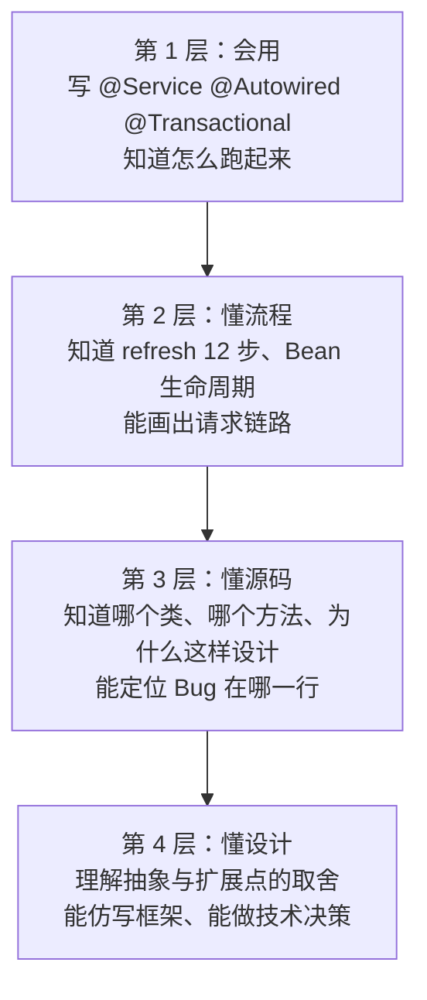

面试的区分度几乎全在**第 3、4 层**。同样是"Spring 循环依赖"，第 2 层答"三级缓存"，第 3 层答"getEarlyBeanReference 延迟代理"，第 4 层答"这是用空间换'代理时机确定性'的经典取舍"。

### 0.2 一条主线串起全部知识

整份文档其实只讲一条线：**"一个 BeanDefinition 如何变成一个可被调用的、带 AOP 能力的单例对象，以及这个对象在调用时如何被增强"**。

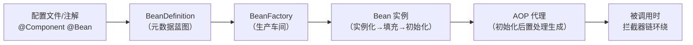

抓住这条线，下面每一章都是它的展开。

---

## 第 1 章 Spring 全局认知：它到底解决了什么问题

### 1.1 没有 Spring 的世界长什么样

```java
// 手写时代
public class OrderService {
    private UserDao userDao = new UserDaoImpl();          // 硬编码依赖
    private JdbcTemplate jdbc = new JdbcTemplate(         // 手工配置
        new DriverManagerDataSource("jdbc:mysql://...", "root", "123"));
    private TransactionTemplate tx = new TransactionTemplate(new DataSourceTransactionManager(...));
}
```

痛点非常具体：

| 痛点 | 表现 | Spring 的解法 |
|---|---|---|
| 对象创建与依赖装配耦合 | `new` 死依赖，换实现要改代码 | **IoC 容器**：控制反转，装配权交给容器 |
| 横切逻辑侵入业务 | 日志、事务、权限散落在每个方法里 | **AOP**：切面与业务解耦 |
| 资源生命周期无人管 | 连接、线程池泄漏 | **生命周期回调 + 销毁钩子** |
| 环境差异硬编码 | 开发/测试/生产的配置混在一起 | **Environment + Profile + 占位符** |
| 集成成本高 | 接 MyBatis、Redis、MQ 各自一套 | **统一抽象 + 扩展点 + Starter** |

### 1.2 Spring 的模块架构

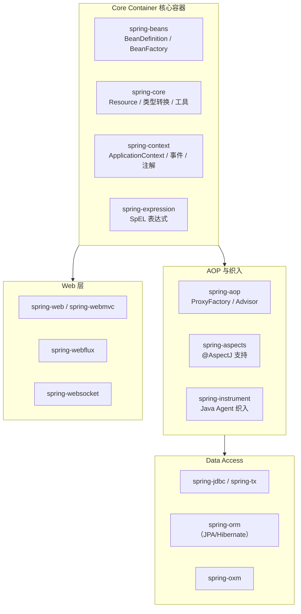

> **关键认知**：`spring-core` + `spring-beans` 是地基，`spring-context` 才让"容器"变成一个"完整的运行时环境"（事件、国际化、资源、环境、AOP 自动代理都在这里装配）。`spring-webmvc` 只是这套地基上的一个"上层应用"，所以 Spring MVC 天然能用 IoC/AOP/事务。

### 1.3 五个必须分清的核心抽象

这是面试第一道分水岭，很多人在这里就露怯了。

| 概念 | 是什么 | 类比 | 关键点 |
|---|---|---|---|
| **BeanDefinition** | Bean 的**元数据蓝图**（类名、作用域、是否懒加载、构造参数、初始化方法名、是否 primary…） | 建筑图纸 | 不是 Bean，只是"描述"；可以被 `BeanFactoryPostProcessor` 修改 |
| **BeanFactory** | **Bean 的生产工厂**，负责 `getBean()`、作用域管理、单例缓存 | 施工队 | 最底层容器，功能极简（`BeanFactory` 接口只有 6 个方法） |
| **FactoryBean** | **"能生产 Bean 的 Bean"**，用于创建复杂对象（如 MyBatis 的 `SqlSessionFactoryBean`、Spring 的 `ProxyFactoryBean`） | 定制化车间 | `getBean("&x")` 拿到工厂本身，`getBean("x")` 拿产品 |
| **ApplicationContext** | **容器 + 运行时环境**，继承 `BeanFactory`，额外提供事件、资源、国际化、环境、AOP 装配 | 整个厂区 | 99% 场景用的是它，不是 `BeanFactory` |
| **BeanFactoryPostProcessor** | **在 Bean 实例化之前**，修改 BeanDefinition 的钩子 | 图纸审核员 | 与 `BeanPostProcessor`（改实例）严格区分 |

**接口继承关系（必背）**：

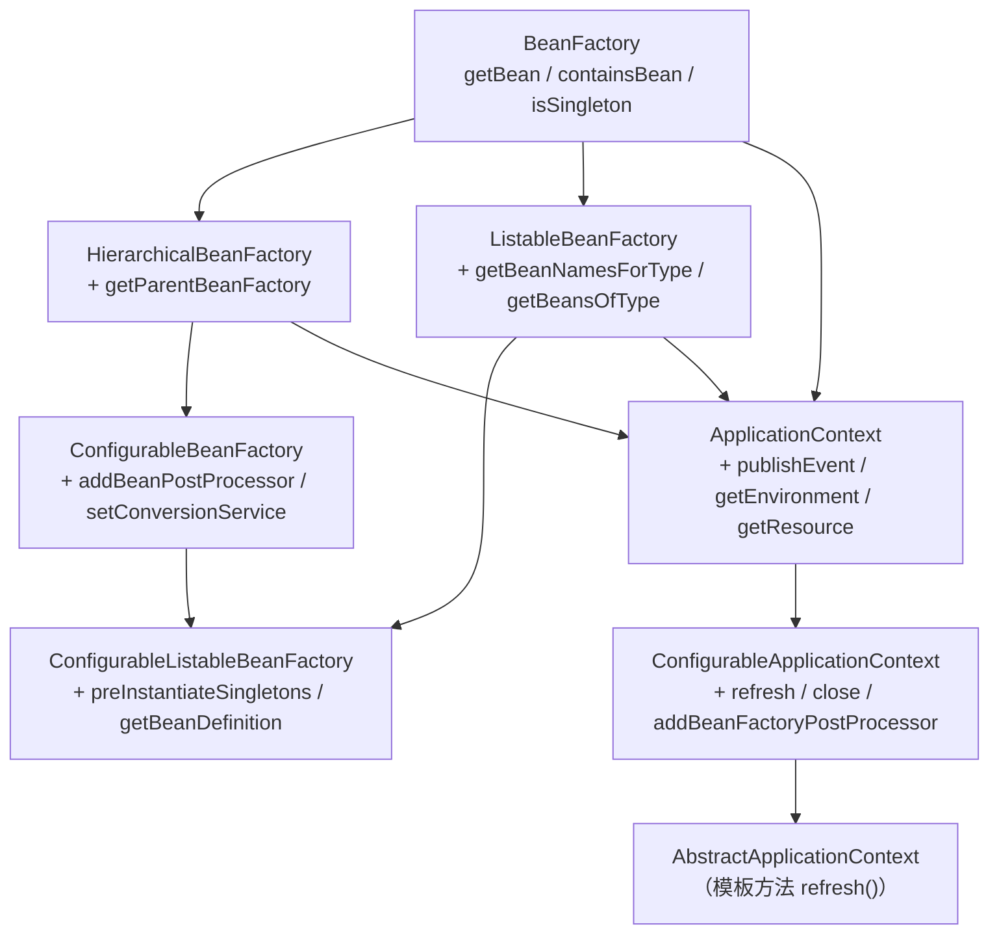

一个记忆技巧：**`BeanFactory` 是"能取 Bean"，`ListableBeanFactory` 是"能按类型批量取 Bean"，`ApplicationContext` 是"能取 Bean + 会用 Bean 之外的一切"**。

### 1.4 BeanFactory vs ApplicationContext 的实质差异

| 维度 | BeanFactory | ApplicationContext |
|---|---|---|
| 实例化时机 | 懒加载，`getBean` 才创建 | 启动时 `refresh()` 预热全部单例 |
| Bean 后处理器 | 需手动 `addBeanPostProcessor` | `refresh()` 中自动注册（`registerBeanPostProcessors`） |
| BeanFactoryPostProcessor | 需手动调用 | 自动调用（`invokeBeanFactoryPostProcessors`） |
| 事件机制 | 无 | `ApplicationEventPublisher` |
| 国际化 / 资源 / 环境 | 无 | `MessageSource` / `ResourceLoader` / `Environment` |
| AOP 自动代理 | 无（需手动配 `AnnotationAwareAspectJAutoProxyCreator`） | 有（`@EnableAspectJAutoProxy` 自动注册） |

**结论**：`BeanFactory` 是"零件"，`ApplicationContext` 是"装好的整机"。这也是为什么 `AnnotationConfigApplicationContext` 一定是 `GenericApplicationContext`（继承 `DefaultListableBeanFactory` 的能力，再包一层环境）。

---

## 第 2 章 容器启动：refresh() 的十二步

这是 Spring 源码的"总纲"。**几乎所有 Spring 面试题的深水区，都能挂到这十二步上某个具体位置。**

### 2.1 总流程图

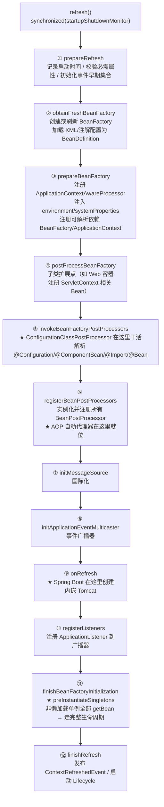

### 2.2 逐步深挖

#### ① prepareRefresh：埋点与校验

```java
protected void prepareRefresh() {
    this.startupDate = System.currentTimeMillis();
    this.closed.set(false);
    this.active.set(true);
    initPropertySources();          // 子类可在此添加属性源（如 Web 环境把 ServletContext 参数加进去）
    getEnvironment().validateRequiredProperties(); // 校验 @Required 的占位符是否可解析
    // 早期事件缓存：refresh 之前发布的事件先存起来，广播器就绪后统一补发
    if (this.earlyApplicationListeners == null) {
        this.earlyApplicationListeners = new LinkedHashSet<>(this.applicationListeners);
    } else {
        this.applicationListeners.clear();
        this.applicationListeners.addAll(this.earlyApplicationListeners);
    }
    this.earlyApplicationEvents = new LinkedHashSet<>();
}
```

**延伸点**：`earlyApplicationEvents` 是"事件不丢失"的设计。很多人在 `ApplicationContextInitializer` 里 `publishEvent`，此时广播器还没建好，事件就被暂存在这里，等 ⑧ 建好广播器后统一补发。

#### ② obtainFreshBeanFactory：容器落地

对 `AnnotationConfigApplicationContext` 是直接返回已创建的 `DefaultListableBeanFactory`；对 `ClassPathXmlApplicationContext` 则走 `loadBeanDefinitions`。

关键：此时容器里**已经有一批 BeanDefinition 了**（XML 里定义的、或 `register()` 手动注册的），但还没有 `@Component` 扫描出来的那些——那些要等 ⑤ 的 `ConfigurationClassPostProcessor`。

#### ③ prepareBeanFactory：环境注入

这一步做的事情，回答"为什么我可以直接 `@Autowired Environment env`"：

```java
protected void prepareBeanFactory(ConfigurableListableBeanFactory beanFactory) {
    beanFactory.setBeanClassLoader(getClassLoader());
    beanFactory.setBeanExpressionResolver(new StandardBeanExpressionResolver()); // 支持 #{...} SpEL
    beanFactory.addPropertyEditorRegistrar(new ResourceEditorRegistrar(this, getEnvironment()));

    // ① 让 Aware 接口生效
    beanFactory.addBeanPostProcessor(new ApplicationContextAwareProcessor(this));
    beanFactory.ignoreDependencyInterface(EnvironmentAware.class);
    beanFactory.ignoreDependencyInterface(EmbeddedValueResolverAware.class);
    beanFactory.ignoreDependencyInterface(ResourceLoaderAware.class);
    beanFactory.ignoreDependencyInterface(ApplicationEventPublisherAware.class);
    beanFactory.ignoreDependencyInterface(MessageSourceAware.class);
    beanFactory.ignoreDependencyInterface(ApplicationContextAware.class);
    beanFactory.ignoreDependencyInterface(BeanNameAware.class);
    beanFactory.ignoreDependencyInterface(BeanFactoryAware.class);
    beanFactory.ignoreDependencyInterface(BeanClassLoaderAware.class);

    // ② 直接把容器自身能力注册为可注入依赖
    beanFactory.registerResolvableDependency(BeanFactory.class, beanFactory);
    beanFactory.registerResolvableDependency(ResourceLoader.class, this);
    beanFactory.registerResolvableDependency(ApplicationEventPublisher.class, this);
    beanFactory.registerResolvableDependency(ApplicationContext.class, this);

    // ③ 监听器探测器（让 @EventListener 的 Bean 也能被当作事件监听器识别）
    beanFactory.addBeanPostProcessor(new ApplicationListenerDetector(this));

    // ④ 内置单例：environment / systemProperties / systemEnvironment
    if (!beanFactory.containsLocalBean(ENVIRONMENT_BEAN_NAME)) {
        beanFactory.registerSingleton(ENVIRONMENT_BEAN_NAME, getEnvironment());
    }
    ...
    // ⑤ AspectJ 支持探测
    if (!beanFactory.containsLocalBean(LOAD_TIME_WEAVER_BEAN_NAME)) {
        beanFactory.registerSingleton(LOAD_TIME_WEAVER_BEAN_NAME, new LoadTimeWeaver(...));
    }
}
```

**两个容易被忽略的细节**：

1. `ignoreDependencyInterface` 的作用不是"禁止注入"，而是"**不要把该接口的 setter 当成注入点**"。因为 `ApplicationContextAware#setApplicationContext` 会被 `@Autowired` 的逻辑误判为一个可注入依赖，所以要先屏蔽，改由 `ApplicationContextAwareProcessor` 在初始化阶段显式回调。
2. `registerResolvableDependency` 让"容器自身"能被 `@Autowired` 注入，且**不经过 Bean 实例化流程**。这就是为什么你 `@Autowired ApplicationContext` 能拿到当前容器而不是新 new 一个。

#### ④ postProcessBeanFactory：子类定制

`AbstractApplicationContext` 留的空钩子。典型实现：
- `ServletWebServerApplicationContext`：把 `ServletContext`、`ServletConfig` 相关的属性源加进去（`initPropertySources`）。
- `GenericWebApplicationContext`：注册 `ServletContextAwareProcessor`，让 `ServletContextAware` 生效。

#### ⑤ invokeBeanFactoryPostProcessors：整个容器最关键的阶段

这是**所有注解式配置真正"生效"的地方**。

```java
// PostProcessorRegistrationDelegate
public static void invokeBeanFactoryPostProcessors(
        ConfigurableListableBeanFactory beanFactory, List<BeanFactoryPostProcessor> beanFactoryPostProcessors) {

    Set<String> processedBeans = new HashSet<>();

    if (beanFactory instanceof BeanDefinitionRegistry registry) {
        List<BeanFactoryPostProcessor> regularPostProcessors = new ArrayList<>();
        List<BeanDefinitionRegistryPostProcessor> registryProcessors = new ArrayList<>();

        // 1) 先处理外部手动传进来的（refresh 前 registry.postProcessBeanDefinitionRegistry(beanFactory)）
        for (BeanFactoryPostProcessor postProcessor : beanFactoryPostProcessors) { ... }

        // 2) 从容器里找所有 BeanDefinitionRegistryPostProcessor，分三批执行
        List<BeanDefinitionRegistryPostProcessor> currentRegistryProcessors = new ArrayList<>();
        // 第一批：PriorityOrdered
        String[] postProcessorNames = beanFactory.getBeanNamesForType(BeanDefinitionRegistryPostProcessor.class, true, false);
        for (String ppName : postProcessorNames) {
            if (beanFactory.isTypeMatch(ppName, PriorityOrdered.class)) {
                currentRegistryProcessors.add(beanFactory.getBean(ppName, BeanDefinitionRegistryPostProcessor.class));
                processedBeans.add(ppName);
            }
        }
        sortPostProcessors(currentRegistryProcessors, beanFactory);
        registryProcessors.addAll(currentRegistryProcessors);
        invokeBeanDefinitionRegistryPostProcessors(currentRegistryProcessors, registry, beanFactory.getApplicationStartup());
        currentRegistryProcessors.clear();

        // 第二批：Ordered —— 也会"边执行边发现新的"，直到不再新增
        // 第三批：没有排序接口的
        // 3) 最后再统一回调所有 BeanFactoryPostProcessor 的 postProcessBeanFactory()
    }
}
```

**执行顺序（必背）**：

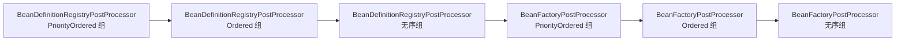

> 每一批内部都用 **按类型 `getBean` 触发实例化**——这意味着 BeanFactoryPostProcessor **本身也是 Bean，也会走完整生命周期，但它们的依赖注入会受到限制**（因为此时大部分 Bean 还没创建）。这就是"`@Bean` 方法里不能随便注入业务 Bean"的根因之一。

**最重要的一员：`ConfigurationClassPostProcessor`**

它实现 `BeanDefinitionRegistryPostProcessor` + `PriorityOrdered`（`getOrder()` 返回 `Ordered.HIGHEST_PRECEDENCE`），所以**永远第一个执行**。

它的三段式工作：

```java
public void postProcessBeanDefinitionRegistry(BeanDefinitionRegistry registry) {
    int registryId = System.identityHashCode(registry);
    if (this.registriesPostProcessed.contains(registryId)) throw new IllegalStateException(...);
    this.registriesPostProcessed.add(registryId);
    processConfigBeanDefinitions(registry);   // ← 核心
}

public void postProcessBeanFactory(ConfigurableListableBeanFactory beanFactory) {
    // 增强 @Configuration 类：用 CGLIB 生成子类，拦截 @Bean 方法调用（proxyBeanMethods=true 时）
    enhanceConfigurationClasses(beanFactory);
    // 注册 ImportBeanDefinitionRegistrar 的延迟回调等
    beanFactory.addBeanPostProcessor(new ImportAwareBeanPostProcessor(beanFactory));
}
```

`processConfigBeanDefinitions` 主线：

```java
public void processConfigBeanDefinitions(BeanDefinitionRegistry registry) {
    List<BeanDefinitionHolder> configCandidates = new ArrayList<>();
    // 1) 找出"候选配置类"：已经注册的 + 带 @Configuration 的 + 带 @Component/@ComponentScan/@Import/@ImportResource/@Bean 的
    for (String beanName : registry.getBeanDefinitionNames()) {
        BeanDefinition beanDef = registry.getBeanDefinition(beanName);
        if (ConfigurationClassUtils.checkConfigurationClassCandidate(beanDef, this.metadataReaderFactory)) {
            configCandidates.add(new BeanDefinitionHolder(beanDef, beanName));
        }
    }
    if (configCandidates.isEmpty()) return;

    // 2) 排序：@Order
    configCandidates.sort((bd1, bd2) -> {
        int i1 = ConfigurationClassUtils.getOrder(bd1.getBeanDefinition());
        int i2 = ConfigurationClassUtils.getOrder(bd2.getBeanDefinition());
        return Integer.compare(i1, i2);
    });

    // 3) 用 ASM 读类元数据（不加载 Class！）
    ConfigurationClassParser parser = new ConfigurationClassParser(
            this.metadataReaderFactory, this.problemReporter, this.environment,
            this.resourceLoader, this.componentScanBeanNameGenerator, registry);

    Set<BeanDefinitionHolder> candidates = new LinkedHashSet<>(configCandidates);
    Set<ConfigurationClass> alreadyParsed = new HashSet<>(configCandidates.size());
    do {
        parser.parse(candidates);                        // 解析
        parser.validate();
        Set<ConfigurationClass> configClasses = new LinkedHashSet<>(parser.getConfigurationClasses());
        configClasses.removeAll(alreadyParsed);

        // 4) 把解析结果注册成 BeanDefinition（@Bean 方法 → BeanDefinition）
        if (this.reader == null) {
            this.reader = new ConfigurationClassBeanDefinitionReader(
                    registry, this.sourceExtractor, this.resourceLoader, this.environment,
                    this.importBeanNameGenerator, parser.getImportRegistry());
        }
        this.reader.loadBeanDefinitions(configClasses);
        alreadyParsed.addAll(configClasses);

        // 5) 关键：新注册的 BeanDefinition 里可能还有新的配置类（级联）
        candidates.clear();
        if (registry.getBeanDefinitionCount() > candidateNames.length) {
            String[] newCandidateNames = registry.getBeanDefinitionNames();
            Set<String> oldCandidateNames = ...;
            for (String candidateName : newCandidateNames) {
                if (!oldCandidateNames.contains(candidateName)) {
                    BeanDefinition bd = registry.getBeanDefinition(candidateName);
                    if (ConfigurationClassUtils.checkConfigurationClassCandidate(bd, this.metadataReaderFactory)) {
                        candidates.add(new BeanDefinitionHolder(bd, candidateName));
                    }
                }
            }
        }
    } while (!candidates.isEmpty());
}
```

**为什么用 ASM 而不是反射？**

因为要支持 `@ConditionalOnClass` 这类"类路径上可能不存在"的判断。如果先 `Class.forName` 加载类，那么类不存在时会被 `NoClassDefFoundError` 炸掉，条件判断就永远没机会执行。`SimpleMetadataReader` 用 ASM 的 `ClassReader` 只解析 class 文件的常量池和注解信息（`SKIP_CODE | SKIP_DEBUG | SKIP_FRAMES`），**不触发类加载、不执行静态代码块**。

> 这是 Spring Boot "类不在依赖里也能启动" 的根本保障，也是"Spring 启动为什么不慢"的一个原因（组件扫描阶段不加载类）。

#### ⑥ registerBeanPostProcessors：让增强器就位

```java
public static void registerBeanPostProcessors(
        ConfigurableListableBeanFactory beanFactory, AbstractApplicationContext applicationContext) {

    String[] postProcessorNames = beanFactory.getBeanNamesForType(BeanPostProcessor.class, true, false);

    // 注册 BeanPostProcessorChecker（用于日志提示"某 Bean 被过早创建，可能错过某些后处理"）
    int beanProcessorTargetCount = beanFactory.getBeanPostProcessorCount() + 1 + postProcessorNames.length;
    beanFactory.addBeanPostProcessor(new BeanPostProcessorChecker(beanFactory, beanProcessorTargetCount));

    // 分四批：PriorityOrdered / Ordered / 无序 / MergedBeanDefinitionPostProcessor
    // 每个 BeanPostProcessor 本身也是通过 getBean 实例化的
    List<BeanPostProcessor> priorityOrderedPostProcessors = new ArrayList<>();
    ...
}
```

**核心认知**：`BeanPostProcessor` 是**先把实例创建出来、注册进容器，再在后续 Bean 创建时起作用的对象**。所以：

- `@EnableAspectJAutoProxy` 引入的 `AnnotationAwareAspectJAutoProxyCreator` **在⑥就绪**；
- 业务 Bean 在⑪才创建，所以它们能被 AOP 增强；
- 但如果某个 `BeanPostProcessor` 自身依赖了一个业务 Bean，那个业务 Bean 会被"提前创建"，从而**拿不到后续的 BeanPostProcessor**。Spring 为此专门加了 `BeanPostProcessorChecker` 打警告日志：
  ```
  Bean 'xxx' of type [xxx] is not eligible for getting processed by all BeanPostProcessors
  （for example: not eligible for auto-proxying）
  ```
  > **面试高频延伸**："为什么我的 Bean 没有被代理/没有生效拦截？"第一反应就该看这条日志。

#### ⑦⑧ 国际化与事件广播器

```java
protected void initMessageSource() {
    ConfigurableListableBeanFactory beanFactory = getBeanFactory();
    if (beanFactory.containsLocalBean(MESSAGE_SOURCE_BEAN_NAME)) {
        this.messageSource = beanFactory.getBean(MESSAGE_SOURCE_BEAN_NAME, MessageSource.class);
        // 父子容器层级继承
        if (this.parent != null && this.messageSource instanceof HierarchicalMessageSource hms) {
            hms.setParentMessageSource(getInternalParentMessageSource());
        }
    } else {
        DelegatingMessageSource dms = new DelegatingMessageSource();
        dms.setParentMessageSource(getInternalParentMessageSource());
        this.messageSource = dms;
        beanFactory.registerSingleton(MESSAGE_SOURCE_BEAN_NAME, this.messageSource);
    }
}

protected void initApplicationEventMulticaster() {
    ConfigurableListableBeanFactory beanFactory = getBeanFactory();
    if (beanFactory.containsLocalBean(APPLICATION_EVENT_MULTICASTER_BEAN_NAME)) {
        this.applicationEventMulticaster = beanFactory.getBean(APPLICATION_EVENT_MULTICASTER_BEAN_NAME, ApplicationEventMulticaster.class);
    } else {
        this.applicationEventMulticaster = new SimpleApplicationEventMulticaster(beanFactory);
        beanFactory.registerSingleton(APPLICATION_EVENT_MULTICASTER_BEAN_NAME, this.applicationEventMulticaster);
    }
}
```

> **延伸**：`SimpleApplicationEventMulticaster` 若设置了 `taskExecutor`，事件就是异步的——这是"`@EventListener` 异步化"的标准做法，也意味着**异步事件里拿不到原线程的事务/安全上下文**，是线上事故高发点。

#### ⑨ onRefresh：Web 容器的入口

`AbstractApplicationContext` 里是空方法。`ServletWebServerApplicationContext` 覆写为：

```java
protected void onRefresh() {
    super.onRefresh();
    try {
        createWebServer();     // ← 内嵌 Tomcat 在这里起来
    } catch (Throwable ex) {
        throw new ApplicationContextException("Unable to start web server", ex);
    }
}
```

**这是"Spring Boot 内嵌容器"最核心的一行代码**，第 9 章会详述。

#### ⑩ registerListeners

```java
protected void registerListeners() {
    // 1) 先把早前手动 addApplicationListener 的注册进广播器
    for (ApplicationListener<?> listener : getApplicationListeners()) {
        getApplicationEventMulticaster().addApplicationListener(listener);
    }
    // 2) 再把容器里所有 ApplicationListener 类型的 Bean 名字注册进去（注意：只注册名字，延迟到事件发生时才 getBean）
    String[] listenerBeanNames = getBeanNamesForType(ApplicationListener.class, true, false);
    for (String listenerBeanName : listenerBeanNames) {
        getApplicationEventMulticaster().addApplicationListenerBean(listenerBeanName);
    }
    // 3) 补发早期事件
    Set<ApplicationEvent> earlyEventsToProcess = this.earlyApplicationEvents;
    this.earlyApplicationEvents = null;
    if (!CollectionUtils.isEmpty(earlyEventsToProcess)) {
        for (ApplicationEvent earlyEvent : earlyEventsToProcess) {
            getApplicationEventMulticaster().multicastEvent(earlyEvent);
        }
    }
}
```

#### ⑪ finishBeanFactoryInitialization：最重的一步

```java
protected void finishBeanFactoryInitialization(ConfigurableListableBeanFactory beanFactory) {
    // 1) 如果有 conversionService Bean，设进去
    if (beanFactory.containsBean(CONVERSION_SERVICE_BEAN_NAME) &&
            beanFactory.isTypeMatch(CONVERSION_SERVICE_BEAN_NAME, ConversionService.class)) {
        beanFactory.setConversionService(beanFactory.getBean(CONVERSION_SERVICE_BEAN_NAME, ConversionService.class));
    }
    // 2) 没有 embeddedValueResolver 就注册一个（处理 ${...} 占位符）
    if (!beanFactory.hasEmbeddedValueResolver()) {
        beanFactory.addEmbeddedValueResolver(strVal -> getEnvironment().resolvePlaceholders(strVal));
    }
    // 3) 提前初始化 LoadTimeWeaverAware 的 Bean（AspectJ LTW 需要）
    String[] weaverAwareNames = beanFactory.getBeanNamesForType(LoadTimeWeaverAware.class, false, false);
    for (String weaverAwareName : weaverAwareNames) {
        getBean(weaverAwareName);
    }
    // 4) 冻结 BeanDefinition：之后不允许再修改元数据
    beanFactory.freezeConfiguration();
    // 5) 预热所有非懒加载单例
    beanFactory.preInstantiateSingletons();
}
```

`preInstantiateSingletons` 的逻辑：

```java
public void preInstantiateSingletons() throws BeansException {
    List<String> beanNames = new ArrayList<>(this.beanDefinitionNames);
    for (String beanName : beanNames) {                       // ① 先全部实例化
        RootBeanDefinition bd = getMergedLocalBeanDefinition(beanName);
        if (!bd.isAbstract() && bd.isSingleton() && !bd.isLazyInit()) {
            if (isFactoryBean(beanName)) {                    // FactoryBean 特殊：先实例化工厂
                Object bean = getBean(FACTORY_BEAN_PREFIX + beanName);
                if (bean instanceof FactoryBean<?> factory) {
                    boolean isEagerInit = (factory instanceof SmartFactoryBean<?> smartFactoryBean &&
                            smartFactoryBean.isEagerInit());
                    if (isEagerInit) {
                        getBean(beanName);                    // 仅 SmartFactoryBean 才急切创建产品
                    }
                }
            } else {
                getBean(beanName);
            }
        }
    }
    for (String beanName : beanNames) {                       // ② 再统一回调
        Object singletonInstance = getSingleton(beanName);
        if (singletonInstance instanceof SmartInitializingSingleton smartSingleton) {
            smartSingleton.afterSingletonsInstantiated();
        }
    }
}
```

> **两个高频考点**：
> 1. `preInstantiateSingletons` 里**先全量创建，再统一回调 `SmartInitializingSingleton`**。这个分离是刻意的——`afterSingletonsInstantiated` 的语义是"所有单例都好了，可以安全地依赖任一个"，所以 `@EventListener(ApplicationReadyEvent)` 里的逻辑可以放心用任何 Bean。
> 2. `FactoryBean` 默认**不急切创建产品**（只有 `SmartFactoryBean#isEagerInit` 返回 true 才创建）。所以 `@Autowired SqlSessionFactory` 时才会触发真正的产品创建。

#### ⑫ finishRefresh

```java
protected void finishRefresh() {
    clearResourceCaches();
    initLifecycleProcessor();                 // 默认 DefaultLifecycleProcessor
    getLifecycleProcessor().onRefresh();      // 启动所有 Lifecycle 的 start()（SmartLifecycle 按 phase 排序）
    publishEvent(new ContextRefreshedEvent(this));  // ← 容器刷新完成事件
    if (!NativeDetector.inNativeImage()) {
        LiveBeansView.registerApplicationContext(this);
    }
}
```

**`ContextRefreshedEvent` 是很多人做预热缓存的落点**，但要注意：**在 Spring Cloud / 父子容器场景下它会被触发多次**（每个容器刷新都会发一次），需要做 `event.getApplicationContext()` 幂等判断。

### 2.3 refresh 完整时序（含对象交互）

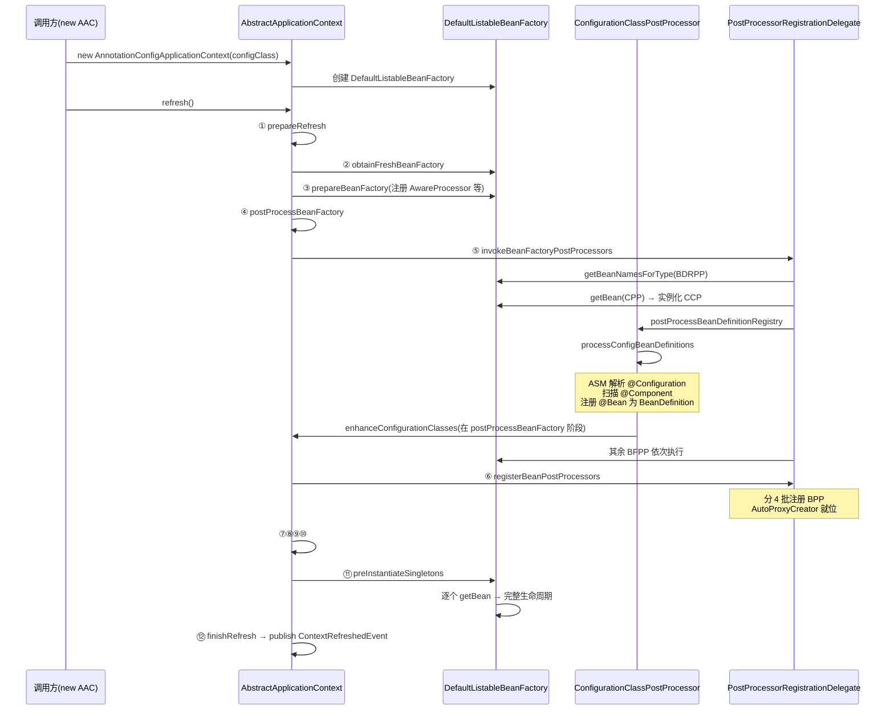

### 2.4 组件扫描的内部逻辑

`@ComponentScan` 不是"反射遍历"，而是 `ClassPathScanningCandidateComponentProvider` 用 ASM 读元数据。

```java
// ClassPathScanningCandidateComponentProvider#findCandidateComponents
public Set<BeanDefinition> findCandidateComponents(String basePackage) {
    if (this.componentsIndex != null && indexSupportsIncludeFilters()) {
        return addCandidateComponentsFromIndex(this.componentsIndex, basePackage);  // AOT 索引（Spring 6.x）
    } else {
        return scanCandidateComponents(basePackage);
    }
}

private Set<BeanDefinition> scanCandidateComponents(String basePackage) {
    Set<BeanDefinition> candidates = new LinkedHashSet<>();
    String packageSearchPath = ResourcePatternResolver.CLASSPATH_ALL_URL_PREFIX +
            resolveBasePackage(basePackage) + '/' + this.resourcePattern;   // classpath*:com/xx/**/*.class
    Resource[] resources = getResourcePatternResolver().getResources(packageSearchPath);
    for (Resource resource : resources) {
        MetadataReader metadataReader = getMetadataReaderFactory().getMetadataReader(resource);
        if (isCandidateComponent(metadataReader)) {                       // ① 匹配 include/exclude 过滤器
            ScannedGenericBeanDefinition sbd = new ScannedGenericBeanDefinition(metadataReader);
            sbd.setSource(resource);
            if (isCandidateComponent(sbd)) {                              // ② 独立且具体（非抽象、非接口）
                candidates.add(sbd);
            }
        }
    }
    return candidates;
}
```

**默认过滤器**：

| 类型 | 内容 |
|---|---|
| `includeFilters` | `@Component`（含 `@Service`/`@Repository`/`@Controller` 等派生注解）、`@ManagedBean`、`@Named`；若开启 `useDefaultFilters` |
| `excludeFilters` | `TypeExcludeFilter`（允许用户自定义排除逻辑）、`AutoConfigurationExcludeFilter`（排除自动配置类，避免重复注册） |

**性能延伸**：`classpath*:` 会遍历**所有 jar**，这是大型项目启动慢的元凶之一。优化手段：
- 缩小 `basePackage`；
- `@ComponentScan(useDefaultFilters = false, includeFilters = ...)`；
- Spring Boot 3 + AOT 生成 `META-INF/spring/...components.index`，跳过扫描；
- 用 `spring.context.index` 类索引。

### 2.5 BeanDefinition 的注册与冲突

`DefaultListableBeanFactory#registerBeanDefinition`：

```java
public void registerBeanDefinition(String beanName, BeanDefinition beanDefinition) {
    BeanDefinition existingDefinition = this.beanDefinitionMap.get(beanName);
    if (existingDefinition != null) {
        if (!isAllowBeanDefinitionOverriding()) {
            throw new BeanDefinitionOverrideException(beanName, beanDefinition, existingDefinition);
        } else if (existingDefinition.getRole() < beanDefinition.getRole()) {
            // 覆盖提示日志
        }
        this.beanDefinitionMap.put(beanName, beanDefinition);
    } else {
        if (hasBeanCreationStarted()) {          // 容器已在创建 Bean（并发场景）
            synchronized (this.beanDefinitionMap) {
                this.beanDefinitionMap.put(beanName, beanDefinition);
                List<String> updatedDefinitions = new ArrayList<>(this.beanDefinitionNames.size() + 1);
                updatedDefinitions.addAll(this.beanDefinitionNames);
                updatedDefinitions.add(beanName);
                this.beanDefinitionNames = updatedDefinitions;
                removeManualSingletonName(beanName);
            }
        } else {
            this.beanDefinitionMap.put(beanName, beanDefinition);
            this.beanDefinitionNames.add(beanName);
        }
        this.frozenBeanDefinitionNames = null;
    }
    if (existingDefinition != null || containsSingleton(beanName)) {
        resetBeanDefinition(beanName);           // 清缓存、销毁已有单例
    }
}
```

**关键结论**：
- Spring Boot 2.1+ 默认 `allow-bean-definition-overriding = false`。所以两个 `@Component` 同名会直接启动失败。想覆盖要显式 `spring.main.allow-bean-definition-overriding=true`。
- 同名判断用的是 **beanName**，不是类名。所以 `@Bean public X x()` 和 `@Component` 类 `X`（默认 beanName 为 `x`）会撞车。
- `beanDefinitionNames` 是一个 `ArrayList`，**注册顺序决定创建顺序**（`preInstantiateSingletons` 正序遍历）。这也是"`dependsOn` 为什么存在"的原因之一——虽然正常靠依赖注入顺序就能保证，但遇到 `@Bean` 方法返回 `BeanFactoryPostProcessor` 等特殊场景，顺序仍需显式控制。

---

## 第 3 章 Bean 生命周期：一个对象的一生

### 3.1 全景图

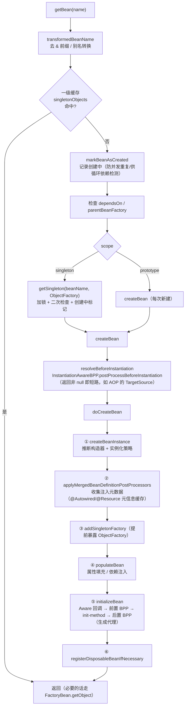

### 3.2 实例化：构造器怎么被选中的

```java
// AbstractAutowireCapableBeanFactory#createBeanInstance
protected BeanWrapper createBeanInstance(String beanName, RootBeanDefinition mbd, Object[] args) {
    Class<?> beanClass = resolveBeanClass(mbd, beanName);

    // ① Supplier 回调（Spring 5.0+ 支持函数式注册）
    Supplier<?> instanceSupplier = mbd.getInstanceSupplier();
    if (instanceSupplier != null) return obtainFromSupplier(instanceSupplier, beanName);

    // ② FactoryMethod（@Bean 方法就是走这里！）
    if (mbd.getFactoryMethodName() != null) return instantiateUsingFactoryMethod(beanName, mbd, args);

    // ③ 缓存命中（同一个 BeanDefinition 多次创建时的优化，如 prototype）
    boolean resolved = false;
    boolean autowireNecessary = false;
    if (args == null) {
        synchronized (mbd.constructorArgumentLock) {
            if (mbd.resolvedConstructorOrFactoryMethod != null) {
                resolved = true;
                autowireNecessary = mbd.constructorArgumentsResolved;
            }
        }
    }
    if (resolved) {
        return autowireNecessary ? autowireConstructor(beanName, mbd, null, null)
                                 : instantiateBean(beanName, mbd);
    }

    // ④ 推断构造器（SmartInstantiationAwareBeanPostProcessor.determineCandidateConstructors）
    Constructor<?>[] ctors = determineConstructorsFromBeanPostProcessors(beanClass, beanName);
    if (ctors != null || mbd.getResolvedAutowireMode() == AUTOWIRE_CONSTRUCTOR ||
            mbd.hasConstructorArgumentValues() || !ObjectUtils.isEmpty(args)) {
        return autowireConstructor(beanName, mbd, ctors, args);
    }

    // ⑤ 兜底：默认无参构造
    ctors = mbd.getPreferredConstructors();
    if (ctors != null) return autowireConstructor(beanName, mbd, ctors, null);
    return instantiateBean(beanName, mbd);
}
```

**`determineCandidateConstructors` 的推断规则**（`AutowiredAnnotationBeanPostProcessor` 实现）：

| 场景 | 结果 |
|---|---|
| 有 `@Autowired(required=true)` 构造器（唯一） | 用它 |
| 有多个 `@Autowired` 构造器，但只有 1 个 `required=true` | 用那个 |
| 有多个 `@Autowired` 构造器且 required 都为 true 或都为 false 且 >1 | 抛 `NoUniqueBeanDefinitionException` |
| 无 `@Autowired`，只有一个有参构造器 | **用它**（Spring 4.3+ 的隐式规则） |
| 无 `@Autowired`，有多个有参构造器 | 用无参构造器（若无参不存在 → 报错） |
| 无 `@Autowired`，只有一个无参构造器 | 用它 |
| Kotlin 主构造器 / record | 特殊处理（`KotlinDelegate`、`createRecordInstance`） |

> **延伸（JDK 8 参数名问题）**：`autowireConstructor` 要按参数名/类型匹配构造参数值。如果没有 `-parameters` 编译，参数名会丢。Spring 用 `DefaultParameterNameDiscoverer`（`StandardReflectionParameterNameDiscoverer` → `KotlinReflectionParameterNameDiscoverer` → `LocalVariableTableParameterNameDiscoverer`）三级兜底，最后的方案是读字节码的 `LocalVariableTable`（需要 `-g` 保留调试信息）。**Spring Boot 的 `spring-boot-maven-plugin` 默认给 maven-compiler 加了 `-parameters`**，这就是为什么 Boot 项目里参数名注入很少出问题。

**实例化策略**：

```java
// SimpleInstantiationStrategy
public Object instantiate(RootBeanDefinition bd, String beanName, BeanFactory owner) {
    // 有 MethodOverride（lookup-method / replaced-method）时用 CGLIB，否则直接反射
    if (bd.getMethodOverrides().isEmpty()) {
        Constructor<?> constructorToUse = ...;
        return BeanUtils.instantiateClass(constructorToUse);   // 反射 newInstance
    } else {
        return instantiateWithMethodInjection(bd, beanName, owner);  // CglibSubclassingInstantiationStrategy
    }
}
```

> **延伸**：`bd.getMethodOverrides()` 非空才会走 CGLIB。这是 `lookup-method`（XML 里把一个方法替换成返回指定 Bean）的实现方式，也是早期"接口注入"的遗产。现在几乎只用反射。

### 3.3 属性填充：依赖注入的落点

```java
// AbstractAutowireCapableBeanFactory#populateBean
protected void populateBean(String beanName, RootBeanDefinition mbd, @Nullable BeanWrapper bw) {
    // ① 给 InstantiationAwareBeanPostProcessor 一次机会（返回 false 表示"跳过属性填充"）
    if (!mbd.isSynthetic() && hasInstantiationAwareBeanPostProcessors()) {
        for (InstantiationAwareBeanPostProcessor bp : getBeanPostProcessorCache().instantiationAware) {
            if (!bp.postProcessAfterInstantiation(bw.getWrappedInstance(), beanName)) {
                return;
            }
        }
    }

    PropertyValues pvs = (mbd.hasPropertyValues() ? mbd.getPropertyValues() : null);

    // ② XML 的 byName/byType 自动装配
    int resolvedAutowireMode = mbd.getResolvedAutowireMode();
    if (resolvedAutowireMode == AUTOWIRE_BY_NAME || resolvedAutowireMode == AUTOWIRE_BY_TYPE) {
        MutablePropertyValues newPvs = new MutablePropertyValues(pvs);
        if (resolvedAutowireMode == AUTOWIRE_BY_NAME) autowireByName(beanName, mbd, bw, newPvs);
        if (resolvedAutowireMode == AUTOWIRE_BY_TYPE) autowireByType(beanName, mbd, bw, newPvs);
        pvs = newPvs;
    }

    // ③ 注解注入的入口
    boolean hasInstAwareBpps = hasInstantiationAwareBeanPostProcessors();
    boolean needsDepCheck = (mbd.getDependencyCheck() != AbstractBeanDefinition.DEPENDENCY_CHECK_NONE);
    if (hasInstAwareBpps || needsDepCheck) {
        PropertyDescriptor[] filteredPds = filterPropertyDescriptorsForDependencyCheck(bw, mbd.allowCaching);
        if (hasInstAwareBpps) {
            for (InstantiationAwareBeanPostProcessor bp : getBeanPostProcessorCache().instantiationAware) {
                PropertyValues pvsToUse = bp.postProcessProperties(pvs, bw.getWrappedInstance(), beanName);
                if (pvsToUse == null) {   // ← 返回 null 表示"我不关心"，继续下一个
                    if (filteredPds == null) filteredPds = filterPropertyDescriptorsForDependencyCheck(bw, mbd.allowCaching);
                    pvsToUse = bp.postProcessPropertyValues(pvs, filteredPds, bw.getWrappedInstance(), beanName);
                    if (pvsToUse == null) return;
                }
                pvs = pvsToUse;
            }
        }
        if (needsDepCheck) checkDependencies(beanName, mbd, filteredPds, pvs);
    }
    if (pvs != null) applyPropertyValues(beanName, mbd, bw, pvs);
}
```

**注解注入的真实执行者是 `AutowiredAnnotationBeanPostProcessor#postProcessProperties`**：

```java
public PropertyValues postProcessProperties(PropertyValues pvs, Object bean, String beanName) {
    InjectionMetadata metadata = findAutowiringMetadata(beanName, bean.getClass(), pvs);  // 有缓存
    try {
        metadata.inject(bean, beanName, pvs);
    } catch (BeanCreationException ex) { throw ex; }
    return pvs;
}

// InjectionMetadata#inject → 遍历每个 InjectedElement
// AutowiredFieldElement#inject:
protected void inject(Object bean, String beanName, PropertyValues pvs) throws Throwable {
    Field field = (Field) this.member;
    Object value;
    if (this.cached) {
        try { value = resolvedCachedArgument(beanName, this.cachedFieldValue); }
        catch (NoSuchBeanDefinitionException ex) { value = null; }   // ← 缓存失效则重新解析
    } else {
        DependencyDescriptor desc = new DependencyDescriptor(field, this.required);
        desc.setContainingClass(bean.getClass());
        Set<String> autowiredBeanNames = new LinkedHashSet<>(1);
        Assert.state(beanFactory != null, "No BeanFactory available");
        TypeConverter converter = beanFactory.getTypeConverter();
        try {
            value = beanFactory.resolveDependency(desc, beanName, autowiredBeanNames, converter);
        } catch (BeansException ex) {
            throw new UnsatisfiedDependencyException(...);
        }
        synchronized (this) {   // 缓存解析结果，避免重复查找
            if (!this.cached) { ... this.cachedFieldValue = desc; ... this.cached = true; }
        }
    }
    if (value != null) {
        ReflectionUtils.makeAccessible(field);   // ← 反射设值（会用 setAccessible 提速）
        field.set(bean, value);
    }
}
```

> **为什么字段注入不需要 setter**？因为 `field.set()` 直接操作。JVM 在多次反射访问同一字段后会生成"膨胀（inflation）"字节码，性能损失降到 ~5%，但**仍然不如构造器注入的直接赋值**，且破坏不可变性、无法 final。

### 3.4 初始化：`initializeBean`

```java
protected Object initializeBean(String beanName, Object bean, @Nullable RootBeanDefinition mbd) {
    // ① Aware 回调（只有这三个是这里做的！）
    invokeAwareMethods(beanName, bean);

    Object wrappedBean = bean;
    if (mbd == null || !mbd.isSynthetic()) {
        // ② 前置处理器：@PostConstruct、@Resource 注入、校验等
        wrappedBean = applyBeanPostProcessorsBeforeInitialization(wrappedBean, beanName);
    }

    try {
        // ③ 初始化方法：InitializingBean#afterPropertiesSet → init-method
        invokeInitMethods(beanName, wrappedBean, mbd);
    } catch (Throwable ex) {
        throw new BeanCreationException(...);
    }
    if (mbd == null || !mbd.isSynthetic()) {
        // ④ 后置处理器：★ AOP 代理在这里生成
        wrappedBean = applyBeanPostProcessorsAfterInitialization(wrappedBean, beanName);
    }
    return wrappedBean;
}

private void invokeAwareMethods(Object bean, String beanName) {
    if (bean instanceof Aware) {
        if (bean instanceof BeanNameAware aware) aware.setBeanName(beanName);
        if (bean instanceof BeanClassLoaderAware aware) aware.setBeanClassLoader(getBeanClassLoader());
        if (bean instanceof BeanFactoryAware aware) aware.setBeanFactory(getBeanFactory(beanName) != null ? ... : getBeanFactory());
    }
}

protected void invokeInitMethods(String beanName, Object bean, @Nullable RootBeanDefinition mbd) throws Throwable {
    boolean isInitializingBean = (bean instanceof InitializingBean);
    if (isInitializingBean && (mbd == null || !mbd.hasAnyExternallyManagedInitMethod("afterPropertiesSet"))) {
        ((InitializingBean) bean).afterPropertiesSet();
    }
    if (mbd != null && bean.getClass() != NullBean.class) {
        String[] initMethodNames = mbd.getInitMethodNames();   // 3.0+ 支持多个
        if (initMethodNames != null) {
            for (String initMethodName : initMethodNames) {
                if (!initMethodName.isEmpty() && !isExternallyManagedInitMethod(initMethodName)) {
                    invokeCustomInitMethod(beanName, bean, mbd, initMethodName);
                }
            }
        }
    }
}
```

**初始化顺序（必背，面试高频）**：

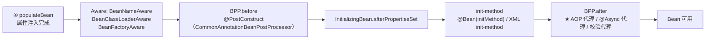

> **注意**：`@PostConstruct` 是通过 `CommonAnnotationBeanPostProcessor#postProcessBeforeInitialization` 调用的，**它比 `afterPropertiesSet` 更早**。很多人答错成"`afterPropertiesSet` 先"。
>
> **再延伸**：`ApplicationContextAware`、`EnvironmentAware`、`ResourceLoaderAware` 等 6 个 Aware 接口不是 `invokeAwareMethods` 做的，而是 **`ApplicationContextAwareProcessor`（一个 BeanPostProcessor，在③ prepareBeanFactory 里注册）在 `postProcessBeforeInitialization` 里调用**的。所以严格说顺序是：

```
BeanNameAware / BeanClassLoaderAware / BeanFactoryAware  (invokeAwareMethods)
   ↓
BeanPostProcessor.postProcessBeforeInitialization 阶段：
   ApplicationContextAwareProcessor → EnvironmentAware / EmbeddedValueResolverAware /
                                     ResourceLoaderAware / ApplicationEventPublisherAware /
                                     MessageSourceAware / ApplicationContextAware
   CommonAnnotationBeanPostProcessor → @PostConstruct / @Resource / @PreDestroy 注册
   ...
   ↓
InitializingBean.afterPropertiesSet
   ↓
custom init-method
   ↓
BeanPostProcessor.postProcessAfterInitialization
```

### 3.5 销毁

```java
private void registerDisposableBeanIfNecessary(String beanName, Object bean, RootBeanDefinition mbd) {
    AccessControlContext acc = (System.getSecurityManager() != null ? getAccessControlContext() : null);
    if (!mbd.isPrototype() && requiresDestruction(bean, mbd)) {
        if (mbd.isSingleton()) {
            // 注册到 DefaultSingletonBeanRegistry 的 disposableBeans（ConcurrentHashMap）
            registerDisposableBean(beanName, new DisposableBeanAdapter(
                    beanName, bean, mbd, getBeanPostProcessorCache().destructionAware, acc));
        } else {
            // prototype / 自定义 scope：存在 Scope 里，由 Scope 负责销毁
            Scope scope = this.scopes.get(mbd.getScope());
            scope.registerDestructionCallback(beanName, new DisposableBeanAdapter(...));
        }
    }
}
```

**销毁顺序（与创建相反）**：
1. `DestructionAwareBeanPostProcessor#postProcessBeforeDestruction` → 执行 `@PreDestroy`
2. `DisposableBean#destroy()`
3. 自定义 `destroy-method`（`@Bean(destroyMethod)`，若为 `(inferred)` 会自动推断 `close`/`shutdown`）

**触发时机**：
- `applicationContext.close()` / `registerShutdownHook()` 注册的 JVM 钩子
- Spring Boot 的 `SpringApplicationShutdownHook`
- **prototype Bean 不注册销毁回调**（容器不管理它的生命周期，这是内存/连接泄漏的常见原因）

> **延伸**：`@Bean(destroyMethod = "")` 用于关闭推断。典型场景：`@Bean public DataSource ds()` 如果类有 `close()` 方法，Spring 会在关闭时调用它——有时这不是你想要的（比如共享的数据源由外部管理），就需要显式关闭推断。

### 3.6 作用域（Scope）

| Scope | 说明 | 销毁 | 典型用途 |
|---|---|---|---|
| `singleton` | 容器内唯一，缓存在 `singletonObjects` | 注册销毁回调 | 无状态 Service |
| `prototype` | 每次 `getBean` 新建 | **不注册**（需自行管理） | 有状态组件 |
| `request` | 每个 HTTP 请求一个，绑定在 `RequestAttributes` | 请求结束销毁 | 请求级上下文 |
| `session` | 每个会话一个 | 会话失效销毁 | 用户级状态 |
| `application` | 等价 singleton（Web 容器语义） | 注册 | — |
| 自定义 | `Scope` 接口（Spring 4.2+），如 `SimpleThreadScope` | Scope 管理 | 线程级隔离 |

```java
// 示例：线程级隔离（不推荐，除非明确需要）
@Component
@Scope(scopeName = "thread", proxyMode = ScopedProxyMode.TARGET_CLASS)
public class RequestContext { }
```

**`proxyMode` 是什么**：非 singleton scope 注入到 singleton Bean 时，注入的是**作用域代理**（`ScopedProxyFactoryBean`/CGLIB），每次调用时从当前 Scope 取真实对象。这就是为什么 `@Autowired HttpServletRequest` 在单例 Controller 里能拿到"当前请求"的那个——他是 `request` scope 的代理。

### 3.7 常见"生命周期踩坑"清单

| 现象 | 根因 | 排查点 |
|---|---|---|
| 某 Bean 的 `@PostConstruct` 里注入的 Bean 是 null | 属性填充在 `@PostConstruct` 之前已完成，所以不会是 null；若是 null 说明是**构造器里**访问字段 | 构造器里不要用注入字段 |
| Bean 没被 AOP 代理 | 该 Bean 在 `registerBeanPostProcessors` 之前就被创建了 | 看 `BeanPostProcessorChecker` 警告日志 |
| `@Async` / `@Transactional` 在 `@PostConstruct` 里失效 | `@PostConstruct` 时还没有代理 | 用 `SmartInitializingSingleton` 或 `ApplicationReadyEvent` |
| `@Bean` 方法里 `@Value` 拿不到值 | `@Bean` 方法参数是解析的，方法体里的 `@Value` 字段在配置类上，依赖 `PropertySourcesPlaceholderConfigurer` 已就绪 | 用方法参数注入 |
| 单例 Bean 里保存了请求数据，出现串数据 | 单例是共享的 | 改用 request scope 或方法内局部变量 |

---

## 第 4 章 循环依赖与三级缓存

**这是 Spring 面试的第一深水区。**

### 4.1 什么是循环依赖

```java
@Service
public class AService {
    @Autowired private BService bService;
}

@Service
public class BService {
    @Autowired private AService aService;
}
```

### 4.2 三级缓存的结构

```java
// DefaultSingletonBeanRegistry
private final Map<String, Object> singletonObjects = new ConcurrentHashMap<>(256);          // ① 一级：成品
private final Map<String, Object> earlySingletonObjects = new ConcurrentHashMap<>(16);      // ② 二级：早期引用（可能是代理）
private final Map<String, ObjectFactory<?>> singletonFactories = new HashMap<>(16);         // ③ 三级：ObjectFactory 工厂
private final Set<String> registeredSingletons = new LinkedHashSet<>(256);
private final Set<String> singletonsCurrentlyInCreation =
        Collections.newSetFromMap(new ConcurrentHashMap<>(16));                             // 创建中标记
```

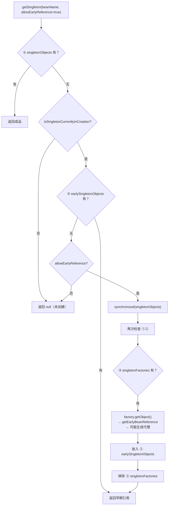

**源码**：

```java
protected Object getSingleton(String beanName, boolean allowEarlyReference) {
    Object singletonObject = this.singletonObjects.get(beanName);                 // ① 快速路径，无锁
    if (singletonObject == null && isSingletonCurrentlyInCreation(beanName)) {
        singletonObject = this.earlySingletonObjects.get(beanName);               // ② 早期引用
        if (singletonObject == null && allowEarlyReference) {
            synchronized (this.singletonObjects) {                                // ③ 锁住一级缓存对象
                singletonObject = this.singletonObjects.get(beanName);
                if (singletonObject == null) {
                    singletonObject = this.earlySingletonObjects.get(beanName);
                    if (singletonObject == null) {
                        ObjectFactory<?> singletonFactory = this.singletonFactories.get(beanName);
                        if (singletonFactory != null) {
                            singletonObject = singletonFactory.getObject();      // ★ 关键：可能在这里生成代理
                            this.earlySingletonObjects.put(beanName, singletonObject);
                            this.singletonFactories.remove(beanName);
                        }
                    }
                }
            }
        }
    }
    return singletonObject;
}
```

### 4.3 完整流程推演（A ← → B）

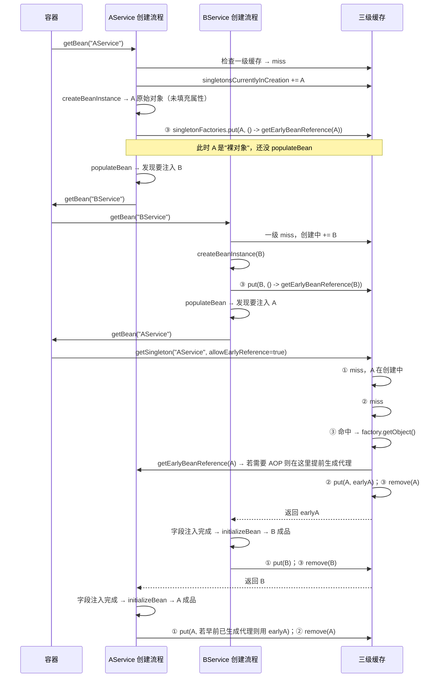

### 4.4 为什么必须是三级？——这是最难答对的问题

**先看一个流行的错误答案**："一级存成品，二级存半成品，三级存工厂，工厂是为了延迟创建。" —— 这句话只是描述，没解释**为什么二级不够**。

**正确的推理链**：

**假设只有两级（`singletonObjects` + `earlySingletonObjects`）**，那么在 `addSingletonFactory` 那一步就必须**立刻**产出早期引用并放进二级缓存。这就带来两个问题：

1. **必须提前决定"要不要生成代理"**。但 Spring 的设计是：**AOP 代理应该在 `initializeBean` 的 `postProcessAfterInitialization` 里生成**（因为要保证代理基于"完全初始化好"的目标对象创建，且 `AbstractAutoProxyCreator` 的判断依赖属性是否已填充、`@Aspect` 是否已就绪）。如果必须提前，就要在"裸对象"阶段生成代理，会破坏"代理 = 完整对象"的语义。

2. **可能生成两个不同的代理**。极端场景：
   - `A` 没被循环引用 → 走正常流程，`postProcessAfterInitialization` 生成代理 `proxyA`；
   - `A` 被循环引用 → 早期就会 `getEarlyBeanReference` 生成 `proxyA'`。
   
   用了三级缓存 + `ObjectFactory` 的延迟调用，可以让 Spring **在 `getEarlyBeanReference` 时就"标记"这个 Bean 已经提前代理过了**，后续 `postProcessAfterInitialization` 会**复用同一个代理**（通过 `earlyProxyReferences` 这个 `Map<beanName, rawBean>` 判断）。这样无论有没有循环依赖，**一个 Bean 只有一个代理**。

3. **性能**：`ObjectFactory` 是一个 lambda，只有真正发生"循环引用取早期引用"时才执行。绝大多数 Bean 没有循环依赖，因此**绝大多数 ObjectFactory 从未被调用**，几乎零成本。如果只有两级，就得在每个 Bean 实例化后立刻判断"要不要生成代理"，是纯粹的浪费。

**官方注释也点明了**：

```java
/**
 * Early proxy reference: bean name -> raw bean instance, used to
 * determine whether a proxy has already been created for a given
 * bean instance during early exposure.
 */
```

**一句话总结（面试可直接用）**：
> 三级缓存的本质不是"多存了一份"，而是**把"是否提前生成 AOP 代理"这个决策从"实例化时"推迟到"确实发生循环依赖引用时"**，用 `ObjectFactory` 作为"延迟决策的载体"，从而既保证提前引用可用，又保证"一个 Bean 只有一次代理"和"代理基于完整对象"。

### 4.5 `getEarlyBeanReference` 的实现

```java
// AbstractAutowireCapableBeanFactory
protected Object getEarlyBeanReference(String beanName, RootBeanDefinition mbd, Object bean) {
    Object exposedObject = bean;
    if (!mbd.isSynthetic() && hasInstantiationAwareBeanPostProcessors()) {
        for (SmartInstantiationAwareBeanPostProcessor bp : getBeanPostProcessorCache().smartInstantiationAware) {
            exposedObject = bp.getEarlyBeanReference(exposedObject, beanName);
        }
    }
    return exposedObject;
}

// AbstractAutoProxyCreator（AOP 的核心）
public Object getEarlyBeanReference(Object bean, String beanName) {
    Object cacheKey = getCacheKey(bean.getClass(), beanName);
    this.earlyProxyReferences.put(cacheKey, bean);   // ★ 记录"已经提前代理过"
    return wrapIfNecessary(bean, beanName, cacheKey); // 判断是否需要代理，需要则生成
}

// 而后续 postProcessAfterInitialization
public Object postProcessAfterInitialization(@Nullable Object bean, String beanName) {
    if (bean != null) {
        Object cacheKey = getCacheKey(bean.getClass(), beanName);
        if (this.earlyProxyReferences.remove(cacheKey) != bean) {
            return wrapIfNecessary(bean, beanName, cacheKey);   // ★ 如果提前代理过，这里 remove 返回的就是 bean 本身，跳过
        }
    }
    return bean;
}
```

**这段代码是"一个 Bean 只代理一次"的铁证。** 面试时能说出 `earlyProxyReferences` 这个字段名，基本就进"源码级"了。

### 4.6 `doCreateBean` 中的"代理 vs 原始对象"校验

```java
if (earlySingletonExposure) {
    Object earlySingletonReference = getSingleton(beanName, false);   // 只看二级缓存
    // 只有当检测到循环依赖时，earlySingletonReference 才不为空
    if (earlySingletonReference != null) {
        if (exposedObject == bean) {           // initializeBean 没生成新代理
            exposedObject = earlySingletonReference;    // 用早期代理，保证容器里是同一个
        } else if (!this.allowRawInjectionDespiteWrapping && hasDependentBean(beanName)) {
            // ★ 危险信号：初始化生成了新代理，但早期已经有别的 Bean 注入了原始对象
            String[] dependentBeans = getDependentBeans(beanName);
            Set<String> actualDependentBeans = new LinkedHashSet<>(dependentBeans.length);
            for (String dependentBean : dependentBeans) {
                if (!removeSingletonIfCreatedForTypeCheckOnly(dependentBean)) {
                    actualDependentBeans.add(dependentBean);
                }
            }
            if (!actualDependentBeans.isEmpty()) {
                throw new BeanCurrentlyInCreationException(
                    beanName,
                    "Bean with name '" + beanName + "' has been injected into other beans [" +
                    StringUtils.collectionToCommaDelimitedString(actualDependentBeans) +
                    "] in its raw version as part of a circular reference, but has eventually been " +
                    "wrapped. This means that said other beans do not use the final version of the " +
                    "bean. This is often the result of over-eager type matching - consider using " +
                    "'getBeanNamesForType' with the 'allowEagerInit' flag turned off, for example.");
            }
        }
    }
}
```

> **这段报错是"循环依赖 + 提前类型匹配"的经典线上问题**。触发条件通常是 `getBeanNamesForType(SomeType.class)` 触发了一次过早创建，导致原始对象被注入到别的 Bean 里，最终代理不一致。解决方案：`getBeanNamesForType(type, true, false)`（`allowEagerInit=false`），或避免在 `BeanFactoryPostProcessor` 里按类型取 Bean。

### 4.7 哪些循环依赖解决不了

| 场景 | 能否解决 | 原因 |
|---|---|---|
| setter / 字段注入（`@Autowired` 字段） | ✅ 能 | 实例化时不依赖对方，填充阶段才需要 |
| 构造器注入 | ❌ 不能 | 构造参数必须真实对象，无法只给"裸对象" |
| `@Autowired` 方法注入（setter 方法） | ✅ 能 | 同字段注入 |
| `@Bean` 方法参数互相引用 | ❌ 不能 | 方法参数是强依赖，且 `@Bean` 方法调用要求实例完整 |
| prototype scope | ❌ 不能 | 每次新建，缓存无法复用，`BeanCurrentlyInCreationException` |
| 通过 `@Lazy` 注入 | ✅ 能 | 注入的是**延迟代理**，第一次调用方法时才 `getBean` |

### 4.8 `@Lazy` 为什么能破构造器循环

```java
// ContextAnnotationAutowireCandidateResolver#buildLazyResolutionProxy
protected Object buildLazyResolutionProxy(DependencyDescriptor descriptor, @Nullable String beanName) {
    BeanFactory beanFactory = obtainBeanFactory();
    DefaultListableBeanFactory dlbf = (DefaultListableBeanFactory) beanFactory;
    return new LazyResolutionProxyFactory(dlbf, beanName, descriptor).getProxy();
}
```

原理：注入的不是目标 Bean，而是**一个 CGLIB 代理**，`MethodInterceptor` 里每次调用都 `beanFactory.doResolveDependency(descriptor, null, null, null)`。所以**构造 `A` 时完全不需要 `B` 存在**，循环就被"时间上错开"了。

代价：每次调用多一次 `getBean` 查找（有缓存，成本低）；`toString`/`equals`/`hashCode` 需要特殊处理（`LazyResolutionProxyFactory` 会 `getType()` 触发真实解析）；如果目标 Bean 不存在，错误会推迟到运行时。

### 4.9 Spring Boot 2.6+ 的默认禁止

```yaml
# application.properties
spring.main.allow-circular-references=true   # 默认 false
```

`SpringApplication#configure` 里：

```java
private void configure(DefaultListableBeanFactory beanFactory) {
    ...
    if (!this.allowCircularReferences) {
        beanFactory.setAllowCircularReferences(false);
    }
}
```

**为什么要禁**：循环依赖往往意味着**职责边界模糊**，是设计问题。Spring 官方选择"默认暴露问题"而不是"默默修复"。这也是 BeanCurrentlyInCreationException 在 2.6 后突然高频出现的原因。

---

## 第 5 章 依赖注入的完整逻辑

### 5.1 `@Autowired` 的解析链路

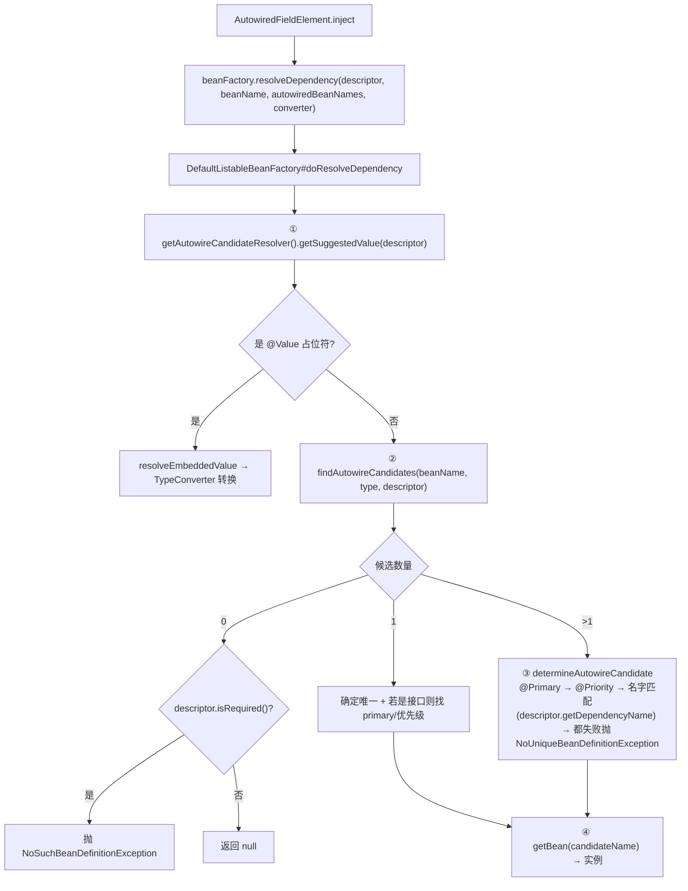

```java
// DefaultListableBeanFactory#doResolveDependency（关键片段）
public Object doResolveDependency(DependencyDescriptor descriptor, @Nullable String beanName,
        @Nullable Set<String> autowiredBeanNames, @Nullable TypeConverter typeConverter) throws BeansException {
    InjectionPoint previousInjectionPoint = ConstructorResolver.setCurrentInjectionPoint(descriptor);
    try {
        Object shortcut = descriptor.resolveShortcut(this);
        if (shortcut != null) return shortcut;                        // 例如 ObjectProvider 的 resolveShortcut

        Class<?> type = descriptor.getDependencyType();
        Object value = getAutowireCandidateResolver().getSuggestedValue(descriptor);
        if (value != null) {                                          // @Value / 默认值路径
            if (value instanceof String strValue) {
                String resolvedValue = resolveEmbeddedValue(strValue);  // ${} 占位符
                BeanDefinition bd = (beanName != null && containsBean(beanName) ?
                        getMergedBeanDefinition(beanName) : null);
                value = evaluateBeanDefinitionString(resolvedValue, bd);
            }
            TypeConverter converter = (typeConverter != null ? typeConverter :
                    (beanName != null ? getTypeConverterForBean(beanName) : getTypeConverter()));
            if (converter != null) {
                try { return converter.convertIfNecessary(value, type, descriptor.getTypeDescriptor()); }
                catch (UnsupportedOperationException ex) { }
            }
            return (converter != null ? value : descriptor.getTypeDescriptor().getObjectType().cast(value));
        }

        // 多个 Bean 的情况
        Map<String, Object> matchingBeans = findAutowireCandidates(beanName, type, descriptor);
        if (matchingBeans.isEmpty()) {
            if (isRequired(descriptor)) raiseNoMatchingBeanFound(type, descriptor.getResolvableType(), descriptor);
            return null;
        }

        String autowiredBeanName;
        Object instanceCandidate;
        if (matchingBeans.size() > 1) {
            autowiredBeanName = determineAutowireCandidate(matchingBeans, descriptor);
            if (autowiredBeanName == null) {
                if (isRequired(descriptor) || !indicatesMultipleBeans(type)) {
                    return descriptor.resolveNotUnique(descriptor.getResolvableType(), matchingBeans);
                } else {
                    return null;
                }
            }
            instanceCandidate = matchingBeans.get(autowiredBeanName);
        } else {
            Map.Entry<String, Object> entry = matchingBeans.entrySet().iterator().next();
            autowiredBeanName = entry.getKey();
            instanceCandidate = entry.getValue();
        }
        if (autowiredBeanNames != null) autowiredBeanNames.add(autowiredBeanName);
        if (instanceCandidate instanceof Class<?> clazz) {
            instanceCandidate = descriptor.resolveCandidate(autowiredBeanName, type, this);
        }
        Object result = instanceCandidate;
        if (result instanceof NullBean) { ... }
        if (!ClassUtils.isAssignableValue(type, result)) {
            throw new BeanNotOfRequiredTypeException(autowiredBeanName, type, instanceCandidate.getClass());
        }
        return result;
    } finally {
        ConstructorResolver.setCurrentInjectionPoint(previousInjectionPoint);
    }
}
```

### 5.2 `findAutowireCandidates` 与 `@Primary` / `@Qualifier` 的优先级

```java
protected String determineAutowireCandidate(Map<String, Object> candidates, DependencyDescriptor descriptor) {
    Class<?> requiredType = descriptor.getDependencyType();
    String primaryCandidate = determinePrimaryCandidate(candidates, requiredType);   // ① @Primary
    if (primaryCandidate != null) return primaryCandidate;
    String priorityCandidate = determineHighestPriorityCandidate(candidates, requiredType); // ② @Priority(Order)
    if (priorityCandidate != null) return priorityCandidate;
    // ③ 字段名/参数名与 beanName 匹配
    for (Map.Entry<String, Object> entry : candidates.entrySet()) {
        String candidateName = entry.getKey();
        Object beanInstance = entry.getValue();
        if ((beanInstance != null && this.resolvableDependencies.containsValue(beanInstance)) ||
                matchesBeanName(candidateName, descriptor.getDependencyName())) {
            return candidateName;
        }
    }
    return null;
}
```

**匹配优先级（从高到低）**：

1. `@Qualifier` 显式指定（在 `findAutowireCandidates` 阶段就过滤了）
2. `@Primary`
3. `@Priority(int)` 值小者优先（Spring 5.1+，`PriorityOrdered` 体系；注意**不是** `@Order`）
4. 字段名 / 参数名 与 beanName 相同
5. 以上都失败 → `NoUniqueBeanDefinitionException`

> **易错**：很多人以为 `@Order` 能决定注入优先级。**不能。** `@Order` 影响的是集合注入时的**集合元素顺序**、切面顺序、事件监听顺序，不影响"选哪个 Bean"。决定"选哪个"的是 `@Priority`。

### 5.3 `@Autowired` vs `@Resource`

| 维度 | `@Autowired`（Spring） | `@Resource`（JSR-250 / Spring 实现） |
|---|---|---|
| 来源 | Spring 自有 | Jakarta EE 规范，Spring 兼容 |
| 默认匹配方式 | **byType**（按类型） | **byName**（按名称） |
| 指定方式 | 配合 `@Qualifier` | `@Resource(name="x")` |
| 必要的 Bean | `required=true` 时找不到会抛异常 | 找不到抛异常（无 required 属性） |
| 修饰位置 | 构造器、方法、参数、字段、注解 | 字段、setter 方法（**不能修饰构造器参数**） |
| 处理者 | `AutowiredAnnotationBeanPostProcessor` | `CommonAnnotationBeanPostProcessor` |
| 执行时机 | `populateBean` → `postProcessProperties` | 同上，但在 BPP 链中顺序更靠后 |

**`@Resource` 的匹配规则**（`CommonAnnotationBeanPostProcessor#buildResourceMetadata`）：
1. 有 `name` → 按名字找，若找不到则按类型回退；
2. 无 `name` → 用字段名/方法名（去掉 `set` 前缀首字母小写）作为 beanName 找；
3. 找 beanName 找不到 → 按类型找；
4. 都有多个 → 按类型时抛异常。

> **面试延伸**："`@Resource` 注入不了 `Optional<X>`"——因为它不支持泛型容器包装。而 `@Autowired` 支持 `Optional`、`ObjectProvider`、`@Lazy`、`Provider`（`jakarta.inject`）。

### 5.4 支持注入的"容器类型"

| 声明类型 | 行为 | 底层 |
|---|---|---|
| `X x` | 单一注入，必须存在（`required`） | `doResolveDependency` |
| `Optional<X>` | 允许不存在 | `descriptor.getDependencyType()` → `addCandidateEntry` 包 `Optional` |
| `ObjectProvider<X>` | 延迟获取、可遍历多个 | `resolveShortcut` 返回 `DependencyObjectProvider` |
| `ObjectFactory<X>` | 延迟获取单个 | `resolveShortcut` 返回 `DependencyObjectProvider` |
| `@Lazy X` | 延迟代理 | `ContextAnnotationAutowireCandidateResolver#buildLazyResolutionProxy` |
| `List<X>` / `Set<X>` / `Map<String, X>` / `Collection<X>` | 集合注入（多 Bean） | `indicatesMultipleBeans` = true，返回全部候选 |
| `X[]` | 同上 | — |
| `Stream<X>` | 流式注入（Spring 5.1+） | 同上 |
| `Provider<X>`（JSR-330） | 延迟获取 | `Jsr330ProviderFactory` |

> **集合注入的关键细节**：集合类型注入**不要求至少一个**，空集合是合法的（`required` 语义被放宽）。这就是为什么 `List<SomeInterface>` 注入不会报错但可能是空的——常被用作"插件式扩展"的收集点。

### 5.5 `@Value` 的完整解析

```java
// PropertySourcesPlaceholderConfigurer 负责 ${} 替换（BeanFactoryPostProcessor）
// 但 @Value 在 Bean 实例化时由 AutowiredAnnotationBeanPostProcessor 处理
Object value = getAutowireCandidateResolver().getSuggestedValue(descriptor);   // ← QualifierAnnotationAutowireCandidateResolver
```

`getSuggestedValue` 的实现：

```java
public Object getSuggestedValue(DependencyDescriptor descriptor) {
    Object value = findValue(descriptor.getAnnotations());        // 先找 @Value
    if (value == null) {
        MethodParameter methodParam = descriptor.getMethodParameter();
        if (methodParam != null) {
            value = findValue(methodParam.getMethodAnnotations()); // 再找方法上的 @Value（@Bean 方法参数场景）
        }
    }
    return value;
}
```

**关键差异**：

| 场景 | 处理者 | 时机 |
|---|---|---|
| `@Value` 在 Bean 字段/方法参数上 | `AutowiredAnnotationBeanPostProcessor` | Bean 实例化时（`populateBean`） |
| `${...}` 在 XML BeanDefinition 的属性值里 | `PropertySourcesPlaceholderConfigurer`（`BeanFactoryPostProcessor`） | Bean 实例化**之前**（改 BeanDefinition） |
| `@ConfigurationProperties` | `ConfigurationPropertiesBindingPostProcessor`（`BeanPostProcessor`） | `postProcessBeforeInitialization` |
| `@Value` 在 `@Configuration` 类的 `@Bean` 方法体里（不是参数） | ❌ 无法由占位符解析器处理（方法体是 Java 代码） | 只能靠字段注入 |

> **这就是上一章"`@Bean` 方法体里 `@Value` 失效"的准确解释**：`@Bean` 方法体执行时，配置类已实例化，字段注入本应完成——但若配置类属于"被 CGLIB 增强的 `@Configuration`"，代理对象上的字段注入可能落在目标对象上，而方法体里 `this` 指向代理……实际 Spring 做了处理（代理会委托到目标实例的字段），所以这个问题在 `@Configuration(proxyBeanMethods=true)` 下通常不出现；出问题的是**`@Component` 类里 `@Bean` 方法体直接读未注入字段**这种写法。

### 5.6 注入的循环与 `dependsOn`

`@DependsOn` 声明"创建本 Bean 之前必须先创建某些 Bean"，进入 `mbd.dependsOn`，在 `doGetBean` 中递归 `getBean`。它**不能解决循环**，只会让循环更早暴露。真正的价值在于：
- 保证 `@Bean` 创建顺序（如 `dataSource` 先于 `sqlSessionFactory`）；
- 让 `ApplicationListener` 类型的 Bean 在事件发布前就绪。

### 5.7 三种注入方式的工程取舍

| 方式 | 优点 | 缺点 | 推荐度 |
|---|---|---|---|
| 构造器注入 | 不可变（`final`）、依赖显式、易测试、启动即失败 | 参数多时冗长；**不能解决循环依赖** | ★★★★★ |
| Setter 注入 | 可选依赖、可解决循环 | 可变状态、依赖不显式、NPE 风险 | ★★★ |
| 字段注入 | 简洁 | 破坏封装、无法 final、单测必须靠容器/反射、隐藏依赖 | ★★（生产代码慎用，测试代码常用） |

**Spring 官方态度**（`@Autowired` 的 Javadoc 原文）：
> *"Constructor injection should be used instead of field injection when possible. Constructor injection allows injected fields to be `final` and not `null`, and it's more testable."*

---

## 第 6 章 AOP：从切面到代理的完整链路

### 6.1 AOP 的核心抽象链条

理解了这 6 个概念的关系，AOP 就通了：

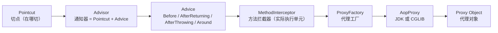

**对应关系**：

| 抽象 | 注解形式 | 实际类 |
|---|---|---|
| Pointcut | `@Pointcut("execution(...)")` | `AspectJExpressionPointcut` |
| Advice | `@Before` / `@After` / `@AfterReturning` / `@AfterThrowing` / `@Around` | `AspectJMethodBeforeAdvice` 等 |
| Advisor | 一个注解方法 → 一个 Advisor | `InstantiationModelAwarePointcutAdvisorImpl` |
| MethodInterceptor | `@Around` 直接映射；其他 Advice 被适配器包装 | `AspectJAroundClosure` / `MethodBeforeAdviceInterceptor` 等 |
| AopProxy | — | `JdkDynamicAopProxy` / `CglibAopProxy` |

### 6.2 代理是怎么被创建出来的

**第一步：注册"代理创建器"**

`@EnableAspectJAutoProxy` 通过 `@Import(AspectJAutoProxyRegistrar.class)` 注册：

```java
// AspectJAutoProxyRegistrar
public void registerBeanDefinitions(AnnotationMetadata importingClassMetadata, BeanDefinitionRegistry registry) {
    AopConfigUtils.registerAspectJAnnotationAutoProxyCreatorIfNecessary(registry);
    // → 注册 internalAutoProxyCreator = AnnotationAwareAspectJAutoProxyCreator（RootBeanDefinition）
    AnnotationAttributes enableAspectJAutoProxy = ...;
    if (enableAspectJAutoProxy != null) {
        if (enableAspectJAutoProxy.getBoolean("proxyTargetClass")) {
            AopConfigUtils.forceAutoProxyCreatorToUseClassProxying(registry);
        }
        if (enableAspectJAutoProxy.getBoolean("exposeProxy")) {
            AopConfigUtils.forceAutoProxyCreatorToExposeProxy(registry);
        }
    }
}
```

这个 `BeanDefinition` 在 `registerBeanPostProcessors`（refresh 第⑥步）被实例化为一个 `BeanPostProcessor`。

**第二步：Bean 初始化后，`postProcessAfterInitialization` 决定要不要代理**

```java
// AbstractAutoProxyCreator#postProcessAfterInitialization
public Object postProcessAfterInitialization(@Nullable Object bean, String beanName) {
    if (bean != null) {
        Object cacheKey = getCacheKey(bean.getClass(), beanName);
        if (this.earlyProxyReferences.remove(cacheKey) != bean) {
            return wrapIfNecessary(bean, beanName, cacheKey);
        }
    }
    return bean;
}

// AbstractAutoProxyCreator#wrapIfNecessary
protected Object wrapIfNecessary(Object bean, String beanName, Object cacheKey) {
    // ① 已经处理过（in aspectj auto-proxy 场景下避免重复）
    if (StringUtils.hasLength(beanName) && this.targetSourcedBeans.contains(beanName)) {
        return bean;
    }
    if (Boolean.FALSE.equals(this.advisedBeans.get(cacheKey))) {
        return bean;
    }
    // ② 基础设施类不代理（Advisor、Advice、Pointcut、AopInfrastructureBean）
    if (isInfrastructureClass(bean.getClass()) || shouldSkip(bean.getClass(), beanName)) {
        this.advisedBeans.put(cacheKey, Boolean.FALSE);
        return bean;
    }

    // ③ 找出匹配当前 Bean 的所有 Advisor（★ 核心：切点匹配）
    Object[] specificInterceptors = getAdvicesAndAdvisorsForBean(bean.getClass(), beanName, null);
    if (specificInterceptors != DO_NOT_PROXY) {
        this.advisedBeans.put(cacheKey, Boolean.TRUE);
        // ④ 创建代理
        Object proxy = createProxy(bean.getClass(), beanName, specificInterceptors, new SingletonTargetSource(bean));
        this.proxyTypes.put(cacheKey, proxy.getClass());
        return proxy;
    }
    this.advisedBeans.put(cacheKey, Boolean.FALSE);
    return bean;
}
```

**第三步：`createProxy` 决定 JDK 还是 CGLIB**

```java
// AbstractAutoProxyCreator#createProxy
protected Object createProxy(Class<?> beanClass, @Nullable String beanName,
        @Nullable Object[] specificInterceptors, TargetSource targetSource) {
    if (this.beanFactory instanceof ConfigurableListableBeanFactory clbf) {
        AutoProxyUtils.exposeTargetClass(clbf, beanName, beanClass);
    }

    ProxyFactory proxyFactory = new ProxyFactory();
    proxyFactory.copyFrom(this);           // 拷贝 proxyTargetClass / exposeProxy / frozen / optimize 等配置

    // ★ 判断逻辑（关键）
    if (!proxyFactory.isProxyTargetClass()) {
        if (shouldProxyTargetClass(beanClass, beanName)) {
            proxyFactory.setProxyTargetClass(true);       // ① 显式要求类代理（如 @EnableAspectJAutoProxy(proxyTargetClass=true) 或 BeanDefinition 的 preserveTargetClass）
        } else {
            evaluateProxyInterfaces(beanClass, proxyFactory);  // ② 有接口 → 用接口做 JDK 代理
        }
    }

    Advisor[] advisors = buildAdvisors(beanName, specificInterceptors);
    proxyFactory.addAdvisors(advisors);
    proxyFactory.setTargetSource(targetSource);
    customizeProxyFactory(proxyFactory);

    proxyFactory.setFrozen(this.freezeProxy);
    if (advisorsPreFiltered()) {
        proxyFactory.setPreFiltered(true);
    }

    return proxyFactory.getProxy(getProxyClassLoader());
}

// evaluateProxyInterfaces 的核心
protected void evaluateProxyInterfaces(Class<?> beanClass, ProxyFactory proxyFactory) {
    Class<?>[] targetInterfaces = ClassUtils.getUserClass(beanClass).getInterfaces();
    boolean hasReasonableProxyInterface = false;
    for (Class<?> ifc : targetInterfaces) {
        if (!isConfigurationCallbackInterface(ifc) && !isInternalLanguageInterface(ifc) && ifc.getMethods().length > 0) {
            hasReasonableProxyInterface = true;
            break;
        }
    }
    if (hasReasonableProxyInterface) {
        // 把"合理的"接口全部加入（包括父接口）
        for (Class<?> ifc : targetInterfaces) {
            if (isConfigurationCallbackInterface(ifc) || isInternalLanguageInterface(ifc)) continue;
            proxyFactory.addInterface(ifc);
        }
    } else {
        proxyFactory.setProxyTargetClass(true);      // 没接口 → 强制 CGLIB
    }
}
```

**JDK 代理 vs CGLIB 的选择规则（必背）**：

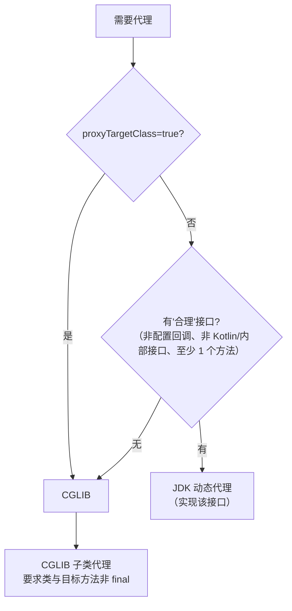

**易错点**：
- `@EnableAspectJAutoProxy(proxyTargetClass = true)` 或 Spring Boot 的 `spring.aop.proxy-target-class=true`（Boot 2.0+ **默认 true**！）会强制 CGLIB。
- **Spring Boot 默认 `proxy-target-class=true`**，所以 Boot 项目里 `@Transactional` 类**即使实现了接口也用 CGLIB 代理**。这解释了为什么"Boot 里 `@Transactional` 打在接口上不生效"——CGLIB 代理不读接口注解，`AnnotationTransactionAttributeSource` 会回退查接口方法注解（`specificMethod` 解析），但某些场景会漏。

**CGLIB 限制**：类不能是 `final`；被代理方法不能是 `final` / `private` / `static`；`protected` / 包可见可以（CGLIB 生成子类在同包下有访问权，但 `private` 不行）。

### 6.3 切点匹配：ASM 解析 + 方法匹配缓存

```java
// AnnotationAwareAspectJAutoProxyCreator#findCandidateAdvisors
protected List<Advisor> findCandidateAdvisors() {
    // ① 从父类的 BeanFactoryAdvisorRetrievalHelper 找"普通 Advisor"（手工声明的 Advisor Bean）
    List<Advisor> advisors = super.findCandidateAdvisors();
    if (this.aspectJAdvisorsBuilder != null) {
        // ② 再从 @Aspect Bean 中提取 Advisor
        advisors.addAll(this.aspectJAdvisorsBuilder.buildAspectJAdvisors());
    }
    return advisors;
}

// BeanFactoryAspectJAdvisorsBuilder#buildAspectJAdvisors
public List<Advisor> buildAspectJAdvisors() {
    List<String> aspectNames = this.aspectBeanNames;
    if (aspectNames == null) {
        synchronized (this) {
            aspectNames = this.aspectBeanNames;
            if (aspectNames == null) {
                List<Advisor> advisors = new ArrayList<>();
                aspectNames = new ArrayList<>();
                // 找出所有 Object 类型的 Bean 名字（懒加载不触发实例化）
                String[] beanNames = BeanFactoryUtils.beanNamesForTypeIncludingAncestors(
                        this.beanFactory, Object.class, true, false);
                for (String beanName : beanNames) {
                    if (!isEligibleBean(beanName)) continue;
                    Class<?> beanType = this.beanFactory.getType(beanName, false);   // ★ 用 getType 而非 getBean，避免提前实例化
                    if (beanType == null) continue;
                    if (this.advisorFactory.isAspect(beanType)) {                    // 判断是否有 @Aspect
                        aspectNames.add(beanName);
                        AspectMetadata amd = new AspectMetadata(beanType, beanName);
                        if (amd.getAjType().getPerClause().getKind() == PerClauseKind.SINGLETON) {
                            MetadataAwareAspectInstanceFactory factory =
                                    new BeanFactoryAspectInstanceFactory(this.beanFactory, beanName);
                            List<Advisor> classAdvisors = this.advisorFactory.getAdvisors(factory);
                            if (this.beanFactory.isSingleton(beanName)) {
                                this.advisorsCache.put(beanName, classAdvisors);
                            } else {
                                this.aspectFactoryCache.put(beanName, factory);
                            }
                            advisors.addAll(classAdvisors);
                        }
                        ...
                    }
                }
                this.aspectBeanNames = aspectNames;
                return advisors;
            }
        }
    }
    // 命中缓存，直接返回
    ...
}
```

`ReflectiveAspectJAdvisorFactory#getAdvisors` 逐方法解析：

```java
public List<Advisor> getAdvisors(MetadataAwareAspectInstanceFactory aspectInstanceFactory) {
    Class<?> aspectClass = aspectInstanceFactory.getAspectMetadata().getAspectClass();
    String aspectName = aspectInstanceFactory.getAspectMetadata().getAspectName();
    validateAspectType(aspectClass);

    MetadataAwareAspectInstanceFactory lazySingletonAspectInstanceFactory =
            new LazySingletonAspectInstanceFactoryDecorator(aspectInstanceFactory);

    List<Advisor> advisors = new ArrayList<>();
    for (Method method : getAdvisorMethods(aspectClass)) {     // 遍历非 @Pointcut 方法
        Advisor advisor = getAdvisor(method, lazySingletonAspectInstanceFactory, 0, aspectName);
        if (advisor != null) advisors.add(advisor);
    }
    ...
    // 按 @Order / AspectJ 优先级排序
    if (!advisors.isEmpty()) {
        advisors.sort(...);
    }
    return advisors;
}
```

**关键字段名（能说出来就是"源码级"）**：
- `advisorsCache`：`Map<String, List<Advisor>>`，按 aspectBeanName 缓存解析结果；
- `aspectFactoryCache`：`Map<String, MetadataAwareAspectInstanceFactory>`，非单例切面的工厂缓存；
- `aspectBeanNames`：缓存"哪些 Bean 是切面"。

### 6.4 代理对象执行时的拦截链

**JDK 代理路径**：

```java
// JdkDynamicAopProxy#invoke
public Object invoke(Object proxy, Method method, Object[] args) throws Throwable {
    Object oldProxy = null;
    boolean setProxyContext = false;
    TargetSource targetSource = this.advised.targetSource;
    Object target = null;

    try {
        // ① equals / hashCode 不拦截（走代理自身的实现）
        if (!this.equalsDefined && AopUtils.isEqualsMethod(method)) {
            return equals(args[0]);
        }
        else if (!this.hashCodeDefined && AopUtils.isHashCodeMethod(method)) {
            return hashCode();
        }
        else if (method.getDeclaringClass() == DecoratingProxy.class) {
            return AopProxyUtils.ultimateTargetClass(this.advised);
        }
        else if (!this.advised.opaque && method.getDeclaringClass().isInterface() &&
                method.getDeclaringClass().isAssignableFrom(Advised.class)) {
            // ② Advised 接口的方法（addAdvice 等）直接调用 advised
            return AopUtils.invokeJoinpointUsingReflection(this.advised, method, args);
        }

        Object retVal;

        // ③ ★ 暴露代理：让 AopContext.currentProxy() 可用
        if (this.advised.exposeProxy) {
            oldProxy = AopContext.setCurrentProxy(proxy);
            setProxyContext = true;
        }

        target = targetSource.getTarget();
        Class<?> targetClass = (target != null ? target.getClass() : null);

        // ④ 构建拦截器链（★ 核心）
        List<Object> chain = this.advised.getInterceptorsAndDynamicInterceptionAdvice(method, targetClass);

        if (chain.isEmpty()) {
            // ⑤ 没有匹配的切面 → 直接反射调用
            Object[] argsToUse = AopProxyUtils.adaptArgumentsIfNecessary(method, args);
            retVal = AopUtils.invokeJoinpointUsingReflection(target, method, argsToUse);
        } else {
            // ⑥ 有切面 → 构造 MethodInvocation，逐个执行
            MethodInvocation invocation = new ReflectiveMethodInvocation(proxy, target, method, args, targetClass, chain);
            retVal = invocation.proceed();
        }

        // ⑦ 处理返回值类型（基本类型可能是 null）
        Class<?> returnType = method.getReturnType();
        if (retVal != null && retVal == target && returnType != Object.class &&
                returnType.isInstance(proxy) && !RawTargetAccess.class.isAssignableFrom(method.getDeclaringClass())) {
            retVal = proxy;
        } else if (retVal == null && returnType != Void.TYPE && returnType.isPrimitive()) {
            throw new AopInvocationException("Null return value from advice does not match primitive return type for: " + method);
        }
        return retVal;
    } finally {
        if (target != null && !targetSource.isStatic()) targetSource.releaseTarget(target);
        if (setProxyContext) AopContext.setCurrentProxy(oldProxy);
    }
}
```

**`getInterceptorsAndDynamicInterceptionAdvice`**：

```java
// AdvisedSupport
public List<Object> getInterceptorsAndDynamicInterceptionAdvice(Method method, @Nullable Class<?> targetClass) {
    MethodCacheKey cacheKey = new MethodCacheKey(method);
    List<Object> cached = this.methodCache.get(cacheKey);      // ★ 方法级缓存 key
    if (cached == null) {
        cached = this.interceptorChainFactory.getInterceptorsAndDynamicInterceptionAdvice(this, method, targetClass);
        this.methodCache.put(cacheKey, cached);
    }
    return cached;
}

// DefaultAdvisorChainFactory
public List<Object> getInterceptorsAndDynamicInterceptionAdvice(
        Advised config, Method method, @Nullable Class<?> targetClass) {

    List<Object> interceptorList = new ArrayList<>(config.getAdvisors().length);
    Class<?> actualClass = (targetClass != null ? targetClass : method.getDeclaringClass());
    boolean hasIntroductions = hasMatchingIntroductions(config, actualClass);
    AdvisorAdapterRegistry registry = GlobalAdvisorAdapterRegistry.getInstance();

    for (Advisor advisor : config.getAdvisors()) {
        if (advisor instanceof PointcutAdvisor pointcutAdvisor) {
            if (config.isPreFiltered() || pointcutAdvisor.getPointcut().getClassFilter().matches(actualClass)) {
                MethodInterceptor[] interceptors = registry.getInterceptors(advisor);   // Advisor → Interceptor 适配
                MethodMatcher mm = pointcutAdvisor.getPointcut().getMethodMatcher();
                if (MethodMatchers.matches(mm, method, actualClass, hasIntroductions)) {
                    if (mm.isRuntime()) {   // ★ 运行时匹配：需要每次调用时再判断一次
                        for (MethodInterceptor interceptor : interceptors) {
                            interceptorList.add(new InterceptorAndDynamicMethodMatcher(interceptor, mm));
                        }
                    } else {
                        interceptorList.addAll(Arrays.asList(interceptors));
                    }
                }
            }
        } else if (advisor instanceof IntroductionAdvisor ia) { ... }
        else {
            Interceptor[] interceptors = registry.getInterceptors(advisor);
            interceptorList.addAll(Arrays.asList(interceptors));
        }
    }
    return interceptorList;
}
```

### 6.5 `ReflectiveMethodInvocation`：责任链的递归

```java
// ReflectiveMethodInvocation
private int currentInterceptorIndex = -1;
private final List<?> interceptorsAndDynamicMethodMatchers;   // 链

public Object proceed() throws Throwable {
    // ★ 链走完了 → 调用目标方法
    if (this.currentInterceptorIndex == this.interceptorsAndDynamicMethodMatchers.size() - 1) {
        return invokeJoinpoint();
    }

    Object interceptorOrInterceptionAdvice =
            this.interceptorsAndDynamicMethodMatchers.get(++this.currentInterceptorIndex);

    if (interceptorOrInterceptionAdvice instanceof InterceptorAndDynamicMethodMatcher dm) {
        // 运行时匹配
        Class<?> targetClass = (this.targetClass != null ? this.targetClass : this.method.getDeclaringClass());
        if (dm.methodMatcher.matches(this.method, targetClass, this.arguments)) {
            return dm.interceptor.invoke(this);
        } else {
            return proceed();     // 不匹配就跳过，继续下一个
        }
    } else {
        // 普通拦截器：★ 把 this（invocation）传给拦截器，拦截器内部调 invocation.proceed() 实现递归
        return ((MethodInterceptor) interceptorOrInterceptionAdvice).invoke(this);
    }
}
```

**这就是责任链的精髓**：拦截器不直接调用目标方法，而是调用 `invocation.proceed()`，于是形成递归下降；每个拦截器都能在 `proceed()` 前后插入逻辑。

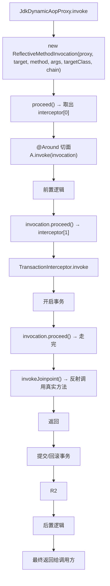

**一个极易答错的点**：`chain` 的顺序决定了**前置逻辑的执行顺序和后置逻辑的逆序**。`@Order` 值小的 Advisor 排在 `chain` 前面，所以"值小的先执行前置，最后执行后置"。**切面顺序不能想当然**（见面试题 14）。

### 6.6 `AopContext.currentProxy()` 与 `exposeProxy`

**问题**：同类内部方法调用 `this.b()`，`this` 是代理对象吗？

**答案**：**不是**。`this` 永远是"代理对象所持有的目标对象引用"。`JdkDynamicAopProxy.invoke` 里 `target = targetSource.getTarget()`，反射调用 `method.invoke(target, args)`，所以 `target` 内部执行 `this.xxx()` 时 `this` 就是 `target`（原始对象），**不经过代理**。这就是"自调用失效"的根本原因。

**解法**：`exposeProxy = true` 时，`AopContext.setCurrentProxy(proxy)` 把代理放进 `ThreadLocal`，代码里用 `((AService) AopContext.currentProxy()).b()` 就能走代理。

```java
@EnableAspectJAutoProxy(exposeProxy = true)   // 必须显式开启，默认 false（性能考虑）
```

或在 Boot 里：
```yaml
spring.aop.expose-proxy=true
```

**代价**：每个被代理方法调用多一次 `ThreadLocal` 写入/清除；`AopContext` 用 `NamedThreadLocal`，父子线程不传递（`@Async` 里拿不到）。

### 6.7 多切面顺序：`@Order` 的真实行为

`AspectJAwareAdvisorAutoProxyCreator#sortAdvisors`：

```java
protected void sortAdvisors(List<Advisor> advisors) {
    advisors.sort(AspectJPrecedenceComparator());   // ← 核心
}
```

`AspectJPrecedenceComparator#compare` 逻辑（简化）：

```java
public int compare(Advisor o1, Advisor o2) {
    int advisorPrecedence = this.advisorComparator.compare(o1, o2);   // ① 先按 @Order/@Priority 的 Ordered 值
    if (advisorPrecedence == 0 && declaresAspectJPrecedence(o1) && declaresAspectJPrecedence(o2)) {
        // ② @Order 相同 且 都是 AspectJ 切面 → 看"声明顺序"
        // AspectJPrecedenceComparator: 同一个切面内 后声明 的 @Around 优先级"更高"（更外层）
        ...
    }
    return advisorPrecedence;
}
```

**结论（可直接背）**：

| 场景 | 行为 |
|---|---|
| `@Order(1)` vs `@Order(2)` | `1` 排在 chain 前 → **前置先执行、后置后执行**。`@Around` 中 `1` 在"更外层" |
| `@Order` 相同 | **Spring 5.2.7+** 用 `OrderComparator` 的 `getOrder` 相同则按 `AnnotationAwareOrderComparator` 的稳定行为；实际**不保证**，可能受 Bean 创建顺序影响 |
| 同一切面内多个 `@Around` | AspectJ 语义：**后声明的方法优先级更高**（外层） |
| 切面 vs `Advisor` Bean | 都参与同一个排序，`@Order` 生效 |

> **工程建议**：永远显式写 `@Order` 且**留间隔**（10、20、30），不要用 1、2、3，给后续插入留空间。

### 6.8 五种通知类型的实现差异

| 注解 | 底层 Advisor | 适配成的 Interceptor | 特性 |
|---|---|---|---|
| `@Before` | `AspectJMethodBeforeAdvice` | `MethodBeforeAdviceInterceptor` | 无法阻止目标方法执行（只能抛异常） |
| `@AfterReturning` | `AspectJAfterReturningAdvice` | `AfterReturningAdviceInterceptor` | 能改返回值？**不能**（只能读） |
| `@AfterThrowing` | `AspectJAfterThrowingAdvice` | `AspectJAfterThrowingAdvice`（自身就是 `MethodInterceptor`） | 可吞异常（不 rethrow 就不抛） |
| `@After`（finally 语义） | `AspectJAfterAdvice` | 自身 | 一定执行（`finally`） |
| `@Around` | `AspectJAroundClosure` | `AspectJAroundClosure` | 最强：可改参数、改返回值、跳过目标方法 |

> **延伸**：`@Around` 的 `ProceedingJoinPoint.proceed(args)` 可以**传新参数**，这是"参数校验/改写"类切面的唯一实现方式。但传参类型必须与原方法签名匹配，否则 `IllegalArgumentException`。

### 6.9 AOP 失效清单（面试必问）

| 失效场景 | 原因 | 验证/解法 |
|---|---|---|
| 同类内部 `this.method()` 调用 | `this` 是原始对象，绕过代理 | `AopContext.currentProxy()` / 注入自身 / 拆类 |
| `private` 方法 | JDK 代理必须有接口方法（`private` 不在接口里）；CGLIB 无法代理 `private` | 改 `public` 或拆到另一个 Bean |
| `final` 方法 / `final` 类 | CGLIB 无法生成子类/无法重写 | 去掉 `final` |
| `static` 方法 | 静态方法属于类，不属于实例 | AOP 无法处理，改用编译期织入 |
| 非 Spring 管理的对象（`new X()`） | 没进容器，没有 BPP 处理 | 交给容器管理 |
| Bean 在 `registerBeanPostProcessors` 之前创建 | 拿不到 `AutoProxyCreator` | 看 `BeanPostProcessorChecker` 日志 |
| 切点表达式写错 | 匹配不到 | `@Pointcut` 加日志 / 用 `AopUtils` 调试 |
| 注解写在实现类但代理走 JDK 接口 | JDK 代理只认接口注解 | `proxyTargetClass=true` |
| 循环依赖导致原始对象注入 | `allowRawInjectionDespiteWrapping` | 见 4.6 的报错 |
| Kotlin 类默认 `final` | CGLIB 无法继承 | `allOpen` 插件 / `proxyTargetClass` 无用，需 `open` |
| 在 `@PostConstruct` 里调自身方法 | 此时还没生成代理（BPP after 未执行完） | 改用 `SmartInitializingSingleton` |

### 6.10 代理的"多重代理"问题

一个 Bean 可能被**多个** `BeanPostProcessor` 依次代理：

```
原始对象 A
 → BPP1: AutoProxyCreator（AOP 代理）→ A1
 → BPP2: AsyncAnnotationBeanPostProcessor（@Async 代理）→ A2（代理 A1）
 → BPP3: ValidationPostProcessor（@Validated 代理）→ A3
```

所以调用链可能是 `A3 → A2 → A1 → 原始 A`。这带来两个后果：
- **性能**：每层都是反射调用；
- **异常栈深度**：`TransactionInterceptor` 的异常会被多层 CGLIB 包裹，日志里出现 `xxx$$EnhancerBySpringCGLIB$$xxx` 的重复堆栈。

**排查技巧**：`AopUtils.getTargetClass(bean)` 能穿透多层代理拿真实类；`AopProxyUtils.ultimateTargetClass(advised)` 同理。

### 6.11 Spring AOP 与 AspectJ 的本质区别

| 维度 | Spring AOP | AspectJ |
|---|---|---|
| 织入时机 | **运行期**（动态代理） | **编译期 / 类加载期**（字节码增强） |
| 增强范围 | 只能增强 **Spring Bean 的 public 方法** | 任意方法（含 `private`、`static`、构造器、字段访问） |
| 自调用 | ❌ 不生效 | ✅ 生效 |
| 性能 | 每次调用有代理开销（~几十 ns 到 µs） | 几乎零开销（字节码直连） |
| 依赖 | 无需额外编译器 | 需要 `aspectjweaver` / `aspectjrt` |
| Spring 用法 | 主流 | 通过 `@EnableLoadTimeWeaving` + `-javaagent` 或编译期 `ajc` |

**LTW（Load Time Weaving）**：`LoadTimeWeaver` 通过 Java Agent 的 `ClassFileTransformer` 在类加载时改写字节码。Spring 提供 `InstrumentationLoadTimeWeaver`（需要 `-javaagent:spring-instrument.jar`）。**Boot 3 已移除 `spring-instrument` 模块**（`spring-boot-starter-aop` 不再包含 LTW 支持），因为 AOT/Native Image 与 LTW 不兼容。

> **一句话总结**：Spring AOP 是"**基于代理的、只作用于 Bean 的、运行时的轻量 AOP**"；AspectJ 是"**基于字节码的、全量织入的编译期 AOP**"。所以 `@Transactional` 自调用会失效，本质是"代理模式的边界"。

---

## 第 7 章 声明式事务：AOP 最经典的应用

### 7.1 事务抽象三大件

```java
public interface PlatformTransactionManager {
    TransactionStatus getTransaction(@Nullable TransactionDefinition definition);  // 开/加入事务
    void commit(TransactionStatus status);
    void rollback(TransactionStatus status);
}

public interface TransactionDefinition {
    int getPropagationBehavior();      // 传播行为
    int getIsolationLevel();           // 隔离级别
    int getTimeout();                  // 超时（秒）
    boolean isReadOnly();              // 是否只读
    @Nullable String getName();        // 事务名（日志/监控用）
}

public interface TransactionStatus extends TransactionExecution {
    boolean isNewTransaction();
    boolean hasSavepoint();            // 是否有保存点（NESTED 用）
    void setRollbackOnly();
    boolean isRollbackOnly();
    boolean isCompleted();
}
```

**`TransactionStatus` 的关键字段**（`DefaultTransactionStatus`）：`newTransaction`、`newSynchronization`、`readOnly`、`transaction`（底层 `TransactionObject`）、`savepoint`、`completed`。

### 7.2 `@Transactional` 生效的装配链路

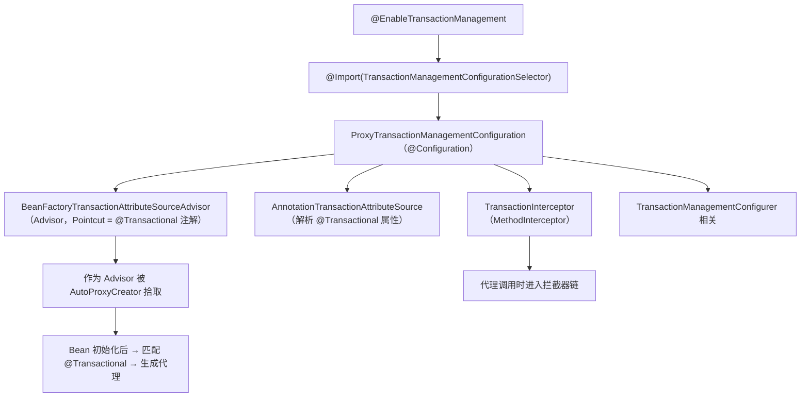

```java
// ProxyTransactionManagementConfiguration
@Configuration(proxyBeanMethods = false)
@Role(BeanDefinition.ROLE_INFRASTRUCTURE)
public class ProxyTransactionManagementConfiguration extends AbstractTransactionManagementConfiguration {

    @Bean(name = TransactionManagementConfigUtils.TRANSACTION_ADVISOR_BEAN_NAME)
    @Role(BeanDefinition.ROLE_INFRASTRUCTURE)
    public BeanFactoryTransactionAttributeSourceAdvisor transactionAdvisor(
            TransactionAttributeSource transactionAttributeSource, TransactionInterceptor transactionInterceptor) {
        BeanFactoryTransactionAttributeSourceAdvisor advisor = new BeanFactoryTransactionAttributeSourceAdvisor();
        advisor.setTransactionAttributeSource(transactionAttributeSource);
        advisor.setAdvice(transactionInterceptor);
        if (this.enableTx != null) advisor.setOrder(this.enableTx.<Integer>getNumber("order"));
        return advisor;
    }

    @Bean
    @Role(BeanDefinition.ROLE_INFRASTRUCTURE)
    public TransactionAttributeSource transactionAttributeSource() {
        return new AnnotationTransactionAttributeSource();
    }

    @Bean
    @Role(BeanDefinition.ROLE_INFRASTRUCTURE)
    public TransactionInterceptor transactionInterceptor(TransactionAttributeSource transactionAttributeSource) {
        TransactionInterceptor interceptor = new TransactionInterceptor();
        interceptor.setTransactionAttributeSource(transactionAttributeSource);
        if (this.txManager != null) interceptor.setTransactionManager(this.txManager);
        return interceptor;
    }
}
```

**Spring Boot 自动配置**：`TransactionAutoConfiguration` 在检测到 `PlatformTransactionManager` 的 Bean 时，等价于启用 `@EnableTransactionManagement`。所以 Boot 项目**不需要显式加注解**。

### 7.3 切点解析：`AnnotationTransactionAttributeSource`

```java
// SpringTransactionAnnotationParser#parseTransactionAnnotation
protected TransactionAttribute parseTransactionAnnotation(AnnotatedElement element) {
    AnnotationAttributes attributes = AnnotatedElementUtils.findMergedAnnotationAttributes(
            element, Transactional.class, false, false);
    if (attributes != null) {
        return parseTransactionAnnotation(attributes);
    }
    return null;
}

protected TransactionAttribute parseTransactionAnnotation(AnnotationAttributes attributes) {
    RuleBasedTransactionAttribute rbta = new RuleBasedTransactionAttribute();
    Propagation propagation = attributes.getEnum("propagation");
    rbta.setPropagationBehavior(propagation.value());
    Isolation isolation = attributes.getEnum("isolation");
    rbta.setIsolationLevel(isolation.value());
    rbta.setTimeout(attributes.getNumber("timeout").intValue());
    String timeoutString = attributes.getString("timeoutString");
    Assert.isTrue(!StringUtils.hasText(timeoutString) || rbta.getTimeout() < 0,
            "Specify 'timeout' or 'timeoutString', not both");
    rbta.setTimeoutString(timeoutString);
    rbta.setReadOnly(attributes.getBoolean("readOnly"));
    rbta.setQualifier(attributes.getString("value"));
    rbta.setLabels(parseLabels(attributes));
    rbta.setRollbackRules(parseRollbackRules(attributes));   // ★ rollbackFor / noRollbackFor / rollbackForClassName
    return rbta;
}
```

**解析顺序（`AbstractFallbackTransactionAttributeSource#getTransactionAttribute`）**：

1. 命中缓存（`transactionAttributeCache`，`ConcurrentHashMap<Object, TransactionAttribute>`）→ 返回
2. 目标方法是 `Object` 继承来的（`equals`/`hashCode`）→ `null`（不代理）
3. **目标类**（`targetClass`）的注解 → 命中即返回
4. **目标方法**（`specificMethod`，解析到具体实现类的方法）的注解 → 命中即返回
5. **原始方法**（`originalMethod`，接口上的方法）的注解 → 命中即返回

```java
protected TransactionAttribute computeTransactionAttribute(Method method, @Nullable Class<?> targetClass) {
    // ① 非 public 方法：Spring 5.x 默认跳过；6.x 放宽
    if (allowPublicMethodsOnly() && !Modifier.isPublic(method.getModifiers())) {
        return null;
    }
    Method specificMethod = AopUtils.getMostSpecificMethod(method, targetClass);
    // ② 方法上找
    TransactionAttribute txAttr = findTransactionAttribute(specificMethod);
    if (txAttr != null) return txAttr;
    // ③ 方法所属类上找
    txAttr = findTransactionAttribute(specificMethod.getDeclaringClass());
    if (txAttr != null && ClassUtils.isUserLevelMethod(method)) return txAttr;
    // ④ 原始方法（接口方法）上找
    if (specificMethod != method) {
        txAttr = findTransactionAttribute(method);
        if (txAttr != null) return txAttr;
        txAttr = findTransactionAttribute(method.getDeclaringClass());
        if (txAttr != null && ClassUtils.isUserLevelMethod(method)) return txAttr;
    }
    return null;
}
```

> **这解释了"`@Transactional` 打在接口上是否生效"**：会生效——因为第④步会回退查接口方法/接口类。但**前提是代理能拿到 `originalMethod`（即通过接口代理调用）**。CGLIB 代理时 `invocation.getMethod()` 是**实现类方法**，`specificMethod == method`，第④步根本不会执行 → **失效**。这是 Boot 项目（默认 CGLIB）的经典坑。

### 7.4 事务拦截器的执行流程

```java
// TransactionInterceptor#invoke
public Object invoke(MethodInvocation invocation) throws Throwable {
    Class<?> targetClass = (invocation.getThis() != null ? AopUtils.getTargetClass(invocation.getThis()) : null);
    Method method = invocation.getMethod();
    return invokeWithinTransaction(method, targetClass, new InvocationCallback() {
        @Override
        public Object proceedWithInvocation() throws Throwable {
            return invocation.proceed();
        }
    });
}

// TransactionAspectSupport#invokeWithinTransaction
protected Object invokeWithinTransaction(Method method, @Nullable Class<?> targetClass,
        final InvocationCallback invocation) throws Throwable {

    TransactionAttributeSource tas = getTransactionAttributeSource();
    final TransactionAttribute txAttr = (tas != null ? tas.getTransactionAttribute(method, targetClass) : null);
    final TransactionManager tm = determineTransactionManager(txAttr);

    if (this.reactiveAdapterRegistry != null && tm instanceof ReactiveTransactionManager rtm) {
        // 响应式事务分支（Reactor）
        ...
    }

    PlatformTransactionManager ptm = asPlatformTransactionManager(tm);
    final String joinpointIdentification = methodIdentification(method, targetClass, txAttr);

    if (txAttr == null || !(ptm instanceof CallbackPreferringPlatformTransactionManager cpptm)) {
        // ① 创建事务（或加入已有事务）
        TransactionInfo txInfo = createTransactionIfNecessary(ptm, txAttr, joinpointIdentification);
        Object retVal;
        try {
            // ② 执行业务（继续沿拦截器链走下去，最终到达目标方法）
            retVal = invocation.proceedWithInvocation();
        } catch (Throwable ex) {
            // ③ 异常处理（回滚判定）
            completeTransactionAfterThrowing(txInfo, ex);
            throw ex;
        } finally {
            // ④ 清理线程绑定
            cleanupTransactionInfo(txInfo);
        }
        if (retVal != null && txInfo != null && txInfo.getTransactionStatus() != null) {
            // ⑤ 正常返回 → 提交
            commitTransactionAfterReturning(txInfo);
        }
        return retVal;
    } else {
        // CallbackPreferring 分支（WebLogic JTA）
        ...
    }
}
```

### 7.5 `createTransactionIfNecessary` → `getTransaction`

```java
// AbstractPlatformTransactionManager#getTransaction
public final TransactionStatus getTransaction(@Nullable TransactionDefinition definition) throws TransactionException {
    // ① 从事务对象管理器拿到"当前线程已有的"事务对象（可能是 DataSource 的 ConnectionHolder）
    Object transaction = doGetTransaction();

    boolean debugEnabled = logger.isDebugEnabled();
    if (definition == null) definition = new DefaultTransactionDefinition();
    if (isExistingTransaction(transaction)) {
        // ② 已经有事务 → 处理传播行为（this is the important part）
        return handleExistingTransaction(definition, transaction, debugEnabled);
    }

    // ③ 没有事务 → 校验传播行为合法性
    if (definition.getTimeout() < TransactionDefinition.TIMEOUT_DEFAULT) {
        throw new InvalidTimeoutException("Invalid transaction timeout", definition.getTimeout());
    }
    if (definition.getPropagationBehavior() == TransactionDefinition.PROPAGATION_MANDATORY) {
        throw new IllegalTransactionStateException(
                "No existing transaction found for transaction marked with propagation 'mandatory'");
    }
    else if (definition.getPropagationBehavior() == TransactionDefinition.PROPAGATION_REQUIRED ||
             definition.getPropagationBehavior() == TransactionDefinition.PROPAGATION_REQUIRES_NEW ||
             definition.getPropagationBehavior() == TransactionDefinition.PROPAGATION_NESTED) {
        // ④ 挂起可能存在的资源（一般没有），然后开新事务
        SuspendedResourcesHolder suspendedResources = suspend(null);
        try {
            boolean newSynchronization = (getTransactionSynchronization() != SYNCHRONIZATION_NEVER);
            DefaultTransactionStatus status = newTransactionStatus(
                    definition, transaction, true, newSynchronization, debugEnabled, suspendedResources);
            doBegin(transaction, definition);           // ★ 真正开启事务：从 DataSource 取 Connection，setAutoCommit(false)
            prepareSynchronization(status, definition); // ★ 绑定到 ThreadLocal
            return status;
        } catch (RuntimeException | Error ex) {
            resumeAfterBeginException(transaction, suspendedResources, ex);
            throw ex;
        }
    }
    else {
        // ⑤ SUPPORTS / NOT_SUPPORTED / NEVER：不开启事务
        boolean newSynchronization = (getTransactionSynchronization() == SYNCHRONIZATION_ALWAYS);
        return prepareTransactionStatus(definition, transaction, true, newSynchronization, debugEnabled, null);
    }
}
```

**`doBegin`（`DataSourceTransactionManager`）**：

```java
protected void doBegin(Object transaction, TransactionDefinition definition) {
    DataSourceTransactionObject txObject = (DataSourceTransactionObject) transaction;
    Connection con = null;
    try {
        if (!txObject.hasConnectionHolder() || txObject.getConnectionHolder().isSynchronizedWithTransaction()) {
            Connection newCon = this.obtainDataSource().getConnection();     // 从连接池借一个
            txObject.setConnectionHolder(new ConnectionHolder(newCon), true);
        }
        txObject.getConnectionHolder().setSynchronizedWithTransaction(true);
        con = txObject.getConnectionHolder().getConnection();

        Integer previousIsolationLevel = DataSourceUtils.prepareConnectionForTransaction(con, definition);
        txObject.setPreviousIsolationLevel(previousIsolationLevel);
        txObject.setReadOnly(definition.isReadOnly());

        // 关掉自动提交（★ 这是事务生效的核心）
        if (con.getAutoCommit()) {
            txObject.setMustRestoreAutoCommit(true);
            con.setAutoCommit(false);
        }
        prepareTransactionalConnection(con, definition);
        txObject.getConnectionHolder().setTransactionActive(true);

        int timeout = determineTimeout(definition);
        if (timeout != TransactionDefinition.TIMEOUT_DEFAULT) {
            txObject.getConnectionHolder().setTimeoutInSeconds(timeout);
        }
        // 绑定到当前线程
        if (txObject.isNewConnectionHolder()) {
            TransactionSynchronizationManager.bindResource(obtainDataSource(), txObject.getConnectionHolder());
        }
    } catch (Throwable ex) {
        ...
        throw new CannotCreateTransactionException("Could not open JDBC Connection for transaction", ex);
    }
}
```

**`prepareSynchronization`：ThreadLocal 的落点**

```java
protected void prepareSynchronization(DefaultTransactionStatus status, TransactionDefinition definition) {
    if (status.isNewSynchronization()) {
        TransactionSynchronizationManager.setActualTransactionActive(status.hasTransaction());
        TransactionSynchronizationManager.setCurrentTransactionIsolationLevel(
                definition.getIsolationLevel() != TransactionDefinition.ISOLATION_DEFAULT ?
                        definition.getIsolationLevel() : null);
        TransactionSynchronizationManager.setCurrentTransactionReadOnly(definition.isReadOnly());
        TransactionSynchronizationManager.setCurrentTransactionName(definition.getName());
        TransactionSynchronizationManager.initSynchronization();   // 初始化 synchronization 列表
    }
}
```

`TransactionSynchronizationManager` 的四个核心 ThreadLocal：

```java
private static final ThreadLocal<Map<Object, Object>> resources =
        new NamedThreadLocal<>("Transactional resources");               // ★ DataSource → ConnectionHolder
private static final ThreadLocal<Set<TransactionSynchronization>> synchronizations =
        new NamedThreadLocal<>("Transaction synchronizations");          // 回调列表
private static final ThreadLocal<String> currentTransactionName =
        new NamedThreadLocal<>("Current transaction name");
private static final ThreadLocal<Boolean> currentTransactionReadOnly =
        new NamedThreadLocal<>("Current transaction read-only status");
private static final ThreadLocal<Integer> currentTransactionIsolationLevel =
        new NamedThreadLocal<>("Current transaction isolation level");
private static final ThreadLocal<Boolean> actualTransactionActive =
        new NamedThreadLocal<>("Actual transaction active");
```

**为什么需要 `bindResource`**：让**同一个线程**在事务内任意位置 `dataSource.getConnection()` 时拿到**同一个** Connection（`DataSourceUtils.getConnection` 会先查 ThreadLocal）。这就是"事务内 MyBatis 和 JdbcTemplate 共享同一个连接"的实现原理。

> **关键延伸**：`TransactionSynchronizationManager` 是 `static ThreadLocal`，所以 **`@Async` / 线程池 / 多线程里的事务全部失效**——它们拿到的是新的空 `resources`，于是 `DataSourceUtils.getConnection()` 从池里借了一个**新连接**，`autoCommit=true`，等于没有事务。这是"异步方法里 DB 操作不可回滚"的根本原因。

### 7.6 七种传播行为的底层实现

```java
// AbstractPlatformTransactionManager#handleExistingTransaction（已有事务时）
private TransactionStatus handleExistingTransaction(TransactionDefinition definition,
        Object transaction, boolean debugEnabled) throws TransactionException {

    if (definition.getPropagationBehavior() == TransactionDefinition.PROPAGATION_NEVER) {
        throw new IllegalTransactionStateException(
                "Existing transaction found for transaction marked with propagation 'never'");
    }

    if (definition.getPropagationBehavior() == TransactionDefinition.PROPAGATION_NOT_SUPPORTED) {
        // 挂起当前事务（解绑 ConnectionHolder），不开启新事务，执行完后恢复
        Object suspendedResources = suspend(transaction);
        boolean newSynchronization = (getTransactionSynchronization() == SYNCHRONIZATION_ALWAYS);
        return prepareTransactionStatus(definition, null, false, newSynchronization, debugEnabled, suspendedResources);
    }

    if (definition.getPropagationBehavior() == TransactionDefinition.PROPAGATION_REQUIRES_NEW) {
        // ★ 独立新事务：挂起外层，开新连接，执行完提交/回滚，再恢复外层
        SuspendedResourcesHolder suspendedResources = suspend(transaction);
        try {
            boolean newSynchronization = (getTransactionSynchronization() != SYNCHRONIZATION_NEVER);
            DefaultTransactionStatus status = newTransactionStatus(
                    definition, transaction, true, newSynchronization, debugEnabled, suspendedResources);
            doBegin(transaction, definition);
            prepareSynchronization(status, definition);
            return status;
        } catch (RuntimeException | Error beginEx) {
            resumeAfterBeginException(transaction, suspendedResources, beginEx);
            throw beginEx;
        }
    }

    if (definition.getPropagationBehavior() == TransactionDefinition.PROPAGATION_NESTED) {
        if (!isNestedTransactionAllowed()) {
            throw new NestedTransactionNotSupportedException(
                    "Transaction manager does not allow nested transactions by default - " +
                    "specify 'nestedTransactionAllowed' property with value 'true'");
        }
        if (useSavepointForNestedTransaction()) {
            // ★ 用 JDBC Savepoint 实现"伪嵌套"
            DefaultTransactionStatus status = prepareTransactionStatus(definition, transaction, false, false, debugEnabled, null);
            status.createAndHoldSavepoint();       // connection.setSavepoint()
            return status;
        } else {
            // JTA 真正的嵌套事务
            boolean newSynchronization = (getTransactionSynchronization() != SYNCHRONIZATION_NEVER);
            DefaultTransactionStatus status = newTransactionStatus(
                    definition, transaction, true, newSynchronization, debugEnabled, null);
            doBegin(transaction, definition);
            prepareSynchronization(status, definition);
            return status;
        }
    }

    // ★ 走到这里的只有 REQUIRED / SUPPORTS / MANDATORY → 加入现有事务
    if (isValidateExistingTransaction()) {
        if (definition.getIsolationLevel() != TransactionDefinition.ISOLATION_DEFAULT) {
            Integer currentIsolationLevel = TransactionSynchronizationManager.getCurrentTransactionIsolationLevel();
            if (currentIsolationLevel == null || currentIsolationLevel != definition.getIsolationLevel()) {
                throw new IllegalTransactionStateException("Participating transaction with definition [" +
                        definition + "] specifies isolation level which is incompatible with existing transaction: " +
                        currentIsolationLevel);
            }
        }
        if (!definition.isReadOnly()) {
            if (TransactionSynchronizationManager.isCurrentTransactionReadOnly()) {
                throw new IllegalTransactionStateException("Participating transaction with definition [" +
                        definition + "] is not marked as read-only but existing transaction is");
            }
        }
    }
    boolean newSynchronization = (getTransactionSynchronization() != SYNCHRONIZATION_NEVER);
    return prepareTransactionStatus(definition, transaction, false, newSynchronization, debugEnabled, null);
}
```

**七种传播行为对比（必背表）**：

| 传播行为 | 外层有事务 | 外层无事务 | 底层机制 | 回滚影响外层？ |
|---|---|---|---|---|
| **REQUIRED**（默认） | 加入 | 新建 | 复用 `ConnectionHolder` | ✅ 内层标记 rollback-only 会污染外层 |
| **SUPPORTS** | 加入 | **不建事务** | 无 | 取决于外层 |
| **MANDATORY** | 加入 | **抛异常** | 无 | —— |
| **REQUIRES_NEW** | **挂起外层，新建** | 新建 | `suspend()` → 新 `Connection` | ❌ 互不影响 |
| **NOT_SUPPORTED** | **挂起外层**，无事务执行 | 不建 | `suspend()` | ❌ |
| **NEVER** | **抛异常** | 不建 | 无 | —— |
| **NESTED** | **Savepoint** | 新建（等价 REQUIRED） | `Connection.setSavepoint()` | ⚠️ 内层回滚到保存点；外层回滚则全回滚 |

**`REQUIRED` 的经典陷阱（must know）**：

```java
@Transactional
public void outer() {
    try {
        inner();                      // REQUIRED，同一事务
    } catch (Exception e) {
        log.error("忽略异常", e);      // ★ 想吞掉 inner 的异常
    }
    // 继续做别的写操作
}

@Transactional
public void inner() {
    throw new RuntimeException("boom");   // 内层抛出 → 被 TransactionInterceptor 标记 rollback-only
}
```

**结果：外层提交时抛 `UnexpectedRollbackException: Transaction rolled back because it has been marked as rollback-only`。**

原因：内层 `REQUIRED` 加入外层事务，异常时 `completeTransactionAfterThrowing` 检测到"不是新事务"→ 执行 `status.setRollbackOnly()`（即 `ConnectionHolder.setRollbackOnly()`）。外层以为吞掉异常就能提交，但事务已被标脏。

**解法**：
1. 内层改 `REQUIRES_NEW`（真正独立）；
2. 内层改 `NESTED`（回滚到保存点）；
3. 外层也抛出/不吞异常；
4. 用 `@Transactional(noRollbackFor = XxxException.class)` 明确不回滚。

### 7.7 回滚判定逻辑

```java
// RuleBasedTransactionAttribute#rollbackOn
public boolean rollbackOn(Throwable ex) {
    if (logger.isTraceEnabled()) { ... }
    RollbackRuleAttribute winner = null;
    int deepest = Integer.MAX_VALUE;
    if (this.rollbackRules != null) {
        for (RollbackRuleAttribute rule : this.rollbackRules) {
            int depth = rule.getDepth(ex);
            if (depth >= 0 && depth < deepest) {
                deepest = depth;
                winner = rule;
            }
        }
    }
    // 用户没有配置任何规则 → 默认规则：RuntimeException / Error 才回滚
    if (winner == null) {
        return super.rollbackOn(ex);
    }
    return !(winner instanceof NoRollbackRuleAttribute);
}

// DefaultTransactionAttribute#rollbackOn（默认规则）
public boolean rollbackOn(Throwable ex) {
    return (ex instanceof RuntimeException || ex instanceof Error);
}
```

**"最近优先"匹配**：`RollbackRuleAttribute#getDepth` 返回异常类到规则类的继承层数，**层数越小越精确**（`rollbackFor = IllegalStateException.class` 匹配 `IllegalStateException` 的 depth=0，匹配 `RuntimeException` 的 depth=2）。所以越具体的规则越优先。

**`noRollbackFor` 优先于 `rollbackFor`**？不——两者都参与"最深匹配"，谁更精确谁赢。如果 `rollbackFor = Exception` 且 `noRollbackFor = IllegalStateException`，抛 `IllegalStateException` 时 `noRollbackFor` 的 depth=0 更小 → **不回滚**。

### 7.8 提交与回滚

```java
// AbstractPlatformTransactionManager#commit
public final void commit(TransactionStatus status) throws TransactionException {
    if (status.isCompleted()) {
        throw new IllegalTransactionStateException(
                "Transaction is already completed - do not call commit or rollback more than once per transaction");
    }
    DefaultTransactionStatus defStatus = (DefaultTransactionStatus) status;
    if (defStatus.isLocalRollbackOnly()) {
        processRollback(defStatus, false);
        return;
    }
    if (!shouldCommitOnGlobalRollbackOnly() && defStatus.isGlobalRollbackOnly()) {
        processRollback(defStatus, true);
        return;
    }
    processCommit(defStatus);
}

private void processCommit(DefaultTransactionStatus status) throws TransactionException {
    try {
        boolean beforeCompletionInvoked = false;
        try {
            boolean unexpectedRollback = false;
            prepareForCommit(status);                       // 空钩子
            triggerBeforeCommit(status);                    // TransactionSynchronization#beforeCommit
            triggerBeforeCompletion(status);
            beforeCompletionInvoked = true;
            if (status.hasSavepoint()) {
                status.releaseHeldSavepoint();              // NESTED：释放保存点（不提交）
            } else if (status.isNewTransaction()) {
                doCommit(status);                           // ★ 真正的 connection.commit()
            } else if (isFailEarlyOnGlobalRollbackOnly()) {
                unexpectedRollback = status.isGlobalRollbackOnly();
            }
            // 全局 rollback-only（外层 REQUIRED 被内层标脏）→ 抛异常
            if (unexpectedRollback) {
                throw new UnexpectedRollbackException(
                        "Transaction silently rolled back because it has been marked as rollback-only");
            }
        } catch (UnexpectedRollbackException ex) {
            triggerAfterCompletion(status, TransactionSynchronization.STATUS_ROLLED_BACK);
            throw ex;
        } catch (TransactionException ex) {
            ...
        }
        triggerAfterCommit(status);                         // ★ afterCommit（此时数据已提交）
        triggerAfterCompletion(status, TransactionSynchronization.STATUS_COMMITTED);
    } finally {
        cleanupAfterCompletion(status);                     // ★ 清理 ThreadLocal、归还连接
    }
}
```

**`TransactionSynchronization` 的回调顺序（面试高频）**：

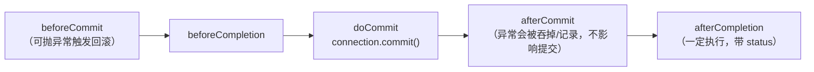

> **关键**：`afterCommit` 抛异常**不会回滚**（已提交了）；想在提交后做"如果失败就回滚"的事是不可能的。所以"发 MQ/发短信"这类操作应放 `afterCommit`，并接受"可能失败"的事实（配合本地消息表/事务消息）。

### 7.9 事务失效的 15 种场景（全解）

这是面试最高频的"开放题"。按"根因分类"记比逐条背更牢。

#### A 类：根本没被代理（5 种）

| # | 场景 | 根因 | 判断方法 |
|---|---|---|---|
| 1 | 类不是 Spring Bean（`new` 出来的） | 没有 BPP 处理，不生成代理 | 看 `@Autowired` 是否拿到 |
| 2 | 方法 `private` / `final` / `static` | JDK 代理无法覆盖；CGLIB 无法重写 | 看是否 `public` 非 `final` |
| 3 | 类 `final` | CGLIB 无法生成子类 | 检查类修饰符 |
| 4 | **同类自调用** `this.inner()` | `this` 是原始对象 | 断点看 `AopUtils.isAopProxy(this)` |
| 5 | Bean 在 `registerBeanPostProcessors` 前创建 | 拿不到 AutoProxyCreator | 搜索 `not eligible for getting processed by all BeanPostProcessors` 日志 |

#### B 类：代理了但没识别事务属性（4 种）

| # | 场景 | 根因 | 解法 |
|---|---|---|---|
| 6 | `@Transactional` 只在**接口**上，且 Boot 用 CGLIB | `specificMethod == method`，不回退查接口 | `proxyTargetClass=false` 或注解打到实现类 |
| 7 | 方法**非 public**（5.x） | `allowPublicMethodsOnly()` 返回 null | 改 public（6.x 已放宽到 protected/包可见） |
| 8 | 事务管理器未配置 / 多个 `PlatformTransactionManager` 未指定 | `determineTransactionManager` 返回 null 或抛 `NoUniqueBeanDefinitionException` | `@Transactional(transactionManager="tx1")` / `@Primary` |
| 9 | `@EnableTransactionManagement` 未生效（非 Boot 项目忘了加） | 没有 Advisor | 加注解或配 `TransactionManagementConfigurer` |

#### C 类：事务开了但没回滚（4 种）

| # | 场景 | 根因 | 解法 |
|---|---|---|---|
| 10 | 抛**受检异常**（`Exception` 子类但不是 `RuntimeException`） | 默认只回滚 `RuntimeException`/`Error` | `rollbackFor = Exception.class` |
| 11 | 异常被 `try-catch` 吞掉 | 拦截器收不到异常 | 抛出 / `TransactionAspectSupport.currentTransactionStatus().setRollbackOnly()` |
| 12 | 异常在**子线程**抛出 | 子线程无事务上下文 | 合并到主线程 / 子线程自己开事务 |
| 13 | `@Transactional` 与 `@Async` 同时用在同一方法 | 代理顺序：`@Async` 把执行丢到线程池，`TransactionInterceptor` 可能在新线程里开新事务，也可能被绕过 | 拆方法：`@Async` 调 `@Transactional` |

#### D 类：事务上下文丢了（2 种）

| # | 场景 | 根因 |
|---|---|---|
| 14 | 多线程 / 线程池里操作 DB | `ThreadLocal` 不传递，借到新连接 `autoCommit=true` |
| 15 | 事务里切换了 `DataSource`（多数据源） | `bindResource` 的 key 是 `DataSource`，另一个数据源没有绑定 |

#### E 类：数据库/驱动层（2 种）

| # | 场景 | 根因 |
|---|---|---|
| 16 | 表引擎是 MyISAM | 不支持事务 |
| 17 | 用了分布式事务但没启用（`@Transactional` + 多库） | 本地事务只管一个 `DataSource` |

> **加分回答**：面试被问"事务失效"，先分类再举例（A/B/C/D/E 五类），比背 10 条更有说服力。然后补一句"最常见的生产事故不是失效，而是**大事务**和**事务里做 RPC**"。

### 7.10 大事务与工程实践

**大事务的危害**：

| 问题 | 机制 |
|---|---|
| 连接占用 | 事务期间独占一个 `Connection`，连接池耗尽 |
| 锁持有时间长 | 行锁/间隙锁长期不释放，`UPDATE`/`SELECT ... FOR UPDATE` 阻塞 |
| 主从延迟 | binlog 一次性写入大量变更，从库回放慢 |
| Undo 表膨胀 | 长事务导致 MVCC 版本链拉长，影响所有读 |
| 回滚代价高 | 回滚要撤销大量操作 |
| 超时 | `innodb_lock_wait_timeout` / `spring @Transactional(timeout)` |

**优化原则**：

```java
// ❌ 反例：事务里做 RPC / 发 MQ / 循环查询
@Transactional
public void createOrder(OrderDTO dto) {
    orderMapper.insert(dto);                  // DB
    inventoryService.deduct(dto);             // RPC 200ms（占用连接）
    smsService.send(dto.getPhone());          // 更慢
    for (int i = 0; i < 10000; i++) {         // 长循环
        logMapper.insert(...);
    }
}

// ✅ 正例：事务只包 DB 写，外部副作用放 afterCommit / 事务外
@Transactional
public void createOrder(OrderDTO dto) {
    orderMapper.insert(dto);
    inventoryMapper.deduct(dto.getSkuId(), 1);
    // 批量插入而不是循环
    logMapper.batchInsert(buildLogs(10000));
}

public void createOrderWrapper(OrderDTO dto) {
    createOrder(dto);                          // 短事务
    TransactionSynchronizationManager.registerSynchronization(new TransactionSynchronization() {
        @Override public void afterCommit() {
            inventoryService.sync(dto);        // 事务已提交，异步/可靠消息
        }
    });
}
```

**更优雅：`@TransactionalEventListener(phase = AFTER_COMMIT)`**

```java
@Component
public class OrderEventHandler {
    @Async
    @TransactionalEventListener(phase = TransactionPhase.AFTER_COMMIT)
    public void onOrderCreated(OrderCreatedEvent event) {
        // 只有事务真正提交才会执行；回滚则不执行
    }
}
```

> **注意**：默认 `fallbackExecution = false`，即"没有事务时不执行"。若希望在无事务场景也执行，需显式 `fallbackExecution = true`。

### 7.11 事务与锁的交互

```java
// ❌ 错误：锁在事务外，锁的范围小于事务，等于没锁
public void wrong(Long id) {
    synchronized (lock) {          // 锁只包住调用，方法返回就释放
        doBusiness(id);            // @Transactional，事务提交在方法返回之后！
    }
}

// ✅ 正确：锁的范围必须 >= 事务范围
public void right(Long id) {
    doBusiness(id);                // 事务在方法内部开始并提交
}
@Transactional
public void doBusiness(Long id) { }  // 若需锁，用 DB 悲观锁 / Redis 分布式锁，且锁要在事务外释放

// ✅ 分布式锁的正确姿势：锁在事务之外，事务结束后才释放
public void withDistributedLock(Long id) {
    String key = "order:" + id;
    if (!redisLock.tryLock(key, 10, TimeUnit.SECONDS)) throw new BizException("操作太频繁");
    try {
        txService.doBusiness(id);    // 事务在这里面完成
    } finally {
        redisLock.unlock(key);       // ★ 事务提交后才释放锁
    }
}
```

> **延伸**：`@Transactional` 的提交发生在**方法返回之后**（`TransactionInterceptor.invoke` 里 `commitTransactionAfterReturning` 在 `proceed()` 之后）。所以任何"方法级别的锁"（`synchronized`/`ReentrantLock`）都必然**小于事务范围**，等于没锁。这是面试高频的"陷阱题"。

### 7.12 只读事务与隔离级别

```java
@Transactional(readOnly = true)
public List<Order> query() { ... }
```

`readOnly` 的底层效果（**依数据库/ORM 而异**）：
- `DataSourceTransactionManager`：只设 `txObject.setReadOnly(true)`，`prepareConnectionForTransaction` 会尝试 `connection.setReadOnly(true)`（很多驱动忽略）。
- `Hibernate`：`Session.setDefaultReadOnly(true)` → `FlushMode.MANUAL`，**不做脏检查**，性能提升明显。
- MySQL InnoDB：`setReadOnly` 对 `SELECT` 无实质优化，但配合 `read_only` 从库有意义。

**隔离级别**：

```java
public enum Isolation {
    DEFAULT,             // -1，用数据库默认
    READ_UNCOMMITTED,    // 1
    READ_COMMITTED,      // 2
    REPEATABLE_READ,     // 4
    SERIALIZABLE         // 8
}
```

`DataSourceUtils.prepareConnectionForTransaction` 只在**显式指定**（非 `DEFAULT`）时才改 `connection.setTransactionIsolation()`，并在事务结束后**恢复原值**（`txObject.getPreviousIsolationLevel()` → `DataSourceUtils.resetConnectionAfterTransaction`）。

> **注意**：MySQL 默认 `REPEATABLE_READ`，Oracle/PostgreSQL 默认 `READ_COMMITTED`。`REQUIRED` 加入已有事务时，若隔离级别不同会抛 `IllegalTransactionStateException`（`validateExistingTransaction`）。

### 7.13 嵌套事务的真实实现：`Savepoint`

```java
// DefaultTransactionStatus#createAndHoldSavepoint
public void createAndHoldSavepoint() throws TransactionException {
    setSavepoint(getSavepointManager().createSavepoint());       // connection.setSavepoint()
}

// JdbcTransactionObjectSupport#createSavepoint
public Object createSavepoint() throws TransactionException {
    ConnectionHolder conHolder = getConnectionHolderForSavepoint();
    try {
        if (!conHolder.supportsSavepoints()) {
            throw new NestedTransactionNotSupportedException(
                    "Cannot create a nested transaction because savepoints are not supported by your JDBC driver");
        }
        if (conHolder.isRollbackOnly()) {
            throw new NestedTransactionNotSupportedException(
                    "Cannot create a nested transaction because the transaction is already marked as rollback-only");
        }
        return conHolder.createSavepoint();                       // connection.setSavepoint()
    } catch (SQLException ex) {
        throw new CannotCreateTransactionException("Could not create JDBC savepoint", ex);
    }
}
```

**NESTED 的回滚**：`processRollback` 里 `status.hasSavepoint()` → `status.rollbackToHeldSavepoint()` → `connection.rollback(savepoint)`。**只回滚到保存点，外层事务继续**。

**限制**：
- `DataSourceTransactionManager` 需 `setNestedTransactionAllowed(true)`；
- 驱动必须支持 JDBC 3.0 Savepoint（MySQL/Oracle/PG 都支持）；
- **MyBatis-Plus / Hibernate 的批处理在保存点内可能不生效**（某些驱动 `rollback(savepoint)` 行为不一致）；
- **NESTED ≠ REQUIRES_NEW**：NESTED 失败只回滚子事务，外层可继续；REQUIRES_NEW 是完全独立连接，外层回滚不影响子，但子提交了外层回滚会产生"部分提交"的不一致。

---

## 第 8 章 Spring MVC：一次请求的完整生命

### 8.1 组件全景

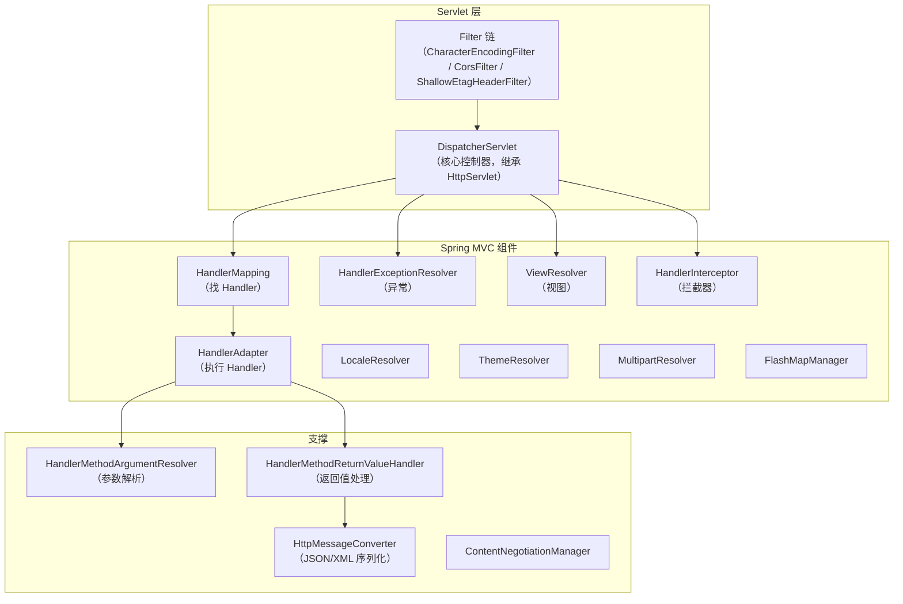

**DispatcherServlet 的继承链**（每一层加一点能力）：

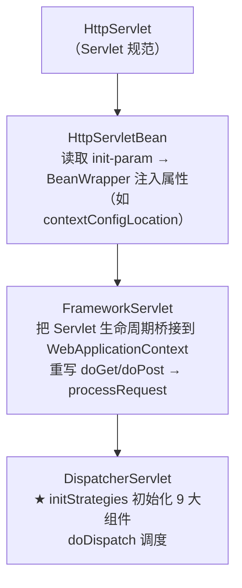

**为什么 `DispatcherServlet` 要继承 `HttpServlet` 而不是"完全自定义"**：因为要复用 Servlet 容器的线程模型、`HttpServletRequest/Response` 抽象、异步支持（`startAsync`）、以及 Filter 链。这是"在标准之上做扩展"的典型设计。

### 8.2 初始化：`initStrategies`

```java
// DispatcherServlet#onRefresh / initStrategies
protected void initStrategies(ApplicationContext context) {
    initMultipartResolver(context);          // ① 文件上传解析器
    initLocaleResolver(context);             // ② 国际化
    initThemeResolver(context);              // ③ 主题
    initHandlerMappings(context);            // ④ ★ HandlerMapping
    initHandlerAdapters(context);            // ⑤ ★ HandlerAdapter
    initHandlerExceptionResolvers(context);  // ⑥ 异常解析器
    initRequestToViewNameTranslator(context);// ⑦ 无视图名时的默认转换器
    initViewResolvers(context);              // ⑧ 视图解析器
    initFlashMapManager(context);            // ⑨ Flash 属性（重定向传参）
}

private void initHandlerMappings(ApplicationContext context) {
    this.handlerMappings = null;
    if (this.detectAllHandlerMappings) {
        // 从容器（含父容器）找所有 HandlerMapping
        Map<String, HandlerMapping> matchingBeans =
                BeanFactoryUtils.beansOfTypeIncludingAncestors(context, HandlerMapping.class, true, false);
        if (!matchingBeans.isEmpty()) {
            this.handlerMappings = new ArrayList<>(matchingBeans.values());
            AnnotationAwareOrderComparator.sort(this.handlerMappings);
        }
    } else {
        try {
            HandlerMapping hm = context.getBean(HANDLER_MAPPING_BEAN_NAME, HandlerMapping.class);
            this.handlerMappings = Collections.singletonList(hm);
        } catch (NoSuchBeanDefinitionException ex) { }
    }
    // 兜底：一个都没有 → 用 DispatcherServlet.properties 里的默认配置
    if (this.handlerMappings == null) {
        this.handlerMappings = getDefaultStrategies(context, HandlerMapping.class);
    }
}
```

**九大组件默认实现**（`DispatcherServlet.properties`）：

| 组件 | 默认实现 | 说明 |
|---|---|---|
| `HandlerMapping` | `BeanNameUrlHandlerMapping`, `RequestMappingHandlerMapping` | 前者把 `@Component("/path")` 的 beanName 当路径；后者处理 `@RequestMapping` |
| `HandlerAdapter` | `HttpRequestHandlerAdapter`, `SimpleControllerHandlerAdapter`, `RequestMappingHandlerAdapter` | |
| `HandlerExceptionResolver` | `ExceptionHandlerExceptionResolver`, `ResponseStatusExceptionResolver`, `DefaultHandlerExceptionResolver` | 顺序 0/1/2 |
| `ViewResolver` | `InternalResourceViewResolver` | JSP/转发 |
| `LocaleResolver` | `AcceptHeaderLocaleResolver` | |
| `ThemeResolver` | `FixedThemeResolver` | 已基本废弃 |
| `MultipartResolver` | 无（需手动配 `StandardServletMultipartResolver` 或 `CommonsMultipartResolver`） | Boot 自动配置 |
| `FlashMapManager` | `SessionFlashMapManager` | |
| `RequestToViewNameTranslator` | `DefaultRequestToViewNameTranslator` | `GET /user/list` → view `user/list` |

**`HandlerMapping` 的真实实现差异**：

| 实现 | 何时使用 | 匹配方式 | 顺序 |
|---|---|---|---|
| `RequestMappingHandlerMapping` | `@Controller` + `@RequestMapping` | `PathPattern` / `AntPathMatcher` | 0 |
| `BeanNameUrlHandlerMapping` | `@Component("/foo")`（beanName 以 `/` 开头） | 精确字符串 | 2 |
| `SimpleUrlHandlerMapping` | 手动注册 `urlMap` | 正则/Ant 风格 | 按 order |
| `RouterFunctionMapping` | WebFlux 风格函数式路由 | `RouterFunction` | 3 |
| `WelcomePageHandlerMapping`（Boot） | `/` 映射到 `index.html` | 固定 | 最高优先级之一 |

> **`RequestMappingHandlerMapping` 的注册时机**：它实现 `InitializingBean`，在 `afterPropertiesSet()` 里扫描所有 `@Controller` Bean 的 `@RequestMapping` 方法，注册到 `MappingRegistry`（`Map<T, MappingRegistration<T>>` + 各种索引）。所以**必须在它初始化之前，Controller 的 BeanDefinition 已经存在**——`WebMvcAutoConfiguration` 通过 `@ConditionalOnMissingBean` + `Order` 保证顺序。

### 8.3 `doDispatch`：请求的核心调度

```java
protected void doDispatch(HttpServletRequest request, HttpServletResponse response) throws Exception {
    HttpServletRequest processedRequest = request;
    HandlerExecutionChain mappedHandler = null;
    boolean multipartRequestParsed = false;

    WebAsyncManager asyncManager = WebAsyncUtils.getAsyncManager(request);

    try {
        ModelAndView mv = null;
        Exception dispatchException = null;

        try {
            // ① 文件上传解析（会把 request 包装成 MultipartHttpServletRequest）
            processedRequest = checkMultipart(request);
            multipartRequestParsed = (processedRequest != request);

            // ② 找 Handler（Controller 方法 + 拦截器链）
            mappedHandler = getHandler(processedRequest);
            if (mappedHandler == null) {
                noHandlerFound(processedRequest, response);
                return;
            }

            // ③ 找 HandlerAdapter
            HandlerAdapter ha = getHandlerAdapter(mappedHandler.getHandler());

            // ④ 处理 If-Modified-Since / ETag
            String method = request.getMethod();
            boolean isGet = HttpMethod.GET.matches(method);
            if (isGet || HttpMethod.HEAD.matches(method)) {
                long lastModified = ha.getLastModified(request, mappedHandler.getHandler());
                if (new ServletWebRequest(request, response).checkNotModified(lastModified) && isGet) {
                    return;
                }
            }

            // ⑤ 前置拦截器（任一返回 false 则中断）
            if (!mappedHandler.applyPreHandle(processedRequest, response)) {
                return;
            }

            // ⑥ ★ 真正执行 Controller
            mv = ha.handle(processedRequest, response, mappedHandler.getHandler());

            // ⑦ 异步请求：已经 startAsync，直接返回（响应由别的线程完成）
            if (asyncManager.isConcurrentHandlingStarted()) {
                return;
            }

            // ⑧ 默认视图名
            applyDefaultViewName(processedRequest, mv);

            // ⑨ 后置拦截器（逆序）
            mappedHandler.applyPostHandle(processedRequest, response, mv);
        } catch (Exception ex) {
            dispatchException = ex;
        } catch (Throwable err) {
            dispatchException = new NestedServletException("Handler dispatch failed", err);
        }

        // ⑩ 处理结果（渲染视图 或 处理异常）
        processDispatchResult(processedRequest, response, mappedHandler, mv, dispatchException);
    } catch (Exception ex) {
        triggerAfterCompletion(processedRequest, response, mappedHandler, ex);
    } catch (Throwable err) {
        triggerAfterCompletion(processedRequest, response, mappedHandler,
                new NestedServletException("Handler processing failed", err));
    } finally {
        if (asyncManager.isConcurrentHandlingStarted()) {
            if (mappedHandler != null) {
                mappedHandler.applyAfterConcurrentHandlingStarted(processedRequest, response);
            }
        } else {
            if (multipartRequestParsed) cleanupMultipart(processedRequest);
        }
    }
}
```

**`getHandler`**：

```java
protected HandlerExecutionChain getHandler(HttpServletRequest request) throws Exception {
    if (this.handlerMappings != null) {
        for (HandlerMapping mapping : this.handlerMappings) {
            HandlerExecutionChain handler = mapping.getHandler(request);
            if (handler != null) {
                return handler;
            }
        }
    }
    return null;
}
```

`AbstractHandlerMapping#getHandler`：

```java
public final HandlerExecutionChain getHandler(HttpServletRequest request) throws Exception {
    Object handler = getHandlerInternal(request);          // 子类实现：找 Controller 方法
    if (handler == null) {
        handler = getDefaultHandler();
    }
    if (handler == null) {
        return null;
    }
    // Bean 名字 → Bean 实例
    if (handler instanceof String handlerName) {
        handler = obtainApplicationContext().getBean(handlerName);
    }

    // ★ 构建 HandlerExecutionChain：handler + 拦截器链
    HandlerExecutionChain executionChain = getHandlerExecutionChain(handler, request);

    // CORS 处理
    if (hasCorsConfigurationSource(handler) || CorsUtils.isPreFlightRequest(request)) {
        CorsConfiguration config = getCorsConfiguration(handler, request);
        if (getCorsConfigurationSource() != null) {
            CorsConfiguration globalConfig = getCorsConfigurationSource().getCorsConfiguration(request);
            config = (globalConfig != null ? globalConfig.combine(config) : config);
        }
        if (config != null) config.validateAllowCredentials();
        executionChain = getCorsHandlerExecutionChain(request, executionChain, config);
    }

    return executionChain;
}

protected HandlerExecutionChain getHandlerExecutionChain(Object handler, HttpServletRequest request) {
    HandlerExecutionChain chain = (handler instanceof HandlerExecutionChain existingChain ?
            existingChain : new HandlerExecutionChain(handler));

    // ★ 遍历所有 MappedInterceptor，按 path 是否匹配决定是否加入
    for (MappedInterceptor mappedInterceptor : this.adaptedInterceptors) {
        if (mappedInterceptor.getPathMatcher() != null) {
            if (mappedInterceptor.matches(request)) {
                chain.addInterceptor(mappedInterceptor.getInterceptor());
            }
        } else {
            chain.addInterceptor(mappedInterceptor.getInterceptor());
        }
    }
    return chain;
}
```

> **`adaptedInterceptors`** 的来源：`AbstractHandlerMapping#initApplicationContext` 里从容器取所有 `HandlerInterceptor` Bean + 通过 `WebMvcConfigurer#addInterceptors` 注册的拦截器，全部包装成 `MappedInterceptor`。

### 8.4 `RequestMappingHandlerAdapter#handle`：参数解析到方法调用

```java
// RequestMappingHandlerAdapter#invokeHandlerMethod
protected ModelAndView invokeHandlerMethod(HttpServletRequest request, HttpServletResponse response,
        HandlerMethod handlerMethod) throws Exception {

    ServletWebRequest webRequest = new ServletWebRequest(request, response);
    try {
        // ① 数据绑定器（@InitBinder）
        WebDataBinderFactory binderFactory = getDataBinderFactory(handlerMethod);

        // ② 模型工厂（@ModelAttribute 方法）
        ModelFactory modelFactory = getModelFactory(handlerMethod, binderFactory);

        // ③ 包装成 ServletInvocableHandlerMethod
        ServletInvocableHandlerMethod invocableMethod = createInvocableHandlerMethod(handlerMethod);
        if (this.argumentResolvers != null) {
            invocableMethod.setHandlerMethodArgumentResolvers(this.argumentResolvers);
        }
        if (this.returnValueHandlers != null) {
            invocableMethod.setHandlerMethodReturnValueHandlers(this.returnValueHandlers);
        }
        invocableMethod.setDataBinderFactory(binderFactory);
        invocableMethod.setParameterNameDiscoverer(this.parameterNameDiscoverer);

        ModelAndViewContainer mavContainer = new ModelAndViewContainer();
        mavContainer.addAllAttributes(RequestContextUtils.getInputFlashMap(request));
        modelFactory.initModel(webRequest, mavContainer, invocableMethod);   // @ModelAttribute 方法先执行
        mavContainer.setIgnoreDefaultModelOnRedirect(this.ignoreDefaultModelOnRedirect);

        // ④ 异步请求支持
        AsyncWebRequest asyncWebRequest = WebAsyncUtils.createAsyncWebRequest(request, response);
        asyncWebRequest.setTimeout(this.asyncRequestTimeout);
        WebAsyncManager asyncManager = WebAsyncUtils.getAsyncManager(request);
        asyncManager.setTaskExecutor(this.taskExecutor);
        asyncManager.setAsyncWebRequest(asyncWebRequest);
        asyncManager.registerCallableInterceptors(this.callableInterceptors);
        asyncManager.registerDeferredResultInterceptors(this.deferredResultInterceptors);

        if (asyncManager.hasConcurrentResult()) {
            Object result = asyncManager.getConcurrentResult();
            mavContainer = (ModelAndViewContainer) asyncManager.getConcurrentResultContext()[0];
            asyncManager.clearConcurrentResult();
            ...
            invocableMethod = invocableMethod.wrapConcurrentResult(result);
        }

        // ⑤ ★ 解析参数 + 调用方法 + 处理返回值
        invocableMethod.invokeAndHandle(webRequest, mavContainer);

        if (asyncManager.isConcurrentHandlingStarted()) {
            return null;
        }

        return getModelAndView(mavContainer, modelFactory, webRequest);
    } finally {
        webRequest.requestCompleted();
    }
}
```

**`InvocableHandlerMethod#getMethodArgumentValues`（参数解析）**：

```java
protected Object[] getMethodArgumentValues(NativeWebRequest request, @Nullable ModelAndViewContainer mavContainer,
        Object... providedArgs) throws Exception {

    MethodParameter[] parameters = getMethodParameters();
    if (ObjectUtils.isEmpty(parameters)) return EMPTY_ARGS;

    Object[] args = new Object[parameters.length];
    for (int i = 0; i < parameters.length; i++) {
        MethodParameter parameter = parameters[i];
        parameter.initParameterNameDiscovery(this.parameterNameDiscoverer);
        args[i] = findProvidedArgument(parameter, providedArgs);       // ① 预先提供的（如 UriComponentsBuilder）
        if (args[i] != null) continue;

        // ② 遍历所有 ArgumentResolver，找到 supportsParameter == true 的
        if (!this.resolvers.supportsParameter(parameter)) {
            throw new IllegalStateException(formatArgumentError(parameter, "No suitable resolver"));
        }
        try {
            args[i] = this.resolvers.resolveArgument(parameter, mavContainer, request, this.dataBinderFactory);
        } catch (Exception ex) {
            if (logger.isDebugEnabled()) { ... }
            throw ex;
        }
    }
    return args;
}
```

**参数解析器清单（按顺序匹配）**：

| 解析器 | 处理的参数 |
|---|---|
| `RequestParamMethodArgumentResolver` | `@RequestParam`、简单类型（`String`/`int`/`Long`…） |
| `RequestParamMapMethodArgumentResolver` | `@RequestParam Map<String,String>` |
| `PathVariableMethodArgumentResolver` | `@PathVariable` |
| `PathVariableMapMethodArgumentResolver` | `@PathVariable Map` |
| `MatrixVariableMethodArgumentResolver` | `@MatrixVariable` |
| `RequestBodyAdvice` + `RequestResponseBodyMethodProcessor` | `@RequestBody` |
| `RequestPartMethodArgumentResolver` | `@RequestPart`（multipart） |
| `RequestHeaderMethodArgumentResolver` | `@RequestHeader` |
| `RequestHeaderMapMethodArgumentResolver` | `@RequestHeader Map` |
| `ServletRequestMethodArgumentResolver` | `WebRequest`、`ServletRequest`、`MultipartRequest`、`HttpSession`、`Principal`、`Locale`、`InputStream`、`Reader`、`TimeZone`、`ZoneId` |
| `ServletResponseMethodArgumentResolver` | `ServletResponse`、`OutputStream`、`Writer` |
| `HttpEntityMethodProcessor` | `HttpEntity`、`RequestEntity` |
| `ModelMethodProcessor` / `MapMethodProcessor` | `Model`、`Map` |
| `ModelAttributeMethodProcessor` | `@ModelAttribute`、非简单类型（**兜底**，`annotationNotRequired = true` 的那个） |
| `SessionAttributeMethodArgumentResolver` | `@SessionAttribute` |
| `RequestAttributeMethodArgumentResolver` | `@RequestAttribute` |
| `ExpressionValueMethodArgumentResolver` | `@Value`（SpEL） |
| `ServletModelAttributeMethodProcessor` | POJO 表单绑定 + 校验 |
| `ErrorsMethodArgumentResolver` | `BindingResult` / `Errors` |

> **`@RequestBody` 的处理器有两个**：`RequestResponseBodyMethodProcessor`（`@RequestBody`/`@ResponseBody`）和 `HttpEntityMethodProcessor`（`HttpEntity`）。它们的顺序在 `RequestMappingHandlerAdapter#afterPropertiesSet` 里由 `getDefaultArgumentResolvers()` 决定，`HttpEntity` 的优先级更高。

### 8.5 `HttpMessageConverter`：JSON 序列化的真正入口

```java
// AbstractMessageConverterMethodArgumentResolver#readWithMessageConverters
protected <T> Object readWithMessageConverters(HttpInputMessage inputMessage, MethodParameter parameter,
        Type targetType) throws IOException, HttpMediaTypeNotSupportedException, HttpMessageNotReadableException {

    MediaType contentType;
    boolean noContentType = false;
    try {
        contentType = inputMessage.getHeaders().getContentType();
    } catch (InvalidMediaTypeException ex) {
        throw new HttpMediaTypeNotSupportedException(ex.getMessage());
    }
    if (contentType == null) {
        noContentType = true;
        contentType = MediaType.APPLICATION_OCTET_STREAM;
    }

    Class<?> contextClass = parameter.getContainingClass();
    Class<T> targetClass = (targetType instanceof Class clazz ? clazz : null);
    if (targetClass == null) { ... }

    // ① 找到能读的 converter（★ 转换器顺序决定行为）
    HttpMessageConverter<?> converter = getMessageConverter(contentType, targetType);
    if (converter == null) {
        Object[] body = getBody(inputMessage);
        ...
        throw new HttpMediaTypeNotSupportedException(contentType, ...);
    }
    // ② 读取
    Object body = readWithMessageConverters(inputMessage, parameter, contentType, targetType, converter);
    ...
}
```

**默认 `HttpMessageConverter` 顺序（`WebMvcConfigurationSupport#addDefaultHttpMessageConverters`）**：

| # | Converter | 支持的类型 | 说明 |
|---|---|---|---|
| 1 | `ByteArrayHttpMessageConverter` | `byte[]` | |
| 2 | `StringHttpMessageConverter` | `String` | 默认 `ISO-8859-1`（**乱码元凶**，Boot 已修正为 UTF-8） |
| 3 | `ResourceHttpMessageConverter` | `Resource` | |
| 4 | `ResourceRegionHttpMessageConverter` | `ResourceRegion` | |
| 5 | `AllEncompassingFormHttpMessageConverter` | `MultiValueMap` | 表单 |
| 6 | `MappingJackson2HttpMessageConverter` | 任意（`application/json`） | Jackson；**Boot 的默认** |
| 7 | `MappingJackson2XmlHttpMessageConverter` | 任意（XML） | 需 `jackson-dataformat-xml` |
| 8 | `Jaxb2RootElementHttpMessageConverter` | JAXB | 需 `jakarta.xml.bind` |
| 9 | `KotlinSerializationJsonHttpMessageConverter` | Kotlin | |

> **顺序陷阱**：`StringHttpMessageConverter` 排在 `MappingJackson2HttpMessageConverter` 前面。所以 Controller 返回 `String` 时**不会走 Jackson**——返回的是"原样字符串"。想返回 JSON 字符串要包一层 `ResponseEntity` 或返回对象。

**`@ResponseBody` 写出的链路**：

```java
// RequestResponseBodyMethodProcessor#handleReturnValue
public void handleReturnValue(@Nullable Object returnValue, MethodParameter returnType,
        ModelAndViewContainer mavContainer, NativeWebRequest webRequest) throws Exception {

    mavContainer.setRequestHandled(true);                 // ★ 标记"已处理"，不再走视图解析
    ServletServerHttpRequest inputMessage = createInputMessage(webRequest);
    ServletServerHttpResponse outputMessage = createOutputMessage(webRequest);

    // Try even with null return value. ResponseBodyAdvice could get confused by non-code-returned status.
    writeWithMessageConverters(returnValue, returnType, inputMessage, outputMessage);
}
```

`AbstractMessageConverterMethodProcessor#writeWithMessageConverters` 里的**内容协商**：

```java
protected <T> void writeWithMessageConverters(@Nullable T value, MethodParameter returnType,
        ServletServerHttpRequest inputMessage, ServletServerHttpResponse outputMessage)
        throws IOException, HttpMediaTypeNotAcceptableException, HttpMessageNotWritableException {

    Object body;
    Class<?> valueType;
    Type targetType;

    if (value instanceof CharSequence) {
        body = value.toString();
        valueType = String.class;
        targetType = String.class;
    } else {
        body = value;
        valueType = getReturnValueType(body, returnType);
        targetType = GenericTypeResolver.resolveType(getGenericType(returnType), returnType.getContainingClass());
    }

    if (isResourceType(value, returnType)) { ... }

    MediaType selectedMediaType = null;
    MediaType contentType = outputMessage.getHeaders().getContentType();
    boolean isContentTypePreset = contentType != null && contentType.isConcrete();
    if (isContentTypePreset) {
        selectedMediaType = contentType;
    } else {
        // ★ 内容协商：Accept 头 / 路径后缀 / 参数 → 决定 mediaType
        HttpServletRequest request = inputMessage.getServletRequest();
        List<MediaType> acceptableTypes;
        try {
            acceptableTypes = getAcceptableMediaTypes(request);
        } catch (HttpMediaTypeNotAcceptableException ex) { ... }
        List<MediaType> producibleTypes = getProducibleMediaTypes(request, valueType, targetType);

        if (body != null && producibleTypes.isEmpty()) {
            throw new HttpMessageNotWritableException("No converter found for return value of type: " + valueType);
        }
        List<MediaType> mediaTypesToUse = new ArrayList<>();
        for (MediaType requestedType : acceptableTypes) {
            for (MediaType producibleType : producibleTypes) {
                if (requestedType.isCompatibleWith(producibleType)) {
                    mediaTypesToUse.add(getMostSpecificMediaType(requestedType, producibleType));
                }
            }
        }
        if (mediaTypesToUse.isEmpty()) { ... throw new HttpMediaTypeNotAcceptableException(producibleTypes); }
        MediaType.sortBySpecificityAndQuality(mediaTypesToUse);
        for (MediaType mediaType : mediaTypesToUse) {
            if (mediaType.isConcrete()) { selectedMediaType = mediaType; break; }
            else if (mediaType.isWildcardType() || mediaType.isWildcardSubtype()) { ... }
        }
    }

    if (selectedMediaType != null) {
        selectedMediaType = selectedMediaType.removeQualityValue();
        // ③ 找到能写的 converter
        for (HttpMessageConverter<?> converter : this.messageConverters) {
            GenericHttpMessageConverter genericConverter = (converter instanceof GenericHttpMessageConverter ghmc ? ghmc : null);
            if (genericConverter != null ?
                    ((GenericHttpMessageConverter) converter).canWrite(targetType, valueType, selectedMediaType) :
                    converter.canWrite(valueType, selectedMediaType)) {
                body = getAdvice().beforeBodyWrite(body, returnType, selectedMediaType,
                        (Class<? extends HttpMessageConverter<?>>) converter.getClass(),
                        inputMessage, outputMessage);
                if (body != null) {
                    Object theBody = body;
                    LogFormatUtils.traceDebug(logger, traceOn -> ...);
                    // ④ ★ 写出
                    if (genericConverter != null) {
                        genericConverter.write(body, targetType, selectedMediaType, outputMessage);
                    } else {
                        ((HttpMessageConverter) converter).write(body, selectedMediaType, outputMessage);
                    }
                } else { ... }
                return;
            }
        }
    }
    throw new HttpMediaTypeNotAcceptableException(this.allSupportedMediaTypes);
}
```

> **`ResponseBodyAdvice` 是"统一包装返回值"的标准扩展点**（如统一 `{code,msg,data}`）。它的 `beforeBodyWrite` 在 converter 写出之前调用，**可以改 body、改 content-type、甚至改 response header**。很多"统一响应体"组件都基于它。

### 8.6 `processDispatchResult`：视图渲染与异常处理

```java
private void processDispatchResult(HttpServletRequest request, HttpServletResponse response,
        @Nullable HandlerExecutionChain mappedHandler, @Nullable ModelAndView mv,
        @Nullable Exception exception) throws Exception {

    boolean errorView = false;

    if (exception != null) {
        // ① 异常解析链
        if (exception instanceof ModelAndViewDefiningException mavDefiningException) {
            mv = mavDefiningException.getModelAndView();
        } else {
            Object handler = (mappedHandler != null ? mappedHandler.getHandler() : null);
            mv = processHandlerException(request, response, handler, exception);
            errorView = (mv != null);
        }
    }

    // ② 渲染视图
    if (mv != null && !mv.wasCleared()) {
        render(mv, request, response);
        if (errorView) {
            WebUtils.clearErrorRequestAttributes(request);
        }
    } else {
        if (logger.isTraceEnabled()) { ... }
    }

    if (WebAsyncUtils.getAsyncManager(request).isConcurrentHandlingStarted()) {
        return;      // 异步请求，交给异步线程
    }

    // ③ 后置完成拦截器（★ 一定执行，且逆序）
    if (mappedHandler != null) {
        mappedHandler.triggerAfterCompletion(request, response, null);
    }
}
```

**异常解析器链**：

```java
protected ModelAndView processHandlerException(HttpServletRequest request, HttpServletResponse response,
        @Nullable Object handler, Exception ex) throws Exception {

    request.removeAttribute(HandlerMapping.PRODUCIBLE_MEDIA_TYPES_ATTRIBUTE);

    ModelAndView exMv = null;
    if (this.handlerExceptionResolvers != null) {
        for (HandlerExceptionResolver resolver : this.handlerExceptionResolvers) {
            exMv = resolver.resolveException(request, response, handler, ex);
            if (exMv != null) break;                 // ★ 第一个处理成功的就返回
        }
    }
    if (exMv != null) { ... return exMv; }
    throw ex;
}
```

| 顺序 | 解析器 | 处理 |
|---|---|---|
| 0 | `ExceptionHandlerExceptionResolver` | `@ExceptionHandler` / `@ControllerAdvice` |
| 1 | `ResponseStatusExceptionResolver` | `@ResponseStatus` 注解、`ResponseStatusException` |
| 2 | `DefaultHandlerExceptionResolver` | Spring 内置异常（`HttpRequestMethodNotSupportedException` → 405、`HttpMessageNotReadableException` → 400 等） |

> **注意**：如果都没处理，异常会抛出 `DispatcherServlet`，最终到 Servlet 容器的错误页（`/error`，Boot 的 `BasicErrorController`）。**所以"全局异常处理"必须有一条能兜住所有异常的 `@ExceptionHandler(Throwable.class)`**，否则会走默认错误页，返回 `Whitelabel Error Page`。

### 8.7 拦截器三方法的执行时机

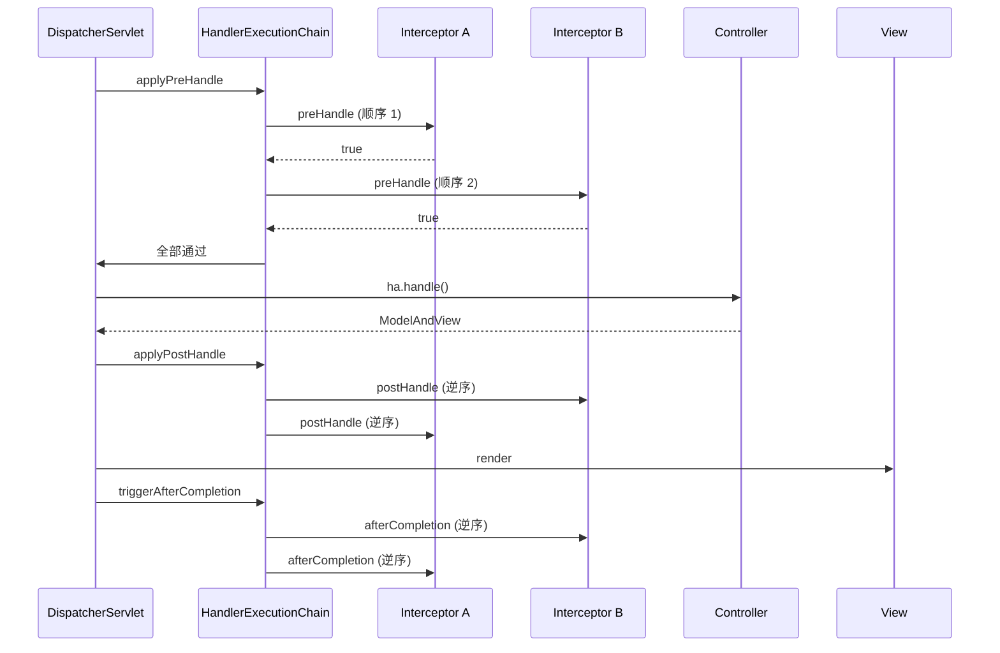

**关键规则**：

| 方法 | 顺序 | 何时执行 |
|---|---|---|
| `preHandle` | **正序** | Controller 前；返回 `false` 则中断，**且不执行后续拦截器的 `afterCompletion`**（只执行已返回 true 的） |
| `postHandle` | **逆序** | Controller 正常返回后；**异常时不执行** |
| `afterCompletion` | **逆序** | 无论正常/异常都执行（`preHandle` 返回 true 的才执行） |

> **易错**：`preHandle` 返回 `false` 时，**已经返回 true 的拦截器的 `afterCompletion` 会被调用**，`postHandle` 不会。这是"资源释放"的正确落点。

### 8.8 Filter / Interceptor / AOP 的区别（必背表）

| 维度 | Filter | Interceptor | AOP |
|---|---|---|---|
| 所属规范 | Servlet 规范（`jakarta.servlet`） | Spring MVC | Spring AOP |
| 作用范围 | **所有请求**（含静态资源、非 MVC 路径） | 仅 **DispatcherServlet 处理的 Handler** | **Spring Bean 的方法** |
| 执行时机 | 容器层，DispatcherServlet **之前** | DispatcherServlet **内部**，Handler 前后 | Bean 方法调用时 |
| 能否拿到 Bean | 困难（需 `WebApplicationContextUtils`） | 可以（本身是 Bean） | 可以 |
| 能否拿到 Handler 信息 | 不能 | 能（`HandlerMethod`、`@RequestMapping` 参数） | 不能（只有方法签名） |
| 能否中断请求 | 不能（只能不 `chain.doFilter`） | `preHandle` 返回 `false` | 抛异常 |
| 典型用途 | 编码、CORS、XSS、TraceId、请求体缓存 | 登录校验、权限、日志、参数预处理 | 事务、缓存、限流、幂等、监控 |

**执行顺序**：

```
Filter#doFilter（正序）
  → DispatcherServlet#doDispatch
     → Interceptor#preHandle（正序）
        → AOP 前置（如 @Transactional 开启事务）
           → Controller 方法
        → AOP 后置（提交事务）
     → Interceptor#postHandle（逆序）
     → 视图渲染
     → Interceptor#afterCompletion（逆序）
  → Filter#doFilter（逆序，chain.doFilter 之后）
```

> **延伸**：`HandlerInterceptor` 的 `preHandle` 早于 `@Transactional` 的开启（因为事务代理在 Controller Bean 的方法调用上），所以**在拦截器里做 DB 操作是独立事务**，不会回滚 Controller 里的事务。

### 8.9 异步请求：`DeferredResult` / `Callable`

**为什么需要**：Servlet 3.0 之前，一个请求占用一个容器线程直到返回。慢接口会耗尽 Tomcat 的 `maxThreads`（默认 200）。

```mermaid
sequenceDiagram
    participant Tomcat as Tomcat 线程
    participant DS as DispatcherServlet
    participant Biz as 业务线程池
    participant Client as 客户端

    Client->>Tomcat: GET /slow
    Tomcat->>DS: doDispatch
    DS->>DS: 调用 Controller → 返回 DeferredResult
    DS->>DS: asyncManager.startAsync()
    Note over Tomcat: ★ Tomcat 线程立即释放，可以接新请求
    DS->>Biz: 提交任务（@Async / 自定义线程池）
    Client-->>Tomcat: （连接保持，等待）
    Biz->>Biz: 业务处理（RPC / 等待）
    Biz->>DS: deferredResult.setResult(data)
    DS->>Tomcat: dispatch 回来（async 二次派发）
    Tomcat->>Client: 写出响应
```

**三种异步方式**：

| 类型 | 用法 | 特点 |
|---|---|---|
| `Callable<T>` | `return () -> doWork();` | 由 `WebAsyncManager` 的 `taskExecutor` 执行（默认 `SimpleAsyncTaskExecutor`，**每次新建线程**，生产必须自定义） |
| `DeferredResult<T>` | 返回对象，稍后 `setResult` | 可由**任意线程**设置结果，适合"等待外部事件"（如 MQ 回调、长轮询） |
| `WebAsyncTask<T>` | `new WebAsyncTask<>(timeout, callable)` | 带超时、超时回调、异常回调 |
| `SseEmitter` | 返回对象，多次 `send` | SSE 流式推送 |
| `ResponseBodyEmitter` | 同上 | 任意分块输出 |
| `StreamingResponseBody` | `void writeTo(OutputStream)` | 大文件流式下载，**不占用异步线程池** |

**关键配置**：

```java
@Configuration
public class AsyncConfig implements WebMvcConfigurer {
    @Override
    public void configureAsyncSupport(AsyncSupportConfigurer configurer) {
        configurer.setDefaultTimeout(60_000);
        configurer.setTaskExecutor(asyncTaskExecutor());   // ★ 必须换掉 SimpleAsyncTaskExecutor
        configurer.registerCallableInterceptors(timeoutCallableInterceptor());
        configurer.registerDeferredResultInterceptors(...);
    }

    @Bean
    public ThreadPoolTaskExecutor asyncTaskExecutor() {
        ThreadPoolTaskExecutor executor = new ThreadPoolTaskExecutor();
        executor.setCorePoolSize(20);
        executor.setMaxPoolSize(100);
        executor.setQueueCapacity(200);
        executor.setThreadNamePrefix("mvc-async-");
        executor.setRejectedExecutionHandler(new ThreadPoolExecutor.CallerRunsPolicy());
        executor.initialize();
        return executor;
    }
}
```

> **异步请求的坑**：
> 1. `ThreadLocal`（`RequestContextHolder`、事务、安全上下文）**不会自动传递**到异步线程。要手动 `RequestContextHolder.setRequestAttributes(attributes, true)`，或用 `DelegatingSecurityContextRunnable`。
> 2. 异步线程里**没有事务**（ThreadLocal 隔离）。
> 3. `Interceptor#afterCompletion` 在异步模式下由 `applyAfterConcurrentHandlingStarted` 走另一条路径，`postHandle` 不执行。
> 4. 超时后 `DeferredResult` 会收到 `onTimeout`，但**客户端已断开**，此时再 `setResult` 会抛 `IllegalStateException`。

### 8.10 异常处理最佳实践

```java
@RestControllerAdvice
@Slf4j
public class GlobalExceptionHandler {

    // ① 业务异常
    @ExceptionHandler(BizException.class)
    public ResponseEntity<ApiResponse<Void>> handleBiz(BizException e) {
        log.warn("业务异常: {}", e.getMessage());
        return ResponseEntity.status(HttpStatus.OK)
                .body(ApiResponse.fail(e.getCode(), e.getMessage()));
    }

    // ② 参数校验异常（@Valid 失败）
    @ExceptionHandler(MethodArgumentNotValidException.class)
    public ResponseEntity<ApiResponse<Void>> handleValid(MethodArgumentNotValidException e) {
        String msg = e.getBindingResult().getFieldErrors().stream()
                .map(f -> f.getField() + ": " + f.getDefaultMessage())
                .collect(Collectors.joining("; "));
        return ResponseEntity.badRequest().body(ApiResponse.fail(400, msg));
    }

    // ③ 兜底：所有未捕获异常
    @ExceptionHandler(Throwable.class)
    public ResponseEntity<ApiResponse<Void>> handleAll(Throwable e) {
        log.error("未捕获异常", e);
        return ResponseEntity.status(HttpStatus.INTERNAL_SERVER_ERROR)
                .body(ApiResponse.fail(500, "系统繁忙，请稍后重试"));
    }
}
```

**`@ControllerAdvice` 的匹配规则**：
- `basePackages` / `basePackageClasses`：限定包范围
- `assignableTypes`：限定 Controller 类型
- `annotations`：限定带某注解的 Controller
- 多个 `@ControllerAdvice` 时按 `@Order`

> **陷阱**：`@ExceptionHandler` 的匹配是"**最具体的异常类型优先**"（`ExceptionHandlerMethodResolver` 用 `ExceptionDepthComparator` 按继承深度排序）。所以 `Throwable` 兜底不会抢走 `BizException` 的处理。
>
> **另一个陷阱**：`@ResponseStatus` + `@ExceptionHandler` 同时用，`ResponseEntity` 的 status 优先。

### 8.11 Spring MVC 的其他关键点

**CORS**：

```java
// 方式 1：全局
@Configuration
public class CorsConfig implements WebMvcConfigurer {
    @Override
    public void addCorsMappings(CorsRegistry registry) {
        registry.addMapping("/api/**")
                .allowedOriginPatterns("*")      // ★ 不能用 allowedOrigins("*") + allowCredentials(true)
                .allowedMethods("GET", "POST", "PUT", "DELETE")
                .allowedHeaders("*")
                .allowCredentials(true)
                .maxAge(3600);
    }
}
```

底层：`AbstractHandlerMapping` 在 `getHandler` 里包装 `CorsInterceptor`（`CorsInterceptor extends HandlerInterceptorAdapter` 的变体），预检请求（`OPTIONS` + `Access-Control-Request-Method`）由 `PreFlightHandler` 直接返回 200，**不进 Controller**。

**静态资源**：

```java
@Override
public void addResourceHandlers(ResourceHandlerRegistry registry) {
    registry.addResourceHandler("/static/**")
            .addResourceLocations("classpath:/static/")
            .setCacheControl(CacheControl.maxAge(7, TimeUnit.DAYS).cachePublic());
}
```

底层是 `ResourceHttpRequestHandler`（一个 `HttpRequestHandler`，由 `SimpleUrlHandlerMapping` 注册）。

**内容协商**：

```yaml
spring.mvc.contentnegotiation.favor-parameter=true      # ?format=json
spring.mvc.contentnegotiation.media-types.json=application/json
```

`ContentNegotiationManager` 由三种 `ContentNegotiationStrategy` 组成（顺序）：`HeaderContentNegotiationStrategy`（`Accept` 头）→ `ParameterContentNegotiationStrategy`（`?format=`）→ `ServletPathExtensionContentNegotiationStrategy`（`.json` 后缀，**Spring 5.3 起默认关闭**，因为有安全风险）。

---

## 第 9 章 Spring Boot：自动配置与启动内核

### 9.1 `@SpringBootApplication` 拆解

```java
@SpringBootApplication
public class Application { public static void main(String[] args) { SpringApplication.run(Application.class, args); } }

// 等价于
@SpringBootConfiguration   // = @Configuration，标识这是 Boot 配置类（用于测试定位）
@EnableAutoConfiguration   // ★ 自动配置开关
@ComponentScan(excludeFilters = { @Filter(type = FilterType.CUSTOM, classes = TypeExcludeFilter.class),
        @Filter(type = FilterType.CUSTOM, classes = AutoConfigurationExcludeFilter.class) })
```

**`AutoConfigurationExcludeFilter` 的作用**：排除那些"既是 `@Configuration` 又是自动配置类"的类，避免被 `@ComponentScan` 重复注册（自动配置由 `@EnableAutoConfiguration` 负责导入）。

### 9.2 自动配置的完整链路

```mermaid
flowchart TD
    A["@EnableAutoConfiguration"] --> B["@Import(AutoConfigurationImportSelector.class)"]
    B --> C{"DeferredImportSelector<br/>（延迟到所有 @Bean 处理完之后）"}
    C --> D["getAutoConfigurationEntry(annotationMetadata)"]
    D --> E["① getCandidateConfigurations<br/>读 META-INF/spring/org.springframework.boot.autoconfigure.AutoConfiguration.imports<br/>（2.7 前是 spring.factories）"]
    E --> F["② 去重 + 移除 @SpringBootApplication(exclude=...)"]
    F --> G["③ getAutoConfigurationImportFilters<br/>OnClassCondition / OnBeanCondition / OnWebApplicationCondition"]
    G --> H["④ filter 过滤（AutoConfigurationImportFilter）"]
    H --> I["⑤ AutoConfigurationSorter 排序<br/>@AutoConfigureOrder / Before / After / 字母序"]
    I --> J["⑥ 作为 ImportSelector 返回类名 → 被 ConfigurationClassParser 继续解析"]
    J --> K["⑦ 注册为 BeanDefinition → 由 @Conditional 决定是否真的生效"]
```

**为什么必须是 `DeferredImportSelector`？（这是自动配置最核心的设计）**

```java
// AutoConfigurationImportSelector
@Override
public Class<? extends Group> getImportGroup() {
    return AutoConfigurationGroup.class;
}

// ConfigurationClassParser#processImports → 处理 DeferredImportSelector
// DeferredImportSelector 的 selectImports 不在 parse 阶段执行，
// 而是被收集到 deferredImportSelectors，等所有配置类解析完（processImports 结束后）
// 在 parse(Set<BeanDefinitionHolder>) 的最后统一处理
```

`ConfigurationClassParser#parse` 末尾：

```java
public void parse(Set<BeanDefinitionHolder> configCandidates) {
    for (BeanDefinitionHolder holder : configCandidates) {
        ...
        parse(((AnnotatedBeanDefinition) bd).getMetadata(), holder.getBeanName());
    }
    // ★ 所有用户配置类都解析完，才处理 DeferredImportSelector
    this.deferredImportSelectorHandler.process();
}
```

**这个顺序保证了**：
1. 用户自己的 `@Bean` 先注册；
2. 自动配置类后注册；
3. 自动配置里的 `@ConditionalOnMissingBean` 看到"用户已经定义了"，于是跳过（back off）。

> **一句话**：`DeferredImportSelector` 是"约定优于配置"能被覆盖的**机制基础**。没有它，`@ConditionalOnMissingBean` 就不可靠（顺序不确定）。

### 9.3 条件注解家族

| 注解 | 判断依据 | 典型用途 |
|---|---|---|
| `@ConditionalOnClass` | 类路径存在指定类（**用 ASM 读，不加载**） | 有 `DataSource` 才配数据源 |
| `@ConditionalOnMissingClass` | 不存在 | |
| `@ConditionalOnBean` | 容器里有指定 Bean（按类型/名字/注解） | |
| `@ConditionalOnMissingBean` | 没有 | **用户自定义优先** |
| `@ConditionalOnSingleCandidate` | 恰好一个，或有 `@Primary` | |
| `@ConditionalOnWebApplication(type)` | `SERVLET` / `REACTIVE` / `ANY` | |
| `@ConditionalOnNotWebApplication` | 非 Web | |
| `@ConditionalOnProperty(prefix, name, havingValue, matchIfMissing)` | 配置项 | 开关式功能 |
| `@ConditionalOnResource(resources)` | 资源文件存在 | |
| `@ConditionalOnExpression("SpEL")` | SpEL 为 true | 复杂组合 |
| `@ConditionalOnJava(range)` | JDK 版本 | |
| `@ConditionalOnCloudPlatform` | 云平台（K8s/Heroku…） | |
| `@ConditionalOnWarDeployment` | WAR 部署 | |
| `@ConditionalOnAvailableEndpoint` | Actuator 端点开启 | |

**自定义条件**：

```java
public class OnMacOsCondition extends SpringBootCondition {
    @Override
    public ConditionOutcome getMatchOutcome(ConditionContext context, AnnotatedTypeMetadata metadata) {
        String os = System.getProperty("os.name");
        return os.toLowerCase().contains("mac")
                ? ConditionOutcome.match("当前是 macOS")
                : ConditionOutcome.noMatch("当前是 " + os);
    }
}
```

**关键实现细节**：`@ConditionalOnClass` 用的是 `OnClassCondition`，它通过 `ClassNameFilter` + `MetadataReader` 判断类是否存在，**不会 `Class.forName`**。这就是"类不存在也能启动"的原因。

### 9.4 `@ConditionalOnMissingBean` 的"顺序敏感"陷阱

```java
// 自动配置类
@AutoConfiguration
public class MyAutoConfiguration {
    @Bean
    @ConditionalOnMissingBean
    public MyService myService() { return new DefaultMyService(); }
}

// 用户配置
@Configuration
public class UserConfig {
    @Bean
    public MyService customService() { return new CustomMyService(); }
}
```

**能正确"退让"的前提**：`UserConfig` 是**普通 `@Configuration`**（在 `parse` 阶段被解析），`MyAutoConfiguration` 是**自动配置**（在 `deferredImportSelectorHandler.process()` 阶段解析）。顺序天然正确。

**但如果是这样就会出错**：

```java
// ❌ 两个都是自动配置类，且 A 依赖 B 提供的 Bean
@AutoConfiguration
public class AutoA {
    @Bean @ConditionalOnMissingBean
    public ServiceA serviceA() { ... }
}

@AutoConfiguration
public class AutoB {
    @Bean
    public ServiceB serviceB(ServiceA a) { ... }   // 需要 ServiceA
}
```

若 `AutoA` 字母序在 `AutoB` 之后，`ServiceB` 创建时 `ServiceA` 可能还没注册 → 报 `NoSuchBeanDefinitionException`。

**解法**：`@AutoConfigureBefore(AutoA.class)` / `@AutoConfigureAfter(AutoB.class)`。

> **面试延伸**："自动配置的 Bean 顺序怎么保证？"答：① `DeferredImportSelector` 保证用户配置先于自动配置；② `AutoConfigurationSorter` 保证自动配置之间按 `@AutoConfigureOrder`/`Before`/`After`/字母序；③ `@ConditionalOnMissingBean` 的判定基于"已注册的 BeanDefinition"，所以顺序错就会误判。

### 9.5 `SpringApplication.run` 的完整流程

```java
public ConfigurableApplicationContext run(String... args) {
    Startup startup = Startup.create();
    if (this.registerShutdownHook) {
        SpringApplicationShutdownHook.registerApplicationContext(this);   // 注册 JVM 钩子
    }
    StopWatch stopWatch = new StopWatch();
    stopWatch.start();
    ConfigurableApplicationContext context = null;
    configureHeadlessProperty();                                          // java.awt.headless=true
    SpringApplicationRunListeners listeners = getRunListeners(args);      // 加载 SpringApplicationRunListener
    listeners.starting(bootstrapContext, this.mainApplicationClass);
    try {
        ApplicationArguments applicationArguments = new DefaultApplicationArguments(args);
        // ① 准备环境（★ 加载 application.yml、激活 profile、ApplicationJsonLoader）
        ConfigurableEnvironment environment = prepareEnvironment(listeners, bootstrapContext, applicationArguments);
        Banner printedBanner = printBanner(environment);
        // ② 创建容器（★ 根据 webApplicationType 决定）
        context = createApplicationContext();
        context.setApplicationStartup(this.applicationStartup);
        // ③ 准备容器（★ 注册 primarySources、ApplicationContextInitializer、加载 Bean）
        prepareContext(bootstrapContext, context, environment, listeners, applicationArguments, printedBanner);
        // ④ 刷新容器（= AbstractApplicationContext.refresh()，★ 内嵌 Tomcat 在此启动）
        refreshContext(context);
        afterRefresh(context, applicationArguments);
        stopWatch.stop();
        if (this.logStartupInfo) {
            new StartupInfoLogger(this.mainApplicationClass).logStarted(getApplicationLog(), stopWatch);
        }
        listeners.started(context, timeTakenToStartup);
        // ⑤ 执行 CommandLineRunner / ApplicationRunner
        callRunners(context, applicationArguments);
    } catch (Throwable ex) {
        handleRunFailure(context, ex, listeners);
        throw new IllegalStateException(ex);
    }
    try {
        if (context.isRunning()) {
            listeners.ready(context, timeTakenToReady);
        }
    } catch (Throwable ex) {
        handleRunFailure(context, ex, null);
        throw new IllegalStateException(ex);
    }
    return context;
}
```

**`prepareEnvironment`**：

```java
private ConfigurableEnvironment prepareEnvironment(SpringApplicationRunListeners listeners,
        DefaultBootstrapContext bootstrapContext, ApplicationArguments applicationArguments) {
    // ① 创建或获取 Environment（StandardServletEnvironment / StandardReactiveWebEnvironment / StandardEnvironment）
    ConfigurableEnvironment environment = getOrCreateEnvironment();
    // ② 配置属性源：命令行参数 优先
    configureEnvironment(environment, applicationArguments.getSourceArgs());
    ConfigurationPropertySources.attach(environment);
    // ③ ★ 触发 ApplicationEnvironmentPreparedEvent → EnvironmentPostProcessor 链
    //    这是 ConfigDataEnvironmentPostProcessor 处理 application.yml 的地方
    listeners.environmentPrepared(bootstrapContext, environment);
    DefaultPropertiesPropertySource.moveToEnd(environment);
    Assert.state(!environment.containsProperty("spring.main.environment-prefix"), ...);
    // ④ 绑定到 SpringApplication（spring.main.* 属性）
    bindToSpringApplication(environment);
    if (!this.isCustomEnvironment) {
        environment = convertEnvironment(environment);
    }
    ConfigurationPropertySources.attach(environment);
    return environment;
}
```

**配置加载优先级（从高到低）**：

| # | 来源 |
|---|---|
| 1 | 命令行参数 `--server.port=8080`（`SimpleCommandLinePropertySource`） |
| 2 | `SPRING_APPLICATION_JSON`（内联 JSON） |
| 3 | `ServletConfig` 初始化参数 |
| 4 | `ServletContext` 上下文参数 |
| 5 | JNDI（`java:comp/env`） |
| 6 | Java System Properties（`-Dserver.port=8080`） |
| 7 | OS 环境变量（`SERVER_PORT`） |
| 8 | `RandomValuePropertySource`（`random.*`） |
| 9 | **profile-specific 外部配置**（`application-{profile}.properties` 在 jar 外） |
| 10 | **profile-specific 内部配置**（classpath 下） |
| 11 | `application.properties` 外部 |
| 12 | `application.properties` 内部 |
| 13 | `@PropertySource` |
| 14 | 默认属性（`SpringApplication.setDefaultProperties`） |

> **`spring.profiles.active` 的激活时机**：在 `ConfigDataEnvironmentPostProcessor` 里，先加载无 profile 的文档，拿到 `spring.profiles.active` 后**重新加载**带 profile 的文档。所以 `application-{profile}.yml` 里的 `spring.profiles.active` **无法激活另一个 profile**（会被忽略）。

### 9.6 内嵌 Tomcat 的启动链路

```mermaid
flowchart TD
    A["refreshContext(context)"] --> B["AbstractApplicationContext.refresh()"]
    B --> C["⑨ onRefresh()"]
    C --> D["ServletWebServerApplicationContext#createWebServer"]
    D --> E["getWebServerFactory()<br/>（从容器找唯一的 ServletWebServerFactory）"]
    E --> F{"factory 类型"}
    F -->|Tomcat| G["TomcatServletWebServerFactory#getWebServer"]
    F -->|Jetty| H["JettyServletWebServerFactory"]
    F -->|Undertow| I["UndertowServletWebServerFactory"]
    G --> J["new Tomcat(...)<br/>设置 Connector / Host / Context"]
    J --> K["tomcat.start()<br/>★ 监听端口"]
    K --> L["getWebServer 返回 WebServer"]
    L --> M["this.webServer = webServer<br/>initPropertySources / finishRefresh 时 start"]
```

```java
// ServletWebServerApplicationContext#createWebServer
private void createWebServer() {
    WebServer webServer = this.webServer;
    ServletContext servletContext = getServletContext();
    if (webServer == null && servletContext == null) {
        StartupStep createWebServer = this.getApplicationStartup().start("spring.boot.webserver.create");
        ServletWebServerFactory factory = getWebServerFactory();
        createWebServer.tag("factory", factory.getClass().toString());
        // ★ 传入 getSelfInitializer()：一个 ServletContextInitializer，用于注册 DispatcherServlet
        this.webServer = factory.getWebServer(getSelfInitializer());
        createWebServer.end();
        getBeanFactory().registerSingleton("webServerGracefulShutdown",
                new WebServerGracefulShutdownLifecycle(this.webServer));
        getBeanFactory().registerSingleton("webServerStartStop",
                new WebServerStartStopLifecycle(this, this.webServer));
    }
    ...
}

// getSelfInitializer：延迟注册 Servlet/Filter
private org.springframework.boot.web.servlet.ServletContextInitializer getSelfInitializer() {
    return this::selfInitialize;
}

private void selfInitialize(ServletContext servletContext) throws ServletException {
    prepareWebApplicationContext(servletContext);
    registerApplicationScope(servletContext);
    WebApplicationContextUtils.registerEnvironmentBeans(getBeanFactory(), servletContext);
    // ★ 把容器里所有 ServletContextInitializer 类型的 Bean 都执行一遍
    for (ServletContextInitializer beans : getServletContextInitializerBeans()) {
        beans.onStartup(servletContext);
    }
}
```

**`DispatcherServlet` 的注册**：`DispatcherServletRegistrationBean`（一个 `ServletContextInitializer`）由 `DispatcherServletAutoConfiguration` 注册。

```java
// DispatcherServletAutoConfiguration
@Bean(name = DEFAULT_DISPATCHER_SERVLET_REGISTRATION_BEAN_NAME)
@ConditionalOnBean(name = DEFAULT_DISPATCHER_SERVLET_BEAN_NAME)
public DispatcherServletRegistrationBean dispatcherServletRegistration(
        DispatcherServlet dispatcherServlet, WebMvcProperties webMvcProperties, ObjectProvider<MultipartConfigElement> multipartConfig) {
    DispatcherServletRegistrationBean registration = new DispatcherServletRegistrationBean(
            dispatcherServlet, webMvcProperties.getServlet().getPath());
    registration.setName(DEFAULT_DISPATCHER_SERVLET_BEAN_NAME);
    registration.setLoadOnStartup(webMvcProperties.getServlet().getLoadOnStartup());
    multipartConfig.ifAvailable(registration::setMultipartConfig);
    return registration;
}
```

**Tomcat 的 Connector 配置**：

```java
// TomcatServletWebServerFactory#getWebServer
public WebServer getWebServer(ServletContextInitializer... initializers) {
    if (this.disableRegistry) { ... }
    Tomcat tomcat = new Tomcat();
    File baseDir = (this.baseDirectory != null ? this.baseDirectory : createTempDir("tomcat"));
    tomcat.setBaseDir(baseDir.getAbsolutePath());
    Connector connector = new Connector(this.protocol);
    connector.setThrowOnFailure(true);
    tomcat.getService().addConnector(connector);
    customizeConnector(connector);
    tomcat.setConnector(connector);
    tomcat.getHost().setAutoDeploy(false);
    configureEngine(tomcat.getEngine());
    for (Connector additionalConnector : this.additionalTomcatConnectors) {
        tomcat.getService().addConnector(additionalConnector);
    }
    prepareContext(tomcat.getHost(), initializers);   // ★ 创建 TomcatEmbeddedContext 并注册 initializer
    return getTomcatWebServer(tomcat);
}
```

> **`spring-boot-starter-web` 默认 Tomcat 的原因**：`TomcatServletWebServerFactory` 在 `ServletWebServerFactoryAutoConfiguration` 里通过 `@ConditionalOnClass` 选择——哪个容器的类在 classpath 上就用哪个。所以 **排除 Tomcat 依赖 + 引入 Jetty/Undertow** 就能切换容器，无需改代码。

### 9.7 可执行 JAR 的类加载机制

**问题**：`java -jar app.jar` 时，JVM 的标准 `JarFile` 无法读取"jar 里的 jar"（`BOOT-INF/lib/xxx.jar`）。Spring Boot 怎么解决？

**结构**：

```
app.jar
├── META-INF/MANIFEST.MF      (Main-Class: org.springframework.boot.loader.JarLauncher
│                              Start-Class: com.example.Application)
├── BOOT-INF/
│   ├── classes/              (业务 class)
│   └── lib/                  (依赖 jar)
└── org/springframework/boot/loader/   (Loader 自己的 class)
```

```mermaid
flowchart TD
    A["java -jar app.jar"] --> B["JVM 读 MANIFEST 的 Main-Class = JarLauncher"]
    B --> C["JarLauncher.main()"]
    C --> D["创建 LaunchedURLClassLoader<br/>（父加载器是 AppClassLoader 的系统类加载器）"]
    D --> E["注册 URL 协议处理器 org.springframework.boot.loader.jar.Handler"]
    E --> F["用 JarFile（Boot 自定义）解析嵌套结构<br/>jar:file:/app.jar!/BOOT-INF/lib/xxx.jar!/com/..."]
    F --> G["反射调用 Start-Class 的 main"]
```

```java
// org.springframework.boot.loader.launch.JarLauncher（Boot 3.2+ 包名）
public class JarLauncher extends ExecutableArchiveLauncher {
    public static void main(String[] args) throws Exception {
        new JarLauncher().launch(args);
    }
    ...
}
```

**核心技巧**：Boot 自己实现了 `org.springframework.boot.loader.jar.JarFile`，它继承 `java.util.jar.JarFile`，并重写了 `entries()` / `getEntry()`，把嵌套的 jar 当作"一个 entry 下的一组 entry"。配合自定义的 `URLStreamHandler`（协议名 `jar`），让 `ClassLoader` 能按 `jar:file:/outer.jar!/BOOT-INF/lib/inner.jar!/pkg/Cls.class` 这样的 URL 加载类。

> **延伸**：`LaunchedURLClassLoader` 的父加载器是 `null`（bootstrap）还是 `AppClassLoader`？答案是 **`AppClassLoader`** —— 所以 `java -jar` 时 `-cp` 指定的类依然可见（这也是"fat jar 和外部 classpath 混用"能工作的原因）。而 `spring-boot:run` 用的是普通 `URLClassLoader`，不会触发这套机制，所以"`spring-boot:run` 能跑、`java -jar` 报 `ClassNotFoundException`"往往是 manifest 或 loader 问题。

### 9.8 Spring Boot 3 的关键变化

| 变化 | 内容 | 影响 |
|---|---|---|
| **Jakarta EE 9+** | `javax.servlet` → `jakarta.servlet`，`javax.persistence` → `jakarta.persistence` | 所有 Servlet/JPA 相关依赖必须换 |
| **JDK 17 最低** | 不再支持 JDK 8/11 | 升级成本 |
| **`spring.factories` 不再支持自动配置** | 只认 `META-INF/spring/org.springframework.boot.autoconfigure.AutoConfiguration.imports` | 老 Starter 必须迁移 |
| **AOT + Native Image** | `spring-boot-maven-plugin` 支持 `process-aot`，生成 GraalVM native image | 启动 ~10ms，内存降 50%+；但反射/动态代理要注册 |
| **`@AutoConfiguration` 取代 `@Configuration`** | 语义更清晰，且强制 `proxyBeanMethods = false` | |
| **`spring-boot-properties-migrator`** | 检测过期配置项 | 升级辅助 |
| **可观测性增强** | Micrometer Observation、`ApplicationStartup` 启动步骤追踪 | 性能分析 |
| **GraalVM 限制** | `@ConditionalOnClass` 在 native image 里行为变化（类在构建期已确定） | 需要 `RuntimeHints` |
| **`JarLauncher` 包名变更（3.2+）** | `org.springframework.boot.loader` → `org.springframework.boot.loader.launch` | 自定义 Loader 需改 |

**AOT 的核心思路**：

```java
// 构建期：跑一遍 Spring 上下文，记录所有需要反射的类/方法/代理
// → 生成 META-INF/spring/aot.factories、reflect-config.json 等
// 运行期：直接用生成的元数据，跳过 ASM 解析和 CGLIB 生成
```

`@Configuration(proxyBeanMethods = false)` 在 AOT 下尤为重要——因为 CGLIB 代理在 native image 里需要额外配置，且启动慢。所以 **Boot 3 的自动配置类全部改成 `proxyBeanMethods = false`**，`@Bean` 方法之间直接调用会创建多个实例，必须通过方法参数注入传递。

### 9.9 启动慢/启动失败的排查清单

| 现象 | 排查方向 | 工具 |
|---|---|---|
| 启动慢（> 30s） | ① 组件扫描范围过大 ② 数据库连接池预热 ③ `@PostConstruct` 里做 RPC ④ 大量 Bean 的 AOP 代理创建 | `ApplicationStartup` + `StartupStep`、`-Dspring.context.breakdown=true` |
| `NoSuchBeanDefinitionException` | ① 包不在 `@ComponentScan` 范围 ② `@ConditionalOnMissingBean` 误判 ③ 条件注解不满足 | `--debug` 启动日志、`ConditionEvaluationReport` |
| `BeanCurrentlyInCreationException` | 循环依赖（Boot 2.6+ 默认禁止） | `spring.main.allow-circular-references=true`（治标）、重构（治本） |
| `BeanDefinitionOverrideException` | 同名 Bean | `spring.main.allow-bean-definition-overriding=true` |
| 端口占用 | 已有实例 | `lsof -i:8080` / `netstat -ano \| findstr 8080` |
| `Failed to configure a DataSource` | 引了 `spring-boot-starter-data-jpa` 但没配 URL | 排除依赖或配 URL |
| 循环依赖导致 AOP 代理不一致 | 见 4.6 | 避免在 BPP 里 `getBeanNamesForType` |

**条件评估报告**（排查"为什么我的自动配置没生效"的利器）：

```bash
java -jar app.jar --debug
# 或
-Ddebug=true
# 会打印：
#    Positive matches: MyAutoConfiguration matched
#    Negative matches: MyAutoConfiguration did not match (OnClassCondition: ...)
```

### 9.10 自定义 Starter 的正确姿势

```java
// 1) 自动配置类
@AutoConfiguration
@ConditionalOnClass(MyClient.class)
@EnableConfigurationProperties(MyProperties.class)
@ConditionalOnProperty(prefix = "my.client", name = "enabled", havingValue = "true", matchIfMissing = true)
public class MyClientAutoConfiguration {

    @Bean
    @ConditionalOnMissingBean                       // ★ 让用户可覆盖
    public MyClient myClient(MyProperties props) {
        return new MyClient(props.getEndpoint(), props.getTimeout());
    }

    @Bean
    @ConditionalOnMissingBean
    public MyClientHealthIndicator myClientHealthIndicator(MyClient client) {
        return new MyClientHealthIndicator(client);
    }
}

// 2) 配置属性（用构造器绑定，便于校验）
@ConfigurationProperties(prefix = "my.client")
@Validated
public class MyProperties {
    @NotBlank private String endpoint;
    @DurationUnit(ChronoUnit.SECONDS) private Duration timeout = Duration.ofSeconds(3);
    // getter/setter 或构造器绑定（@ConstructorBinding，Boot 3 已默认）
}

// 3) 注册（Boot 3）
// src/main/resources/META-INF/spring/org.springframework.boot.autoconfigure.AutoConfiguration.imports
// com.example.MyClientAutoConfiguration
```

**Starter 命名与结构规范**：

```
my-spring-boot-starter/
├── pom.xml                       (只依赖 my-spring-boot-autoconfigure + 必要三方)
my-spring-boot-autoconfigure/
├── src/main/java/.../MyClientAutoConfiguration.java
├── src/main/resources/META-INF/spring/org.springframework.boot.autoconfigure.AutoConfiguration.imports
└── src/main/resources/META-INF/spring-configuration-metadata.json   (IDE 提示，可由注解处理器生成)
```

**必须遵守的 5 条铁律**：

1. 自动配置类**只做装配**，不写业务；
2. 所有 Bean 都要 `@ConditionalOnMissingBean`（除非是"不可替换的基础设施"）；
3. 配置项要有默认值 + `spring-configuration-metadata.json`（IDE 才有补全）；
4. 条件注解顺序：`@ConditionalOnClass` 放最外层（类不存在直接短路，避免 `NoClassDefFoundError`）；
5. **绝不**在自动配置里 `@ComponentScan` 用户包。

---

## 第 10 章 底层支撑组件：事件、类型转换、元数据、SPI

这一章是"别人答不上来、你能答"的差异化区域。

### 10.1 事件机制

**核心接口**：

```java
public interface ApplicationEventPublisher {
    default void publishEvent(ApplicationEvent event) { publishEvent((Object) event); }
    void publishEvent(Object event);
}

public interface ApplicationListener<E extends ApplicationEvent> extends EventListener {
    void onApplicationEvent(E event);
}

public interface ApplicationEventMulticaster {
    void addApplicationListener(ApplicationListener<?> listener);
    void addApplicationListenerBean(String listenerBeanName);
    void removeApplicationListener(ApplicationListener<?> listener);
    void multicastEvent(ApplicationEvent event);
    void multicastEvent(ApplicationEvent event, @Nullable ResolvableType eventType);
}
```

**`SimpleApplicationEventMulticaster#multicastEvent`**：

```java
public void multicastEvent(final ApplicationEvent event, @Nullable ResolvableType eventType) {
    ResolvableType type = (eventType != null ? eventType : resolveDefaultEventType(event));
    Executor executor = getTaskExecutor();                       // ★ 有则异步
    for (ApplicationListener<?> listener : getApplicationListeners(event, type)) {
        if (executor != null) {
            executor.execute(() -> invokeListener(listener, event));
        } else {
            invokeListener(listener, event);                     // 同步
        }
    }
}

protected void invokeListener(ApplicationListener<?> listener, ApplicationEvent event) {
    ErrorHandler errorHandler = getErrorHandler();
    if (errorHandler != null) {
        try { doInvokeListener(listener, event); }
        catch (Throwable err) { errorHandler.handleError(err); }
    } else {
        doInvokeListener(listener, event);
    }
}
```

**事件类型解析（`getApplicationListeners`）**：

- 用 `ResolvableType` 缓存 `listener → 支持的事件类型` 的映射（`ListenerCacheKey` → `CachedListenerRetriever`）
- 支持泛型 `ApplicationListener<MyEvent>`、`@EventListener` 的方法参数类型、`PayloadApplicationEvent<T>`

**`@EventListener` 的注册机制**：

`EventListenerMethodProcessor`（一个 `SmartInitializingSingleton`）在 `afterSingletonsInstantiated()` 里扫描所有 Bean 的 `@EventListener` 方法，为每个方法创建一个 `ApplicationListenerMethodAdapter`，注册到 `ApplicationEventMulticaster`。

```java
// EventListenerMethodProcessor#afterSingletonsInstantiated
public void afterSingletonsInstantiated() {
    ConfigurableListableBeanFactory beanFactory = this.beanFactory;
    Assert.state(this.beanFactory != null, "No ConfigurableListableBeanFactory set");
    // 遍历所有 Bean（含非单例）
    String[] beanNames = beanFactory.getBeanNamesForType(Object.class);
    for (String beanName : beanNames) {
        if (!ScopedProxyUtils.isScopedTarget(beanName)) {
            Class<?> type = null;
            try {
                type = AutoProxyUtils.determineTargetClass(beanFactory, beanName);
            } catch (Throwable ex) { ... }
            if (type != null) {
                if (ScopedProxyUtils.isScopedTarget(beanName) && !this.nonAnnotatedClasses.contains(type)) { ... }
                try {
                    processBean(beanName, type);
                } catch (Throwable ex) { ... }
            }
        }
    }
}
```

> **关键点**：`@EventListener` 的解析发生在**所有单例创建完之后**（`SmartInitializingSingleton`），所以它支持"任意 Bean 上的 `@EventListener`"。相比之下，`ApplicationListener` 接口的注册在 refresh 第⑩步（`registerListeners`），**更早**。

**`@TransactionalEventListener`**：

```java
@Target({ElementType.METHOD, ElementType.ANNOTATION_TYPE})
@Retention(RetentionPolicy.RUNTIME)
@Documented
@EventListener
public @interface TransactionalEventListener {
    TransactionPhase phase() default TransactionPhase.AFTER_COMMIT;
    boolean fallbackExecution() default false;
    ...
}

public enum TransactionPhase {
    BEFORE_COMMIT,
    AFTER_COMMIT,
    AFTER_ROLLBACK,
    AFTER_COMPLETION
}
```

底层：`TransactionalApplicationListenerMethodAdapter` 把自身注册为 `TransactionSynchronization`（通过 `TransactionSynchronizationManager.registerSynchronization`），在对应 phase 回调。

> **这是"事务提交后做副作用"的最佳实践**，比手写 `TransactionSynchronization` 更优雅，且自动处理"无事务时不执行"（`fallbackExecution=false`）。

### 10.2 类型转换体系

Spring 有两套并存的转换机制：

```mermaid
flowchart TD
    A["需要把 String 转成目标类型"] --> B{"有 ConversionService?"}
    B -->|是| C["ConversionService.convert()<br/>（Spring 3+，推荐）"]
    B -->|否| D["PropertyEditor<br/>（JavaBeans 规范，古老但兼容）"]
    C --> E["GenericConversionService<br/>内部是 ConverterRegistry + Converter 链"]
    E --> F["StringToNumber / StringToBoolean /<br/>ObjectToObject / CollectionToArray ..."]
```

**`ConversionService` 的默认实现**：`DefaultFormattingConversionService`（`WebConversionService` 在 Boot 里），注册了 100+ 个 `Converter`。

```java
// TypeConverterDelegate#convertIfNecessary
public <T> T convertIfNecessary(@Nullable String propertyName, @Nullable Object oldValue,
        Object newValue, @Nullable Class<T> requiredType, @Nullable TypeDescriptor typeDescriptor) throws IllegalArgumentException {

    // ① 有 ConversionService → 优先用它
    ConversionService conversionService = this.propertyEditorRegistry.getConversionService();
    if (editor == null && conversionService != null && newValue != null && typeDescriptor != null) {
        TypeDescriptor sourceTypeDesc = TypeDescriptor.forObject(newValue);
        if (conversionService.canConvert(sourceTypeDesc, typeDescriptor)) {
            try {
                return (T) conversionService.convert(newValue, sourceTypeDesc, typeDescriptor);
            } catch (ConversionFailedException ex) { ... }
        }
    }
    // ② 有 PropertyEditor → 老路
    // ③ String → 枚举 / 数组 / 集合 → 逐个元素转
    // ④ 兜底反射构造
}
```

**`@DateTimeFormat` / `@NumberFormat`** 是 `Formatter`（`Printer` + `Parser`），通过 `FormattingConversionService` 生效。它们**不是** `Converter`，但注册到同一套服务里。

> **踩坑**：`@DateTimeFormat(pattern = "yyyy-MM-dd HH:mm:ss")` 只对 `@ModelAttribute` / `@RequestParam` 的表单绑定生效；**`@RequestBody` 的 JSON 反序列化走 Jackson，不受它控制**——要用 `@JsonFormat`。这是面试和实际开发的双高频坑。

### 10.3 元数据与 ASM：为什么 Spring 不加载类

**`MetadataReader` 体系**：

```java
public interface MetadataReader {
    Resource getResource();
    ClassMetadata getClassMetadata();
    AnnotationMetadata getAnnotationMetadata();
}
```

`SimpleMetadataReader`：

```java
SimpleMetadataReader(Resource resource, @Nullable ClassLoader classLoader) throws IOException {
    SimpleAnnotationMetadataReadingVisitor visitor = new SimpleAnnotationMetadataReadingVisitor(classLoader);
    getClassReader(resource).accept(visitor, PARSING_VISIT | SKIP_DEBUG | SKIP_CODE | SKIP_FRAMES);
    this.classMetadata = visitor.getMetadata();
}
```

**`ClassReader` 的三个 skip 标志（性能关键）**：

| 标志 | 作用 |
|---|---|
| `SKIP_CODE` | 不解析方法体字节码（组件扫描只看注解，不需要方法体） |
| `SKIP_DEBUG` | 不解析调试信息（行号表、局部变量表） |
| `SKIP_FRAMES` | 不解析栈映射帧（StackMapTable） |

> **这就是"Spring 扫描 1000 个类只要 200ms"的原因**——比反射 `Class.forName` + 遍历注解快一个数量级，且**不触发静态初始化**（不会因为类的 static 块里有 `System.exit` 或网络请求而炸掉）。

**`AnnotationMetadata` 的能力**：

```java
interface AnnotationMetadata extends ClassMetadata, AnnotatedMetadata {
    Set<String> getAnnotationTypes();
    Set<String> getMetaAnnotationTypes(String annotationName);   // ★ 元注解（@Component 的派生注解）
    boolean hasAnnotation(String annotationName);
    boolean hasMetaAnnotation(String metaAnnotationName);
    MergedAnnotations getAnnotations();                           // Spring 5.2+
}
```

> **`getMetaAnnotationTypes` 是 `@Service` / `@Repository` / `@Controller` 能被识别为"组件"的原因**——它们都带 `@Component` 元注解。

**组件索引（`components.index`）**：Spring 5.0+ 支持 `META-INF/spring.components` 文件（JAR Index 机制），可以跳过 className 扫描。Spring 6.x 用 `META-INF/spring/<annotation>.imports` 做 AOT 索引。

### 10.4 SPI：`SpringFactoriesLoader`

```java
public final class SpringFactoriesLoader {
    public static final String FACTORIES_RESOURCE_LOCATION = "META-INF/spring.factories";

    public static <T> List<T> loadFactories(Class<T> factoryType, @Nullable ClassLoader classLoader) {
        List<String> factoryImplementationNames = loadFactoryNames(factoryType, classLoader);
        ...
        for (String factoryImplementationName : factoryImplementationNames) {
            result.add(instantiateFactory(factoryImplementationName, factoryType, classLoader));
        }
        return result;
    }

    public static List<String> loadFactoryNames(Class<?> factoryType, @Nullable ClassLoader classLoader) {
        ClassLoader classLoaderToUse = classLoader;
        if (classLoaderToUse == null) classLoaderToUse = SpringFactoriesLoader.class.getClassLoader();
        String factoryTypeName = factoryType.getName();
        return loadSpringFactories(classLoaderToUse).getOrDefault(factoryTypeName, Collections.emptyList());
    }

    private static Map<String, List<String>> loadSpringFactories(ClassLoader classLoader) {
        Map<String, List<String>> result = cache.get(classLoader);
        if (result != null) return result;
        result = new HashMap<>();
        try {
            Enumeration<URL> urls = classLoader.getResources(FACTORIES_RESOURCE_LOCATION);
            while (urls.hasMoreElements()) {
                URL url = urls.nextElement();
                UrlResource resource = new UrlResource(url);
                Properties properties = PropertiesLoaderUtils.loadProperties(resource);
                for (Map.Entry<?, ?> entry : properties.entrySet()) {
                    String factoryTypeName = ((String) entry.getKey()).trim();
                    String[] factoryImplementationNames =
                            StringUtils.commaDelimitedListToStringArray((String) entry.getValue());
                    for (String factoryImplementationName : factoryImplementationNames) {
                        result.computeIfAbsent(factoryTypeName, key -> new ArrayList<>())
                              .add(factoryImplementationName.trim());
                    }
                }
            }
            result.replaceAll((factoryType, implementations) -> implementations.stream().distinct().collect(...));
            cache.put(classLoader, result);
        } catch (IOException ex) { ... }
        return result;
    }
}
```

**`spring.factories` 里的关键 key（2.x 时代）**：

```
org.springframework.boot.autoconfigure.EnableAutoConfiguration=\
com.example.FooAutoConfiguration

org.springframework.context.ApplicationContextInitializer=\
com.example.MyInitializer

org.springframework.context.ApplicationListener=\
com.example.MyListener

org.springframework.boot.SpringApplicationRunListener=\
com.example.MyRunListener

org.springframework.boot.env.EnvironmentPostProcessor=\
com.example.MyEnvPostProcessor

org.springframework.boot.autoconfigure.AutoConfigurationImportFilter=\
com.example.MyFilter
```

**与 Java 原生 SPI（`ServiceLoader`）的差异**：

| 维度 | Java SPI | Spring SPI |
|---|---|---|
| 文件位置 | `META-INF/services/<接口全限定名>` | `META-INF/spring.factories`（所有接口共用一个文件） |
| 格式 | 一行一个实现类 | `接口名=实现1,实现2` |
| 加载 | 按 classpath 顺序，**全部加载** | 支持按 key 分组，结果合并去重 |
| 实例化 | `ServiceLoader.iterator()` 惰性 | `loadFactories` 一次性全实例化 |
| 缓存 | 无 | 有（`Map<ClassLoader, Map<...>>`） |
| 排序 | 无法控制 | 可用 `@Order` / `Ordered` 排序（调用方处理） |

> **Boot 3 的演进**：自动配置从 `spring.factories` 迁到 `AutoConfiguration.imports`，原因是"`spring.factories` 每次启动要解析所有 jar 的一个大文件"，而 `.imports` 是每个 jar 一个独立文件，更利于增量与 AOT。但**其他扩展点（如 `EnvironmentPostProcessor`）仍用 `spring.factories`**。

### 10.5 占位符与 `PropertySourcesPlaceholderConfigurer`

```java
// PropertySourcesPlaceholderConfigurer#postProcessBeanFactory
public void postProcessBeanFactory(ConfigurableListableBeanFactory beanFactory) throws BeansException {
    if (this.propertySources == null) {
        this.propertySources = new MutablePropertySources();
        if (this.environment != null) {
            this.propertySources.addLast(new PropertySource<Environment>("environmentProperties", this.environment) {
                @Override
                @Nullable
                public String getProperty(String key) { return this.source.getProperty(key); }
            });
        }
        try {
            this.propertySources.addLast(new PropertySource<Properties>("localProperties", localProperties) {...});
        } catch (Exception ex) { }
    }

    if (this.placeholderHelper == null) {
        this.placeholderHelper = PropertyPlaceholderHelper.getInstance();
        if (this.ignoreUnresolvablePlaceholders) this.placeholderHelper.setIgnoreUnresolvablePlaceholders(true);
    }

    processProperties(beanFactory, new PropertySourcesPlaceholderConfigurer(...));
}
```

**`PropertyPlaceholderHelper` 的解析算法**：

```java
public String replacePlaceholders(String value, final PlaceholderResolver placeholderResolver) {
    return parseStringValue(value, placeholderResolver, null);
}

protected String parseStringValue(String value, PlaceholderResolver placeholderResolver,
        @Nullable Set<String> visitedPlaceholders) {

    int startIndex = value.indexOf(PLACEHOLDER_PREFIX);      // "${"
    if (startIndex == -1) return value;

    StringBuilder result = new StringBuilder(value);
    while (startIndex != -1) {
        int endIndex = findPlaceholderEndIndex(result, startIndex);
        if (endIndex != -1) {
            String placeholder = result.substring(startIndex + PLACEHOLDER_PREFIX.length(), endIndex);
            String originalPlaceholder = placeholder;
            if (visitedPlaceholders == null) visitedPlaceholders = new HashSet<>(4);
            if (!visitedPlaceholders.add(originalPlaceholder)) {
                throw new IllegalArgumentException("Circular placeholder reference '" + originalPlaceholder + "' in property definitions");
            }
            // 递归解析（支持嵌套 ${a${b}}）
            placeholder = parseStringValue(placeholder, placeholderResolver, visitedPlaceholders);
            String propVal = placeholderResolver.resolvePlaceholder(placeholder);
            if (propVal == null && this.valueSeparator != null) {
                // 支持默认值 ${key:default}
                int separatorIndex = placeholder.indexOf(this.valueSeparator);
                if (separatorIndex != -1) {
                    String actualPlaceholder = placeholder.substring(0, separatorIndex);
                    String defaultValue = placeholder.substring(separatorIndex + this.valueSeparator.length());
                    propVal = placeholderResolver.resolvePlaceholder(actualPlaceholder);
                    if (propVal == null) propVal = defaultValue;
                }
            }
            if (propVal != null) {
                propVal = parseStringValue(propVal, placeholderResolver, visitedPlaceholders);  // 值里也可能有占位符
                result.replace(startIndex, endIndex + PLACEHOLDER_SUFFIX.length(), propVal);
                startIndex = result.indexOf(PLACEHOLDER_PREFIX, startIndex + propVal.length());
            } else if (this.ignoreUnresolvablePlaceholders) {
                startIndex = result.indexOf(PLACEHOLDER_PREFIX, endIndex + PLACEHOLDER_SUFFIX.length());
            } else {
                throw new IllegalArgumentException("Could not resolve placeholder '" + placeholder + "' in value \"" + value + "\"");
            }
            visitedPlaceholders.remove(originalPlaceholder);
        } else {
            startIndex = -1;
        }
    }
    return result.toString();
}
```

> **特点**：支持嵌套 `${a${b}}`、默认值 `${a:b}`、循环引用检测。**这些细节是"读过源码"的证据**。

### 10.6 `Lifecycle` 与 `SmartLifecycle`

```java
public interface Lifecycle {
    void start();
    void stop();
    boolean isRunning();
}

public interface SmartLifecycle extends Lifecycle, Phased {
    int DEFAULT_PHASE = Integer.MAX_VALUE;
    default int getPhase() { return DEFAULT_PHASE; }
    default boolean isAutoStartup() { return true; }
    ...
}
```

**`DefaultLifecycleProcessor#onRefresh`**：

```java
public void onRefresh() {
    startBeans(true);
    this.running = true;
}

private void startBeans(boolean autoStartupOnly) {
    Map<String, Lifecycle> lifecycleBeans = getLifecycleBeans();
    Map<Integer, LifecycleGroup> phases = new HashMap<>();
    lifecycleBeans.forEach((beanName, bean) -> {
        if (!autoStartupOnly || (bean instanceof SmartLifecycle smartLifecycle && smartLifecycle.isAutoStartup())) {
            int phase = getPhase(bean);
            phases.computeIfAbsent(phase, p -> new LifecycleGroup(p, this.timeoutPerShutdownPhase, lifecycleBeans, autoStartupOnly))
                  .add(beanName, bean);
        }
    });
    if (!phases.isEmpty()) {
        phases.keySet().stream().sorted().forEach(phase -> phases.get(phase).start());
    }
}
```

**语义**：
- `phase` **小的先启动**；
- `stop()` 时**大的先停止**（逆序）；
- `isAutoStartup() == false` 的不会被 `refresh` 启动，需要手动 `start()`；
- `SmartLifecycle` 用于"需要优雅停机"的组件（Netty、MQ consumer、自定义线程池）。

**典型实现**：`WebServerStartStopLifecycle`（启动/停止内嵌 Tomcat）、`WebServerGracefulShutdownLifecycle`（`phase = SmartLifecycle.DEFAULT_PHASE - 1024`，让 Tomcat 在**大部分组件之前**停止接收新请求，但不立即关闭连接）。

> **优雅停机链路（面试可加分）**：`SIGTERM` → JVM 钩子 `SpringApplicationShutdownHook` → `context.close()` → `LifecycleProcessor.onClose()` → 按 phase 逆序 `stop()` → Tomcat 先停止接收新请求 + 等待在途请求（`server.shutdown=graceful`），再关连接池、MQ consumer 等。

### 10.7 任务执行与调度

**`@Async`**：

```java
// AsyncAnnotationBeanPostProcessor（注册时机由 @EnableAsync 决定）
// → 创建 AsyncAnnotationAdvisor
// → AbstractBeanFactoryAwareAdvisingPostProcessor

// AnnotationAsyncExecutionInterceptor extends AsyncExecutionAspectSupport
protected Object invoke(MethodInvocation invocation) throws Throwable {
    ...
}

// AsyncExecutionAspectSupport#doSubmit
protected Object doSubmit(Callable<Object> task, AsyncTaskExecutor executor, Class<?> returnType) {
    if (CompletableFuture.class.isAssignableFrom(returnType)) {
        return executor.submitCompletable(task);
    } else if (org.springframework.util.concurrent.ListenableFuture.class.isAssignableFrom(returnType)) {
        return ((org.springframework.core.task.AsyncListenableTaskExecutor) executor).submitListenable(task);
    } else if (Future.class.isAssignableFrom(returnType)) {
        return executor.submit(task);
    } else {
        executor.submit(task);
        return null;      // void 返回
    }
}
```

**线程池来源优先级**（`getDefaultExecutor`）：
1. 容器中**唯一**的 `TaskExecutor` Bean；
2. 名为 `taskExecutor` 的 Bean；
3. `SimpleAsyncTaskExecutor`（**每次新建线程，无池化**，仅作兜底）。

> **`@Async` 失效**：同类自调用、方法 `private`/`final`/`static`、返回类型不是 `void`/`Future`/`CompletableFuture`（非 void 但返回其他类型时会被忽略返回值）、线程池 `CallerRunsPolicy` 导致"看起来没异步"。

**`@Scheduled`**：

```java
// ScheduledAnnotationBeanPostProcessor#afterSingletonsInstantiated
// 解析 @Scheduled(fixedRate/fixedDelay/cron)
// 注册到 TaskScheduler（默认 ThreadPoolTaskScheduler，poolSize=1）
```

> **`fixedRate` vs `fixedDelay`**：前者按"上次开始时间 + 周期"调度（任务执行超过周期会串行挤压）；后者按"上次结束时间 + 延迟"。**`@Scheduled` 默认单线程**，多任务会互相阻塞，必须显式配 `spring.task.scheduling.pool.size`。

### 10.8 缓存抽象

```java
@Cacheable(cacheNames = "user", key = "#id", unless = "#result == null")
public User get(Long id) { ... }
```

底层：`@EnableCaching` → `ProxyCachingConfiguration` → `BeanFactoryCacheOperationSourceAdvisor` + `CacheInterceptor`（`MethodInterceptor`）。**又是 AOP**。

```java
// CacheAspectSupport#execute
private Object execute(CacheOperationInvoker invoker, CacheOperationContexts contexts) {
    // 处理 @Cacheable
    // 1) 生成 key（KeyGenerator，默认 SimpleKeyGenerator）
    // 2) cache.get(key) → 命中则返回
    // 3) 未命中 → 调用目标方法
    // 4) cache.put(key, result)（检查 unless / condition）
    // 处理 @CachePut：总是 put
    // 处理 @CacheEvict：beforeInvocation / allEntries
}
```

> **Spring 的 Cache 抽象只有接口**（`CacheManager`/`Cache`），具体实现靠 Redis（`RedisCacheManager`）、Caffeine、ConcurrentMap。**没有内置分布式缓存**，`@Cacheable` 在集群下的"缓存击穿/一致性"要自己解决。

---

## 第 11 章 扩展点全景：Spring 的"可插拔"设计

**这是 Spring 面试的"天花板"**——能不能说出"每个扩展点在哪一步生效"，直接区分"读过源码"和"只背结论"。

### 11.1 扩展点执行时机总表（核心资产，建议背下来）

| # | 扩展点 | 生效时机 | 典型用途 |
|---|---|---|---|
| 1 | `ApplicationContextInitializer` | `refresh()` **之前**（`prepareContext` 里调用） | 设置环境变量、激活 profile |
| 2 | `EnvironmentPostProcessor` | `prepareEnvironment` 阶段（更早） | 加载自定义配置源（如配置中心） |
| 3 | `ApplicationListener`（早期） | `refresh` 前发布的事件被缓存，`registerListeners` 时补发 | |
| 4 | `BeanDefinitionRegistryPostProcessor` | refresh **第⑤步，最早** | 动态注册 Bean（`@MapperScan`） |
| 5 | `BeanFactoryPostProcessor` | refresh **第⑤步，稍后** | 修改 BeanDefinition（`@Value` 占位符替换） |
| 6 | `ImportSelector` | 配置类解析阶段（`processImports`） | 按条件导入配置类（`@EnableXxx`） |
| 7 | `DeferredImportSelector` | **所有配置类解析完之后** | 自动配置（`@ConditionalOnMissingBean` 退让） |
| 8 | `ImportBeanDefinitionRegistrar` | 配置类解析阶段（`loadBeanDefinitions`） | 手动注册 BeanDefinition（`@MapperScan`） |
| 9 | `BeanPostProcessor#postProcessBeforeInstantiation` | **实例化之前** | 返回代理替代实例化（`TargetSource`） |
| 10 | `MergedBeanDefinitionPostProcessor` | 实例化后、填充前 | 收集注入元数据（`@Autowired` 的字段信息） |
| 11 | `InstantiationAwareBeanPostProcessor#postProcessProperties` | `populateBean` 阶段 | 注解注入（`@Autowired`/`@Resource`） |
| 12 | `Aware` 接口（3 个） | `initializeBean` 最前 | 拿 BeanName/ClassLoader/BeanFactory |
| 13 | `BeanPostProcessor#postProcessBeforeInitialization` | 初始化前 | `@PostConstruct`、`ApplicationContextAware` |
| 14 | `InitializingBean#afterPropertiesSet` | 初始化中 | 校验、预热 |
| 15 | 自定义 `init-method` | 初始化中（最后） | |
| 16 | `BeanPostProcessor#postProcessAfterInitialization` | 初始化后 | **AOP 代理、`@Async` 代理** |
| 17 | `SmartInitializingSingleton` | 所有单例创建后 | `@EventListener` 注册、缓存预热 |
| 18 | `SmartLifecycle#start` | `finishRefresh` 阶段 | 启动 Netty/MQ consumer |
| 19 | `CommandLineRunner` / `ApplicationRunner` | `refresh` 之后 | 启动后执行一次 |
| 20 | `ApplicationRunner` 之后的 `ApplicationReadyEvent` | 完全就绪 | |
| 21 | `DestructionAwareBeanPostProcessor` | 销毁时 | `@PreDestroy` |
| 22 | `DisposableBean#destroy` | 销毁时 | 释放资源 |
| 23 | 自定义 `destroy-method` | 销毁时（最后） | |

**用一张图表达（面试可以手画）**：

```mermaid
flowchart TD
    A["EnvironmentPostProcessor<br/>（准备环境）"] --> B["ApplicationContextInitializer<br/>（refresh 前）"]
    B --> C["BeanDefinitionRegistryPostProcessor<br/>（最先，可注册 BD）"]
    C --> D["BeanFactoryPostProcessor<br/>（改 BD）"]
    D --> E["InstantiationAwareBPP<br/>postProcessBeforeInstantiation"]
    E --> F["构造/实例化"]
    F --> G["MergedBeanDefinitionPostProcessor"]
    G --> H["InstantiationAwareBPP<br/>postProcessProperties（@Autowired）"]
    H --> I["Aware 回调（3 个）"]
    I --> J["BPP.postProcessBeforeInitialization<br/>（@PostConstruct / Aware 其余 6 个）"]
    J --> K["afterPropertiesSet / init-method"]
    K --> L["BPP.postProcessAfterInitialization<br/>（★ AOP 代理）"]
    L --> M["SmartInitializingSingleton"]
    M --> N["SmartLifecycle.start"]
    N --> O["CommandLineRunner / ApplicationReadyEvent"]
```

### 11.2 四类"注册 Bean"的扩展点对比

| 扩展点 | 能否注册 BeanDefinition | 能否修改已有 | 时机 | 例子 |
|---|---|---|---|---|
| `BeanDefinitionRegistryPostProcessor` | ✅ | ✅ | 最早 | `@MapperScan`（`MapperScannerConfigurer`） |
| `ImportBeanDefinitionRegistrar` | ✅ | ⚠️ 有限 | 配置类解析中 | `@EnableAspectJAutoProxy` 的 Registrar |
| `ImportSelector` | ❌（只能返回配置类名） | ❌ | 配置类解析中 | `@EnableCaching`、`@EnableAsync` |
| `DeferredImportSelector` | ❌ | ❌ | 最后 | `AutoConfigurationImportSelector` |

> **`@MapperScan` 的实现**：`MapperScannerRegistrar implements ImportBeanDefinitionRegistrar`，在 `registerBeanDefinitions` 里用 `ClassPathMapperScanner` 扫描接口，把每个 Mapper 接口注册为 `MapperFactoryBean` 的 BeanDefinition。这也是"Mapper 接口不需要实现类"的原理。

### 11.3 `BeanPostProcessor` 的返回值语义（易错）

```java
public interface BeanPostProcessor {
    default Object postProcessBeforeInitialization(Object bean, String beanName) throws BeansException { return bean; }
    default Object postProcessAfterInitialization(Object bean, String beanName) throws BeansException { return bean; }
}

public interface InstantiationAwareBeanPostProcessor extends BeanPostProcessor {
    default Object postProcessBeforeInstantiation(Class<?> beanClass, String beanName) throws BeansException { return null; }
    default boolean postProcessAfterInstantiation(Object bean, String beanName) throws BeansException { return true; }
    default PropertyValues postProcessProperties(PropertyValues pvs, Object bean, String beanName) throws BeansException { return pvs; }
}
```

| 方法 | 返回值语义 |
|---|---|
| `postProcessBeforeInstantiation` | 返回**非 null** → **短路**，不再实例化，直接用返回值作为 Bean（后续 `populateBean`/`initializeBean` 都不执行！） |
| `postProcessAfterInstantiation` | 返回 `false` → **跳过属性填充**（`populateBean` 直接 return） |
| `postProcessProperties` | 返回 `null` → 表示"我不处理"，交给下一个；返回 `pvs` → 用它替换 |
| `postProcessBeforeInitialization` / `After` | 返回的对象**替换**原对象（可以是代理） |

> **`postProcessBeforeInstantiation` 的短路特性**是 `@Bean` 的 `TargetSource`、Dubbo 的 `ReferenceBean` 等"完全自定义实例"的实现方式。但要注意：**短路后 `@PostConstruct`、AOP 代理都不会执行**，因为 `initializeBean` 被跳过。

### 11.4 `ImportSelector` 家族

```java
public interface ImportSelector {
    String[] selectImports(AnnotationMetadata importingClassMetadata);
    default Predicate<String> getExclusionFilter() { return null; }
}

public interface DeferredImportSelector extends ImportSelector {
    @Nullable
    default String[] selectImports(AnnotationMetadata importingClassMetadata) { return null; }

    @Nullable
    default Class<? extends Group> getImportGroup() { return null; }

    interface Group {
        void process(AnnotationMetadata metadata, DeferredImportSelector selector);
        Iterable<Entry> selectImports();
        class Entry {
            private final AnnotationMetadata metadata;
            private final String importClassName;
            ...
        }
    }
}
```

**`Group` 的意义**：`AutoConfigurationGroup` 让**所有自动配置的 `selectImports` 结果合并处理**（统一排序、去重、过滤），而不是每个 `ImportSelector` 各自处理。这是"自动配置能全局排序"的实现基础。

### 11.5 其他常用扩展点

| 扩展点 | 说明 |
|---|---|
| `HandlerInterceptor` | MVC 拦截器 |
| `HandlerMethodArgumentResolver` | 自定义参数解析 |
| `HandlerMethodReturnValueHandler` | 自定义返回值处理 |
| `HttpMessageConverter` | 自定义序列化 |
| `ResponseBodyAdvice` / `RequestBodyAdvice` | 统一包装/解密 |
| `Converter` / `Formatter` / `GenericConverter` | 类型转换 |
| `Validator` | 校验（`LocalValidatorFactoryBean`） |
| `ConversionService` | 全局类型转换 |
| `MethodArgumentNotValidException` 处理 | 见 8.10 |
| `HandlerExceptionResolver` | 异常解析 |
| `ViewResolver` | 视图 |
| `CorsProcessor` | CORS |
| `ContentNegotiationStrategy` | 内容协商 |
| `KeyGenerator` / `CacheManager` / `CacheResolver` | 缓存 |
| `TransactionSynchronization` | 事务回调 |
| `RetryPolicy`（Spring Retry） | 重试 |
| `AsyncUncaughtExceptionHandler` | `@Async` 异常 |
| `ErrorHandler` / `TaskDecorator` | 线程池 |
| `MeterRegistryCustomizer`（Micrometer） | 监控 |
| `FailureAnalyzer` | 启动失败分析 |
| `Banner` | 启动 banner |
| `SpringApplicationRunListener` | 启动过程监听 |
| `RuntimeHintsRegistrar`（Boot 3） | Native Image 反射注册 |

### 11.6 Spring 扩展点设计的三个原则

1. **分层**：`BeanFactoryPostProcessor` 改"蓝图"，`BeanPostProcessor` 改"实例"。改蓝图的看不到实例，改实例的拿不到蓝图。
2. **顺序可声明**：`PriorityOrdered` > `Ordered` > 无序；且每层内部按 `getOrder()` 排序。这让"框架的扩展点"（如 `ConfigurationClassPostProcessor`）永远在用户前面。
3. **默认无侵入**：所有扩展点都有默认空实现，加不加不影响主流程。这是"零配置可用"的基础。

---

## 第 12 章 设计模式与架构思想

面试的"最后一道题"往往是"Spring 用了哪些设计模式"。死背书没用，要讲清"**为什么在这个地方用这个模式**"。

### 12.1 核心模式映射表

| 模式 | Spring 中的体现 | 解决了什么 |
|---|---|---|
| **工厂方法** | `BeanFactory#getBean`、`FactoryBean` | 把"创建"与"使用"解耦 |
| **单例** | `singletonObjects` 缓存、`DefaultListableBeanFactory` 全局唯一 | 控制实例数量与状态共享 |
| **模板方法** | `AbstractApplicationContext#refresh`、`JdbcTemplate`、`TransactionTemplate` | 固定骨架，留钩子 |
| **策略** | `InstantiationStrategy`（反射 vs CGLIB）、`AopProxy`（JDK vs CGLIB）、`PlatformTransactionManager` | 运行时切换算法 |
| **代理** | AOP、`ScopedProxyFactoryBean`、`LazyResolutionProxyFactory` | 无侵入增强 |
| **责任链** | `ReflectiveMethodInvocation` 的拦截器链、`FilterChain` | 可组合的处理流水线 |
| **观察者** | `ApplicationEventPublisher` / `ApplicationListener` | 解耦事件发布与处理 |
| **适配器** | `AdvisorAdapter`、`MethodInterceptor` 适配各类 Advice、`HandlerAdapter` | 统一异构接口 |
| **委派** | `DispatcherServlet` 委派给 `HandlerMapping`/`HandlerAdapter` | 单一入口，分而治之 |
| **装饰器** | `BeanWrapper`、`ServletWebRequest` | 包装增强 |
| **建造者** | `BeanDefinitionBuilder`、`WebClient.builder` | 复杂对象构造 |
| **组合** | `CompositeCacheManager`、`CompositePropertySource` | 把多个实现当一个用 |
| **空对象** | `NullBean`、`EmptyPropertySource` | 避免 null 判断 |
| **双检锁** | `getSingleton` 的三级缓存查找 | 并发下的性能与正确性 |
| **注册表** | `BeanDefinitionRegistry`、`AdvisorAdapterRegistry` | 统一登记与查找 |

### 12.2 三个最能体现 Spring 设计功力的地方

#### ① `refresh()` 的模板方法 + 钩子

```java
public void refresh() {
    synchronized (this.startupShutdownMonitor) {
        prepareRefresh();
        ConfigurableListableBeanFactory beanFactory = obtainFreshBeanFactory();
        prepareBeanFactory(beanFactory);
        try {
            postProcessBeanFactory(beanFactory);          // ← 钩子，子类可覆写
            invokeBeanFactoryPostProcessors(beanFactory);
            registerBeanPostProcessors(beanFactory);
            initMessageSource();
            initApplicationEventMulticaster();
            onRefresh();                                  // ← 钩子（Web 容器启动）
            registerListeners();
            finishBeanFactoryInitialization(beanFactory);
            finishRefresh();
        } catch (BeansException ex) {
            destroyBeans();
            cancelRefresh(ex);
            throw ex;
        } finally {
            resetCommonCaches();
        }
    }
}
```

**设计评价**：整个启动流程被"固化"为 12 步，任何子类（`AnnotationConfigApplicationContext`、`ServletWebServerApplicationContext`、`ReactiveWebServerApplicationContext`）都只是"填空"，不能改骨架。这保证了**不同容器类型的启动行为一致性**——排查问题时"按 12 步走"永远有效。

#### ② 扩展点的"分层 + 排序"组合拳

```
BeanDefinitionRegistryPostProcessor（PriorityOrdered）
    → ConfigurationClassPostProcessor.HIGHEST_PRECEDENCE
        → 解析 @Configuration
            → ImportSelector → 返回配置类
                → DeferredImportSelector → 自动配置（最后）
                    → @Conditional 决定是否生效
```

**设计评价**：用"接口分层 + 顺序接口 + 延迟机制"三层组合，实现了"框架代码永远先于用户代码、用户代码永远能覆盖框架默认"的可插拔语义。这套设计后来被大量国产框架（如 Nacos、Sentinel、Dubbo）借鉴。

#### ③ "约定优于配置"的落地：`@ConditionalOnMissingBean`

```java
// 自动配置
@Bean
@ConditionalOnMissingBean
public ObjectMapper objectMapper() { return new ObjectMapper(); }

// 用户代码
@Bean
public ObjectMapper myMapper() { return new ObjectMapper().configure(...); }
```

**设计评价**：不要求用户"必须配置"，也不禁止用户"替换默认"。这是 Spring Boot 生态繁荣的根本——第三方库可以大胆提供默认，用户又能精确覆盖。

### 12.3 Spring 的"坏设计"（面试加分项）

能批评才是真懂。几个公认的设计问题：

| 问题 | 表现 | 原因 |
|---|---|---|
| **启动期全量实例化** | 单例全部提前创建，启动慢、内存占用高 | 早期为了"快速失败"（配置错误启动就报），代价是启动时间 |
| **字段注入被广泛使用** | 官方示例大量 `@Autowired` 字段 | 早期为了简化，导致可测试性差 |
| **`@Transactional` 的隐式代理边界** | 自调用失效、private 失效 | 代理模式的固有局限，用"隐式"方式暴露，学习成本高 |
| **Bean 名字冲突** | 同名 Bean 覆盖/冲突 | `beanName` 生成规则（类名首字母小写）在大型项目里容易撞 |
| **循环依赖默认允许（5.x）/ 禁止（2.6+）** | 行为随版本变化 | 折中方案，没有理想的默认值 |
| **组件扫描的性能** | `classpath*:` 遍历所有 jar | 便利性与性能的取舍 |
| **`@Configuration` 的 CGLIB 增强** | `proxyBeanMethods=true` 时每个配置类都是代理，`@Bean` 方法调用有额外开销 | 为了支持"`@Bean` 方法互相调用返回单例" |
| **异常体系庞杂** | `BeansException` 下 20+ 子类 | 历史积累 |

> **面试话术**："Spring 的核心设计是'用扩展点换灵活性，用启动期开销换运行期确定性'。它的代价是启动慢、隐式行为多。所以 Spring Boot 3 才推 AOT 和懒初始化——这是对早期设计的修正。"

### 12.4 从 Spring 学到的方法论（可迁移）

1. **模板方法 + 钩子**：复杂流程固化为骨架，把"变化点"变成空方法。
2. **接口分层**：`BeanFactory` / `ListableBeanFactory` / `ConfigurableBeanFactory` / `ConfigurableListableBeanFactory`——按"能力"逐层加接口，而不是一个巨型接口。
3. **延迟决策**：三级缓存的 `ObjectFactory`、`DeferredImportSelector`——"不确定要不要做，就先登记，等确定时再做"。
4. **约定优于配置**：`@ConditionalOnMissingBean` 的"默认 + 可覆盖"。
5. **失败早、失败明确**：`prepareRefresh` 校验必需属性、`@Autowired(required=true)` 启动即报错。
6. **可观测**：`BeanPostProcessorChecker` 的警告日志、`ConditionEvaluationReport`、`ApplicationStartup` 的 `StartupStep`——框架自己告诉你"哪里慢了/哪里错了"。

---

## 第 13 章 大厂面试题 50 题（分级 + 深解）

### 13.1 使用说明

**考核程度分级**：

| 星级 | 含义 | 出现在哪一轮 |
|---|---|---|
| ★☆☆☆☆ | 基础概念，答不出直接挂 | 一面开场 |
| ★★☆☆☆ | 常规掌握度，必须能讲清流程 | 一面主力 |
| ★★★☆☆ | 进阶，需要懂源码机制 | 二面 / 三面 |
| ★★★★☆ | 深水区，区分"读过源码"与"背过结论" | 三面 / 架构岗 |
| ★★★★★ | 源码级 / 专家级，能讲设计取舍 | 专家面 / 定级面 |

**题目权重分布**（按大厂实际考察频度）：

```mermaid
pie showData
    title Spring 面试题考点分布（经验值）
    "Bean 生命周期与依赖注入" : 24
    "事务（含失效场景）" : 18
    "AOP 与代理" : 16
    "Spring Boot 自动配置" : 14
    "循环依赖" : 10
    "MVC 请求链路" : 10
    "扩展点与源码细节" : 8
    "场景设计/编码题" : 6
```

> **答题通用结构（推荐）**：
> 1. **一句话结论**（让面试官知道你有框架）
> 2. **流程/机制**（分点，带关键类名）
> 3. **源码落点**（说出具体方法/字段，这是区分度）
> 4. **延伸/坑**（主动补充，展示深度）
> 5. **反问或收尾**（"这个点在你们项目里是怎么处理的？"）

---

### 13.2 A 组：IoC 容器与 Bean 生命周期（Q1–Q10）

---

#### Q1. 请完整描述 Spring Bean 的生命周期

- **考察公司/频度**：阿里（淘宝、蚂蚁）★★★★★ ｜ 美团（到店、基础架构）★★★★★ ｜ 字节（抖音电商）★★★★☆ ｜ 腾讯（PCG）★★★★☆
- **考核程度**：★★☆☆☆（必须能默画）
- **考点**：`refresh` 第⑪步 → `getBean` → `doCreateBean` 的六个阶段 + 销毁

**参考答案**

一句话：**"实例化 → 属性填充 → 初始化（Aware + 前置增强 + init + 后置增强）→ 使用 → 销毁"**，这五段内部又可以拆成十余个精确的钩子点。

**完整流程（八步）**：

| 阶段 | 关键动作 | 源码落点 |
|---|---|---|
| 1. 实例化前 | `InstantiationAwareBeanPostProcessor#postProcessBeforeInstantiation`（返回非 null 则短路） | `AbstractAutowireCapableBeanFactory#resolveBeforeInstantiation` |
| 2. 实例化 | 推断构造器 → 反射 / CGLIB 创建原始对象 | `createBeanInstance` → `determineCandidateConstructors` → `autowireConstructor`/`instantiateBean` |
| 3. 元数据收集 | `MergedBeanDefinitionPostProcessor#postProcessMergedBeanDefinition`（缓存 `@Autowired` 字段信息） | `applyMergedBeanDefinitionPostProcessors` |
| 4. 提前暴露 | 单例 + 允许循环依赖 → `addSingletonFactory`（三级缓存） | `doCreateBean` |
| 5. 属性填充 | `InstantiationAwareBeanPostProcessor#postProcessProperties`（`@Autowired`/`@Resource`/`@Value`） | `populateBean` |
| 6. 初始化 | ① `BeanNameAware`/`BeanClassLoaderAware`/`BeanFactoryAware` ② `BPP.before`（`@PostConstruct` + 其余 6 个 Aware）③ `afterPropertiesSet` ④ `init-method` ⑤ `BPP.after`（**AOP 代理**） | `initializeBean` |
| 7. 销毁注册 | 单例且需要销毁 → `DisposableBeanAdapter` 注册到 `disposableBeans` | `registerDisposableBeanIfNecessary` |
| 8. 销毁 | `@PreDestroy` → `destroy()` → `destroy-method` | `DisposableBeanAdapter#destroy` |

**关键顺序（. 面试官最常追问的细节）**：

```
构造器
 → @Autowired 字段/方法注入
 → BeanNameAware / BeanClassLoaderAware / BeanFactoryAware
 → postProcessBeforeInitialization：
     ApplicationContextAwareProcessor（Environment/ResourceLoader/EventPublisher/MessageSource/ApplicationContext Aware）
     CommonAnnotationBeanPostProcessor（@PostConstruct）
 → InitializingBean.afterPropertiesSet
 → init-method
 → postProcessAfterInitialization（AOP 代理）
```

**原理深挖**

为什么"实例化"和"属性填充"必须分开？因为 **AOP 代理必须在完整对象上创建**，而属性填充又依赖其他 Bean（可能形成循环）。分成两段，才能在中间插入"提前暴露原始对象"的机制。

**延伸**

- **原型 Bean 没有销毁回调**：`registerDisposableBeanIfNecessary` 只对 singleton 注册，`prototype` 依赖 GC，`close()` 不会被调。
- **`@PostConstruct` 不在 `invokeInitMethods` 里**：它由 `CommonAnnotationBeanPostProcessor` 在 `BPP.before` 阶段执行，**早于** `afterPropertiesSet`。答错这个是最常见的扣分点。
- **静态内部类的 `@Configuration`**：`@Bean` 方法是静态的也行，但配置类本身不能是 `private`（CGLIB 增强需要）。

**面试官会追问**：
1. "`@PostConstruct` 和 `afterPropertiesSet` 谁先？" → `@PostConstruct` 先（BPP.before 阶段）。
2. "Bean 在哪个阶段变成代理？" → `postProcessAfterInitialization`。
3. "prototype Bean 会被销毁吗？" → 不会注册回调。

---

#### Q2. Spring 如何解决循环依赖？三级缓存各起什么作用？为什么两级不行？

- **考察公司/频度**：字节（抖音/基础架构）★★★★★ ｜ 阿里（蚂蚁）★★★★★ ｜ 美团 ★★★★★ ｜ 快手 ★★★★☆
- **考核程度**：★★★★☆（"为什么两级不行"是分水岭）
- **考点**：`DefaultSingletonBeanRegistry` 三个 Map + `getEarlyBeanReference` + `earlyProxyReferences`

**参考答案**

**一句话**：Spring 靠**"提前暴露原始对象的工厂（`ObjectFactory`）+ 延迟决定是否生成代理"**，让 setter/字段注入的循环依赖得以解开；三级缓存不是"多存一份"，而是**把"是否提前代理"的决策时点推迟到"确实发生循环引用"那一刻**。

**三级缓存职责**：

| 级别 | 字段 | 内容 | 作用 |
|---|---|---|---|
| ① | `singletonObjects` | 完整成品（已初始化、可能是代理） | 单例的真正缓存，`getSingleton` 首选 |
| ② | `earlySingletonObjects` | 早期引用（可能是未填充属性的原始对象，**也可能是提前生成的代理**） | 避免同一个 Bean 被多次"提前引用"时重复生成代理 |
| ③ | `singletonFactories` | `ObjectFactory` lambda：`() -> getEarlyBeanReference(beanName, mbd, bean)` | **延迟决策**：只在真发生循环引用时才执行 |

**流程（A ↔ B）**：

```
getBean(A) → 一级 miss → 创建中标记 → createBeanInstance(A 原始对象)
   → ③ put(A, ObjectFactory)
   → populateBean(A)：需要 B → getBean(B)
      → 创建中标记 → createBeanInstance(B)
      → ③ put(B, ObjectFactory)
      → populateBean(B)：需要 A → getSingleton(A, allowEarlyReference=true)
         → ① miss（A 未完成）→ A 在创建中
         → ② miss → ③ 命中 → factory.getObject() = getEarlyBeanReference(A)
             → 若 A 需要 AOP：★ 此刻生成 A 的代理，并记录 earlyProxyReferences[cacheKey]=原始A
         → ② put(A, 早期引用)；③ remove(A)
         → B 拿到 A 的早期引用 → B 完成 → ① put(B)
   → A 拿到 B → A 完成 initializeBean
      → postProcessAfterInitialization：earlyProxyReferences.remove(key) == bean
        → 说明"已经提前代理过"，跳过，返回同一代理
   → ① put(A, 代理)
```

**为什么必须三级（核心论证）**

假设只有两级（`singletonObjects` + `earlySingletonObjects`），那么 `addSingletonFactory` 那一步就**必须立刻**产出早期引用放进二级缓存。这导致三个问题：

1. **决策被迫提前**：必须当场决定"要不要生成 AOP 代理"。但代理应基于"已完成初始化"的对象创建（`AbstractAutoProxyCreator` 的判断依赖 Bean 类型、`@Aspect` 是否就绪、`TargetSource` 等）。提前到"裸对象"阶段违背设计。

2. **可能生成两个代理**：如果 A 被循环引用，早期就要生成 `proxyA'`；而 `initializeBean` 的 `postProcessAfterInitialization` 又会生成 `proxyA`。容器里最终是哪个？被注入到 B 的是哪个？→ 不一致。三级缓存配合 `earlyProxyReferences` 可以保证"**一个 Bean 只有一次代理**"。

3. **纯粹的浪费**：99% 的 Bean 没有循环依赖。用 `ObjectFactory` 延迟执行，意味着**绝大多数工厂从未被调用**，成本≈0。若只有两级，就得对每个 Bean 做"是否代理"的预判。

**源码证据**：

```java
// AbstractAutoProxyCreator
public Object getEarlyBeanReference(Object bean, String beanName) {
    Object cacheKey = getCacheKey(bean.getClass(), beanName);
    this.earlyProxyReferences.put(cacheKey, bean);      // ← 打标记："已提前代理"
    return wrapIfNecessary(bean, beanName, cacheKey);
}

public Object postProcessAfterInitialization(@Nullable Object bean, String beanName) {
    if (bean != null) {
        Object cacheKey = getCacheKey(bean.getClass(), beanName);
        if (this.earlyProxyReferences.remove(cacheKey) != bean) {   // ← 标记还在 → 跳过
            return wrapIfNecessary(bean, beanName, cacheKey);
        }
    }
    return bean;
}
```

**`getSingleton` 的三重检查（双检锁）**：

```java
Object singletonObject = this.singletonObjects.get(beanName);              // 无锁快路径
if (singletonObject == null && isSingletonCurrentlyInCreation(beanName)) {
    singletonObject = this.earlySingletonObjects.get(beanName);            // 无锁看二级
    if (singletonObject == null && allowEarlyReference) {
        synchronized (this.singletonObjects) {                             // 才加锁
            ... 三次重查 ...
            ObjectFactory<?> singletonFactory = this.singletonFactories.get(beanName);
            if (singletonFactory != null) {
                singletonObject = singletonFactory.getObject();
                this.earlySingletonObjects.put(beanName, singletonObject);
                this.singletonFactories.remove(beanName);
            }
        }
    }
}
```

**延伸**

- **`allowEarlyReference=false` 场景**：`doCreateBean` 里最后用 `getSingleton(beanName, false)`，因为只需要知道"是否被提前引用过"，不触发工厂（避免再次代理）。
- **`allowCircularReferences=false`**（Boot 2.6+ 默认）：`earlySingletonExposure` 直接为 false，`addSingletonFactory` 不执行 → 循环依赖必然抛 `BeanCurrentlyInCreationException`。这是"默认暴露设计问题"的选择。
- **三级缓存的并发安全**：`singletonObjects` 是 `ConcurrentHashMap`，但 `singletonFactories` 是普通 `HashMap`（因为所有写操作都在 `synchronized (singletonObjects)` 内）。

**面试官会追问**：
1. "两个 Map 行不行？" → 上面三个理由。
2. "`earlyProxyReferences` 是什么？" → 保证代理唯一性的标记 Map。
3. "构造器注入为什么不行？" → 见 Q3。

---

#### Q3. 构造器注入为什么不能解决循环依赖？`@Lazy` 为什么能？

- **考察公司/频度**：阿里 ★★★★☆ ｜ 字节 ★★★★☆ ｜ 美团 ★★★☆☆
- **考核程度**：★★★☆☆
- **考点**：实例化必须拿到真实参数 vs 延迟代理

**参考答案**

**构造器注入不行，是因为"实例化需要真实对象"这件事本身无法被绕过。**

流程对比：

```
字段注入：
  createBeanInstance(A)   ← 无参构造，直接 new 出裸对象（不需要 B）
  addSingletonFactory(A)
  populateBean(A)         ← 此刻才需要 B，可走三级缓存拿早期引用

构造器注入：
  createBeanInstance(A)   ← 构造参数需要 B！
  → 调 getBean(B) → createBeanInstance(B) → 构造参数需要 A
  → getSingleton(A) → 此时 A 还没 addSingletonFactory（还没实例化完）
  → 无早期引用 → 抛 BeanCurrentlyInCreationException
```

**关键点**：`addSingletonFactory` 在 `createBeanInstance` **之后**。构造器注入在 `createBeanInstance` 内部就要解析参数，那时还没有任何"早期引用"可拿。**这是顺序问题，不是缓存层级问题**。

源码：

```java
// doCreateBean 的顺序（决定了构造器注入无解）
BeanWrapper instanceWrapper = createBeanInstance(beanName, mbd, bean);   // ← 构造参数在此解析
...
if (earlySingletonExposure) {
    addSingletonFactory(beanName, () -> getEarlyBeanReference(beanName, mbd, bean));  // ← 之后才暴露
}
```

**`@Lazy` 为什么能**

`@Lazy` 注入的不是目标 Bean，而是**一个 CGLIB 代理**（`LazyResolutionProxyFactory`）：

```java
// ContextAnnotationAutowireCandidateResolver
protected Object buildLazyResolutionProxy(DependencyDescriptor descriptor, @Nullable String beanName) {
    BeanFactory beanFactory = obtainBeanFactory();
    DefaultListableBeanFactory dlbf = (DefaultListableBeanFactory) beanFactory;
    return new LazyResolutionProxyFactory(dlbf, beanName, descriptor).getProxy();
}
```

代理的 `MethodInterceptor` 每次调用都 `doResolveDependency` 现取真实 Bean。所以：

```
createBeanInstance(A)  ← 构造参数是"代理"，不需要 B 真实存在
...
第一次调用 a.getB().doSomething() → 此刻 B 已创建完成 → 正常返回
```

**代价**：
- 每次方法调用多一次 `getBean` 查找（有 `singletonObjects` 缓存，成本低）；
- `equals`/`hashCode`/`toString` 需特殊处理（代理会 `getType()` 触发真实解析）；
- 目标 Bean 不存在时，错误**推迟到运行时**（启动不报错，线上才炸）。

**延伸**

- `@Lazy` 只能用在**字段/方法参数**上，不能标注整个 Bean 的懒加载（那是 `@Lazy` 在 `@Component` 上的语义 → `lazyInit` BeanDefinition 属性）。
- `@Lazy(false)` 可以强制立即初始化，用于覆盖全局 `spring.main.lazy-initialization=true`。
- **`ObjectProvider` 也是"延迟"**，但它不是代理，每次 `getObject()` 才查找；`getIfAvailable()` 允许不存在。

**面试官会追问**：
1. "`@Lazy` 代理是 JDK 还是 CGLIB？" → CGLIB（`LazyResolutionProxyFactory` 用 `ProxyFactory` 且 `setProxyTargetClass(true)`）。
2. "`@Lazy` 会不会导致事务失效？" → 不会，因为注入的是同一个 Bean 的代理引用，方法调用仍经过该 Bean 自身的代理链（但会多一层 `@Lazy` 代理）。

---

#### Q4. `BeanFactory`、`ApplicationContext`、`FactoryBean` 三者的区别？

- **考察公司/频度**：美团 ★★★★☆ ｜ 阿里 ★★★★☆ ｜ 京东 ★★★☆☆
- **考核程度**：★★☆☆☆
- **考点**：容器层次 + `FactoryBean` 的 `&` 前缀

**参考答案**

| | `BeanFactory` | `ApplicationContext` | `FactoryBean` |
|---|---|---|---|
| 本质 | **Bean 工厂**（最底层容器接口） | **容器 + 运行时环境**（继承 `BeanFactory`） | **一个能生产 Bean 的 Bean** |
| 关键方法 | `getBean`、`containsBean`、`isSingleton` | `publishEvent`、`getEnvironment`、`getResource`、`refresh` | `getObject()`、`getObjectType()`、`isSingleton()` |
| 实例化时机 | 懒加载 | 启动预热全部单例 | 默认不急切创建产品（除非 `SmartFactoryBean.isEagerInit`） |
| 后处理器 | 需手动加 | `refresh` 自动注册 | — |
| 用途 | 轻量场景、`Spring Test` | 99% 业务场景 | 创建复杂对象（`SqlSessionFactoryBean`、`ProxyFactoryBean`、`HessianProxyFactoryBean`） |

**`FactoryBean` 的访问规则**：

```java
// getBean("myFactoryBean") → 返回 factoryBean.getObject() 的结果（产品）
// getBean("&myFactoryBean") → 返回 FactoryBean 本身
```

源码：

```java
// AbstractBeanFactory#doGetBean
final String beanName = transformedBeanName(name);     // ★ 去掉 "&" 前缀、解析别名
...
// AbstractBeanFactory#getObjectForBeanInstance
protected Object getObjectForBeanInstance(Object beanInstance, String name, String beanName, @Nullable RootBeanDefinition mbd) {
    // ① name 以 & 开头 → 直接返回工厂本身
    if (BeanFactoryUtils.isFactoryDereference(name)) {
        if (beanInstance instanceof NullBean) return beanInstance;
        if (!(beanInstance instanceof FactoryBean)) {
            throw new BeanIsNotAFactoryException(transformedBeanName(name), beanInstance.getClass());
        }
        return beanInstance;
    }
    // ② 不是 FactoryBean → 直接返回
    if (!(beanInstance instanceof FactoryBean<?> factoryBean)) {
        return beanInstance;
    }
    // ③ 是 FactoryBean 且按产品名取 → getObject()，并缓存到 factoryBeanObjectCache
    Object object = null;
    if (mbd != null) {
        mbd.isFactoryBean = true;
    } else {
        object = getCachedObjectForFactoryBean(beanName);      // 从 factoryBeanObjectCache 取
    }
    if (object == null) {
        if (factoryBean instanceof SmartFactoryBean<?> smartFactoryBean && smartFactoryBean.isPrototype()) {
            return factoryBean.getObject();
        }
        object = getObjectFromFactoryBean(factoryBean, beanName, !mbd.isSynthetic());
    }
    return object;
}
```

**`FactoryBean` 的三个易错点**：

1. **`@Autowired MyFactoryBean` 注入的是产品，不是工厂**。想注入工厂要写 `@Autowired ObjectProvider<MyFactoryBean>` 或 `&name`。
2. **产品有独立缓存** `factoryBeanObjectCache`（`Map<String, Object>`），**与 `singletonObjects` 分离**。所以工厂是单例但产品可能是多例（由 `isSingleton()` 决定）。
3. **`FactoryBean` 的销毁**：产品的 `destroy` 由工厂自己负责（`DisposableBeanAdapter` 检测到 `FactoryBean` 时不调用产品的 destroy，而调用工厂的）。

**延伸**：`@Bean` 方法返回 `FactoryBean<T>` 时，容器里注册的是工厂，注入时拿到的是产品。这是 MyBatis 的 `SqlSessionFactoryBean`、Dubbo 的 `ReferenceBean` 的实现方式。

---

#### Q5. `@Autowired` 和 `@Resource` 有什么区别？注入时机分别是什么？

- **考察公司/频度**：阿里 ★★★★★ ｜ 美团 ★★★★★ ｜ 腾讯 ★★★★☆
- **考核程度**：★★☆☆☆
- **考点**：byType vs byName、处理器、`@Qualifier`

**参考答案**

| 维度 | `@Autowired` | `@Resource` |
|---|---|---|
| 来源 | Spring | JSR-250（Jakarta EE） |
| 默认策略 | **byType** | **byName** |
| 精确指定 | `@Qualifier("x")` | `@Resource(name = "x")` |
| 必需性 | `required=false` 可空 | 无此属性，找不到抛异常 |
| 可修饰 | 构造器、方法、参数、字段、注解 | 字段、setter 方法（不能修饰构造器参数） |
| 处理器 | `AutowiredAnnotationBeanPostProcessor` | `CommonAnnotationBeanPostProcessor` |
| 支持容器类型 | `Optional`、`ObjectProvider`、`@Lazy`、`Provider` | 不支持 |
| 执行顺序 | BPP 链中更靠前 | 更靠后（`Ordered` 值更大） |

**`@Resource` 的匹配算法**（`CommonAnnotationBeanPostProcessor#buildResourceMetadata`）：

```
① 有 name 属性 → 按 name 找 beanName
   → 找到 → 还要求类型匹配（否则 fallback）
② 没有 name → 用字段名 / setter 去掉 set 首字母小写 作为 beanName
③ beanName 找不到 → 按类型找（此时等价于 @Autowired 的 byType）
④ 类型找到多个 → 抛 NoUniqueBeanDefinitionException
```

源码：

```java
// CommonAnnotationBeanPostProcessor#buildResourceMetadata
protected InjectionMetadata buildResourceMetadata(Class<?> clazz) {
    ...
    if (element instanceof Field field) {
        if (!Modifier.isStatic(field.getModifiers()) && !Modifier.isFinal(field.getModifiers()) &&
                !field.isAnnotationPresent(Inject.class)) {   // ← 注意：@Inject 的场景跳过
            Class<?> resourceType = field.getType();
            Resource resource = field.getAnnotation(Resource.class);
            if (resource != null) {
                String resourceName = resource.name();
                boolean defaultName = false;
                if (!StringUtils.hasLength(resourceName)) {
                    resourceName = field.getName();     // ★ 字段名
                    defaultName = true;
                }
                ...
                // 尝试用 resourceName 作为 beanName 创建 lookup
                ...
                if (defaultName) {
                    // 按 name 找不到 → 再按类型找
                    ...
                }
            }
        }
    }
    ...
}
```

**注入时机（两者相同）**：

都在 `populateBean` 阶段，通过 `InstantiationAwareBeanPostProcessor#postProcessProperties` 执行。**唯一区别是 BPP 的顺序**：

```java
// PostProcessorRegistrationDelegate 注册顺序
// AutowiredAnnotationBeanPostProcessor 的 Ordered 值 = Ordered.LOWEST_PRECEDENCE - 2
// CommonAnnotationBeanPostProcessor 的 Ordered 值 = Ordered.LOWEST_PRECEDENCE - 3
// → CommonAnnotationBeanPostProcessor 先执行
```

> 注意：`@Resource` 的处理器**先执行**（Ordered 值更小），所以如果同一字段既有 `@Autowired` 又有 `@Resource`，`@Resource` 先生效。但实际不会有人这么写。

**延伸**

- **`@Resource` 找不到时是否回退到 byType**：是，但**只有 `defaultName=true`（即没写 name）时才会**。写了 `name` 就严格按名字。
- **`@Autowired` 的 `required=false`**：找不到时注入 `null`，但**字段是 `final` 时无效**（`final` 字段必须构造器注入）。
- **`@Inject`（JSR-330）**：由 `AutowiredAnnotationBeanPostProcessor` 处理（它同时支持 `@Autowired` 和 `@Inject`），语义等同 `@Autowired(required=true)`，但不能配 `@Qualifier` 的 Spring 语义（要用 `@Named`）。

---

#### Q6. 同类型有多个 Bean 时，Spring 如何选择？`@Primary` / `@Qualifier` / `@Priority` 的优先级？

- **考察公司/频度**：字节 ★★★★☆ ｜ 美团 ★★★☆☆ ｜ 阿里 ★★★☆☆
- **考核程度**：★★★☆☆（`@Order` 与 `@Priority` 的混淆是高频扣分点）
- **考点**：`determineAutowireCandidate`

**参考答案**

**选择优先级（从高到低）**：

```
① @Qualifier 显式指定（在 findAutowireCandidates 阶段就过滤了候选集）
② @Primary（determinePrimaryCandidate）
③ @Priority(int) 值小者优先（Spring 5.1+，determineHighestPriorityCandidate）
④ 字段名 / 参数名 == beanName（matchesBeanName）
⑤ 都不满足 → NoUniqueBeanDefinitionException
```

源码：

```java
// DefaultListableBeanFactory#determineAutowireCandidate
protected String determineAutowireCandidate(Map<String, Object> candidates, DependencyDescriptor descriptor) {
    Class<?> requiredType = descriptor.getDependencyType();
    String primaryCandidate = determinePrimaryCandidate(candidates, requiredType);
    if (primaryCandidate != null) return primaryCandidate;
    String priorityCandidate = determineHighestPriorityCandidate(candidates, requiredType);
    if (priorityCandidate != null) return priorityCandidate;
    for (Map.Entry<String, Object> entry : candidates.entrySet()) {
        String candidateName = entry.getKey();
        Object beanInstance = entry.getValue();
        if ((beanInstance != null && this.resolvableDependencies.containsValue(beanInstance)) ||
                matchesBeanName(candidateName, descriptor.getDependencyName())) {
            return candidateName;
        }
    }
    return null;
}

protected String determineHighestPriorityCandidate(Map<String, Object> candidates, Class<?> requiredType) {
    String highestPriorityBeanName = null;
    Integer highestPriority = null;
    for (Map.Entry<String, Object> entry : candidates.entrySet()) {
        String candidateBeanName = entry.getKey();
        Object beanInstance = entry.getValue();
        if (beanInstance != null) {
            Integer candidatePriority = getPriority(beanInstance);      // ← 读 @Priority 注解
            if (candidatePriority != null) {
                if (highestPriority == null || candidatePriority < highestPriority) {
                    highestPriority = candidatePriority;
                    highestPriorityBeanName = candidateBeanName;
                }
            }
        }
    }
    return highestPriorityBeanName;
}
```

**`@Order` 与 `@Priority` 的区别（最容易错）**：

| 注解 | 来源 | 影响什么 |
|---|---|---|
| `@Order(n)` | Spring | 集合注入的元素**顺序**、切面顺序、事件监听顺序、`BeanFactoryPostProcessor` 执行顺序 |
| `@Priority(n)` | JSR-250（`jakarta.annotation.Priority`） | **单个 Bean 的注入选择优先级**（值小优先） |

> **`@Order` 不能决定"注入哪一个 Bean"**。这是最常见的错误答案。

**`findAutowireCandidates` 的候选集构建**：

```java
protected Map<String, Object> findAutowireCandidates(
        @Nullable String beanName, Class<?> requiredType, DependencyDescriptor descriptor) {

    String[] candidateNames = BeanFactoryUtils.beanNamesForTypeIncludingAncestors(
            this, requiredType, true, descriptor.isEager());
    Map<String, Object> result = CollectionUtils.newLinkedHashMap(candidateNames.length);
    for (Map.Entry<Class<?>, Object> classObjectEntry : this.resolvableDependencies.entrySet()) {
        Class<?> autowiringType = classObjectEntry.getKey();
        if (autowiringType.isAssignableFrom(requiredType)) {
            Object autowiringValue = classObjectEntry.getValue();
            autowiringValue = AutowireUtils.resolveAutowiringValue(autowiringValue, requiredType);
            if (requiredType.isInstance(autowiringValue)) {
                result.put(ObjectUtils.identityToString(autowiringValue), autowiringValue);
                break;
            }
        }
    }
    for (String candidate : candidateNames) {
        if (!isSelfReference(beanName, candidate) && isAutowireCandidate(candidate, descriptor)) {
            addCandidateEntry(result, candidate, descriptor, requiredType);
        }
    }
    if (result.isEmpty()) {
        boolean multiple = indicatesMultipleBeans(requiredType);
        // 考虑自引用（自己的 Bean 名匹配）
        ...
    }
    return result;
}
```

**`@Qualifier` 的两种用法**：

```java
// ① 按 beanName 精确指定
@Autowired @Qualifier("orderServiceV2") private OrderService orderService;

// ② 按"限定符"匹配（Bean 上有 @Qualifier 声明）
@Bean @Qualifier("primary") public DataSource primaryDataSource() { ... }
@Autowired @Qualifier("primary") private DataSource dataSource;
```

`QualifierAnnotationAutowireCandidateResolver#isAutowireCandidate` 会检查 BeanDefinition 上的 `qualifiers` 是否包含目标值。

**延伸**

- **`isAutowireCandidate`** 还要看 `autowireCandidate` 属性（`@Bean(autowireCandidate = false)` 可以"注册但不参与自动注入"，常用于"只想按名字取"的 Bean）。
- **泛型集合注入的排序**：`List<X>` 注入时按 `@Order` 排序（`AnnotationAwareOrderComparator.sort`）。
- **`ObjectProvider.orderedStream()`** 可以显式按 `@Order` 排序取多个。

---

#### Q7. Bean 的作用域有哪些？`prototype` 有哪些坑？

- **考察公司/频度**：美团 ★★★☆☆ ｜ 阿里 ★★★☆☆ ｜ 腾讯 ★★☆☆☆
- **考核程度**：★★☆☆☆
- **考点**：Scope 枚举 + 自定义 Scope + `proxyMode`

**参考答案**

| Scope | 存储 | 销毁 | 注意 |
|---|---|---|---|
| `singleton` | `singletonObjects` | 注册回调 | 默认；无状态设计 |
| `prototype` | 无 | **不注册** | 每次 `getBean` 新建，`close()`/`@PreDestroy` 都不执行 |
| `request` | `RequestAttributes` | 请求结束 | 需 Web 环境 |
| `session` | `Session` | 会话失效 | |
| `application` | `ServletContext` | 容器关闭 | |
| 自定义 | `Scope` 实现 | Scope 负责 | Spring 4.2+ `CustomScopeConfigurer` |

**`prototype` 的五个坑**：

1. **不注册销毁回调** → 连接、线程池泄漏。必须手动 `try-with-resources` 或 `DisposableBean` 自行管理（但容器不会调它）。
2. **每次注入都是新对象** → 如果把 prototype Bean 注入到 singleton，只会注入**一次**（singleton 创建时的那一个）。之后所有调用都用同一个"过期的"prototype 实例。
3. **`@Transactional` 在 prototype 上**：代理会生成，但每次 `getBean` 都是新代理（性能差）。
4. **循环依赖**：prototype 无法使用三级缓存（`earlySingletonExposure` 要求 `mbd.isSingleton()`），必然抛 `BeanCurrentlyInCreationException`。
5. **`Lookup` / `ObjectFactory`** 是获取新 prototype 实例的正确方式（`ObjectFactory` 每次 `getObject()` 都新建）。

```java
// 正确拿新实例
@Autowired private ObjectFactory<ProtoBean> protoFactory;
ProtoBean b = protoFactory.getObject();   // 每次新建
```

**`proxyMode` 是什么**

```java
@Component
@Scope(value = "request", proxyMode = ScopedProxyMode.TARGET_CLASS)
public class RequestContext { }
```

当**非单例 Scope** 注入到 singleton 时，直接注入会导致"singleton 持有一个请求级的对象"。Spring 的做法是注入**作用域代理**：

```
singleton Bean 里的字段 → 代理对象（CGLIB / JDK）
    → 调用方法时：request.getAttribute(SCOPE_REQUEST) 取真实对象 → 转发
```

这就是 **`@Autowired HttpServletRequest` 在单例 Controller 里能拿到"当前请求"** 的原因——它是 request scope 的代理。

**自定义 Scope**：

```java
public class ThreadScope implements Scope {
    private final ThreadLocal<Map<String, Object>> threadScope =
            ThreadLocal.withInitial(HashMap::new);

    @Override
    public Object get(String name, ObjectFactory<?> objectFactory) {
        Map<String, Object> scope = threadScope.get();
        return scope.computeIfAbsent(name, k -> objectFactory.getObject());
    }

    @Override
    public Object remove(String name) { return threadScope.get().remove(name); }

    @Override
    public void registerDestructionCallback(String name, Runnable callback) { }

    @Override
    public Object resolveContextualObject(String key) { return null; }

    @Override
    public String getConversationId() { return Thread.currentThread().getName(); }
}
```

**延伸**：`SimpleThreadScope` 是 Spring 内置的线程级 Scope（**没有**注册销毁回调，且不清理 ThreadLocal，慎用）。

---

#### Q8. `BeanPostProcessor` 和 `BeanFactoryPostProcessor` 有什么区别？各自举三个实际例子。

- **考察公司/频度**：阿里 ★★★★★ ｜ 美团 ★★★★☆ ｜ 字节 ★★★★☆
- **考核程度**：★★★☆☆
- **考点**：改"实例" vs 改"蓝图" + 执行时机

**参考答案**

| 维度 | `BeanFactoryPostProcessor` | `BeanPostProcessor` |
|---|---|---|
| 作用对象 | **BeanDefinition（元数据）** | **Bean 实例** |
| 执行时机 | refresh 第⑤步（**实例化之前**） | refresh 第⑥步注册，**每个 Bean 创建时**执行 |
| 能否拿到 Bean 实例 | 只能 `getBean`（会触发提前创建，慎用） | 直接拿到 |
| 能否注册新 Bean | ✅（`BeanDefinitionRegistryPostProcessor`） | ❌（只能返回代理/包装） |
| 执行次数 | 一次 | **每个 Bean 两次**（before/after 各一次） |

**`BeanFactoryPostProcessor` 的三个例子**：

1. **`ConfigurationClassPostProcessor`**（`BeanDefinitionRegistryPostProcessor`）：解析 `@Configuration`/`@ComponentScan`/`@Import`/`@Bean`，注册 BeanDefinition。**整个注解体系的总开关**。
2. **`PropertySourcesPlaceholderConfigurer`**：把 `${...}` 占位符替换为实际值（改 BeanDefinition 的 `propertyValues`）。
3. **`MapperScannerConfigurer`**（MyBatis）：扫描 Mapper 接口，注册为 `MapperFactoryBean` 的 BeanDefinition。
4. **`EventListenerMethodProcessor`**（严格说是 `SmartInitializingSingleton`，但常被归入此类问题）。

**`BeanPostProcessor` 的三个例子**：

1. **`AutowiredAnnotationBeanPostProcessor`**：`@Autowired`/`@Value` 注入（`postProcessProperties`）。
2. **`AnnotationAwareAspectJAutoProxyCreator`**：AOP 代理生成（`postProcessAfterInitialization`）。
3. **`CommonAnnotationBeanPostProcessor`**：`@PostConstruct`/`@PreDestroy`/`@Resource`。
4. **`ApplicationContextAwareProcessor`**：6 个 Aware 接口回调。
5. **`AsyncAnnotationBeanPostProcessor`**：`@Async` 代理。
6. **`ConfigurationPropertiesBindingPostProcessor`**：`@ConfigurationProperties` 绑定。

**执行顺序全景**：

```mermaid
flowchart LR
    A["refresh 第⑤步<br/>BeanFactoryPostProcessor × N"] --> B["refresh 第⑥步<br/>实例化并注册 BeanPostProcessor"]
    B --> C["第⑪步<br/>每个 Bean 创建时：<br/>BPP.before → init → BPP.after"]
```

**核心差异的工程含义**：

- 想**改配置、加 Bean、改扫描范围** → `BeanFactoryPostProcessor`；
- 想**增强已有 Bean**（加代理、注入属性、加校验） → `BeanPostProcessor`；
- **不要在 `BeanFactoryPostProcessor` 里 `getBean` 业务 Bean**，会导致"Bean 提前创建 → 错过后续 BPP"（见 2.2 节的 `BeanPostProcessorChecker` 日志）。

**延伸**

- **`BeanPostProcessor` 自身也是 Bean**，也会走生命周期。但它自己**不会被自己的 `postProcessAfterInitialization` 处理**（Spring 用 `beanFactory.getBeanPostProcessorCount()` 和"注册中"标记避免自引用）。
- **`BeanPostProcessor` 的 `@Order`**：实现 `PriorityOrdered`/`Ordered`，分三批注册。`ApplicationContextAwareProcessor` 是**手动 `addBeanPostProcessor`** 注册的（在 `prepareBeanFactory`），排在**最前**。
- **`BeanPostProcessor` 不能依赖"还没注册的 BPP"**：这就是为什么会话级 AOP 代理偶尔失效。

---

#### Q9. `@Configuration(proxyBeanMethods = false)` 是什么意思？为什么 Boot 3 全面改用它？

- **考察公司/频度**：字节 ★★★★☆ ｜ 阿里 ★★★☆☆ ｜ 美团 ★★★☆☆
- **考核等级**：★★★☆☆
- **考点**：CGLIB 增强 `@Configuration` + `BeanMethodInterceptor`

**参考答案**

**含义**：`proxyBeanMethods` 控制 `@Configuration` 类是否被 **CGLIB 增强**，从而拦截 `@Bean` 方法之间的直接调用。

**`proxyBeanMethods = true`（默认）**：

```java
@Configuration
public class AppConfig {
    @Bean public A a() { return new A(); }
    @Bean public B b() { return new B(a()); }      // 调用 a() —— 被拦截！
}
```

CGLIB 生成的子类里，`a()` 被 `BeanMethodInterceptor` 拦截：

```java
// ConfigurationClassEnhancer.BeanMethodInterceptor#intercept
public Object intercept(Object enhancedConfigInstance, Method beanMethod, Object[] beanMethodArgs,
        MethodProxy cglibMethodProxy) throws Throwable {
    ConfigurableBeanFactory beanFactory = getBeanFactory(enhancedConfigInstance);
    String beanName = BeanDefinitionHolder.getBeanName(beanMethod);
    // ① 如果容器已有该 Bean → 直接返回（保证单例）
    if (isCurrentlyInvokedFactoryMethod(beanMethod)) {
        return cglibMethodProxy.invokeSuper(enhancedConfigInstance, beanMethodArgs);
    }
    return resolveBeanReference(beanMethod, beanMethodArgs, beanFactory, beanName);
}
```

`resolveBeanReference` 里 `beanFactory.getBean(beanName)` → **返回容器里的单例**，而不是再 `new` 一个。

**`proxyBeanMethods = false`（lite 模式）**：

- 配置类**不被增强**，`@Bean` 方法就是普通 Java 方法；
- `b()` 里调 `a()` 会**真的创建两个 A 实例**；
- 但**容器里只会注册一个**（`@Bean` 方法由 `ConfigurationClassBeanDefinitionReader` 注册，容器调一次）；
- 所以 `b` 依赖的 `a` 与容器里的 `a` **不是同一个对象** → 潜在 Bug。

**正确做法（lite 模式）**：用**方法参数注入**代替方法调用。

```java
@Configuration(proxyBeanMethods = false)
public class AppConfig {
    @Bean public A a() { return new A(); }
    @Bean public B b(A a) { return new B(a); }    // ✅ 参数注入，拿到容器里的单例
}
```

**为什么 Boot 3 全面改为 `false`**：

| 原因 | 说明 |
|---|---|
| **启动性能** | 每个配置类都要 CGLIB 生成子类 + 加载，几十上百个配置类累积可观 |
| **AOT/Native Image 友好** | CGLIB 动态生成类在 GraalVM 里需要额外注册；`false` 后无需 |
| **内存** | 少了一批代理类元数据 |
| **语义清晰** | 强制用参数注入，避免"`@Bean` 方法互相调用"的隐式依赖 |

**如何判断该用哪个**：

| 场景 | 建议 |
|---|---|
| 配置类里 `@Bean` 方法互相调用 | `true`（或改用参数注入 + `false`） |
| 自动配置类（Boot 官方） | `false`（强制参数注入） |
| 有 `@Bean` 返回 `BeanPostProcessor` 等"基础设施" | 尽量 `false` + 参数注入（避免过早实例化问题） |

**延伸**

- `ConfigurationClassEnhancer` 还处理 `@Configuration` 类实现 `EnhancedConfiguration` 接口（拿到 `BeanFactory`）、`BeanFactoryAware` 方法。
- **`@Configuration` 类不能是 `final`**（CGLIB 需要继承），也不能有 `private` 构造器问题（Spring 用 `Enhancer` 的 `setSuperclass` + 无参构造）。
- `@Component` 类里的 `@Bean` 方法**永远不会被增强**（只有 `@Configuration` 才会）。

---

#### Q10. Spring 的单例 Bean 是线程安全的吗？如何保证？

- **考察公司/频度**：阿里 ★★★★★ ｜ 美团 ★★★★☆ ｜ 腾讯 ★★★★☆ ｜ 京东 ★★★☆☆
- **考核程度**：★★☆☆☆（但答"是/否"都错，要讲条件）
- **考点**：无状态设计 + ThreadLocal + 局部变量

**参考答案**

**一句话：Spring 不保证线程安全，只保证"单例的唯一性"。线程安全取决于 Bean 自身是否有可变状态。**

**判断矩阵**：

| Bean 状态 | 是否线程安全 | 说明 |
|---|---|---|
| 无状态（只有方法，无成员变量） | ✅ 安全 | 最理想，Service/DAO 都应如此 |
| 有 `final` 不可变成员 | ✅ 安全 | 构造后不变 |
| 有可变成员（`int count++`） | ❌ 不安全 | 必须加锁 / 改 `AtomicInteger` |
| 有 `SimpleDateFormat` | ❌ 不安全 | 经典坑，改 `DateTimeFormatter`（不可变） |
| 有 `HashMap` 作缓存 | ❌ 不安全 | 改 `ConcurrentHashMap` / Caffeine |
| 有 `ThreadLocal` | ⚠️ 有条件安全 | 必须 `remove()`，线程池下会残留 |

**四个正确姿势**：

1. **无状态化**：所有数据通过方法参数传入，返回值传出。
2. **不可变化**：`final` 字段 + 构造器注入（`@RequiredArgsConstructor`）。
3. **线程封闭**：`ThreadLocal`（用完必须 `remove()`）、`RequestContextHolder`。
4. **同步/并发容器**：`synchronized`、`ReentrantLock`、`Atomic*`、`ConcurrentHashMap`。

**Spring 自己怎么做的**：

| 组件 | 策略 |
|---|---|
| `DefaultListableBeanFactory` | `ConcurrentHashMap` + `synchronized` 双检 |
| `AbstractAutoProxyCreator` | `ConcurrentHashMap` 缓存 `advisedBeans` |
| `RequestMappingHandlerMapping` | 启动后**只读**（`MappingRegistry` 不可变） |
| `TransactionSynchronizationManager` | `ThreadLocal` |
| `SimpleDateFormat` 相关 | 全部改 `DateTimeFormatter`（Spring 3.2+） |
| `PropertySourcesPlaceholderConfigurer` | 只在 refresh 阶段用，之后只读 |

**延伸（高频追问）**

- **`@Scope("prototype")` 能否解决线程安全问题？** → 不能解决"注入到 singleton 的那一个"，但能让每次 `getBean` 拿到新实例。真正的解法是 **`ThreadLocal` + `ObjectFactory`** 或 **改为无状态**。
- **Controller 是单例吗？** → 是（`@RestController` 默认 singleton）。所以 Controller 里**绝不能有成员变量存请求数据**。
- **`@Async` 方法里的 `ThreadLocal`** → 不传递，需 `TaskDecorator` 手动传递。
- **`RequestContextHolder`** 本质是 `ThreadLocal<RequestAttributes>`，用 `inheritable` 版本可以传给子线程（但仍需手动清理）。

---

### 13.3 B 组：AOP 与代理（Q11–Q16）

---

#### Q11. Spring AOP 的实现原理是什么？JDK 动态代理和 CGLIB 如何选择？

- **考察公司/频度**：字节 ★★★★★ ｜ 阿里 ★★★★★ ｜ 美团 ★★★★☆ ｜ 快手 ★★★★☆
- **考核程度**：★★★☆☆
- **考点**：`ProxyFactory` + `evaluateProxyInterfaces` + Boot 默认 CGLIB

**参考答案**

**原理三段式**：

```mermaid
flowchart LR
    A["① 注册 AutoProxyCreator<br/>（@EnableAspectJAutoProxy）"] --> B["② Bean 初始化后<br/>postProcessAfterInitialization<br/>→ 匹配 Advisor → wrapIfNecessary"]
    B --> C["③ 代理对象执行时<br/>ReflectiveMethodInvocation<br/>→ 拦截器链递归"]
```

**选择规则（源码级）**：

```java
// ProxyFactory#getProxy → AopProxyFactory#createAopProxy
public AopProxy createAopProxy(AdvisedSupport config) throws AopConfigException {
    if (!config.isOptimize() && !config.isProxyTargetClass() && !hasNoUserSuppliedProxyInterfaces(config)) {
        return new JdkDynamicAopProxy(config);         // JDK
    } else {
        Class<?> targetClass = config.getTargetClass();
        if (targetClass == null) throw new AopConfigException("TargetSource cannot determine target class...");
        return (targetClass.isInterface() || Proxy.isProxyClass(targetClass) ?
                new JdkDynamicAopProxy(config) : new CglibAopProxy(config));   // CGLIB
    }
}
```

**三条判定**：

1. `proxyTargetClass = true` → CGLIB；
2. `proxyTargetClass = false` 且**有"合理"接口**（`evaluateProxyInterfaces` 判断）→ JDK；
3. 无接口 → CGLIB。

**"合理接口"的排除规则**（`AbstractAutoProxyCreator#evaluateProxyInterfaces`）：

```java
for (Class<?> ifc : targetInterfaces) {
    if (!isConfigurationCallbackInterface(ifc) && !isInternalLanguageInterface(ifc) && ifc.getMethods().length > 0) {
        hasReasonableProxyInterface = true;
        break;
    }
}
```

排除：
- `isConfigurationCallbackInterface`：`InitializingBean`、`DisposableBean`、`BeanFactoryAware`、`ApplicationContextAware` 等"Spring 内部接口"（不在业务语义里，且方法没有业务意义）；
- `isInternalLanguageInterface`：`GroovyObject`、Kotlin 相关；
- 接口方法数为 0（空接口）。

**Spring Boot 的默认值（必须知道）**：

```yaml
spring.aop.proxy-target-class: true    # Boot 2.0+ 默认 true → CGLIB
```

`AopAutoConfiguration`：

```java
@AutoConfiguration
@ConditionalOnProperty(prefix = "spring.aop", name = "auto", havingValue = "true", matchIfMissing = true)
public class AopAutoConfiguration {
    @Configuration(proxyBeanMethods = false)
    @ConditionalOnProperty(prefix = "spring.aop", name = "proxy-target-class", havingValue = "false")
    static class ClassProxyingConfiguration {
        @Bean static BeanFactoryPostProcessor forceAutoProxyCreatorToUseClassProxying() {
            return beanFactory -> {
                if (beanFactory instanceof BeanDefinitionRegistry registry) {
                    AopConfigUtils.registerAutoProxyCreatorIfNecessary(registry);
                    AopConfigUtils.forceAutoProxyCreatorToUseClassProxying(registry);
                }
            };
        }
    }
    @Configuration(proxyBeanMethods = false)
    @ConditionalOnProperty(prefix = "spring.aop", name = "proxy-target-class", havingValue = "true", matchIfMissing = true)
    static class JdkDynamicAutoProxyConfiguration {
        @Bean static BeanFactoryPostProcessor forceAutoProxyCreatorToUseClassProxying() {
            return beanFactory -> { ... forceAutoProxyCreatorToProxyTargetClass ... };
        }
    }
}
```

> **结论**：Boot 项目里**默认是 CGLIB**。这带来两个后果：① `final` 类/方法无法代理；② 接口上的 `@Transactional` 可能失效（见 Q18）。

**两种代理的对比**：

| 维度 | JDK 动态代理 | CGLIB |
|---|---|---|
| 机制 | `Proxy.newProxyInstance` + `InvocationHandler` | `Enhancer` 生成子类 + `MethodInterceptor` |
| 要求 | 目标必须**实现接口** | 目标类**非 final**、方法**非 final/private/static** |
| 性能（JDK 8+） | 首次慢（生成字节码），之后快（可能内联） | 首次较慢（生成子类），之后快 |
| 包依赖 | JDK 内置 | 需 `cglib`/`spring-core` 内置 |
| 能否代理无接口类 | ❌ | ✅ |
| `this` 语义 | 代理不持有目标类型信息 | 子类继承，能拿父类字段 |

**延伸**

- **`Objenesis`**：CGLIB 用 `ObjenesisStd` 创建实例（**绕过构造器**），所以 CGLIB 代理对象的字段是"未初始化"的——这是"代理对象调 `super` 方法前字段为 null"的原因。
- **`AopProxy` 生成的类**：JDK 是 `com.sun.proxy.$Proxy123`，CGLIB 是 `Xxx$$EnhancerBySpringCGLIB$$abc123`。日志里看到后者就知道是 CGLIB。
- **性能实测**：JDK 8 之后 JDK 代理与 CGLIB 差距很小（都在 ns 级），选型的真正决定因素是"有没有接口"和"能不能加 final"。

---

#### Q12. 一个 `@Aspect` 切面从注册到执行，完整链路是什么？

- **考察公司/频度**：字节 ★★★★☆ ｜ 阿里 ★★★★☆ ｜ 美团 ★★★★☆
- **考核程度**：★★★★☆（能说出 `earlyProxyReferences`、`methodCache` 就到源码级）
- **考点**：`buildAspectJAdvisors` → `getInterceptorsAndDynamicInterceptionAdvice` → `ReflectiveMethodInvocation`

**参考答案**

**完整链路（七个环节）**：

```mermaid
flowchart TD
    A["① @EnableAspectJAutoProxy<br/>→ AspectJAutoProxyRegistrar<br/>→ 注册 AnnotationAwareAspectJAutoProxyCreator（BeanDefinition）"] --> B
    B["② refresh 第⑥步<br/>registerBeanPostProcessors<br/>→ 实例化该 Creator 并注册为 BPP"] --> C
    C["③ refresh 第⑪步<br/>某个 Bean 初始化完成<br/>→ postProcessAfterInitialization<br/>→ wrapIfNecessary"] --> D
    D["④ getAdvicesAndAdvisorsForBean<br/>→ findCandidateAdvisors<br/>→ buildAspectJAdvisors<br/>→ 扫描 @Aspect Bean → 解析每个方法为 Advisor"] --> E
    E["⑤ AopUtils.findAdvisorsThatCanApply<br/>→ 用 Pointcut 的 ClassFilter/MethodMatcher 过滤<br/>→ 得到匹配该 Bean 的 Advisor 列表"] --> F
    F["⑥ createProxy<br/>→ ProxyFactory + advisors<br/>→ JdkDynamicAopProxy / CglibAopProxy"] --> G
    G["⑦ 方法调用时<br/>getInterceptorsAndDynamicInterceptionAdvice<br/>→ 构建 chain（有 methodCache）<br/>→ new ReflectiveMethodInvocation(proxy,target,method,args,targetClass,chain)<br/>→ proceed() 递归"]
```

**环节 ④ 的源码（`BeanFactoryAspectJAdvisorsBuilder#buildAspectJAdvisors`）**：

```java
public List<Advisor> buildAspectJAdvisors() {
    List<String> aspectNames = this.aspectBeanNames;
    if (aspectNames == null) {                       // ★ 双重检查 + 一次性构建
        synchronized (this) {
            aspectNames = this.aspectBeanNames;
            if (aspectNames == null) {
                List<Advisor> advisors = new ArrayList<>();
                aspectNames = new ArrayList<>();
                String[] beanNames = BeanFactoryUtils.beanNamesForTypeIncludingAncestors(
                        this.beanFactory, Object.class, true, false);      // ★ 不触发实例化
                for (String beanName : beanNames) {
                    if (!isEligibleBean(beanName)) continue;
                    Class<?> beanType = this.beanFactory.getType(beanName, false);   // getType 而非 getBean
                    if (beanType == null) continue;
                    if (this.advisorFactory.isAspect(beanType)) {
                        aspectNames.add(beanName);
                        AspectMetadata amd = new AspectMetadata(beanType, beanName);
                        if (amd.getAjType().getPerClause().getKind() == PerClauseKind.SINGLETON) {
                            MetadataAwareAspectInstanceFactory factory =
                                    new BeanFactoryAspectInstanceFactory(this.beanFactory, beanName);
                            List<Advisor> classAdvisors = this.advisorFactory.getAdvisors(factory);
                            if (this.beanFactory.isSingleton(beanName)) {
                                this.advisorsCache.put(beanName, classAdvisors);
                            } else {
                                this.aspectFactoryCache.put(beanName, factory);
                            }
                            advisors.addAll(classAdvisors);
                        }
                        ...
                    }
                }
                this.aspectBeanNames = aspectNames;
                return advisors;
            }
        }
    }
    // 缓存路径：单例切面直接返回 advisorsCache，多例切面重新解析
    ...
}
```

**环节 ⑦ 的源码（chain 构建）**：

```java
// DefaultAdvisorChainFactory#getInterceptorsAndDynamicInterceptionAdvice
for (Advisor advisor : config.getAdvisors()) {
    if (advisor instanceof PointcutAdvisor pointcutAdvisor) {
        if (config.isPreFiltered() || pointcutAdvisor.getPointcut().getClassFilter().matches(actualClass)) {
            MethodInterceptor[] interceptors = registry.getInterceptors(advisor);   // ★ Advisor → Interceptor 适配
            MethodMatcher mm = pointcutAdvisor.getPointcut().getMethodMatcher();
            if (MethodMatchers.matches(mm, method, actualClass, hasIntroductions)) {
                if (mm.isRuntime()) {                                                // ★ 运行时匹配
                    for (MethodInterceptor interceptor : interceptors) {
                        interceptorList.add(new InterceptorAndDynamicMethodMatcher(interceptor, mm));
                    }
                } else {
                    interceptorList.addAll(Arrays.asList(interceptors));
                }
            }
        }
    }
    ...
}
```

**`ExposeInvocationInterceptor` 的特殊位置**：

```java
// AbstractAutoProxyCreator#buildAdvisors
protected Advisor[] buildAdvisors(@Nullable String beanName, @Nullable Object[] specificInterceptors) {
    Advisor[] commonInterceptors = resolveInterceptorNames();

    List<Object> allInterceptors = new ArrayList<>();
    if (specificInterceptors != null) {
        if (specificInterceptors.length > 0) {
            allInterceptors.addAll(Arrays.asList(specificInterceptors));
        }
        if (commonInterceptors.length > 0) {
            if (this.applyCommonInterceptorsFirst) {
                allInterceptors.addAll(0, Arrays.asList(commonInterceptors));
            } else {
                allInterceptors.addAll(Arrays.asList(commonInterceptors));
            }
        }
    }
    ...
}
```

`resolveInterceptorNames` 里如果 `exposeProxy=true`，会加 `ExposeInvocationInterceptor.ADVISOR`（order 最高），**排在最前面**，把 `MethodInvocation` 放进 `ThreadLocal`，供切面内部 `pjp.getThis()` 拿到代理。

**性能关键设计**：

| 设计 | 位置 | 作用 |
|---|---|---|
| `advisorsCache` | `BeanFactoryAspectJAdvisorsBuilder` | 切面解析结果缓存（一次） |
| `methodCache` | `AdvisedSupport` | **方法级** chain 缓存，同一个方法只构建一次 |
| `advisedBeans` | `AbstractAutoProxyCreator` | 判断结果缓存（true/false 都缓存） |
| `proxyTypes` | `AbstractAutoProxyCreator` | 代理类型缓存 |
| `ClassFilter` 预过滤 | `isPreFiltered()` | 类级不匹配直接跳过，不看方法 |

**延伸**

- **`InterceptorAndDynamicMethodMatcher`**：`@Pointcut` 里有 `args()`/`this()`/`target()` 等运行时绑定，必须每次调用都匹配一次。这类切点**性能明显更差**。
- **`AspectJExpressionPointcut` 用 AspectJ 的 `PointcutParser`**：Spring 只是"借用 AspectJ 的切点语法解析器"，**不打 AspectJ 的织入**。这就是"Spring AOP 用 AspectJ 注解但不用 AspectJ 织入"的含义。
- **`@Aspect` 的 `perthis`/`pertarget`/`percflow`**：Spring AOP **只支持单例语义**（`PerClauseKind.SINGLETON`），其他会抛异常或不支持。

---

#### Q13. AOP 在哪些情况下会失效？为什么？

- **考察公司/频度**：阿里 ★★★★★ ｜ 字节 ★★★★★ ｜ 美团 ★★★★☆
- **考核程度**：★★★☆☆
- **考点**：代理边界

**参考答案**

**根因分类（比逐条背更有效）**：

| 类别 | 场景 | 根因 |
|---|---|---|
| **A. 没走代理** | 同类 `this.x()`、`new X()`、`AopContext` 未开启 | 调用方持有的是原始对象 |
| **B. 代理不到** | `private`/`final`/`static` 方法、`final` 类 | JDK 需接口方法；CGLIB 需可重写 |
| **C. 匹配不到** | 切点表达式错、注解在接口上但走 CGLIB | `ClassFilter`/`MethodMatcher` 不命中 |
| **D. 时机不对** | Bean 在 `registerBeanPostProcessors` 前创建；`@PostConstruct` 里调自身 | `AutoProxyCreator` 未就位 / 代理未生成 |
| **E. 循环依赖** | 原始对象被注入（`allowRawInjectionDespiteWrapping`） | 早期引用是原始对象 |

**逐条对照（面试可直接说）**：

1. **自调用**：`this.b()` 绕过代理。→ `AopContext.currentProxy()` / 注入自身 / 拆类。
2. **`private` 方法**：接口里没有 `private`，JDK 代理无从实现；CGLIB 不能重写。→ 改 `public`。
3. **`final` 方法/类**：CGLIB 无法继承/重写。→ 去 `final`。
4. **`static` 方法**：不属于实例。→ 编译期织入（AspectJ）或改设计。
5. **非容器对象**：`new` 出来的没有 BPP。→ 交给容器。
6. **注解在接口、代理走 CGLIB**：CGLIB 拿到的是实现类方法，`specificMethod == method`，不回退查接口。→ `proxyTargetClass=false` 或注解移到实现类。
7. **切点写错**：`execution(* com.xx.Service.*(..))` 少了包层级、`@annotation` 写错全限定名。→ 打开 `logging.level.org.springframework.aop=DEBUG` 看 `Candidate/aspectj pointcut` 日志。
8. **Bean 过早创建**：看到 `not eligible for getting processed by all BeanPostProcessors` 警告。→ 不要在 `BeanFactoryPostProcessor` 里 `getBean`。
9. **`@PostConstruct` 里调自身**：此时 `postProcessAfterInitialization` 还没执行完（`@PostConstruct` 在 BPP.before 阶段）。→ 改 `SmartInitializingSingleton`。
10. **Kotlin 类默认 final**：`allOpen` 插件或 `@Component` 加 `open`。
11. **循环依赖注入原始对象**：`BeanCurrentlyInCreationException` 的"has been injected in its raw version"。
12. **`@Transactional` + `@Async` 顺序**：两个 BPP 都生成代理，谁在外层决定事务是否在异步线程里开。

**快速自检三招**：

```java
// ① 是不是代理？
AopUtils.isAopProxy(bean)        // 是否代理
AopUtils.isJdkDynamicProxy(bean) // JDK
AopUtils.isCglibProxy(bean)      // CGLIB

// ② 目标类是谁？
AopUtils.getTargetClass(bean)    // 穿透代理拿真实类
AopProxyUtils.ultimateTargetClass(advised)

// ③ 有没有 Advisor 匹配？
Advised advised = (Advised) bean;
Advisor[] advisors = advised.getAdvisors();   // 空 = 没匹配上
```

**延伸**

- **日志开关**：`logging.level.org.springframework.aop.framework=TRACE` 会打印"哪些 Advisor 匹配了哪个方法"，是排查切点问题的第一手段。
- **`spring.aop.proxy-target-class` 调成 `false`** 可以验证"是不是 CGLIB 导致的注解丢失"。
- **`@EnableAspectJAutoProxy(exposeProxy = true)`** 是自调用的标准解，但会带来 `ThreadLocal` 开销。

---

#### Q14. 多个切面的执行顺序如何控制？`@Order` 相同时怎么办？

- **考察公司/频度**：字节 ★★★★☆ ｜ 阿里 ★★★☆☆ ｜ 美团 ★★★☆☆
- **考核程度**：★★★☆☆
- **考点**：`AspectJPrecedenceComparator` + `AspectJPrecedenceComparator` 的声明顺序规则

**参考答案**

**核心规则**：

```mermaid
flowchart LR
    A["chain 顺序 = 排序后的 Advisor 列表"] --> B["前置逻辑：正序执行"]
    A --> C["后置逻辑：逆序执行"]
    B --> D["@Order(1) 的 @Before 最先执行"]
    C --> E["@Order(1) 的 @After 最后执行"]
```

**`@Order` 相同时（`AspectJPrecedenceComparator#compare`）**：

```java
public int compare(Advisor o1, Advisor o2) {
    int advisorPrecedence = this.advisorComparator.compare(o1, o2);
    if (advisorPrecedence == 0 && declaresAspectJPrecedence(o1) && declaresAspectJPrecedence(o2)) {
        // ① 同一个切面类内：按"声明顺序"，后声明的优先级更高（更外层）
        // ② 不同切面类：AspectJPrecedenceComparator 用 aspectName 的字典序？实际是"同一 aspect 实例才比较"
    }
    return advisorPrecedence;
}
```

**准确表述**：

| 场景 | 规则 |
|---|---|
| 不同切面，`@Order` 不同 | 值小者在前（外侧） |
| 不同切面，`@Order` 相同 | **不保证顺序**（依赖 `advisorComparator` 的次级比较，实际是"无稳定保证"） |
| **同一个切面类内多个 `@Around`** | AspectJ 语义：**后声明的方法优先级更高**（更外层） |
| 同一个切面类内 `@Before` 与 `@Around` | 都按声明顺序，后者更外层 |

**最佳实践**：

```java
@Aspect
@Order(10)                   // ★ 用 10/20/30 留间隔
@Component
public class LogAspect { ... }

@Aspect
@Order(20)
@Component
public class TxAspect { ... }

@Aspect
@Order(30)
@Component
public class AuthAspect { ... }
```

**执行效果**：

```
LogAspect.before  (order 10)
  TxAspect.before (order 20)
    AuthAspect.before (order 30)
      目标方法
    AuthAspect.after
  TxAspect.after
LogAspect.after
```

**为什么"顺序"很重要（工程案例）**：

| 顺序问题 | 后果 |
|---|---|
| 事务切面在日志切面内层 | 日志记录的时间不含事务提交耗时，但能看到参数；反之则日志在外层，异常时不一定记录到 |
| 权限切面在事务切面内层 | 权限校验失败时事务已开启（浪费连接）→ 应让权限在外层 |
| 幂等切面在事务切面外层 | 幂等锁的释放晚于事务提交 → 并发窗口内可能重复执行 |
| 缓存切面在事务切面内层 | 事务未提交就写缓存 → 脏缓存 |

> **口诀**：**"横切关注点按'代价从小到大'排列"**——鉴权（快）→ 限流（快）→ 幂等（中）→ 事务（中）→ 日志（慢）→ 监控（异步）。

**延伸**

- **`@Order` 与 `Ordered` 接口**：`@Order` 注解由 `AnnotationAwareOrderComparator` 读取，优先级低于 `Ordered` 接口实现和 `PriorityOrdered`。
- **`OrderComparator.INSTANCE` 与 `AnnotationAwareOrderComparator.INSTANCE`** 的区别：后者支持 `@Order` 注解。
- **切面顺序与 `Advisor` Bean 顺序**：手工声明的 `Advisor` Bean 与 `@Aspect` 解析出的 Advisor **一起排序**，不会分两批。

---

#### Q15. `AopContext.currentProxy()` 是什么？`exposeProxy` 的原理和代价？

- **考察公司/频度**：阿里 ★★★★☆ ｜ 字节 ★★★☆☆ ｜ 美团 ★★★☆☆
- **考核程度**：★★★☆☆
- **考点**：`ThreadLocal` 暴露代理

**参考答案**

**问题背景**：自调用 `this.b()` 不走代理。想走代理，要么注入自身（`@Autowired private OrderService self`），要么用 `AopContext`。

**原理**：

```java
// JdkDynamicAopProxy#invoke
if (this.advised.exposeProxy) {
    oldProxy = AopContext.setCurrentProxy(proxy);       // ★ 放进 ThreadLocal
    setProxyContext = true;
}
try {
    ...
} finally {
    if (setProxyContext) AopContext.setCurrentProxy(oldProxy);   // ★ 恢复（支持嵌套）
}
```

```java
public abstract class AopContext {
    private static final ThreadLocal<Object> currentProxy = new NamedThreadLocal<>("Current AOP proxy");

    public static Object currentProxy() throws IllegalStateException {
        Object proxy = currentProxy.get();
        if (proxy == null) {
            throw new IllegalStateException(
                    "Cannot find current proxy: Set 'exposeProxy' property on Advised to 'true' to make it available, " +
                    "and ensure that AopContext.currentProxy() is invoked in the same thread as the AOP invocation context.");
        }
        return proxy;
    }

    static Object setCurrentProxy(@Nullable Object proxy) {
        Object old = currentProxy.get();
        if (proxy != null) currentProxy.set(proxy);
        else currentProxy.remove();
        return old;
    }
}
```

**使用**：

```java
@Service
public class OrderService {
    public void outer() {
        ((OrderService) AopContext.currentProxy()).inner();   // ✅ 走代理
    }
    @Transactional(propagation = Propagation.REQUIRES_NEW)
    public void inner() { ... }
}
```

**代价（必须能说出来）**：

| 代价 | 说明 |
|---|---|
| `ThreadLocal` 写/读 | 每次被代理方法调用多两次 `ThreadLocal` 操作 |
| **父子线程不传递** | `@Async` 里 `AopContext.currentProxy()` 抛 `IllegalStateException`（`NamedThreadLocal` 非 inheritable） |
| 嵌套调用需保证配对 | `setCurrentProxy` 返回旧值，`finally` 恢复，Spring 已处理 |
| 强耦合 Spring API | 业务代码依赖 `AopContext`，不易迁移 |

**替代方案（推荐顺序）**：

1. **拆类**：把 `inner()` 放到另一个 Bean，通过注入调用（最干净）；
2. **注入自身**：`@Autowired @Lazy private OrderService self;`（`@Lazy` 避免循环依赖）；
3. **`ObjectProvider<OrderService>`**：`selfProvider.getObject().inner()`；
4. `AopContext`（最后选择）。

**延伸**

- **`ExposeInvocationInterceptor`** 与 `AopContext` 是两套机制：前者把 `MethodInvocation` 放进 `ThreadLocal`（供 `ProceedingJoinPoint` 在切面内部使用），后者把"代理对象"放进 `ThreadLocal`。两者都由 `exposeProxy` 控制，但用途不同。
- **`AopContext.currentProxy()` 在 `@Around` 切面内部能拿到什么？** 拿到的是**被增强的那个代理对象**，与 `pjp.getThis()` 相同。

---

#### Q16. Spring AOP 和 AspectJ 有什么区别？LTW 是什么？为什么 Boot 3 移除了它？

- **考察公司/频度**：阿里 ★★★☆☆ ｜ 字节 ★★★☆☆ ｜ 腾讯 ★★☆☆☆
- **考核程度**：★★★☆☆（能讲清 "Spring AOP 只是借用了 AspectJ 的切点解析器" 就够）
- **考点**：织入时机 + 字节码增强

**参考答案**

| 维度 | Spring AOP | AspectJ |
|---|---|---|
| 增强方式 | **运行期动态代理** | **编译期/类加载期字节码织入** |
| 增强范围 | 仅 Spring Bean 的**可代理方法** | 任意类/方法/构造器/字段 |
| 自调用 | ❌ | ✅ |
| `private`/`static` | ❌ | ✅ |
| 性能 | 每次调用有代理开销（~10–100ns） | 近乎零（直接插入字节码） |
| 依赖 | `spring-aop` + `aspectjweaver`（仅切点解析） | `aspectjrt` + `ajc` 编译器 |
| 配置复杂度 | 低（一个注解） | 高（构建插件 / `-javaagent`） |

**关键澄清（很多人答错）**：

> **Spring AOP 使用了 AspectJ 的注解和切点表达式语法，但没有使用 AspectJ 的织入机制。**
>
> `@Aspect`、`@Pointcut`、`execution(...)` 这些是 AspectJ 定义的"语法"；Spring 用 `aspectjweaver` 里的 `PointcutParser` **把表达式解析成 `Pointcut` 对象**（`AspectJExpressionPointcut`），再用自己的代理机制执行。所以"Spring AOP 是 AspectJ 的子集"——**能力上是子集，实现上无关**。

```java
// AspectJExpressionPointcut#buildAspectJExpressionPointcut
private void buildAspectJExpressionPointcut() {
    String expression = getExpression();
    ...
    int type = 0;
    if (this.pointcutDeclarationScope != null) {
        if (!this.pointcutDeclarationScope.isAnnotationPresent(Aspect.class)) {
            throw new IllegalStateException(...);
        }
        type = PointcutParser.POINTCUT_KIND;
    }
    // ★ 用 AspectJ 的解析器，不织入
    AspectJExpressionPointcut aspectJExpressionPointcut = this.pointcutParser
            .parsePointcutExpression(expression, getClass(), ...);
    this.shadowMatch = new ShadowMatch(...);   // 用 shadow 匹配方法
}
```

**LTW（Load-Time Weaving）**

```java
public interface LoadTimeWeaver {
    void addTransformer(ClassFileTransformer transformer);
    void removeTransformer(ClassFileTransformer transformer);
    ClassLoader getInstrumentableClassLoader();
    ClassLoader getThrowawayClassLoader();
}
```

**原理**：Spring 提供 `spring-instrument.jar` 作为 **Java Agent**（`-javaagent:spring-instrument.jar`），注册 `Instrumentation`，然后用 `ClassFileTransformer` 在**类加载时**改写字节码，把 `@AspectJ` 切面织入目标类。

```java
// InstrumentationLoadTimeWeaver
public class InstrumentationLoadTimeWeaver extends ClassFileTransformerAdapter implements LoadTimeWeaver {
    @Override
    public void addTransformer(ClassFileTransformer transformer) {
        // 通过 Instrumentation.addTransformer 注册
    }
}
```

**为什么 Boot 3 移除**：

| 原因 | 说明 |
|---|---|
| **与 GraalVM Native Image 不兼容** | native image 在构建期就完成类加载，运行期没有 `Instrumentation` |
| **启动慢** | Java Agent 会拖慢 JVM 启动；Agent 加载是 `premain`，在 `main` 之前 |
| **维护成本** | `spring-instrument` 是独立模块，与 Boot 的类加载器体系（`LaunchedURLClassLoader`）配合复杂 |
| **收益低** | 99% 项目用不到 LTW；需要时可直接用 AspectJ 编译期织入 |

> Boot 3 移除了 `spring-boot-starter-aop` 里的 LTW 支持，但**保留了 Spring AOP 本身**。需要 LTW 的项目可以自己加 `spring-instrument` 依赖 + `-javaagent`。

**延伸**

- **编译期织入**：用 `aspectj-maven-plugin`，`ajc` 编译器直接改写 `.class`。优点是无运行期开销，缺点是与 Lombok 等字节码插件顺序敏感。
- **`@EnableLoadTimeWeaving`** 在 Spring 6 仍可用（需 `spring-instrument` 在 classpath），但 Boot 3 不再自动配置。

---

### 13.4 C 组：声明式事务（Q17–Q24）

---

#### Q17. `@Transactional` 的原理是什么？代理在哪一步创建？

- **考察公司/频度**：阿里 ★★★★★ ｜ 美团 ★★★★★ ｜ 字节 ★★★★★ ｜ 京东 ★★★★☆
- **考核程度**：★★★☆☆
- **考点**：`ProxyTransactionManagementConfiguration` + `AnnotationTransactionAttributeSource` + `TransactionInterceptor`

**参考答案**

**一句话**：`@Transactional` **本质是一个 AOP 增强**——`@EnableTransactionManagement` 注册了 `BeanFactoryTransactionAttributeSourceAdvisor`（切点是"带 `@Transactional` 的方法"）和一个 `TransactionInterceptor`，由 `AutoProxyCreator` 在 Bean 初始化后织入代理。

**装配链路**：

```
@EnableTransactionManagement
  → @Import(TransactionManagementConfigurationSelector)
     → 选择 ProxyTransactionManagementConfiguration（默认 PROXY 模式）
        → @Bean BeanFactoryTransactionAttributeSourceAdvisor
              ├─ setTransactionAttributeSource(AnnotationTransactionAttributeSource)
              └─ setAdvice(TransactionInterceptor)
        → @Bean TransactionAttributeSource
        → @Bean TransactionInterceptor
```

```java
// ProxyTransactionManagementConfiguration
@Bean(name = TransactionManagementConfigUtils.TRANSACTION_ADVISOR_BEAN_NAME)
@Role(BeanDefinition.ROLE_INFRASTRUCTURE)
public BeanFactoryTransactionAttributeSourceAdvisor transactionAdvisor(
        TransactionAttributeSource transactionAttributeSource, TransactionInterceptor transactionInterceptor) {
    BeanFactoryTransactionAttributeSourceAdvisor advisor = new BeanFactoryTransactionAttributeSourceAdvisor();
    advisor.setTransactionAttributeSource(transactionAttributeSource);
    advisor.setAdvice(transactionInterceptor);
    if (this.enableTx != null) {
        advisor.setOrder(this.enableTx.<Integer>getNumber("order"));
    }
    return advisor;
}
```

**切点定义**（`BeanFactoryTransactionAttributeSourceAdvisor` 继承 `AbstractBeanFactoryPointcutAdvisor`）：

```java
// BeanFactoryTransactionAttributeSourceAdvisor
private final TransactionAttributeSourcePointcut pointcut = new TransactionAttributeSourcePointcut() {
    @Override
    protected TransactionAttributeSource getTransactionAttributeSource() {
        return transactionAttributeSource;
    }
};

// TransactionAttributeSourcePointcut#matches
public boolean matches(Method method, Class<?> targetClass) {
    TransactionAttributeSource tas = getTransactionAttributeSource();
    return (tas == null || tas.getTransactionAttribute(method, targetClass) != null);
}
```

> **注意**：切点匹配是**方法级**的，所以 `@Transactional` 只作用在方法上。**类上的注解通过 `getTransactionAttribute(method, targetClass)` 的"查类"逻辑生效**（不会被 `ClassFilter` 拦截）。

**代理创建时机**：`refresh` 第⑪步，Bean 的 `postProcessAfterInitialization` 里 `wrapIfNecessary` → `AopUtils.findAdvisorsThatCanApply` 命中这个 Advisor → `createProxy`。

**拦截执行**（`TransactionInterceptor#invoke`）：

```java
public Object invoke(MethodInvocation invocation) throws Throwable {
    Class<?> targetClass = (invocation.getThis() != null ? AopUtils.getTargetClass(invocation.getThis()) : null);
    return invokeWithinTransaction(invocation.getMethod(), targetClass, invocation::proceed);
}
```

**Spring Boot 的自动配置**：`TransactionAutoConfiguration`

```java
@AutoConfiguration
@ConditionalOnClass(PlatformTransactionManager.class)
public class TransactionAutoConfiguration {
    @Bean
    @ConditionalOnMissingBean
    public TransactionManagerCustomizers transactionManagerCustomizers(...) { ... }

    @Configuration(proxyBeanMethods = false)
    @ConditionalOnBean(TransactionManager.class)
    @ConditionalOnMissingBean(name = TransactionManagementConfigUtils.TRANSACTION_ADVISOR_BEAN_NAME)
    static class TransactionTemplateConfiguration { ... }
}
```

> Boot 里**不需要**加 `@EnableTransactionManagement`——只要容器里有 `PlatformTransactionManager`（`DataSourceTransactionManagerAutoConfiguration` 会提供），就自动等效开启。

**延伸**

- `@EnableTransactionManagement(mode = ASPECTJ)` 的 AspectJ 模式在 Spring 6 已被移除（`TransactionManagementConfigurationSelector` 只支持 PROXY）。
- `@Transactional` 可以打在**接口方法**上，靠 `AbstractFallbackTransactionAttributeSource` 的回退查找；但 Boot 默认 CGLIB 会失效（见 Q18）。
- `@Transactional` 的 `order` 属性控制**事务 Advisor 在拦截器链中的位置**，从而影响"事务 vs 其他切面"的顺序。

---

#### Q18. 事务失效的场景有哪些？请说出至少 8 种并解释底层原因。

- **考察公司/频度**：阿里 ★★★★★ ｜ 美团 ★★★★★ ｜ 字节 ★★★★★ ｜ 快手 ★★★★☆
- **考核程度**：★★★★☆（分类回答 > 罗列）
- **考点**：五类根因

**参考答案**

**按根因分五类（先分类，再举例）**：

```mermaid
flowchart TD
    A["事务失效"] --> B["A 类：没被代理"]
    A --> C["B 类：代理了但没识别事务属性"]
    A --> D["C 类：事务开了但没回滚"]
    A --> E["D 类：事务上下文丢失"]
    A --> F["E 类：数据库/驱动层"]
```

**A 类：根本没被代理（5 种）**

| # | 场景 | 根因 |
|---|---|---|
| 1 | `new XxxService().method()` | 对象没进容器，没有 BPP → 没有代理 |
| 2 | 同类自调用 `this.inner()` | `this` 是 `TargetSource` 持有的**原始对象**，不经过代理 |
| 3 | 方法 `private` | JDK 代理需要接口方法；CGLIB 不能重写 `private` |
| 4 | 方法/类 `final` | CGLIB 无法继承/重写 |
| 5 | `static` 方法 | 静态方法属于类，代理无法拦截 |

**B 类：代理了但没识别事务属性（4 种）**

| # | 场景 | 根因 |
|---|---|---|
| 6 | `@Transactional` 只写在**接口**上，且用 CGLIB 代理（Boot 默认） | `AbstractFallbackTransactionAttributeSource#computeTransactionAttribute` 里 `specificMethod == method`，第④步"回退查接口"不执行 |
| 7 | 方法非 `public`（Spring 5.x） | `AnnotationTransactionAttributeSource` 默认 `publicMethodsOnly = true`，直接返回 `null` |
| 8 | 未配置 `PlatformTransactionManager`，或存在多个而未指定 | `determineTransactionManager` 返回 `null` → 抛 `NoSuchBeanDefinitionException`；多个 → `NoUniqueBeanDefinitionException` |
| 9 | 非 Boot 项目漏加 `@EnableTransactionManagement` | 没有 Advisor |

**第 6 条源码证据**：

```java
protected TransactionAttribute computeTransactionAttribute(Method method, @Nullable Class<?> targetClass) {
    // ① 非 public 直接返回 null（5.x）
    if (allowPublicMethodsOnly() && !Modifier.isPublic(method.getModifiers())) {
        return null;
    }
    Method specificMethod = AopUtils.getMostSpecificMethod(method, targetClass);
    // ② 具体方法上找
    TransactionAttribute txAttr = findTransactionAttribute(specificMethod);
    if (txAttr != null) return txAttr;
    // ③ 具体方法的类上找
    txAttr = findTransactionAttribute(specificMethod.getDeclaringClass());
    if (txAttr != null && ClassUtils.isUserLevelMethod(method)) return txAttr;
    // ④ 原始方法（接口方法）上找 —— ★ 只有 specificMethod != method 才走
    if (specificMethod != method) {
        txAttr = findTransactionAttribute(method);
        if (txAttr != null) return txAttr;
        txAttr = findTransactionAttribute(method.getDeclaringClass());
        if (txAttr != null && ClassUtils.isUserLevelMethod(method)) return txAttr;
    }
    return null;
}
```

JDK 代理时 `invocation.getMethod()` 是**接口方法**，`specificMethod` 是**实现类方法**，两者不同 → 会走④。
CGLIB 代理时 `invocation.getMethod()` 是**实现类方法**（因为调用发生在子类重写的方法上），`specificMethod == method` → **跳过④ → 找不到注解 → 无事务**。

**C 类：事务开了但没回滚（4 种）**

| # | 场景 | 根因 |
|---|---|---|
| 10 | 抛**受检异常**（`Exception` 但非 `RuntimeException`） | `DefaultTransactionAttribute#rollbackOn` 只认 `RuntimeException` / `Error` |
| 11 | 异常被 `try-catch` 吞掉 | `TransactionInterceptor` 收不到异常 → 走 `commitTransactionAfterReturning` |
| 12 | 异常在**子线程**抛出 | 子线程没有事务上下文，且主线程正常返回 → 提交 |
| 13 | 外层 `REQUIRED` 吞掉内层异常 | 内层已 `setRollbackOnly()`，外层提交时抛 `UnexpectedRollbackException` |

**第 10 条源码**：

```java
// DefaultTransactionAttribute#rollbackOn
public boolean rollbackOn(Throwable ex) {
    return (ex instanceof RuntimeException || ex instanceof Error);
}
```

**D 类：事务上下文丢失（3 种）**

| # | 场景 | 根因 |
|---|---|---|
| 14 | `@Async` / 线程池里操作 DB | `TransactionSynchronizationManager` 是 `ThreadLocal`，新线程 `resources` 为空 → `DataSourceUtils.getConnection()` 借到新连接（`autoCommit=true`） |
| 15 | 多数据源，`bindResource` 的 key 是另一个 `DataSource` | `AbstractRoutingDataSource` 切换后 key 不匹配 |
| 16 | 事务方法被 `@Async` 包了一层 | 代理顺序导致 `TransactionInterceptor` 在新线程执行，或根本没执行 |

**第 14 条源码**：

```java
// TransactionSynchronizationManager
private static final ThreadLocal<Map<Object, Object>> resources =
        new NamedThreadLocal<>("Transactional resources");

// DataSourceUtils#doGetConnection
public static Connection doGetConnection(DataSource dataSource) throws SQLException {
    ConnectionHolder conHolder = (ConnectionHolder) TransactionSynchronizationManager.getResource(dataSource);
    if (conHolder != null && (conHolder.hasConnection() || conHolder.isSynchronizedWithTransaction())) {
        conHolder.requested();
        if (!conHolder.hasConnection()) {
            conHolder.setConnection(fetchConnection(dataSource));
        }
        return conHolder.getConnection();
    }
    // ★ 没有绑定 → 直接借新连接（autoCommit=true）
    Connection con = fetchConnection(dataSource);
    if (TransactionSynchronizationManager.isSynchronizationActive()) {
        ConnectionHolder conHolderNew = new ConnectionHolder(con);
        try { con.setAutoCommit(false); } catch (Throwable ex) { ... }
        TransactionSynchronizationManager.bindResource(dataSource, conHolderNew);
        conHolderNew.setSynchronizedWithTransaction(true);
        return con;
    }
    return con;
}
```

**E 类：数据库/驱动层（2 种）**

| # | 场景 | 根因 |
|---|---|---|
| 17 | 表引擎是 MyISAM | 不支持事务，`setAutoCommit(false)` 无效 |
| 18 | 用了"自己的连接"而非 `DataSourceUtils` | 比如 `dataSource.getConnection()` 直接拿，不查 ThreadLocal → 不在事务内 |

**另有 3 个"看起来像失效"其实不是**：

| 现象 | 真相 |
|---|---|
| "`@Transactional` 没生效，但数据还是回滚了" | 可能是 MyBatis 的 `SqlSession` 自己开了事务，或数据库自动回滚 |
| "抛异常了但没回滚" | 异常被 `@ExceptionHandler` 吃掉，但那是**事务提交之后**的事（异常已抛给拦截器） |
| "事务里更新了，外面查不到" | 隔离级别（`REPEATABLE_READ` 的快照读） |

**延伸（加分）**：

> 生产事故里"事务失效"其实不多，**更多是"大事务"和"事务里做 RPC"**。一个典型事故：事务里调了 3 个 RPC（每个 200ms），连接池 20 个连接，QPS 上到 100 就直接耗尽——因为每个请求占用连接 600ms+。

---

#### Q19. 七种事务传播行为的底层实现分别是什么？`REQUIRED` / `REQUIRES_NEW` / `NESTED` 的本质区别？

- **考察公司/频度**：阿里 ★★★★★ ｜ 美团 ★★★★★ ｜ 字节 ★★★★☆
- **考核程度**：★★★★☆（能讲清 `suspend()` 和 `Savepoint` 就到顶）
- **考点**：`handleExistingTransaction`

**参考答案**

**对比表（必背）**：

| 传播行为 | 外层有事务 | 外层无事务 | 底层机制 | 内层回滚影响外层 |
|---|---|---|---|---|
| `REQUIRED` | 加入 | 新建 | 复用 `ConnectionHolder` | ✅ **会污染**（`setRollbackOnly`） |
| `SUPPORTS` | 加入 | 不建 | 无 | 取决于外层 |
| `MANDATORY` | 加入 | **抛 `IllegalTransactionStateException`** | 无 | 取决于外层 |
| `REQUIRES_NEW` | **挂起外层 + 新建独立事务** | 新建 | `suspend()` → 新 `Connection` | ❌ 互不影响 |
| `NOT_SUPPORTED` | **挂起外层**，无事务执行 | 不建 | `suspend()` | ❌ |
| `NEVER` | **抛异常** | 不建 | 无 | —— |
| `NESTED` | **Savepoint** | 等价 `REQUIRED` | `Connection.setSavepoint()` | ⚠️ 回滚到保存点；外层回滚则全回滚 |

**源码：`handleExistingTransaction`**

```java
private TransactionStatus handleExistingTransaction(TransactionDefinition definition,
        Object transaction, boolean debugEnabled) throws TransactionException {

    if (definition.getPropagationBehavior() == TransactionDefinition.PROPAGATION_NEVER) {
        throw new IllegalTransactionStateException(
                "Existing transaction found for transaction marked with propagation 'never'");
    }

    if (definition.getPropagationBehavior() == TransactionDefinition.PROPAGATION_NOT_SUPPORTED) {
        // ★ suspend 外层：解绑 ConnectionHolder，放进 SuspendedResourcesHolder
        Object suspendedResources = suspend(transaction);
        boolean newSynchronization = (getTransactionSynchronization() == SYNCHRONIZATION_ALWAYS);
        return prepareTransactionStatus(definition, null, false, newSynchronization, debugEnabled, suspendedResources);
    }

    if (definition.getPropagationBehavior() == TransactionDefinition.PROPAGATION_REQUIRES_NEW) {
        // ★ suspend 外层 → 用新 Connection 开新事务
        SuspendedResourcesHolder suspendedResources = suspend(transaction);
        try {
            boolean newSynchronization = (getTransactionSynchronization() != SYNCHRONIZATION_NEVER);
            DefaultTransactionStatus status = newTransactionStatus(
                    definition, transaction, true, newSynchronization, debugEnabled, suspendedResources);
            doBegin(transaction, definition);         // doGetTransaction 会因外层已解绑而拿新连接
            prepareSynchronization(status, definition);
            return status;
        } catch (RuntimeException | Error beginEx) {
            resumeAfterBeginException(transaction, suspendedResources, beginEx);
            throw beginEx;
        }
    }

    if (definition.getPropagationBehavior() == TransactionDefinition.PROPAGATION_NESTED) {
        if (!isNestedTransactionAllowed()) {
            throw new NestedTransactionNotSupportedException(
                    "Transaction manager does not allow nested transactions by default - " +
                    "specify 'nestedTransactionAllowed' property with value 'true'");
        }
        if (useSavepointForNestedTransaction()) {
            // ★ 不使用新连接，而是在原连接上打 Savepoint
            DefaultTransactionStatus status = prepareTransactionStatus(
                    definition, transaction, false, false, debugEnabled, null);
            status.createAndHoldSavepoint();          // connection.setSavepoint()
            return status;
        } else {
            // JTA 真正的嵌套事务
            ...
        }
    }

    // ★ 只有 REQUIRED / SUPPORTS / MANDATORY 会走到这里 → 加入现有事务
    if (isValidateExistingTransaction()) { ... }
    boolean newSynchronization = (getTransactionSynchronization() != SYNCHRONIZATION_NEVER);
    return prepareTransactionStatus(definition, transaction, false, newSynchronization, debugEnabled, null);
}
```

**`suspend()` 的关键动作**：

```java
protected SuspendedResourcesHolder suspend(@Nullable Object transaction) throws TransactionException {
    if (TransactionSynchronizationManager.isSynchronizationActive()) {
        List<TransactionSynchronization> suspendedSynchronizations = doSuspendSynchronization();
        try {
            Object suspendedResources = null;
            if (transaction != null) {
                suspendedResources = doSuspend(transaction);      // 解绑 ConnectionHolder + 连接置为"挂起"
            }
            // 清空所有 ThreadLocal
            String name = TransactionSynchronizationManager.getCurrentTransactionName();
            TransactionSynchronizationManager.setCurrentTransactionName(null);
            boolean readOnly = TransactionSynchronizationManager.isCurrentTransactionReadOnly();
            TransactionSynchronizationManager.setCurrentTransactionReadOnly(false);
            Integer isolationLevel = TransactionSynchronizationManager.getCurrentTransactionIsolationLevel();
            TransactionSynchronizationManager.setCurrentTransactionIsolationLevel(null);
            boolean wasActive = TransactionSynchronizationManager.isActualTransactionActive();
            TransactionSynchronizationManager.setActualTransactionActive(false);
            return new SuspendedResourcesHolder(
                    suspendedResources, suspendedSynchronizations, name, readOnly, isolationLevel, wasActive);
        } catch (RuntimeException | Error ex) {
            doResumeSynchronization(suspendedSynchronizations);
            throw ex;
        }
    }
    ...
}
```

**三种传播的本质区别（一张图）**：

```mermaid
flowchart TD
    subgraph REQUIRED["REQUIRED：共享同一连接"]
        R1["外层：Connection#1 开启事务"] --> R2["内层：加入 Connection#1<br/>同一个 ConnectionHolder"]
        R2 --> R3["内层异常 → setRollbackOnly<br/>★ 外层提交时抛 UnexpectedRollbackException"]
    end
    subgraph RN["REQUIRES_NEW：两条连接"]
        N1["外层：Connection#1"] --> N2["suspend(#1) → 放入 SuspendedResourcesHolder"]
        N2 --> N3["内层：Connection#2 独立事务"]
        N3 --> N4["内层提交/回滚 → 恢复 Connection#1"]
        N4 --> N5["★ 内层已提交，外层回滚 → 数据不一致"]
    end
    subgraph NESTED["NESTED：同一连接 + Savepoint"]
        S1["外层：Connection#1"] --> S2["内层：setSavepoint(sp1)"]
        S2 --> S3["内层异常 → rollback(sp1)"]
        S3 --> S4["★ 只回滚到 sp1，外层可继续"]
    end
```

**工程选择建议**：

| 场景 | 推荐 |
|---|---|
| 常规业务方法调用 | `REQUIRED`（默认） |
| 审计日志 / 独立失败也不影响主流程 | `REQUIRES_NEW`（注意连接数翻倍） |
| 批量处理，单条失败只回滚单条 | `NESTED`（但需驱动支持，且部分框架不兼容） |
| 只读查询 | `SUPPORTS` + `readOnly=true` |
| 必须在事务内调用（否则报错） | `MANDATORY` |
| 不允许在事务内调用（如发 MQ） | `NEVER` / `NOT_SUPPORTED` |

**延伸**

- **`REQUIRES_NEW` 的连接数陷阱**：外层占 1 个连接，内层再占 1 个。如果外层是"循环 1000 次，每次 `REQUIRES_NEW`"，而连接池只有 20 个 → 外层持 1，内层循环借还，不会死锁，但**并发时会翻倍耗尽**。
- **`REQUIRES_NEW` 的数据可见性**：内层提交后，外层若用 `REPEATABLE_READ` 隔离级别**看不到**内层的变更（快照读）。
- **`NESTED` 的 `Savepoint` 释放**：外层提交时 `status.releaseHeldSavepoint()`，不是"提交保存点"，只是释放。

---

#### Q20. 事务是如何与线程绑定的？`TransactionSynchronizationManager` 的原理？多线程下为什么会失效？

- **考察公司/频度**：阿里 ★★★★☆ ｜ 字节 ★★★★☆ ｜ 美团 ★★★☆☆
- **考核程度**：★★★★☆
- **考点**：`ThreadLocal<Map<Object,Object>>` + `bindResource` + `DataSourceUtils`

**参考答案**

**核心数据结构**：

```java
public abstract class TransactionSynchronizationManager {
    private static final ThreadLocal<Map<Object, Object>> resources =
            new NamedThreadLocal<>("Transactional resources");         // ★ DataSource → ConnectionHolder
    private static final ThreadLocal<Set<TransactionSynchronization>> synchronizations =
            new NamedThreadLocal<>("Transaction synchronizations");
    private static final ThreadLocal<String> currentTransactionName =
            new NamedThreadLocal<>("Current transaction name");
    private static final ThreadLocal<Boolean> currentTransactionReadOnly =
            new NamedThreadLocal<>("Current transaction read-only status");
    private static final ThreadLocal<Integer> currentTransactionIsolationLevel =
            new NamedThreadLocal<>("Current transaction isolation level");
    private static final ThreadLocal<Boolean> actualTransactionActive =
            new NamedThreadLocal<>("Actual transaction active");
}
```

**绑定时机（`doBegin` 末尾）**：

```java
// DataSourceTransactionManager#doBegin
if (txObject.isNewConnectionHolder()) {
    TransactionSynchronizationManager.bindResource(obtainDataSource(), txObject.getConnectionHolder());
}
```

**`bindResource` 的实现**：

```java
public static void bindResource(Object key, Object value) throws IllegalStateException {
    Object actualKey = TransactionSynchronizationUtils.unwrapResourceIfNecessary(key);
    Assert.notNull(value, "Value must not be null");
    Map<Object, Object> map = resources.get();
    if (map == null) {
        map = new HashMap<>();
        resources.set(map);
    }
    Object oldValue = map.put(actualKey, value);
    if (oldValue != null) {
        throw new IllegalStateException(
                "Already value [" + oldValue + "] bound to thread [" + Thread.currentThread().getName() + "]");
    }
}
```

**取连接时（`DataSourceUtils.getConnection`）**：

```java
public static Connection getConnection(DataSource dataSource) throws CannotGetJdbcConnectionException {
    try {
        return doGetConnection(dataSource);
    } catch (SQLException ex) {
        throw new CannotGetJdbcConnectionException("Failed to obtain JDBC Connection", ex);
    }
}

public static Connection doGetConnection(DataSource dataSource) throws SQLException {
    // ★ 先查 ThreadLocal
    ConnectionHolder conHolder = (ConnectionHolder) TransactionSynchronizationManager.getResource(dataSource);
    if (conHolder != null && (conHolder.hasConnection() || conHolder.isSynchronizedWithTransaction())) {
        conHolder.requested();
        if (!conHolder.hasConnection()) {
            conHolder.setConnection(fetchConnection(dataSource));
        }
        return conHolder.getConnection();
    }
    // 没有 → 借新连接
    Connection con = fetchConnection(dataSource);
    if (TransactionSynchronizationManager.isSynchronizationActive()) {
        ConnectionHolder conHolderNew = new ConnectionHolder(con);
        try { con.setAutoCommit(false); } catch (Throwable ex) { ... }
        TransactionSynchronizationManager.bindResource(dataSource, conHolderNew);
        conHolderNew.setSynchronizedWithTransaction(true);
        return con;
    }
    return con;
}
```

**"事务内 MyBatis 与 JdbcTemplate 共用同一连接"的原理**：两者最终都走 `DataSourceUtils.getConnection()`（MyBatis-Spring 的 `SpringManagedTransaction` 用 `DataSourceUtils.getConnection`），所以查到同一个 `ConnectionHolder`。

**多线程失效的完整推理**：

```
主线程：resources = { dataSourceX → ConnectionHolder(#1) }
   ↓ 提交任务到线程池
子线程：resources = {}（空 Map）
   → jdbcTemplate.update(...) → DataSourceUtils.doGetConnection
   → getResource 返回 null
   → fetchConnection 借新连接 #2
   → isSynchronizationActive() == false（子线程 synchronizations 也为空）
   → 直接返回 #2，autoCommit = true
   → ★ 每次 update 独立提交，无法回滚
```

**四种正确的"跨线程事务"方案**：

| 方案 | 做法 | 代价 |
|---|---|---|
| **拆分** | 子线程只做非 DB 工作，DB 操作回主线程 | 最简单，推荐 |
| **手动传递** | 把 `ConnectionHolder` 传给子线程并 `bindResource` | 危险：连接会被两个线程并发使用 |
| **子线程独立事务** | 子线程里调另一个 `@Transactional` 方法（走代理） | 语义变成"独立事务"，需接受 |
| **`@Async` + `TransactionTemplate`** | 子线程里用编程式事务 | 同上 |

**延伸**

- **`TransactionSynchronizationManager` 的清理**：`cleanupAfterCompletion` → `TransactionSynchronizationManager.unbindResource` + `clearSynchronization`，**必须清理干净，否则线程池里会串**。
- **`ScopedThreadLocal`**（Spring 6.1+）用于虚拟线程/Scoped Values 场景。Spring 6.2 开始把 `TransactionSynchronizationManager` 的存储抽象成 `TransactionSynchronizationManager` + `TransactionContextHolder`，为虚拟线程做准备。
- **`NamedThreadLocal`** 继承 `InheritableThreadLocal`？**不是**，就是普通 `ThreadLocal` + 名字。所以子线程拿不到父线程的值。

---

#### Q21. `@Transactional` 默认只回滚 `RuntimeException`，为什么这么设计？如何改？

- **考察公司/频度**：美团 ★★★★☆ ｜ 阿里 ★★★☆☆ ｜ 腾讯 ★★★☆☆
- **考核程度**：★★★☆☆
- **考点**：`rollbackOn` + `RollbackRuleAttribute` 的"深度优先"

**参考答案**

**默认规则源码**：

```java
// DefaultTransactionAttribute#rollbackOn
public boolean rollbackOn(Throwable ex) {
    return (ex instanceof RuntimeException || ex instanceof Error);
}
```

**为什么这么设计（三个理由）**：

1. **受检异常是"业务可预期"的**：`IOException`、`SQLException` 这类异常在方法签名里声明了，调用方"知道并处理"，属于**协议的一部分**，不代表程序状态不可恢复。
2. **避免误伤**：如果一个方法用受检异常做"业务流程控制"（如 `throw new BizCheckedException("库存不足")`），默认回滚会导致"业务失败却需要保留部分数据"的场景出错。
3. **历史约定**：EJB 的 `ApplicationException`（受检）不回滚、`SystemException`（运行时）回滚，Spring 继承了这一约定。

**如何改（三种方式）**：

```java
// ① 方法级 / 类级
@Transactional(rollbackFor = Exception.class)
@Transactional(rollbackFor = {IOException.class, BizException.class})
@Transactional(noRollbackFor = BizException.class)

// ② 编程式
TransactionAspectSupport.currentTransactionStatus().setRollbackOnly();

// ③ 抛出 RuntimeException 包装
throw new RuntimeException(bizException);
```

**匹配算法（`RuleBasedTransactionAttribute#rollbackOn`）**：

```java
public boolean rollbackOn(Throwable ex) {
    RollbackRuleAttribute winner = null;
    int deepest = Integer.MAX_VALUE;
    if (this.rollbackRules != null) {
        for (RollbackRuleAttribute rule : this.rollbackRules) {
            int depth = rule.getDepth(ex);           // ★ 异常类到规则类的继承层数
            if (depth >= 0 && depth < deepest) {
                deepest = depth;
                winner = rule;
            }
        }
    }
    if (winner == null) {
        return super.rollbackOn(ex);                 // 默认规则
    }
    return !(winner instanceof NoRollbackRuleAttribute);
}
```

**"深度优先"的含义**：

```java
@Transactional(rollbackFor = Exception.class, noRollbackFor = IllegalStateException.class)
```

抛 `IllegalStateException`：
- `Exception` 规则 depth = 3（`IllegalStateException` → `RuntimeException` → `Exception`）
- `IllegalStateException` 规则 depth = 0
- `0 < 3` → `NoRollbackRuleAttribute` 胜出 → **不回滚**

抛 `NullPointerException`：
- `Exception` depth = 2
- 无 `noRollbackFor` 匹配 → depth 0 的规则是 `Exception` 规则 → **回滚**

> **结论**：`noRollbackFor` 不是"绝对优先"，而是**参与同一个"最深匹配"竞争**。越具体的规则越优先。

**延伸**

- **`rollbackForClassName`**：用类名字符串（避免类加载依赖），适合"框架代码里不知道业务异常具体类"的场景。
- **`Error` 的回滚**：`OutOfMemoryError` 也会回滚，但此时可能连回滚都执行不了。
- **Spring 6 的 `@Transactional` 新增 `rollbackFor` 支持数组**，语义不变。

---

#### Q22. 事务提交后想做一些事（发 MQ / 发通知），怎么做？`@TransactionalEventListener` 的原理？

- **考察公司/频度**：阿里 ★★★★☆ ｜ 美团 ★★★★☆ ｜ 字节 ★★★☆☆
- **考核程度**：★★★☆☆（能把 `TransactionSynchronization` 讲清即可）
- **考点**：`TransactionSynchronization` 回调 + `TransactionalApplicationListenerMethodAdapter`

**参考答案**

**问题**：如果直接在事务方法里 `mq.send()`，会出现"消息发出去了，但事务回滚了" → 下游收到不存在的订单。

**方案对比**：

| 方案 | 做法 | 可靠性 |
|---|---|---|
| ❌ 事务内直接发 | `mq.send()` 在 `proceed()` 内 | 极差（回滚后消息还在） |
| ⚠️ `TransactionSynchronization#afterCommit` | 手写回调 | 好，但"发失败"无法回滚（已提交） |
| ✅ `@TransactionalEventListener(AFTER_COMMIT)` | 声明式 | 好，语义清晰 |
| ✅ 本地消息表 / 事务消息 | DB 记录 + 补偿 | 最好（最终一致） |

**`TransactionSynchronization` 手写版**：

```java
@Transactional
public void createOrder(Order order) {
    orderMapper.insert(order);
    TransactionSynchronizationManager.registerSynchronization(new TransactionSynchronization() {
        @Override
        public void afterCommit() {
            mqProducer.send("order-created", order.getId());
        }
    });
}
```

**`@TransactionalEventListener` 版**：

```java
@Transactional
public void createOrder(Order order) {
    orderMapper.insert(order);
    applicationEventPublisher.publishEvent(new OrderCreatedEvent(order.getId()));
}

@Component
public class OrderCreatedListener {
    @Async                                    // 可选：异步执行
    @TransactionalEventListener(phase = TransactionPhase.AFTER_COMMIT)
    public void onOrderCreated(OrderCreatedEvent event) {
        mqProducer.send("order-created", event.getOrderId());
    }
}
```

**原理**：

```java
// TransactionalApplicationListenerMethodAdapter
public void onApplicationEvent(ApplicationEvent event) {
    processEvent(event);
}

public void processEvent(ApplicationEvent event) {
    Object[] args = resolveArguments(event);
    if (shouldHandle(event, args)) {
        Object result = doInvoke(args);
        ...
    }
}

// 注册到事务同步器（在 EventListenerMethodProcessor 创建 adapter 时）
TransactionalApplicationListenerMethodAdapter adapter = ...;
TransactionSynchronizationManager.registerSynchronization(adapter);
```

`TransactionalApplicationListenerSynchronization` 实现：

```java
public void afterCommit() {
    if (this.phase == TransactionPhase.AFTER_COMMIT) {
        processEvent();
    }
}
public void afterCompletion(int status) {
    if (status == STATUS_COMMITTED && this.phase == TransactionPhase.AFTER_COMMIT) { ... }
    else if (status == STATUS_ROLLED_BACK && this.phase == TransactionPhase.AFTER_ROLLBACK) { processEvent(); }
    else if (this.phase == TransactionPhase.AFTER_COMPLETION) { processEvent(); }
}
```

**四个 phase 的语义**：

| phase | 时机 | 典型用途 |
|---|---|---|
| `BEFORE_COMMIT` | 提交前，**抛异常可阻止提交** | 最后校验 |
| `AFTER_COMMIT` | 提交后 | 发 MQ、发通知、写缓存 |
| `AFTER_ROLLBACK` | 回滚后 | 补偿、告警 |
| `AFTER_COMPLETION` | 无论提交/回滚 | 清理资源、打点 |

**三个关键细节**：

1. **`fallbackExecution = false`（默认）**：没有事务时**不执行**。如果希望"无事务也执行"，显式设 `true`。
2. **`@Async` 与 `@TransactionalEventListener` 的顺序**：`@Async` 必须在外层（先异步再判断事务）还是内层？—— 实践上 `@Async` 加在监听方法上，`afterCommit` 回调时提交到线程池，**此时事务已结束**，安全。
3. **`afterCommit` 抛异常不会回滚**：因为它跑在 `doCommit` 之后，`processCommit` 里 `triggerAfterCommit` 的异常会被 `TransactionSynchronizationUtils.invokeAfterCommit` 吞掉/记录。

**延伸**

- **`TransactionSynchronization` 的执行顺序**：多个 `TransactionSynchronization` 按注册顺序执行；`Ordered` 接口可排序。
- **`TransactionSynchronizationManager.isSynchronizationActive()`**：判断当前线程是否有活动事务（技巧：可用于"只在事务内才注册"的判断）。
- **可靠性进阶**：`afterCommit` 里发 MQ 仍可能失败（网络）。真正可靠的是**本地消息表 + 定时补偿**，或 RocketMQ 的**事务消息**（半消息 + 回查）。

---

#### Q23. 什么是"大事务"？它有什么危害？如何优化？

- **考察公司/频度**：阿里 ★★★★☆ ｜ 美团 ★★★★☆ ｜ 字节 ★★★☆☆ ｜ 京东 ★★★☆☆
- **考核程度**：★★★☆☆（工程题，看有没有实战经验）
- **考点**：连接占用 + 锁 + undo + 主从延迟

**参考答案**

**定义**：执行时间长（> 1s）或影响行数多（> 1000 行）的事务。

**六种危害**：

| 危害 | 机制 | 现象 |
|---|---|---|
| **连接池耗尽** | 事务期间独占 `Connection` | QPS 上不去，`HikariPool` 报 `Connection is not available, request timed out` |
| **锁等待/死锁** | 行锁、间隙锁长期不释放 | 其他事务阻塞，`Lock wait timeout exceeded` |
| **Undo 表膨胀** | 长事务保留大量 undo 记录 | 所有读操作要跳过更多版本，**全库变慢** |
| **主从延迟** | binlog 一次性大量变更 | 从库回放慢，读写分离读到旧数据 |
| **回滚代价** | 回滚要逐条撤销 | 回滚本身可能超时 |
| **锁升级** | 大量行锁可能升级为表锁（某些引擎/场景） | 并发骤降 |

**优化清单（可直接落地）**：

```java
// ❌ 反例：一个事务干了所有事
@Transactional
public void handle(OrderDTO dto) {
    orderMapper.insert(dto);                    // DB
    inventoryClient.deduct(dto);                // RPC 200ms
    couponClient.use(dto);                      // RPC 150ms
    smsClient.send(dto.getPhone());             // RPC 300ms
    for (int i = 0; i < 5000; i++) {            // 循环 5000 次
        logMapper.insert(buildLog(i));
    }
}

// ✅ 优化 1：事务只包 DB 写 + 批量
@Transactional
public void handleDb(OrderDTO dto) {
    orderMapper.insert(dto);
    logMapper.batchInsert(buildLogs(5000));     // ★ 一次批量
}

// ✅ 优化 2：外部副作用移到事务外 / afterCommit
public void handle(OrderDTO dto) {
    handleDb(dto);                              // 短事务
    inventoryClient.deduct(dto);                // 事务外
    couponClient.use(dto);
}

// ✅ 优化 3：大循环拆批，每批一个事务
public void batchHandle(List<Order> orders) {
    for (List<Order> batch : Lists.partition(orders, 200)) {
        txService.handleBatch(batch);           // 每批独立事务
    }
}
```

**六个具体手段**：

| 手段 | 做法 |
|---|---|
| **缩小范围** | 事务只包"必须原子"的 DB 写；RPC/MQ/文件 IO 全部移出 |
| **批量代替循环** | `batchInsert` / `saveBatch`（注意 `rewriteBatchedStatements=true`） |
| **拆分事务** | 用 `REQUIRES_NEW` 或分批提交 |
| **`readOnly=true`** | 查询专用，Hibernate 会关掉脏检查 |
| **降低隔离级别** | 能 `READ_COMMITTED` 就别 `REPEATABLE_READ`（减少间隙锁） |
| **设置超时** | `@Transactional(timeout = 5)`，超时自动回滚 |

**监控手段（加分回答）**：

```java
// ① 事务耗时埋点（AOP 切面）
@Around("@annotation(org.springframework.transaction.annotation.Transactional)")
public Object monitor(ProceedingJoinPoint pjp) throws Throwable {
    long start = System.currentTimeMillis();
    try {
        return pjp.proceed();
    } finally {
        long cost = System.currentTimeMillis() - start;
        if (cost > 1000) {
            log.warn("大事务告警: {} 耗时 {}ms", pjp.getSignature(), cost);
            Metrics.counter("tx.slow").increment();
        }
    }
}

// ② MySQL 侧
// SELECT * FROM information_schema.innodb_trx ORDER BY trx_started;
// SHOW ENGINE INNODB STATUS;
```

**延伸**

- **`spring.transaction.default-timeout`**（Boot 3.2+）可以全局设置默认超时。
- **`readOnly=true` + `REQUIRES_NEW`** 是"只读事务"的常见组合，但注意 `REQUIRES_NEW` 会挂起写事务，导致"读不到未提交数据"（其实是正确的，但业务上可能意外）。
- **`@Transactional` 加在 `@Scheduled` 方法上**尤其危险：定时任务通常处理大批数据，且没有请求超时兜底。

---

#### Q24. `@Transactional` 和 `synchronized` 一起用会有什么问题？

- **考察公司/频度**：阿里 ★★★★☆ ｜ 美团 ★★★☆☆ ｜ 字节 ★★★☆☆
- **考核程度**：★★★☆☆（经典"锁小于事务"陷阱）
- **考点**：事务提交时机 vs 锁释放时机

**参考答案**

**结论**：**`synchronized` 在方法内部，锁的范围小于事务范围，等于没锁。**

**错误示范 1：锁在事务内层**

```java
public void wrong1(Long id) {
    synchronized (lock) {          // ① 锁在这里
        doBusiness(id);            // ② @Transactional，事务在方法内开启并"返回后"才提交
    }                              // ③ 锁释放
}                                  // ④ 事务提交 ← ★ 此时锁已经释放了！
```

时序：

```
t1: 线程A 获取锁 → 开事务 → 执行 UPDATE → 方法返回 → 释放锁
t2: 线程B 获取锁 → 开事务 → 执行 UPDATE → ...
t3: 线程A 的事务提交 ← 此时线程B 已经读到了"未提交"的旧值并可能覆盖
```

**错误示范 2：`@Transactional` 与 `synchronized` 在同一个方法上**

```java
@Transactional
public synchronized void wrong2(Long id) { ... }
```

`synchronized` 修饰的是**代理对象的方法**（如果代理是 CGLIB，锁的是代理实例），而事务在 `TransactionInterceptor` 里。实际上：
- CGLIB 代理：`synchronized` 在代理子类的方法上 → **锁生效**，且锁范围覆盖整个 `super.method()` 调用，**包括事务提交**？——不，事务提交在 `TransactionInterceptor.invoke` 的 `commitTransactionAfterReturning`，而 `synchronized` 在 `method` 上。调用链是：

```
proxy.method()  [synchronized]      ← 锁在这
  → TransactionInterceptor.invoke
     → proceed() → target.method()
     → commit()                     ← 事务提交也在这
  ← 锁释放
```

这种情况下**锁范围确实覆盖事务**（因为 `synchronized` 在最外层代理方法上）。但这是**巧合**，且依赖"代理是 CGLIB 且 `synchronized` 被继承"——**不可靠**。

**正确姿势：锁在事务外层，且用"锁服务"而非 `synchronized`**

```java
public void right(Long id) {
    String key = "order:lock:" + id;
    boolean locked = redisLock.tryLock(key, 10, TimeUnit.SECONDS);
    if (!locked) throw new BizException("操作太频繁");
    try {
        txService.doBusiness(id);      // ★ 事务在这里面开启并提交
    } finally {
        redisLock.unlock(key);         // ★ 事务提交后才释放
    }
}
```

**为什么单机 `synchronized` 在集群下也没用**：

| 问题 | 说明 |
|---|---|
| 只锁单 JVM | 多实例部署时，不同实例的锁互不感知 |
| 锁粒度粗 | 同一把锁锁所有 id，吞吐低 |
| 无法重入控制 | 嵌套调用会重入（`synchronized` 可重入） |
| 无超时 | 死锁时永久阻塞 |

**延伸**

- **`@Transactional` + `@Async` 的顺序**：`@Async` 在外层（`AsyncAnnotationBeanPostProcessor` 的 `Ordered` 值）会把整个调用丢到线程池，事务在新线程开。`@Transactional` 若在外层则事务在主线程开，异步方法里没有事务上下文 → **异步方法里的 DB 操作不在事务内**。正确做法是让 `@Transactional` 在**内层**（异步方法内部）。
- **`ReentrantLock` 的正确用法**：`lock()` 要在事务外，`unlock()` 要在事务提交后。而"事务提交后"无法在方法内感知 → 只能把事务方法抽出来，在外面包锁。
- **分布式锁与事务的一致**：用 Redis 锁 + 本地事务仍可能不一致（锁释放后、事务提交前的窗口）。更严格的是"用 DB 唯一索引/乐观锁"或"用同一数据库的 `SELECT FOR UPDATE`"。

---

### 13.5 D 组：Spring MVC（Q25–Q31）

---

#### Q25. 一次 HTTP 请求在 Spring MVC 中的完整流转过程？

- **考察公司/频度**：阿里 ★★★★★ ｜ 美团 ★★★★★ ｜ 字节 ★★★★☆ ｜ 腾讯 ★★★★☆
- **考核程度**：★★★☆☆（能背 `doDispatch` 的十步）
- **考点**：`doDispatch` 全流程

**参考答案**

**宏观链路**：

```
客户端
 → Tomcat（Connector 解析 → CoyoteAdapter → 线程池取 Worker → 调用 FilterChain）
 → Filter 链（CharacterEncodingFilter / CorsFilter / 自定义 TraceId Filter）
 → DispatcherServlet#service → FrameworkServlet#processRequest → doDispatch
 → HandlerMapping#getHandler（找 Controller 方法 + 拦截器链）
 → HandlerAdapter#handle（参数解析 → 反射调用）
 → 返回值处理（HttpMessageConverter 序列化 → 写 response）
 → 拦截器 afterCompletion
 → Filter 逆序
 → 响应
```

**`doDispatch` 的十个步骤（源码级）**：

```java
protected void doDispatch(HttpServletRequest request, HttpServletResponse response) throws Exception {
    HttpServletRequest processedRequest = request;
    HandlerExecutionChain mappedHandler = null;
    boolean multipartRequestParsed = false;
    WebAsyncManager asyncManager = WebAsyncUtils.getAsyncManager(request);
    try {
        ModelAndView mv = null;
        Exception dispatchException = null;
        try {
            // ① 文件上传：把 request 包装成 MultipartHttpServletRequest
            processedRequest = checkMultipart(request);
            multipartRequestParsed = (processedRequest != request);

            // ② 找 Handler：遍历 HandlerMapping，第一个返回非 null 的胜出
            mappedHandler = getHandler(processedRequest);
            if (mappedHandler == null) { noHandlerFound(processedRequest, response); return; }

            // ③ 找 HandlerAdapter：按 handler 类型匹配
            HandlerAdapter ha = getHandlerAdapter(mappedHandler.getHandler());

            // ④ 处理 If-Modified-Since / ETag（304 优化）
            String method = request.getMethod();
            boolean isGet = HttpMethod.GET.matches(method);
            if (isGet || HttpMethod.HEAD.matches(method)) {
                long lastModified = ha.getLastModified(request, mappedHandler.getHandler());
                if (new ServletWebRequest(request, response).checkNotModified(lastModified) && isGet) return;
            }

            // ⑤ 前置拦截器（任一 false → 中断）
            if (!mappedHandler.applyPreHandle(processedRequest, response)) return;

            // ⑥ ★ 执行 Controller（参数解析 + 反射调用 + 返回值处理）
            mv = ha.handle(processedRequest, response, mappedHandler.getHandler());

            // ⑦ 异步请求已开始 → 直接返回
            if (asyncManager.isConcurrentHandlingStarted()) return;

            // ⑧ 默认视图名（返回 void/String 时推导）
            applyDefaultViewName(processedRequest, mv);

            // ⑨ 后置拦截器（逆序）
            mappedHandler.applyPostHandle(processedRequest, response, mv);
        } catch (Exception ex) { dispatchException = ex; }
          catch (Throwable err) { dispatchException = new NestedServletException("Handler dispatch failed", err); }

        // ⑩ 异常处理 + 视图渲染
        processDispatchResult(processedRequest, response, mappedHandler, mv, dispatchException);
    } catch (Exception ex) {
        triggerAfterCompletion(processedRequest, response, mappedHandler, ex);
    } catch (Throwable err) {
        triggerAfterCompletion(processedRequest, response, mappedHandler, new NestedServletException("Handler processing failed", err));
    } finally {
        if (asyncManager.isConcurrentHandlingStarted()) {
            if (mappedHandler != null) mappedHandler.applyAfterConcurrentHandlingStarted(processedRequest, response);
        } else {
            if (multipartRequestParsed) cleanupMultipart(processedRequest);
        }
    }
}
```

**`RequestMappingHandlerAdapter#handle` 内部（第⑥步展开）**：

```java
public ModelAndView handle(HttpServletRequest request, HttpServletResponse response, Object handler) throws Exception {
    if (handler instanceof HandlerMethod handlerMethod) {
        // ① 同步 Session 的 mutex（防止同一 session 并发）
        if (this.synchronizeOnSession) {
            HttpSession session = request.getSession(false);
            if (session != null) {
                Object mutex = WebUtils.getSessionMutex(session);
                synchronized (mutex) {
                    return invokeHandlerMethod(request, response, handlerMethod);
                }
            }
        }
        return invokeHandlerMethod(request, response, handlerMethod);
    }
    ...
}
```

**`invokeHandlerMethod` → `ServletInvocableHandlerMethod#invokeAndHandle`**：

```java
public void invokeAndHandle(ServletWebRequest webRequest, ModelAndViewContainer mavContainer,
        Object... providedArgs) throws Exception {
    Object returnValue = invokeForRequest(webRequest, mavContainer, providedArgs);   // ★ 参数解析 + 反射调用
    setResponseStatus(webRequest);

    if (returnValue == null) {
        if (isRequestNotModified(webRequest) || getResponseStatus() != null || mavContainer.isRequestHandled()) {
            disableContentCachingIfNecessary(webRequest);
            mavContainer.setRequestHandled(true);
            return;
        }
    } else if (StringUtils.hasText(getResponseStatusReason())) {
        mavContainer.setRequestHandled(true);
        return;
    }

    mavContainer.setRequestHandled(false);
    try {
        // ★ 返回值处理（@ResponseBody → HttpMessageConverter）
        this.returnValueHandlers.handleReturnValue(returnValue, getReturnValueType(returnValue), mavContainer, webRequest);
    } catch (Exception ex) {
        ...
        throw ex;
    }
}
```

**延伸（面试官追问点）**：

- "为什么用 `HandlerAdapter` 而不是直接调用 Handler？" → **适配器模式**：Handler 有 `HandlerMethod`（`@RequestMapping`）、`HttpRequestHandler`、`Controller` 三种类型，各自调用方式不同，Adapter 统一接口。
- "`getHandler` 遍历的顺序？" → `handlerMappings` 按 `Order` 排序，`RequestMappingHandlerMapping` 是 0，最先匹配。
- "如果没有匹配的 Handler？" → `noHandlerFound` → 默认抛 `NoHandlerFoundException`（需 `throwExceptionIfNoHandlerFound=true`，Boot 3 默认 `false` → 走 `/error`）。

---

#### Q26. DispatcherServlet 的九大组件是什么？各自的作用？

- **考察公司/频度**：阿里 ★★★★☆ ｜ 美团 ★★★☆☆ ｜ 京东 ★★★☆☆
- **考核程度**：★★☆☆☆（能说出 7 个以上 + 作用）
- **考点**：`initStrategies`

**参考答案**

| # | 组件 | 作用 | 默认实现 |
|---|---|---|---|
| 1 | `MultipartResolver` | 文件上传解析 | 无（需手动配 `StandardServletMultipartResolver`） |
| 2 | `LocaleResolver` | 国际化（决定用哪个 `Locale`） | `AcceptHeaderLocaleResolver` |
| 3 | `ThemeResolver` | 主题（已基本废弃） | `FixedThemeResolver` |
| 4 | `HandlerMapping` | **URL → Handler（Controller 方法）+ 拦截器链** | `RequestMappingHandlerMapping`、`BeanNameUrlHandlerMapping` |
| 5 | `HandlerAdapter` | **执行 Handler**（参数解析、反射调用、返回值处理） | `RequestMappingHandlerAdapter`、`HttpRequestHandlerAdapter`、`SimpleControllerHandlerAdapter` |
| 6 | `HandlerExceptionResolver` | 异常 → ModelAndView / 响应 | `ExceptionHandlerExceptionResolver`、`ResponseStatusExceptionResolver`、`DefaultHandlerExceptionResolver` |
| 7 | `RequestToViewNameTranslator` | 无视图名时推导（`/user/list` → `user/list`） | `DefaultRequestToViewNameTranslator` |
| 8 | `ViewResolver` | 视图名 → `View` 对象 | `InternalResourceViewResolver` |
| 9 | `FlashMapManager` | 重定向时"闪存"参数（`RedirectAttributes`） | `SessionFlashMapManager` |

**初始化时机**：`DispatcherServlet#onRefresh` → `initStrategies(ApplicationContext)`，在 **Servlet 初始化阶段**（`init()` → `HttpServletBean#init` → `FrameworkServlet#initServletBean` → `onRefresh`）。

```java
protected void initStrategies(ApplicationContext context) {
    initMultipartResolver(context);
    initLocaleResolver(context);
    initThemeResolver(context);
    initHandlerMappings(context);         // ★ 从容器找所有 HandlerMapping，按 Order 排序
    initHandlerAdapters(context);
    initHandlerExceptionResolvers(context);
    initRequestToViewNameTranslator(context);
    initViewResolvers(context);
    initFlashMapManager(context);
}
```

**记忆技巧**：`Multipart → Locale → Theme → HandlerMapping → HandlerAdapter → ExceptionResolver → ViewNameTranslator → ViewResolver → FlashMapManager`，可以记成"**上、语、题、映、适、异、名、视、闪**"。

**延伸**

- **九大组件是"可替换"的**：只要容器里有对应类型的 Bean，`detectAllXxx=true`（默认）就会**全部收集**并按 `Order` 排序使用。
- **`HandlerMapping` 可以有多个**：`RequestMappingHandlerMapping`（0）→ `WelcomePageHandlerMapping`（Boot）→ `BeanNameUrlHandlerMapping`（2）→ `RouterFunctionMapping`（3）→ `SimpleUrlHandlerMapping`（`order` 可配，静态资源用 `Integer.MAX_VALUE - 1`）。
- **`HandlerAdapter` 的匹配逻辑**：`supports(handler)` 返回 true 的第一个。

---

#### Q27. Filter、Interceptor、AOP 的区别是什么？执行顺序如何？

- **考察公司/频度**：阿里 ★★★★★ ｜ 美团 ★★★★☆ ｜ 腾讯 ★★★★☆ ｜ 京东 ★★★★☆
- **考核程度**：★★★☆☆（三者混用是常见 bug 来源）
- **考点**：所属规范 + 作用域 + 顺序

**参考答案**

| 维度 | Filter | Interceptor | AOP |
|---|---|---|---|
| 规范/框架 | Servlet 规范 | Spring MVC | Spring AOP |
| 作用对象 | **所有请求**（含静态资源、非 MVC） | 仅 `DispatcherServlet` 匹配到的 Handler | **Spring Bean 的方法** |
| 能否拿 Bean | 需手动取（`WebApplicationContextUtils`） | ✅ 本身就是 Bean | ✅ |
| 能否拿 Handler 信息 | ❌ | ✅（`HandlerMethod`、方法注解、参数） | ❌（只有 `MethodInvocation`） |
| 能否改请求/响应体 | ✅（包装 `HttpServletRequestWrapper`） | ⚠️ 有限（`HttpServletRequest` 可包装） | ❌ |
| 中断方式 | 不 `chain.doFilter` | `preHandle` 返回 `false` | 抛异常 |
| 典型用途 | 编码、CORS、TraceId、Body 缓存、XSS | 登录、权限、参数预处理、日志 | 事务、缓存、限流、幂等、监控 |

**完整执行顺序（含嵌套）**：

```mermaid
sequenceDiagram
    participant C as Client
    participant F1 as Filter A
    participant F2 as Filter B
    participant DS as DispatcherServlet
    participant I1 as Interceptor A
    participant I2 as Interceptor B
    participant TX as 事务切面
    participant CT as Controller
    participant V as View

    C->>F1: 请求
    F1->>F2: chain.doFilter
    F2->>DS: chain.doFilter
    DS->>I1: preHandle(正序)
    I1->>I2: preHandle
    I2->>TX: 进入代理
    TX->>TX: 开启事务
    TX->>CT: 方法调用
    CT-->>TX: 返回
    TX->>TX: 提交事务
    TX-->>I2: 
    I2-->>I1: postHandle(逆序)
    I1-->>DS: 
    DS->>V: 渲染视图
    DS->>I2: afterCompletion(逆序)
    I2->>I1: afterCompletion
    I1-->>F2: 
    F2-->>F1: 返回
```

**顺序口诀**：

```
Filter（正序）→ preHandle（正序）→ AOP 前置 → Controller → AOP 后置 → postHandle（逆序）→ 渲染 → afterCompletion（逆序）→ Filter（逆序）
```

**三个高频陷阱**：

| 陷阱 | 说明 |
|---|---|
| **Filter 里拿不到 `@Transactional`** | Filter 在 `DispatcherServlet` 之前，此时还没有 Controller Bean 的调用，事务未开启 |
| **`preHandle` 里做 DB 操作是独立事务** | 因为事务切面在 Controller 方法上，`preHandle` 在它之前 |
| **拦截器 `postHandle` 在事务提交后** | 所以 `postHandle` 里能看到已提交的数据，但**异常时 `postHandle` 不执行** |

**选型建议**：

| 需求 | 选 |
|---|---|
| 编码、CORS、请求体缓存、TraceId | **Filter**（在 `DispatcherServlet` 之前） |
| 登录/权限/租户上下文（需 Handler 信息） | **Interceptor** |
| 事后的业务增强（事务、缓存、限流、监控） | **AOP** |
| 需要"控制器方法参数"的切面 | **Interceptor 的 `preHandle` + `HandlerMethod`** |

**延伸**

- **`Filter` 的 `@Order`**：用 `@Order` 或 `FilterRegistrationBean#setOrder`；`OncePerRequestFilter` 保证一次请求只执行一次（内部 `alreadyFilteredAttributeName`）。
- **拦截器的"异步请求"**：异步时 `postHandle` 不执行，`afterCompletion` 通过 `applyAfterConcurrentHandlingStarted` 走另一条路径。
- **`HandlerInterceptor` vs `WebRequestInterceptor`**：后者是 `HandlerInterceptor` 的封装（`preHandle` / `postHandle` / `afterCompletion` 对应 `WebRequest`），已不推荐使用。

---

#### Q28. `@RequestBody` 和 `@ResponseBody` 的底层原理是什么？`HttpMessageConverter` 怎么选？

- **考察公司/频度**：阿里 ★★★★☆ ｜ 字节 ★★★★☆ ｜ 美团 ★★★☆☆
- **考核程度**：★★★☆☆
- **考点**：`RequestResponseBodyMethodProcessor` + 内容协商 + converter 顺序

**参考答案**

**`@RequestBody` 的处理链**：

```
RequestMappingHandlerAdapter#invokeHandlerMethod
 → InvocableHandlerMethod#getMethodArgumentValues
    → HandlerMethodArgumentResolverComposite#resolveArgument
       → RequestResponseBodyMethodProcessor#resolveArgument
          → AbstractMessageConverterMethodArgumentResolver#readWithMessageConverters
             → 找到 converter → converter.read(type, contextClass, inputMessage)
```

```java
// RequestResponseBodyMethodProcessor#resolveArgument
public Object resolveArgument(MethodParameter parameter, @Nullable ModelAndViewContainer mavContainer,
        NativeWebRequest webRequest, @Nullable WebDataBinderFactory binderFactory) throws Exception {
    parameter = parameter.nestedIfOptional();
    Object arg = readWithMessageConverters(webRequest, parameter, parameter.getNestedGenericParameterType());
    String name = Conventions.getVariableNameForParameter(parameter);
    if (binderFactory != null) {
        WebDataBinder binder = binderFactory.createBinder(webRequest, arg, name);
        if (arg != null) {
            validateIfApplicable(binder, parameter);         // ★ @Valid 校验
            if (binder.getBindingResult().hasErrors() && isBindExceptionRequired(binder, parameter)) {
                throw new MethodArgumentNotValidException(parameter, binder.getBindingResult());
            }
        }
        if (mavContainer != null) {
            mavContainer.addAttribute(BindingResult.MODEL_KEY_PREFIX + name, binder.getBindingResult());
        }
    }
    return adaptArgumentIfNecessary(arg, parameter);
}
```

**`@ResponseBody` 的处理链**：

```
ServletInvocableHandlerMethod#invokeAndHandle
 → HandlerMethodReturnValueHandlerComposite#handleReturnValue
    → RequestResponseBodyMethodProcessor#handleReturnValue
       → mavContainer.setRequestHandled(true)       ← ★ 不再走视图
       → AbstractMessageConverterMethodProcessor#writeWithMessageConverters
          → 内容协商 → 找到 converter → converter.write(body, contentType, outputMessage)
```

**`HttpMessageConverter` 的选择逻辑**：

```java
// AbstractMessageConverterMethodProcessor#writeWithMessageConverters
// ① 决定 mediaType
MediaType selectedMediaType = null;
MediaType contentType = outputMessage.getHeaders().getContentType();
boolean isContentTypePreset = contentType != null && contentType.isConcrete();
if (isContentTypePreset) {
    selectedMediaType = contentType;
} else {
    // 内容协商：Accept 头 → ?format= → 后缀
    List<MediaType> acceptableTypes = getAcceptableMediaTypes(request);
    List<MediaType> producibleTypes = getProducibleMediaTypes(request, valueType, targetType);
    // 取交集，按 specificity + quality 排序
}

// ② 找能写的 converter（★ 按顺序，第一个 canWrite 为 true 的胜出）
for (HttpMessageConverter<?> converter : this.messageConverters) {
    GenericHttpMessageConverter genericConverter = (converter instanceof GenericHttpMessageConverter g ? g : null);
    if (genericConverter != null ?
            genericConverter.canWrite(targetType, valueType, selectedMediaType) :
            converter.canWrite(valueType, selectedMediaType)) {
        // ③ ResponseBodyAdvice 可在此修改 body
        body = getAdvice().beforeBodyWrite(body, returnType, selectedMediaType,
                (Class<? extends HttpMessageConverter<?>>) converter.getClass(), inputMessage, outputMessage);
        // ④ 写出
        genericConverter.write(body, targetType, selectedMediaType, outputMessage);
        return;
    }
}
```

**默认 converter 顺序（关键）**：

| # | Converter | 支持 |
|---|---|---|
| 1 | `ByteArrayHttpMessageConverter` | `byte[]` |
| 2 | `StringHttpMessageConverter` | `String` |
| 3 | `ResourceHttpMessageConverter` | `Resource` |
| 4 | `ResourceRegionHttpMessageConverter` | `ResourceRegion` |
| 5 | `AllEncompassingFormHttpMessageConverter` | `MultiValueMap`（表单） |
| 6 | **`MappingJackson2HttpMessageConverter`** | 任意 + `application/json` |
| 7 | `MappingJackson2XmlHttpMessageConverter` | 任意 + XML |
| 8 | `Jaxb2RootElementHttpMessageConverter` | JAXB |

**三个高频陷阱**：

1. **返回 `String` 时走 `StringHttpMessageConverter`，不走 Jackson**。所以 `return "{...}"` 是"原样输出字符串"，不会二次转义，但 `Content-Type` 是 `text/plain`。
2. **`@RequestBody` 只能读一次流**。如果 Filter 里读了 `InputStream` 没包装，Controller 会拿不到 body。解法：`ContentCachingRequestWrapper` 或自定义 `HttpServletRequestWrapper`。
3. **`Content-Type` 不匹配**：`@RequestBody` 需要 `application/json`，如果客户端发 `text/plain`，`MappingJackson2HttpMessageConverter` 的 `canRead` 返回 false → 415。

**延伸**

- **自定义 converter**：实现 `HttpMessageConverter<T>`，通过 `WebMvcConfigurer#extendMessageConverters` 调整顺序（`configureMessageConverters` 会**清空默认**，慎用）。
- **`ResponseBodyAdvice`** 是做"统一响应体"的标准位置，但注意它**对 `String` 返回值也会生效**（`converterType` 是 `StringHttpMessageConverter`），容易踩坑。
- **`@RequestBody` + `@Valid`**：校验失败抛 `MethodArgumentNotValidException`，需在 `@RestControllerAdvice` 里处理。

---

#### Q29. Spring MVC 如何解析方法参数？如何自定义一个参数解析器？

- **考察公司/频度**：字节 ★★★★☆ ｜ 阿里 ★★★☆☆ ｜ 美团 ★★★☆☆
- **考核程度**：★★★☆☆
- **考点**：`HandlerMethodArgumentResolver` + `supportsParameter`

**参考答案**

**机制**：`HandlerMethodArgumentResolverComposite` 里维护一个 resolver 列表，按顺序找第一个 `supportsParameter` 返回 true 的。

```java
// HandlerMethodArgumentResolverComposite#resolveArgument
public Object resolveArgument(MethodParameter parameter, @Nullable ModelAndViewContainer mavContainer,
        NativeWebRequest webRequest, @Nullable WebDataBinderFactory binderFactory) throws Exception {
    HandlerMethodArgumentResolver resolver = getArgumentResolver(parameter);
    if (resolver == null) {
        throw new IllegalArgumentException(
                "Unsupported parameter type [" + parameter.getParameterType().getName() + "]." +
                " supportsParameter should be called first.");
    }
    return resolver.resolveArgument(parameter, mavContainer, webRequest, binderFactory);
}

private HandlerMethodArgumentResolver getArgumentResolver(MethodParameter parameter) {
    HandlerMethodArgumentResolver result = this.argumentResolverCache.get(parameter);
    if (result == null) {
        for (HandlerMethodArgumentResolver methodArgumentResolver : this.argumentResolvers) {
            if (logger.isTraceEnabled()) { ... }
            if (methodArgumentResolver.supportsParameter(parameter)) {
                result = methodArgumentResolver;
                this.argumentResolverCache.put(parameter, result);      // ★ 参数级缓存
                break;
            }
        }
    }
    return result;
}
```

**自定义 resolver（实战级示例：解析当前登录用户）**：

```java
// ① 注解
@Target(ElementType.PARAMETER)
@Retention(RetentionPolicy.RUNTIME)
public @interface CurrentUser { }

// ② resolver
@Component
public class CurrentUserArgumentResolver implements HandlerMethodArgumentResolver {

    @Override
    public boolean supportsParameter(MethodParameter parameter) {
        return parameter.hasParameterAnnotation(CurrentUser.class)
                && parameter.getParameterType().isAssignableFrom(User.class);
    }

    @Override
    public Object resolveArgument(MethodParameter parameter, ModelAndViewContainer mavContainer,
            NativeWebRequest webRequest, WebDataBinderFactory binderFactory) {
        HttpServletRequest request = webRequest.getNativeRequest(HttpServletRequest.class);
        // 从 ThreadLocal / Session / JWT 解析
        return UserContext.get();
    }
}

// ③ 注册
@Configuration
public class WebConfig implements WebMvcConfigurer {
    @Autowired private CurrentUserArgumentResolver currentUserArgumentResolver;

    @Override
    public void addArgumentResolvers(List<HandlerMethodArgumentResolver> resolvers) {
        resolvers.add(currentUserArgumentResolver);      // ★ 追加到末尾（内置优先生效）
    }
}
```

> **注意 `addArgumentResolvers` vs `addCustomArgumentResolvers`**：
> - `addArgumentResolvers`：追加到**末尾**（在内置 resolver 之后）；
> - `addCustomArgumentResolvers`：会排在**内置之前**（能覆盖内置行为，危险）。
>
> 实际上 `RequestMappingHandlerAdapter` 把两者分开放：`customArgumentResolvers` 在前，`argumentResolvers`（内置）在后。所以 `addArgumentResolvers` 是"安全的追加"。

**内置 resolver 的顺序（决定优先级）**：

```java
// RequestMappingHandlerAdapter#getDefaultArgumentResolvers
private List<HandlerMethodArgumentResolver> getDefaultArgumentResolvers() {
    List<HandlerMethodArgumentResolver> resolvers = new ArrayList<>(30);

    // Annotation-based argument resolution
    resolvers.add(new RequestParamMethodArgumentResolver(getBeanFactory(), false));
    resolvers.add(new RequestParamMapMethodArgumentResolver());
    resolvers.add(new PathVariableMethodArgumentResolver());
    resolvers.add(new PathVariableMapMethodArgumentResolver());
    resolvers.add(new MatrixVariableMethodArgumentResolver());
    resolvers.add(new MatrixVariableMapMethodArgumentResolver());
    resolvers.add(new ServletModelAttributeMethodProcessor(false));
    resolvers.add(new RequestResponseBodyMethodProcessor(getMessageConverters(), this.requestResponseBodyAdvice));
    resolvers.add(new RequestPartMethodArgumentResolver(getMessageConverters(), this.requestResponseBodyAdvice));
    resolvers.add(new RequestHeaderMethodArgumentResolver(getBeanFactory()));
    resolvers.add(new RequestHeaderMapMethodArgumentResolver());
    resolvers.add(new ServletCookieValueMethodArgumentResolver(getBeanFactory()));
    resolvers.add(new ExpressionValueMethodArgumentResolver(getBeanFactory()));
    resolvers.add(new SessionAttributeMethodArgumentResolver());
    resolvers.add(new RequestAttributeMethodArgumentResolver());

    // Type-based argument resolution
    resolvers.add(new ServletRequestMethodArgumentResolver());
    resolvers.add(new ServletResponseMethodArgumentResolver());
    resolvers.add(new HttpEntityMethodProcessor(getMessageConverters(), this.requestResponseBodyAdvice));
    resolvers.add(new RedirectAttributesMethodArgumentResolver());
    resolvers.add(new ModelMethodProcessor());
    resolvers.add(new MapMethodProcessor());
    resolvers.add(new ErrorsMethodArgumentResolver());
    resolvers.add(new SessionStatusMethodArgumentResolver());
    resolvers.add(new UriComponentsBuilderMethodArgumentResolver());
    if (KotlinDetector.isKotlinPresent()) {
        resolvers.add(new ContinuationHandlerMethodArgumentResolver());
    }

    // Custom arguments
    if (getCustomArgumentResolvers() != null) {
        resolvers.addAll(getCustomArgumentResolvers());
    }

    // Catch-all
    resolvers.add(new PrincipalMethodArgumentResolver());
    resolvers.add(new RequestParamMethodArgumentResolver(getBeanFactory(), true));
    resolvers.add(new ServletModelAttributeMethodProcessor(true));

    return resolvers;
}
```

> **关键**：`ServletModelAttributeMethodProcessor(true)`（`annotationNotRequired=true`）是**兜底**，处理所有"非简单类型 + 无注解"的 POJO 参数（表单绑定 + 校验）。

**延伸**

- **`@ModelAttribute` 与 `@RequestBody` 的区别**：前者用 `WebDataBinder`（属性绑定 + `ConversionService` + `@Valid`），后者用 `HttpMessageConverter`（JSON 反序列化 + Jackson 注解）。**前者支持表单，后者只支持 body。**
- **`@RequestParam` 支持 `MultipartFile`**？其实由 `RequestPartMethodArgumentResolver` 处理 `@RequestPart`，`@RequestParam MultipartFile` 也能工作（`RequestParamMethodArgumentResolver` 对 `MultipartFile` 有特判）。
- **参数名获取**：`DefaultParameterNameDiscoverer` 三级兜底（见 3.2 节）。

---

#### Q30. Spring MVC 如何做全局异常处理？`HandlerExceptionResolver` 链的顺序？

- **考察公司/频度**：阿里 ★★★★☆ ｜ 美团 ★★★☆☆ ｜ 京东 ★★★★☆
- **考核程度**：★★☆☆☆
- **考点**：三个 resolver + `@ControllerAdvice`

**参考答案**

**三层异常处理**：

| 层 | 机制 | 能否拿到 Controller 上下文 |
|---|---|---|
| ① `@ExceptionHandler` / `@ControllerAdvice` | `ExceptionHandlerExceptionResolver` | ✅（`HandlerMethod`） |
| ② `@ResponseStatus` / `ResponseStatusException` | `ResponseStatusExceptionResolver` | ⚠️ 部分 |
| ③ Spring 内置异常（405/415/400） | `DefaultHandlerExceptionResolver` | ❌ |
| ④ 兜底 | Servlet 容器 `/error`（Boot 的 `BasicErrorController`） | ❌ |

**`processHandlerException` 的循环**：

```java
protected ModelAndView processHandlerException(HttpServletRequest request, HttpServletResponse response,
        @Nullable Object handler, Exception ex) throws Exception {

    request.removeAttribute(HandlerMapping.PRODUCIBLE_MEDIA_TYPES_ATTRIBUTE);

    ModelAndView exMv = null;
    if (this.handlerExceptionResolvers != null) {
        for (HandlerExceptionResolver resolver : this.handlerExceptionResolvers) {
            exMv = resolver.resolveException(request, response, handler, ex);
            if (exMv != null) break;          // ★ 第一个返回非 null 的胜出
        }
    }
    if (exMv != null) {
        if (exMv.isEmpty()) {
            request.setAttribute(EXCEPTION_ATTRIBUTE, ex);
            return null;
        }
        ...
        return exMv;
    }
    throw ex;      // 都没处理 → 抛给容器
}
```

**`ExceptionHandlerExceptionResolver` 的匹配**：

```java
// ExceptionHandlerExceptionResolver#doResolveHandlerMethodException
protected ModelAndView doResolveHandlerMethodException(HttpServletRequest request,
        HttpServletResponse response, @Nullable HandlerMethod handlerMethod, Exception exception) {

    ServletInvocableHandlerMethod exceptionHandlerMethod = getExceptionHandlerMethod(handlerMethod, exception);
    if (exceptionHandlerMethod == null) return null;
    ...
    try {
        ...
        exceptionHandlerMethod.invokeAndHandle(webRequest, mavContainer, exception, handlerMethod);
    } catch (Throwable invocationEx) { ... }
    ...
}

protected ServletInvocableHandlerMethod getExceptionHandlerMethod(
        @Nullable HandlerMethod handlerMethod, Exception exception) {
    Class<?> handlerType = null;
    if (handlerMethod != null) {
        handlerType = handlerMethod.getBeanType();
        ExceptionHandlerMethodResolver resolver = this.exceptionHandlerCache.get(handlerType);
        if (resolver == null) {
            resolver = new ExceptionHandlerMethodResolver(handlerType);
            this.exceptionHandlerCache.put(handlerType, resolver);
        }
        Method method = resolver.resolveMethod(exception);       // ★ 类内 @ExceptionHandler
        if (method != null) return new ServletInvocableHandlerMethod(handlerMethod.getBean(), method, this.applicationContext);
        ...
    }
    // 再查 @ControllerAdvice
    for (Map.Entry<ControllerAdviceBean, ExceptionHandlerMethodResolver> entry : this.exceptionHandlerAdviceCache.entrySet()) {
        ControllerAdviceBean advice = entry.getKey();
        if (advice.isApplicableToBeanType(handlerType)) {
            ExceptionHandlerMethodResolver resolver = entry.getValue();
            Method method = resolver.resolveMethod(exception);
            if (method != null) {
                return new ServletInvocableHandlerMethod(advice.resolveBean(), method, this.applicationContext);
            }
        }
    }
    return null;
}
```

**`ExceptionHandlerMethodResolver` 的"最具体优先"**：

```java
public Method resolveMethod(Exception exception) {
    return resolveMethodByThrowable(exception);
}

public Method resolveMethodByThrowable(Throwable exception) {
    Method method = resolveMethodByExceptionType(exception.getClass());
    if (method == null) {
        Throwable cause = exception.getCause();
        if (cause != null) {
            method = resolveMethodByThrowable(cause);        // ★ 看 cause
            if (method == null) {
                for (Throwable suppressed : exception.getSuppressed()) { ... }
            }
        }
    }
    return method;
}

public Method resolveMethodByExceptionType(Class<? extends Throwable> exceptionType) {
    Method method = this.exceptionLookupCache.get(exceptionType);
    if (method == null) {
        method = getMappedMethod(exceptionType);
        this.exceptionLookupCache.put(exceptionType, method);
    }
    return (method != null ? method : NO_MATCH);
}
```

内部用 `ExceptionDepthComparator` **按继承深度排序**，`depth` 小的（更具体）优先。

**完整示例**：

```java
@RestControllerAdvice
@Slf4j
public class GlobalExceptionHandler {

    @ExceptionHandler(BizException.class)                    // ★ 最具体
    public ApiResponse<Void> handleBiz(BizException e) { ... }

    @ExceptionHandler(MethodArgumentNotValidException.class)
    public ApiResponse<Void> handleValid(MethodArgumentNotValidException e) { ... }

    @ExceptionHandler(HttpRequestMethodNotSupportedException.class)
    public ApiResponse<Void> handle405(...) { ... }

    @ExceptionHandler(Throwable.class)                       // ★ 兜底
    public ApiResponse<Void> handleAll(Throwable e) { ... }
}
```

**延伸**

- **`@ExceptionHandler` 的返回类型**：可以是 `ModelAndView`、`ResponseEntity`、POJO（自动 `@ResponseBody`）、`void`（自己写 response）。
- **`@ResponseStatus` + `@ExceptionHandler`**：`@ResponseStatus` 只在没有 `ResponseEntity` 时生效。
- **`ResponseStatusExceptionResolver`**：处理 `@ResponseStatus` 注解的异常类和 `ResponseStatusException`。
- **`DefaultHandlerExceptionResolver`**：把 Spring 内置异常映射到 HTTP 状态码（`HttpRequestMethodNotSupportedException` → 405，`HttpMediaTypeNotAcceptableException` → 406，`MissingServletRequestParameterException` → 400）。
- **Boot 的 `/error`**：`BasicErrorController` 处理 `ErrorController`，可通过 `server.error.*` 配置。

---

#### Q31. Spring MVC 的异步请求原理是什么？`DeferredResult` 和 `Callable` 有什么区别？

- **考察公司/频度**：字节 ★★★★☆ ｜ 阿里 ★★★☆☆ ｜ 美团 ★★★☆☆
- **考核程度**：★★★★☆（线程模型讲清是关键）
- **考点**：Servlet 3.0 异步 + `WebAsyncManager`

**参考答案**

**为什么需要异步**：

```
同步模型：
  Tomcat 线程池 200 个线程
  → 每个请求占用一个线程直到返回
  → 慢接口（RPC 500ms）QPS 上限 = 200 / 0.5s = 400
  → 想更高只能用更多线程（内存/上下文切换成本）

异步模型：
  Tomcat 线程接收请求 → 交给业务线程池 → 立即释放 Tomcat 线程
  → 业务完成后回调，Servlet 容器用另一个线程写响应
  → Tomcat 线程只做"收发"，不做"等待"
```

**Servlet 3.0 异步的三方协议**：

```java
AsyncContext asyncContext = request.startAsync();
asyncContext.setTimeout(30_000);
// 业务线程完成后
asyncContext.dispatch();         // 或 complete()
```

**Spring MVC 的封装：`WebAsyncManager`**

```mermaid
sequenceDiagram
    participant T as Tomcat 线程
    participant DS as DispatcherServlet
    participant AM as WebAsyncManager
    participant P as 业务线程池
    participant B as 业务

    T->>DS: doDispatch
    DS->>AM: 调用 Controller 返回 DeferredResult
    AM->>AM: startAsync → request.startAsync()
    AM->>P: 提交任务（若有）
    Note over T: ★ 线程立即释放（return）
    T-->>T: 接下一个请求
    P->>B: 执行业务
    B->>B: 处理完成
    B->>AM: deferredResult.setResult(data)
    AM->>T: asyncContext.dispatch()
    T->>DS: 二次派发 doDispatch（带 concurrentResult）
    DS->>DS: 写响应
    T-->>T: 释放
```

**`DeferredResult` vs `Callable`**：

| 维度 | `Callable<T>` | `DeferredResult<T>` |
|---|---|---|
| 执行者 | `WebAsyncManager` 的 `taskExecutor`（默认 `SimpleAsyncTaskExecutor`，**每次新建线程**） | **任意线程**（业务线程、MQ 回调、定时器） |
| 结果产生 | `call()` 返回 | 手动 `setResult()` / `setErrorResult()` |
| 超时 | `WebAsyncTask` 或配置默认超时 | `setResult` 前可 `onTimeout` 注册 |
| 适用 | "自己算，算完返回" | "等外部事件"（长轮询、MQ 回调、异步 RPC） |
| 线程模型 | 提交到 `taskExecutor` | 完全自由 |

**`Callable` 的源码链路**：

```java
// WebAsyncManager#startCallableProcessing
public void startCallableProcessing(Callable<?> callable, Object... processingContext) throws Exception {
    Assert.notNull(callable, "Callable must not be null");
    AsyncTaskExecutor executor = this.taskExecutor;
    if (executor == null) {
        executor = new SimpleAsyncTaskExecutor("MvcAsync");
    }
    Future<?> future = executor.submit(() -> {
        try {
            return callable.call();
        } catch (Throwable ex) {
            return new ExceptionHandlerExceptionResolver(...);  // 或抛
        }
    });
    // 注册拦截器、设置超时
    startAsyncProcessing(processingContext);
    WebAsyncUtils.setConcurrentResult(...);
    ...
}
```

**关键细节**：

1. **`SimpleAsyncTaskExecutor` 每次新建线程**（无池化）—— 生产必须替换：

```java
@Override
public void configureAsyncSupport(AsyncSupportConfigurer configurer) {
    configurer.setTaskExecutor(threadPoolTaskExecutor());
    configurer.setDefaultTimeout(30_000);
}
```

2. **`ThreadLocal` 不传递**：`RequestContextHolder`、事务、安全上下文都不会自动传到异步线程。需要手动：

```java
RequestAttributes attributes = RequestContextHolder.getRequestAttributes();
executor.submit(() -> {
    RequestContextHolder.setRequestAttributes(attributes, true);   // true = 可继承
    try {
        // ...
    } finally {
        RequestContextHolder.resetRequestAttributes();
    }
});
```

3. **`Interceptor` 在异步模式下的行为**：`preHandle` 正常；`postHandle` **不执行**；`afterCompletion` 通过 `applyAfterConcurrentHandlingStarted` 立即执行（在异步开始时就执行）。

4. **超时处理**：

```java
DeferredResult<String> result = new DeferredResult<>(5000L, "timeout-default");
result.onTimeout(() -> log.warn("超时"));
result.onCompletion(() -> log.info("完成"));
```

5. **`DeferredResult` 的 `setResult` 只能调一次**：第二次抛 `IllegalStateException`。超时后容器已 `complete`，此时 `setResult` 会失败（需判断 `hasResult`）。

**五种异步返回类型对比**：

| 类型 | 用途 | 线程 |
|---|---|---|
| `Callable<T>` | 一次计算 | `taskExecutor` |
| `DeferredResult<T>` | 等外部事件 | 任意 |
| `WebAsyncTask<T>` | `Callable` + 超时/异常回调 | `taskExecutor` |
| `ResponseBodyEmitter` | 分块输出 | 任意 |
| `SseEmitter` | SSE（`text/event-stream`） | 任意 |
| `StreamingResponseBody` | 大文件流式 | **不占用异步线程池**（同步阻塞写） |

**延伸**

- **`spring.mvc.async.request-timeout`**：全局默认超时。
- **异步 + `@Transactional`**：异步线程里没有事务。若异步方法内有 DB 操作，必须在异步方法自身加 `@Transactional`。
- **`DeferredResult` 与 MQ 结合**（长轮询标准用法）：

```java
@GetMapping("/wait")
public DeferredResult<Order> waitOrder(Long orderId) {
    DeferredResult<Order> result = new DeferredResult<>(30_000L);
    waitingMap.put(orderId, result);           // 注册
    // MQ 回调时：waitingMap.remove(orderId).setResult(order)
    return result;
}
```

- **注意**：`DeferredResult` 对象被多个线程共享，`setResult` 必须线程安全（内部有 `AtomicReference` 保护）。

---

### 13.6 E 组：Spring Boot 自动配置（Q32–Q38）

---

#### Q32. `@SpringBootApplication` 是哪三个注解的组合？自动配置的原理是什么？

- **考察公司/频度**：阿里 ★★★★★ ｜ 字节 ★★★★★ ｜ 美团 ★★★★☆ ｜ 京东 ★★★★☆
- **考核程度**：★★☆☆☆（原理部分 ★★★☆☆）
- **考点**：三个注解 + `AutoConfigurationImportSelector` + `DeferredImportSelector`

**参考答案**

**组合**：

```java
@SpringBootApplication
= @SpringBootConfiguration        // = @Configuration，标识配置类
+ @EnableAutoConfiguration        // = @Import(AutoConfigurationImportSelector.class)
+ @ComponentScan(excludeFilters = {
      @Filter(type = CUSTOM, classes = TypeExcludeFilter.class),
      @Filter(type = CUSTOM, classes = AutoConfigurationExcludeFilter.class) })
```

**自动配置的六步**：

```mermaid
flowchart TD
    A["① @EnableAutoConfiguration<br/>→ @Import(AutoConfigurationImportSelector)"] --> B["② 是 DeferredImportSelector<br/>→ 延迟到所有配置类解析完"]
    B --> C["③ getAutoConfigurationEntry<br/>读 META-INF/spring/...AutoConfiguration.imports<br/>（2.7 前为 spring.factories）"]
    C --> D["④ 去重 + 移除 exclude / excludeName"]
    D --> E["⑤ AutoConfigurationImportFilter 过滤<br/>OnClassCondition / OnBeanCondition / OnWebApplicationCondition"]
    E --> F["⑥ AutoConfigurationSorter 排序<br/>@AutoConfigureOrder / Before / After / 字母序"]
    F --> G["⑦ 作为 import 类被 ConfigurationClassParser 解析<br/>@Conditional 决定是否注册 BeanDefinition"]
```

**关键源码**：

```java
// AutoConfigurationImportSelector#getAutoConfigurationEntry
protected AutoConfigurationEntry getAutoConfigurationEntry(AnnotationMetadata annotationMetadata) {
    if (!isEnabled(annotationMetadata)) {
        return EMPTY_ENTRY;
    }
    AnnotationAttributes attributes = getAttributes(annotationMetadata);
    List<String> configurations = getCandidateConfigurations(annotationMetadata, attributes);
    configurations = removeDuplicates(configurations);
    Set<String> exclusions = getExclusions(annotationMetadata, attributes);
    checkExcludedClasses(configurations, exclusions);
    configurations.removeAll(exclusions);
    configurations = getImportFilter().filter(configurations, getBeanClassLoader());
    // ★ 触发 AutoConfigurationImportEvent（可被监听）
    fireAutoConfigurationImportEvents(configurations, exclusions);
    return new AutoConfigurationEntry(configurations, exclusions);
}

protected List<String> getCandidateConfigurations(AnnotationMetadata metadata, AnnotationAttributes attributes) {
    List<String> configurations = ImportCandidates.load(AutoConfiguration.class, getBeanClassLoader()).getCandidates();
    Assert.notEmpty(configurations,
            "No auto configuration classes found in " +
            "META-INF/spring/org.springframework.boot.autoconfigure.AutoConfiguration.imports. " +
            "If you are using a custom packaging, make sure that file is correct.");
    return configurations;
}
```

**为什么必须是 `DeferredImportSelector`（核心设计）**：

```java
// ConfigurationClassParser#parse
public void parse(Set<BeanDefinitionHolder> configCandidates) {
    for (BeanDefinitionHolder holder : configCandidates) {
        ...
        parse(...);                       // 解析用户配置类（含 @Bean）
    }
    // ★ 所有用户配置类解析完，才处理 DeferredImportSelector
    this.deferredImportSelectorHandler.process();
}
```

**这个顺序保证了三件事**：

1. **用户 `@Bean` 先注册** → 自动配置的 `@ConditionalOnMissingBean` 能看到；
2. **`@Conditional` 评估基于"已注册的 BeanDefinition"** → 顺序错就误判；
3. **自动配置之间还能排序** → `AutoConfigurationSorter`。

> **一句话**：`DeferredImportSelector` 是"**约定优于配置**"能被用户覆盖的**机制基础**。没有它，`@ConditionalOnMissingBean` 就是碰运气。

**延伸**

- **`spring.factories` vs `.imports`**：2.7 起两者都支持，3.0 起只支持 `.imports`。原因是 `spring.factories` 需要遍历**所有 jar** 的同一个文件名并解析（大文件），而 `.imports` 每 jar 一个，可增量、可 AOT。
- **`AutoConfigurationImportFilter` 的三个实现**：`OnClassCondition`（类存在性，ASM 判断）、`OnBeanCondition`（Bean 存在性）、`OnWebApplicationCondition`（Web 类型）。
- **`--debug` 看条件评估报告**：`Negative matches` 里能看到"哪个条件不满足"，是排查"自动配置没生效"的第一手段。

---

#### Q33. `@ConditionalOnMissingBean` 是如何保证"用户配置优先"的？什么情况下会失效？

- **考察公司/频度**：字节 ★★★★☆ ｜ 阿里 ★★★★☆ ｜ 美团 ★★★☆☆
- **考核程度**：★★★★☆（"什么时候失效"是深水区）
- **考点**：顺序 + `ConditionEvaluationReport` + 同名/同类型判断

**参考答案**

**保证机制（三重顺序保障）**：

| 层 | 机制 | 效果 |
|---|---|---|
| ① | `DeferredImportSelector` | 用户配置类（普通 `@Configuration`）**先**解析，自动配置**后**解析 |
| ② | `@ConditionalOnMissingBean` 的 `SearchStrategy` | 默认 `ALL`（当前 + 祖先容器），`getBeanNamesForType` 只看**已注册的 BeanDefinition** |
| ③ | `AutoConfigurationSorter` | 自动配置之间按 `@AutoConfigureOrder/Before/After` 排序 |

**`OnBeanCondition` 的判断逻辑**：

```java
// OnBeanCondition#getMatchingBeans
private Map<String, Object> getMatchingBeans(ConditionContext context, AnnotatedTypeMetadata metadata) {
    ...
    if (hasSearchStrategy) { ... }
    else {
        String[] beans = BeanFactoryUtils.beanNamesForTypeIncludingAncestors(beanFactory, type);  // 按类型
        ...
    }
    // ★ 只统计"已注册的"，不会为了判断而创建 Bean
}
```

> **关键**：`@ConditionalOnMissingBean` **不会触发 Bean 创建**，它只查 `beanDefinitionMap` / `getBeanNamesForType`（`allowEagerInit=false`）。这就是为什么"顺序"决定结果。

**失效的五种情况（高频追问）**：

| # | 场景 | 原因 | 解决 |
|---|---|---|---|
| 1 | 用户 Bean 在**另一个自动配置类**里定义，且排序在后面 | 两个都是自动配置，顺序由 `AutoConfigurationSorter` 决定 | 用 `@AutoConfigureBefore/After` 显式声明 |
| 2 | 用户 Bean 通过 `ImportBeanDefinitionRegistrar` 动态注册，且注册时机晚 | Registrar 在 `loadBeanDefinitions` 阶段，可能晚于自动配置解析 | 用 `BeanDefinitionRegistryPostProcessor` |
| 3 | 用户 Bean 同名但**类型不同** | 条件按**类型**判断，但同名会触发 `BeanDefinitionOverrideException`（Boot 2.1+ 默认禁止覆盖） | 改 Bean 名 |
| 4 | 用户 Bean 用 `@Bean(autowireCandidate=false)` | 不参与自动注入，但仍会被 `getBeanNamesForType` 统计到 | 一般不影响 |
| 5 | **泛型/继承层次判断**：`@ConditionalOnMissingBean(DataSource.class)` 但用户提供了 `HikariDataSource` | 类型可赋值，**仍然算"存在"**，会退让 | 这是正确行为 |

**"失效"的真正含义**：不是"逻辑错"，而是"**你以为会被覆盖，其实没有**"或"**你以为不会覆盖，其实被覆盖了**"。

**排查方法**：

```bash
# 启动时打印条件评估报告
java -jar app.jar --debug

# 输出示例
# ============================
# CONDITIONS EVALUATION REPORT
# ============================
# Positive matches:
# -----------------
#    DataSourceAutoConfiguration matched:
#       - @ConditionalOnClass found required classes 'javax.sql.DataSource', ...
#
# Negative matches:
# -----------------
#    MyAutoConfiguration:
#       Did not match:
#          - @ConditionalOnMissingBean (types: com.example.MyService; SearchStrategy: all) found beans of type 'com.example.MyService' myService (OnBeanCondition)
```

**延伸**

- **`@ConditionalOnMissingBean` 的 `name` vs `type`**：`name` 判断 beanName，`type` 判断类型（可赋值）。两个可以组合（AND 语义）。
- **`@ConditionalOnBean` 的危险性**：如果依赖的 Bean 定义在"更晚"的自动配置里，会误判为"不存在"，导致整个配置不生效。**官方建议：尽量用 `@ConditionalOnClass` + `@AutoConfigureAfter` 代替 `@ConditionalOnBean`**。
- **`ConditionEvaluationReport` 的编程访问**：`ConditionEvaluationReport.get(beanFactory)`。

---

#### Q34. Spring Boot 的启动流程是什么？`SpringApplication.run` 都做了什么？

- **考察公司/频度**：阿里 ★★★★☆ ｜ 字节 ★★★★☆ ｜ 美团 ★★★☆☆
- **考核程度**：★★★☆☆（能说出 5 个阶段）
- **考点**：`prepareEnvironment` → `createApplicationContext` → `prepareContext` → `refreshContext` → `callRunners`

**参考答案**

**五个阶段**：

```mermaid
flowchart TD
    A["① 准备阶段<br/>StopWatch / RunListeners / headless"] --> B["② prepareEnvironment<br/>创建 Environment + 加载 application.yml + 激活 profile"]
    B --> C["③ createApplicationContext<br/>按 webApplicationType 选容器类型"]
    C --> D["④ prepareContext<br/>注册 primarySources / 执行 Initializer / 加载 Bean"]
    D --> E["⑤ refreshContext<br/>= AbstractApplicationContext.refresh()<br/>★ 内嵌 Tomcat 在这里启动"]
    E --> F["⑥ afterRefresh + listeners.started"]
    F --> G["⑦ callRunners<br/>CommandLineRunner / ApplicationRunner"]
```

**完整源码**：

```java
public ConfigurableApplicationContext run(String... args) {
    Startup startup = Startup.create();
    if (this.registerShutdownHook) {
        SpringApplicationShutdownHook.registerApplicationContext(this);
    }
    StopWatch stopWatch = new StopWatch();
    stopWatch.start();
    ConfigurableApplicationContext context = null;
    configureHeadlessProperty();                                    // java.awt.headless=true
    SpringApplicationRunListeners listeners = getRunListeners(args);
    listeners.starting(bootstrapContext, this.mainApplicationClass);
    try {
        ApplicationArguments applicationArguments = new DefaultApplicationArguments(args);
        // ① 环境
        ConfigurableEnvironment environment = prepareEnvironment(listeners, bootstrapContext, applicationArguments);
        Banner printedBanner = printBanner(environment);
        // ② 容器
        context = createApplicationContext();
        context.setApplicationStartup(this.applicationStartup);
        // ③ 准备
        prepareContext(bootstrapContext, context, environment, listeners, applicationArguments, printedBanner);
        // ④ 刷新（核心）
        refreshContext(context);
        afterRefresh(context, applicationArguments);
        stopWatch.stop();
        if (this.logStartupInfo) {
            new StartupInfoLogger(this.mainApplicationClass).logStarted(getApplicationLog(), stopWatch);
        }
        listeners.started(context, timeTakenToStartup);
        // ⑤ Runner
        callRunners(context, applicationArguments);
    } catch (Throwable ex) {
        handleRunFailure(context, ex, listeners);
        throw new IllegalStateException(ex);
    }
    try {
        if (context.isRunning()) listeners.ready(context, timeTakenToReady);
    } catch (Throwable ex) {
        handleRunFailure(context, ex, null);
        throw new IllegalStateException(ex);
    }
    return context;
}
```

**各阶段要点**：

**① `prepareEnvironment`**

```java
private ConfigurableEnvironment prepareEnvironment(SpringApplicationRunListeners listeners,
        DefaultBootstrapContext bootstrapContext, ApplicationArguments applicationArguments) {
    ConfigurableEnvironment environment = getOrCreateEnvironment();     // ★ 按 web 类型决定
    configureEnvironment(environment, applicationArguments.getSourceArgs());
    ConfigurationPropertySources.attach(environment);
    listeners.environmentPrepared(bootstrapContext, environment);        // ★ 触发 EnvironmentPostProcessor
    DefaultPropertiesPropertySource.moveToEnd(environment);
    bindToSpringApplication(environment);
    ...
    return environment;
}
```

> **`ConfigDataEnvironmentPostProcessor`** 在这里解析 `application.yml`/`application.properties`，并处理 `spring.config.import`、多文档、profile 激活。

**② `createApplicationContext`**

```java
protected ConfigurableApplicationContext createApplicationContext() {
    return this.applicationContextFactory.create(this.webApplicationType);
}

// DefaultApplicationContextFactory
public ConfigurableApplicationContext create(WebApplicationType webApplicationType) {
    return getFromSpringFactories(webApplicationType, ApplicationContextFactory::create, this::createDefaultApplicationContext);
}

private ConfigurableApplicationContext createDefaultApplicationContext() {
    if (!AotDetector.useGeneratedArtifacts()) {
        return new AnnotationConfigApplicationContext();
    }
    return new AnnotationConfigApplicationContext();
}
```

| `webApplicationType` | 容器类型 |
|---|---|
| `SERVLET` | `AnnotationConfigServletWebServerApplicationContext` |
| `REACTIVE` | `AnnotationConfigReactiveWebServerApplicationContext` |
| `NONE` | `AnnotationConfigApplicationContext` |

**`webApplicationType` 的推导**（`deduceWebApplicationType`）：

```
classpath 有 DispatcherServlet 且没有 DispatcherHandler → SERVLET
classpath 有 DispatcherHandler 且没有 DispatcherServlet → REACTIVE
两者都有 → SERVLET（优先）
都没有 → NONE
```

可用 `spring.main.web-application-type=none` 强制指定。

**③ `prepareContext`**

```java
private void prepareContext(DefaultBootstrapContext bootstrapContext, ConfigurableApplicationContext context,
        ConfigurableEnvironment environment, SpringApplicationRunListeners listeners,
        ApplicationArguments applicationArguments, Banner printedBanner) {
    context.setEnvironment(environment);
    postProcessApplicationContext(context);                    // beanNameGenerator / resourceLoader / conversionService
    applyInitializers(context);                                // ★ ApplicationContextInitializer
    listeners.contextPrepared(context);
    bootstrapContext.close(context);
    if (this.logStartupInfo) { ... }
    // 注册 primarySources（即 @SpringBootApplication 那个类）
    Set<Object> sources = getAllSources();
    load(context, sources.toArray(new Object[0]));
    listeners.contextLoaded(context);
}
```

**④ `refreshContext`**

```java
private void refreshContext(ConfigurableApplicationContext context) {
    if (this.registerShutdownHook) {
        shutdownHook.registerApplicationContext(context);
    }
    refresh(context);
}

protected void refresh(ConfigurableApplicationContext applicationContext) {
    applicationContext.refresh();               // ★ 就是 AbstractApplicationContext.refresh()
}
```

**⑤ `callRunners`**

```java
private void callRunners(ApplicationContext context, ApplicationArguments args) {
    List<Object> runners = new ArrayList<>();
    runners.addAll(context.getBeansOfType(ApplicationRunner.class).values());
    runners.addAll(context.getBeansOfType(CommandLineRunner.class).values());
    AnnotationAwareOrderComparator.sort(runners);        // ★ 支持 @Order
    for (Object runner : new LinkedHashSet<>(runners)) {
        if (runner instanceof ApplicationRunner applicationRunner) {
            callRunner(applicationRunner, args);
        }
        if (runner instanceof CommandLineRunner commandLineRunner) {
            callRunner(commandLineRunner, args);
        }
    }
}
```

**延伸**

- **`SpringApplicationRunListener`** 的七个回调：`starting`、`environmentPrepared`、`contextPrepared`、`contextLoaded`、`started`、`ready`、`failed`。默认实现是 `EventPublishingRunListener`（把事件转发给 `ApplicationListener`）。
- **`ApplicationContextInitializer` vs `EnvironmentPostProcessor`**：前者能拿到 `ApplicationContext`（在 `prepareContext` 阶段），后者只能拿到 `Environment`（在更早的 `prepareEnvironment` 阶段）。
- **Boot 3 的 `Startup`**：`ApplicationStartup` 用于记录启动步骤（`StartupStep`），配合 `BufferingApplicationStartup` 可以做启动耗时分析。

---

#### Q35. Spring Boot 内嵌 Tomcat 是如何启动的？`DispatcherServlet` 是怎么注册进去的？

- **考察公司/频度**：阿里 ★★★★☆ ｜ 字节 ★★★★☆ ｜ 腾讯 ★★★☆☆
- **考核程度**：★★★★☆（能讲清 `onRefresh` → `getWebServer` → `ServletContextInitializer`）
- **考点**：`ServletWebServerApplicationContext#createWebServer`

**参考答案**

**启动链路**：

```mermaid
flowchart TD
    A["refreshContext → refresh()"] --> B["⑨ onRefresh()"]
    B --> C["ServletWebServerApplicationContext#createWebServer"]
    C --> D["getWebServerFactory()<br/>（找唯一的 ServletWebServerFactory Bean）"]
    D --> E["TomcatServletWebServerFactory#getWebServer(getSelfInitializer())"]
    E --> F["new Tomcat / 配 Connector / Host / Context"]
    F --> G["prepareContext(host, initializers)<br/>→ 注册 ServletContextInitializer"]
    G --> H["tomcat.start()<br/>★ 开始监听端口"]
    H --> I["finishRefresh → Lifecycle start"]
    I --> J["Servlet 容器初始化<br/>→ selfInitialize(servletContext)"]
    J --> K["遍历所有 ServletContextInitializer<br/>→ DispatcherServletRegistrationBean.onStartup"]
```

**关键源码**：

```java
// ServletWebServerApplicationContext#createWebServer
private void createWebServer() {
    WebServer webServer = this.webServer;
    ServletContext servletContext = getServletContext();
    if (webServer == null && servletContext == null) {
        StartupStep createWebServer = this.getApplicationStartup().start("spring.boot.webserver.create");
        ServletWebServerFactory factory = getWebServerFactory();
        createWebServer.tag("factory", factory.getClass().toString());
        // ★ getSelfInitializer() 传入，用于后续注册 Servlet/Filter
        this.webServer = factory.getWebServer(getSelfInitializer());
        createWebServer.end();
        getBeanFactory().registerSingleton("webServerGracefulShutdown",
                new WebServerGracefulShutdownLifecycle(this.webServer));
        getBeanFactory().registerSingleton("webServerStartStop",
                new WebServerStartStopLifecycle(this, this.webServer));
    }
    ...
}

// 核心：selfInitialize
private void selfInitialize(ServletContext servletContext) throws ServletException {
    prepareWebApplicationContext(servletContext);
    registerApplicationScope(servletContext);
    WebApplicationContextUtils.registerEnvironmentBeans(getBeanFactory(), servletContext);
    // ★ 执行所有 ServletContextInitializer Bean
    for (ServletContextInitializer beans : getServletContextInitializerBeans()) {
        beans.onStartup(servletContext);
    }
}
```

**`DispatcherServlet` 的注册**（由 `DispatcherServletAutoConfiguration` 提供）：

```java
@AutoConfiguration(after = ServletWebServerFactoryAutoConfiguration.class)
@ConditionalOnWebApplication(type = Type.SERVLET)
@ConditionalOnClass(DispatcherServlet.class)
@AutoConfigureAfter(ServletWebServerFactoryAutoConfiguration.class)
public class DispatcherServletAutoConfiguration {

    @Bean(name = DEFAULT_DISPATCHER_SERVLET_BEAN_NAME)
    @ConditionalOnMissingBean
    public DispatcherServlet dispatcherServlet(WebMvcProperties webMvcProperties) {
        DispatcherServlet dispatcherServlet = new DispatcherServlet();
        dispatcherServlet.setDispatchOptionsRequest(webMvcProperties.isDispatchOptionsRequest());
        dispatcherServlet.setDispatchTraceRequest(webMvcProperties.isDispatchTraceRequest());
        dispatcherServlet.setThrowExceptionIfNoHandlerFound(webMvcProperties.isThrowExceptionIfNoHandlerFound());
        dispatcherServlet.setPublishEvents(webMvcProperties.isPublishRequestHandledEvents());
        dispatcherServlet.setEnableLoggingRequestDetails(webMvcProperties.isLogRequestDetails());
        return dispatcherServlet;
    }

    @Bean(name = DEFAULT_DISPATCHER_SERVLET_REGISTRATION_BEAN_NAME)
    @ConditionalOnBean(name = DEFAULT_DISPATCHER_SERVLET_BEAN_NAME)
    public DispatcherServletRegistrationBean dispatcherServletRegistration(
            DispatcherServlet dispatcherServlet, WebMvcProperties webMvcProperties,
            ObjectProvider<MultipartConfigElement> multipartConfig) {
        DispatcherServletRegistrationBean registration = new DispatcherServletRegistrationBean(
                dispatcherServlet, webMvcProperties.getServlet().getPath());
        registration.setName(DEFAULT_DISPATCHER_SERVLET_BEAN_NAME);
        registration.setLoadOnStartup(webMvcProperties.getServlet().getLoadOnStartup());
        multipartConfig.ifAvailable(registration::setMultipartConfig);
        return registration;
    }
}
```

`DispatcherServletRegistrationBean` 继承 `ServletRegistrationBean implements ServletContextInitializer`：

```java
// ServletContextInitializerBeans 会收集所有这类 Bean
// DispatcherServletRegistrationBean#onStartup → servletContext.addServlet(getServletName(), getServlet())
```

**为什么是 `ServletContextInitializer` 而不是直接 `new DispatcherServlet`**：

- 解耦：Spring 上下文不需要知道"用哪个 Servlet 容器"；
- 延迟：`ServletContext` 只有容器启动后才存在；
- 可扩展：任何 `ServletContextInitializer` Bean 都能注册 Servlet/Filter/Listener。

**容器切换（不改代码）**：

```xml
<dependency>
    <groupId>org.springframework.boot</groupId>
    <artifactId>spring-boot-starter-web</artifactId>
    <exclusions>
        <exclusion>
            <groupId>org.springframework.boot</groupId>
            <artifactId>spring-boot-starter-tomcat</artifactId>
        </exclusion>
    </exclusions>
</dependency>
<dependency>
    <groupId>org.springframework.boot</groupId>
    <artifactId>spring-boot-starter-undertow</artifactId>
</dependency>
```

`ServletWebServerFactoryAutoConfiguration` 用 `@ConditionalOnClass` 决定用哪个 `ServletWebServerFactory`。

**延伸**

- **Tomcat 的 Connector 定制**：`WebServerFactoryCustomizer<TomcatServletWebServerFactory>` 可以改 `port`、`connector`、`protocol`、`maxThreads`。
- **`server.tomcat.*` 的生效方式**：`ServerProperties` 通过 `TomcatServletWebServerFactoryCustomizer` 应用。
- **优雅停机**：`server.shutdown=graceful` + `spring.lifecycle.timeout-per-shutdown-phase=30s`，由 `WebServerGracefulShutdownLifecycle` 实现。

---

#### Q36. Spring Boot 的可执行 JAR 为什么能直接 `java -jar` 运行？类加载原理是什么？

- **考察公司/频度**：阿里 ★★★★☆ ｜ 字节 ★★★☆☆ ｜ 腾讯 ★★★☆☆
- **考核程度**：★★★★☆（能讲清"嵌套 jar"和 `LaunchedURLClassLoader`）
- **考点**：`JarLauncher` + `LaunchedURLClassLoader` + 自定义 `jar` 协议

**参考答案**

**问题**：标准 `java.util.jar.JarFile` **不能读取 jar 内的 jar**。而 fat jar 的结构是 `BOOT-INF/lib/xxx.jar` 里还有 class。

**结构**：

```
app.jar
├── META-INF/MANIFEST.MF
│     Main-Class: org.springframework.boot.loader.launch.JarLauncher
│     Start-Class: com.example.Application
├── BOOT-INF/classes/           ← 业务 class
├── BOOT-INF/lib/*.jar          ← 依赖
└── org/springframework/boot/loader/**   ← Loader
```

**启动流程**：

```mermaid
flowchart TD
    A["java -jar app.jar"] --> B["JVM 读 MANIFEST<br/>Main-Class = JarLauncher"]
    B --> C["JarLauncher.main()"]
    C --> D["ExplodedArchive / JarFileArchive<br/>解析 BOOT-INF/lib"]
    D --> E["创建 LaunchedURLClassLoader<br/>（父加载器 = AppClassLoader）"]
    E --> F["注册 URL 协议处理器<br/>org.springframework.boot.loader.jar.Handler"]
    F --> G["URL: jar:file:/app.jar!/BOOT-INF/lib/x.jar!/com/Foo.class"]
    G --> H["反射调用 Start-Class 的 main"]
```

**核心三个技术点**：

**① 自定义 `JarFile`**：`org.springframework.boot.loader.jar.JarFile` 继承 `java.util.jar.JarFile`，重写 `getEntry`/`entries`，把"嵌套 jar"当作"一个 entry 索引下的子 entry 集合"。

```java
// 简化示意
public class JarFile extends java.util.jar.JarFile {
    private final JarFileType type;
    private JarEntry rootEntry;
    private final Map<String, JarEntry> entries;

    @Override
    public JarEntry getEntry(String name) { ... }   // 支持嵌套路径
}
```

**② 自定义 `URLStreamHandler`**：注册 `jar` 协议，让 `URL.openConnection()` 能处理 `jar:...!/...!/...` 的嵌套形式。

```java
// org.springframework.boot.loader.jar.Handler
public class Handler extends URLStreamHandler {
    @Override
    protected URLConnection openConnection(URL url) throws IOException {
        return new JarURLConnection(url, this);
    }
}
```

**③ `LaunchedURLClassLoader`**：继承 `URLClassLoader`，构造时把 `BOOT-INF/classes/` 和每个 `BOOT-INF/lib/x.jar` 都变成 URL。

```java
public class LaunchedURLClassLoader extends URLClassLoader {
    static { ClassLoader.registerAsParallelCapable(); }
    ...
}
```

**为什么父加载器是 `AppClassLoader`**：

```java
// LaunchedURLClassLoader 的创建
new LaunchedURLClassLoader(urls, parent);   // parent = getClass().getClassLoader()（AppClassLoader）
```

好处：`java -jar` 时如果外部 `-cp` 提供了类（如某些 agent），仍能被加载。这也是"fat jar + 外部配置"能工作的原因。

**Boot 3.2 的包名变更**：

| 版本 | 包名 |
|---|---|
| ≤ 3.1 | `org.springframework.boot.loader.JarLauncher` |
| ≥ 3.2 | `org.springframework.boot.loader.launch.JarLauncher` |

**四种 Launcher**：

| Launcher | 用途 |
|---|---|
| `JarLauncher` | 标准 fat jar |
| `WarLauncher` | WAR 部署（`WEB-INF/classes` + `WEB-INF/lib`） |
| `PropertiesLauncher` | 可配置 `loader.path`（外部 jar） |
| `MainMethodRunner` | 内部类，负责反射调 `Start-Class#main` |

**延伸**

- **`spring-boot:run` 为什么不会触发这套机制**：Maven 插件用普通 `classpath` + `URLClassLoader`，所以"`spring-boot:run` 能跑、`java -jar` 报 `ClassNotFoundException`" 通常是 manifest 的 `Start-Class` 写错或 loader 没打进 jar。
- **`spring-boot-maven-plugin` 的 `repackage`**：把原 jar 重命名为 `xxx.jar.original`，新 jar 加上 `BOOT-INF` 结构和 loader。
- **嵌套 jar 的加载性能**：每次读 entry 都要随机访问，比"平铺的 classpath"略慢，但影响可忽略（有 `JarFile` 的 `entries` 缓存）。
- **Boot 3 的 `spring-boot-loader` 更适合 AOT**：配合 `--enable-preview` 的 CDS（Class Data Sharing）能进一步提速。

---

#### Q37. Spring Boot 的配置加载优先级是怎样的？profile 是怎么激活的？

- **考察公司/频度**：阿里 ★★★★☆ ｜ 美团 ★★★☆☆ ｜ 京东 ★★★★☆
- **考核程度**：★★★☆☆
- **考点**：`PropertySource` 顺序 + `ConfigDataEnvironmentPostProcessor`

**参考答案**

**优先级（从高到低，共 14 层）**：

| # | 来源 |
|---|---|
| 1 | 命令行参数（`--server.port=8080`） |
| 2 | `SPRING_APPLICATION_JSON`（内联 JSON） |
| 3 | `ServletConfig` 初始化参数 |
| 4 | `ServletContext` 上下文参数 |
| 5 | JNDI（`java:comp/env`） |
| 6 | Java System Properties（`-Dserver.port=8080`） |
| 7 | OS 环境变量（`SERVER_PORT`） |
| 8 | `RandomValuePropertySource`（`random.*`） |
| 9 | **jar 外的 profile-specific 配置**（`application-{profile}.properties`） |
| 10 | **jar 内的 profile-specific 配置** |
| 11 | **jar 外的 `application.properties`** |
| 12 | **jar 内的 `application.properties`** |
| 13 | `@PropertySource` |
| 14 | 默认属性（`SpringApplication.setDefaultProperties`） |

**"jar 外 > jar 内"的意义**：运维可以在不改包的情况下覆盖配置。

**profile 激活的三种方式**：

```yaml
# ① 配置文件
spring:
  profiles:
    active: dev

# ② 命令行 / 环境变量
java -jar app.jar --spring.profiles.active=prod
SPRING_PROFILES_ACTIVE=prod

# ③ 代码
SpringApplication app = new SpringApplication(App.class);
app.setAdditionalProfiles("dev");
```

**激活时机（关键细节）**：

```java
// ConfigDataEnvironmentPostProcessor#postProcessEnvironment
public void postProcessEnvironment(ConfigurableEnvironment environment, SpringApplication application) {
    ConfigDataEnvironment configDataEnvironment = new ConfigDataEnvironment(
            this.applicationContext, environment, this.resourceLoader, bootstrapRegistry);
    configDataEnvironment.processAndApply();
}
```

`ConfigDataEnvironment#processAndApply` 的两阶段：

```java
void processAndApply() {
    // ① 先加载"无 profile"的文档
    ConfigDataImporter importer = new ConfigDataImporter(...);
    registerBootstrapBinder(...);
    ConfigDataEnvironmentContributors contributors = processInitial();
    // ② 从①里解析出 spring.profiles.active / include
    Binder binder = getBinder(contributors);
    List<String> activeProfiles = processActiveProfiles(contributors, binder);
    // ③ 重新加载，这次带上 profile
    contributors = processWithProfiles(contributors, activeProfiles);
    // ④ 绑定到 Environment
    ...
}
```

> **关键结论**：`spring.profiles.active` **只能在"无 profile 的文档"里设置**。如果在 `application-dev.yml` 里写 `spring.profiles.active=prod`，**会被忽略**——因为读它的时候已经激活了 `dev`。

**`spring.config.import`（Boot 2.4+，配置中心常用）**：

```yaml
spring:
  config:
    import:
      - optional:nacos:my-app.yaml
      - optional:file:./config/override.yml
      - optional:configtree:/etc/myapp/
```

`ConfigDataLocationResolver` 是扩展点（Nacos/Consul/Apollo 的 Boot 集成都基于它）。

**延伸**

- **`spring.config.location` / `additional-location`**：指定 jar 外配置文件路径。
- **多文档 `application.yml`**（`---` 分隔）**+ `spring.config.activate.on-profile`**：一个文件里写多个 profile，比多文件更清晰：

```yaml
spring:
  application:
    name: demo
---
spring:
  config:
    activate:
      on-profile: dev
server:
  port: 8080
---
spring:
  config:
    activate:
      on-profile: prod
server:
  port: 80
```

- **`@Value` 与 `@ConfigurationProperties` 的取值差异**：都从 `Environment` 取，但 `@ConfigurationProperties` 走 `Binder`（支持松散绑定、类型转换、JSR-303 校验），`@Value` 走 `resolvePlaceholders` + `TypeConverter`（不支持松散绑定）。

---

#### Q38. Spring Boot 3 有哪些重大变化？为什么要求 JDK 17？

- **考察公司/频度**：阿里 ★★★☆☆ ｜ 字节 ★★★☆☆ ｜ 腾讯 ★★☆☆☆
- **考核程度**：★★★☆☆（能说清 5 点即可）
- **考点**：Jakarta EE + AOT + `.imports`

**参考答案**

**六个重大变化**：

| # | 变化 | 细节 | 影响 |
|---|---|---|---|
| 1 | **Jakarta EE 9+** | `javax.servlet` → `jakarta.servlet`，`javax.persistence` → `jakarta.persistence`，`javax.validation` → `jakarta.validation` | 所有相关依赖必须换 |
| 2 | **JDK 17 最低** | 因为是 baseline（LTS），且用了 `record`、`sealed`、`switch` 模式匹配等特性 | JDK 8/11 项目无法直接升 |
| 3 | **`spring.factories` 不再支持自动配置** | 只认 `META-INF/spring/org.springframework.boot.autoconfigure.AutoConfiguration.imports` | 老 Starter 必须迁移 |
| 4 | **AOT + Native Image** | `spring-boot-maven-plugin` 支持 `process-aot`，生成 GraalVM native image | 启动 ~10ms，内存降 50%+ |
| 5 | **`@AutoConfiguration`** | 取代 `@Configuration` 用于自动配置，强制 `proxyBeanMethods = false` | CGLIB 减少，AOT 友好 |
| 6 | **可观测性** | Micrometer Observation、`ApplicationStartup` 启动步骤 | 性能分析更容易 |

**为什么是 JDK 17（三个理由）**：

1. **LTS 与生态成熟**：17 是 2021 年的 LTS，到 2026 已有 5 年生态验证；11 已在 2024 年停止 Spring Boot 3.x 支持。
2. **GraalVM 支持**：GraalVM 对 17 的支持最完善（21 也很好但更晚）。
3. **现代语言特性依赖**：
   - `record` 用于 `@ConfigurationProperties` 的不可变绑定；
   - `sealed` 用于内部类型的模式匹配；
   - `switch` 模式匹配用于 `instanceof` 简化；
   - **虚拟线程（JDK 21）** 虽不在 17，但 Spring Boot 3.2+ 已支持，为未来铺路。

**AOT 的三步**：

```bash
# ① 构建期跑一遍上下文，记录反射/代理/资源需求
mvn -Pnative process-aot

# ② 生成 GraalVM native image
mvn -Pnative native:compile

# ③ 运行
./target/demo
```

**AOT 生成的元数据**：

| 文件 | 内容 |
|---|---|
| `META-INF/spring/aot.factories` | AOT 专用的 factories |
| `META-INF/spring/...AutoConfiguration.imports` | 预解析的自动配置 |
| `reflect-config.json` | 需要反射的类/方法/字段 |
| `resource-config.json` | 需要打包的资源 |
| `proxy-config.json` | 动态代理接口 |
| `META-INF/native-image/...` | GraalVM 配置 |

**AOT 的限制（面试加分）**：

| 限制 | 原因 |
|---|---|
| 不能有"运行期才决定的 Bean"（如 `@ConditionalOnProperty` 动态变化） | native image 构建期固定 |
| CGLIB 动态代理需注册 | 运行期不能生成字节码 |
| `@Profile` 的切换需要重新构建 | 同上 |
| 反射需要 `RuntimeHints` 显式声明 | |
| 不支持 `spring.factories` 的自动配置 | 已迁移 |

**Native Image 的收益（实测参考）**：

| 指标 | JVM | Native |
|---|---|---|
| 启动时间 | 2–5s | 10–50ms |
| 内存占用 | 300–500MB | 100–150MB |
| 峰值吞吐 | 高 | 略低（JIT 缺失） |
| 预热 | 需要 | 无 |

> **结论**：Native Image 适合"启动敏感 + 短生命周期"场景（Serverless、CLI、边缘计算），不适合"长跑 + 高吞吐"的服务（JIT 优化更好）。

**延伸**

- **`spring-boot-properties-migrator`**：升级时检测过期配置项，启动日志会告警。
- **`spring.factories` 的迁移**：`org.springframework.boot.autoconfigure.EnableAutoConfiguration=...` → `.imports` 文件里一行一个类名。
- **Boot 3.2 的虚拟线程支持**：`spring.threads.virtual.enabled=true`，Tomcat 用虚拟线程处理请求（需 JDK 21）。

---

### 13.7 F 组：扩展点与源码细节（Q39–Q44）

---

#### Q39. Spring 有哪些扩展点？请按执行时机排序并说明用途。

- **考察公司/频度**：阿里（P7+）★★★★☆ ｜ 字节（基础架构）★★★★☆ ｜ 美团 ★★★☆☆
- **考核程度**：★★★★☆（能说出 10 个以上 + 时机）
- **考点**：见第 11 章总表

**参考答案**

**按执行时机排序（23 个，能说出 12 个就很强）**：

| 阶段 | 扩展点 | 用途 |
|---|---|---|
| 环境准备 | `EnvironmentPostProcessor` | 加载自定义配置源 |
| 环境准备 | `ApplicationContextInitializer` | refresh 前改环境/激活 profile |
| refresh 前 | `SpringApplicationRunListener` | 启动过程监听 |
| refresh ⑤ | `BeanDefinitionRegistryPostProcessor` | **动态注册 BeanDefinition**（最早） |
| refresh ⑤ | `BeanFactoryPostProcessor` | 修改 BeanDefinition |
| 配置解析 | `ImportSelector` | 按条件导入配置类 |
| 配置解析 | `ImportBeanDefinitionRegistrar` | 手动注册 BeanDefinition |
| 配置解析（最后） | `DeferredImportSelector` | 自动配置（退让语义） |
| 实例化前 | `InstantiationAwareBeanPostProcessor#postProcessBeforeInstantiation` | 短路实例化（返回代理） |
| 实例化后 | `MergedBeanDefinitionPostProcessor` | 收集注入元数据 |
| 填充 | `InstantiationAwareBeanPostProcessor#postProcessProperties` | 注解注入 |
| 初始化前 | `Aware`（3 个） | BeanName/ClassLoader/BeanFactory |
| 初始化前 | `BeanPostProcessor#postProcessBeforeInitialization` | `@PostConstruct`、6 个 Aware |
| 初始化 | `InitializingBean#afterPropertiesSet` | 校验/预热 |
| 初始化 | `init-method` | 自定义初始化 |
| 初始化后 | `BeanPostProcessor#postProcessAfterInitialization` | **AOP/`@Async` 代理** |
| 全部单例后 | `SmartInitializingSingleton` | `@EventListener` 注册、缓存预热 |
| refresh ⑫ | `SmartLifecycle#start` | 启动 Netty/MQ |
| refresh 后 | `ApplicationRunner` / `CommandLineRunner` | 启动后执行一次 |
| 就绪 | `ApplicationReadyEvent` | 完全可用 |
| 销毁 | `DestructionAwareBeanPostProcessor` | `@PreDestroy` |
| 销毁 | `DisposableBean#destroy` | 释放资源 |
| 销毁 | `destroy-method` | 最后清理 |

**回答策略（面试技巧）**：

不要说"有很多"，而是**按阶段分组**说：

```
"我会按 refresh 的十二步来记：
 ① refresh 之前的：EnvironmentPostProcessor、ApplicationContextInitializer；
 ② refresh 第⑤步的：BeanDefinitionRegistryPostProcessor（注册 BD）、BeanFactoryPostProcessor（改 BD）；
 ③ 配置解析阶段的：ImportSelector、ImportBeanDefinitionRegistrar、DeferredImportSelector；
 ④ Bean 创建阶段的：InstantiationAwareBeanPostProcessor（三个方法）、MergedBeanDefinitionPostProcessor、BeanPostProcessor（两个方法）、Aware；
 ⑤ 初始化后的：SmartInitializingSingleton、SmartLifecycle；
 ⑥ 销毁阶段的：DestructionAwareBeanPostProcessor、DisposableBean。"
```

**延伸**

- **`BeanPostProcessor` 的"六个变体"**：`InstantiationAwareBeanPostProcessor`、`SmartInstantiationAwareBeanPostProcessor`、`MergedBeanDefinitionPostProcessor`、`DestructionAwareBeanPostProcessor`、`BeanPostProcessor`（基础）。**它们都是 `BeanPostProcessor` 的子接口**，注册在同一个列表中，按接口类型分派调用。
- **`SmartInstantiationAwareBeanPostProcessor` 的三个方法**：`predictBeanType`（预测类型）、`determineCandidateConstructors`（推断构造器）、`getEarlyBeanReference`（循环依赖早期引用）。**AOP 的 `AbstractAutoProxyCreator` 实现的就是这个**。

---

#### Q40. `ConfigurationClassPostProcessor` 是如何解析配置类的？为什么用 ASM 而不是反射？

- **考察公司/频度**：阿里（P7+）★★★★☆ ｜ 字节 ★★★★☆
- **考核程度**：★★★★☆
- **考点**：`ConfigurationClassParser` + `SimpleMetadataReader`

**参考答案**

**完整解析流程**：

```mermaid
flowchart TD
    A["① 找出候选配置类<br/>checkConfigurationClassCandidate"] --> B["② @Order 排序"]
    B --> C["③ ConfigurationClassParser.parse<br/>（ASM 读元数据）"]
    C --> D["④ 递归处理：<br/>@PropertySource / @ComponentScan / @Import / @ImportResource / @Bean"]
    D --> E["⑤ 处理 @Import 的三种：<br/>普通类 / ImportSelector / ImportBeanDefinitionRegistrar"]
    E --> F["⑥ 处理 DeferredImportSelector<br/>（最后）"]
    F --> G["⑦ ConfigurationClassBeanDefinitionReader<br/>loadBeanDefinitions<br/>→ @Bean 方法变成 BeanDefinition"]
    G --> H["⑧ 级联：新注册的 BD 里还有配置类 → 循环"]
    H --> I["⑨ postProcessBeanFactory<br/>enhanceConfigurationClasses<br/>（CGLIB 增强 @Configuration）"]
```

**`checkConfigurationClassCandidate` 的判断**：

```java
public static boolean checkConfigurationClassCandidate(BeanDefinition beanDef, MetadataReaderFactory metadataReaderFactory) {
    String className = beanDef.getBeanClassName();
    if (className == null || beanDef.getFactoryMethodName() != null) return false;

    AnnotationMetadata metadata;
    if (beanDef instanceof AnnotatedBeanDefinition annotatedBeanDef &&
            className.equals(annotatedBeanDef.getMetadata().getClassName())) {
        metadata = annotatedBeanDef.getMetadata();
    } else {
        metadata = metadataReaderFactory.getMetadataReader(className).getAnnotationMetadata();
    }

    // ① 有 @Configuration → 完整配置类（full）
    if (metadata.isInterface()) {
        if (isConfigurationCandidate(metadata)) { ... }
        // 接口上的 @Component/@ComponentScan/@Import/@ImportResource 也算
    }
    Map<String, Object> config = metadata.getAnnotationAttributes(Configuration.class.getName());
    if (config != null && !Boolean.FALSE.equals(config.get("proxyBeanMethods"))) {
        beanDef.setAttribute(CONFIGURATION_CLASS_ATTRIBUTE, CONFIGURATION_CLASS_FULL);
    }
    // ② 有 @Component/@ComponentScan/@Import/@ImportResource/@Bean → lite 配置类
    else if (config != null || isConfigurationCandidate(metadata)) {
        beanDef.setAttribute(CONFIGURATION_CLASS_ATTRIBUTE, CONFIGURATION_CLASS_LITE);
    }
    else {
        return false;
    }
    ...
    return true;
}
```

**两种配置类**：

| 类型 | 判定 | 是否 CGLIB 增强 |
|---|---|---|
| `CONFIGURATION_CLASS_FULL` | `@Configuration(proxyBeanMethods=true)` | ✅ 增强 |
| `CONFIGURATION_CLASS_LITE` | `@Component`/`@ComponentScan`/`@Import`/`@ImportResource`/`@Bean`，或 `proxyBeanMethods=false` | ❌ 不增强 |

**为什么用 ASM 而不是反射（三个理由）**：

1. **类可能不存在**：`@ConditionalOnClass` 判断的类可能在 classpath 上缺失。若先 `Class.forName`，会 `NoClassDefFoundError`。
2. **避免静态初始化**：`Class.forName` 默认执行静态块（`initialize=true`），若有 `static { ... }` 里的网络请求/`System.exit`，会导致启动失败或副作用。
3. **性能**：`SKIP_CODE | SKIP_DEBUG | SKIP_FRAMES` 后，只读常量池和注解属性，速度快一个数量级。

**源码证据**：

```java
// SimpleMetadataReader
SimpleMetadataReader(Resource resource, @Nullable ClassLoader classLoader) throws IOException {
    SimpleAnnotationMetadataReadingVisitor visitor = new SimpleAnnotationMetadataReadingVisitor(classLoader);
    getClassReader(resource).accept(visitor, PARSING_VISIT | SKIP_DEBUG | SKIP_CODE | SKIP_FRAMES);
    this.classMetadata = visitor.getMetadata();
}
```

**`@Import` 的三种处理**（`processImports`）：

```java
private void processImports(ConfigurationClass configClass, SourceClass currentSourceClass,
        Collection<SourceClass> importCandidates, Predicate<String> exclusionFilter,
        boolean checkForCircularImports) {

    if (importCandidates.isEmpty()) return;
    ...
    for (SourceClass candidate : importCandidates) {
        // ① ImportSelector
        if (candidate.isAssignable(ImportSelector.class)) {
            Class<?> candidateClass = candidate.loadClass();
            ImportSelector selector = ParserStrategyUtils.instantiateClass(candidateClass, ImportSelector.class,
                    this.environment, this.resourceLoader, this.registry);
            Predicate<String> selectorFilter = selector.getExclusionFilter();
            if (selectorFilter != null) exclusionFilter = exclusionFilter.or(selectorFilter);
            if (selector instanceof DeferredImportSelector deferredImportSelector) {
                this.deferredImportSelectorHandler.handle(configClass, deferredImportSelector);   // ★ 延迟
            } else {
                String[] importClassNames = selector.selectImports(currentSourceClass.getMetadata());
                Collection<SourceClass> importSourceClasses = asSourceClasses(importClassNames, exclusionFilter);
                processImports(configClass, currentSourceClass, importSourceClasses, exclusionFilter, false);
            }
        }
        // ② ImportBeanDefinitionRegistrar
        else if (candidate.isAssignable(ImportBeanDefinitionRegistrar.class)) {
            Class<?> candidateClass = candidate.loadClass();
            ImportBeanDefinitionRegistrar registrar = ParserStrategyUtils.instantiateClass(...);
            configClass.addImportBeanDefinitionRegistrar(registrar, currentSourceClass.getMetadata());   // ★ 收集，稍后统一执行
        }
        // ③ 普通配置类
        else {
            processConfigurationClass(candidate.asConfigClass(configClass), exclusionFilter);
        }
    }
}
```

**延伸**

- **`@PropertySource` 的处理**：`processPropertySource` 把 `PropertySource` 加到 `Environment`（在**配置类解析阶段**，所以能影响后续 `@Value`）。
- **`@ComponentScan` 的处理**：`processComponentScan` 调 `ClassPathBeanDefinitionScanner.doScan()`，把扫到的类注册为 BeanDefinition。
- **`@Bean` 方法**：`ConfigurationClassBeanDefinitionReader#loadBeanDefinitionsForBeanMethod`，生成 `ConfigurationClassBeanDefinition`（`@Bean` 方法的元数据），`factoryMethodName` 设为方法名。

---

#### Q41. `ImportSelector`、`ImportBeanDefinitionRegistrar`、`DeferredImportSelector` 的区别？

- **考察公司/频度**：字节 ★★★★☆ ｜ 阿里 ★★★☆☆
- **考核程度**：★★★☆☆
- **考点**：能否注册 BeanDefinition + 时机

**参考答案**

| 维度 | `ImportSelector` | `DeferredImportSelector` | `ImportBeanDefinitionRegistrar` |
|---|---|---|---|
| 返回 | `String[]`（类名） | `String[]` 或 `Group` | `void`（自己注册） |
| 能否注册 BeanDefinition | ❌（只能返回配置类名） | ❌ | ✅（`BeanDefinitionRegistry` 直接注册） |
| 执行时机 | 配置类解析中（立即） | **所有配置类解析完之后** | `processImports` 时收集，`loadBeanDefinitions` 阶段统一执行 |
| 典型用途 | `@EnableCaching`、`@EnableAsync`、`@EnableScheduling` | **自动配置** | `@MapperScan`、`@EnableAspectJAutoProxy` 的 Registrar |

**三者源码差异**：

```java
// ① ImportSelector（立即执行）
if (selector instanceof DeferredImportSelector deferredImportSelector) {
    this.deferredImportSelectorHandler.handle(configClass, deferredImportSelector);
} else {
    String[] importClassNames = selector.selectImports(currentSourceClass.getMetadata());
    processImports(...);     // ★ 立即递归处理
}

// ② ImportBeanDefinitionRegistrar（收集，稍后执行）
configClass.addImportBeanDefinitionRegistrar(registrar, currentSourceClass.getMetadata());

// ③ DeferredImportSelector（最后执行）
// ConfigurationClassParser#parse 末尾
this.deferredImportSelectorHandler.process();
```

**`ImportBeanDefinitionRegistrar` 的执行时机**（`ConfigurationClassBeanDefinitionReader#loadBeanDefinitions`）：

```java
private void loadBeanDefinitionsForConfigurationClass(ConfigurationClass configClass,
        TrackedConditionEvaluator trackedConditionEvaluator) {
    ...
    // ① 先注册 @Bean 方法
    for (BeanMethod beanMethod : configClass.getBeanMethods()) {
        loadBeanDefinitionsForBeanMethod(beanMethod);
    }
    // ② 再处理 @ImportResource
    loadBeanDefinitionsFromImportedResources(configClass.getImportedResources());
    // ③ 最后执行 ImportBeanDefinitionRegistrar
    loadBeanDefinitionsFromRegistrars(configClass.getImportBeanDefinitionRegistrars());
}
```

**`@MapperScan` 的完整实现**：

```java
// MapperScannerRegistrar
public class MapperScannerRegistrar implements ImportBeanDefinitionRegistrar, ResourceLoaderAware {

    @Override
    public void registerBeanDefinitions(AnnotationMetadata importingClassMetadata, BeanDefinitionRegistry registry) {
        AnnotationAttributes annoAttrs = AnnotationAttributes.fromMap(
                importingClassMetadata.getAnnotationAttributes(MapperScan.class.getName()));
        ClassPathMapperScanner scanner = new ClassPathMapperScanner(registry);
        ...
        // ★ 扫描接口 → 注册为 MapperFactoryBean 的 BeanDefinition
        List<String> basePackages = new ArrayList<>();
        for (String pkg : annoAttrs.getStringArray("value")) { ... }
        for (String pkg : annoAttrs.getStringArray("basePackages")) { ... }
        ...
        scanner.doScan(StringUtils.toStringArray(basePackages));
    }
}
```

**`@EnableAspectJAutoProxy` 的实现**：

```java
// AspectJAutoProxyRegistrar implements ImportBeanDefinitionRegistrar
public void registerBeanDefinitions(AnnotationMetadata importingClassMetadata, BeanDefinitionRegistry registry) {
    AopConfigUtils.registerAspectJAnnotationAutoProxyCreatorIfNecessary(registry);   // ★ 注册 BeanDefinition
    AnnotationAttributes enableAspectJAutoProxy = ...;
    if (enableAspectJAutoProxy != null) {
        if (enableAspectJAutoProxy.getBoolean("proxyTargetClass")) {
            AopConfigUtils.forceAutoProxyCreatorToUseClassProxying(registry);
        }
        if (enableAspectJAutoProxy.getBoolean("exposeProxy")) {
            AopConfigUtils.forceAutoProxyCreatorToExposeProxy(registry);
        }
    }
}
```

**为什么 `@EnableXxx` 喜欢用 `ImportBeanDefinitionRegistrar` 而不是 `ImportSelector`**：因为要"**按需注册基础设施 Bean**"（如 `AutoProxyCreator`），而 `ImportSelector` 只能返回"已有的配置类名"。

**延伸**

- **`ImportSelector` 的 `getExclusionFilter()`**（Spring 5.2+）：返回一个 `Predicate<String>`，用于过滤被导入的类名（自动配置用它排除）。
- **`DeferredImportSelector.Group`**：让多个 `DeferredImportSelector` 的结果**合并处理**（`AutoConfigurationGroup` 实现），从而全局排序。
- **`@Import` 的循环检测**：`processImports` 里 `checkForCircularImports`，循环时抛 `CircularImportException`。

---

#### Q42. `BeanDefinition` 是什么？它和 Bean 实例是什么关系？有哪些关键属性？

- **考察公司/频度**：阿里 ★★★★☆ ｜ 美团 ★★★☆☆
- **考核程度**：★★★☆☆
- **考点**：元数据蓝图

**参考答案**

**定义**：`BeanDefinition` 是**Bean 的元数据描述**（"图纸"），不是 Bean 实例（"房子"）。

```java
public interface BeanDefinition extends AttributeAccessor, BeanMetadataElement {
    String SCOPE_SINGLETON = ConfigurableBeanFactory.SCOPE_SINGLETON;
    String SCOPE_PROTOTYPE = ConfigurableBeanFactory.SCOPE_PROTOTYPE;

    // ① 基本信息
    void setBeanClassName(@Nullable String beanClassName);
    @Nullable String getBeanClassName();
    void setScope(@Nullable String scope);
    @Nullable String getScope();

    // ② 懒加载 / 抽象 / 单例
    void setLazyInit(boolean lazyInit);
    boolean isLazyInit();
    void setAbstract(boolean abstractFlag);
    boolean isAbstract();
    boolean isSingleton();
    boolean isPrototype();

    // ③ 自动装配
    void setAutowireMode(int autowireMode);
    void setDependencyCheck(int dependencyCheck);
    void setAutowireCandidate(boolean autowireCandidate);
    boolean isAutowireCandidate();
    void setPrimary(boolean primary);
    boolean isPrimary();

    // ④ 构造参数 / 属性值
    void setConstructorArgumentValues(ConstructorArgumentValues constructorArgumentValues);
    ConstructorArgumentValues getConstructorArgumentValues();
    @Nullable MutablePropertyValues getPropertyValues();

    // ⑤ 生命周期回调
    @Nullable String getInitMethodName();
    @Nullable String getDestroyMethodName();

    // ⑥ 元数据
    @Nullable String getFactoryBeanName();
    @Nullable String getFactoryMethodName();
    @Nullable String getParentName();
    @Nullable String getDescription();
    @Nullable String getResourceDescription();
    @Nullable BeanDefinition getOriginatingBeanDefinition();
    int getRole();
    void setRole(int role);
}
```

**关键属性表**：

| 属性 | 含义 | 对应注解 |
|---|---|---|
| `beanClassName` | 类全限定名 | |
| `scope` | singleton / prototype / request… | `@Scope` |
| `lazyInit` | 是否懒加载 | `@Lazy` |
| `abstract` | 是否是抽象 Bean（只做父定义） | |
| `primary` | 是否 `@Primary` | `@Primary` |
| `autowireCandidate` | 是否参与自动注入 | `@Bean(autowireCandidate=false)` |
| `autowireMode` | BY_NAME / BY_TYPE / CONSTRUCTOR | `@Bean(autowire=...)` |
| `dependsOn` | 依赖的 Bean 名 | `@DependsOn` |
| `initMethodName` | 初始化方法 | `@Bean(initMethod)` |
| `destroyMethodName` | 销毁方法 | `@Bean(destroyMethod)` |
| `factoryBeanName` | 工厂 Bean 名 | `@Bean` 所在配置类 |
| `factoryMethodName` | 工厂方法名 | `@Bean` 方法名 |
| `role` | ROLE_APPLICATION / ROLE_INFRASTRUCTURE / ROLE_SUPPORT | `@Role` |

**BeanDefinition 的"层级"**：

```mermaid
flowchart TD
    A["BeanDefinition<br/>（接口）"] --> B["AbstractBeanDefinition<br/>（抽象基类，含通用属性）"]
    B --> C["RootBeanDefinition<br/>（合并后的、可实例化的）"]
    B --> D["ChildBeanDefinition<br/>（有 parent 的，已废弃）"]
    B --> E["GenericBeanDefinition<br/>（通用，可 setParentName）"]
    B --> F["ConfigurationClassBeanDefinition<br/>（@Bean 方法专用）"]
    B --> G["ScannedGenericBeanDefinition<br/>（@Component 扫描专用）"]
    G --> G2["AnnotatedGenericBeanDefinition<br/>（register() 手动注册专用）"]
```

**"合并"（MergedBeanDefinition）**：

```java
// DefaultListableBeanFactory#getMergedBeanDefinition
public BeanDefinition getMergedBeanDefinition(String beanName) throws NoSuchBeanDefinitionException {
    BeanDefinition bd = getBeanDefinition(beanName);
    if (bd instanceof RootBeanDefinition) {
        return ((RootBeanDefinition) bd).cloneBeanDefinition();
    } else {
        return getMergedLocalBeanDefinition(beanName);
    }
}

protected RootBeanDefinition getMergedLocalBeanDefinition(String beanName) throws BeansException {
    RootBeanDefinition mbd = this.mergedBeanDefinitions.get(beanName);
    if (mbd != null && !mbd.stale) return mbd;
    return getMergedBeanDefinition(beanName, getBeanDefinition(beanName));
}
```

> **"merged" 的意义**：子 BeanDefinition 可以继承父的配置（XML 时代的 `<bean parent="...">`），合并后才是完整的 `RootBeanDefinition`。`@Configuration` 的 `@Bean` 方法生成的 `ConfigurationClassBeanDefinition` 也要合并。

**BeanDefinition vs Bean 实例**：

| 维度 | `BeanDefinition` | Bean 实例 |
|---|---|---|
| 存在形式 | 内存中的"配置对象" | JVM 堆中的对象 |
| 何时存在 | `refresh` 第②/⑤步 | `refresh` 第⑪步 |
| 可变性 | `freezeConfiguration()` 后不可变 | 生命周期内可变 |
| 谁创建 | `ConfigurationClassPostProcessor` / `ClassPathBeanDefinitionScanner` / 用户 `register()` | `AbstractAutowireCapableBeanFactory#createBean` |
| 数量 | 每个 Bean 一个 | 单例一个 / 原型多个 |

**延伸**

- **`AttributeAccessor`**：`BeanDefinition` 可以存任意属性（`setAttribute`），`ConfigurationClassUtils` 用它在 BD 上打标记（如 `CONFIGURATION_CLASS_ATTRIBUTE`）。这是"不污染正式属性"的扩展方式。
- **`getRole()`**：`ROLE_INFRASTRUCTURE` 的 Bean 不会被 AOP 代理（`AbstractAutoProxyCreator#isInfrastructureClass`）。
- **`BeanDefinition` 的 `synthetic`**：`@Bean` 方法本身不是 Bean，但有时会生成 synthetic BeanDefinition。

---

#### Q43. `getBean()` 的完整链路是怎样的？

- **考察公司/频度**：阿里 ★★★★☆ ｜ 字节 ★★★★☆
- **考核程度**：★★★★☆（能说出 `transformedBeanName` / 三级缓存 / `getObjectForBeanInstance`）
- **考点**：见第 3 章 3.1

**参考答案**

**五层调用**：

```
getBean(String)
 → doGetBean(name, requiredType, args, typeCheckOnly=false)
    ├─ transformedBeanName(name)        ① 去 & 前缀、别名转换
    ├─ getSingleton(beanName)           ② 一级缓存
    ├─ markBeanAsCreated(beanName)      ③ 创建中标记
    ├─ 检查 dependsOn
    ├─ getParentBeanFactory()           ④ 父容器查找
    └─ 按 scope 分支
        ├─ prototype → createBean()
        └─ singleton → getSingleton(name, ObjectFactory)  ★ 加锁 + 双检 + 创建中标记
             └─ createBean()
 → getObjectForBeanInstance(...)        ⑤ FactoryBean 处理
```

**关键源码**：

```java
protected <T> T doGetBean(String name, @Nullable Class<T> requiredType,
        @Nullable Object[] args, boolean typeCheckOnly) throws BeansException {

    // ① 转换 beanName：去掉 & 前缀、解析别名
    String beanName = transformedBeanName(name);
    Object beanInstance;

    // ② 快速检查已创建的实例（一级缓存）
    Object sharedInstance = getSingleton(beanName);
    if (sharedInstance != null && args == null) {
        ...
        beanInstance = getObjectForBeanInstance(sharedInstance, name, beanName, null);   // ⑤
    }
    else {
        // ③ 原型创建中检测
        if (isPrototypeCurrentlyInCreation(beanName)) {
            throw new BeanCurrentlyInCreationException(beanName);
        }

        // ④ 父容器查找
        BeanFactory parentBeanFactory = getParentBeanFactory();
        if (parentBeanFactory != null && !containsBeanDefinition(beanName)) {
            String nameToLookup = originalBeanName(name);
            if (parentBeanFactory instanceof AbstractBeanFactory abf) {
                return abf.doGetBean(nameToLookup, requiredType, args, typeCheckOnly);
            }
            ...
        }

        if (!typeCheckOnly) {
            markBeanAsCreated(beanName);        // ★ 加入 alreadyCreated 集合
        }

        StartupStep beanCreation = this.applicationStartup.start("spring.beans.instantiate").tag("beanName", name);
        try {
            // 检查 dependsOn
            if (requiredType != null) { ... }
            String[] dependsOn = mbd.getDependsOn();
            if (dependsOn != null) {
                for (String dep : dependsOn) {
                    if (isDependent(beanName, dep)) {
                        throw new BeanCreationException(mbd.getResourceDescription(), beanName,
                                "Circular depends-on relationship between '" + beanName + "' and '" + dep + "'");
                    }
                    registerDependentBean(dep, beanName);
                    try { getBean(dep); } catch (NoSuchBeanDefinitionException ex) { ... }
                }
            }

            // 按 scope 分支
            if (mbd.isSingleton()) {
                // ★ getSingleton 传 ObjectFactory 回调
                sharedInstance = getSingleton(beanName, () -> {
                    try {
                        return createBean(beanName, mbd, args);
                    } catch (BeansException ex) {
                        destroySingleton(beanName);       // 创建失败则清理
                        throw ex;
                    }
                });
                beanInstance = getObjectForBeanInstance(sharedInstance, name, beanName, mbd);
            }
            else if (mbd.isPrototype()) {
                Object prototypeInstance = createBean(beanName, mbd, args);
                beanInstance = getObjectForBeanInstance(prototypeInstance, name, beanName, mbd);
            }
            else {
                String scopeName = mbd.getScope();
                Scope scope = this.scopes.get(scopeName);
                if (scope == null) throw new IllegalStateException("No Scope registered for scope name '" + scopeName + "'");
                Object scopedInstance = scope.get(beanName, () -> {
                    beforePrototypeCreation(beanName);
                    try { return createBean(beanName, mbd, args); }
                    finally { afterPrototypeCreation(beanName); }
                });
                beanInstance = getObjectForBeanInstance(scopedInstance, name, beanName, mbd);
            }
        } catch (BeansException ex) { ... }
        ...
    }
    return adaptBeanInstance(name, beanInstance, requiredType);
}
```

**`getSingleton` 的双检 + 创建中标记**：

```java
public Object getSingleton(String beanName, ObjectFactory<?> singletonFactory) {
    Assert.notNull(beanName, "Bean name must not be null");
    synchronized (this.singletonObjects) {                       // ★ 锁住一级缓存对象
        Object singletonObject = this.singletonObjects.get(beanName);
        if (singletonObject == null) {
            if (this.singletonsCurrentlyInDestruction) {
                throw new BeanCurrentlyInCreationException(beanName, "Singleton bean creation not allowed...");
            }
            beforeSingletonCreation(beanName);                   // ★ singletonsCurrentlyInCreation.add
            boolean newSingleton = false;
            boolean recordSuppressedExceptions = (this.suppressedExceptions == null);
            if (recordSuppressedExceptions) this.suppressedExceptions = new LinkedHashSet<>();
            try {
                singletonObject = singletonFactory.getObject();  // ★ 回调 createBean
                newSingleton = true;
            } catch (IllegalStateException ex) { ... }
            finally {
                if (recordSuppressedExceptions) this.suppressedExceptions = null;
                afterSingletonCreation(beanName);               // ★ remove
            }
            if (newSingleton) {
                addSingleton(beanName, singletonObject);        // ★ 放入一级缓存 + remove 二级三级
            }
        }
        return singletonObject;
    }
}
```

**`createBean` 的三段**：

```java
protected Object createBean(String beanName, RootBeanDefinition mbd, @Nullable Object[] args) {
    ...
    // ① 短路：InstantiationAwareBeanPostProcessor#postProcessBeforeInstantiation
    Object bean = resolveBeforeInstantiation(beanName, mbdToUse);
    if (bean != null) return bean;

    // ② 真正创建
    try {
        Object beanInstance = doCreateBean(beanName, mbdToUse, args);
        ...
        return beanInstance;
    } catch (Throwable ex) { ... }
}
```

**延伸**

- **`transformedBeanName`** 的三件事：① 去 `&` 前缀（`BeanFactoryUtils.transformedBeanName`）；② 别名解析（`transformedBeanName` 用 `this.beanDefinitionMap` + `aliasMap`）；③ 加 `FACTORY_BEAN_PREFIX` 判断。
- **`adaptBeanInstance`**：如果 `requiredType` 与实际类型不匹配，尝试 `getTypeConverter` 转换（如 `String` → `Integer`）。
- **`markBeanAsCreated` / `alreadyCreated`**：用于 `getBeanNamesForType` 的"避免提前创建"判断，以及 `typeCheckOnly` 语义。

---

#### Q44. Spring 的事件机制是怎么实现的？`@EventListener` 的注册时机？

- **考察公司/频度**：阿里 ★★★☆☆ ｜ 字节 ★★★☆☆
- **考核程度**：★★★☆☆
- **考点**：`ApplicationEventMulticaster` + `SmartInitializingSingleton`

**参考答案**

**三个核心组件**：

```
ApplicationEventPublisher（发布者）
  └─ ApplicationContext（实现）
ApplicationEventMulticaster（广播器）
  └─ SimpleApplicationEventMulticaster（默认）
ApplicationListener（监听者）
  └─ @EventListener 方法 → ApplicationListenerMethodAdapter
```

**发布链路**：

```java
// AbstractApplicationContext#publishEvent
protected void publishEvent(Object event, @Nullable ResolvableType eventType) {
    Assert.notNull(event, "Event must not be null");
    Object applicationEvent;
    if (event instanceof ApplicationEvent applicationEventObj) {
        applicationEvent = applicationEventObj;
    } else {
        applicationEvent = new PayloadApplicationEvent<>(this, event);      // ★ 任意对象包装
        if (eventType == null) eventType = ((PayloadApplicationEvent<?>) applicationEvent).getResolvableType();
    }
    if (this.earlyApplicationEvents != null) {
        this.earlyApplicationEvents.add(applicationEvent);                 // ★ refresh 前缓存
    } else {
        getApplicationEventMulticaster().multicastEvent((ApplicationEvent) applicationEvent, eventType);
    }
    if (this.parent != null) {
        if (this.parent instanceof AbstractApplicationContext parentAac) {
            parentAac.publishEvent(event, eventType);
        } else {
            this.parent.publishEvent(event);
        }
    }
}
```

**广播链路**：

```java
// SimpleApplicationEventMulticaster#multicastEvent
public void multicastEvent(ApplicationEvent event, @Nullable ResolvableType eventType) {
    ResolvableType type = (eventType != null ? eventType : resolveDefaultEventType(event));
    Executor executor = getTaskExecutor();
    for (ApplicationListener<?> listener : getApplicationListeners(event, type)) {
        if (executor != null) {
            executor.execute(() -> invokeListener(listener, event));      // ★ 异步
        } else {
            invokeListener(listener, event);
        }
    }
}
```

**`getApplicationListeners` 的匹配**：

- `ApplicationListener<MyEvent>` 的泛型参数 → `ResolvableType`
- `@EventListener` 方法的**参数类型**
- `PayloadApplicationEvent<T>` 的 `T`
- 缓存：`ListenerCacheKey` → `CachedListenerRetriever`（`Set<ApplicationListener<?>>` + `Set<String>`）

**`@EventListener` 的注册时机（关键）**：

```java
// EventListenerMethodProcessor implements SmartInitializingSingleton
public void afterSingletonsInstantiated() {
    ConfigurableListableBeanFactory beanFactory = this.beanFactory;
    Assert.state(this.beanFactory != null, "No ConfigurableListableBeanFactory set");
    String[] beanNames = beanFactory.getBeanNamesForType(Object.class);
    for (String beanName : beanNames) {
        if (!ScopedProxyUtils.isScopedTarget(beanName)) {
            Class<?> type = null;
            try {
                type = AutoProxyUtils.determineTargetClass(beanFactory, beanName);
            } catch (Throwable ex) { ... }
            if (type != null) {
                if (ScopedProxyUtils.isScopedTarget(beanName) && !this.nonAnnotatedClasses.contains(type)) {
                    ...
                }
                try {
                    processBean(beanName, type);
                } catch (Throwable ex) {
                    throw new BeanInitializationException("Failed to process @EventListener annotation on bean with name '" + beanName + "'", ex);
                }
            }
        }
    }
}
```

**所以 `@EventListener` 的注册发生在：**

```
refresh 第⑪步 finishBeanFactoryInitialization
 → preInstantiateSingletons（创建所有单例）
 → 遍历 beanNames → SmartInitializingSingleton#afterSingletonsInstantiated
 → EventListenerMethodProcessor 扫描所有 Bean 的 @EventListener
 → 创建 ApplicationListenerMethodAdapter → 注册到 multicaster
```

**`ApplicationListener` 接口 vs `@EventListener`**：

| 维度 | `ApplicationListener` | `@EventListener` |
|---|---|---|
| 注册时机 | refresh 第⑩步（`registerListeners`） | refresh 第⑪步末尾（`SmartInitializingSingleton`） |
| 是否需实现接口 | ✅ | ❌ |
| 能否泛型 | ✅（`ApplicationListener<MyEvent>`） | ✅（方法参数） |
| 支持条件 | ❌ | ✅（`condition` SpEL） |
| 支持异步 | 广播器全局 | `@Async` 方法级 |

> **"为什么我的 `@EventListener` 收不到 `ContextRefreshedEvent`？"**
> 因为 `ContextRefreshedEvent` 在 `finishRefresh` 发布，而 `@EventListener` 在 `finishBeanFactoryInitialization` 的末尾注册——**顺序上注册早于发布**，应该能收到。收不到的原因通常是：① 监听器 Bean 没被扫描到（`@Component` 没生效）；② 事件类型不匹配（泛型擦除）；③ 用了 `@TransactionalEventListener` 但当时没事务。

**延伸**

- **异步事件**：`applicationEventMulticaster.setTaskExecutor(...)` → 所有监听器异步执行。但**异常会丢失**（`SimpleApplicationEventMulticaster` 的 `ErrorHandler` 默认是 `SimpleApplicationEventMulticaster` 自己，只打日志）。
- **`@EventListener` 的 `condition`**：`@EventListener(condition = "#event.success")`，用 SpEL 判断是否执行。
- **事件顺序**：`@Order` 控制监听器顺序（`AnnotationAwareOrderComparator`）。

---

### 13.8 G 组：场景设计与工程题（Q45–Q48）

---

#### Q45. 如何实现一个自定义 Spring Boot Starter？如何避免与用户 Bean 冲突？

- **考察公司/频度**：阿里 ★★★★☆ ｜ 字节 ★★★★☆ ｜ 美团 ★★★☆☆
- **考核程度**：★★★☆☆（设计题，看有没有写过）
- **考点**：`@AutoConfiguration` + `@ConditionalOnMissingBean` + `.imports` + 配置元数据

**参考答案**

**工程结构**：

```
my-client-spring-boot-starter/
├── pom.xml                          (只依赖 autoconfigure + 三方 SDK)
my-client-spring-boot-autoconfigure/
├── src/main/java/com/example/client/
│   ├── MyClientAutoConfiguration.java
│   ├── MyClientProperties.java
│   └── MyClient.java
└── src/main/resources/META-INF/
    ├── spring/org.springframework.boot.autoconfigure.AutoConfiguration.imports
    └── spring-configuration-metadata.json（可由 spring-boot-configuration-processor 生成）
```

**四段代码**：

```java
// ① 属性绑定（用 record 或构造器绑定，不可变 + 可校验）
@ConfigurationProperties(prefix = "my.client")
@Validated
public record MyClientProperties(
        @NotBlank String endpoint,
        @DurationUnit(ChronoUnit.SECONDS) Duration timeout,
        int maxConnections) {
    public MyClientProperties {
        if (timeout == null) timeout = Duration.ofSeconds(3);
        if (maxConnections <= 0) maxConnections = 10;
    }
}

// ② 自动配置类
@AutoConfiguration                                  // Boot 3 语义：强制 proxyBeanMethods=false
@ConditionalOnClass(MyClient.class)                 // ★ 最外层，类不存在直接短路
@EnableConfigurationProperties(MyClientProperties.class)
@ConditionalOnProperty(prefix = "my.client", name = "enabled", havingValue = "true", matchIfMissing = true)
public class MyClientAutoConfiguration {

    @Bean
    @ConditionalOnMissingBean                       // ★ 用户可覆盖
    public MyClient myClient(MyClientProperties props) {
        return MyClient.builder()
                .endpoint(props.endpoint())
                .timeout(props.timeout())
                .maxConnections(props.maxConnections())
                .build();
    }

    @Bean
    @ConditionalOnMissingBean
    @ConditionalOnClass(name = "io.micrometer.core.instrument.MeterRegistry")
    public MyClientMetrics myClientMetrics(MyClient client, ObjectProvider<MeterRegistry> registry) {
        return new MyClientMetrics(client, registry.getIfAvailable());
    }
}

// ③ 注册（Boot 3）
// META-INF/spring/org.springframework.boot.autoconfigure.AutoConfiguration.imports
// com.example.client.MyClientAutoConfiguration

// ④ 配置元数据（IDE 提示，可选但强烈建议）
// META-INF/spring-configuration-metadata.json
{
  "properties": [
    { "name": "my.client.endpoint", "type": "java.lang.String", "description": "服务端地址" },
    { "name": "my.client.timeout", "type": "java.time.Duration", "defaultValue": "3s" },
    { "name": "my.client.max-connections", "type": "java.lang.Integer", "defaultValue": 10 }
  ]
}
```

**避免冲突的五条铁律**：

| # | 规则 | 原因 |
|---|---|---|
| 1 | 所有 Bean 都加 `@ConditionalOnMissingBean` | 用户可覆盖 |
| 2 | `@ConditionalOnClass` 放最外层 | 类不存在时短路，避免 `NoClassDefFoundError` |
| 3 | **绝不**在自动配置里 `@ComponentScan` 用户包 | 会污染用户容器 |
| 4 | Bean 名加前缀（`myClient` 而不是 `client`） | 降低同名冲突 |
| 5 | 用 `ObjectProvider` 而非强制 `@Autowired` | 依赖可选时更健壮 |

**"可覆盖"的验证方式**：

```java
// 用户代码
@Bean
public MyClient myClient() {
    return MyClient.builder().endpoint("http://custom").build();
}
```

启动时应看到 `MyClientAutoConfiguration` 的条件评估为 `Negative matches: @ConditionalOnMissingBean found beans of type ...`。

**延伸**

- **Starter 的"自动配置 + 手动配置"两种模式**：`@ConditionalOnMissingBean` 让用户既可以"零配置"也可以"完全自定义"。
- **`@AutoConfiguration` vs `@Configuration`**：前者语义更明确（只用于自动配置），且隐含 `proxyBeanMethods=false`；还能被 `AutoConfigurationSorter` 排序。
- **`spring-boot-configuration-processor`**：编译期生成 `spring-configuration-metadata.json`，IDE 有补全和文档。
- **`@ConditionalOnWebApplication`**：区分 Servlet/Reactive，避免在非 Web 环境注册 Web 组件。

---

#### Q46. 如何设计一个类似 `@Transactional` 的注解（比如分布式锁、幂等、限流）？

- **考察公司/频度**：阿里 ★★★★★ ｜ 字节 ★★★★☆ ｜ 美团 ★★★★☆
- **考核程度**：★★★★☆（设计题，考"能不能自己造轮子"）
- **考点**：`@Import` + `Advisor` + `MethodInterceptor` + `Order`

**参考答案**

**四步套路（任何"声明式增强"都适用）**：

```mermaid
flowchart TD
    A["① 定义注解<br/>@DistributedLock"] --> B["② 定义 Advisor<br/>Pointcut + Advice"]
    B --> C["③ 定义 MethodInterceptor<br/>业务逻辑"]
    C --> D["④ @Import 注册<br/>ImportBeanDefinitionRegistrar / @Bean"]
```

**完整实现（分布式锁）**：

```java
// ① 注解
@Target(ElementType.METHOD)
@Retention(RetentionPolicy.RUNTIME)
@Documented
public @interface DistributedLock {
    String key() default "";                 // SpEL 表达式，如 "'order:' + #orderId"
    long timeout() default 10;               // 锁超时（秒）
    TimeUnit unit() default TimeUnit.SECONDS;
    String failMessage() default "操作太频繁，请稍后重试";
}

// ② 切面（用 @Aspect 最简单；也可手写 Advisor）
@Aspect
@Component
@Order(Ordered.HIGHEST_PRECEDENCE + 10)     // ★ 必须在事务切面外层
public class DistributedLockAspect {

    @Around("@annotation(lock)")
    public Object around(ProceedingJoinPoint pjp, DistributedLock lock) throws Throwable {
        String key = resolveKey(pjp, lock.key());
        String lockValue = UUID.randomUUID().toString();
        boolean acquired = redisLock.tryLock(key, lockValue, lock.timeout(), lock.unit());
        if (!acquired) {
            throw new BizException(lock.failMessage());
        }
        try {
            return pjp.proceed();               // ★ 执行业务（含事务）
        } finally {
            redisLock.unlockSafely(key, lockValue);   // ★ Lua 脚本校验 value，防止误删
        }
    }

    private String resolveKey(ProceedingJoinPoint pjp, String expr) {
        if (expr.isEmpty()) {
            // 默认用"类名+方法名+第一个参数"
            MethodSignature sig = (MethodSignature) pjp.getSignature();
            return sig.getDeclaringTypeName() + "#" + sig.getName() + ":" + pjp.getArgs()[0];
        }
        // SpEL 解析
        EvaluationContext ctx = new StandardEvaluationContext();
        String[] names = ((MethodSignature) pjp.getSignature()).getParameterNames();
        Object[] args = pjp.getArgs();
        for (int i = 0; i < names.length; i++) ctx.setVariable(names[i], args[i]);
        return new SpelExpressionParser().parseExpression(expr).getValue(ctx, String.class);
    }
}
```

**如果手写 Advisor（不走 `@Aspect`）**：

```java
// ③ 自定义 Pointcut
public class DistributedLockPointcut extends StaticMethodMatcherPointcut {
    @Override
    public boolean matches(Method method, Class<?> targetClass) {
        return AnnotatedElementUtils.hasAnnotation(method, DistributedLock.class);
    }
}

// ④ 自定义 Advisor
public class DistributedLockAdvisor extends AbstractPointcutAdvisor {
    private final Pointcut pointcut = new DistributedLockPointcut();
    private final Advice advice;
    public DistributedLockAdvisor(DistributedLockInterceptor interceptor) {
        this.advice = interceptor;
    }
    @Override public Pointcut getPointcut() { return pointcut; }
    @Override public Advice getAdvice() { return advice; }
    @Override public boolean isPerThisOrPerTarget() { return false; }
}

// ⑤ 注册（和 @EnableTransactionManagement 一样的套路）
@Target(ElementType.TYPE)
@Retention(RetentionPolicy.RUNTIME)
@Import(DistributedLockConfiguration.class)
public @interface EnableDistributedLock { }

@Configuration(proxyBeanMethods = false)
public class DistributedLockConfiguration {
    @Bean
    public DistributedLockAdvisor distributedLockAdvisor(RedisLock redisLock) {
        return new DistributedLockAdvisor(new DistributedLockInterceptor(redisLock));
    }
}
```

**四个设计要点（面试时讲这些才显得懂）**：

| 要点 | 说明 |
|---|---|
| **顺序** | 锁必须在事务**外层**（`@Order` 更小），否则"锁释放了事务还没提交" |
| **失败策略** | 立即失败 / 等待重试 / 降级（用 `@DistributedLock(failStrategy=...)`） |
| **幂等区别** | 锁是"互斥执行"，幂等是"重复请求返回同一结果"，幂等要用"业务唯一键 + 结果缓存" |
| **锁的租期** | 固定 timeout 可能不够（业务超时），要配合"看门狗续期"（Redisson） |

**幂等的正确实现（对比）**：

```java
// ❌ 只用分布式锁 → 第二次请求会失败（用户重试体验差）
// ✅ 幂等表 + 唯一索引
@Idempotent(key = "#req.requestId", expire = 24, unit = TimeUnit.HOURS)
public Result submit(SubmitRequest req) {
    // ① 先查幂等表（requestId + 业务类型 唯一索引）
    // ② 有记录 → 返回缓存结果
    // ③ 无记录 → 执行业务 + 写幂等表（同一事务）
}
```

**延伸**

- **`@Aspect` 与"手写 Advisor"的取舍**：`@Aspect` 简单但有"切面解析开销"和"`@Order` 与 `Advisor` 混排"的复杂度；手写 Advisor 更可控（能精确控制 `Order`、能拿 `MethodInvocation`）。
- **`SpEL` 解析参数名**：需要 `-parameters` 编译，否则 `getParameterNames()` 返回 `arg0`。
- **锁的 Key 设计**：必须有业务语义（`order:pay:{orderId}`），且**避免用对象 `toString()`**（不可控）。

---

#### Q47. 线上出现"Bean 创建失败"或"启动特别慢"，你怎么排查？

- **考察公司/频度**：阿里 ★★★★☆ ｜ 美团 ★★★★☆ ｜ 字节 ★★★☆☆
- **考核程度**：★★★★☆（考实战，不是背书）
- **考点**：启动日志 + 条件评估报告 + `ApplicationStartup`

**参考答案**

**先分两类：失败 vs 慢。**

### A. Bean 创建失败

**第一步：看异常栈的"第一行"**

```
org.springframework.beans.factory.UnsatisfiedDependencyException:
  Error creating bean with name 'orderService':
    Unsatisfied dependency expressed through field 'userClient';
      nested exception is ...
```

**逐层剥开 `nested exception`**，真正的根因往往在最内层。

**第二步：按异常类型定位**

| 异常 | 根因 | 排查 |
|---|---|---|
| `NoSuchBeanDefinitionException` | ① 包不在 `@ComponentScan` ② `@ConditionalOnMissingBean` 误判 ③ 条件不满足 | `--debug` 看条件报告 |
| `NoUniqueBeanDefinitionException` | 同类型多 Bean | `@Primary` / `@Qualifier` |
| `BeanCurrentlyInCreationException` | 循环依赖（构造器注入 / Boot 2.6+ 默认禁止） | 看 A↔B 的依赖链 |
| `BeanDefinitionOverrideException` | 同名 Bean | `spring.main.allow-bean-definition-overriding=true`（治标） |
| `BeanNotOfRequiredTypeException` | 类型不匹配（如 `FactoryBean` 拿到产品） | 用 `&name` |
| `UnsatisfiedDependencyException` | 依赖的 Bean 创建失败 | 剥 `nested exception` |
| `BeanCreationException: ... No default constructor found` | 缺少无参构造 / 构造器推断失败 | 加 `@Autowired` 构造器 |
| `CannotGetJdbcConnectionException` | 数据源配置错 | 查 `spring.datasource.*` |
| `NoClassDefFoundError` | 依赖缺失（`provided` / 排除过度） | `mvn dependency:tree` |
| `IllegalArgumentException: Could not resolve placeholder` | 占位符缺值 | 查 `application.yml` |

**第三步：用框架自带的诊断工具**

```bash
# ① 条件评估报告（最有效）
java -jar app.jar --debug
# 或 -Ddebug=true

# ② 只打印某个自动配置
logging.level.org.springframework.boot.autoconfigure=DEBUG
logging.level.org.springframework.context.annotation=DEBUG

# ③ Bean 创建日志
logging.level.org.springframework.beans=DEBUG

# ④ AOP 匹配日志（排查"没被代理"）
logging.level.org.springframework.aop.framework=TRACE
```

**第四步：代码层定位**

```java
// 实现 CommandLineRunner 打印容器里所有 Bean 的依赖关系（慎用，生产加开关）
@Component
public class BeanDependencyDumper implements CommandLineRunner {
    @Autowired private ConfigurableApplicationContext ctx;
    @Override public void run(String... args) {
        ConfigurableListableBeanFactory bf = ctx.getBeanFactory();
        for (String name : bf.getBeanDefinitionNames()) {
            BeanDefinition bd = bf.getBeanDefinition(name);
            String[] deps = bd.getDependsOn();
            System.out.printf("%s <- %s%n", name, deps == null ? "" : String.join(",", deps));
        }
    }
}
```

### B. 启动慢

**第一步：量化**

```yaml
management:
  endpoint:
    startup:
      enabled: true       # Actuator 的 startup 端点，能看到每个 StartupStep 的耗时
```

```java
// 或用 ApplicationStartup
SpringApplication app = new SpringApplication(App.class);
app.setApplicationStartup(new BufferingApplicationStartup(2048));
```

**第二步：按"启动十二步"定位**

| 阶段 | 常见原因 | 优化 |
|---|---|---|
| `prepareEnvironment` | 配置中心拉取超时 | 加超时 + 本地缓存 |
| 第⑤步 `invokeBeanFactoryPostProcessors` | `@ComponentScan` 范围过大、`classpath*:` 遍历所有 jar | 缩小包范围、用 components index |
| 第⑥步 `registerBeanPostProcessors` | `BeanPostProcessor` 太多（每个都要实例化 + 依赖） | 精简 |
| 第⑪步 `preInstantiateSingletons` | Bean 太多、`@PostConstruct` 里做 RPC、连接池预热 | `spring.main.lazy-initialization=true`、异步预热 |
| 第⑫步 `finishRefresh` | `SmartLifecycle.start` 阻塞（MQ 连接、Netty bind） | 改成异步启动 |

**第三步：常见"慢"的具体原因清单**

| 现象 | 根因 | 解法 |
|---|---|---|
| 卡在 `Tomcat started on port` 之后很久 | `CommandLineRunner` 里做重活 | 移到 `ApplicationReadyEvent` + 异步 |
| 卡在 `Started Application in xxx` 之前 | `@PostConstruct` 里 RPC | 改 `SmartInitializingSingleton` + 异步 |
| 启动日志刷了几千行 `not eligible for getting processed` | 某 BPP 依赖了业务 Bean | 去掉依赖，或改 `ObjectProvider` |
| 大量 `BeanCurrentlyInCreationException` | 循环依赖 | 重构 / `@Lazy` |
| `HikariPool` 初始化慢 | 数据库连接超时 | 调小 `initialization-fail-timeout` |
| JAR 太大（> 200MB） | 依赖臃肿 | `mvn dependency:analyze`、排除无用 starter |

**第四步：终极手段**

```yaml
# ① 懒初始化（注意副作用：错误推迟到首次调用）
spring:
  main:
    lazy-initialization: true

# ② 关闭 JMX / Banner
spring:
  main:
    banner-mode: off

# ③ AOT（Boot 3）
# mvn -Pnative native:compile
```

> **懒初始化的坑**：`@ConditionalOnMissingBean` 的判断依赖 BeanDefinition（不受影响），但 `@PostConstruct` 的错误会推迟到首次调用，**线上才炸**。生产建议只在"启动时间敏感"的场景用，且配合完整的集成测试。

**延伸**

- **`jstack` 抓启动卡点**：`jstack <pid>` 看主线程栈，能直接定位卡在哪个 `@PostConstruct`。
- **`-XX:+FlightRecorder` / async-profiler**：抓启动期 CPU/IO 火焰图。
- **Boot 3 的 `StartupStep`**：`spring.beans.instantiate`、`spring.context.refresh`、`spring.boot.webserver.create` 等都有埋点。

---

#### Q48. 如何在不改代码的情况下，动态注册 Bean？

- **考察公司/频度**：阿里 ★★★★☆ ｜ 字节 ★★★☆☆ ｜ 美团 ★★★☆☆
- **考核程度**：★★★★☆（`BeanDefinitionRegistryPostProcessor` 的实战）
- **考点**：`BeanDefinitionRegistry` + `GenericBeanDefinition`

**参考答案**

**三个入口（按时机排序）**：

| 入口 | 时机 | 能力 |
|---|---|---|
| `BeanDefinitionRegistryPostProcessor` | refresh 第⑤步，**最早** | 可注册任意 BeanDefinition |
| `ImportBeanDefinitionRegistrar` | 配置类解析阶段 | 同上，但需通过 `@Import` 触发 |
| `ConfigurableApplicationContext#getBeanFactory().registerSingleton` | refresh **之后** | 只能注册"已实例化的单例"，不能参与 AOP/依赖注入 |

**方案一：`BeanDefinitionRegistryPostProcessor`（推荐）**

```java
@Component
public class DynamicBeanRegistrar implements BeanDefinitionRegistryPostProcessor, PriorityOrdered {

    @Override
    public void postProcessBeanDefinitionRegistry(BeanDefinitionRegistry registry) throws BeansException {
        // ① 从配置/DB/注册中心读取"要注册的类名"
        List<DynamicBeanConfig> configs = loadFromConfig();

        for (DynamicBeanConfig cfg : configs) {
            // ② 构造 BeanDefinition
            BeanDefinitionBuilder builder = BeanDefinitionBuilder
                    .genericBeanDefinition(cfg.getClassName())
                    .setScope(BeanDefinition.SCOPE_SINGLETON)
                    .setLazyInit(false);
            // 可以加构造参数、属性值、初始化方法
            if (cfg.getInitMethod() != null) {
                builder.setInitMethodName(cfg.getInitMethod());
            }
            registry.registerBeanDefinition(cfg.getBeanName(), builder.getBeanDefinition());
        }
    }

    @Override
    public void postProcessBeanFactory(ConfigurableListableBeanFactory beanFactory) { }

    @Override
    public int getOrder() { return Ordered.HIGHEST_PRECEDENCE + 10; }   // ★ 尽早
}
```

**方案二：`ImportBeanDefinitionRegistrar`**

```java
@Target(ElementType.TYPE)
@Retention(RetentionPolicy.RUNTIME)
@Import(DynamicRegistrar.class)
public @interface EnableDynamicBeans {
    String[] packages() default {};
}

public class DynamicRegistrar implements ImportBeanDefinitionRegistrar {
    @Override
    public void registerBeanDefinitions(AnnotationMetadata metadata, BeanDefinitionRegistry registry) {
        AnnotationAttributes attrs = AnnotationAttributes.fromMap(
                metadata.getAnnotationAttributes(EnableDynamicBeans.class.getName()));
        for (String pkg : attrs.getStringArray("packages")) {
            // 用 ClassPathBeanDefinitionScanner 或手动注册
        }
    }
}
```

**方案三：`registerSingleton`（最晚，能力最弱）**

```java
@Component
public class LateRegistrar implements ApplicationListener<ContextRefreshedEvent> {
    @Autowired private ConfigurableApplicationContext ctx;

    @Override
    public void onApplicationEvent(ContextRefreshedEvent event) {
        ctx.getBeanFactory().registerSingleton("myDynamicBean", new MyDynamicBean());
    }
}
```

> **警告**：`registerSingleton` 的 Bean **不会经过 `BeanPostProcessor`**（因为已经实例化完了），所以**没有 AOP 代理、没有 `@PostConstruct`、没有依赖注入**。只适合"纯数据对象"。

**方案对比（面试用）**：

| 方案 | 能否被 AOP 代理 | 能否依赖注入 | 时机 |
|---|---|---|---|
| `BeanDefinitionRegistryPostProcessor` | ✅ | ✅ | 最早（能影响条件判断） |
| `ImportBeanDefinitionRegistrar` | ✅ | ✅ | 配置解析中 |
| `registerSingleton` | ❌ | ❌ | 最晚 |

**进阶：动态修改已有 BeanDefinition**

```java
@Override
public void postProcessBeanFactory(ConfigurableListableBeanFactory beanFactory) {
    // 比如把所有 DataSource 的 initMethod 改掉
    for (String name : beanFactory.getBeanNamesForType(DataSource.class)) {
        BeanDefinition bd = beanFactory.getBeanDefinition(name);
        bd.setDestroyMethodName("close");
    }
}
```

**注意**：`finishBeanFactoryInitialization` 里会 `freezeConfiguration()`，之后**不能再改 BeanDefinition**（改了也会抛 `BeanDefinitionIsAlreadyFrozenException`——实际是 `frozen` 标志 + `resetBeanDefinition` 校验）。

**延伸**

- **`ConfigurationClassPostProcessor` 之后才能用 `BeanDefinitionRegistry`**：如果你在更早的阶段（`ApplicationContextInitializer`）注册 BD，会被 `obtainFreshBeanFactory` 覆盖（如果是 XML 容器）。
- **动态注册的 Bean 与 `@ConditionalOnMissingBean`**：因为 `BeanDefinitionRegistryPostProcessor`（`PriorityOrdered`）在 `ConfigurationClassPostProcessor` 之前还是之后？—— `ConfigurationClassPostProcessor` 的 order 是 `HIGHEST_PRECEDENCE`，**你的必须更大**才能"被自动配置看见"。想"被看见"，order 必须小于它？这不可能。所以**动态注册的 Bean 无法参与 `@ConditionalOnMissingBean` 判断**。
- **替代**：用 `ImportBeanDefinitionRegistrar` 通过 `@Import` 触发，它在 `ConfigurationClassPostProcessor` 内部执行，**能被后续的自动配置条件看见**。

---

### 13.9 H 组：编码题（Q49–Q50）

---

#### Q49. 手写一个 `BeanPostProcessor`，实现 `@Sensitive` 注解自动脱敏

- **考察公司/频度**：阿里 ★★★☆☆ ｜ 美团 ★★★★☆ ｜ 京东 ★★★☆☆
- **考核程度**：★★★☆☆（考"能不能写出来 + 边界处理"）
- **考点**：`BeanPostProcessor` + 反射 + `MethodInterceptor`

**参考答案**

**需求**：方法返回值里的敏感字段（手机号、身份证、银行卡）自动脱敏。

```java
// ① 注解（打在字段上）
@Target(ElementType.FIELD)
@Retention(RetentionPolicy.RUNTIME)
public @interface Sensitive {
    SensitiveType type() default SensitiveType.DEFAULT;
}

public enum SensitiveType {
    DEFAULT, PHONE, ID_CARD, BANK_CARD, EMAIL
}

// ② 脱敏工具
public final class DesensitizeUtils {
    public static String desensitize(String value, SensitiveType type) {
        if (value == null || value.isEmpty()) return value;
        return switch (type) {
            case PHONE -> value.replaceAll("(\\d{3})\\d{4}(\\d{4})", "$1****$2");
            case ID_CARD -> value.replaceAll("(\\d{4})\\d{10}(\\w{4})", "$1**********$2");
            case BANK_CARD -> value.replaceAll("(\\d{4})\\d+(\\d{4})", "$1****$2");
            case EMAIL -> value.replaceAll("(\\w{2})\\w+(@\\w+\\.\\w+)", "$1***$2");
            default -> value.length() <= 2 ? "*" : value.substring(0, 1) + "*".repeat(value.length() - 2) + value.substring(value.length() - 1);
        };
    }
}

// ③ 核心：BeanPostProcessor
@Component
@Order(Ordered.LOWEST_PRECEDENCE - 100)          // ★ 在 AOP 之后（脱敏应作用于最终代理）
public class SensitiveBeanPostProcessor implements BeanPostProcessor {

    private static final Map<Class<?>, List<Field>> CACHE = new ConcurrentHashMap<>();

    @Override
    public Object postProcessAfterInitialization(Object bean, String beanName) throws BeansException {
        Class<?> targetClass = AopUtils.getTargetClass(bean);        // ★ 穿透代理
        List<Field> sensitiveFields = CACHE.computeIfAbsent(targetClass, this::findSensitiveFields);
        if (sensitiveFields.isEmpty()) return bean;

        // ④ 生成代理（JDK 或 CGLIB）
        ProxyFactory pf = new ProxyFactory(bean);
        pf.setProxyTargetClass(true);                                 // 用 CGLIB，支持无接口
        pf.addAdvice((MethodInterceptor) invocation -> {
            Object result = invocation.proceed();
            if (result != null) maskObject(result, 1);
            return result;
        });
        return pf.getProxy();
    }

    private List<Field> findSensitiveFields(Class<?> clazz) {
        List<Field> fields = new ArrayList<>();
        ReflectionUtils.doWithFields(clazz, field -> {
            if (field.isAnnotationPresent(Sensitive.class)) {
                ReflectionUtils.makeAccessible(field);
                fields.add(field);
            }
        });
        return fields;
    }

    /** 递归脱敏，depth 防循环引用 */
    private void maskObject(Object obj, int depth) {
        if (obj == null || depth > 3) return;
        if (obj instanceof String || obj instanceof Number || obj instanceof Boolean) return;
        if (obj instanceof Collection<?> c) {
            c.forEach(item -> maskObject(item, depth + 1));
            return;
        }
        if (obj instanceof Map<?, ?> m) {
            m.values().forEach(v -> maskObject(v, depth + 1));
            return;
        }
        List<Field> fields = CACHE.computeIfAbsent(obj.getClass(), this::findSensitiveFields);
        for (Field f : fields) {
            try {
                Object value = f.get(obj);
                if (value instanceof String s) {
                    f.set(obj, DesensitizeUtils.desensitize(s, f.getAnnotation(Sensitive.class).type()));
                } else {
                    maskObject(value, depth + 1);
                }
            } catch (IllegalAccessException e) {
                // ignore
            }
        }
    }
}
```

**面试时要说清的四个点**：

| 点 | 说明 |
|---|---|
| **为什么用 `AopUtils.getTargetClass(bean)`** | 拿真实类，避免代理类上没注解 |
| **`@Order` 的位置** | 脱敏代理应在 AOP 代理**外层**（`LOWEST_PRECEDENCE` 附近），这样"先执行 AOP，再脱敏返回值" |
| **性能** | 每次方法调用做一次反射 + 递归，应缓存 `Field` 列表；复杂对象考虑用 Jackson `@JsonSerialize` 替代 |
| **边界** | 循环引用（`depth` 限制）、集合/Map、基本类型、"不可变对象"（`String`/`Long` 的 `final` 字段无法 set） |

**更优的生产方案（加分）**：

```java
// 用 Jackson 的 @JsonSerialize 在序列化时脱敏，避免反射改对象
public class SensitiveSerializer extends JsonSerializer<String> implements ContextualSerializer {
    @Override
    public void serialize(String value, JsonGenerator gen, SerializerProvider serializers) throws IOException {
        gen.writeString(DesensitizeUtils.desensitize(value, type));
    }
    @Override
    public JsonSerializer<?> createContextual(SerializerProvider prov, BeanProperty property) {
        Sensitive annotation = property.getAnnotation(Sensitive.class);
        ...
    }
}

// 字段上直接用
@Sensitive(type = SensitiveType.PHONE)
@JsonSerialize(using = SensitiveSerializer.class)
private String phone;
```

> **为什么更优**：不修改原对象（避免"脱敏后的数据被写回 DB"的严重 Bug）、无代理开销、只在出口生效。

**延伸**

- **"脱敏后对象被复用"是经典事故**：如果 `maskObject` 直接改原对象，而该对象随后被用于更新数据库，就会把 `138****1234` 写进 DB。**正确做法是返回副本或只在序列化层脱敏**。
- **`BeanPostProcessor` 的"再次代理"问题**：如果已有 AOP 代理，再包一层 `ProxyFactory` 会增加调用深度。可用 `AopProxyUtils.ultimateTargetClass` 判断。

---

#### Q50. 手写一个简易 IoC 容器（不用 Spring）

- **考察公司/频度**：字节 ★★★★☆ ｜ 阿里 ★★★☆☆
- **考核程度**：★★★★☆（考"是否真的理解 IoC"）
- **考点**：扫描 + 反射 + 依赖注入 + 单例缓存

**参考答案**

**需求**：支持 `@Component`、`@Autowired`、`@Value`，能 `getBean(Class)`。

```java
// ① 注解
@Target(ElementType.TYPE) @Retention(RetentionPolicy.RUNTIME)
@interface Component { String value() default ""; }

@Target(ElementType.FIELD) @Retention(RetentionPolicy.RUNTIME)
@interface Autowired { }

@Target(ElementType.FIELD) @Retention(RetentionPolicy.RUNTIME)
@interface Value { String value(); }

// ② 容器
public class MiniContainer {

    private final Map<String, Object> singletonObjects = new ConcurrentHashMap<>();
    private final Map<String, Class<?>> beanClasses = new ConcurrentHashMap<>();
    private final Set<String> creating = ConcurrentHashMap.newKeySet();   // 循环依赖检测
    private final Map<String, String> properties = new HashMap<>();

    public MiniContainer(String basePackage, Map<String, String> properties) {
        this.properties.putAll(properties);
        scan(basePackage);
    }

    // ③ 扫描：遍历包下所有 class，找 @Component
    private void scan(String basePackage) {
        String path = basePackage.replace('.', '/');
        URL url = Thread.currentThread().getContextClassLoader().getResource(path);
        if (url == null) return;
        File dir = new File(url.getFile());
        for (File file : Objects.requireNonNull(dir.listFiles())) {
            String className = basePackage + "." + file.getName().replace(".class", "");
            try {
                Class<?> clazz = Class.forName(className);
                if (clazz.isAnnotationPresent(Component.class)) {
                    String name = clazz.getAnnotation(Component.class).value();
                    if (name.isEmpty()) name = decapitalize(clazz.getSimpleName());
                    beanClasses.put(name, clazz);
                }
            } catch (ClassNotFoundException ignored) { }
        }
    }

    // ④ getBean
    public Object getBean(String name) {
        Object bean = singletonObjects.get(name);
        if (bean != null) return bean;

        Class<?> clazz = beanClasses.get(name);
        if (clazz == null) throw new NoSuchBeanException(name);

        if (!creating.add(name)) {
            throw new CircularDependencyException(name);       // ★ 循环依赖
        }
        try {
            // ⑤ 实例化（用无参构造，简化版）
            Object instance = clazz.getDeclaredConstructor().newInstance();
            // ⑥ 属性注入（★ 先放进缓存，让循环依赖的对方能拿到"半成品"——简化版）
            singletonObjects.put(name, instance);
            injectFields(instance);

            // ⑦ 初始化回调（简化为 @PostConstruct 的替代）
            if (instance instanceof InitializingBean ib) ib.afterPropertiesSet();
            return instance;
        } catch (ReflectiveOperationException e) {
            singletonObjects.remove(name);
            throw new RuntimeException("create bean failed: " + name, e);
        } finally {
            creating.remove(name);
        }
    }

    public <T> T getBean(Class<T> type) {
        for (Map.Entry<String, Class<?>> e : beanClasses.entrySet()) {
            if (type.isAssignableFrom(e.getValue())) {
                return type.cast(getBean(e.getKey()));
            }
        }
        throw new NoSuchBeanException(type.getName());
    }

    // ⑧ 字段注入
    private void injectFields(Object instance) throws IllegalAccessException {
        for (Field field : instance.getClass().getDeclaredFields()) {
            if (field.isAnnotationPresent(Autowired.class)) {
                Object dep = resolveByType(field.getType());
                field.setAccessible(true);
                field.set(instance, dep);
            } else if (field.isAnnotationPresent(Value.class)) {
                String key = field.getAnnotation(Value.class).value()
                        .replace("${", "").replace("}", "");
                field.setAccessible(true);
                field.set(instance, convert(properties.get(key), field.getType()));
            }
        }
    }

    private Object resolveByType(Class<?> type) {
        for (Map.Entry<String, Class<?>> e : beanClasses.entrySet()) {
            if (type.isAssignableFrom(e.getValue())) {
                return getBean(e.getKey());            // ★ 递归
            }
        }
        throw new NoSuchBeanException(type.getName());
    }
}
```

**简化版与 Spring 的差距（面试时主动说，显得有深度）**：

| 能力 | 简化版 | Spring |
|---|---|---|
| 循环依赖 | 靠"先放缓存"硬解，**无法处理 AOP 代理** | 三级缓存 + `ObjectFactory` |
| 构造器注入 | ❌ | ✅（推断构造器） |
| 作用域 | 只有单例 | singleton/prototype/request/session |
| AOP | ❌ | ✅ |
| 生命周期 | 只有 `afterPropertiesSet` | 完整 8 阶段 |
| 条件装配 | ❌ | `@Conditional` 全家桶 |
| Bean 定义与实例分离 | ❌ | `BeanDefinition` |
| 扩展点 | ❌ | 20+ |

**如果要"更像 Spring"，至少还要加**：

1. **`BeanDefinition` 抽象**（把"扫描到的类"与"实例"分开）；
2. **`BeanPostProcessor` 链**（在初始化前后处理）；
3. **三级缓存**（处理"需要代理的循环依赖"）；
4. **`conversionService`**（`@Value` 的类型转换）。

**延伸**

- **为什么"先放缓存再注入"能解循环依赖**：因为对方拿到的是"引用"，只要对象已分配内存就能用（字段注入是 `field.set`，不要求字段已初始化）。但**构造器注入不行**——因为构造参数必须"完整对象"。这正是 Spring 三级缓存存在的根本原因。
- **反射 `setAccessible` 的性能**：JVM 会做"inflation"（前 15 次用 JNI，之后生成字节码），所以"缓存 `Field` + 反复使用"比"每次重新查找"快得多。
- **扫描的性能**：真实框架用 ASM（不加载类）而不是 `Class.forName`，见 10.3。

---

### 13.10 面试答题方法论总结

**三步答题法**：

```mermaid
flowchart LR
    A["① 一句话结论<br/>（给框架）"] --> B["② 流程/机制<br/>（分点 + 类名）"]
    B --> C["③ 源码落点 + 延伸<br/>（给深度）"]
```

**四种"加分动作"**：

| 动作 | 示例 |
|---|---|
| **说出源码字段名** | "`earlyProxyReferences` 保证一个 Bean 只代理一次" |
| **主动说坑** | "这个方案在 `@Async` 里会失效，因为 ThreadLocal 不传递" |
| **给对比表** | "JDK 代理 vs CGLIB 的三点差异" |
| **画图** | 用手画 refresh 十二步 / 三级缓存 |

**五种"扣分动作"**：

| 动作 | 后果 |
|---|---|
| 只答结论不答原因 | "三级缓存解决循环依赖" → 被追问就崩 |
| 混淆 `@Order` 与 `@Priority` | 直接暴露"只背过" |
| 说 `@PostConstruct` 在 `afterPropertiesSet` 之后 | 顺序错误 |
| 说"Spring 单例是线程安全的" | 概念错误 |
| 说"Boot 默认 JDK 代理" | 版本错误（Boot 2.0+ 默认 CGLIB） |

**万能"追问应对"**：

当面试官问"为什么"而你一时想不起时，用**"设计目标 + 约束 → 方案"**的推理结构：

> "这块的设计目标是 X（比如'保证一个 Bean 只有一个代理'），约束是 Y（比如'代理必须在完整对象上创建'），所以方案只能是 Z（三级缓存 + ObjectFactory 延迟）。"

这个结构即使细节记错，逻辑也是对的。

---

## 附录 A 核心注解速查

### A.1 组件与依赖注入

| 注解 | 作用 | 等价/替代 |
|---|---|---|
| `@Component` | 通用组件 | — |
| `@Service` / `@Repository` / `@Controller` / `@RestController` | 语义化 `@Component` | `@RestController = @Controller + @ResponseBody` |
| `@Configuration` | 配置类（可含 `@Bean`） | `@Component` 的增强版 |
| `@Bean` | 方法级注册 Bean | XML `<bean>` |
| `@Autowired` | 按类型注入 | `@Resource`（按名） |
| `@Qualifier` | 限定 Bean | — |
| `@Primary` | 优先候选 | — |
| `@Value` | 注入配置值 | — |
| `@ConfigurationProperties` | 批量绑定配置 | — |
| `@DependsOn` | 强制依赖顺序 | — |
| `@Lazy` | 延迟初始化 / 延迟代理 | — |
| `@Scope` | 作用域 | — |
| `@Profile` | 环境条件 | — |
| `@Conditional` 家族 | 条件装配 | — |

### A.2 AOP 与事务

| 注解 | 作用 |
|---|---|
| `@Aspect` | 声明切面 |
| `@Pointcut` | 定义切点 |
| `@Before` / `@After` / `@AfterReturning` / `@AfterThrowing` / `@Around` | 五种通知 |
| `@Order` | 切面/组件顺序 |
| `@EnableAspectJAutoProxy` | 开启 AOP（可设 `proxyTargetClass`、`exposeProxy`） |
| `@Transactional` | 声明式事务 |
| `@EnableTransactionManagement` | 开启事务（Boot 自动） |
| `@TransactionalEventListener` | 事务阶段事件 |
| `@Rollback` / `@Commit` | 测试用 |

**`@Transactional` 的全部属性**：

```java
@Transactional(
    value = "",                       // 事务管理器名（同 transactionManager）
    propagation = Propagation.REQUIRED,
    isolation = Isolation.DEFAULT,
    timeout = -1,
    timeoutString = "",
    readOnly = false,
    rollbackFor = {},
    rollbackForClassName = {},
    noRollbackFor = {},
    noRollbackForClassName = {},
    label = {}                        // 事务标签（监控用）
)
```

### A.3 MVC

| 注解 | 作用 |
|---|---|
| `@RequestMapping` / `@GetMapping` / `@PostMapping` / `@PutMapping` / `@DeleteMapping` / `@PatchMapping` | 路由 |
| `@PathVariable` / `@RequestParam` / `@RequestHeader` / `@CookieValue` / `@RequestBody` / `@RequestPart` | 参数绑定 |
| `@ResponseBody` / `@RestController` | 响应体 |
| `@ModelAttribute` / `@SessionAttributes` | 模型属性 |
| `@ControllerAdvice` / `@RestControllerAdvice` / `@ExceptionHandler` | 全局异常 |
| `@ResponseStatus` | HTTP 状态码 |
| `@InitBinder` | 数据绑定定制 |
| `@CrossOrigin` | 跨域 |
| `@Valid` / `@Validated` | 校验 |
| `@ControllerAdvice` 的 `assignableTypes` / `basePackages` / `annotations` | 限定范围 |

### A.4 Boot

| 注解 | 作用 |
|---|---|
| `@SpringBootApplication` | 三合一 |
| `@EnableAutoConfiguration` | 自动配置 |
| `@SpringBootConfiguration` | 配置类标识 |
| `@AutoConfiguration` | 自动配置类（Boot 3） |
| `@AutoConfigureBefore` / `@AutoConfigureAfter` / `@AutoConfigureOrder` | 自动配置排序 |
| `@ConditionalOnClass` / `@ConditionalOnMissingBean` / `@ConditionalOnProperty` … | 条件 |
| `@ConfigurationProperties` + `@EnableConfigurationProperties` | 配置绑定 |
| `@SpringBootTest` / `@WebMvcTest` / `@DataJpaTest` | 测试切片 |

### A.5 常用"组合公式"

```java
// 统一响应体
@RestControllerAdvice + @ExceptionHandler + ResponseEntity

// 自定义 starter
@AutoConfiguration + @ConditionalOnClass + @ConditionalOnMissingBean + @ConfigurationProperties

// 自定义 AOP 能力
@Aspect + @Order + @Around

// 异步 + 事务
@Async + @Transactional（注意顺序：@Async 在外，@Transactional 在内）
```

---

## 附录 B 源码阅读路线

### B.1 五条主线（按优先级）

```mermaid
flowchart TD
    A["主线 1：容器启动<br/>AbstractApplicationContext#refresh<br/>（12 步）"] --> B["主线 2：Bean 创建<br/>AbstractAutowireCapableBeanFactory#doCreateBean<br/>（6 阶段）"]
    B --> C["主线 3：配置解析<br/>ConfigurationClassPostProcessor<br/>+ ConfigurationClassParser"]
    C --> D["主线 4：AOP<br/>AbstractAutoProxyCreator<br/>+ JdkDynamicAopProxy/CglibAopProxy<br/>+ ReflectiveMethodInvocation"]
    D --> E["主线 5：事务<br/>TransactionInterceptor<br/>+ AbstractPlatformTransactionManager"]
```

### B.2 必读类清单（约 30 个）

| 模块 | 类 | 看什么 |
|---|---|---|
| 容器 | `AbstractApplicationContext` | `refresh()` 十二步 |
| 容器 | `DefaultListableBeanFactory` | `getBean` / `registerBeanDefinition` / `doResolveDependency` |
| 容器 | `DefaultSingletonBeanRegistry` | 三级缓存 + `getSingleton` 双检 |
| 容器 | `AbstractAutowireCapableBeanFactory` | `createBeanInstance` / `populateBean` / `initializeBean` / `doCreateBean` |
| 容器 | `AbstractBeanFactory` | `doGetBean` / `getObjectForBeanInstance` |
| 容器 | `AutowiredAnnotationBeanPostProcessor` | 注入元数据 + `postProcessProperties` |
| 容器 | `CommonAnnotationBeanPostProcessor` | `@PostConstruct` / `@Resource` |
| 容器 | `ApplicationContextAwareProcessor` | 6 个 Aware |
| 配置 | `ConfigurationClassPostProcessor` | `processConfigBeanDefinitions` / `enhanceConfigurationClasses` |
| 配置 | `ConfigurationClassParser` | `parse` / `processImports`（Deferred 处理） |
| 配置 | `ConfigurationClassBeanDefinitionReader` | `@Bean` → BeanDefinition |
| 配置 | `ConfigurationClassEnhancer` | CGLIB 增强 + `BeanMethodInterceptor` |
| 扫描 | `ClassPathScanningCandidateComponentProvider` | `scanCandidateComponents` |
| 扫描 | `SimpleMetadataReader` | ASM 三 skip |
| AOP | `ProxyFactory` / `AopProxyFactory` | JDK vs CGLIB 选择 |
| AOP | `AbstractAutoProxyCreator` | `wrapIfNecessary` / `createProxy` / `getEarlyBeanReference` |
| AOP | `BeanFactoryAspectJAdvisorsBuilder` | `buildAspectJAdvisors` |
| AOP | `DefaultAdvisorChainFactory` | chain 构建 + `InterceptorAndDynamicMethodMatcher` |
| AOP | `ReflectiveMethodInvocation` | `proceed()` 递归 |
| AOP | `AspectJExpressionPointcut` | 切点解析 |
| 事务 | `TransactionInterceptor` | `invokeWithinTransaction` |
| 事务 | `AbstractPlatformTransactionManager` | `getTransaction` / `handleExistingTransaction` / `commit` / `processRollback` |
| 事务 | `DataSourceTransactionManager` | `doBegin` / `doCommit` |
| 事务 | `TransactionSynchronizationManager` | 六个 ThreadLocal |
| 事务 | `AbstractFallbackTransactionAttributeSource` | 注解查找的 4 步回退 |
| MVC | `DispatcherServlet` | `doDispatch` / `processDispatchResult` |
| MVC | `RequestMappingHandlerAdapter` | `invokeHandlerMethod` / 默认 resolver 列表 |
| MVC | `AbstractMessageConverterMethodProcessor` | `writeWithMessageConverters` 内容协商 |
| Boot | `SpringApplication` | `run` / `prepareContext` |
| Boot | `AutoConfigurationImportSelector` | `getAutoConfigurationEntry` |
| Boot | `ServletWebServerApplicationContext` | `createWebServer` / `selfInitialize` |
| Boot | `JarLauncher` / `LaunchedURLClassLoader` | 可执行 jar 机制 |

### B.3 阅读方法（重要）

| 方法 | 说明 |
|---|---|
| **先看调用链，不看实现** | 用 IDE 的 "Call Hierarchy" 看谁调谁，先建立地图 |
| **TODO 注释也是线索** | Spring 源码里的 `TODO` / `FIXME` 往往是设计权衡的说明 |
| **带测试类一起看** | `AbstractApplicationContextTests`、`DefaultListableBeanFactoryTests` 比正文更好懂 |
| **用断点跟一次启动** | 在 `refresh()` 打断点，单步走完一次（30 分钟，胜过读一天） |
| **对照官方 Javadoc** | Spring 的 Javadoc 写得很详细，尤其是 `@since` 和"设计意图" |
| **只看主干不追细节** | `ObjectUtils`/`ClassUtils` 这类工具类跳过 |

### B.4 推荐阅读顺序（约 3 周）

```
第 1 周：AbstractApplicationContext#refresh → DefaultListableBeanFactory（getBean 全链路）
第 2 周：ConfigurationClassPostProcessor → AbstractAutoProxyCreator → ReflectiveMethodInvocation
第 3 周：TransactionInterceptor → DispatcherServlet#doDispatch → SpringApplication#run
```

---

## 附录 C 面试答题模板与常见误区

### C.1 万能答题模板

```
【结论】一句话给出核心答案（30 秒内必须说完）
【机制】分 3–5 点说明流程，带关键类名
【源码】说出 1–2 个具体方法/字段，证明读过
【延伸】主动补 1–2 个坑或对比
【收尾】"这块在你们项目里是怎么处理的？"（把问题抛回去）
```

### C.2 十二个高频误区（自查清单）

| # | 误区 | 正确 |
|---|---|---|
| 1 | `@PostConstruct` 在 `afterPropertiesSet` 之后 | **之前**（BPP.before 阶段） |
| 2 | 三级缓存"一级成品、二级半成品、三级工厂"就完了 | 核心是**延迟决策是否提前代理** |
| 3 | 两个 Map 也能解循环依赖 | 不能保证"一个 Bean 只有一个代理" |
| 4 | 构造器注入能解循环依赖 | **不能**（`addSingletonFactory` 在实例化之后） |
| 5 | 字段注入是 Spring 推荐 | 官方推荐**构造器注入** |
| 6 | `@Order` 能决定注入哪个 Bean | **不能**，`@Priority` 才能 |
| 7 | Boot 默认 JDK 动态代理 | Boot 2.0+ 默认 **CGLIB**（`proxy-target-class=true`） |
| 8 | `@Transactional` 默认回滚所有异常 | 只回滚 **`RuntimeException` / `Error`** |
| 9 | `@Transactional` 加在 `private` 方法上有效 | 5.x **无效**（`publicMethodsOnly`） |
| 10 | Spring 单例 Bean 是线程安全的 | **取决于是否有可变状态** |
| 11 | `@EventListener` 和 `ApplicationListener` 注册时机相同 | 前者在 `SmartInitializingSingleton`（更晚） |
| 12 | `@Configuration` 里的 `@Bean` 方法总是返回单例 | 只有 `proxyBeanMethods=true` 才是 |

### C.3 "我不知道"的正确说法

```
"这块我理解得不深。我的推测是 X，因为 Y。
如果是我，会先去看 Z（具体类/方法）验证。"
```

比"我不知道"好，比"编一个"更好。

### C.4 反问环节（加分）

面试末尾"你有什么问题"时，问这些能体现深度：

- "你们的事务管理是统一用 `@Transactional` 还是有编程式 `TransactionTemplate` 的场景？大事务怎么治理的？"
- "启动时间是硬指标吗？有没有做过 AOT / 懒加载 / 组件扫描优化？"
- "自动配置这块，你们内部 starter 是怎么保证不与业务 Bean 冲突的？"
- "线上排查 Bean 相关问题时，你们的可观测手段是什么（条件报告/StartupStep/APM）？"

---

## 附录 D 版本演进时间线

| 时间 | 版本 | 关键变化 |
|---|---|---|
| 2003 | Spring 0.9 | 诞生，IoC + AOP |
| 2004 | Spring 1.0 | XML 配置、`BeanFactory` |
| 2006 | Spring 2.0 | `@AspectJ` 支持、XML Schema、可扩展 |
| 2009 | Spring 3.0 | 注解配置（`@Configuration`/`@Component`）、SpEL、JavaConfig |
| 2013 | Spring 4.0 | `@Conditional`、`WebSocket`、Groovy |
| 2014 | **Spring Boot 1.0** | 自动配置 + 内嵌容器 + Starter |
| 2017 | Spring 5.0 | **WebFlux**（响应式）、`@Nullable`、Kotlin 支持 |
| 2018 | **Spring Boot 2.0** | 基于 Spring 5、`proxy-target-class` 默认 true、Actuator 重构 |
| 2020 | Spring 5.3 | `PathPatternParser`、`@Transactional` 支持 `timeoutString` |
| 2021 | **Spring Boot 2.6** | **默认禁止循环依赖**、`spring.config.import` |
| 2022 | **Spring Boot 3.0** | **Jakarta EE 9+、JDK 17、AOT/Native**、`.imports` |
| 2023 | Spring Boot 3.2 | **虚拟线程支持**、`JarLauncher` 包名变更、`@ConditionalOnAvailableEndpoint` |
| 2024 | Spring Boot 3.3 / 3.4 | CDS 优化、`structured logging`、更完善的 AOT |
| 2025+ | Spring Framework 7 / Boot 4 | 预计：更深的 AOT 集成、`ScopedValue` 支持、API 版本化 |

### D.1 版本升级的"坑清单"

| 升级 | 必查 |
|---|---|
| 2.x → 3.x | `javax` → `jakarta` 全面替换、`spring.factories` → `.imports`、JDK 17 |
| 2.5 → 2.6 | 循环依赖默认禁止、`spring.config.import` 语义变化 |
| 2.3 → 2.4 | 配置加载机制重写（`ConfigDataEnvironmentPostProcessor`） |
| 2.0 → 2.1 | Bean 覆盖默认禁止（`allow-bean-definition-overriding`） |
| 1.x → 2.x | `@ConfigurationProperties` 位置变化、Actuator 端点重命名 |

---

## 结语：这份文档想让你带走的三件事

1. **一条主线**：`BeanDefinition → Bean 实例 → 代理`。所有 Spring 知识都能挂在这条线上，忘了细节就回到这条线推理。
2. **一套顺序**：`refresh` 十二步 + Bean 八阶段 + 扩展点 23 个。**"顺序"是 Spring 面试的 80% 得分点**——因为顺序决定了"谁先谁后、谁能覆盖谁"。
3. **一种思维**：**"用扩展点换灵活性，用启动期开销换运行期确定性"**。理解了这句话，你就能解释 Spring 为什么这样设计、Boot 3 为什么那样改、以及什么时候该自己造轮子。

如果只能记住一句话：

> **Spring 的本质是"把'对象怎么来、怎么连、怎么增强'从代码里抽出来，变成可配置、可排序、可扩展的元数据流程"。**

---

> **免责与说明**
> 1. 本文档的源码片段为**保留关键分支的简化版本**，用于理解逻辑，实际源码可能有更多判空、日志、异常包装，请以官方仓库为准。
> 2. 面试题的"公司标注"来自公开面经与技术社区的长期归纳，**表示该考点在对应公司高频出现，不构成任何官方题库或押题承诺**。
> 3. 文中性能数据（启动耗时、内存占用等）为**经验参考值**，实际取决于业务规模、依赖数量、硬件环境，请以自测为准。
> 4. 事务、锁、缓存等方案的选型需结合具体业务一致性要求，本文档给出的建议不构成生产决策依据。
