# Spring StateMachine 深度解析与大厂面试题库

> 版本基线：Spring Statemachine 3.2.x（Spring Boot 3.x / JDK 17+）、Spring Statemachine 2.5.x（Spring Boot 2.x / JDK 8）
> 阅读方式：**第 1～4 章建认知底座 → 第 5～6 章啃执行引擎（最重要）→ 第 7～10 章打生产问题 → 第 13 章刷题自测**
> 目标：读完能回答"一次 sendEvent 内部到底发生了什么"，而不是只会写 `builder.configureStates()`。

---

## 目录

| 章节 | 内容 | 重要度 |
| --- | --- | --- |
| 0 | 结论先行：一句话本质 + 核心心智模型 | ★★★★★ |
| 1 | 为什么需要状态机（问题域与选型边界） | ★★★★ |
| 2 | 框架全景：模块、类图、版本演进 | ★★★★ |
| 3 | 理论底座：UML 状态机语义（不懂这层，源码看不懂） | ★★★★★ |
| 4 | 模型层详解：State / Transition / Region / 伪状态 | ★★★★★ |
| 5 | 构建层：Builder DSL / 注解 / Factory / 容器集成原理 | ★★★★ |
| 6 | **运行时引擎：一次事件的完整执行链路（核心中的核心）** | ★★★★★ |
| 7 | 线程模型与并发：RTC、事件队列、重入、线程安全边界 | ★★★★★ |
| 8 | 持久化与恢复：Context / Persister / StateMachineService | ★★★★ |
| 9 | 分布式落地：官方方案 vs 生产主流方案 | ★★★★ |
| 10 | 可观测性、测试、监控 | ★★★ |
| 11 | 横向对比：状态机 / 状态模式 / 工作流引擎 / 自研 | ★★★★ |
| 12 | 生产范式：订单支付状态机完整骨架 + 20 条踩坑清单 | ★★★★★ |
| 13 | **大厂面试题库（28 题，分级 + 详解 + 追问）** | ★★★★★ |
| 14 | 一页速记 Cheat Sheet + 学习路径 | ★★★ |

---

## 0. 结论先行：一句话本质 + 核心心智模型

### 0.1 一句话本质

> **Spring StateMachine = "UML 状态机语义"的 Java 实现 + 一个"单线程式事件驱动执行引擎" + 一套"状态快照持久化 SPI"。**

拆成三层看，一切源码都能归位：

```
┌─────────────────────────────────────────────────────────┐
│  模型层 (Model)    State / Transition / Region / PseudoState │  ← 静态：定义"合法的世界"
├─────────────────────────────────────────────────────────┤
│  执行层 (Executor) Trigger 队列 → 匹配 → 仲裁 → 退出/进入 → 动作 │  ← 动态：把事件翻译成状态迁移
├─────────────────────────────────────────────────────────┤
│  上下文层 (Context) ExtendedState / StateMachineContext       │  ← 状态：内存变量 + 可持久化快照
└─────────────────────────────────────────────────────────┘
```

### 0.2 五个必须先立住的心智模型

| # | 心智模型 | 一句话解释 | 对应源码/API |
| --- | --- | --- | --- |
| 1 | **状态机是"约束器"不是"编排器"** | 它只回答"这个事件在此状态下允不允许"，不负责"下一步该调谁" | `Transition` + `Guard` |
| 2 | **事件是唯一驱动源** | 状态不会自己变，只能由 event / timer / 启动这三类 trigger 推动 | `Trigger`、`sendEvent` |
| 3 | **RTC（Run-To-Completion）** | 一个事件必须处理完（含所有动作、所有子区域）才能处理下一个 | `processTriggerQueue` |
| 4 | **转移是"退出集合 + 动作 + 进入集合"** | 不是 A 改成 B，而是"从 A 一路 exit 到 LCA，再一路 entry 到 B" | `exitStates` / `entryStates` / LCA |
| 5 | **实例有状态、非线程安全** | SM 实例内部持有 current state，必须"一个业务对象一个实例"或外部串行化 | `StateMachineFactory` / `StateMachineService` |

### 0.3 一张图看懂全局

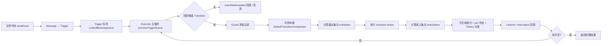

### 0.4 适用 / 不适用（面试第一道分水岭）

| 场景 | 是否适合 Spring StateMachine | 原因 |
| --- | --- | --- |
| 订单/支付/履约状态流转（10 个状态内、线性+少量分支） | ✅ 非常适合 | 语义清晰、可测、可审计 |
| 审批流（会签、退回、动态加签、任意跳转） | ❌ 不适合 | 需要"人机交互 + 动态拓扑 + 长事务"，选 Flowable/Activiti |
| 复杂编排（跨系统调用、重试、补偿、Saga） | ⚠️ 只做"状态判定"，编排交给 MQ/编排引擎 | 状态机不该承担 RPC 编排 |
| 规则频繁变更（运营可配） | ⚠️ 谨慎 | 状态机是"代码即规则"，改动需发版；可选规则引擎/表驱动自研 |
| 需要可视化拖拽建模 | ❌ | 需引入工作流引擎或 UML 建模工具 |

---

## 1. 为什么需要状态机：问题域与选型边界

### 1.1 从"if-else 地狱"演进

**第一版（业务爆炸式）**：

```java
public void pay(Order order) {
    if (order.getStatus() == CREATED) {
        order.setStatus(PAID);
        // 发消息、扣库存、写流水…… 混在一起
    } else if (order.getStatus() == PAID) {
        // 幂等返回
    } else {
        throw new BizException("状态不允许支付");
    }
}
```

问题会随着状态增加指数级放大：

1. **合法性约束散落**：`cancel()` 里也写一遍 `if (status in (CREATED, PAID))`，两处判断迟早不一致 → **非法流转**（已退款订单被再次支付）。
2. **副作用顺序不可控**：扣库存、写流水、发消息全塞在一个方法里，无法保证"先落库再发消息"。
3. **不可审计**：没有统一的"谁在什么时刻因为什么事件从 A 到 B"的记录点。
4. **并发覆盖**：两个请求同时读到 `CREATED`，各自 set 成不同状态，后写覆盖先写（**lost update**）。
5. **无法可视化评审**：产品和测试看不到"状态全貌"，只能靠读代码。

**状态机把这些收敛成三件事**：

| 收敛点 | 手段 | 收益 |
| --- | --- | --- |
| 合法性 | `Transition(source, event, target)` 白名单 | 非法事件直接 `eventNotAccepted`，天然拒绝 |
| 副作用顺序 | `exit action → transition action → entry action` 三段固定顺序 | 顺序由框架保证，不靠人记 |
| 可观测 | `StateMachineListener` 统一回调 + `StateMachineContext` 快照 | 一处埋点，全链路审计 |

### 1.2 五种方案横向对比（选型必答）

| 维度 | if-else / switch | 状态模式(GoF) | **Spring StateMachine** | 工作流引擎(Flowable) | 表驱动自研 |
| --- | --- | --- | --- | --- | --- |
| 表达力 | 无结构 | 类即状态，线性 | 层次+并行+伪状态（UML 全语义） | 最强（BPMN 2.0） | 取决于实现 |
| 合法性约束 | 靠人 | 靠类方法 | **转移白名单 + Guard** | 网关+条件 | 表配置 |
| 持久化 | 自己写 | 自己写 | **内置 SPI（JPA/Redis/Mongo）** | 内置（引擎库表） | 自己写 |
| 可视化 | 无 | 类图 | 可导出 UML（plantuml） | **拖拽建模器** | 可做 |
| 动态改流程 | 发版 | 发版 | 发版（或重写 DSL） | **热部署** | 改表即生效 |
| 学习成本 | 低 | 低 | **中高（UML 概念多）** | 高 | 中 |
| 适用规模 | <3 状态 | 3~8 状态 | **5~30 状态、单机/微服务** | 长流程、跨角色 | 大规模标准化 |

> **面试话术**：状态机不是"更高级的 if-else"，它是把"**状态×事件**"这个二维矩阵显式建模，用"白名单 + 固定执行序 + 统一回调"换来确定性。超过 30 个状态或需要人机流转，就该上工作流引擎了。

### 1.3 延伸：DFA / Mealy / Moore / Statechart 的关系

| 概念 | 定义 | 与实现的关系 |
| --- | --- | --- |
| **DFA**（确定性有限自动机） | 每个 (状态, 输入) 至多一个后继 | Spring SM 靠"冲突仲裁"强行把多个候选收敛成 1 个，**本质是 DFA** |
| **NFA**（非确定） | 同一输入可有多个后继 | 状态机的 `fork`（一分多）有点 NFA 味道，但 fork 的目标是"并行区域"而非"择一" |
| **Mealy 机** | 输出由"转移"决定 | Spring SM 的 `transition action` = Mealy 输出 |
| **Moore 机** | 输出由"状态"决定 | Spring SM 的 `entry action` = Moore 输出 |
| **Statechart**（Harel） | 在 FSM 上加**层次（复合状态）+ 并行（正交区域）+ 历史** | **Spring SM 就是 Statechart 的 Java 实现**，这也是它概念多的根因 |

> 一句话：**Spring SM 允许你定义 NFA 式的图，但运行时通过 guard + 仲裁保证 DFA 式的确定性执行。**

---

## 2. 框架全景：模块、类图、版本演进

### 2.1 模块构成（3.2.x）

| 模块 | 作用 | 生产是否常用 |
| --- | --- | --- |
| `spring-statemachine-core` | 全部核心：模型、执行器、构建器、SPI | ✅ 必用 |
| `spring-statemachine-autoconfigure` / `-starter` | Spring Boot 自动装配（`StateMachineAutoConfiguration`） | ✅ 必用 |
| `spring-statemachine-recipes-common` | 通用配方（如 `StateMachineRecipe`） | ⚠️ 少用 |
| `spring-statemachine-data-common` | Spring Data 抽象（`StateMachineRepository`） | ✅ 持久化时用 |
| `spring-statemachine-data-jpa` | JPA 实现（`JpaStateMachineRepository`） | ✅ 最常用 |
| `spring-statemachine-data-redis` | Redis 实现 | ✅ 高并发常选 |
| `spring-statemachine-data-mongodb` | MongoDB 实现 | ⚠️ 视技术栈 |
| `spring-statemachine-kryo` | Kryo 序列化器（给 zookeeper/redis 用） | ⚠️ 视方案 |
| `spring-statemachine-zookeeper` | 分布式 ensemble（leader 选举 + 状态同步） | ❌ 事实很少用（见 9 章） |
| `spring-statemachine-cluster` | Spring Cloud Cluster 集成 | ❌ 已随 Cloud Cluster 停滞 |
| `spring-statemachine-test` | `StateMachineTestPlan` 测试支持 | ✅ 推荐 |

> **坑点**：`spring-statemachine-core` 只依赖 Spring Framework 核心，**不依赖 Spring Boot**；如果你在非 Boot 项目用，需要自己 new `StateMachineBuilder`。

### 2.2 核心类图（看懂这张，源码目录就通了）

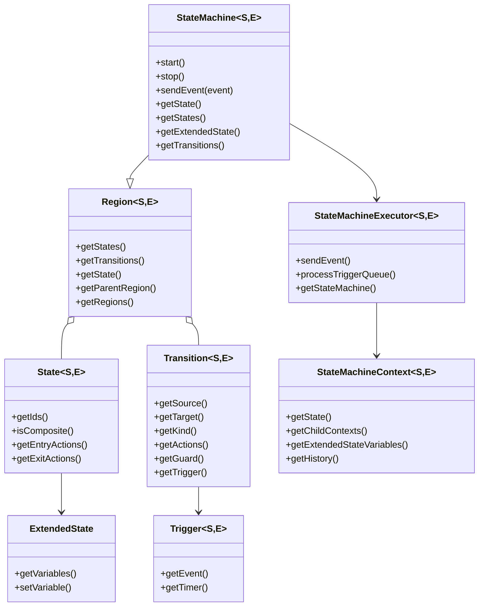

> 关键继承关系：`StateMachine<S,E>` **继承** `Region<S,E>`（`StateMachine` 本身就是一个顶层区域），而 `State` 也可作为"复合状态"内含子 Region。**整个状态机是一棵 Region 树** —— 这是理解层级状态机的钥匙。

### 2.3 版本演进（面试可加分）

| 版本 | 关键变化 | 影响 |
| --- | --- | --- |
| 1.x | 基础模型 + 注解 + JPA + Zookeeper 分布式 | 概念多、API 笨重 |
| 2.x | `StateMachineService`、Factory 完善、Boot 集成 | 多实例方案成熟 |
| **3.0+** | **响应式化**：`sendEvent(Mono<Message>)` 返回 `Flux<StateMachineEventResult>`；引入 `StateMachineFunction`；`StateMachineExecutor` 抽象化；EntryPoint/ExitPoint 伪状态 | 与 WebFlux/Reactor 生态对齐 |
| 3.2.x | JDK 17 / Boot 3 兼容、依赖升级 | 新项目首选 |

> **注意**：3.x 的 `sendEvent` 签名与 1.x/2.x **完全不同**（老博客里的 `boolean sendEvent(E event)` 在新版是 `sendEventCollect` 的语义），面试若问"你怎么发事件"，答版本要明确。

---

## 3. 理论底座：UML 状态机语义（不懂这层，源码看不懂）

> 这一章是"为什么框架有这么多奇怪概念"的答案。Spring SM 的概念几乎 1:1 对应 UML 2.5 StateMachine。

### 3.1 状态的四种类别

| 类别 | 说明 | Spring SM 对应 |
| --- | --- | --- |
| 简单状态 | 无子结构 | `states.withStates().state(A)` |
| **复合状态（Composite）** | 内部还能放子状态 | `states.withStates().state(A, A_sub)` + `and()` |
| **正交区域（Orthogonal Region）** | 一个状态内**并行**跑多个子状态机 | `and().withStates().parent(A)` 多次 |
| 子状态机（Submachine） | 独立状态机被引用 | 用复合状态近似（框架无严格 submachine 引用） |

**复合状态 vs 正交区域的本质区别（高频考点）**：

```
复合状态（互斥 / XOR）：           正交区域（并行 / AND）：
┌──────────────┐                  ┌──────────────────────┐
│  State "订单" │                  │   State "履约"        │
│  ┌────────┐  │                  │  ┌─────────┬────────┐ │
│  │ 待支付  │  │  同一时刻只有     │  │ 物流区   │ 发票区 │ │
│  └────────┘  │  一个子状态生效    │  │ 揽收/运输│ 未开/已开│ │
│  ┌────────┐  │                  │  └─────────┴────────┘ │
│  │ 已支付  │  │                  │   两个区域同时推进     │
│  └────────┘  │                  └──────────────────────┘
└──────────────┘
```

- 复合状态：**"或"语义**，任一时刻只有一个直接子状态活跃（内部是另一个 Region，但只有一个是 current）。
- 正交区域：**"与"语义**，每个区域都有自己的 current state，**同时活跃**。

### 3.2 转移的五要素

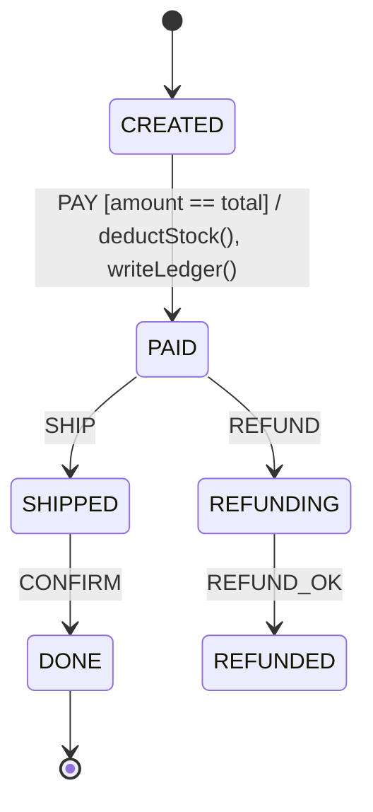

标注语法 `event [guard] / action`：

| 要素 | 含义 | 失败后果 |
| --- | --- | --- |
| source / target | 起止状态 | 不匹配则"无候选转移" |
| event | 触发事件 | 不匹配则事件被丢弃/延迟 |
| **guard** | 布尔条件（可读 ExtendedState） | **false 则该候选被淘汰**，可能落到下一个候选 |
| action | 转移动作 | 抛异常 → `stateMachineError` 回调 |
| kind | EXTERNAL / INTERNAL / LOCAL | 决定是否执行 exit/entry |

### 3.3 伪状态（PseudoState）全景

| 伪状态 | 语义 | 典型用法 | Spring SM API |
| --- | --- | --- | --- |
| **Initial** | 入口点，无入边 | 定义启动后的第一个状态 | `initial(S)` / `initialTransition()` |
| **End** | 终态，无出边 | 流程结束，SM 自动 stop | `end(S)` |
| **Choice** | 动态分支，**运行时**求值 guard | 根据金额/风控结果分流 | `choice()` + `first/then/last` |
| **Junction** | 静态分支，多条入边**合并**再分 | 多来源汇聚后统一判断 | `junction()` |
| **Fork** | 一分多，进入多个正交区域 | 履约同时开物流+发票 | `fork()` |
| **Join** | 多合一，等待所有区域到齐 | 物流+发票都完成才"履约完成" | `join()` |
| **History（浅/深）** | 记住上次退出的子状态 | "退回编辑后回到原来的页签" | `history()` / `deepHistory()` |
| **EntryPoint / ExitPoint**（3.x） | 复合状态的显式出入口 | 从外部直接进到子状态某点 | `entryPoint()` / `exitPoint()` |
| Terminate | 强制终止整个 SM | 风控拦截直接杀流程 | （框架用 `end` + `destroy` 近似） |

> **Choice vs Junction 的差别（面试爱问）**：UML 语义上 choice 只允许**一条**入边、junction 允许多条入边；**代码实现上两者完全一样**（都用 `first/then/last` 结构）。别硬背理论，答"实现等价、语义有细微差别"即可。

### 3.4 RTC（Run-To-Completion）—— 全篇最重要的一条语义

> **定义**：状态机处理一个事件的过程是"原子的"：从取出事件开始，到所有 exit/entry/action/子区域处理完毕为止，**期间不处理任何其他事件**。处理完后才取下一条。

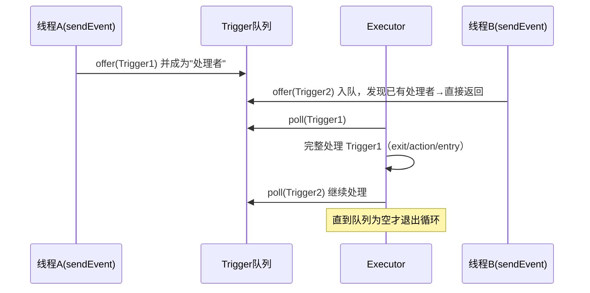

RTC 带来的三个直接后果（务必理解）：

1. **不会出现"状态撕裂"**：两个事件不会交错修改状态，天然避免半迁移。
2. **动作里不要再发事件期望"立刻生效"**：新事件只会入队，**在当前事件处理完之后**才被处理（这是 `reentrant` 坑的根因）。
3. **动作必须短**：RTC 期间整个 SM 被独占，长耗时 = 队列堆积（见 7 章）。

### 3.5 内部转移（Internal Transition）与事件延迟（Defer）

**内部转移**：`source == target` 且 `kind == INTERNAL`，只执行 action，**不退出也不进入**（不触发 exit/entry，状态不变）。

典型用途：状态内的"就地操作"，比如 `PAID` 状态下收到 `QUERY` 事件，只记一条日志，状态仍是 `PAID`。

**事件延迟（Defer）**：当前状态不处理某事件，但**不丢弃**，暂存到 `deferList`，等状态变化后再尝试投递。

```java
// 在状态上声明：这个状态下先不处理 PAY 事件，暂存起来，等状态变化后再投递
states.withStates().state(WAIT_STOCK, PAY)   // state(S state, E... deferredEvents)
```

> 延迟 vs 丢弃 vs 拒绝：**Defer = 稍后再试；无匹配转移 = 丢弃并回调 `eventNotAccepted`**。二者在生产上的区别是"事件是否丢失"，这是幂等设计的重要输入。

---

## 4. 模型层详解：State / Transition / Region / 伪状态

### 4.1 State 的构成

一个 `State<S,E>` 在源码里持有（`org.springframework.statemachine.state.*`）：

| 字段/能力 | 说明 |
| --- | --- |
| `id`（Set） | 一个 State 可对应多个枚举 id（`State` 是 `Iterable`），复合状态由此实现 |
| `entryActions` / `exitActions` | 进入/退出动作（`Action<S,E>` 列表） |
| `stateActions` | "do action"（状态驻留期间执行，框架支持较弱，慎用） |
| `deferredEvents` | 延迟事件集合 |
| `regions` | 子区域（`List<Region<S,E>>`，复合状态的核心） |
| `pseudostate` | 是否为伪状态及其 kind |
| `history` / `deepHistory` | 历史伪状态记录 |
| `entryPoints` / `exitPoints` | 3.x 出入口 |

两种实现：`ObjectState`（普通状态）、`EnumState`（枚举状态，性能更好、`equals` 便宜）。

> **生产建议**：一律用枚举（`EnumStateMachine`），因为状态/事件是有限集合，枚举能编译期校验 + switch 可读 + 持久化字段小。

### 4.2 Transition 与 TransitionKind（三个 kind 必背）

| Kind | 会执行 exit action? | 会执行 entry action? | 会改变 current state? | 典型场景 |
| --- | --- | --- | --- | --- |
| **EXTERNAL** | ✅ 是 | ✅ 是 | ✅ 是 | 普通流转 A→B；**自转移 A→A 也会 exit 再 entry**（常用于"重启状态"） |
| **INTERNAL** | ❌ 否 | ❌ 否 | ❌ 否（source 必须 == target） | 状态内就地动作：记日志、刷新缓存、幂等校验 |
| **LOCAL** | ⚠️ 条件性：**source==target 时不 exit/entry**；target 是 source 的子状态时也不退出 source | ⚠️ 只进入目标 | ✅ 是（进入子状态） | **复合状态内部流转**：父状态不退出，只切换子状态（"局部转移") |

图解三者差异（假设 `A`（复合）内含子状态 `A1`、`A2`）：

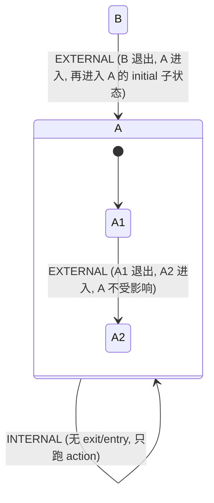

> **为什么需要 LOCAL？** EXTERNAL 进入复合状态时会**重置**其子状态到 initial；而 LOCAL 进入时**保留**已有子状态（或按 history 恢复）。这就是"从外部回到订单页，回到用户原来那一屏"的实现基础。

### 4.3 Region：一棵树，而不是一张图

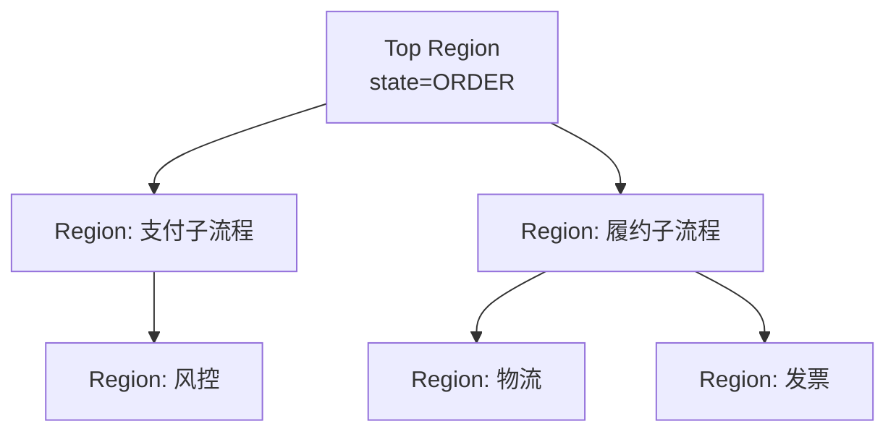

- `Region.getState()` 返回**该区域自己的** current state（复合状态在父区域里是一个"状态"，在子区域里是一个"区域"，双身份）。
- `StateMachine.getState()` 实际是**委托给顶层 Region 的 state**，所以对复合状态而言，`getState()` 返回的是父状态 id，不是子状态 id。
- **子状态查询**：需要遍历 `getStates()` 递归；生产上建议自己维护 `Map<订单号, SubState>` 或依赖持久化 context。

> 面试延伸："`getState()` 为什么拿不到子状态？"——因为 State 用 `Set<String> ids` 表达复合（`A` 和 `A1` 可以共存在一个 State 的 id 集合里），框架的设计取向是"**父状态是主口径**"。这也解释了为什么 `StateMachineContext.childContexts` 要单独存子区域。

### 4.4 Action / Guard / Listener 的三种写法

| 写法 | 代码 | 优缺点 |
| --- | --- | --- |
| Java Lambda | `.action(ctx -> {...})` | 类型安全、可调试 ✅ |
| **SpEL 字符串** | `.action("extendedState.variables['x'] > 0")` | 配置化、可外置；**性能差（表达式编译+反射）**、排错难 ❌ |
| 方法引用/Bean | `.action(bean, "methodName")` | 复用 Spring Bean，便于依赖注入 ✅✅ |

Guard 同理：`guard(ctx -> ...)`、`guardExpression("...")`。

> **生产铁律**：**不要用 SpEL 做业务动作**。SpEL 里注入 Spring Bean 会有"表达式注入"风险，且执行期异常栈极难定位。只在"运营可配的轻量判断"里用。

### 4.5 ExtendedState：状态机的"随身背包"

```java
// 写入（action 里）
context.getExtendedState().getVariables().put("retryCount", n);
// 读取（guard 里）
context.getExtendedState().getVariables().get("retryCount");
```

| 特性 | 说明 |
| --- | --- |
| 本质 | `Map<String, Object>`（默认实现 `DefaultExtendedState` 内部就是一个普通 `HashMap`，**框架不为复合操作提供原子性**，并发场景请自己用 `ConcurrentHashMap` 替换或加锁） |
| 作用域 | **整个 SM 实例**（跨状态、跨事件），**不是**每个区域独立 |
| 持久化 | 只有 `StateMachineContext.extendedStateVariables` 里显式带出的变量才可持久化 |
| 与业务对象关系 | **不是**业务实体本身；它只放"流程判断需要的上下文"，业务实体（订单）应放在 `StateMachinePersist` 的 `contextObj` 里外挂 |

> **常见误用**：把整个 Order 对象塞进 ExtendedState → 序列化爆炸、并发修改无锁、持久化体积不可控。正确做法：ExtendedState 只放**流转决策需要的标量**（金额、风控标记），Order 通过 `contextObj` 参数传入。

---
## 5. 构建层：三种装配方式与容器集成原理

### 5.1 方式一：Builder DSL（最灵活，推荐生产用）

```java
@Configuration
public class OrderStateMachineConfig {

    @Bean
    public StateMachine<OrderStates, OrderEvents> orderStateMachine() throws Exception {
        StateMachineBuilder.Builder<OrderStates, OrderEvents> builder = StateMachineBuilder.builder();

        builder.configureConfiguration()
               .withConfiguration()
               .autoStartup(false)                       // 关键：不要自动启动
               .beanFactory(beanFactory)                 // 让 action 能注入 Bean
               .listener(listener())                     // 统一审计埋点
               .taskExecutor(new SyncTaskExecutor());    // 单线程语义（见 7 章）

        builder.configureStates()
               .withStates()
               .initial(CREATED)
               .state(WAIT_PAY)                          // 简单状态
               .states(EnumSet.allOf(OrderStates.class)) // 批量声明
               .end(DONE)
               .and()
               .withStates()                             // 第二个区域（正交）
               .parent(FULFILLING)
               .initial(NOT_SHIPPED)
               .state(SHIPPED);

        builder.configureTransitions()
               .withExternal()
               .source(CREATED).target(WAIT_PAY).event(CREATE)
               .action(createAction())                   // 转移动作
               .and().withExternal()
               .source(WAIT_PAY).target(PAID).event(PAY)
               .guard(amountGuard())                     // 守卫
               .and().withInternal()                      // 内部转移（就地动作）
               .source(PAID).event(QUERY)
               .action(queryLogAction())
               .and().withChoice()                        // 伪状态分支
               .source(PAID).first(REFUNDING, refundGuard()).last(PAID);

        return builder.build();   // 单实例场景直接 build；多实例不要这样用，见 5.3
    }
}
```

**Builder DSL 的关键点**：
- `and()` 是"回到上一级配置器"，用来切换"区域/转移类型"。
- `builder.build()` 产出的是**一个** `StateMachine` 实例；**千万不要把它注册成单例 Bean 后跨订单复用**（原因见 5.3）。
- 需要"每次新建实例"时：用 `@EnableStateMachineFactory` 让框架替你生产工厂（5.3），或自己把 builder 缓存起来、每次 `build()` 一个新的。
- **不要在 DSL 里写业务逻辑**，只做结构声明，动作引 Bean 方法。

### 5.2 方式二：注解 + `@EnableStateMachine`（Spring 风格最典型）

```java
@Configuration
@EnableStateMachine
public class OrderMachineConfig extends EnumStateMachineConfigurerAdapter<OrderStates, OrderEvents> {

    @Override public void configure(StateMachineConfigurationConfigurer<OrderStates, OrderEvents> config) throws Exception {
        config.withConfiguration().autoStartup(true).listener(new OrderListener());
    }
    @Override public void configure(StateMachineStateConfigurer<OrderStates, OrderEvents> states) throws Exception {
        states.withStates().initial(CREATED).states(EnumSet.allOf(OrderStates.class)).end(DONE);
    }
    @Override public void configure(StateMachineTransitionConfigurer<OrderStates, OrderEvents> transitions) throws Exception {
        transitions.withExternal().source(CREATED).target(PAID).event(PAY);
    }
    @Override public void configure(StateMachineConfigurationConfigurer<...> config) {
        // 也可以用 @Bean 注入 Action
    }

    @Bean public Action<OrderStates, OrderEvents> payAction() { return ctx -> { ... }; }

    // 注解式监听（可选）
    @OnTransition(source = "CREATED", target = "PAID")
    public void onPaid() { ... }

    @OnStateChanged
    public void onStateChanged(@EventHeaders Map<String,Object> headers, ExtendedState ext) { ... }
}
```

**注解方式的三条硬约束（踩坑重灾区）**：

1. `@OnTransition` / `@OnStateChanged` 所在方法必须**在同一个 Bean 里且类上有 `@WithStateMachine`（或实现 `StateMachineListener`）**，否则不生效。
2. 注解方法**不能是 private**（反射调用要求可见）。
3. 注解监听依赖 `StateMachineListenerAdapter` 的反射解析，**异常会被吞**（只打日志），生产审计建议用显式 listener。

### 5.3 方式三：`@EnableStateMachineFactory`（**多业务对象必备**）

```java
@Configuration
@EnableStateMachineFactory
public class FactoryConfig extends EnumStateMachineConfigurerAdapter<...> { ... }

// 使用
@Autowired StateMachineFactory<OrderStates, OrderEvents> factory;

StateMachine<OrderStates, OrderEvents> sm = factory.getStateMachine(orderId); // 每个订单一个实例
```

> **这是本框架最大的坑，没有之一**：
> `@EnableStateMachine` 注册的是**单例** StateMachine Bean。如果你在 Spring 单例 Service 里持有它处理所有订单，**订单 A 的状态会污染订单 B**。
> 面试只要问"状态机怎么在多订单下使用"，答"必须用 Factory + 每 key 一实例，或每次从持久化 context 重建"，就是及格线以上。

### 5.4 容器集成原理（`@EnableStateMachine` 到底做了什么）

```mermaid
flowchart LR
    A["@EnableStateMachine"] --> B[Import: StateMachineConfiguration]
    B --> C[注册 StateMachineBuilderFactory / EnumStateMachineFactory]
    C --> D[注册 StateMachine 单例 Bean<br/>由 builder.build() 生产]
    D --> E[SmartLifecycle: 容器启动时 start()，关闭时 stop()]
```

要点：
- `@EnableStateMachine` 通过 `@Import(StateMachineConfiguration.class)` 注册一系列 `@Configuration`（state/transition/configuration 三套 configurer 的后置处理器）。
- StateMachine 实现了 `SmartLifecycle`，**随 Spring 容器生命周期自动 start/stop**。所以在 Web 应用里"机器是活的"，你只需要 `sendEvent`。
- 想让 Bean 参与依赖注入（action 里用 `@Autowired`），必须配置 `beanFactory`；`StateMachineBuilder` 默认用的是 `StaticListableBeanFactory`，**里面没有你的业务 Bean**，`@Autowired` 会是 null —— 这是"action 里注入为 null"的头号原因。

### 5.5 构建期的模型校验（很多人不知道）

框架自带 `StateMachineModelVerifier`（`DefaultStateMachineModelVerifier`），能在构建期发现：

| 校验项 | 不通过会怎样 |
| --- | --- |
| initial 状态是否存在且唯一 | 构建失败 |
| 是否有不可达状态 | 警告（`log.warn`） |
| 是否有 end 状态缺失 | 警告 |
| 是否有从 initial 不可达的转移 | 警告 |

> 生产建议：**把 verifier 的警告当错误处理**。一个"永远到不了"的状态，往往意味着建模漏了事件，是最便宜的 bug 发现点。

---

## 6. 运行时引擎：一次事件的完整执行链路

> 本章是全篇核心。能把这一章讲清楚，面试基本可以"降维打击"。
> 主类：`org.springframework.statemachine.support.DefaultStateMachineExecutor`（`StateMachineExecutor` 的默认实现）

### 6.1 启动阶段：`start()` 做了什么

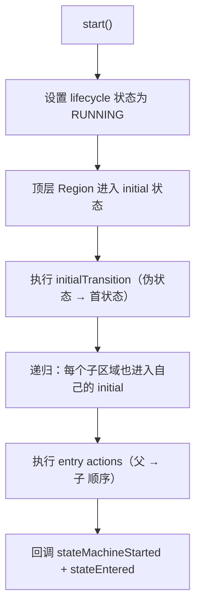

关键点：
- **initial transition 也是一条 `Transition`**（source 是 initial 伪状态），所以它**可以挂 action**。这是个很好用的技巧：启动时做一次初始化（如加载配置）。
- `autoStartup(true)` 时 Spring 容器 refresh 阶段就会 start，**不要假设"我还没发事件机器就是空的"**——它已经在 initial 状态了。
- **start 是幂等的**：重复 start 不会重复进入 initial（有 lifecycle 判断）。

### 6.2 事件投递阶段：Message → Trigger → Queue

3.x 的入口（响应式）：

```java
// 单事件：返回处理结果流
Flux<StateMachineEventResult<S,E>> results = machine.sendEvent(Mono.just(MessageBuilder.withPayload(PAY).setHeader("orderId", id).build()));

// 想要"跑完再继续"：收集成 List
Mono<List<StateMachineEventResult<S,E>>> mono = machine.sendEventCollect(Mono.just(message));
```

内部转换链：

```
Message<E>  ──►  Trigger<S,E>（封装 event + 可选 timer）
    │
    └─► 放入 executor 的 LinkedBlockingQueue<Trigger>
         │
         └─► 尝试"抢占处理权"：如果当前没有线程在处理，本线程成为处理者；否则直接返回（事件已入队）
```

`StateMachineEventResult` 有三种结果（**这是 3.x 面试的加分细节**）：

| ResultType | 含义 |
| --- | --- |
| `ACCEPTED` | 找到转移并成功执行 |
| `DENIED` | 找到转移但 **guard 为 false** 被拒 |
| `DEFERRED` | 事件被当前状态 defer 了，暂存待后续 |

> 所以"事件没生效"至少有 4 种原因：无候选转移（无 result）、guard 拒绝（DENIED）、被 delay（DEFERRED）、异常中断。定位问题时先看 result，不要瞎猜。

### 6.3 处理阶段：`handleTrigger()` 的 10 个步骤（重点背诵）

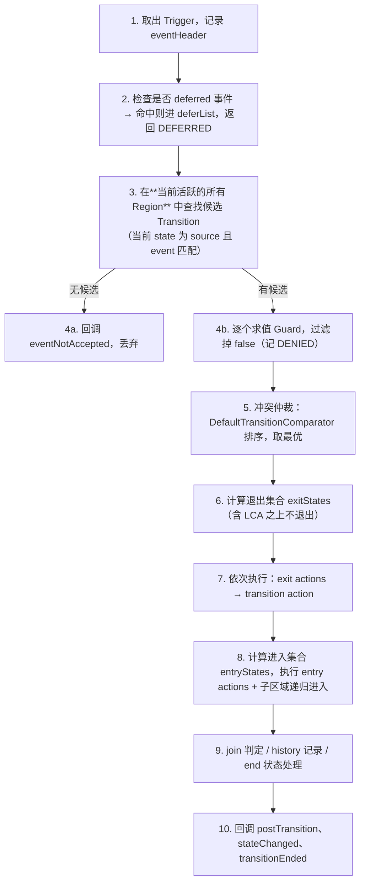

下面逐段展开。

#### 步骤 3：候选转移怎么找？

```java
// 伪代码（对应源码 getTransitions / transition 查找逻辑）
List<Transition<S,E>> candidates = new ArrayList<>();
for (Region<S,E> region : activeRegions) {           // 当前活跃区域（含父区域）
    for (Transition<S,E> t : region.getTransitions()) {
        if (t.getSource().equals(region.getState())     // source 必须是"当前状态"
            && t.getTrigger() != null
            && t.getTrigger().getEvent().equals(event)) // 事件匹配
            candidates.add(t);
    }
}
```

注意两个细节（面试能答出来说明真读过源码）：

1. **查找范围是"活跃区域"而不是全图**：子区域没被激活时，其内部转移不会被匹配。这解释了为什么"复合状态未进入时，子事件无效"。
2. **timer trigger**：`Trigger.getEvent()` 可以是 null，此时按 `timer` 匹配（`triggerless transition`），用于超时流转。

#### 步骤 4：Guard 求值

```java
for (Transition t : candidates) {
    if (t.getGuard() != null && !t.getGuard().evaluate(context)) {
        denied.add(t);   // 记 DENIED
        continue;
    }
    accepted.add(t);
}
```

- Guard 抛异常 → 视作 false + 记 error（**不要依赖异常做分支**）。
- Guard 里**不要做 RPC/DB 查询**：它在每次事件处理时同步执行，且可能被执行多次（多候选）。

#### 步骤 5：冲突仲裁（`DefaultTransitionComparator`）—— 高频考点

多个候选同时匹配时，排序规则（按优先级从高到低）：

| 优先级 | 规则 | 例子 |
| --- | --- | --- |
| 1 | **TransitionKind 优先**：LOCAL > INTERNAL > EXTERNAL | 同一状态既有 EXTERNAL 又有 INTERNAL，优先 INTERNAL |
| 2 | **源状态层级更深者优先** | 子状态 `A1` 的转移优先于父状态 `A` 的转移（**"子类优先"原则**，符合 UML 语义） |
| 3 | **定义顺序（document order）** | 深度相同则按 DSL/代码里的声明先后，先声明者优先 |

> **这条规则的实际意义**：UML 状态机的标准冲突解决就是"更深的状态优先（inner-first）"+"定义顺序"，Spring SM 忠实实现了它。所以你可以放心地：
> - 在父状态上配"兜底转移"（如任何事件都记日志），在子状态上配"精确转移"，**精确的自然胜出**。
> - 用 EXTERNAL 做"重置式自转移"，用 INTERNAL 做"就地动作"，两者不冲突。

#### 步骤 6：退出集合与 LCA（最容易被问倒）

**LCA（Least Common Ancestor，最近公共祖先）**：转移的 source 与 target 在 Region 树里的最低公共父区域。

```
规则：exit 从 source 开始，逐级向上退出，
      直到"到达 LCA 的直接子区域"为止（LCA 本身不退出）。
```

例子：

```
Top Region
 └── State ORDER (复合)
      ├── Region 支付:  WAIT_PAY → PAID
      └── Region 履约:  NOT_SHIPPED
```

| 转移 | LCA | 退出集合 | 进入集合 |
| --- | --- | --- | --- |
| `WAIT_PAY → PAID`（同区域） | 支付 Region | {WAIT_PAY} | {PAID} |
| `WAIT_PAY → NOT_SHIPPED`（跨区域） | Top Region | {WAIT_PAY, ORDER} → 实际退出到 ORDER 之下的支付区 | {ORDER, 履约区 initial} |
| `PAID → PAID`（EXTERNAL 自转移） | 自身 | {PAID} | {PAID}（exit 再 entry） |

**exit / entry 的执行顺序（必背）**：

```
exit  ：从内到外、从子到父   （子状态 exit action → 父状态 exit action）
entry ：从外到内、从父到子   （父状态 entry action → 子状态 entry action）
```

> 为什么是这个顺序？因为"进入父状态"意味着"父状态的环境（资源、上下文）已就绪"，子状态才能安全初始化；退出则相反，**先释放子资源再释放父资源**（典型的栈式资源管理）。

#### 步骤 7：动作执行

`Action<S,E>` 的标准签名：

```java
public interface Action<S, E> {
    void execute(StateMachineContext<S,E> context) throws Exception;
}
```

执行顺序（**严格串行**）：

```
1. 所有 exit 状态的 exitAction（内→外）
2. 转移自身的 action
3. 所有 entry 状态的 entryAction（外→内）
4. 子区域的 initial 递归进入（各自 entry）
```

异常处理：任一 action 抛异常 → **当前转移中断**，已退出的状态**不会回滚**（框架无事务语义！），回调 `stateMachineError`。

> ⚠️ **这是最危险的设计点**：状态机**没有分布式事务/回滚**。所以：
> - 动作要幂等、可重试；
> - 关键副作用（扣款、发消息）应放在"状态落库成功之后"（事务外），或用 outbox 模式；
> - 不要指望"action 抛异常 → 状态回滚"。

#### 步骤 8-9：进入、子区域、join、history

| 机制 | 行为 | 说明 |
| --- | --- | --- |
| 子区域进入 | 进入复合状态时，每个子区域递归进入自己的 initial | 可用 `fork` 显式控制进哪个子状态 |
| **fork** | 一个转移同时进入多个区域的目标状态 | 目标可以是父状态（全区域回 initial）或区域内具体状态 |
| **join** | 所有参与区域都到达 join 源状态时，触发 join 的转移 | 未到齐则**挂起等待**，不报错 |
| **history** | 退出复合状态时记录其子状态；再次进入（LOCAL 或 history 转移）时恢复 | `history()` 浅历史只记直接子状态；`deepHistory()` 递归记 |
| **end 状态** | 进入 end → 该区域"结束"，全部区域结束则 SM 自动 stop | 终态不可再接收事件 |

#### 步骤 10：回调顺序（面试常考"顺序题"）

```
preEvent
  → preTransition
    → preStateChange(退出) / exit action
  → transition action
    → preStateChange(进入) / entry action
  → postStateChange
  → postTransition
postEvent
```

同时 `StateMachineListener` 会收到：`transition`（转移发生）、`transitionStarted/Ended`、`stateChanged`、`stateEntered/Exited`、`eventNotAccepted`。

> **区别**：`Interceptor` 能**修改/中断**流程（有 `context` 且有返回值），`Listener` 只是**观察者**（返回值 void，抛异常被吞）。审计用 Listener，改造用 Interceptor/Function。

### 6.4 完整时序图（把上面 10 步串起来）

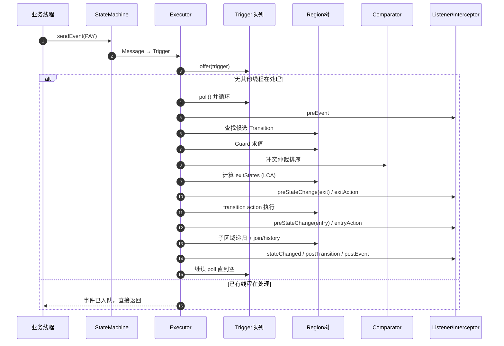

### 6.5 三个"顺序"必须刻进肌肉记忆

| 顺序 | 规则 | 一句话理由 |
| --- | --- | --- |
| **exit 顺序** | 子 → 父（内到外） | 先释放最细粒度资源 |
| **entry 顺序** | 父 → 子（外到内） | 父环境就绪子才能初始化 |
| **回调顺序** | preEvent → preTransition → exit → action → entry → postTransition → postEvent | 包裹式，便于统一日志/事务 |

---
## 7. 线程模型与并发：RTC、事件队列、重入、线程安全边界

> 这是"能不能上生产"的分水岭，也是阿里/美团/字节二面最爱挖的点。

### 7.1 默认到底是不是异步？

| 组件 | 默认实现 | 行为 |
| --- | --- | --- |
| `TaskExecutor` | `SyncTaskExecutor` | **同步**：谁调 `sendEvent` 谁执行（在同一线程里跑完全套动作） |
| 队列 | `LinkedBlockingQueue<Trigger>` | 无界（实际有容量，但足够大） |
| 处理权 | 内部 `AtomicBoolean`-like 标记 | **同一时刻只有一个线程在处理队列** |

结论：**默认是"单线程串行"语义，但执行线程是"第一个到达的调用线程"，不是固定线程。**

这个设计叫 **"接力棒（baton passing）"**：线程 A 发事件 → 抢到处理权 → 处理 A 的事件 → 顺带把队列里 B 线程的事件也处理掉 → 队列空才释放处理权。

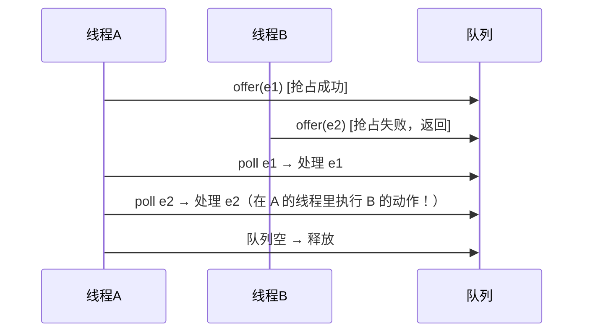

> **这个细节的实战含义**：
> 1. 你在 B 线程里调 `sendEvent`，动作可能在 A 线程执行 → **ThreadLocal（如事务上下文、MDC 日志、SecurityContext）会丢失**。
> 2. 想指定线程池，必须显式配置 `taskExecutor`（`ThreadPoolTaskExecutor`），否则别假设"异步"。
> 3. 想保证同一订单串行，可以按 orderId 选择固定线程（`ThreadPoolTaskExecutor` 无法保证，需自建 `ExecutorService` + 一致性哈希，或 Kafka 分区）。

### 7.2 四个并发陷阱（生产真实事故）

| # | 陷阱 | 现象 | 正确做法 |
| --- | --- | --- | --- |
| 1 | **单例 SM 跨订单复用** | 订单 A 的状态出现在订单 B 的响应里 | `StateMachineFactory` + 每 orderId 一个实例（用完 `stop()` 释放） |
| 2 | **action 里再发事件** | 期望"立刻生效"，实际要等当前事件处理完；若在同一个 RTC 内依赖新状态，读到的是旧状态 | 用 `sendEventCollect` 显式等待，或把逻辑拆成两个事件（由业务编排） |
| 3 | **action 阻塞（RPC/DB/锁）** | 队列堆积；RTC 期间其他订单事件也卡在同一线程 | action 只做内存计算/发消息；DB 更新放到转移成功后的统一收口 |
| 4 | **ThreadLocal 丢失** | 事务上下文/权限上下文为 null，导致"偶发权限校验失败" | 在 message header 里显式传参；或配置 `TaskExecutor` + `TaskDecorator` 传递上下文 |

### 7.3 线程安全边界（面试标准答案）

```
✅ 安全：不同 StateMachine 实例之间（各自持有自己的状态）
❌ 不安全：同一 StateMachine 实例被多线程并发 sendEvent（内部 current state 是普通引用，不是 volatile 语义的保护）
✅ 框架保证：同一实例内的事件处理是串行的（RTC + 队列），不会交错
⚠️ 不保证：action 里对业务对象的并发修改（那是你自己的锁问题）
```

> 所以"状态机线程安全吗"的标准回答是：**单个实例的事件处理是串行化的（RTC），但实例本身有状态、不是为多线程共享设计的；共享实例的正确方式是"每个业务键一个实例"或"每次从持久化恢复 + 外部乐观锁"。**

### 7.4 3.x 响应式的真实含义

```java
// 非阻塞：返回 Flux，你不订阅就什么都不发生？
Flux<StateMachineEventResult<S,E>> f = machine.sendEvent(Mono.just(msg));
```

- 3.x 把执行器改造成 **Reactive 风格**：返回 `Flux`，通过 `subscribe` 驱动。
- 但**底层仍然是那个队列 + 串行执行器**，只是把"结果"包装成流。
- `sendEventCollect` 返回 `Mono<List<...>>`：**"等这批事件处理完"** 的语义，最适合"发事件 → 拿最终状态"的同步用法。
- WebFlux 场景可用 `flatMap` 链式编排，避免阻塞。

> **别被"响应式"骗了**：它不是"并发处理多事件"，而是"用流的方式表达结果 + 背压"。RTC 依然是串行的。

---

## 8. 持久化与恢复

### 8.1 为什么不能直接序列化 StateMachine

`DefaultStateMachine` 里持有：`executor`（含队列、线程、`TaskExecutor`）、`beanFactory`、`listener` 列表、`Region` 树（含 `Action` 引用，可能是 Lambda/Bean 方法引用）。**这些全是"运行时对象"，不可序列化也不该序列化**。

所以框架的持久化设计是：**只存"状态快照"（`StateMachineContext`），恢复时用"工厂 + 快照"重建机器。**

```java
public class StateMachineContext<S, E> {
    private S state;                                     // 顶层状态
    private List<StateMachineContext<S,E>> childContexts;// 子区域状态（层级状态必需）
    private Map<String,Object> extendedStateVariables;   // 需要持久化的变量（显式声明）
    private E event;                                     // 触发当前状态的事件（可选）
    private List<String> history;                        // 历史伪状态记录
}
```

### 8.2 三件套 SPI

| 接口 | 职责 | 实现要点 |
| --- | --- | --- |
| `StateMachinePersist<S,E,T>` | **存取原始快照**：`write(context, contextObj)` / `read(contextObj)` | 你自己实现，负责落库/读库 |
| `StateMachinePersister<S,E,T>` | **编排**：从 SM 取 context、写库；从库读 context、恢复到 SM | `DefaultStateMachinePersister` 已实现，直接用 |
| `StateMachineService<S,E>` | **实例生命周期管理**：`acquireStateMachine(key)` / `releaseStateMachine` | `DefaultStateMachineService` 用 `Map<key, SM>` 缓存活跃实例 |

推荐组合（生产最常用）：

```java
// 1) 持久化实现（以 JPA 为例，也可以自己写 Mapper）
StateMachinePersist<OrderStates, OrderEvents, String> persist = new StateMachinePersist<>() {
    public void write(StateMachineContext<OrderStates,OrderEvents> ctx, String orderId) {
        orderRepo.saveContext(orderId, ctx.getState().toString(), toJson(ctx.getChildContexts()), toJson(ctx.getExtendedStateVariables()));
    }
    public StateMachineContext<OrderStates,OrderEvents> read(String orderId) {
        OrderRow row = orderRepo.find(orderId);
        return new DefaultStateMachineContext<>(OrderStates.valueOf(row.state), null, fromJson(row.vars), null);
    }
};

// 2) 使用
StateMachinePersister<...> persister = new DefaultStateMachinePersister<>(persist);
persister.restore(sm, orderId);   // 恢复
sm.sendEventCollect(Mono.just(msg)).block();
persister.persist(sm, orderId);   // 落库（带乐观锁 version）
```

### 8.3 表设计（订单状态机）

```sql
CREATE TABLE order_state (
  order_id      VARCHAR(64) PRIMARY KEY,
  current_state VARCHAR(32) NOT NULL,     -- 顶层状态
  sub_states    JSON,                     -- 子区域状态（正交/层级必需）
  ext_vars      JSON,                     -- 需持久化的扩展变量（白名单）
  version       INT NOT NULL,             -- 乐观锁
  updated_at    DATETIME(3)
);
-- 审计表（与状态表分离，异步写）
CREATE TABLE order_state_log (
  id BIGINT PRIMARY KEY AUTO_INCREMENT, order_id VARCHAR(64),
  from_state VARCHAR(32), to_state VARCHAR(32), event VARCHAR(32),
  operator VARCHAR(64), trace_id VARCHAR(64), created_at DATETIME(3),
  UNIQUE KEY uk_idem (order_id, event, trace_id)   -- 幂等键
);
```

### 8.4 恢复的三个"不"

| 不会 | 原因 | 后果/对策 |
| --- | --- | --- |
| **不会重放 entry action** | 恢复只是"设置 region 的 current state"，不执行转移 | 所以"进入某状态要发消息"这类副作用**必须在转移 action 里做**，不能只写在 entry action |
| **不会恢复队列里的待处理事件** | 队列是内存对象，不持久化 | 事件必须由 MQ/DB 保证"至少一次投递 + 幂等" |
| **不会自动修正非法状态** | 恢复是"信任快照" | 恢复后应校验 `state` 是否在枚举内，否则告警 |

> **这就是"状态机 + MQ"的经典分工**：状态机负责"判合法性 + 改状态"，MQ 负责"事件不丢 + 重试"，DB 负责"状态真源 + 幂等键"。三者缺一不可。

### 8.5 延伸：快照 vs 事件溯源（Event Sourcing）

| 方案 | 存什么 | 优点 | 缺点 | 适用 |
| --- | --- | --- | --- | --- |
| **状态快照**（Spring SM 默认） | 当前状态 + 变量 | 简单、读快、体积小 | 无历史（需另建审计表） | 绝大多数业务 |
| 事件溯源 | 全部事件日志，状态靠 replay | 完整历史、可回放、可修正 | 重放成本高、快照仍需定期生成 | 金融账务、审计要求极高 |

> 面试加分答法："Spring SM 的 `StateMachineContext` 是快照式，天生不适合做事件溯源；如果要做，得自己维护 event log 并实现 replay —— replay 时**不能执行真实副作用**，需要用 `noop action` 重建。"

---

## 9. 分布式落地：官方方案 vs 生产主流方案

### 9.1 官方方案（`spring-statemachine-zookeeper` / `-cluster`）

| 组件 | 作用 |
| --- | --- |
| `StateMachineEnsemble` | 集群内"谁持有同一个状态机"的协调抽象 |
| `ZookeeperStateMachineEnsemble` | 基于 ZK + Curator 实现：**leader 选举 + 状态变更广播 + 分布式锁** |
| `LeaderZookeeperStateMachineEnsemble` | 依赖 Spring Cloud Cluster 的 leader 能力 |
| `ZookeeperStateMachinePersist` | 用 ZK 节点存状态，Kryo 序列化 |

**为什么生产几乎不用（面试要能说清）**：

1. **语义错配**：ensemble 假设"同一个状态机在集群里只有一个活跃副本"，本质是"分布式单例"。而订单场景是"**百万个独立状态机**"，每个订单一个 —— ensemble 完全不适配这个粒度。
2. **ZK 不适合高频写**：订单状态 QPS 上千就会打爆 ZK（ZK 是 CP，写吞吐低）。
3. **依赖已停滞**：`spring-statemachine-cluster` 依赖的 Spring Cloud Cluster 项目早已被 Spring Integration 取代，社区活跃度低。
4. **状态一致性 ≠ 业务一致性**：即便状态同步了，副作用（扣款、发货）仍需幂等，ensemble 帮不上。

### 9.2 生产主流方案：**状态机只做"内存计算"，状态真源在 DB**

```mermaid
flowchart LR
    MQ[("Kafka/RocketMQ<br/>按 orderId 分区")] --> C["消费者<br/>单线程/按 key 串行"]
    C --> S["acquire: 从 DB 读 state<br/>重建 SM (factory)"]
    S --> E["sendEvent（RTC 串行处理）"]
    E -->|guard 通过| U["DB 更新<br/>UPDATE ... WHERE version=?"]
    U -->|成功| P["发下一跳事件 / 返回"]
    U -->|失败(乐观锁冲突)| R["重读 + 重试 或 丢弃(已处理)"]
    E -->|guard 拒绝| D["记幂等日志，ACK"]
```

三种部署形态对比：

| 形态 | 做法 | 优点 | 缺点 | 适用 |
| --- | --- | --- | --- | --- |
| A. 单机内存 | 一个 SM 常驻，事件内存驱动 | 最快 | 重启丢状态、无法水平扩展 | 单体、低频 |
| B. 每 key 实例 + 持久化（**推荐**） | `StateMachineService` 缓存活跃 SM，DB 落快照 | 兼顾性能与恢复 | 内存占用随活跃 key 增长（需 LRU 逐出） | 订单/支付主流 |
| C. 无状态（每次重建） | 每次事件从 DB 读 state → 新建 SM → 处理 → 落库 | 无状态、易扩展、无内存泄漏 | 每次构建开销（毫秒级）、依赖 DB | 高并发、事件稀疏 |

### 9.3 分布式四问（必答模板）

| 问题 | 解法 |
| --- | --- |
| **幂等** | `(orderId, event, 业务请求号)` 唯一键；状态机层面用"guard 判断 current state 是否已是目标态 → 直接返回成功" |
| **顺序** | 同一 orderId 路由到同一分区/同一线程（Kafka key、一致性哈希）；**不要**用随机线程池 |
| **并发** | DB 乐观锁 `version` + 状态机 CAS 式更新；冲突则重试（有上限）或转异步 |
| **补偿** | Saga：正向转移 action 记录"已执行步骤"，失败时反向执行补偿；状态机的 `REFUNDING/REFUNDED` 就是补偿态 |

---

## 10. 可观测性、测试与监控

### 10.1 监听器清单（统一埋点入口）

| 事件 | 触发时机 | 用途 |
| --- | --- | --- |
| `stateMachineStarted/Stopped` | 启停 | 生命周期监控 |
| `stateChanged` | 状态变更 | 指标：状态分布 |
| `transition` / `transitionStarted/Ended` | 转移过程 | 审计：from/to/event |
| `stateEntered/Exited` | 进入/退出 | 调试层级状态 |
| `eventNotAccepted` | 事件无候选转移 | **告警：非法事件/漏配转移** |
| `extendedStateChanged` | 变量变更 | 追踪上下文 |
| `stateMachineError` | 动作抛异常 | **告警：最高优先级** |

```java
public class AuditListener implements StateMachineListener<OrderStates, OrderEvents> {
    @Override public void transition(Transition<...> t) {
        // t.getSource().getId() / t.getTarget().getId() / t.getTrigger().getEvent()
        log.info("orderId={} {} --{}--> {}", orderIdOf(t), src, evt, tgt);
    }
    @Override public void eventNotAccepted(Message<OrderEvents> m) {
        meter.counter("sm.event.rejected").increment();  // 立刻告警
    }
    @Override public void stateMachineError(Message<OrderEvents> m, Exception e) {
        meter.counter("sm.error").increment();
        log.error("sm error", e);
    }
}
```

### 10.2 `StateMachineMonitor` 与指标

- 框架提供 `StateMachineMonitor`（`DefaultStateMachineMonitor`），可对接 Micrometer，统计**转移耗时**（每个 transition 的 duration）。
- 生产必备 4 个指标：`transition_count{from,to,event}`、`transition_duration`、`event_rejected_count`、`sm_error_count`。

### 10.3 测试：`StateMachineTestPlan`

```java
StateMachineTestPlan<OrderStates, OrderEvents> plan =
    StateMachineTestPlanBuilder.<OrderStates, OrderEvents>builder()
      .defaultAwaitTime(1)
      .stateMachine(machine)
      .step()
        .expectState(CREATED)
        .and().step().sendEvent(CREATE)
        .expectState(WAIT_PAY)
        .and().step().sendEvent(PAY)
        .expectState(PAID)
        .and().step().sendEvent(CANCEL)      // 非法事件
        .expectState(PAID)                   // 状态不变
      .and().build();
plan.test();
```

> 单元测试的三层建议：
> 1. **纯模型测试**（`StateMachineTestPlan`）：覆盖每条转移 + 每个 guard 分支 + 每个非法事件；
> 2. **动作单测**：`Action` 是普通对象，直接 new 出来测，不需要启动状态机；
> 3. **图完整性测试**：遍历 `getTransitions()`，断言"每个非终态都有出边"、"每个状态都可达"。

---

## 11. 横向对比（面试"选型题"标准答案）

| 维度 | Spring StateMachine | 状态模式(GoF) | 工作流引擎(Flowable) | 自研表驱动 | Cola StateMachine |
| --- | --- | --- | --- | --- | --- |
| 语义能力 | 层次/并行/伪状态（UML） | 线性 | BPMN 2.0（最强） | 自定义 | 线性 + 少量分支 |
| 持久化 | 内置 SPI | 无 | 内置引擎表 | 自己写 | 无（轻量） |
| 动态改流程 | 发版 | 发版 | 热部署 | 改表生效 | 发版 |
| 可视化 | 可导出 UML | 无 | 拖拽建模 | 可做 | 无 |
| 学习成本 | 中高 | 低 | 高 | 中 | **低** |
| 重量 | 重（几十个类） | 极轻 | 极重 | 中 | 轻 |
| 适用 | 5~30 状态、需要层级/并行、要求强约束 | <8 状态、单对象 | 长流程、人机交互、跨系统 | 运营可配、状态极多 | 中小项目快速落地 |

> **一句话选型**：
> - 状态少、要快、要简单 → **状态模式 / Cola**；
> - 状态中等、要"白名单约束 + 持久化 + 审计" → **Spring StateMachine**；
> - 流程长、要人工审批/动态跳转/热更新 → **Flowable**；
> - 状态极多（上百）、规则由运营配置 → **表驱动自研 + 轻量执行器**。

---
## 12. 生产范式：订单支付状态机完整骨架

### 12.1 状态/事件建模（先画图，再写代码）

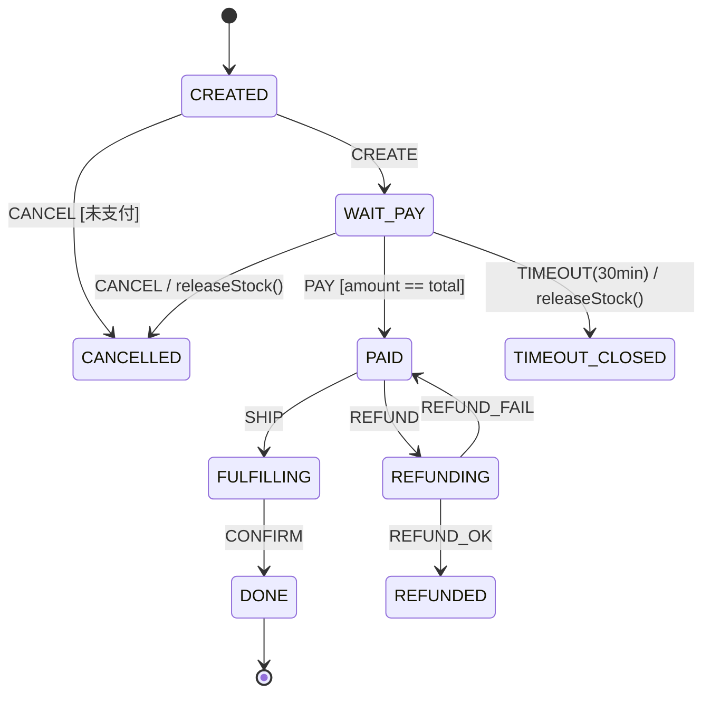

**建模四原则**：

| 原则 | 说明 |
| --- | --- |
| **状态是"业务可观测的节点"** | 前端/客服能说出的词才是状态（"待支付""已发货"），不要建 `PROCESSING_1` 这类技术态 |
| **事件是"命令"不是"事实"** | `PAY`（命令）而非 `PAID_BY_USER`（事实）；事实名容易和状态名混淆 |
| **一个状态只表达一件事** | 别把"待支付+待风控"合成一个状态，用**正交区域**拆开 |
| **必须有终态 + 必须有兜底态** | `DONE/REFUNDED/CANCELLED` 是终态；`TIMEOUT_CLOSED` 是兜底 |

### 12.2 服务层骨架（核心：恢复 → 处理 → 落库 → 幂等）

```java
@Service
public class OrderStateMachineService {

    @Autowired StateMachineFactory<OrderStates, OrderEvents> factory;
    @Autowired OrderStateRepository repo;          // 状态表 + version
    @Autowired StateMachinePersister<OrderStates, OrderEvents, String> persister;

    public Result fire(String orderId, OrderEvents event, String requestId) {
        // 1. 幂等前置：同一 requestId 已处理过直接返回
        if (idemRepo.exists(orderId, requestId, event)) return Result.duplicated();

        // 2. 重建实例并恢复状态（每 key 一实例，用完即弃）
        StateMachine<OrderStates, OrderEvents> sm = factory.getStateMachine(orderId);
        try {
            persister.restore(sm, orderId);
            OrderStates before = sm.getState().getId();

            // 3. 发事件并等待处理完成（RTC 串行）
            List<StateMachineEventResult<OrderStates, OrderEvents>> results =
                sm.sendEventCollect(Mono.just(MessageBuilder.withPayload(event)
                        .setHeader("requestId", requestId).build())).block(Duration.ofSeconds(3));

            if (results == null || results.isEmpty()) {
                return Result.rejected("无匹配转移");        // 非法事件
            }
            if (results.get(0).getResultType() != ResultType.ACCEPTED) {
                return Result.rejected(results.get(0).getResultType().name()); // DENIED / DEFERRED
            }

            OrderStates after = sm.getState().getId();

            // 4. CAS 落库（乐观锁），失败即"并发被抢先"
            boolean ok = repo.compareAndSet(orderId, before, after, requestId);
            if (!ok) return Result.conflict();              // 上层重试（有上限）

            // 5. 事务外发下一跳事件（outbox / MQ）
            mq.publish(after, orderId);
            return Result.ok(before, after);
        } finally {
            sm.stop();   // 释放资源，防止内存泄漏
        }
    }
}
```

**这段代码的每个设计点都能被追问，务必理解"为什么"**：

| 设计点 | 为什么 |
| --- | --- |
| 每 key 一实例 + `stop()` | 避免状态污染 + 避免内存泄漏 |
| 先 `restore` 再 `sendEvent` | 状态真源在 DB，内存只是计算副本 |
| `sendEventCollect` 而非 `sendEvent` | 需要"等处理完"才能读最终状态 |
| CAS 落库 | 防并发覆盖（lost update） |
| 幂等前置 + CAS 双保险 | 幂等表防重复请求，CAS 防并发 |
| MQ 在事务外 | 避免"消息发了但事务回滚"；或改用本地消息表 |

### 12.3 20 条踩坑清单（可直接当 Code Review Checklist）

| # | 坑 | 正确姿势 |
| --- | --- | --- |
| 1 | 单例 SM 处理多订单 | `StateMachineFactory.getStateMachine(key)` |
| 2 | `@EnableStateMachine` 与 Factory 同时用 | 二选一，多实例只用 `@EnableStateMachineFactory` |
| 3 | action 里 `@Autowired` 为 null | 配置 `beanFactory`，或动作定义成 `@Bean` 再引用 |
| 4 | 用 SpEL 写业务动作 | 一律 Java Lambda/方法引用 |
| 5 | 把整个 Order 塞进 ExtendedState | 只放标量决策变量，Order 走 `contextObj` |
| 6 | 在 entry action 里发 MQ | 恢复时不重放 → 消息丢失；改到 transition action + outbox |
| 7 | action 里做 RPC/长事务 | RTC 独占，拖垮全实例；副作用后置 |
| 8 | 期望 action 抛异常自动回滚 | 框架无回滚；需补偿或事务外编排 |
| 9 | 同一事件重复投递 | 幂等表 + guard 判"已是目标态直接返回" |
| 10 | 用随机线程池并发消费同一订单 | 按 orderId 分区/串行 |
| 11 | 认为 `sendEvent` 是异步 | 默认 `SyncTaskExecutor`，同步执行 |
| 12 | 在 action 里 `sendEvent` 期望立刻生效 | 新事件排队到下一轮 RTC |
| 13 | 复合状态用 `getState()` 拿子状态 | 查 `childContexts` 或自维护子状态 |
| 14 | FORK/JOIN 不配对 | fork 目标必须是父状态或区域内状态；join 源必须覆盖所有参与区域 |
| 15 | 忘记配置 `autoStartup(false)` | 单例机器会在容器启动就进入 initial 状态 |
| 16 | 非法事件静默丢弃 | 监听 `eventNotAccepted` 并告警 |
| 17 | 状态枚举与 DB 字段不一致 | 用 `EnumStateMachine` + 字段长度校验 + 迁移脚本 |
| 18 | 恢复后未校验 state 合法性 | `Enum.valueOf` 失败即告警，不要默认兜底 |
| 19 | 状态机承担编排（调 8 个服务） | 状态机只判合法性，编排交给流程/消息 |
| 20 | 没有状态图文档 | 用 `plantuml`/`mermaid` 导出，随代码评审 |

---

## 13. 大厂面试题库（28 题 · 分级详解）

### 13.0 分级标准

| 级别 | 星级 | 出现轮次 | 期望 |
| --- | --- | --- | --- |
| **L1 基础** | ★☆☆☆☆ ~ ★★☆☆☆ | 一面 / 校招 / 初级 | 说清概念、会用 |
| **L2 进阶** | ★★★☆☆ | 二面 / 3~5 年 | 讲清原理、知道坑 |
| **L3 深度** | ★★★★☆ ~ ★★★★★ | 三面 / 终面 / 专家 | 源码级 + 架构级 + 能给出方案 |

> 说明：题目按"国内大厂真实高频方向"归类（阿里交易/支付、美团履约、字节电商、腾讯社交账务、京东供应链、蚂蚁风控），**标注的是典型出处场景，不是某家公司独家原题**。

---

### L1 基础篇（Q1 ~ Q7）

#### Q1. 什么是状态机？Spring StateMachine 解决了什么问题？

- **考核程度**：★★☆☆☆（一面必问，开场题）
- **常见出处**：阿里交易、美团到店、京东订单
- **考点**：概念理解 + 是否能说出"相比 if-else 的价值"

**参考答案**：

状态机是"**有限状态集合 + 事件驱动的转移规则**"的抽象。三个要素：

1. **状态（State）**：系统在某一时刻的稳定快照（待支付、已支付、已发货）。
2. **事件（Event）**：外部输入的命令（支付、发货、取消）。
3. **转移（Transition）**：`(source, event, guard) → target` 的规则，附带动作。

Spring StateMachine 解决的是**"状态×事件"这个二维矩阵的显式化**问题，具体四点：

| 解决什么 | 手段 | 不用的后果 |
| --- | --- | --- |
| 合法性约束 | 转移白名单（未配置的 event 直接拒绝） | 状态判断散落各处，非法流转（已退款再支付） |
| 执行顺序 | exit → action → entry 固定序 | 副作用顺序靠人记，偶发错乱 |
| 可观测 | `StateMachineListener` 统一回调 | 无审计，出问题只能翻日志猜 |
| 可测试 | `StateMachineTestPlan` 覆盖每条转移 | 只能端到端测，回归成本高 |

**延伸**：它实现的是 **UML Statechart**（Harel 状态图），比经典 FSM 多了**层次（复合状态）**和**并行（正交区域）**，所以概念比"状态模式"多得多。

**加分回答**：状态机本质是"用**确定性的图**替换**不确定性的分支代码**"，把"运行时才能发现的 bug"提前成"建模时能看出的漏洞"（用一张状态图评审，比读 500 行 if-else 有效得多）。

---

#### Q2. 状态机的核心概念有哪些？分别对应什么 API？

- **考核程度**：★☆☆☆☆（基础概念题）
- **考点**：是否真的用过

**参考答案**：

| 概念 | 含义 | API |
| --- | --- | --- |
| State | 状态 | `states.withStates().state(A)` / `EnumState` |
| Event | 事件（枚举） | `sendEvent` 的 payload |
| Transition | 转移 | `withExternal().source().target().event()` |
| Guard | 守卫（布尔条件） | `.guard(ctx -> ...)` |
| Action | 动作 | `.action(ctx -> ...)` |
| ExtendedState | 扩展上下文 | `ctx.getExtendedState().getVariables()` |
| Region | 区域（状态机/子状态机的容器） | `and().withStates().parent()` |
| PseudoState | 伪状态（initial/end/choice/fork/join/history） | `initial()/end()/choice()/fork()/join()` |
| Listener | 监听器 | `StateMachineListener` |
| Persister | 持久化编排 | `StateMachinePersister` |

**延伸追问**："State 和 Region 什么关系？" → `StateMachine extends Region`，一个 State 若是复合状态则**内含 Region**，整机是 Region 树（详见 Q9）。

---

#### Q3. Spring StateMachine 支持哪些伪状态？各自用在哪？

- **考核程度**：★★☆☆☆（能说出 4 个以上算及格）
- **考点**：UML 语义掌握度

**参考答案**：

| 伪状态 | 作用 | 典型业务 |
| --- | --- | --- |
| Initial | 入口，无入边 | 启动进入首状态（**也可挂 action 做初始化**） |
| End | 终态，无出边 | 流程结束，SM 自动 stop |
| Choice | 运行时动态分支（求值 guard） | 风控通过 → 支付；风控拒绝 → 拦截 |
| Junction | 静态分支/多入边汇聚 | 多个来源汇聚后统一判断 |
| Fork | 一分多，进入多个正交区域 | 支付成功后同时开"物流区 + 发票区" |
| Join | 多合一，等所有区域到齐 | 物流完成 + 发票开出 → 订单完成 |
| History（浅/深） | 记住上次退出的子状态 | "退回修改后回到原来的页签" |
| EntryPoint / ExitPoint | 复合状态显式出入口（3.x） | 从外部直达子流程某节点 |

**加分点**：主动说明"Choice 和 Junction 在实现上等价（都用 first/then/last），只是 UML 语义上 choice 只允许单入边"。

---

#### Q4. EXTERNAL / INTERNAL / LOCAL 三种转移有什么区别？（高频）

- **考核程度**：★★★☆☆（**中高级必问**，答不全直接扣分）
- **常见出处**：阿里支付、蚂蚁账务
- **考点**：是否理解"exit/entry 是否执行"

**参考答案（先给结论表，再解释）**：

| Kind | exit action | entry action | 状态变更 | 使用场景 |
| --- | --- | --- | --- | --- |
| EXTERNAL | ✅ 执行 | ✅ 执行 | ✅ | 普通流转；**自转移 A→A 时也会 exit 再 entry**（用于"重置状态"） |
| INTERNAL | ❌ 不执行 | ❌ 不执行 | ❌（source 必须==target） | 状态内就地动作：记日志、刷新缓存、幂等查询 |
| LOCAL | ⚠️ **source==target 时不退出**；进子状态时不退出父状态 | ✅ 只进入目标 | ✅ | 复合状态内部切换子状态（"局部转移"，保留父状态环境） |

**原理解释**：

- 三者的差异**不在"能不能改状态"**，而在"**要不要走完整的退出/进入生命周期**"。
- EXTERNAL 是"重进"：哪怕目标是自己，也要 exit（释放资源）→ entry（重新初始化）。这叫"自转移重置"，可以用来做"重试一次当前状态"。
- INTERNAL 是"就地"：状态不变，只跑转移上的 action。**语义等价于 UML 的 internal transition**（不触发 exit/entry）。
- LOCAL 是"局部"：这是 UML 里为复合状态设计的——父状态不退出，只在内部换子状态。用 EXTERNAL 从外部再次进入复合状态，会把子状态**重置回 initial**；用 LOCAL 则**保留当前子状态**。

**追问**："什么时候必须用 INTERNAL？"
→ 当你在状态内要做动作但**不能触发 exit/entry**时。比如 `PAID` 状态下收到 `QUERY`：如果配成 EXTERNAL 自转移，会先 exit `PAID`（可能触发"释放支付上下文"），再 entry，副作用错误；配 INTERNAL 只记一条查询日志，状态与资源都不动。

---

#### Q5. 层级状态（复合状态）和正交区域有什么区别？fork/join 怎么用？

- **考核程度**：★★★☆☆（架构题前奏）
- **考点**：Statechart 语义

**参考答案**：

**层级（复合状态）= "或"（XOR）**：父状态内含子状态，**同一时刻只有一个子状态活跃**。用途：把"订单"这个粗粒度状态展开成"待支付/已支付/已发货"的细分阶段，实现**状态压缩**（父状态对外只有一个 id，对内是一棵子树）。

**正交区域 = "与"（AND）**：一个状态内并行多个区域，**每个区域都有自己的 current state，同时推进**。用途：把"支付流程"和"履约流程"解耦到两个并行区域，避免状态数乘法爆炸（3×3 的状态变成 3+3）。

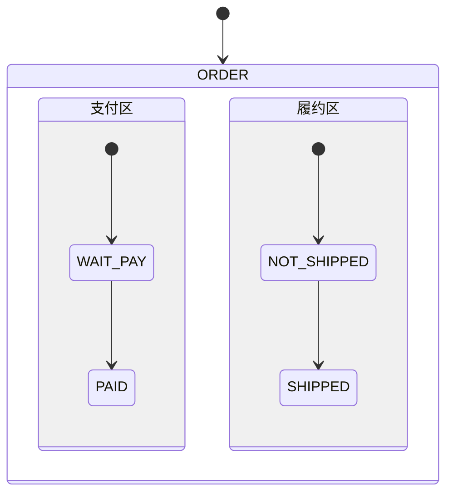

**fork / join 用法**：

```java
// fork：PAID 之后同时进入履约区（物流 + 发票两个区域）
transitions.withFork()
    .source(PAID)
    .target(FULFILLING)     // 目标为"承载区域的父状态"，所有区域回到各自 initial
    // 也可以 .target(FULFILLING, SHIPPING_REGION) 精确指定

// join：物流区和发票区都到达各自 end 后，才流转到 DONE
transitions.withJoin()
    .source(FULFILLING)     // 源为父状态 → 用各区域的 end 状态作为 join 条件
    .target(DONE);
```

**两条铁律**：

1. **fork 的 target 必须是父状态或"区域内"的状态**，不能是跨区域的任意状态。
2. **join 必须等所有参与区域到齐**，否则**挂起等待**（不报错、不超时）→ 生产上必须配超时兜底，否则订单永远卡在中间态。

---

#### Q6. 状态机怎么启动？`start()` 内部做了什么？

- **考核程度**：★★☆☆☆
- **考点**：生命周期

**参考答案**：

三种启动方式：

| 方式 | 说明 |
| --- | --- |
| `autoStartup(true)`（配置） | Spring 容器 refresh 时由 `SmartLifecycle` 自动 start |
| 手动 `sm.start()` | 显式启动（推荐 `autoStartup(false)` + 手动，控制时机） |
| `startReactively()`（3.x） | 响应式启动，返回 `Mono<Void>` |

`start()` 内部四步：
1. 置 lifecycle 为 RUNNING（幂等，重复 start 不重复进入）；
2. 顶层 Region 进入 **initial 伪状态 → 首状态** 的 `initialTransition`（**这条转移可以挂 action**，是"启动即初始化"的入口）；
3. 递归让**每个子区域**进入自己的 initial；
4. 执行 entry actions（父→子），回调 `stateMachineStarted` / `stateEntered`。

**加分**：`stop()` 会执行当前状态的 exit actions 吗？——**不会**（`stop` 只是置 lifecycle 为 STOPPED 并回调），所以"停机时的资源清理"要自己做，别指望 exit action。

---

#### Q7. ExtendedState 是干什么的？和业务对象有什么区别？

- **考核程度**：★★☆☆☆
- **考点**：上下文设计

**参考答案**：

`ExtendedState` 是状态机自带的 `Map<String,Object>`（默认实现 `DefaultExtendedState` 内部是普通 `HashMap`，**并发安全要靠自己**），用于在**动作、守卫、监听器之间传递"流程决策所需的上下文"**：

```java
// guard 里读
.guard(ctx -> (int) ctx.getExtendedState().getVariables().getOrDefault("retry", 0) < 3)
// action 里写
.action(ctx -> ctx.getExtendedState().getVariables().put("retry", retry + 1))
```

**与业务对象的区别（关键）**：

| 维度 | ExtendedState | 业务对象（Order） |
| --- | --- | --- |
| 作用 | 流程决策上下文（标量） | 业务数据（可持久化实体） |
| 生命周期 | 随 SM 实例 | 独立于 SM，在 DB |
| 持久化 | 只有 `StateMachineContext.extendedStateVariables` 显式带出的才持久化 | 自己落库 |
| 并发 | 框架不保证复合操作原子性 | 你自己的锁/事务 |

**反模式警告**：把整个 `Order` 塞进 ExtendedState 会导致：
1. 持久化体积不可控（JSON 里带一堆无关字段）；
2. 并发修改无保护（多个 action 同时改同一对象）；
3. **状态机与业务实体耦合**，状态机变成"数据容器"，失去"纯规则引擎"的定位。

---

### L2 进阶篇（Q8 ~ Q17）

#### Q8. 一次 `sendEvent` 内部到底发生了什么？请讲完整链路。（核心题）

- **考核程度**：★★★★☆（**二面分水岭**，答不出细节基本止步）
- **常见出处**：阿里交易中台、美团履约、字节电商
- **考点**：源码级理解 + 能否讲清"退出/进入/LCA/仲裁"

**参考答案（按阶段讲，共 6 段）**：

**① 投递**：`Message<E>` → `Trigger<S,E>`（封装 event，timer 型 trigger 的 event 为 null）→ 放入 Executor 的 `LinkedBlockingQueue`。若当前无人在处理，本线程"抢占处理权"并进入主循环；否则**直接返回**（事件已入队）。

**② 出队与前置**：`poll` 出 trigger，记录 event header（供 action 读取 `orderId`、`requestId`），先检查是否命中当前状态的 **defer 集合** → 命中则移入 `deferList` 并返回 `DEFERRED`。

**③ 找候选转移**：遍历**当前活跃区域**（顶层 region + 已激活的子 region），筛出 `source == region.getState()` 且 `trigger.event` 匹配的 `Transition`。**未激活的子区域不参与**。

**④ Guard 过滤 + 冲突仲裁**：
- guard 为 false → 淘汰（记 `DENIED`）；抛异常 → 视作 false + 记 error。
- 剩余候选按 `DefaultTransitionComparator` 排序：**kind 优先（LOCAL>INTERNAL>EXTERNAL）→ 源状态层级更深者优先 → 定义顺序**。
- 取第一个执行。若无候选 → 回调 `eventNotAccepted`，事件丢弃。

**⑤ 计算退出集合（LCA）**：求 source 与 target 在 Region 树中的**最近公共祖先区域（LCA）**，从 source 向上退出直到 LCA 的直接子区域，**LCA 本身不退出**。退出顺序：**子 → 父**。

**⑥ 执行与进入**：执行 exit actions → 转移 action → 计算进入集合（LCA 向下到 target）→ 执行 entry actions（**父 → 子**）→ 若目标为复合状态则递归进入各子区域 initial（或用 fork 精确指定）→ 处理 join 判定、history 记录、end 状态（end 则 stop）。

**⑦ 回调与循环**：`preEvent → preTransition → exit → action → entry → postTransition → postEvent`；然后**继续 poll 队列直到为空**（RTC），最后释放处理权。

**一句话总结（面试可直接背）**：
> "事件进队列 → 串行出队 → 在当前活跃区域找 source 匹配的转移 → guard 过滤 → 按 kind/层级/定义序仲裁出唯一一条 → 算 LCA 得到退出集合 → 子到父 exit → 转移动作 → 父到子 entry → 子区域递归 + join/history → 回调 → 循环到队列空。"

---

#### Q9. 多个转移同时匹配同一个事件，框架怎么选？（冲突仲裁）

- **考核程度**：★★★★☆
- **考点**：`DefaultTransitionComparator`

**参考答案**：

排序三级规则（**必须按顺序记**）：

| 优先级 | 规则 | 原因 |
| --- | --- | --- |
| 1 | **TransitionKind**：LOCAL > INTERNAL > EXTERNAL | LOCAL 是最"局部"的语义，优先级最高；EXTERNAL 影响面最大，最后考虑 |
| 2 | **源状态层级深度**：深者优先（inner-first） | 符合 UML 语义："子状态的定义比父状态更具体，应优先" |
| 3 | **定义顺序（document order）**：先声明者优先 | 前两级相同则按 DSL/注解里的声明序，保证确定性 |

**为什么必须仲裁（不能都执行）**：状态机要求**确定性**（DFA 语义）。同一事件若执行两条互斥转移，会出现"两个 target 同时成为 current state"的状态撕裂。所以框架强制收敛为一条（fork 是多目标但语义上是"一个转移进多个区域"，不是"多条转移"）。

**实战用法**：

```java
// 父状态配兜底：任何未知事件记日志，不改变状态
transitions.withInternal().source(ORDER).event(ANY).action(logAction());
// 子状态配精确转移：优先级自动高于父状态（层级更深）
transitions.withExternal().source(PAID).target(SHIPPED).event(SHIP);
```

**追问**："如果两条转移深度相同、kind 相同，怎么办？" → 按声明顺序。所以**永远不要依赖"声明顺序"做业务语义**，该用 guard 明确表达条件。

---

#### Q10. 退出/进入状态的顺序是什么？LCA 怎么算？

- **考核程度**：★★★★☆
- **考点**：层次状态机的核心算法

**参考答案**：

**顺序**：
- **exit**：从内到外（子状态 → 父状态），栈式释放；
- **entry**：从外到内（父状态 → 子状态），环境就绪原则。

**LCA 算法**：

```
LCA(source, target):
  1. 取 source 所在 Region 的祖先链：R_s = [region(source), region(source).parent, ..., Top]
  2. 取 target 所在 Region 的祖先链：R_t = 同理
  3. 两条链从 Top 往下找"最后一个相同的 Region" → 即 LCA
  4. 退出集合 = 从 source 沿 region 树向上，直到 LCA 的直接子区域（含 source 自身），收集每一层的 state
  5. 进入集合 = 从 LCA 的直接子区域向下到 target，收集每一层的 state
```

**例子（复合状态 ORDER 内含 支付区、履约区）**：

| 转移 | LCA | exit | entry |
| --- | --- | --- | --- |
| 支付区 `WAIT_PAY → PAID`（同区域） | 支付区 | WAIT_PAY | PAID |
| 支付区 `PAID → 履约区 NOT_SHIPPED`（跨区域） | ORDER | PAID（+ 支付区不需退出 ORDER） | 履约区 initial |
| `ORDER → DONE`（退出整个复合） | Top | 各区域 current state + ORDER | DONE |

**为什么用 LCA 而不是"全部退出再全部进入"**：性能 + 语义正确。LCA 之上的状态（如 ORDER 本身）**没有被转移影响**，如果也 exit/entry，会错误地触发"释放/重建订单级资源"。

**加分回答**：这个算法与**编译器/树结构里的"最低公共祖先"完全同构**，本质是"最小化受影响子树"。

---

#### Q11. 状态机是线程安全的吗？多线程同时 `sendEvent` 会怎样？（高频）

- **考核程度**：★★★★☆（**阿里/美团二面必问**）
- **考点**：RTC + 队列 + 实例状态

**参考答案（分三层答）**：

**① 实例层面：不安全。** `DefaultStateMachine` 的 current state 是普通引用，不为并发读写设计。多个线程共享一个实例并发发事件，虽然"处理是串行的"，但**业务语义会乱**（订单 A、B 共用一个 current state）。

**② 处理层面：串行。** Executor 用 `LinkedBlockingQueue` + "是否正在处理"标记实现**单处理者**模型：
- 线程 A 先到 → 抢到处理权 → 循环 poll；
- 线程 B 后到 → 事件入队，**B 直接返回**（不阻塞、不报错）；
- A 处理完自己的事件后，**顺带处理 B 的事件**（在 A 的线程里执行 B 的动作！）。

**③ 后果（重点）**：
- **ThreadLocal 丢失**：B 的事务上下文/MDC 在 A 的线程里是空的 → 事务不生效、日志全错。
- **"发出去就返回"**：B 拿到的是"已入队"的返回值，不是"处理结果"。
- **动作串行阻塞**：A 的 action 慢，B 的事件跟着排队。

**正确做法**：

| 场景 | 方案 |
| --- | --- |
| 多业务对象 | `StateMachineFactory` + 每 key 实例（**根本解法**） |
| 同一对象并发 | DB 乐观锁 CAS + 幂等键；或 MQ 按 key 分区串行 |
| 需要异步 | 显式配置 `ThreadPoolTaskExecutor` + `TaskDecorator` 传递上下文 |
| 需要"处理结果" | `sendEventCollect` 并 `block()` 拿最终状态 |

---

#### Q12. 为什么要求 action 短小、不能阻塞？会有什么后果？

- **考核程度**：★★★☆☆
- **考点**：RTC 与背压

**参考答案**：

RTC 期间**整个 SM 实例被独占**：一个事件从出队到处理完毕，任何其他事件都只能在队列里等。所以：

| 行为 | 后果 |
| --- | --- |
| action 里调 RPC（100ms） | 队列里其他事件全部排队；同一订单的后续事件延迟叠加 |
| action 里拿分布式锁 | 可能死锁（锁持有者正等这个 SM 释放） |
| action 里做大批量 DB 更新 | 长事务 + 连接池耗尽 |
| action 里 sleep/重试 | 直接拖垮实例吞吐 |

**正确分层**：

```
状态机内（快，纯内存）：判 guard、改状态、记审计、组装消息
状态机外（慢，IO）：扣款、发 MQ、调库存 —— 放到转移成功后的统一收口（outbox/事务消息）
```

**加分**：这是"**决策**与**执行**分离"的经典设计 —— 状态机只做决策（毫秒级），执行交给可靠的消息系统（秒级、可重试）。

---

#### Q13. 如何做状态持久化与恢复？恢复时会重放 entry action 吗？

- **考核程度**：★★★★☆（**生产必问**）
- **考点**：`StateMachinePersist` / `StateMachineContext`

**参考答案**：

**为什么不能序列化整个 SM**：`DefaultStateMachine` 里有 executor、队列、线程池、`BeanFactory`、`Action`（Lambda/方法引用）。这些是"运行时对象"，序列化会失败或恢复出"僵尸线程"。

**设计：只存快照，恢复时重建**

```
保存：sm.getState() + 各子区域 state + 需要持久化的 ext 变量
      → StateMachineContext → StateMachinePersist.write(ctx, contextObj) → DB

恢复：StateMachinePersist.read(contextObj) → StateMachineContext
      → new DefaultStateMachineContext(...)
      → persister.restore(sm, contextObj)   // 把 region 树的 current state 设回去
```

**`StateMachineContext` 关键字段**：`state`、`childContexts`（子区域状态，层级/正交必需）、`extendedStateVariables`、`history`。

**恢复时不会重放 entry action（关键结论）**：
`restore` 只是**设置 region 的 current state**，不执行任何转移，所以不触发 exit/entry。这意味着：

> **凡是"进入某状态必须发生的副作用"（发消息、调服务），绝对不能只写在 entry action 里，否则重启/恢复后永不执行。**

**正确做法**：

| 副作用类型 | 放哪 |
| --- | --- |
| 状态变更时必须发生的业务动作 | **transition action**（转移是唯一入口） |
| 状态驻留期间的周期动作 | 外部定时任务（按状态扫描），不要用 entry action |
| 审计日志 | Listener（恢复不影响） |

**延伸**：如果确实需要"恢复后补执行"，做法是"**恢复后主动比对 DB 状态与下游系统状态**"（对账/补偿任务），而不是靠 entry action 重放。

---

#### Q14. 一个订单一个状态机，怎么实现？单例 Bean 有什么坑？

- **考核程度**：★★★☆☆（**工程题，答错说明没上过生产**）
- **考点**：`@EnableStateMachineFactory` / `StateMachineService`

**参考答案**：

**坑**：`@EnableStateMachine` 注册的是**单例** `StateMachine` Bean。若在单例 Service 里持有它处理所有订单 → 订单 A 的 `current state` 会被订单 B 覆盖，出现"串状态"。

**方案一：`StateMachineFactory`（推荐）**

```java
@Configuration
@EnableStateMachineFactory     // 注意不是 @EnableStateMachine
public class Config extends EnumStateMachineConfigurerAdapter<...> { ... }

StateMachine<OrderStates,OrderEvents> sm = factory.getStateMachine(orderId);  // 每次新实例
```

`getStateMachine(id)` 会**新建一个实例**（不是缓存），id 只用于标识。

**方案二：`StateMachineService`（带缓存）**

```java
StateMachine<OrderStates,OrderEvents> sm = service.acquireStateMachine(orderId); // 有则复用
try { ... } finally { service.releaseStateMachine(orderId); }                  // 释放引用计数
```

适合"同一订单短时间高频事件"，但**必须配 LRU/超时逐出**，否则活跃订单多时内存爆。

**方案三：每次从 DB 重建（无状态）**

```java
StateMachine sm = factory.getStateMachine(id);
persister.restore(sm, id);
process();
persister.persist(sm, id);
```

最稳、无内存泄漏、易水平扩展；代价是每次构建（毫秒级）。

**追问**："`getStateMachine(id)` 的两个实例共享 `Action` 吗？" → 共享（Action 来自 config，是单例 Bean）→ **所以 Action 必须无状态**，不能把订单数据存在 Action 的成员变量里。

---

#### Q15. Interceptor、Function、Listener 三者有什么区别？回调顺序如何？

- **考核程度**：★★★☆☆
- **考点**：扩展点设计

**参考答案**：

| 扩展点 | 能力 | 能否中断/修改 | 典型用途 |
| --- | --- | --- | --- |
| `StateMachineListener` | 纯观察（void 方法） | ❌ 不能；异常被吞 | 审计、指标、日志 |
| `StateMachineInterceptor` | 有返回值 + 可拿到 context；可抛异常中断 | ✅ 能 | 权限校验、加锁、埋点、状态修正 |
| `StateMachineFunction`（3.x） | 函数式组合（`apply/transit/execute` 阶段） | ✅ 能 | 替代 Interceptor 的现代写法 |

**回调顺序**（包裹式）：

```
preEvent
  └─ preTransition
       ├─ [exit] preStateChange + exitAction
       ├─ transition action
       └─ [entry] preStateChange + entryAction → postStateChange
     postTransition
postEvent
```

**关键区别（面试加分）**：
- Listener 是"**旁路**"：它不能改变流程，异常被捕获后只打日志 —— 所以**审计放 Listener**（不影响主流程）。
- Interceptor 是"**管道**"：它在主流程里，抛异常会中断转移 —— 所以**校验放 Interceptor**（校验失败必须阻止转移）。

---

#### Q16. 注解方式和 Builder DSL 怎么选？`@EnableStateMachine` 的原理？

- **考核程度**：★★★☆☆
- **考点**：框架集成

**参考答案**：

| 维度 | 注解（`EnumStateMachineConfigurerAdapter`） | Builder DSL |
| --- | --- | --- |
| 结构清晰度 | 三个 `configure` 方法分离，符合 Spring 风格 | 一条链到底，长配置略乱 |
| 动态构建 | ❌ 静态（配置类） | ✅ 可在运行时按参数构建（多套配置） |
| 与容器耦合 | 强（自动注册 Bean） | 弱（可手动 new） |
| 推荐场景 | 标准 Spring Boot 项目 | 需要多套机器/动态配置/测试 |

**`@EnableStateMachine` 原理**：
1. 通过 `@Import(StateMachineConfiguration.class)` 引入一组配置类；
2. 注册 `StateMachineBuilderFactory`（或 `EnumStateMachineFactory`）与"三个 configurer 的后置处理器"；
3. 由 builder 产出 `StateMachine` **单例 Bean**（`@Bean` 定义在 `StateMachineConfiguration` 里）；
4. StateMachine 实现 `SmartLifecycle` → 随容器 start/stop。

**常见坑**：`@EnableStateMachine` 与 `@EnableStateMachineFactory` **不要同时使用**（会注册两套 Bean，注入时 `NoUniqueBeanDefinitionException`）。

---

#### Q17. 状态机怎么做单元测试？

- **考核程度**：★★☆☆☆
- **考点**：工程质量意识

**参考答案**：

三层测试策略：

**① 模型测试（`StateMachineTestPlan`）**——覆盖"转移矩阵"：

```java
StateMachineTestPlanBuilder.<S,E>builder().stateMachine(machine)
  .step().expectState(CREATED)
  .and().step().sendEvent(PAY).expectState(CREATED)   // 非法：不该变
  .and().step().sendEvent(CREATE).expectState(WAIT_PAY)
  .and().step().sendEvent(PAY).expectState(PAID)
  .and().build().test();
```

**② 动作测试**——`Action` 是普通接口，直接单测，不用起状态机：

```java
new PayAction(repo, mq).execute(mockContext);
verify(repo).deduct(...);
```

**③ 图完整性测试**——遍历 `getTransitions()` 断言：

| 断言 | 意义 |
| --- | --- |
| 每个非 end 状态至少一条出边 | 防"死状态" |
| 每个状态从 initial 可达 | 防"孤立状态" |
| 每个事件至少被一条转移使用 | 防"无用枚举" |
| 每个状态都有终态路径 | 防"永远完不成" |

> 生产建议：用 `StateMachineModelVerifier` + 自定义断言，把"图漏洞"在 CI 阶段拦住。

---

### L3 深度篇（Q18 ~ Q28）

#### Q18. defer（事件延迟）适合什么场景？和丢弃有什么区别？

- **考核程度**：★★★☆☆
- **考点**：事件生命周期

**参考答案**：

`defer` 让某状态**暂不处理**某事件但不丢弃，存入 `deferList`，**状态变化后重新尝试投递**。

```java
states.withStates().state(WAIT_STOCK, PAY);   // 缺货时不处理支付，等库存到了再说
```

| 处理方式 | 结果 | 返回 | 生产影响 |
| --- | --- | --- | --- |
| 无匹配转移 | **丢弃** | 无 result / `eventNotAccepted` | 事件永久丢失，需业务补偿 |
| Guard 为 false | **拒绝（DENIED）** | `DENIED` | 事件丢失，调用方可感知 |
| `defer` | **暂存** | `DEFERRED` | 状态变化后自动重试；但**内存态，重启丢失** |

**适用场景**：事件到达顺序与状态就绪顺序不一致（缺货时先收到支付请求、依赖数据未到齐）。

**风险**：`deferList` 是**内存对象，不持久化**，且可能**无限累积**（同一事件反复 defer）。所以生产上 defer 只用于"短暂等待"（秒级），长等待应改用"事件重投递到 MQ + 延迟队列"。

---

#### Q19. 超时流转（30 分钟未支付自动关单）怎么实现？

- **考核程度**：★★★☆☆（场景设计题）
- **考点**：timer trigger 与分布式定时

**参考答案**：

**框架能力：`triggerless transition`（定时触发器）**

```java
transitions.withExternal()
    .source(WAIT_PAY).target(TIMEOUT_CLOSED)
    .timerOnce(1800_000L)          // 进入 WAIT_PAY 后 30 分钟触发一次
    .action(closeOrderAction());
```

原理：进入状态时注册一个 `Trigger`（`event` 为 null，带 `timer`），到点后由定时器把 trigger 入队，走与普通事件**完全相同**的处理链路（所以 guard/action/listener 都照常生效）。`timerOnce` 只触发一次，`timer` 可配周期。

**但生产不推荐用框架 timer（三条原因）**：

| 问题 | 说明 |
| --- | --- |
| **内存态** | timer 存在 Executor 里，重启即丢，订单永远不关 |
| **单机** | 多副本部署时，每个副本都有自己的 timer，可能重复触发 |
| **无持久化** | 无法审计"谁在何时触发了超时" |

**生产正确方案：延迟消息 / 定时扫表**

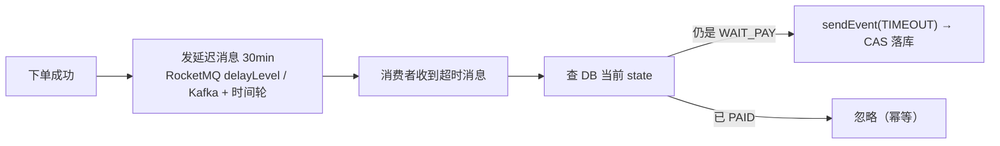

**关键点**：**超时消息只是"提醒"，不是"命令"** —— 收到后必须先查 DB 当前状态，否则会把已支付订单关掉（经典事故）。这就是"**幂等 + 状态校验**"的双重保护。

---

#### Q20. 分布式/集群下状态机怎么落地？为什么官方 Zookeeper 方案很少用？

- **考核程度**：★★★★★（**终面/架构题**）
- **考点**：分布式一致性 + 框架边界认知

**参考答案**：

**官方方案**：`spring-statemachine-zookeeper` 提供 `StateMachineEnsemble`（leader 选举 + 状态广播 + 分布式锁）+ `ZookeeperStateMachinePersist`（ZK 节点存快照，Kryo 序列化）。

**四个不用它的理由（按重要性排序）**：

1. **粒度错配**：ensemble 解决的是"**一个状态机在集群中只有一个活跃副本**"（分布式单例）。而交易场景是"**百万个独立状态机**"（每订单一个），ensemble 完全不适用。
2. **ZK 写放大**：ZK 是 CP 系统，写吞吐有限（数千 TPS 上限），订单状态高频写会打爆 ZK，且每次写触发 watch 广播。
3. **生态停滞**：`-cluster` 模块依赖的 Spring Cloud Cluster 已被 Spring Integration 取代，社区无人维护；Kryo 序列化对枚举/复杂 context 兼容性差。
4. **不解决业务一致性**：状态同步了，但扣款、发货这些副作用仍需幂等/补偿 —— ensemble 帮不上忙，反而增加复杂度。

**生产主流方案（"状态机退化为纯计算引擎"）**：

```
状态真源 = DB（order_state 表）
状态机   = 每次事件时从 DB 重建的内存计算器
并发控制 = DB 乐观锁 version（或 Redis 分布式锁，或 MQ 分区串行）
事件可靠 = MQ（至少一次 + 幂等表）
```

对应第 9.2 节的三种部署形态（单机 / 每 key 实例 / 无状态重建）。

**面试加分**：主动说"**Spring StateMachine 的分布式支持是'状态同步'思路，而生产需要的是'状态真源 + 幂等 + 补偿'思路**，这是两套完全不同的哲学。"

---

#### Q21. 状态机 + DB 乐观锁 + 幂等，完整方案怎么设计？如何防重复事件？

- **考核程度**：★★★★★（**支付/账务岗必问**）
- **考点**：并发 + 幂等 + 一致性

**参考答案**：

**四层防护（缺一层就有洞）**：

| 层 | 手段 | 防什么 |
| --- | --- | --- |
| ① 入口 | 幂等键 `(orderId, event, requestId)` 唯一索引 | 重复请求（用户连点、MQ 重投） |
| ② 状态机 | guard 判"已是目标态 → 直接返回成功" | 重复事件导致的非法转移 |
| ③ 落库 | `UPDATE order_state SET state=?, version=version+1 WHERE order_id=? AND version=? AND state=?` | 并发覆盖（lost update） |
| ④ 出口 | outbox 表 / 事务消息 | 状态改了但消息没发（或反之） |

**关键 SQL 与判定**：

```sql
UPDATE order_state
   SET current_state = 'PAID', version = version + 1, updated_at = now()
 WHERE order_id = 'O123'
   AND current_state = 'WAIT_PAY'    -- 状态 CAS
   AND version = 7;                   -- 版本 CAS
-- 影响行数 0 → 说明被并发抢先/重复请求 → 重读后判断是否已到目标态
```

**代码骨架**：

```java
int rows = repo.cas(orderId, expectState, targetState, expectVersion);
if (rows == 0) {
    OrderState now = repo.get(orderId);
    if (now.getState() == targetState) return Result.duplicated(); // 已处理，幂等成功
    if (now.getVersion() != expectVersion) return Result.retry();   // 并发冲突，重试
    return Result.conflict();
}
```

**"防重复事件"的三重身份**：

| 重复来源 | 识别方式 |
| --- | --- |
| 用户重复点击 | `requestId`（前端生成 UUID，随请求带上） |
| MQ 重投（at-least-once） | `messageId` 或 `(orderId, event, 业务流水号)` |
| 定时任务重跑 | 任务实例 id + 执行时间窗口 |

**延伸：为什么不能只靠 `state` 判重？**
因为存在"**A→B→A**"的合法回流（如退款失败回到 `PAID`）。此时"状态是 PAID"无法区分"从未支付"和"退款失败回退"，必须靠**事件流水**判断。这是幂等设计里最容易漏的点。

---

#### Q22. 状态机如何与 MQ 结合保证消息顺序？

- **考核程度**：★★★★☆
- **考点**：顺序性 + 分区

**参考答案**：

**核心矛盾**：状态机要求"同一对象的事件串行"，而 MQ 消费默认是并发的。

**解法：让"同一 orderId 的事件"永远落在同一消费线程**

| 方案 | 做法 | 优缺点 |
| --- | --- | --- |
| **Kafka/RocketMQ 分区**（推荐） | 生产时以 `orderId` 为 key → 同一分区 → 单消费者单线程 | ✅ 天然顺序、易扩展；⚠️ 热点订单会倾斜 |
| 一致性哈希线程池 | `orderId.hash % N` 选线程 | ✅ 无需 MQ 支持；❌ 扩缩容时重分布 |
| 分布式锁 | 消费前 `lock(orderId)` | ✅ 简单；❌ 锁竞争、性能差 |
| DB 乐观锁（最终兜底） | CAS 失败即重试/丢弃 | ✅ 必加（防跨分区意外） |

**注意三个细节**：

1. **"分区顺序"只保证"同分区内 FIFO"，不保证"重试不插队"**：重试消息进重试队列后可能晚于新消息到达 → 必须靠"状态 CAS + 幂等"兜底，不能假设"顺序到达就一定对"。
2. **不要在消费者里 `sendEvent` 后立刻 ACK**：要等 CAS 落库成功再 ACK，否则消息丢了状态没变。
3. **消费幂等必须与状态机幂等共用一套键**，否则两套幂等会打架。

---

#### Q23. 状态机能不能替代工作流引擎？边界在哪？

- **考核程度**：★★★★☆（架构选型题）
- **考点**：能力边界

**参考答案**：

**不能。** 边界可以从五个维度划：

| 维度 | Spring StateMachine | 工作流引擎（Flowable/BPMN） |
| --- | --- | --- |
| 流转驱动力 | **事件驱动**（程序发事件） | **任务驱动**（人/系统完成任务） |
| 拓扑变更 | 代码即拓扑，改流程要发版 | 模型即拓扑，支持热部署/动态加签 |
| 参与者 | 无"人"的概念 | 有 assignee、候选人、会签、加签、驳回 |
| 长事务 | 无（状态快照 + 外部补偿） | 有（引擎持久化流程实例、支持挂起数月） |
| 可视化 | 需自己导出图 | 内置建模器 + 流程图追踪 |

**典型的"混合架构"**：

```
工作流引擎（Flowable）：管"人机审批"（谁审、审多久、怎么驳）
      ↓ 审批通过/驳回事件
Spring StateMachine：管"业务状态合法性"（订单能不能从 PAID 到 SHIPPED）
```

**面试话术**："状态机管**状态**，工作流管**流程**。状态机回答'能不能'，工作流回答'谁来、按什么顺序'。业务状态少而硬（订单/支付）用状态机；流程长而软（审批/工单）用工作流。"

---

#### Q24. 状态机在 Saga / 分布式事务里扮演什么角色？

- **考核程度**：★★★★★（蚂蚁/支付方向高频）
- **考点**：补偿事务

**参考答案**：

**状态机是 Saga 的"状态载体"，不是"事务管理器"**。

Saga 的核心：把长事务拆成 N 个本地事务 T1..Tn，每个配一个补偿 Ci；失败时反向执行 C(i-1)..C1。

**Spring SM 能提供的**：

| 能力 | 如何用 |
| --- | --- |
| 记录"执行到哪一步" | 每个 Ti 对应一次状态转移，状态即进度 |
| 保证补偿顺序 | 反向转移（`REFUNDING → REFUNDED`）天然是状态机的一条边 |
| 防止重复补偿 | guard 判"是否已补偿过" |
| 补偿的可观测 | Listener 记录每条补偿转移 |

**SM 做不到的（必须外部实现）**：

| 缺口 | 解法 |
| --- | --- |
| **补偿动作的可靠性** | 补偿本身要幂等 + 可重试（MQ 驱动） |
| **跨服务的事务边界** | TCC（Try-Confirm-Cancel）或本地消息表 |
| **悬挂/空回滚** | 事务协调器（Seata）或业务侧的"三防"（防悬挂、防空回滚、防重复） |
| **超时与人工介入** | 状态机停在中间态，需补偿任务扫描 + 人工兜底 |

**典型建模**：

```
PAID → DEDUCTING → DEDUCTED → SHIPPING → SHIPPED → DONE
                     ↓失败              ↓失败
                  DEDUCT_FAILED     SHIP_FAILED
                     ↓补偿              ↓补偿
                  REFUNDED          REFUNDED
```

**加分**："Spring SM 无事务语义（action 抛异常不回滚），所以 Saga 的'原子性'是靠**状态 + 幂等 + 补偿**在业务层拼出来的，不是框架给的。"

---

#### Q25. 10w QPS 的订单状态流转，性能瓶颈在哪？怎么优化？

- **考核程度**：★★★★★（**高并发架构题**）
- **考点**：性能分析 + 分层优化

**参考答案**：

**先算账**：10w QPS × 每次 1 次 DB 读 + 1 次 DB 写 = 20w DB QPS → 单库必死。所以瓶颈**不在状态机（内存计算是微秒级）**，而在 **DB + 锁 + 序列化**。

| 瓶颈 | 量化 | 优化 |
| --- | --- | --- |
| **每次重建 SM** | `builder.build()` 有反射/对象创建开销（百微秒~毫秒） | **缓存编译好的配置模板**，用 Factory 轻量 clone；或复用实例池 |
| **DB 读写** | 20w QPS | 状态表按 orderId 分库分表；或 Redis 存状态 + 异步落库 |
| **乐观锁冲突** | 热点订单 CAS 失败率飙升 | 按 orderId 分区串行（从源头消除冲突，而非重试） |
| **MQ 消费** | 单分区热点 | 提高分区数；热点 key 拆分（子订单维度） |
| **GC** | 每秒百万级小对象（context/message） | 复用 Message、避免在 action 里 new 大对象 |
| **日志/审计同步写** | 每次转移写一条 | 审计异步化（Disruptor/批量插入），或只写 traceId 让日志系统聚合 |

**架构级优化（按性价比排序）**：

1. **状态机"无状态化 + 缓存模板"**：把 `StateMachine` 的**配置（Region 树）**缓存成不可变模板，每次请求只 clone 一份"轻量状态视图"（不复制 Action/Listener）。
2. **Redis 做状态热存**：`order_state` 放 Redis Hash（`state` + `version`），用 Lua 做 CAS 原子更新，DB 异步对账落库。
3. **批量合并**：同一订单短时间多个事件合并成一次（如 `CREATE+PAY` 合成一个"下单并支付"事件），减少 RTC 轮次。
4. **缩短 RTC**：把"审计/指标/发消息"全部移出 action，用"转移发生 → 投递到内部事件总线 → 异步处理"。
5. **减少层级**：正交区域虽优雅，但每次事件要遍历所有活跃区域；状态数少时用**扁平状态**更快（牺牲表达力换性能）。

**面试话术**："十万 QPS 下，状态机不是瓶颈，DB 和锁才是。思路是'把状态机的计算留在内存（微秒级），把持久化降级为异步/Redis，把并发冲突从'重试'变成'分区串行'。"

---

#### Q26. 如何做到"状态变更可审计、可回放"？

- **考核程度**：★★★★☆
- **考点**：可观测性 + 事件溯源

**参考答案**：

**可审计（必做）**：三层记录

| 层 | 记录内容 | 实现 |
| --- | --- | --- |
| 状态流水表 | `orderId, from, to, event, operator, requestId, traceId, ts` | Listener 写（异步批量） |
| 结构化日志 | 同上的 JSON，带 traceId | `log.info` + 日志采集 |
| 指标 | 转移计数/耗时/拒绝数 | Micrometer |

**可回放（进阶）**：事件日志 + noop 重建

```
记录：所有"被接受的事件"按时间序写入 event_log（append-only）
回放：new SM（用 noop action 替换真实副作用）→ 按序 sendEvent → 校验最终状态
```

**关键约束（面试加分点）**：

1. **回放必须"无副作用"**：所有 Action 换成空实现，否则回放会真的扣款/发货。
2. **回放依赖"确定性"**：guard 里不能有 `now()`、随机数、外部 RPC，否则回放结果不一致 → 这也是"guard 里禁止 RPC"的第二个理由。
3. **快照 + 增量**：全量回放太慢，定期生成快照（`StateMachineContext`），从最近快照往后 replay。

**延伸**："这就是 Event Sourcing 的核心。Spring SM 天生是'状态快照'模型，做回放要自己补 event log —— 如果业务对审计要求极高（金融账务），一开始就该按 ES 设计，而不是事后补。"

---

#### Q27. 自研状态机引擎 vs Spring StateMachine，怎么选？自研怎么做？

- **考核程度**：★★★★★（**架构师终面题**）
- **考点**：抽象能力 + 取舍

**参考答案**：

**先问三个问题**：

| 问题 | 若答"是" → 倾向自研 |
| --- | --- |
| 状态数 > 50 或需要运营配置？ | ✅ 自研（表驱动） |
| 需要动态改流程不发版？ | ✅ 自研/规则引擎 |
| 需要极高性能（10w+ QPS）且状态扁平？ | ✅ 自研（无反射、无对象树） |
| 需要层级/并行/伪状态？ | ❌ 用 Spring SM（自研成本极高） |
| 团队 < 5 人、需求稳定？ | ❌ 用 Spring SM（省事） |

**自研的最小可行架构（表驱动）**：

```sql
-- 转移规则表（运营可维护）
CREATE TABLE sm_rule (
  biz_type VARCHAR(32), from_state VARCHAR(32), event VARCHAR(32),
  to_state VARCHAR(32), guard_expr VARCHAR(256), action_key VARCHAR(64),
  enabled TINYINT, PRIMARY KEY (biz_type, from_state, event)
);
```

```java
// 执行器（无框架依赖，纯内存 Map 查找）
String target = ruleMap.get(key(biz, from, event));      // O(1)
if (target == null) return rejected("no rule");
if (!guard.eval(ctx)) return denied();
transition(from, target, actionMap.get(actionKey));       // 同一套 exit/action/entry 语义
```

**自研必须补齐的四件事**（否则不如用框架）：

| 能力 | 说明 |
| --- | --- |
| 冲突仲裁 | 表里同一 (from,event) 只能一条 → 用唯一索引保证确定性 |
| 层级/并行 | 自研通常**放弃**（这是最难的部分） |
| 持久化快照 | 自己定义 context 结构 + 序列化 |
| 审计与测试 | 自己做 listener + 回放工具 |

**取舍结论**："**状态机框架的价值在'语义'，不在'执行'**。执行就是 Map 查找 + 三次动作，谁都能写；难的是层级状态、并行区域、LCA 退出、冲突仲裁这些 UML 语义。所以要自研，先确认你**不需要**这些语义。"

---

#### Q28. 状态机"腐化"（状态爆炸、状态机变巨石）怎么治理？

- **考核程度**：★★★☆☆（**有经验的候选人才能答好**）
- **考点**：长期演进

**参考答案**：

**症状识别**：

| 症状 | 信号 |
| --- | --- |
| 状态爆炸 | 状态数 > 30，且大量 `XX_PROCESSING_1/2/3` |
| 动作巨石 | 单个 action 超过 100 行，含多个 RPC |
| 转移爆炸 | 转移数 ≈ 状态数²，出现大量"任意状态→某状态" |
| guard 复杂 | guard 里嵌套多层 if/else，甚至查库 |
| 状态机承担编排 | action 里调 5 个以上外部服务 |

**治理手段（按优先级）**：

| 手段 | 做法 | 效果 |
| --- | --- | --- |
| **拆正交区域** | 把"支付/履约/售后"拆成并行区域 | 状态数从乘法变加法 |
| **拆状态机** | 按业务域拆成多个独立 SM（订单 SM / 履约 SM / 售后 SM） | 单机复杂度下降 |
| **状态降维** | 把"技术中间态"（如 `LOCKING`）改成 guard 条件而非状态 | 状态数减少 |
| **动作下沉** | action 只留"改状态 + 发消息"，业务逻辑抽到领域服务 | RTC 变短 |
| **规则外置** | 大量相似转移用"表驱动 + 统一 action" | 转移数下降 |
| **状态图进评审** | 每次改动必须更新 mermaid/plantuml 图并评审 | 防止无意识增加 |

**核心原则**："**状态是业务语言的最小完备集合**，不是技术流程的完整映射。技术中间态（加锁、校验、序列化）属于动作，不属于状态。"

---

## 14. 一页速记 Cheat Sheet

### 14.1 十个必背结论

1. **本质**：UML Statechart 的 Java 实现 + 串行事件执行引擎 + 快照持久化 SPI。
2. **三 kind**：EXTERNAL（exit+entry）/ INTERNAL（都不做）/ LOCAL（自转移不做 exit+entry）。
3. **执行链**：队列 → 找候选 → guard → 仲裁 → LCA 退出 → exit → action → entry → 子区域/join/history → 回调 → 循环。
4. **顺序**：exit 子→父；entry 父→子；回调 preEvent→preTransition→…→postEvent。
5. **仲裁**：kind（LOCAL>INTERNAL>EXTERNAL）→ 层级深优先 → 定义序。
6. **并发**：单实例串行（RTC + 队列 + 单处理者），但实例有状态、非线程安全。
7. **多实例**：`@EnableStateMachineFactory` + `getStateMachine(key)`，或每次从 DB 重建。
8. **持久化**：只存 `StateMachineContext` 快照；恢复**不重放 entry action**。
9. **无事务**：action 抛异常不回滚 → 靠幂等 + 补偿（Saga）。
10. **分布式**：官方 ensemble 不适用"百万独立状态机"，生产用"DB 真源 + 乐观锁 + MQ 顺序 + 幂等"。

### 14.2 三个"不要"

- ❌ 不要用单例 SM 处理多业务对象。
- ❌ 不要把副作用只写在 entry action（恢复不重放）。
- ❌ 不要在 action 里做 RPC/长事务/递归发事件。

### 14.3 学习路径（由浅入深）

| 阶段 | 目标 | 材料 |
| --- | --- | --- |
| 1 | 会用 | 官方 Reference 的 "Configuration" 章节 + 写一个订单机 |
| 2 | 懂语义 | UML 2.5 StateMachine 概念（复合状态/正交/伪状态）+ 第 3 章 |
| 3 | 懂引擎 | 读 `DefaultStateMachineExecutor`、`TransitionComparator`、`Region` 源码 + 断点跟一次 sendEvent |
| 4 | 懂生产 | 持久化 SPI、Factory 多实例、乐观锁 + 幂等 + MQ 编排 |
| 5 | 懂架构 | 选型边界、Saga、性能优化、自研取舍 |

### 14.4 参考资料

- 官方文档：`https://docs.spring.io/spring-statemachine/docs/3.2.0/reference/`
- 官方 API：`https://docs.spring.io/spring-statemachine/docs/3.2.0/api/`
- UML 2.5 StateMachine 规范（OMG）：理解复合状态 / 正交区域 / 伪状态的标准语义
- 示例工程：`spring-statemachine` 仓库下的 `spring-statemachine-samples`（orders / tasks / zookeeper 等）

---

> **结语**：能把这篇文章的第 6 章（执行链路）和第 7 章（并发）讲清楚，再配合第 13 章的题，Spring StateMachine 相关的面试基本可以覆盖 90% 的追问。真正拉开差距的不是"会不会用 DSL"，而是"**知不知道一次事件在内部走了哪几步、在哪一步可能出错**"。
