# 分布式系统知识全景与大厂面试题精解

> 定位：一份"从本质到落地、从原理到面试"的系统性笔记。
> 覆盖：基础理论 → 一致性/共识 → 分布式事务 → 分布式锁 → 消息队列可靠性 → 负载均衡 → 熔断限流 → 微服务 → 网关 → 链路追踪 → 操作系统与网络底层 → 国内各大厂面试题精解。
> 阅读方式：每章都是"**一句话本质 → 原理 → 图示 → 底层机制 → 工程细节 → 常见误区 → 延伸**"的结构。第一遍看本质和图示，第二遍看底层机制，第三遍只看"常见误区"和面试题。

---

## 目录

| 章 | 主题 | 关键问题 |
|---|---|---|
| 0 | 分布式系统的本质框架 | 分布式到底在解决什么？难在哪？ |
| 1 | CAP / BASE / 一致性模型 | C 到底指什么？为什么 CA 不存在？ |
| 2 | 时间与顺序：逻辑时钟 | 分布式系统里"先后"凭什么成立？ |
| 3 | 数据分布：分片、副本、一致性哈希 | 数据放哪？扩容为何会抖动？ |
| 4 | 共识与复制：Raft / Paxos / ZAB | 多数派为什么能保证正确？ |
| 5 | 分布式事务 | 2PC/TCC/Saga/事务消息/Seata 怎么选？ |
| 6 | 分布式锁 | Redis 锁为什么会丢？ZK 锁强在哪？ |
| 7 | 消息队列可靠性 | 不丢、不重、有序怎么同时做到？ |
| 8 | 负载均衡 | 四层七层差在哪？算法怎么选？ |
| 9 | 熔断、限流、降级、隔离 | 雪崩是怎么发生的？ |
| 10 | 微服务 | 拆分的边界在哪？分布式单体怎么来的？ |
| 11 | 网关 | 网关和 LB 到底是不是一回事？ |
| 12 | 分布式链路追踪 | TraceID 怎么跨线程跨服务传？ |
| 13 | 底层视角：CPU/内存/网络/磁盘 | 上层所有协议最终落到什么系统调用？ |
| 14 | 大厂面试题精解（分厂） | 阿里/腾讯/字节/美团/京东/拼多多/快手/滴滴/小红书/其他 |
| 15 | 通用高频 TOP20 + 速查表 + 学习路径 | 考前 3 小时看什么？ |

---

# 第 0 章 分布式系统的本质框架

## 0.1 一句话本质

**分布式系统 = 用多台不可靠的机器，通过网络协作，对外表现得像一台可靠的机器。**

这句话里每个词都是难点来源：

- **多台**：资源不共享，没有全局时钟，没有全局锁，没有全局内存。
- **不可靠**：机器会宕机、会变慢、会 GC 停顿、磁盘会坏。
- **网络**：会丢包、会重排、会延迟、会分区（而且是**不可判定**的——你分不清"对方死了"还是"网络慢"）。
- **像一台**：这就是一致性、可用性、可观测性要解决的问题。

## 0.2 为什么必须分布式：三个驱动力

| 驱动力 | 具体瓶颈 | 分布式手段 |
|---|---|---|
| 容量（Scale up 到顶） | 单机 CPU 核数、内存、磁盘 IOPS、网卡带宽都有物理上限 | 分片（Sharding）、读写分离、水平扩展 |
| 可用性（单点故障） | 单机 MTBF 再高，年化不可用时间也压不到 99.99% | 副本（Replication）、故障转移（Failover）、多活 |
| 组织（人比机器更难扩展） | 几百人改一个代码库、一次发布影响全站 | 服务拆分、边界清晰、独立发布 |

> **延伸认知**：分布式不是"技术更高级"，而是**用复杂度换容量与可用性**。能用单体 + 垂直扩展撑住的业务（很多企业内部系统），上微服务是负债。判断标准是"瓶颈是否真的在单机物理上限或团队协作边界上"。

## 0.3 分布式的四大根本难题（所有协议的父问题）

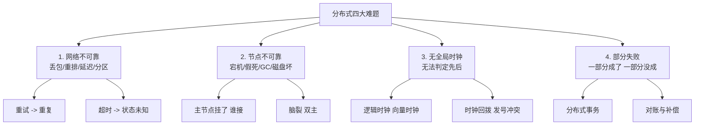

### 难题一：网络不可靠 —— "超时"是最危险的返回值

- 一次 RPC 有三种结果：**成功、明确失败、未知（超时）**。
- 超时是不确定态：请求可能没到、可能到了没执行、可能执行了但响应丢了。
- 这直接导致两个工程后果：
  1. **重试** → 重复请求 → 必须幂等；
  2. **无法区分"慢"和"死"** → 故障检测只能靠"心跳超时"这种**启发式**判断（这就是 FLP 不可能性和 φ 故障检测器的现实意义）。

### 难题二：节点不可靠 —— 崩溃 vs 拜占庭

- **崩溃故障（Crash Fault）**：节点要么正常，要么彻底停止。这是工程上主要假设的模型，Paxos/Raft 都只解决这个。
- **拜占庭故障（Byzantine Fault）**：节点可能撒谎、发矛盾消息。需要 3f+1 个节点容忍 f 个恶意节点（PBFT 等），成本高，只在区块链/高信任敏感场景用。
- 现实中还有一种**"慢节点"**：没死但一直慢（Full GC、磁盘抖动、CPU 被抢），它比宕机更麻烦——心跳还在，但它拖慢整个多数派。

### 难题三：没有全局时钟

- 每台机器的本地时钟有漂移（晶振误差、NTP 校准跳变），**物理时间不可作为定序依据**。
- 所以要引入逻辑时间：Lamport 时钟、向量时钟、任期号（term）、ZXID、offset（详见第 2 章）。

### 难题四：部分失败

- 单体系统里"要么全成要么全败"是自然的（一个进程内的本地事务）。
- 分布式里失败是**碎片化**的：A 库成功了，B 库超时了，C 库还没收到请求。这就是分布式事务存在的全部理由。

## 0.4 一个统一的思考框架：任何分布式组件都问这 6 个问题

遇到任何分布式中间件（ZK、etcd、Kafka、Redis Cluster、Nacos……），用这套模板拆：

1. **拓扑**：谁是协调者/主，谁是跟随者？选主方式？（指定 / 选举 / 外部协调）
2. **复制**：同步还是异步？写成功需要几个副本确认？读需要几个？
3. **定序**：靠什么排序？（任期号 + 日志索引 / ZXID / offset / 版本号）
4. **故障检测**：心跳间隔、超时阈值、误判代价？
5. **故障恢复**：新主怎么补数据？旧主回来怎么办（脑裂防护）？
6. **一致性与可用性的取舍点**：分区时牺牲谁？读到的可能是旧数据吗？

> 这套框架的价值：面试时被问"A 和 B 有什么区别"，用这 6 维对比，比背零散结论强得多。

## 0.5 常见误区

- ❌ "分布式一定比单体快" —— 多一跳网络、多一次序列化，延迟通常是**增加**的；分布式换来的是吞吐与可用性。
- ❌ "用了 MQ 就解耦了" —— 只是把强耦合变成弱耦合 + 最终一致，复杂度从调用方转移到了消费方（幂等、顺序、堆积）。
- ❌ "有副本就不会丢数据" —— 异步复制 + 主挂了，未同步的数据一样丢。

---

# 第 1 章 CAP、BASE 与一致性模型

## 1.1 CAP：被误读最多的一条定理

### 精确定义

- **C（Consistency，一致性）**：这里专指**线性一致性（Linearizability）**，不是数据库 ACID 里的 C，也不是"最终一致"。
  含义：整个系统对外表现得像**只有一个副本**，且每个操作在其开始与结束之间的某个瞬间**原子生效**；一个写返回成功后，任何后续读都必须读到它（或更新的值）。
- **A（Availability，可用性）**：每个**非故障节点**在**有限时间**内对每个请求都返回**非错误**响应（不保证是最新数据）。
- **P（Partition tolerance，分区容错）**：网络分区时系统仍能继续运行（不整体拒绝服务）。

### 为什么"CA 不存在"

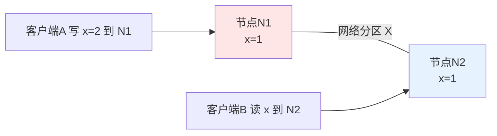

分区发生的瞬间，N1 和 N2 无法通信：

- 若要求 **C**：N1 的写必须让 N2 也知道 → 但网络断了，只能**阻塞或拒绝** → 牺牲 **A**。
- 若要求 **A**：两边都必须立刻响应 → N2 只能返回旧值 x=1 → 牺牲 **C**。

**所以网络分区是客观事实，P 必须选，剩下只能在 C 和 A 之间取舍。** 严格说"CA 系统"只在**没有分区**的假设下成立（单机数据库、局域网内小集群），一旦跨机房就必须面对 P。

> **深度延伸：CAP 的边界**
> 1. CAP 讨论的是**分区进行中**的行为，分区恢复后的行为它不管（那是"分区恢复后如何收敛"，即 BASE/最终一致性的领域）。
> 2. 现实中多数系统不是二选一，而是**按操作粒度、按数据粒度、按时间窗口**做混合取舍：
>    - 同一系统里，**转账**走 CP（宁可拒绝），**商品详情**走 AP（读旧值可接受）。
>    - 同一份数据，**写**偏 CP，**读**可通过 quorum 调节偏 AP。
> 3. Brewer 自己后来提出 **CAP 已经被过度简化**，更有价值的是 **PACELC**：分区时在 C/A 间取舍（PAC），**正常运行时**在**延迟 L 与一致性 C** 之间取舍（ELC）。因为即使不分区，强一致也要多轮 RTT，延迟必然更高。

## 1.2 BASE：不是 CAP 的对立面，是工程折中

| 字母 | 含义 | 落地手段 |
|---|---|---|
| **B**asically **A**vailable 基本可用 | 故障时允许损失非核心能力（降级、限流、返回兜底） | 熔断、降级、排队、只读 |
| **S**oft state 软状态 | 允许中间态存在（数据在同步中、订单在"处理中"） | 状态机、中间态字段、TTL |
| **E**ventually consistent 最终一致 | 停止写入后，经过一段时间，所有副本收敛到同一值 | 异步复制、消息补偿、对账 |

> **关键认知**：最终一致 ≠ "不管了"。工程上必须回答三个问题：
> 1. **多久能一致**（收敛时间上界，决定用户体验与资金风险）；
> 2. **靠什么保证一定会一致**（重试 + 幂等 + 对账兜底）；
> 3. **不一致期间业务怎么办**（中间态展示、防重复、限额）。

## 1.3 一致性模型谱系（从强到弱）


| 模型 | 通俗解释 | 典型系统 |
|---|---|---|
| 线性一致 | 写成功后再读必见；所有操作有全局实时全序 | etcd、ZK（写）、Raft 读（ReadIndex） |
| 顺序一致 | 所有节点看到的操作顺序一致，但不必与真实时间一致 | ZAB 的 follower 读（可能读到旧值但顺序不乱） |
| 因果一致 | 有因果关系的操作不会倒序（评论必在其回复之后可见） | 部分 AP 系统、CRDT |
| 读己之写 | 同一用户读到自己刚写的 | 主从分离 + 会话粘主/版本号 |
| 单调读 | 不会读到比上次更旧的值 | 按版本号选副本 |
| 最终一致 | 收敛，中间可能乱 | Dynamo、Cassandra（低 quorum）、CDN |

> **高频面试延伸：主从延迟导致的"读己之写"失效**
> 用户下单后立刻查订单，从库还没同步 → 查不到。解决方案：
> 1. **关键读走主库**（写后 N 秒内）；
> 2. **会话粘性 + 版本水位**：登录时记录主库 binlog 位点，从库追平该位点前不服务该用户；
> 3. **前端乐观占位**：本地先渲染刚提交的数据；
> 4. **业务妥协**：提示"订单处理中"。

## 1.4 常见误区

- ❌ "CAP 三者只能选两个" —— 准确表述是：**P 必选，C 和 A 在分区时二选一**；不分区时可同时有 C 和 A（但有延迟代价）。
- ❌ "Redis 是 CP" / "Redis 是 AP" —— 取决于部署与配置：单机/主从异步 = 偏 AP；WAIT 命令/Redlock 争议区；Cluster 的 failover 默认可能丢写。
- ❌ "最终一致就是可以不保证" —— 最终一致是有**收敛义务**的弱一致，必须有补偿机制。

## 1.5 延伸：为什么"强一致"这么贵

强一致的本质代价是**同步协调**：

- 每次写要等多数派确认 → 至少 1 个 RTT 的复制延迟；
- 跨机房 → RTT 从同城 1ms 到跨洋 100ms+；
- 协调点成为吞吐瓶颈 → 无法无限水平扩展（这就是为什么 Spanner 要用 TrueTime + 大量 Paxos Group 分片）。

**工程结论**：把强一致限制在"最小必要集合"（金额、库存、唯一性约束），其余走最终一致 + 对账。

---

# 第 2 章 时间与顺序：为什么"先后"是个哲学问题

## 2.1 一句话本质

**分布式系统无法直接观测"物理时间上的先后"，只能通过"消息传递 + 逻辑计数"构造出一个可比较的顺序。**

## 2.2 物理时钟的四种坑

| 问题 | 说明 | 后果 |
|---|---|---|
| 时钟漂移 | 晶振频率随温度/老化偏移，日漂移可达秒级 | 超时判断不准 |
| NTP 校准跳变 | 校准时可能**回拨**或**跳跃** | 出现"时间倒流" |
| 虚拟机时钟 | VM 被调度暂停后时钟落后 | GC/超时错乱 |
| 分布式 ID 依赖时间 | 雪花算法用时间戳，回拨导致**ID 重复** | 主键冲突、数据错乱 |

### 雪花算法（Snowflake）与时钟回拨的工程解法

结构：`1bit 符号 | 41bit 毫秒时间戳 | 10bit 机器ID | 12bit 序列号`（单机每毫秒 4096 个，约 400 万 QPS 上限/节点）。

回拨处理策略：

1. **拒绝服务**：发现 now < lastTimestamp，直接抛异常（简单但可用性受损）；
2. **等待追上**：自旋等待到 lastTimestamp（小时级回拨会长时间阻塞）；
3. **借用未来时间**：把 lastTimestamp 往后推（会提前耗尽时间戳空间）；
4. **备用位/多 bit 扩展**：用序列号高位吸收回拨；
5. **不依赖系统时钟**：用**中心化发号器**（号段模式，如美团 Leaf、滴滴 TinyID）或**逻辑时钟**（把时间戳交给可靠的序列服务）。

> **面试延伸**：为什么 Leaf/TinyID 要用"号段模式"？
> 每次从 DB 取 `[max_id, max_id+step]` 一段缓存到内存，内存里自增发号 → 把"每发一个号一次 DB 访问"变成"每 step 个号一次 DB 访问"，QPS 提升 2~3 个数量级；代价是**重启会浪费号段**（产生空洞，但不影响唯一性）、**多实例号段不连续**（可用双 buffer 平滑切换）。

## 2.3 逻辑时钟：Lamport 时钟

**目标**：在没有全局时钟的情况下，构造一个偏序（partial order），满足"如果 A 因果先于 B，则 C(A) < C(B)"。

规则：

1. 每个进程维护本地计数器 `C`；
2. 每次本地事件：`C = C + 1`；
3. 每次发送消息：把 `C` 附在消息上；
4. 收到消息：`C = max(C, msg.C) + 1`。

```text
P1: 1 ---- 2 ---------- 5
            \          /
             v        ^
P2:      1 ---- 3 ---- 4
```

**局限**：`C(A) < C(B)` **不能反推** A 因果先于 B（只能"不早于"，可能并发）。

## 2.4 向量时钟（Vector Clock）：能判断并发

每个节点维护长度为 N 的向量 `V[i]`：

- 本地事件：`V[self]++`
- 发送：附带整个向量
- 接收：`V[i] = max(V[i], msg.V[i])`，然后 `V[self]++`

判断：

- `V(A) < V(B)`（逐分量 ≤ 且至少一个 <）→ A 因果先于 B
- 否则，且 `V(A) > V(B)` → B 先于 A
- **两者互不 ≤** → **并发（conflict）**

**用途**：Dynamo 用它检测冲突写（sibling），把冲突交给应用/CRDT 合并。
**代价**：向量长度 = 节点数，大规模下膨胀（用 dotted version vector / 哈希节点集优化）。

> **延伸：HLC（Hybrid Logical Clock）**
> 物理时钟 + 逻辑时钟的混合：`HLC = (物理时间, 逻辑计数)`。当本地物理时间前进时用物理时间；当收到"未来"的消息时，保持物理时间不变、递增逻辑计数。这样既保留了"接近真实时间"的可读性，又保证了**单调性**（永不回退）。
> CockroachDB、MongoDB 的部分机制用到它。

## 2.5 工程中的"定序器"：一切共识协议都在造一个全序

| 系统 | 定序依据 | 单调性来源 |
|---|---|---|
| Raft | `(term, logIndex)` | Leader 任期递增 + 索引递增 |
| ZAB | `ZXID = (epoch, counter)` | Leader epoch + 事务计数 |
| Kafka | 分区内 `offset` | 单分区单写者（Leader） |
| MySQL binlog | `(server_id, GTID)` / 位点 | 单主写入 |
| etcd | `revision`（全局递增） | Raft 应用顺序 |
| Redis Cluster | 单 key 落在单 slot → 单节点 | 单线程执行 |

> **核心洞察**：**"把并发写变成串行写"是获得顺序最便宜的办法**。所有高性能系统都在做同一件事——**把需要定序的范围缩到最小**（Kafka 用 partition 而非 topic，Redis 用 slot，DB 用单主），因为全序范围越大，吞吐越低。

## 2.6 常见误区

- ❌ "时间戳大的就是后发生的" —— 跨机不可信。
- ❌ "向量时钟能给我全序" —— 只给偏序，并发事件无法排序，需要额外决断（如按节点 ID 比较）。
- ❌ "用了 NTP 就有时钟了" —— NTP 只收敛到毫秒级且有跳变，不能作为严格定序依据。

---

# 第 3 章 数据分布：分片、副本、一致性哈希

## 3.1 一句话本质

**分片解决"装不下"，副本解决"挂不起"，一致性哈希解决"扩缩容时少搬数据"。**

## 3.2 分片的三种切法

| 方式 | 规则 | 优点 | 缺点 |
|---|---|---|---|
| Range 分片 | 按主键区间 `[1,1000)`、`[1000,2000)` | 范围查询友好、实现简单 | 易热点（自增 ID 尾部写热点） |
| Hash 分片 | `hash(key) % N` | 分布均匀 | 扩容需重分布；范围查询要扫全部分片 |
| 目录/映射表分片 | 单独维护 key → shard 映射 | 灵活、可迁移 | 映射表本身成为瓶颈/单点 |

### 取模分片的致命问题

`N=3` → `N=4`，映射关系几乎全变：**约 (N-1)/N 的数据要迁移**（3→4 时 75%）。这就是一致性哈希的动机。

## 3.3 一致性哈希（Consistent Hashing）

### 原理

把 `hash(节点)` 和 `hash(key)` 都映射到同一个 `[0, 2^32)` 的环上，key 顺时针找到第一个节点。

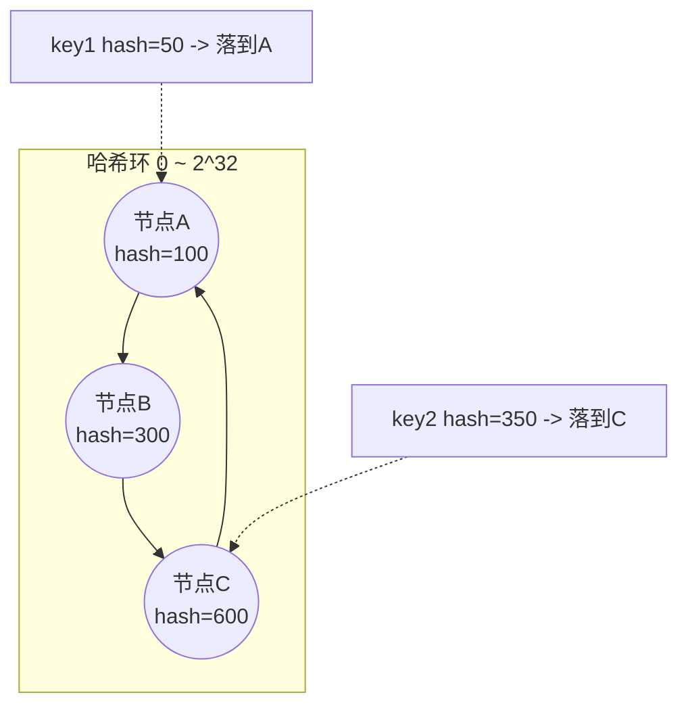

- **增加一个节点**：只影响它在环上的"前一个节点"负责的那一段 → 平均迁移量 `1/(N+1)`。
- **删除一个节点**：只影响它自己负责的段 → 迁到后继节点。

### 数据倾斜与虚拟节点

物理节点少时，环上分布不均 → 某节点承担 80% 数据。解法：**每个物理节点映射 K 个虚拟节点**（如 K=200~1000），把虚拟节点散布到环上。

- K 越大越均衡，但元数据越大、查找越慢（通常用**跳表/红黑树/TreeMap**存虚拟节点，查找 O(log K·N)）。
- 迁移粒度也变细（以虚拟节点为单位）。

### 底层实现细节（面试常挖）

```java
// 典型实现：TreeMap + 虚拟节点
TreeMap<Long, Node> ring = new TreeMap<>();
for (Node n : nodes) for (int i = 0; i < VNODES; i++) ring.put(hash(n.id + "#" + i), n);

Node route(String key) {
    Map.Entry<Long, Node> e = ring.ceilingEntry(hash(key));   // 顺时针第一个
    return e == null ? ring.firstEntry().getValue() : e.getValue();  // 环形回绕
}
```

- **哈希函数**：必须抗偏斜（MD5/Murmur3/xxHash），不能用 `String.hashCode`（分布差且易碰撞）。
- **回绕**：`ceilingEntry` 返回 null 时必须回到 `firstEntry`。
- **热点 key 的二次打散**：给热点 key 加后缀 `key#0..key#9`，读时聚合。

## 3.4 其他哈希方案

| 方案 | 特点 | 迁移量 | 典型使用 |
|---|---|---|---|
| 一致性哈希 | 环 + 虚拟节点 | ~1/(N+1) | Redis Cluster（改进版）、Memcached 客户端、Dubbo |
| 带有限负载的一致性哈希 | 加入"每个节点容量上限"，超过则顺延 | 可控 | 负载不均场景 |
| Rendezvous（HRW）哈希 | 对每个 `(key, node)` 算权重取最大 | 只迁 1/N，无需环结构 | 分布式缓存、CDN |
| 一致性哈希 + Jump Consistent Hash | Google 提出，O(ln n) 计算，无内存 | 只迁 1/N | 分片桶 |
| 槽位（Slot） | 固定 16384 槽，槽 → 节点映射可控 | 按槽迁移，可精确控制 | **Redis Cluster** |

### Redis Cluster 为什么不用纯一致性哈希

Redis 用 **16384 个固定 slot**，`slot = CRC16(key) mod 16384`，slot 与节点的映射由集群配置维护（Gossip 传播）。

好处：迁移单位是 slot（可控、可观测、可限速）；坏处：需要维护映射表（客户端缓存 + MOVED/ASK 重定向）。

> **MOVED vs ASK 的区别（高频）**
> - **MOVED**：这个 slot 已经**永久**迁到别的节点了，客户端应更新本地路由表。
> - **ASK**：这个 slot **正在迁移**中，这个 key 暂时不在我这儿，你这次去目标节点查，但**不要改路由表**（迁移未完成）。
> - 迁移流程：`CLUSTER SETSLOT IMPORTING/MIGRATING` + `MIGRATE key`，迁移中的 key 若已不在源节点，返回 ASK 重定向。

## 3.5 副本（Replication）

| 模式 | 写延迟 | 数据安全 | 一致性 | 典型 |
|---|---|---|---|---|
| 同步复制 | 高（等所有/多数副本） | 高 | 强/较强 | 金融主库、Raft 集群 |
| 异步复制 | 低 | 低（主挂丢未同步数据） | 最终 | MySQL 默认主从、Redis 主从 |
| 半同步 | 中（等 1 个副本） | 中（≥2 副本有数据） | 较强 | MySQL semi-sync、Kafka acks=all |

### Quorum 机制（NWR 模型）

- N：副本数；W：写成功需要的确认数；R：读需要查询的副本数。
- **`W + R > N` → 读必能读到最新已成功的写**（读写集合必有交集）。
- 例：N=3, W=2, R=2 → 强一致；N=3, W=1, R=1 → 可能读到旧值（AP）；N=3, W=3, R=1 → 写很慢读很快。

**延伸：读修复（Read Repair）与反熵（Anti-Entropy）**
Cassandra/Dynamo 风格：读时发现某副本旧 → 顺手写回最新（read repair）；后台用 Merkle Tree 比对差异做反熵同步。

## 3.6 分库分表的工程细节（真实项目必问）

1. **分片键选择**：要能覆盖 80% 以上查询；避免跨片查询。
2. **跨片查询/Join**：冗余宽表（异构索引）、内存拼装、搜索引擎（ES 二级索引）。
3. **分布式主键**：雪花 / 号段 / UUID（无序，B+树写放大）。
4. **分页**：`limit offset` 跨片会退化为"每片取 offset+limit 再归并"；深分页用**游标（seek method）**。
5. **扩容**：成倍扩容（2→4→8）可让一半数据原地不动（`hash % 2^n` 的高位特性），或用**双写 + 迁移 + 灰度切读 + 校验**。
6. **全局唯一性约束**：分片后唯一索引只在片内有效 → 用**全局去重表/Redis SETNX/布隆过滤器**兜底。


---

# 第 4 章 共识与复制：Raft / Paxos / ZAB

## 4.1 一句话本质

**共识 = 让多个副本对"同一串操作的同一顺序"达成不可反悔的一致，从而让"复制状态机"输出相同结果。**

核心思想是**复制状态机（Replicated State Machine）**：

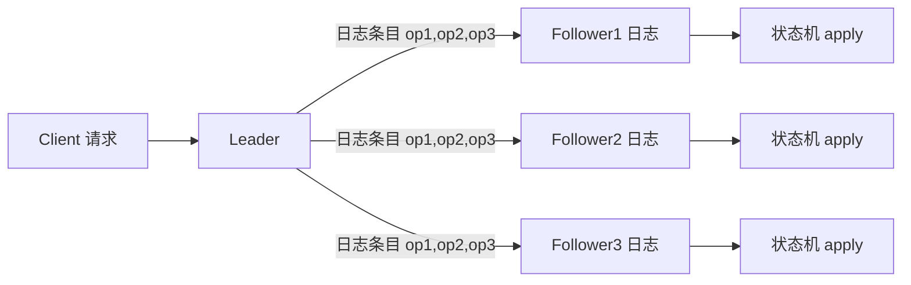

只要**日志顺序一致 + 每条日志内容一致 + 状态机确定性**，三个副本的状态必然一致。

> 为什么不是"复制数据"而是"复制日志"？因为日志把**随机写**变成**顺序追加写**（性能高），且日志天然带顺序（顺序就是一致性本身）。

## 4.2 两个不可能性结论（先说边界，再说方案）

1. **FLP 不可能性**：在**异步**模型中（无时钟上界、消息可无限延迟），即使只有 1 个节点可能崩溃，也**不存在**既保证安全性又保证活性的确定性共识算法。
   → 工程解法：放弃"严格活性保证"，用**超时**把异步变"部分同步"（超时后触发选举/重试）。这就是所有共识算法都靠"随机超时"的原因。
2. **拜占庭将军问题**：若节点可能作恶，需要 `3f+1` 个节点才能容忍 f 个恶意节点；若只崩溃，`2f+1` 足够（多数派）。
   → 所以 Raft/Paxos 的"半数以上"假设是**非拜占庭**环境。

## 4.3 Raft 详解（面试主战场）

### 4.3.1 三个角色与两个属性

- 角色：**Leader**（唯一写入口）、**Follower**（被动接受日志/投票）、**Candidate**（竞选中的中间态）。
- 两个核心属性：
  - **Election Safety**：一个任期（term）内最多一个 Leader。
  - **Log Matching**：若两个日志在相同 index 有相同 term，则它们之前的所有日志完全相同。

### 4.3.2 任期（Term）：逻辑时钟

每个 term 是一个单调递增的整数，**每轮选举 +1**。term 的作用：

- 拒绝旧 leader 的请求（`msg.term < currentTerm` 直接拒绝）；
- 让所有节点对"谁是当前 Leader"有统一编号依据；
- 是 Raft 的**逻辑时钟**（不用物理时间）。

### 4.3.3 选举过程

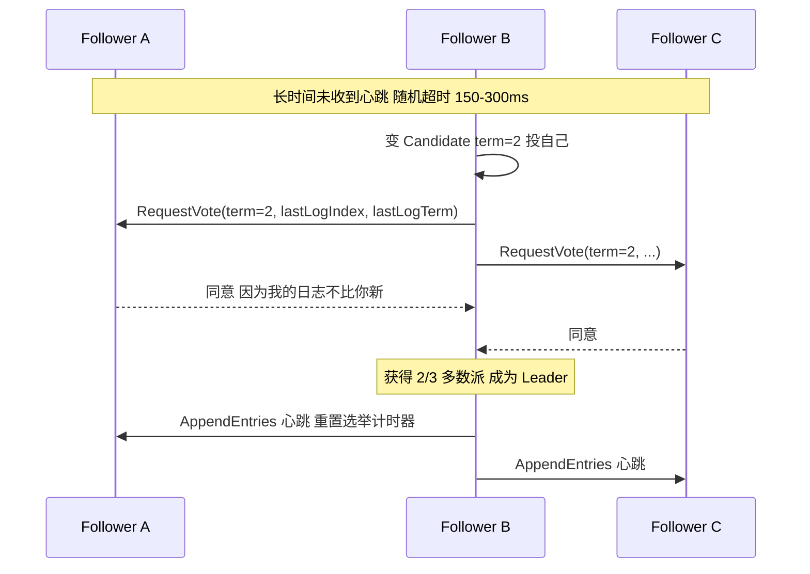

关键细节（这些细节才是面试区分点）：

1. **随机化超时**：150~300ms 随机，避免"分裂投票（split vote）"同时竞选。这是 FLP 的工程妥协。
2. **投票门槛（Election Restriction）**：候选人日志必须**至少和投票者一样新**：
   `lastLogTerm > myLastLogTerm`，或 `term 相等且 lastLogIndex >= myLastLogIndex`。
   → **保证已提交的日志不会丢**：因为已提交日志存在于多数派，而任何新 Leader 必须获得多数派投票，其中至少一个节点持有该日志，从而拒绝日志更旧的候选人。
3. **一任期一票**：每个节点在每个 term 只投一次（`votedFor`）。
4. **收到更高 term 立即退化为 Follower**（并清空 votedFor）。
5. **心跳也是 AppendEntries**（空日志），同时携带 `commitIndex` 通知 follower 提交。

### 4.3.4 日志复制

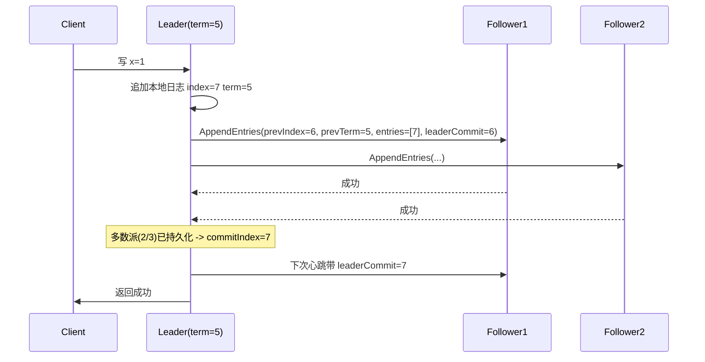

**一致性检查（Log Matching 的落地）**：`AppendEntries` 带 `prevLogIndex + prevLogTerm`，Follower 校验不通过就**拒绝**；Leader 收到拒绝后**递减 nextIndex 重试**，直到找到分叉点，然后**覆盖** follower 之后的日志。

> 这就是"**领导人只能追加、不能改写历史，但可以覆盖未提交的冲突日志**"。

### 4.3.5 提交规则（最容易答错的点）

- **Leader 只能通过"当前任期的日志被多数派复制"来推进 commitIndex**。
- 而**不能**直接根据"旧任期日志已被多数派复制"来提交它（Raft 论文 Figure 8 的经典反例）：

```text
term2: L1 把 op 复制到 S1,S2（未提交，S3 没有）  L1 崩溃
term3: S5 当选（S3,S4,S5 投票），追加自己的 op，未提交，崩溃
term4: S1 当选（S1,S2,S3,S4 投票，S1 日志更新），
       把 term2 的旧日志复制到 S3 -> 此时旧日志在 S1,S2,S3 多数派
       若此时直接提交旧日志 -> 但 S5 可能随后当选并覆盖它 -> 违反安全性
```

**解法**：Leader 上任后先提交一条**本任期的空日志（no-op）**，间接把之前所有日志一起提交。这也是工程实现（etcd、TiKV）必做的一步。

### 4.3.6 安全性证明的三条支柱（能讲清就是 P7 水平）

1. **Election Safety**：term 唯一 + 一任期一票 + 多数派交集 → 一个 term 只有一个 Leader。
2. **Leader Completeness**：新 Leader 必含所有已提交日志（由 Election Restriction 保证）。
3. **State Machine Safety**：同一 index 不会 apply 不同命令（由前两条 + 日志匹配保证）。

### 4.3.7 日志压缩与快照（Snapshot）

日志无限增长 → 定期做快照（把状态机某一时刻的状态序列化），丢弃该 index 之前的日志。

- `InstallSnapshot` RPC：当 follower 落后太多（需要的日志已被压缩），Leader 直接发快照。
- 快照要**分块传输 + 限速**，否则会打爆网络（TiKV 有专门的限流）。
- 状态机必须支持"从快照恢复"，且快照要包含 `lastIncludedIndex/Term`。

### 4.3.8 成员变更：为什么"一步到位"会双主

**一步式变更（single change）的脑裂**：从 `{A,B,C}` 变 `{A,B,C,D,E}`，若 C 未收到新配置：

- 旧配置 `{A,B,C}` 的多数派 = 2（A+B 就可以选主）
- 新配置 `{A,B,C,D,E}` 的多数派 = 3（C+D+E 也可以选主）
- 两个多数派**可能不相交** → 两个 Leader。

**解法**：

| 方案 | 原理 | 优劣 |
|---|---|---|
| **联合共识（Joint Consensus）** | 中间态 `C_old,new`，任何决议需**同时获得新旧两个多数派** | 正确、安全；实现复杂（两阶段配置） |
| **单节点变更（One at a time）** | 每次只加/减 1 个节点，任意两配置的多数派必有交集 | 简单，etcd 默认用这个；但一次只能变一个 |
| **预投票 Pre-Vote** | 竞选前先"试探"是否能赢，避免分区恢复后的无意义 term 膨胀 | 解决"term 暴涨导致 Leader 抖动" |

> **延伸：Pre-Vote 解决什么问题**
> 一个被网络分区隔离的节点不断超时 → term 从 5 涨到 100 → 分区恢复后它的高 term 会**逼迫正常 Leader 退位**，引发一次多余选举（甚至反复抖动）。
> Pre-Vote：候选人在真正增加 term 之前，先发 `PreVote` 询问"如果我 term+1，你们会投我吗"，只有获得多数派"预同意"才真正开始选举。这样隔离节点**不会把 term 抬高**。

### 4.3.9 线性一致读：ReadIndex 与 Lease Read

Raft 默认读也要走一次日志（读也 commit），性能差。两种优化：

| 方案 | 做法 | 风险 |
|---|---|---|
| **ReadIndex** | Leader 记录当前 commitIndex，确认自己仍是 Leader（向多数派发一次心跳），等到 `applied >= readIndex` 再返回 | 多一次心跳 RTT，但**安全** |
| **Lease Read** | Leader 依靠"选举超时租约"（在 `electionTimeout` 内相信自己是唯一 Leader），直接用当前 commitIndex 读，不等心跳 | 依赖**时钟速率**假设：若各节点时钟速率差异过大（超过租约），可能读到旧值。生产上通常把租约打折（如 electionTimeout 的 90%） |

> **底层洞察**：ReadIndex 的本质是"**用一次多数派往返，换掉一次日志复制往返**"，安全性来自"多数派交集 + 任期单调"。

## 4.4 Paxos：Raft 的"祖师爷"

### Basic Paxos 两个阶段

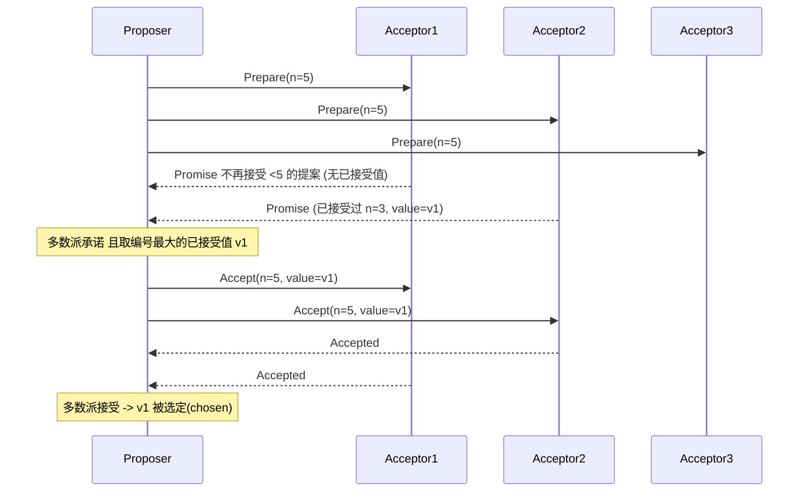

三条规则（背下来）：

1. **Acceptor 承诺**：收到 `Prepare(n)`，若 `n > 已承诺的最大编号`，则承诺不再接受编号 < n 的提案，并返回自己已接受过的最大编号提案。
2. **Proposer 复用**：若多数派返回了"已接受的值"，Proposer **必须**使用其中**编号最大**的那个值（不能用自己的值）；若都没有，才用自己的值。
3. **Acceptor 接受**：收到 `Accept(n, v)`，若未违背承诺，则接受并持久化。

### Paxos 的工程问题 → Multi-Paxos

- Basic Paxos 每选一个值要 2 轮 RTT；
- 多个 Proposer 互相插队 → **活锁**（livelock）；
- 解决：**选一个稳定的 Leader（Distinguished Proposer）**，之后所有提案跳过 Prepare，直接 `Accept` → 1 轮 RTT。
- 这就是 **Multi-Paxos**：把"选 Leader"当成一次 Paxos，之后连续对多个 slot 达成一致（相当于日志流）。

| 对比项 | Paxos / Multi-Paxos | Raft |
|---|---|---|
| 抽象 | 数学化，允许日志空洞（多 Leader 并行提案） | 工程化，强 Leader、日志连续 |
| 选举 | 无明确规定（实现自定） | 明确定义（随机超时 + 任期 + 投票约束） |
| 成员变更 | 未定义 | 联合共识 / 单节点变更 |
| 日志修复 | 各实现自定 | 强制的 nextIndex 回退 + 覆盖 |
| 可理解性 | 难（论文以晦涩著称） | 易（设计目标就是可理解） |

> **面试话术**：Raft ≈ "Multi-Paxos 的一个具体工程实现规范"，把 Paxos 中留给实现的模糊部分（选举、日志修复、成员变更）全部定死。

## 4.5 ZAB：ZooKeeper 的原子广播

### 与 Raft 的相似处

- 都是强 Leader（Leader 处理所有写）；
- 都有 epoch/term 概念（ZXID 的高 32 位是 epoch，低 32 位是事务计数）；
- 都用多数派 + 日志复制。

### 关键差异

| 维度 | ZAB | Raft |
|---|---|---|
| 定序标识 | ZXID（epoch + counter） | (term, index) |
| 恢复阶段 | 选主后进入**恢复模式**（发现+同步），必须让所有 follower 与自己一致才对外服务 | 新 Leader 直接通过日志复制逐步修复 |
| 读语义 | **Follower 可本地读**，可能读到旧数据 → **顺序一致但不线性一致** | 默认读走 Leader（ReadIndex/Lease）→ 可线性一致 |
| 写流程 | propose → ack → commit（两阶段，但 commit 是异步广播） | AppendEntries 一轮 + 下次心跳通知 commit |

### ZAB 的两种模式

1. **崩溃恢复（Recovery）**：Leader 挂了 → 选举（先比 ZXID，再比 serverId）→ 新 Leader 与所有 follower 同步（DIFF / TRUNC / SNAP 三种同步方式）→ 进入广播模式。
2. **消息广播（Broadcast）**：类似两阶段提交——Leader 发 PROPOSE，多数派 ACK 后发 COMMIT。

> **ZK 的"读可能旧"是设计取舍**：ZK 主要承载**元数据**（配置、注册信息、锁状态），读多写少，让 follower 本地读能大幅提升读吞吐。如果需要强一致读，客户端要显式调 `sync()`。

## 4.6 Gossip：去中心化的"最终一致"传播

### 原理

每个节点周期性随机选 k 个节点，交换摘要（digest），发现差异就同步。信息像病毒一样扩散，`O(log N)` 轮收敛。

| 变体 | 说明 | 使用 |
|---|---|---|
| Anti-Entropy | 定期全量/摘要比对修复 | Cassandra、Redis Cluster |
| Rumor Mongering（谣言传播） | 有新数据就主动推，推够次数停止 | 早期 Dynamo |
| SWIM | 故障检测（ping + 间接 ping + 谣言确认） | Consul、Serf |

### 优缺点

- ✅ 去中心化、无单点、可扩展到几千节点、抗分区（分区内各自传播，恢复后收敛）
- ❌ 只保证**最终一致**、收敛时间无严格上界、消息冗余（带宽成本）、不适合强一致场景

> **Redis Cluster 的 Gossip 细节**：每个节点每秒随机 ping 几个节点，携带自身及已知节点的 `slot 位图 + 节点状态 + 配置纪元(configEpoch)`；用 **configEpoch 大者胜**解决配置冲突。这就是"去中心化 + 逻辑时钟定序"的组合。

## 4.7 工程选型速查

| 需求 | 选择 |
|---|---|
| 强一致元数据/配置/选主 | etcd（Raft）、ZK（ZAB） |
| 高吞吐日志/事件流 | Kafka（ISR + 单分区单 Leader） |
| 强一致 KV 存储（大规模） | TiKV（Multi-Raft）、CockroachDB（Raft + 分片） |
| 最终一致、超高可用写入 | Cassandra、DynamoDB（AP + quorum 可调） |
| 去中心化成员管理/健康检查 | Gossip（SWIM） |

## 4.8 常见误区

- ❌ "Raft 的 follower 读也是强一致" —— 默认不是，除非走 ReadIndex/Lease 或转发 Leader。
- ❌ "多数派写了就算提交" —— 只有**当前 term** 的日志被多数派复制才算（Figure 8）。
- ❌ "选举超时越短越好" —— 太短会因网络抖动频繁选举（term 膨胀、服务不可用）；太长则故障恢复慢。生产通常 1~2s（跨机房要更长）。
- ❌ "ZK 是强一致" —— 写是线性一致（多数派），**读可能旧**（顺序一致）。

---

# 第 5 章 分布式事务

## 5.1 一句话本质

**分布式事务 = 在"数据分散、进程独立、网络不可靠"的前提下，让一组跨服务的操作要么全部生效、要么全部不生效（或最终全部一致）。**

难点在于：**没有跨库的锁、没有跨库的原子提交、没有跨库的回滚能力**。所有方案都在用不同方式"模拟"这件事。

## 5.2 先补底层：本地事务凭什么可靠

要理解分布式事务的难，先要理解单机 ACID 是怎么"便宜"实现的（面试常考"为什么 XA 性能差"就要从这里答）：

| 机制 | 作用 | 底层 |
|---|---|---|
| **Undo Log** | 回滚 + MVCC 读旧版本 | 记录"改之前的值"，逻辑日志，随机读写 |
| **Redo Log** | 崩溃恢复（已提交不丢） | 物理日志，**顺序写** + `fsync`（WAL） |
| **锁 / MVCC** | 隔离性 | 行锁、间隙锁、ReadView |
| **两阶段提交（内部）** | redo 的 prepare/commit | `redo prepare` → 写 binlog → `redo commit` |

> **关键洞察**：单机事务的"原子性"是靠 **同一份磁盘上的日志 + 一个进程的顺序控制**实现的。分布式事务没有"同一份磁盘"，所以必须引入**协调者（Coordinator）**和**跨节点的协议**，这就是全部代价的来源。

## 5.3 方案全景图

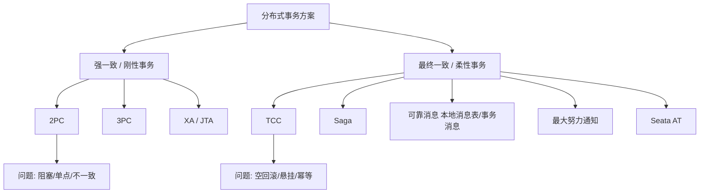

选择原则（一句话）：**钱要强一致（TCC/2PC），流程要柔性（Saga/消息），通知可丢（最大努力）**。

---

## 5.4 2PC（两阶段提交）

### 流程

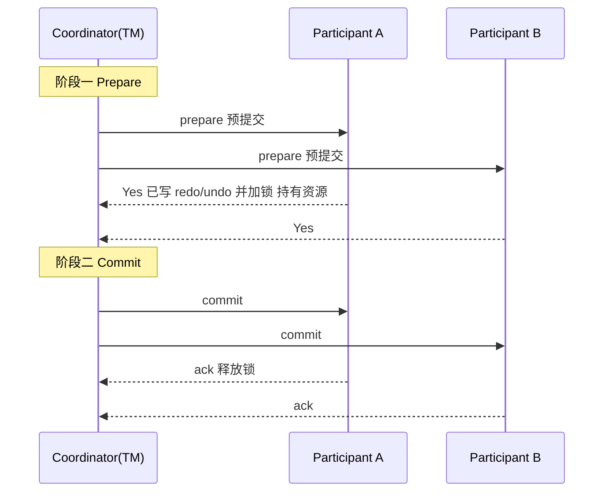

- **Prepare 阶段**：参与者执行事务（写 undo/redo），**但不提交**，锁住资源，回复 Yes/No。
- **Commit 阶段**：协调者收到**全部 Yes** → 发 commit；否则发 rollback。

### 五个致命缺陷（面试必答）

| 缺陷 | 现象 | 本质原因 |
|---|---|---|
| **同步阻塞** | Prepare 后到 Commit 前，资源被锁住，其他事务全等 | 锁在"跨网络等待"期间不能释放 |
| **协调者单点** | TM 挂了，参与者一直"不确定"（in-doubt），资源永久锁死 | 无超时决策权（参与者不敢自行提交/回滚） |
| **数据不一致** | Commit 阶段部分参与者收到 commit，部分没收到 | 网络故障 + 无重试/无补偿 |
| **过分保守** | 任一参与者 No → 全体回滚，即使其他都已成功 | 全有或全无的刚性要求 |
| **性能差** | 2 次 RTT + 全程持锁，吞吐随参与者数线性下降 | 锁持续时间被拉长到网络 RTT 量级 |

> **延伸：in-doubt 事务怎么恢复**
> 参与者必须把 `prepare` 状态**持久化到本地日志**；TM 恢复后读日志重发 commit/rollback；同时提供**人工/自动的"最后决议"机制**（如 XA 的 `xa_recover` + `xa_commit`）。
> 生产中还要给 TM 做**高可用**（主备 + 决议日志复制到多数派），否则 TM 一挂全站阻塞。

### XA 规范（2PC 的工业标准）

- **TM（Transaction Manager）**：协调者；**RM（Resource Manager）**：数据库。
- MySQL 的 XA：`XA START / XA END / XA PREPARE / XA COMMIT / XA ROLLBACK`。
- **XA 事务在 PREPARE 后会持有锁直到 COMMIT**，这是它在大促场景不可用的根本原因（热点行锁时间 = 网络 RTT × 参与者数）。
- MySQL 5.7+ 支持 `binlog_group_commit` 优化，但 XA 的锁窗口问题不解决。

## 5.5 3PC（三阶段提交）

在 2PC 前加 **CanCommit** 阶段，并给参与者加**超时机制**：

- CanCommit：只做"能不能干"的探测（不锁资源）；
- PreCommit：同 2PC 的 prepare；
- DoCommit：同 2PC 的 commit。

改进点：

1. 探测阶段减少无效锁；
2. 参与者在 PreCommit 后**超时自动提交**（因为此时"大概率大家都准备 OK"）→ 降低阻塞。

**但它没解决问题**：

- 超时自动提交可能与协调者的"回滚"冲突 → **仍然可能不一致**；
- 网络分区下，"部分节点超时提交、部分节点收到回滚" → 不一致反而更隐蔽；
- 多一轮 RTT，性能更差。
- **结论**：3PC 理论上更"不阻塞"，实践几乎不用（不能解决分区，还更慢）。

## 5.6 TCC（Try-Confirm-Cancel）

### 本质

**把"一个远程事务"拆成"三个业务可自定义的操作"，用业务层的资源预留代替数据库层的锁。**

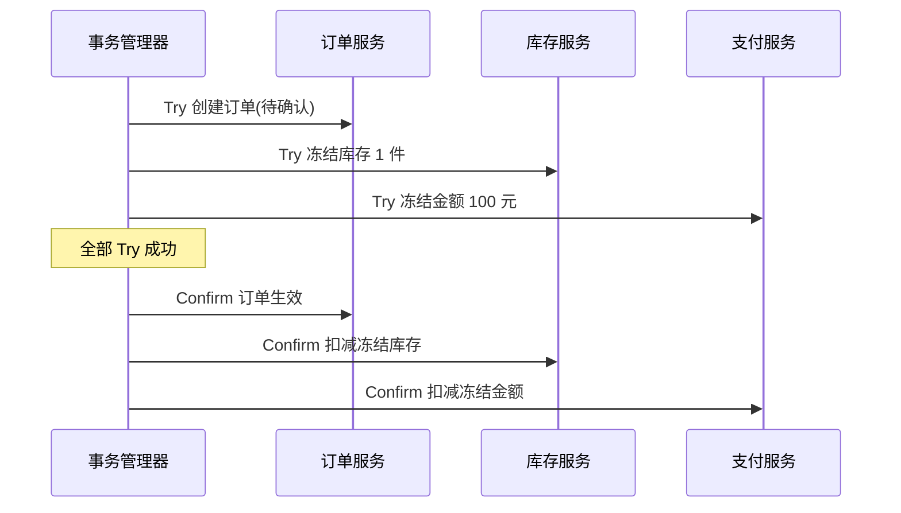

- **Try**：检查 + **预留资源**（不是真扣，是"冻结"）。
- **Confirm**：真正使用预留资源；**必须幂等**、**不能失败**（失败只能重试）。
- **Cancel**：释放预留资源；**必须幂等**、**必须能处理"Try 没执行"的情况**。

### 为什么 TCC 性能高

- **没有数据库长事务**：Try 是一个短本地事务（改冻结字段后立刻提交）；
- **锁粒度是业务字段**（冻结库存），不是行锁；
- 因此可支撑高并发核心链路（支付、库存）。

### TCC 的三个必须解决的坑（必考）

| 问题 | 场景 | 解法 |
|---|---|---|
| **空回滚** | Try 还没执行（或超时未到），Cancel 先到了 → Cancel 无资源可释放，若直接"啥也不做"，则后续 Try 成功会造成资源永久占用 | **Cancel 时先查"事务控制表"**：若没有 Try 记录 → 插入一条"已回滚"标记，直接返回成功 |
| **悬挂（Suspension）** | Try 超时（网络延迟），TM 已发起 Cancel；Cancel 先执行完（记录不存在 → 插空回滚标记）；**随后 Try 到达并成功** → 资源被预留但永远不会有 Confirm/Cancel | Try 执行前**先查事务控制表**：若已存在"回滚标记" → 拒绝执行 Try；即"**先插记录再执行**"（Try 用 `insert 事务ID 唯一`，重复则失败） |
| **幂等** | Confirm/Cancel 重试（网络超时、TM 重发） | Confirm 用状态机（`TRY→CONFIRMED` 只允许一次）+ 唯一约束；Cancel 同理 |

**事务控制表设计（工程标准做法）**：

```sql
CREATE TABLE tcc_transaction (
  xid          VARCHAR(64) PRIMARY KEY,   -- 全局事务ID（分支ID）
  status       TINYINT,                   -- 1=TRYING 2=CONFIRMED 3=CANCELLED 4=SUSPENDED
  create_time  DATETIME,
  update_time  DATETIME
);
```

- Try：`INSERT xid`（唯一键冲突 → 说明已 Cancel 或已确认 → 拒绝/返回）；
- Cancel：`INSERT ... ON DUPLICATE KEY UPDATE` 或先 `SELECT`，若无则插入 `CANCELLED`；
- Confirm：`UPDATE ... WHERE status=TRYING`，影响行数 0 说明已处理。

> **面试加分点**：TCC 的"三不"（不允许空回滚、不允许悬挂、必须幂等）本质是**在没有全局锁的情况下，用一张本地表 + 唯一约束模拟"分布式状态机"**。

### TCC 的代价

- **业务侵入极强**：每个服务都要写 Try/Confirm/Cancel 三套逻辑，且要处理中间态；
- **一致性靠业务保证**：Confirm 失败只能重试，不能回滚（所以 Confirm 必须设计成"必然成功"）；
- **开发成本高**：一个接口三份代码 + 事务表 + 幂等 + 补偿任务。

## 5.7 Saga（长事务补偿）

### 本质

**把长流程拆成一串本地事务 T1..Tn，每个 Ti 配一个补偿 Ci；失败时逆序执行已完成的补偿。**

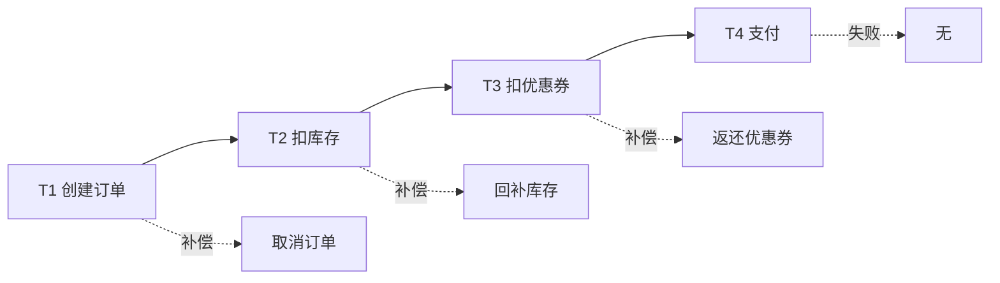

两种实现：

- **编排式（Orchestration）**：中央协调器依次调用，知道全局流程（Seata Saga、Temporal）。
- **协同式（Choreography）**：各服务通过事件订阅相互触发，无中央（更松耦合，但难追踪）。

### Saga vs TCC

| 维度 | TCC | Saga |
|---|---|---|
| 资源锁定 | **有**（Try 预留） | **无**（直接提交，靠补偿） |
| 隔离性 | 较好（资源被冻结，别人不能用） | **差**（中间态对外可见，可能被读到/被并发修改） |
| 性能 | 高 | 更高（无预留开销） |
| 适用 | 短、强一致、核心资金 | 长流程、多服务、跨第三方 |
| 风险 | 业务侵入大 | **补偿必须幂等 + 补偿可能失败 + 中间态可见** |

> **延伸：Saga 的"补偿不能完全回滚"问题**
> 若 T2 扣库存后又 T3 扣券，补偿时 C2 回补库存，但库存可能已经被别人买走 → 回补失败。
> 所以 Saga 要求：**补偿操作尽量设计成"可重入的逆向操作"**，或者接受"最终以对账/人工介入为准"。这也是 Saga 不适合资金核心链路的原因。

## 5.8 可靠消息最终一致性（最常用）

### 5.8.1 本地消息表

```text
1. 业务事务内：UPDATE 库存 + INSERT 消息表(同库同事务) -> 原子性由本地事务保证
2. 定时任务扫描消息表(未发送) -> 投递 MQ
3. 发送成功后 UPDATE 消息表 status=SENT
4. 下游消费 -> 处理成功 -> 回调/或下游自己保证幂等
5. 兜底：定时重发 + 消费方幂等 + 对账
```

- 优点：实现简单、不依赖 MQ 特性、业务与消息**同库原子**；
- 缺点：消息表与业务库耦合（分库后麻烦）、需要扫表（量大时用 binlog 订阅替代）。

### 5.8.2 RocketMQ 事务消息（半消息机制）

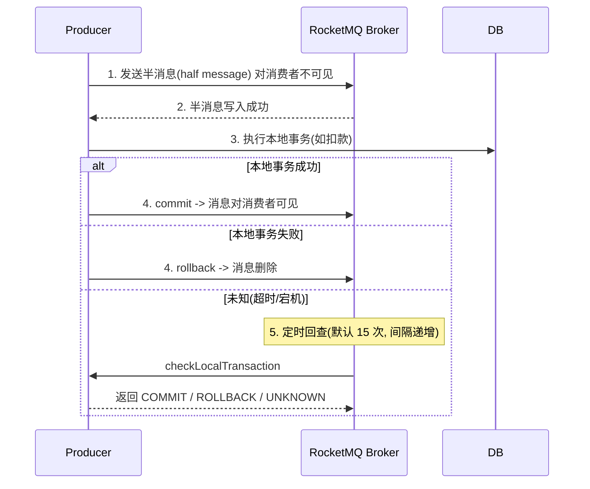

**关键点**：

- 半消息存到 **RMQ_SYS_TRANS_HALF_TOPIC**，消费不可见；
- 回查最多 15 次（默认），仍未知则丢弃（需业务兜底）；
- **回查接口必须能根据事务ID查到本地事务结果**（要落库，不能只靠内存）；
- 事务消息保证的是**"本地事务与消息发送的原子性"**，不保证下游消费成功（下游仍需幂等 + 重试 + 死信）。

### 5.8.3 消息方案的三个"必须"

1. **生产端不丢**：本地事务 + 消息同库/半消息 + 失败重试 + 兜底扫描；
2. **消费端幂等**：见 5.10；
3. **一定会有不一致**：所以**必须对账**（这就是"最终一致"的收敛保证）。

## 5.9 Seata：四种模式的取舍

| 模式 | 机制 | 一致性 | 性能 | 侵入性 | 适用 |
|---|---|---|---|---|---|
| **XA** | 依赖数据库 XA | 强 | 低 | 无 | 短事务、低并发 |
| **AT（Auto Transaction）** | 一阶段：执行业务 SQL + 记录 **undo_log** + 申请**全局锁**，本地提交；二阶段：异步删 undo_log（成功）或据 undo_log 反向补偿（失败） | 最终一致（有全局锁，读隔离性弱） | 较高 | **无侵入**（代理数据源） | 大部分非核心业务 |
| **TCC** | 同 5.6 | 较强 | 高 | 高 | 核心资金 |
| **Saga** | 状态机 + 补偿 | 最终一致 | 高 | 中 | 长流程 |

### AT 模式原理（高频深挖）

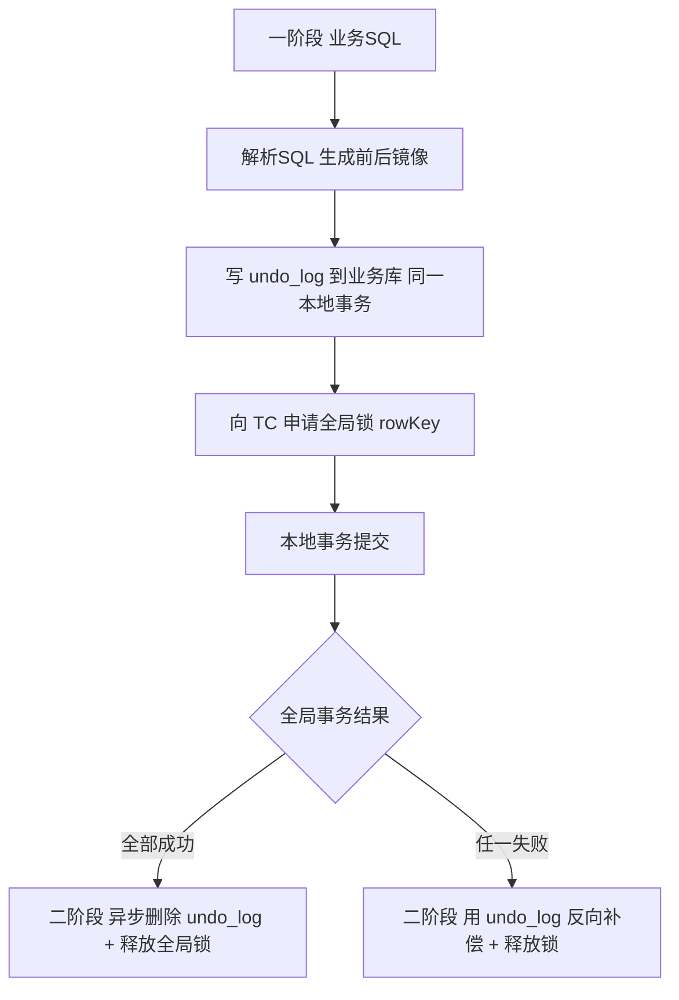

关键设计：

- **全局锁**：按 `表名 + 主键` 生成 rowKey，存在 TC（Seata Server）内存 + 持久化；防止"脏写"（别人改了我正在补偿的数据）。
- **undo_log 与业务数据同库同事务** → 保证"补偿依据"一定存在。
- **一阶段已提交** → 所以是**最终一致**（不是强一致），但**性能远好于 XA**（本地事务立即提交，锁窗口极短）。
- **局限**：`SELECT ... FOR UPDATE` 等复杂 SQL 支持有限；全局锁在 TC 侧，TC 挂掉需要重建；**读隔离默认是"读未提交"级别**（别人能读到一阶段已提交的中间态）——所以需要"全局锁 + 查询时校验"才安全。

> **面试深水区**：为什么 AT 不能用于"QPS 5 万的核心账务"？
> 1. 每笔业务要**额外写 undo_log**（写放大，至少 1 次额外 IO）；
> 2. 要**远程申请全局锁**（一次 RPC，锁排队时延迟不可控）；
> 3. 全局锁粒度为行，热点账户/热点库存会**串行化**；
> 4. 二阶段异步，中间态可见，资金类业务不可接受。
> → 结论：账务核心用 **TCC（业务层冻结）或纯异步消息 + 对账**，不用 AT。

## 5.10 幂等：所有最终一致方案的底座

### 五种幂等实现

| 方案 | 原理 | 适用 |
|---|---|---|
| **唯一索引** | `INSERT` 重复 → 唯一键冲突 | 强，最简单，靠 DB |
| **去重表/幂等表** | `INSERT (biz_id, status)`，冲突则查状态 | 需查历史结果 |
| **状态机** | `UPDATE ... WHERE status = 旧状态`，影响行数=0 则已处理 | 订单/支付 |
| **Token 机制** | 先申请 token，提交时校验并删除 | 防重复提交（前端） |
| **Redis SETNX** | `SET id 1 NX EX 86400` | 高频短窗口，需接受 Redis 丢数据风险 |

### 幂等的三个层级（很多人只知道第一层）

1. **请求级**：同一请求 ID 只处理一次；
2. **业务级**：同一业务语义（如同一订单的多次支付回调）只产生一次效果；
3. **数据级**：即使重复执行更新，结果不变（如 `SET balance = 100` 而非 `balance = balance + 100`）。

> **黄金法则**：能用"**唯一约束 + 状态机**"就别用"Redis 去重"，因为 Redis 可能丢（主从切换）且会过期。

## 5.11 对账：最终一致的"最后一道防线"（金融视角）

分布式事务在工程上**必须假设"一定会不一致"**，对账就是收敛机制：

| 层次 | 内容 | 手段 |
|---|---|---|
| 业务对账 | 订单 vs 支付 vs 库存 三方数量/金额 | 定时任务 + 差异表 |
| 信息对账 | 我方流水 vs 渠道流水（微信/支付宝/银行） | 文件下载 + 逐笔比对 |
| 资金对账 | 账户余额变动 vs 流水累计 | 快照 + 余额校验 |
| 财务对账 | 记账凭证 vs 业务单据 | 复式记账平衡校验 |

流程：`T+1 拉取渠道文件 → 解析 → 与本地流水按业务单号 join → 分四类（我方有他方无/他方有我方无/金额不符/状态不符）→ 差异表 → 自动补单/人工处理 → 闭环`。

> **面试加分**：能说出"**分布式事务不是为了不出错，而是为了让错误可控、可发现、可修复**"，比背 TCC 三步更有价值。

## 5.12 选型决策树（背下来直接用）

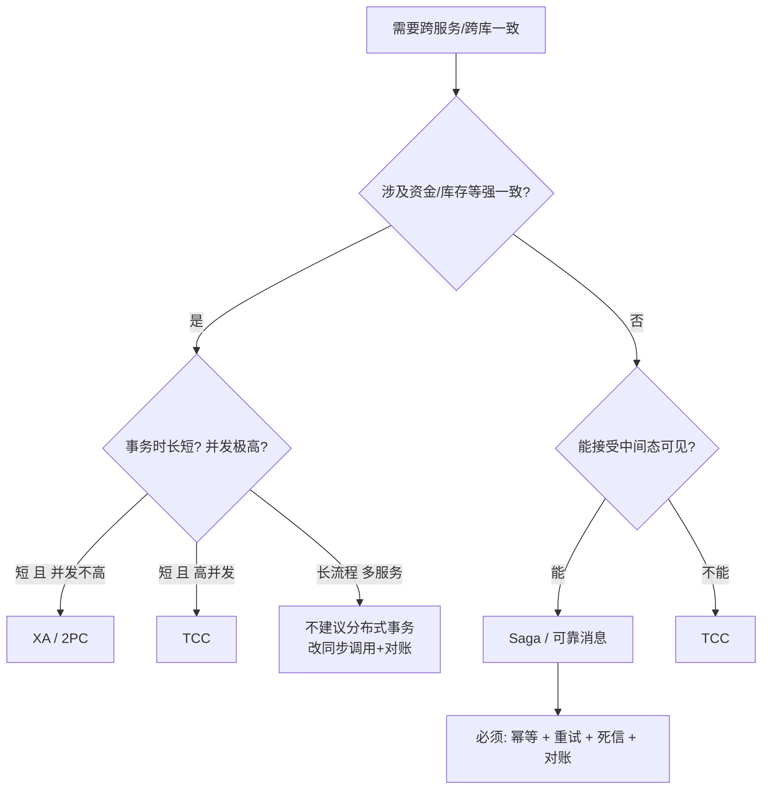

## 5.13 常见误区

- ❌ "2PC 是分布式事务的唯一标准" —— 它只是刚性方案，性能决定它只能用于低频短事务。
- ❌ "TCC 的 Confirm 可以失败回滚" —— Confirm 一旦开始必须成功（只能重试），所以 Try 阶段必须把资源预留充分。
- ❌ "用了事务消息就万事大吉" —— 只保证"本地事务与消息发送"原子，下游消费仍需幂等。
- ❌ "Seata AT 是强一致" —— 一阶段已提交，本质是最终一致 + 全局锁防脏写。
- ❌ "幂等就是加个唯一索引" —— 还要覆盖"重复消息""乱序消息""补偿重入"。

---

# 第 6 章 分布式锁

## 6.1 一句话本质

**分布式锁 = 在多个进程/多台机器之间，用"一个外部共享的、能见证状态的组件"来模拟互斥锁。**

它必须同时满足四个性质（缺一不可）：

| 性质 | 含义 | 不满足的后果 |
|---|---|---|
| **互斥性** | 同一时刻只有一个持有者 | 数据错乱、超卖 |
| **防死锁** | 持有者崩溃后锁能自动释放 | 资源永久锁死 |
| **可重入**（多数场景） | 同一线程可重复获取 | 自己把自己锁死 |
| **高可用/高性能** | 锁服务不能成为单点/瓶颈 | 全站阻塞 |

> **底层视角**：Java 的 `synchronized` 靠 **对象头 Mark Word + monitor（管程）**，是 JVM 进程内的内存操作（CAS + 操作系统 mutex）。分布式锁把这个"内存里的标记位"搬到了**一个所有进程都能访问的外部存储**上，因此每次加锁解锁都变成一次**网络 RTT + 一次原子写**。**这就是它比本地锁慢 3~4 个数量级的原因，也是所有工程问题的根源。**

## 6.2 方案全景

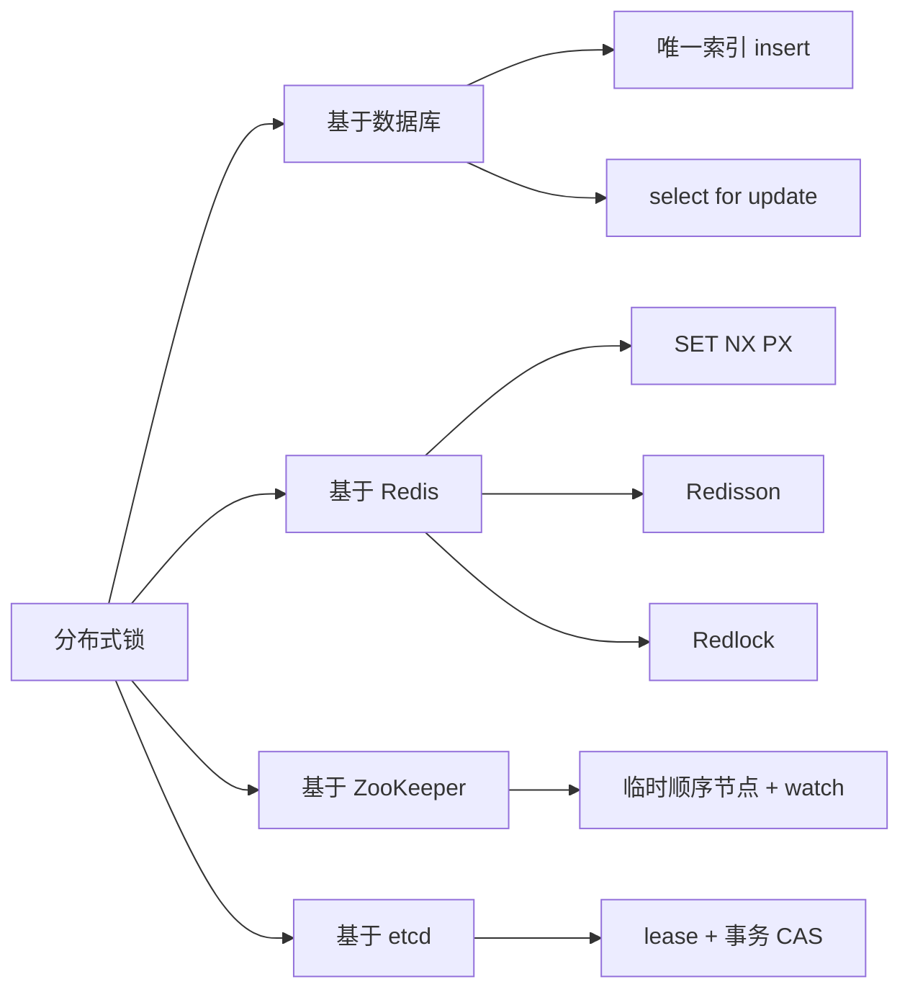

| 方案 | 一致性 | 性能 | 防死锁 | 可重入 | 公平性 | 典型场景 |
|---|---|---|---|---|---|---|
| DB 唯一索引 | 强（DB 保证） | **差**（磁盘 IO） | 需手动清理（靠定时任务） | 难 | 不保证 | 低频、必须绝对互斥 |
| Redis 单实例 | 弱（主从异步可能丢） | **极高** | 靠 TTL | 可（hash 计数） | 不保证 | 高并发、允许极小概率失效 |
| Redis Redlock | 有争议 | 高 | 靠 TTL | 可 | 不保证 | 争议大，生产慎用 |
| ZooKeeper | **强（CP）** | 中（写要过半） | 会话断开自动删临时节点 | 可 | **天然公平（顺序节点）** | 元数据、选主、强互斥 |
| etcd | **强（Raft）** | 中 | lease 到期自动删 | 可 | 较好 | K8s、云原生、配置类 |

---

## 6.3 基于数据库

### 方式一：唯一索引（最朴素）

```sql
-- 锁表
CREATE TABLE distributed_lock (
  lock_name   VARCHAR(64) PRIMARY KEY,   -- 唯一约束就是锁
  holder      VARCHAR(128),
  expire_time DATETIME
);
INSERT INTO distributed_lock(lock_name, holder, expire_time) VALUES ('order:123', 'hostA', NOW()+INTERVAL 30 SECOND);
-- 插入成功 = 拿到锁；唯一键冲突 = 锁被占用
DELETE FROM distributed_lock WHERE lock_name='order:123' AND holder='hostA';
```

- ✅ 绝对可靠（DB 事务保证）、实现最简单；
- ❌ **没有自动释放**（宕机后记录还在）→ 必须配合定时任务扫 `expire_time` 清理；
- ❌ 性能差（每次加锁一次磁盘写 + 事务），不适合高并发；
- ❌ 单库即单点 → 分库后锁就不互斥了。

### 方式二：`SELECT ... FOR UPDATE`

- 靠**行锁**实现互斥，锁在事务提交/回滚时释放（**天然防死锁**，因为连接断开事务回滚）。
- ❌ 长事务持锁 → 连接池被打满、行锁升级为表锁风险；
- ❌ 必须在同一个事务内，锁边界与事务边界强绑；
- ❌ 只适合低频、且能接受"锁等待"的场景。

> **关键坑**：`FOR UPDATE` 在**没有命中索引**时会锁全表（InnoDB 的 next-key lock 全表扫描），生产事故常见原因。

## 6.4 基于 Redis

### 6.4.1 最小可用版本（以及它的三个坑）

```java
// 加锁（Redis 2.6.12+ 一条命令原子完成 SETNX + EXPIRE）
SET lock:order:123 "uuid:threadId" NX PX 30000

// 解锁（必须原子：判断是我的锁 + 删除）
if redis.call('get', KEYS[1]) == ARGV[1] then
    return redis.call('del', KEYS[1])
else
    return 0
end
```

三个必须回答的坑：

| 坑 | 场景 | 解法 |
|---|---|---|
| **误解锁** | A 加锁后卡住，锁到期自动释放；B 拿到锁；A 恢复后执行 `DEL` → 删了 B 的锁 | value 存唯一标识（UUID+线程ID），用 **Lua 脚本**做"比对+删除"原子操作 |
| **锁超时** | 业务执行超过 30s，锁自动释放，别人进来 → 并发 | **看门狗（watchdog）续期**；或合理估算超时时间 |
| **不可重入** | 同一线程嵌套加锁 → 第二次加锁失败，自己死锁 | value 用 `hash{threadId: count}`，重入 count++ |

### 6.4.2 Redisson 的实现细节（面试深挖必考）

```text
加锁 Lua（简化）:
  if (redis.call('exists', KEYS[1]) == 0) then
      redis.call('hincrby', KEYS[1], ARGV[2], 1)     -- field = uuid:threadId
      redis.call('pexpire', KEYS[1], ARGV[1])
      return 1
  end
  if (redis.call('hexists', KEYS[1], ARGV[2]) == 1) then
      redis.call('hincrby', KEYS[1], ARGV[2], 1)     -- 重入 +1
      redis.call('pexpire', KEYS[1], ARGV[1])
      return 1
  end
  return redis.call('pttl', KEYS[1])                  -- 返回剩余时间 供自旋
```

- **数据结构**：`Hash{ lockName : { "uuid:threadId" : reentrantCount } }`，所以可重入、可识别持有者。
- **看门狗**：默认 `lockWatchdogTimeout = 30s`，每 `10s`（1/3 周期）检查一次，若仍持有则续期到 30s。**只有不指定 leaseTime 时才启用**（`lock()` 无限等 + 看门狗；`lock(10, TimeUnit.SECONDS)` 不续期）。
- **等待机制**：基于 **Redis 发布订阅（pubsub）** 而不是纯自旋——释放锁时 `publish` 一条消息，等待者被唤醒，减少无效轮询。
- **公平锁**：Redisson 用 `zset + list` 维护排队队列（`RLock` 的 fair 版本），但性能更差。
- **红锁（RedLock）**：向 N 个独立 Redis 实例依次加锁，需 `N/2+1` 成功，且总耗时 < 锁有效期。

### 6.4.3 主从切换丢锁问题（最重要的认知）

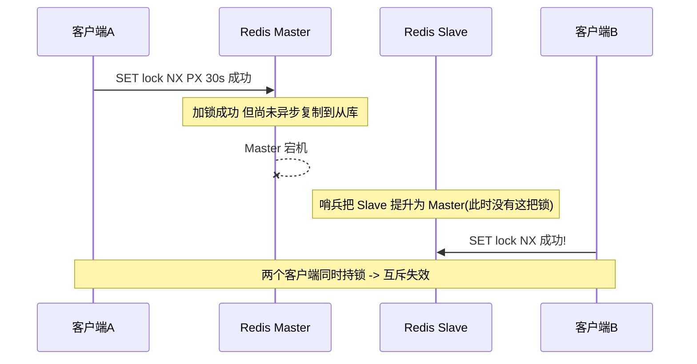

**这是 Redis 异步复制的固有缺陷，无法靠改代码解决。** 应对策略：

1. **接受概率并加业务兜底**（唯一索引/乐观锁/状态机）——绝大多数业务这么做；
2. **Redlock（多实例）**——但被 Martin Kleppmann 质疑（见下）；
3. **改用 ZK/etcd**（CP，写成功即多数派持久化）；
4. **Redis 侧缓解**：`WAIT 1 0`（同步等 1 个副本确认，牺牲性能）、或主从同步复制配置（Redis 无原生同步复制）。

### 6.4.4 Redlock 的著名争论（能讲清就是加分项）

- **antirez（Redis 作者）**：向 5 个**独立**（无主从关系）Redis 实例加锁，超过半数成功 + 耗时小于有效期 → 认为锁有效。
- **Martin Kleppmann 的反驳**（《How to do distributed locking》）：
  1. **时钟漂移**：Redlock 假设各节点时钟速率接近，但进程 GC 停顿、时钟跳变会让"有效期"失真 → 锁可能提前失效；
  2. **没有 fencing token**：即使锁"理论上"还有效，客户端 A 可能因为 GC 停顿而在锁失效后才去写共享资源，此时 B 已持锁 → **依然冲突**；
  3. 结论：**Redlock 只提供"效率型锁"（efficiency lock），不提供"正确性型锁"（correctness lock）**。需要正确性时，必须用**带 fencing token 的存储**（如 etcd 的 revision / ZK 的 zxid / DB 的自增版本号），让被保护资源自己拒绝过期写。
- **antirez 的回应**：承认需要 fencing 的场景应使用其它方案，但 Redlock 在"无需 fencing 的常见场景"仍可用。

> **工程结论（比争论更重要）**：**任何分布式锁都必须假设"锁可能失效"**，被保护的资源侧要有**版本号/CAS/唯一约束**作为最终防线。锁只是"优化并发冲突概率"，不是"正确性保证"。这就是 fencing token 思想的落地。

### 6.4.5 锁超时时间怎么定

- 经验：`超时 > P99 业务耗时 × 3`；
- 或者用**看门狗自动续期**（但要注意：续期线程本身可能因 GC 停顿而延迟 → 仍是概率问题）；
- 关键：**锁内不要做不可预期的操作**（调外部 RPC、大批量 DB 操作、等待用户输入）→ 这类场景应改用"状态机 + 幂等"而不是锁。

## 6.5 基于 ZooKeeper

### 原理：临时顺序节点 + watch 前驱

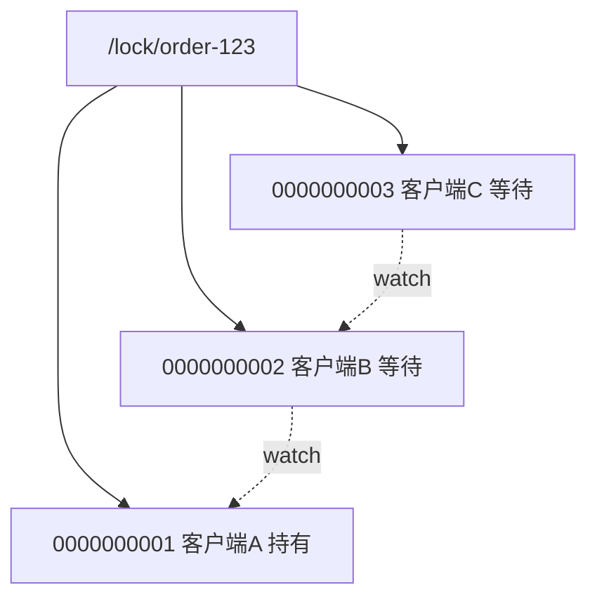

流程：

1. 所有客户端在 `/lock/order-123` 下创建**临时顺序节点**（`EPHEMERAL_SEQUENTIAL`）；
2. 取所有子节点排序，**序号最小的持有锁**；
3. 非最小节点 **watch 它的前一个节点**（不是 watch 根节点！）；
4. 前驱被删除（释放或会话过期）→ 触发回调 → 重新判断自己是否最小。

### 三个设计要点（面试区分点）

| 设计 | 为什么 | 反面教材 |
|---|---|---|
| **watch 前驱而非根节点** | 避免**羊群效应（herd effect）**：若所有等待者都 watch 根节点，一次释放会唤醒所有客户端，ZK 瞬间被通知风暴打爆 | 新手常犯 |
| **临时节点而非持久节点** | 客户端崩溃/断连 → 会话超时 → 节点**自动删除** → 天然防死锁 | 持久节点需手动清理 |
| **顺序节点而非普通节点** | 天然**公平锁**（FIFO），避免饥饿 | 随机抢占会饿死 |

### ZK 锁的优势与代价

- ✅ **CP 保证**：写要多数派落盘，主从切换不丢锁（不像 Redis）；
- ✅ **自动释放 + 公平 + 无羊群**；
- ❌ 性能：每次加锁/释放都是一次 ZK 写（涉及 Leader + 多数派），QPS 有限（单集群通常几千~万级）；
- ❌ 会话超时时间难调（太短会误删锁，太长故障恢复慢）；
- ❌ 大量临时节点会给 ZK 造成压力（ZK 不适合存大量数据/高写）。

> **延伸**：ZK 的 `sessionTimeout` 与"假死"问题
> 客户端 Full GC 停顿超过 sessionTimeout → ZK 认为会话过期，删掉临时节点（锁释放）→ 客户端 GC 恢复后**以为自己还持锁** → 互斥失效。这与 Redis 锁超时是同一类问题，**同样需要资源侧兜底**。

## 6.6 基于 etcd

- **租约（Lease）+ 事务（Txn）**：

```text
1. 申请 lease（TTL=30s），定期 KeepAlive 续约
2. Txn 事务: If( key 不存在 或 版本号 匹配 ) Then( Put key=holder, lease=leaseID )
   -- 用 CAS（compare-and-swap）语义保证原子性
3. 释放: 删除 key（或让 lease 到期自动删）
4. 等待: Watch key 的删除事件
```

- etcd 的 **revision 单调递增**，天然可作为 **fencing token**（这正是 Kleppmann 推荐的方案）；
- K8s 的 `Lease` 对象、`controller-runtime` 的 leader election 都基于此；
- 性能介于 ZK 与 Redis 之间，适合"正确性要求高的元数据类"锁。

## 6.7 锁的粒度与工程实践（这才是真实项目考的东西）

| 实践 | 说明 |
|---|---|
| **锁粒度尽量细** | `lock:order:{orderId}` 而不是 `lock:order`；但要注意热点 key（爆款库存）→ 分段锁（`stock:{sku}:seg:0..9`） |
| **锁内不做 RPC** | 锁内调用下游 → 下游慢 → 锁持有时间长 → 全站排队 |
| **锁与事务的边界** | 正确顺序是：**先加锁 → 开事务 → 提交 → 释放锁**（不是"事务内加锁"，否则事务提交前锁已释放 / 或锁持有超过事务） |
| **不要用锁做"顺序保证"** | 顺序要靠 MQ 分区/单线程消费，锁只保证互斥 |
| **锁 + 幂等 + 唯一约束** | 三重保险，防止锁失效导致重复 |
| **超时与重试** | 获取锁用"有限次数 + 退避"，不要无限自旋（会打爆 Redis） |

> **经典事故复盘**：秒杀超卖
> 现象：加了 Redis 锁仍然超卖。
> 原因链：① 锁 `SET NX` 无 TTL，第一次异常未解锁 → 后续全等；② 补了 TTL 后，业务耗时超过 TTL，锁提前释放 → 两人同时扣库存；③ 改用 Redisson 看门狗后，主从切换丢锁 → 仍偶发超卖。
> 最终解法：**Redis 预扣（DECR 原子）+ 数据库乐观锁（version）+ 唯一订单号 + 异步落库 + 对账**。锁退化为"减少无效请求"的优化手段。

## 6.8 常见误区

- ❌ "`SETNX` + `EXPIRE` 两条命令就行" —— 非原子，中间宕机就死锁；必须用 `SET key val NX PX ms` 一条命令。
- ❌ "`DEL` 就能解锁" —— 会误解锁，必须 Lua 校验 value。
- ❌ "有 TTL 就不会死锁" —— TTL 会造成"锁提前失效"（另一种错误），两者是**权衡**。
- ❌ "ZK 锁一定不会失效" —— 会话超时 + 长 GC 一样会失效。
- ❌ "分布式锁能保证数据正确" —— 只能降低冲突概率，**正确性必须由资源侧（唯一约束/CAS/版本号）兜底**。

---

# 第 7 章 消息队列可靠性

## 7.1 一句话本质

**MQ = 用"持久化的队列 + 异步投递"，把"强耦合的同步调用"变成"弱耦合的事件流"，从而解耦、削峰、异步。**

但一旦引入 MQ，可靠性问题就从"一次调用"变成"三段链路"，每段都可能丢/重：

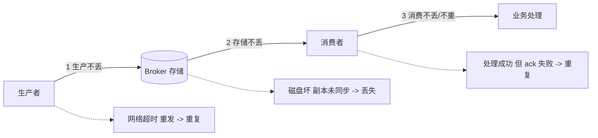

**可靠性 = 生产端确认 + Broker 端副本/刷盘 + 消费端手动确认 + 全链路幂等 + 重试/死信 + 监控告警。**

## 7.2 三大使用场景（不要背概念，要能举例）

| 场景 | 例子 | 关键设计 |
|---|---|---|
| **解耦** | 下单后要发短信、加积分、建工单 | 事件驱动 + 下游独立扩缩容 |
| **异步** | 支付成功后异步通知、异步生成报表 | 主链路 RT 降低，但需最终一致 |
| **削峰填谷** | 秒杀 10 万 QPS → 队列 → 下游 1 千 TPS 消费 | 队列积压能力 + 消费限速 + 快速失败 |

> **反面认知**：MQ 不是"性能银弹"。引入 MQ 会增加：一次网络写、序列化、运维成本、**最终一致的复杂度**、**排查链路变长**。简单同步调用能撑住就别上 MQ。

## 7.3 Kafka 深度

### 7.3.1 架构与存储模型

```mermaid
flowchart TB
    subgraph Topic["Topic: order-events (3 分区)"]
      P0[Partition0 Leader=Broker1]
      P1[Partition1 Leader=Broker2]
      P2[Partition2 Leader=Broker3]
    end
    Prod[Producer] --> P0
    Prod --> P1
    Prod --> P2
    P0 --> C1[Consumer Group A - C1]
    P1 --> C2[Consumer Group A - C2]
    P2 --> C3[Consumer Group A - C3]
```

- **分区（Partition）**：并行度与顺序性的单位。**分区内有序，跨分区无序**。
- **Segment 文件**：每个分区由多个 `log segment`（`.log` + `.index` + `.timeindex`）组成，**顺序追加写**。
- **零拷贝**：消费时用 `sendfile`，数据从 **page cache 直接到网卡**，不经用户态（详见第 13 章）。
- **页缓存为王**：Kafka 不靠 JVM 堆缓存，而靠 OS page cache（这也是它比"内存队列"更能扛的原因）。
- **稀疏索引**：`.index` 每 N 条记录一个偏移量索引 → 二分查找定位 segment 内位置。

### 7.3.2 ISR、HW、LEO（必考，且最容易讲错）

| 概念 | 定义 |
|---|---|
| **LEO（Log End Offset）** | 每个副本"下一条要写"的位置 |
| **HW（High Watermark）** | **ISR 中所有副本 LEO 的最小值** = 消费者能看到的最大 offset |
| **ISR** | 与 Leader 保持同步的副本集合（默认 `replica.lag.time.max.ms = 30s` 内追上 LEO） |
| **LSO（Last Stable Offset）** | 事务场景下，未完成事务前的最后稳定 offset（read_committed 消费的上界） |

```text
Leader   LEO=10  HW=8
Follower1 LEO=8
Follower2 LEO=9
-> HW = min(10,8,9) = 8  (消费者最多读到 offset 7)
-> Follower1 若 30s 追不上 -> 踢出 ISR -> HW 可能变成 9
```

> **为什么 HW 必须取 ISR 最小值**：因为只有所有 ISR 都有的数据，才保证"主挂了切到任意 ISR 副本都不丢"。

### 7.3.3 acks 与不丢数据的三件套

| 配置 | 含义 | 风险 |
|---|---|---|
| `acks=0` | 发出去就不管 | 网络/Leader 挂都丢 |
| `acks=1` | 等 Leader 落盘（默认） | **Leader 挂且未同步 → 丢** |
| `acks=all(-1)` | 等 **ISR 全部** 落盘 | 最安全，延迟最高 |

**不丢数据的完整组合（必须一起说）**：

```properties
acks=all
replication.factor >= 3
min.insync.replicas = 2
unclean.leader.election.enable = false
enable.idempotence = true
```

- `min.insync.replicas=2` + `acks=all`：ISR 少于 2 时，**写入直接失败**（`NotEnoughReplicasException`），而不是"降级到 1 个副本"。
- `unclean.leader.election.enable=false`：**禁止从非 ISR 副本选主**。若允许（true），可用性提升但**会丢数据**（因为落后副本可能缺最新的 offset）。这就是 CP/AP 的开关。

> **延伸：KIP-101 Leader Epoch 解决 HW 截断问题**
> 老版本 Kafka 用 HW 判断副本是否一致，存在"follower 重启后按 HW 截断日志，反而截掉了其实已提交的数据"的问题。
> 解法：引入 **leader epoch（leader 任期编号）+ 每个 epoch 的 start offset**，follower 恢复时向 Leader 请求"该 epoch 的 start offset"，精确决定截断位置。**这与 Raft 的 term 思想完全一致**——用任期编号解决"谁的数据更新"。

### 7.3.4 幂等生产者与事务

**幂等生产者**（`enable.idempotence=true`，现代客户端默认开）：

- 生产者持有 `PID`（Producer ID）+ `epoch` + 每条消息的**单调序列号 seq**；
- Broker 按 `(PID, topic, partition)` 缓存最近 seq → 重复 seq 直接丢弃 → **消除"重试导致的重复"**；
- 局限：**只保证单生产者会话内**（PID 变了就失效）、只在 Kafka 内部。

**事务**（`transactional.id`）：

```java
producer.initTransactions();
producer.beginTransaction();
producer.send(record1);            // 可跨多个 topic-partition
producer.send(record2);
producer.sendOffsetsToTransaction(offsets, consumerGroupId); // 提交消费位点
producer.commitTransaction();      // 原子提交
```

- **两阶段**：先写事务标记到内部 topic（`__transaction_state`），全部成功后才"标记为 committed"；
- 消费者 `isolation.level=read_committed` → 只读已提交消息，且**读不到未完成事务的消息**（会用 LSO 挡住）。

### 7.3.5 "Exactly Once" 的真相（高频陷阱）

| 层级 | 能否 exactly once | 说明 |
|---|---|---|
| 生产端重试 | ✅（幂等生产者） | 靠 PID+seq 去重 |
| Kafka 内部流转 | ✅（事务） | 多分区原子写 + 原子提交位点 |
| **Kafka → 外部系统**（DB、HTTP、发券） | ❌ **不能** | 一旦副作用离开 Kafka，无法回滚；只能"至少一次 + 下游幂等" |

**实现端到端 EOS 的正确姿势**：

1. 消费 → 处理 → 生产，**把 offset 提交放进同一个 Kafka 事务**（Kafka Streams 的 `exactly_once_v2` 就是这么做的）；
2. 若输出到外部 DB：**业务表里存 offset/消息ID + 业务数据，同一本地事务**（"事务性发件箱"模式），再异步同步；
3. 兜底：**唯一键 + 幂等 + 对账**。

### 7.3.6 顺序性

- **只有分区内有序**。要保证"同一订单的消息有序" → **用 orderId 作为 key**（`key.hash % partitions` 固定落同一分区）；
- 分区数一旦扩大，**key 的映射会变** → 历史顺序被打破（所以"扩分区"要谨慎，或按业务时间切新 topic）；
- 消费端：**一个分区只能被同一消费组的一个消费者消费**（否则无法保证顺序）→ 单分区多线程消费会乱序；要并发处理又保序，需要"按 key 分派到内存队列/单线程执行器"。

### 7.3.7 Rebalance（重平衡）：最常见的生产事故源

- 触发：消费者加入/离开、心跳超时、分区数变化、订阅变化。
- 过程（经典协议）：**所有消费者停止消费 → 重新分配分区 → 恢复消费**，期间整个消费组**停止服务**（"stop-the-world"）。
- 常见诱因：`session.timeout.ms` 太短 + 消费处理慢（超过 `max.poll.interval.ms` 被踢）→ 反复 rebalance。
- 缓解：
  - 加大 `max.poll.interval.ms`、减小 `max.poll.records`；
  - 静态成员（`group.instance.id`）减少重启抖动；
  - 新协议 **KIP-848**（增量协作式 rebalance，不再全员停止）。

## 7.4 RocketMQ 深度

### 7.4.1 存储模型（与 Kafka 的核心差异）

```text
CommitLog（所有 topic 混合顺序写，单一文件追加）
   ↓ 异步分发（dispatch）
ConsumeQueue（每个 topic-queue 一个，存 offset+size+tagHash，纯内存映射小文件）
   ↓
IndexFile（按 key / tag 建索引，支持按 messageId 查询）
```

- **所有 topic 共享一个 CommitLog** → 顺序写极致（这是 RocketMQ 高吞吐的关键）；
- ConsumeQueue 很小（每条 20B），可全量 mmap 到内存 → 消费定位极快；
- 代价：**写 CommitLog 与分发 ConsumeQueue 有延迟**（异步刷盘/异步分发时有"写成功但暂时查不到"的窗口）。

### 7.4.2 刷盘与复制（可靠性开关）

| 配置 | 行为 | 风险 |
|---|---|---|
| **同步刷盘**（SYNC_FLUSH） | 消息写入 page cache 后立即 `fsync` 才返回成功 | 最安全，TPS 下降（尤其机械盘） |
| **异步刷盘**（ASYNC_FLUSH，默认） | 写 page cache 就返回，后台线程定期刷 | 宕机可能丢最后一段 |
| **同步双写**（SYNC_MASTER） | 主写完 + 从写成功才返回 | 主从都宕才丢，延迟高 |
| **异步复制**（ASYNC_MASTER，默认） | 主写完即返回，异步同步到从 | 主挂可能丢未同步消息 |
| **DLedger（Raft）模式** | 基于 Raft 的多副本 | 强一致，成本更高 |

> **组合建议**：一般业务 `异步刷盘 + 异步复制`（性能）；资金类 `同步刷盘 + 同步双写`。

### 7.4.3 事务消息（已在 5.8.2 详述）

补充两个细节：

- **回查次数与间隔可配**（`transactionCheckMax`），超限进"死信/人工处理"；
- 生产者必须实现 `checkLocalTransaction`，且**要能查到"事务是否执行"的持久化记录**（不能靠内存）。

### 7.4.4 重试、死信与顺序消息

| 机制 | 说明 |
|---|---|
| **消费重试** | 失败返回 `RECONSUME_LATER` → 进入 `%RETRY%消费组` 重试 topic，按等级递增延迟（10s/30s/1m/2m/…/2h，默认 16 次） |
| **死信队列（DLQ）** | 超过最大重试 → 进 `%DLQ%消费组`，只能人工/补偿任务处理 |
| **顺序消息** | 生产：`MessageQueueSelector` 按业务 key 选队列；消费：`MessageListenerOrderly`（**单队列单线程 + 本地锁**） |
| **延迟消息** | 老版本：固定 18 个延迟级别（1s~2h）；5.x：基于时间轮的**任意时间延迟** |
| **消息堆积** | 消费跟不上 → CommitLog 写满 → **生产端被阻塞**（不是无限堆积！这点常被答错） |

### 7.4.5 消息堆积的处理（实战题）

| 情况 | 方案 |
|---|---|
| 消费逻辑慢 | 扩消费者（≤ 分区/队列数）、优化慢 SQL/加批处理 |
| 分区/队列不够 | **扩队列**（RocketMQ 可在线加队列；Kafka 扩分区会破坏 key 顺序，需谨慎） |
| 突发流量 | 临时"转存"：起一个临时消费者把消息搬到新 topic，用更多分区并行消费（"扩容 + 中转"经典操作） |
| 大量无效消息 | 直接跳过（调整 offset）+ 事后补数据 |
| 消费端死循环 | 快速失败 + 死信隔离，避免一条消息卡死整个分区 |

## 7.5 RabbitMQ 补充（选型对比时会问）

- **模型**：Exchange（direct/topic/fanout/headers）+ Queue + Binding；**路由灵活**是它相对 Kafka 的优势。
- **可靠性**：`publisher confirm`（生产确认）+ `durable queue` + `persistent message` + 消费手动 ack。
- **镜像队列 vs Quorum Queue**：老镜像队列在主从同步上有"网络分区导致脑裂/不一致"问题；**Quorum Queue 基于 Raft**，是现在推荐方案。
- **prefetch**：`basicQos(prefetchCount)` 控制单消费者未 ack 的消息数（太小吞吐低，太大会不均衡）。
- 适合：**低延迟、复杂路由、中小吞吐**；不适合超大规模日志流（吞吐不如 Kafka）。

## 7.6 三大 MQ 对比

| 维度 | Kafka | RocketMQ | RabbitMQ |
|---|---|---|---|
| 吞吐 | 极高（十万~百万级） | 高（万~十万级） | 中（万级） |
| 延迟 | ms 级（批量） | **亚 ms ~ ms** | **亚 ms**（最低） |
| 顺序 | 分区内 | 队列内 | 队列内 |
| 事务消息 | 支持（内部事务 + 位点） | **原生事务消息（半消息+回查）** | 不支持（需业务实现） |
| 延迟消息 | 不支持（需外挂） | **原生支持** | 靠插件 |
| 路由灵活度 | 弱（只有 topic） | 中（tag 过滤） | **强（多种 exchange）** |
| 运维复杂度 | 高（分区/副本/controller） | 中 | 低 |
| 典型场景 | 日志、埋点、流计算、大数据 | 电商交易、订单、金融 | 业务解耦、RPC 异步化、中小系统 |

## 7.7 可靠性设计清单（可直接抄进方案）

1. **生产端**：同步发送 + 重试（有限次 + 退避）+ 本地消息表/事务消息兜底；
2. **Broker**：多副本（RF≥3）+ `min.insync.replicas=2` + 关闭 unclean 选主 + 同步刷盘（关键 topic）；
3. **消费端**：手动 ack / 处理成功再提交 offset + **幂等** + 有限重试 + 死信队列 + 告警；
4. **监控**：**消费延迟（lag）**、堆积量、失败率、死信量、rebalance 次数；
5. **兜底**：定时对账任务，扫"状态长期中间态"的记录（如"支付中超过 5 分钟"）。

## 7.8 常见误区

- ❌ "`acks=all` 就一定不丢" —— 还要 `min.insync.replicas≥2` 且 `unclean.leader.election=false`。
- ❌ "Kafka 支持 exactly once" —— 只在 Kafka 内部；出 Kafka 必须幂等。
- ❌ "消费者多就能提吞吐" —— 超过分区数就是浪费；单分区只能一个消费者。
- ❌ "RocketMQ 堆积无限" —— CommitLog 满了会阻塞生产。
- ❌ "消息重复是 MQ 的 bug" —— 至少一次投递必然重复，幂等是业务责任。

---

# 第 8 章 负载均衡

## 8.1 一句话本质

**负载均衡 = 在"多个等价的后端实例"之间，用一个决策规则把请求分出去，从而把负载摊平、把故障隔离。**

它解决三件事：**横向扩展（加机器就加能力）**、**故障屏蔽（摘掉坏实例）**、**流量治理（权重、灰度、限流）**。

## 8.2 分层：DNS → 四层 → 七层

```mermaid
flowchart TB
    U[用户] --> DNS[DNS / GSLB 全局负载均衡<br/>按地域/运营商调度]
    DNS --> L4[LVS / F5 四层<br/>按 IP+端口转发]
    L4 --> L7[Nginx / Gateway 七层<br/>按 URL/Header 路由]
    L7 --> S1[服务A 实例1]
    L7 --> S2[服务A 实例2]
    L7 --> S3[服务A 实例3]
```

| 层次 | 依据 | 典型组件 | 特点 |
|---|---|---|---|
| **DNS/GSLB** | 域名、地域、运营商、健康状态 | DNS、阿里云 GSLB | 粒度粗、有缓存（TTL 生效慢）、成本最低 |
| **四层（L4）** | IP + 端口 + 协议（TCP/UDP） | LVS、F5、HAProxy（TCP 模式） | **不改报文内容**、性能极高（百万级 CPS）、不做内容路由 |
| **七层（L7）** | HTTP URL、Header、Cookie、gRPC method | Nginx、Envoy、Gateway、APISIX | 功能强（灰度/鉴权/改写）、性能较低（要解析协议、维护连接） |

> **底层差异（关键）**：
> - **L4 只做连接转发**，内核态/DPDK 就能干，几乎无解析开销；
> - **L7 要"终止 TCP 连接 + 解析 HTTP"**，是"代理"而不是"转发"，所以有额外的内存拷贝 + 协议解析，还得维护"客户端连接 × 后端连接"两套连接池。

## 8.3 LVS 的三种模式（面试常考）

| 模式 | 原理 | 回包路径 | 优缺点 |
|---|---|---|---|
| **NAT** | 改目的 IP（DNAT）→ 后端；回包经 LVS 改回源 IP | **必须经过 LVS** | 实现简单，但 LVS 成为带宽瓶颈（回包也走它） |
| **DR（直接路由）** | 只改**目的 MAC**（二层），IP 不变；后端用**VIP + 特殊配置**直接回包给客户端 | **不经过 LVS**（后端直接回客户端） | **性能最高**（回包绕过 LVS），但要求同二层网络、后端要配 VIP/ARP 抑制 |
| **TUN（IP 隧道）** | 在原 IP 包外再包一层 IP，后端解包后处理，回包直接回客户端 | 不经过 LVS | 可跨机房，但有隧道开销、MTU 问题 |

> **DR 的核心细节**：后端机器的网卡要"接受目的 IP 为 VIP 的包但不回 ARP"（`arp_ignore=1, arp_announce=2`），并配置 VIP 到 loopback。这就是"为什么后端也能回包给客户端"的原因。

## 8.4 负载均衡算法

| 算法 | 原理 | 适用 | 缺点 |
|---|---|---|---|
| **轮询（RR）** | 依次分发 | 实例性能一致、无状态 | 忽略负载差异 |
| **加权轮询（WRR）** | 按权重比例分发 | 机器配置不同 | 静态权重，无法感知实时负载 |
| **平滑加权轮询（Nginx 默认）** | 每次选"当前权重最大"的，选后减去总权重 | 避免突发集中 | — |
| **随机 / 加权随机** | 随机选 | 大规模、近似均匀 | 小规模波动大 |
| **最少连接（Least Connections）** | 选当前活跃连接最少的 | 长连接、请求耗时差异大 | 需维护连接数（有状态） |
| **最少活跃（Least Active）** | 选"正在处理请求数最少"的 | RPC 场景（Dubbo 默认之一） | 需统计在途请求 |
| **最短响应时间** | 选平均 RT 最小的 | 后端性能不均 | 易"抖动放大"（慢的越没请求越慢） |
| **一致性哈希** | 同 key 落同实例 | 缓存命中、会话粘性 | 扩缩容迁移、热点 |
| **源地址哈希** | 按客户端 IP | 简单会话保持 | NAT 后大量用户同 IP → 倾斜 |

### 平滑加权轮询的实现（能手写就是加分）

```java
// 每个实例维护 weight(配置) 和 currentWeight(动态)
for (Node n : nodes) {
    n.currentWeight += n.weight;      // 每个都加上自己的权重
    pick = max(currentWeight);         // 选最大的
    pick.currentWeight -= totalWeight; // 被选的减总权重
}
// 结果序列: A B A C A B A (权重 A=5,B=1,C=1 时仍平滑)
```

## 8.5 健康检查（决定"摘不摘"）

| 类型 | 原理 | 缺陷 |
|---|---|---|
| **TCP 探活** | 建连成功即健康 | 端口通 ≠ 业务通（进程活着但线程池满） |
| **HTTP 探活** | 请求 `/health` 返回 200 | 探测频率与灵敏度权衡 |
| **业务探活** | 检查依赖（DB/缓存）连通性 | 依赖抖动会导致**误摘**（连锁雪崩） |
| **被动探活** | 靠真实请求失败率判断 | 慢、有损（用户已经受影响） |

> **最佳实践**：**主动 + 被动结合**；探活接口**不要查重依赖**（否则依赖挂了会全量摘除）；摘除要**渐进**（先降权再摘），恢复要**预热**（避免冷启动打崩）。

## 8.6 会话保持（Sticky Session）

- **必要性**：有本地状态（session、本地缓存、上传分片）时才需要。
- 手段：Cookie 注入、源 IP 哈希、一致性哈希、**共享存储（Redis Session）**。
- **最佳实践**：**让服务无状态**（状态外置到 Redis/DB），从根上不需要会话保持 → 才能自由扩缩容、灰度、故障转移。

## 8.7 客户端负载均衡 vs 服务端负载均衡

| 类型 | 决策位置 | 代表 | 优点 | 缺点 |
|---|---|---|---|---|
| 服务端 | LB 代理 | Nginx、LVS、F5 | 客户端简单、集中治理 | 多一跳、LB 是瓶颈/单点 |
| 客户端 | 调用方进程内 | Ribbon、Dubbo、gRPC LB | **少一跳**、延迟低、可感知实例 | 每个客户端都要维护实例列表（服务发现） |

> **Dubbo 的默认策略**：`RandomLoadBalance`（加权随机）+ `FailoverClusterInvoke`（失败重试 2 次）；`LeastActiveLoadBalance` 用于"慢请求敏感"场景；`ConsistentHashLoadBalance` 用于"有状态/缓存"场景。

## 8.8 全局负载均衡（GSLB）与多活

- **DNS 轮询 / 按地域解析**：把用户导到最近机房；
- **HTTPDNS**：绕过 LocalDNS 劫持与缓存；
- **多活流量调度**：按"机房权重 + 容量水位 + 故障状态"动态分配（如 5% 探活流量）；
- **单元化（Set 化）**：用户按 UID 分片到不同单元，单元内闭环，跨单元只做异步同步 → 把"全局故障"降级为"局部故障"。

## 8.9 负载均衡的常见事故

| 事故 | 原因 | 预防 |
|---|---|---|
| 雪崩 | 所有实例同时被打满 → LB 仍继续分发 | **过载保护**（LB 侧限流/最大连接数） |
| 热点倾斜 | 一致性哈希 + 大 key | 虚拟节点、热点探测、二次打散 |
| 长连接不均 | 建连时均衡，运行中漂移 | 定期主动断开重连（`keepalive_time`）、最少连接算法 |
| 摘除过猛 | 健康检查失败率阈值太低 | 连续 N 次失败才摘、渐进降权 |
| 恢复打崩 | 一次全量恢复 | 慢启动（slow start）、预热权重 |

---

# 第 9 章 熔断、限流、降级、隔离

## 9.1 一句话本质

**这四件事都是在回答同一个问题：当下游扛不住时，如何让"局部故障"不扩散成"全局雪崩"。**

雪崩的因果链：

```mermaid
flowchart LR
    A[下游变慢] --> B[上游线程/连接被占满]
    B --> C[上游也开始变慢/超时]
    C --> D[上游的上游被拖垮]
    D --> E[重试放大流量]
    E --> F[全站不可用]
```

## 9.2 熔断（Circuit Breaker）

### 状态机（必背）

```mermaid
stateDiagram-v2
    [*] --> Closed
    Closed --> Open: 失败率/慢调用比例 超过阈值(窗口内)
    Open --> HalfOpen: 等待冷却时间(如 10s)结束
    HalfOpen --> Closed: 探测请求成功率达到阈值
    HalfOpen --> Open: 探测请求失败
```

| 状态 | 行为 |
|---|---|
| **Closed（关闭）** | 正常放行，统计失败率/RT |
| **Open（打开）** | **直接拒绝**（快速失败，不调下游），保护自己与下游 |
| **Half-Open（半开）** | 放**少量**探测请求，成功则关闭，失败则继续打开 |

### 统计窗口：为什么必须"滑动"

- **固定窗口**：`[0,60s)` 统计 → 窗口边界"突刺"（60s 前一秒打满失败率也不会熔断，下一秒全失败会立刻熔断）。
- **滑动窗口**：
  - **基于时间桶**（Sentinel 默认）：把 1s 切成 2 个 500ms 桶，滚动统计；
  - **基于滑动日志**：记录每次调用的时间戳，精确但内存高（LeapArray 用环形数组平衡）。

### 熔断的触发条件（不是只有"失败率"）

1. **异常比例**（如 50%）；
2. **异常数**（绝对数量，低流量时更敏感）；
3. **慢调用比例**（RT > 阈值的请求占比，Sentinel 1.8+ 支持）—— **这是最实用的**，因为"变慢"往往先于"报错"。

### 关键参数与陷阱

| 参数 | 建议 | 说明 |
|---|---|---|
| 最小请求数 | 10~20 | 样本太少时不要熔断（避免抖动误判） |
| 冷却时间 | 5~30s | 太短 → 反复探测打崩下游；太长 → 恢复慢 |
| 半开探测数量 | 1~5 | 太多会二次打崩 |
| 熔断粒度 | **按接口/按依赖**（不是按实例） | 一个依赖挂了只影响用到它的接口 |

> **延伸：熔断 vs 重试的关系（反直觉）**
> 熔断打开时，**重试必须停止**，否则重试流量会持续打到下游（"重试风暴"）。所以重试策略要"感知熔断状态"，且**只对"可重试错误"（超时/5xx/连接失败）重试，不对"业务错误"（参数错误/4xx）重试**。

## 9.3 限流（Rate Limiting）

### 四种算法对比

| 算法 | 原理 | 突发流量 | 平滑度 | 实现 |
|---|---|---|---|---|
| **固定窗口计数器** | 每窗口计数，超阈值拒绝 | 允许 2 倍突刺（窗口边界） | 差 | 最简单（Redis INCR + EXPIRE） |
| **滑动窗口** | 按时间切片滚动统计 | 较平滑 | 较好 | 环形数组/Redis ZSET |
| **漏桶（Leaky Bucket）** | 请求入桶，**恒定速率**流出，桶满则拒 | **完全削平**（不允许突发） | 最好 | 队列 + 定时消费 |
| **令牌桶（Token Bucket）** | 以恒定速率放令牌，桶容量 = 允许突发量 | **允许一定突发**（桶容量） | 好 | Guava `RateLimiter`、Sentinel |

> **一句话记忆**：**漏桶管"流出速率"（整形），令牌桶管"平均速率 + 突发容量"（限速）**。互联网业务多用令牌桶（能吸收突发），网关防护多用漏桶（要严格平滑）。

### 令牌桶的底层实现（Guava RateLimiter 的"预消费"思想）

不做定时器放令牌，而是**计算"下次可用的时间"**：

```text
nextFreeTicketMicros += (需要令牌数 / rate) * 1e6
// 请求到来时，若 now >= nextFreeTicketMicros 则直接通过；
// 否则 sleep 等待（或立即返回 false = tryAcquire）
// 支持"预支"未来令牌 -> 一波突发能被平滑到未来（代价是后续请求等待）
```

这是**"用算术代替定时器"**的经典优化——没有后台线程、无锁、O(1)。

### 分布式限流

| 方案 | 原理 | 优点 | 缺点 |
|---|---|---|---|
| **Redis + Lua** | `INCR` + `EXPIRE` 或 ZSET 滑动窗口，Lua 保证原子 | 全局精确 | 每次限流一次 Redis RTT（热点 key） |
| **Redis + 令牌桶脚本** | Lua 里计算 tokens 与 last_time | 精确 + 支持突发 | 同上，时钟依赖 |
| **分片限流** | 每台机器限 `QPS/N`，本地令牌桶 | 无网络开销 | 总量不精确（机器数变化/流量倾斜） |
| **集群总量 + 本地配额** | 中心按实例分配配额，本地令牌桶执行 | 兼顾性能与精度 | 配额调整有延迟 |
| **网关/Service Mesh 层限流** | Envoy/Sentinel 在入口做 | 保护后端，早拒绝 | 粒度较粗 |

**Redis 令牌桶 Lua（简化）**：

```lua
local key, rate, capacity, now = KEYS[1], tonumber(ARGV[1]), tonumber(ARGV[2]), tonumber(ARGV[3])
local data = redis.call('HMGET', key, 'tokens', 'ts')
local tokens = tonumber(data[1]) or capacity
local ts = tonumber(data[2]) or now
tokens = math.min(capacity, tokens + (now - ts) * rate)   -- 按时间补充
if tokens < 1 then return 0 end
redis.call('HMSET', key, 'tokens', tokens - 1, 'ts', now)
return 1
```

### 限流的维度

- **按调用方**（appId/uid/租户）—— 防止单租户打爆；
- **按接口**（URL/method）—— 保护热点接口；
- **按资源**（DB 连接、线程池）—— 保护性限流；
- **按优先级**（核心业务保底配额，非核心可牺牲）。

> **限流 vs 降级 vs 熔断的区别（一句话）**：
> - **限流**：主动控制**进来的量**（入口）；
> - **熔断**：被动切断**出去的调用**（出口）；
> - **降级**：主动降低**服务的能力**（返回兜底）。

## 9.4 降级（Degradation）

| 类型 | 做法 | 例子 |
|---|---|---|
| **读降级** | 返回缓存/默认值/空数据 | 推荐位挂了 → 返回运营兜底列表 |
| **写降级** | 转为异步（写 MQ 稍后处理） | 下单高峰 → 订单先入队，稍后落库 |
| **功能降级** | 关闭非核心功能 | 大促关闭"猜你喜欢"、评论、积分 |
| **页面降级** | 静态兜底页 | 商品详情挂了 → 返回静态页 |
| **强弱依赖分级** | 核心链路只依赖强依赖 | 下单不能依赖"推荐""评价" |

> **降级的核心方法论**：**提前做"依赖分级"（强/弱/可无）**，并在代码里用"可降级开关"包裹。事后临时降级一定会手忙脚乱。

## 9.5 隔离（Bulkhead / 舱壁模式）

| 隔离方式 | 原理 | 例子 |
|---|---|---|
| **线程池隔离** | 每个依赖独占线程池，满了就快速失败 | Hystrix 默认 |
| **信号量隔离** | 限制并发数（计数器），不切换线程 | Sentinel、Resilience4j |
| **连接池隔离** | 每个下游独立连接池 | HTTP 客户端按域名分池 |
| **进程/容器隔离** | 不同业务部署到不同实例 | 核心与非核心分开部署 |
| **集群隔离** | 不同租户/业务用不同集群 | 多租户 SaaS |
| **数据隔离** | 分库分表、按业务拆库 | 防止大表拖垮全库 |

> **线程池隔离 vs 信号量隔离（必考）**：
> - 线程池：**能真正"超时中断"**（future.get(timeout)），但线程切换开销大、线程数爆炸；
> - 信号量：**轻量**（不切线程），但**无法中断正在执行的阻塞调用**（只能控制并发数）。
> → 因此 Sentinel 默认用信号量（RPC 是异步/短耗时），Hystrix 用线程池（要支持超时熔断）。

## 9.6 超时、重试、幂等：三件套

### 超时

- **必须设置**（连接超时 + 读超时），且**逐层递减**（上游超时 < 下游超时，避免"上游已放弃但下游还在算"）；
- 超时值基于 **P99.9**，不是平均值。

### 重试

| 要点 | 说明 |
|---|---|
| 只重试**幂等 + 可重试**的操作 | 非幂等写（创建订单）重试会导致重复 |
| **指数退避 + 抖动（jitter）** | `sleep = base * 2^n + random()`，避免"重试同步"造成尖峰 |
| **限制重试次数与总时长** | 3 次 / 总时间 < 上游超时 |
| **重试预算（Retry Budget）** | 全局限流：重试流量不超过正常流量的 10% |
| **禁止在链路多层重试** | A→B→C 每层重试 3 次 = 27 倍流量（"重试放大"） |

### 幂等

见 5.10。核心：**唯一键 + 状态机 + 结果缓存**。

## 9.7 雪崩的完整防护体系

```mermaid
flowchart TB
    A[入口: 限流/排队/削峰] --> B[调用: 超时/重试预算/熔断]
    B --> C[资源: 线程池隔离/连接池隔离]
    C --> D[兜底: 降级/缓存/默认值]
    D --> E[观测: 监控/告警/压测]
```

**四道防线的顺序不能反**：先**限流**（不让过量进来），再**隔离**（不让一个依赖拖垮全部），再**熔断**（快速失败），最后**降级**（有可用结果）。

## 9.8 常见误区

- ❌ "熔断阈值越低越好" —— 太低会频繁误熔断，反而降低可用性。
- ❌ "限流只在网关做" —— 网关只能防"入口流量"，防不了"内部服务间的放大调用"（需要 Sentinel/ Mesh 层）。
- ❌ "降级就是 try-catch 返回 null" —— 降级要有**业务可接受的兜底语义**，返回 null 可能导致上游 NPE 二次故障。
- ❌ "重试能提高成功率" —— 在过载场景，重试是**放大器**，会让故障从"部分失败"变成"完全雪崩"。
- ❌ "线程池隔离一定更好" —— 高 QPS 短耗时场景下线程池开销占比很高，信号量更合适。

---

# 第 10 章 微服务

## 10.1 一句话本质

**微服务 = 把"一个进程内的模块调用"，变成"跨进程的网络调用 + 独立部署 + 独立数据"，用运维复杂度换取"独立扩展、独立发布、故障隔离"。**

```mermaid
flowchart LR
    subgraph Mono["单体"]
      M[订单+库存+支付+用户 一个进程 一个库]
    end
    subgraph Micro["微服务"]
      O[订单服务/订单库] --- I[库存服务/库存库]
      O --- P[支付服务/支付库]
      O --- U[用户服务/用户库]
    end
```

## 10.2 演进路径与动因

| 阶段 | 形态 | 痛点 |
|---|---|---|
| 单体 | 一个 war 包 | 代码耦合、发布互相阻塞、无法按模块扩容 |
| SOA | 引入 ESB/服务总线（重协议，如 SOAP/WS） | 总线成为瓶颈、协议重、厂商绑定 |
| 微服务 | 轻量 HTTP/RPC + 独立部署 + 注册发现 | 运维复杂、分布式事务、链路排查难 |
| Service Mesh | 治理能力下沉到 sidecar（Istio） | 资源开销、运维门槛 |
| 单体回归（Modular Monolith） | 一个部署单元、清晰模块边界 | 取舍：不追求"独立部署"，但要"边界清晰" |

> **重要认知**：**微服务的收益主要在"组织"（团队自治、独立发布），而不是"技术性能"**。很多公司拆完发现：内部调用变成网络调用，延迟上升、故障点变多、事务变复杂，最后又"合并"（Shopify、Amazon 部分回退到"模块化单体"）。**拆分的前提是：团队规模 > 单个代码库能协作的极限，或模块的伸缩需求差异极大。**

## 10.3 拆分原则

### DDD（领域驱动设计）与限界上下文

- **限界上下文（Bounded Context）**：一个词（如"订单"）在某个边界内含义唯一；跨边界要"翻译"。
- **聚合（Aggregate）**：强一致的最小单元（订单 + 订单项 应在一个服务、一个库）。
- **拆分依据**：业务能力（不是技术分层）、数据一致性边界、变更频率、伸缩需求。

### 康威定律

> "系统架构必然反映组织的沟通结构。"

如果团队按"前端/后端/DBA"划分，硬拆成"订单/库存/支付"服务，会因为**跨团队沟通成本**导致服务边界混乱。**先调组织，再调架构**。

### 拆分反模式

| 反模式 | 症状 |
|---|---|
| **按技术分层拆**（Controller/Service/DAO 各一个服务） | 每个请求要跨 3 个服务 → 延迟爆炸 |
| **分布式单体** | 服务间强耦合、共享数据库、必须一起发布 → 只获得了"网络调用"的缺点 |
| **过度细粒度** | 一个服务只有 1 张表 / 1 个接口，运维成本远大于收益 |
| **共享数据库** | 事实上的"分布式单体"：改表结构要协调多个团队 |
| **贫血领域模型** | 只有数据没有行为，业务逻辑散落在各服务 |

## 10.4 服务注册与发现

| 组件 | 一致性模型 | 特点 |
|---|---|---|
| **Eureka** | AP | 客户端缓存 + 心跳，简单，适合小规模；已停止维护 |
| **Consul** | CP（Raft）+ Gossip | 多数据中心、健康检查强 |
| **Nacos** | **AP/CP 可切换**（Distro 协议 / Raft） | 阿里开源，配置中心 + 注册中心，国内主流 |
| **ZooKeeper** | CP（ZAB） | 强一致，但写性能有限 |
| **etcd** | CP（Raft） | 云原生、K8s 生态 |

### Nacos 的 AP/CP 切换（面试延伸）

- **临时实例**（默认）：走 **Distro 协议**（自研 AP 协议），各节点异步复制，快速、可扩展，但**可能读到旧实例列表**；
- **持久化实例**：走 **Raft（CP）**，强一致，适合"必须精确"的场景；
- 客户端通过**本地缓存 + 订阅推送**降低对注册中心的依赖（注册中心挂了也能用旧列表调一段时间）。

## 10.5 服务间通信

| 协议 | 传输 | 序列化 | 特点 |
|---|---|---|---|
| **REST/HTTP1.1** | TCP | JSON | 通用、易调试；队头阻塞、无多路复用 |
| **gRPC** | **HTTP/2** | Protobuf | 多路复用、流式、低延迟、强类型；调试成本高 |
| **Dubbo** | TCP（Netty） | Hessian/Protobuf | 高性能、治理能力强；生态偏 Java |
| **Thrift** | TCP | Thrift IDL | 跨语言、成熟 |

### gRPC 为什么快（底层）

1. **HTTP/2 多路复用**：一个 TCP 连接上并发多个请求（stream id），没有 HTTP/1.1 的队头阻塞；
2. **Protobuf 二进制 + IDL**：体积比 JSON 小 3~10 倍，解析无需反射（编译期生成代码）；
3. **Header 压缩（HPACK）**：重复 header 只传索引；
4. **连接复用**：长连接 + keepalive，省去 TCP/TLS 握手。

> **注意**：gRPC 的"多路复用"在**单个 TCP 连接**上共享带宽 → 一个大响应会阻塞同连接的其他流（"流级队头阻塞"仍在 TCP 层）。所以 gRPC 也建议**多连接 + 流控**。

## 10.6 服务治理的关键能力

| 能力 | 说明 | 组件 |
|---|---|---|
| **注册发现** | 实例上下线 | Nacos/Consul |
| **配置管理** | 动态配置、灰度开关 | Nacos/Apollo |
| **路由与负载** | 权重、灰度、就近 | Gateway/Dubbo |
| **熔断限流** | 见第 9 章 | Sentinel/Resilience4j |
| **链路追踪** | 见第 12 章 | SkyWalking/OTel |
| **契约测试** | 服务间接口契约 | Pact |
| **API 版本管理** | 兼容性 | 版本号/兼容字段 |
| **容量与压测** | 全链路压测 | JMeter/自研 |

## 10.7 微服务的数据一致性难题

- **每个服务一个库** → 跨服务无法用本地事务 → 必须用第 5 章方案；
- **跨服务查询** → 用"API 组合（BFF 层聚合）"、"数据冗余（宽表）"、"CQRS（读写分离模型）"、"ES 二级索引"；
- **跨服务 Join** → 尽量在**写入时冗余**，而不是查询时 Join。

> **CQRS 延伸**：写模型（Command）与读模型（Query）分离，写库负责一致性，读库（物化视图/ES）负责查询性能，中间用事件同步 → 天然最终一致、读写各自优化。

## 10.8 微服务的"隐性成本"清单（面试答"缺点"就用这个）

1. **网络不可靠**：原本不会失败的调用现在会超时；
2. **事务变复杂**：从 ACID 变最终一致 + 补偿 + 对账；
3. **排查变难**：一个请求跨 8 个服务，需要链路追踪；
4. **部署运维成本**：N 个服务 × M 个环境 × 版本矩阵；
5. **资源开销**：每个服务独立 JVM/容器，内存放大；
6. **数据一致性/重复**：跨服务冗余数据难以同步；
7. **版本兼容**：上游升级不能要求所有下游同时升级（必须"向后兼容 + 双写过渡"）。

---

# 第 11 章 网关

## 11.1 一句话本质

**网关 = 所有外部流量的"唯一入口"，在这里集中做"路由、鉴权、限流、协议转换、可观测"等横切关注点。**

它和"负载均衡"的关系：**负载均衡是网关的一项能力，但网关的职责远不止于此。**

| 能力 | 负载均衡（Nginx/LVS） | API 网关 |
|---|---|---|
| 流量分发 | ✅ | ✅ |
| 动态路由（按服务/版本） | 需改配置 | ✅ 配置中心驱动 |
| 认证鉴权（JWT/OAuth） | 弱 | ✅ 核心职责 |
| 限流/配额（按 appId） | 基础 | ✅ 精细 |
| 协议转换（HTTP→Dubbo/gRPC） | ❌ | ✅ |
| 请求/响应改写、聚合 | 有限 | ✅ |
| 灰度发布、镜像流量 | 弱 | ✅ |
| 审计日志、计费 | ❌ | ✅ |

## 11.2 网关的典型架构位置

```mermaid
flowchart LR
    U[客户端 App/Web/开放平台] --> WAF[WAF / CDN]
    WAF --> GW[API 网关集群]
    GW --> R[路由/鉴权/限流/灰度]
    R --> S1[用户服务]
    R --> S2[订单服务]
    R --> S3[第三方开放接口]
    GW -.异步.-> LOG[日志/审计/计费]
```

## 11.3 Spring Cloud Gateway 原理（Java 系必考）

### 技术栈

- 基于 **Spring WebFlux + Reactor Netty**（**异步非阻塞**，少量线程扛大量连接）；
- 与 Zuul 1.x 的对比：Zuul 1 是**同步阻塞**（一个请求一个线程），高并发下线程耗尽；Gateway 是事件驱动。

### 核心组件

| 组件 | 作用 |
|---|---|
| `RoutePredicateHandlerMapping` | 根据 **Predicate（断言）** 匹配路由 |
| `RouteDefinition` | 路由定义（id、uri、predicates、filters） |
| `GatewayFilter` | 路由级过滤器（改写、重试、熔断） |
| `GlobalFilter` | 全局过滤器（鉴权、日志、TraceID） |
| `FilteringWebHandler` | 把过滤器串成**责任链**执行 |

### 请求处理流程

```text
Netty 收到请求
 -> HttpWebHandlerAdapter 包装成 ServerWebExchange
 -> RoutePredicateHandlerMapping 匹配 Route
 -> FilteringWebHandler 组装 FilterChain
 -> GlobalFilter + GatewayFilter 依次执行（pre 阶段）
 -> NettyRoutingFilter 发起对下游的请求（异步）
 -> NettyWriteResponseFilter 写回响应（post 阶段）
```

> **关键细节**：过滤器链是**洋葱模型**（pre 顺序执行，post 逆序执行），所以鉴权/日志放 GlobalFilter，改写放 GatewayFilter。

### 路由断言（Predicate）常用类型

`Path`、`Method`、`Header`、`Cookie`、`Query`、`Host`、`Weight`（**灰度权重**）、`After/Before/Between`（时间窗）、`RemoteAddr`（IP 白名单）。

## 11.4 网关的核心设计点

### 11.4.1 鉴权

- **JWT**：无状态，网关只验签 + 解析，不需查库（性能好）；缺点是**无法即时失效**（需配黑名单/短 TTL + refresh token）；
- **OAuth2 / OIDC**：网关做 token introspection（要查授权服务器，有额外 RTT，可缓存）；
- **签名（开放平台）**：`appId + timestamp + nonce + sign`，防重放（nonce 存 Redis + 时间窗校验）。

### 11.4.2 动态路由与配置

- 路由规则存 **Nacos/DB**，网关 watch 变更 → 内存路由表热更新（**不重启**）；
- 路由表用**前缀树（Trie）**匹配，支持通配符，O(路径长度)；
- 版本隔离：`/api/v1/order` 与 `/api/v2/order` 映射到不同服务实例。

### 11.4.3 灰度与流量染色

| 方式 | 说明 |
|---|---|
| 权重路由 | 10% 流量到新版本 |
| Header 路由 | 内部测试账号带 `X-Gray: 1` |
| 用户 ID 哈希 | 按 uid 哈希取模，保证同一用户始终走同一版本 |
| 镜像流量（Shadow） | 复制一份请求到新版本，只记录不返回（验证新版本） |

### 11.4.4 高可用

- 网关自身**无状态** → 多实例 + LB；
- 下游不可用 → **熔断 + 快速失败 + 兜底响应**；
- 配置中心不可用 → **本地快照兜底**（启动时落盘，故障时读本地）；
- 网关是"单点风险" → 必须有**降级方案**（直连备用入口）。

### 11.4.5 性能

| 优化 | 说明 |
|---|---|
| 异步非阻塞 | Netty/WebFlux，避免线程阻塞 |
| 连接池复用 | 对下游用 HTTP 连接池（keep-alive），省握手 |
| 零拷贝/响应流式 | 大文件走 `sendfile` / 流式转发 |
| 本地缓存 | 鉴权结果、路由表、限流计数本地化 |
| 避免同步 IO | 日志异步（Disruptor/RingBuffer） |

## 11.5 网关 vs 反向代理 vs 负载均衡 vs Service Mesh

| 概念 | 职责 | 典型 |
|---|---|---|
| 反向代理 | 代表后端接收请求、转发 | Nginx |
| 负载均衡 | 在多实例间分发 | LVS、Nginx upstream |
| API 网关 | 面向"API 治理"的入口（鉴权/限流/路由/协议） | Spring Cloud Gateway、Kong、APISIX |
| Service Mesh | 服务间**东西向**流量的治理（sidecar 代理） | Istio、Linkerd |

> **东西向 vs 南北向**：网关管**南北向**（外部→内部）；Service Mesh 管**东西向**（服务↔服务）。这是面试常问的概念区分。

## 11.6 常见误区

- ❌ "网关就是 Nginx" —— Nginx 是反向代理/负载均衡，缺少动态路由、鉴权、配额等治理能力。
- ❌ "网关做业务逻辑" —— 网关只做横切关注点，业务逻辑必须在服务里（否则网关变成"分布式单体"的新中心）。
- ❌ "网关限流就够了" —— 内部服务间调用也要限流（防止放大）。
- ❌ "JWT 无法注销所以不能用" —— 用短 TTL + refresh token + 黑名单可解决。

---

# 第 12 章 分布式链路追踪

## 12.1 一句话本质

**链路追踪 = 给每个请求打一个全局唯一 ID，并记录它在每个服务/每次调用中的"进入-离开"时间，从而把"一个请求穿过 N 个服务"重建成一棵可视化的调用树。**

没有它，微服务排障等于"在 8 个服务的日志里用时间戳猜"。

## 12.2 Dapper 模型（所有追踪系统的祖宗）

Google Dapper 论文定义的三个核心概念：

| 概念 | 含义 |
|---|---|
| **Trace** | 一次完整请求（一棵树），有全局唯一的 `TraceID` |
| **Span** | 一个工作单元（一次 RPC、一次 DB 查询、一次缓存访问），有 `SpanID` 和 `ParentSpanID` |
| **Annotation** | 时间点上的事件（如 `cs` 客户端发起、`sr` 服务端接收、`ss` 服务端发送、`cr` 客户端接收） |

```mermaid
flowchart TB
    T["TraceID = abc123"] --> S1["Span1 网关<br/>entry"]
    S1 --> S2["Span2 订单服务"]
    S2 --> S3["Span3 库存服务 RPC"]
    S2 --> S4["Span4 MySQL 查询"]
    S3 --> S5["Span5 Redis 访问"]
```

- **父子关系**用 `ParentSpanID` 表达 → 天然是一棵树（或 DAG）；
- **时间**用"相对于 Trace 起点的偏移（微秒）"，不用绝对时间（避免各机器时钟不同步）。

## 12.3 上下文传播（最核心的工程问题）

### 12.3.1 跨进程传播载体

| 协议 | 载体 |
|---|---|
| HTTP | Header：`traceparent`（W3C 标准）、`X-B3-TraceId`（Zipkin B3）、`X-Request-Id` |
| gRPC | **Metadata** |
| Dubbo | **Attachment（隐式参数）** |
| MQ | **消息 Header/Property**（生产端写入，消费端取出） |
| 数据库/缓存 | 一般不带（但在 SQL 注释里带上 traceId 方便关联慢查询） |

### W3C `traceparent` 格式（现在的事实标准）

```text
traceparent: 00-4bf92f3577b34da6a3ce929d0e0e4736-00f067aa0ba902b7-01
             版本 traceId(32位hex)           parentId(16位hex)  flags(采样)
```

> OTel（OpenTelemetry）默认用 W3C TraceContext，跨厂商兼容性最好。

### 12.3.2 跨线程传播（Java 的坑，面试高频）

- `ThreadLocal` **不能跨线程**传递 → 线程池复用线程时上下文丢失/串号；
- `InheritableThreadLocal` 只在**创建子线程时**继承一次 → **线程池里的线程是复用的，不会重新继承**；
- **`TransmittableThreadLocal`（TTL）**：阿里开源，通过**装饰 Runnable/Callable**（`TtlRunnable.get(task)`）在任务提交/执行时做上下文快照与回填 → 解决线程池透传；
- 框架层：SkyWalking/OTel 提供 `ContextSnapshot`、`cxt` 包装。

```java
// 典型错误：直接把 traceId 放 ThreadLocal，在线程池里就丢了
// 正确：使用 TTL 或手动 wrap
executor.submit(TtlRunnable.get(() -> {
    // 这里能拿到父线程的 traceId
}));
```

### 12.3.3 异步/响应式传播

- `CompletableFuture`：需要在回调处显式恢复上下文（`ContextSnapshot.wrap()`）；
- Reactor（WebFlux）：用 `Reactor Context`（`contextWrite`）而不是 ThreadLocal；
- 协程（Go/Kotlin）：`context.Context` 天然随调用链传递（Go 的优势）。

## 12.4 埋点方式

| 方式 | 原理 | 优点 | 缺点 |
|---|---|---|---|
| **代码埋点** | 手动 `span.start()/end()` | 精确、可控 | 侵入大、易漏 |
| **字节码增强（Agent）** | Java Agent + ASM/ByteBuddy 在类加载时插桩 | **零侵入**、覆盖全 | 启动慢、兼容性问题、调试难 |
| **框架拦截器** | Spring Interceptor / Filter / Dubbo Filter | 覆盖主流框架 | 只覆盖框架层 |
| **eBPF（内核态）** | 在内核跟踪系统调用/网络事件 | **无侵入、语言无关** | 关联业务语义难 |

> 生产标配：**Agent 自动埋点（主流框架 + HTTP/DB/Redis/MQ 插件）+ 关键业务手动埋点**。

## 12.5 采样（决定成本与可用性的关键）

| 策略 | 说明 | 优劣 |
|---|---|---|
| **头部采样（Head-based）** | 请求入口就决定"采不采"，后续全链路跟随同一个决定 | 简单、低成本；**可能漏掉慢请求/错误请求** |
| **尾部采样（Tail-based）** | 请求结束后，根据"是否慢/是否报错"决定是否保留 | **精准保留有价值链路**；需要先缓存全链路数据（内存/Collector 压力大） |
| **自适应采样** | 按 QPS 动态调整采样率 | 平衡成本与覆盖 |
| **优先级采样** | 错误/慢请求 100%，正常请求 1% | 生产推荐 |

> **关键认知**：采样率不是"越高越好"。1% 采样 + 尾部采样（错误全留），比 100% 采样更有性价比，且不会因上报量过大而**拖慢业务**（上报本身要走网络/IO）。

## 12.6 主流系统对比

| 系统 | 协议/模型 | 存储 | 特点 |
|---|---|---|---|
| **Zipkin** | B3 / Dapper | ES/Cassandra/MySQL | 轻量、老牌 |
| **Jaeger** | Dapper | ES/Cassandra | Uber 开源，支持自适应采样 |
| **SkyWalking** | 自研（Segment/Span） | ES/BanyanDB | 国人主流，**Agent 无侵入 + 拓扑 + 指标 + 日志一体** |
| **OpenTelemetry** | W3C TraceContext + OTLP | 可对接任意后端 | **标准/厂商中立**，未来主流 |
| **Pinpoint** | Dapper | HBase | 韩国 Naver 开源，链路+应用指标强 |

### SkyWalking 的特殊设计（值得了解）

- **Segment（段）**：一个线程内的连续 Span 集合，**跨线程/跨进程时通过"跨线程引用（CrossThreadRef）"关联**；
- **TraceSegmentReference**：用"父段 ID + 父 Span ID + 父服务实例"来表达跨进程父子关系；
- **优势**：**大幅降低 Span 数量**（一个线程一段），上报体积比"每个 Span 一条"小一个数量级。

## 12.7 链路追踪的落地价值（不只是"看调用链"）

1. **定位慢在哪一跳**：总 RT 500ms，其中 MySQL 占 400ms → 一眼看出；
2. **定位错误传播**：哪个服务先报错；
3. **依赖拓扑自动发现**：从调用链反推服务依赖图（比人工维护准）；
4. **容量分析**：每个接口的 P99、调用量、错误率；
5. **全链路压测**：压测流量也带 traceId，可精确统计链路各段耗时。

## 12.8 与日志、指标的关系（可观测性三支柱）

| 支柱 | 回答的问题 | 代表 |
|---|---|---|
| **Metrics（指标）** | "系统整体健康吗？"（聚合数值） | Prometheus、Micrometer |
| **Tracing（追踪）** | "这一个请求慢在哪？"（单请求路径） | SkyWalking、Jaeger |
| **Logging（日志）** | "当时发生了什么？"（事件细节） | ELK、Loki |

**串联方式**：日志里打 `traceId` + `spanId`，指标里带 `traceId`（exemplar），三者可互跳 → 这才是完整的可观测性。

## 12.9 常见误区

- ❌ "打个 RequestId 就叫链路追踪" —— 没有 Span 父子关系与耗时，就无法定位"哪一跳慢"。
- ❌ "traceId 用 UUID 没关系" —— 可以，但要考虑存储与索引成本；很多系统用"时间戳 + 机器 + 序列"生成更短的 ID。
- ❌ "采样 100% 才准确" —— 成本高且可能拖慢业务，尾部采样更优。
- ❌ "链路追踪能替代日志" —— 追踪给"骨架"，日志给"血肉"，缺一不可。

---

# 第 13 章 底层视角：上层协议最终落到什么

> 这一章回答"**在操作底层是什么逻辑**"。所有分布式组件，最终都在和 **CPU 缓存、内存、系统调用、网卡、磁盘** 打交道。理解这层，才能在面试中说出"为什么快/为什么慢"，而不是背结论。

## 13.1 一次 RPC 的完整路径（把概念落到硬件）

```mermaid
flowchart TB
    A["业务线程 序列化"] --> B["用户态缓冲区"]
    B --> C["write() 系统调用 -> 内核 socket 缓冲区"]
    C --> D["TCP 分段 -> 网卡驱动 -> DMA -> 网卡"]
    D --> E["交换机/路由器 -> 目标网卡"]
    E --> F["内核软中断 -> socket 接收缓冲区"]
    F --> G["read()/epoll 唤醒 -> 用户态反序列化"]
```

**每一次跨进程调用，都包含**：序列化（CPU）、系统调用（用户态↔内核态切换）、内存拷贝、协议栈处理、网络往返（RTT）、反序列化。

- **用户态 ↔ 内核态切换**约 几百 ns ~ 1μs（有安全缓解措施后更贵）；
- **同机房 RTT** 约 0.1~0.5ms；跨城 5~10ms；跨洋 100ms+；
- 所以"**一次 RPC ≈ 0.5ms 起步**"，这是微服务比单体慢的根本原因。

## 13.2 零拷贝（Kafka/Nginx 快的关键）

传统 `read + write`（4 次拷贝、4 次切换）：

```text
磁盘 -> 内核 page cache -> 用户缓冲区 -> socket 缓冲区 -> 网卡
       (DMA)        (CPU拷贝)      (CPU拷贝)     (DMA)
```

**sendfile（2 次拷贝、2 次切换）**：

```text
磁盘 -> page cache -> socket 缓冲区 -> 网卡
       (DMA)      (CPU拷贝 或 SG-DMA 零拷贝)
```

- Kafka 消费、Nginx 静态文件、文件下载都靠它；
- `mmap + write` 是另一种（减少一次拷贝，但仍有切换）；
- **底层本质**：**减少 CPU 参与的 memcpy 与上下文切换**，把数据搬运交给 DMA。

## 13.3 IO 多路复用：epoll 为什么快

| 模型 | 机制 | 缺点 |
|---|---|---|
| 阻塞 IO | 一连接一线程 | 线程爆炸、上下文切换 |
| select/poll | 每次遍历全部 fd | O(n) 扫描、fd 数限制 |
| **epoll** | **内核维护就绪链表 + 红黑树**，只返回就绪 fd | 编程复杂 |
| io_uring | 内核异步提交/完成队列（真正的异步 IO） | 生态较新 |

- **epoll 的底层**：`epoll_ctl` 把 fd 注册到**红黑树**（O(log n) 增删）；设备就绪时通过**回调**把 fd 挂到**就绪链表**；`epoll_wait` 只需检查链表 → **O(1) 获取就绪事件**。
- **ET（边缘触发）vs LT（水平触发）**：ET 只在状态变化时通知一次（必须一次读完，否则丢事件），LT 只要还有数据就一直通知（更安全）。
- **Redis / Nginx / Netty 都是 epoll + 非阻塞 + 事件循环**。

## 13.4 网络协议栈的关键细节

| 知识点 | 要点 | 与分布式的关系 |
|---|---|---|
| **TCP 三次握手** | SYN → SYN+ACK → ACK，1.5 RTT | 短连接成本高 → RPC 用长连接 |
| **TIME_WAIT** | 主动关闭方等待 2MSL | 高并发短连接会耗尽端口 → 用连接池 |
| **Nagle 算法** | 小包合并发送 | 与 `TCP_NODELAY` 冲突 → RPC 必须关 Nagle（否则延迟增加） |
| **滑动窗口/拥塞控制** | 流量控制 + 拥塞避免（慢启动、CUBIC/BBR） | 跨机房带宽受限时吞吐骤降 |
| **粘包/拆包** | TCP 是字节流，无消息边界 | RPC 必须自定义"长度字段 + 协议头"（如 Dubbo 的 16 字节 header） |
| **backlog** | 半连接队列 + 全连接队列 | 队列满 → SYN 丢弃 → 客户端超时 |
| **连接复用** | keep-alive / 多路复用（HTTP2） | 减少握手，降低 P99 |

> **面试延伸：为什么 RPC 框架都要自己定义协议头？**
> 因为 TCP 只保证"字节有序到达"，不保证"消息边界"。所以需要：`magic(魔数) + 版本 + 序列化类型 + 状态 + 请求ID + 消息长度 + 消息体`。魔数用于快速识别非法包（防止被乱流量打挂）。

## 13.5 磁盘与存储引擎（消息队列/数据库的底层）

| 结构 | 原理 | 优势 | 代表 |
|---|---|---|---|
| **B+ 树** | 多叉平衡树，叶子链表 | **范围查询/点查都稳**，读放大低 | MySQL InnoDB |
| **LSM 树** | 内存 MemTable + 有序 SSTable + 分层合并（Compaction） | **写放大低、写吞吐极高**（顺序写） | LevelDB、RocksDB、HBase、Cassandra、**Kafka 的索引**思想类似 |

- **WAL（Write-Ahead Log）**：先顺序写日志再改数据 → 崩溃可恢复；顺序写比随机写快 2~3 个数量级（机械盘）→ 这是所有数据库/MQ 吞吐的基础。
- **page cache**：Linux 会把空闲内存用作文件缓存；**写入先到 page cache**（脏页），由内核线程 `pdflush` 回写 → 所以"写成功"≠"落盘"，`fsync` 才是落盘。
- **`fsync` 的代价**：机械盘 ~10ms，SSD ~0.1~1ms，且会**阻塞**。这就是"同步刷盘"性能差的物理原因，也是 `group commit`（批量 fsync）的价值。

## 13.6 线程模型

| 模型 | 说明 | 代表 |
|---|---|---|
| **阻塞式（Thread-per-Request）** | 一请求一线程 | Tomcat BIO、Zuul 1 |
| **Reactor 单线程** | 一个线程处理所有 IO 事件 | Redis（单线程命令执行） |
| **Reactor 多线程** | 多个 Reactor + 业务线程池 | Netty、WebFlux |
| **主从 Reactor** | 主 Reactor 接连接，从 Reactor 处理读写 | Netty 默认 |
| **Actor** | 每 Actor 单线程串行处理消息 | Akka、Erlang |
| **协程（Coroutine）** | 用户态调度，同步写法异步性能 | Go goroutine、Kotlin、Quasar |

> **Redis 为什么单线程还快**：① 纯内存操作；② epoll 多路复用（无阻塞）；③ **单线程避免了锁竞争与上下文切换**；④ 命令执行是 O(1)/O(log n) 的短操作。真正慢的是"大 key 扫描""keys *""复杂 Lua"这类**长耗时命令**，它们会阻塞整个事件循环。

## 13.7 从底层反推上层的"为什么"

| 上层现象 | 底层原因 |
|---|---|
| Kafka 吞吐极高 | 顺序写 + page cache + sendfile 零拷贝 + 批量（batch）+ 分区并行 |
| Redis 单机 QPS 10 万 | 内存 + 单线程无锁 + epoll + 简单协议（RESP） |
| MySQL 写入慢 | 随机写（B+ 树页分裂）+ 双写（redo/binlog）+ `fsync` |
| 微服务延迟高 | 多次 RPC（每次 ≥0.5ms）+ 序列化 + 内核切换 |
| L7 网关比 L4 慢 | 要解析协议 + 维护两套连接 + 更多内存拷贝 |
| 大批量小消息 MQ 性能差 | 每条消息都要一次系统调用/一次网络包（需 batch 合并） |
| 长连接数量上不去 | fd 上限、内存（每连接缓冲区）、epoll 事件处理成本 |

## 13.8 底层排障工具箱（真实场景）

| 现象 | 命令/工具 | 看什么 |
|---|---|---|
| CPU 高 | `top -H`、`perf top`、`async-profiler` | 哪个线程/哪个栈 |
| 内存涨 | `jmap`、`pmap`、`MAT` | 堆/堆外/内存泄漏 |
| GC 停顿 | `GCViewer`、`-Xlog:gc*` | STW 时长（分布式超时的隐形杀手） |
| 网络丢包 | `ss -s`、`netstat -s`、`tcpdump` | 重传率、TIME_WAIT 数 |
| 磁盘慢 | `iostat -x`、`iotop` | `%util`、`await` |
| 系统调用慢 | `strace`、`eBPF` | 哪个 syscall 阻塞 |

> **最重要的底层认知**：**"分布式系统的很多'玄学问题'，本质是 GC 停顿、时钟跳变、网络重传、磁盘抖动"**。能把一个"偶发超时"追到"某台机器 Full GC 500ms"，才是真正的深度。

---

# 第 14 章 国内大厂面试题精解

## 说明：考核程度怎么读

| 星级 | 含义 | 应对策略 |
|---|---|---|
| ★★★★★ | **必考核心**，几乎每轮都会问，且会连环追问 3 层以上 | 必须能画出流程 + 说出边界条件 + 举出生产案例 |
| ★★★★ | **高频重点**，一面/二面常问 | 能讲清原理 + 至少一个对比方案 |
| ★★★ | **中频**，取决于岗位与项目 | 能说清概念与适用场景 |
| ★★ | **低频/加分项**，通常在你提到相关项目时被追问 | 知道结论即可 |
| ★ | **冷门**，用来区分"读过论文"和"只背八股" | 能说出关键术语与大致思路 |

> 使用建议：面试前优先扫 ★★★★★ 与 ★★★★；回答时**先给结论，再给流程，最后给边界与坑**，这是大厂面试官最认的答题结构。

---

## 14.1 阿里巴巴 / 蚂蚁集团

### Q1. 你们系统是 CP 还是 AP？CAP 在实际业务里怎么取舍？
**考核程度：★★★★★（出现频率：极高，常作为开场题）**

- **考察点**：是否真理解 CAP 的边界，而不是背"三者选二"。
- **答题主线**：CAP 的 C 是线性一致 → P 必选 → 实际是"分区时在 C/A 之间按业务取舍" → 引入 PACELC 说明"不分区时也在 C 与延迟之间取舍"。
- **深入过程**：
  1. 先纠正概念：CAP 的 C 不是 ACID 的 C，是**线性一致性**；
  2. 举例：交易核心（账户余额扣减）偏 **CP**——宁可返回"系统繁忙"也不能扣错；
  3. 商品详情/推荐偏 **AP**——返回旧价格/旧库存可接受，甚至可用缓存兜底；
  4. 同一份数据可以**读写分离取舍**：库存扣减写走 CP，库存展示读走 AP + 异步校准；
  5. 补充 **PACELC**：即使无分区，强一致也要多一轮 RTT → 跨机房强一致会显著抬高 P99，所以要把"强一致范围"缩到最小。
- **知识延伸**：Brewer 后来的反思——CAP 忽略了**延迟**这个第三维度，实际工程更多是"一致性 vs 延迟"的权衡（这就是 Dynamo 用 quorum 可调的原因）。
- **陷阱**：说"我们选了 CA"（不存在）、说"最终一致就是 AP"（不严谨，AP 讲的是分区时的可用性）。

### Q2. 分布式事务有哪些方案？你们线上怎么选？TCC 的空回滚和悬挂怎么解决？
**考核程度：★★★★★（出现频率：极高，蚂蚁/阿里交易线必问）**

- **考察点**：方案全景 + 选型理由 + TCC 三大坑的落地解法。
- **答题主线**：刚性（2PC/XA）→ 柔性（TCC/Saga/消息）→ 选型看"是否涉及资金 + 并发量 + 事务时长"。
- **深入过程**：
  1. **2PC**：Prepare 锁资源 → Commit 释放；问题是同步阻塞、协调者单点、in-doubt 事务。补充：MySQL XA 在 PREPARE 后持锁直到 COMMIT，高并发下热点行会被长时间锁住。
  2. **TCC**：Try 预留（冻结库存/冻结金额）→ Confirm 确认 → Cancel 释放。核心优势是**没有数据库长事务**，锁粒度是业务字段。
  3. **空回滚**：Try 未执行，Cancel 先到 → 在**事务控制表**插入一条 `CANCELLED` 记录并返回成功；后续 Try 到达时先查该记录 → 发现已回滚 → 拒绝执行。
  4. **悬挂**：Try 因网络延迟在 Cancel 之后到达 → 同样的控制表 + **唯一约束**拦截（`INSERT xid` 冲突即拒绝）。
  5. **幂等**：Confirm/Cancel 用状态机 `UPDATE ... WHERE status=TRYING`，影响行数 0 表示已处理。
- **知识延伸**：TCC 的"三不"本质是**用一张本地表 + 唯一约束模拟分布式状态机**；控制表要设置数据保留期（如 7 天）以便清理。
- **陷阱**：说 Confirm 失败可以回滚（Confirm 必须成功，只能重试）；忘记"Try 也要幂等"。

### Q3. Seata AT 模式的一阶段/二阶段做了什么？全局锁的作用是什么？为什么 QPS 5 万的账务场景不能用？
**考核程度：★★★★（出现频率：高，常以"你项目里用过 Seata 吗"引出）**

- **考察点**：是否理解 AT 的"本地提交 + undo_log + 全局锁"三件套，以及它的性能边界。
- **答题主线**：一阶段 = 业务 SQL + undo_log（同库同事务）+ 申请全局锁 + 本地提交；二阶段 = 异步删日志 或 反向补偿。
- **深入过程**：
  1. Seata 代理数据源，解析 SQL 生成**前后镜像（beforeImage/afterImage）**写入 `undo_log`；
  2. undo_log 与业务数据**同一本地事务** → 保证补偿依据一定存在（这是它能"事后回滚"的根基）；
  3. 向 TC（Seata Server）申请**全局锁**（rowKey = 表名+主键），防止别人在补偿前改了同一行（脏写）；
  4. 二阶段：全部成功 → 异步删除 undo_log、释放全局锁；任一失败 → 按 undo_log 反向补偿，再释放锁。
  5. **为什么高并发资金场景不行**：① 每笔多写一次 undo_log（写放大）；② 每笔一次远程申请全局锁（RPC + 排队）；③ 全局锁把热点行**串行化**；④ 一阶段已提交 → **中间态对外可见**（默认读未提交级别），资金不可接受。
- **知识延伸**：AT 的"读隔离"问题——要避免读到中间态，需要在查询时也校验全局锁（Seata 提供 `@GlobalTransactional` + select for update 的支持），代价是读也变慢。
- **陷阱**：把 AT 说成"强一致"（它是最终一致 + 全局锁防脏写）。

### Q4. Raft 怎么保证已提交的日志不会丢？论文里的 Figure 8 说的是什么？
**考核程度：★★★★（出现频率：高，P6/P7 常问）**

- **考察点**：是否理解"选举限制 + 只能提交当前任期日志"这两个细节。
- **答题主线**：多数派交集 + 选举时日志新旧比较 + Leader 只提交本任期日志。
- **深入过程**：
  1. **选举限制**：候选人必须满足 `lastLogTerm > 投票者 lastLogTerm`，或 `term 相等 && lastLogIndex >= 投票者 lastLogIndex`；
  2. 已提交日志一定存在于多数派 → 新 Leader 要赢必须拿到多数派中的至少一个 → 该节点持有该日志 → 会拒绝日志更旧的候选人；
  3. **Figure 8 反例**：Leader 把旧任期日志复制到多数派后直接提交，随后可能被一个拥有更高 term 但日志更新的节点当选并覆盖 → 已"提交"的日志丢失；
  4. **解法**：Leader 上任先提交一条**本任期空日志（no-op）**，间接提交之前所有日志。etcd/TiKV 都这么做。
- **知识延伸**：Raft 的 commitIndex 只能单调推进；follower 的 commitIndex 由 Leader 在 `AppendEntries` 中携带 `leaderCommit` 通知，且只能取 `min(leaderCommit, 本地最后日志索引)`。
- **陷阱**：说"多数派有了就能提交"（漏掉 term 条件）。

### Q5. 2PC 的阻塞问题怎么优化？为什么 3PC 解决不了？
**考核程度：★★★（出现频率：中，常在分布式事务深挖时出现）**

- **考察点**：能否从"协议缺陷"推到"工程补救"，并说明 3PC 的局限。
- **答题主线**：2PC 的阻塞根源是"参与者不敢自行决策" → 3PC 加 CanCommit 与超时 → 但超时提交与回滚可能冲突 → 分区下仍不一致。
- **深入过程**：
  1. 2PC 阻塞：Prepare 后资源被锁，TM 挂了参与者进入 in-doubt，只能等；
  2. 工程优化：① TM 高可用（决议日志复制到多数派）；② 参与者持久化 prepare 状态 + `xa_recover` 恢复；③ 设置事务超时 + 自动回滚（需业务可接受）；④ 缩小参与者数量与事务时长（这才是根本）。
  3. 3PC：CanCommit（不锁资源）→ PreCommit → DoCommit；参与者在 PreCommit 后超时**自动提交**；
  4. 为什么不解决问题：网络分区时，"收到 PreCommit 的节点超时提交"与"没收到 PreCommit 的节点被 TM 通知回滚"会冲突；且多一轮 RTT，性能更差。
- **知识延伸**：3PC 只在"同步网络模型 + 无分区"下才严格优于 2PC，而真实网络必然有分区 → 实践中几乎不用。真正的出路是**放弃跨库强一致**，改用 TCC/消息 + 对账。
- **陷阱**：说 3PC 解决了 2PC 的所有问题。

### Q6. 本地消息表和 RocketMQ 事务消息怎么选？
**考核程度：★★★**

- **考察点**：可靠消息方案的实现差异与依赖。
- **答题主线**：本地消息表 = 业务与消息同库原子（强依赖同库）；事务消息 = 依赖 MQ 的半消息 + 回查（不占业务库）。
- **深入过程**：
  1. 本地消息表：`业务UPDATE + INSERT 消息表` 同一本地事务 → 定时任务扫表投递 → 更新状态；优点是**不依赖 MQ 特性**、原子性由 DB 保证；缺点是消息表与业务库耦合（分库后跨库）、扫表有延迟。
  2. 事务消息：半消息（消费不可见）→ 执行本地事务 → commit/rollback → 未知则 Broker 回查；优点是业务库干净；缺点是**必须实现可靠的 `checkLocalTransaction`**（要落库，不能靠内存），且依赖 RocketMQ。
  3. 选型：单体库/小规模 → 本地消息表更简单；已用 RocketMQ 且追求解耦 → 事务消息；分库分表 + 高吞吐 → 用 **binlog 订阅（Canal/DTS）** 替代扫表，本质是"变更即消息"。
- **知识延伸**：binlog 方案能保证"数据变更与消息的顺序一致"（同一事务的 binlog 有序），比扫表更精确。
- **陷阱**：以为事务消息能保证下游消费成功（它只保证"本地事务与发送"原子）。

### Q7. ZooKeeper 是强一致的吗？ZAB 和 Raft 有什么区别？
**考核程度：★★★★（出现频率：高）**

- **考察点**：区分"写线性一致"与"读可能旧"。
- **答题主线**：写 = 多数派（线性一致）；读 = follower 本地读（顺序一致，可能旧）→ 需要强读要 `sync()` 或读 Leader。
- **深入过程**：
  1. ZAB 两种模式：广播（PROPOSE→ACK→COMMIT，两阶段）与恢复（选主 + DIFF/TRUNC/SNAP 同步）；
  2. 定序靠 ZXID = `(epoch, counter)`，epoch 相当于 Raft 的 term；
  3. 差异：Raft 新 Leader 上任即可通过日志复制逐步修复；ZAB 必须先完成"恢复同步"才对外服务；Raft 默认读 Leader（可线性一致），ZK 默认读 follower（顺序一致）。
  4. ZK 之所以让 follower 读：ZK 主要存元数据、读多写少，本地读能把读吞吐放大数倍。
- **知识延伸**：ZK 的 `watch` 是**一次性触发**，且**不保证强一致**（可能看到旧数据）；客户端要自己处理"事件丢失 → 重新拉全量"。
- **陷阱**：把 ZK 说成"CP 所以读也是最新"。

### Q8. 分布式 ID 有哪些方案？雪花算法的时钟回拨怎么处理？
**考核程度：★★★★（出现频率：高，交易/订单场景必问）**

- **考察点**：方案取舍 + 回拨工程处理。
- **答题主线**：UUID（无序，B+树写放大）→ DB 自增（单点/性能）→ 号段模式（批量，主流）→ 雪花（趋势递增，依赖时钟）。
- **深入过程**：
  1. 雪花结构：`1 + 41(ms) + 10(机器) + 12(序列)`，单节点 4096/ms；
  2. 回拨处理：① 直接抛异常（可用性下降）；② 自旋等待；③ 借未来时间；④ 用序列位/扩展位吸收；⑤ **改用号段/中心发号器**（不依赖本地时钟）；
  3. **号段模式**（美团 Leaf、滴滴 TinyID）：DB 一次分配 `step` 个号，内存发号 → 把 DB 访问降低 2~3 个数量级；用**双 buffer** 预加载避免号段切换卡顿；
  4. **Leaf-segment 多 DB**：按 `biz_tag` 分表，每个业务独立号段，避免互相影响。
- **知识延伸**：雪花 ID 的"趋势递增"对 MySQL 很重要——单调递增能让 B+ 树**顺序插入**，避免页分裂；而 UUID 的随机性会导致**随机写**，性能差 5~10 倍。
- **陷阱**：只说"雪花好"，说不出回拨方案与号段优势。

### Q9. 一致性哈希的原理？数据倾斜怎么解决？Redis Cluster 为什么用 16384 个槽？
**考核程度：★★★★**

- **考察点**：环 + 虚拟节点 + 迁移量的推导，以及工程实现选择。
- **答题主线**：环上顺时针查找 → 虚拟节点解决倾斜 → 槽位解决"迁移可控"。
- **深入过程**：
  1. 取模分片扩 1 台节点要迁 `(N-1)/N` 数据；一致性哈希只迁 `1/(N+1)`；
  2. 倾斜：物理节点少时环上分布不均 → 每节点 K 个虚拟节点（K=200~1000），用 TreeMap/跳表查找 O(log KN)；
  3. 实现细节：`ceilingEntry` 找不到要回绕到 `firstEntry`；哈希函数要抗偏斜（Murmur3/xxHash），不能用 `String.hashCode`；
  4. Redis Cluster：固定 16384 slot = `CRC16(key) % 16384`，slot→node 映射由集群维护 → **迁移单位是 slot**，可控、可观测、可限速；扩容只需搬 slot，不必重算环。
  5. MOVED vs ASK：MOVED = slot 永久迁移（更新路由表）；ASK = slot 正在迁移（临时重定向，不改路由表）。
- **知识延伸**：热点 key 的二次打散（`key#0..9` + 读时聚合）；虚拟节点过多会导致"迁移碎片化"（每次只迁一点点），所以 Redis 用槽位而不用虚拟节点。
- **陷阱**：答不出"为什么 16384 而不是 65536"（16384 个槽的心跳包大小约 2KB，在 Gossip 带宽与节点规模间取平衡；槽数固定也便于用 bitmap 压缩传输）。

### Q10. 缓存和数据库的一致性怎么保证？延迟双删到底有没有用？
**考核程度：★★★★（阿里系几乎必问）**

- **考察点**：是否理解"缓存一致性本质是并发时序问题"。
- **答题主线**：Cache Aside → 先更库再删缓存 → 仍有并发窗口 → 延迟双删/订阅 binlog/加锁。
- **深入过程**：
  1. 为什么是"删缓存"而不是"更新缓存"：更新缓存有**并发写覆盖**问题（A 先到但后写），删除更安全（懒加载）；
  2. 为什么"先更库再删缓存"：如果先删缓存再更库，删除后、更新前的读请求会把**旧值**回填 → 脏数据长期存在；
  3. 但"先更库再删缓存"仍有窗口：读请求在"更库前"读到旧值，在"删缓存后"回填 → 脏数据；
  4. 解法：**延迟双删**（更库后 sleep 一段时间再删一次，覆盖回填窗口）——**只能降低概率，不能根治**（sleep 时长难定、删除失败）；
  5. 更可靠：**订阅 binlog（Canal）异步删缓存**（保证"删"一定发生且有序）+ **消息重试**；
  6. 最强：**读写加分布式锁**（性能差，只用于强一致场景如库存）；
  7. 兜底：**缓存设短 TTL**（最终一致）+ **对账/校验**。
- **知识延伸**：这本质是"**分布式下的读写并发排序问题**"，与分布式事务同源——没有全局顺序，只能靠"重试 + 最终一致 + 兜底"。
- **陷阱**：说"延迟双删能彻底解决"（不能）；说"先删缓存再更库更好"（错，会长期脏）。

### Q11. 幂等怎么设计？唯一索引、去重表、状态机分别适合什么场景？
**考核程度：★★★★（出现频率：高，交易/支付必问）**

- **考察点**：能否给出"分层幂等"设计，而不是只答"加唯一索引"。
- **答题主线**：请求级（同一请求 ID）→ 业务级（同一业务单号）→ 数据级（更新可重入）。
- **深入过程**：
  1. 唯一索引：`INSERT` 冲突即已处理 → 适合"创建类"操作（下单、发券）；缺点是拿不到"首次处理结果"（冲突后要再查）；
  2. 去重表：`(biz_id, status)`，冲突则查状态 → 适合"需要返回首次结果"的场景；
  3. 状态机：`UPDATE ... WHERE status='待支付'`，影响行数 0 → 已处理 → 适合"状态流转"（支付回调、订单发货）；
  4. 数据级：`SET balance=100`（幂等）而不是 `balance=balance+100`（非幂等）；金额变动用"流水 + 唯一单号"而非直接累加；
  5. **网关层**：Token 机制（先申请再提交，一次性消费）防重复点击；
  6. **消息层**：消费端幂等 + 唯一约束 + 死信。
- **知识延伸**：真正的幂等要覆盖"重复、乱序、补偿重入"三种情况；乱序要靠**版本号/状态机顺序校验**（如"已发货"不能回退到"待支付"）。
- **陷阱**：只用 Redis SETNX（会丢、会过期）；忽略"并发同请求"（要用 DB 唯一约束兜底）。

### Q12. Dubbo 的服务治理是怎么做的？它的负载均衡和容错策略有哪些？
**考核程度：★★★（阿里系 Java 岗常见）**

- **考察点**：RPC 框架的治理能力与设计思想。
- **答题主线**：注册中心（ZK/Nacos）→ 服务目录 → 路由（LoadBalance）→ 容错（Cluster）→ 过滤器链。
- **深入过程**：
  1. **服务目录**：Registry 存 provider URL/方法/参数，消费者订阅变更；
  2. **负载均衡**：`RandomLoadBalance`（默认，加权随机）、`LeastActiveLoadBalance`（最少活跃，慢请求敏感）、`ConsistentHashLoadBalance`（有状态/缓存）、`RoundRobinLoadBalance`（平滑加权轮询）；
  3. **集群容错**：`Failover`（失败重试其他节点）、`Failfast`（失败立即报错）、`Failsafe`（失败返回空结果）、`Failback`（失败定时重发）、`Forking`（并行调用多个，取第一个成功）；
  4. **过滤器链**：类似 AOP，做鉴权、限流、监控、TraceID 透传；
  5. **协议**：自定义 16 字节 header（magic + 序列化类型 + 状态 + 请求 ID + 长度）+ 请求体，解决 TCP 粘包。
- **知识延伸**：Dubbo 3 引入"应用级服务发现 +  Triple 协议（兼容 gRPC）"，解决大规模注册中心的容量问题（把"接口级"注册改为"应用级"注册，注册数据量降 1~2 个数量级）。
- **陷阱**：把 Dubbo 当成"就是 RPC 调用"，说不出治理层。

---

**阿里/蚂蚁面试特点**：喜欢"从你的项目往下钻 3 层"，比如你说用了 TCC → 追问空回滚 → 追问控制表设计 → 追问控制表数据怎么清理 → 追问清理时崩了怎么办。**准备方式是把每个方案都想到"异常路径"**。

---

## 14.2 腾讯

> 腾讯面试风格：**偏工程与"你做过什么"，喜欢从场景切入**（尤其 IEG/CSIG 的高并发业务线），对"协议栈、网络编程、服务治理落地"问得比阿里更细。

### Q1. 微服务架构下你们怎么做服务治理？注册中心选型怎么考虑？
**考核程度：★★★★**

- **考察点**：是否真正落地过注册发现，而不是只会说 Nacos。
- **答题主线**：注册发现 → 配置管理 → 路由/负载 → 熔断限流 → 可观测 → 版本与灰度。
- **深入过程**：
  1. **注册发现**：服务启动注册实例（IP、端口、权重、元数据），客户端订阅 + 本地缓存；
  2. 心跳与健康：临时实例靠心跳维持（Nacos 临时实例走 Distro 异步复制），异常实例被摘除；
  3. 一致性取舍：Eureka = AP（可能读到旧实例列表，但可用性高）；Consul/etcd = CP（准确但有写延迟）；**Nacos 可切换**；
  4. 大规模问题：服务数上千后注册中心压力大 → Dubbo 3 改"应用级注册"、Nacos 分 namespace/分组、客户端缓存+推送；
  5. 治理闭环：配置中心（灰度开关）、路由规则（权重/灰度）、Sentinel 规则、链路追踪。
- **知识延伸**：**"注册中心挂了怎么办"** —— 客户端本地缓存 + 定期重连 + 兜底静态配置（Nacos 的 failover 本地快照），这是生产必答题。
- **陷阱**：只说"用 Nacos"，说不出 AP/CP 选择与故障兜底。

### Q2. 设计一个 RPC 框架，需要考虑哪些点？协议怎么设计？
**考核程度：★★★★**

- **考察点**：网络编程 + 协议设计 + 工程权衡。
- **答题主线**：传输（长连接/IO 模型）→ 协议（魔数+长度+序列化）→ 序列化 → 代理（动态代理）→ 治理（超时/重试/熔断/路由）。
- **深入过程**：
  1. **IO 模型**：Netty（主从 Reactor + epoll），长连接 + 心跳保活；
  2. **协议**：`magic(2B) + version(1B) + serializeType(1B) + status(1B) + requestId(8B) + bodyLen(4B)`，解决 TCP 粘包与多路复用（按 requestId 关联响应）；
  3. **序列化**：Protobuf（体积小、无反射）、Hessian（Java 友好）、JSON（可读但慢）；
  4. **连接管理**：连接池 + 多路复用（一个连接并发多请求），避免"一请求一连接"的握手开销；
  5. **超时**：连接超时 / 读超时 / 业务超时，逐层递减；
  6. **线程模型**：IO 线程只做编解码，业务丢线程池（避免 IO 线程被阻塞）。
- **知识延伸**：**为什么要 requestId** —— 多路复用时响应可能乱序返回，必须靠 ID 关联；这也是 HTTP/2 的 stream id 思想。
- **陷阱**：忽略粘包处理、忽略"IO 线程不能做业务"。

### Q3. 网关的过滤器链是怎么执行的？为什么用异步非阻塞？
**考核程度：★★★**

- **考察点**：Spring Cloud Gateway 原理 + 为什么 Zuul 1 扛不住。
- **答题主线**：WebFlux + Reactor Netty → RoutePredicate 匹配 → FilterChain（洋葱模型）→ 转发。
- **深入过程**：
  1. `RoutePredicateHandlerMapping` 用断言（Path/Method/Header/Weight）匹配路由；
  2. `FilteringWebHandler` 把 GlobalFilter 与 GatewayFilter 合成链，**pre 顺序执行、post 逆序执行**；
  3. `NettyRoutingFilter` 异步发起下游请求（不阻塞线程）；
  4. Zuul 1 是 Servlet 同步阻塞（一请求一线程），连接数一多线程耗尽 → Gateway 用少量事件循环线程扛大量连接。
- **知识延伸**：异步的代价——**排查难（栈不连续）**、**ThreadLocal 上下文传递需额外处理**（traceId 要用 Reactor Context）。
- **陷阱**：说"异步一定比同步快"（吞吐高，但单请求延迟可能更高）。

### Q4. Redis 分布式锁怎么实现？主从切换时锁丢了怎么办？
**考核程度：★★★★★（腾讯云/后台开发高频）**

- **考察点**：加锁解锁原子性 + 失效场景 + 兜底思维。
- **答题主线**：`SET NX PX` + Lua 校验删除 + 看门狗续期 → 主从异步复制丢锁 → 业务兜底。
- **深入过程**：
  1. 加锁一条命令：`SET lock:key uuid NX PX 30000`（原子，避免 SETNX+EXPIRE 分离）；
  2. 解锁 Lua：`if get==uuid then del`，防误解锁；
  3. 可重入：`hash{ uuid:threadId : count }`（Redisson）；
  4. 续期：看门狗每 10s 续到 30s（仅在未指定 leaseTime 时）；
  5. **主从丢锁**：写 Master 成功但未同步 → Master 挂 → Slave 升主 → 无锁 → 两个客户端同时持锁；
  6. 应对：① 接受概率 + **资源侧兜底**（唯一约束/乐观锁/状态机）；② `WAIT 1 0` 同步等副本（性能下降）；③ Redlock（有争议）；④ 改 ZK/etcd（CP）。
- **知识延伸**：**fencing token** —— 锁服务返回单调递增的 token（etcd revision），资源侧拒绝"token 更小"的写 → 这才是"正确性型锁"，Kleppmann 的核心论点。
- **陷阱**：说"加了 TTL 就没问题"（TTL 会造成锁提前失效）；说"Redlock 绝对安全"。

### Q5. 消息队列怎么保证消息不丢、不重、有序？
**考核程度：★★★★★**

- **考察点**：全链路可靠性设计（生产/存储/消费三段）+ 顺序性的边界。
- **答题主线**：三段分别保证 + 幂等兜底 + "有序只在分区/队列内"。
- **深入过程**：
  1. **生产不丢**：同步发送 + 确认（Kafka `acks=all` + `min.insync.replicas=2`；RocketMQ 同步刷盘/同步双写）+ 重试 + 本地消息表/事务消息兜底；
  2. **存储不丢**：多副本 + 禁止 `unclean.leader.election`（否则落后副本升主丢数据）+ 刷盘策略；
  3. **消费不丢**：手动 ack / 处理成功后再提交 offset（先处理后提交 = 至少一次）；
  4. **不重**：无法在 MQ 层彻底解决（至少一次投递必然重复）→ **业务幂等**（唯一键/状态机/去重表）；
  5. **有序**：同一业务 key 落同一分区/队列（`key.hash`）+ 单分区单消费者 + 消费端按 key 串行（内存队列分派）。
- **知识延伸**：Kafka 的 `HW` 必须取 ISR 最小值，否则切主会丢；RocketMQ 的 CommitLog 写满会**反压生产端**（不是无限堆积）。
- **陷阱**：说"消费端先提交 offset 再处理更安全"（会丢）；说"扩分区还能保序"（会打破 key 映射）。

### Q6. 链路追踪的 TraceID 是怎么跨服务、跨线程传递的？
**考核程度：★★★★**

- **考察点**：上下文传播机制 + Java 线程池的坑。
- **答题主线**：入口生成 → HTTP header/MQ header/gRPC metadata 传播 → 线程池用 TTL 透传。
- **深入过程**：
  1. 入口（网关/Filter）生成 `traceId`，写入 MDC 与响应头；
  2. 跨进程：HTTP 用 `traceparent`（W3C）或 `X-B3-TraceId`；gRPC 用 Metadata；MQ 用消息属性；
  3. 跨线程：`ThreadLocal` 不跨线程；`InheritableThreadLocal` 只在线程创建时继承（线程池复用失效）；用 **TransmittableThreadLocal** 装饰任务（`TtlRunnable`）做快照与回填；
  4. 异步/响应式：Reactor 用 Context，`CompletableFuture` 要显式 wrap；
  5. 存储与查询：Span 存 ES，按 traceId 聚合，重建调用树。
- **知识延伸**：SkyWalking 用 **Segment（段）+ CrossThreadRef** 把同线程的多个 Span 合并成一个段上报，**大幅降低上报体积**。
- **陷阱**：只说"放 ThreadLocal"，不提线程池复用导致串号。

### Q7. 设计一个秒杀系统，怎么防止超卖和系统被打崩？
**考核程度：★★★★★（腾讯/电商线必问）**

- **考察点**：限流、库存扣减、幂等、削峰、降级的综合设计。
- **答题主线**：入口削峰（限流/答题/验证码）→ 库存预热到 Redis → 原子扣减（Lua）→ 异步下单 → DB 乐观锁兜底 → 对账。
- **深入过程**：
  1. **前端/网关**：静态化、CDN、按钮置灰、限流（用户级 + IP 级 + 商品级）、随机丢弃；
  2. **库存**：活动前预热到 Redis（分段库存防热点）；扣减用 **Lua 脚本原子判断+DECR**；
  3. **防超卖**：Redis 扣减成功才发 MQ；DB 落库用 `UPDATE stock SET num=num-1 WHERE num>0`（乐观/条件更新）或唯一订单号；
  4. **异步下单**：MQ 削峰，下游按自身能力消费；用户看到"排队中"；
  5. **幂等**：`userId + skuId + activityId` 唯一约束，防重复下单；
  6. **限流兜底**：Sentinel 对下单接口限流；DB 连接池保护；
  7. **一致性**：Redis 与 DB 库存对账（定时任务 + 差异修复）。
- **知识延伸**：**分段库存**（把 1000 件拆成 10 段，每段一个 key）能把 Redis 单 key 热点打散；缺点是"某段卖完要跨段借还"，实现复杂。
- **陷阱**：只说"用 Redis 扣库存"，不说 DB 兜底与对账。

### Q8. 服务雪崩是怎么发生的？你的防护体系怎么设计？
**考核程度：★★★★**

- **考察点**：故障传播链的理解 + 四道防线。
- **答题主线**：下游变慢 → 线程/连接占满 → 上游雪崩 → 重试放大 → 全站不可用。
- **深入过程**：
  1. 因果链：慢 → 占用 → 排队 → 超时 → 重试 → 流量翻倍 → 更慢（正反馈）；
  2. 防线一 **限流**（入口，令牌桶/漏桶）；
  3. 防线二 **隔离**（线程池/信号量/连接池按依赖拆分，避免一个依赖拖垮全部）；
  4. 防线三 **熔断**（失败率/慢调用比例 → 打开 → 快速失败 → 半开探测）；
  5. 防线四 **降级**（缓存/默认值/异步化/关闭非核心功能）；
  6. 配套：超时逐层递减、重试预算（≤10% 流量）、全链路压测、容量水位告警。
- **知识延伸**：**"重试是雪崩的放大器"** —— A→B→C 每层重试 3 次 = 27 倍放大；必须做**全局重试预算**。
- **陷阱**：把熔断当唯一手段；忽略"线程池隔离"这一层。

---

## 14.3 字节跳动

> 字节面试风格：**重原理、重推导、爱问"为什么"和"边界"**，尤其喜欢 Raft/Kafka/底层性能，且常要求手画状态机或写伪代码。

### Q1. 讲一下 Raft 的选举过程。网络分区时会发生什么？为什么需要 PreVote？
**考核程度：★★★★★（字节基础架构/存储方向必问）**

- **考察点**：选举细节 + 分区行为 + "term 膨胀"问题的理解。
- **答题主线**：随机超时 → 变 Candidate → 拉票（带日志新旧比较）→ 多数派 → Leader；分区后少数派反复选举 → term 暴涨 → 恢复后逼退 Leader → PreVote 解决。
- **深入过程**：
  1. Follower 在 `electionTimeout`（150~300ms 随机）内未收到心跳 → term++ → 变 Candidate → 投自己 → 并行发 `RequestVote`；
  2. 投票条件：`term` 不小于自己 + 本 term 未投过 + 候选人日志不旧（`lastLogTerm` 更大，或相等且 `lastLogIndex` 更大）；
  3. 拿到 `(N+1)/2` 票 → 变 Leader → 立即发心跳（空 AppendEntries）确立权威；
  4. **网络分区**：少数派节点收不到心跳 → 反复超时选举 → term 从 5 涨到 100+；多数派侧正常服务；分区恢复后，高 term 节点发 `RequestVote`，Leader 收到更高 term 立即退位 → **一次无意义的重新选举**（若频繁抖动则服务反复中断）；
  5. **PreVote**：候选人先发 `PreVote(term+1)` 询问"如果我竞选，你会投我吗"，只有拿到多数派"预同意"才真正 term++ 并发起选举 → 隔离节点永远拿不到多数派 → **term 不膨胀**。
- **知识延伸**：PreVote 的代价是多一轮 RTT（仅选举时，不影响正常复制）；etcd 3.4+、TiKV 均支持。另一个优化是 **CheckQuorum**：Leader 定期确认自己仍被多数派认可，否则主动退位。
- **陷阱**：说"term 大就能当选"（还要看日志新旧）；漏掉"一任期一票"。

### Q2. Raft 成员变更为什么不能"一步到位"？联合共识怎么解决双 Leader？
**考核程度：★★★★**

- **考察点**：多数派交集推导能力（这是字节很爱的"证明题"）。
- **答题主线**：新旧配置的多数派**可能不相交** → 各自选出 Leader → 联合共识要求"同时获得新旧两个多数派"。
- **深入过程**：
  1. 场景：`{A,B,C}` → `{A,B,C,D,E}`，若 C 未收到新配置：
     - 旧配置多数派 = 2（A+B 可选出 Leader）
     - 新配置多数派 = 3（C+D+E 可选出 Leader）
     - `{A,B}` 与 `{C,D,E}` **无交集** → 双 Leader；
  2. **联合共识（Joint Consensus）**：中间态 `C_old,new`，任何决议必须**同时满足 C_old 的多数派和 C_new 的多数派**；
     因为 C_old ∩ C_new ≠ ∅（新旧配置必然有重叠节点），所以不可能出现两个独立多数派；
  3. 流程：Leader 先提交 `C_old,new` → 所有节点切到联合配置 → 再提交 `C_new` → 完成；
  4. **工程简化**：etcd 用"**一次只变一个节点**"（single-server change），任意两配置的多数派必有交集（因为只差一个节点），实现更简单；
  5. 运维流程：变更前检查集群健康/ISR 全同步 → 变更中监控选举 → 异常回滚。
- **知识延伸**：单节点变更的"交集证明"——`|C1|=n, |C2|=n+1`，多数派分别为 `⌊n/2⌋+1` 与 `⌊(n+1)/2⌋+1`，两者之和 > n+1 → 必有交集。
- **陷阱**：只说"用联合共识"但说不出"为什么安全"。

### Q3. Raft 的日志无限增长怎么办？快照和 InstallSnapshot 的细节？
**考核程度：★★★**

- **考察点**：工程化细节（日志压缩、落后节点追赶）。
- **答题主线**：状态机快照 → 丢弃旧日志 → 落后节点用 InstallSnapshot 追赶。
- **深入过程**：
  1. 定期（按日志条数/大小）对状态机做快照，记录 `lastIncludedIndex/Term`；
  2. 快照后删除该 index 之前的日志与旧快照；
  3. Follower 落后太多（Leader 需要的日志已被压缩）→ 发 `InstallSnapshot`（分块传输、限速）；
  4. Follower 收到后：清空日志 → 载入快照 → 从 `lastIncludedIndex+1` 继续复制；
  5. 状态机必须支持"从快照恢复"，且恢复后 `appliedIndex` 要正确设置。
- **知识延伸**：快照的**限速**非常重要——一次全量快照可能几十 GB，不加限速会打满网络，导致正常复制饥饿（TiKV 有专门的 snapshot 限流）。
- **陷阱**：忽略"快照传输期间不能阻塞正常写入"。

### Q4. Kafka 为什么这么快？
**考核程度：★★★★★（字节几乎必问，且会追问到操作系统层）**

- **考察点**：能否从"磁盘/内存/网络"三层说清性能来源。
- **答题主线**：顺序写 + page cache + 零拷贝 + 批量 + 分区并行 + 稀疏索引。
- **深入过程**：
  1. **顺序追加写**：每个 partition 一个 append-only log，顺序写比随机写快 2~3 个数量级（机械盘），SSD 也受益（减少写放大与 GC）；
  2. **page cache**：不靠 JVM 堆（避免 GC 与大堆管理），数据先进 OS page cache，消费者常能**直接命中缓存**（生产-消费时间差小）；
  3. **零拷贝（sendfile）**：消费时数据从 page cache 直接 DMA 到网卡，**省去"内核→用户→内核"两次拷贝**；
  4. **批量（batch + linger.ms）**：多条消息合并成一个网络包/一次系统调用，摊薄 overhead；
  5. **分区并行**：横向扩展吞吐；分区内单写者（无锁）；
  6. **稀疏索引**：`.index` 每 N 条一个 entry，二分定位 + 顺序扫描，避免全量索引的内存开销；
  7. **压缩**：batch 级压缩（lz4/zstd），减少网络与磁盘。
- **知识延伸**：Kafka 的"快"有个**前提**——`acks`、`batch`、副本数都会影响实际吞吐；`acks=all` + 同步刷盘会显著下降。另外 **KRaft 模式**去掉了 ZooKeeper，元数据管理更快。
- **陷阱**：只说"零拷贝"（只是一个因素）；说"Kafka 用内存所以快"（它主要用 page cache）。

### Q5. Kafka 的 ISR、HW、LEO 是什么？什么情况下会丢数据？
**考核程度：★★★★★**

- **考察点**：副本同步模型 + 丢数据的精确条件。
- **答题主线**：ISR = 同步副本集合；LEO = 下一条写入位置；HW = ISR 最小 LEO（消费者可见边界）；丢数据 = 未同步 + 切主。
- **深入过程**：
  1. Follower 持续 fetch，落后超过 `replica.lag.time.max.ms`（默认 30s）被踢出 ISR；
  2. HW = min(ISR 所有 LEO)，消费者只能读到 HW 之前的数据 → 保证"读到的数据在所有 ISR 上都存在"；
  3. **丢数据组合**：`acks=1`（只 Leader 落盘）+ Leader 挂 + 未同步 → 新 Leader 没有该消息 → 丢；
  4. **防止丢**：`acks=all` + `min.insync.replicas=2` + `unclean.leader.election=false` + `replication.factor≥3`；
  5. 若 ISR 缩小到 < `min.insync.replicas`，写入直接失败（宁可不可用，不丢数据）——典型的 CP 取舍。
- **知识延伸**：**KIP-101 Leader Epoch** 解决"HW 截断导致已提交数据被删"的老 bug：follower 重启后向 Leader 查"该 epoch 的 start offset"，精确截断，避免按本地 HW 误截。这与 Raft 用 term 判断日志新旧同源。
- **陷阱**：说"HW 是 Leader 的 LEO"；说"acks=all 就一定不丢"。

### Q6. Kafka 消息积压了怎么处理？
**考核程度：★★★★（字节/美团都爱问，考工程反应）**

- **考察点**：能否给出分层排查 + 应急与根治。
- **答题主线**：先定位（消费慢？分区少？流量突增？）→ 应急扩容/中转 → 根治优化消费逻辑。
- **深入过程**：
  1. 看 lag：是"持续增长"还是"周期性"；看消费 TPS 与生产 TPS；
  2. 若**消费逻辑慢**：优化慢 SQL/外部调用、批量处理、加大 `max.poll.records`、扩消费者（≤ 分区数）；
  3. 若**分区不够**：临时方案——起临时消费者把消息**搬到新 topic（分区更多）**，再用更多消费者并行消费（经典"扩容中转"）；长期——提前规划分区数（扩分区会破坏 key 顺序）；
  4. 若**流量突增**：入口限流 + 削峰（这是治本）；
  5. 若**消息无效/毒消息**：跳过 + 死信隔离，避免卡死单分区；
  6. 监控告警：lag 阈值、消费 RT、rebalance 次数。
- **知识延伸**：Kafka 的堆积能力受**磁盘容量 + retention** 限制；RocketMQ 受 CommitLog 容量限制，写满会**反压生产端**（这时生产会报错，不是"无限堆积"）。
- **陷阱**：只说"加机器"（分区数不够加了也没用）。

### Q7. Kafka 怎么实现 exactly-once？真的能做到吗？
**考核程度：★★★★**

- **考察点**：能否区分"Kafka 内部 EOS"与"端到端 EOS"。
- **答题主线**：幂等生产者（PID+seq）+ 事务（跨分区原子 + 位点原子提交）+ read_committed；出 Kafka 就必须幂等。
- **深入过程**：
  1. 幂等生产者：`(PID, partition, seq)` 去重，消除重试重复；只在单会话内有效；
  2. 事务：`transactional.id` → `initTransactions` → `beginTransaction` → `send` → `sendOffsetsToTransaction` → `commitTransaction`；
  3. 消费者 `isolation.level=read_committed` 且 LSO 挡住未完成事务的消息；
  4. **端到端**：Kafka Streams 的 `exactly_once_v2` 把"消费位点"也放进同一个事务 → Kafka→Kafka 路径可 EOS；
  5. **出 Kafka（写 DB/发 HTTP）不可 EOS** → 用"事务性发件箱"（业务表 + offset 同库同事务）或下游幂等。
- **知识延伸**：本质是"**幂等 + 原子提交**"两件事，任何声称 EOS 的系统都在做这两件事；"魔法"不存在。
- **陷阱**：说"Kafka 支持端到端 exactly once"（过度承诺）。

### Q8. 设计一个分布式限流器，要求集群精确限流且高性能。
**考核程度：★★★★**

- **考察点**：算法选择 + 分布式一致性 + 性能优化。
- **答题主线**：令牌桶语义 → Redis + Lua 原子 → 分片/本地配额优化 → 降级策略。
- **深入过程**：
  1. 语义：平均速率 + 突发容量（令牌桶）；
  2. 单点：Redis Hash 存 `tokens/ts`，Lua 原子"补令牌 + 判断 + 扣减"；
  3. 问题：每次限流一次 RTT，热点 key；
  4. 优化：① **本地批量预取令牌**（一次取 N 个，本地消耗，牺牲少量精度）；② **分片**（`key:shard0..N`，总量按分片分配）；③ **中心配额 + 本地令牌桶**（中心定期下发配额）；
  5. 兜底：Redis 挂 → 降级为"本地限流"（宁可不准也不全放）；
  6. 维度：userId / appId / 接口 / 全局。
- **知识延伸**：Guava `RateLimiter` 的"预消费"（`nextFreeTicketMicros`）是"用算术代替定时器"，无后台线程、O(1)——可以拿来讲"单机实现有多优雅"。
- **陷阱**：用固定窗口（窗口边界双倍突刺）。

### Q9. 分布式系统的超时和重试怎么设计才不引发雪崩？
**考核程度：★★★★**

- **考察点**：对"重试放大"的认知深度。
- **答题主线**：超时分层递减 + 只重试幂等可重试错误 + 指数退避 + 全局重试预算 + 熔断感知。
- **深入过程**：
  1. 超时：连接/读/业务三层；**上游超时 < 下游超时**（否则上游已放弃，下游还在算，浪费资源）；
  2. 重试：只对超时/连接失败/5xx 重试；非幂等写不重试（或先做幂等）；
  3. 退避：`base*2^n + jitter`，避免"重试同步波"；
  4. **限制**：次数 ≤ 3、总时长 < 上游超时；
  5. **重试预算**：全局统计"重试流量 / 正常流量 ≤ 10%"，超了就停止重试；
  6. 熔断打开 → **禁止重试**（否则持续打下游）；
  7. 多级调用链只在**最外层**重试（内层不重试），避免 3×3×3=27 倍放大。
- **知识延伸**：这是"**拥塞崩溃（congestion collapse）**"的经典问题，网络层用"重传指数退避"解决过同样的事（TCP）。
- **陷阱**：认为"重试提高成功率"。

### Q10. 一致性哈希在扩容时数据怎么迁移？如何保证迁移期间读写正确？
**考核程度：★★★**

- **考察点**：迁移方案 + 双写/灰度 + 一致性校验。
- **答题主线**：虚拟节点/slot 级迁移 → 双写 → 迁移 → 校验 → 切读 → 停双写。
- **深入过程**：
  1. 一致性哈希只迁 `1/(N+1)`；Redis Cluster 以 slot 为单位迁移（`MIGRATE`）；
  2. 迁移期读：源节点若 key 已迁走 → 返回 **ASK** 重定向（不改路由表）；迁移完成 → **MOVED**；
  3. 迁移期写：先写源（保证不丢）→ 迁移 → 双写目标 → 校验 → 切读 → 停双写；
  4. 校验：抽样比对 + 全量对账（count/checksum）；
  5. 失败回滚：保留源数据一段时间（不立即删）。
- **知识延伸**：Redis Cluster 的迁移是**在线、逐 key、可限速**的（`cluster-migration-barrier`、`redis-cli --cluster reshard`）；大 key 会导致单次迁移阻塞 → 要先拆大 key。
- **陷阱**：直接"改哈希取模再切流量"（会造成大规模缓存击穿）。

---

## 14.4 美团

> 美团面试风格：**极度贴近业务场景**（外卖、到店、酒旅），喜欢把"分布式锁/TCC/分库分表"直接扔进一个真实流量场景里问，考察"你敢不敢在 5 万 QPS 下用这个方案"。

### Q1. 谈谈你对分布式锁的理解和实现。
**考核程度：★★★★★（一面高频，几乎必问）**

- **考察点**：本质理解 + 方案对比 + 失效场景。
- **答题主线**：跨进程互斥 → 四要素（互斥/防死锁/可重入/高可用）→ 三种实现 → 都需业务兜底。
- **深入过程**：
  1. 本质：把 JVM 内存里的"标记位"搬到**外部共享存储**，代价是每次加锁 = 一次网络 RTT + 一次原子写；
  2. DB：唯一索引 `INSERT`（可靠但慢、无自动释放）；`SELECT FOR UPDATE`（靠事务/连接释放，长事务危险）；
  3. Redis：`SET NX PX` + Lua 校验删除 + 看门狗；
  4. ZK：临时顺序节点 + watch 前驱（CP、公平、自动释放）；
  5. etcd：lease + Txn CAS + revision（可做 fencing token）。
- **知识延伸**：任何分布式锁都**不能保证数据正确**，只能降低冲突概率；正确性必须由资源侧的**唯一约束/CAS/版本号**保证——这是 Kleppmann 的核心观点。
- **陷阱**：只答 Redis 一种；不提"锁失效后怎么办"。

### Q2. 短链接生成/秒杀扣库存时，你的锁粒度是多大？并发能力不是很差吗？为什么要加锁？
**考核程度：★★★★（美团爱用这种"逼你反思"的追问）**

- **考察点**：能否承认方案缺陷并给出优化路径。
- **答题主线**：粒度 = 业务维度最细（`lock:sku:{skuId}`）→ 承认热点 → 用"分段 + 原子操作 + 异步"替代锁。
- **深入过程**：
  1. 粒度：`lock:shorturl:{code}` / `lock:sku:{skuId}`，绝不用全局锁；
  2. 为什么加锁：短链接生成要保证"code 唯一"（避免同 code 冲突），秒杀要保证"不超卖"；
  3. 并发差的原因：同一热点 key 上的所有请求**串行化**（Redis 单线程执行 + 网络 RTT）；
  4. 优化路径：
     - **唯一约束代替锁**（DB 唯一索引 / Redis `SETNX` 的 code 占位）；
     - **分段锁**（库存拆 10 段，10 个 key，并发 ×10）；
     - **原子操作**（`DECR` / Lua）代替"读-判断-写"；
     - **异步化**（先入 MQ 排队，消费端串行扣减）；
     - **本地锁 + 分段**（同机先本地锁，减少 Redis 访问）。
  5. 承认取舍：如果业务是"低频且必须严格互斥"，串行化就是代价，不能既要高并发又要绝对互斥。
- **知识延伸**：**"锁的粒度 = 冲突的概率范围"** —— 粒度越细，冲突越少、吞吐越高，但"跨粒度的约束"（如全局唯一）就越难保证。
- **陷阱**：死撑"我的方案没问题"（面试官在测你的反思能力）。

### Q3. 分布式事务 2PC/3PC/Seata/TCC 各有什么缺点？怎么解决？
**考核程度：★★★★★（美团三面经典，"千万级资损你负责吗"）**

- **考察点**：选型背后的"生死线"，而不是原理背诵。
- **答题主线**：逐个说缺陷 → 逐个给补救 → 给出"业务场景 → 方案"的映射。
- **深入过程**：
  1. **2PC**：同步阻塞、协调者单点、in-doubt → 解：TM 高可用 + 参与者日志 + 缩短事务；
  2. **3PC**：多一轮 RTT、分区下仍不一致 → 实践不用；
  3. **Seata AT**：一阶段已提交（最终一致）、全局锁串行化热点、undo_log 写放大、中间态可见 → 解：只用于非核心、非热点；
  4. **TCC**：业务侵入大、空回滚/悬挂/幂等三坑、Confirm 必须成功 → 解：事务控制表 + 状态机 + 唯一约束；
  5. **Saga**：无隔离性、补偿可能失败 → 解：补偿设计成可重入逆操作 + 对账；
  6. **消息**：只能最终一致、可能重复 → 解：幂等 + 重试 + 死信 + 对账。
- **知识延伸**：**"分布式事务的目标不是不出错，而是让错误可控、可发现、可修复"** → 所以任何方案都要配**对账 + 告警 + 人工干预通道**。这是美团（以及所有交易型公司）最认的答案。
- **陷阱**：只背原理不提"资损怎么兜"。

### Q4. 订单表分库分表后，既要按商家查，又要按订单号查，怎么避免读扩散？
**考核程度：★★★★★（美团外卖场景必问）**

- **考察点**：分片键设计的根本矛盾 + 异构索引方案。
- **答题主线**：主分片键（买家/订单号）+ 异构索引表（商家维度）+ ES 二级索引。
- **深入过程**：
  1. 矛盾：按 `user_id` 分片 → 按 `order_id` 查要扫全部分片；按 `order_id` 分片 → 按商家查要扫全部；
  2. **方案一：基因法（订单号内嵌分片位）** —— 生成订单号时把 `user_id` 的哈希位编码进订单号，这样按订单号也能直接算出分片；
  3. **方案二：异构索引表** —— 另建一张"商家 → 订单号列表"表，按 `merchant_id` 分片，写订单时双写索引（异步 MQ 保证最终一致）；
  4. **方案三：ES 二级索引** —— 订单数据同步到 ES，按商家/时间/状态检索，回表取详情；
  5. **方案四：冗余宽表** —— 商家维度单独建"商家订单汇总表"；
  6. 读扩散的兜底：**并行查询所有分片 + 内存归并**（仅用于低频、数据量小的场景）。
- **知识延伸**：**"基因法"是分库分表最优雅的解法之一** —— 用 ID 结构承载"第二个维度的路由信息"，避免额外索引与双写。缺点是 ID 生成要定制（不能用纯雪花）。
- **陷阱**：只说"用 ES"（面试官会追问"ES 与 DB 一致性怎么保证"）。

### Q5. 分布式链路追踪的 TraceID 怎么传？有哪些变体？分别解决什么问题？
**考核程度：★★★★（美团近两年高频）**

- **考察点**：跨进程 + 跨线程 + 异步的完整传播链。
- **答题主线**：入口生成 → 协议载体传播 → 线程池 TTL → 异步/响应式适配。
- **深入过程**：
  1. HTTP：`traceparent`（W3C）/`X-B3-*`；gRPC：Metadata；Dubbo：Attachment；MQ：消息属性；
  2. 线程池：`ThreadLocal` 失效 → `InheritableThreadLocal` 只继承一次 → **TTL（TransmittableThreadLocal）** 装饰任务；
  3. 异步：`CompletableFuture` 需显式 wrap；Reactor 用 Context；
  4. 变体：
     - **RequestId**（单次请求）→ 解决"日志串联"；
     - **TraceId + SpanId + ParentSpanId** → 解决"调用树与耗时定位"；
     - **业务链路 ID（如订单号）** → 解决"跨多次请求的业务追踪"；
     - **压测标记（压测流量 ID）** → 解决"压测流量隔离统计"。
- **知识延伸**：SkyWalking 的 **Segment + CrossThreadRef** 把同线程多 Span 合并上报，降低体积；OTel 用 **W3C TraceContext + Baggage** 做跨厂商传播。
- **陷阱**：只说"放 header 里"，不提线程池上下文丢失。

### Q6. 看过 Redisson 分布式锁的源码吗？可重入和看门狗是怎么实现的？
**考核程度：★★★★**

- **考察点**：是否真读过源码（美团喜欢验证"你说用过"的真实性）。
- **答题主线**：Hash 结构 + Lua 原子 + 看门狗定时续期 + pubsub 唤醒。
- **深入过程**：
  1. 数据结构：`Hash{ lockName : { "uuid:threadId" : count } }` → 可重入、可识别持有者；
  2. 加锁 Lua：不存在则 `hincrby 1` + `pexpire`；存在且是我的则 `hincrby +1` 并续期；否则返回 `pttl`（剩余时间，供客户端自旋等待）；
  3. 解锁 Lua：`hincrby -1`，若 count 为 0 则 `del` 并 `publish` 释放消息；
  4. **看门狗**：默认 30s，后台每 10s（1/3）检查一次，仍持有则 `pexpire` 续到 30s；**只有调用 `lock()`（不指定 leaseTime）才启用**；`lock(10, SECONDS)` 不续期；
  5. 等待机制：基于 **pubsub** 而不是纯自旋 → 减少无效请求；
  6. 注意：看门狗线程本身也可能因 GC 停顿而延迟 → 仍是概率保证。
- **知识延伸**：`tryLock(waitTime, leaseTime, unit)` 的语义差异（等待时长 vs 锁持有时间）是常见误用点。
- **陷阱**：说"看门狗永远有效"（GC 停顿会让续期延迟）。

### Q7. 外卖订单消息重复消费怎么保证幂等？
**考核程度：★★★★**

- **考察点**：业务级幂等的具体落地。
- **答题主线**：唯一业务单号 + 状态机 + 结果缓存 + 去重表。
- **深入过程**：
  1. 消息携带 `orderId + eventType + version`；
  2. 消费端 `INSERT INTO consume_record(msg_id) VALUES(...)`，唯一键冲突 → 直接 ack 返回（已处理）；
  3. 业务更新用状态机：`UPDATE order SET status='已接单' WHERE order_id=? AND status='待接单'`，影响行数 0 → 说明已处理/状态不允许；
  4. 需要"返回首次结果"的场景 → 去重表存结果；
  5. 乱序：用版本号/时间戳校验，拒绝旧版本事件（如"已取消"不能被"已接单"覆盖）；
  6. 兜底：定时扫"中间态超时"订单（如 5 分钟未接单）自动补偿。
- **知识延伸**：**幂等不是"防重复消息"，而是"防重复副作用"** —— 同一条消息处理两次，业务结果必须一致。
- **陷阱**：用 Redis SETNX 做幂等（可能丢、会过期）。

### Q8. 缓存穿透、击穿、雪崩分别是什么？怎么解决？
**考核程度：★★★★（美团到店/外卖高频）**

- **考察点**：三个概念的精确区分 + 组合方案。
- **答题主线**：穿透（查不存在的数据）→ 布隆/空值缓存；击穿（热点 key 失效）→ 互斥重建/逻辑过期；雪崩（大量 key 同时失效/缓存挂）→ 打散 TTL/多级缓存/熔断降级。
- **深入过程**：
  1. **穿透**：恶意查不存在的 ID → 每次都打到 DB；解法：**布隆过滤器**（提前拦截）、**空值缓存**（短 TTL）、参数校验；
  2. **击穿**：单个热点 key 过期瞬间，大量请求同时回源；解法：**分布式锁/单飞（singleflight）**、**逻辑过期**（不设物理 TTL，后台异步刷新）、**永不过期 + 主动更新**；
  3. **雪崩**：大量 key 同一时刻失效，或缓存集群宕机；解法：**TTL 加随机抖动**、**多级缓存（本地 + Redis）**、**缓存预热**、**熔断降级**（缓存挂了直接返回兜底）、**Redis 高可用（哨兵/集群）**；
  4. 三者共性：最终都要有"**保护 DB**"的手段（限流 + 连接池 + 降级）。
- **知识延伸**：布隆过滤器的**误判率**与位数组大小/m 哈希函数个数有关（`k = m/n * ln2`），且**不支持删除**（要用 Counting Bloom 或定期重建）。
- **陷阱**：混淆穿透与击穿；布隆过滤器说"能删除"。

---

## 14.5 京东

> 京东面试风格：**围绕"库存、订单、支付、大促"**，非常看重"高并发下的数据准确性"和"故障兜底"。

### Q1. 库存扣减怎么防止超卖？Redis 扣减和 DB 扣减怎么配合？
**考核程度：★★★★★（京东零售必问）**

- **考察点**：并发扣减的多种方案 + 一致性兜底。
- **答题主线**：Redis 原子预扣 → MQ 异步落库 → DB 条件更新兜底 → 对账修复。
- **深入过程**：
  1. **DB 悲观锁**：`SELECT ... FOR UPDATE`（热点行锁，性能差，大促不可用）；
  2. **DB 乐观锁**：`UPDATE stock SET num=num-1, version=version+1 WHERE sku=? AND version=?`（失败重试，高冲突下重试多）；
  3. **DB 条件更新（CAS 语义）**：`UPDATE stock SET num=num-1 WHERE sku=? AND num>0`（**最简洁有效**，靠 InnoDB 行锁保证原子）；
  4. **Redis 预扣 + Lua**：原子"判断 + DECR"，把流量挡在 DB 前；
  5. **配合方式**：Redis 扣减成功 → 发 MQ → 消费端 DB 扣减（失败则回补 Redis）→ 定时对账；
  6. **防重复**：`userId+skuId+orderId` 唯一约束；
  7. **超卖兜底**：DB 层 `num>0` 条件 + 唯一订单约束 = 双保险。
- **知识延伸**：**"Redis 扣减"本质是"限流 + 预占"**，不是权威数据源；权威仍在 DB，Redis 与 DB 不一致时以 DB 为准并回补。
- **陷阱**：只说 Redis 扣减，不提 DB 兜底；用 `num=num-1` 不带 `num>0`。

### Q2. 订单 30 分钟未支付自动取消，怎么实现？
**考核程度：★★★★（京东/美团订单系统必问）**

- **考察点**：延迟触发的多种方案与精度/可靠性权衡。
- **答题主线**：定时扫表 → 延迟消息 → 时间轮 → Redis 过期监听（不可靠）。
- **深入过程**：
  1. **定时扫表**：每分钟扫"待支付且超时"订单 → 简单可靠，但**有延迟（最多 1 分钟）**、大表扫描压力大（要建 `(status, create_time)` 索引 + 分片扫）；
  2. **延迟消息**：RocketMQ 延迟级别 / 5.x 任意时间延迟；RabbitMQ 死信队列 + TTL；Kafka 需自研（时间轮/多级 topic）；
  3. **时间轮（Timing Wheel）**：内存结构，O(1) 插入/删除，适合海量定时任务（Netty 的 `HashedWheelTimer`）；缺点是**重启丢任务**（需持久化 + 启动重建）；
  4. **Redis 过期监听（keyspace notification）**：**不可靠**（过期事件不保证及时、不保证送达、集群模式不广播）→ 只能做辅助；
  5. **最佳实践**：**延迟消息（主）+ 定时扫表（兜底）**，双保险。
- **知识延伸**：RocketMQ 5.x 的定时消息基于**时间轮 + 持久化**，支持任意时间；老版本固定 18 个级别（1s~2h）是性能与实现的折中。
- **陷阱**：只用 Redis 过期监听（会漏单）。

### Q3. 订单创建涉及库存、优惠券、积分，用事务消息还是 TCC？
**考核程度：★★★★**

- **考察点**：根据"是否可容忍中间态/资金风险"做选型。
- **答题主线**：核心资金/库存 → TCC 或"预占 + 确认"；积分/优惠券/通知 → 消息最终一致。
- **深入过程**：
  1. 分层：**库存（强）** 必须预占（Try 冻结）→ 支付成功 Confirm，超时 Cancel；
  2. **优惠券（中）**：锁定（status=锁定）→ 支付成功核销，超时释放；
  3. **积分/短信/推荐（弱）**：消息异步，允许最终一致；
  4. 若全用 TCC：实现成本高、Confirm 必须成功；若全用消息：库存可能超卖（中间态可见）；
  5. **务实方案**：库存用"预占 + 超时释放 + 定时对账"，其余用事务消息/本地消息表；**不追求一个全局事务，而是"分段一致 + 对账收敛"**。
- **知识延伸**：这就是"**Saga 化的思想**"——把长事务切成多个本地事务，用补偿与对账替代全局原子性。
- **陷阱**：一刀切说"全用 TCC"或"全用 MQ"。

### Q4. 支付回调重复通知怎么保证只入账一次？
**考核程度：★★★★**

- **考察点**：幂等的最高要求场景（资金）。
- **答题主线**：业务单号唯一 + 状态机 + 流水表 + 对账。
- **深入过程**：
  1. 用 `out_trade_no`（渠道侧唯一）做**唯一索引**，重复回调直接冲突返回成功（避免渠道一直重试）；
  2. 状态机：`UPDATE payment SET status='SUCCESS' WHERE out_trade_no=? AND status='PROCESSING'`，影响行数 0 → 已处理；
  3. **记账用"流水 + 唯一单号"**，不用 `balance = balance + amount` 直接累加（累加非幂等）；
  4. 若余额必须累加：用"入账流水表（唯一）+ 异步汇总"或"乐观锁版本号"；
  5. 对账：T+1 与渠道流水逐笔比对，差异进差异表。
- **知识延伸**：**"幂等 + 唯一约束"在资金场景是强制的**，不能依赖 Redis（Redis 丢数据会造成重复入账）。
- **陷阱**：用 Redis 去重做资金幂等。

### Q5. 订单表分库分表怎么设计？扩容怎么做？
**考核程度：★★★★**

- **考察点**：分片键、路由、扩容、跨片查询。
- **答题主线**：按 `user_id` 哈希分片（保证用户维度查询）→ 订单号内嵌分片位 → 异构索引 → 成倍扩容/双写迁移。
- **深入过程**：
  1. 分片键：`user_id`（C 端查询主维度）；商家维度用异构索引表；
  2. **基因法**：订单号 = 时间 + 分片位（user_id 哈希）+ 序列 → 按订单号也能定位分片；
  3. 扩容：**成倍扩容**（2→4→8）时，`hash % 2^n` 的老数据有一半可原地不动（看最高位）；
  4. 迁移：双写 → 存量迁移 → 校验（count/checksum/抽样）→ 灰度切读 → 全量切 → 停双写；
  5. 跨片查询：ES / 宽表 / 并行查询归并；
  6. 全局唯一：分片内自增 + 分片号拼接，或雪花。
- **知识延伸**：**"成倍扩容"是分库分表的关键工程技巧** —— 因为取模运算的二进制特性，扩容时只有一半数据需要迁移（`hash % 4` → `hash % 8`，只需看第 3 位）。
- **陷阱**：按"订单号"分片又说要按用户查（必然扫全片）。

### Q6. 大促时如何做限流和降级？
**考核程度：★★★★**

- **考察点**：分层防护 + 预案。
- **答题主线**：入口限流 → 中间件保护 → 服务降级 → 兜底页面。
- **深入过程**：
  1. **入口**：网关限流（用户/IP/接口/商品维度）、排队（令牌桶 + 排队页）、验证码/答题、静态化 + CDN；
  2. **中间件**：DB 连接池上限、Redis 连接数、线程池队列长度（都要设"快速失败"而不是无限排队）；
  3. **服务**：非核心功能（推荐、评价、积分、猜你喜欢）**一键关闭**；
  4. **降级**：读缓存兜底、写异步化（先入队）、返回静态页；
  5. **预案**：提前压测、容量水位监控、开关平台（可动态调整）、灰度放量。
- **知识延伸**：**"排队优于拒绝"还是"拒绝优于排队"** —— 对用户体验，排队页更好；对系统，快速拒绝更安全（排队会占连接与线程）。大促常用"**限量排队 + 超时踢出**"。
- **陷阱**：只在网关限流，忽略内部服务间放大调用。

---

## 14.6 拼多多

> 拼多多面试风格：**极致性价比与极致并发**，追问"成本"和"单机极限"，喜欢问"不用这个行不行""有没有更省的做法"。

### Q1. 高并发下 Redis 集群怎么用？热点 key 和大 key 怎么处理？
**考核程度：★★★★★**

- **考察点**：Redis Cluster 的架构限制 + 热点治理。
- **答题主线**：16384 slot → 热点打散（分段/本地缓存）→ 大 key 拆分 → 集群模式的功能限制。
- **深入过程**：
  1. Cluster：`CRC16(key)%16384` 决定 slot，slot→节点映射由 Gossip 传播；客户端缓存路由表 + MOVED/ASK 重定向；
  2. **热点 key**：单 slot 只能落单节点 → 无法水平扩展。解法：① **key 分段**（`stock:sku:seg0..9`）+ 汇总；② **本地缓存（多级缓存）** 挡在最前面；③ **读写分离（从库分担读）**；④ **热点探测 + 动态扩容**；
  3. **大 key**（value 几 MB / 集合元素百万）：① 拆分（hash 分桶）；② 压缩；③ 避免 `HGETALL`/`SMEMBERS`（用 `HSCAN`/`SSCAN`）；④ 删除用 `UNLINK`（异步释放内存）；
  4. **集群限制**：多 key 操作必须同 slot（用 `{hashtag}` 把相关 key 绑到同一 slot）；不支持跨 slot 的 Lua；事务（MULTI）也只支持单节点。
- **知识延伸**：**"hash tag"** 是 Cluster 的救命设计——`user:{123}:name` 与 `user:{123}:age` 因为 `{}` 内容相同而落同一 slot，从而支持多 key 原子操作。
- **陷阱**：说"Redis 集群能无限扩展"（热点 key 无法扩展）；用 `keys *` 排查大 key（会阻塞）。

### Q2. 单机 Redis 十万 QPS 是怎么做到的？pipeline 和 Lua 怎么用？
**考核程度：★★★★**

- **考察点**：底层性能来源 + 批量优化。
- **答题主线**：内存 + 单线程无锁 + epoll + 简单协议 → pipeline 减少 RTT → Lua 减少往返并保证原子。
- **深入过程**：
  1. 纯内存操作（无磁盘 IO）、单线程（无锁竞争/无上下文切换）、epoll 多路复用、RESP 协议简单；
  2. **pipeline**：一次发多条命令、一次收多个响应 → 把 N 个 RTT 变 1 个（**注意：pipeline 不保证原子性**，只是批量）；
  3. **Lua**：在服务端一次执行多条命令，**原子 + 少往返**（但 **Lua 执行期间阻塞整个实例**，脚本必须短小）；
  4. 慢命令要避免：`keys *`、`hgetall` 大 hash、`zrange` 大范围、复杂 Lua；
  5. 连接数：用连接池，避免频繁建连。
- **知识延伸**：**"单线程"是优势也是限制** —— 无法利用多核（要一机多实例）；一个大 key 操作会阻塞所有请求（所以大 key 治理是运维核心）。
- **陷阱**：说"Redis 6 多线程了所以命令并发执行"（多线程只用于**网络 IO 读写**，命令执行仍是单线程）。

### Q3. 分布式锁在高并发下性能不够怎么办？
**考核程度：★★★★**

- **考察点**：能否跳出"锁"本身，用架构手段解决。
- **答题主线**：减少锁需求（无锁化）→ 缩小粒度 → 本地化 → 异步化。
- **深入过程**：
  1. **无锁化**：用原子操作（`INCR/DECR`、Lua、CAS）替代"读-判断-写"；
  2. **唯一约束**：DB 唯一索引 / Redis `SETNX` 占位（把"互斥"变成"插入冲突"）；
  3. **分段**：库存/计数拆 N 段，并发 ×N；
  4. **本地锁 + 分布式锁**：先本地（JVM 内）互斥，减少远程调用；
  5. **异步串行化**：MQ 单分区 + 单消费者，把并发变串行（吞吐换简单）；
  6. **缩短持锁时间**：锁内只做"关键判断与占位"，重活放到锁外。
- **知识延伸**：**"最好的锁是没有锁"** —— 大多数"需要分布式锁"的场景，本质是"缺少一个唯一约束或原子操作"。
- **陷阱**：只在"优化 Redis 性能"上打转。

### Q4. 优惠券/库存超发怎么排查和根治？
**考核程度：★★★★**

- **答题主线**：复现 → 定位并发窗口 → 加原子约束 → 对账修复。
- **深入过程**：
  1. 常见原因：① 先查再减（非原子）；② 缓存与 DB 不一致；③ 锁失效（TTL 太短/主从切换）；④ 重试导致重复扣减；⑤ 多实例本地缓存各自为政；
  2. 根治：**DB 条件更新**（`num>0`）+ **唯一约束**（`userId+couponId`）+ **Redis 原子预扣** + **MQ 异步落库**；
  3. 对账：定时比对 Redis 与 DB 的剩余量、已发放量、订单量；
  4. 修复：超发 → 追回（发券场景可作废）、少发 → 补发；
  5. 监控：库存为负告警、发放量与订单量偏差告警。
- **知识延伸**：**"超发"往往是"锁 + 缓存 + 重试"三者叠加的复合 bug**，排查要用"链路追踪 + 业务日志 + 数据对账"三件套。
- **陷阱**：只归因于"锁没加好"。

### Q5. 如何设计一个防刷/限流系统？
**考核程度：★★★★**

- **答题主线**：多维度识别（用户/设备/IP/行为）→ 分层限流 → 风控策略 → 黑名单。
- **深入过程**：
  1. 维度：uid、设备指纹、IP、手机号、接口、商品；
  2. 算法：滑动窗口/令牌桶；分布式用 Redis + Lua；
  3. 风控：频率 + 行为特征（点击间隔、UA、地理位置突变）+ 图算法（团伙识别）；
  4. 处置：验证码、降级（返回排队）、封禁（短期/长期）、限购；
  5. 性能：本地缓存计数 + 定期同步；规则引擎异步判定。
- **知识延伸**：**"防刷"和"限流"目标不同** —— 限流保护系统容量，防刷保护业务公平；前者看 QPS，后者看"人"。
- **陷阱**：只按 IP 限流（NAT 后误伤大量用户）。

### Q6. 消息队列削峰时，消费能力怎么和生产者匹配？
**考核程度：★★★★**

- **答题主线**：容量测算 → 分区/队列数规划 → 消费端水平扩展 → 反压与降级。
- **深入过程**：
  1. 测算：峰值 QPS × 平均处理耗时 = 需要的并发数；分区数 ≥ 期望消费并行度；
  2. 分区规划：**预留 2~3 倍余量**（扩分区会破坏 key 顺序）；
  3. 消费端：无状态 + 可水平扩展 + 批量消费；
  4. **反压**：队列积压超阈值 → 生产端限流/快速失败（不要无限堆积）；
  5. 兜底：积压告警 + 临时"中转扩容"。
- **知识延伸**：**"分区数 = 最大并行度上限"** 是 Kafka/RocketMQ 的硬约束，规划时按"未来 2 年峰值"来定。
- **陷阱**：只扩消费者不扩分区。

---

## 14.7 快手

### Q1. Kafka 大规模集群的运维问题有哪些？rebalance 风暴怎么避免？
**考核程度：★★★★★**

- **答题主线**：分区/副本规划 → rebalance 诱因 → 参数治理 → 新协议。
- **深入过程**：
  1. rebalance 诱因：消费者上下线、`session.timeout.ms` 太短、`max.poll.interval.ms` < 处理耗时、订阅变化、分区变更；
  2. 后果：**全组停止消费**（经典协议）→ lag 飙升 → 上游积压；
  3. 治理：调大 `max.poll.interval.ms`、减小 `max.poll.records`、用**静态成员**（`group.instance.id`）减少滚动重启抖动、监控 rebalance 频率；
  4. 新协议 **KIP-848**：增量协作式 rebalance（不清空全组），显著降低停顿；
  5. 集群侧：分区均匀分布（`partition.assignment.strategy`）、副本分布跨机架、controller 高可用（KRaft quorum）。
- **知识延伸**：**"rebalance 是 Kafka 最大的可用性风险"** —— 很多"Kafka 丢消息/重复消费"的根因都是 rebalance 期间位点提交错乱。
- **陷阱**：只说"调大超时"。

### Q2. 短视频场景的分布式 ID 怎么设计？
**考核程度：★★★★**

- **答题主线**：趋势递增 + 高 QPS + 多机房 → 号段/雪花 + 机房位。
- **深入过程**：
  1. 需求：唯一、趋势递增（利于索引）、高 QPS（十万级）、多机房容灾；
  2. 方案：雪花（`时间 + 机房 + 机器 + 序列`）或号段（Leaf/TinyID）+ 双 buffer；
  3. 多机房：不同机房分配不同 `datacenterId` → 天然不冲突；
  4. 时钟回拨：抛异常/等待/借位/中心发号；
  5. 业务 ID（如视频 ID）可用"短 ID 混淆"（把数字 ID 做对称加密/进制变换，避免暴露业务量）。
- **知识延伸**：**"对外 ID 要混淆，对内 ID 要递增"** —— 这是内容平台常见做法（B 站 BV 号、抖音短链）。
- **陷阱**：用 UUID（随机写、索引膨胀）。

### Q3. 链路追踪在超大规模下怎么控制成本？
**考核程度：★★★**

- **答题主线**：采样（尾部优先）→ 上报聚合（Segment）→ 存储分级 → 保留策略。
- **深入过程**：
  1. **尾部采样**：错误/慢请求 100%，正常请求 1%~5%；
  2. **聚合上报**：SkyWalking 的 Segment 把同线程多 Span 合并，体积降一个数量级；
  3. 存储：热数据（7 天）在 ES，冷数据归档；按 traceId 哈希分片；
  4. 采样一致性：同一 trace 的采样决定要**全链路一致**（头部采样），否则调用树会缺节点。
- **知识延伸**：**"采样率与可观测性的矛盾"** —— 尾部采样能兼顾，但需要 Collector 缓存全量 Span（内存成本高）。
- **陷阱**：只提高采样率（会拖慢业务、打爆存储）。

### Q4. 服务注册中心在几千个服务、几万实例的规模下会有什么问题？
**考核程度：★★★★**

- **答题主线**：注册数据量 → 推送风暴 → 客户端缓存 → 分片/分组。
- **深入过程**：
  1. 数据量：接口级注册（每个接口一条）会爆炸 → 改**应用级注册**（Dubbo 3）；
  2. 推送：实例变更频繁 → 全量推送打爆客户端 → 增量推送 + 合并 + 限流；
  3. 客户端：本地缓存 + 定时全量校准（防止漏推送）；
  4. 分片：按 namespace/group 拆分注册中心；
  5. 一致性：AP（快但可能旧）vs CP（准但慢），按业务选。
- **知识延伸**：**"服务发现是 AP 更合适"** —— 短暂读到旧实例列表，比"注册中心不可用导致全站无法调用"要好；旧实例的请求失败会被重试/熔断处理。
- **陷阱**：盲目追求 CP。

### Q5. etcd 在配置管理/选主中的使用，和 ZooKeeper 怎么选？
**考核程度：★★★**

- **答题主线**：Raft vs ZAB → 运维生态 → 场景。
- **深入过程**：
  1. etcd：Raft、单文件（无 JVM）、HTTP/gRPC API、Watch 增量、revision 可做 fencing；
  2. ZK：ZAB、有 JVM、客户端会话模型成熟、临时节点天然适合"选主/锁"；
  3. K8s 生态默认 etcd；传统 Java 中间件（Dubbo/Kafka 老版本）多用 ZK；
  4. 选主：etcd `campaign`（事务 CAS）vs ZK 临时节点（会话断开自动删）；
  5. 注意：两者都**不适合存大量数据/高写**（写要过半数派）。
- **知识延伸**：etcd 的 **watch 是基于 revision 的增量**，断线重连可从上次 revision 继续，不会漏事件；ZK 的 watch 是一次性的，要自己重新注册。
- **陷阱**：把 etcd 当"配置数据库"存大对象。

---

## 14.8 滴滴

### Q1. "附近的车/附近的司机"怎么实现？数据怎么分片？
**考核程度：★★★★**

- **答题主线**：地理编码（GeoHash/四叉树/S2）→ 分片 → 内存索引 → 实时更新。
- **深入过程**：
  1. **GeoHash**：把经纬度编码成字符串，**前缀相同 = 地理邻近** → 可按前缀做分片/范围查询；缺点是边界问题（相邻格子可能前缀不同）→ 要查周围 8 个格子；
  2. **Redis GEO**：底层是 **GeoHash + ZSET（score 为 52 位整数）**，`GEORADIUS`/`GEOSEARCH` 查询；
  3. **四叉树/网格索引**：按城市/区域切网格，网格内用内存索引（如 KD 树）；
  4. 分片：按**城市/区域**分片（天然业务隔离），单城内再按 GeoHash 前缀分片；
  5. 实时性：司机位置高频上报 → 内存网格 + 定期持久化 + 只查内存。
- **知识延伸**：**"地理分片的关键是'查询局部性'"** —— 用户只关心附近，不需要全局一致，所以天然适合分片 + 最终一致（位置信息本身就有延迟容忍）。
- **陷阱**：全局一个 Redis GEO key（热点且无法扩展）。

### Q2. 行程订单和支付的一致性怎么保证？
**考核程度：★★★★**

- **答题主线**：行程状态机 → 支付异步 → 补偿与对账。
- **深入过程**：
  1. 行程状态机（待接单→行程中→待支付→已完成），所有状态变更必须**幂等 + 条件更新**；
  2. 支付是异步的（微信/支付宝回调）→ 用**唯一支付单号 + 状态机**；
  3. 跨服务（行程、计价、支付、钱包）→ 消息最终一致 + 对账；
  4. 异常：行程结束但支付超时 → 补扣/催付/垫付策略；
  5. 对账：与渠道逐笔对账 + 内部订单/流水核对。
- **知识延伸**：**"长流程业务不要追求全局事务"** —— 用状态机 + 补偿 + 对账，比分布式事务更可靠。
- **陷阱**：用 2PC 串起整个行程流程（锁太久，不可用）。

### Q3. 多机房多活怎么做？数据怎么同步？
**考核程度：★★★★**

- **答题主线**：单元化 → 同城双活/异地多活 → 数据同步（单向/双向）→ 冲突解决。
- **深入过程**：
  1. **同城双活**：两个机房近距离（RTT < 2ms）→ 可用"同步复制 + 多数派"接近强一致；
  2. **异地多活**：跨城 RTT 大 → 只能最终一致 → **单元化**（用户按 UID 分片到单元，单元内闭环）；
  3. 数据同步：MySQL binlog（DTS/Canal）、双向同步要处理**冲突**（按时间戳/版本号/业务规则定胜负）；
  4. 流量调度：按用户路由（一致性哈希），故障时切单元；
  5. 关键：**避免跨单元事务**（否则又回到全局一致难题）。
- **知识延伸**：**"单元化是多活的终极形态"** —— 把"全局一致"降维成"单元内一致"，故障影响面从"全站"缩到"1/N 用户"。
- **陷阱**：双向同步不做冲突解决（会造成数据互相覆盖）。

### Q4. 分布式限流在网关集群上怎么做全局精确？
**考核程度：★★★**

- 见 14.3 Q8，要点：Redis+Lua 精确但热点；本地配额 + 中心分配；限流降级为本地。

---

## 14.9 小红书

### Q1. 缓存与 DB 一致性方案怎么选？你们用延迟双删吗？
**考核程度：★★★★**

- 同 14.1 Q10，补充小红书特色：**内容类数据（笔记）读多写少**，可用"**写时更新缓存 + 版本号**"或"**binlog 异步刷新**"，容忍秒级不一致；**互动数据（点赞数）** 用 Redis 计数 + 异步落库 + 定期校准。

### Q2. 分布式锁选 Redis 还是 ZK？
**考核程度：★★★**

- 要点：Redis 快但可能丢（主从异步）；ZK 稳但慢（写要过半）；**内容/社交场景用 Redis + 业务兜底足够**；涉及"唯一性/资金"用 ZK/etcd 或 DB 唯一约束。

### Q3. 消息队列选型：Kafka / RocketMQ / RabbitMQ？
**考核程度：★★★★**

- 要点：**Feed 流/推送/日志** → Kafka（吞吐）；**业务事件/延迟消息/事务消息** → RocketMQ；**轻量解耦/复杂路由** → RabbitMQ。补充：内容平台常"Kafka 做流、RocketMQ 做业务事件"双轨。

### Q4. 微服务拆分与网关怎么落地？
**考核程度：★★★**

- 要点：按业务域（用户/内容/互动/推荐/电商）拆；网关做鉴权、限流、灰度；BFF 层做聚合（App 首屏聚合多个服务）。

---

## 14.10 其他大厂速览

| 公司 | 高频题 | 考核程度 | 答题要点 |
|---|---|---|---|
| **百度** | 分布式存储/文件系统的元数据一致性怎么保证？ | ★★★★ | 元数据用"中心化 + 多数派（Raft）"或"分片 + 每片 Raft"；数据块多副本 + 校验和；NameNode 单点 →  federation/HA |
| **百度** | CAP 在你系统里怎么体现？ | ★★★★ | 同 14.1 Q1 |
| **网易** | 消息队列如何保证不丢？游戏场景对延迟极敏感怎么办？ | ★★★★ | 同步刷盘 + 多副本；低延迟用内存队列/共享内存 + 批量；避免跨机房 |
| **华为** | Service Mesh 与微服务的区别？sidecar 的代价？ | ★★★★ | 治理能力下沉到 sidecar（东西向流量）；代价：每跳多一次代理（延迟 + 资源）、运维复杂；适合多语言/大规模团队 |
| **华为** | 分布式系统的"脑裂"怎么防？ | ★★★★ | 多数派选主 + fencing（STONITH/租约）+ 共享存储仲裁；禁止"旧主继续写" |
| **携程** | 多机房数据同步与故障切换怎么做？ | ★★★★ | 同城双活（同步复制）+ 异地灾备（异步）+ 单元化；切换要防"双写冲突" |
| **B站** | 弹幕/直播消息的实时分发怎么做？ | ★★★★ | 长连接网关（WebSocket）+ 房间维度分片 + 消息扇出（写扩散）+ Redis 计数 + 削峰；热点房间单独扩容 |
| **B站** | 高并发下如何保证评论/点赞不丢？ | ★★★★ | Redis 计数 + 异步落库 + 定期校准 + 幂等（唯一键） |
| **Shopee** | 跨境多机房如何保证一致性与低延迟？ | ★★★★ | 单元化 + 就近读写 + 异步同步 + 冲突解决（版本号）+ 跨境走"异步 + 对账" |
| **字节/腾讯/阿里 通用** | 让你设计一个 RPC/注册中心/消息队列，怎么做？ | ★★★★★ | 用第 0 章的"六维框架"（拓扑/复制/定序/故障检测/恢复/取舍）逐层展开 |
| **通用** | 线上偶发超时怎么排查？ | ★★★★★ | 链路追踪定位跳 → 线程/连接池/GC → 网络重传/时钟 → 下游依赖 → 数据热点；**强调"先定位再优化"** |

---

# 第 15 章 高频 TOP20 汇总、速查表与学习路径

## 15.1 通用高频 TOP20（按出现频率排序）

| # | 题目 | 考核程度 | 一句话答案锚点 | 详见 |
|---|---|---|---|---|
| 1 | CAP 怎么理解？你们系统怎么取舍？ | ★★★★★ | P 必选；按业务/数据/操作粒度在 C 与 A 间取舍；PACELC 补充延迟维度 | 1.1 / 14.1 Q1 |
| 2 | 分布式事务有哪些方案？怎么选？ | ★★★★★ | 2PC/XA（刚性）、TCC（资金）、Saga（长流程）、消息（最终一致）、Seata AT（无侵入非核心） | 第 5 章 |
| 3 | TCC 的空回滚、悬挂、幂等怎么解决？ | ★★★★★ | 事务控制表 + 唯一约束 + 状态机 | 5.6 |
| 4 | 分布式锁怎么实现？Redis 锁会丢吗？ | ★★★★★ | `SET NX PX` + Lua + 看门狗；主从异步会丢 → 业务兜底 | 第 6 章 |
| 5 | Redis 锁 vs ZK 锁怎么选？ | ★★★★ | Redis 快但可能丢；ZK 稳但慢；都需资源侧兜底 | 6.2 / 6.3 |
| 6 | 消息队列怎么保证不丢、不重、有序？ | ★★★★★ | 生产确认 + 多副本 + 手动 ack + 幂等 + 分区内有序 | 第 7 章 |
| 7 | Kafka 为什么快？ISR/HW/LEO 是什么？ | ★★★★★ | 顺序写 + page cache + 零拷贝 + 批量 + 分区；HW = ISR 最小 LEO | 7.3 |
| 8 | Raft 选举与日志复制？已提交日志为什么不会丢？ | ★★★★★ | 随机超时 + 日志新旧比较 + 只提交本任期日志 | 4.3 |
| 9 | Raft vs Paxos vs ZAB？ | ★★★★ | Raft = Multi-Paxos 的工程规范；ZAB 读可旧 | 4.4 / 4.5 |
| 10 | 一致性哈希与虚拟节点？扩容怎么迁移？ | ★★★★ | 环 + 虚拟节点解决倾斜；只迁 1/(N+1)；槽位迁移可控 | 3.3 / 14.3 Q10 |
| 11 | 如何设计分布式 ID？雪花回拨怎么办？ | ★★★★ | 号段（主流）/雪花；回拨用等待/抛异常/中心发号 | 2.2 / 14.1 Q8 |
| 12 | 缓存与 DB 一致性？延迟双删有用吗？ | ★★★★ | 先更库再删缓存 + binlog 异步删 + 短 TTL + 兜底 | 14.1 Q10 |
| 13 | 缓存穿透/击穿/雪崩？ | ★★★★ | 布隆/空值；互斥重建/逻辑过期；TTL 抖动/多级缓存/熔断 | 14.4 Q8 |
| 14 | 熔断、限流、降级、隔离怎么配合？ | ★★★★ | 入口限流 → 隔离 → 熔断 → 降级；四道防线顺序不能反 | 第 9 章 |
| 15 | 限流算法有哪些？令牌桶怎么实现？ | ★★★★ | 固定窗口/滑动窗口/漏桶/令牌桶；Guava 预消费 | 9.3 |
| 16 | 服务雪崩怎么防？重试为什么会放大故障？ | ★★★★ | 超时递减 + 重试预算 + 熔断感知 + 隔离 | 9.7 / 14.2 Q8 |
| 17 | 链路追踪 TraceID 怎么传？跨线程怎么办？ | ★★★★ | W3C traceparent + MQ header + TTL 线程池透传 | 第 12 章 |
| 18 | 分库分表后跨维度查询怎么办？ | ★★★★ | 基因法 + 异构索引 + ES；扩容用成倍扩容 | 14.4 Q4 / 14.5 Q5 |
| 19 | 高并发扣库存/秒杀怎么设计？ | ★★★★★ | Redis 预扣 + Lua + MQ 异步 + DB 条件更新 + 幂等 + 对账 | 14.2 Q7 / 14.5 Q1 |
| 20 | 线上偶发超时/接口抖动怎么排查？ | ★★★★★ | 链路定位跳 → GC/线程池/连接池 → 网络重传/时钟 → 热点/慢 SQL | 13.8 |

## 15.2 一页速查表

### 一致性与共识

| 概念 | 关键结论 |
|---|---|
| CAP | P 必有；分区时 C/A 取舍；不分区时 C/延迟取舍（PACELC） |
| 线性一致 | 写得成功后读必见；全局实时全序 |
| quorum | W+R>N 才能读到最新写 |
| Raft 提交 | 只有**当前 term** 日志被多数派复制才可提交 |
| Raft 安全 | 选举限制（日志更新者才能当选）+ 多数派交集 |
| PreVote | 防止分区节点抬高 term 引发抖动 |
| ZAB | ZXID=(epoch,counter)；读可本地（顺序一致） |
| ReadIndex/Lease | 线性一致读的两条路；Lease 依赖时钟速率 |
| Gossip | 去中心、最终一致、O(log N) 收敛 |

### 事务与锁

| 方案 | 一句话 | 最大风险 |
|---|---|---|
| 2PC/XA | 两轮 + 全程持锁 | 阻塞、单点、in-doubt |
| 3PC | 加 CanCommit + 超时 | 分区下仍不一致 |
| TCC | Try 预留/Confirm/Cancel | 空回滚、悬挂、Confirm 必须成功 |
| Saga | 本地事务 + 逆序补偿 | 无隔离、补偿可能失败 |
| 本地消息表 | 业务+消息同库原子 | 与业务库耦合、扫表延迟 |
| 事务消息 | 半消息 + 回查 | 回查必须落库、下游仍需幂等 |
| Seata AT | undo_log + 全局锁 + 本地提交 | 热点串行、中间态可见 |
| 幂等 | 唯一约束 + 状态机 + 结果缓存 | 只用 Redis 会丢 |
| Redis 锁 | SET NX PX + Lua + 看门狗 | 主从切换丢锁 |
| ZK 锁 | 临时顺序节点 + watch 前驱 | 会话超时误删 |
| etcd 锁 | lease + Txn CAS + revision | revision 可作 fencing |

### 消息队列

| 问题 | 答案 |
|---|---|
| 不丢三件套 | `acks=all` + `min.insync.replicas=2` + `unclean.leader.election=false` |
| 重复根因 | 至少一次投递 + 超时重试 + 位点提交失败 |
| 有序范围 | 仅分区/队列内；key 相同才同分区 |
| exactly once | 仅 Kafka 内部；出 Kafka 靠下游幂等 |
| 堆积处理 | 扩消费者（≤分区）→ 扩分区（谨慎）→ 中转扩容 → 限流 |
| 延迟消息 | RocketMQ 原生 / RabbitMQ 死信 / 时间轮 / 定时扫表兜底 |

### 高可用

| 手段 | 作用 |
|---|---|
| 限流 | 控制入口量（令牌桶/滑动窗口） |
| 熔断 | 切断出口调用（Closed/Open/HalfOpen） |
| 降级 | 降低能力，返回兜底 |
| 隔离 | 线程池/信号量/连接池分治 |
| 超时 | 逐层递减，基于 P99.9 |
| 重试 | 仅幂等 + 指数退避 + 预算上限 |

## 15.3 答题模板（面试时直接套）

```text
【第一步 定性】这是一个"XX 类问题"（一致性/可用性/性能/正确性），本质是在 A 与 B 之间取舍。
【第二步 给结论】我会选 XXX，因为业务是 YYY 场景（资金/内容/日志）。
【第三步 讲流程】分 N 步：1…2…3…（画图或口头描述状态流转）。
【第四步 讲边界】在 ZZZ 情况下它会失效（列举 2~3 个），我的兜底是 AAA。
【第五步 举案例】线上遇到过…（数据量/QPS/故障现象/最终解法）。
【第六步 延伸】如果要进一步优化，我会考虑…（成本/复杂度权衡）。
```

> 面试官的评分点通常不是"你知道多少方案"，而是"**你能不能在约束下做取舍，并为失效准备兜底**"。

## 15.4 学习路径（建议顺序）

```mermaid
flowchart LR
    A["第 0-1 章 框架与 CAP"] --> B["第 2-3 章 时间与分片"]
    B --> C["第 4 章 共识 Raft"]
    C --> D["第 5 章 分布式事务"]
    D --> E["第 6 章 分布式锁"]
    E --> F["第 7 章 消息队列"]
    F --> G["第 8-9 章 LB 与稳定性"]
    G --> H["第 10-11 章 微服务与网关"]
    H --> I["第 12 章 链路追踪"]
    I --> J["第 13 章 底层原理"]
    J --> K["第 14-15 章 面试实战"]
```

**三阶段建议**：

1. **建立骨架（1~2 天）**：第 0、1、4 章 + 15.2 速查表。目标是"能画出一张分布式全景图"。
2. **填充细节（3~5 天）**：第 5、6、7 章（事务/锁/MQ 是面试 70% 的题源），每章至少能讲一个"生产事故"。
3. **打通底层（2~3 天）**：第 13 章 + 第 12 章。目标是"能把上层现象翻译成 OS/网络层原因"。

**实践建议（比读书更有效）**：

- 用 Docker 起 3 节点 etcd/ZK，**手动 kill leader**，观察选举与日志；
- 写一个最小 Raft（或读 etcd raft 库），体会"commit 规则"；
- 用 Redis + Lua 实现限流/锁，**故意让主从切换**，验证丢锁；
- 用 Kafka 造积压，观察 lag 与 rebalance；
- 用 SkyWalking/OTel 接一个 Spring Boot 应用，看 traceId 跨线程丢失。

## 15.5 结语：三句最重要的话

1. **分布式系统的所有协议，本质都在"用一个可验证的顺序，替代不存在的全局时钟"。**
2. **所有"一致性方案"都只是把不一致的概率降低、把不一致的窗口缩短；真正的正确性来自"约束（唯一键/CAS） + 对账（发现） + 补偿（修复）"。**
3. **面试考的不是"你背了多少方案"，而是"你能不能在约束下取舍，并为失效准备兜底"。**

---

> **免责与使用说明**：本文中的参数默认值（如 Kafka `replica.lag.time.max.ms=30s`、Redisson 看门狗 30s/10s、Raft 选举超时 150~300ms）基于主流开源实现的常见默认配置，**生产环境请以你所使用版本的官方文档与实际配置为准**；面试题部分基于公开面经与社区高频题整理，**不代表任何公司的官方题库**，请结合岗位与自身项目理解使用。
