# 分布式链路追踪全景知识体系

> **覆盖范围**：核心概念与数据模型 → 底层实现原理（采集/传播/采样/上报/存储/查询/时钟校正）→ 协议标准演进（OpenTracing / OpenTelemetry / W3C Trace Context）→ SkyWalking 深度剖析 → Zipkin 深度剖析 → 主流框架横评与国内大厂自研生态 → 工程落地实践 → 国内大厂面试题库（40 题，含考核程度、详细原理过程与延伸）
>
> **适用读者**：准备中高级/资深研发、基础架构、可观测性方向面试的工程师；需要从 0 到 1 落地链路追踪体系的技术负责人。
>
> **文档约定**：`★` 表示难度或重要度（★ 基础 / ★★ 进阶 / ★★★ 深度）。文中所有架构图用 Mermaid 绘制，若你的编辑器（Typora / VS Code + Mermaid 插件 / Obsidian / GitHub）支持即可直接渲染；不支持时按文字描述理解即可。

---

## 目录

| 章节 | 内容 | 面试权重 |
|---|---|---|
| 1 | 为什么需要链路追踪：从单体到微服务的因果关系丢失 | ★★ |
| 2 | 核心概念与术语：Trace / Span / SpanContext / Segment / Tag / Baggage | ★★★ |
| 3 | 数据模型：Zipkin V2 / OpenTracing / SkyWalking Segment / OTel 四套模型对比 | ★★★ |
| 4 | 底层原理（本篇核心）：采集、传播、采样、上报、存储、查询、时钟校正 | ★★★ |
| 5 | 协议与标准演进：Dapper → Zipkin → OpenTracing → OpenTelemetry → W3C | ★★ |
| 6 | SkyWalking 深度剖析：Agent 字节码增强、Segment 模型、OAP 分析链路、存储 | ★★★ |
| 7 | Zipkin 深度剖析：四组件架构、cs/sr/ss/cr、依赖图、存储 schema | ★★★ |
| 8 | 主流框架横评 + 国内大厂自研生态（阿里/美团/滴滴/字节/腾讯） | ★★ |
| 9 | 工程落地：透传改造清单、采样策略、数据治理、排障 SOP | ★★★ |
| 10 | 国内大厂面试题库 40 题（分级 + 详细解答 + 追问） | ★★★ |
| 11 | 速查表与复习清单 | ★★ |

---

# 第 1 章 为什么需要链路追踪

## 1.1 一个必然发生的架构演进

单体应用时代，一次请求只在一个进程里跑完，出问题看一份日志、打一个断点就能定位。微服务化之后，同一次用户请求会被切成十几段，跨越网关、业务服务、缓存、数据库、消息队列、第三方支付。**请求的因果关系被进程边界切断了**。

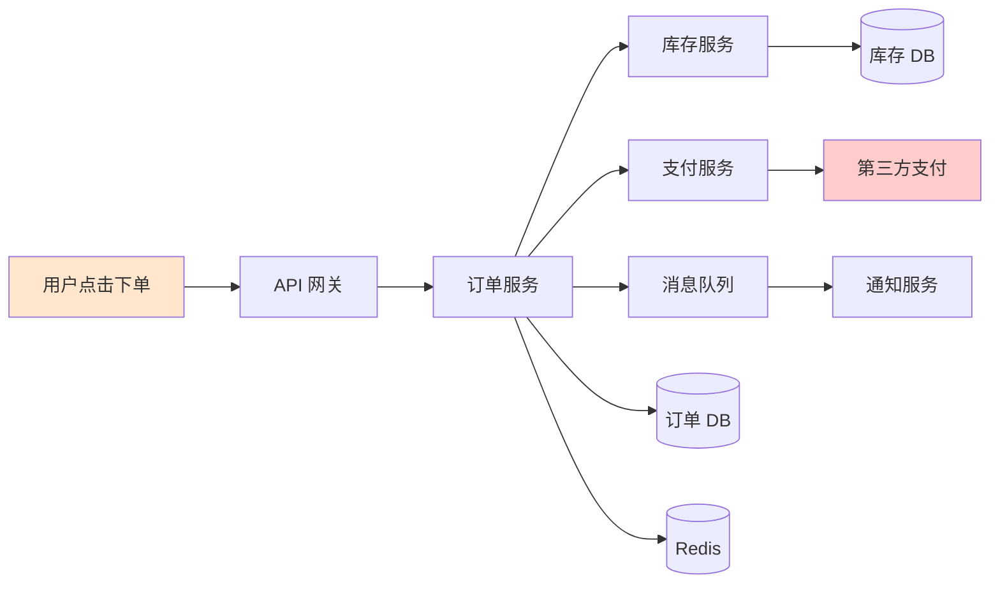

用户说"下单卡了 2 秒"，此时你手上有什么？

| 工具 | 能回答 | 不能回答 |
|---|---|---|
| 应用日志 | 某个服务内部发生了什么 | 这 2 秒花在哪个服务、哪一次调用上 |
| 监控指标（CPU/QPS/RT） | 整体水位是否异常 | 具体是哪一个请求、哪一条链路慢 |
| 服务拓扑图 | 谁调用了谁 | 这一次请求实际走了哪条路径、在哪个节点重试了 3 次 |
| 数据库慢查询日志 | 慢 SQL 长什么样 | 这条 SQL 是哪个上游请求带来的、影响了多少用户 |

**链路追踪补齐的正是"单次请求级别的因果证据"**：把一次请求在所有服务里产生的执行片段串成一条有向树，每个节点带精确的开始时间、耗时、状态、关键属性。有了它，"2 秒"会被自动分解成：网关 5ms、订单服务自身 30ms、库存服务 800ms（其中 DB 760ms）、支付服务 1.1s（第三方超时重试 2 次）。

## 1.2 链路追踪的四层价值（由浅入深）

1. **排障定位（最刚需）**：错误链路一眼可见，异常堆栈挂到具体 span 上，不用再"翻十台机器的日志"。
2. **性能剖析**：耗时分解（自身耗时 vs 下游耗时）、慢调用 TopN、N+1 调用识别、同步阻塞识别。
3. **容量与依赖治理**：谁在调我（上游清单）、我在调谁（下游清单）、强依赖 vs 弱依赖、循环依赖、无用调用（僵尸依赖）。
4. **业务与体验度量**：核心链路 SLO、支付成功率归因、灰度对比、故障影响面评估（哪些用户/哪些请求受影响）。

## 1.3 技术演进的三代范式

| 代际 | 代表 | 侵入性 | 采集能力 | 代价 |
|---|---|---|---|---|
| 第一代：日志埋点 | 早期 EagleEye、自研 UTM | 高（业务代码里手写） | 只有埋了点的地方 | 侵入强、易漏、规范难统一 |
| 第二代：Agent 字节码增强 | SkyWalking、Pinpoint、OTel Java Agent、Brave | 低（`-javaagent` 挂载） | 中间件/框架自动全覆盖 | Agent 自身开销、框架适配滞后 |
| 第三代：无侵入旁路 | eBPF（SkyWalking Rover、Pixie、Cilium）、Service Mesh | 极低（内核/边车层） | 网络层 L7 协议解析 | 无法看到应用内部逻辑、协议覆盖有限、加密流量受限 |

> **关键认知**：这三代不是替代关系而是**互补**。生产上成熟的体系通常是「Agent 覆盖应用内部 + eBPF 兜底（无 Agent 的老服务、第三方服务、跨语言）+ 网关/Mesh 层统一生成根 TraceId」。真正决定体系上限的不是采集手段，而是**上下文能否端到端透传**（第 4.2 节会重点讲，这是 90% 落地失败的原因）。

---

# 第 2 章 核心概念与术语

## 2.1 术语表（面试第一道必答题）

| 术语 | 定义 | 关键点 |
|---|---|---|
| **Trace（链路）** | 一次完整请求的调用树，用全局唯一 `TraceId` 标识 | TraceId 必须全局唯一且能跨进程传递 |
| **Span（跨度/埋点）** | 链路中的一个执行片段，代表一次方法调用/RPC/DB 访问 | 有 `startTime`、`duration`、`status`、`tags` |
| **SpanContext** | Span 的"身份凭证"，需要跨进程传递的最小信息集 | 通常 = `traceId + spanId + 采样标志 + 传播状态` |
| **ParentSpanId** | 父 Span 的 ID，用来还原树形结构 | 缺失父节点的 Span 称为"孤儿 Span" |
| **Root Span** | 没有父节点的入口 Span | 通常由网关/入口服务创建 |
| **Tag / Attribute** | Span 上的键值对属性（`http.method`、`db.statement`） | 高基数 Tag 是存储杀手 |
| **Log / Annotation / Event** | Span 生命周期内的时间点事件 | Zipkin 叫 annotation，OTel 叫 event |
| **Baggage** | 随链路一起传播的业务键值对（如 `userId`、`tenantId`） | 跨进程传播，受 header 大小限制 |
| **Propagation（传播）** | 把 SpanContext 注入下游、从上游提取的动作 | inject / extract 两个方向 |
| **Sampling（采样）** | 只保留部分 Trace 以控制成本 | 必须保证同一条 Trace 的采样决策一致 |
| **Collector** | 接收、处理、转存上报数据的服务端组件 | Zipkin Collector / OTel Collector / SkyWalking Receiver |
| **Segment** | SkyWalking 特有：一个线程内连续产生的一组 Span 的容器 | 减少上报与存储碎片 |
| **Entry / Exit / Local Span** | SkyWalking 的三种 Span 类型 | Entry=服务端入口，Exit=发起远程调用，Local=本地方法 |
| **Service / Instance / Endpoint** | SkyWalking 的三层实体抽象 | Endpoint 高基数问题最严重 |

## 2.2 一次 RPC 调用的完整时间线（必须能画出来）

假设 A 服务通过 HTTP 调用 B 服务，A 的客户端埋点会记 2 个时间点，B 的服务端埋点也会记 2 个时间点。四个时间点合起来才能把"网络耗时"与"服务端耗时"分清楚。

```
时间 ──────────────────────────────────────────────────────────►

A 端 (client span)
   cs ●──────────────────────────────────────────────────────● cr
      │                                                      │
      │        ┌──────── 网络 ────────┐                       │
      │        │                      │                       │
B 端 (server span)                      │                      │
             sr ●──────────────────────┴───────────────● ss
                │                                      │
                └──────── 服务端处理耗时 ────────────────┘

cs = Client Send      客户端发出请求
sr = Server Receive   服务端收到请求
ss = Server Send      服务端发出响应
cr = Client Receive   客户端收到响应

客户端整体耗时  = cr - cs                    （A 侧视角的"调用耗时"）
服务端处理耗时  = ss - sr                    （B 侧真实业务耗时）
网络耗时        = (sr - cs) + (cr - ss)      （两次单向传输之和）
时钟偏移估计    = ((sr - cs) - (cr - ss)) / 2  （两端时钟不同步的偏差）
```

**这就是 Zipkin 模型的精髓**：`cs/cr` 属于客户端 Span 的 annotation，`sr/ss` 属于服务端 Span 的 annotation。如果只有客户端埋点，你只知道"调用花了 800ms"，但永远分不清是网络 750ms 还是服务端 50ms；如果只有服务端埋点，你不知道请求在网络里堵了多久、是否被重试。

> **延伸（面试常追问）**：为什么 SkyWalking 没有显式用 cs/sr/ss/cr 这套命名？因为它的 Span 本身带 `startTime + latency`，Entry Span 的 `startTime` 相当于 `sr`、`startTime+latency` 相当于 `ss`；跨进程时通过 `SegmentRef` 引用上游 segment 的 `spanId`，服务端再反查上游 span 的结束时间，从而在**查询期**做时间对齐。本质等价，只是把"对齐"从写入期挪到了查询期。

## 2.3 自身耗时（Self Time / Exclusive Time）——最能打的指标

一个 Span 的 `duration` 包含了下游子 Span 的耗时，直接排序会把"入口 Span"永远排第一，没有诊断价值。所以必须计算**自身耗时**：

```
SelfTime(span) = duration(span) - Σ duration(直接子 Span)
```

真实实现要注意的坑：

1. **子 Span 是异步/并发的**：如果两个子调用是并行发出的，它们的耗时会重叠，此时相加会算出负数。正确做法是**求并集**（区间合并），而不是简单求和。
2. **子 Span 挂了别的父节点**（如线程池任务跨线程）：树结构在同一 Trace 内不一定严格嵌套，需要用 `parentSpanId` 而非时间区间来判定父子关系。
3. **时钟偏移导致子 Span 时间溢出父 Span 边界**：需要做 clamp（截断到父区间）。

## 2.4 为什么 Span 是"树"，而不是"链"

很多人误以为链路追踪是一条 `A→B→C` 的链。实际数据结构是**树（严格说是 DAG，因为异步与 fan-in）**：

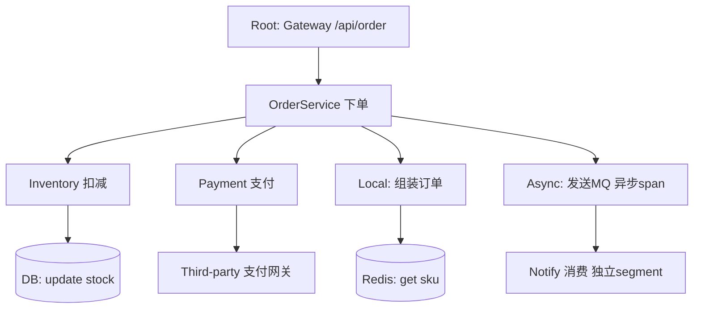

出现"分叉"的三种典型场景：

- **并行调用（fan-out）**：`CompletableFuture.allOf` 同时调 3 个下游 → 3 个兄弟 Span。
- **异步化（跨线程/跨进程）**：主线程 `span` 结束后，MQ 消费线程才是真正的"后续"，父子关系靠 `SegmentRef` 或 `Link` 维持。
- **Fan-in（聚合）**：批处理把 100 个上游请求合成一次 DB 批查询，这 1 个 DB Span 会被 100 条 Trace 共同引用——这也是"单 Trace 视图"必须支持多根的原因。

> **面试坑点**：如果你的系统只支持"一个 Trace 一个根 Span"，遇到批处理 / MQ 消费 / 定时任务聚合时就会断链。成熟实现（如 OTel 的 `Links`、SkyWalking 的 `SegmentRef` 多引用）都支持**多父引用**。

---

# 第 3 章 数据模型：四套模型对比

## 3.1 Zipkin V2 模型（最通用的"最小公约数"）

```json
{
  "traceId": "4bf92f3577b34da6a3ce929d0e0e4736",
  "id": "00f067aa0ba902b7",
  "parentId": "a3ce929d0e0e4736",
  "name": "get /api/order",
  "kind": "SERVER",
  "timestamp": 1732000000123456,
  "duration": 82341,
  "localEndpoint": {
    "serviceName": "order-service",
    "ipv4": "10.0.1.23",
    "port": 8080
  },
  "remoteEndpoint": {
    "serviceName": "gateway",
    "ipv4": "10.0.1.10"
  },
  "annotations": [
    { "timestamp": 1732000000123456, "value": "sr" },
    { "timestamp": 1732000000205797, "value": "ss" }
  ],
  "tags": {
    "http.method": "POST",
    "http.status_code": "200",
    "error": "false"
  }
}
```

**设计要点（要能讲出"为什么"）**：

- `timestamp` 是**微秒**级 Unix 时间戳，`duration` 也是微秒。选微秒是因为链路里大量操作在百微秒级（缓存命中、本地方法），毫秒精度不够。
- `localEndpoint` / `remoteEndpoint` 用**结构化对象**而不是字符串，才能做服务依赖聚合与自发现拓扑。
- `kind` 四值：`SERVER`（服务端接收）、`CLIENT`（客户端发起）、`PRODUCER`（消息生产）、`CONSUMER`（消息消费）。后两者是为 MQ 场景补的，**这是判断链路是否能覆盖异步场景的关键字段**。
- `annotations` 里 `cs/sr/ss/cr` 是**约定的保留值**（Zipkin 的"标准 annotation"），其余是业务自定义事件。
- `shared: true`：当客户端和服务端的 Span 需要合并成一条（减少存储）时使用，此时同一个 `id` 被两端写入，服务端那条带 `shared=true`。

## 3.2 OpenTracing 模型（语义规范，不是存储格式）

```java
Span span = tracer.buildSpan("getOrder")            // 操作名
    .withTag("db.type", "mysql")
    .asChildOf(parentContext)                         // 关键：引用关系
    .start();

span.setTag("http.status_code", 200);
span.log(ImmutableMap.of("event", "cache_miss"));     // 事件日志
span.finish();
```

核心抽象只有 3 个：`Tracer`（创建 Span）、`Span`（执行片段）、`SpanContext`（跨进程载体）。引用关系有两种：

- `ChildOf`：因果强依赖（父 Span 必须结束后子 Span 才有意义，如 RPC 调用）。
- `FollowsFrom`：因果弱依赖（父 Span 不关心子 Span 结果，如异步通知、消息投递）。

> **这个区分是面试加分项**：`FollowsFrom` 的语义价值在于——当异步子链路失败时，不应该把父链路标记为失败，也不应该把异步子链路耗时算进父链路的 critical path。SkyWalking 的 `SegmentRef` 只表达"跨进程/跨线程引用"，没有显式区分强弱因果，这是它的一个语义缺失点（要靠 `SpanLayer`/`ComponentId` 与业务约定弥补）。

**OpenTracing 的致命短板（解释了它为何被 OTel 取代）**：

1. 只定义了 API，没有定义**数据模型与传输协议** → 各实现上报格式五花八门，Collector 无法通用。
2. **没有 Metrics 与 Logs** → 只有 Trace，做不了"指标看盘 + 链路下钻"的闭环。
3. **Baggage/Context 能力弱**，缺少标准化传播格式（W3C 那时还没成标准）。
4. API 与 SDK 边界不清，实现方各自扩展（`opentracing-contrib` 生态碎片化）。

## 3.3 SkyWalking Segment 模型（与扁平 Span 模型的关键差异）

SkyWalking 不直接上报 Span，而是上报 **Segment（TraceSegment）**：**一个线程内从入口到结束的所有 Span，打包成一个 Segment 一次性上报**。

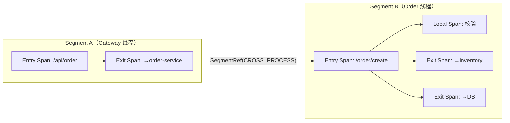

一个 Segment 的结构：

| 字段 | 说明 |
|---|---|
| `traceSegmentId` | Segment 唯一 ID |
| `traceId` | 全局链路 ID |
| `serviceId` / `serviceInstanceId` | 所属服务与实例（数字 ID，节省存储） |
| `spanId` 列表 | 段内 Span，每个含 `parentSpanId`、`spanType(Entry/Exit/Local)`、`spanLayer(HTTP/DB/RPC/MQ/Cache)`、`componentId`、`tags`、`logs`、`refs` |
| `refs` | 本 Segment 的"上游引用"，指向产生它的那个上游 Span |

**为什么这么设计（必须能讲出三点收益）**：

1. **减少上报次数**：一次 HTTP 请求可能产生 30 个 Span，扁平模型 = 30 次（或 1 次但 30 条记录）；Segment 模型 = 1 次上报、1 条主记录 + 少量 Span 记录，网络与序列化开销显著降低。
2. **天然保留"线程内局部性"**：Segment 是"一次线程执行"的快照，很自然地对应 `ThreadLocal` 的上下文生命周期，采集端无需复杂的父子拼接。
3. **存储可分离**：Segment 的**索引字段**（耗时、状态、服务、时间）单独存一份，**大字段**（Span 明细，protobuf 序列化为 `data_binary`）另存一份。查列表时只扫索引，点开详情才解码二进制——这是 SkyWalking 查询快的关键。

**代价**：

- 跨线程必须显式建 Segment（`ContextSnapshot` / `@TraceCrossThread`），否则断链；线程池里"一个线程多个任务混在一起"会让 Segment 语义变糊。
- 不能做真正的尾部采样（数据在 Agent 端就按 Segment 上报了，Collector 侧只能整 Trace 丢弃）。

## 3.4 OpenTelemetry 模型（当前事实标准）

```
Resource（资源：service.name, host.name, k8s.pod.name…）
  └── Scope（InstrumentationScope：库名+版本，如 io.opentelemetry.okhttp）
        └── Span
              ├── trace_id (16 bytes) / span_id (8 bytes)
              ├── parent_span_id
              ├── kind: SPAN_KIND_SERVER / CLIENT / PRODUCER / CONSUMER / INTERNAL
              ├── start_time_unix_nano / end_time_unix_nano （纳秒）
              ├── attributes（替代 tags，语义约定 Semantic Conventions）
              ├── events（替代 logs/annotations）
              ├── links（多父引用，解决 fan-in）
              └── status: {code: OK/ERROR/UNSET, message}
```

三个关键升级（面试高频）：

1. **`Resource` 下沉**：把"服务名、主机名、Pod 名"等**进程级常量**从每个 Span 剥离成独立 Resource，上报时可只传一次，**存储与传输的体积优化非常明显**。
2. **纳秒时间戳**：解决微秒精度在超短耗时（本地方法、缓存）上的分辨率不足，同时规避"微秒四舍五入"造成的 0 耗时 Span。
3. **`Links` 多父引用 + 语义约定（Semantic Conventions）**：字段名标准化（`http.request.method`、`db.system`、`messaging.system`），跨厂商数据可直接互相理解——这是 OpenTracing 时代做不到的。

## 3.5 四套模型横向对比

| 维度 | Zipkin V2 | OpenTracing | SkyWalking Segment | OTel |
|---|---|---|---|---|
| 类型 | 存储/传输格式 | API 语义规范 | 存储/传输模型 | 数据模型 + 协议(OTLP) |
| 时间精度 | 微秒 | 未规定 | 毫秒（可配微秒） | 纳秒 |
| 上报粒度 | 单 Span | 单 Span | Segment（多 Span 打包） | 单 Span（Batch） |
| 多父引用 | 弱（靠 parentId） | ChildOf/FollowsFrom | SegmentRef | Links |
| 服务/实例抽象 | localEndpoint | 无 | Service/Instance/Endpoint 三层 | Resource |
| 内置指标能力 | 无 | 无 | 强（流式聚合） | 有（Metrics API/SDK） |
| 内置日志关联 | 弱 | 无 | 强（toolkit + MDC） | 强（Logs Bridge API） |
| 生态 | 广（历史包袱） | 已停止演进 | Java 生态最强 | 最广、厂商中立 |
| 适合场景 | 轻量接入、已有 Zipkin 体系 | 遗留系统 | Java/多语言 APM、需要指标+拓扑 | 新建体系、多语言、多云 |

---

# 第 4 章 底层原理（本篇重心）

一句话概括链路追踪的全部工作：

> **在请求入口生成 TraceId → 沿途每一步记录一个带父子关系的 Span → 通过协议头把上下文传给下游 → 异步批量上报到服务端 → 按 TraceId 聚合、按时间与实体建索引 → 查询时重建调用树并做耗时分解。**

七个子问题，逐个拆。

## 4.1 采集层：无侵入是怎么做到的

### 4.1.1 四种侵入级别

| 级别 | 手段 | 代表 | 优点 | 缺点 |
|---|---|---|---|---|
| L0 手动 | 业务代码 `tracer.startSpan()` | OpenTracing API 裸用 | 精准、可控 | 漏埋、规范不一、改造成本巨大 |
| L1 框架 SDK | Spring 拦截器 / Dubbo Filter / MyBatis Plugin | Brave、Spring Cloud Sleuth、`apm-toolkit` | 半自动 | 需逐框架适配，业务自定义调用看不到 |
| L2 Agent 字节码 | `-javaagent` 动态改字节码 | SkyWalking、Pinpoint、OTel Java Agent | 全自动、可随时开关 | Agent 开销、框架新版本适配滞后 |
| L3 旁路无侵入 | eBPF / Service Mesh 抓包解析 | SkyWalking Rover、Pixie、Istio + OTel | 零侵入、跨语言、可观测第三方 | 看不到应用内逻辑、TLS 解密难、协议覆盖有限 |

### 4.1.2 Java Agent 字节码增强的完整链路（★★★ 高频深挖点）

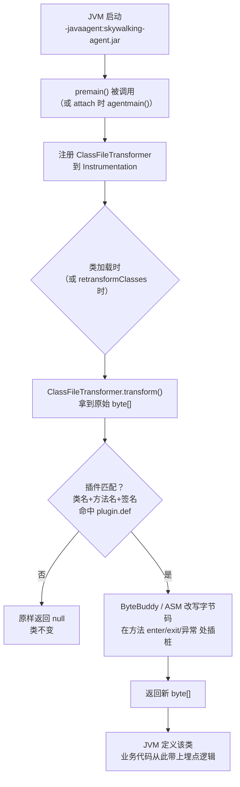

**每一步的关键技术点**：

1. **`premain` vs `agentmain`**
   - `premain(String agentArgs, Instrumentation inst)`：JVM 启动参数挂载，**类加载前**就注册好 Transformer，因此能拦到所有类（包括启动期加载的）。
   - `agentmain`：运行时 attach（`VirtualMachine.loadAgent`）挂载，此时类**已经加载完**，必须靠 `inst.retransformClasses()` 触发重新转换，且**只能改方法体，不能改签名/加字段/改继承**（JVM 限制）。
   - **这个限制直接决定了各框架的设计**：OTel / SkyWalking 都需要把"上下文存哪"设计成"不改类结构"的方案（见 4.1.3）。

2. **`ClassFileTransformer` 的匹配与性能**
   - 全量类加载都要过一次 `transform()`，如果每个类都做字符串匹配会拖慢启动。所以实现上会做 **类名 Bloom Filter / Set 预筛** 再进 ByteBuddy。
   - `transform()` 返回 `null` 表示"未修改"，这是最快的路径，务必保证绝大多数类走这条路（SkyWalking 用 `witness class` 机制：先确认目标类**确实存在**某个父类/注解，才激活插件，避免无效匹配）。

3. **插桩点怎么选（决定数据准不准）**
   ```
   enter:  long start = System.nanoTime();  // 记录开始时间
           ctx = ContextManager.createSpan(...)   // 建 Span、拿父上下文
   exit:   正常返回 → span.setStatus(OK); span.finish()
           抛异常   → span.setStatus(ERROR) + recordException(e) + 必须 finally finish()
   ```
   - **必须用 `try/finally` 语义**：否则异常路径漏 `finish()`，Span 永远不结束 → 内存泄漏 + 耗时失真。
   - **耗时用 `System.nanoTime()` 而不是 `currentTimeMillis()`**：后者会受 NTP 校时跳变影响，算出负耗时。这是面试常问的细节。
   - **`nanoTime` 的陷阱**：它只在**同一 JVM** 内有意义，跨进程必须换算成绝对时间戳上报（用 `System.currentTimeMillis()` 记起始绝对时间 + `nanoTime` 记相对耗时，两者相减得到结束绝对时间）。

4. **方法级别 vs 字节码级别：`@Trace` 注解怎么生效**
   - 编译期注解保留（`RetentionPolicy.CLASS`），Agent 在类加载时扫描 `RuntimeVisibleAnnotations` / `RuntimeInvisibleAnnotations`，命中 `@Trace` 的方法**额外加插桩**。所以 `@Trace` 不需要业务引依赖也能生效（但需要把注解类放到 bootstrap classpath）。

5. **Agent 类加载隔离（最容易踩坑的工程问题）**
   - Agent 的 jar 不能污染业务 classpath，否则版本冲突（尤其 ByteBuddy、Guava、gRPC）。
   - 方案：自定义 `AgentClassLoader`（父加载器为 `null` 或 `bootstrap`），`skywalking-agent.jar` 内部再拆 `plugins/`、`activations/`、`bootstrap-plugins/` 多级加载器。
   - **`bootstrap-plugins` 的意义**：如果被增强的类是 JDK 自带类（如 `ThreadPoolExecutor`、`HttpURLConnection`），它的类加载器是 bootstrap，看不到 Agent 的类 → 必须把拦截器类**注入到 bootstrap classpath**（`inst.appendToBootstrapClassLoaderSearch()`）。这是"跨线程传播"能生效的前提。

### 4.1.3 上下文存在哪里：三种经典解法（★★★ 深度题）

线程内要保存"当前 Span"，最直觉的是 `ThreadLocal<Span>`。但**只加字段的 ThreadLocal 有个致命问题**：`ThreadLocal` 里的对象生命周期与线程绑定，线程池复用线程时极易泄漏，且**无法被 Agent 修改类结构注入**。三种主流解法：

| 方案 | 原理 | 代表 | 评价 |
|---|---|---|---|
| **A. ThreadLocal 存 Context 对象** | Agent 不改业务类；自己在 Agent 侧维护一个 `ThreadLocal<Context>` | SkyWalking 早期 / Brave | 简单；但要自己管理 `finish` 与清理，跨线程靠快照复制 |
| **B. 动态字段（Dynamic Field）** | 给**已存在**的类加一个 `Object` 字段（`EnhancedInstance`），把上下文挂到请求对象/连接对象上 | SkyWalking `EnhancedInstance` | 精妙：把 exit span 的 context 挂到 `HttpURLConnection`/`Dubbo Invocation` 上，**天然随对象生命周期走**，解决"异步回调时 ThreadLocal 已经没了"的问题 |
| **C. Context + ContextStorage 可插拔** | 定义 `Context` 接口，存储后端可选 ThreadLocal / 严格模式 / 虚拟线程模式 | OpenTelemetry `ContextStorage`、`ThreadLocalContextStorage`、`VirtualThreadContextStorage` | Java 21 虚拟线程下 `ThreadLocal` 有性能与语义问题（百万级线程），必须可替换 |

**方案 B 的细节（SkyWalking 的核心设计之一，面试可深聊）**：

```java
// 被增强的类实现 EnhancedInstance
public interface EnhancedInstance {
    Object getSkyWalkingDynamicField();
    void setSkyWalkingDynamicField(Object value);
}
// Agent 在类上追加一个 private Object 字段 + 两个方法（这就是它能加字段的原因：
// 它增强的是「业务类」，可以在类加载期改结构；而不是运行时 retransform 自己）
```

实际用途：`HttpClient` 插件在**发起请求时**把当前 Context 塞进 `HttpRequest` 对象，**响应回调时**（可能是另一个线程）再从对象里取出来 —— 这样即使在 Reactor/Netty 的异步回调里，也不需要依赖 `ThreadLocal`。**这是"异步链路不断链"的关键**。

> **延伸：为什么 `retransform` 不能加字段，但 Agent 能给业务类加字段？**
> 因为业务类是**首次加载**时被 `transform` 改写的，JVM 允许"定义类"时任意改结构；而 `retransform` 是对**已定义类**做再次转换，JVM 规范要求 `retransform` 后的类必须与原类"结构兼容"（不能增删字段/方法、不能改签名），否则抛 `UnsupportedOperationException`。这个区别是 Java Agent 一切设计约束的源头。

### 4.1.4 采集端如何保证"不漏关键路径"

一套生产可用的 Agent 至少要自动覆盖这些埋点：

| 层 | 覆盖点 | 说明 |
|---|---|---|
| 入口 | Servlet/Filter、Spring MVC、WebFlux、gRPC Server、Dubbo Provider、MQ Listener、定时任务（`@Scheduled`、XXL-Job）、`main` 方法 | 决定 Trace 从哪开始，也是 Span 类型判定为 Entry 的依据 |
| 出口 | HttpClient（Apache/OkHttp/JDK11+）、RestTemplate、WebClient、Feign、gRPC Client、Dubbo Consumer、MQ Producer | Exit Span，必须注入 header |
| 存储 | JDBC（Druid/HikariCP/MyBatis）、Redis（Jedis/Lettuce/Redisson）、MongoDB、ES Client | SpanLayer=DB/Cache，SQL 需脱敏与截断 |
| 本地 | `@Trace` 注解、关键业务方法 | Local Span，用于细粒度耗时分解 |
| 异步 | 线程池（`ThreadPoolExecutor`/`ForkJoinPool`）、`CompletableFuture`、`@Async`、Reactor、RxJava | 跨线程传播，最容易断链 |
| 日志 | Logback/Log4j2 Layout | 把 TraceId 打进日志，实现"日志—链路"互跳 |

---

## 4.2 上下文传播：90% 的落地失败都在这（★★★ 最核心）

### 4.2.1 传播的本质：三个动作

```
① 创建（Start）   入口处没有上游上下文 → 新建 TraceId + RootSpanId
② 注入（Inject）  发起远程调用前 → 把 SpanContext 写进协议头 / 消息属性
③ 提取（Extract） 接收请求时 → 从协议头读出来，恢复父子关系
```

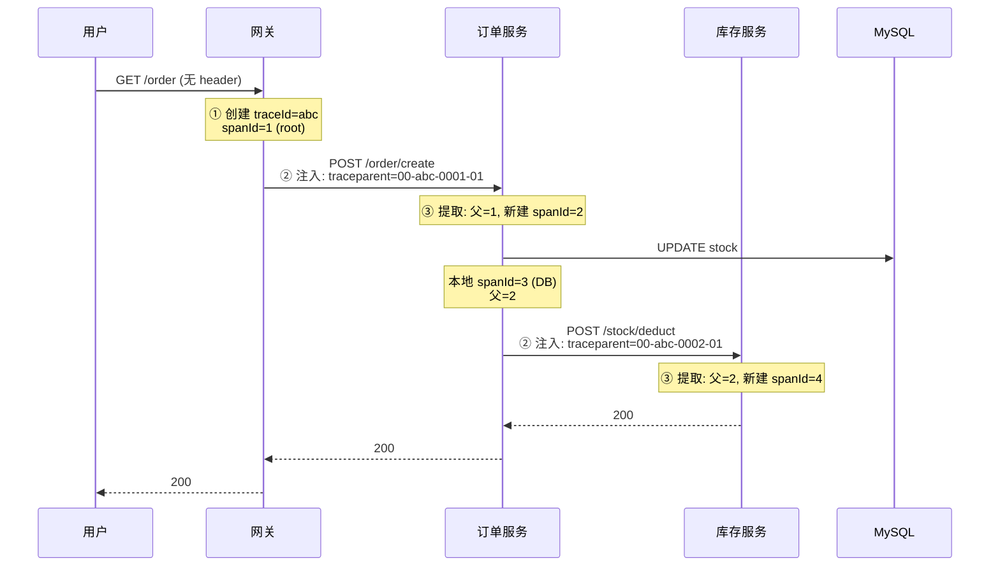

### 4.2.2 为什么必须放协议头，不能放 Body

1. **透明性**：Body 是业务 schema，塞进去会破坏契约、影响签名/校验、需要改所有 DTO。
2. **通用性**：HTTP header / gRPC metadata / MQ properties 是**所有协议都有的元数据通道**，与业务载荷解耦。
3. **可观测性**：中间件（网关、LB、Mesh）能在不改 body 的情况下读取并透传，甚至可以重写。

### 4.2.3 W3C Trace Context 逐个字节解析（★★★）

```
traceparent: 00-4bf92f3577b34da6a3ce929d0e0e4736-00f067aa0ba902b7-01
             │  │                                │                │
             │  │                                │                └─ trace-flags (8 bit hex)
             │  │                                └────────────────── parent-id / span-id (8 byte = 16 hex)
             │  └─────────────────────────────────────────────────── trace-id (16 byte = 32 hex)
             └────────────────────────────────────────────────────── version (1 byte = 2 hex)
```

- `version=00`：当前唯一合法版本。**解析规则必须是"忽略未知字段、遇到不认识的 version 直接丢弃"，这是向前兼容的关键**。
- `trace-id` 16 字节 = 128 bit（与 Zipkin 的 64/128 bit 兼容；**全 0 非法**，因为 0 表示"无效 context"）。
- `parent-id` 8 字节 = 64 bit（同理不能全 0）。注意：**它叫 parent-id，因为对下游来说它是"父"**，但从自己视角它就是"我自己的 spanId"。
- `trace-flags`：bit0 = sampled（`01` 表示采样）。**这一个 bit 是"全链路采样一致性"的载体**——一旦根节点决定采样，后续所有节点都看到 `01`，不再各自随机，从而不会"下游采了、上游没采"导致断链。
- `tracestate`：厂商扩展键值（`vendor=value1,value2`），有长度上限（一般 ≤512 字符）与顺序语义（最近写入的在最前）。

**安全规则（面试里很有区分度）**：来自**不可信外部**的请求（公网入口），必须**丢弃/重置**上游传来的 `traceparent`，由网关重新生成 TraceId。原因：

1. **TraceId 污染**：恶意用户可构造固定 TraceId，让所有请求聚到一条链路上，污染数据、放大存储、甚至用于探测。
2. **采样标志篡改**：强制 `sampled=00` 可让攻击流量的链路"隐身"（打点缺失，安全审计失效）。
3. **拒绝服务**：超长 `tracestate` 或畸形 header 触发解析异常，甚至撑爆内存。

### 4.2.4 各协议透传矩阵（工程落地必备清单）

| 协议/中间件 | 载体 | 注意点 |
|---|---|---|
| HTTP/1.1、HTTP/2 | Header | 大小写不敏感；HTTP/2 头会被压缩（HPACK），但**不会**被中间代理删掉；注意 CDN/WAF 可能剥离自定义 header（`sw8`、`X-B3-*` 常被剥） |
| gRPC | Metadata | key 必须小写、ASCII；`-bin` 后缀用于二进制；**注意 metadata 有大小限制**（默认 8KB，超了会 `RESOURCE_EXHAUSTED`） |
| Dubbo 2.7 | `RpcContext.getContext().setAttachment()` | attachment 只走**隐式传递**，`async` 调用会丢；Dubbo 3 用 `RpcContext.getClientAttachment()` |
| Spring Cloud（Feign/RestTemplate） | RequestInterceptor / ClientHttpRequestInterceptor | 必须**显式加**，否则只在网关断链 |
| Kafka | ProducerRecord `headers` | consumer 侧要在 `poll` 后**立即 extract**，否则批量消费会串上下文 |
| RocketMQ | `Message.putUserProperty` / `msg.setKeys` | 用 userProperty 更合适；注意 broker 对 properties 有长度限制 |
| RabbitMQ | `BasicProperties.headers` | 同理 |
| Redis / MySQL | **不传播** | 存储层不是"服务"，无 TraceId 传递意义；只做为 Exit Span 记录耗时 |
| Nginx / 网关 | 自定义 header 透传 | 需显式配置 `proxy_pass_request_headers`，否则可能被滤掉（`underscores_in_headers` 坑：header 里带下划线默认被丢！） |
| Service Mesh（Istio） | Envoy 的 L7 解析 + `traceparent` | 需要开 OTel 插件；**mTLS 下 Mesh 只能看到加密流量，头部可透传但不解析** |

> **Nginx 那个坑非常真实**：`sw8`、`X-B3-TraceId` 这类 header 含下划线，Nginx 默认**丢弃含下划线的 header**（为防止与内部变量冲突），必须 `underscores_in_headers on;`。这是无数团队"网关之后链路全断"的元凶。

### 4.2.5 跨线程传播：三种坑与四种解法

**三个典型断链场景**：

```java
// 场景 1：线程池复用 —— 上下文"串味"
executor.submit(() -> doWork());   // 任务在池线程跑，ThreadLocal 里没有父 Span
                                   // 更糟：池线程被复用时还残留上一个任务的上下文！

// 场景 2：异步回调 —— 回调时上下文已销毁
httpClient.sendAsync(req, resp -> { ... });  // 主线程已 finish，回调线程无上下文

// 场景 3：响应式/协程 —— 线程切换频繁
flux.map(x -> callRemote(x)).subscribe();    // 一个请求跨多个线程，ThreadLocal 完全不适用
```

**四种解法（按工程量从小到大）**：

| 解法 | 原理 | 代表 | 局限 |
|---|---|---|---|
| ① 手动包装 | `Runnable r2 = tracer.wrap(r)` 再 submit | Brave、OTel `Context.taskWrapping` | 需改造每个提交点，易漏 |
| ② 增强线程池 | Agent 拦截 `ThreadPoolExecutor.execute/submit`，自动包装 Runnable | SkyWalking `CallableOrRunnableInstrumentation`、OTel `ExecutorInstrumentation` | 覆盖不到自研线程池/第三方库内部池；`ScheduledExecutorService` 需额外适配 |
| ③ 快照 + 显式传递 | `ContextSnapshot.capture()` → 任务里 `continued()` | SkyWalking `ContextManager.capture()`、`@TraceCrossThread` | 语义清晰、可控，但要业务配合 |
| ④ 可传递 ThreadLocal | 包装 `ThreadLocal` 的 `get/set`，在任务提交时复制快照（`TtlRunnable`） | 阿里 `TransmittableThreadLocal`（TTL） | 与 Agent 方案会**双重包装/冲突**；`InheritableThreadLocal` 在线程池下无效（只在 `new Thread` 时复制一次） |

**Reactor / 虚拟线程的专门处理（进阶）**：

- Reactor：`ThreadLocal` 完全失效（一个 `Mono` 链可能在任意线程续跑）。OTel 通过 `Hooks.onEachOperator()` 把 Context 挂到 `Subscription`/`reactor.util.context.Context` 上；skywalking 则通过增强 `Flux`/`Mono` 的关键操作符（`map`、`flatMap`、`subscribe`）传递。
- **Java 21 虚拟线程**：`ThreadLocal` 会导致载体线程（carrier thread）上的状态在挂起/恢复时错乱，必须用 `ScopedValue`（预览）或每次续跑重新恢复 Context（OTel 的 `VirtualThreadContextStorage` 用 `CopyOnWrite` 的线程绑定表解决）。

### 4.2.6 一个完整的传播失败排查流程（实战）

```
链路在某服务后断了
  ├─ 1. 看该服务的「入口 Span 是否存在」
  │     ├─ 不存在 → Agent 未增强该框架（版本不支持）/ 插件未激活（witness class 未命中）
  │     └─ 存在，但是新的 Root（traceId 变了）→ 上游没注入 或 本服务没 extract
  ├─ 2. 抓包看 header（curl / tcpdump / 网关日志）
  │     ├─ header 存在但服务端没读到 → Nginx 下划线过滤 / WAF 剥离 / 大小写
  │     ├─ header 不存在 → 上游是异步调用（回调线程无上下文）/ 自研 HTTP 客户端未适配
  │     └─ header 存在但值不同 → 中间件重写了 header（Mesh/网关二次生成）
  ├─ 3. 下游是异步消费（MQ）→ 检查 Producer 是否 put headers、Consumer 是否 poll 后 extract
  └─ 4. 跨线程 → 检查线程池增强是否生效、是否用了自定义 ThreadPool
```

---

## 4.3 采样：成本与精度的权衡（★★★）

### 4.3.1 为什么必须采样

算一笔账（真实量级）：一个中型系统 5,000 QPS，平均一次请求 20 个 Span，单 Span 序列化后约 1KB。

```
日 Span 数   = 5000 × 20 × 86400 ≈ 86.4 亿
日原始数据   ≈ 86.4 亿 × 1KB ≈ 864 GB/天（未压缩）
ES 索引后    ≈ 原始 × 1.5~2（含倒排、副本）≈ 1.3~1.7 TB/天
保留 7 天   ≈ 10 TB 级；保留 30 天 ≈ 40 TB
```

不采样在生产上根本不可行。采样率 1% 时成本降到 1/100，且**仍然能定位绝大多数问题**——因为错误/慢请求可以被"强制采样"保住。

### 4.3.2 头部采样 vs 尾部采样（★★★ 必考对比）

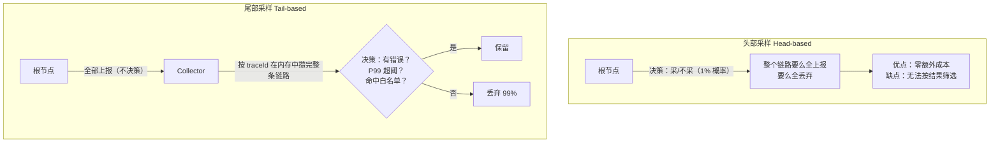

| 维度 | 头部采样 | 尾部采样 |
|---|---|---|
| 决策位置 | 客户端/SDK/Agent（Span 创建时） | Collector（Trace 完整后） |
| 决策依据 | 概率 / TraceId 哈希 | 真实结果：错误、慢、特定 tag、特定用户 |
| Agent 开销 | 低（不采就不产生 Span） | **高**（每条都要上报，网络与序列化全量） |
| Collector 成本 | 低 | **高**（内存缓存 N 秒的完整链路） |
| 能否保住长尾问题 | 不能（1% 概率会漏掉罕见的慢请求） | 能（100% 捕获错误与慢请求） |
| 代表实现 | SkyWalking `sample-rate`、OTel `TraceIdRatioBased`、Brave `Sampler` | OTel Collector `tailsamplingprocessor`、Datadog Agent 尾部采样、SkyWalking 的 OAP 侧策略（有限） |

**尾部采样的三个工程硬约束（深挖点）**：

1. **必须按 TraceId 做路由（一致性哈希）**：一条 Trace 的所有 Span 要落到**同一台 Collector**，否则无法拼出完整链路做决策。这是负载均衡器（如 OTLP exporter + `loadbalancingexporter`）必须用 traceId 作为 hash key 的原因。
2. **决策窗口（`decision_wait`）**：默认 10s～30s。窗口太短 → 链路还没齐就决策，误判；窗口太长 → 内存暴涨。
3. **内存与背压**：5000 QPS × 1% 保留前需缓存 100% × 30s ≈ 15 万条 Trace 在内存。必须设 `num_traces` 上限 + 超限降级（LRU 驱逐 + 记录被驱逐计数，让运维知道"采样失真"）。

### 4.3.3 一致性采样（Consistent Sampling / Deterministic Sampling，★★★ 高区分度）

问题：根节点随机决定"采"，但下游**没有收到 sampled 标志**（比如跨了不支持的中间件），下游自己随机 → 出现"A 采了、B 没采"→ **断链**。

解法：**用 TraceId 本身做决策**，而不是随机数。

```
采样条件： hash(traceId) mod 10000 < sampleRate × 10000
```

这样**任何节点拿到同一个 traceId，算出的结果必然相同**，无需传播标志也能一致。OTel 的 `TraceIdRatioBasedSampler` 正是这么做的（用 traceId 的**最低有效字节**做阈值比较，避免全量哈希的开销）。

> **延伸：为什么 OTel 用"低位字节"而不是"取模"？**
> 因为 `traceId` 本身就是随机生成的（128 bit 随机），其**最低 8 字节本身就是均匀分布**，直接取这 8 字节的无符号整数值 `v`，比较 `v < ratio × 2^63` 即可，**零哈希开销**。这是"用数据本身的随机性替代哈希"的经典技巧。

### 4.3.4 分层采样策略（生产最佳实践）

```
优先级 P0：错误链路（status=ERROR / 异常 / 5xx）        → 100% 强制采样
优先级 P1：慢链路（duration > P99 或 > 固定阈值如 1s）   → 100% 强制采样
优先级 P2：核心业务（支付、下单、登录）+ 特定用户/租户   → 10% ~ 50%
优先级 P3：普通读请求、健康检查、静态资源               → 0.1% ~ 1%
优先级 P4：健康检查、探活、监控探测                     → 0%（直接屏蔽）
```

SkyWalking 的实现手段：`agent.force_sample`（强制采样开关）+ 插件级 `sample-rate` + `trace.ignore_path`（屏蔽路径）；OTel 的实现手段：自定义 `Sampler`（组合 `ParentBased` + 业务 `Sampler`）+ Collector 的尾部采样兜底。

### 4.3.5 采样带来的"三个坑"（面试问"你踩过什么坑"时的杀手锏）

1. **用 Trace 数据算 QPS 会严重偏低**：1% 采样下你只看到 1% 的请求。**QPS/成功率必须来自 Metrics（服务端流式聚合），Trace 只用于个案分析**。这是 SkyWalking 把 metrics 与 trace 分两条链路的根本原因。
2. **P99 失真**：采样后样本量不足，长尾分位数不准；且头部采样会**天然漏掉最慢的那批**（它们概率上被丢弃）。所以"慢请求指标"要么不采样，要么用 metrics 算。
3. **采样 + 强制采样叠加时的比例失衡**：如果错误率高（如大面积超时），强制采样会让上报量瞬间放大 100 倍，**可能把 Collector 打挂**。必须有"强制采样速率上限"（令牌桶限流）。

---

## 4.4 上报：不能拖垮业务（★★★）

### 4.4.1 上报链路的六个工程约束

```
业务线程 ──put──> 有界内存队列 ──batch──> 序列化(protobuf) ──gzip──> gRPC/HTTP ──> Collector
   │                │                    │                              │
   │                │                    │                              └─ 失败：本地磁盘缓存 + 重试
   │                │                    └─ 批量：N 条 or T 毫秒，谁先到算谁
   │                └─ 满了怎么办？丢弃最老/最新（绝不能阻塞业务线程！）
   └─ 必须 O(1)、无锁、无 GC 压力（ArrayBlockingQueue / Disruptor / MPSC 无锁队列）
```

1. **绝对异步**：任何在业务线程上做的网络 I/O 都是不可接受的。序列化也尽量挪到消费线程。
2. **有界队列 + 明确丢弃策略**：`buffer_size` 默认 6000（SkyWalking）；溢出时**丢弃并计数**（`dropped` 指标要暴露给监控），而不是阻塞。
3. **批量 + 压缩**：单条上报的 TCP/TLS 握手与 gRPC 帧开销占比极高；批量 100 条 + gzip 可把带宽降到 1/5。
4. **自身流控**：Agent 要监控 Collector 的响应耗时，连续失败要"熔断"（停止上报一段时间），防止 Agent 成为业务瓶颈。
5. **磁盘兜底**：`disk buffering`（OTel Collector exporter 有 `file_storage`）；SkyWalking 的 `buffer` 也可配置落盘（社区有 `datacarrier` 扩展）。
6. **时间戳与时钟**：Agent 侧只记本地时间，**绝对时间戳由 Agent 打点时刻的 `currentTimeMillis` 决定**，Collector 不做改写（否则跨时区/夏令时混乱）。

### 4.4.2 三种上报协议对比

| 协议 | 格式 | 代表 | 特点 |
|---|---|---|---|
| Zipkin JSON v2 | JSON over HTTP | Zipkin、Brave、OTel（zipkin exporter） | 人类可读、调试方便、体积大、无压缩需自己 gzip |
| OTLP | protobuf over gRPC/HTTP | OTel SDK/Collector | 标准化、schema 严格、支持压缩、支持 partial success 语义 |
| SkyWalking 自定义 proto | protobuf over gRPC | SkyWalking Agent → OAP | 针对 Segment 模型优化、字段紧凑 |

> **OTLP 的 `partial success` 语义值得单独说**（细节题）：服务端返回 200 但同时带 `partial_success` 信息（如"本次 100 条中 7 条被拒，原因是 tag 超长"），SDK 据此决定是否重试。**"成功但部分失败"这个语义设计，避免了整批重试导致的重复数据**——这是把"恰好一次"降级为"至少一次 + 幂等"的典型工程妥协。

### 4.4.3 上报造成的"自我 DDoS"

真实事故模式：某次 Collector 集群重启 → Agent 重试风暴 → 业务侧 GC 抖动 → 更多超时 → 更多错误 Span（强制采样）→ 更多上报 → Collector 更慢。**正反馈环路**。

标准解法：
- Agent 侧 **指数退避 + 抖动（jitter）**，不是固定间隔重试。
- **熔断开关 + 本地降级**：连续 N 次失败后暂停上报 T 秒，期间只丢数据不做 I/O。
- Collector 侧 **接入限流（令牌桶）**，超限返回 `429`/`RESOURCE_EXHAUSTED`，让 Agent 明确退避。
- 强制采样路径**单独限流**（见 4.3.5）。

---

## 4.5 存储：为什么链路追踪的存储这么难（★★★）

### 4.5.1 负载特征决定了选型

| 特征 | 说明 | 对选型的影响 |
|---|---|---|
| 写多读少 | 写入 : 读 ≈ 1000 : 1（大部分数据只被查一次甚至永不查） | 优先写吞吐，牺牲强一致 |
| 按 traceId 聚合读 | 查一条 Trace 需要"捞全所有 Span" | 需要 traceId 上的高效索引/分区 |
| 按时间范围 + 实体过滤 | "近 1 小时 order-service 的错误链路" | 需要 (time, service, status) 复合索引 |
| 高基数 | endpoint 数千、tag 值无限 | 倒排索引会膨胀，必须截断/白名单 |
| 短生命周期 | TTL 7~30 天 | 支持按时间分区 + 自动过期 |
| 大字段多 | SQL 语句、堆栈、异常信息 | 冷热分离：索引字段小、明细字段大 |

### 4.5.2 Zipkin 的 ES Schema 与索引设计

Zipkin 默认 ES 索引按天滚动：`zipkin-span-2026-11-19`（新版用 ILM / rollover alias）。

关键 mapping 细节（面试常问"为什么 traceId 是 keyword 还要 ignore_above"）：

```json
{
  "traceId":   { "type": "keyword", "ignore_above": 256 },
  "id":        { "type": "keyword", "ignore_above": 256 },
  "parentId":  { "type": "keyword", "ignore_above": 256 },
  "name":      { "type": "keyword", "ignore_above": 256 },
  "timestamp": { "type": "long" },
  "duration":  { "type": "long" },
  "kind":      { "type": "keyword" },
  "localEndpoint.serviceName":  { "type": "keyword", "norms": false },
  "localEndpoint.ipv4": { "type": "ip" },
  "remoteEndpoint.serviceName": { "type": "keyword" },
  "tags": { "type": "object", "dynamic": true }
}
```

- `traceId` 用 `keyword` 而非 `text`：精确匹配，绝不分词（否则一条链路会被切碎）。
- `ignore_above`：防御超长值（恶意或异常产生的巨长 traceId/tag）**撑爆 term dictionary**。
- `norms: false`：服务名是"低基数高重复"字段，关掉长度归一化可省大量堆内存。
- 查询"一条链路" = `term(traceId)` + `sort(timestamp)`，因此 **traceId 命中最关键**；为加速，Zipkin 还维护了 `trace_by_service_span` 这类**二级索引表**（Cassandra 里是物化表，ES 里靠 `serviceName + spanName` 的 query）。

**Cassandra 方案（Zipkin 老牌选择）**：partition key 设计为 `(service_name, span_name, bucket)` 或 `trace_id`，靠 `bucket = timestamp/3600` 做时间切片，避免超大分区（hot partition 问题）。**这是"宽行存储 + 时间桶"的经典手法**。

### 4.5.3 SkyWalking 的存储设计：索引与明细分离

SkyWalking 的核心思路是 **"列表用索引表，详情用二进制大字段"**：

| 表/索引 | 内容 | 用途 |
|---|---|---|
| `segment` | traceId、segmentId、serviceId、instanceId、startTime、latency、isError、`data_binary` | 列表页查询（按 service+time+status）、详情页解码 |
| `span` | segmentId、spanId、parentSpanId、refs、tags、logs | 详情页的调用树展开 |
| `service_instance` | 实例注册信息（服务名、地址、属性） | 实例查询、拓扑 |
| `endpoint` / `endpoint_relation` / `endpoint_dependency` | 端点级指标与依赖 | 端点大盘、依赖图 |
| `service_relation` / `service_instance_relation` | 服务间/实例间关系 + 指标 | 拓扑图、上下游 SLA |
| `metrics-*`（各维度） | 分钟级聚合指标（p50/p75/p90/p95/p99、成功率、吞吐） | 大盘与告警，**查询时无需回表** |

**为什么 `data_binary` 用 protobuf 而不是结构化字段**：

1. **Schema 灵活**：新增 tag 不需要改表结构（OAP 升级不需要迁移 ES mapping，避免 mapping 冲突这个 ES 头号运维难题）。
2. **体积小**：30 个 Span 的结构化存储会产生大量重复列名，protobuf 只需一次字段编号。
3. **按需解码**：列表页只看 `latency`，不需要解析 Span 明细，**CPU 省下的就是查询 RT**。

代价是**无法对 Span 内部字段做任意检索**（只能靠 OAP 预先提取的少量索引字段）—— 这也是 SkyWalking 在"按 tag 过滤"上弱于 OTel 原生存储的原因。

### 4.5.4 BanyanDB：SkyWalking 为什么要自研存储（前沿题，可加分）

ES 的痛点：**JVM 堆压力大、写入放大明显、时序聚合查询效率低、运维成本高**。SkyWalking 从 9.x 起引入 **BanyanDB**（Apache 孵化项目），针对链路追踪做了三件专用优化：

- **流式聚合（Streaming Aggregation）**：写入时就按时间窗口预聚合（min/max/sum/count/percentile 近似），查询只扫聚合结果，避免"扫百万条 Span 算 P99"。
- **倒排 + 时序混合模型**：series（时间序列）+ index（倒排）分离，天然匹配"实体 + 时间 + 指标"的查询模式。
- **数据生命周期管理**：按 `segment`/`block` 组织，支持自动 merge 与 TTL，减少 compaction 压力。

> **延伸思考**：链路追踪存储的最优形态其实是"三类数据三种引擎"：**Trace 明细 → 文档/宽表（ES/Cassandra/BanyanDB）**、**指标聚合 → 时序库（Prometheus/BanyanDB/Druid）**、**拓扑关系 → 图库或预聚合表**。用一套引擎硬扛全部，必然在某一维上代价很高。

### 4.5.5 高基数问题（Troubleshooting 必问）

| 高基数来源 | 后果 | 治理手段 |
|---|---|---|
| `endpoint`（含 URL path 参数） | `/order/123456` 每个 ID 一个 endpoint → 千万级 endpoint | **URL 归一化**：`/order/{id}`；SkyWalking 用 `endpoint_name_group` 正则分组 |
| `tag`（`userId`、`orderId`、`sql` 全文） | ES 倒排爆炸、mapping 无限增长 | **白名单 + 长度截断 + 禁止 PII**；OTel 有 attribute 数量上限（默认 128）与长度限制 |
| `peer` / 下游地址 | IP:Port 高基数 | 只记 IP 或逻辑服务名，不记临时端口 |
| Trace 本身 | QPS × span 数 | 采样（见 4.3） |

**URL 归一化的具体实现**（SkyWalking 的 `agent.trace_ignore` + OAP 侧 grouping）：

```yaml
# OAP 侧 endpoint 分组规则（示例）
endpoint_name_group:
  - name: order
    regex: "/order/\\d+"
    replace: "/order/{id}"
```

不做归一化的直接后果：服务端点从 20 个膨胀到 200 万个，大盘直接不可读，存储成本失控。

---

## 4.6 查询与重建：从扁平记录还原调用树（★★★）

### 4.6.1 树重建算法（O(n)，面试可以手写）

```java
// 输入：同一条 traceId 的扁平 span 列表
// 输出：根列表（支持多根/多父）
Map<String, SpanNode> byId = new HashMap<>(spans.size() * 2);
for (Span s : spans) byId.put(s.spanId, new SpanNode(s));

List<SpanNode> roots = new ArrayList<>();
for (Span s : spans) {
    SpanNode node = byId.get(s.spanId);
    if (s.parentSpanId == null || !byId.containsKey(s.parentSpanId)) {
        roots.add(node);            // 无父 或 父不在本批数据里 → 视为根（孤儿容错！）
    } else {
        byId.get(s.parentSpanId).children.add(node);
    }
}
```

三个必须处理的边界：

1. **孤儿 Span（父节点丢失）**：父 Segment 未被采样、上报失败、或数据超期被 TTL 删除。**必须容错成根**，否则整条链路渲染失败。
2. **环（cycle）**：错误实现或数据损坏可能产生 A→B→A，遍历时必须用 `visited` 集合防死循环。
3. **时间乱序**：按 `parentSpanId` 建树后，children 要按 `startTime` 排序展示；不能依赖上报顺序。

### 4.6.2 两阶段查询（SkyWalking 的核心查询优化）

```
阶段 1（索引查询）：只查 segment 表
   WHERE service = ? AND start_time BETWEEN ? AND ? AND is_error = ?
   → 返回 20 条 {traceId, latency, isError, ...}（不解析 data_binary）
   → 渲染列表页（耗时、状态、时间），毫秒级

阶段 2（详情查询）：用户点开某条
   → 按 traceId 查 segment + span（含 data_binary/refs）
   → 解码 protobuf → 重建树 → 计算 self-time
```

**为什么这样设计**：列表页要展示 200 条记录，如果每条都解码完整 Span 树（200 × 30 span × protobuf 解析），CPU 直接爆。**"索引先行、明细后取"是把查询成本与用户交互深度解耦**。

### 4.6.3 拓扑图的构建逻辑（易混淆点）

**拓扑不是从单条 Trace 的树推出来的**，而是从**大量 Span 的 peer 关系聚合**出来的：

```
对于每一个 Entry Span：
    self  = 本 Span 所属的 service / instance / endpoint
    peer  = remoteEndpoint（来自 traceparent 上游的服务名，或 TCP 对端 IP:Port 反查）
    累加 service_relation(self → peer) 的指标（Calls、Duration、SuccessRate、ErrorRate）
```

所以：
- **拓扑是"统计视图"**，粒度是分钟级，来自流式聚合，不来自单条 Trace。
- 单条 Trace 视图里的箭头是"调用关系"，拓扑图里的箭头是"聚合关系 + 指标"。
- **peer 的识别质量决定拓扑准确性**：如果 traceparent 里没带服务名，只能靠 IP 反查服务名（依赖注册中心的实例表），这也是 SkyWalking 为什么要在 header 里带 `parentService` / `parentInstance` 字段（`sw8` 头里就有）。

---

## 4.7 时钟偏移：分布式追踪最隐蔽的准确性杀手（★★★）

### 4.7.1 为什么必须有这一节

分布式系统的时钟**永远不同步**：
- 同一机房 NTP 同步误差 ~1ms～10ms。
- 跨机房/跨云 ~10ms～100ms，容器环境（CPU 争抢）会更差。
- 虚拟机/宿主机时钟漂移（`kvm-clock` 不准）可达数百 ms。

后果：把 A、B 两个服务的 Span 按**绝对时间**拼在一起时，会出现"子 Span 的开始时间早于父 Span"、"duration 为负"、"耗时相加超过总耗时"——**排障时看到这种图，会得出完全错误的结论**。

### 4.7.2 数学推导（能推出来是加分项）

设 A（客户端）时钟为 `T_A`，B（服务端）时钟为 `T_B`，B 相对 A 的偏移为 `θ`（即 `T_B = T_A + θ`），真实单程网络延迟分别为 `d1`（请求）与 `d2`（响应）。

```
观测值：cs、cr（A 时钟）；sr、ss（B 时钟）

sr - cs = d1 + θ
cr - ss = d2 - θ

相加： (sr - cs) + (cr - ss) = d1 + d2        ← 总网络耗时（与 θ 无关！）
相减： (sr - cs) - (cr - ss) = 2θ + (d1 - d2) ← 可估计 2θ（假设 d1≈d2）
⇒ θ ≈ ((sr - cs) - (cr - ss)) / 2
```

**关键洞察**：**总网络耗时 RTT 对时钟偏移是"免疫"的**（因为两次取差方向相反，θ 抵消）。这就是为什么"网络耗时"可以放心算，而"服务端处理耗时（ss - sr）"必须是同机计算（同一时钟域）才准——好在它本来就是 B 侧自己的两个时间点，天然同源。

### 4.7.3 两个框架的处理方式

**Zipkin**：
- 客户端 Span 与 服务端 Span 是**两条独立记录**，各自带自己的 annotation。
- UI 渲染时做 **clock skew 修正**：把服务端 Span 的时间轴按 `θ` 平移后合并到客户端时间轴上，从而画出"客户端视角"的瀑布图。
- 对 `shared` Span（合并存储），合并时也会做偏移估计。
- **Zipkin 不做全局纠偏**，只做两两对齐（相邻节点），因为全局纠偏需要一致的时钟基准，成本过高。

**SkyWalking**：
- 每个 Segment 自带 `startTime`（绝对时间）+ 各 Span 的 `startTime`/`latency`（相对 Segment 起点）。
- 跨 Segment 的父子关系靠 `SegmentRef`（引用上游的 `traceSegmentId + spanId`）。
- **查询期**用 ref 去找上游 Span 的结束时间，再计算"上游等待下游"的时长；对齐粒度是 Segment 级，且**对父 Span 的结束时间做 clamp**，防止出现负值。
- 缺点：Segment 内 Span 的时间是"段内相对时钟"，如果一次线程执行跨越了 NTP 校时（极罕见），段内会失真。

### 4.7.4 工程建议

1. **所有机器强制 chrony/NTP + 监控时钟偏移**（`chronyc tracking` 的 offset 作为监控指标，超过 50ms 告警）。
2. **展示时永远以"根 Span 的时钟"为基准**（即用户视角的时间轴），其他节点做相对修正。
3. **"耗时"统计优先用 duration 累加/并集，而不是绝对时间相减**。
4. **遇到负耗时不要慌**：先怀疑时钟，再怀疑并发 Span 的区间重叠，最后才怀疑代码 bug。

---

## 4.8 最后一公里：Trace 与 Log、Metrics、Profile 的关联（★★★）

现代可观测性叫 **MELT**（Metrics / Events / Logs / Traces），四者不是四套系统，而是**同一份事实的四个切面**：

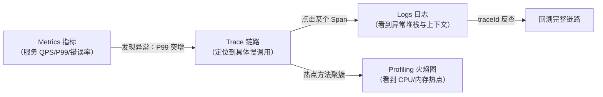

三个关键的"连接件"：

1. **TraceId → 日志（MDC）**
   ```xml
   <!-- Logback pattern -->
   <pattern>%d{yyyy-MM-dd HH:mm:ss} [%thread] %-5level [%X{traceId}] %logger{36} - %msg%n</pattern>
   ```
   Agent 在入口 Span 创建时 `MDC.put("traceId", ...)`。**注意异步线程要手动把 MDC 复制过去**（`MDC.getCopyOfContextMap()`），这是最常见的"日志里 traceId 为 null"的原因。
   SkyWalking 还提供 `apm-toolkit-logback-1.x` 的 `TraceIdPatternLogbackLayout`，可打印**分段 ID + span ID**（`TID:xxx;SID:yyy`），支持"同线程内多次请求"的精确区分。

2. **Metrics → Trace（exemplar）**
   Prometheus 的 exemplar / OTel 的 exemplar：指标桶里附一个"样本 traceId"，用户在 Grafana 点某个 P99 桶 → 直接跳到那条慢链路。**这是从"大盘"到"个案"的最短路径**，也是各家 APM 产品体验的分水岭。

3. **Trace → Profile（连续剖析）**
   把整条链路的 Span 耗时按方法栈聚合，或把 profiling 的栈与 span 时间窗对齐，得到"这条链路里 80% CPU 花在 `Jackson.serialize`"这种结论。SkyWalking 的 eBPF Profiling / Pyroscope / async-profiler 都支持这种关联。

---

# 第 5 章 协议与标准演进

## 5.1 十五年发展史（一条时间线讲清来龙去脉）

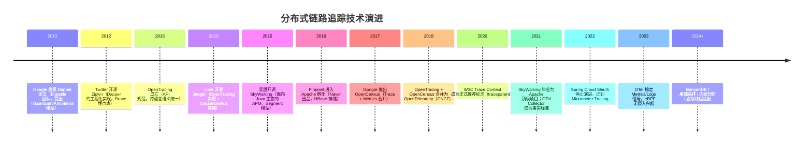

**Dapper 论文留下的四条设计原则（至今仍是铁律）**：

1. **低开销（Low overhead）**：生产环境常开，开销必须可忽略。
2. **应用透明（Application-transparent）**：尽可能不改业务代码。
3. **可扩展（Scalable）**：支撑每天数十亿 Span。
4. **快速分析（Fast analysis）**：分钟级内可定位问题。

> **面试价值**：能说出"Dapper 的四条原则"并逐条对应到现代实现（Agent 字节码 = 透明、采样 = 低开销、BanyanDB/ES = 可扩展、流式聚合 = 快速分析），会显得你不是"只会用工具"，而是理解设计动机。

## 5.2 为什么 OpenTracing 输了、OpenTelemetry 赢了（★★★ 高区分度）

| 维度 | OpenTracing | OpenCensus | OpenTelemetry（合并后） |
|---|---|---|---|
| 定位 | 纯 API 规范 | Google 自家 API+SDK+Agent | API + SDK + 协议 + Collector + Agent |
| 信号 | 只有 Trace | Trace + Metrics | Trace + Metrics + Logs + Baggage + Profile（演进中） |
| 传输协议 | 无（各实现自定义） | OpenCensus Proto | **OTLP（protobuf，gRPC/HTTP）** |
| 上下文传播 | 弱，无标准 header | 有 | **W3C Trace Context + Baggage 官方实现** |
| 生态 | 碎片化（contrib 各自为战） | 谷歌系孤立 | 全厂商 + CNCF 背书 |

**三个决定性原因**：

1. **"只有 API 没有数据契约"注定失败**：OpenTracing 定义了 `startSpan/finish` 的语义，但没说 Span 怎么序列化、字段叫什么。结果 Jaeger 上报一种格式、Zipkin 上报另一种，**UI 和存储无法复用**。OpenTelemetry 一次性把"API → SDK → 数据模型 → 传输协议（OTLP）→ Collector"全链路定义了，形成了**事实标准闭环**。
2. **只有 Trace 做不成可观测性**：用户要的是"指标发现异常 → 链路定位 → 日志确认"。OpenCensus 带 Metrics，合并后自然吞并了 OpenTracing。
3. **Collector 这个组件的战略价值**：它把"采集"与"后端"解耦。用户可以 Agent 上报 OTLP，Collector 再 fan-out 到 ES、Jaeger、Datadog、自研存储，**厂商锁定被彻底打破**。

## 5.3 四大传播协议的 Header 格式（能背下来是硬通货）

| 协议 | Header | 格式示例 | 说明 |
|---|---|---|---|
| **B3（Zipkin/Brave）** | `X-B3-TraceId`、`X-B3-SpanId`、`X-B3-ParentSpanId`、`X-B3-Sampled`、`X-B3-Flags` | 多 header 形式；也有单 header `b3: {traceId}-{spanId}-{sampled}-{parentSpanId}` | traceId 支持 64/128 bit；`X-B3-Flags: 1` 表示 debug（强制采样） |
| **Jaeger** | `uber-trace-id` | `{traceId}:{spanId}:{parentSpanId}:{flags}`（flags: 0=不采,1=采,2=debug） | 单一 header，解析简单 |
| **W3C Trace Context** | `traceparent`、`tracestate` | `00-{32hex}-{16hex}-01` | 标准化程度最高，OTel 默认 |
| **SkyWalking** | `sw8`、`sw8-correlation` | `1-{sampled}-{base64(traceId)}-{base64(segmentId)}-{base64(spanId)}-{parentService}-{parentInstance}-{parentEndpoint}-{peerAddress}` | base64 是为了规避部分中间件对特殊字符的限制；`sw8-correlation` 承载 baggage（key:value 用 base64 编码后以 `1_` 前缀分隔） |

**为什么 SkyWalking 要 base64 编码 + 带服务名**：
- **base64**：traceId/segmentId 是 16 进制或数字串，某些网关/WAF 对特殊字符敏感，base64 更"安全"；同时能压缩长度。
- **带 parentService/parentInstance/parentEndpoint**：服务端拿到的 header 就自带"上游是谁"，**拓扑图不需要依赖额外查询**就能直接构建 `service_relation`（对比 OTel 需要靠 Resource 上报 + 后端 join）。这是 SkyWalking 拓扑图"开箱即用、准确"的根本原因。
- **带 peerAddress**：用于识别"跨进程调用对端地址"，做实例级拓扑。

> **兼容性坑**：跨语言/跨公司边界时，**必须支持多种 header 并存**。OTel 的 `CompositePropagator` 就干这个：先试 `traceparent`，失败再试 `b3`，再试 `sw8`，并在出口**同时注入多种格式**。这是"渐进式接入、不要求上下游同时改造"的关键工程手段。

## 5.4 OpenTelemetry 的组件全景（面试画图题）

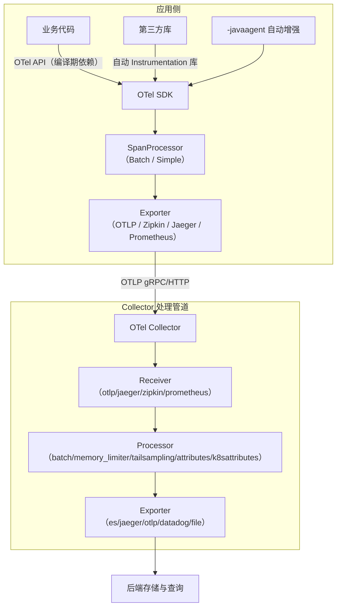

**必须区分的三组概念（面试常混淆）**：

| 概念 | 作用 | 类比 |
|---|---|---|
| **API** | 供业务代码调用的接口（`Tracer.spanBuilder`），**无实现、无状态**，被调用时不做事 | 接口定义（interface） |
| **SDK** | API 的真正实现：采样、SpanProcessor、导出 | 实现类 + 运行时 |
| **Instrumentation** | 针对具体库的自动埋点（`okhttp-3.0`、`spring-webmvc-6.0`） | 插件（plugin） |

**为什么必须 API/SDK 分离**：业务库（如 Netty、Spring）依赖 API，应用自己决定装不装 SDK、装哪个版本。**如果库直接依赖 SDK，会造成版本地狱**——这是 OTel 设计的核心动机，也是"为什么我的链路没有数据"最常见的原因（**只引了 API 没引 SDK/Agent，Span 是 Noop，静默丢弃**）。

**Sampler 的层级（要能说出四种）**：

```
AlwaysOn / AlwaysOff
TraceIdRatioBased(ratio)                      → 一致性哈希采样
ParentBased(root)                             → 有父就跟随父，无父用 root 策略
自定义（组合：错误优先、慢请求优先、租户白名单）
```

`ParentBased` 是**生产默认**：它保证"上游采了我就采"（不制造断链），同时"上游没采我就不采"（不浪费）。

## 5.5 OTel Collector 的管道语义（★★ 偏架构题）

Collector 是"可观测性领域的中转网关"，核心是三条 pipeline（traces/metrics/logs），每条 pipeline 是一个**串行处理链**：

```yaml
service:
  pipelines:
    traces:
      receivers:  [otlp]
      processors: [memory_limiter, k8sattributes, attributes, tail_sampling, batch]
      exporters:  [otlphttp/backend, loadbalancing]
```

三个必须放在正确位置的 processor（顺序错了会出问题）：

1. **`memory_limiter` 必须第一个**：它是"熔断器"，内存到阈值就拒绝新数据（返回错误让上游退避），防止 OOM。放在后面就失去了保护意义。
2. **`batch` 必须最后一个**（在 exporter 前）：先聚合再压缩发送，减少网络往返。
3. **`tail_sampling` 要在 batch 之前**：因为尾部采样需要按 traceId 聚齐数据，batch 会按大小切分，可能把同一 Trace 的 Span 切到不同批次。

> **尾部采样的负载均衡陷阱（深挖）**：`tailsamplingprocessor` 要求同一 traceId 的 Span 落到同一 Collector 实例，所以 exporter 必须配 `loadbalancingexporter`，且 **`routing_key: traceID`**。默认按 round-robin 会导致"每条 Trace 都缺一半 Span"，采样决策全部失准——这是 OTel 生产部署最常见的配置事故。

---

# 第 6 章 SkyWalking 深度剖析

## 6.1 定位与全景架构

SkyWalking 是**面向微服务、云原生、容器化的 APM 与可观测性平台**，2015 年由吴晟开源，2021 年成为 Apache 顶级项目。它的核心竞争力是 **"Java 生态最强的无侵入 Agent + 内置指标/拓扑/告警一体化"**。

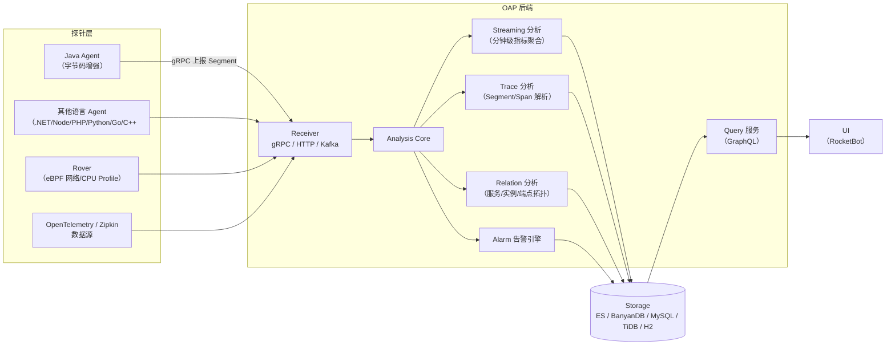

**四个组件职责**：

| 组件 | 职责 | 关键设计 |
|---|---|---|
| **Agent** | 采集、上下文传播、上报 | 字节码增强 + 插件化；Segment 打包上报 |
| **OAP（Observability Analysis Platform）** | 接收、分析、聚合、告警、查询 | **双链路分析**：Streaming（指标）+ Trace（明细） |
| **Storage** | 持久化 | 插件化存储（ES/BanyanDB/MySQL/TiDB），索引与明细分离 |
| **UI** | 展示 | 拓扑、链路、指标、告警、Profile |

## 6.2 Agent：为什么选择"字节码增强 + 插件化"

### 6.2.1 三种 Agent 技术路线对比

| 路线 | 代表 | 原理 | 优劣 |
|---|---|---|---|
| **字节码增强** | SkyWalking、Pinpoint、OTel Java Agent | `ClassFileTransformer` 改字节码，方法级插桩 | 覆盖全、能看到方法内部；需适配框架版本、启动变慢 |
| **JVMTI 事件** | 部分商业 APM | 方法进入/退出事件（`MethodEntry`/`MethodExit`） | 无字节码改写，但**性能开销极大**（生产基本不可用） |
| **采样栈 + Async-Profiler** | 火焰图类产品 | 定时采样线程栈 | 开销极低，但只有聚合统计，无单次请求因果 |

SkyWalking 选字节码增强的原因：**要"单次请求级别"的因果与耗时，必须有精确的方法进入/退出时间点**，采样栈做不到。

### 6.2.2 插件体系的结构（源码级理解）

一个 SkyWalking 插件由三部分组成：

```
skywalking-plugin.def                  ← 插件注册文件（声明要增强哪些类）
  order-4.x=org.apache.skywalking.apm.plugin.order.OrderPluginDefine
                                        ↑ 插件定义类，继承 ClassEnhancePluginDefine
```

```java
public class OrderPluginDefine extends ClassEnhancePluginDefine {
    // 1. 目标类匹配：不是精确类名，而是「按继承/接口/注解」匹配，更稳
    protected ClassMatch enhanceClass() {
        return byName("com.example.OrderService");        // 或 byHierarchy / byAnnotation
    }
    // 2. 实例方法拦截点：指定要增强的方法 + 前置/后置拦截器
    public InstanceMethodsInterceptPoint[] getInstanceMethodsInterceptPoints() {
        return new InstanceMethodsInterceptPoint[]{
            new DeclaredMethodsInterceptPoint() {
                public MethodMatcher getMethodMatcher() { return NamedMethods("createOrder"); }
                public String getMethodsInterceptor() { return "com...CreateOrderInterceptor"; }
                public boolean isOverrideArgs() { return false; }
            }
        };
    }
    // 3. 构造器拦截点（用于在对象创建时初始化 dynamic field）
    public ConstructorInterceptPoint[] getConstructorsInterceptPoints() { ... }
}
```

**三个关键机制**：

1. **`witness class`（见证类）机制**
   SkyWalking 的匹配规则是"按层次匹配"（`byHierarchy("org.springframework.web.servlet.DispatcherServlet")`），这在**类不存在**时会出错。所以插件里声明 `witnessClasses`：**先检查这个类是否真的在 classpath 中，存在才激活插件**。好处是插件可以"声明得很宽"而不会误伤/报错，也让同一个插件兼容多个框架版本。
2. **`EnhancedInstance` 动态字段**
   插件可以让目标类实现 `EnhancedInstance` 接口，从而在类上**追加一个 `Object` 字段**。用途见 4.1.3：把上下文挂到请求/连接对象上，绕过 ThreadLocal 的生命周期问题。
   ```java
   // 插件的典型用法：在 Connect 时把 Context 塞进 channel
   ((EnhancedInstance) channel).setSkyWalkingDynamicField(ContextManager.capture());
   ```
3. **分层 ClassLoader（防污染 + 性能）**
   ```
   bootstrap-plugins/  → 注入 bootstrap classpath（拦截 JDK 类，如 ThreadPoolExecutor）
   plugins/            → 业务插件（拦截第三方框架）
   activations/        → 插件定义类（skywalking-plugin.def）
   optional-plugins/   → 默认不加载（如 Spring Cloud Gateway、Kafka 客户端等重插件），按需拷贝
   ```
   **`optional-plugins` 的存在理由**：某些插件开销大或有兼容风险（如 `apm-spring-cloud-gateway`、`apm-kafka`），默认关闭，让用户按需承担成本。这是"**默认保守、能力可选**"的工程哲学。

### 6.2.3 Agent 的启动与增强全流程

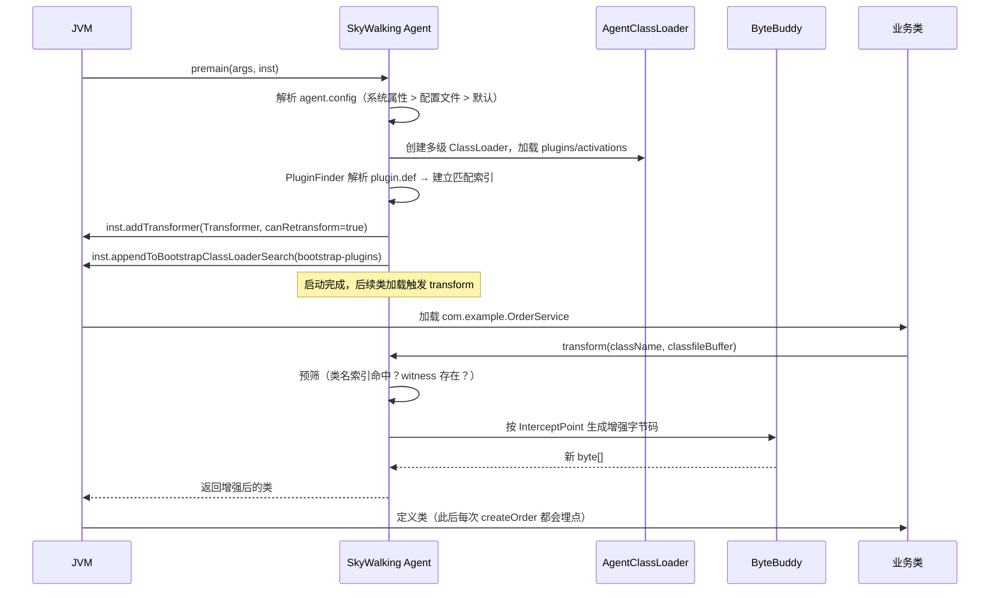

### 6.2.4 Agent 的配置项与生产必调项（实操题常考）

```properties
# ---- 采样 ----
agent.sample_n_per_3_secs=-1        # 老版本：每 3 秒采 N 条，-1 不限（已废弃）
agent.sample_rate=1                 # 新版本：0~1 采样率（推荐按插件配置）
# ---- 缓冲区（最关键的容量旋钮）----
agent.buffer_size=6000              # 环形队列容量；过小易丢，过大 OOM
agent.buffer_channel_size=5          # 消费线程数
# ---- 忽略与屏蔽（降噪）----
agent.ignore_suffix=.jpg,.jpeg,.png,.css,.js,.html,.txt,.ico
trace.ignore_path=/health,/metrics,/favicon.ico        # 不打点的路径
# ---- 慢请求强制采样 ----
agent.force_sample=false            # 或通过 /debugging 动态开启
# ---- 上下文 ----
agent.cool_down_threshold=10        # 连续失败后暂停上报的秒数（自身熔断）
# ---- 日志关联 ----
logging.level=INFO
```

> **`buffer_size` 的取舍（面试高频追问）**：它是"丢数据 vs OOM"的天平。设太小（如 1000）在流量尖峰时大量丢 Span，链路残缺；设太大（如 100000）在 Collector 故障期间会堆积百万对象，GC 压力爆炸。**正确做法**：按 `QPS × 平均 Segment 数 × 30 秒` 估算，并配合 `cool_down_threshold` 做主动丢弃，同时监控 `dropped` 计数。

## 6.3 Segment 数据模型再深入

### 6.3.1 三种 Span 类型的判定规则（实战必背）

| 类型 | 判定条件 | 典型场景 | 关键字段 |
|---|---|---|---|
| **Entry Span** | 当前线程**没有**活跃的上游 Span，且是"服务端接收" | Servlet 请求、gRPC Server、MQ Consumer、定时任务 | `peer`（上游地址/服务名）、`operationName`（端点名） |
| **Exit Span** | 发起**远程/跨进程/跨资源**调用 | HTTP Client、Dubbo Consumer、JDBC、Redis、MQ Producer | `peer`（下游地址）、`spanLayer`、`componentId` |
| **Local Span** | 纯本地方法，不跨进程 | `@Trace` 标注的方法、业务内部方法 | 无 peer |

**判定 Entry 的核心逻辑**（源码视角）：

```java
// ContextManager.createEntrySpan 时：
// 1. 若当前线程已有 Context（说明是被上游调用的下游）→ 复用，不新建
// 2. 若当前线程无 Context → 从 header extract 得到 ref（跨进程父子）
// 3. extract 成功 → Entry Span（带 ref）；extract 失败 → 新建 Root（新的 traceId）
```

**Entry Span 与 Exit Span 的"成对"原则**：一次 RPC 在客户端是 Exit，在服务端是 Entry，两者通过 header 的 `segmentRef` 相连。**缺一半就是断链**。

### 6.3.2 多条 Segment 如何拼成一条 Trace

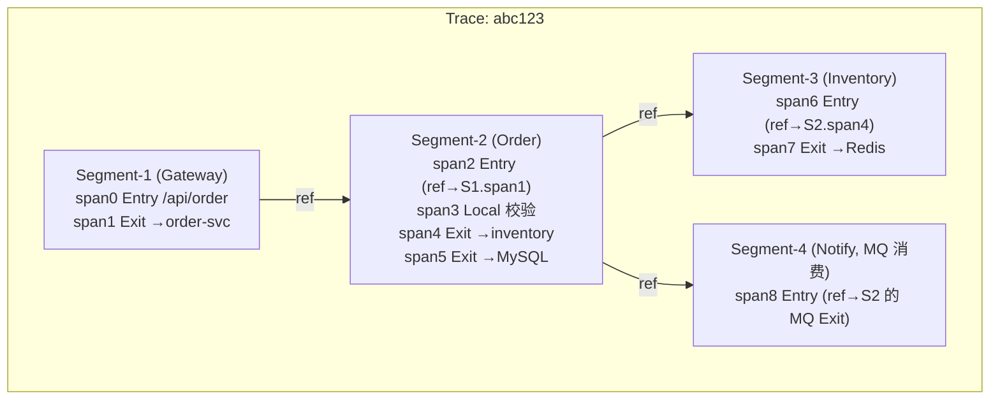

拼接算法（OAP 侧）：

```
1. 按 traceId 查出所有 segment + 所有 span
2. 对每个 segment，取其 refs（指向父 segment 的 segmentId + spanId）
3. 建立 (segmentId, spanId) → segment 的映射
4. 按 ref 把 segment 挂到父 span 下 → 形成 segment 级 DAG
5. 段内按 parentSpanId 建树 → 合并为完整调用树
6. 计算每个 span 的 self-time（段内直接相减 + 跨段按 ref 对齐）
```

> **面试深挖点**：SkyWalking 的 Segment 内 span 时间戳是**相对 segment startTime 的偏移**（以提升精度与压缩率），跨段对齐时必须换算成绝对时间。如果中间有 NTP 校时，会出现跨段时间为负——这就是 4.7 节讲的问题在 SkyWalking 里的具体表现。

### 6.3.3 Service / Instance / Endpoint 三层抽象（拓扑图的基础）

| 实体 | 定义 | 命名来源 | 基数 |
|---|---|---|---|
| **Service** | 逻辑服务（一组相同职责的实例） | Entry Span 的 `operationName` 中提取，或 agent.config 的 `agent.service_name` | 几十~几百 |
| **ServiceInstance** | 具体进程/JVM 实例 | `agent.service_instance_name`（默认 `IP@PID@启动时间戳`） | 几百~几万 |
| **Endpoint** | 具体的接口/入口 | Entry Span 的 operationName（`GET:/api/order/{id}`） | 几百~几十万（**高基数重灾区**） |

**为什么 Service 名必须人工指定**（`agent.service_name`）而不是从类名推断：自动推断会导致"同一个服务被识别成多个"（微服务拆分/多模块），拓扑图彻底崩坏。这也是接入规范里第一条铁律：**`service_name` 必须与 CMDB/注册中心的服务名一致**。

## 6.4 跨线程与异步上下文（SkyWalking 的适配细节）

### 6.4.1 核心 API 三件套

```java
// 1. 快照：把当前线程的 Context 冻结成不可变对象
ContextSnapshot snapshot = ContextManager.capture();
// 2. 在另一个线程恢复
Context ctx = snapshot.continued();   // 返回被恢复的 Context
try {
    // ... 业务逻辑，此时 ContextManager.get() 拿得到
} finally {
    ContextManager.stopSpan(ctx);     // 必须恢复原状，否则池线程"串味"
}

// 3. 注解式（最常用）：给 Runnable/Callable 自动打快照
@TraceCrossThread
class MyTask implements Runnable { ... }

// 4. 线程池增强（Agent 自动，无需改代码）：拦截 ThreadPoolExecutor.execute/submit
```

### 6.4.2 各异步框架的适配矩阵（踩坑清单）

| 场景 | SkyWalking 支持方式 | 注意事项 |
|---|---|---|
| `ThreadPoolExecutor` / `ForkJoinPool` | Agent 自动增强 `execute`/`submit`/`invokeAll` | 自研线程池（继承但未走标准接口）可能漏 |
| `CompletableFuture` | 增强 `supplyAsync`/`thenApply*`/`whenComplete*` | `thenApplyAsync` 带 Executor 时更复杂；嵌套链需逐节传播 |
| Spring `@Async` | 增强 `AsyncExecutionAspectSupport` | 需在 `@EnableAsync` 生效后；自定义 Executor 需可被识别 |
| Reactor（WebFlux） | 增强 `Flux`/`Mono` 关键操作符 + `Hooks` | `publishOn/subscribeOn` 切换线程时最容易断 |
| RxJava | 增强 `Observable`/`Flowable` 的 `subscribeOn`/`observeOn` | 同上 |
| gRPC（异步 Stub） | 增强 `ClientCall`/`ServerCall` | 回调线程与业务线程不同，需 dynamic field 承载 |
| Netty（自研协议） | 增强 `Channel`/`ChannelHandlerContext` 或手动 | 依赖 `EnhancedInstance` 挂 channel |
| Kafka Consumer | 增强 `KafkaConsumer.poll` + 批量消费逐条 extract | **批量消费必须逐条 extract**，否则一条链路的上下文污染整批 |
| 定时任务（XXL-Job/Quartz） | 增强 Job 执行入口 | 定时任务本身是 Root（新 traceId），但要能"关联到触发它的上游"需业务手动传 |

> **`ContextManager.stopSpan(ctx)` 的必要性**（易错点）：池线程用完不复位，下一个任务 `ContextManager.get()` 会拿到上一个任务的 Context → **链路串味**（A 的请求耗时算到了 B 的链路里），比断链更可怕，因为**数据是错的而不是缺的**。

## 6.5 OAP 分析链路：为什么是"两条链路"

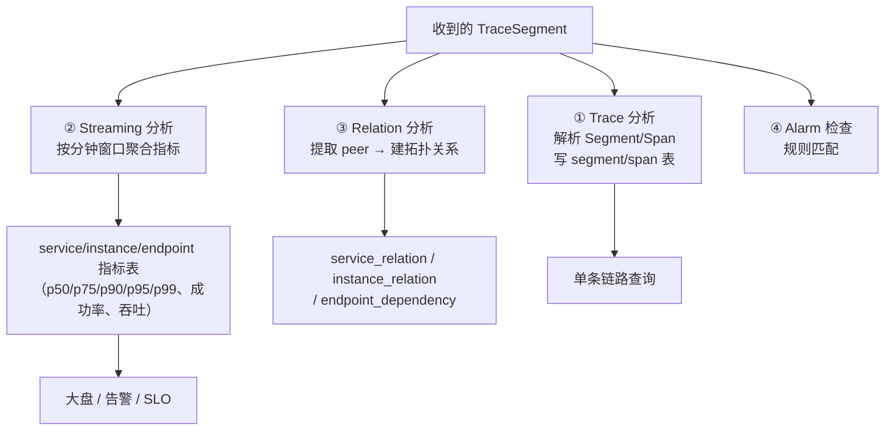

### 6.5.1 Streaming 分析（指标的正确算法）

**关键点：分位数是"预聚合近似"，不是精确计算**。SkyWalking 采用 **"热力图 / 桶（thermometer/bucket）"** 方案：

```
对每个 (实体, 分钟窗口) 维护一组耗时桶，例如
  [0,10ms) [10,50ms) [50,100ms) [100,500ms) [500ms,1s) [1s,5s) [5s,+∞)
每个桶记录 count；查询 p99 时在桶内线性插值

优点：内存 O(桶数) 而非 O(样本数)，可分布式 merge（各 OAP 节点按桶相加）
缺点：是近似值；桶粒度越粗误差越大
```

> **为什么不能存原始样本算精确分位数**：一分钟内某服务 100 万次调用，若存全部样本，内存与传输都不可接受。**DDSketch / t-digest / HDR Histogram 是同一思路的三种实现**，面试里能说出"可合并（mergeable）是分布式分位数聚合的核心要求"就是加分项。

### 6.5.2 Relation 分析（拓扑图的来源）

```java
// 对每个 Entry Span：
//   self = (serviceId, instanceId, endpointId)  ← 本 Span 归属
//   peer = span.getPeer()                      ← header 带来的上游服务名/地址
// 生成关系三元组并累加指标
serviceRelation(self.service, peer.service)     // 服务级
instanceRelation(self.instance, peer.instance)  // 实例级
endpointDependency(self.endpoint, peerEndpoint) // 端点级
```

拓扑图准确的前提：**peer 必须能被解析成"服务名"而不是"IP:Port"**。这就是 SkyWalking 在 header 里带 `parentService/parentInstance` 的原因（见 5.3）。

### 6.5.3 告警引擎

```yaml
# alarm-settings.yml（OAP 侧规则）
rules:
  service_resp_time_rule:
    metrics-name: service_resp_time
    op: ">"
    threshold: 1000
    period: 10            # 连续 10 个周期（分钟）满足
    count: 3              # 10 个周期中至少 3 次
    silence-period: 5
    message: "服务 {name} 响应时间超过 1000ms"
```

设计的三个要点：
- **`period + count` 组合**（而非单点阈值）：避免抖动误告；本质是一个"滑动窗口内的次数触发"。
- **`silence-period`**：告警风暴抑制（同一规则 N 分钟内只发一次）。
- **告警依赖指标，不依赖 Trace**：所以采集链路必须是"Streaming 先落指标"，否则告警延迟到分钟级以上不可用。

## 6.6 存储细节与容量估算

### 6.6.1 表结构（ES 视角）

| 索引 | 主键/关键字段 | 说明 |
|---|---|---|
| `sw_segment-*` | trace_id, segment_id, service_id, service_instance_id, start_time, latency, is_error, data_binary | 列表查询的核心表 |
| `sw_span-*` | segment_id, span_id, parent_span_id, refs, tags, logs | 详情表 |
| `sw_service-*` / `sw_service_instance-*` | 实体注册信息 | 实体维度 |
| `sw_service_relation_server_side-*` | time_bucket, service_id, peer_id, calls, errors, latency | 拓扑 + 指标 |
| `sw_metrics-aggregation-minute-*` | 各实体维度的分钟聚合 | 大盘与告警 |
| `sw_alarm-*` | 告警记录 | 告警历史 |
| `sw_records-all-*` | 浏览器/ profiling 等杂项记录 | 扩展 |

**分片与 TTL 策略（生产必调）**：

```yaml
# 按天分索引 + ILM 自动 rollover
storage:
  elasticsearch:
    day_step: 1                     # 每 1 天一个索引
    index_shards_number: 4          # 分片数（按数据量调，单分片 10~30GB 为宜）
    index_replicas_number: 1
    # TTL：trace 保留 7 天，metrics 保留 30 天（不同表不同策略）
```

> **分片数量是 ES 最容易踩的坑**：分片过多 → 每分片都是一个 Lucene 实例，堆与文件句柄爆炸（"over-sharding"）；分片过少 → 单分片过大，查询慢且无法并行。经验公式：**分片数 ≈ 日增数据量(GB) / 20GB，且每节点分片数 ≤ 20~25 个/GB 堆**。

### 6.6.2 容量估算（面试可以现场推）

```
已知：QPS = 3000，平均每请求 Segment 数 = 8，平均每 Segment 上报大小 = 3KB（含压缩前）
采样率 = 10%，保留 7 天

日 Segment 数 = 3000 × 8 × 86400 × 10% ≈ 2.07 亿
日原始大小   = 2.07 亿 × 3KB ≈ 621 GB（压缩后约 150~200GB）
ES 索引膨胀  ≈ ×1.8 ≈ 1.1 TB/天
7 天总量     ≈ 7.7 TB（含 1 副本则 ~15 TB）

OAP 侧内存：主要是 streaming 聚合窗口（桶）× 实体数，
  实体数 = service(100) × endpoint(平均 50) = 5000 个窗口，
  每窗口 ~500B → 2.5MB 级别，可忽略；瓶颈在 ES。
```

**结论**：SkyWalking 的成本瓶颈**几乎总在存储**，不在 Agent 也不在 OAP。所以优化顺序永远是：**先降采样率 → 再降 Tag 体积（禁大字段）→ 再调分片/TTL → 最后才考虑换存储**。

## 6.7 SkyWalking 的性能与开销（必问）

| 开销项 | 量级 | 说明 |
|---|---|---|
| CPU | 采样 10% 时 **1%～5%**；100% 采样时可达 5%～15% | 主要来自字节码插桩的 `nanoTime` + `ThreadLocal` 操作 + 对象分配 |
| 内存（堆） | 与 `buffer_size` 强相关 | `buffer_size * 平均 Segment 大小(3~10KB)`，6000 × 5KB ≈ 30MB |
| 内存（Metaspace） | +50~100MB | Agent 自身类 + 增强类的元数据 |
| 启动时间 | +3~10s | 类加载期要做匹配与字节码生成 |
| 网络 | 每条 Segment 3KB，采样后可控 | 批量 + gzip |
| **GC 压力** | 中等（对象分配率上升） | 大对象（长 SQL、大堆栈）会加剧 |

**降低开销的六个手段（实操题）**：

1. **降采样率**（最有效，直接线性降低）。
2. **关闭重插件**（`optional-plugins` 默认不启用，只按需拷）。
3. **屏蔽无关路径**（`trace.ignore_path`，健康检查/静态资源）。
4. **限制 Tag 体积**（SQL 截断 500 字符、禁止打印完整请求体）。
5. **减少 Entry 粒度**（不要给每个 Controller 方法都加 `@Trace`）。
6. **调 `buffer_size` 与消费线程数**，避免队列拥塞引发业务线程等待。

> **正确测开销的方法**（面试很实用）：同一压测流量下，A 组不挂 Agent、B 组挂 Agent（采样 100%）、C 组挂 Agent（采样 10%），对比 **TPS / P99 / CPU / GC 次数**。只测 CPU 是不够的——Agent 对**尾延迟（P99）**的影响往往比平均吞吐更大（因为批量上报时机与 GC 抖动）。

## 6.8 与日志、Mesh、eBPF 的协同

- **日志关联**：`apm-toolkit-logback-1.x` / `log4j2` 的 Layout，把 `TID:SID` 打进日志；配合 UI 的 "Log" 面板实现"点 Span 看日志"。原理见 4.8。
- **Service Mesh**：SkyWalking 提供 `skywalking-kubernetes`、`rover`；Mesh 侧（Istio/Envoy）可通过 OTel 采集 L7 数据，与 Agent 数据在 OAP 侧按 **同一 TraceId** 合并（前提是 Mesh 透传 `traceparent`/`sw8`）。
- **eBPF（Rover）**：不依赖语言 Agent，抓内核态网络事件 + CPU Profile，用于**无 Agent 的第三方服务、老服务、以及"Agent 看不到的系统调用层"**。局限：无法解析业务语义（只能看到 `L7 协议 + 方法栈采样`）、TLS 需解密配置、容器内核版本受限（需要 BTF/CO-RE 支持）。

## 6.9 SkyWalking 常见坑清单（面试"你遇到过什么问题"的弹药库）

| 现象 | 根因 | 解法 |
|---|---|---|
| 链路在网关后断 | Nginx 丢弃含下划线 header | `underscores_in_headers on` |
| 链路在后端某服务断 | 该服务未挂 Agent / 版本不兼容 / 插件未激活 | 看 Agent 日志 `witness class` 缺失，换插件或升级 |
| Endpoint 数量爆炸 | URL 带 ID / 未归一化 | OAP `endpoint_name_group` 正则分组 |
| OAP 频繁 Full GC | ES 查询返回大 `data_binary` / 分片过多 | 加 `limit`、调分片、升级堆、启 BanyanDB |
| 上报丢失 | `buffer_size` 太小 / Collector 抖动 | 加大 buffer + `cool_down_threshold` + 监控 dropped |
| 拓扑图缺边 | peer 解析不出服务名（只有 IP） | 确认 header 带 service 名 / 配注册中心反查 |
| 链路串味（耗时算错） | 池线程未 `stopSpan`，上下文残留 | 检查 `@TraceCrossThread`/线程池增强是否覆盖所有提交点 |
| 日志里 traceId 为空 | 异步线程未复制 MDC | `MDC.getCopyOfContextMap()` 手动传递或增强 `@Async` |
| 启动慢 | 全量插件扫描 + 大量字节码生成 | 拆 `plugins` 只留必需、开 `class_cache_mode` |

---

# 第 7 章 Zipkin 深度剖析

## 7.1 定位与历史

Zipkin 由 Twitter 于 2012 年开源，是 **Dapper 论文最早的工程化实现**。它的定位极其清晰：**"轻量的链路采集与查询系统"**——不追求大而全，只把"收集 Span → 存起来 → 按 TraceId 查出来"做到极致简单，因此生态极其广泛（Java 的 Brave、Go 的 zipkin-go、Python 的 py_zipkin、JS 的 zipkin-js，以及几乎所有 APM 都支持 Zipkin 格式上报）。

## 7.2 四大组件架构

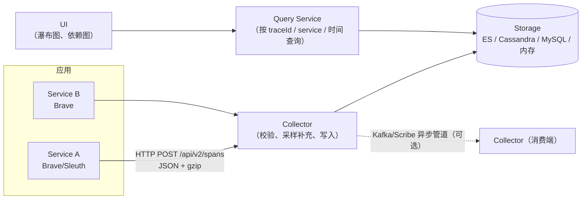

| 组件 | 职责 | 关键点 |
|---|---|---|
| **Collector** | 接收 Spans（`POST /api/v2/spans`），做 schema 校验、时间戳补全、写存储 | **无状态**，可水平扩展；校验失败返回 400 整批拒绝 |
| **Storage** | 持久化（ES/Cassandra/MySQL/内存） | 插件化；`spanStore` 抽象接口 |
| **Query** | 查询 API（`/api/v2/trace/{traceId}`、按服务/时间/耗时查） | 只读，可与 Collector 分机部署 |
| **UI** | 瀑布图、依赖图、搜索 | 纯前端（旧版），新版有 `zipkin-lens` |

> **Zipkin 的"无状态 Collector"很关键**：因为 Span 是**扁平、独立、按 Span 上报**的，Collector 之间不需要共享状态（不像尾部采样需要按 traceId 聚合）。**代价是存储层必须承担"按 traceId 聚合"的责任**——所以 Zipkin 的存储索引设计比 SkyWalking 更重。

## 7.3 Span 模型细节：cs/sr/ss/cr 与 shared span

### 7.3.1 四种 annotation 的完整语义

| Annotation | 全称 | 谁写 | 含义 |
|---|---|---|---|
| `cs` | Client Send | 客户端 | 发出请求的时刻 |
| `sr` | Server Receive | 服务端 | 收到请求的时刻 |
| `ss` | Server Send | 服务端 | 开始发送响应的时刻 |
| `cr` | Client Receive | 客户端 | 收到响应的时刻 |

**必须两端都上报的原因**（面试核心）：

```
只有客户端上报：知道"调用共花 800ms"，但不知道是网络慢还是服务端慢
只有服务端上报：知道"处理花 50ms"，但不知道请求在路上堵了 750ms、是否被重试
两端都有：    网络 750ms + 服务端 50ms —— 结论可执行（去查网络/查 LB/查超时重试）
```

### 7.3.2 `shared` Span：存储优化手段

默认情况下，客户端 Span 和服务端 Span 是**两条记录**（一条带 cs/cr，一条带 sr/ss，`id` 相同、`parentId` 不同）。开启 `shared` 后，服务端那条被标记 `shared=true`，UI/查询时**合并成一条**展示，节省一半存储。

```json
// 服务端上报的那条
{ "id": "abc", "shared": true, "kind": "SERVER", "localEndpoint": {"serviceName": "order"}, ... }
```

> **注意坑**：`shared` 合并后，`cs/cr` 与 `sr/ss` 落在同一条记录里，**必须做时钟偏移修正**才能正确画瀑布图（见 7.5）。很多团队开了 `shared` 后看到"服务端耗时早于客户端发送"，就是没做修正。

### 7.3.3 消息队列场景（PRODUCER / CONSUMER）

Zipkin V2 增加了 `kind=PRODUCER` / `CONSUMER`，用于异步链路：

```
Producer Span:  kind=PRODUCER, 记录"发送消息"的时刻（相当于 cs）
Consumer Span:  kind=CONSUMER, 记录"消费消息"的时刻（相当于 sr）
两者 shared，靠 messaging 的 destination 关联
```

这解决了老版本 Zipkin 无法表达"MQ 异步链路"的问题（老版本只能用 `cs` 单向 + 丢失父子关系）。

## 7.4 Brave / Sleuth 的埋点机制（Java 生态必知）

### 7.4.1 Brave 的四个核心抽象

```java
Brave brave = Brave.builder()
    .serviceName("order-service")
    .sampler(Sampler.Builder().rate(0.1).build())      // ① 采样策略
    .currentTraceContext(ThreadLocalCurrentTraceContext.create())  // ② 线程内上下文
    .spanReporter(AsyncReporter.create(urlConnectionSender))       // ③ 异步上报
    .build();

// ④ 传播：inject / extract
TraceContext.Extractor<HttpServletRequest> extractor = B3Propagation.newFactory(...).createExtractor(...);
```

| 抽象 | 作用 | 关键设计 |
|---|---|---|
| `Sampler` | 决定采不采 | `BoundSampler`（有界速率）、`DeclarativeSampler`（按注解/方法名） |
| `CurrentTraceContext` | 线程内 `Span` 的存取 | 可插拔（ThreadLocal / ScopeDecorator 装饰 MDC / 严格模式检测泄漏） |
| `SpanReporter` | 上报 | **`AsyncReporter` 是核心**：内部有 `ArrayBlockingQueue` + 单线程 flush，队列满时按 `messageTimeout` 丢弃并计数 |
| `Propagation`（`B3Propagation`） | header 注入/提取 | 支持多格式（B3 单头/多头、W3C） |

**`AsyncReporter` 的三个可调参数（生产必看）**：

```java
AsyncReporter.builder(sender)
    .queuedMaxSpans(1000)        // 队列容量（Span 数）
    .messageTimeout(1, SECONDS)  // 攒批超时（到点就发，不等满）
    .closeTimeout(...)           // 关闭时最多等多久（防止丢数据）
    .build();
```

> **`messageTimeout` 的取舍**：设太小（100ms）→ 请求数多，网络开销大；设太大（10s）→ 数据延迟、进程崩溃时丢更多。**1 秒是社区默认的折中**。这也是"链路数据为什么有延迟"的标准答案。

### 7.4.2 Spring Cloud Sleuth → Micrometer Tracing 的迁移（时代背景题）

- **Sleuth（2016~2022）**：基于 Brave，自动为 Spring MVC/WebFlux/Feign/RestTemplate/Kafka/Redis 等埋点，**默认 10% 采样**，自动注入 MDC 的 `traceId`/`spanId`。
- **2022 年 Sleuth 停止演进**，Spring Boot 3 改用 **Micrometer Tracing**（底层仍是 Brave 或 OTel，通过 `micrometer-tracing-bridge-brave` / `-otel` 选择）。
- **迁移要点**：日志 pattern 的 `%X{X-B3-TraceId}` 改为 `%X{traceId}`；`spring.sleuth.*` 配置改为 `management.tracing.*`；采样率配置项变更。

> **这个变迁本身就是一道面试题**："为什么 Spring 放弃 Sleuth？" 答：**避免 Spring 官方维护一套重复的埋点框架，把标准交给 OTel/Micrometer，降低与厂商实现的耦合**。这是"标准下沉、实现上移"的典型。

## 7.5 Zipkin 的时钟偏移修正（源码级）

Zipkin 的 UI（`zipkin-lens`）与 `zipkin2` 的合并逻辑里，有一个 `CorrectingClockSkew` 的处理：

```java
// 伪代码：合并客户端 span 与服务端 span 时的偏移估计
long clientDuration  = cr - cs;               // 客户端视角总耗时
long serverDuration  = ss - sr;               // 服务端处理耗时
long networkLatency  = clientDuration - serverDuration;   // 网络 + 排队

// 假设请求/响应单向延迟相等，则偏移：
long clockSkew = ((sr - cs) - (cr - ss)) / 2;
// 修正：把服务端 span 的时间整体平移 clockSkew，再对齐到客户端时间轴
```

推导已在 4.7.2 给出。**Zipkin 的独特之处是把它做成了"UI 层自动修正"**，用户看到的瀑布图是"客户端视角"的，不会出现负值或时间倒错。

**修正的局限**：只对"一发一收"的同步调用有效；MQ 异步场景（PRODUCER/CONSUMER 之间可能间隔几分钟）**不能假设单向延迟相等**，偏移无法估计，只能靠 NTP。

## 7.6 依赖图（Dependency Link）的算法

Zipkin 的"服务依赖图"（`/api/v2/dependencies`）不是从 Trace 树推的，而是**从 Span 的 parentId 关系聚合**：

```
对每条 Trace：
  对每个 Span S（有 parentId P）：
    if S.kind == SERVER 且 P 属于另一个服务：
        link(P.serviceName → S.serviceName) += 1   // 调用次数
        link.errors += (S.error ? 1 : 0)
        link.duration += S.duration

按时间窗口聚合成 DependencyLink { parent, child, callCount, errorCount }
```

**为什么"服务端 Span 的父 Span"才是边**：客户端 Span（`kind=CLIENT`）与服务端 Span（`kind=SERVER`）的 `id` 相同（同一次 RPC）。真正的"服务 A → 服务 B"这条边，应该由**服务端 Span 的 `localEndpoint.serviceName`(B) 与它父 Span 的 `localEndpoint.serviceName`(A)** 构成。**搞错这一步，依赖图会画出"自己调自己"或"反向箭头"**。

## 7.7 存储 Schema 与查询优化

### 7.7.1 Elasticsearch

| 索引 | 用途 |
|---|---|
| `zipkin-span-YYYY-MM-DD` | 主表（Span 明细） |
| `zipkin-dependency-YYYY-MM-DD` | 依赖图聚合结果（定时任务算） |
| `zipkin-autocomplete-*` | 服务名/span 名的自动补全（低基数缓存） |

**关键查询与对应索引**：

```json
// ① 查一条 Trace（最高频，必须最快）
{ "query": { "bool": { "filter": [ { "term": { "traceId": "abc" } } ] } } }

// ② 按服务 + 时间 + 耗时查（慢请求排查）
{ "query": { "bool": { "filter": [
    { "term":  { "localEndpoint.serviceName": "order-service" } },
    { "range": { "timestamp": { "gte": ..., "lte": ... } } },
    { "range": { "duration":  { "gte": 1000000 } } }        // 微秒 → >1s
] } } }
```

> **注意 Zipkin 的时间字段是微秒**：`duration: 1000000` 表示 1 秒。这是最容易写错的查询条件（写成毫秒会查出"所有请求都很慢"或"一条都查不到"）。

### 7.7.2 Cassandra

Zijin 的老牌存储，schema 设计体现"宽行 + 时间桶"：

```sql
-- 主表：按 trace 查
CREATE TABLE zipkin.span (
  trace_id    text,
  ts_u64      bigint,       -- 微秒时间戳
  span        blob,         -- 整个 Span 序列化（protobuf/json）
  PRIMARY KEY (trace_id, ts_u64)
);

-- 二级索引表：按服务 + span 名 + 时间查（物化表，写入时双写）
CREATE TABLE zipkin.trace_by_service_span (
  service_name text,
  span_name    text,
  bucket       int,         -- ts/3600，时间桶，避免超大分区
  ts_u64       bigint,
  trace_id     text,
  PRIMARY KEY ((service_name, span_name, bucket), ts_u64, trace_id)
);
```

**"时间桶（bucket）"是 Cassandra 的核心技巧**：如果把 `(service_name, span_name)` 做 partition key，一个热门服务一小时的数据就能撑爆单个分区（hot partition，写超时）。加 `bucket` 把分区切成小时级，写入均匀分布。

### 7.7.3 查询的两个"隐性成本"

1. **查一条 Trace = 全表扫 traceId**：如果 `traceId` 没有索引/分区裁剪，一次查询可能扫几天的数据。
2. **按时间范围查慢请求 = 范围扫描**：必须靠 `timestamp` 的 range index，且**结果集要 limit**（否则一次查回 100 万条，直接把 Query 服务打挂）。

## 7.8 Zipkin 的局限（为什么它"老了"）

| 局限 | 后果 | 现代方案如何解决 |
|---|---|---|
| **没有 Metrics 体系** | 无法回答"服务 QPS/P99 是多少"，只能查个案 | SkyWalking Streaming / OTel Metrics |
| **无流式聚合** | 每次看大盘都要扫原始 Span，慢 | 预聚合（分钟级指标表） |
| **采样策略单一** | 只有概率采样，无法"错误全采、慢请求全采" | 自定义 Sampler + 尾部采样 Collector |
| **拓扑弱** | 依赖图靠离线定时任务，延迟高、缺实例/端点粒度 | Relation 分析在线聚合（SkyWalking） |
| **Span 扁平独立上报** | 网络/存储开销大（每 Span 一次 RPC 或大 batch） | Segment 打包（SkyWalking） / Resource 下沉（OTel） |
| **无 Baggage 标准** | 业务上下文透传要自己塞 header | W3C Baggage |
| **UI 能力有限** | 无火焰图、无 span 级 tag 聚合分析 | APM 产品化 |
| **无告警/SLO** | 需要外挂 Prometheus + 自研规则 | 一体化平台 |

**但 Zipkin 有两个"不可替代"的价值**：

1. **协议格式成了通用交换格式**：几乎所有 APM 都支持"Zipkin 格式导出/导入"，是跨系统数据互通的最小公约数。
2. **极简模型，学习成本最低**：作为"讲清楚链路追踪原理"的教学模型，没有任何多余概念。**面试时用 Zipkin 模型讲原理是最清晰的**。

---

# 第 8 章 主流框架横评与国内大厂生态

## 8.1 五大框架横向对比（★★ 必背表）

| 维度 | Zipkin | Jaeger | SkyWalking | Pinpoint | OpenTelemetry |
|---|---|---|---|---|---|
| 出身 | Twitter 2012 | Uber 2015 | 吴晟 2015 / Apache | Naver / Apache 孵化 | CNCF 2019（合并） |
| 语言生态 | 全语言（Brave 最强 Java） | Go 后端 + 多语言 client | Java 最强 + 多语言 agent | **Java 强绑定** | 全语言（最广） |
| 侵入性 | 库/SDK（Brave/Sleuth） | 库/SDK | **Agent 字节码（默认无侵入）** | **Agent 字节码（最彻底）** | Agent + SDK 双模式 |
| 存储 | ES/Cassandra/MySQL/内存 | Cassandra/ES/Badger | ES/BanyanDB/MySQL/TiDB/H2 | **HBase** | 由 Collector 决定（无自带存储） |
| 指标体系 | 无 | 无（需 Prometheus） | **内置（流式聚合）** | 有（较全） | 有（Metrics SDK） |
| 拓扑图 | 弱（离线聚合） | 弱 | **强（在线聚合，服务/实例/端点三级）** | 强 | 无（需后端实现） |
| 告警 | 无 | 无 | **内置规则引擎** | 有 | 无（交给后端） |
| 采样 | 概率 | 概率 + 远程配置 | 概率 + 强制采样 + 插件级 | 概率 + 按方法 | 全策略 + 尾部采样（Collector） |
| 典型适用 | 轻量接入、已有生态 | 已用 Uber 体系 | **Java/多语言 APM 一体化** | 需要极致调用栈（方法级全量） | **新建体系、多云、厂商中立** |
| 主要缺点 | 功能少 | 运维重（Cassandra） | Agent 插件适配滞后、ES 成本 | HBase 运维重、开销大 | 概念多、自建后端成本高 |

> **一句话总结选型**：**要"开箱即用的一体化 APM"选 SkyWalking；要"标准中立、多语言、面向未来"选 OTel；要"最小依赖、快速验证"选 Zipkin；要"方法级深度诊断（含调用栈参数）"选 Pinpoint。**

## 8.2 国内大厂自研生态（公开资料整理）

> **说明**：以下内容基于公开技术文章、QCon/ArchSummit 分享与公开论文整理，**各家的最新架构与细节未公开，可能与现状有差异**，仅作为"业界实践模式"参考，面试中请以"据公开资料"的表述方式描述，不要当作确定事实。

| 厂商 | 系统 | 公开资料中的特点 |
|---|---|---|
| 阿里 | **EagleEye（鹰眼）** | 早期基于 Agent + 日志埋点；与内部 RPC 框架（HSF）、消息（Notify）、网关深度耦合；双 11 全链路压测体系（影子表/影子库与之配合）；强调"全链路 TraceId 透传 + 日志串联" |
| 美团 | **MTrace** | 借鉴 Zipkin/OpenTracing 模型；Kafka 做采集缓冲，ES/HBase 做存储；强调"高吞吐下的采样与降级"；与 MTThrift（自研 RPC）集成 |
| 滴滴 | **Titan** | 基于 OpenTracing 语义；ES 存储；强调"跨语言（Go/Java/PHP）统一模型"与"业务链路（订单/支付）定制" |
| 字节跳动 | **Argos（可观测性平台）** | 对外分享中强调"采集侧多语言 Agent + OTel 生态兼容 + 大规模 Collector 集群 + 采样治理"；日志/指标/链路统一平台化 |
| 腾讯 | **天机阁 / TSW 系** | 公开资料提及"自研 Agent + 与微信/游戏业务场景定制"；游戏场景强调"帧级/玩家级链路" |
| 京东、快手、小红书等 | 多为"自研 Collector + 开源 Agent 二次开发" | 共性：不直接落地开源全套，而是**替换存储与采集网关**，保留开源数据模型 |

**国内大厂不用开源直接落地的五个真实原因（面试高价值洞察）**：

1. **规模成本**：万亿级 Span/天，开源 Collector 的吞吐与存储成本模型撑不住，必须自研写入路径与冷热分层。
2. **与内部基础设施深度耦合**：自研 RPC（HSF/MTThrift/Dubbo 定制）、自研 MQ、自研网关、Service Mesh，需要在这些组件内部"原生埋点"，而非 Agent 事后适配。
3. **指标口径统一**：大厂的 SLO/容量/故障定级有强口径要求（如"成功率"必须排除业务限流），开源默认口径不匹配，必须自己算。
4. **数据安全与合规**：链路数据包含 SQL、URL、用户标识，必须做**脱敏、分级、权限隔离、审计**，开源方案通常只提供"关掉 tag"这种粗粒度能力。
5. **多语言与历史包袱**：Java/PHP/Go/C++/Node 并存，还要兼容十年前的框架，只有自研才能统一。

**共性架构模式（可以总结成一套"大厂链路追踪标准架构"）**：

```
多语言 Agent（字节码/eBPF/SDK）
   ↓ 异步批量上报（gRPC/自研协议）
接入网关（限流/鉴权/格式校验/协议转换）
   ↓
消息队列（Kafka，削峰 + 解耦，防止采集侧故障传导）
   ↓
实时计算（Flink/自研流式引擎：指标聚合、拓扑、异常检测、尾部采样）
   ↓
存储分层（热：ES/ClickHouse；温：HBase/OTS；冷：对象存储 + 离线计算）
   ↓
查询服务（GraphQL/自研 API）+ 统一可观测平台 UI（与日志/指标/告警打通）
```

> **这个架构里最值得学的是"接入网关 + Kafka 削峰"**：开源方案通常是 Agent 直连 Collector，一旦 Collector 抖动，Agent 重试风暴会打垮业务。**加一层"无限缓冲"的 Kafka，把"采集"与"分析"在时间上彻底解耦**，是超大规模下的必备设计。

---

# 第 9 章 工程落地实践

## 9.1 接入前必须定的六件事（避免返工）

| 决策项 | 选项 | 建议 |
|---|---|---|
| 采集方式 | Agent / SDK / eBPF / Mesh | 主用 Agent，eBPF 兜底老服务，网关统一生成根 TraceId |
| 技术栈 | SkyWalking / OTel / 自研 | 已有 Java 体系且要一体化 → SkyWalking；多语言多云 → OTel + 自建 Collector |
| 传播协议 | B3 / W3C / sw8 | **新系统统一 W3C `traceparent`**，老系统用 CompositePropagator 兼容 |
| 采样策略 | 头部 / 尾部 / 混合 | 混合：Agent 侧概率采样 + 错误/慢请求强制采样 + Collector 尾部兜底 |
| 存储 | ES / ClickHouse / BanyanDB | 按"日增 GB × 保留天数"选，**优先 ClickHouse（成本）或 BanyanDB（专用）** |
| 数据治理 | 脱敏 / 保留期 / 权限 | **PII 一律不入 tag**；URL 归一化；TTL ≤ 7 天（明细） |

## 9.2 透传改造清单（照着做就不会断链）

```
【入口】
  ☐ 网关/Nginx：header 透传（注意 underscores_in_headers、WAF 白名单）
  ☐ 网关：不可信来源丢弃上游 traceparent，重新生成
  ☐ 所有 Servlet/WebFlux/gRPC/Dubbo/MQ Listener/定时任务 确认有 Agent 覆盖

【出口】
  ☐ HttpClient（Apache/OkHttp/JDK11 HttpClient）→ 确认 Agent 插件生效
  ☐ RestTemplate / WebClient / Feign → 确认拦截器已注册（自研封装极易漏）
  ☐ 自研 RPC / 自研 HTTP 客户端 → 手动 inject
  ☐ Kafka Producer → put headers；RocketMQ → putUserProperty
  ☐ 第三方 SDK（支付/短信/OSS）→ 一般不需要（出站即可，不追链路）

【异步】
  ☐ 线程池：自研线程池 + 未走标准接口的（如 Netty EventLoop 自定义）逐一验证
  ☐ @Async / CompletableFuture / Reactor / RxJava
  ☐ MQ 批量消费逐条 extract
  ☐ 日志 MDC 跨线程复制

【验证】
  ☐ 单链路全通：从公网入口打一个请求，检查是否一条 Trace 覆盖所有服务
  ☐ 异步链路：确认 MQ 消费端是"同 trace 的子链路"而不是新 Root
  ☐ 错误链路：抛异常，确认 span status=ERROR 且堆栈被记录
  ☐ 慢链路：sleep 1s，确认 self-time 与下游耗时分解正确
```

## 9.3 埋点规范（决定数据能不能用）

1. **命名规范**
   - Span 名用"动词 + 资源"：`getOrder`、`deductStock`，禁止 `method1`、`doSomething`。
   - HTTP 入口统一 `METHOD:/path/{id}`（**归一化**，见 4.5.5）。
   - DB 统一 `SELECT table_name` / `UPDATE table_name`（**表名级，不写完整 SQL**）。
2. **Tag 白名单（强约束）**
   ```
   允许：http.method, http.status_code, db.system, db.operation, mq.topic,
         rpc.method, error.type, business.code（业务错误码）
   禁止：用户手机号/身份证/邮箱、完整请求体、完整 SQL（含参数值）、
         任何高基数字段（orderId、sessionId）作为「可检索 tag」
   ```
   > **高基数 tag 是存储头号杀手**：把 `orderId` 做成可检索 tag，等于把每个订单建一条索引，几周后 ES 直接崩。
3. **错误标注三件套**：`status=ERROR` + `exception.type` + `exception.message`（**堆栈作为 event/log 记录，且截断到 N 行**，否则一个堆栈 500KB，把存储打爆）。
4. **Span 粒度**：只给"可能成为瓶颈或需要独立归因"的环节建 Span。一个方法建一个 Span 会导致 span 数 ×10、成本 ×10，而信息增量极小。

## 9.4 采样策略设计（可直接抄的模板）

```yaml
采样分层（按业务价值 + 结果）:
  L0 屏蔽:     /health, /metrics, /favicon, 静态资源        → 0%
  L1 核心交易: 下单、支付、退款、登录                     → 30%~50%
  L2 普通读:   商品详情、列表、搜索                       → 1%~5%
  L3 低频后台: 运营后台、报表                             → 0.1%

结果侧强制采样（覆盖概率采样）:
  - status=ERROR（含业务错误码非 0）                     → 100%
  - duration > P99 阈值（如 1s）                         → 100%
  - 指定用户/租户（灰度、VIP 排障）                      → 100%

保护:
  - 强制采样总量令牌桶限流（如 500 QPS），超限降级
  - Collector 侧再叠加尾部采样，剔除"不错误、不慢"的长尾
```

## 9.5 与 SLO / 告警体系的结合

**RED 方法**（Rate / Errors / Duration）是链路追踪与指标的天然接口：

```
Rate     = 服务 Calls/min           ← 来自 trace 流式聚合
Errors   = 错误 span 数 / 总 span 数 ← status=ERROR
Duration = p50/p95/p99              ← 来自耗时桶（近似分位数）

SLO 定义示例：order-service 的 p99 < 500ms，错误率 < 0.5%，可用性 > 99.9%
告警：连续 3 分钟 p99 > 500ms 或 错误率 > 1% → 触发；silence 5 分钟
```

## 9.6 排障 SOP（把知识变成可执行流程）

```mermaid
flowchart TD
    A["用户反馈慢/报错"] --> B{"有具体 traceId 吗？"}
    B -->|有| C["直接查链路瀑布图"]
    B -->|没有| D["按 服务+时间+耗时/错误 搜索链路列表"]
    D --> C
    C --> E{"耗时集中在哪？"}
    E -->|"自身耗时高（self-time）"| F["看 CPU/GC/锁/序列化 → 结合 Profiling"]
    E -->|"下游耗时高"| G["下钻到下游服务 Span"]
    E -->|"网络耗时高（cs-sr 大）"| H["查 LB/超时重试/DNS/连接池/TLS 握手"]
    G --> I{"下游是错误还是慢？"}
    I -->|错误| J["看 exception tag + 日志"]
    I -->|慢| E
    F --> K["定位到具体方法/依赖"]
```

**三个高频排障场景的标准答案**：

| 场景 | 关键证据（在链路里怎么看） | 结论 |
|---|---|---|
| 超时重试导致雪崩 | 同一父 Span 下有 N 个同 peer 的 Exit Span；第 1 个 duration ≈ 超时阈值 | 客户端超时设置过短或下游真的慢，看 `cs-sr` 区分 |
| 连接池耗尽 | Exit Span 的 `startTime` 到真正发出请求之间有 gap（或在 tag 里记录 `pool.wait`） | 需在客户端埋"获取连接"的 Span，否则只能看队列指标 |
| N+1 查询 | 同一 Span 下有 100 个同 `db.operation` 的兄弟 Exit Span | 批量化 / 缓存 |

## 9.7 上线流程（灰度与回滚）

```
1. 影子阶段：只挂 Agent，采样 0.1%，只上报不接大盘 → 观察 CPU/内存/启动时间
2. 小流量：单服务灰度，采样 1%，验证链路完整性与数据质量
3. 全量采集：按 9.4 采样策略全量铺开，同步完成透传改造验证
4. 治理期：URL 归一化、tag 白名单、去噪（健康检查）
5. 成本优化：按"存储增长曲线"调采样率与 TTL，必要时换存储
回滚开关：Agent 支持动态关闭（`/debugging` 端点或配置中心推送），采样率可热调整
```

---

# 第 10 章 国内大厂面试题库（40 题）

> **关于题源与标注的说明**
>
> 以下题目基于**技术社区面经、公开面试复盘文章、各厂技术博客与 QCon/ArchSummit 公开分享**中的高频考点整理，并按考点归类重写，**不是任何公司的原题逐字复现**。`标签` 表示该考点在对应公司面试中出现频率较高（依据公开面经），仅供参考，不代表该公司一定这样问。
>
> **难度标注规则**
> - `★☆☆` 基础：能说清概念即可，校招/初级必答
> - `★★☆` 进阶：需要讲出"为什么"和工程细节，社招 3~5 年必答
> - `★★★` 深度：需要讲出原理推导、源码级细节或架构权衡，P7+/资深/基础架构岗区分度题
> - `高频` = 公开面经中出现 ≥5 次；`中频` = 2~5 次；`低频` = 少见但有深度

## 10.1 第一组：基础概念（Q1–Q6）

### Q1. 什么是分布式链路追踪？有了日志和监控，为什么还需要它？

- **考核程度**：`★☆☆` `高频` ｜ **标签**：阿里、美团、字节、腾讯
- **考点**：能否把"三类可观测数据的边界"说清楚，而不是背定义。

**参考答案**

链路追踪解决的是**「单次请求的因果关系」**问题。一次用户请求跨 N 个服务后，日志告诉你"每个服务内部发生了什么"，指标告诉你"整体水位如何"，但都无法回答"这**一次**请求的 2 秒花在哪个节点"。链路追踪用一个全局唯一的 `TraceId` 把这次请求在所有服务中产生的 `Span` 串成一棵调用树，每个 Span 带精确的开始时间、耗时、状态、关键属性。

三者互补关系（这是加分点）：

| 手段 | 回答的问题 | 粒度 | 局限 |
|---|---|---|---|
| 日志 | 这次执行内部发生了什么 | 单机、单事件 | 无跨服务因果 |
| 指标 | 整体是否异常、趋势如何 | 聚合、无个体 | 无法定位到具体请求 |
| **链路** | **这次请求慢/错在哪一环** | **单次请求、跨服务** | 需要采样，不能算总量 |

**追问（面试官常接着问）**

- "链路追踪能替代日志吗？" → 不能。链路给的是"骨架 + 耗时 + 关键属性"，日志给的是"细节与上下文（异常堆栈、业务分支）"。正确做法是**互跳**：Span → 日志（靠 MDC 里的 traceId），日志 → 链路（靠 traceId 反查）。
- "链路追踪能不能算 QPS？" → **不能**（采样后样本量不足）。QPS/成功率必须来自服务端流式聚合的指标，这是 SkyWalking 分"两条链路"的根本原因（见 Q34）。

---

### Q2. Trace、Span、SpanContext 分别是什么？父子关系靠什么建立？

- **考核程度**：`★☆☆` `高频` ｜ **标签**：全行业通用
- **考点**：数据模型的最基本三件套，答不出来直接出局。

**参考答案**

- **Trace**：一次完整请求，用 `TraceId`（通常 128 bit）唯一标识。
- **Span**：链路中的一个执行片段（一次方法调用/RPC/DB 访问），带 `SpanId`（通常 64 bit）、`parentSpanId`、`startTime`、`duration`、`status`、`tags`。
- **SpanContext**：跨进程传递的"身份凭证"，最小集合是 `traceId + spanId + 采样标志 + 传播状态（tracestate/baggage）`。

**父子关系建立过程**（必须能说出来）：

```
1. 父 Span 结束时（或发起调用前），把 {traceId, 自己的spanId} 编码进协议头（inject）
2. 下游服务读取 header（extract），得到 (traceId, parentSpanId)
3. 下游创建 Span 时，spanId 由自己新生成，parentSpanId = 上游传来的 spanId
4. 同 traceId 的所有 Span 按 parentSpanId 组织成树
```

**关键细节（区分度）**：W3C `traceparent` 里的字段叫 `parent-id`，指的是"对下游而言的父"，也就是**发送方自己的 spanId**。命名容易让人误以为是"我的父"，实际是"我是下游的父"。

**追问**

- "如果下游丢了这个 header 会怎样？" → 下游会新建一个 Root Span，产生**新的 TraceId**，链路在这里断开（表现为"两条独立链路"）。
- "为什么 spanId 由每个节点自己生成，而不是父节点分配？" → 避免父节点需要预知子节点数量、避免额外一次 RPC；只需保证 **同一父节点下 spanId 唯一**（64 bit 随机碰撞概率极低：同父下 10 万子 Span 的碰撞概率约 10^-10 量级）。

---

### Q3. `cs / sr / ss / cr` 分别是什么？为什么客户端和服务端都要埋点？

- **考核程度**：`★★☆` `高频` ｜ **标签**：美团、滴滴、京东、字节（Zipkin 相关岗必问）
- **考点**：这是链路追踪"能不能分出网络耗时"的核心，背概念没用，要能讲出推导。

**参考答案**

| 记号 | 含义 | 写入方 |
|---|---|---|
| `cs` Client Send | 客户端发出请求 | 客户端 |
| `sr` Server Receive | 服务端收到请求 | 服务端 |
| `ss` Server Send | 服务端发出响应 | 服务端 |
| `cr` Client Receive | 客户端收到响应 | 客户端 |

四个时间点合起来能算出三个关键量：

```
客户端视角总耗时  = cr - cs
服务端处理耗时    = ss - sr
网络耗时（RTT）   = (sr - cs) + (cr - ss)
```

**为什么必须两端都埋**：

- **只有客户端**：你知道"这次调用花了 800ms"，但 800ms 是网络堵了 750ms 还是服务端算了 750ms？**无法区分**，也就无法决定"该找网络组还是找业务组"。
- **只有服务端**：你知道"处理花了 50ms"，但不知道请求在路上排了多久队、是否被重试了 3 次、TLS 握手花了多久。
- **两端都有**：`cs-sr=720ms` + `ss-sr=50ms` → 结论立刻变成"网络/LB/客户端连接池问题"，这就是可执行的结论。

**追问（深挖）**

- "网络耗时很高但服务端很快，可能是什么原因？" → 连接池等待（请求还没发出去）、LB/网关排队、DNS 解析、TLS 握手、丢包重传、NAT/防火墙会话超时、客户端线程池打满。
- "为什么不直接用 `cr - cs - (ss - sr)` 当作网络耗时？" → 因为它把所有"客户端侧等待"（连接池、序列化、GC 停顿）都算进了网络里，只能说明"不是服务端慢"，不能说明"是网络慢"。要精确定位需在客户端额外埋"获取连接""序列化"两个 Span。

---

### Q4. 什么是 Self Time（自身耗时）？为什么不能直接按 Span 的 duration 排序找瓶颈？

- **考核程度**：`★★☆` `高频` ｜ **标签**：阿里、美团、字节
- **考点**：考察是否有真实排障经验，"照 duration 排序"是典型外行做法。

**参考答案**

Span 的 `duration` 是**包含子 Span 的总耗时**。入口 Span 永远包含全链路耗时，所以按 duration 降序排序时，**Top1 永远是根 Span**，没有任何诊断价值。

```
SelfTime(span) = duration(span) − Σ(所有直接子 Span 的耗时)
```

正确做法是按 Self Time 排序，才能找到"真正吃时间的那一环"。

**三个实现坑（这部分最能区分"做过"和"看过"）**：

1. **并行子 Span 不能简单相加**。如果两个子调用是并发的（`CompletableFuture.allOf`），它们的耗时区间重叠，直接求和会算出**负数**。正确做法是对子区间做**并集**（区间合并算法），或者用 `max(childrenEnd) - min(childrenStart)` 的覆盖长度。
2. **父子关系要用 `parentSpanId` 判定，不能用时间包含关系**。异步/跨线程场景下子 Span 可能"开始早于父 Span"（时钟偏移）或"结束晚于父 Span"（回调延迟）。
3. **必须做 clamp**：子 Span 区间会因时钟偏移溢出父 Span 边界，计算时要截断到 `[parentStart, parentEnd]`。

**追问**

- "如果 self time 很高，下一步怎么查？" → 结合 Profiling（火焰图）看 CPU 热点；看 GC 日志；看锁竞争；看序列化开销（大对象 JSON）。self time 高意味着"问题在本进程内"，不需要再下钻下游。
- "self time 为负说明什么？" → 时钟偏移 / 子 Span 区间重叠 / 数据损坏（父 Span 上报丢失后错误挂载）。

---

### Q5. Baggage 是什么？它和 Tag 有什么区别？为什么生产上要严格限制？

- **考核程度**：`★★☆` `中频` ｜ **标签**：字节、快手、小红书（OTel 体系岗位）
- **考点**：很多人只知道 Tag，不知道 Baggage，这是 OTel 时代的必备概念。

**参考答案**

| 维度 | Tag / Attribute | Baggage |
|---|---|---|
| 作用 | 描述**当前 Span 自身**的属性 | 随链路**透传给所有下游**的业务上下文 |
| 传播 | 不传播 | **传播**（跨进程随 header 走） |
| 典型内容 | `http.status_code`、`db.system` | `tenantId`、`userId`、`灰度标识`、`实验分组` |
| 存储 | 存在 Span 上，可被检索 | 不一定入库，主要供下游中间件读取 |
| 风险 | 高基数导致存储爆炸 | **header 膨胀、性能损耗、数据泄露** |

**Baggage 的价值**：让下游服务"不依赖参数透传"就能拿到上游的业务上下文。例如网关把 `tenantId` 放进 Baggage，下游的 DB 中间件就能自动按租户分库分表 / 限流 / 打标——**不需要改业务方法签名**。

**为什么必须严格限制（三个真实风险）**：

1. **Header 膨胀**：Baggage 会随每次 RPC 转发，如果放了 10 个字段 × 平均 50 字节 = 500 字节/请求，在 QPS 10 万时是 50MB/s 的纯额外带宽；且 W3C 规定 `baggage` header 有长度上限（实践上建议 ≤ 512 字节，gRPC metadata 总限 8KB）。
2. **数据泄露**：Baggage 会跨服务、跨机房传播，甚至被写入访问日志。把手机号、身份证放进去 = 数据合规灾难（等保/GDPR 直接触雷）。
3. **性能损耗**：Baggage 是不可变的（每次 `put` 都要复制整个 map），高基数、频繁修改会导致大量对象分配。

**追问**

- "Baggage 和 MDC 的关系？" → MDC 是"日志线程本地上下文"，Baggage 是"跨进程链路上下文"。工程上常见做法是**把 Baggage 的少量字段同步写入 MDC**，这样日志里能直接看到租户/用户信息。
- "如果 Baggage 太大怎么办？" → 只放"标识类短 ID"（如 `tenantId=1024`），绝不放大对象；必要时改为"下游按 ID 反查注册中心"。

---

### Q6. Root Span 是怎么产生的？什么情况下一条 Trace 会有多个根？

- **考核程度**：`★★☆` `中频` ｜ **标签**：阿里、美团、滴滴
- **考点**：考察是否理解"断链"与"多根"的边界，很多候选人只想到"网关是根"。

**参考答案**

**Root Span 的产生条件**：当前线程/进程**没有可用的上游 SpanContext** 时，新建 `TraceId` + 新 `SpanId`，该 Span 即 Root。

典型产生点：
1. **公网入口**（网关/第一个服务）：上游是浏览器/App，没有链路上下文。
2. **定时任务**（`@Scheduled`、XXL-Job）：由调度器触发，无上游请求。
3. **消费无 header 的 MQ 消息**（老生产者未埋点）。
4. **链路断开处**：上游 header 丢失（Nginx 剥了 header、自研客户端未 inject、异步线程没上下文）。

**一条 Trace 有多个根（或多父）的三种合法场景**：

| 场景 | 说明 | 数据结构上怎么表达 |
|---|---|---|
| **批处理 / fan-in** | 100 个上游请求聚合成 1 次 DB 批查询，这 1 个 DB Span 被 100 条 Trace 引用 | 需要**多父引用**（OTel `Links`、SkyWalking `SegmentRef` 多 ref） |
| **MQ 广播消费** | 1 条消息被 10 个消费者各自处理，10 条子链路 | 每个消费者各自建 Entry Span 引用同一条 Producer Span |
| **采样不一致导致的断链** | 上游采了、下游没采（或反之），出现"半条链路" | 数据上是残缺，不是真的多根 |

> **区分度点**：很多实现（包括早期 Zipkin）只有单一 `parentId`，**无法表达 fan-in**，只能"复制多份 Span"或"丢弃"。成熟的实现必须支持 `links`/多 ref，否则批处理场景的链路永远画不对。

**追问**

- "怎么判断一个 Root 是『真根』还是『断链』？" → 看它的入站协议：如果该服务是 HTTP Entry 但**没有 traceparent 且上游明确应该调用它**，就是断链；如果是定时任务/MQ 无 header，是合法根。工程上可加一个 tag 标记 `root.cause=gateway|scheduler|header_missing`，方便统计断链率。

---

## 10.2 第二组：数据模型与协议（Q7–Q11）

### Q7. Zipkin V2 的 Span 模型有哪些字段？`kind` 的四个值分别是什么含义？

- **考核程度**：`★★☆` `高频` ｜ **标签**：美团、京东、携程
- **考点**：Zipkin 是最清晰的教学模型，答不上来说明原理没打通。

**参考答案**

核心字段：`traceId`、`id`、`parentId`、`name`、`kind`、`timestamp`（微秒）、`duration`（微秒）、`localEndpoint`、`remoteEndpoint`、`annotations`、`tags`、`shared`。

`kind` 四值（**这是判断链路覆盖能力的关键**）：

| kind | 含义 | 对应 annotation |
|---|---|---|
| `SERVER` | 服务端接收请求 | `sr` / `ss` |
| `CLIENT` | 客户端发起请求 | `cs` / `cr` |
| `PRODUCER` | 消息生产者发送消息 | 单点（无对应收） |
| `CONSUMER` | 消息消费者接收消息 | 单点 |

**设计要点（能讲出"为什么"才算过关）**：

- **微秒精度**：链路里大量操作在百微秒级（缓存命中、本地方法），毫秒精度会算出一堆 `duration=0` 的 Span，失去诊断意义。
- **`localEndpoint`/`remoteEndpoint` 结构化**：只有结构化（serviceName + ip + port）才能做"服务依赖聚合"和"拓扑自发现"；用字符串就无法聚合。
- **`PRODUCER`/`CONSUMER` 的引入动机**：MQ 是"发出去就不管"的单向通信，没有 `cr`。老版 Zipkin 只能用 `cs` 单向表达，导致**消费端的父子关系丢失**（消费端不知道自己是哪条消息的子链路）。加了这两个 kind 才能表达异步链路。

**追问**

- "为什么 `timestamp` 用微秒而不用毫秒或纳秒？" → 微秒是"毫秒太粗、纳秒太细（long 溢出风险、多数系统时钟精度到不了）"的折中；且微秒级 `long` 可表示 292471 年，无溢出问题。
- "`shared: true` 是什么？" → 客户端与服务端的 Span 合并成一条存储标记，节省 50% 存储。见 Q36。

---

### Q8. OpenTracing 中 `ChildOf` 和 `FollowsFrom` 有什么区别？为什么需要区分？

- **考核程度**：`★★★` `中频` ｜ **标签**：阿里、滴滴、字节（架构岗）
- **考点**：这是"语义建模"能力题，绝大多数人只知道 ChildOf。

**参考答案**

| 关系 | 语义 | 适用场景 |
|---|---|---|
| `ChildOf` | **强因果**：父 Span 的语义依赖子 Span 的结果，子 Span 必须在父的业务逻辑内完成 | 同步 RPC、DB 查询、缓存调用 |
| `FollowsFrom` | **弱因果**：父 Span 不关心子 Span 的结果，子 Span 只是"由它触发" | 异步通知、发 MQ 消息、异步日志上报、定时后续任务 |

**为什么必须区分（三个实际影响）**：

1. **错误传播**：异步子链路失败，**不应该**把父链路标记为 `ERROR`（用户的下单已经成功了，只是通知没发出去）。用 `ChildOf` 会导致"明明成功的请求被标红"，误报率飙升。
2. **关键路径（critical path）计算**：计算"这次请求的耗时"时，只应累计 `ChildOf` 链路；`FollowsFrom` 的子链路可能在几秒后才完成，算进来会让"耗时"虚高。
3. **采样决策**：`FollowsFrom` 的子链路可以独立采样（与父链路解耦），而 `ChildOf` 必须跟随父的采样决策（否则断链）。

> **延伸（国内实现的差距）**：SkyWalking 的 `SegmentRef` **不区分**强弱因果，只有"跨进程/跨线程"两种技术性引用。所以 SkyWalking 在异步场景下需要靠 `SpanLayer`（MQ）+ 业务约定来判断，无法自动推导"异步子链路失败不该污染父链路"。这是选型时可讨论的技术细节，OTel 的 `Links` + 自定义 attribute 表达能力更强。

**追问**

- "MQ 生产 → 消费，应该用哪种关系？" → **严格说是 FollowsFrom**（生产成功不必然要求消费成功），但**工程上多数实现用 ChildOf**，因为这样链路能连成一条便于查看。折中方案：用 ChildOf 保持可视化连续，但在**错误统计与 SLO 计算时把 MQ 段排除**。

---

### Q9. W3C `traceparent` 的格式是什么？解析时必须遵守哪条兼容规则？

- **考核程度**：`★★☆` `高频` ｜ **标签**：字节、快手、B站
- **考点**：细节题，能写出格式和 `version` 兼容规则就很稳。

**参考答案**

```
traceparent: 00-4bf92f3577b34da6a3ce929d0e0e4736-00f067aa0ba902b7-01
             │  │                                │                │
             │  │                                │                └ trace-flags（2 hex = 8 bit）
             │  │                                └────────────────── parent-id（16 hex = 8 byte）
             │  └─────────────────────────────────────────────────── trace-id（32 hex = 16 byte）
             └────────────────────────────────────────────────────── version（2 hex = 1 byte）
```

规则：
- `version = 00`（当前唯一正式版本）。
- `trace-id`：16 字节，**全 0 非法**（0 表示"无效 context"）。
- `parent-id`：8 字节，全 0 同样非法。
- `trace-flags`：bit0 = `sampled`（`01` 表示已采样）。

**必须遵守的向前兼容规则（重点）**：

1. **遇到不认识的 `version` 直接丢弃整个 header**，不要尝试解析。原因：未来版本可能改变字段布局，硬解析会得到垃圾数据。
2. **`version = ff` 是保留值，必须拒绝**（规范明确禁止）。
3. **字段数量多于预期时**（`version=00` 但后面多了字段），按"忽略尾部多余字段"处理（向前兼容）。
4. **大小写不敏感**：header 名 `Traceparent` 与 `traceparent` 等价（HTTP header 规范）。

**为什么 `sampled` 这一个 bit 这么关键**：它是"全链路采样一致性"的载体。根节点决定采样后写 `01`，后续所有节点看到 `01` 就**跟随采样**，不再各自随机——避免"上游采了、下游没采"导致的断链。这就是 `ParentBased` 采样器的工作基础。

**追问（安全类，很有区分度）**

- "来自公网的请求带了 `traceparent`，应该信任吗？" → **不应该**。恶意用户可构造固定 traceId 污染数据、或把 `sampled` 改成 `00` 让攻击流量的链路"隐身"。**网关必须丢弃外部传入的 traceparent 并重新生成**。
- "`tracestate` 有什么用？有什么限制？" → 厂商扩展状态（如 `congo=t61rcWkgMzE`），支持多 vendor 共存；有长度上限（建议 ≤512 字符），且**顺序有语义**（最近写入的在最前），修改时要整体转发。

---

### Q10. B3、`uber-trace-id`、`traceparent`、`sw8` 四种 header 有什么差异？跨系统时怎么兼容？

- **考核程度**：`★★☆` `中频` ｜ **标签**：阿里、美团（多系统并存场景）
- **考点**：真实环境常常"四个协议并存"，能不能给出兼容方案是关键。

**参考答案**

| 协议 | Header | 格式 | 特点 |
|---|---|---|---|
| B3（Zipkin/Brave） | `X-B3-TraceId`、`X-B3-SpanId`、`X-B3-ParentSpanId`、`X-B3-Sampled`、`X-B3-Flags` | 多 header；单 header 形式 `b3: {tid}-{sid}-{sampled}-{psid}` | traceId 支持 64/128 bit；`X-B3-Flags:1` = debug 强制采样 |
| Jaeger | `uber-trace-id` | `{tid}:{sid}:{psid}:{flags}` | 单 header，flags：0 不采 / 1 采 / 2 debug |
| W3C TC | `traceparent`、`tracestate` | `00-{tid}-{sid}-{flags}` | 标准化最好，OTel 默认 |
| SkyWalking | `sw8`、`sw8-correlation` | `1-{sample}-{b64(tid)}-{b64(segId)}-{b64(spanId)}-{parentService}-{parentInstance}-{parentEndpoint}-{peer}` | base64 规避字符限制；**自带上游服务名**，拓扑可直接构建 |

**跨系统兼容的标准解法：`CompositePropagator`**

```java
// OTel 的组合传播器：出口同时注入多种格式，入口依次尝试提取
Propagator p = Propagator.newCompositeTextMapPropagator(
    TraceContextPropagator.getInstance(),   // W3C
    B3Propagator.injectingMultiHeaders(),   // B3
    new SkyWalkingPropagator()              // 自定义适配
);
```

**三个工程细节**：

1. **出口"多写"、入口"逐个试"**：不要要求上下游同时改造，这是渐进式接入的唯一可行路径。
2. **必须做"协议转换"语义检查**：B3 的 64 bit traceId 与 W3C 的 128 bit 不能直接对齐。常见做法是**用 128 bit 高位补零**（但严格来说两者不是同一 ID 空间，混用会导致同一条链路出现两种 ID 形式，UI 要能识别）。
3. **SkyWalking 的 `sw8` 带服务名**：这是它拓扑图"开箱即准"的原因（不用额外查询就能建 `service_relation`），但也意味着**上游必须诚实上报自己的服务名**，否则拓扑会出现"unknown-service"节点。

---

### Q11. OpenTracing 为什么最终被 OpenTelemetry 取代？

- **考核程度**：`★★☆` `中频` ｜ **标签**：字节、腾讯、华为（架构演进题）
- **考点**：考察技术判断力，能说出"标准的分层设计"。

**参考答案（三个决定性原因）**

1. **只有 API、没有数据契约**。OpenTracing 定义了 `startSpan/finish` 的语义，却**没有定义 Span 怎么序列化、字段叫什么、通过什么协议传输**。结果 Jaeger 一种格式、Zipkin 一种格式，采集端无法复用、存储与 UI 无法互通。**一个"只有接口没有数据格式"的标准，注定无法形成生态闭环。**
2. **只有 Trace，没有 Metrics/Logs**。可观测性的真实工作流是"指标发现异常 → 链路定位 → 日志确认"，只有 Trace 做不了闭环。而 Google 的 OpenCensus 本来就带 Metrics，两者合并后自然形成 OTel。
3. **Baggage 与传播能力不足**。OpenTracing 时代没有统一的跨进程传播格式（W3C 标准尚未成熟），各实现各自定义 header，导致"跨语言即断链"。

**OpenTelemetry 做对了什么（加分点）**：

- **分层设计**：`API`（只给业务库依赖，零实现）→ `SDK`（实现采样/处理/导出）→ `OTLP`（标准化协议）→ `Collector`（采集中转）→ `Semantic Conventions`（字段命名标准化）。**每一层都有明确边界，解决了 OpenTracing "API 与实现纠缠"的病。**
- **Collector 的战略价值**：把"采集"与"后端"解耦，用户可以用 OTLP 上报后自由导出到任何存储，**彻底打消厂商锁定顾虑**（这是各厂商愿意共同支持它的根本原因）。

**追问**

- "OTel 有什么代价？" → 概念多（Resource/Scope/Span/Link/Event）、SDK 版本演进快、Java Agent 的插件覆盖度不如 SkyWalking 成熟、自建后端（Collector + 存储）运维成本高。**所以"新建体系选 OTel、已有 Java 体系要一体化 APM 选 SkyWalking"是常见结论。**

---

## 10.3 第三组：上下文传播（Q12–Q18，最重要的一组）

### Q12. 跨进程的上下文为什么必须放在协议头里？如果不用 header 还有哪些方案？

- **考核程度**：`★★☆` `高频` ｜ **标签**：全行业
- **考点**：基础但要答出"为什么"，很多人只会说"约定俗成"。

**参考答案**

**放 header 的四个理由**：

1. **与业务载荷解耦**：放 Body 要修改所有 DTO、破坏接口契约、影响签名/验签/加解密，成本极高且易出错。
2. **所有协议都有元数据通道**：HTTP header、gRPC metadata、MQ properties、TCP 自定义协议头——都有"业务数据之外"的扩展位。
3. **中间件可读写**：网关、LB、Service Mesh 无需懂业务就能透传甚至重写，这是实现"全链路"的前提。
4. **不侵入业务序列化**：不用管 JSON/Protobuf/Thrift 的兼容性。

**不用 header 的替代方案及其问题**：

| 方案 | 问题 |
|---|---|
| 放 Body / 方法参数 | 侵入业务、每个接口都要改、破坏契约 |
| 放 URL Query | 污染缓存键、日志泄露、长度限制（2048 字符）、被 WAF 拦 |
| 放 Cookie | 仅浏览器场景、跨域受限、大小限制 4KB |
| 共享存储（Redis 传上下文） | 额外一次远程调用（延迟 + 故障点）、无法保证原子性、成本高 |
| 线程/进程内传递（`ThreadLocal`） | 只解决进程内，跨进程无效 |

> **特例说明**：**同一台机器内跨进程（如父子进程）**可以用共享内存/环境变量传；**同一进程跨线程**用 `ThreadLocal`/`Context`。但一旦跨网络，header 是唯一通用解。

---

### Q13. 线程池场景下链路上下文怎么传递？有哪几种方案，各有什么问题？

- **考核程度**：`★★★` `高频` ｜ **标签**：阿里、美团、字节、滴滴（**必考题**）
- **考点**：这是"链路断链"的头号原因，也是最能拉开差距的题。

**参考答案**

问题本质：`ThreadLocal` 的上下文绑定在**创建它的那个线程**上。任务提交到线程池后由**池线程**执行，池线程的 `ThreadLocal` 里没有父 Span；更糟的是池线程被复用时**还残留上一个任务的上下文**（串味，比断链更危险，因为数据是错的）。

**四种方案对比**：

| 方案 | 实现方式 | 优点 | 问题 |
|---|---|---|---|
| ① 手动包装 | `Runnable r = tracer.wrap(task)` 再 submit | 简单、精确 | 每个提交点都要改，**必然漏**；第三方库内部的池改不了 |
| ② Agent 增强线程池 | 拦截 `ThreadPoolExecutor.execute/submit/invokeAll`，自动包装 `Runnable`/`Callable` | 业务零改造、覆盖广 | 覆盖不到：自研线程池未走标准接口、`ForkJoinPool`、`ScheduledExecutorService`、Netty EventLoop、第三方库内部池 |
| ③ 快照 + 显式恢复 | `snapshot = capture()`；任务里 `ctx = snapshot.continued()`，结束后 `stopSpan(ctx)` | 语义清晰、可控、可精确到任务级 | 必须业务配合；**忘记 `stopSpan` 就会串味** |
| ④ 可传递 ThreadLocal（TTL） | 包装 `get/set`，提交时复制快照（`TtlRunnable`） | 对业务透明 | 与 Agent 方案**双重包装冲突**；`InheritableThreadLocal` 在线程池下失效（见 Q14） |

**生产推荐组合**：

```
Agent 自动增强（覆盖 90% 标准场景）
   + @TraceCrossThread / capture+continued（覆盖自研线程池、Netty、复杂异步）
   + 校验机制（在关键入口断言 Context 不为 null / traceId 符合预期）
```

**为什么"忘记 stopSpan"很可怕（必须讲这个）**：

```
池线程 T1 执行任务 A（traceId=aaa）→ 未清理 → 执行任务 B（traceId=bbb）
任务 B 内部 ContextManager.get() 拿到 aaa 的 Context
→ B 的所有子 Span 挂到了 A 的链路上
→ A 的耗时包含了 B 的工作，A 的"自身耗时"暴涨或被算成负数
→ 排障时得出完全错误的结论，且难以复现（取决于线程调度）
```

所以 SkyWalking 提供 `ContextManager.stopSpan(ctx)`，OTel 提供 `Context` 的 scope 语义（`try (Scope s = context.makeCurrent())` 自动关闭）。**"恢复现场"是硬要求，不是可选项。**

**追问**

- "`ForkJoinPool` 有什么特殊？" → 工作窃取（work-stealing）会让任务在**任意线程**执行，且子任务可能与父任务并行、嵌套，上下文必须靠 `ForkJoinTask` 的对象字段承载（不能靠 ThreadLocal）。这也是 SkyWalking 要用 `EnhancedInstance` 动态字段的原因之一（见 Q23）。
- "CompletableFuture 的链式调用怎么传？" → 需要增强 `thenApply/thenCompose/whenComplete` 系列（每个阶段都可能换线程）；`thenApplyAsync(executor)` 还要在 Executor 层面再包一层。

---

### Q14. `InheritableThreadLocal` 为什么在线程池里不生效？

- **考核程度**：`★★★` `中频` ｜ **标签**：阿里、腾讯（Java 基础深挖题）
- **考点**：考察 JDK 底层机制的准确理解，很多人答"因为线程池复用"但说不清细节。

**参考答案**

`InheritableThreadLocal` 的传递发生在 **`Thread` 对象的构造时刻**，而不是任务提交时刻：

```java
// JDK Thread 构造器（简化）
Thread(ThreadGroup g, Runnable target, String name, long stackSize, AccessControlContext acc) {
    ...
    Thread parent = currentThread();
    // 只在「创建新线程」时，把 parent 的 inheritableThreadLocals 复制一份
    if (parent.inheritableThreadLocals != null)
        this.inheritableThreadLocals = ThreadLocal.createInheritedMap(parent.inheritableThreadLocals);
}
```

**线程池的问题**：池里的线程是**在池初始化时创建的**（`corePoolSize` 个），之后**永远复用，不再新建**。所以：

1. 任务 A 提交时，池线程早已创建，`inheritableThreadLocals` 是"池创建那一刻父线程"的快照 —— **与任务 A 无关**。
2. 任务 B 提交时同样不会新建线程，依然是那份陈旧快照。
3. 结果：**要么拿到 null，要么拿到池初始化时的脏数据**。

**推论（面试加分）**：

- `InheritableThreadLocal` 只在"**每次任务都新建线程**"的场景有效（如 `new Thread(runnable).start()`）。
- 阿里 `TransmittableThreadLocal`（TTL）正是为修补这个缺陷而生：它在**任务提交时**（`TtlRunnable.get(task)`）捕获快照，**任务执行前**回填、**执行后**恢复原值（`replay`/`restore`），因此适配线程池。
- TTL 的代价：每次提交都要复制 map（所有 TTL 变量），高频提交时有明显分配开销；且会与 Agent 方案重复包装，需要统一（常见做法：**只用一种传播机制**，不要 TTL + Agent 混用）。

**追问**

- "`ThreadLocal` 为什么会内存泄漏？" → `ThreadLocalMap` 的 key 是**弱引用**（`WeakReference<ThreadLocal>`），value 是强引用。当 `ThreadLocal` 对象被回收后，key 变成 null 但 value 仍在 Map 里，且池线程长期存活 → value 无法回收。**`remove()` 必须写在 finally 里**。

---

### Q15. Reactor / WebFlux 场景下 `ThreadLocal` 为什么完全失效？怎么解决？

- **考核程度**：`★★★` `中频` ｜ **标签**：字节、快手、B站（响应式架构岗）
- **考点**：响应式是当前主流，答不上来会显得只懂传统 MVC。

**参考答案**

**失效原因**：Reactor 的核心是"**一个请求的执行可以在任意线程上分段进行**"。

```java
Mono.fromCallable(() -> queryDb())        // 线程 A（可能是 IO 线程）
    .subscribeOn(Schedulers.boundedElastic())  // 线程 B
    .publishOn(Schedulers.parallel())          // 线程 C
    .map(this::transform)                      // 线程 C
    .subscribe();                              // 线程 D
```

一个逻辑调用跨了 4 个线程，而 `ThreadLocal` 只在"设置它的那个线程"上可见。**根本没有一个"当前线程"能代表"当前请求"**。

**Reactor 的正确解法：不要用线程绑定，用"上下文对象随数据流走"**。

1. **Reactor 自带的 `contextWrite` / `deferContextual`**：
   ```java
   Mono.deferContextual(ctx -> Mono.just(ctx.get("traceId")))
       .contextWrite(Context.of("traceId", traceId));
   ```
   把上下文作为**数据流的一部分**向下游传递（但它只在 `deferContextual` 处可见，不能自动透传到所有操作符）。

2. **OTel 的做法**：`Hooks.onEachOperator()` 在**每个操作符**外层插一层，把 `Context` 从 `Subscription` 取出并 `makeCurrent()`，操作符执行完再恢复。这样**每一个操作符执行时，都能看到一个"临时正确"的 ThreadLocal**。

3. **SkyWalking 的做法**：直接增强 `Flux`/`Mono` 的关键方法（`map`/`flatMap`/`filter`/`subscribe`/`onNext`），在 `onNext` 的 Lambda 外包一层，从 `Subscription`/`Scannable` 的字段（`EnhancedInstance` 动态字段）里取 Context。

**为什么"增强每个操作符"是唯一可行解**：因为 Reactor 的线程切换发生在**操作符边界**（`publishOn`/`subscribeOn`/异步源），只要保证"进入操作符前恢复上下文、退出时清理"，就能覆盖所有切换点。这也解释了为什么"未适配的操作符"（自定义 `Operator`）依然会断链。

**追问**

- "Kotlin 协程呢？" → 用 `CoroutineContext` 承载（`ThreadContextElement`），协程切换时自动 `restore`/`updateThread`，这是协程天然比 Reactor 好做的地方。
- "Java 21 虚拟线程呢？" → `ThreadLocal` 在虚拟线程上会有"载体线程（carrier）状态污染"问题（虚拟线程挂起/恢复会切换载体，但 `ThreadLocal` 是绑在虚拟线程对象上的，不会污染载体；但**大量虚拟线程会让 `ThreadLocal` 的内存开销 ×N**）。OTel 提供 `VirtualThreadContextStorage` 应对。

---

### Q16. MQ（Kafka/RocketMQ）的异步链路怎么保证不断？批量消费有什么坑？

- **考核程度**：`★★★` `高频` ｜ **标签**：阿里、美团、字节、京东（**几乎必考**）
- **考点**：异步链路是最容易断的地方，能说出"批量消费逐条 extract"就是实战派。

**参考答案**

**核心思路**：消息是"异步的 RPC"，上下文要跟着消息走。

```
生产端（PRODUCER Span）：
  1. 创建 Producer Span（kind=PRODUCER），父 = 当前业务 Span
  2. 把 SpanContext 序列化后写入消息 header
     Kafka:        record.headers().add("traceparent", bytes)
     RocketMQ:     msg.putUserProperty("traceparent", value)  // 或 setKeys
     RabbitMQ:     basicProps.getHeaders().put(...)
  3. 发送成功 → finish（注意：发送失败要标 ERROR）

消费端（CONSUMER Span）：
  1. poll 到消息后，从 header 提取 SpanContext
  2. 创建 Consumer Span（kind=CONSUMER），parent = 生产端的 SpanId
  3. 业务处理完后 finish
```

**五个实战坑（这部分是区分度核心）**：

1. **批量消费必须逐条 extract**（最致命）：
   ```java
   // 错误做法：只在批次开始 extract 一次
   List<Record> records = consumer.poll(...);
   extract(records.get(0));            // ❌ 整批共用一个上下文
   records.forEach(this::handle);      // 100 条消息全部挂到第 1 条的链路上

   // 正确做法：逐条
   for (Record r : records) {
       SpanContext ctx = extract(r.headers());   // ✅
       try (Scope s = ctx.makeCurrent()) { handle(r); }
   }
   ```
   后果：**100 条不同用户的请求被合并到一条 Trace 里**，耗时是"100 条串行之和"，排障时完全无法定位单条消息。

2. **重试 / 死信队列的父子关系**：消费失败重试时，重试的 Consumer Span 应该有**独立的 Span**（同 traceId，父 = 上一次失败的 Consumer Span），而不是复用同一个 SpanId。否则"重试 3 次"在链路上看不出来。死信队列消息要保留原 traceId，否则线上问题追不回原始链路。

3. **消费端是"新根"还是"子链路"的判断**：如果上游没埋点（老生产者），消费端只能是新根。**必须加标记**（如 `root.cause=kafka_no_header`），否则会被误判为"断链"。

4. **顺序消息 / 分区**：同一 partition 的消息是顺序处理的，**上下文必须严格串行恢复**，不能并发共享（否则串味）。

5. **消息投递与业务事务的一致性**：如果是"本地事务 + 发消息"（事务消息/Outbox），Producer Span 应该覆盖"发消息"这一步，且**发送失败必须标 ERROR**，否则链路显示成功但消息丢了。

**追问**

- "为什么把 header 放在消息体里（而不是消息属性）会有问题？" → RocketMQ 的 userProperty 有长度限制（约 1KB，且不能含特殊字符）；Kafka headers 是独立的字节数组，原生支持，**优先用 header**。放消息体会破坏业务 schema 且消费端要先反序列化才能拿上下文，顺序颠倒。
- "如果消息积压几小时才被消费，链路还有意义吗？" → 有意义但要注意：**消费 Span 的耗时会包括"排队时间"吗？** 不应该。应当区分 `messaging.wait_time`（消息在队列中等待的时间，需要生产端记录时间戳）与"处理耗时"。**把排队时间算进处理耗时是严重误导**。

---

### Q17. 什么是"上下文串味（污染）"？它比断链危险在哪？怎么防？

- **考核程度**：`★★★` `中频` ｜ **标签**：阿里、美团（资深岗）
- **考点**：能区分"数据缺失"与"数据错误"，是成熟度标志。

**参考答案**

**串味**：线程/对象上残留了**不属于当前请求**的上下文，导致日志、Span、指标被挂到错误的链路上。

**三类典型成因**：

| 成因 | 场景 |
|---|---|
| 池线程未清理 | 任务 A 结束没 `stopSpan`，任务 B 继承了 A 的 Context |
| MDC 未清理 | 日志框架的 MDC 是 ThreadLocal，池线程复用导致 traceId 串 |
| 对象字段复用 | 连接池复用的连接/Channel 上挂着上一次请求的 Context（`EnhancedInstance` 动态字段忘记覆盖） |

**为什么比断链更危险**：

- 断链 = **数据缺失** → 一眼可见（traceId 变了 / 出现新根），排查方向明确。
- 串味 = **数据错误** → 表面看链路"完整漂亮"，但耗时不真实、因果关系是错的。**排障时会沿着错误线索深挖几小时，甚至得出"是下游服务的问题"的错误结论，把故障引向错误团队。**

**五种防护**：

1. **强制 finally 清理**：所有 `continued()` 必须配 `stopSpan()`；MDC 用 `MDC.clear()` 在 finally 里；OTel 用 `try-with-resources` 的 `Scope`。
2. **快照不可变**：`ContextSnapshot` 是冻结的副本，杜绝"修改影响源"。
3. **入口断言（校验闸门）**：在关键入口（如 RPC 处理开始处）断言 `traceId` 与请求头一致、`parentSpanId` 非空（除非是合法根），不一致则告警。
4. **隔离测试**：在测试环境构造"同一线程连续处理两条不同 trace 的请求"，断言两条链路的 traceId 不串。
5. **对象级清理**：连接/Channel 归还池前清空动态字段（或在获取时立即覆盖）。

---

### Q18. 来自外部（公网）的 `traceparent` 应该信任吗？为什么？

- **考核程度**：`★★★` `低频但高区分度` ｜ **标签**：阿里、字节（安全 + 可观测性交叉题）
- **考点**：绝大多数人不会想到安全问题，答出来很加分。

**参考答案**

**不应该信任，必须在边界丢弃并重新生成。**

三个攻击面：

1. **数据污染 / 投毒**：攻击者可构造固定 `traceId`，让成千上万个请求聚到同一条链路上 → 单条 Trace 的 Span 数爆炸（存储一条记录几万 Span），查询直接超时；也可以伪造 `parentService` 让拓扑图出现虚假依赖边，误导架构治理。
2. **可观测性隐身**：把 `trace-flags` 改成 `00`（不采样），如果你的采样器是 `ParentBased`（跟随父），**整条链路都会被丢弃** → 攻击流量在链路系统里"不存在"，绕过基于链路的异常检测。
3. **拒绝服务**：畸形/超长 `tracestate`（规范建议 ≤512 字符但解析器未必校验）可触发异常或内存膨胀；大量构造异常 header 可打满解析线程。

**正确做法（分层信任）**：

```
公网入口（不可信）：丢弃全部链路 header → 由网关生成新 TraceId
   ↓ 内部服务间（可信）
内网（可信）：接受并透传（因为上下游都是自己人）
   ↓ 合作伙伴 / 第三方回调（半可信）
受限接受：校验格式 + 长度 + 字段白名单，不采信 parentService，只取 traceId 做"外部链路关联"
```

**额外加分点**：还应该做**入口 header 体积限制**（如 `traceparent` ≤ 128 字节，`tracestate` ≤ 512，总 header 体积 ≤ 8KB），超限直接拒绝并计数——这既防 DoS，也符合 W3C 规范建议。

## 10.4 第四组：采样策略（Q19–Q22）

### Q19. 为什么必须采样？头部采样和尾部采样的本质区别是什么？

- **考核程度**：`★★☆` `高频` ｜ **标签**：全行业（尤其阿里、字节、美团）
- **考点**：能算成本、能讲出两者取舍，而不是背定义。

**参考答案**

**先算成本（面试时能算账非常加分）**：

```
5000 QPS × 20 Span/请求 × 86400 秒 ≈ 86 亿 Span/天
单 Span 约 1KB → 原始 860 GB/天
ES 索引膨胀 ×1.5~2 → 1.3~1.7 TB/天，7 天 ≈ 10 TB
```

不采样在生产上不可行。

**本质区别**：

| | 头部采样（Head-based） | 尾部采样（Tail-based） |
|---|---|---|
| 决策点 | **Span 创建时**（Agent/SDK） | **Trace 收集完整后**（Collector） |
| 决策依据 | 概率 / traceId 哈希 | **真实结果**：错误、慢、特定 tag、特定用户 |
| Agent 成本 | 低（不采就不产生） | **高**（100% 上报，网络与序列化全量） |
| Collector 成本 | 低 | **高**（内存缓存 N 秒的完整 Trace） |
| 能否保住长尾问题 | **不能**（1% 采样会漏掉罕见的慢请求） | 能（100% 捕获错误与慢） |
| 代表实现 | SkyWalking `sample-rate`、OTel `TraceIdRatioBased`、Brave `Sampler` | OTel Collector `tailsamplingprocessor`、Datadog Agent |

> **关键洞察**：头部采样有"**结构性偏差**"——它按概率随机丢弃，而"慢请求、错误请求"恰恰是少数派，被丢弃的概率与普通请求一样。所以 **1% 头部采样几乎必然漏掉那些最值得看的个例**。这就是尾部采样存在的唯一理由。

**尾部采样的三个工程硬约束（深挖点）**：

1. **必须按 traceId 路由**：同一 Trace 的所有 Span 必须落到**同一台 Collector**，否则拼不出完整链路。所以 exporter 必须配一致性哈希（`loadbalancingexporter` + `routing_key: traceID`）。配成 round-robin 就会"每条 Trace 都缺一半 Span"，采样决策全部失准。
2. **决策窗口 `decision_wait`**：太短（1s）→ 链路没齐就决策，误判；太长（60s）→ 内存暴涨。**生产常用 10~30s**。
3. **内存上限 + 降级**：必须设 `num_traces` 上限，超限 LRU 驱逐，并**记录被驱逐数**（让运维知道"当前采样结果已失真"）。5000 QPS × 30s = 15 万条 Trace 在内存里，不设上限必然 OOM。

**生产推荐组合（混合策略）**：

```
Agent 侧（第一道）：概率采样（1%~10%）+ 错误/慢请求强制采样 → 上报量可控
Collector 侧（第二道）：尾部采样，剔除"不错误不慢"的剩余长尾 → 最终只留 1%~2%
```

---

### Q20. 一致性采样（Consistent Sampling）是怎么做的？为什么不能直接用随机数？

- **考核程度**：`★★★` `中频高区分度` ｜ **标签**：字节、快手、B站
- **考点**：能讲出"为什么用 traceId 哈希"以及 OTel 的具体实现细节。

**参考答案**

**问题场景**：根节点随机决定"采"，但采样标志在某个环节丢了（跨了不支持的中间件、异步线程没传、老系统不解析 header），下游自己用随机数再决策一次 → **A 采了、B 没采 → 断链**（出现"半条链路"）。

**解法：让决策变成 traceId 的确定性函数**：

```
若 hash(traceId) mod 10000 < sampleRate×10000  → 采样
```

因为 traceId 在整条链路中是**同一个值**，任何节点独立计算都会得到**相同结果**，无需传播标志也能保持一致。

**OTel 的实现细节（`TraceIdRatioBasedSampler`）**：

```java
// 不哈希，直接取 traceId 的「最低 8 字节」当作无符号 long
long traceIdLow = traceId.getLowerLong();      // 8 byte = 64 bit
if (traceIdLow < ratio * Long.MAX_VALUE) 采样
```

**为什么可以直接取低位而不做哈希？** 因为 `traceId` 本身就是**随机生成的 128 bit 数**，其低 8 字节天然服从均匀分布。**用数据本身的随机性替代哈希计算，省掉一次哈希开销**——这是链路追踪里非常经典的小技巧，能说出来就是懂源码。

**为什么阈值用 `ratio * Long.MAX_VALUE`（2^63-1）而不是 `2^64`**：因为 Java 的 `long` 是**有符号**，`getLowerLong()` 可能返回负数。OTel 处理方式是**取绝对值**或用 `& 0x7FFF...` 掩位，保证比较范围一致。这是个容易忽略的边界细节。

**一致性采样的三个收益**：

1. **抗丢包**：即使采样标志丢了也不会断链（各节点算出同样结果）。
2. **可复现**：同样的 traceId 永远得到同样的决策，便于线上排查与回归测试。
3. **可分层**：`hash(tid) < 1%` 的集合必然是 `hash(tid) < 10%` 的子集 → **调整采样率时不会"换一批样本"**，指标曲线连续。这一点很关键：如果用随机数，从 1% 调到 10% 后两次的数据无法比较。

**追问**

- "那 `sampled` 标志位还有必要吗？" → 有。① 跨语言/跨厂商时对方可能只认标志位不认哈希算法（算法不同则结果不同）；② `ParentBased` 需要读标志位做"跟随父"决策；③ 强制采样（错误/慢）无法用哈希表达，必须靠标志位传递。
- "如果 traceId 不是随机生成的呢？" → 若 traceId 由时间戳/自增生成（低位有规律），直接取低位会失效，**必须用真正的哈希**（如 `murmur3`）或随机化。这也是规范要求 traceId 必须随机生成的原因之一。

---

### Q21. 采样之后，QPS、成功率、P99 这些指标还准吗？

- **考核程度**：`★★★` `高频` ｜ **标签**：阿里、美团、腾讯（数据治理岗必问）
- **考点**：这是"把链路数据当指标用"的经典误区，能说清楚说明真的理解了两者的分工。

**参考答案**

**结论：QPS 不准，成功率基本可信，P99 不可靠。**

| 指标 | 采样后是否可用 | 原因 |
|---|---|---|
| **QPS / 吞吐量** | **不可用（严重偏低）** | 1% 采样只能看到 1% 的请求数。要还原 QPS 必须"按采样率反推"（`观测数 / 采样率`），但一旦用了**分层采样 + 强制采样**，反推就失效（不同链路采样率不同，权重不同） |
| **成功率 / 错误数** | **相对可信**（如果错误全采） | 若策略是"错误 100% 采样、正常 1% 采样"，则**错误数绝对值准确**，但成功率的分母是估算的 → 成功率会**偏高**（分母被低估） |
| **P99 / P999** | **不可靠** | ① 样本量不足，分位数统计误差大；② 头部采样会**系统性丢弃最慢的那批**（概率上它们与普通请求同等被丢），导致分位数**系统性偏低** |
| **平均耗时** | 大致可用但会偏低 | 同 P99 的偏差方向（长尾被丢） |

**正确分工（这是标准答案）**：

```
总量类指标（QPS、成功率、平均耗时） → 必须来自「服务端流式聚合的 Metrics」
   （采集端在 OAP/Collector 侧，对上报的 Segment **在丢弃前**就做聚合，
     即 "先聚合指标，再按采样丢弃明细"）

个案分析（这条链路为什么慢） → 来自 Trace
```

**这正是 SkyWalking 设计"两条链路"的根本原因（见 Q34）**：`Streaming 分析` 在 OAP 侧对**收到的每一个 Segment** 做分钟级聚合，**指标的计算与明细的保留是解耦的**——即使明细被采样丢弃，指标依然基于全量计算。

**如果只能拿到 Trace 数据怎么办（补救方案）**：

1. **加权还原**：每个 Span 带 `sampling_rate` tag，聚合时用 `1/rate` 作为权重（Horvitz-Thompson 估计）。**前提：采样必须是"纯概率、无分层"**，否则权重不成立。
2. **只用绝对计数不做分位数**：统计错误数（全采）而非错误率。
3. **明确标注"数据来自采样，仅供参考"**，禁止用它做 SLO 赔付依据（这是很多公司的真实规定）。

---

### Q22. "错误/慢请求 100% 采样"怎么实现？会带来什么风险？

- **考核程度**：`★★☆` `中频` ｜ **标签**：美团、滴滴、小红书
- **考点**：细节工程题，重点在"风险"部分。

**参考答案**

**实现难点：决策时你还不知道结果。**

Span 创建时（头部）无法知道"这次请求会不会报错/会不会慢"。所以有两种实现路径：

**路径 A：延迟上报 / 事后补报（Agent 侧）**

```
1. Span 创建时先按概率采样，若未命中则「暂不放入上报队列」，
   但保留在本地的一个"待定缓冲"里（有 TTL，如 30s）
2. 请求结束时：
   ├─ 成功且不慢 → 丢弃（省流量）
   └─ 报错 或 耗时超阈值 → 从待定缓冲取出，标记 sampled=true 并上报（补报）
3. 问题：待定缓冲需要内存；且「子 Span 已被丢弃」→ 补报只有根 Span，
   下游服务的 Span 早已被丢弃，链路依然残缺
```

> 所以路径 A 只对**单进程内的完整链路**有效；跨服务时，下游无法"事后知道上游变慢了"。**这就是 SkyWalking 的 `force_sample` 只能"从当前时刻开始强制采样"，而不能回溯的原因。**

**路径 B：尾部采样（Collector 侧，真正可靠的方案）**

```
100% 上报 → Collector 按 traceId 聚齐 → 看整条链路的 status 与总耗时 → 决策
```

这是唯一能保证"错误链路完整保留"的方案，代价是 Agent 侧全量上报的开销。

**路径 C：分布式"预判 + 提升采样率"（折中的工程实践）**

- 在**入口**做一次"轻量探测"：不采样也先记录耗时，若超过阈值则**从该请求开始**把采样标志置为 `01` 并传给下游（下游跟随）。
- 局限：只能覆盖"慢"（因为耗时是累积的，入口只能看到已经慢的部分），且"错误"通常发生在链路深处，入口无法预判。

**三个风险（这是本题的核心）**：

1. **上报量雪崩（最危险）**：
   ```
   正常：QPS 5000 × 1% = 50 条/s
   故障：错误率 100% → 5000 条/s 全部强制采样 → 上报量 ×100
   → Collector 被打挂 → Agent 重试 → 业务被拖慢 → 更多错误 → 更多上报（正反馈雪崩）
   ```
   **必须给强制采样路径单独做令牌桶限流**（如 500 条/s），超限降级为"只采样 10% 的错误链路 + 记录降级计数"。

2. **采样率语义被破坏**：一旦有了"按结果调整"的采样，数据就**不能用来做任何统计推断**（不能算成功率、不能算 P99）。必须在数据里明确标记 `sampling_reason=forced_error`，让下游分析工具知道"这条数据不是随机样本"。

3. **慢请求阈值的误判**：如果阈值设成固定 1s，而系统基线本来就是 800ms，会导致 30% 的请求都"超阈值"→ 强制采样比例过高。**阈值应基于动态 P99（如前一周的 P99 × 1.2）**，而不是拍脑袋的绝对值。

---

## 10.5 第五组：采集与性能（Q23–Q26）

### Q23. Java Agent 是怎么做到"无侵入"的？`premain` 和 `agentmain` 有什么区别？`retransformClasses` 有什么限制？

- **考核程度**：`★★★` `高频` ｜ **标签**：阿里、字节、美团、腾讯（**Java 岗必考**）
- **考点**：这是 SkyWalking/OTel Agent 的技术底座，答不出说明只会用不会造。

**参考答案**

**核心机制**：JVM 提供 `java.lang.instrument` 包，允许在**类加载时**用 `ClassFileTransformer` 拦截并改写字节码。

```java
public static void premain(String args, Instrumentation inst) {
    inst.addTransformer(new ClassFileTransformer() {
        public byte[] transform(ClassLoader loader, String className,
                                Class<?> redefined, ProtectionDomain pd, byte[] buf) {
            if (!match(className)) return null;        // 不匹配 → 返回 null（最快的路径）
            return byteBuddyRewrite(buf);              // 匹配 → 返回新字节码
        }
    }, true);   // canRetransform = true
}
```

**`premain` vs `agentmain`（关键差异表）**：

| | `premain` | `agentmain` |
|---|---|---|
| 挂载方式 | JVM 启动参数 `-javaagent:xxx.jar` | 运行时 attach（`VirtualMachine.loadAgent`） |
| 时机 | **类加载前** | **类已加载完毕** |
| 能拦到哪些类 | 所有（包括启动期已加载的） | 只有之后的；已加载的需 `retransformClasses` |
| 能否改类结构 | **可以**（首次定义，可加字段/方法） | **不可以**（见下） |
| 典型用途 | APM Agent（SkyWalking/OTel） | 热部署、诊断工具（Arthas）、动态开关 |

**`retransformClasses` 的三条硬限制（必须能背）**：

1. **不能增删字段**（不能加 `Object field`）。
2. **不能增删方法、不能改方法签名**（参数/返回值）。
3. **不能改继承关系、不能改类修饰符**（如 `final`、`abstract`）。
4. 只能改**方法体**（含插入代码）。

> **这条限制解释了所有 Agent 的设计选择**：
> - 为什么 SkyWalking 要用 `EnhancedInstance`（`premain` 阶段给**业务类**加字段）而不是 `retransform`？
> - 为什么 OTel 用 `ContextStorage`（不改业务类，靠自己的 `ThreadLocal`）？
> - 为什么 Arthas 做"热更新"时只能改方法体，不能加字段？
>
> **一个约束，决定了整个技术栈的形态。** 这是面试里最能体现"理解深度"的链条。

**性能与生命周期细节**：

- `transform()` 对**每个类加载都调用**，必须做**快速失败**：先用类名索引/BloomFilter 预筛，绝大多数类走 `return null`。
- **类加载隔离**：Agent 的类必须由独立 ClassLoader 加载（父为 bootstrap），否则会与业务依赖冲突（ByteBuddy/Guava/gRPC 版本地狱）。
- **bootstrap 注入**：要拦截 JDK 类（`ThreadPoolExecutor`、`HttpURLConnection`），其 ClassLoader 是 bootstrap，看不到 Agent 的类，必须 `inst.appendToBootstrapClassLoaderSearch()` 把拦截器类放进 bootstrap classpath。
- **`witness class` 机制**：按"继承/注解"匹配类时，若目标类不存在会报错，所以插件声明"见证类"，**存在才激活插件**。

**追问**

- "Agent 会不会和自己业务的 `ClassLoader` 冲突？" → 只要隔离得当不会；但注意 **OSGi / Spring Boot Fat Jar / 自定义 ClassLoader** 场景，会出现"同一个类被不同 ClassLoader 加载多次" → 插件会重复增强（必须有 `className + classLoader` 去重）。
- "为什么 `-javaagent` 会让应用启动变慢？" → 类加载期要做匹配 + 字节码生成（ByteBuddy 生成新类开销不小），且插件越多、需要增强的类越多越慢。优化手段：缩小插件集、开 `class_cache_mode`（缓存已转换的字节码，避免重复生成）。

---

### Q24. 埋点耗时为什么必须用 `System.nanoTime()` 而不是 `System.currentTimeMillis()`？

- **考核程度**：`★★☆` `中频` ｜ **标签**：阿里、腾讯、京东（细节题）
- **考点**：很小的点，但答不上来会显得"没动过手"。

**参考答案**

**`currentTimeMillis()` 的三个问题**：

1. **不是单调递增的**：NTP 校时（`adjtimex`/`settimeofday`）会让系统时间**向前或向后跳变**。如果一次调用跨越了校时点，`end - start` 会算出**负数**或荒唐的大值 → 链路里出现 `duration = -300ms` 的 Span，直接毁掉数据可信度。
2. **精度不足**：多数平台的 `currentTimeMillis` 分辨率是 **1ms~15ms**（Windows 上甚至 15.6ms）。链路里大量操作在亚毫秒级（缓存命中、本地方法），用毫秒算出来全是 0，完全失去区分能力。
3. **受时区/闰秒影响**（边缘但真实）。

**`nanoTime()` 的优点**：

- **单调递增**（基于 `CLOCK_MONOTONIC`），不受校时影响。
- **高精度**（Linux 上通常 ~20-50ns）。
- 只保证"相对时间"的差值有意义，**绝对值无意义**（可以是任意起点，甚至负数）。

**组合使用的正确姿势（关键细节）**：

```java
// 因为 nanoTime 不能跨进程比较，必须把「绝对起点」和「相对耗时」都记下来
long startMillis = System.currentTimeMillis();   // 绝对时间（用于跨进程对齐）
long startNanos  = System.nanoTime();            // 单调时间（用于算耗时）

// ... 执行 ...

long costNanos  = System.nanoTime() - startNanos;              // 精确耗时
long endMillis  = startMillis + costNanos / 1_000_000;         // 推算结束绝对时间
```

> **注意**：`endMillis` 是"推算"的，如果期间系统时钟被校时，它会有偏差。业界做法是**接受这个偏差**（因为偏差通常 &lt;100ms，对链路分析无实质影响），而**耗时绝对不能用推算**。

**追问**

- "那为什么 Zipkin 用微秒时间戳、OTel 用纳秒时间戳？" → 上报的是**绝对时间戳（微秒/纳秒）**，因为它要跨进程排序；而**本地计算耗时用 `nanoTime`**。两者不冲突：`System.currentTimeMillis()` 只用来定绝对起点，精度由 `nanoTime` 补足。
- "`nanoTime` 的精度真的是纳秒吗？" → 名字骗人，实际精度取决于硬件与 OS（Linux 常见 ~20-50ns，Windows 可能更差），但**分辨率通常远好于毫秒**。规范说法是"高分辨率相对时间"。

---

### Q25. 接入链路追踪后，对应用性能有多大影响？怎么测量？怎么优化？

- **考核程度**：`★★☆` `高频` ｜ **标签**：阿里、美团、字节（**落地经验题**）
- **考点**：要给出量级、给出测法、给出优化手段，三者缺一不可。

**参考答案**

**量级（按采样率区分）**：

| 场景 | CPU 开销 | 说明 |
|---|---|---|
| 采样 10%，SkyWalking Agent | **1%~5%** | 主要来自 `nanoTime` + `ThreadLocal` 操作 + 对象分配 |
| 采样 100% | **5%~15%** | Span 数与上报量线性增长 |
| 内存（堆） | `buffer_size × 单 Segment 大小` | 6000 × 3~5KB ≈ 20~30MB |
| 内存（Metaspace） | +50~100MB | Agent 类 + 增强类元数据 |
| 启动时间 | +3~10s | 类加载期字节码生成 |
| **P99 尾延迟** | 可能 +2%~10% | 批量上报时机 + GC 抖动，**尾延迟比平均吞吐更敏感** |

**正确的测法（这是重点，很多人只测 CPU）**：

```
A 组：不挂 Agent
B 组：挂 Agent，采样 100%
C 组：挂 Agent，采样 10%

对比 4 个指标：
  ① TPS / 吞吐
  ② P50 / P99 / P999 延迟        ← 最关键，Agent 对尾延迟影响最大
  ③ CPU（user + sys）
  ④ GC 次数、GC 停顿时间（G1 的 humongous allocation 会被大 Span 触发）
  ⑤ 启动时间（冷启动场景如 Serverless 尤其敏感）

测试条件：同样压测流量、同样数据、同样 JVM 参数，每组跑 3 轮取中位数
```

> **为什么必须看 P99 而不是只看 TPS**：Agent 的开销是"每次请求多一点 + 周期性批量上报（可能触发 safepoint/GC）"。平均吞吐可能只降 2%，但 **P99 可能因为批量上报与 GC 抖动上升 10%**，而用户体验由 P99 决定。**只测 TPS 会得出"影响很小"的错误结论。**

**六个优化手段（按收益排序）**：

1. **降采样率**（最有效，线性收益）。
2. **禁用重插件**：`optional-plugins` 默认不加载（Kafka、Gateway、Spring Cloud 等），按需拷贝。
3. **屏蔽无关路径**：`trace.ignore_path=/health,/metrics,/favicon`，健康检查在 QPS 里可能占 30%。
4. **限制 Tag 体积**：SQL 截断 500 字符、禁止记录完整请求体/响应体；异常堆栈截断 20 行。**大字段是 GC 与网络的双重杀手**。
5. **调 `buffer_size` 与消费线程数**：太小丢数据，太大堆积内存；配合 `cool_down_threshold` 自身熔断。
6. **减少 Span 粒度**：不要给每个 Controller/Service 方法都加 `@Trace`，只给"可能成为瓶颈的环节"建 Span。

---

### Q26. eBPF 无侵入方案的原理是什么？它能替代 Agent 吗？

- **考核程度**：`★★★` `中频` ｜ **标签**：字节、阿里、腾讯（前沿技术题）
- **考点**：考察技术视野，答"不能替代"并说清边界是核心。

**参考答案**

**原理**：eBPF 是 Linux 内核的"安全可编程能力"——把用户提供的程序（BPF 指令）**在内核态安全执行**，不需要改内核模块、不需要重启。


**能采到的数据**：
- **网络层**：`sys_enter/exit`、`tcp_sendmsg/recvmsg`、socket 读写 → 可解析 HTTP/gRPC/MySQL 协议的**请求头、URI、状态码、耗时**。
- **CPU Profile**：定时采样栈（`perf_event_open`），生成火焰图。
- **系统调用/文件 IO/锁**：定位"卡在哪一层"。

**五个明确的能力边界（这才是"不能替代 Agent"的真正原因）**：

1. **看不到应用内部语义**：不知道"这个 SQL 是哪个业务方法发的"、"这个异常是哪行代码抛的"、方法级耗时、线程池队列等待。**它只能看到"跨进程边界"的事件**。
2. **协议解析有限**：只能解析"明文、已知协议"。自定义二进制协议需要自己写解析器；TLS 加密流量（尤其双向认证）无法解密（除非在进程内 hook SSL 库）。
3. **无法主动注入上下文**：eBPF 只能"观察"，不能"往请求头里写 traceId"。所以**做不到从零生成根 TraceId 并传播**（它只能被动关联）。
4. **内核版本与权限门槛**：需要较新内核（BTF/CO-RE 支持，通常 ≥4.18/5.x）、`CAP_BPF` 或特权容器、部分云厂商的托管内核不开放 eBPF。
5. **采样与性能的权衡**：全量抓包在内核态做协议解析的 CPU 开销不低，高 QPS 下必须采样。

**正确的定位（标准答案）**：

```
Agent（应用内）  → 覆盖 Java/Go/Python 等"有代码可增强"的服务，提供方法级因果
eBPF（内核侧）   → 覆盖"无 Agent 的老服务、第三方服务、跨语言、系统调用层"
Mesh/网关（网络侧）→ 统一生成根 TraceId、跨公司边界的协议转换
三者互补，用同一 TraceId 在 OAP/Collector 侧合并
```

---

## 10.6 第六组：存储与查询（Q27–Q30）

### Q27. 链路追踪的数据怎么存？为什么 ES 经常成为瓶颈？如何选型？

- **考核程度**：`★★★` `高频` ｜ **标签**：阿里、美团、字节、滴滴（**架构岗必问**）
- **考点**：能讲清负载特征 → 选型的因果链。

**参考答案**

**先看负载特征（选型的依据）**：

| 特征 | 数值/说明 | 对选型的影响 |
|---|---|---|
| 写读比 | ≈ 1000 : 1 | 优先写吞吐，容忍读放大 |
| 查询模式 | ① 按 traceId 捞全部 Span ② 按时间+服务+状态过滤 ③ 按耗时排序 | 需要 traceId 精确索引 + 复合范围索引 |
| 数据寿命 | 7~30 天 | 必须支持按时间分区 + 自动 TTL |
| 字段特征 | 少量索引字段（traceId/service/time/status）+ 大量明细字段（SQL/堆栈） | 索引与明细应分离存储 |
| 写入形态 | 持续高吞吐 + 尖峰（故障时强制采样放大 100 倍） | 必须能削峰（Kafka） |

**ES 为什么常常是瓶颈（五个真实原因）**：

1. **写入放大**：一条文档要建倒排索引、`_source` 存储、doc_values 列存 → 存储膨胀 1.5~2 倍，CPU 与磁盘 IO 都放大。
2. **JVM 堆压力**：分片元数据、segment、fielddata 都占堆；分片越多堆越紧。**"over-sharding"（分片过多）是 ES 集群崩溃的头号原因**。
3. **合并（merge/compaction）开销**：ES 底层 Lucene 的 segment merge 是持续的后台 IO，链路追踪的高写入会让它一直跑。
4. **高基数 tag**：倒排索引的 term dictionary 随基数膨胀，内存与查询耗时同时恶化。
5. **分位数聚合慢**：ES 的 `percentiles` 聚合是**近似算法（TDigest）**，大范围查询依然要扫大量文档；如果每次看大盘都要重算，成本极高。

**主流选型对比**：

| 存储 | 优势 | 劣势 | 适用 |
|---|---|---|---|
| **Elasticsearch** | 生态成熟、查询灵活、SkyWalking/Zipkin/Jaeger 全支持 | 成本高、运维重、分位数聚合慢 | 中小规模、需要灵活检索 |
| **ClickHouse** | 列存 + 向量化，聚合极快；压缩比 5~10 倍；成本低 | 不适合"按主键点查单条"（需建合适的排序键）；更新/删除弱 | **大规模、以聚合分析为主**（国内大厂主流） |
| **Cassandra/HBase** | 写吞吐极高、水平扩展好 | 查询能力弱（只能按设计好的 rowkey 查）、运维复杂 | 超大规模写入、查询模式固定 |
| **BanyanDB** | 为链路追踪定制（时序 + 倒排 + 流式聚合） | 生态新、社区相对小 | SkyWalking 深度用户 |
| **对象存储 + 离线** | 极低成本 | 只能批处理，无法实时查 | 冷数据归档、合规留存 |

**大厂的典型做法（"分层存储"）**：

```
热（0~3 天）：ClickHouse / ES        → 支持实时查询、P99 分析
温（3~30 天）：HBase / OTS / 压缩后的 CK → 支持按 traceId 回溯
冷（30 天+）：对象存储（Parquet）    → 只做离线审计与合规
```

**追问**

- "为什么单条 Trace 查询在 ClickHouse 里会慢？" → 因为 CK 的强项是"扫大量行做聚合"，而"按 traceId 点查几十行"需要靠 **排序键（ORDER BY trace_id, timestamp）+ 主键索引 + 跳数索引**才能快；如果排序键设计成 `(service, time)`，按 traceId 查就是全表扫。**CK 的 schema 设计必须按查询模式定，不能照抄 ES。**
- "分片数怎么定？" → 经验：单分片 10~30GB，单节点分片数 ≤ 20~25 个/GB 堆内存。**宁可先少后扩（reindex 成本高）**。

---

### Q28. 什么是高基数（High Cardinality）问题？它怎么毁掉链路系统？如何治理？

- **考核程度**：`★★★` `高频` ｜ **标签**：阿里、字节、美团、小红书
- **考点**：这是链路系统"上线三个月后崩掉"的头号原因，能讲出治理手段就是实战派。

**参考答案**

**定义**：某个字段的**不同取值数量**（cardinality）极高。链路追踪的三大高基数源：

| 来源 | 典型表现 | 基数 |
|---|---|---|
| **Endpoint** | `/order/123456` 每个订单 ID 一个 endpoint | 千万级 |
| **Tag 值** | 把 `orderId`/`userId`/`sessionId` 做成可检索 tag | 亿级 |
| **peer / 下游地址** | 记录 `IP:临时端口` | 十万级 |

**怎么毁掉系统（四个连锁反应）**：

1. **存储爆炸**：倒排索引要为每个不同取值建 term → 索引文件从 GB 涨到 TB。
2. **内存溢出**：ES 的 term dictionary / fielddata 常驻内存，基数爆炸直接 OOM。
3. **查询变慢**：高基数聚合（如按 endpoint group by）要遍历海量 term，从毫秒变分钟。
4. **大盘不可读**：200 万个 endpoint 的列表毫无意义，运维直接放弃使用 → **系统"活着但死了"**。

**治理五招（按优先级）**：

1. **URL / Endpoint 归一化**（最关键）：
   ```
   /order/123456/pay  →  /order/{id}/pay
   /user/abc@x.com    →  /user/{email}
   规则：把「数字、UUID、邮箱、日期、hash」段替换为占位符
   ```
   SkyWalking 在 OAP 侧用 `endpoint_name_group` 正则分组（**在服务端归一化，不依赖 Agent 改造**，可事后补救历史数据）。
2. **Tag 白名单**：只允许预定义的 key 入库（`http.method`、`status_code`、`db.system`…），其他 key 一律丢弃并计数。OTel 有 attribute 数量上限（默认 128）。
3. **禁止把"标识符"当检索维度**：`orderId`、`userId` 这类**只用于"看到"不用于"过滤"**的字段，放 `log`/`event` 里（不建索引），不要放可检索 tag。
4. **长度截断**：SQL 500 字符、异常堆栈 20 行、URL 2048 字符。**超长字段一个就能造成 humongous allocation（G1 大对象）→ GC 抖动。**
5. **基数监控与告警**：把"每个服务的新增 endpoint 数/天"、"tag key 的 distinct value 数"做成指标，超过阈值告警。**没有监控的治理必然反弹**（新业务上线又会引入新 ID）。

**追问**

- "已经积累了 200 万 endpoint 怎么办？" → ① OAP 侧配正则分组规则批量归并；② 对历史数据做离线 ETL 重写索引（成本高，通常直接缩短 TTL 让老数据自然过期）；③ 从现在起加白名单 + 入口归一化。**渐进式治理，不要一次性重刷**。

---

### Q29. 只给你一堆扁平的 Span 记录（每条有 traceId/spanId/parentSpanId），怎么还原成调用树？要考虑哪些异常情况？

- **考核程度**：`★★★` `高频`（常要求手写） ｜ **标签**：字节、快手、美团
- **考点**：算法 + 边界处理，手写代码时最容易漏"孤儿"和"环"。

**参考答案**

**核心算法（O(n)）**：

```java
public List<SpanNode> buildTree(List<Span> spans) {
    Map<String, SpanNode> byId = new HashMap<>(spans.size() * 2);
    for (Span s : spans) byId.put(s.spanId, new SpanNode(s));

    List<SpanNode> roots = new ArrayList<>();
    for (Span s : spans) {
        SpanNode node = byId.get(s.spanId);
        if (s.parentSpanId == null || !byId.containsKey(s.parentSpanId)) {
            roots.add(node);                                  // 无父 或 父不在本批 → 视为根
        } else {
            byId.get(s.parentSpanId).children.add(node);
        }
    }
    // children 按 startTime 排序（上报顺序不可靠）
    roots.forEach(r -> sortByStartTimeRecursive(r));
    return roots;
}
```

**必须处理的五个异常（这是本题的区分点）**：

| 异常 | 成因 | 处理 |
|---|---|---|
| **孤儿 Span**（parent 不存在） | 父 Segment 未被采样/上报失败/超期 TTL 删除 | **容错为根**，并在 UI 上标记"链路不完整"。绝不能丢弃，否则用户会以为"这个服务没被调用" |
| **环（cycle）** | 数据损坏、错误实现的跨线程引用 | 遍历时用 `visited` 集合；或用 `Map<id, depth>` 限制最大深度。否则死循环 |
| **多父引用**（fan-in） | 批处理、MQ 广播 | 需要 `links`/多 ref；数据结构上要允许一个节点挂多个父，渲染时选"主父"或平铺多个视图 |
| **同一 spanId 出现多条记录** | `shared` span（Zipkin 客户端+服务端合并）、重试重复上报 | 按 `(spanId, kind)` 去重，或合并 annotation/tag（保留最全的一条） |
| **时间倒序**（子早于父） | 时钟偏移 | 不要用"时间包含"判定父子（用 parentId）；渲染时做 clamp 或标注"时钟异常" |

**复杂度**：`O(n)` 建 map + `O(n log n)` 排序。**注意**：不能用"递归查子节点"（`for each span 扫全部找 children`）的 O(n²) 写法，百万级数据直接卡死。

**追问**

- "怎么计算 self-time？" → 见 Q4。子树耗时用区间并集（不是简单相加），再 `duration - 并集长度`，结果做 `max(0, x)` 防负。
- "如果数据是流式的（Span 一条条到达），能增量建树吗？" → 可以，但要注意"子先到、父后到"的乱序：先把未知父的节点挂在 `orphanCache[parentId]` 下，父到达后再认领。**必须设 orphan 缓存上限 + 超时清理**，否则内存泄漏。

---

### Q30. 为什么 P99 要用近似算法？DDSketch / t-digest / 直方图桶有什么区别？

- **考核程度**：`★★★` `低频高区分度` ｜ **标签**：字节、阿里（数据密集型岗位）
- **考点**：能讲清"为什么精确分位数在分布式下不可行"，说明你理解流式计算。

**参考答案**

**为什么不能精确计算（三个原因）**：

1. **样本量爆炸**：一个服务一分钟 100 万次调用，存全部耗时值 = 100 万个 long = 8MB/分钟/服务 → 1000 个服务 × 1440 分钟 = TB 级，**只为算一个数字**。
2. **无法合并**：多台 OAP 各自算了局部分位数，**不能直接平均**（`avg(p99_A, p99_B) ≠ p99_all`）。分布式聚合要求算法**可合并（mergeable）**。
3. **查询时重算太慢**：每次看大盘都要扫全量原始数据 → 秒级响应不可能。

**三种主流方案对比**：

| 方案 | 原理 | 精度 | 内存 | 可合并 | 代表 |
|---|---|---|---|---|---|
| **固定直方图桶（Fixed Buckets）** | 预定义边界（0-10ms, 10-50ms, 50-100ms, 100-500ms, 500ms-1s, 1s-5s, 5s+），每桶记 count；插值求分位 | 低（桶内均匀假设，粗粒度） | O(桶数)=常数 | ✅ 按桶相加 | SkyWalking 早期、Prometheus 传统直方图 |
| **指数桶（DDSketch）** | 相对误差 ε 恒定：桶边界按 `(1+α)^i` 指数增长，保证任意量级的相对误差一致 | 可配置（如 ε=1%） | O(log(范围))，很小 | ✅ | Datadog 提出并使用 |
| **t-digest** | 用"质心（centroid）"近似分布，尾部密集、中间稀疏（**分位数越极端越准**） | 尾部高精度 | O(压缩参数)，可调 | ✅（但合并会累积误差） | ES `percentiles`、Kafka Streams |

**关键洞察（面试亮点）**：

- **"分位数关注的是尾部，而尾部恰恰样本最少"** → t-digest 的核心思想就是"**把精度预算集中花在尾部分位（p99/p999）上**"，中间部分粗一点无所谓。这比均匀分桶聪明得多。
- **"相对误差 vs 绝对误差"**：DDSketch 保证的是"如果真实 P99 是 1s，误差 ≤ 10ms；如果是 10ms，误差 ≤ 0.1ms"（**相对误差恒定**）。而固定桶在"10ms 量级"上误差可能 50%，在"1s 量级"上却只有 5%——**对慢请求准、对快请求瞎**，而链路追踪恰恰两者都要看（缓存调用是 0.1ms，RPC 是 100ms）。
- **Prometheus 的 `histogram_quantile` 也是近似**，且误差取决于桶边界设计（这是 Prometheus SLO 计算不准的根因，也是 OTel 引入 **exponential histogram** 的原因）。

**追问**

- "OTel 的 `ExponentialHistogram` 解决了什么？" → 用指数桶实现"跨量级的恒定相对误差"，且**可跨维度合并**，让 Prometheus 侧的 P99 更准。这是 OTel Metrics 相对传统 histogram 的核心改进。

## 10.7 第七组：SkyWalking 专项（Q31–Q35）

### Q31. SkyWalking 的整体架构是怎样的？一条 Segment 从上报到展示经历了什么？

- **考核程度**：`★★☆` `高频` ｜ **标签**：阿里、美团、京东（SkyWalking 用户岗必问）
- **考点**：能否把多组件的数据流串成一条线，而不是孤立地背组件名。

**参考答案**

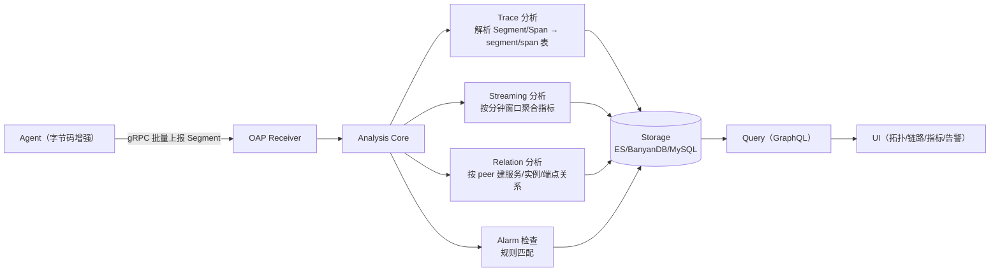

**一条 Segment 的完整生命周期**：

1. **Agent 生成**：请求进入 → `ContextManager.createEntrySpan()` → 每个 Exit/Local Span 追加到当前 Segment → 请求结束 → Segment 打包成 protobuf → 放入有界队列。
2. **上报**：消费线程批量取出 → gRPC 发到 OAP（默认 `11800`）。
3. **OAP 接收解析**：`Receiver` 反序列化 → 拆成 Span → 时间戳换算成绝对值。
4. **四路分析（并行）**：
   - **Trace**：落 `segment` 表（索引字段）+ `span` 表（明细），判定慢/错。
   - **Streaming**：把耗时塞进对应实体的分钟级桶（service/instance/endpoint 三维 × 成功率/吞吐/延迟）。
   - **Relation**：取 Entry Span 的 `peer` → 累加 `service_relation` / `instance_relation` / `endpoint_dependency`。
   - **Alarm**：匹配 `alarm-settings.yml` 规则触发告警。
5. **存储**：写 ES（按天滚动）或 BanyanDB。
6. **查询**：列表页查 `segment` 表（**只取索引字段，不解码明细**）；点开详情按 traceId 查 `segment` + `span` 并解码 `data_binary` 重建树。
7. **拓扑/大盘**：直接读预聚合的 `*_relation` 与 `metrics-*` 表，**不回表扫原始 Span**。

**关键设计点（能说出"为什么"才算懂）**：

- **为什么"四路分析"要分开**：Trace 明细是"个案证据"（重、按需查），指标是"全局视图"（轻、常查、要能告警）。两者**生命周期、查询模式、TTL 完全不同**，混在一起会被对方拖垮。
- **为什么 Segment 落两张表**：`segment` 只放索引字段（小），`span` 放大字段（`data_binary`）。**列表页不碰大字段**，这是查询快的关键。
- **为什么拓扑从 Relation 而不是从单条 Trace 推**：拓扑是统计视图（分钟级聚合），单条 Trace 只能画出"这一次的调用"。

---

### Q32. SkyWalking 为什么要用 Segment 模型，而不是像 Zipkin 那样每个 Span 独立上报？各自取舍是什么？

- **考核程度**：`★★★` `高频` ｜ **标签**：阿里、滴滴、字节（**架构权衡题，最能区分深度**）
- **考点**：这是两个框架最本质的差异，答得好说明真读懂了设计动机。

**参考答案**

**Segment = "一个线程内从入口到结束的所有 Span 的容器"。**

**Segment 模型的四个收益**：

| 收益 | 说明 |
|---|---|
| **上报次数从 N 降到 1** | 一次请求可能产生 30 个 Span。扁平模型 = 30 条记录；Segment = 1 个对象。**网络往返、序列化、索引写入都显著减少** |
| **天然贴合 `ThreadLocal` 生命周期** | Agent 的上下文本来就是线程级的，Segment 就是"一次线程执行"的快照，**采集端不需要复杂拼接** |
| **存储可"索引/明细分离"** | 索引字段单独一条，Span 明细序列化进 `data_binary`，**列表查询不碰大字段** |
| **压缩率高** | 段内 Span 共享 `traceId`/`serviceId`/`instanceId`，protobuf 一次编码，重复字段只出现一次 |

**Segment 模型的四个代价**：

| 代价 | 说明 |
|---|---|
| **跨线程必须显式建 Segment** | 线程池/异步场景要 `ContextSnapshot`/`@TraceCrossThread`，否则断链；扁平模型没这个问题（每 Span 独立上报，靠 id 关联，天然支持任意拓扑） |
| **线程"多任务混跑"语义糊** | 一个池线程先后处理 10 个任务，没清理会把 Span 混进同一 Segment |
| **不支持真正的尾部采样** | 数据在 Agent 端就按 Segment 上报/丢弃，Collector 侧只能整 Trace 丢，难以"先攒齐再按 Span 决策" |
| **段内时间戳是相对偏移** | 压缩与精度更好，但跨段对齐要换算，时钟偏移时更难处理 |

**Zipkin 扁平模型的取舍正好相反**：

- ✅ 天然支持任意拓扑（异步、批处理、fan-in 都靠 `parentId` 表达），**跨线程零障碍**。
- ✅ 支持尾部采样（Collector 可按 traceId 聚合任意 Span）。
- ❌ 上报与存储开销大（每 Span 一条，索引条目 ×N）。
- ❌ 采集端要自己维护父子与"线程执行边界"。

> **一句话总结（面试可直接说）**：
> **SkyWalking 用"空间换时间"——牺牲拓扑灵活性，换极致的上报/存储效率；Zipkin 用"时间换空间"——牺牲效率，换模型简单与拓扑通用。**
> 根源是目标场景不同：SkyWalking 面向"高 QPS 下要一体化 APM"（效率优先），Zipkin 面向"轻量接入、模型通用"（通用优先）。

**追问**

- "OTel 走哪条路？" → **介于两者之间**：Span 独立上报（像 Zipkin），但用 `Resource` 下沉把"服务名/主机名"等常量从每个 Span 剥离（部分获得 Segment 的压缩收益），用 `BatchSpanProcessor` 批量（获得批量收益）。**这是"既要通用又要效率"的折中。**

---

### Q33. SkyWalking 如何判定 Entry / Exit / Local Span？服务拓扑图的数据从哪来？

- **考核程度**：`★★★` `高频` ｜ **标签**：阿里、美团（SkyWalking 深度题）
- **考点**：两问常连问，本质是"数据模型如何支撑产品功能"。

**参考答案**

**第一部分：三种 Span 的判定**

| 类型 | 判定条件 | 说明 |
|---|---|---|
| **Entry** | 当前线程**没有**活跃上游 Context，且是"服务端接收"语义 | 由框架插件声明（Servlet 入口、gRPC Server、MQ Listener、定时任务）。能从 header **extract 到上游上下文**则挂 `SegmentRef`；extract 不到则新建 Root |
| **Exit** | 发起**跨进程/跨资源**调用 | HTTP Client、Dubbo Consumer、JDBC、Redis、MQ Producer。**必须带 `peer`** |
| **Local** | 纯本地方法 | `@Trace` 方法、业务内部方法，**没有 peer** |

**判定逻辑（源码视角）**：

```java
// createEntrySpan：先看当前线程有没有活跃上下文
Context ctx = ContextManager.get();
if (ctx != null) {
    // 已有上下文（同线程内嵌套调用）→ 复用，不新建
} else {
    // 尝试从 carrier（header/attachment）extract
    // 成功 → 建 Entry Span 并挂 SegmentRef（跨进程父子）
    // 失败 → 新建 Root（新 traceId）
}
```

**为什么判定依据是"上下文状态 + 框架语义"而不是"方法名/注解"**：Agent 无法可靠判断"这个方法是不是服务入口"，只能靠**线程上下文状态 + 插件声明**。这也是**自研 RPC 必须自己写插件**的原因（Agent 不知道它是服务端）。

**第二部分：拓扑图的来源**

拓扑**不是从单条 Trace 的树推出来的**，而是从**大量 Entry Span 的 `peer` 聚合**：

```
对每个 Entry Span：
    self = (serviceId, instanceId, endpointId)   ← 本 Span 归属
    peer = span.getPeer()                        ← 上游是谁
    ↓
累加到三张关系表：
    service_relation(self.service  → peer.service)
    instance_relation(self.instance → peer.instance)
    endpoint_dependency(self.endpoint → peer.endpoint)
```

**前提：`peer` 必须能解析成"服务名"**，而不是裸 `IP:Port`。这就是 SkyWalking 要在 `sw8` header 里带 `parentService`/`parentInstance`/`parentEndpoint` 的原因——**上游把自己的身份写在 header 里，下游不用查注册中心就能建关系**。

> **对比 Zipkin**：Zipkin 的依赖图是**离线定时任务**扫 `parentId` 算出来的（延迟高、只有服务级）。SkyWalking 是**在线流式聚合**（秒级可见、三级粒度）。这是"产品能力差距"的技术根因。

**追问**

- "peer 只有 IP 会怎样？" → 出现大量以 IP 命名的节点、同一服务拆成多个节点，拓扑不可读。所以接入规范第一条是"`agent.service_name` 必须与注册中心一致"。
- "端点级拓扑有什么用？" → 能回答"订单 `/create` 依赖库存 `/deduct`"，用于**接口级容量评估与改造影响面分析**。

---

### Q34. SkyWalking 为什么要把"指标"和"链路明细"分成两条链路？

- **考核程度**：`★★★` `中频高区分度` ｜ **标签**：阿里、美团、字节（架构设计题）
- **考点**：能讲清"两类数据的生命周期与查询模式完全冲突"，说明理解存储设计。

**参考答案**

**根本原因：两类数据的使用模式完全冲突。**

| 维度 | 链路明细（Trace） | 指标（Metrics） |
|---|---|---|
| 数据量 | 极大（QPS × Span 数） | 小（实体数 × 时间窗口数） |
| 查询模式 | 按 traceId 点查（低频、随机） | 按实体+时间聚合（高频、扫大量行） |
| 生命周期 | 7~30 天（个案证据） | 长期（趋势/SLO/容量） |
| 采样 | **可采样**（1% 够排障） | **不能采样**（QPS/成功率要全量算） |
| 存储引擎偏好 | 文档/宽表（ES、Cassandra） | 时序/列存（CK、BanyanDB） |
| 延迟要求 | 秒级（人点开看） | 毫秒~百毫秒（大盘常刷） |

**合成一条链路会怎样（三个后果）**：

1. **指标必然不准**：从被采样的明细算，1% 采样下 QPS 只有真实值 1%（见 Q21）。所以指标必须在**采样丢弃之前**就聚合好——这就是 Streaming 分析的意义：**对收到的每个 Segment 都聚合，聚合完再按采样丢弃明细**。
2. **大盘查询拖垮存储**：每次刷新都扫百万条 Span 算 P99，ES 直接跪。
3. **告警延迟不可接受**：告警要分钟级响应，从明细算必然慢。

**SkyWalking 的具体实现**：

```
Agent 上报 Segment（已采样）
   ↓
OAP 收到后立刻做两件事（对每个「上报来的」Segment）：
   ① Streaming：把 latency/status 塞进 (实体, 分钟) 时间桶 → 指标
   ② Trace：写 segment/span 明细
   ↓
指标不依赖明细保留期 → 明细 TTL 7 天，指标 TTL 30 天+
```

**一个容易忽略的矛盾**：如果 Agent 侧采样 10%，Streaming 聚合的输入也只有 10%——**所以 SkyWalking 的指标在开启 Agent 采样后同样有偏差**。要解决只能提高采样率，或"全量上报轻量指标 + 明细另采样"（两条数据流彻底分开）。**大厂的做法就是后者。** 这是所有链路系统都绕不开的矛盾：采样省成本 vs 指标要准确。

---

### Q35. SkyWalking 与 Zipkin 该怎么选？如果让你设计一个新系统，你会怎么取舍？

- **考核程度**：`★★☆` `高频` ｜ **标签**：全行业（选型题几乎每场都会绕到）
- **考点**：不要背对比表，要讲"场景 → 取舍 → 代价"。

**参考答案**

| 你的处境 | 推荐 | 理由 |
|---|---|---|
| Java 为主，要"开箱即用的 APM"（拓扑/告警/大盘/日志关联） | **SkyWalking** | Agent 无侵入、一体化，接入成本最低 |
| 多语言、多云、不想被厂商锁定 | **OTel**（Agent/Collector + 自建后端） | 标准化最高，可自由换后端 |
| 已有 Zipkin/ELK 体系，只想快速验证 | **Zipkin**（或 OTel 的 zipkin exporter） | 最轻，格式通用 |
| 需要方法级深度诊断（参数、调用栈全量） | **Pinpoint** | 增强最彻底（开销大、HBase 运维重） |
| 超大规模（万亿 Span/天） | **自研 Collector + ClickHouse/自研存储** | 开源吞吐与成本模型撑不住 |

**从零设计的四步方法论**：

1. **先定"要回答什么问题"**：只排障 → Zipkin 级够用；要做 SLO/容量/告警 → 必须有指标链路；要做架构治理 → 必须有拓扑。
2. **再定"能承受多少成本"**：采样率 × QPS × Span 数 × 保留天数 = 存储成本。**先算账再选型**。
3. **再定"上下文能否端到端透传"**（真正的技术难点）：跨语言、跨自研 RPC、跨 MQ、跨 Mesh 都能传吗？**透传不通，再好的后端也是残缺链路。**
4. **最后定采集方式**：Agent（应用内）+ eBPF（兜底）+ 网关（统一根），三层互补。

**默认建议（面试可直接给结论）**：

```
新建体系：OTel 协议（traceparent）为统一标准
        + OTel Collector 做接入网关（限流/尾部采样/多后端 fan-out）
        + ClickHouse 存明细（成本低、聚合快）
        + Grafana/Tempo 或自研查询
Java 存量体系：先上 SkyWalking 快速拿到可用性，再逐步向 OTel 协议对齐
```

**追问**

- "为什么不建议一开始就上尾部采样？" → 尾部采样要求 Collector 按 traceId 聚齐，**对部署复杂度、内存、负载均衡一致性要求都高**；初期流量小，头部采样 + 错误强制采样已足够。**先解决"有没有"，再解决"准不准"。**
- "SkyWalking 的 ES 成本怎么降？" → 顺序：降采样率 → 关重插件/屏蔽路径 → tag 白名单 + 截断 → 调分片/TTL → 换 BanyanDB/ClickHouse。**换存储是最后一步。**

---

## 10.8 第八组：Zipkin 专项（Q36–Q37）

### Q36. Zipkin 的四个组件分别做什么？`shared` span 是什么？时钟偏移怎么修正？

- **考核程度**：`★★★` `中频` ｜ **标签**：美团、京东、携程
- **考点**：三问连问，最后一问是数学推导，是本题的区分点。

**参考答案**

| 组件 | 职责 | 关键设计 |
|---|---|---|
| **Collector** | 接收 `POST /api/v2/spans`，校验 schema，写存储 | **无状态**，可水平扩展（Span 独立，不需共享状态） |
| **Storage** | 持久化（ES/Cassandra/MySQL/内存） | 插件化，`SpanStore` 抽象 |
| **Query** | 只读查询 API（traceId / 服务+时间 / 耗时） | 可与 Collector 分机部署 |
| **UI** | 瀑布图、依赖图、搜索 | `zipkin-lens` |

**`shared` Span**：客户端 Span（`cs/cr`）与服务端 Span（`sr/ss`）的 `id` 相同。开启 `shared` 后服务端那条标 `shared=true`，查询/UI 时**合并成一条**展示，省约 50% 存储。

> **坑**：合并后 `cs/cr` 与 `sr/ss` 落在同一条记录里，**必须做时钟偏移修正**，否则会看到"服务端处理时间早于客户端发送"的荒谬图。

**时钟偏移修正推导（必须会写）**：

```
设 B 相对 A 的时钟偏移为 θ，请求/响应单向延迟为 d1/d2：

观测：sr - cs = d1 + θ
      cr - ss = d2 - θ

相加 → (sr-cs) + (cr-ss) = d1 + d2        ← 总网络耗时（θ 抵消，与时钟无关）
相减 → (sr-cs) - (cr-ss) = 2θ + (d1-d2)  ← 假设 d1 ≈ d2 时可估计偏移
⇒ θ ≈ ((sr-cs) - (cr-ss)) / 2
```

**关键洞察**："**总网络耗时对时钟偏移免疫**"——两次取差方向相反，θ 抵消。所以"网络耗时"永远可信；`ss-sr` 因为是同机两个时间点，天然同源，也永远可信。**唯一不可信的是"跨机比较绝对时间"**，这正是 UI 需要偏移修正的原因。

**修正的局限**：只适用于"一发一收"的同步调用。MQ 异步场景（PRODUCER → CONSUMER 可能间隔几分钟）**不能假设 d1≈d2**，偏移无法估计，只能依赖 NTP。

**追问**

- "为什么不做全局时钟纠偏？" → 需要一个"权威时钟基准"，成本高且不可靠；两两相邻对齐已足够画出用户视角瀑布图（**以根 Span 时钟为基准**）。
- "负 duration 怎么产生的？" → `ss < sr` 说明服务端自己两个时间点顺序错了，通常是**NTP 回拨**（用 `currentTimeMillis` 而非 `nanoTime` 的后果，见 Q24）。

---

### Q37. Zipkin 的服务依赖图是怎么算的？为什么经常画错？

- **考核程度**：`★★☆` `中频` ｜ **标签**：美团、京东
- **考点**：细节题，"用哪个 Span 的父"是关键。

**参考答案**

**算法**：

```
遍历每条 Trace 的每个 Span S（有 parentId P）：
  若 S.kind == SERVER 且 P 的 serviceName ≠ S 的 serviceName：
      link(P.serviceName → S.serviceName).callCount += 1
      link.errorCount += (S.error ? 1 : 0)
      link.duration   += S.duration
按时间窗口聚合成 DependencyLink {parent, child, callCount, errorCount}
```

**关键点：为什么必须用「服务端 Span 的父」而不是「客户端 Span 的父」**

一次 RPC 的两条记录（`id` 相同）：

```
客户端 Span：id=abc, parentId=def, localEndpoint=A, kind=CLIENT
服务端 Span：id=abc, parentId=def, localEndpoint=B, kind=SERVER
```

- 用**服务端 Span** 的 `parentId=def`（属于服务 A）→ 得到边 `A → B` ✅
- 用**客户端 Span** 的 `parentId=def`（属于 A 自己的内部父 Span）→ 得到边 `A → A`（**自己调自己**）❌

**三个常见画错原因**：

1. **用了客户端 Span 的父** → 画出"自己调自己"的环。
2. **`shared` 合并时 `kind` 丢失** → 无法判定 `SERVER`，边提取失败。
3. **异步链路（PRODUCER/CONSUMER）没有 parentId 关联** → MQ 场景默认画不出边，需靠 `messaging.destination` 聚合。

**Zipkin 依赖图的固有局限**：

- **离线计算**：定时任务扫 Span，**延迟分钟级到小时级**。
- **只有服务级粒度**：没有实例级、端点级。
- **依赖 parentId 完整性**：采样导致 Span 丢失时，边统计不全（**依赖图会遗漏调用**）。

---

## 10.9 第九组：架构设计与场景题（Q38–Q40）

### Q38. 【系统设计】让你设计一个支撑"万亿级 Span/天"的链路追踪系统，你会怎么设计？

- **考核程度**：`★★★` `高频`（P7+ 必考） ｜ **标签**：阿里、字节、美团、滴滴
- **考点**：综合题。按"采集 → 传输 → 处理 → 存储 → 查询 → 治理"六层讲，每层给方案和理由。

**参考答案（六层展开）**

**① 采集层**

| 决策 | 方案 | 理由 |
|---|---|---|
| 应用内 | 多语言 Agent（Java 字节码 / Go SDK / Node） | 覆盖方法级因果 |
| 无 Agent 服务 | eBPF 旁路解析 L7 | 覆盖老服务、第三方、跨语言 |
| 统一根 | 网关 / Service Mesh 生成 traceId | 保证端到端有唯一根 |
| 上下文协议 | **W3C `traceparent` 为唯一标准**，入口兼容 B3/sw8 | 标准化才能跨系统 |
| 采样 | 头部概率采样（1%~5%）+ 错误/慢强制采样（带令牌桶限流） | 控成本、保住长尾个例 |

**② 传输层（最容易被忽略但最关键）**

```
Agent → 接入网关（限流/鉴权/格式校验/协议转换）→ Kafka（削峰解耦）→ 实时计算
```

- **必须有接入网关**：否则 Agent 直连后端，一旦后端抖动，Agent 重试风暴打垮业务（正反馈雪崩）。
- **必须用 Kafka 缓冲**：把"采集"与"分析"在**时间上彻底解耦**，故障时数据堆积而不是丢弃/重试。**这是超大规模与开源方案最大的架构差异。**
- **必须做背压**：Kafka 积压超阈值时网关主动降级（先丢非错误链路）。

**③ 处理层**

```
Flink / 自研流式引擎，五条流并行：
  A 明细：解析 Span → 写存储（按 traceId 分区）
  B 聚合：按 (实体, 时间窗口) 累加指标 → 写时序库
  C 拓扑：按 peer 累加关系
  D 尾部采样：按 traceId 聚齐 → 决策保留/丢弃
  E 异常检测：错误率突增、依赖异常 → 告警
```

**关键**：**明细与聚合彻底分离**（见 Q34）。聚合流不依赖明细的保留期与采样（在丢弃前聚合）。

**④ 存储层（分层）**

| 层 | 内容 | 引擎 | 保留 |
|---|---|---|---|
| 热 | 明细（近 3 天） | ClickHouse（列存、压缩比高、聚合快） | 3 天 |
| 温 | 明细（3~30 天） | HBase / 对象存储 + 索引 | 30 天 |
| 指标 | 分钟级聚合 | ClickHouse / 时序库 | 13 个月 |
| 冷 | 归档 | 对象存储（Parquet） | 合规要求 |

**为什么明细用 ClickHouse 而不是 ES**：万亿 Span/天 = 数百 TB/天原始，ES 的写入放大与 JVM 堆成本撑不住；CK 的列存 + 向量化在聚合分析上快 10 倍以上，压缩比 5~10 倍。**但 CK 的排序键必须按查询模式设计**（`ORDER BY trace_id, timestamp` 用于点查；`service, timestamp` 用于范围查 → 通常要两张表或两个物化视图）。

**⑤ 查询层**

- **列表查询**：走预聚合索引（不扫明细）。
- **单 Trace**：按 traceId 点查（CK 排序键前缀命中）。
- **两阶段**：先查索引（轻）→ 再取明细（重），见 4.6.2。
- **限流与超时**：单次查询限制返回条数与扫描分区数，防止一个大查询打挂集群。

**⑥ 治理层（决定系统能不能长期活着）**

| 治理项 | 手段 |
|---|---|
| Endpoint 归一化 | URL 正则分组（服务端做，可事后补救） |
| Tag 白名单 | 只允许预定义 key 入库，长度截断 |
| 高基数监控 | "新增 endpoint 数/天"、"tag distinct 值数" 作为指标告警 |
| 采样率动态调整 | 配置中心热更新，按流量与错误率自适应 |
| 成本看板 | 存储增长曲线、单 Trace 平均字节、采样率、丢弃率 |
| 数据安全 | PII 不入库、SQL 脱敏、按服务授权查询 |

**收尾（面试官最想听的一句）**：

> "这个系统真正的难点不在存储和计算，而在**上下文端到端透传**和**成本治理**。前者决定数据是否完整（自研 RPC/MQ/Mesh 都要能传），后者决定系统能不能活过三个月（高基数与采样策略）。"

---

### Q39. 【场景题】线上反馈"某个接口变慢"，链路却在某个服务之后断了，你怎么排查？

- **考核程度**：`★★★` `高频` ｜ **标签**：阿里、美团、字节（**实战能力题**）
- **考点**：要有决策树，而不是列举一堆可能原因。

**参考答案**

**先确认"断"的形态（这决定排查方向）**：

```
在该服务的 Entry 处查 Span：
  ├─ A. 完全没有 Span（连 Root 都没有） → Agent 层问题
  ├─ B. 有 Span 但是新的 Root（traceId 变了） → 传播/提取问题
  ├─ C. 有 Span，traceId 对，但 parentSpanId 指向的父 Span 不存在 → 数据缺失（采样/TTL）
  └─ D. 有 Span 且父子正确，更深处才断 → 继续下钻
```

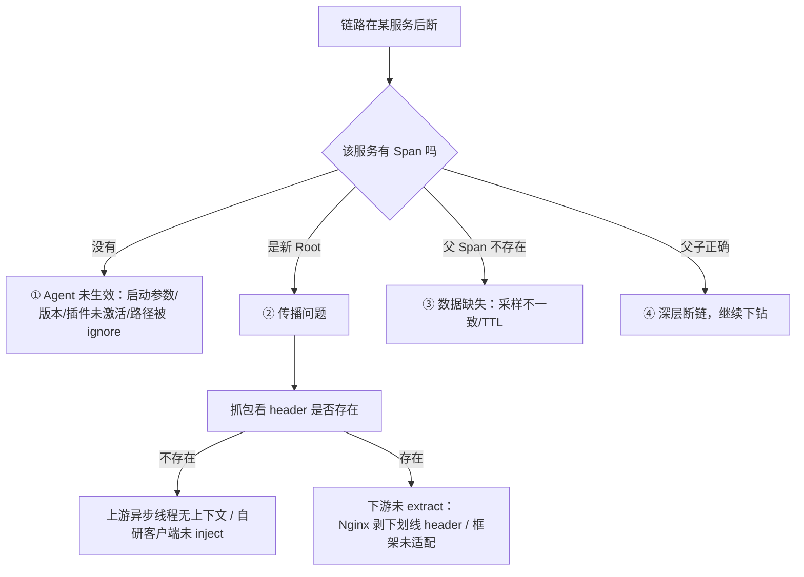

**逐项根因与验证**：

| 形态 | 常见根因 | 验证手段 |
|---|---|---|
| 无 Span | 没加 `-javaagent`；agent 版本与框架不兼容；`witness class` 缺失导致插件未激活；`trace.ignore_path` 屏蔽了该路径 | 看 Agent 启动日志、看 `plugins/activations`、临时关 ignore |
| 新 Root | 上游是**异步调用**（回调线程无上下文）；自研 HTTP/RPC 未 inject；Nginx `underscores_in_headers` 默认丢弃 `sw8`/`X-B3-*`；WAF/CDN 剥离 header | 在服务端打印所有入站 header；用 curl 手工带 header 验证 |
| 父 Span 不存在 | 上游 Segment 被采样丢弃（采样不一致）；数据超期被 TTL 删；上游上报失败 | 检查采样是否 `ParentBased`；看 traceId 下 Span 数是否远少于预期 |
| 深层断链 | 服务内部线程池/MQ 未传播 | 用 `@TraceCrossThread` / 检查线程池增强覆盖 |

**别忘了原问题（接口变慢）**：即使链路断了，也要先回答"慢在哪"。**降级方案**：

1. **日志 + 时间戳人工对齐**（两端打印 `traceId + 方法名 + 时间戳`）。
2. **指标定位**：该服务 P99、下游依赖 P99、DB 慢查询日志。
3. **Profiling**：看 CPU 热点（不依赖链路）。
4. **抓包**：`tcpdump` + Wireshark 看 RTT 与重传。

**修复后的防回归**：

- 加"**链路完整率**"监控（每服务 Root 数 / 上游 Exit 数的比值），低于阈值告警。
- 加"断链原因"tag（`root.cause=header_missing|async|ignore_path`），统计 Top 原因。
- 把透传验证做成**自动化用例**（见 9.2 清单），纳入 CI。

---

### Q40. 【综合题】链路追踪、日志、指标三者怎么联动？你做过什么具体的工程实现？

- **考核程度**：`★★☆` `高频` ｜ **标签**：全行业（现在几乎必问"可观测性体系"）
- **考点**：要有具体实现细节，不能只讲概念。

**参考答案**

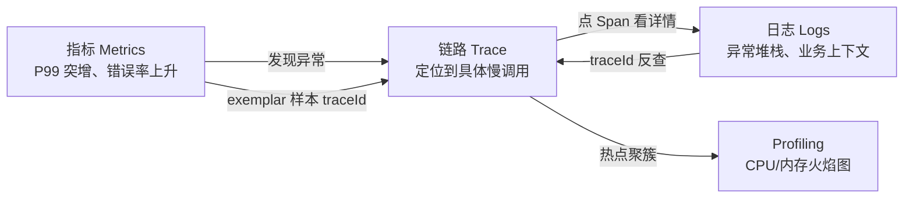

**三个连接件的具体实现**：

**① Trace → Log（MDC 注入）**

```xml
<pattern>%d{HH:mm:ss.SSS} [%thread] %-5level [%X{traceId:-}] [%X{spanId:-}] %logger{36} - %msg%n</pattern>
```

```java
// 异步线程必须手工复制，否则日志里 traceId 为 null
Map<String,String> ctx = MDC.getCopyOfContextMap();
executor.submit(() -> {
    if (ctx != null) MDC.setContextMap(ctx);
    try { doWork(); } finally { MDC.clear(); }   // finally 清理防串味
});
```

> **SkyWalking 的进阶做法**：`apm-toolkit-logback-1.x` 的 `TraceIdPatternLogbackLayout` 输出 `TID:xxx;SID:yyy`（**Segment ID + Span ID**）。为什么要 Segment ID？因为同一 traceId 下可能有多个 Segment（跨线程/跨服务），只有 Segment ID 才能精确定位"是哪一段执行打的日志"。这是比单纯 traceId 更强的关联能力。

**② Metrics → Trace（exemplar）**

```
Prometheus histogram 的每个 bucket 附一个 exemplar（含 traceId）
用户在 Grafana 点某个 P99 桶 → 直接跳到那条慢链路
OTel 里通过 ExemplarReservoir 实现（每 bucket 保留少量样本 traceId）
```

价值：这是"大盘看见 P99 异常 → 点开看是哪条链路"的**最短路径**，省掉"手动筛时间范围 + 猜服务"。

**③ Trace → Profile**

```
把 span 时间窗与 profiling 采样栈对齐：
  span [10:00:00.100, 10:00:00.850] 内，CPU 栈里 72% 在 Jackson.serialize
→ 结论："这 750ms 里 540ms 花在 JSON 序列化"
```

实现：async-profiler / Pyroscope / SkyWalking eBPF Profiling，通过 `traceId + spanId` 或时间区间关联。

**一个完整落地案例**：

```
需求：支付超时定位从 2 小时缩短到 10 分钟

1. 全链路 traceId 透传（HTTP/gRPC/MQ/线程池，见 9.2 清单）
2. 日志接入 traceId（MDC），ES 按 keyword 建 traceId 索引
3. 指标侧：支付 P99、超时率、第三方错误率进大盘
4. 关联链路：
   大盘告警（P99 > 1s）→ 带 exemplar traceId 的链接
   → 点进链路：第三方支付 800ms + 重试 2 次
   → 点 Span：看该次调用的日志（请求参数、响应码）
   → 点 Profile：看到重试逻辑里有同步 sleep
5. 效果：从"翻 5 台机器日志"变成"3 次点击定位"
```

**追问**

- "traceId 打到日志会影响性能吗？" → 有成本（每次日志一次 MDC 读取 + 拼接），但可忽略。**真正的坑是异步线程没复制导致 traceId 为空**，以及日志体积增加 10~20 字节/行。
- "日志集中采集（Filebeat → ES）后怎么保证可检索？" → 日志必须是**结构化 JSON**（`{"traceId":"...","msg":"..."}`），ES 的 `traceId` 设为 `keyword`。**用正则从纯文本日志抽 traceId 不靠谱**（格式一变就失效）。

---

## 10.10 附录：快问快答 20 题（一面/笔试常见）

| # | 问题 | 一句话答案 |
|---|---|---|
| 1 | TraceId 一般多少位？ | 128 bit（W3C 标准），Zipkin 兼容 64 bit |
| 2 | SpanId 多少位？ | 64 bit，同一父节点下唯一即可 |
| 3 | 链路明细一般保留多久？ | 7~30 天；指标 13 个月+ |
| 4 | 采样率一般设多少？ | 普通 1%~10%，核心业务可到 50%，错误/慢 100% |
| 5 | 采样会影响成功率吗？ | 会（分母失真），总量类指标必须来自 Metrics |
| 6 | `ParentBased` 采样器的作用？ | 有父就跟父决策，无父用 root 策略 → 防断链 |
| 7 | 为什么 MQ 消费端容易断链？ | 上下文已不在线程里，必须从消息 header extract |
| 8 | TraceId 能放 Cookie 吗？ | 技术可行但不推荐（跨域/大小/隐私） |
| 9 | 链路能定位到代码行吗？ | 不能（除非记堆栈），但能定位到服务+方法+SQL |
| 10 | 一条 Trace 最多多少 Span？ | 无硬限，但工程上超几千就要治理（循环调用/批处理） |
| 11 | 为什么 Java Agent 启动变慢？ | 类加载期做匹配 + 字节码生成（ByteBuddy 开销） |
| 12 | `retransform` 能加字段吗？ | 不能（只能改方法体） |
| 13 | Agent 会与业务依赖冲突吗？ | 隔离得当不会（独立 ClassLoader + bootstrap 注入） |
| 14 | 为什么要 `appendToBootstrapClassLoaderSearch`？ | 拦截 JDK 类（线程池/HTTP）时它们看不到 Agent 的类 |
| 15 | `nanoTime` 能跨进程比较吗？ | 不能，只有相对差值有意义 |
| 16 | 时钟偏移怎么估计？ | `((sr-cs)-(cr-ss))/2`，假设双向延迟相等 |
| 17 | ES 存链路的核心问题？ | 写入放大、堆压力、高基数、分位数聚合慢 |
| 18 | 为什么 URL 要归一化？ | 否则 endpoint 基数爆炸，存储与大盘双崩 |
| 19 | 拓扑图数据从哪来？ | 从 Entry Span 的 `peer` 流式聚合，不是从单条 Trace |
| 20 | 链路断了一般先看什么？ | 入站 header 是否存在 → 服务是否有 Span → 是否新 Root |

---

# 第 11 章 速查表与复习清单

## 11.1 一页纸核心公式

```
网络耗时        = (sr - cs) + (cr - ss)                    ← 对时钟偏移免疫
时钟偏移 θ      ≈ ((sr - cs) - (cr - ss)) / 2             ← 假设双向延迟相等
自身耗时        = duration - ∪(子 Span 区间)               ← 用"并集"而非"求和"
采样决策        = hash(traceId) < ratio × 2^63             ← 一致性，可复现
日存储量        ≈ QPS × Span数 × 86400 × 采样率 × 单Span字节 × 索引膨胀(1.5~2)
Agent 内存      ≈ buffer_size × 单 Segment 大小(3~5KB)
分片数          ≈ 日增GB / 20GB，每节点 ≤ 20~25 分片/GB 堆
```

## 11.2 关键概念对照表（易混淆项）

| 易混淆 | 区别 |
|---|---|
| Trace vs Segment | Trace 是逻辑链路（跨所有服务）；Segment 是一个线程内的一段（SkyWalking 特有） |
| Tag vs Baggage | Tag 描述当前 Span、不传播；Baggage 随链路透传给所有下游 |
| ChildOf vs FollowsFrom | 强因果（同步调用）；弱因果（异步/消息） |
| 头部 vs 尾部采样 | 创建时按概率决策（省成本）；收齐后按结果决策（保长尾） |
| 一致性采样 vs 概率采样 | 前者用 traceId 哈希（可复现、抗丢标志）；后者用随机数（每次不同） |
| premain vs agentmain | 启动期挂载（可改类结构）；运行期 attach（只能改方法体） |
| Entry vs Exit Span | 服务端接收（有 peer=上游）；客户端发起（有 peer=下游） |
| 索引表 vs 明细表 | 列表查询只碰索引（小）；详情才解码 `data_binary`（大） |
| 拓扑 vs 链路树 | 拓扑是聚合统计（分钟级）；链路树是单次请求证据 |
| App 侧采样 vs 后端采样 | 前者省网络与序列化；后者才能"按结果"筛选 |

## 11.3 三类数据的分工（背下来就不会答错）

| 问题 | 该用哪个 | 不该用哪个 |
|---|---|---|
| 总量 QPS、成功率、P99 | **Metrics** | Trace（采样后失真） |
| 这一次请求慢在哪 | **Trace** | Metrics（无个体） |
| 为什么报错、异常堆栈 | **Logs** | Trace（只有异常类型/摘要） |
| CPU 热点、内存分配 | **Profiling** | Trace（只有方法耗时，无栈） |
| 谁调用了谁、有哪些强依赖 | **拓扑（聚合）** | 单条 Trace |

## 11.4 落地检查清单（逐项打勾）

**接入前**

- [ ] 明确要回答的问题（排障 / SLO / 架构治理）
- [ ] 算清成本模型（日增 GB × 保留天数）
- [ ] 定协议（新系统统一 W3C `traceparent`）
- [ ] 定采样策略（分层 + 强制采样 + 限流）
- [ ] 定存储（明细 / 指标分开选引擎）

**接入中**

- [ ] 网关统一生成根 TraceId，丢弃外部不可信 header
- [ ] Nginx `underscores_in_headers on`（否则 `sw8`/`X-B3-*` 被丢）
- [ ] 所有出口客户端（含自研）确认 inject
- [ ] 线程池 / `CompletableFuture` / Reactor / `@Async` 逐项验证
- [ ] MQ Producer 写 header、Consumer **逐条** extract
- [ ] 日志 MDC 注入 traceId，异步线程复制 + finally 清理
- [ ] URL 归一化规则上线（防 endpoint 爆炸）
- [ ] Tag 白名单 + 长度截断（PII 一律不入库）

**接入后**

- [ ] 单链路全通验证（公网入口打一发）
- [ ] 异步链路验证（MQ 是子链路不是新 Root）
- [ ] 错误链路验证（`status=ERROR` + 异常记录）
- [ ] 慢链路验证（self-time 与下游分解正确）
- [ ] 开销压测（A/B/C 三组对比 TPS + **P99** + GC）
- [ ] 监控：链路完整率、dropped 数、endpoint 增长率

## 11.5 面试答题的四层结构（模板）

面试链路追踪类问题时，按这四层答，评价会明显更高：

```
第 1 层 · 是什么（30 秒）
  一句话定义 + 它在可观测性体系中的位置（补什么缺口）

第 2 层 · 怎么做（核心，2~3 分钟）
  数据模型 → 传播 → 采集 → 上报 → 存储 → 查询，按因果链讲，不要罗列

第 3 层 · 为什么这么做（区分度所在，1~2 分钟）
  每个设计选择的「收益 / 代价 / 适用场景」，最好有对比（SkyWalking vs Zipkin）

第 4 层 · 踩过什么坑（可信度）
  给 1~2 个真实细节（Nginx 剥 header、池线程串味、endpoint 爆炸、ES 分片过多）
```

**三个"杀手锏"论点**（任何链路追踪问题都能挂上去，显得你有体系观）：

1. **"链路追踪的真正难点不是采集和后端，而是上下文能否端到端透传。"** —— 90% 的落地失败在这里。
2. **"链路数据不能当指标用，指标必须在采样丢弃之前聚合。"** —— 解释了 SkyWalking 双链路、问出了采样与精度的矛盾。
3. **"成本治理（高基数 + 采样）决定系统能不能活过三个月，技术选型只决定第一周好不好用。"** —— 体现工程成熟度。

## 11.6 学习路径建议（如果要从零补这块）

```
第 1 周：读 Dapper 论文（原文 6 页）+ Zipkin V2 数据模型
        → 目标：能用 Zipkin 模型讲清一次 RPC 的四个时间点
第 2 周：自己搭一套 Zipkin（Docker 一把梭）+ 写一个 Spring Boot Demo 接入 Brave
        → 目标：亲手看到断链，理解 header 传播
第 3 周：搭 SkyWalking（OAP + ES + UI），挂 Agent 到 Demo，做压测看开销
        → 目标：理解 Segment 模型、拓扑、采样配置
第 4 周：读 SkyWalking 的 plugin 源码（一个简单插件，如 JDBC）
        → 目标：理解字节码增强、`EnhancedInstance`、`ContextManager`
第 5 周：读 OTel 规范（traceparent / OTLP / Sampler）+ 跑 OTel Collector + 尾部采样
        → 目标：理解尾部采样的路由与内存约束
第 6 周：设计题演练（Q38）+ 复盘自己项目里的断链与高基数问题
```

## 11.7 常见认知误区（自查）

| 误区 | 正确认知 |
|---|---|
| "挂了 Agent 就有全链路了" | 透传不通 = 一堆独立短链路，必须逐协议验证 |
| "链路能算 QPS" | 采样后失真，QPS 必须来自指标 |
| "Span 越多越细越好" | Span 数 ×10，成本 ×10，信息增量却很小 |
| "采样 1% 就够了" | 头部采样会系统性漏掉最慢的个例 |
| "ES 什么都能存" | 万亿级 Span 下 ES 成本与堆压力不可承受 |
| "时钟不同步无所谓" | 会出现负耗时、父子时间倒错，结论完全错 |
| "断链是下游的问题" | 先查上游有没有 inject、中间件有没有剥 header |
| "Agent 完全无开销" | 采样 10% 约 1%~5% CPU，P99 影响往往大于平均吞吐 |
| "链路和日志是两套系统" | 必须靠 traceId 互跳，否则排障要多跳一次 |
| "开源直接上生产就行" | 超大规模必须加接入网关 + Kafka 削峰 + 分层存储 |

---

## 附：术语速查（中英对照）

| 中文 | 英文 | 备注 |
|---|---|---|
| 链路 / 追踪 | Trace / Tracing | |
| 跨度 | Span | 一次执行片段 |
| 跨度上下文 | SpanContext | 跨进程传递的身份 |
| 传播 | Propagation（inject / extract） | 注入 / 提取 |
| 采样 | Sampling | head-based / tail-based |
| 尾部采样 | Tail-based sampling | Collector 侧决策 |
| 上下文快照 | ContextSnapshot | SkyWalking 跨线程 |
| 资源 | Resource | OTel 的进程级常量 |
| 语义约定 | Semantic Conventions | OTel 字段命名标准 |
| 跨度链接 | Links | 多父引用（fan-in） |
| 事件 | Events | OTel 替代 annotation/log |
| 采集代理 | Agent | 字节码增强 |
| 收集器 | Collector | 接收/处理/导出 |
| 依赖图 | Dependency Graph / Link | |
| 时钟偏移 | Clock Skew | |
| 高基数 | High Cardinality | |
| 例示样本 | Exemplar | metrics → trace 跳转 |

---

**文档结束**

> 说明：本文档中涉及具体产品版本、配置项默认值、开源项目内部实现的部分，基于公开文档、源码与社区资料的整理，不同版本可能有差异，落地前请以对应版本的官方文档为准。国内大厂自研系统的描述来自公开技术分享，**不代表其当前完整架构**。面试中涉及"某公司怎么做"时，建议表述为"据公开资料"。
