# 大数据框架底层原理与面试题精讲（Spark / Flink / HDFS / Hive / MR / YARN / Kafka / HBase）

> 面向人群：想从"会用 API"进阶到"懂底层、能答面试"的工程师。
> 阅读建议：第一遍通读"原理篇"，建立**数据从磁盘到计算结果**的完整链路认知；第二遍按"面试题库"自测，看到题目先自己想 30 秒再翻答案。
> 文中 `★` 表示面试出现频率/难度，⚠️ 表示易踩坑点，🔍 表示可直接用于追问的深度点。

---

## 目录

- [第 0 章 全局视角：一个 SQL 从提交到出结果，中间到底发生了什么](#第-0-章-全局视角一个-sql-从提交到出结果中间到底发生了什么)
- [第 1 章 HDFS 底层原理](#第-1-章-hdfs-底层原理)
- [第 2 章 MapReduce 底层原理](#第-2-章-mapreduce-底层原理)
- [第 3 章 YARN 资源管理与调度](#第-3-章-yarn-资源管理与调度)
- [第 4 章 Hive 底层原理](#第-4-章-hive-底层原理)
- [第 5 章 Spark 底层原理](#第-5-章-spark-底层原理)
- [第 6 章 Flink 底层原理](#第-6-章-flink-底层原理)
- [第 7 章 周边关键组件（Kafka / HBase / ZooKeeper / 文件格式 / 数据湖 / 数仓分层）](#第-7-章-周边关键组件)
- [第 8 章 大厂面试题库（按公司聚类 + 考核程度 + 详解）](#第-8-章-大厂面试题库)
- [第 9 章 场景/开放题与速查表](#第-9-章-场景开放题与速查表)

---

## 第 0 章 全局视角：一个 SQL 从提交到出结果，中间到底发生了什么

### 0.1 大数据技术栈的分层结构

不要背组件清单，要按"**职责分层**"记。所有大数据系统都在回答四个问题：数据放哪、谁来算、资源谁管、怎么组织成表。

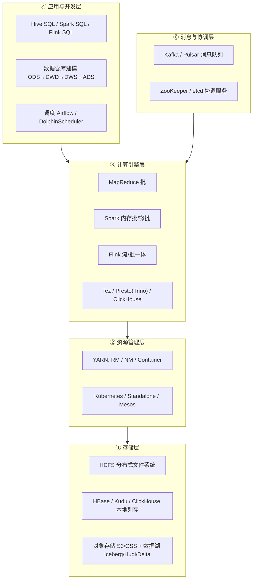

**一句话记住每一层的核心机制：**

| 层 | 组件 | 一句话本质 |
|---|---|---|
| 存储 | HDFS | 把大文件切成块，多副本分散到多台机器的本地磁盘，用一份中心化元数据管理位置 |
| 存储 | HBase | 在 HDFS 之上用 LSM-Tree 实现"海量行级随机读写" |
| 资源 | YARN | 把集群机器的内存/CPU 切成 Container，按队列分配给多个计算框架共享 |
| 计算 | MapReduce | 分而治之 + 落盘 shuffle，用磁盘换容错 |
| 计算 | Spark | DAG + 内存迭代 + 血缘重算，用内存换速度 |
| 计算 | Flink | 有状态的流式算子 + 分布式快照，用状态换正确性 |
| 数仓 | Hive | 把 HDFS 上的目录/文件"映射"成表，把 SQL 翻译成分布式作业 |

### 0.2 一条 SQL 的完整生命周期（以 Hive/Spark SQL on YARN 为例）

这是面试里最容易被问"你讲一下提交过程"的地方。把它拆成 **7 个阶段**：

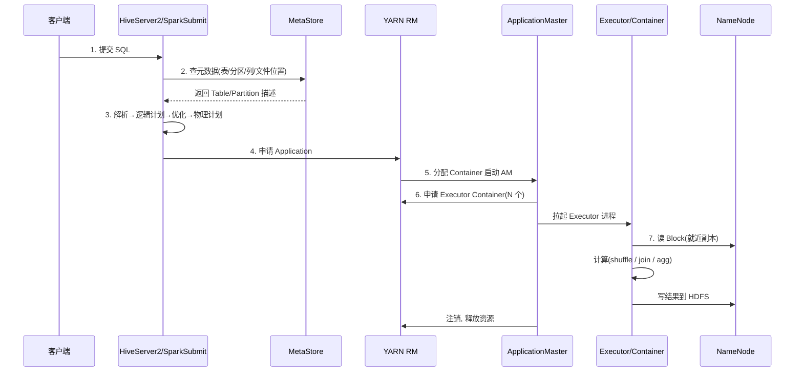

**关键点（面试可直接用）：**

1. **元数据查询在客户端侧完成**（Hive 是 HiveServer2 侧的 Driver），不消耗集群算力；所以"表特别多、分区特别多"会让编译阶段变慢（几千个分区时 `SHOW PARTITIONS`、`MSCK`、以及生成 task 数量爆炸）。
2. **作业单元由引擎决定**：Hive on MR 一个 SQL 可能变成 1~N 个 MR Job（每个 reduce 侧操作一个 Job），Hive on Spark / Spark SQL 变成一个 Spark Application 里的多个 Stage，Flink SQL 变成一个 Flink Job 的多个 Operator Chain。**这是"为什么 Spark 比 MR 快"的本质之一：不是单纯内存，而是减少了作业启动次数和落盘次数。**
3. **数据本地性（Data Locality）贯穿全程**：从 NameNode 返回的 Block Location，到调度器把 task 分配到"数据所在节点"，再到 HDFS 短路读。本地性等级：`PROCESS_LOCAL > NODE_LOCAL > RACK_LOCAL > ANY`。
4. **资源是"申请-分配-回收"模型**：YARN 里 Container 启动是**秒级**的（JVM 启动 + 本地化 jar），这就是 MR/Spark on YARN 无法做到毫秒级响应的根因，也是 Flink/K8s 长驻进程方案存在的原因。

### 0.3 三条主线：贯穿全文的底层逻辑

读后面每一章时，都往这三条线上挂：

- **主线一：数据怎么摆放（Layout）** —— 块/分区/分桶/行组/列簇。所有优化（分区裁剪、列裁剪、谓词下推、bucket join、Z-order）都源于"摆放方式 + 统计信息"。
- **主线二：数据怎么流动（Shuffle）** —— 从 map 端写、按 key 分区、跨网络传输、reduce 端拉取。**大数据 80% 的性能问题都在 shuffle**：数据量、倾斜、落盘次数、序列化。
- **主线三：故障怎么兜底（Fault Tolerance）** —— 副本（HDFS）、重算（Spark 血缘）、快照（Flink checkpoint）、日志（HBase WAL / Kafka 副本）。三种范式对比见下表。

| 容错范式 | 代表 | 机制 | 代价 | 适用 |
|---|---|---|---|---|
| 冗余复制 | HDFS / Kafka | 多副本，坏了换一个 | 存储 ×3 | 存储、消息 |
| 重算（Lineage） | Spark / MR | 记录"怎么算出来的"，丢了重算 | 重算耗时，需保留输入 | 幂等批计算 |
| 快照（Snapshot） | Flink | 周期性把"状态+位置"存下来 | 状态大小、checkpoint 开销 | 有状态流计算 |
| 预写日志 | HBase / 数据库 | 先写日志再改内存 | WAL 写放大 | 随机读写存储 |

---

## 第 1 章 HDFS 底层原理

### 1.1 为什么需要 HDFS：从"一块磁盘放不下"讲起

单机存储的三道墙：容量（TB 级就到顶）、吞吐（单盘 ~200MB/s）、可靠性（磁盘年故障率 2%~4%）。
HDFS 的解法是**横向扩展 + 副本 + 顺序读写**，并为此做了三个明确取舍：

| 取舍 | HDFS 的选择 | 后果 |
|---|---|---|
| 延迟 vs 吞吐 | 高吞吐、高延迟（一次读要 RPC + 网络） | 不适合低延迟点查 → 所以有 HBase |
| 随机写 vs 顺序写 | **只支持追加（append），不支持随机修改** | 简化一致性；一次写一次读的场景最合适 |
| 一致性 vs 可用性 | 单 Namespace 强一致（由 NameNode 保证） | NameNode 成为元数据瓶颈 → 所以有 Federation |

### 1.2 架构全景

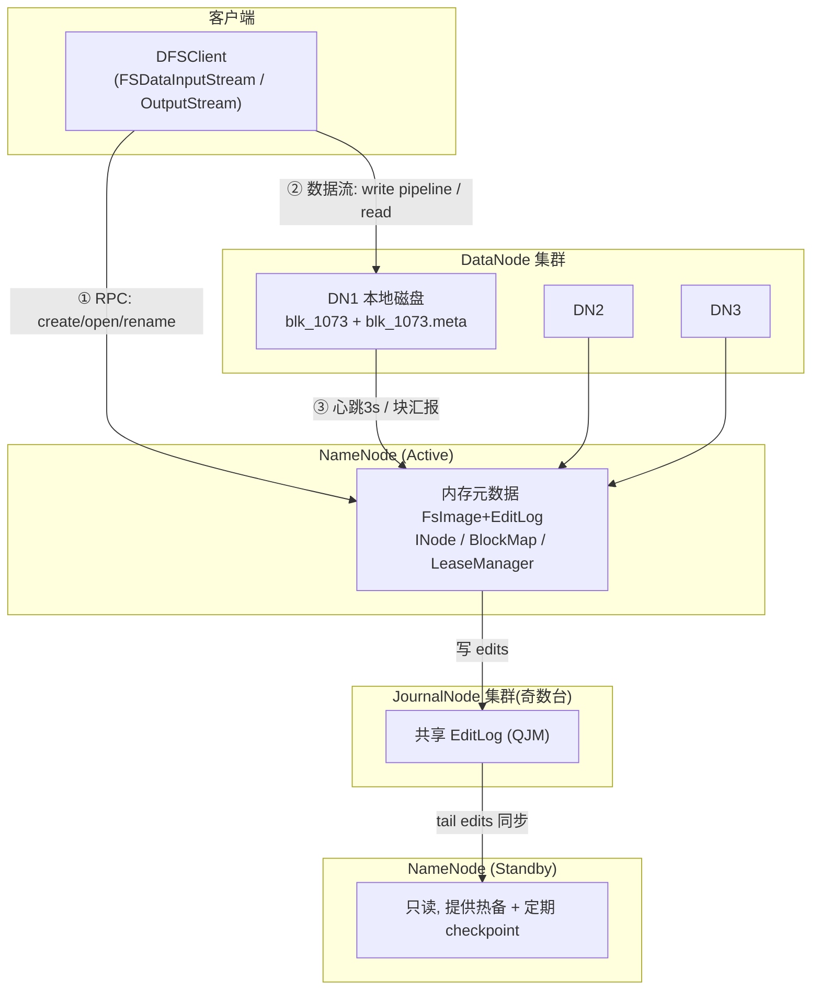

**角色职责：**

- **NameNode**：只存**元数据**，不存数据。内存中维护两棵树：`INode 树`（目录/文件/权限/配额）和 `BlocksMap`（Block → {DN 列表, 长度, 世代戳}）。**注意：Block 的实际数据不在 NN 内存里，只存"哪个块在哪几个 DN 上"。**
- **DataNode**：真正干活。以**块（Block）**为单位存文件；每块 128MB（`dfs.blocksize`，Hadoop 1.x 是 64MB），副本数 3（`dfs.replication`）。每个块对应两个磁盘文件：`blk_<id>`（数据）和 `blk_<id>_<genstamp>.meta`（校验和 + 头信息）。
- **JournalNode**：HA 场景下，Active NN 的 editlog 必须写到一组 JN（通常是 3 台），Standby 从 JN 拉取并回放，实现元数据实时同步。**这就是 QJM（Quorum Journal Manager），基于"过半写成功"保证一致性**（3 台允许坏 1 台，5 台允许坏 2 台）。
- **ZKFC（ZooKeeper Failover Controller）**：每个 NN 节点上跑一个，通过 ZK 抢锁决定谁是 Active，并监控 NN 健康（用 `zkfc` + `haadmin`）。抢到锁的一方负责 fence 旧 Active（防止脑裂：SSH fence / shell fence 把对方 kill 掉）。

### 1.3 元数据持久化：FsImage 与 EditLog（高频深挖点）

HDFS 的元数据**全内存**，但必须持久化，方案是"**快照 + 增量日志**"，本质和数据库的 checkpoint + WAL 一样。

- `fsimage`：某一时刻的全量元数据快照（序列化后的 INode 树），文件很大（几十 GB 很常见），只在重启/checkpoint 时读。
- `edits_*`：所有写操作（create、delete、rename、setReplication…）的追加日志。NN 每次写操作：**先写 edits 日志（并 hflush 落盘），再改内存**——保证"日志先行"，宕机后可通过回放恢复。

**合并过程（checkpoint）**：

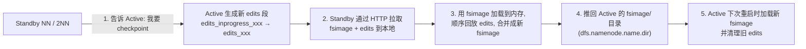

**为什么要合并？** edits 是纯追加的，长时间不合并会变成几百万条记录，重启时回放要几十分钟（这在生产中是真实事故：`fsimage` 不合并导致 NN 启动 2 小时）。
**触发条件**：`dfs.namenode.checkpoint.period`（默认 3600s）或 `dfs.namenode.checkpoint.txns`（默认 100 万条事务）任一满足。

⚠️ **易踩坑：2NN 不是 Standby NN。** 2NN（SecondaryNameNode）只做 checkpoint，**不能自动接管**；HA 里的 Standby NN 才提供热备。2NN 在 HA 架构下已不部署（由 Standby 兼任）。

### 1.4 写流程：从 create() 到 pipeline ACK（面试必考）

HDFS 写是**流水线（Pipeline）+ 分包（Packet）+ 异步确认（ACK）**，这三件套决定了它的高吞吐。

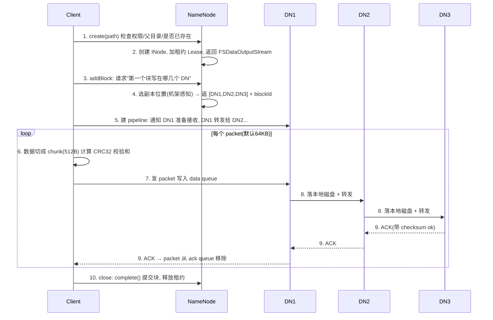

**底层细节，答得出来就是加分：**

1. **副本放置策略（BlockPlacementPolicyDefault）**：第 1 个副本放**客户端所在节点**（若客户端在集群外则随机选一个不太满的节点）；第 2 个放**不同机架的随机节点**；第 3 个放**第 2 个副本所在机架的另一个节点**；第 N 个（>3）随机。→ 保证"**一个机架挂掉不丢数据，且读时能就近**"。
2. **Packet 与 Chunk**：包大小默认 64KB（`dfs.client-write-packet-size`），内部按 **512 字节**一个 chunk 计算 CRC32（4 字节校验和），即一个 64KB 包对应 128 个 chunk → `.meta` 文件里就是这些校验和。
3. **两条队列**：`data queue`（待发送）+ `ack queue`（已发送待确认）。客户端只有收到 ACK 才认为写入成功；如果某个 DN 返回失败（`ACK ERROR`），客户端会把该 DN 从 pipeline 移除并**用剩余 DN 重建 pipeline**（`DataStreamer` 的 `replaceDatanodeOnFailure`），同时 NN 会把坏节点标记并后续复制补齐副本。
4. **hflush vs hsync（⾮常高频）**：
   - `hflush()`：把当前缓冲区里**所有已写入的 packet 推到 pipeline 末端并等待 ACK**，保证"新的 reader 立即可见"（数据到了 DN 的页缓存/磁盘），**但不保证 DN 真正 fsync 到物理磁盘**。
   - `hsync()`：在 hflush 基础上**要求每个 DN 都 fsync 到磁盘**，才返回。用于"必须落盘"的语义（如 HBase WAL 用它保证持久性）。
   - 对比：不调 hflush/hsync，`close()` 时才保证数据完整；所以**用 HDFS 做"低延迟可见"的场景（如流式写日志）必须定期 hflush**。
   - 代价：hflush 会**打断 pipeline 的批量发送**，每次是一个同步点，频繁调用吞吐会掉一半以上。
5. **租约（Lease）**：客户端打开写时必须持租约（默认硬限制 1 小时，软限制 60 分钟）。客户端定期 `renew`；如果客户端挂了，NN 在硬限制到期后**强制回收租约**并触发 `Lease Recovery`：把该文件的最后一个未完成块截断/恢复，避免"半截块"污染。这是 HDFS "单写者模型"的保证机制。
6. **追加与截断**：HDFS 支持 `append`（只允许最后一个块追加）和 `truncate`，但**不支持随机改写中间内容**。

### 1.5 读流程与"就近读"

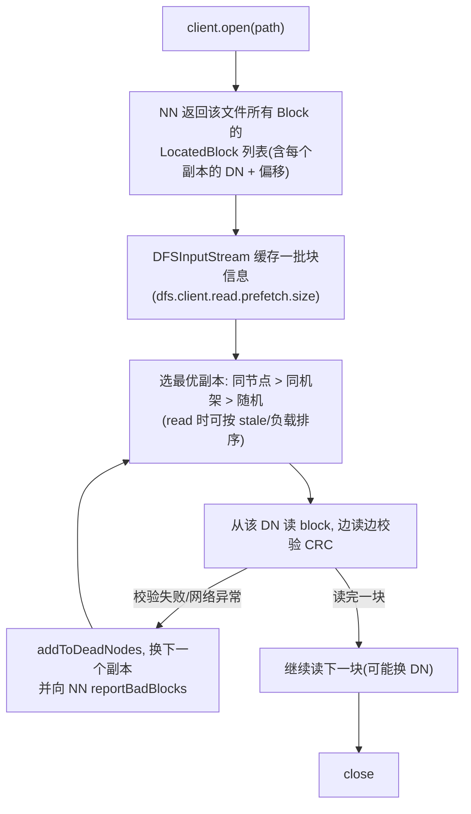

**两个高级点：**

- **短路读（Short-Circuit Local Read）**：如果客户端和 DN 在同一台机器，可以通过 **domain socket（`/var/lib/hadoop-hdfs/...`）直接映射 DN 的块文件**读，完全绕过 DN 进程和 TCP 栈，减少一次网络/进程跳转。需要 `dfs.client.read.shortcircuit=true` + `libhadoop.so`。
- **零拷贝（Zero-Copy）在 DN 侧**：`BlockSender` 用 `FileChannel.transferTo()`（底层 `sendfile(2)`）把文件直接从**内核页缓存**送到 socket，省掉"内核→用户态→内核"的两次拷贝。但**需要校验和时要读 .meta 文件并做校验**，此时不能完全零拷贝（这也是为什么"关掉校验和"能提升吞吐，但生产绝不该关）。

### 1.6 数据完整性：CRC、Scanner、块修复

HDFS 是"**假设磁盘一定会坏**"设计的，三层防御：

1. **写时校验**：客户端算 CRC32 写入 `.meta`；DN 收到数据后会重算一遍比对（`verifyChecksum`），不一致就报错并重传 packet。
2. **读时校验**：客户端读块时校验；DN 后台有 `DataBlockScanner`（默认每 3 周扫一遍，`dfs.datanode.scan.period.hours=504`），发现坏块向 NN 报 `reportBadBlocks`。
3. **副本修复（Replication Monitor）**：NN 后台线程定期检查副本数，不足则**选一个源副本 + 目标节点发起复制**；副本数超过要求则删除多余的（"副本均衡"）。
4. **磁盘级容错**：DN 可配置**多个数据目录（多块盘）**，一块盘坏只影响该盘上的块，`dfs.datanode.failed.volumes.tolerated` 允许坏 N 块盘而 DN 不退出。

### 1.7 心跳、块汇报与安全模式

| 机制 | 参数 | 说明 |
|---|---|---|
| 心跳 | `dfs.heartbeat.interval=3s` | DN 定期告诉 NN"我还活着"+ 剩余容量 |
| 死亡判定 | `2 * dfs.namenode.heartbeat.recheck-interval(5min) + 10 * 3s = 10.5min` | **注意：不是 3 秒没心跳就死**，有 10.5 分钟的宽限，避免网络抖动误杀 → 这也是"NN 挂掉后 DN 还活 10 分钟"的原因 |
| 块汇报 | `dfs.blockreport.intervalMsec=6h` | DN 把本机所有 block 列表发给 NN，用于重建 BlocksMap |
| 增量块汇报 | 60s | 新写入/删除的块增量上报 |
| 安全模式 | `dfs.namenode.safemode.threshold-pct=0.9999` | NN 启动时**只读不写**，等收到足够多块汇报（99.99% 的块达到最小副本数）才退出。`hdfs dfsadmin -safemode leave` 可强退 |

### 1.8 小文件问题（面试必考，工程价值极高）

**问题本质**：HDFS 的元数据是**按文件/块/副本**记录在 NN 内存的，每个对象约 **150~200 字节**。
- 1 亿个小文件（每个 1 个块）× 3 副本 ≈ 1 亿 × (1 文件 + 1 块 + 3 副本 inode) ≈ 数 GB 内存 → NN 内存被打爆，且 GC 停顿、启动回放变慢。
- 计算侧：每个文件至少一个 split → 一个 map task，**任务启动开销（JVM 秒级）远大于处理 1KB 数据的开销**。

**解决方案（按层次）**：

| 层次 | 手段 | 说明 |
|---|---|---|
| 写入时 | `hdfs dfs -appendToFile` 合并、`FileCrusher`、`Har` 归档 | 避免源头产生 |
| 采集时 | Flume 的 `file rollInterval/rollSize` 调大；Kafka→HDFS 按小时/大小滚动 | 控制文件数 |
| 计算后 | Hive `merge` 任务（`hive.merge.mapfiles/tezfiles`）、Spark `coalesce/repartition(1)` 写回 | 小文件合并 |
| 存储 | **HDFS 归档 HAR / Ozone / 对象存储**、**Iceberg/Hudi 的元数据化小文件管理** | 用元数据层合并小文件 |
| 表设计 | 分区粒度别太细（按天而非按小时/按用户） | 从建模侧解决 |

🔍 **深度延伸**：**为什么对象存储（S3/OSS）能解决小文件？** 因为它把"文件列表"放在**扁平的 KV/元数据服务**里，不要求在内存维护完整 INode 树，且对象无"块"概念；但代价是**没有目录语义的强一致 rename**（这正是 Iceberg/Delta 用"提交日志"实现原子提交的原因——对象存储的 rename 是"最终一致"甚至不原子）。

### 1.9 HDFS 的演进：Federation、EC、ViewFs

- **Federation（联邦）**：多个**独立 NameNode**（各自一套 Namespace）共享同一批 DataNode。每个 NN 管理一个 **Block Pool**（`BP-xxx`），DN 同时向所有 NN 汇报。解决了"单 NN 内存上限 & 单 Namespace 锁竞争"。缺点：**跨 NN 的全局视图需要 ViewFs 挂载表**来拼。
- **Erasure Coding（纠删码，HDFS 3.0）**：用 `RS-6-3`（6 数据块 + 3 校验块）把存储开销从 3 倍降到 1.5 倍。**代价**：读一个块要读多个块做解码（CPU 开销），且**不支持 append/原地修改**（只能重写条带），所以热数据/小文件仍用 3 副本，冷数据才用 EC。
- **ViewFs**：客户端侧的"挂载表"（`mountTable.xml`），把 `/user` 映射到 `nn1`、`/data` 映射到 `nn2`，让 Federation 对上层透明。

### 1.10 HDFS 与底层操作系统/硬件的交互（"操作底层到底是什么逻辑"）

这是本文档强调的一点：**所有分布式行为最终都落在 syscall 上**。

| 层面 | 实际发生的事 |
|---|---|
| 写文件 | `FileOutputStream.write` → **page cache**（脏页）→ 内核回写线程（`pdflush/flush`，`dirty_ratio` 控制）→ 磁盘。DN 默认**不 fsync**（可靠靠副本），所以"写完就断电"可能丢最后一段 |
| 读文件 | 先查 **page cache**，命中则不碰磁盘；`dfs.datanode.transferTo.allowed` 决定是否用 `sendfile` |
| 磁盘选盘 | `dfs.datanode.data.dir` 可配多个目录，DN 用**轮询（RoundRobinVolumeChoosingPolicy）**或**可用空间优先（AvailableSpaceVolumeChoosingPolicy）**选盘，避免热点盘 |
| 网络 | DN 间 pipeline 传输默认用 `DataTransferProtocol`（TCP，端口 50010），可启用 SASL 加密 |
| JVM | NN 需要大堆（生产 32~64GB，甚至用 `-XX:+UseG1GC` + `-XX:+ParallelRefProcEnabled`）；DN 堆不需大（数据走 DirectBuffer/堆外） |
| 内核参数 | 生产必调：`vm.swappiness=1`、`net.core.somaxconn`、`fs.file-max`、**关闭 `THP`（透明大页，会导致 NN 长 GC 停顿）** —— 这条是真实生产事故高发点 |

---

## 第 2 章 MapReduce 底层原理

### 2.1 设计哲学：用"落盘"换正确性

MapReduce 的核心洞察是：**把计算搬到数据旁边，并让中间结果落盘，从而做到任意任务失败都可重跑**。
它的两个函数签名决定了它能表达什么：

```
map:    (K1, V1)       → list<(K2, V2)>
reduce: (K2, list<V2>) → list<(K3, V3)>
```

**为什么 reduce 的输入是"同一个 key 的所有 value 迭代器"？** 因为 MapReduce 在 reduce 之前**强制按 key 全局排序 + 分组**（`shuffle` 阶段），这就是它"能算聚合、能算 join"的原因，也是它慢的原因。

### 2.2 完整执行流程（一张图讲完，面试可直接画）

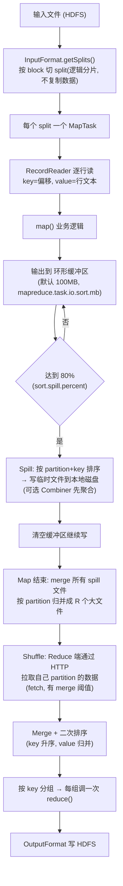

**每一步的底层细节：**

1. **Split 不是 Block**：`split size = max(minSize, min(maxSize, blockSize))`，所以默认一个 block 一个 split。**split 是逻辑切分，只记录 (file, start, length)**，不会真的把数据切开 → 这就是"移动计算而非移动数据"的落地方式。`split` 内的记录边界由 `RecordReader` 处理（跨 block 的那一行由"后一个 split 多读一行"解决）。
2. **环形缓冲区（MapOutputBuffer）**：100MB 的 byte 数组，**同时存索引和数据**：前 80% 存 key/value 原始字节，后 20% 存 `<partition, keyStart, valueStart>` 的元数据（`metadata` 区从尾部向前生长）。两个指针相遇 → 触发 spill。
3. **Spill 时的排序是"分区内二级排序"**：先按 **partition（即 reduce 编号）** 分组，再按 **key** 排序。排序算法是 **`QuickSort`（`MapOutputBuffer` 的 `sorter`，对序列化的 `<key,value>` 字节做比较，key 的比较用 `RawComparator` 直接比较字节，避免反序列化）**——这是 MR 优化的一个经典点：**用二进制比较器跳过对象创建**。
4. **Combiner**：本质是"在 map 端先做一次 reduce"。它必须是**满足结合律/交换律**的操作。
   - ⚠️ 求平均值不能用 Combiner 直接做（`avg(1,2,3) ≠ (avg(1,2)+avg(3))/2`），要写成 `(sum,count)`。
5. **Merge**：spill 文件数超过 `mapreduce.task.io.sort.factor`（默认 10）时，会**多轮归并**（每轮 10 个），最后每个 map task 输出 `R` 个文件（R = reduce 数）。这是"**M × R 个中间文件**"的来源，也是 MR 磁盘 IO 放大的根因。
6. **Reduce 端：Shuffle 的 Copy 阶段** 通过 **HTTP（`ShuffleHandler`，端口 13562）** 拉数据，默认 5 个线程并发。拉下来的数据先放内存（`mapreduce.reduce.shuffle.input.buffer.percent=0.7` 的堆），超过 `merge.threshold` 就合并落盘，最后整体归并 → 交给 `reduce()`。
7. **Reduce 输出的 key 顺序**：因为 shuffle 全局按 key 排序，reduce 输出天然**按 key 有序**（这是个可直接用的特性，比如 HBase 导入、二次排序）。

### 2.3 Shuffle 为什么是性能杀手（量化理解）

假设 1000 个 map task，100 个 reduce task：
- map 端产生 **1000 × 100 = 10 万个中间文件**（如果不做 `combineFile` 优化）。
- 每个 reduce 要拉 **1000 份**数据 → 1000 次网络连接 + 解压。
- 三份拷贝：map 内存 → map 本地磁盘 → reduce 内存/磁盘 → 最终 HDFS。
- **排序开销**：`O(n log n)` 的比较，全在 CPU 上。

所以 MR 的调优几乎都围绕 shuffle：**增大 `sort.mb`、提高 `sort.factor`、用 Combiner、控制 reduce 数（`0.95 * 集群 slot 数` 的经验公式）、map 端聚合**。

### 2.4 数据倾斜：从 MR 时代就存在的问题

现象：**少数 reduce task 跑了 90% 的时间**（`Reduce shuffle bytes` 或 `Reduce input records` 远超其他）。
根因：`HashPartitioner` 用 `key.hashCode() % numReduceTasks`，某个热 key 或某几个前缀相同的 key 都落到同一个 partition。

| 手段 | 做法 | 适用 |
|---|---|---|
| 自定义 Partitioner | 按业务维度打散 | key 种类少但分布不均 |
| 加盐两阶段聚合 | 给 key 加随机前缀 → 局部聚合 → 去前缀再全局聚合 | **聚合场景**（最常用） |
| Map 端 Join | 小表进分布式缓存（`DistributedCache`），大表 map 时直接关联，无 shuffle | 一大一小 join |
| 采样 + 拆分 | 对热 key 单独处理，其余走正常流程 | 极端热 key（如 NULL 值、默认值） |
| ⚠️ NULL 值 | `key` 为 NULL 全落到一个 reducer → **加随机后缀或提前过滤** | 最常见坑 |

### 2.5 推测执行（Speculative Execution）

`mapreduce.map.speculative` / `reduce.speculative`：AM 发现某个 task 的**进度落后同批 task 平均值一定比例**（`mapreduce.job.speculative.slowtaskthreshold`）时，**在另一个节点启动一份副本**，谁先完成用谁的结果，另一个 kill 掉。
- 好处：长尾 task 不拖垮整个 job。
- 代价：**多消耗一份资源**，且**如果任务有外部副作用（写外部系统）会重复写** → 生产上写 HBase/Kafka 的 job 通常关闭推测执行。

### 2.6 MR 的局限（为什么被 Spark 取代）

1. **只有 map 和 reduce 两种算子**，复杂逻辑（多轮 join、迭代计算）要串多个 job，**每个 job 都要落 HDFS**。
2. **job 启动开销大**：每次申请 AM + 申请 container + JVM 启动，秒级到分钟级。
3. **强制排序 + 强制落盘**：即使不需要排序（如单纯的 map-only ETL）也走完整流程（map-only 可以跳过 reduce，但仍要写 HDFS）。
4. **磁盘 IO 放大**：M×R 中间文件。
5. **不支持迭代/交互式**：机器学习、图计算反复读写 HDFS → Spark 内存迭代的核心价值。

**但 MR 仍有价值**：超大规模、极度不稳定、要求"单 job 也能跑完 + 极简容错"的离线 ETL；以及 **Hive on MR 作为兜底引擎**。

---

## 第 3 章 YARN 资源管理与调度

### 3.1 架构与职责

```mermaid
graph TB
    subgraph RMnode["ResourceManager (主)"]
        S["Scheduler<br/>(Capacity/Fair/FIFO)"]
        ASM["ApplicationManager<br/>管理所有 AM 生命周期"]
    subgraph NM1["NodeManager1"]
        CM1["ContainerManager"]
        C1["Container(Executor)"]
        C2["Container(Executor)"]
    end
    subgraph NM2["NodeManager2"]
        CM2["ContainerManager"]
        C3["Container(AM)"]
    end
    Client -->|"submit"| ASM
    ASM -->|"启动 AM"| CM2
    C3 -->|"申请资源(心跳+心跳响应返回分配)"| S
    S -->|"分配 Container"| CM1
    CM1 --> C1
    CM1 --> C2
    C1 -->|"task 心跳/进度"| C3
```

- **ResourceManager**：全局资源视图（`Scheduler` 只做调度决策，`ApplicationManager` 管应用生命周期）。**RM 不做真正的分配动作，它只发"资源券"，由 NM 去启动 container。**
- **NodeManager**：单节点代理，负责**本地化（下载 jar/配置到本地）**、启动/监控 container、上报资源（内存/vcore/磁盘/GPU）。
- **ApplicationMaster**：每个应用一个，负责向 RM **申请资源**、与 NM **协商启动 task**、**监控 task**、**重试失败 task**、最后**注销自己**。→ **AM 是"应用的本地调度器"，RM 只是"资源批发商"。** 这个分层是 YARN 最重要的设计：**资源管理与应用调度解耦**（Mesos 的两级调度思想）。
- **Container**：资源的抽象，**不是 Docker**（YARN 的 container 是 cgroup + 进程隔离，`LinuxContainerExecutor`）。资源维度：`memory`（MB）+ `vcore`（虚拟核），可选 GPU/FPGA（`yarn.resource-types`）。

### 3.2 一次作业提交的完整流程（面试高频）

1. Client 向 RM 的 `ApplicationManager` 提交应用 → 得到 `applicationId`。
2. Client 检查输出目录、计算 split、**把 job 相关文件（jar、配置、split 元数据）上传到 HDFS**（`submitDir`，含 `job.jar`、`job.xml`、`job.split`）。
3. Client 调 `submitApplication` → RM 分配一个 container → NM 启动 **MRAppMaster**。
4. AM 初始化：向 RM 注册（`registerAM`），拿到"可用资源上限"；**读取 split 元数据**；创建 task 请求。
5. AM 通过 `RMContainerAllocator` **周期性心跳申请 container**（心跳携带 `ResourceRequest`：`<priority, 资源量, 本地性偏好, 节点黑名单>`），RM 在心跳响应里返回分配的 container（**心跳即调度**，不做主动推送 → 这是 YARN 调度延迟的来源）。
6. AM 拿到 container 后，通过 `ContainerLauncher` **直接联系 NM**（`startContainer`），NM 本地化资源（从 HDFS 下载 jar → 本地目录）后启动 **YarnChild** 进程执行 map/reduce task。
7. task 通过 **umbilical** 协议定期向 AM 汇报进度和状态（`statusUpdate`）。
8. 所有 task 完成 → AM 调 `finishApplicationMaster` 注销 → RM 回收资源，清理 container。

⚠️ **注意**：**"AM 直连 NM 启动 task"** 这一点很多人答错，以为是 RM 启动 task。RM 只负责"分配 container 给 AM"，**AM 才是启动 task 的发起方**。

### 3.3 三种调度器（必考对比）

| 维度 | FIFO | Capacity Scheduler（Hadoop 默认） | Fair Scheduler（CDH 常用） |
|---|---|---|---|
| 队列结构 | 单队列 | **树形队列**（`root.a.b`），支持父子队列按比例分配 | 树形队列，支持权重 |
| 资源分配 | 先到先得 | 按**队列容量百分比**分配（`yarn.scheduler.capacity.root.a.capacity=40`），**空闲资源可被其他队列借用**（`maximum-capacity` 限制） | 按**权重**公平分配，缺额队列可抢夺超额队列的资源 |
| 抢占 | 无 | 支持 `preemption`（队列资源超上限时抢占） | 支持按权重抢占 |
| 多租户隔离 | 差 | 好（生产首选） | 好（偏向"公平"语义） |
| 典型场景 | 测试 | 阿里/字节/美团等多数生产集群 | 中小集群、需要"公平"语义 |

**Capacity Scheduler 的三层策略（深挖点）：**
1. **队列层级（Hierarchical Queue）**：父队列资源按子队列 capacity 比例切分。
2. **用户资源限制（User Limit）**：`minimum-user-limit-percent` 防止单个用户吃掉整队列。
3. **容器/任务限制**：`maximum-am-percentage`（防止 AM 占满资源）、`maximum-allocation-mb`（单 container 上限）。
4. **资源标签（Node Label）**：把机器打标（如 `gpu`、`ssd`、`highmem`），队列绑定标签，实现"**异构资源调度**"（机器学习作业只跑 GPU 机器）。
5. **主导资源公平（DRF）**：当有 memory/vcore 两种资源时，按"**占用比例最高的那个资源**"排序（Dominant Resource），保证多维公平。

### 3.4 资源模型与常见调优

- **vcore 是"虚拟核"**：可以超配（`yarn.nodemanager.vmem-pmem-ratio`、`yarn.nodemanager.resource.cpu-vcores` 可大于物理核），因为大数据作业多数是 IO 密集。
- **memory 强校验**：`yarn.nodemanager.pmem-check-enabled=true`，超出 `mapreduce.map.memory.mb` × `mapreduce.map.java.opts` 比例（通常 0.8）就会被 kill → **`Container killed on request. Exit code is 137`** 就是被 NM 干掉（OOM-Killer）。
- **`Exit code 143`** = SIGTERM（正常 kill）；**`137`** = SIGKILL/OOM；**`Exit code 1`** = 用户代码异常。**面试常问"你见过哪些 exit code，怎么排查"**。
- 调优点：小容器多 vs 大容器少（"**资源碎片化**"问题）、AM 内存（`yarn.app.mapreduce.am.resource.mb`）、`yarn.scheduler.minimum-allocation-mb`（分配粒度，设太大会浪费）。

### 3.5 YARN 的局限与演进

- **延迟高**：container 启动 = 本地化 + JVM 启动，秒级；心跳调度有延迟（`yarn.resourcemanager.nodemanagers.heartbeat-interval-ms`）。
- **资源粒度粗**：以"整 container"为单位，不能细粒度弹性伸缩。
- **不适合长驻服务/低延迟**：→ 这是 **Kubernetes + Flink/K8s Operator**、**Spark on K8s** 出现的直接原因。现代趋势是"**离线批在 YARN（或 K8s），流式在 K8s**"。
- **YARN Federation**：多个 RM 分治超大集群（和 HDFS Federation 思路一致）。

---

## 第 4 章 Hive 底层原理

### 4.1 本质：一个"SQL → 分布式作业"的翻译器

Hive **不存数据、不算数据**，它做两件事：
1. **元数据映射**：把 HDFS 上的 `目录/文件` 解释成 `库/表/分区/列`（存在 MetaStore 的 RDBMS 里）。
2. **SQL 编译**：把 SQL 翻译成 MR/Tez/Spark 的 DAG。

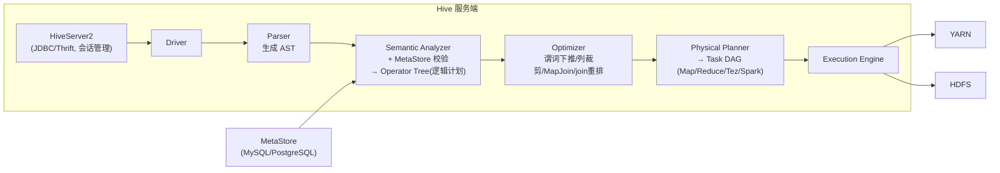

### 4.2 元数据模型：表在 HDFS 上到底是什么

**这是理解 Hive 的第一性原理。** 一个 Hive 表就是一个**目录**；分区就是**子目录**；分桶就是**目录下的多个文件**。

```
/user/hive/warehouse/db.db/orders/            ← 表 orders 的 location
├── dt=2026-11-18/                            ← 分区 = 子目录（分区列不是真实列！）
│   ├── country=CN/
│   │   ├── part-00000                     ← 一个文件 = 一个 split = 一个 map task
│   │   └── part-00001
│   └── country=US/
└── dt=2026-11-19/
```

**关键结论（面试常考"分区和分桶的区别"）：**

| 维度 | 分区（Partition） | 分桶（Bucket） |
|---|---|---|
| 物理表现 | **目录**（`dt=2026-11-18/`） | **文件**（`000000_0`、`000001_0`…共 N 个） |
| 切分依据 | 指定列的值（通常是时间/地区） | `bucketid = hash(分桶列) % bucket数` |
| 数量 | 每分区值一个目录，**分区过多会产生大量小目录+小文件** | 固定为建表时指定的 `CLUSTERED BY ... INTO N BUCKETS` |
| 主要用途 | **分区裁剪**（只扫需要的目录，跳过 IO） | **SMB Join / Bucket Map Join**、采样（`TABLESAMPLE(BUCKET 1 OUT OF 4)`）、高效去重 |
| ⚠️ 坑 | 分区列**不能是表中已存在的列**（它是目录名，逻辑上可当列用但数据里不存）；分区字段出现在数据文件里说明踩坑了 | 分桶必须 `INSERT` 时由 Hive 写入才有效（`LOAD DATA` 直接放文件不生效）；`hive.enforce.bucketing=true` |

**内部表 vs 外部表（必考）：**

| | 内部表（Managed） | 外部表（External） |
|---|---|---|
| `DROP TABLE` | **删除元数据 + 删除 HDFS 数据** | **只删元数据，数据保留** |
| 使用场景 | 中间表、ETL 结果 | **原始数据、多引擎共享的数据（Spark/Flink/Presto 都要读）** |
| 生产方式 | `CREATE TABLE` | `CREATE EXTERNAL TABLE ... LOCATION 'hdfs://...'` |

**生产铁律**：**ODS 层一律用外部表**（防止误删源数据），DWD 及以上按团队规范。

### 4.3 SQL 执行的算子树是怎么长出来的

以 `SELECT a, count(*) FROM t WHERE dt='2026-11-19' GROUP BY a` 为例：

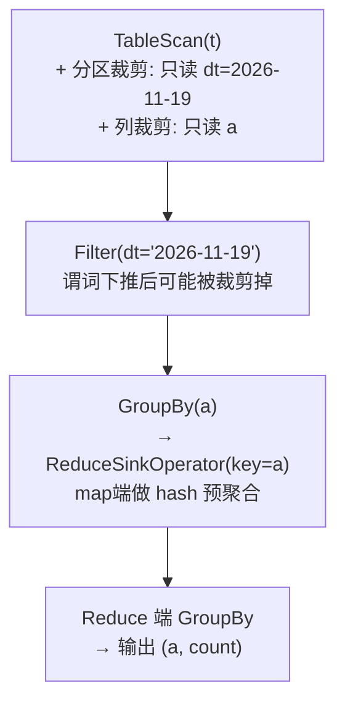

**关键优化规则（面试高频，能说出 5 条以上就是熟手）：**

| 优化 | 机制 | 效果 |
|---|---|---|
| **分区裁剪（Partition Pruning）** | 编译时把 `WHERE dt=...` 转成"只读该子目录" | 减少 **IO**，最有效的优化 |
| **列裁剪（Column Pruning）** | 只读用到的列 | 列存格式（ORC/Parquet）下减少 **90% IO** |
| **谓词下推（Predicate Pushdown）** | 把 filter 尽量推到 scan 层；`hive.optimize.ppd=true` | 减少中间数据量 |
| **Map 端聚合** | `hive.map.aggr=true`，map 端先做 hash 聚合 | 减少 shuffle 数据量 |
| **负载均衡** | `hive.groupby.skewindata=true`：生成两个 MR job，第一个随机打散做部分聚合，第二个按 key 聚合 | **解决 group by 倾斜** |
| **MapJoin（小表广播）** | 小表（默认 <25MB，`hive.auto.convert.join.noconditionaltask.size`）进**分布式缓存（DistributedCache）**，在 map 端完成 join，无 reduce | 消除 join 的 shuffle |
| **SMB Join** | 两表按同一 key **同数量分桶 + 同序排序**，map 端按桶逐个 merge | 无 shuffle 的大表 join |
| **Fetch Task** | `SELECT * LIMIT n` 不需要 MR，直接读文件 | 小查询秒级 |
| **本地模式** | 输入 < `hive.exec.mode.local.auto.inputbytes.max`（默认 128MB）时用本地进程跑 | 小数据免调度 |
| **JVM 重用** | `hive.exec.reducers.bytes.per.reducer` + `mapred.job.reuse.jvm.num.tasks` | 减少 JVM 启动 |
| **向量化** | `hive.vectorized.execution.enabled` 按 1024 行批处理 | CPU 效率 ×3~5 |
| **CBO** | `hive.cbo.enable` 基于统计信息（`ANALYZE TABLE ... COMPUTE STATISTICS`）做 join 重排 | 选对 join 顺序 |

⚠️ **重点辨析：`hive.map.aggr` 和 `hive.groupby.skewindata` 的区别**
- `map.aggr`：map 端做**部分聚合**（哈希表），减少输出。
- `skewindata`：解决**倾斜**，用**两阶段聚合**（第一个 job 随机分区，第二个 job 按真实 key 分区）。
- 两者可同时开，作用不同。

### 4.4 Join 的三种物理实现（必须能画出来）

**① Common Join（Reduce 端 Join，最通用）**

```
map: 读 A 表 → 输出 (joinKey, ('A', row))
map: 读 B 表 → 输出 (joinKey, ('B', row))
                    ↓ shuffle by joinKey
reduce: 同一个 key 的所有 A 行和 B 行到齐 → 在内存里做笛卡尔匹配
```
- 优点：任意大小表、任意 join 类型。
- 缺点：**必须 shuffle**，且 reduce 端要缓存整个 key 的左右两组数据 → **数据倾斜 + OOM 高发区**。

**② Map Join（Broadcast Join，小表广播）**

```
启动时: 小表全量读进内存 → 生成 HashTable → 写进 DistributedCache
map:   读大表一行 → 用 joinKey 查 HashTable → 直接输出
```
- 优点：**无 shuffle、无 reduce**，速度快。
- 缺点：小表必须能装进内存（默认阈值 25MB）；**只支持"小表 join 大表"的 left/right join 和 inner join**（小表在 outer 侧时不适用）。
- 触发：`hive.auto.convert.join=true`；也可用 hint `/*+ MAPJOIN(b) */` 强制。

**③ SMB Join（Sort-Merge-Bucket Join）**

```
前提: A、B 都 CLUSTERED BY(key) INTO 256 BUCKETS, 且 SORTED BY key
map:  启动 256 个 task, task i 只读 A 的第 i 个桶 + B 的第 i 个桶
      → 两个桶内部都按 key 有序 → 双指针归并即可 join
```
- 优点：**无 shuffle，且内存占用极小（流式归并）**，可以 join 两个超大表。
- 条件严格：**分桶数必须整除关系**（或相等）、**必须排序**、表必须是分桶表且数据由 Hive 写入。

### 4.5 数据倾斜的系统性解法（Hive 篇）

| 场景 | 现象 | 解法 |
|---|---|---|
| group by 倾斜 | 某 reducer 卡在 99% | `hive.groupby.skewindata=true`（两阶段） |
| join 倾斜（小表） | 某 reducer OOM | **MapJoin**（消除 shuffle） |
| join 倾斜（大表+热 key） | 个别 key 数据量巨大 | ① 热 key 单独抽出来 map join；② 大表 key 加随机前缀（0~N），小表膨胀 N 份；③ `hive.optimize.skewjoin=true`（Hive 自动检测超大 key 并单独处理） |
| count(distinct) 倾斜 | 单个 reducer 处理全部 distinct | 改成 `group by` 两级：`select k, count(1) from (select k, v from t group by k,v) group by k` |
| 空值倾斜 | NULL 全落一个 reducer | `WHERE key IS NOT NULL` 或 `nvl(key, rand())` |
| 文件不均 | 某些 map 读超大文件 | `hive.merge` + 合理分区，避免单文件 > block |

### 4.6 文件格式：ORC / Parquet / TextFile（性能的物理基础）

**核心思想：列式存储 + 压缩 + 统计信息（min/max）+ 索引。**

| 格式 | 结构 | 优势 | 场景 |
|---|---|---|---|
| TextFile | 纯文本行 | 可读、可直接 load | ODS 原始层 |
| **ORC** | `file → stripe(默认64MB) → row group(默认25000行) → 列数据流`；每 stripe 有 **index（min/max + 布隆过滤器）**、data、footer | Hive 原生，**谓词下推最强**（stripe 级 + row group 级 + bloom filter），支持 ACID | Hive 数仓主力 |
| **Parquet** | `file → row group → column chunk → page`（Dremel 编码，支持嵌套） | Spark/Presto 生态通用，**嵌套结构强** | 数据湖、Spark 主力 |
| Avro | 行式 + schema | **Schema 演进**友好 | Kafka 消息、流式落地 |

**为什么列存快？三个原因（面试常问）：**
1. **IO 减少**：只读需要的列（列裁剪真正生效）。
2. **压缩率高**：同一列数据类型一致、重复度高 → 压缩比可达 10:1，且能用列专属编码（字典编码、RLE、Delta）。
3. **向量化**：按批（1024/4096 行）处理，CPU cache 友好、可用 SIMD。

**ORC 的三级索引怎么用（深挖点）：**
```
Query: WHERE age > 30 AND name LIKE '%张%'
1. stripe 级: 读 footer 里的 stripe statistics → 该 stripe 的 age max=25 → 整个 stripe 跳过（不读数据）
2. row group 级: 读 index（每 25000 行一个 entry）→ min/max 跳过
3. 行级: 用 bloom filter 判断 name 是否可能存在 → 再读具体行
```
→ **所以"ORC 表必须 ANALYZE 或写入时统计"才有索引**，`orc.create.index=true` 默认开。

### 4.7 Hive 的演进：Tez / LLAP / ACID / 物化视图

- **Hive on Tez**：Tez 把多个 MR job 合成一个 DAG（**避免中间结果落 HDFS**），比 MR 快 2~5 倍，是 Hive 2.x 的默认推荐。
- **LLAP（Live Long and Process）**：常驻守护进程 + 堆外缓存（类似"内存中的 Hive"），支持亚秒级交互查询，适合 BI 场景。**代价**：需要预留大量内存（`hive.llap.daemon.memory.per.instance.mb`）。
- **ACID（Hive 3.0）**：支持 `INSERT/UPDATE/DELETE/MERGE`，实现方式是 **delta 目录 + 基文件 + Compactor 后台合并**（`base_xxx` + `delta_xxx`），需要表为 ORC + `transactional=true` + 分桶。⚠️ 只支持"桶内行级"更新，**性能远不如 HBase/Kudu**。
- **物化视图（Materialized View）**：预计算结果 + 自动改写查询（`hive.materializedview.rewriting=true`），适合固定的聚合报表。

### 4.8 Hive 的定位变化（面试可聊的"观点题"）

Hive 的黄金时代是"**Hive on MR 做离线数仓**"。今天它的角色变成：
- **元数据的事实标准**：Hive Metastore 已成为 Spark/Flink/Presto/Trino/Iceberg 的共用 catalog（很多公司叫"统一元数据"）。**这是 Hive 今天最大的价值。**
- **离线 ETL 兜底**：Spark SQL 是主力，Hive 做兼容。
- **交互查询**：被 Trino/ClickHouse/Doris/StarRocks 取代。

**一句话总结**：`Hive = Metastore（还在统治）+ SQL 编译器（已被 Spark 继承）+ MR 执行（已被淘汰）`。

---

## 第 5 章 Spark 底层原理

### 5.1 从 MR 到 Spark：一次范式跃迁

| 维度 | MR | Spark |
|---|---|---|
| 计算模型 | 单 job 单 stage（map→reduce） | **DAG 多 stage**，一个 Application 内流水线执行 |
| 中间结果 | **必须落 HDFS** | **落本地磁盘/内存**，且同 stage 内 pipeline 不落盘 |
| 数据抽象 | 无（只有 KV） | **RDD**（不可变、分区、血缘） |
| 容错 | 任务级重跑 | **血缘重算 + checkpoint** |
| 迭代计算 | 每轮读写 HDFS | **cache 后内存迭代**（快 10~100 倍） |
| 调度 | 每 job 一个 AM | 一个 Application 一个 Driver，内部 DAG 调度 |

**核心洞察（面试可讲的观点）**：Spark 比 MR 快，**不主要是"内存"**，而是三点：
1. **减少作业数量**：多个 MR job 合并成一个 Spark Application，省掉 N 次 AM/容器申请。
2. **减少落盘**：同 stage 内算子 chain/pipeline 执行，中间数据在内存流转（`map→filter→flatMap` 全程不落盘）。
3. **减少 shuffle 的数据量与次数**：分区内聚合、`reduceByKey` 的 map 端 combine（相当于 MR 的 Combiner 但更灵活）。

### 5.2 RDD：Spark 的第一性原理

```scala
abstract class RDD[T] {
  def partitions: Array[Partition]              // 怎么切分
  def compute(split: Partition, ctx: TaskContext): Iterator[T]   // 怎么算一个分片
  def dependencies: Seq[Dependency[_]]          // 血缘：从谁来的
  def preferredLocations(split: Partition)      // 数据在哪（本地性）
  @transient val partitioner: Option[Partitioner]  // 分区方式（决定要不要 shuffle）
}
```

**五个特性（面试必背）：** 分区列表、计算函数、依赖关系、分区器（可选）、优先位置（可选）。

**为什么 RDD 只能"转换"不能"修改"？** 因为不可变（immutable）+ 血缘，才能做到"**任意分片可重算**"，这是分布式容错的基础（对比数据库的"就地更新 + undo log"）。

#### 5.2.1 窄依赖 vs 宽依赖（决定 stage 划分的唯一标准）

| | 窄依赖（Narrow） | 宽依赖（Wide / Shuffle） |
|---|---|---|
| 定义 | **每个父分区最多被一个子分区使用**（1:1 或 N:1） | **每个父分区可能被子分区多个使用**（**一个父分区 → 多个子分区**） |
| 算子 | `map, filter, flatMap, mapPartitions, union, coalesce(不shuffle), glom` | `groupByKey, reduceByKey, sortByKey, join(非broadcast), repartition, distinct, cogroup` |
| 数据传输 | 无需跨节点（pipeline 内存传递） | **需要跨节点 shuffle（落盘 + 网络）** |
| 容错 | 只重算**丢失的那个父分区** | 需要重算**所有父分区**（因为一个子分区依赖多个父） |
| Stage 边界 | 同一 stage 内 | **stage 的分界线** |

> ⚠️ 经典误区：`join` 一定是宽依赖吗？**不是**。`broadcast join`（小表广播）是窄依赖（map 端完成，无 shuffle）；只有 shuffle join 才是宽依赖。
> `coalesce` 默认 `shuffle=false` 是窄依赖；`repartition` 一定是宽依赖。

#### 5.2.2 Stage 划分与 Task 生成（DAGScheduler 的核心逻辑）

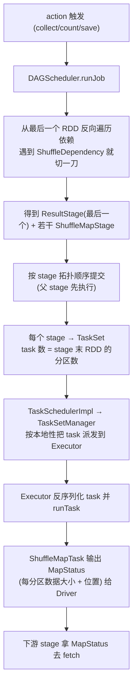

**关键细节：**
- **Stage 数量 = 宽依赖数量 + 1**（从后往前数的 shuffle 次数）。
- **Task 数 = 该 stage 最后一个 RDD 的分区数**。`spark.default.parallelism` 决定默认分区数（通常 = executor 总核数 × 2~3）。
- **`MapStatus` 存的是"每个 reduce 分区要拉多少字节 + 在哪个 BlockManager"**，用 **HyperLogLog 估算大小**（`spark.shuffle.accurateBlockThreshold`），用于下游决定是否走"本地读"或"远程拉"。
- **ResultStage 的 task 直接把结果返回 Driver**（`collect`/`take`），大结果会 OOM Driver——所以**永远不要 `collect` 大表**。

### 5.3 Shuffle 的演进史（Spark 最硬核的部分，面试区分度极高）

**Shuffle 的本质任务**：把 map 端按"目标分区（reduce 分区）"重新组织，写到磁盘/内存，供 reduce 端按分区拉取。

#### ① Hash Shuffle（Spark 1.0 时代，已废弃）

```
每个 map task 为每个 reduce task 开一个文件:
map1 → file_r0, file_r1, ..., file_r99   (100 个文件)
map2 → file_r0, ..., file_r99
...
M 个 map × R 个 reduce = M × R 个小文件
```
- 问题：**文件数爆炸**（1000 map × 1000 reduce = 100 万个小文件），同时打开的文件句柄 + 缓冲区内存爆炸。
- 改进 `spark.shuffle.consolidateFiles=true`：同一 core 上的多个 map task 复用同一组文件（`M/core × R`），文件数降到 `C×R`。

#### ② Sort Shuffle（Spark 1.2+，默认至今）

```
每个 map task:
  1. 按 (partitionId, key) 排序写入 一个 data 文件
  2. 同时写一个 index 文件, 记录每个 partition 的 (offset, length)
  3. reduce 端按 index 里的 offset 定位并拉取
→ M 个 map 产生 2M 个文件（不是 M×R）
```
- 核心组件：`SortShuffleWriter` → `ExternalSorter`（内存 buffer + spill 到磁盘 + 多路归并）。
- **bypass 模式**（`spark.shuffle.sort.bypassMergeThreshold=200`）：当 **reduce 分区数 < 阈值** 且**不需要 map 端聚合**时，跳过排序，直接按 partition 写多个文件再"拼接"成一个 → 省掉排序开销。**这是"reduce 数少时更快"的原因。**
- **UnsafeShuffleWriter（Tungsten Sort）**：用 `Unsafe` 直接操作二进制内存（无需反序列化成对象），按 **partitionId 的高位做基数排序（radix sort）**，再 spill 成文件。要求：**无聚合、序列化器支持 relocation（Kryo/Java 序列化不支持，只有 `UnsafeRow` 支持）** → 主要被 Spark SQL 使用。

#### ③ Shuffle 的服务化（External Shuffle Service）

问题：Spark on YARN 时，如果 Executor 被 kill（推测执行/资源抢占），它写的 shuffle 文件就没了，下游必须重算。
解决：**每个 NodeManager 上常驻一个 `YarnShuffleService`（`spark.shuffle.service.enabled=true`）**，executor 把 shuffle 文件"托管"给它，executor 死后**文件仍可被读取** → 下游不用重算。这是**生产必备配置**。

#### ④ Shuffle 的关键参数（能背出来 = 有实战经验）

| 参数 | 默认 | 作用 |
|---|---|---|
| `spark.shuffle.file.buffer` | 32KB | map 端写缓冲区，**调大到 64KB 可减少磁盘 IO 次数** |
| `spark.reducer.maxSizeInFlight` | 48MB | reduce 端单次拉取上限，**太大易 OOM，太小拉取次数多** |
| `spark.shuffle.io.maxRetries` | 3 | 拉取失败重试（长任务调大） |
| `spark.shuffle.manager` | sort | `sort` / `tungsten-sort` |
| `spark.shuffle.partitions` | 200 | **最需要调的参数**：每分区 100~200MB 数据为佳 |
| `spark.memory.fraction` | 0.6 | shuffle 聚合用的 execution 内存比例 |

🔍 **深挖：为什么 shuffle 一定要落盘？** 因为 shuffle 的数据量可能远超内存，且**下游 stage 需要随机访问"某个分区的所有数据"**（不是顺序流），必须能按偏移定位 → 必须有 index + 文件。这也是为什么"**Spark 不是纯内存计算**"——它只是"尽量不落盘"。

### 5.4 内存管理：从静态到统一（UnifiedMemoryManager）

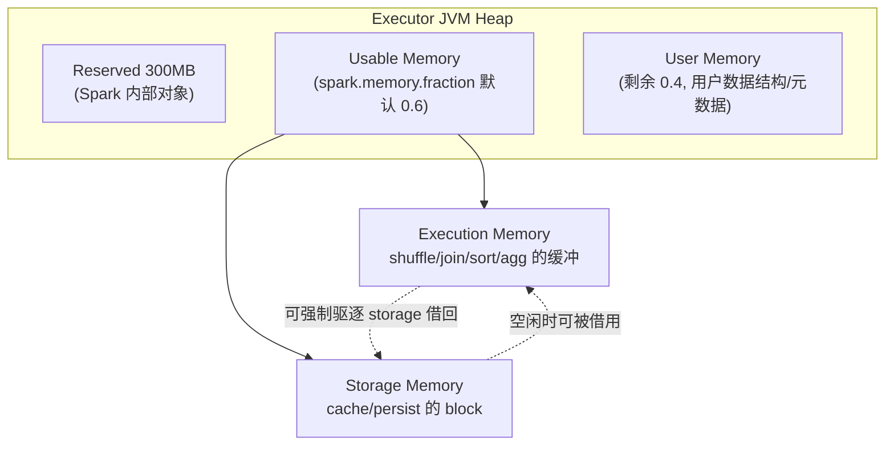

**统一内存管理的关键规则（面试高频）：**
1. **Execution 可以"抢占"Storage**（把缓存的 block 从内存驱逐到磁盘）；**Storage 只能"借用"Execution 的空闲部分**，且 **Execution 需要时必须立刻归还**。
2. **为什么要这样设计？** 因为两类需求是"互补"的：shuffle 阶段 Execution 需求大、Storage 空闲；cache 阶段相反。统一管理避免"静态划分导致的利用率低下"（Spark 1.5 之前的 `spark.shuffle.memoryFraction` + `spark.storage.memoryFraction` 静态划分经常一边 OOM 一边闲置）。
3. **`cache` 与 `persist` 的区别**：`cache` = `persist(MEMORY_AND_DISK)`（Spark 2.x 起，1.x 是 `MEMORY_ONLY`）。级别：`MEMORY_ONLY / MEMORY_AND_DISK / MEMORY_ONLY_SER / MEMORY_AND_DISK_SER / DISK_ONLY / OFF_HEAP / *_2（副本）`。
   - **`MEMORY_ONLY` 放不下会怎样？分区直接被丢弃，下次用时重算**（不是报错）——这一点很多人答错。
   - **`MEMORY_AND_DISK`** 放不下溢写磁盘，不重算。
4. **`spark.memory.offHeap.enabled`**：堆外内存（`sun.misc.Unsafe.allocateMemory`），避免 GC，适合大堆。需要设置 `spark.memory.offHeap.size`。

### 5.5 Tungsten 项目：Spark 的性能底座

Tungsten 是 Spark 1.4 引入的"**让 Spark 跑得接近手写 C 代码**"的工程，三件事：

1. **堆外内存管理（Off-heap Memory Manager）**：用 `Unsafe` 直接分配/释放内存，自己维护 page 的 `MemoryBlock`，**不经过 JVM 堆 → 无 GC 压力 → 可用超大内存**。
2. **二进制存储（Binary Processing）**：数据不再以 Java 对象存在，而是 `UnsafeRow` / `UnsafeExternalSorter` 的**紧凑二进制字节**（schema 固定、字段偏移固定），带来：
   - 无对象头开销（一个 Java 对象 16 字节 header）
   - **cache 友好**（连续内存）
   - **可直接比较/哈希字节**（不需要反序列化）
3. **全阶段代码生成（Whole-Stage Code Generation）**：把 `filter → project → aggregate` 编译成**一个 Java 方法**（用 Janino 编译），消除虚函数调用、消除中间对象、让 JIT 能优化。

```scala
// 优化前：三次虚函数调用 + 三次 Iterator 对象创建
rdd.filter(p).map(f).reduceByKey(g)

// 优化后（概念示意）：
while (input.hasNext()) {
  val row = input.next()
  if (p(row)) { aggBuf.update(f(row)) }   // 一个循环内完成
}
```

**效果**：Spark 3.x 的 TPCDS 性能相比 1.x 提升 2~3 倍，其中 **codegen 贡献最大**。
⚠️ **坑**：`codegen` 生成的类会进 **CodeCache（JVM Metaspace/Code Cache）**，复杂 SQL（几百个字段）会生成巨大方法 → 编译慢、甚至 `Method too large` / `CodeCache is full` 报错，需要 `spark.sql.codegen.maxFields`、`spark.sql.codegen.fallback=true` 兜底。

---

### 5.6 Spark SQL：Catalyst 优化器（面试区分度最高的部分）

Spark SQL 的执行链路，**每一步做了什么必须能复述**：

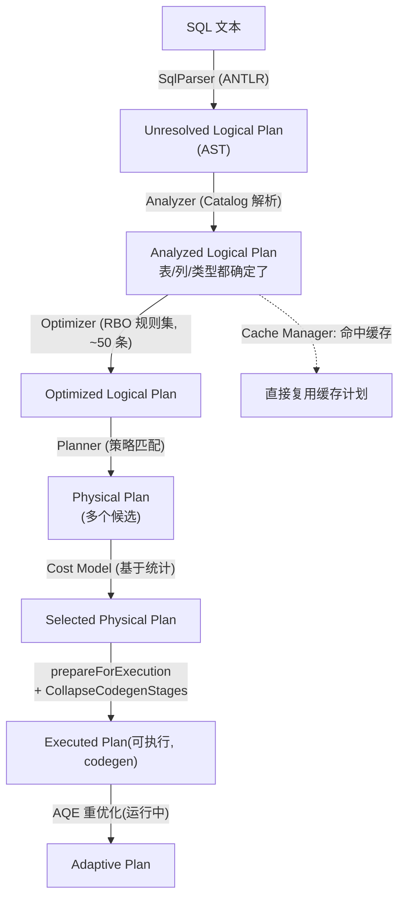

**① Analyzer（分析器）做什么？**
- 用 **Catalog**（Hive Metastore / Spark SessionCatalog）解析表名、列名、数据类型。
- 解析函数（内置/自定义 UDF）、解析 `*` 展开、别名、隐式类型转换（`cast`）。
- 输出 **Analyzed Plan**：所有节点都是具体对象（`ResolvedReference`），不再是"未解析的字符串"。
- ⚠️ **报错 "cannot resolve 'xxx'" 就发生在这里** → 说明表/列不存在、大小写、或者 `GROUP BY` 里用了聚合别名。

**② Optimizer（RBO 规则优化，共 ~50 条规则）核心规则：**

| 规则 | 含义 | 例子 |
|---|---|---|
| `PushDownPredicate` | 谓词下推到 scan / join 之前 | `select * from a join b where a.dt='x'` → `dt` 推给 a 的 scan |
| `ColumnPruning` | 只保留用到的列 | 13 列的表只 select 3 列 → scan 只读 3 列（列存才有效） |
| `ConstantFolding` | 常量折叠 | `1+2` → `3`，`'a' like '%x%'` 提前求值 |
| `SimplifyCasts` / `SimplifyBinaryComparison` | 去掉冗余 cast/比较 | |
| `BooleanSimplification` | 布尔表达式化简 | `a and (a or b)` → `a` |
| `JoinReorder`（`CostBasedJoinReorder`） | 用**统计信息**重排 join 顺序，减少中间结果 | A(1亿) B(10万) C(1万)：先 B⋈C 再 ⋈A |
| `EliminateSubqueryAliases` / `DecorrelateInnerQuery` | 子查询去关联，转成 join | `where x in (select ...)` |
| `OptimizeIn` | `in` 列表转 `InSet`（哈希查找） | 1000 个值 |
| `RewriteDistinctAggregates` | `count(distinct a), count(distinct b)` → 展开成多次聚合 | 关键优化 |
| `ObjectHashAggregate` | 把 `collect_list`/`collect_set` 换成基于 `TypedImperativeAggregate` 的对象哈希聚合，避免 OOM | |
| `PushDownLeftSemiAntiJoin` 等 | semi/anti join 下推 | |

⚠️ **RBO 的局限**：规则基于"启发式"，不考虑数据量。所以需要 **CBO（Cost-Based Optimization）**：
- 依赖**表/列的统计信息**（`ANALYZE TABLE t COMPUTE STATISTICS FOR COLUMNS ...`）。
- 用 **`Statistics`（sizeInBytes, rowCount, colStats: ndv/min/max/avgLen/nullCount）** 估算每个算子的输出大小，选出代价最小的计划。
- **`spark.sql.cbo.enabled=true`** 开启；`spark.sql.cbo.joinReorder.enabled=true`。
- ⚠️ **坑**：不 ANALYZE 就没有统计，CBO 退化成 RBO，甚至估算错误（如 join 大小估错导致用小表广播一个超大表 → OOM）。

**③ Planner（物理计划）**
把逻辑计划映射到物理算子，**同一逻辑算子可能有多种物理实现**，按 `Strategy` 匹配优先级：

| 逻辑 | 物理候选 | 选择条件 |
|---|---|---|
| `Join` | `BroadcastHashJoinExec` | 一侧 < `spark.sql.autoBroadcastJoinThreshold`（默认 10MB） |
| `Join` | `ShuffledHashJoinExec` | 一侧足够小（单分区 < `spark.sql.adaptive.maxShuffledHashJoinLocalMapThreshold`），且 `spark.sql.join.preferSortMergeJoin=false` |
| `Join` | `SortMergeJoinExec` | **默认**（两侧都大） |
| `Join` | `BroadcastNestedLoopJoinExec` | 非等值 join（`<`,`>`）且一侧可广播 |
| `Aggregate` | `HashAggregateExec` / `SortAggregateExec` / `ObjectHashAggregateExec` | 有 group key 走 hash |
| `Sort` | `SortExec`（全局）/ `SortExec(local)` | |
| `Scan` | `FileSourceScanExec` / `HiveTableScanExec` | |

**④ Codegen（全阶段代码生成）**
`CollapseCodegenStages` 规则把能"拼"的算子合并成一个 `WholeStageCodegenExec`：
- 条件：`supportCodegen=true`（支持行式输出的算子）。
- 效果：一次循环内完成 `scan→filter→project→aggregate`，中间无 Iterator 对象。
- `spark.sql.codegen.wholeStage=true`（3.x 默认开）；`explain(true)` 里会看到 `*(1) Project` 前面的 `*` 就是 codegen 阶段标记。

**⑤ Explain 怎么看（实战必备）**

```sql
EXPLAIN EXTENDED SELECT ...;
-- 输出四段:
-- 1. Parsed Logical Plan      → 你看 SQL 被理解成什么
-- 2. Analyzed Logical Plan    → 解析后（含 implicit cast）
-- 3. Optimized Logical Plan   → ★ 最有价值，看谓词下推/列裁剪是否生效
-- 4. Physical Plan            → ★ 看 join 类型、shuffle 方式、分区数
```

关键标记：
- `*(n)` = 第 n 个 codegen 阶段
- `Exchange hashpartitioning(k, 200)` = **发生了一次 shuffle，200 分区**
- `BroadcastHashJoin` vs `SortMergeJoin` = **join 策略**
- `Scan parquet ... PushedFilters: [IsNotNull(dt), EqualTo(dt,2026-11-19)]` = **谓词下推成功**
- `ReadSchema: struct<a:int,b:string>` = **列裁剪生效**（只有 2 列）
- `FileScan ... PartitionFilters: [dt=2026-11-19]` = **分区裁剪生效**
- `SortMergeJoin` 上下如果都有 `Exchange` + `Sort` → 两个大 shuffle

### 5.7 AQE（Adaptive Query Execution）：Spark 3.x 最重要的特性

**核心思想**：静态计划是"猜"的（分区数、join 大小都靠估），**AQE 在运行中根据真实 shuffle 统计动态调整**。
原理：把查询切成多个"**query stage**"，每个 stage 完成后拿到**真实的 MapStatus（分区大小）**，然后**重新优化下游计划**。

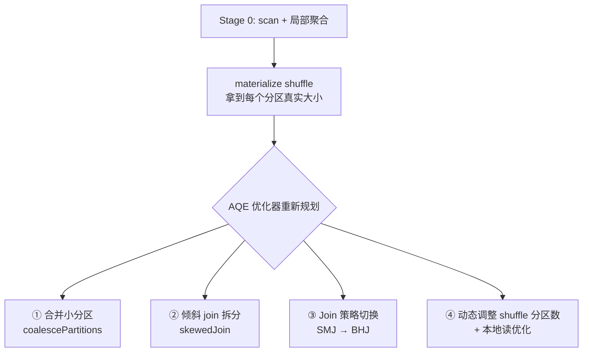

**四个能力（能说出来 3 个以上就算懂）：**

1. **动态合并 shuffle 分区（Coalesce Shuffle Partitions）**：`spark.sql.adaptive.coalescePartitions.enabled=true`（默认 true）。
   - 场景：`spark.shuffle.partitions=200` 但数据只有 1GB → 实际每分区 5MB，200 个 task 全是"小任务"。
   - AQE 按 `spark.sql.adaptive.advisoryPartitionSizeInBytes`（默认 64MB，2.x 是 64MB/3.x 可调）合并相邻分区。
   - **收益**：减少 task 数、减少 IO、减少调度开销。**这一条能省掉 50% 的"参数调优"工作**。
2. **动态切换 Join 策略（DemoteBroadcastHashJoin / ConvertToBroadcastHashJoin）**：
   - 场景：预估小表 12MB（超过 10MB 阈值）→ 计划选 SMJ（大 shuffle）；但 AQE 发现实际只有 3MB → **运行中切成 BroadcastHashJoin，省掉一次 shuffle**。
   - 反向：预估小但实际很大 → **降级成 SMJ**，避免广播 OOM。
3. **动态处理 join 倾斜（Optimized Skew Join）**：`spark.sql.adaptive.skewJoin.enabled=true`。
   - 判定：某分区大小 > **中位数 × `skewedPartitionFactor`（默认 5）** 且 > `skewedPartitionThresholdInBytes`（默认 256MB）。
   - 处理：把大分区**按 `skewedPartitionMaxSplits`（默认 5）拆成多个子分区**，与另一侧对应分区做"一对多"的 broadcast join（复制小侧分区）。
   - **这是 Spark 3.x 里最实用的倾斜解法**，很多团队因此不再手工加盐。
4. **动态优化本地 shuffle 读（Local Shuffle Reader）**：`spark.sql.adaptive.localShuffleReader.enabled=true`。
   - 当合并后的分区数据**就在本机磁盘**（且没被其他 executor 使用）→ 直接本地读，**省一次网络传输**。

⚠️ **AQE 的边界（面试可问"什么时候 AQE 不生效"）：**
- 只对 **shuffle 边界**有效（`Exchange` 节点）；`repartition(1)` 之类的用户显式指定仍会被优化但语义受限。
- **不改变算子本身**（不能把 `groupBy` 变 `map`）。
- **流式/ Structured Streaming 微批**里 AQE 效果有限（每个微批都是小数据）。
- `spark.sql.adaptive.enabled=false` 时全部失效（Spark 2.x 无此功能）。

### 5.8 Spark 数据倾斜：从现象到根因到解法

**现象（按严重程度）：**
1. 某些 task 的 `shuffle read size` / `records` 是其他 task 的 10~100 倍。
2. Stage 卡在 **199/200 tasks**（最后一个 task 跑了 2 小时）。
3. Executor **OOM**（`java.lang.OutOfMemoryError: GC overhead limit exceeded` 或 `Container killed by YARN for exceeding memory limits`）。
4. Spark UI 的 **Summary Metrics** 里 `Shuffle Read Size` 的 **max 远大于 median**。

**根因（分场景）：**

| 场景 | 根因 | 解法 |
|---|---|---|
| `groupByKey` / `reduceByKey` | 少数 key 数据量巨大 | ① 用 `reduceByKey` 而非 `groupByKey`（map 端预聚合）；② **两阶段聚合（加盐）**；③ AQE skew join |
| `join` | 大表 key 分布不均 / 小表 join 大表热 key | ① **Broadcast join**（小表 < 10~100MB）；② 热 key 单独处理；③ AQE 自动拆分区 |
| `distinct` / `count(distinct)` | 全量去重落一个分区 | 改成 `group by` 两级 |
| `repartition(1)` / `coalesce(1)` | 人为把所有数据挤到一个 task | 除非必须单文件，否则别用；用 `coalesce(N)` |
| NULL / 默认值 | 大量 NULL 落到同一分区 | 过滤 NULL 或 `rand()` 打散 |
| 文件不均 | 部分文件特别大（如某个分区只有 1 个大文件） | 上游合并小文件 / 重新分区 |

**加盐两阶段聚合（手写代码要会）：**

```scala
// 原始：rdd.reduceByKey(_ + _)  // 热 key 全落一个 task
val salt = 10
val salted = rdd.map { case (k, v) =>
  (s"${k}_${Random.nextInt(salt)}", v)          // ① 加盐
}.reduceByKey(_ + _, numPartitions = 200)        // ② 局部聚合（打散）
 .map { case (k, v) =>                            // ③ 去盐
  (k.split("_")(0), v)
 }.reduceByKey(_ + _, numPartitions = 200)         // ④ 全局聚合
```

**热 key 单独处理（大表 join 热 key 场景）：**

```scala
// ① 从大表里把热 key 数据单独抽出来，与小表对应部分做 broadcast join
val hotKeys = Seq("null", "unknown")
val hotDF  = bigDF.filter(col("k").isin(hotKeys: _*))
val coldDF = bigDF.filter(!col("k").isin(hotKeys: _*))
val res = coldDF.join(broadcast(smallDF), "k")
         .union(hotDF.join(broadcast(smallSmallDF), "k"))
```

### 5.9 容错、缓存与 checkpoint

| 机制 | 参数 | 行为 |
|---|---|---|
| Task 重试 | `spark.task.maxFailures=4` | 单 task 失败重试 4 次（含首次），仍失败则 stage 失败 |
| Stage 重试 | `spark.stage.maxConsecutiveAttempts=4` | stage 连续失败 4 次 → job 失败 |
| Executor 丢失 | `spark.dynamicAllocation.*` | 该 executor 上的 task 重跑；**shuffle 文件若开了 External Shuffle Service 则保留** |
| 推测执行 | `spark.speculation=false`（默认关） | 开启后为慢 task 起副本；**写外部系统时务必关** |
| Driver 挂 | `spark.yarn.maxAppAttempts` | YARN 层重试整个 Application |
| Cache | `rdd.cache()/persist(level)` | `MEMORY_ONLY` 丢失分区**重算** |
| Checkpoint | `rdd.checkpoint()` + `spark.sparkContext.setCheckpointDir` | **截断血缘**，写可靠存储（HDFS）；适合"迭代 100 次"的算法 |
| Local Checkpoint | `rdd.localCheckpoint()` | 写 executor 本地磁盘，**不截断血缘**，快但不可靠 |

🔍 **深挖：`checkpoint` 和 `persist` 的区别？**
- `persist/cache`：为了**避免重复计算**，血缘还在（丢了能重算），存内存/磁盘，**作业结束后释放**。
- `checkpoint`：为了**切断血缘**（血缘太长导致重算代价爆炸，或 driver 端 lineage 序列化过大），**写可靠存储**，生命周期跨作业；`checkpoint` 会**额外触发一次 job**（除非先 cache）。

### 5.10 Spark 提交流程（cluster / client 两种模式，必考）

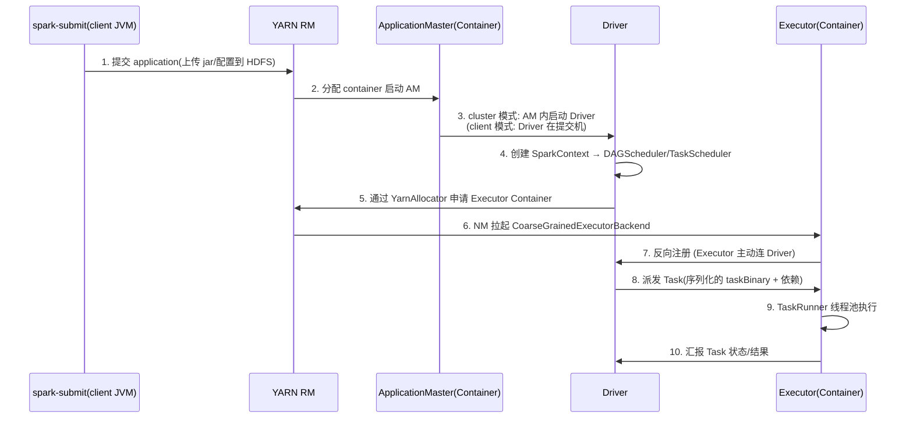

**两种模式的本质区别：**

| | client 模式 | cluster 模式 |
|---|---|---|
| Driver 位置 | **提交机（本地 JVM）** | **AM 容器内（集群中）** |
| 适用 | 开发调试（能看日志/断点） | **生产（提交机断网不影响作业）** |
| 风险 | 提交机网络抖动 → 作业失败；`collect` 数据回到本地 | |
| `--deploy-mode` | `client`（默认） | `cluster` |

⚠️ **常见追问："Executor 是 Driver 分配的还是 RM 分配的？"**
→ **Driver 里的 `YarnAllocator` 向 RM 申请，RM 分配 container，NM 启动进程，进程启动后主动向 Driver 反向注册**。所以"Executor 数量由 `spark.executor.instances/--num-executors` 决定"，由 **Driver 发起请求**。

### 5.11 Task 在 Executor 里到底怎么执行（"操作底层是什么逻辑"）

```scala
// Executor.launchTask
val tr = new TaskRunner(context, taskDescription)
runningTasks.put(taskId, tr)
threadPool.execute(tr)     // 每个 task 一个线程（不是进程）

// TaskRunner.run
val (taskBinaryBytes, ...) = ser.deserialize(taskBinary)   // ① 反序列化
val task = ser.deserialize(taskBytes)                       //    RDD + func + 依赖
task.run(taskAttemptId, attemptNumber, metricsSystem)       // ② 调 runTask
//   ResultTask.runTask:    rdd.iterator(partition) → func(context, iterator) → 结果
//   ShuffleMapTask.runTask: rdd.iterator → 写 shuffle (writer.write(iterator))
```

**关键点：**
1. **一个 Executor 是一个 JVM 进程**，内部用**线程池**跑多个 task（`spark.executor.cores` 个并发 task）。**所以 task 之间共享内存/GC，一个 task OOM 可能拖垮整个 executor 的所有 task。**
2. **`taskBinary` 是"广播变量 + RDD + 闭包"序列化后的字节**，通过 **BlockManager 的 broadcast** 分发（不是每次 task 都传一遍）。
3. **闭包序列化坑**：driver 端闭包如果捕获了 `this`（外部类的成员，如整个 SparkSession 或 DB 连接），会报 `Task not serializable` → 正确做法是把需要的字段抽成局部变量或用 `mapPartitions`。
4. **task 输出**：`ResultTask` → 小于 `spark.driver.maxResultSize`（默认 1GB）则直接返回 Driver；`ShuffleMapTask` → 写本地磁盘 + 返回 `MapStatus`。
5. **线程池是 `Executor.taskThreadPool`（`ExecutorService`）**，`spark.executor.cores` 决定并发度；**`spark.task.cpus` 可以让一个 task 占多核**（用于 ML/多线程）。

### 5.12 Spark 3.x / 4.x 关键演进（体现你在跟技术）

| 特性 | 版本 | 价值 |
|---|---|---|
| **AQE GA** | 3.0 | 动态合并分区/倾斜 join/join 策略切换 |
| **动态分区裁剪（DPP）** | 3.0 | join 时用另一侧结果**运行时裁剪分区**，星型模型查询大幅加速 |
| **ANSI SQL 模式** | 3.0 | 溢出抛异常而非返回 null（`spark.sql.ansi.enabled`） |
| **结构化流改进** | 3.x | `Trigger.AvailableNow`、状态存储（RocksDB StateStoreProvider） |
| **Pandas API on Spark** | 3.2 | `pyspark.pandas`，降低数据科学门槛 |
| **Spark Connect** | 3.4 | **解耦 client 与 server**（远程 gRPC），让 Notebook/IDE 连远端集群 |
| **K8s 原生** | 2.3+/3.x | `spark.kubernetes.*`，动态 executor 更细粒度 |
| **Photon（Databricks）** | 商业 | C++ 向量化引擎，非开源 |
| **Spark 4.0** | 2025 | ANSI 默认、Spark Connect 成为默认客户端、更完善的 VARIANT 类型/半结构化 |

🔍 **深挖：DPP（动态分区裁剪）原理**
```sql
-- 事实表 fact 按 dt 分区（1000 个分区），维表 dim 只有 10 行且 dt 在 ('2026-11-18','2026-11-19')
SELECT * FROM fact JOIN dim ON fact.id = dim.id
-- 静态计划: fact 要扫全部 1000 个分区（因为不知道 dim 的 id 落在哪些 dt）
-- DPP: 先跑一个小 job 把 dim 的 id 收集起来, 再据此过滤 fact 的分区
```
→ 本质是"**把小表的结果当作运行时过滤条件**"，与 AQE 同属"运行时优化"。要求事实表按 join key **分区或分桶**。

---


## 第 6 章 Flink 底层原理

### 6.1 Flink 的定位：为什么有了 Spark 还需要 Flink

| 维度 | Spark（Streaming） | Flink |
|---|---|---|
| 流模型 | **微批（micro-batch）**，把流切成 RDD 批次 | **原生流（native streaming）**，一条一条处理 |
| 延迟 | 秒级（batch interval） | **毫秒级** |
| 时间语义 | 只有 processing time（2.x 的 Structured Streaming 有 event time） | **完整 event time + watermark** |
| 状态 | 无内建状态（要靠 `mapWithState`/自管） | **一等公民（keyed state / operator state）** |
| 容错 | RDD 血缘重算 | **分布式快照（Chandy-Lamport）+ 精确一次** |
| 反压 | 靠背压（pull 模型天然） | **credit-based 流控（1.5+）** |
| 语义 | at-least-once（Structured Streaming 可 exactly-once） | **exactly-once（内部 + 端到端可配）** |
| 批处理 | 强（Spark Core） | 1.12+ 流批一体（DataStream API + SQL 统一） |

**一句话**：**Spark 是"把批做小"，Flink 是"把流做对"。** 在"严格实时 + 有状态 + 精确一次"的场景（风控、实时对账、CEP、实时数仓明细层），Flink 不可替代。

### 6.2 架构：JobManager / TaskManager / Slot

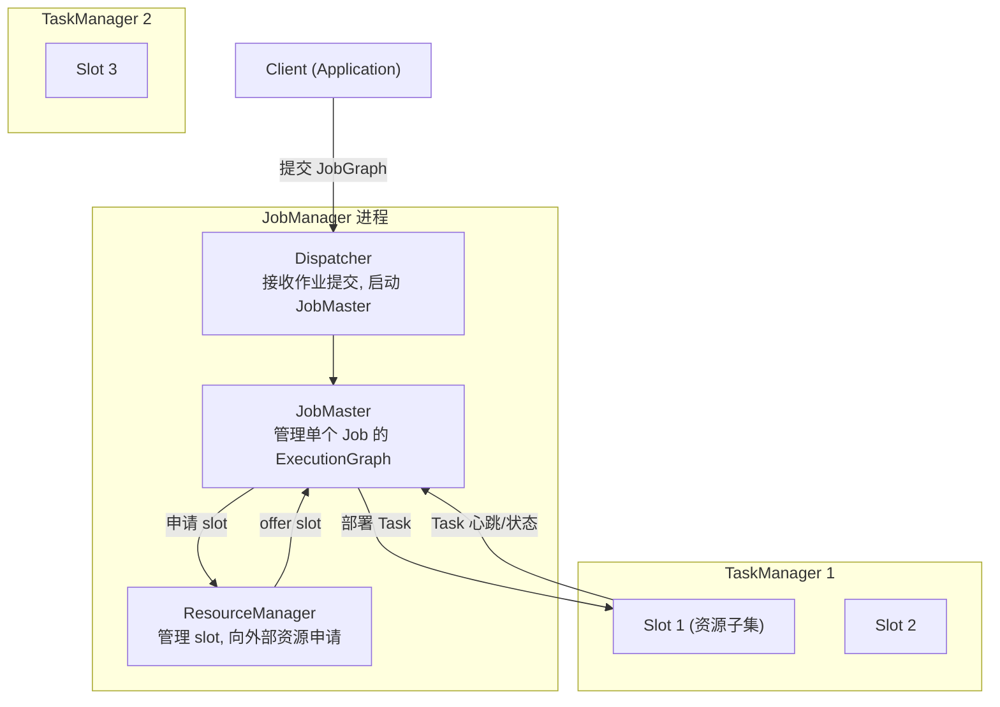

**几个容易答错的点：**

1. **Slot 不是"一个线程"**，而是 **TaskManager 资源的一个子集**（内存隔离单位，`taskmanager.memory.task.off-heap.size` / managed memory 按 slot 均分）。**Slot 内的 task 共享 JVM 和 TCP 连接（同一 TaskManager 内的数据传输是内存直接传递，不落盘）**。
2. **Slot Sharing（槽共享）**：**同一个 Job 的不同 task（不同 subtask）可以共享一个 slot**，只要它们在同一个 `SlotSharingGroup` 且不是同一条 chain。
   - **为什么要共享？** 让"资源需求不同的算子"共享一个 slot，使**每个 slot 都能跑完整条 pipeline**，从而一个 slot 就能处理全量数据 → **资源利用率最大化**（否则 source 用完 slot 就空闲，sink 也需要一个 slot）。
   - **默认一个 Job 需要的 slot 数 = 最大并行度**（不是所有算子并行度之和）。
3. **并行度（Parallelism）**：算子级 `setParallelism` > 代码 `env.setParallelism` > 提交参数 `-p` > 集群配置 `parallelism.default`。**一个算子的并行度 = 它的 subtask 数**；task 数 = 算子链 × 并行度。
4. **部署模式（1.15 后的主流）：**

| 模式 | 特点 | 适用 |
|---|---|---|
| **Session** | 先起一个常驻集群，多 job 共享，**资源隔离差** | 开发测试、小作业 |
| Per-Job | 每个 job 一个集群（1.15 已废弃） | 历史方案 |
| **Application** | `main()` **在集群内执行**，一个 job 一个集群，资源隔离好，**生产主流** | 生产 |

⚠️ **常见追问：为什么 Application 模式是生产推荐？**
→ ① `main()` 在集群里跑，**client 不再承担编译/依赖加载**（避免 client 成为瓶颈）；② 每个 job 独立集群，**资源隔离**；③ 依赖 jar 打包一致，避免 client 环境差异。

### 6.3 执行图的三层转换（面试高频，必须能画）

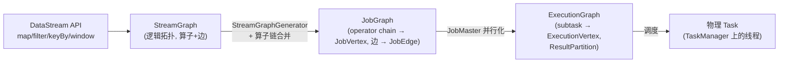

**Operator Chain（算子链）的合并条件：**
1. **数据分发是 forward（一对一）**：`map/filter/flatMap` 是 forward；`keyBy/rebalance/broadcast` 是**非 forward，必须切断 chain**。
2. **上下游并行度相同**。
3. **在同一个 SlotSharingGroup**。
4. 未被 `startNewChain()` / `disableChaining()` / `slotSharingGroup()` 打断。

**为什么要 chain？** ① 减少线程切换；② 减少**序列化/反序列化**（同一 chain 内数据以对象直接传递，`record` 直接内存传递）；③ 减少网络传输（chain 内是同一线程的方法调用）。
**什么时候要切断 chain？** ① 某个算子特别重（需要独立并行度/资源）；② 想把 sink 的失败隔离（如写外部系统需要单独重试）。

### 6.4 时间语义与 Watermark（Flink 的灵魂）

**三种时间：**
- **Event Time**：事件发生的时间（数据里带的时间戳），**必须配 watermark 使用**。
- **Ingestion Time**：进入 Flink 的时间（1.12 已移除）。
- **Processing Time**：算子处理时的机器时间（**无 watermark、无乱序处理、性能最好但不保证正确性**）。

**Watermark 的本质**：一个**特殊的、随时间单调递增的时间戳标记**，含义是"**时间 ≤ W 的数据都已经到齐了**"。
- **作用**：① 触发 event-time 窗口计算；② 清理过期状态（timer service）；③ 决定 join 何时可以输出。

**生成方式：**

| 方式 | 代码 | 说明 |
|---|---|---|
| 周期生成（Periodic） | `WatermarkStrategy.forBoundedOutOfOrderness(Duration.ofSeconds(5))` | 默认每 `pipeline.auto-watermark-interval=200ms` 插入一次，`W = maxEventTime - 5s` |
| 单调递增 | `forMonotonousTimestamps()` | 等价于 `outOfOrderness=0`，`W = maxEventTime - 1ms` |
| 打点生成（Punctuated） | `AssignerWithPunctuatedWatermarks` | 遇到特定事件才发（如 "END" 标记） |
| 空闲处理 | `.withIdleness(Duration.ofMinutes(1))` | **解决"某分区没数据导致 watermark 不推进"** |
| 自定义 | `WatermarkGenerator` 实现 `onEvent/onPeriodicEmit` | |

⚠️ **三个经典坑（面试常考）：**
1. **多输入算子取最小 watermark**（`min(input1.watermark, input2.watermark)`）。**只要有一个输入的空闲，整体水位就被卡住** → 用 `withIdleness` 或 `watermark-align`。
2. **watermark 必须单调递增**，否则 Flink 会**丢弃**并打印 `Received watermark xxx is less than current watermark`。
3. **分区并行**：每个 source subtask 独立生成 watermark，下游算子取所有 channel 的最小值 → **并行度大时水位推进慢**（木桶效应）。

**触发器精确条件（深挖点，能答出这个说明你读过源码）：**
`EventTimeTrigger.onEventTime(time)` 判断 `time >= window.maxTimestamp()`，其中 `maxTimestamp = window.maxTimestamp() = end - 1`（毫秒精度）。
所以**窗口 `[10:00, 10:05)` 在 watermark ≥ `10:04:59.999` 时触发**。
- **迟到数据（late data）**：元素 `timestamp < window.maxTimestamp - allowedLateness` 后到达 → 被丢弃（可 `sideOutputLateData` 收集）。
- `allowedLateness` 让窗口在**触发后继续保留状态**，迟到数据还能触发一次（late firing）；**状态在 `window.maxTimestamp + allowedLateness` 后才清理**（cleanup timer）。

### 6.5 窗口机制：Assigner + Trigger + Evictor + Function

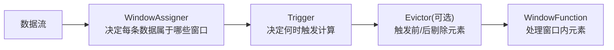

| 窗口类型 | 行为 | 例子（size=5min, slide=1min） |
|---|---|---|
| **Tumbling（滚动）** | 不重叠 | `[10:00,10:05)` 一个窗口（slide=size） |
| **Sliding（滑动）** | 重叠 | 数据**被复制到多个窗口**，`[10:00,10:05)`、`[10:01,10:06)`… **状态成本 × size/slide** |
| **Session（会话）** | 按"活动间隙"切 | 超过 gap 无数据就关窗（**每条数据都要注册/重置 timer**） |
| **Global（全局）** | 一个窗口装所有数据 | 必须自定义 Trigger（否则永不触发） |

**内置 Trigger：** `EventTimeTrigger`（默认用于 event time）、`ProcessingTimeTrigger`、`CountTrigger`（元素数）、`PurgingTrigger`（触发后清状态）、`ContinuousEventTimeTrigger`（周期性触发）。
**Evictor：** `CountEvictor`（保留 N 个）、`TimeEvictor`（保留时间窗口内的）。

⚠️ **高频追问：滑动窗口为什么危险？** 每个元素被复制到 `size/slide` 个窗口 → **状态 × N**。如 size=1h、slide=1s、QPS=10万 → 状态量爆炸（3600 倍）。**正确做法：用滚动窗口 + 预聚合，或用 `RocksDB` 状态后端 + 小 slide 谨慎评估**。

### 6.6 状态管理：Keyed State / Operator State / State Backend

| 类型 | 作用域 | 使用场景 | API |
|---|---|---|---|
| **Keyed State** | **每个 key 一份**（keyBy 之后） | 去重、聚合、窗口、join | `ValueState<T>` / `ListState<T>` / `MapState<K,V>` / `ReducingState<T>` / `AggregatingState<I,O>` |
| **Operator State** | **每个 subtask 一份**（无 key 概念） | source 的 offset、sink 的缓冲 | `ListState<T>`（可 redistributable）、`BroadcastState`（1.13+ 换成 `BroadcastState` 的 API 在 `KeyedBroadcastProcessFunction`） |
| **Broadcast State** | 所有 subtask 共享、只读（广播侧可写） | 维表广播、规则下发 | `MapState`（`BroadcastProcessFunction`） |

**State Backend（1.13 后两条路线）：**

| Backend | 存储位置 | 优点 | 缺点 | 适用 |
|---|---|---|---|---|
| **HashMapStateBackend** | **TaskManager JVM 堆**（`HashMap`） | 读写快（纳秒级）、无序列化 | 受限于内存、**GC 压力大**、checkpoint 全量 | 小状态（< 几百 MB）、低延迟 |
| **EmbeddedRocksDBStateBackend** | **本地磁盘（RocksDB，LSM）+ 堆外 cache** | 支持 TB 级状态、**支持增量 checkpoint** | 读写有序列化开销（微秒）、CPU 高 | **生产大状态首选** |

**状态后端的关键配置项：**

```yaml
state.backend: rocksdb
state.backend.incremental: true          # 增量 checkpoint（RocksDB 独有）
state.backend.rocksdb.memory.managed: true  # 用 Flink managed memory 管 RocksDB
state.checkpoints.dir: hdfs:///flink/checkpoints
state.backend.rocksdb.predefined-options: SPINNING_DISK_OPTIMIZED_HIGH_MEM
```

⚠️ **深挖：KeyGroup 与 Rescale（状态重分配的核心）**
- 状态的划分单位不是 key 本身，而是 **KeyGroup**：`keyGroupId = hash(key) % maxParallelism`，再分配到 subtask。
- **`maxParallelism`（默认 128，最大 32768）决定状态能被切成多少份**；**恢复时并行度可以不同于 checkpoint 时的并行度**（rescale），因为 state 按 keyGroup 重新分配。
- **所以 `maxParallelism` 建好就别改**（改了无法从老 checkpoint 恢复）。

### 6.7 Checkpoint：Chandy-Lamport 的工程实现（最硬的考点）

**目标**：在不停止流的情况下，得到一个"**全局一致的快照**"（所有算子的状态 + source 的消费位置 + in-flight 数据），从而支持**精确一次**恢复。

**核心机制：Barrier（屏障）**

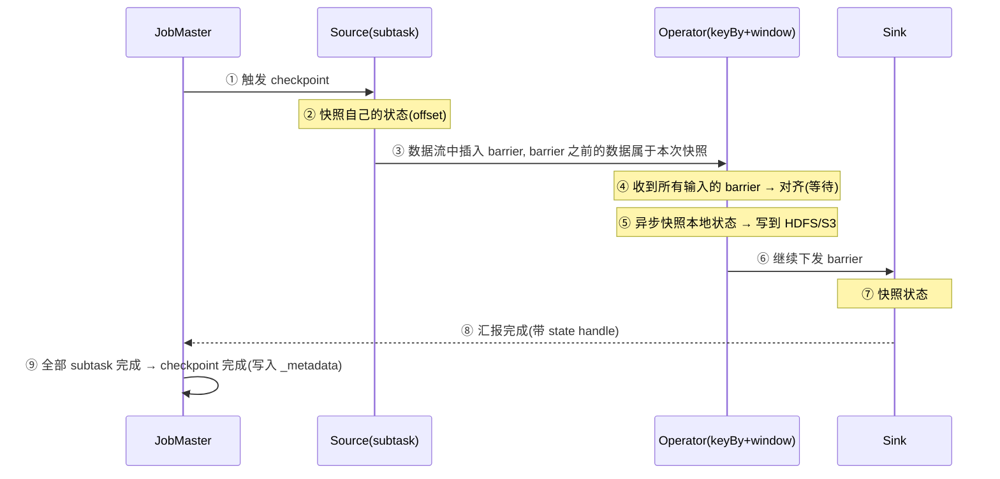

**关键概念（面试逐条追问）：**

1. **Barrier 对齐（Aligned Checkpoint）**：算子收到**第一个** barrier 时，**阻塞该 channel**，把后续数据先缓冲；等**所有输入**的 barrier 都到齐 → 快照状态 → 再放行。**保证"快照包含的数据 = barrier 之前的数据，不重不漏"。**
   - 代价：**慢 channel 会拖住整个算子**（反压时的经典问题："checkpoint 时间过长/超时"）。
2. **Barrier 不对齐（Unaligned Checkpoint，1.11+，1.13 生产可用）**：收到第一个 barrier 就**立即快照**，把 channel 中 in-flight 的数据**一起作为状态存下来**（`ChannelState`），不再等待。
   - 好处：**checkpoint 时间不再受慢 channel 影响**，反压下也能快速完成。
   - 代价：**checkpoint 体积变大**（要存 in-flight 数据），且要求 source 支持（Kafka source 支持）。
   - 开启：`execution.checkpointing.unaligned: true`。
3. **Exactly-Once 的内部保证**：状态快照 + source offset 快照 + 恢复时**从该 offset 重放** + 下游状态回滚到同一时刻 → **"重放的数据被状态回滚抵消"，效果上只处理一次**。
   - ⚠️ **注意：这是"内部 exactly-once"，不是"端到端"**。端到端需要 sink 配合（见 6.11）。
4. **Checkpoint 存储**：`FileSystemCheckpointStorage`（HDFS/S3，生产用）+ `JobManagerCheckpointStorage`（小状态存 JM 内存）。
5. **完成条件**：**所有 subtask 都报告成功**才认为该 checkpoint 完成，并在 `_metadata` 文件里记录（**这个文件的原子 rename 就是"提交点"**）。
6. **失败处理**：某个 subtask 快照失败 → 本次 checkpoint **中止并丢弃**；连续失败超阈值（`tolerable-failed-checkpoints`）→ **job 失败重启**，回退到上一个成功 checkpoint。
7. **配置三件套**：
   ```yaml
   execution.checkpointing.interval: 60s        # 间隔
   execution.checkpointing.timeout: 10min       # 单次超时
   execution.checkpointing.mode: EXACTLY_ONCE   # 或 AT_LEAST_ONCE(不对齐)
   execution.checkpointing.min-pause: 30s       # 两次之间最小间隔(防止连续触发)
   execution.checkpointing.max-concurrent-checkpoints: 1
   ```

**Savepoint vs Checkpoint（必考）：**

| | Checkpoint | Savepoint |
|---|---|---|
| 触发 | Flink **自动、周期** | **用户手动**（`bin/flink savepoint <jobId> <target>`） |
| 目的 | **故障恢复** | **升级/迁移/暂停后恢复/A-B 测试** |
| 保留 | 按 `state.checkpoints.num-retained`（默认 1，生产 3~5） | 永久保留，需手动删 |
| 格式 | 可增量（RocksDB） | **全量、格式与 backend 无关（可跨 backend 迁移）** |
| 兼容性 | 只保证同版本恢复 | 支持**改并行度、改逻辑（有状态兼容性校验）** |

⚠️ **状态兼容性（`state.change.log`）**：改了算子结构（加/删字段、改类型）后，从 savepoint 恢复会报 `State migration` 错误 → 需要自定义 `TypeSerializer` 或 `KeyedStateFunction` 迁移，或放弃状态。

### 6.8 容错与恢复策略

- **Region-based Failover（1.9+）**：一个 task 失败时，**只重启受影响的"连通区域"（region）**，而不是整个 job。region = 从 source 到该 task 的整条 pipeline（因为中间可能有状态依赖）。
  - `jobmanager.execution.failover-strategy: region`（默认）/ `full`。
  - **效果**：单 task 故障恢复时间从"全 job 重启（分钟级）"降到"局部重启（秒级）"。
- **Task 级重试**：`restart-strategy: fixed-delay / exponential-delay / failure-rate / none`。
- **TM 挂掉**：该 TM 上所有 task 失败 → 触发 region failover + 重新申请 slot。

### 6.9 反压（Backpressure）与 Credit-based 流控（1.5+）

**为什么会有反压？** 下游处理慢于上游产生速度 → 缓冲满 → 必须让上游慢下来（否则只能丢弃或 OOM）。

**Flink 的实现（1.5 之前是"TCP 反压"：下游 buffer 满 → TCP 窗口为 0 → 上游阻塞；问题是**一个 TM 内的反压会传导到整个 TCP 连接的所有 channel**）：**

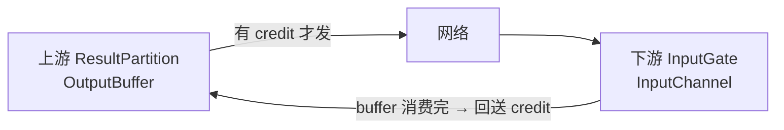

- **Credit-based**：下游的 `InputChannel` 维护"我还剩几个 buffer（credit）"，**通过 `AddCredit` 消息告诉上游**；上游**只有 credit > 0 才发送**，发一个扣一个。
- 好处：**反压精确到 channel 级**（不会因为一个 channel 慢而阻塞同 TM 的其他 channel），且**用 credit 数量代替 TCP 窗口**，更容易观测。
- **定位反压**：Flink Web UI 的 **Backpressure 面板**（`ok / low / high`），或用 `taskmanager.network.memory.buffers-per-channel` 调大缓冲。
- 常见反压原因：① 数据倾斜（某 subtask 数据量大）；② 同步 IO（JDBC 写库）；③ 复杂计算/GC；④ checkpoint 对齐阻塞；⑤ 下游 sink 慢。

### 6.10 内存模型（1.10+ 统一内存管理）

```mermaid
graph TB
    subgraph TOTAL["TM 总内存 = process.size"]
        F["Framework Heap/Off-heap<br/>(Flink 框架自身)"]
        T["Task Heap / Task Off-heap<br/>(用户代码对象)"]
        M["Managed Memory<br/>(批处理算子 + RocksDB)"]
        N["Network Memory<br/>(网络 buffer, 默认 0.1)"]
        O["JVM Metaspace + Overhead"]
    end
```

关键配置：
```yaml
taskmanager.memory.process.size: 4096m
taskmanager.memory.task.heap.size: 1024m
taskmanager.memory.managed.fraction: 0.4      # managed 占比
taskmanager.memory.network.fraction: 0.1      # 网络 buffer 占比
taskmanager.memory.network.min/max          # 上下限
```

⚠️ **`MemorySegment`** 是 Flink 内存管理的最小单位（默认 32KB，**堆内或堆外**），所有网络传输、排序、hash 都基于 `MemorySegment` + 二进制操作（**避免对象化和 GC**）——这是 Flink 能做"堆外、可控内存"的基础，思路与 Spark Tungsten 一致。

### 6.11 Table API / SQL 与流批一体

- **Blink Planner（1.9+ 默认）**：统一了 DataStream 与 Table 的 planner，支持 **mini-batch 聚合**（`table.exec.mini-batch.enabled=true`，把微批聚合成一个 hash 表，减少状态访问）+ **两阶段聚合（local-global）**（`table.exec.mini-batch.allow-latency`）。
- **流批一体**：同一套 SQL，源表是"有界/无界"决定是批还是流；1.12+ DataStream API 也统一（`execution.runtime-mode: STREAMING/BATCH/AUTOMATIC`）。
- **常见优化开关：**
  ```yaml
  table.optimizer.agg-phase-strategy: TWO_PHASE   # 两阶段聚合（治倾斜）
  table.exec.mini-batch.enabled: true
  table.exec.mini-batch.size: 5000
  table.optimizer.distinct-agg.split.enabled: true  # count(distinct) 拆分
  table.exec.sink.upsert-materialize: AUTO
  ```
- **Flink SQL 的算子（了解即可）**：`ChangelogNormalize`（把 upsert 流规范化为 changelog，**状态开销大**）、`Deduplicate`（去重，TOP-N）、`TemporalJoin`、`WindowAggregate`、`IntervalJoin`。

### 6.12 双流 Join 与维表 Join（实时数仓核心）

| 类型 | 机制 | 状态 | 适用 |
|---|---|---|---|
| **Regular Join**（`a.join(b)`） | 两侧数据都存进状态，**来了就匹配** | **无界增长**（必须配 `state.ttl`） | 小流量、需要"晚到的也能 join 上" |
| **Interval Join**（`a.join(b).between(下界, 上界)`） | 只在时间区间内匹配，**过期即清理** | 按时间清理（有界） | 订单-支付等"时间关联"场景 |
| **Temporal Join**（`FOR SYSTEM_TIME AS OF`） | 事实流 join **时态表（版本表）**，按事件时间取"当时"的维表版本 | 维表版本状态（可 TTL） | 汇率、价格、费率等"随时间变化的维表" |
| **Lookup Join**（`a.join(dim FOR SYSTEM_TIME AS OF pt)`） | 每条数据**同步查外部存储**（MySQL/HBase/Redis） | 无状态（可加 cache） | 维表很大、更新频繁 |
| **Async Lookup**（`AsyncDataStream.orderedWait/unorderedWait`） | 异步 IO，**大幅提升吞吐** | 无 | 维表查询是 RPC 的场景（**生产必用**） |

⚠️ **Regular Join 的状态爆炸**：两侧都存全量 → 必须设 `table.exec.state.ttl`（如 1 天），否则状态无限增长导致 checkpoint 失败。**这是实时数仓最常见的事故。**

### 6.13 端到端 Exactly-Once（面试必考"怎么保证不重不漏"）

**三段论：**
1. **Source 端可重放**：Kafka source 把 **offset 存进 checkpoint 状态**（`KafkaSource` 用 `OffsetStore`），恢复时从 checkpoint 里的 offset 重新消费 → **不漏**（重复消费会被下游幂等/事务抵消）。
2. **内部状态一致**：checkpoint 保证算子状态与 offset 对齐（见 6.7）。
3. **Sink 端两阶段提交（2PC）**：`TwoPhaseCommitSinkFunction`（1.13 后是 `SinkV2` + `Committer`）。

```mermaid
sequenceDiagram
    participant S as Sink(如 Kafka)
    participant JM as JobMaster
    Note over S: ① pre-commit: 开启事务, 数据写入但不可见<br/>(Kafka: 未 commit 的 transaction)
    JM->>S: ② checkpoint #n 完成通知
    S->>S: ③ commit 事务 → 数据对外可见
    Note over S: ④ 失败恢复: 未 commit 的事务被 abort
```

- **Kafka sink**：`FlinkKafkaProducer` + `transactional.id.prefix` + `Semantic.EXACTLY_ONCE`；配置 `transaction.timeout.ms` < broker 的 `transaction.max.timeout.ms`，且 **checkpoint 间隔 < 事务超时**（否则事务被 broker 中止）。
- **幂等 sink（upsert）**：写入带主键的存储（MySQL `INSERT ON DUPLICATE KEY UPDATE`、HBase、ClickHouse ReplacingMergeTree、Doris Unique Key），靠**主键覆盖**实现"重复写不产生重复结果"。**要求数据本身有主键，且下游可接受覆盖语义。**
- **WAL sink（1.13+）**：GenericWriteAheadSink / `FileSink`，先把数据写"预提交文件"，checkpoint 完成才 rename 成正式文件。

🔍 **深挖：为什么 2PC 需要 checkpoint "完成通知"而不是"快照完成即提交"？**
→ 因为**只有全局 checkpoint 完成**，才说明"所有算子都成功快照了"。如果某个算子失败、checkpoint 被丢弃，但你已经 commit 了事务 → 数据就多写了（**破坏 exactly-once**）。所以必须等 `notifyCheckpointComplete` 回调。

---


## 第 7 章 周边关键组件

> 这一章是"面试加分区"：大数据岗位几乎一定会问 Kafka/HBase/文件格式/数据湖中的至少一个。

### 7.1 Kafka 底层原理

#### 架构与存储

```
topic: orders (3 partitions, replication=3)
broker0: p0(leader), p2(follower)      broker1: p1(leader), p0(follower)
broker2: p2(leader), p1(follower)
```

- **分区（Partition）是并行与顺序的单位**：同一分区内**严格有序**，跨分区**不保证顺序**。
- **日志段（Log Segment）**：一个分区目录下切成多个 segment（`00000000000000000000.log` + `.index` + `.timeindex`），达到 `log.segment.bytes`（默认 1GB）滚动。
  - `.log`：消息本体（追加写，**顺序 IO**）。
  - `.index`：**稀疏索引**，每 `log.index.interval.bytes`（默认 4KB）记一条 `<相对offset, 物理位置>`。
  - `.timeindex`：时间戳 → offset 的索引（用于按时间查）。
  - **查找过程**：给定 offset → **二分查 .index 找到最近的物理位置** → 从该位置**顺序扫描** .log 找到目标（**"稀疏索引 + 顺序扫描"= 用少量内存换快速定位**）。

#### 高吞吐的四个底层秘密

1. **顺序写盘**：append-only，避免随机寻道（HDD 上顺序写可达 100MB/s+，随机写只有 1MB/s 级）。
2. **Page Cache 优先**：Kafka 写入**不 fsync**（`log.flush.interval.messages` 默认极大），靠 OS 页缓存 + 副本（**"用内存换延迟，用副本换可靠"**）。
3. **零拷贝（Zero-Copy）**：消费时用 `sendfile(2)`，数据从**页缓存直接到网卡**，跳过用户态（省 2 次拷贝 + 2 次上下文切换）。**注意：如果开启了消息压缩/SSL/需要转换，则不能零拷贝**——这是"为什么消费者要匹配生产者的压缩格式"的深层原因。
4. **批量 + 压缩**：`batch.size`（默认 16KB）、`linger.ms`（默认 0，生产建议 5~100ms）、`compression.type=lz4/zstd`。

#### 副本同步与 ISR（必考）

| 概念 | 含义 |
|---|---|
| **LEO**（Log End Offset） | 每个副本**最后一条消息的下一个位置** |
| **HW**（High Watermark） | **ISR 中最小的 LEO**，消费者**只能读到 HW 之前的消息**（保证"读到的消息在所有副本上都存在"） |
| **ISR**（In-Sync Replicas） | 与 leader 保持同步的副本集合（落后不超过 `replica.lag.time.max.ms`，默认 10s） |
| **OSR** | 被踢出 ISR 的副本（不同步） |

- **acks 语义**：
  - `acks=0`：不等确认（可能丢）。
  - `acks=1`：leader 写入即返回（leader 挂了、还没同步 → 丢）。
  - `acks=all(-1)`：**ISR 中所有副本都写入才返回**。要配合 `min.insync.replicas=2`（否则 ISR 只剩 1 个时仍会"成功"写入 → 失去意义）。
- **Leader 选举**：broker 挂 → **Controller（ZK 或 KRaft）**从 ISR 中选新 leader → **follower 从 HW 之后开始追赶**（所以 HW 之后的消息可能重复消费或丢失，取决于 `unclean.leader.election.enable`）。
- ⚠️ **`unclean.leader.election.enable=true`**：允许非 ISR 副本当 leader（**高可用但可能丢数据**）。生产一般设 `false`（宁可短暂不可用）。

#### 消费者与 Rebalance

- **Pull 模型**：consumer 主动 `poll()`，通过 `fetch.min.bytes` / `max.poll.records` 控制批量。
- **再平衡（Rebalance）**：消费者加入/离开/心跳超时 → 分区重新分配。**旧协议是"stop-the-world"（所有消费者暂停）**；2.4+ 的 **Cooperative Sticky**（`partition.assignment.strategy=CooperativeStickyAssignor`）实现**增量再平衡**，只迁移必要分区。
- **offset 提交**：自动（`enable.auto.commit=true`，按 `auto.commit.interval.ms`）vs 手动（`commitSync/commitAsync`）。**手动提交 + 先处理后提交 = at-least-once**；**事务性消费（`isolation.level=read_committed`）= exactly-once**。
- **Rebalance 导致的重复消费**：如果处理完但未提交 offset 就 rebalance → 新消费者从上次提交位置重读 → **重复**。解法：幂等处理 + 手动提交 + `max.poll.interval.ms` 足够大（避免处理慢被踢出组）。

#### 事务与幂等（进阶）

- **幂等 producer**（`enable.idempotence=true`）：用 `PID + sequence number` 去重，保证**重试不产生重复消息**（只能保证单分区、单会话）。
- **事务**（`transactional.id`）：跨分区/跨 topic 的原子写，依赖 **TransactionCoordinator + `__transaction_state` topic**（两阶段提交）。Flink 的端到端 exactly-once 就基于此。

### 7.2 HBase 底层原理

#### LSM-Tree：用"顺序写 + 后台合并"换随机写性能

```mermaid
flowchart LR
    A["写入"] --> B["WAL (HLog)<br/>顺序追加, 用于故障恢复"]
    B --> C["MemStore<br/>(内存, 有序 SkipList)"]
    C -->|"达到阈值<br/>(128MB)"| D["Flush → HFile<br/>(HDFS 上有序的 SSTable)"]
    D --> E["StoreFile 列表"]
    E -->|"Minor Compaction"| E
    E -->|"Major Compaction<br/>(合并所有 StoreFile, 清理删除标记)"| F["一个大的 HFile"]
```

- **写路径**：`WAL → MemStore → 返回成功`（**内存写即成功**，这是 HBase 写快的根本）。Flush 是异步的。
- **读路径**：`BlockCache（LRU）→ MemStore → BloomFilter 排除不可能的 HFile → 按时间戳倒序扫 HFile`。
- **读放大**：一个 row 可能分散在多个 StoreFile 中 → 需要合并且按版本取最新 → **Compaction 就是为了控制 StoreFile 数量**。
- **写放大**：一次写要经历 WAL + MemStore + 多次 Compaction 重写。
- **Region**：表按 rowkey 范围水平切分成 Region，每个 Region 由一台 RegionServer 服务；Region 达到 `hbase.hregion.max.filesize`（默认 2GB/10GB）触发 **Split**（**2.0+ 用 `RegionSplitPolicy` 的 `SteppingSplitPolicy`**）。
- **热点问题（必考）**：rowkey 单调递增（如时间戳前缀）→ 所有写都打到最后一台 RegionServer。
  - 解法：**加盐（salt）前缀**、**哈希（hash）前缀**、**反转（reverse）**、**加随机前缀 + 二级索引表**。
  - rowkey 设计原则：**长度短（10~30 字节，rowkey 会存多份）**、**散列均匀**、**把查询条件都放进 rowkey**（HBase 只有 rowkey 索引）。
- **二级索引**：HBase 原生没有 → 用 **Phoenix（全局/本地索引）**、**Coprocessor**、或**双写索引表**。
- **HBase 与 Hive 的区别**：HBase 是"**数据库**"（随机读写、毫秒级、按 rowkey），Hive 是"**数仓**"（全表扫描、批量、按分区）。HBase 存在 HDFS 上，但**数据文件是 HFile，Hive 读不了**（要用 `HBase-Hive` 映射表，性能差）。

**什么时候用 HBase？** ① 需要**按 rowkey 毫秒级随机读写**；② 数据量大（十亿行）但**不需要复杂 SQL/join**；③ 需要**稀疏列、多版本**。**不适合**：① 复杂分析查询；② 全表扫描；③ 强事务。

### 7.3 ZooKeeper 与协调服务

- **数据结构**：树形 ZNode（`/hbase/master`、`/flink/...`），**每个节点可存小数据（<1MB）**。
- **写一致性**：**ZAB 协议**（ZooKeeper Atomic Broadcast）：所有写请求发给 **Leader**，Leader 写入事务日志并广播给 Follower，**过半 Follower 确认后提交**。
- **选举**：Leader 挂 → 从 Follower 中按 `zxid` 最大者选新 Leader（**Fast Leader Election**）。
- **Watcher**：**一次性触发**（触发后需重新注册），用于"配置变更通知""Master 选举监听"。
- **典型用法**：① 分布式锁（临时顺序节点）；② 选主（临时节点 + watcher，HDFS ZKFC / HBase Master / Kafka Controller）；③ 配置中心；④ 命名服务。
- ⚠️ **ZK 的坑**：① **Watcher 是一次性的**，容易漏事件；② **会话超时（`session.timeout.ms`）**设置不当导致频繁重连；③ **ZK 不适合做高吞吐消息队列**（写性能有限，因为要过半确认）。

### 7.4 文件格式与压缩（决定数仓性能的物理层）

| 格式 | 类型 | 压缩 | 特点 |
|---|---|---|---|
| TextFile | 行式 | 可选 | 可读，最慢 |
| Avro | 行式 | 内置 snappy/deflate | **Schema 演进**，适合流式/Kafka |
| **Parquet** | 列式 | snappy/zstd/gzip | Spark 生态标准，**嵌套类型强** |
| **ORC** | 列式 | zlib/snappy/zstd | Hive 原生，**索引/谓词下推最强**，支持 ACID |

**压缩算法选择（必考对比）：**

| 算法 | 压缩比 | 速度 | 可切分（splittable） | 场景 |
|---|---|---|---|---|
| gzip | 高 | 慢 | **否** | 归档（但会导致**只有一个 map 读整个文件**，大忌） |
| snappy | 中 | **快** | 否（但 Parquet/ORC 内部块级可切分） | **数仓默认** |
| lz4 | 中低 | 极快 | 否 | 热数据、Kafka |
| zstd | **高** | 较快 | 否 | 新一代首选（Hadoop 3.x 支持） |
| bzip2 | 最高 | 最慢 | 是 | 冷数据归档 |

⚠️ **核心认知：为什么"gzip 大文件"是灾难？** 因为 gzip **不可切分**，一个 1GB 的 gz 文件只能由一个 map task 读 → **丧失并行度**。所以：① 用 Parquet/ORC（内部按 row group 切分，天然并行）；② 若必须用 gz，则**控制单文件 < block size**。

### 7.5 数据湖：Iceberg / Hudi / Delta Lake

**要解决的问题**：Hive 表在 HDFS 上是"目录 + 文件"，导致 ① 小文件多；② 无法原子提交（写完一半失败 → 数据不一致）；③ 不支持 update/delete；④ 没有快照/时间旅行；⑤ 分区变更要重写数据。

**共同思路**：**在文件之上加一层"元数据/事务日志"**，用"提交日志"实现 ACID。

| | **Iceberg** | **Hudi** | **Delta Lake** |
|---|---|---|---|
| 元数据 | `metadata.json` → **manifest list** → **manifest file** → data file | **Timeline**（`.hoodie/` 下的 instant 文件） | **`_delta_log/`** 下的 JSON + checkpoint parquet |
| 提交 | **原子切换元数据文件**（乐观锁 + 重试） | 时间线 + 索引 | 乐观并发（OCC） |
| 更新 | **copy-on-write / merge-on-read** | **COW（写时复制）/ MOR（读时合并）** | COW（+ deletion vectors 支持 MOR） |
| 隐式分区 | **支持（hidden partitioning）**，分区演进无需重写 | 分区路径固定 | 分区演进需 rewrite |
| 强项 | **表演进（schema/分区演进）、引擎中立（Spark/Flink/Trino 都支持）** | **增量写入、近实时入湖（MOR）** | **Databricks 生态、流批一体** |
| 典型用户 | 字节、阿里、腾讯（多数新一代湖） | 阿里、滴滴、Uber | Databricks 用户 |

**Iceberg 的核心概念（面试可讲）：**
- **Snapshot（快照）**：每次提交产生一个新 snapshot，指向一个 manifest list（**时间旅行的基础**：`SELECT ... VERSION AS OF xxx`）。
- **Manifest File**：记录一批 data file 的路径 + **列的 min/max/null count 统计** → 用于**文件级裁剪（data skipping）**。
- **为什么能做到"秒级 update"？** 因为只需**重写受影响的数据文件 + 追加一个新 manifest + 切换元数据指针**，不需要重写整表。
- **小文件治理**：`rewrite_data_files` / `rewrite manifests` 动作（compaction）。

### 7.6 数据仓库分层与建模（面试"业务理解"部分）

```
ODS（原始层）      → 贴源，不做清洗，保留原始格式，按天分区
DWD（明细层）      → 清洗、去重、维度退化、拉链，事实粒度统一
DWS（汇总层）      → 按主题/维度聚合，宽表（轻度汇总）
ADS/DWT（应用层）  → 面向报表/接口的宽表，高度聚合
DIM（维表层）      → 公共维度（用户、商品、地区），SCD 处理
```

**为什么分层？（必背三条理由）**
1. **解耦**：底层变化不影响上层（ODS 换数据源，ADS 不变）。
2. **复用**：中间层结果被多个下游复用，避免重复计算（省成本）。
3. **可治理**：每层有明确的质量标准/口径，问题定位快（"这个指标不对"→ 逐层往上查）。

**维度建模三范式 vs 星型模型：**
- **3NF（范式）**：减少冗余，适合 OLTP。
- **星型（Star Schema）**：一个事实表 + 多个维表，**反范式、冗余换查询性能**，适合 OLAP。
- **雪花模型**：维度再规范化（维表再挂维表），减少冗余但 join 更多。
- **宽表（大宽表）**：把所有维度打平到一张表，**极致查询性能，牺牲存储和更新灵活性**（现代数仓主流）。

**事实表三种类型（必考）：**

| 类型 | 含义 | 例子 |
|---|---|---|
| **事务事实表** | 每行一个"事件"，只追加 | 订单表、支付流水 |
| **周期快照事实表** | 每行一个"时间点的状态" | 每日库存余额、每日用户余额 |
| **累积快照事实表** | 每行一个"流程"，字段随流程推进更新 | 订单全生命周期（下单→支付→发货→签收） |

**缓慢变化维（SCD）：**
- **Type 1**：直接覆盖（不保留历史）。
- **Type 2**：**加 `start_date/end_date/is_current` 字段，保留多行**（最常用）。
- **Type 3**：加"上一版本"字段（只能存一次历史）。
- **拉链表**：Type 2 的一种实现，用 `start_dt/end_dt` 表示有效期，**每天只存变化的部分**，节省存储（面试高频："拉链表怎么实现？怎么查某天的历史状态？"）。

---

## 第 8 章 大厂面试题库

> **说明**：本章题目来自公开面经/技术社区（牛客、脉脉、GitHub 面经仓库、各厂技术博客）的**高频题目归纳**，按"公司聚类"标注是为了体现**不同厂的考察偏好**，不代表某公司官方题库。
> 标注体系：
> - **频率**：★★★★★（几乎每场必问）/ ★★★★（高频）/ ★★★（中频）/ ★★（偶发，通常作为追问）
> - **难度**：◆（基础）/ ◆◆（要懂原理）/ ◆◆◆（要读过源码/有实战）
> - **公司**：`[字节]` `[阿里]` `[腾讯]` `[美团]` `[京东]` `[拼多多]` `[快手]` `[滴滴]` `[网易]` `[华为]` `[百度]` `[B站]` `[小红书]` `[SHEIN]`
> **各厂考察偏好速览（经验归纳）：**
> - **字节**：Spark/Flink 源码级细节（shuffle、内存、checkpoint 机制）+ 手写代码 + 场景设计，追问最深。
> - **阿里**：数仓建模 + Hive/ODPS 生态 + 数据治理 + 数据倾斜实战，重视"业务到技术"的完整链路。
> - **腾讯**：HDFS/HBase/Kafka 存储底层 + 一致性/容错，偏"分布式系统"视角。
> - **美团/滴滴/快手**：实时链路（Flink + Kafka）完整性 + 状态/反压/一致性，工程落地细节。
> - **京东/拼多多/SHEIN**：离线数仓性能优化 + 小文件/倾斜/成本，务实。
> - **华为/百度**：MapReduce/YARN 基础 + 算法题 + 论文式原理推导。

---

### 8.1 HDFS 篇

#### Q1｜HDFS 写文件的完整流程？如果某个 DataNode 写失败会怎样？
- **考核程度**：★★★★★｜◆◆｜`[字节]` `[阿里]` `[腾讯]` `[美团]` `[华为]`
- **考察点**：pipeline、副本放置、ACK 机制、故障恢复

**参考答案：**

1. `client.create()` → NameNode 校验权限/父目录/是否已存在 → 建 INode + **加租约（Lease）** → 返回 `FSDataOutputStream`。
2. `addBlock()`：NN 按**机架感知策略**选 3 个 DN（本节点 → 异机架 → 异机架另一节点），返回 `blockId + pipeline 列表`。
3. 客户端建立 pipeline（`client → DN1 → DN2 → DN3`），DN 之间通过 `DataTransferProtocol` 连接。
4. 数据按 **64KB packet** 发送，每 packet 内按 **512B chunk** 算 CRC32；写入 `data queue`，发送后进 `ack queue`。
5. DN 收到 packet：**先落本地磁盘（写 `blk_xxx` 和 `.meta`），再转发下游**；最末端 DN 返回 ACK，逐级回传，客户端收到后从 `ack queue` 移除。
6. 全部写完 → `close()` → `complete()` 通知 NN 提交块、释放租约。

**写失败的处理（关键）：**

| 故障 | 处理 |
|---|---|
| 某个 DN 写失败（ACK 报错/超时） | 客户端**把该 DN 从 pipeline 移除**，用剩余 DN **重建 pipeline**（`replaceDatanodeOnFailure`），继续写；NN 后续把坏副本补齐（副本数不足触发 Replication Monitor） |
| pipeline 重建后仍失败 | 重试 `dfs.client.block.write.retries`（默认 3）次，超过则抛异常 |
| 客户端自己挂了 | 租约到期（硬限制 1h）后 NN 触发 **Lease Recovery**，恢复/截断最后一个未完成块 |
| 所有副本都写失败 | 抛 `IOException`，NN 标记该块无效 |

**深度延伸：**
- **为什么"先落盘再转发"而不是"边转发边落盘"？** 保证"只有确认写成功的数据才传给下游"，避免下游收到脏数据；同时 DN 是**先写本地再 ack**，保证了 `hflush` 语义。
- **`hflush` 与 `hsync` 的区别**（见 1.4），追问概率很高。
- **为什么 packet 是 64KB？** 太小 → 每次发送开销占比高；太大 → 单次失败重传代价大、延迟高。**64KB 是"吞吐 × 重传代价"的折中**，且与网络 MTU/内核 buffer 匹配。

---

#### Q2｜NameNode 的元数据是怎么存的？为什么不会无限增长？重启为什么慢？
- **考核程度**：★★★★★｜◆◆｜`[阿里]` `[腾讯]` `[美团]` `[华为]`
- **考察点**：FsImage + EditLog、checkpoint、内存模型

**参考答案：**
- NN 元数据**全内存**（`INode 树` + `BlocksMap`），持久化为 **`fsimage`（全量快照）+ `edits`（增量日志）**。
- 写操作**先写 edits（并 hflush 落盘）再改内存**，保证日志先行、可回放。
- **不会无限增长靠 checkpoint**：Standby NN（或 2NN）定期把 `fsimage + edits` 拉下来合并成新 `fsimage`，推回 Active，Active 清理旧 edits。
- **重启慢的三个原因**：① 要**加载大 fsimage 到内存**（几十 GB）；② 要**回放未合并的 edits**（可能几百万条）；③ 加载后要**等 DataNode 块汇报**才能退出安全模式（集群越大越慢）。

**深度延伸：**
- **`fsimage` 为什么不用数据库存？** 因为目标是"**启动时一次性全量加载到内存**"，序列化文件比随机查数据库快几个数量级；但代价是"**全量更新**"，所以需要 edits 做增量。
- **HA 下的 checkpoint 为什么用 JN 而不是 2NN？** 因为 Standby 已经实时 tail 了 edits（通过 QJM），不需要再从 Active 拉一遍；**QJM 的"过半写"保证 Active 和 Standby 看到同一份日志**。
- 🔍 **追问：NN 的 RPC 是怎么处理并发的？** 用 **`CallQueue` + 多个 handler 线程**，但**所有写操作最终在 `FSDirectory`/`FSNamesystem` 的全局锁（`fsLock`/`FSNamesystemLock`）上串行化**（读用读写锁）→ **这是 NN 吞吐上限的根本原因**，也是 Federation 的动机。

---

#### Q3｜HDFS 为什么不适合存小文件？怎么解决？
- **考核程度**：★★★★★｜◆◆｜`[阿里]` `[美团]` `[京东]` `[拼多多]` `[SHEIN]`
- **考察点**：元数据开销 + 计算开销 + 工程解法

**参考答案：**
**两层原因：**
1. **存储层**：NN 内存按"文件/块/副本"计（每对象 ~150-200B），1 亿小文件 × 3 副本 ≈ 数 GB 内存 → NN 内存爆、GC 停顿、启动回放慢；同时每个文件都要"块汇报 + 心跳"开销。
2. **计算层**：每个文件至少一个 split → 一个 task，**task 启动（秒级）远大于处理 1KB 的耗时** → 作业大量时间在调度和 JVM 启停。

**解法（分层）：**

| 层次 | 手段 |
|---|---|
| 源头控制 | Flume `rollInterval/rollSize` 调大；Kafka→HDFS 按大小/时间滚动；避免按小时/按用户分区 |
| 写入合并 | `appendToFile`、HAR 归档、Ozone |
| 计算侧合并 | Hive `hive.merge.mapfiles/tezfiles` + `merge` 任务；Spark 写回前 `coalesce/repartition`；`distcp -append` |
| 存储层 | **Iceberg/Hudi/Delta 的元数据合并（compaction）**；对象存储 |
| 表设计 | **分区粒度别太细**、用分桶代替过多分区 |

**深度延伸：**
- **追问：`coalesce(1)` 有什么风险？** 所有数据挤到一个 task → **单点 OOM + 完全丧失并行**。正确做法是 `coalesce(N)` 控制每文件 ~block 大小（128~256MB）。
- **追问：Iceberg 怎么解决小文件？** 它不是"消除小文件"，而是① **文件级统计 + manifest 裁剪**让查询只读必要文件；② **`rewrite_data_files` 后台合并**；③ 用 **manifest 层管理元数据**，NN 看到的文件数依然多，但**查询规划不看目录列表**（避免 `listStatus` 的 O(N) 开销）——这是关键区别：**Hive 查表要 `list` 所有文件，Iceberg 只读 manifest**。

---

#### Q4｜HDFS 的 HA 是怎么实现的？会不会脑裂？
- **考核程度**：★★★★｜◆◆｜`[腾讯]` `[阿里]` `[华为]`
- **参考答案：**
- **组件**：Active NN + Standby NN + **JournalNode 集群（≥3，奇数）** + **ZKFC（每 NN 一个）** + ZooKeeper。
- **元数据同步**：Active 写 edits → **同时写 JN（过半成功才算成功）**；Standby 持续从 JN **tail edits 并回放** → 内存状态实时同步（Standby 是"热"的）。
- **选主**：ZKFC 在 ZK 上抢 `/hadoop-ha/<nameservice>/ActiveStandbyElectorLock` **临时节点**，抢到者为 Active。
- **防脑裂（fencing）**：切换时**先 fence 旧 Active**——通过 `fence.ssh`（SSH 到旧 NN 执行 kill）或 `fence.shell` 脚本，**确保旧 Active 一定死了**，再让 Standby 转 Active。**这是"先隔离再切换"的经典做法**（与 STONITH 同思路）。
- **不会脑裂的原因**：① ZK 临时节点的"会话失效即释放"保证同一时刻只有一个 Active；② **fencing 保证旧 Active 不会继续对外服务**；③ JN 的"过半写"保证不会出现两个 NN 各自写一半 edits（epoch number 校验）。

**深度延伸**：**追问：JN 为什么必须奇数台？** 因为"过半写"需要**多数派**；偶数台（如 4 台）的容错能力和 3 台一样（挂 2 台都不可用），却更贵。**3 台允许坏 1 台，5 台允许坏 2 台**。

---

#### Q5｜一个文件 100GB，用 128MB 块，有多少个块？读这个文件会启动多少个 map task？块大小能随便改吗？
- **考核程度**：★★★｜◆｜`[美团]` `[京东]` `[百度]`
- **参考答案：**
- 块数 = `ceil(100GB / 128MB)` = **800 个块**（最后一块可能不满）。
- **split 数 ≈ 800**（默认 `split size = block size`），所以 **800 个 map task**。
- **块大小不能随便改**：① 已写入的文件块大小**固定**（改 `dfs.blocksize` 只影响新文件）；② 块太小的后果是 NN 元数据膨胀 + 每个 map 处理数据少；③ 块太大的后果是**单个 task 处理时间长（长尾）**、**并发度不足**、**故障重算代价大**。"128MB"是"元数据开销 × 并行度 × 单 task 时长"的折中。
- **改 split 大小而不改块大小**：`mapreduce.input.fileinputformat.split.maxsize`（调小 → 更多 map，解决倾斜；调大 → 更少 map，减少开销）。

**深度延伸**：**为什么 HDFS 默认从 64MB 变成 128MB？** 因为磁盘容量/带宽比提升，`块大小 ∝ 传输时间`——Hadoop 的设计目标是"**一个块的传输时间 ≈ 1 秒**"，避免"任务启动开销大于数据传输"。

---

#### Q6｜HDFS 的副本放置策略？如果把 `dfs.replication` 设成 5 会怎样？
- **考核程度**：★★★｜◆◆｜`[腾讯]` `[华为]`
- **参考答案：**
- 默认 3 副本策略：**① 客户端所在节点（同机架）② 不同机架的随机节点 ③ 第二副本所在机架的另一个节点**。目标是"**跨机架容错 + 读时能就近**"。
- 副本数 5：多出 2 个随机放置；**代价**：存储 ×5、写 pipeline 变长（**延迟上升**，因为要等所有 DN ack）、跨机架流量增加。**收益极小**（3 副本已能容忍 2 个节点同时挂）。
- **生产不建议 >3**：要提升可靠性，用**机架感知 + EC（纠删码）**更划算。

**深度延伸**：**追问：为什么第 2 个副本一定要跨机架？** 因为**机架级故障（交换机/电源/机柜）是真实高发的**；如果 3 副本都在同一机架，机架挂了数据全丢。**"跨机架"是容错的最小代价**。

---

### 8.2 MapReduce & YARN 篇

#### Q7｜MapReduce 的 shuffle 过程？为什么要排序？能不能不排序？
- **考核程度**：★★★★★｜◆◆｜`[阿里]` `[美团]` `[华为]` `[百度]`
- **参考答案：**
完整过程见 2.2。核心要点：
1. **map 端**：环形缓冲区（100MB，80% 触发 spill）→ **按 (partition, key) 排序** → spill 到本地磁盘（可选 Combiner）→ 多轮 merge（`sort.factor`）→ 每个 map 输出 R 个文件。
2. **reduce 端**：HTTP 拉取（5 线程并发）→ 内存 merge → 落盘 merge → **按 key 分组** → 调 `reduce()`。
- **为什么要排序**：因为 reduce 的语义是 `reduce(key, list<value>)`，**必须把同一 key 的所有 value 聚在一起**；最省内存的做法是"**外部排序 + 归并**"（数据量超内存时只能靠排序落盘）。
- **能不能不排序**：可以！如果一个 job 是 **map-only**（如 ETL 清洗、`WHERE` 过滤），就**没有 shuffle 也没有排序**。也可以自定义 `OutputFormat`/绕过 `Reducer` 直接写。但只要有 reduce，**排序是强制的**（Hadoop 2.x 后可以设置 `mapreduce.job.reduce.shuffle.input.buffer.percent` 优化内存，但不能免排序）。

**深度延伸：**
- **"二次排序"怎么实现？** 让 `key` 包含"主键 + 次键"（自定义 `WritableComparable`），同时定义 **`GroupingComparator`**（只按主键分组）→ 一个 `reduce` 调用里能拿到按次键排好序的所有 value。**这是 MR 时代的高频手写题**。
- **"为什么 reduce 数设为 0.95 × slot 数"？** 因为要留 5% 的 slot 给 **AM 和推测执行**，避免"最后一个 reduce 没有 slot 可用"。

---

#### Q8｜MapReduce 数据倾斜怎么发现、怎么解决？举一个你处理过的例子。
- **考核程度**：★★★★★｜◆◆｜`[阿里]` `[美团]` `[京东]` `[拼多多]`
- **参考答案：**
- **发现**：JobHistory/Counter 里 **`Reduce shuffle bytes` 或 `Reduce input records` 的最大值远大于中位数**；某个 reduce 卡在 66.67%/99.99% 很久；`Reduce input groups` 极少但 `Reduce input records` 极大（典型热 key）。
- **解法**（按场景，见 2.4 表格）：自定义 Partitioner、**加盐两阶段聚合**、MapJoin、采样拆分热 key、NULL 打散。
- **具体例子**（可直接讲的模板）：
  > "订单表按 `shop_id` 聚合 GMV，几个头部店铺的订单量占 40%，导致 3 个 reducer 各跑 3 小时、其余 197 个 5 分钟跑完。我先在 Counter 里确认 top 3 的 shop_id，然后**两阶段聚合**：第一阶段给 shop_id 拼 0~9 的随机后缀（局部 sum），第二阶段去掉后缀再 sum。总耗时从 9.5 小时降到 1.2 小时。"
- **不能加盐的场景**（要能说出边界）：**非聚合操作**（如 `distinct 明细`、`join 后输出明细行`）加盐后**无法恢复原始行** → 只能用"热 key 单独 broadcast / 拆分处理"。

**深度延伸**：**追问：加盐的盐值怎么定？** 原则是"**热 key 的数据量 / salt ≈ 其他普通 key 的数据量**"，即 `salt = ceil(热key数据量 / 平均分区数据量)`。经验取 10~100，且**盐值不能太大**（否则小表要膨胀同样倍数，反而变慢）。

---

#### Q9｜YARN 提交作业的流程？AM 挂了怎么办？RM 挂了怎么办？
- **考核程度**：★★★★｜◆◆｜`[阿里]` `[腾讯]` `[美团]` `[华为]`
- **参考答案：**（详见 3.2）
1. Client → RM 申请 applicationId → 上传 jar/split 元数据到 HDFS → `submitApplication`。
2. RM 分配 container → NM 启动 **AM**。
3. AM 向 RM **注册**，并周期性**心跳申请 container**（携带资源请求 + 本地性偏好）。
4. AM **直接联系 NM** 启动 task 容器（`startContainer`）→ NM 本地化资源 → 启动 `YarnChild`。
5. task 通过 **umbilical** 协议向 AM 汇报进度。
6. 完成 → AM 注销 → RM 回收。

**故障处理：**

| 故障 | 机制 |
|---|---|
| **AM 挂** | RM 感知到 AM 心跳超时 → **重启 AM**（新的 attempt），新 AM **从 HDFS 的 job history/staging 目录恢复状态**，重新执行未完成的 task（**已完成的 task 结果在 HDFS/本地，map 输出若丢失需重跑**）→ 由 `yarn.app.mapreduce.am.max-attempts`（默认 2）控制 |
| **RM 挂（非 HA）** | 整个集群不可用，运行中的作业全部失败 |
| **RM 挂（HA）** | 依赖 **ZK 选主 + Active/Standby RM**，Standby 接管；**运行中的 application 状态通过 `RMStateStore`（ZK/HDFS）恢复**，AM 用 `AMRMProxy` 重连新 RM |
| **NM 挂** | 该节点上的 container 全部失败 → AM 感知 task 失败 → 重新申请 container 重跑 task |
| **task 挂** | AM 重试该 task（`mapreduce.map.maxattempts`，默认 4） |

**深度延伸**：**追问：为什么 AM 要"直接联系 NM"而不是让 RM 启动 task？**
→ 这是 YARN **两级调度**的核心：RM 只做"**资源批发**"（决定给谁多少资源），AM 做"**任务编排**"（决定这些资源上跑什么、什么时候跑、失败了重试）。好处是**RM 不需要理解各种计算框架的语义**（MR/Spark/Flink 都在自己的 AM 里实现调度）→ **框架无关性**。

---

#### Q10｜Capacity Scheduler 和 Fair Scheduler 的区别？你们集群怎么配的？
- **考核程度**：★★★｜◆◆｜`[阿里]` `[美团]` `[滴滴]`
- **参考答案：**（详见 3.3 表格）
- **Capacity**：按**队列容量百分比**分配，支持**层级队列**、**资源借用（maximum-capacity）**、**抢占（preemption）**、**用户限制（minimum-user-limit-percent）**、**Node Label**。**强隔离、强配额**，适合**多部门共享的生产集群**（Hadoop 默认）。
- **Fair**：按**权重公平分配**，缺额队列可抢超额队列，**队列可动态创建**（按用户名/组名自动建队列）。适合"**想要公平**"的中小集群。
- **实战配置模板**（能说出来就加分）：
  ```xml
  <!-- 生产典型：3 个部门 + 1 个默认队列 -->
  yarn.scheduler.capacity.root.queues=etl,realtime,ml,default
  yarn.scheduler.capacity.root.etl.capacity=50
  yarn.scheduler.capacity.root.etl.maximum-capacity=80   <!-- 空闲时可借到 80% -->
  yarn.scheduler.capacity.root.realtime.capacity=30
  yarn.scheduler.capacity.root.ml.capacity=15
  yarn.scheduler.capacity.root.default.capacity=5
  yarn.scheduler.capacity.root.etl.minimum-user-limit-percent=25  <!-- 单用户最多 25% -->
  yarn.scheduler.capacity.root.etl.maximum-am-percentage=10        <!-- 防 AM 占满 -->
  ```
- **判断标准**：**"要不要严格隔离"** → 要 → Capacity；**"要不要弹性公平"** → Fair。

**深度延伸**：**追问：`maximum-capacity` 和 `capacity` 的区别？** `capacity` 是**保证下限**（集群空闲时别人可以借走），`maximum-capacity` 是**使用上限**（防止一个队列吃掉全集群）。**这两者构成"弹性配额"**。

---

### 8.3 Hive 篇

#### Q11｜Hive 的内部表和外部表的区别？什么时候用哪个？`DROP` 会发生什么？
- **考核程度**：★★★★★｜◆｜`[阿里]` `[美团]` `[京东]` `[拼多多]` `[SHEIN]`
- **参考答案：**（见 4.2）
- **`DROP TABLE` 差异是唯一实质区别**：内部表删元数据 + **删 HDFS 数据**；外部表**只删元数据**。
- **使用规范**：**ODS 原始层必须用外部表**（防止误删源数据，也支持多引擎共享 location）；中间表/结果表用内部表（便于自动清理）。
- **⚠️ 加分点**：`TRUNCATE TABLE` 对外部表**会删数据**（Hive 2.x 起外部表 truncate 会清空 location 下数据，但保留目录）——**这是一个容易踩的坑，说出来很小众但正确**。

**深度延伸**：**追问：外部表能不能分区？** 能，而且是标准做法：`CREATE EXTERNAL TABLE ... PARTITIONED BY (dt STRING) LOCATION '...'`，然后用 `ALTER TABLE ADD PARTITION` 或 `MSCK REPAIR TABLE` 同步元数据。**"为什么 Hive 不自动发现新分区？"** 因为 Hive 靠**元数据里的分区列表**做裁剪，不会每次查询都去 `list` 目录（那太慢）→ 所以要 `ADD PARTITION` 或 `MSCK`。

---

#### Q12｜分区和分桶的区别？分桶有什么用？`CLUSTERED BY` 之后 `LOAD DATA` 数据会分桶吗？
- **考核程度**：★★★★★｜◆◆｜`[阿里]` `[美团]` `[字节]`
- **参考答案：**（见 4.2 表格）
- **分桶的三个用途**：① **SMB Join（无 shuffle 大表 join）**；② **Bucket Map Join**；③ **采样（`TABLESAMPLE(BUCKET x OUT OF y)`）** 用于快速验证。
- **`LOAD DATA` 不会分桶**！因为 `LOAD DATA` 只是"移动文件"，不经过 Hive 的写入逻辑 → **只有 `INSERT OVERWRITE/INTO` 才会按桶写入**（`hive.enforce.bucketing=true` 时强制）。
- **分桶数的选择**：通常是 **文件总大小 / block size** 的约数；分桶数最好**与 reducer 数接近**，避免"一个 reducer 写多个桶导致文件过多"。

**深度延伸**：**追问：SMB Join 为什么快？条件是什么？**
条件：**两表分桶数相等或成整数倍** + **桶内按 join key 排序**（`SORTED BY`）+ `hive.optimize.bucketmapjoin.sortedmerge=true`。
原理：task i 只读 A 的第 i 桶和 B 的第 i 桶，**两桶内部有序 → 双指针归并**，**内存占用 O(1)**，无网络传输。**所以能 join 两个 TB 级大表而不 OOM。**

---

#### Q13｜Hive SQL 是怎么变成 MR 的？`JOIN` 和 `GROUP BY` 分别变成什么样？
- **考核程度**：★★★★｜◆◆｜`[阿里]` `[腾讯]` `[美团]`
- **参考答案：**（见 4.3、4.4）
- **编译链路**：`Parser（ANTLR → AST）→ Semantic Analyzer（Operator Tree，逻辑计划）→ Optimizer（RBO 规则）→ Physical Planner（Task DAG）→ Execution Engine`。
- **`GROUP BY`**：`ReduceSinkOperator`（map 端 `HashTableSinkOperator` 做 map 侧聚合 + 按 key 分区排序）→ reduce 端 `GroupByOperator`。
- **`JOIN`**：
  - 默认 **Common Join**：两侧都走 `ReduceSinkOperator`（shuffle 按 join key）→ reduce 端 `JoinOperator`（把左侧/右侧数据缓存到内存做匹配）。
  - **MapJoin**：编译期小表走 `MapJoinOperator`，小表通过 **`DistributedCache`** 分发，无 reduce。
  - 判断依据：**表大小统计（`hive.auto.convert.join.noconditionaltask.size`）** 或 hint `/*+ MAPJOIN */`。
- **`JOIN` + `GROUP BY` 组合**：Hive 会**尽量合并到一个 MR job**（`hive.merge.mapredfiles` 等），但**有 reduce 侧操作时通常需要多个 job**。

**深度延伸**：**追问：`hive.execution.engine` 换成 Tez/Spark 后有什么变化？**
→ SQL 编译结果从"多个 MR Job"变成"**一个 DAG**"（Tez）或"**一个 Spark Application 多个 Stage**"（Spark）。**中间结果不落 HDFS**，性能提升 2~10 倍。**这就是"Hive 引擎替换"的本质。**

---

#### Q14｜Hive 数据倾斜怎么处理？`hive.groupby.skewindata` 和 `hive.map.aggr` 有什么区别？
- **考核程度**：★★★★★｜◆◆｜`[阿里]` `[美团]` `[京东]` `[SHEIN]`
- **参考答案：**（见 4.5）
- **`map.aggr`**：map 端做**部分聚合**（hash 聚合），减少 shuffle 数据量。**不解决倾斜**（只是让每个 map 少输出一点）。
- **`skewindata`**：**两阶段聚合**——第一个 job 的 key 加**随机前缀**打散做局部聚合，第二个 job 去前缀做全局聚合。**专门治 group by 倾斜**。
- **join 倾斜的三板斧**：① 小表 → MapJoin；② 热 key 抽出来单独 map join；③ 大表 key 加随机前缀 + 小表膨胀 N 份；④ `hive.optimize.skewjoin=true`（自动检测超大 key）。
- **`count(distinct)` 倾斜**：拆成 `group by k,v` + `group by k` 两级。
- **空值倾斜**：`nvl(key, concat('rand_', cast(rand()*100 as int)))` 或提前过滤。

**深度延伸**：**追问：`hive.optimize.skewjoin` 的原理？**
它在编译期**采样**（`hive.skewjoin.key` 默认 10000 条记录）判断哪些 key 数据量超过阈值，然后把"大 key 的数据"单独走一个 map join 分支，其余走正常 join，最后 union。**属于"自动化的手工方案"**，但采样有误差、且只对 join 有效。

---

#### Q15｜ORC 和 Parquet 的区别？为什么列存快？ORC 的索引怎么用？
- **考核程度**：★★★★｜◆◆｜`[腾讯]` `[阿里]` `[字节]` `[B站]`
- **参考答案：**（见 4.6）
- **列存快的三个原因**：① **列裁剪减少 IO**；② **同列压缩率高（字典/RLE/Delta 编码）**；③ **向量化 + cache 友好**。
- **ORC vs Parquet**：ORC 索引更强（stripe/row group/bloom filter）、Hive 原生、支持 ACID；Parquet 嵌套结构更强（Dremel 编码）、Spark/Presto 生态标准。**实际很多公司"数据湖用 Parquet、Hive 数仓用 ORC"**。
- **ORC 三级索引**（见 4.6 的代码块），核心是"**min/max 统计跳过 stripe，bloom filter 跳过行组**"。

**深度延伸**：**追问：为什么"行存"做 OLTP 好、"列存"做 OLAP 好？**
- OLTP：一次查一行（`WHERE id=1` 取所有列）→ 行存**一次 IO 读完整行**。
- OLAP：一次扫一列（`SUM(amount)` 扫全表）→ 列存**只读这一列**，IO 减少 90%，且压缩/向量化友好。**本质是"局部性"的不同**。

---

### 8.4 Spark 篇

#### Q16｜RDD、DataFrame、Dataset 的区别？为什么 DataFrame 更快？
- **考核程度**：★★★★★｜◆◆｜`[字节]` `[阿里]` `[美团]` `[快手]` `[滴滴]`
- **考察点**：抽象层次、类型安全、优化器

**参考答案：**

| 维度 | RDD | DataFrame | Dataset |
|---|---|---|---|
| 版本 | 1.0 | 1.3（1.6 起统一） | 1.6 |
| 类型 | `RDD[T]`（编译期类型） | `DataFrame = Dataset[Row]`（**运行时类型**，Schema） | `Dataset[T]`（编译期类型 + Schema） |
| 数据结构 | 对象/二进制 | **Row（`UnsafeRow` 二进制）** | 同 DataFrame |
| 优化 | **无**（用户函数黑盒） | **Catalyst + Tungsten + Codegen** | **同 DataFrame** |
| 序列化 | Java/Kryo（慢） | `UnsafeRow`（快，堆外） | 同 |
| 类型安全 | 编译期检查 | **运行时才报错**（`Row.getAs`） | 编译期检查 |
| 适用 | 非结构化、自定义算子、ML | SQL/结构化 | 强类型结构化 + 函数式 |

**为什么 DataFrame 快（三点）：**
1. **Catalyst 优化**：RDD 的 `map(f)` 对优化器是**黑盒**（不知道 f 做什么），无法做谓词下推/列裁剪；DataFrame 的计划是**结构化表达式**，可以重排、裁剪、折叠、下推。
2. **Tungsten 二进制存储**：`UnsafeRow` 避免 JVM 对象开销和 GC；可直接比较/哈希字节。
3. **Codegen**：把多算子编译成一个方法，消除虚函数调用和中间对象。

⚠️ **重要边界**：**`df.rdd` 或 `mapPartitions` 里写任意函数后，Catalyst 优化就断了**（变成 `RDDScanExec`/`MapElementsExec` 的一部分无法下推）。**所以"DataFrame 里塞 UDF 会退化"**——这是高频追问。解法：用**内置函数**、或用 **Pandas UDF / Arrow（向量化 UDF）**减少开销。

**深度延伸**：**追问：`Dataset[T]` 的 Encoder 是什么？**
`ExpressionEncoder[T]` 负责 `T ↔ InternalRow` 的双向转换，**用 `UnsafeRow` 的二进制布局**，比 Java 序列化快 10 倍以上；它还会生成"序列化/反序列化的代码"（codegen）。**所以 Dataset 既类型安全又保持性能**（代价是 Encoder 构建开销，在大量小 RDD 上反而慢）。

---

#### Q17｜Spark 的 stage 是怎么划分的？一个 stage 有多少个 task？
- **考核程度**：★★★★★｜◆◆｜`[字节]` `[阿里]` `[美团]` `[快手]`
- **参考答案：**（见 5.2.2）
- **划分标准**：**从后往前遍历依赖，遇到 `ShuffleDependency`（宽依赖）就切一刀**。所以 `stage 数 = shuffle 次数 + 1`。
- **两类 stage**：`ShuffleMapStage`（产出 shuffle 数据，中间 stage）与 `ResultStage`（最后一个，产出结果）。
- **task 数 = stage 末尾 RDD 的分区数**（注意不是算子数）。
- **提交顺序**：**父 stage 先执行**（DAGScheduler 按拓扑排序，父 stage 完成后才 submit 子 stage）。

**深度延伸：**
- **追问：为什么 `groupByKey` 会多一个 stage 而 `reduceByKey` 不会？** 两者**都会**产生 shuffle！区别是 `reduceByKey` 在 **map 端先做 combine（相当于 Combiner）**，减少 shuffle 数据量；`groupByKey` 不聚合，**原样搬运所有 value** → 数据量大、易 OOM。**所以"能用 reduceByKey 就别用 groupByKey"**。
- **追问：`join` 在什么情况下不需要 shuffle？** ① **broadcast join**（一侧可广播）；② **两表使用相同的分区器且分区数相同**（`partitionBy` 后 join，`ShuffledRDD` 可以复用，不新建 `Exchange`）。这在生产里有用：**把两个表都 `repartition(joinKey, N)` 后再反复 join**。

---

#### Q18｜Spark shuffle 的演进？Sort Shuffle 是怎么实现的？bypass 是什么？
- **考核程度**：★★★★★｜◆◆◆｜`[字节]` `[快手]` `[滴滴]` `[腾讯]`
- **参考答案：**（见 5.3）
1. **Hash Shuffle**：M×R 个文件（或 consolidate 后 C×R），文件句柄/内存爆炸。
2. **Sort Shuffle（1.2+ 默认）**：map 端按 `(partitionId, key)` 排序 → 写**一个 data 文件 + 一个 index 文件** → 文件数降为 2M。核心类是 `ExternalSorter`（内存 buffer + spill + 多路归并）。
3. **bypass 模式**（`spark.shuffle.sort.bypassMergeThreshold=200`）：**reduce 分区数 < 200 且无 map 端聚合**时，**不排序**，直接按 partition 写多个临时文件再"拼接"成一个（+ index）。**省掉排序 → 更快**。
4. **UnsafeShuffleWriter（Tungsten Sort）**：用 `Unsafe` 操作二进制 + **基数排序（radix sort）**，无对象化。要求 `UnsafeRow` 序列化（Spark SQL 内部使用）。

**深度延伸：**
- **追问：为什么 shuffle 一定要落盘？** 见 5.3 的 🔍 深挖。核心是"下游要随机访问某分区的全部数据"，必须有 index + 文件；且数据量可能超内存。
- **追问：`spark.shuffle.partitions` 怎么调？** 目标"**每个分区 100~200MB**"：`分区数 ≈ shuffle 数据量 / 128MB`。太小 → 单 task 数据量大（OOM/长尾）；太大 → task 数多（调度开销 + 小文件）。**有 AQE 后可以先设大（如 1000），让 AQE 自动合并**——这是 **Spark 3.x 的最佳实践**。
- **追问：`External Shuffle Service` 解决什么问题？** executor 被 kill 后 shuffle 文件丢失 → 下游必须**重算整个 map stage**。ESS 把文件托管在 NM 上，**executor 死了文件还在** → 只重跑失败的 task。**生产必须开**（`spark.shuffle.service.enabled=true`）。

---

#### Q19｜Spark 内存模型？`cache` 和 `persist` 的区别？`MEMORY_ONLY` 放不下会怎样？
- **考核程度**：★★★★★｜◆◆｜`[字节]` `[阿里]` `[美团]` `[京东]`
- **参考答案：**（见 5.4）
- **统一内存管理**：`Reserved(300MB) + Usable(spark.memory.fraction=0.6) + User(0.4)`；Usable 内部分 **Execution（shuffle/join/sort）** 和 **Storage（cache）**，**Storage 可借用 Execution 的空闲，Execution 可抢占 Storage（驱逐 block）**。
- **`cache` = `persist(MEMORY_AND_DISK)`**（2.x 起）。
- **`MEMORY_ONLY` 放不下**：**分区被丢弃，下次用到时按血缘重算**（不是报错！这是最常答错的点）。
- **级别选择**：能用默认就别改；**GC 严重 → 用 `MEMORY_ONLY_SER`/`MEMORY_AND_DISK_SER`（序列化省内存，但 CPU 换内存）**；**超大对象 → `OFF_HEAP`**。

**深度延伸：**
- **追问：为什么 `MEMORY_ONLY` 不建议在生产用？** 因为它"**悄悄丢分区**"，导致**同一个 RDD 被反复重算**（性能抖动且难排查），而 `MEMORY_AND_DISK` 溢写磁盘至少稳定。
- **追问：`Storage Level` 的 `_2`（副本）有什么用？** 用于"**executor 挂掉后不用重算**"，但**占双倍内存**，只在"重算极贵"时用。
- **追问：`unpersist` 什么时候调？** 缓存的生命周期是 **job/application 级别**（`SparkContext` 结束才清）；**长驻应用（如 Spark ThriftServer）必须手动 `unpersist`**，否则内存泄漏（这是真实生产问题）。

---

#### Q20｜Spark 任务 OOM 了怎么排查？`java.lang.OutOfMemoryError` 有哪几种，分别对应什么原因？
- **考核程度**：★★★★★｜◆◆◆｜`[字节]` `[阿里]` `[美团]` `[快手]` `[滴滴]`
- **参考答案：**
**先分类（非常重要，答错方向就废了）：**

| 报错 | 位置 | 典型原因 |
|---|---|---|
| `java.lang.OutOfMemoryError: Java heap space` | Executor/Task | 单 task 处理数据太大（**大分区、`groupByKey`、`collect`、大对象**） |
| `GC overhead limit exceeded` | Executor | 内存几乎满，GC 反复但回收不了（**缓存太多 + 对象太多**） |
| `Container killed by YARN for exceeding memory limits` / `Exit code 137` | NM | **堆外内存（off-heap / netty / Python worker）超了 `executor.memoryOverhead`** |
| `java.lang.OutOfMemoryError: Metaspace` | Executor | **codegen 生成太多类 / UDF 太多 / 动态类加载** |
| `SparkException: Job aborted ... Result too large` / `maxResultSize` | Driver | **`collect`/`toPandas` 拉回数据太大** |
| `OutOfMemoryError: unable to create new native thread` | 任意 | 线程数爆炸（`spark.executor.cores` 太大 / 每 task 一线程） |

**排查四步：**
1. **看 Spark UI 的 Stage 页**：`Shuffle Read Size` 的 **max vs median** 是否悬殊（倾斜）→ 定位是哪个 stage、哪个 task。
2. **看 Executor 页**：GC time 占比、Storage Memory 使用量（是不是 cache 太多把 execution 挤掉了）。
3. **看日志**：`Container killed` + `137` → 调 `spark.executor.memoryOverhead`（默认 `max(384MB, 0.1 × executorMemory)`）；Python 任务要单独算 `pyspark.memory`。
4. **看代码**：是否有 `collect()`、`groupByKey()`、`repartition(1)`、`broadcast` 超大表、`mapPartitions` 一次加载全分区。

**解法（对症）：**

| 原因 | 解法 |
|---|---|
| 分区太大 | `repartition(N)` 增加分区 / 减小 `spark.sql.files.maxPartitionBytes` |
| 倾斜 | 加盐 / AQE skew join / broadcast |
| cache 太多 | `unpersist`、降级为 `MEMORY_AND_DISK_SER`、减少 cache 的 RDD |
| 堆外超 | 调大 `memoryOverhead`、`spark.memory.offHeap.size`、减小 `netty` buffer |
| Metaspace | 调大 `-XX:MaxMetaspaceSize`、`spark.sql.codegen.fallback=true` |
| 结果太大 | 不要 `collect`，改成 `write` 到 HDFS，或 `take(n)` |

**深度延伸：**
- 🔍 **追问：为什么"堆内存看起来很闲但 executor 还是被杀"？** 因为 YARN 只看**整进程 RSS**（含堆外、JVM 自身、Python worker、page cache 映射），Spark 的 `executor.memory` 只是**堆**；堆外/Netty DirectBuffer/`Unsafe` 分配失控就会超 `memoryOverhead` 被 kill。**这是"内存模型没对齐"的经典事故**。
- 🔍 **追问：`spark.memory.fraction` 调大一定会更好吗？** 不一定：调大 → execution 内存多（shuffle 少 spill），但 **user memory 变少**（用户代码/元数据 OOM），且**堆内对象更多 → GC 更慢**。**生产经验：0.6 是较优默认，大状态场景反而应该上 RocksDB（Flink）或换方案。**

---

#### Q21｜Spark 的 join 有哪几种？分别什么条件下用？怎么选择？
- **考核程度**：★★★★★｜◆◆｜`[字节]` `[阿里]` `[美团]` `[滴滴]` `[快手]`
- **参考答案：**（见 5.6 ③）
| 策略 | 条件 | 特点 |
|---|---|---|
| **BroadcastHashJoin（BHJ）** | 一侧 < `spark.sql.autoBroadcastJoinThreshold`（默认 **10MB**） | **无 shuffle，最快**；小表必须装进 executor 内存（每个 executor 各存一份） |
| **ShuffledHashJoin（SHJ）** | 一侧足够小（单分区可装内存），`spark.sql.join.preferSortMergeJoin=false` | 有 shuffle 但不排序；**比 SMJ 省掉 sort 开销**，但内存风险高 |
| **SortMergeJoin（SMJ）** | 两侧都大（默认策略） | **必须有 shuffle + sort**，内存友好（流式归并），但慢 |
| **BroadcastNestedLoopJoin（BNLJ）** | 非等值 join（`<`、`>`、`<=>` 部分场景） | **笛卡尔积级复杂度 O(M×N)**，只在"一侧极小"时用 |

**怎么选（决策树）：**
```
join 条件里有等值 key 吗？
├─ 否 → BroadcastNestedLoopJoin（一侧必须能广播，否则会炸）
└─ 是 → 一侧能广播吗（<10MB，或用 hint）？
        ├─ 是 → BroadcastHashJoin ★首选
        └─ 否 → 一侧单分区能装进内存吗？
                ├─ 是 → ShuffledHashJoin（省排序）
                └─ 否 → SortMergeJoin（默认，最稳）
```

**关键参数与 hint：**
```sql
SELECT /*+ BROADCAST(dim) */ ... FROM fact JOIN dim
SELECT /*+ MERGE(fact, dim) */ ...        -- 强制 SMJ
SELECT /*+ SHUFFLE_HASH(dim) */ ...
SELECT /*+ SHUFFLE_REPLICATE_NL(dim) */ ...
```
```properties
spark.sql.autoBroadcastJoinThreshold=10485760   # 10MB
spark.sql.join.preferSortMergeJoin=true          # false 才允许 SHJ
```

**深度延伸：**
- **追问：为什么广播阈值默认只有 10MB？** 因为广播表要在 **每个 executor 各存一份**，如果 executor 有 100 个、表 1GB → **100GB 内存**。**阈值应该按"表大小 × executor 数 < 可用内存"来估算**，很多公司调到 100~200MB（因为小表通常小）。
- **追问：BHJ 的坑？** ① 广播耗时长（driver 要收集 + 分发）；② 小表**不能太大**否则 driver OOM（`collect` 到 driver）；③ **小表在 outer 侧时语义错误**（left join 里小表是右侧才能 broadcast；如果小表是左侧左连接大表，广播后语义仍对但性能不一定好）。
- 🔍 **追问：SMJ 的具体执行过程（能画出来就是加分）？**
  ```
  ① 两侧各自 shuffle（按 join key hash 分区）→ 保证同 key 到同一分区
  ② 每侧分区内 sort（按 key）
  ③ 同一分区的两个有序流做"归并"，遇到相同 key 就输出笛卡尔积
  ```
  **为什么 SMJ 内存友好？** 因为它**只保留当前 key 的数据**，流式推进；但**如果某个 key 巨量（倾斜），照样 OOM**——这就是 SMJ 的倾斜点。

---

#### Q22｜AQE 是什么？解决了什么问题？四个能力分别说清楚
- **考核程度**：★★★★★｜◆◆◆｜`[字节]` `[快手]` `[阿里]` `[滴滴]`
- **参考答案：**（见 5.7）
- **一句话**：**AQE = 在运行时根据真实 shuffle 统计，重新优化后续计划**（Spark 3.0 GA）。
- **四个能力**：① 动态合并小分区；② 动态切换 join 策略（SMJ ↔ BHJ）；③ 动态处理 join 倾斜（拆分大分区）；④ 动态优化本地 shuffle 读。
- **关键参数**：
  ```properties
  spark.sql.adaptive.enabled=true
  spark.sql.adaptive.coalescePartitions.enabled=true
  spark.sql.adaptive.advisoryPartitionSizeInBytes=64MB
  spark.sql.adaptive.skewJoin.enabled=true
  spark.sql.adaptive.skewJoin.skewedPartitionFactor=5
  spark.sql.adaptive.skewJoin.skewedPartitionThresholdInBytes=256MB
  spark.sql.adaptive.localShuffleReader.enabled=true
  ```
- **为什么能"运行时再优化"？** 因为 Spark 把查询切成 **query stage**，每个 stage 完成时 `finalize` 会拿到 **`MapStatus`（每个分区的真实大小）**，AQE 规则（`CoalesceShufflePartitions`、`OptimizeSkewedJoin`、`DemoteBroadcastHashJoin`）据此**替换物理计划节点**。

**深度延伸：**
- **追问：AQE 能替代手工调 `spark.shuffle.partitions` 吗？** **能替代 80%**：把分区数设大（如 1000，甚至 `spark.sql.adaptive.coalescePartitions.initialPartitionNum`），让 AQE 合并。**但不能替代**：① 极端倾斜（AQE 的拆分数上限 `skewedPartitionMaxSplits=5`）；② 非 shuffle 边界的问题（如 `mapPartitions` 里的大对象）。
- **追问：AQE 有什么代价？** ① 多一次**stage materialize**（要多等一个 stage 完成才能规划下游）；② `OptimizeSkewedJoin` 会**复制另一侧分区**（网络/内存开销）；③ 让 `explain` 的计划**不再是最终计划**（调试变难）。
- 🔍 **追问：AQE 的倾斜判断为什么用"中位数 × 5"？** 因为中位数对极端值不敏感（比平均值稳），乘 5 是经验阈值；再加**绝对阈值 256MB**避免"小表也被误判"。

---

#### Q23｜Spark 提交作业的流程？client 和 cluster 模式的区别？Executor 是谁启动的？
- **考核程度**：★★★★｜◆◆｜`[字节]` `[阿里]` `[美团]` `[腾讯]`
- **参考答案：**（见 5.10）
- 流程：`spark-submit` → `SparkSubmit` 反射加载 → 提交到 RM → AM 启动 → **Driver 在 AM 内（cluster）或提交机（client）** → `SparkContext` → `YarnAllocator` 向 RM 申请 executor → NM 启动 `CoarseGrainedExecutorBackend` → **executor 反向注册到 Driver** → Driver 派发 task。
- **两种模式对比**（见 5.10 表格）：核心是 **Driver 在哪**；生产用 **cluster**（提交机断网不影响）。
- **Executor 是 Driver 申请的**（`YarnAllocator` → RM），**NM 启动进程**，**进程启动后反向注册**。

**深度延伸：**
- **追问：`--num-executors` 和 `spark.dynamicAllocation.enabled` 冲突吗？** 冲突：开了动态分配（`minExecutors/maxExecutors/initialExecutors`）后，`num-executors` 被忽略。动态分配需要 **External Shuffle Service**（否则 executor 被回收时 shuffle 数据丢失）。
- **追问：`client` 模式下 driver 挂了会怎样？** 整个 SparkContext 没了 → **作业失败**，YARN 上的 executor 也会被回收。**这就是生产不用 client 的原因**。
- 🔍 **追问：Spark on K8s 和 on YARN 的本质区别？** ① K8s 用 **Pod 作为 executor 单位**（更细粒度、镜像化依赖）；② 动态分配基于 Pod（`spark.kubernetes.driver.podTemplateFile`）；③ 无 External Shuffle Service 原生支持（3.x 有 `spark.kubernetes.executor.podNamePrefix` + shuffle service 需自建）。**优势是"资源池统一、弹性好"**，劣势是"shuffle 服务和本地性不如 YARN"。

---

#### Q24｜Catalyst 优化器做了什么？举 5 个你实际用到的优化规则，并说明怎么验证生效
- **考核程度**：★★★★★｜◆◆◆｜`[字节]` `[阿里]` `[快手]`
- **参考答案：**（见 5.6）
- 规则（挑 5 个说）：`PushDownPredicate`、`ColumnPruning`、`ConstantFolding`、`JoinReorder/CostBasedJoinReorder`、`RewriteDistinctAggregates`、`OptimizeIn`、`BooleanSimplification`、`DecorrelateInnerQuery`。
- **验证方法（这是加分项）**：
  ```sql
  EXPLAIN EXTENDED SELECT ...;
  -- 看 Optimized Logical Plan 段:
  --   Filter 是否下移到 scan 之下 → 谓词下推生效
  --   Project 里是否只剩用到的列 → 列裁剪生效
  -- 看 Physical Plan 段:
  --   Scan parquet ... PushedFilters: [...] → 下推到数据源
  --   FileScan ... PartitionFilters: [dt=...] → 分区裁剪
  --   Exchange hashpartitioning(k, N) → 有 shuffle
  --   BroadcastHashJoin vs SortMergeJoin → join 策略
  ```

**深度延伸：**
- **追问：为什么要 `ANALYZE TABLE`？** 因为 **CBO（`CostBasedJoinReorder`）依赖统计信息**（`rowCount`、`sizeInBytes`、列的 `ndv/min/max`）。**没统计 → 估算失真 → 可能广播超大表 → OOM**。生产做法：对**频繁 join 的大表**定期 `ANALYZE ... COMPUTE STATISTICS FOR COLUMNS`。
- **追问：`spark.sql.cbo.enabled` 默认是 false，为什么？** 因为**统计信息收集有成本**（要扫表），且**统计不准时 CBO 反而更差**（脏数据/倾斜）。所以默认关，由用户按需开。
- 🔍 **追问：RBO 和 CBO 谁先执行？** **RBO 在前**（`Optimizer` 里的 rule batch，`HeuristicRule`），**CBO 在后**（`CostBasedJoinReorder` 作为其中一批规则），因为 CBO 需要"规则优化后的计划"来估代价。

---

#### Q25｜Spark 数据倾斜的完整解决方案（要能讲出 4 种以上，并说明适用边界）
- **考核程度**：★★★★★｜◆◆◆｜`[字节]` `[阿里]` `[美团]` `[快手]` `[滴滴]` `[京东]`
- **参考答案：**（见 5.8）
四种以上：① **broadcast join**（小表）；② **加盐两阶段聚合**（聚合类）；③ **热 key 拆分单独处理**（join 类）；④ **AQE skew join**（3.x 自动）；⑤ **提高并行度/减小分区**（缓解非根治）；⑥ **`repartition` 按 key 打散**（不适合聚合）；⑦ **`count(distinct)` 两级聚合**。
**边界（这是区分"背答案"和"真做过"的地方）：**
- 加盐**只适用于可"再聚合"的操作**（sum/count/max），对 `collect_list`、`distinct 明细`、`join 输出明细` **不能加盐**（会改变结果）。
- broadcast **只适用于一侧足够小**，且**小表在 inner/right 侧**时语义最稳。
- AQE skew join **只处理 shuffle join 且分区级别倾斜**，对"单 key 巨大导致单 task 内处理慢"也有用（拆分区），但**拆分数上限 5**。
- **根本解法**：从**数据模型**上避免热 key（如把"全国"这种维度单独算，或预聚合）。

**深度延伸**：🔍 **追问：怎么量化判断"倾斜严重"？** 用 `spark.sql.adaptive.skewJoin.skewedPartitionFactor`（默认 5）的逻辑：**某分区 size > 中位数 × 5 且 > 256MB**。或者直接看 Spark UI 的 `Shuffle Read Size` 分布，**max > 3× median 就值得处理，> 10× 必须处理**。

---

#### Q26｜Spark 的容错机制？推测执行有什么用，什么时候必须关？
- **考核程度**：★★★★｜◆◆｜`[阿里]` `[美团]` `[腾讯]`
- **参考答案：**（见 5.9）
- **三层容错**：① **task 重试**（`spark.task.maxFailures=4`）；② **stage 重试**（`spark.stage.maxConsecutiveAttempts=4`）；③ **executor 丢失**（重新申请 + 未完成 task 重跑 + shuffle 文件靠 ESS 保留）；④ **Driver 挂**（YARN 重试 Application，`spark.yarn.maxAppAttempts`）；⑤ **血缘重算**（RDD 丢失可重算）。
- **推测执行**：为"慢 task"启动副本，先完成者胜。**默认关闭**（`spark.speculation=false`）。
- **必须关的场景**：① **写外部系统且非幂等**（HBase、Kafka、JDBC `INSERT`）→ 会重复写；② **资源紧张**（副本抢占资源，反而拖慢）；③ **数据倾斜导致的"假慢"**（副本也会慢，白耗资源）。
- **开启前提**：`spark.speculation=true` + `spark.speculation.quantile`（已完成比例阈值）+ `spark.speculation.multiplier`（比中位数慢多少倍才算慢）。

**深度延伸**：🔍 **追问：为什么 Spark 的 task 失败重试会"从头重跑整个 task"而不是"从断点续跑"？** 因为 RDD 的计算是**函数式、无副作用的迭代**（`Iterator` 流式），没有"检查点"概念；要续跑必须把中间结果物化（那就是 `checkpoint`/`cache` 了）。**这是"函数式容错"的代价**：简单但重算代价高。

---

#### Q27｜`spark.sql.shuffle.partitions` 和 `spark.default.parallelism` 的区别？分别什么时候生效？
- **考核程度**：★★★★｜◆◆｜`[字节]` `[美团]` `[京东]`
- **参考答案：**

| 参数 | 作用域 | 默认 | 生效时机 |
|---|---|---|---|
| `spark.default.parallelism` | **RDD API** | 本地模式=核数；YARN=**max(executor 总核数, 2)** | `reduceByKey`/`join`/`parallelize` 未指定分区数时 |
| `spark.sql.shuffle.partitions` | **Spark SQL / DataFrame** | **200** | SQL 中 `Exchange`（join/aggregate）的分区数 |
| `spark.sql.files.maxPartitionBytes` | 读文件 | **128MB** | 决定 scan 的分区数（**一个文件读成几个分区**） |
| `spark.sql.files.openCostInBytes` | 读文件 | 4MB | 小文件合并的"虚拟成本"（把多个小文件算成一个分区） |

⚠️ **高频坑**：**在 SQL 里改 `spark.default.parallelism` 没用！** 必须改 `spark.sql.shuffle.partitions`。这是"RDD 和 SQL 两套参数体系"的证明。

**深度延伸**：🔍 **追问：为什么 SQL 默认是 200？** 历史值，对"中等规模"数据刚好；但**对 10GB 以上的 shuffle 明显不够**（每分区 50MB+），对大表又太多（小文件）。**Spark 3.x 的正确做法**：`spark.sql.shuffle.partitions` 设大（如 1000）+ **AQE 自动合并**。

---

#### Q28｜Spark 写入 HDFS 产生大量小文件怎么办？`coalesce` 和 `repartition` 的区别？
- **考核程度**：★★★★｜◆◆｜`[阿里]` `[美团]` `[京东]` `[SHEIN]` `[拼多多]`
- **参考答案：**

| | `coalesce(n)` | `repartition(n)` |
|---|---|---|
| shuffle | **默认不 shuffle**（窄依赖） | **一定 shuffle**（宽依赖） |
| 结果分布 | 只能**减少**分区，且**可能不均**（把相邻分区合并） | 可以增加/减少，**均匀分布** |
| 用途 | **写文件前合并小文件**（便宜） | 解决倾斜/提高并行度 |

- **小文件解法**：① `df.coalesce(N)`（N ≈ 数据量 / 128MB）；② **`df.repartition(分区列)`** 后再写（按业务分区）；③ **Hive/Spark 的 merge 任务**；④ **写入 Iceberg/Hudi** 用 compaction；⑤ **`spark.sql.files.maxRecordsPerFile`**。
- ⚠️ **`coalesce(1)` 的风险**：单 task 处理全量 → OOM/极慢。**只在结果 < 几百 MB 时用**。

**深度延伸**：🔍 **追问：为什么 Spark 写 HDFS 的文件数 = 分区数？** 因为每个 task 独立打开一个文件写（`FileOutputCommitter` 每个 task 一个 `part-xxxxx`）。**所以"控制文件数 = 控制分区数"**。而 Hive 的 `INSERT` 也是同样逻辑（reducer 数决定文件数）。

---

#### Q29｜Spark 的序列化：Kryo 和 Java 序列化的区别？什么时候必须用 Kryo？
- **考核程度**：★★★｜◆◆｜`[字节]` `[阿里]`
- **参考答案：**
- `spark.serializer=org.apache.spark.serializer.KryoSerializer`（**Spark 2.x 起对 shuffle 默认就是 Kryo**，但**闭包/广播变量仍可能用 Java**）。
- **Kryo 更快更小**（无字段名、可注册类、支持 `Unsafe`），但**要求类可注册（`kryo.register`）**，未注册的类会用"类名字符串"，反而变大。
- **必须用 Kryo 的场景**：① shuffle 数据大（序列化开销占比高）；② 自定义类型作为 key/value（Java 序列化极慢）；③ cache 用 `_SER` 级别。
- **怎么开**：
  ```scala
  val conf = new SparkConf()
    .set("spark.serializer", "org.apache.spark.serializer.KryoSerializer")
    .set("spark.kryo.registrationRequired", "true")   // 强制注册，未注册报错（利于发现遗漏）
  conf.registerKryoClasses(Array(classOf[MyClass]))
  ```

**深度延伸**：🔍 **追问：Spark SQL 用 Kryo 吗？** **不用**。SQL 走 **`UnsafeRow`（Tungsten 二进制格式）**，比 Kryo 更快（零拷贝、可直接比较）。**Kryo 主要用于 RDD API 的自定义对象。**

---

#### Q30｜一个 Spark 作业跑得很慢，你怎么定位瓶颈？（开放题，按"排查路径"答）
- **考核程度**：★★★★★｜◆◆◆｜`[字节]` `[阿里]` `[美团]` `[快手]` `[滴滴]` `[京东]`
- **参考答案（按步骤，体现方法论）：**

**Step 1｜先看"是哪一类慢"**
- **数据量 vs 资源不匹配**：输入 5TB，只有 20 个 executor × 4 核 → 天生慢（先算"理论最短时间"）。
- **长尾（倾斜）**：stage 卡 199/200。
- **shuffle 太大**：`Shuffle Write/Read` 是输入数据的 5~10 倍。
- **GC 严重**：Executor 页 GC time > 10%。
- **spark 之外**：读 HDFS 慢（DataNode 繁忙/网络）、写外部库慢（JDBC 单线程）。

**Step 2｜看 Spark UI 的四个地方**
1. **Jobs/Stages 列表**：找**耗时最长的 stage**（duration）+ **task 数**。
2. **Stage 详情**：`Shuffle Read Size` 的 **max/median**（倾斜）、`Spill (disk/memory)`（内存不足）、`GC Time`（GC 压力）、`Scheduler Delay`（task 太小/太多）。
3. **SQL 页（3.x）**：看**每个算子的耗时占比** + **是否 AQE 生效**（`Exchange` 是否被合并）。
4. **Environment**：确认生效的配置（**很多"调优无效"是因为配置没生效**，尤其 `spark.sql.*` vs `spark.default.*`）。

**Step 3｜对症下药（按"投入产出比"排序）**
| 现象 | 优先动作 |
|---|---|
| 有 shuffle 且数据量放大 | ① 检查是否 `groupByKey`（改 `reduceByKey`）；② 提前 `filter` 减少数据；③ 用 **broadcast** 消除 join shuffle |
| 倾斜 | AQE skew join / 加盐 / broadcast |
| 小文件多、task 数爆炸 | 合并小文件 + 调 `maxPartitionBytes` |
| 分区数不合理 | `spark.sql.shuffle.partitions` + AQE 合并 |
| 序列化开销 | Kryo / 用 `UnsafeRow` / 避免 UDF |
| GC | 降 cache 级别、用堆外、调 G1 参数（`-XX:+UseG1GC -XX:G1HeapRegionSize`） |
| 数据本地性差 | 增大 `spark.locality.wait`（默认 3s），但**代价是等**；根本解法是"数据部署在计算旁边"（同机房/同机架） |
| 输入格式差 | 换 ORC/Parquet（列裁剪 + 压缩） |

**Step 4｜验证**
- 对比优化前后的 **stage duration / shuffle 量 / GC time**；用 `spark-submit --conf` 做 A/B。
- **反例预警**：不要"盲目加 executor 内存"（可能加重 GC）、不要"盲目加分区"（可能调度开销爆炸）。

**深度延伸**：🔍 **追问："你的作业有多少个 task，怎么算出来的？"**
`task 数 = Σ(每个 stage 的分区数)`。举例：读 1TB Parquet（128MB/分区 → 8192 分区）→ stage0 8192 个 task；`groupByKey(200)` → stage1 200 个 task。**如果 stage0 有 8192 个 task、每个只处理 128MB 却要跑 10 秒 → 说明"task 启动开销"占比高，应该增大 `maxPartitionBytes`（如 256MB）减少 task 数**——这是"小任务过多"的经典判断。

---

### 8.5 Flink 篇

#### Q31｜Flink 的架构是怎样的？Slot 是什么？为什么要有 Slot Sharing？
- **考核程度**：★★★★★｜◆◆｜`[字节]` `[美团]` `[快手]` `[滴滴]` `[腾讯]` `[小红书]`
- **参考答案：**（见 6.2）
- **三组件**：JobManager（Dispatcher / ResourceManager / JobMaster）+ TaskManager（Slot）+ Client。
  - **Dispatcher**：接收提交、启动 JobMaster，提供 REST 接口。
  - **ResourceManager**：管理**整个集群的 slot**，向外部资源（YARN/K8s）申请。
  - **JobMaster**：管**单个 Job** 的 ExecutionGraph、调度 task、协调 checkpoint。
- **Slot**：TaskManager 的资源子集（内存隔离单位），**不是线程**。TM 上的 task 共享 JVM 和 TCP 连接。
- **Slot Sharing**：**同一 Job 的不同 task 可共享一个 slot**，使"每个 slot 都包含完整 pipeline"，一个 slot 就能处理全量数据 → **资源利用率最大化**（否则 source 占满 slot，下游没 slot 用）。
- **一个 Job 的 slot 数 = 最大算子并行度**（不是算子数 × 并行度）。

**深度延伸：**
- 🔍 **追问：Slot Sharing 会有什么副作用？** ① **故障传播**：一个 slot 内的 task 共享 TM，TM 挂了影响所有；② **资源争抢**：多个 task 挤一个 slot，CPU/内存竞争（这也是要配 `slotSharingGroup` 做隔离的原因）。
- 🔍 **追问：怎么给"重算子"单独资源？** 用 `slotSharingGroup("heavy")` 把算子隔离到独立 slot 组（**代价是 slot 数增加**）。
- 🔍 **追问：TM 之间传数据会落盘吗？** **不会**（网络直传，`Netty` + `MemorySegment`）；**但 TM 内部（同一 JVM 的 task 之间）是"内存直接传递"**（`LocalBufferPool`），这是 Flink 高吞吐的原因之一。

---

#### Q32｜Flink 的 Checkpoint 原理？什么是 Barrier 对齐？Unaligned Checkpoint 解决什么问题？
- **考核程度**：★★★★★｜◆◆◆｜`[字节]` `[美团]` `[快手]` `[滴滴]` `[小红书]`
- **参考答案：**（见 6.7）
- **本质**：**Chandy-Lamport 分布式快照**的工程实现——JobMaster 周期性注入 **Barrier**，Barrier 随数据流走，算子收到所有输入的 Barrier 后**快照本地状态**到可靠存储，全部完成后 checkpoint 就"提交"。
- **Barrier 对齐（Aligned）**：收到第一个 Barrier → **阻塞该 channel、缓冲后续数据** → 等所有输入 Barrier 到齐 → 快照 → 放行。**保证"不重不漏"**。
- **Unaligned（1.11+）**：收到第一个 Barrier **立即快照**，把 **in-flight 数据（channel 中的 buffer）一起存进状态**。**好处**：反压/慢 channel 时 checkpoint 也能快速完成（**解决"checkpoint 超时导致 job 频繁重启"这个生产事故**）。**代价**：checkpoint 体积变大。
- **关键配置**：
  ```yaml
  execution.checkpointing.interval: 60s
  execution.checkpointing.timeout: 10min
  execution.checkpointing.mode: EXACTLY_ONCE
  execution.checkpointing.unaligned: true
  ```
- **checkpoint 完成的通知**：`notifyCheckpointComplete`（**两阶段提交的 commit 时机就靠它**）。

**深度延伸：**
- 🔍 **追问：为什么 checkpoint 要在"所有 subtask 都完成"才算成功？** 因为快照必须是**全局一致**的：任何一个 subtask 的状态没存下来，恢复时就会"少一段数据"。所以 JobMaster 维护"已确认集合"，全齐才写 `_metadata`（**这个原子 rename 就是提交点**）。
- 🔍 **追问：checkpoint 期间数据会停吗？** **不会**（异步快照：状态写盘是异步的，只有"对齐"阶段会短暂阻塞 channel）。这也是 Flink 能做到"在线快照"的原因。
- 🔍 **追问：为什么"存算分离"的 checkpoint（S3）比本地慢很多？** 因为要**跨网络上传状态**（状态大时是瓶颈）。生产做法：**本地 + 远端双写**（`state.checkpoints.dir` 放 HDFS/S3，本地留最近一份加速恢复）。

---

#### Q33｜Flink 的 Watermark 是什么？怎么处理乱序和迟到数据？
- **考核程度**：★★★★★｜◆◆｜`[字节]` `[美团]` `[快手]` `[滴滴]`
- **参考答案：**（见 6.4）
- **Watermark = "时间 ≤ W 的数据都到齐了"** 的标记，用于**触发 event-time 窗口** + **清理状态**。
- 生成：`forBoundedOutOfOrderness(Duration.ofSeconds(5))`（周期性，默认 200ms 一次）→ `W = maxEventTime - 5s`。
- **乱序处理**：靠 `outOfOrderness` 容忍（**代价是延迟增加 5s**）。
- **迟到数据的三种处理**：
  1. **丢弃**（默认，`timestamp < window.maxTimestamp - allowedLateness`）。
  2. **`allowedLateness`**：窗口触发后**保留状态**，迟到数据再触发一次（late firing），**状态在 `maxTimestamp + allowedLateness` 后清理**。
  3. **Side Output**：`sideOutputLateData(tag)` 把迟到数据**收集到旁路流**，单独处理（补数/告警）。
- **多输入取最小**：`min(w1, w2)`；**空闲分区会卡住整个 watermark** → `withIdleness`。

**深度延伸：**
- 🔍 **追问：watermark 和窗口触发的精确关系？** `EventTimeTrigger` 判断 `watermark >= window.maxTimestamp()`，而 `maxTimestamp = end - 1`。**所以 5 分钟窗口 `[10:00, 10:05)` 在 watermark ≥ `10:04:59.999` 时触发。**（这 1ms 的细节能答出来说明读过源码）
- 🔍 **追问：并行度大时 watermark 为什么推进慢？** 因为下游取所有 **input channel** 的最小值 → **木桶效应**（最慢的那个 subtask 决定整体进度）。**解法**：① `withIdleness`；② 减少 source 并行度；③ 用 **`pipeline.watermark-interval` 调大**（牺牲延迟换吞吐）。
- 🔍 **追问：怎么实现"按处理时间但又能处理乱序"？** **做不到**。processing time 没有"到齐"的概念，必须用 event time + watermark。**这是"正确性 vs 延迟"的根本取舍。**

---

#### Q34｜Flink 的状态有哪几种？StateBackend 怎么选？KeyGroup 是什么？
- **考核程度**：★★★★★｜◆◆◆｜`[字节]` `[美团]` `[快手]` `[滴滴]` `[小红书]`
- **参考答案：**（见 6.6）
- **Keyed State**（keyBy 后，每 key 一份）：`ValueState` / `ListState` / `MapState` / `ReducingState` / `AggregatingState`；**Operator State**（每 subtask 一份）：`ListState`（可重分配）、`BroadcastState`。
- **Backend 选择**：
  - 状态 < 几百 MB & 要极致低延迟 → **HashMapStateBackend（堆内）**。
  - 状态大（TB 级）/ 要求增量 checkpoint → **EmbeddedRocksDBStateBackend（本地磁盘）**。
  - **生产默认 RocksDB**（`state.backend: rocksdb` + `incremental: true`）。
- **KeyGroup**：`keyGroupId = hash(key) % maxParallelism`，状态按 KeyGroup 划分；**恢复时按 KeyGroup 重新分配 → 支持 rescale（改并行度）**。
  - ⚠️ **`maxParallelism` 建好不要改**（默认 128，上限 32768），否则老 checkpoint 无法恢复。

**深度延伸：**
- 🔍 **追问：RocksDB 为什么适合大状态？** 因为它是 **LSM-Tree**：写内存 MemTable + 顺序刷 SST，**读写复杂度可控**；且 Flink 只用它做**本地状态存储**（不是分布式），配合 **增量 checkpoint（只传变化的 SST 文件）** → 大状态也能快速 checkpoint。
- 🔍 **追问：RocksDB 的代价？** ① **序列化开销**（每次读写都要 ser/de，比堆内慢 10~100 倍）；② **CPU 高**（压缩/compaction）；③ **本地磁盘 IO/空间**；④ 需要调 `state.backend.rocksdb.*`（block cache、write buffer）。
- 🔍 **追问：状态 TTL 怎么做？** `StateTtlConfig`：`newBuilder(Time.days(1)).setUpdateType(OnCreateAndWrite).setStateVisibility(NeverReturnExpired).cleanupInRocksdbCompactFilter(1000)`。⚠️ **TTL 清理是"惰性"的**（读时判断 + 后台 compaction 时清理），**不代表"到点就释放内存"**。

---

#### Q35｜Flink 的反压是怎么实现的？怎么定位反压？
- **考核程度**：★★★★★｜◆◆｜`[字节]` `[美团]` `[快手]` `[滴滴]`
- **参考答案：**（见 6.9）
- **1.5+ 用 Credit-based 流控**：下游 `InputChannel` 持有 **credit（可用 buffer 数）**，通过 `AddCredit` 告诉上游；上游**只有 credit > 0 才发**，发一个扣一个 → **精确到 channel 级反压**（不会因为一个慢 channel 拖住整个 TM）。
- **定位方法**：① Flink Web UI 的 **Backpressure 面板**（ok/low/high）；② **`flink run -p` 后看每个 subtask 的 `backPressuredTimeMsPerSecond` 指标**；③ **火焰图/arthas** 看线程阻塞点；④ 看 checkpoint 是否超时（对齐阻塞也会表现为"反压"）。
- **常见原因**：数据倾斜（某 subtask 数据量大）、**同步 IO**（JDBC 单条写）、复杂计算/GC、下游 sink 慢、**checkpoint 对齐阻塞**。
- **解法**：① 加并行度/改 keyBy 打散；② **异步 IO / 批量写**（JDBC batch、`AsyncDataStream`）；③ 调大网络 buffer（`taskmanager.network.memory.fraction`）；④ 用 **Unaligned Checkpoint** 解 checkpoint 阻塞。

**深度延伸：**
- 🔍 **追问：Flink 反压会不会丢数据？** **不会**（credit 机制是"阻塞式"的，buffer 满了就不发，不是丢弃）。**但会导致延迟上升**（数据在 buffer 里排队）→ "反压 = 延迟的另一种表现"。
- 🔍 **追问：1.5 之前（TCP 反压）的问题？** 一个 TM 上的多个 channel 共享 TCP 连接，**一个慢 channel 会让整个 TCP 窗口为 0** → 该连接上所有 channel 都被阻塞（**"反压扩散"**）。credit 机制解决了这个问题。

---

#### Q36｜Flink 怎么保证 Exactly-Once？端到端怎么保证？
- **考核程度**：★★★★★｜◆◆◆｜`[字节]` `[美团]` `[快手]` `[滴滴]` `[小红书]` `[阿里]`
- **参考答案：**（见 6.13）
- **内部**：Checkpoint（状态快照 + source offset）+ 恢复时**从快照 offset 重放** + 状态回滚 → 效果上"只处理一次"。
- **端到端三段**：① **Source 可重放且 offset 进 checkpoint**（Kafka source）；② **内部状态一致**（checkpoint）；③ **Sink 2PC 或幂等**。
- **Kafka sink 的 2PC**：`TwoPhaseCommitSinkFunction` / `SinkV2` 的 `Committer`：
  - `beginTransaction()` 开启 Kafka 事务
  - `invoke()` 写数据（**未 commit，不可见**）
  - `preCommit()` flush
  - **`notifyCheckpointComplete()` → `commit()`** ← **关键：等 checkpoint 完成才提交**
  - 失败 → `abort()`
  - ⚠️ 必须配 `transactional.id.prefix`、`transaction.timeout.ms` **大于 checkpoint 间隔**（否则 broker 会中止事务）。
- **幂等 sink**：MySQL `INSERT ON DUPLICATE KEY UPDATE`、HBase（rowkey 覆盖）、ClickHouse `ReplacingMergeTree`、Doris `Unique Key` → **重复写不产生重复结果**（要求有主键）。

**深度延伸：**
- 🔍 **追问：为什么 2PC 的 commit 必须在 `notifyCheckpointComplete` 里？** 见 6.13 的 🔍。**如果 checkpoint 被丢弃但已 commit → 数据多写，破坏 exactly-once**。
- 🔍 **追问：2PC 有什么代价？** ① **事务延迟**（数据在事务里待到 checkpoint 完成，**至少一个 checkpoint 间隔**）；② **Kafka 事务有超时**（长 checkpoint 会导致 abort）；③ **吞吐下降**（事务开销）。**所以"高吞吐 > 强一致"的场景可以用 at-least-once + 幂等。**
- 🔍 **追问：at-least-once 怎么实现？** `checkpointing.mode: AT_LEAST_ONCE`（不对齐）+ sink 不做事务 → 恢复时可能重复，靠**下游幂等/去重**兜底。

---

#### Q37｜Flink 双流 Join 有几种？Regular Join 的状态为什么会爆炸？
- **考核程度**：★★★★★｜◆◆｜`[字节]` `[美团]` `[快手]` `[滴滴]` `[小红书]`
- **参考答案：**（见 6.12）
四种：**Regular Join**、**Interval Join**、**Temporal Join（时态表）**、**Lookup Join（维表）**。
- **Regular Join 状态爆炸的原因**：两侧数据**都无条件存进状态**（因为不知道未来哪天会来一条能匹配的数据）→ 状态**无界增长** → checkpoint 越来越大、恢复越来越慢、最终 OOM。
- **解法**：① **必设 `table.exec.state.ttl`**（如 1 天）；② 能用 Interval Join 就用它（**按时间区间清理状态**）；③ 用 Temporal Join（维表版本有界）。
- **Interval Join** 原理：只保留 `[eventTime - lowerBound, eventTime + upperBound]` 范围内的数据 → **超出范围就清理**（有界状态）。

**深度延伸：**
- 🔍 **追问：Lookup Join 怎么做异步？** `AsyncDataStream.orderedWait(stream, asyncLookupFn, timeout, capacity, OutputMode.ORDERED)` → **吞吐提升 5~20 倍**（否则每条数据同步等 RPC）。⚠️ **`capacity` 是并发上限**；`ORDERED` 保证顺序但会引入 head-of-line 阻塞，**`UNORDERED` 更快**（如果业务允许乱序）。
- 🔍 **追问：维表更新了怎么办？** Lookup Join 是**每次查外部存储**（天然读到最新），代价是**RPC 压力**；Temporal Join 是**把维表版本存进状态**（读本地状态，快，但需要维表 changelog 流）。

---

#### Q38｜Flink 的内存模型？为什么会 OOM？怎么调？
- **考核程度**：★★★★｜◆◆◆｜`[字节]` `[美团]` `[快手]`
- **参考答案：**（见 6.10）
- **五块**：Framework Heap/Off-heap、Task Heap/Off-heap、**Managed Memory**（批算子 + RocksDB）、**Network Memory**（默认 0.1）、JVM Metaspace/Overhead。
- **OOM 分类**：
  - `TaskManager ... OutOfMemoryError: Java heap space` → **Task Heap 不足**（用户代码对象太多、状态在堆内）。
  - **容器被杀（K8s OOMKilled / YARN 137）** → **进程总内存超了**（RocksDB 用 native 内存、Netty DirectBuffer、JVM overhead 没算够）。
  - `Direct buffer memory` → 网络 buffer 或 off-heap 不足。
- **调优顺序**：① 先看 **`taskmanager.memory.process.size`** 是否够（公式：`process = framework + task + network + managed + metaspace + overhead`）；② 大状态上 RocksDB（把状态移出堆）；③ 调 `network.fraction`（反压/大吞吐时调大）；④ 代码层减少对象（避免 `HashMap` 大对象、用 `AggregatingState` 替代 `ListState`）。

**深度延伸：**
- 🔍 **追问：为什么 RocksDB 会"吃"堆外内存？** 因为它是 **C++ 库（JNI）**，block cache / write buffer / memtable 都分配在**native 内存**（`state.backend.rocksdb.memory.managed=true` 时由 Flink 的 managed memory 管理，否则**无限制增长 → 进程被杀**）。**这是 Flink 大状态最常见的"内存泄漏"假象。**
- 🔍 **追问：`MemorySegment` 是什么？** 内存管理的最小单位（默认 32KB，堆内或堆外），**所有网络传输/排序/哈希都基于它做二进制操作**（避免对象化和 GC），这是 Flink 可控内存的基础。

---

#### Q39｜Flink 的失败恢复：什么是 Region Failover？为什么比"全 job 重启"好？
- **考核程度**：★★★★｜◆◆｜`[字节]` `[美团]` `[腾讯]`
- **参考答案：**（见 6.8）
- **Region = 一个 task 依赖的"上游连通区域"**（从 source 到该 task 的所有有状态算子，因为它们的状态要一起回滚）。
- **Failover 策略**（`jobmanager.execution.failover-strategy`）：
  - `full`：任何 task 失败 → 整个 job 重启（1.9 之前）。
  - **`region`（默认）**：只重启"受影响的 region"，其他 region **继续跑**（用最新的 checkpoint 状态）。
- **为什么更好**：① **恢复时间从分钟级降到秒级**（不用重启所有 task）；② **不影响无关 pipeline**（吞吐下降小）；③ **资源不用全部重新申请**。
- ⚠️ **region 的边界**：如果失败的是 **source**（或整条链都依赖它），region 就是全 job → **退化**。

**深度延伸**：🔍 **追问：region failover 时状态怎么回滚？** 每个 region 用自己的**最近完成的 checkpoint** 恢复；**但"最近的 checkpoint"可能不是全局同一个**（各 region 完成时间不同）→ 会造成**处理语义上的"部分回滚"**（某些数据被处理两次）。**所以严格 exactly-once 仍需 sink 幂等/事务兜底。**

---

#### Q40｜Flink 和 Spark Streaming 的区别？什么场景选 Flink？
- **考核程度**：★★★★｜◆◆｜`[字节]` `[阿里]` `[美团]` `[腾讯]` `[网易]`
- **参考答案：**（见 6.1 表格）
- 核心差异：**微批 vs 原生流**、**延迟（秒 vs 毫秒）**、**时间语义（Flink 完整 event time）**、**状态管理（Flink 一等公民）**、**容错（血缘 vs 快照）**。
- **选 Flink 的场景**：① **严格实时**（风控、反欺诈、实时告警，延迟要求 < 1s）；② **复杂事件处理（CEP）**；③ **有状态流**（实时去重、实时 join、累积指标）；④ **实时数仓明细层**（需要 event time + 乱序处理）。
- **选 Spark 的场景**：① **微批够用**（1~5 分钟延迟，如准实时报表）；② **已有 Spark 生态**（Spark SQL/MLlib 复用）；③ **流批统一代码**（Structured Streaming）；④ **批量为主、流为辅**。
- **观点（面试加分）**：**"Flink 不是 Spark 的替代品"**——Flink 强在"流+状态+正确性"，Spark 强在"批+生态+成熟度"。**大厂的做法通常是"离线 Spark/Hive + 实时 Flink"的双链路。**

**深度延伸**：🔍 **追问：Flink 做"批"有什么劣势？** ① 生态（ML、生态工具）不如 Spark；② 批处理的调度/资源利用（Flink 的批模式在 1.12+ 才成熟）；③ 运维复杂度更高（状态、checkpoint、savepoint 管理）。**所以"流批一体"目前更多是"一套代码两套引擎"或"湖仓一体（Iceberg + Flink/Spark）"。**

---

#### Q41｜Flink 的算子链（Operator Chain）是什么？什么时候要切断？
- **考核程度**：★★★★｜◆◆｜`[字节]` `[美团]` `[快手]`
- **参考答案：**（见 6.3）
- **合并条件**：① **forward 连接（一对一）**；② **并行度相同**；③ 同一 `SlotSharingGroup`；④ 未被 `startNewChain/disableChaining` 打断。
- **收益**：减少线程切换、**消除序列化**（同 chain 内对象直接传）、减少网络传输。
- **必须切断的场景**：① 某算子很重，需要**独立并行度/资源**（如 sink 写库慢，单独扩并行度）；② 想把**失败隔离**（sink 出错不要连累上游重算整个 chain）；③ **keyBy 之后必须断**（因为变成非 forward）；④ 需要**独立 slot 组**（资源隔离）。
- **代码**：
  ```java
  stream.map(...).disableChaining()
  stream.map(...).startNewChain()
  stream.map(...).slotSharingGroup("heavy")
  ```

**深度延伸**：🔍 **追问：chain 长了会有什么问题？** ① **一个 subtask 内串行执行**，吞吐受最慢算子限制（**无法 pipeline 并行**）；② **反压会串联**；③ **故障影响面大**（一个 chain 挂全挂）。**所以"chain 不是越长越好"，源端到 sink 的"重量级算子"应该拆开。**

---

### 8.6 Kafka / HBase / 数仓 / 数据湖 篇

#### Q42｜Kafka 为什么这么快？零拷贝具体是什么？
- **考核程度**：★★★★★｜◆◆｜`[字节]` `[阿里]` `[腾讯]` `[美团]` `[滴滴]`
- **参考答案：**（见 7.1）
- **四点**：① **顺序写盘**（append-only，避免寻道）；② **Page Cache 优先**（不 fsync，靠 OS 缓存 + 副本）；③ **零拷贝（sendfile）**；④ **批量 + 压缩**（`batch.size`、`linger.ms`、lz4/zstd）。
- **零拷贝**：消费时 `FileChannel.transferTo()` → 底层 `sendfile(2)`：**数据从"页缓存"直接送到网卡**，省掉"内核→用户态→内核"的两次拷贝和两次上下文切换。
  - ⚠️ **什么时候零拷贝失效**：① 开启 **SSL**（要解密）；② **消息压缩格式与消费者请求的不一致**（要解压重压）；③ 需要转换（如 `message.downconversion`）。**这就是"生产/消费用同一压缩格式"的性能原因**。
- **为什么"不 fsync 也不丢数据"**：靠**多副本**（`acks=all` + `min.insync.replicas=2`）而不是单机持久化。**"用副本换持久性"是分布式存储的通用取舍。**

**深度延伸**：🔍 **追问：Kafka 的"顺序写"有多快？** HDD 上顺序写 ~100MB/s+，随机写 ~1MB/s；SSD 差距缩小但顺序写仍更优（减少 GC/写放大）。**所以 Kafka 的高吞吐首先来自"顺序 IO"，其次才是零拷贝。**

---

#### Q43｜Kafka 的 ISR、HW、LEO 是什么？`acks=all` 就一定不丢消息吗？
- **考核程度**：★★★★★｜◆◆｜`[字节]` `[阿里]` `[腾讯]` `[美团]`
- **参考答案：**（见 7.1）
- **LEO**：每个副本最后一条消息的下一位置；**HW**：ISR 中最小 LEO（消费者可见的上界）；**ISR**：与 leader 同步的副本集合（落后 < `replica.lag.time.max.ms`）。
- **`acks=all` 不一定不丢**：
  - 如果 **`min.insync.replicas=1`** 且 ISR 只剩 leader 一个 → `acks=all` **仍返回成功**，但只有一个副本 → leader 挂了就丢。
  - 如果 **`unclean.leader.election.enable=true`** → 允许非 ISR 副本当 leader → 丢数据。
  - **正确配置**：`acks=all` + `min.insync.replicas=2` + `unclean.leader.election.enable=false` + `replication.factor=3` → 才能容忍 1 台 broker 挂而不丢。

**深度延伸：**
- 🔍 **追问：消费者为什么只能读到 HW 之前？** 因为 HW 之前的消息**在所有 ISR 副本上都有**（即使 leader 挂了，新 leader 也有）→ 保证"读到的消息不会消失"。**HW 之后的消息可能因为 leader 切换而丢失/重复。**
- 🔍 **追问：为什么 Kafka 0.11 之前有"HW 截断导致消息丢失"的 bug？** 因为 follower 重启后按 HW 截断，如果 leader 切换时 HW 计算不一致，会丢掉"已写入但未更新 HW"的消息。**0.11 引入 leader epoch（`epoch + startOffset`）解决。**

---

#### Q44｜HBase 的读写流程？为什么写比读快？rowkey 怎么设计？
- **考核程度**：★★★★★｜◆◆｜`[字节]` `[阿里]` `[腾讯]` `[美团]` `[滴滴]`
- **参考答案：**（见 7.2）
- **写**：`WAL（顺序追加）→ MemStore（内存 SkipList）→ 返回成功`；异步 flush 成 HFile；后台 compaction 合并。
- **读**：`BlockCache → MemStore → BloomFilter 排除 → 按时间戳倒序扫 HFile → 合并多版本`。
- **写比读快的原因**：写是**"内存写 + 顺序日志"**（O(1) 追加）；读要**跨多个 StoreFile 合并 + 多版本比较 + 可能的磁盘 IO**（读放大）。
- **rowkey 设计四原则**：① **长度短**（10~30 字节，rowkey 在每个 cell 都存一份）；② **散列均匀**（避免热点：加盐/哈希/反转）；③ **把常用查询条件编进 rowkey**（HBase 只有 rowkey 索引）；④ **避免单调递增**（时间戳前缀是最典型的踩坑）。

**深度延伸：**
- 🔍 **追问：HBase 的"读放大/写放大"分别指什么？** 
  - **读放大**：一次读要查多个 StoreFile（加上 BloomFilter 也只能减少，不能消除）。
  - **写放大**：一次写 → WAL + MemStore + 多次 compaction 重写 → 实际落盘量是原始数据的 N 倍。
  - **空间放大**：多版本 + 未 compact 的文件。
  - **三者不可兼得（LSM 的经典权衡）**：compaction 越频繁 → 读放大低但写放大高。
- 🔍 **追问：HBase 的 Region 分裂过程？** Region 达到阈值 → **父 region 先下线（`split`）** → 生成两个子 region 的元数据 → **Master 分配新 region 到 RS**（2.0+ 用 **Procedure v2** 保证原子性）→ 父 region 删除。**分裂期间短暂不可用**（这也是要预分区的原因）。

---

#### Q45｜Hive、HBase、ClickHouse、Kudu 的区别？分别适合什么场景？
- **考核程度**：★★★★｜◆◆｜`[阿里]` `[美团]` `[字节]` `[腾讯]` `[B站]`
- **参考答案：**

| | 定位 | 存储 | 查询 | 延迟 | 场景 |
|---|---|---|---|---|---|
| **Hive** | 离线数仓 | HDFS 文件 | 全表/分区扫描，MR/Tez/Spark | 分钟~小时 | T+1 报表、ETL |
| **HBase** | 分布式 KV 数据库 | HDFS 上的 HFile（LSM） | **按 rowkey 点查/范围扫** | **毫秒** | 明细点查、画像、时序 |
| **ClickHouse** | OLAP 列式数据库 | 本地列存（MergeTree） | **向量化 + 列存 + 稀疏索引** | **亚秒** | 大宽表聚合、日志分析、BI |
| **Kudu** | 列式 + 可更新 | 本地列存（LSM + 列） | 点查 + 扫描 | 毫秒~秒 | **需要 update 的实时数仓**（Impala 生态） |

**关键对比点：**
- **HBase vs ClickHouse**：HBase 强在**按 key 随机读写**（单行/小范围），ClickHouse 强在**全表聚合**（不支持高效点查和 update）。**一个"行式 KV"，一个"列式 OLAP"。**
- **ClickHouse 的短板**：① **join 弱**（大表 join 慢，要用 `GLOBAL JOIN`/字典/宽表）；② **高并发点查差**（不适合 `WHERE id=?`）；③ **update/delete 贵**（mutant 重写）。
- **Kudu 的价值**：**在"需要 update + 需要扫描分析"的中间地带**（如实时更新的维表），但生态不如 HBase/Iceberg。

**深度延伸**：🔍 **追问：为什么 ClickHouse 快？** ① **列存 + 向量化（SIMD）**；② **稀疏索引（primary index 每 8192 行一条）**；③ **MergeTree 的预排序（按主键有序 → 范围扫极快）**；④ **数据跳过索引（min/max、set、bloom filter）**；⑤ **多线程 + 分布式（分片 + 副本）**。

---

#### Q46｜一个实时数仓/离线数仓的架构怎么设计？（架构题）
- **考核程度**：★★★★★｜◆◆◆｜`[阿里]` `[字节]` `[美团]` `[快手]` `[滴滴]` `[京东]`
- **参考答案（以"离线 + 实时双链路"为例）：**

```mermaid
flowchart LR
    subgraph 数据源
        A1["业务库 MySQL (Binlog)"]
        A2["埋点日志"]
        A3["第三方 API"]
    end
    subgraph 采集
        B1["Canal/Maxwell/DataX"]
        B2["Flume/Filebeat"]
        B3["Kafka"]
    end
    subgraph 离线链路
        C1["HDFS (ODS)"]
        C2["Hive/Spark (DWD/DWS)"]
        C3["ADS → 导出 MySQL/ClickHouse/Doris"]
    end
    subgraph 实时链路
        D1["Flink (ODS→DWD 明细)"]
        D2["Flink (DWS 轻度汇总)"]
        D3["Doris/ClickHouse/StarRocks (ADS)"]
    end
    A1 --> B1 --> B3
    A2 --> B2 --> B3
    A3 --> B1
    B3 --> C1 --> C2 --> C3
    B3 --> D1 --> D2 --> D3
    C1 -.->|"离线补数/回溯"| D1
```

**设计要点（面试讲这些就是"有体系"）：**
1. **分层**：ODS（贴源）→ DWD（明细，清洗/去重/维度退化）→ DWS（轻度汇总，宽表）→ ADS（应用层）。
2. **一致性**：**离线与实时用同一套维度表和同一套指标口径**（"流批一体"的核心难点，靠**统一 DIM + 统一 UDF/口径** 解决）。
3. **数据湖**：ODS 落 **Iceberg/Hudi**（支持 update/快照/小文件治理），计算引擎用 **Spark/Flink/Trino** 共读（**湖仓一体**）。
4. **实时链路**：Kafka（ODS）→ Flink（DWD 明细，去重/维表 join）→ Flink（DWS 聚合）→ OLAP 库（Doris/ClickHouse）。
5. **导出与查询**：ADS 导出到 **MySQL（点查）/ ClickHouse（报表）/ Redis（缓存）**。
6. **调度**：Airflow/DolphinScheduler（DAG + 依赖 + 重跑）。
7. **治理**：元数据（Atlas/DataHub）、血缘、质量（Great Expectations/自研）、成本（存储/计算配额）、SLA。

**深度延伸：**
- 🔍 **追问：实时和离线"数据对不上"怎么办？** ① **统一口径**（同一 UDF、同一维表版本）；② **实时链路做幂等 + 回撤（retract）**；③ **离线做 T+1 对账**（用离线结果覆盖实时结果，即"Lambda 架构的 batch layer 修正 speed layer"）；④ **Kappa 架构**（只保留流，靠重放修正）。
- 🔍 **追问：为什么现在流行"湖仓一体"而不是"Lambda"？** 因为 Lambda 要维护**两套代码/两套口径**，成本高；湖仓一体用**一套存储（Iceberg）+ 多引擎（Spark 批 + Flink 流 + Trino 交互）**，减少重复。

---

#### Q47｜数据质量怎么保证？你做过哪些数据治理的事？
- **考核程度**：★★★★｜◆◆｜`[阿里]` `[美团]` `[京东]` `[SHEIN]` `[拼多多]`
- **参考答案（按"事前/事中/事后"）：**
- **事前**：① **建表规范**（命名、分区、生命周期、字段注释）；② **口径文档**（指标定义，避免"同名不同义"）；③ **Code Review + SQL 静态检查**（`select *`、笛卡尔积、缺分区过滤）。
- **事中**：① **数据质量规则**（非空率、唯一性、值域、波动率、主外键一致性）；② **SLA 监控**（任务超时告警）；③ **基线对比**（今天的量与昨天/上周同比）。
- **事后**：① **对账**（离线 vs 实时、上游 vs 下游）；② **根因分析**（血缘定位）；③ **回滚/补数**（按分区重跑）。

**深度延伸：** 🔍 **追问：怎么发现"某天数据量暴跌 50%"？** ① **基线告警**（同比/环比波动 > 阈值）；② **分区级校验**（每个分区的行数/大小）；③ **上游依赖检查**（上游任务是否失败/延迟）；④ **数据探查**（抽样看内容是否异常）。**这是数据质量平台的核心功能。**

---

### 8.7 高频"手写题"

#### Q48｜用 Spark 实现：每个用户 Top3 访问商品（分组取 TopN）
```scala
// 方案 1：窗口函数（推荐，SQL 即可）
df.groupBy("user_id", "item_id").count()
  .withColumn("rk", row_number().over(
      Window.partitionBy("user_id").orderBy(col("count").desc)))
  .filter("rk <= 3")

// 方案 2：RDD 的 groupByKey + 排序（大数据量下要防 OOM）
rdd.map(x => (x.userId, (x.itemId, 1)))
   .reduceByKey(_ + _)                          // 先聚合，避免 groupByKey 传全量
   .groupByKey()                                // 每用户一组
   .flatMap { case (u, items) =>
      items.toSeq.sortBy(-_._2).take(3).map { case (i, c) => (u, i, c) } }
```
**考察点**：窗口函数 vs RDD、`groupByKey` 的风险、`reduceByKey` 的 map 端聚合。

#### Q49｜用 Flink 实现：实时统计每 5 分钟的 PV/UV（UV 要去重）
```java
DataStream<Log> stream = env.addSource(kafkaSource)
    .assignTimestampsAndWatermarks(
        WatermarkStrategy.<Log>forBoundedOutOfOrderness(Duration.ofSeconds(5))
            .withTimestampAssigner((e, t) -> e.getTs())
            .withIdleness(Duration.ofMinutes(1)));

// PV：简单计数
stream.windowAll(TumblingEventTimeWindows.of(Time.minutes(5)))
      .aggregate(new CountAgg(), new PvWindowFunc())
      .print();

// UV：用 SetState 去重（注意状态大小！）
stream.keyBy(Log::getUserId)
      .window(TumblingEventTimeWindows.of(Time.minutes(5)))
      .process(new UVProcessFunction())     // ValueState<Boolean> 标记该 user 在本窗口是否已出现
      .keyBy(x -> x.windowStart)
      .sum("uv");

// 更好的 UV 方案：HyperLogLog 近似（基数估计，状态极小）
```
**考察点**：watermark、keyBy + window、**UV 去重的状态成本**（精确去重要存全量 userId 集合 → 用 HLL 近似或"按 user 去重后计数"两级聚合）。

#### Q50｜SQL：找出连续 3 天登录的用户（经典）
```sql
-- 思路：日期减去行号 → 相同则连续
SELECT user_id
FROM (
  SELECT user_id, dt,
         date_sub(dt, rn) AS grp          -- dt - row_number 得到"连续段标识"
  FROM (
    SELECT user_id, dt,
           row_number() OVER (PARTITION BY user_id ORDER BY dt) AS rn
    FROM (SELECT DISTINCT user_id, dt FROM login_log) t1
  ) t2
) t3
GROUP BY user_id, grp
HAVING count(1) >= 3;
```
**考察点**：窗口函数、连续区间问题的通用套路（"日期 - 行号"）。

---

## 第 9 章 场景/开放题与速查表

### 9.1 五个"大厂最爱问"的场景题（附答题框架）

> 场景题的评分点**不是"标准答案"，而是"结构化思维 + 边界意识 + 落地细节"**。
> 推荐框架：**① 明确约束（量级/延迟/一致性/预算）→ ② 分层方案 → ③ 关键技术选型与理由 → ④ 风险与兜底 → ⑤ 度量与验证**。

#### S1｜一个 10 亿行的订单表要按用户聚合 GMV，跑 8 小时，怎么优化到 1 小时？
**① 先量化（面试要主动问）**：输入数据量？shuffle 数据量？分区数？是否有倾斜？集群规模？
**② 分阶段定位**：
- 若 **shuffle 量大**：`reduceByKey` 而非 `groupByKey`；map 端预聚合；**减少输入列（列裁剪）**；提前 `filter`（只算近一年）。
- 若 **倾斜**：AQE skew join / 加盐两阶段聚合。
- 若 **task 数不合理**：`coalesce` 小文件 + `maxPartitionBytes` 调到 256MB。
- 若 **GC 高**：降 cache 级别、用堆外、换 G1。
- 若 **IO 慢**：换 ORC（列裁剪 + 谓词下推）、分区裁剪。
**③ 收益预估**：shuffle 减半 → 快 2 倍；倾斜消除 → 快 3~5 倍；task 数合理 → 快 1.5 倍。**组合可达 1 小时。**
**④ 兜底**：如果最后仍慢 → **改变数据模型**（预聚合 DWS 宽表、按天增量而非全量重算）。

#### S2｜实时大屏要求"秒级延迟 + 精确 UV + 可回撤"，怎么设计？
**关键矛盾**：**精确 UV**（要存全量 userId）vs **秒级 + 状态可控**。
- **方案**：① **两级聚合**（keyBy userId 去重 → keyBy 维度聚合）；② UV 用 **HyperLogLog**（误差 1~2%，状态 KB 级）或 **bitmap（RoaringBitmap）**（精确但状态更大）；③ **可回撤**：用 **Doris/StarRocks 的 Unique Key 模型 + Flink 的 upsert 流**（输出 `+U/-U` 的 changelog）；④ **延迟**：checkpoint 间隔（如 30s）**直接决定"端到端延迟下限"**（因为 2PC 要等 checkpoint 完成）→ 想更快就用 **at-least-once + 幂等**。
- **风险**：① 状态爆炸（`state.ttl` + RocksDB）；② checkpoint 慢（unaligned + 增量）；③ 数据倾斜（大促时某商品暴增）。

#### S3｜一个 Flink 作业 checkpoint 一直失败/超时，怎么排查？
**排查树：**
```
checkpoint 失败/超时
├─ 状态太大 → 看 checkpoint size 趋势
│   ├─ 状态无界增长 → 是否 Regular Join / 无 TTL 的 MapState → 加 state.ttl
│   └─ 用了 HashMapStateBackend → 换 RocksDB + 增量
├─ 反压导致 barrier 对齐慢
│   ├─ 定位反压点（Web UI）→ 优化下游（异步 IO/批量写）
│   └─ 开 Unaligned Checkpoint
├─ 存储慢（HDFS/S3）
│   ├─ 并发上传数太少 → state.backend.fs.memory-threshold / 上传并发
│   └─ 网络带宽 → 本地 + 远端双写
└─ TM 资源不足（快照时申请不到内存）
    └─ 调 taskmanager.memory.process.size / managed memory
```
**最常被忽略的一条**：**checkpoint 间隔 < 单次耗时** → 会"排队/重叠"，必须保证 `interval > timeout + min-pause`。

#### S4｜Kafka 某个 topic 消费积压（lag 暴涨），怎么处理？
1. **先定性**：是**生产突增**（流量）、**消费变慢**（下游/代码）、还是**rebalance 频繁**（消费者被踢）。
2. **应急**：① **扩消费者**（不超过分区数）；② **扩分区**（注意会**打乱 key 顺序**，慎用）；③ **加大批量**（`max.poll.records`、`fetch.min.bytes`）；④ **跳过/降级**（非核心数据丢一部分）。
3. **根因**：① 消费逻辑**同步 RPC**（改异步/批量）；② **rebalance 风暴**（`max.poll.interval.ms` 太小 / 处理太慢 → 用 Cooperative Sticky + 减小批量）；③ **下游写库慢**（批量 + 连接池）；④ **数据倾斜**（某分区 key 集中 → 重新设计分区键）。
4. **长期**：监控 lag（Burrow/Kafka Exporter）、容量规划、**消费端幂等**（允许重放）。

#### S5｜设计一个"海量日志检索系统"（类似 ELK），你怎么选型？
- **量级**：每天 10TB 日志，查询要求"近 7 天秒级检索"。
- **方案**：Kafka（缓冲）→ **Flink/Logstash（清洗 + 分区）** → **ClickHouse（列存 + 倒排/跳数索引）** 或 **ES（倒排索引，全文检索强）** → 冷数据落 **HDFS/Iceberg**。
- **选型理由**：**ClickHouse** 适合"结构化字段过滤 + 聚合"（成本低、扫描快）；**ES** 适合"全文检索 + 复杂查询"（但存储成本 ×2~3、写入重）。
- **关键设计**：① **分区键**（按天/按服务）；② **预聚合**（物化视图做 TopN/错误率）；③ **冷热分离**（7 天热在 CK，30 天在 Iceberg）；④ **索引**（跳数索引/布隆过滤器）。

---

### 9.2 高频"追问速答"（面试现场 30 秒版）

| 问题 | 30 秒答案 |
|---|---|
| HDFS 块为什么是 128MB？ | 让"块传输时间 ≈ 1s"，平衡元数据开销与并行度 |
| `hflush` vs `hsync` | hflush 保证可见（到 DN 缓存），hsync 保证落盘（fsync） |
| 2NN 能当 NN 用吗？ | 不能，2NN 只做 checkpoint，无热备接管能力 |
| `map` 数由什么决定？ | split 数（默认 = 块数），可用 `split.maxsize` 调小增加并行 |
| `reduce` 数怎么定？ | `0.95 × slot 数`（或按"每 reduce 处理 1~2GB"估） |
| Combiner 能用求平均吗？ | 不能，改成 `(sum, count)` 再除 |
| YARN 谁启动 task？ | **AM 直接联系 NM** 启动，RM 只分配 container |
| `Exit code 137` | OOM/SIGKILL（容器超内存被 NM 杀） |
| Hive 分区和分桶？ | 分区=目录（裁剪），分桶=文件 hash（SMB join/采样） |
| `LOAD DATA` 会分桶吗？ | 不会，只有 `INSERT` 才按桶写 |
| MapJoin 阈值 | `hive.auto.convert.join.noconditionaltask.size`（默认 25MB） |
| Spark stage 数 | shuffle 次数 + 1 |
| Spark task 数 | stage 末 RDD 的分区数 |
| `cache` 等于什么？ | `persist(MEMORY_AND_DISK)`（2.x 起） |
| `MEMORY_ONLY` 放不下 | 分区被丢弃，**重算**（不报错） |
| Spark join 默认策略 | SortMergeJoin（两侧都大时） |
| `spark.sql.shuffle.partitions` 默认 | **200** |
| AQE 四个能力 | 合并分区 / 切 join 策略 / 倾斜拆分 / 本地读 |
| 广播阈值默认 | 10MB（`autoBroadcastJoinThreshold`） |
| Flink slot 数 | = 最大算子并行度（不是算子×并行度） |
| Flink checkpoint 原理 | Chandy-Lamport + barrier 对齐 + 异步快照 |
| barrier 对齐的代价 | 慢 channel 会阻塞整个算子（→ unaligned） |
| watermark 语义 | 时间 ≤ W 的数据都到齐了 |
| 多输入 watermark | 取最小值（木桶效应） |
| 窗口何时触发 | `watermark >= window.maxTimestamp()`（即 end-1ms） |
| Keyed vs Operator State | 按 key / 按 subtask |
| RocksDB 为什么适合大状态 | LSM + 本地磁盘 + **增量 checkpoint** |
| Flink 反压机制 | credit-based（1.5+），channel 级精确反压 |
| 端到端 exactly-once | source 可重放 + checkpoint + sink 2PC/幂等 |
| Kafka 零拷贝 | `sendfile`，页缓存直达网卡；SSL/解压会失效 |
| Kafka `acks=all` 不丢条件 | + `min.insync.replicas≥2` + `unclean.election=false` |
| HBase 写快读慢的原因 | 写是内存+顺序日志，读要跨多文件合并+多版本 |
| ORC 为什么快 | 列裁剪 + 高压缩 + 三级索引 + 向量化 |
| gzip 大文件的问题 | 不可切分 → 只有一个 map 读 → 丧失并行 |
| Iceberg 为什么能秒级 update | 只重写受影响文件 + 追加 manifest + 原子切换元数据 |

---

### 9.3 参数速查表（生产常用）

**HDFS**
```properties
dfs.blocksize=134217728                    # 128MB
dfs.replication=3
dfs.namenode.checkpoint.period=3600        # 1h
dfs.namenode.checkpoint.txns=1000000
dfs.namenode.safemode.threshold-pct=0.9999
dfs.heartbeat.interval=3
dfs.client-write-packet-size=65536
dfs.datanode.balance.bandwidthPerSec=100M  # 均衡限速
```

**MapReduce / YARN**
```properties
mapreduce.task.io.sort.mb=200              # 环形缓冲区（默认 100，大内存可调 200~400）
mapreduce.map.sort.spill.percent=0.8
mapreduce.task.io.sort.factor=100          # 归并路数（默认 10，调到 100 减少 merge 轮次）
mapreduce.reduce.shuffle.parallelcopies=20
mapreduce.job.reduces=0.95 * slots
yarn.nodemanager.resource.memory-mb=65536
yarn.scheduler.minimum-allocation-mb=1024
yarn.nodemanager.vmem-check-enabled=false   # 虚拟内存校验，常关（易误杀）
```

**Hive**
```properties
hive.exec.parallel=true
hive.exec.dynamic.partition.mode=nonstrict
hive.map.aggr=true
hive.groupby.skewindata=true
hive.optimize.skewjoin=true
hive.auto.convert.join=true
hive.auto.convert.join.noconditionaltask.size=268435456   # 256MB
hive.vectorized.execution.enabled=true
hive.cbo.enable=true
hive.merge.mapfiles=true
hive.merge.smallfiles.avgsize=134217728
hive.exec.reducers.bytes.per.reducer=256000000            # 256MB
```

**Spark**
```properties
spark.sql.adaptive.enabled=true
spark.sql.adaptive.coalescePartitions.enabled=true
spark.sql.adaptive.skewJoin.enabled=true
spark.sql.shuffle.partitions=1000            # 让 AQE 合并
spark.sql.autoBroadcastJoinThreshold=10485760
spark.sql.files.maxPartitionBytes=268435456  # 256MB
spark.serializer=org.apache.spark.serializer.KryoSerializer
spark.shuffle.service.enabled=true
spark.dynamicAllocation.enabled=true
spark.speculation=false                      # 写外部系统时关
spark.executor.memoryOverhead=1024           # 按 0.1×executor mem 且 ≥384MB
```

**Flink**
```yaml
execution.checkpointing.interval: 60s
execution.checkpointing.timeout: 10min
execution.checkpointing.mode: EXACTLY_ONCE
execution.checkpointing.unaligned: true
state.backend: rocksdb
state.backend.incremental: true
state.backend.rocksdb.memory.managed: true
taskmanager.memory.process.size: 8192m
taskmanager.memory.managed.fraction: 0.4
taskmanager.numberOfTaskSlots: 4
parallelism.default: 8
table.exec.state.ttl: 86400000               # 1d，Regular Join 必设
table.exec.mini-batch.enabled: true
```

**Kafka**
```properties
# producer
acks=all
enable.idempotence=true
compression.type=lz4
linger.ms=20
batch.size=32768
# broker
min.insync.replicas=2
unclean.leader.election.enable=false
log.segment.bytes=1073741824
# consumer
max.poll.records=500
fetch.min.bytes=1MB
enable.auto.commit=false
partition.assignment.strategy=CooperativeStickyAssignor
```

---

### 9.4 学习路径（从"会用"到"懂底层"的 6 周计划）

| 阶段 | 目标 | 具体动作 | 验证标准 |
|---|---|---|---|
| **Week 1｜存储底座** | 讲清"一个文件怎么写进 HDFS" | 读《Hadoop 权威指南》第 3、4 章；搭 3 节点伪分布式；用 `hdfs dfs -stat`/`fsck` 观察块；抓包看 pipeline | 能白板画出写流程 + 说清 hflush/hsync |
| **Week 2｜计算基础** | 讲清"MR 为什么慢" | 写一个 WordCount；调 `sort.mb`/`sort.factor` 观察 spill 次数；跑一个倾斜 case | 能算出 M×R 文件数 + 定位倾斜 |
| **Week 3｜SQL 与数仓** | 讲清"SQL 怎么变成作业" | Hive 建分区表/分桶表，做 SMB join；`EXPLAIN` 看 Operator Tree；`EXPLAIN DEPENDENCY` 看 task | 能说清分区裁剪在哪一步生效 |
| **Week 4｜Spark 核心** | 讲清"stage/shuffle/内存" | 用 `spark-shell` 跑 TPC-DS 小数据集；改 `shuffle.partitions` 看 task 数；`explain(true)` 读四段计划 | 能从 Spark UI 一眼看出瓶颈 |
| **Week 5｜Flink 核心** | 讲清"checkpoint/watermark/状态" | 搭 standalone 集群；写 Kafka→Flink→Kafka；故意 kill TM 观察恢复；开 unaligned 对比 | 能解释"为什么 checkpoint 超时" |
| **Week 6｜整合与输出** | 能应对场景题 | 复盘本文档题库；准备 2 个"我做过的最有挑战的优化"故事（**用数据量化**） | 每个故事能讲"现象-定位-方案-收益"四段 |

**推荐的"读源码"入口（不是必须，但能显著加分）：**
- Spark：`DAGScheduler.handleJobSubmitted`（stage 划分）→ `ShuffleMapTask.runTask` → `SortShuffleWriter.write` → `UnifiedMemoryManager.acquireExecutionMemory`。
- Flink：`CheckpointCoordinator.triggerCheckpoint` → `StreamTask.triggerCheckpointAsync` → `BarrierAligner`/`CheckpointBarrierHandler`。
- HDFS：`DataStreamer.run`（pipeline 与 ack）→ `BlockReceiver.receivePacket`。

---

### 9.5 一页纸总结（考前扫一眼）

```
【存储】HDFS: 块(128M)+3副本+NN元数据(fsimage+edits)+pipeline写+机架感知
        → 不支持随机改、不适合小文件
【资源】YARN: RM(只分配)+AM(管task)+NM(起进程) → Capacity 队列
【计算】MR: split→map→环形缓冲80%→spill(分区+排序)→merge→shuffle(HTTP)→reduce
        → 慢在 M×R 落盘 + 强制排序
【数仓】Hive: 目录=表, 子目录=分区, 文件=桶; SQL→Operator Tree→MR/Tez/Spark
        优化=分区裁剪/列裁剪/谓词下推/MapJoin/SMB/向量化
【Spark】DAG + 宽窄依赖切stage(宽=shuffle) + task=分区数
        shuffle: Hash(M×R) → Sort(2M) → bypass / tungsten
        内存: 统一管理(execution 抢占 storage)
        优化: Catalyst(RBO) + CBO(统计) + Tungsten(二进制/堆外/codegen) + AQE(运行时)
【Flink】JM(Dispatcher/RM/JobMaster) + TM(Slot, 可共享)
        图: StreamGraph→JobGraph(chain)→ExecutionGraph→Task
        时间: event time + watermark(取最小, 木桶效应)
        状态: keyed/operator + HashMap/RocksDB + KeyGroup(可rescale)
        容错: Chandy-Lamport barrier 对齐 + 异步快照 + 2PC → exactly-once
        反压: credit-based(channel 级)
【共识】一切优化 = 减少 IO / 减少 shuffle / 消除倾斜 / 对齐资源
```

---

## 附录：常见"陷阱题"（面试官专门用来筛人）

1. **"Spark 是内存计算，所以不会落盘"** —— 错。shuffle 一定落盘；`MEMORY_ONLY` 放不下会重算。
2. **"HDFS 的 2NN 是备用的 NameNode"** —— 错。2NN 只做 checkpoint；HA 的备胎是 Standby NN。
3. **"YARN 的 container 就是 Docker"** —— 错。YARN container 是 cgroup+进程隔离，不是容器镜像。
4. **"Kafka 的 `acks=all` 一定不丢"** —— 错。还要 `min.insync.replicas≥2` 且禁止 unclean 选举。
5. **"Flink 的 slot 是一个线程"** —— 错。slot 是资源子集，slot 内可跑多个 subtask（slot sharing）。
6. **"Flink 的 exactly-once 是端到端的"** —— 错。内部 exactly-once，端到端要靠 sink 2PC/幂等。
7. **"MapReduce 的 reduce 数越多越快"** —— 错。reduce 太多 → 小文件 + 调度开销；太少 → 单 task 压力大。
8. **"Hive 的 `LOAD DATA` 会做分桶/排序"** —— 错。它只是移文件。
9. **"AQE 能解决所有倾斜"** —— 错。只对 shuffle 边界有效，且拆分有上限。
10. **"列存一定比行存快"** —— 错。点查场景（取整行）行存更快；列存优势在"扫少量列 + 聚合"。

---

> **文档说明**：本文档为"原理 + 面试"整合稿，面试题部分基于公开面经归纳，公司标签用于体现考察偏好，**非官方题库**。技术细节以 Apache 官方文档与源码为准；不同版本（Hadoop 2.x/3.x、Spark 2.x/3.x、Flink 1.13/1.15/2.x）行为有差异，文中已尽量标注。
>
> 建议配合实践：**每个原理都去 Spark UI / Flink Web UI 里找对应证据**，这样面试时讲的是"我见过的现象"，而不是"我背过的概念"。

