# 服务注册中心深度知识体系与大厂面试题库

> 覆盖：注册中心通用原理 → 一致性协议底座 → ZooKeeper → Eureka → Nacos → 横向对比 → 延伸知识 → 大厂高频面试题（分级 + 详解）
>
> 建议阅读顺序：第 1、2 章是"地基"，必须吃透；第 3、4、5 章按你实际用的框架选读，但对比章节一定要读；第 8 章的题目建议先自己口述一遍再看答案。

---

## 目录

1. 注册中心的基础认知（是什么 / 为什么 / 六大能力 / 全链路时序 / 七个设计抉择）
2. 底层一致性原理（CAP、2PC、Paxos、Raft、ZAB、Gossip、一致性哈希、Quorum 与脑裂）
3. ZooKeeper 深度拆解（数据模型、Watcher、Session、ZAB、选举、存储恢复、锁实现、局限）
4. Eureka 深度拆解（P2P 对等复制、三级缓存、自我保护、客户端发现、AP 的合理性）
5. Nacos 深度拆解（AP/CP 混合、Distro 协议、2.0 长连接、健康检查、负载均衡、集群选主）
6. 横向对比与选型决策
7. 延伸知识（etcd/K8s、Consul、Dubbo 服务发现、负载均衡位置、大规模设计、故障兜底）
8. 大厂面试题库（ZooKeeper 10 题 / Eureka 6 题 / Nacos 12 题 / 综合场景 9 题，共 37 题）

---

# 一、注册中心的基础认知

## 1.1 定义与本质

**服务注册中心（Service Registry）**：在微服务/分布式架构中，一个独立部署的基础设施，长期维护"**服务名 → 可用实例列表**"的映射关系，并提供**注册、注销、健康检查、变更通知、查询**能力的系统。

剥掉业务外衣，它本质上是两样东西的组合：

1. **一张分布式元数据表**（Service Name → [Instance(ip, port, weight, metadata)]）
2. **一个变更通知系统**（数据变了，谁关心，怎么在最短时间内告诉他）

> 一句话本质：注册中心 = **带健康检查的、高可用的、可实时感知变更的分布式配置表**。

它属于微服务架构里的 **控制面（Control Plane）**，而不是数据面（Data Plane）。控制面挂了不直接等于业务挂掉，但会让业务"逐渐失去方向感"——这个特性直接决定了它的选型哲学（后面 1.6、2.10 会反复用到）。

## 1.2 为什么需要注册中心：四个阶段的演进

| 阶段 | 方案 | 核心问题 |
|---|---|---|
| 1 | 配置文件写死 IP | 无法弹性扩缩容、无法自动容灾、改一次发一次版 |
| 2 | DNS / VIP / Nginx  upstream | DNS 有 TTL 缓存（分钟级生效）、VIP 无法感知后端健康、无法携带权重/标签等元数据 |
| 3 | 注册中心（ZK/Eureka/Nacos/Consul） | 动态、健康感知、秒级传播、支持权重/灰度/多环境隔离 |
| 4 | 平台内建（K8s Service + etcd + CoreDNS） | 与调度系统天然一体，但跨集群/跨语言/非容器场景仍需独立注册中心 |

注册中心要解决的 5 个硬问题：

1. **地址动态性**：实例 IP/端口随扩容、漂移、重建而变化。
2. **可用性判定**：哪些实例此刻是"可服务"的（进程活着 ≠ 业务可用）。
3. **传播时效**：变更多久能被消费者感知（秒级 / 毫秒级 / 分钟级，差一个数量级就是不同的架构）。
4. **本地决策**：消费者拿到列表后如何选一个（负载均衡、同机房优先、权重、灰度）。
5. **元数据一致性**：多个注册中心节点之间，同一份数据不能长期打架。

## 1.3 注册中心在微服务体系中的位置

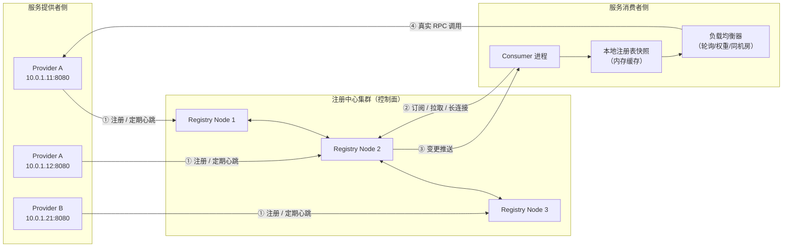

关键认知：**步骤 ④ 的业务调用完全不经过注册中心**。注册中心只在"找地址"这一瞬间参与，这也是它可以被本地缓存兜底的根本原因。

## 1.4 注册中心的六大核心能力

| 能力 | 说明 | 关键设计点 |
|---|---|---|
| **注册 Register** | 实例启动后上报自身信息 | 幂等（重复注册要覆盖而非新增）、携带 metadata |
| **注销 Cancel** | 优雅下线（进程关闭、SIGTERM） | 与"异常宕机"区分：一个是主动删，一个靠过期剔除 |
| **心跳/健康检查 Heartbeat** | 判断实例是否还活着 | 方向（客户端上报 vs 服务端探测）、周期、超时、连续失败阈值 |
| **查询/发现 Discovery** | 消费者获得实例列表 | 全量 vs 增量、拉 vs 推、按 namespace/group 隔离 |
| **变更通知 Notify** | 数据变化后通知订阅者 | 拉模式（定时）/ 长轮询 / 长连接推送 |
| **元数据与治理 Metadata** | 权重、标签、版本、机房、灰度、保护阈值 | 决定了能否做**就近路由、灰度发布、故障隔离** |

**延伸：健康检查的三种范式**

1. **客户端上报（Client-side heartbeat）**：ZK 的 Session、Eureka 的 Renew、Nacos 的临时实例心跳。
   - 优点：注册中心无额外探测开销，实例规模大时成本低；能感知"实例主动退出"。
   - 缺点：**只能证明"进程/客户端还活着"**，无法证明"业务真的能服务"；且依赖客户端时钟与网络。
2. **服务端主动探测（Server-side probe）**：Nacos 持久实例、Consul 的 TCP/HTTP check、K8s 的 readinessProbe。
   - 优点：能验证"端口可连""HTTP 200"，甚至业务语义。
   - 缺点：探测成本高（N 个实例 × M 个节点 × 周期），大规模下需要异步 IO + 分片。
3. **混合模式**：客户端上报 + 服务端抽查 + 客户端主动上报业务状态（Eureka 的 `/health`、Nacos 的 `healthy` 字段）。

> 面试高频陷阱："Eureka 的服务端会不会去 ping 实例？"——不会。Eureka 只靠客户端心跳，这也意味着它**无法发现"进程在、端口不通"的实例**；要补这个能力，得靠客户端把 actuator health 状态通过 `status` 上报（`UP/DOWN/OUT_OF_SERVICE`）。

## 1.5 全景时序：一次"注册—发现—调用"的底层链路

这是"**操作层面到底发生了什么**"的通用模型，后面每个框架都是它的变种。

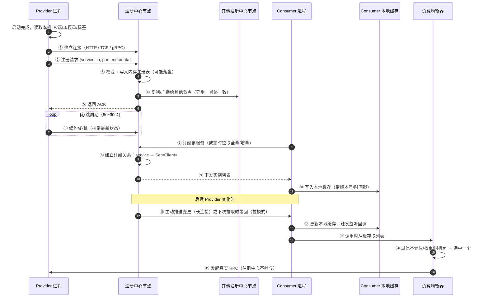

**这条链路里，每一环都是技术选型的分水岭：**

| 环节 | 可选方案 | 代价/收益 |
|---|---|---|
| ① 连接形态 | 短连接 HTTP（每次建连）/ 长连接（TCP、gRPC 流） | 短连接省服务端内存但耗 CPU 与端口；长连接省往返但服务端要管百万连接 |
| ④ 节点同步 | 主从共识（Raft/ZAB）/ 对等广播（Eureka peer）/ 分片反熵（Nacos Distro） | 强一致换吞吐，最终一致换可用 |
| ⑥ 心跳 | 5s（Nacos）/ 30s（Eureka）/ 会话（ZK） | 周期越短感知越快，成本越高 |
| ⑪ 通知 | 定时拉（30s）/ 长轮询（30s 挂起）/ 长连接推（毫秒） | 实时性 vs 服务端连接数 |
| ⑭ 决策位置 | 客户端本地（Ribbon/Feign）/ 服务端代理（Nginx、Envoy）/ Sidecar（Mesh） | 客户端灵活但多语言重复实现；服务端集中但多一跳 |

## 1.6 七个关键设计抉择——读懂三大框架的钥匙

只要把下面 7 个维度填完，你就能自己"推导"出任何一个注册中心的行为特征。这是本章最重要的部分。

| # | 维度 | ZooKeeper | Eureka | Nacos |
|---|---|---|---|---|
| 1 | **一致性取向** | CP（ZAB，多数派） | AP（P2P 异步复制） | **AP + CP 混合**（临时实例 AP / 持久实例与配置 CP） |
| 2 | **集群拓扑** | Leader–Follower（+Observer） | 完全对等（无主） | AP 部分对等 Distro；CP 部分 Raft 主从 |
| 3 | **心跳方向** | 客户端 Session（长连接 ping） | 客户端 Renew（HTTP） | 临时实例客户端心跳；持久实例服务端探测 |
| 4 | **变更通知** | Watch（一次性、事件驱动） | 客户端定时全量/增量拉取 | 1.x UDP 推送 + 长轮询；2.x 长连接主动推送 |
| 5 | **消费模式** | 客户端自行实现（Curator/Dubbo 封装） | 客户端发现 + 本地负载均衡（Ribbon） | 客户端发现 + 本地负载均衡（NacosRule） |
| 6 | **存储** | 内存树 + 事务日志 + 快照（持久化） | **纯内存**（重启即空，靠客户端重注册恢复） | 临时实例内存；持久实例与配置落 Derby/MySQL |
| 7 | **数据分片** | 无（全量数据每节点一份） | 无（每个 peer 全量） | AP 数据按 service 分片校验（Distro 责任分片） |

**两个由此直接推出的结论（面试常考）：**

- **Eureka 为什么敢纯内存？** 因为它认为"注册数据是软状态，可以由客户端重新上报恢复"。Server 重启后注册表为空，但客户端心跳会不断重注册，几分钟内自动补齐——**用暂时的不可用，换掉了持久化的复杂度和写延迟**。
- **ZK 为什么不适合海量实例？** 因为它无分片、所有写走 Leader、每节点全量数据、且临时节点/session 是有状态强一致的。几十万实例的心跳会把 Leader 打成瓶颈。

## 1.7 控制面思维：注册中心挂了会怎样

这是判断一个人是否"真的理解注册中心"的分水岭问题。

| 故障场景 | 影响 | 兜底手段 |
|---|---|---|
| 注册中心**全部**挂掉 | 新实例无法上线（注册失败）；老实例**仍可被调用**（消费者有本地缓存）；无法感知下线 | 本地缓存 + 本地磁盘快照 + 静态兜底列表（`dubbo` 的 `-D` 直连、Spring Cloud 的 `SimpleDiscoveryClient`） |
| 注册中心**部分**挂掉（AP 型） | 无影响（对等/分片，客户端连其他节点） | 客户端多地址列表、随机选一个节点 |
| 注册中心**分区**（CP 型） | 少数派不可写 → 新实例注册失败、无法选主 | 保证多数派在"主可用区"，跨 AZ 部署时算好 quorum |
| 注册中心**数据错误**（脑裂双写） | 消费者可能拿到两份冲突列表 → 调错实例 | AP 型的最终一致窗口内靠客户端重试 + 熔断兜底 |

> 记住一句话：**注册中心是"地图"，不是"道路"**。地图暂时失效，车还能按记忆开一段；但地图长期错误，车就会开进沟里。

---

# 二、底层一致性原理——所有注册中心的共同底座

不理解一致性协议，你对三大框架的理解就只能停留在"背配置项"。这一章是深水区的地基。

## 2.1 一致性模型谱系表

| 模型 | 定义（直觉版） | 典型实现 | 注册中心用在哪 |
|---|---|---|---|
| **线性一致性 / 强一致（Linearizability）** | 所有操作像在单机上按真实时间顺序执行，任何读都能看到最近一次成功写 | etcd、ZK（写）、Raft 组 | 持久元数据、配置、选主 |
| **顺序一致性（Sequential Consistency）** | 所有操作有全局顺序，且每个客户端内部顺序保持，但不要求与真实时间一致 | ZK（会话内 FIFO + zxid 单调） | ZK 的整体保证 |
| **因果一致性** | 有因果关系的操作顺序不被打乱，无因果的可以乱 | 部分分布式数据库 | 少见 |
| **最终一致性（Eventual Consistency）** | 停止写入后，经过有限时间所有副本收敛到同一值 | Eureka、Nacos Distro、Gossip | 服务实例列表 |
| **读己之写（Read-your-writes）** | 自己写完能立刻读到 | 会话粘滞 + 本地缓存 | 客户端注册后自查 |

**关键洞察**：注册中心对"实例列表"的要求其实非常弱——**只要最终一致 + 变更能传播**。因为：
- 列表里多一个已下线的实例 → 客户端调用失败一次 → 重试/熔断兜住；
- 列表里少一个刚上线的实例 → 少分担一点流量 → 无致命影响。

所以**能力的下限被业务容忍度决定了**，这就是 AP 型注册中心存在的全部理由。

## 2.2 CAP 与三个常见误解

**CAP**：Consistency（一致性）、Availability（可用性）、Partition tolerance（分区容忍）。

三个误解，必须纠正：

1. **误解一：三选二。** 错。分布式系统里 **P 是必选项**（网络一定会分区）。真正的选择是"**分区发生时，选 C 还是选 A**"。
2. **误解二：放弃 C 就是脏读。** 不准确。放弃 C 通常是指"放弃线性一致"，但仍可保证最终一致、单调读等较弱但有用的性质。
3. **误解三：AP 系统没有一致性。** 错。AP 系统有"收敛时间"承诺，只是不保证任意时刻一致。

**延伸：PACELC 定理**（比 CAP 更贴近工程）
> 如果发生分区（P），在 A 和 C 之间选；**否则（Else）**，在延迟（L）和一致性（C）之间选。

这条定理解释了一个真实现象：**即使没有网络分区，强一致也要付出延迟代价**——ZK 每次写都要 `fsync` + 等过半 ACK，Eureka 注册只要写内存就返回。所以 ZK 的写 P99 是毫秒到十几毫秒，Eureka 是零点几毫秒。选型时这才是日常体感。

## 2.3 2PC / 3PC：为什么注册中心不用它

**2PC（两阶段提交）**

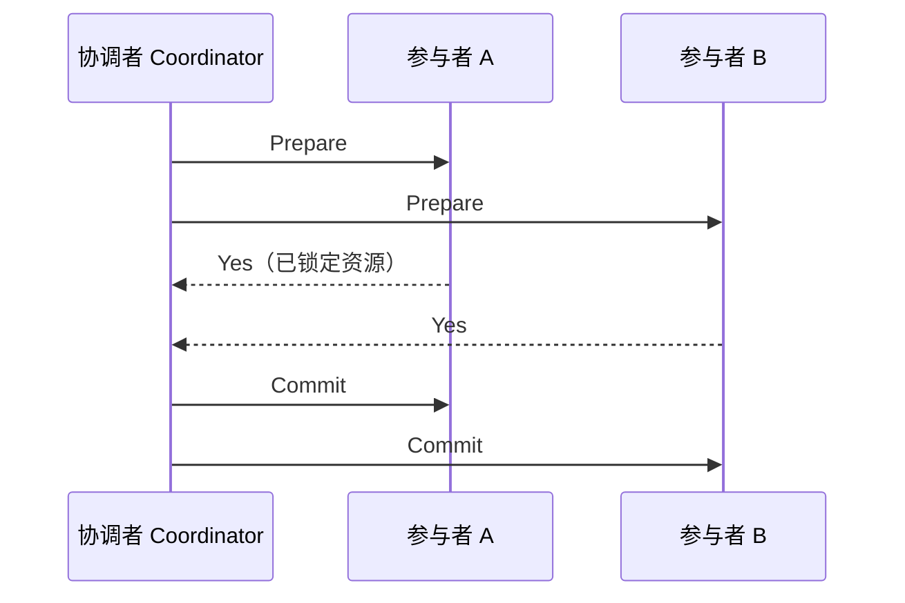

三个致命问题：
1. **同步阻塞**：Prepare 之后到 Commit 之前，参与者资源被锁死（"悬而未决"状态）。
2. **单点故障**：协调者在 Prepare 后崩溃 → 所有参与者永久阻塞（除非引入超时回滚，但那又可能不一致）。
3. **不一致窗口**：Commit 阶段部分参与者收到、部分没收到 → 部分提交。

**3PC** 加了 `CanCommit` 阶段 + 参与者超时自主决策，缓解了阻塞，但**仍无法解决分区下的不一致**（超时回滚与已提交冲突）。

**为什么注册中心/共识系统不用 2PC？**
- 2PC 解决的是"**跨多个资源管理器的一次事务**"，它保证原子性但**不保证副本数据的收敛**，也没有"选主"能力；
- 2PC 的性能是"参与者数量 × 网络往返"，且要求参与者在线；
- ZK/Raft 类协议本质是"**日志复制 + 状态机重放**"，只需多数派在线即可推进，天然适合"长期运行的元数据服务"。

> 延伸：真正把 2PC 用起来的是分布式事务中间件（Seata AT 模式、XA）。而"注册中心 + 2PC"的组合几乎不存在，因为注册中心不需要跨库原子性。

## 2.4 Paxos：所有共识协议的祖先

**角色**：Proposer（提案者）、Acceptor（接受者）、Learner（学习者）。

**Basic Paxos 两阶段**：

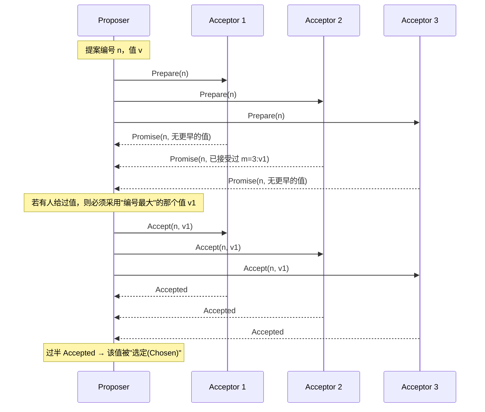

**为什么"过半 + 提案编号"就能保证安全？（面试必答的推理）**

1. Acceptor 收到 `Prepare(n)` 时承诺：**不再接受编号小于 n 的提案**，并返回自己已接受过的最大值。
2. 任意两个"多数派"必然有**交集**（n/2+1 + n/2+1 > n，鸽巢原理）。
3. 假设提案 m 已被选定（多数派接受），现在提案 n > m 想提交不同的值。它必然能联系到至少一个接受过 m 的 Acceptor（交集性质），从它那里**得知 m 的值**，因此 n 必须携带 m 的值 → 无法提交不同的值。
4. 结论：**已被选定的值不会被覆盖**，只能被"重新确认"。

**Basic Paxos 的工程缺陷**：
- 每次提案都要两轮 RPC，延迟高；
- **活锁**：多个 Proposer 交替提升编号，互相打断（`Prepare` 全被拒）；
- 没有 Leader，无法批量。

**Multi-Paxos（工程化改造，ZK/Raft 的思想来源）**：
1. 选出一个 **Distinguished Proposer（Leader）**，用一次 Prepare 拿到全部 Acceptor 的承诺；
2. 之后**每个提案只走 Accept 阶段**（省掉一半 RPC）；
3. 支持**批量 pipeline**，把多个提案打包；
4. Leader 失效再重新走一次选举（这就是 Raft 的选举）。

> 面试加分点：能说清"ZK 的 ZAB、Raft 都是 Multi-Paxos 的变体"，并说出**它们与 Multi-Paxos 的差异在于"强制 Leader + 顺序性 + 恢复期全同步"**，会让面试官认为你不是背的。

## 2.5 Raft：最"人类可读"的共识协议

Raft 把共识拆成三块：**Leader 选举、日志复制、安全性**。

### ① 角色与任期

- 角色：`Leader` / `Follower` / `Candidate`。
- **Term（任期）**：单调递增的整数，一个 Term 内最多一个 Leader。Term 是"防止旧 Leader 指令被接受"的核心机制（与 ZK 的 epoch 同构）。

### ② 选举流程

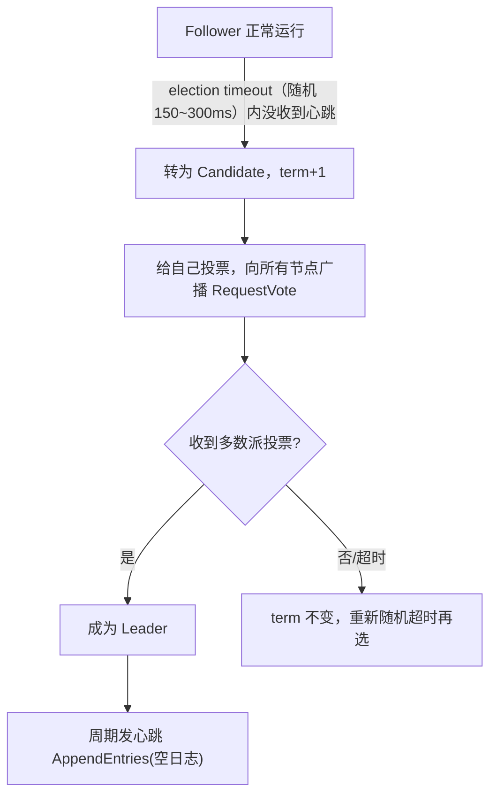

**关键设计**：随机化超时是为了**打破对称**（避免所有 Follower 同时竞选，造成选票分裂）。

### ③ 日志复制

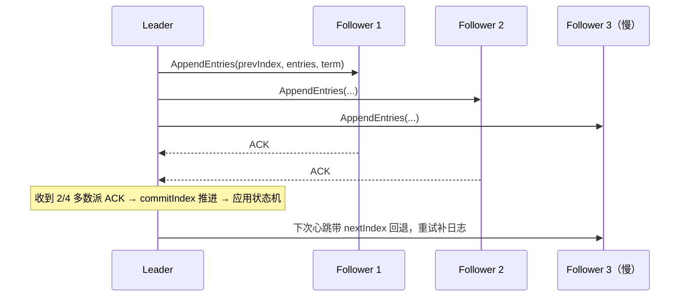

要点：
- 每个 Follower 维护 `nextIndex`（Leader 认为它下一条目号）和 `matchIndex`（已确认到哪）。
- Follower 发现 `prevIndex` 对不上（日志缺口），拒绝并要求重传 → Leader 回退 `nextIndex` 重试 → **日志自动对齐**。
- **提交规则（最易错的点）**：Leader 只有在"**包含当前 Term 的日志条目**被多数派确认"时才能推进 commitIndex。因为旧 Term 的条目可能还没被确认过，靠"多数派 + 旧 Term"提交会导致回滚（Raft 论文 §5.4.2）。工程上常见做法是**Leader 上任先追加一条 no-op**，借此触发提交。

### ④ 安全性（Leader Completeness）

> 若某值在 Term T 被提交，则所有 Term > T 的 Leader 的日志中都包含该值。

成立的原因：选举时 `RequestVote` 要求候选人的日志"**不比投票者旧**"（先比 `lastLogTerm`，再比 `lastLogIndex`）。而提交需要多数派 + 该末条日志属于某任期，交集保证新 Leader 必从"持有已提交日志的节点"中产生。

### ⑤ 成员变更与快照
- **成员变更**：单节点变更（一次只加/减一个，安全但慢）或**联合共识（Joint Consensus）**（两阶段，快）。
- **快照（InstallSnapshot）**：日志无限增长不可行，定期压缩成快照，落后太多的 Follower 直接拉快照。
- **PreVote（预投票）**：Raft 论文之外的工程增强（etcd 实现）。网络分区恢复后，旧节点 term 已膨胀很高，直接 RequestVote 会"抢走"健康集群的 Leader 并引发一次无谓选举。PreVote 先"试探"能否赢，赢了才真正 +term。

## 2.6 ZAB、Paxos、Raft 的关系与差异

**ZAB（ZooKeeper Atomic Broadcast）** 是 ZK 专属协议，分为两个阶段：

| 阶段 | 目标 | 做的事 |
|---|---|---|
| **崩溃恢复（Recovery）** | 选出新 Leader，让所有 Follower 的日志与 Leader 对齐 | ① Fast Leader Election 选主；② 新 Leader 收集所有 Follower 的 zxid，定出"新的同步点"；③ 按 zxid 差异做 `DIFF`（增量补）/ `TRUNC`（回滚多余）/ `SNAP`（全量下发） |
| **原子广播（Broadcast）** | 正常期把写请求可靠地复制到所有节点 | 简化版 2PC：Proposal（带 zxid）→ 落盘 → 过半 ACK → Commit → 各自 Apply |

**三方对比表（面试核心）**

| 维度 | Basic/Multi Paxos | Raft | ZAB |
|---|---|---|---|
| Leader | 逻辑上的 Distinguished Proposer，可弱化 | **强 Leader**，任期制 | **强 Leader**，epoch 制 |
| 顺序性 | 不强调 | 日志按序追加，不保证"全局提交顺序对所有客户端可见" | **强制保证顺序**（zxid 全局单调，所有节点按同一顺序 apply） |
| 广播方式 | Accept 阶段可并行 | AppendEntries 可并行但按 index 对齐 | 二阶段（Proposal→Commit），**同步后才能继续**（有 pipeline 优化） |
| 恢复期 | 无"强制全同步"要求 | Follower 靠 nextIndex 回退追平日志 | **新 Leader 必须让所有 Follower 完成同步后才对外服务**（更强的可用性牺牲） |
| 数据模型 | 任意状态机 | 任意状态机 | 树形 ZNode（但协议本身不依赖） |

**一句话总结差异**：Paxos 是"能达成共识"；Raft 是"能让人看懂并且工程可落地"；ZAB 是"为了 ZooKeeper 的**顺序一致性 + 主备状态机**量身定制的 Raft 加强版"。

> 深水区追问：**为什么 ZAB 恢复阶段要求所有 Follower 都同步完才对外服务？** 因为 ZK 的语义里，客户端读到的必须是"某个已提交的完整状态"，若允许部分 Follower 带着旧日志先服务，就会破坏"顺序一致性 + 单一视图"。代价是选举期间不可用（秒级），这也是 ZK 集群"怕网络抖动、怕长 GC"的根源。

## 2.7 Gossip 与反熵：AP 型注册中心的主流解法

**Gossip（流言协议）** 三种形态：

| 形态 | 行为 | 特点 |
|---|---|---|
| **Push** | 我有更新，推给随机 N 个邻居 | 传播快，但会推"过时"的数据 |
| **Pull** | 我定期向邻居要更新 | 收敛稳，但慢 |
| **Push-Pull** | 互相比对版本，交换差异 | 收敛最快，最常用 |

两个核心机制：
- **Anti-entropy（反熵）**：周期性全量/增量比对，消除长期漂移。收敛时间 ~ O(log N)。
- **Rumor mongering（谣言传播）**：有新数据就主动传播，直到"没人感兴趣"。

**故障检测 SWIM**（Consul 使用，Eureka 式心跳的反面）：不靠"所有人都汇报"，而是"随机抽查 + 间接怀疑"，把故障检测成本从 O(N²) 降到 O(N)。

**Nacos 的 Distro 就是"带责任分片的 Push-Pull 反熵"**：
- 不是每个人比全量，而是"**每个节点只负责一部分 service 的校验和**"，把比对成本从 O(N² × S) 降到 O(N × S/N) = O(S)。
- 这是**分片思想与反熵思想的结合**，是 Nacos 1.x 能做大规模 AP 注册中心的关键。第 5.5 节详述。

## 2.8 一致性哈希与分片：为什么注册中心也要分

**朴素取模 `hash(key) % N` 的问题**：扩容/缩容时，几乎**所有** key 的归属都会变（迁移量 ≈ (N-1)/N）。

**一致性哈希**：
1. 把 `0 ~ 2^32-1` 组成一个环；
2. 节点（以及虚拟节点）hash 到环上；
3. key 顺时针找到第一个节点。

| 特性 | 取模 | 一致性哈希 |
|---|---|---|
| 扩 1 个节点时的迁移量 | 约 (N-1)/N | 约 1/(N+1) |
| 数据倾斜 | 无（但扩容全迁） | **有**，靠**虚拟节点**打散 |
| 适合 | 节点数稳定 | 节点动态伸缩 |

**在注册中心里的应用**：
- Nacos Distro 的**责任分片**：`serviceName` → `hash` → 映射到某个节点（`DistroMapper`）。这个节点是"该 service 的 checksum 负责人"，不是"唯一存储者"（每个节点都存全量，但只负责校验一部分）。
- 网关/负载均衡层的**会话保持**、Redis Cluster 的 slot、Kafka 的分区，本质都是同一套思路。

> 延伸坑：一致性哈希的虚拟节点数量不是越多越好，一般 100~200 个/物理节点即可；过多会让环上节点查找的元数据变大。

## 2.9 多数派、Quorum 与脑裂

**Quorum（法定人数）**：`Q = ⌊N/2⌋ + 1`。

| 集群规模 | 容忍故障节点 | 说明 |
|---|---|---|
| 3 | 1 | 最低生产可用配置 |
| 5 | 2 | ZK/Raft 常用的生产配置 |
| 7 | 3 | 再往上收益递减（写延迟随节点数上升） |
| **偶数（4）** | 1 | **不划算**：4 节点的容错能力和 3 节点一样（需 3 票），白多一台机器 |

**脑裂（Split-Brain）**：网络分区后，两个子集群都认为自己是"主"，各自接受写 → 数据分叉。

**三种防脑裂手段**：

| 手段 | 原理 | 谁在用 |
|---|---|---|
| **Quorum 投票** | 少数派凑不够票，无法选出 Leader / 无法提交写 | ZK、Raft、etcd |
| **租约 Lease / epoch 校验** | 主节点持有带期限的租约，过期即失效；新主 epoch 更高 | ZK(epoch)、Raft(term) |
| **Fencing（隔离）** | 通过 STONITH、共享存储锁、网关拒绝旧主流量，物理上废掉旧主 | 数据库主从、K8s 的 `lease` |

**AP 型注册中心"脑裂"的真相**：
Eureka / Nacos-AP 在网络分区时**允许两边都接受写**（不存在"谁是主"的问题），结果是：分区期间两边的注册表内容不同，恢复后靠**复制/反熵收敛**。这不是"脑裂故障"，而是**设计上接受的暂时不一致**——因为注册数据是软状态，收敛后无害。

> 关键区分：**"CP 系统的脑裂 = 数据分叉的错误"；"AP 系统的双写 = 收敛前的正常窗口"**。面试时说清这一点非常加分。

## 2.10 小结：注册中心到底该选哪种一致性

| 数据类型 | 特征 | 应选 | 例子 |
|---|---|---|---|
| 服务实例列表（含心跳） | 高频写、软状态、可重建、容忍秒级不一致 | **AP** | Eureka 全量、Nacos 临时实例、Consul 的 service |
| 持久元数据（路由规则、持久实例） | 低频写、不能丢、需强一致 | **CP** | Nacos 持久实例（Raft）、ZK 的配置节点 |
| 配置内容 | 低频写、变更需强一致 + 需审计 | **CP** | Nacos config（Raft/DB）、ZK |
| 选主/分布式锁 | 绝不能出现双主 | **CP** | ZK、etcd、Nacos 的 CP 通道 |

**工程结论（面试可直接用）**：
> 注册中心 90% 的数据是"心跳型软状态"，用 AP 换可用性与吞吐是划算的；只有"不能错、不能丢"的元数据才需要 CP。Nacos 的价值正在于**在同一套产品里把这两类数据分流到两套协议**（Distro / Raft），而不是二选一。

---

# 三、ZooKeeper 深度拆解

## 3.1 定位与设计哲学

ZooKeeper 的自我定位不是"注册中心"，而是「**分布式协调服务（Coordination Service）**」。它的设计哲学可以用一句话概括：

> **一个带通知机制的、类文件系统的、强一致的小数据存储。**

三个隐性约束（决定了它的所有优缺点）：

1. **数据量小**：单节点数据上限 1MB（`jute.maxbuffer` 默认 0xfffff），全量数据都要放在内存里。
2. **读多写少**：所有写必须经过 Leader + 落盘 + 过半 ACK；读可以在任意节点本地完成。
3. **强一致优先于可用性**：分区时少数派直接不可用（进入 LOOKING 状态，既不服务读也不服务写）。

## 3.2 数据模型：ZNode 与 Stat

### 树形结构

```
/
├── dubbo
│   └── com.example.UserService
│       └── providers
│           ├── 0000000001   (临时顺序节点)
│           └── 0000000002
├── locks
│   └── order-lock
│       ├── 0000000000
│       └── 0000000001
└── configs
    └── app1
```

- 每个节点叫 **ZNode**，用绝对路径唯一标识（`/a/b/c`）。
- ZNode 既能存数据（byte[]，通常放 JSON/小配置），又能有子节点——这一点和文件系统不同（文件系统里"目录不能存内容"）。
- **没有相对路径**，没有 rename，不支持递归删除（得自己遍历）。

### 四种（六种）节点类型

| 类型 | 创建 API | 生命周期 | 典型用途 |
|---|---|---|---|
| **持久节点 PERSISTENT** | `create` | 显式删除才消失 | 配置、元数据、目录 |
| **持久顺序节点 PERSISTENT_SEQUENTIAL** | `create` + `CreateMode.PERSISTENT_SEQUENTIAL` | 同上，名字自动加 10 位单调递增后缀 | 分布式队列、全局 ID |
| **临时节点 EPHEMERAL** | `create` + `EPHEMERAL` | **会话结束（关闭/过期）即删除** | 服务注册、存活探活、Master 选举 |
| **临时顺序节点 EPHEMERAL_SEQUENTIAL** | 同上 | 会话结束即删除 + 顺序后缀 | **分布式锁（标准做法）**、Leader 选举 |
| **容器节点 CONTAINER**（3.5+） | `CreateMode.CONTAINER` | 当最后一个子节点被删除后，由服务端在后台清理 | 存放大量临时子节点的"目录"（如 `/dubbo/xxx/providers`） |
| **TTL 节点**（3.6+） | `CreateMode.PERSISTENT_WITH_TTL` | 无子节点且超过 TTL 未修改则删除 | 临时配置、限时锁 |

> **面试高频**：临时节点不能有子节点。原因很简单——如果临时节点能有子节点，会话过期删父节点时，子节点怎么办？要么级联删（但子节点可能是别人创建的持久节点，删了就是"越权"），要么留下孤儿节点。ZK 直接禁止，用**容器节点**来解决"临时目录"的诉求。

### Stat 结构（12 个字段，全部要能解释）

| 字段 | 含义 | 用途 |
|---|---|---|
| `czxid` | 创建该节点的事务 zxid | 追溯创建时间点 |
| `mzxid` | 最后一次修改该节点**数据**的 zxid | 判断是否被改过 |
| `pzxid` | 最后一次修改**子节点列表**的 zxid | 判断子节点增删 |
| `ctime` / `mtime` | 创建 / 修改时间（毫秒） | 审计 |
| `version` | **数据版本号**（每次 setData +1） | **乐观锁 CAS**：`setData(path, data, version)` |
| `cversion` | **子节点版本号**（子节点增删 +1） | 子节点变更的 CAS |
| `aversion` | ACL 版本号 | 权限变更的 CAS |
| `ephemeralOwner` | 临时节点的 owner sessionId；持久节点为 0 | 判断节点是否临时 |
| `dataLength` | 数据字节长度 | — |
| `numChildren` | 子节点数量 | — |

**版本号的实际价值**：ZK 没有"锁"，但提供了 CAS 语义，这就是它能实现分布式锁/乐观并发的底层原因。
```java
// 只有当前 version == 期望值时才成功，否则抛 BadVersionException
zk.setData("/config/app1", newData, 3);
```
> 注意坑：`version = -1` 表示"忽略版本，强制覆盖"，这是很多并发 bug 的来源。

### ACL 与权限
- 五种权限：`CREATE`、`READ`、`WRITE`、`DELETE`、`ADMIN`。
- 四种 Scheme：`world`、`auth`（当前会话已认证用户）、`digest`（用户名:密码摘要）、`ip`。
- 生产建议：注册中心场景一般开 `digest` 或 `ip`，避免任意客户端能删别人的节点。

## 3.3 Watcher 机制：ZK 的灵魂，也是最大的坑

### 3.3.1 工作原理

Watcher 是"**客户端注册关心的事件，服务端在事件发生时通知一次**"的机制。

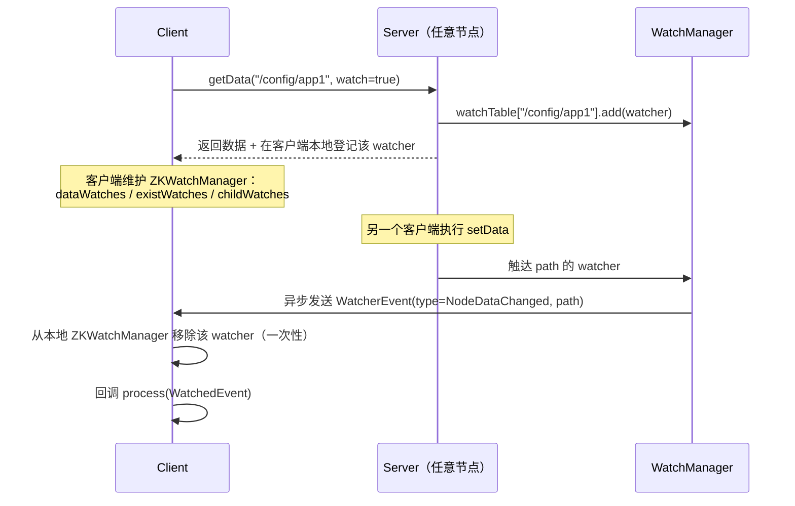

要点：
- **Watcher 存在两份**：服务端（`WatchManager`，`path → Set<Watcher>`，为了找到要通知谁）和客户端（`ZKWatchManager`，为了知道回调哪个监听器）。
- 服务端不关心"watcher 是哪个业务对象"，只发一个**事件通知**（不携带新数据！）。客户端收到后**必须自己再发一次读请求**去拿新值。
- 三种 watch 分类：`dataWatches`（getData/exists）、`childWatches`（getChildren）、`existWatches`（exists）。同一次通知可能同时命中多个类别。

### 3.3.2 事件类型矩阵（必须背下来）

| 触发操作 | 可能的事件 | 说明 |
|---|---|---|
| `create /a/b` | `NodeCreated` | 对 `/a/b` 的 exists watch 被触发 |
| `delete /a/b` | `NodeDeleted` | 对 `/a/b` 的 data/exists watch 触发 |
| `setData /a/b` | `NodeDataChanged` | 对 `/a/b` 的 data/exists watch 触发 |
| `create /a/b/c` | `NodeChildrenChanged` | 对 `/a/b` 的 children watch 触发，**不携带子节点信息** |
| `delete /a/b/c` | `NodeChildrenChanged` | 同上 |
| 连接状态变化 | `None` + `KeeperState` | `SyncConnected` / `Disconnected` / `Expired` / `AuthFailed` |

> 注意：**子节点内容变化不会触发父节点的 `NodeChildrenChanged`**（只有子节点的增删会）。这是一个高频误判。

### 3.3.3 三条核心保证（面试必答）

1. **一次性（one-shot）**：一个 watch 被触发后立即失效，需要重新注册。
2. **有序性**：客户端会**先**看到 watch 事件，**再**看到数据的新值（即事件通知一定先于后续读到的变更结果到达）。
3. **可靠投递（相对于会话）**：只要会话还在，watch 事件一定送达；但**会话断开/过期期间的事件会丢失**，且客户端无法知道丢了哪些。

### 3.3.4 为什么是一次性的（设计权衡）

- **省内存**：如果 watch 长期有效，几十万客户端 watch 同一节点，服务端要长期维持大量集合（且每次变更都要遍历全量通知）。
- **避免语义模糊**："持续 watch"意味着漏掉中间状态，客户端可能误以为看到了完整变更序列。
- **代价**：客户端必须"处理完事件立刻重新注册"，否则漏事件。

**延伸：3.6+ 的持久 Watch（`addWatch`）**
- `new Watcher` 一次注册，可多次触发；支持 `AddWatchMode.PERSISTENT` / `PERSISTENT_RECURSIVE`。
- 底层：服务端为每个 (session, path) 维护持久 watcher，事件发生时按需重放（先发"当前状态"事件，再发后续变更）。
- 但**成本更高**，服务端默认有限流（`zookeeper.maxWatchersPerPath` 类保护，视版本），大规模场景仍不建议滥用。

### 3.3.5 羊群效应（Herd Effect）与正确姿势

**场景**：1000 个客户端都 `getChildren("/locks/order-lock")` 并 watch。锁释放（删除 0000000001 节点）→ 1000 个客户端**同时**被唤醒 → 同时发起 `getChildren` 请求 → 服务端瞬间被打爆。这就是羊群效应。

**解法：只 watch "前一个"节点（临时顺序节点方案）**

```
/locks/order-lock/
  0000000000  ← 持有者
  0000000001  ← 我
  0000000002  ← 别人
```

- 每个客户端创建**临时顺序节点**，拿到自己的序号。
- 若自己是最小 → 拿到锁；否则 **只 watch 比自己小 1 的那个节点**（`exists` watch）。
- 前一个节点被删除 → 只有"紧邻"的那一个客户端被唤醒，其余不动。
- **复杂度从 O(N) 唤醒降到 O(1)**。

> 面试加分：能说出"ZK 官方文档里推荐的正是这种 'watch the next one' 模式"，并对比"用 `getChildren` + watch 全部"的羊群效应。

### 3.3.6 一个经典竞态与正确写法

**错误写法**：先 `getData(path)` 判断不存在 → 再 `exists(path, watch=true)`。这两步之间数据可能已经创建，导致永远收不到通知（**丢失事件**）。

**正确写法**：直接 `exists(path, watch=true)`，如果返回 null（不存在）也注册了 watch；不存在就等待，存在就 `getData`。
**原理**：ZK 保证 **watch 的注册与服务端读取在同一个原子操作内完成**，且事件在"读之后"发生就一定送达。这是 ZK 的"不会漏事件"的关键。

## 3.4 Session 会话机制

### 3.4.1 参数与状态机

| 参数 | 默认值 | 说明 |
|---|---|---|
| `tickTime` | 2000ms | ZK 的"时间单位"，心跳、超时都按它计算 |
| `minSessionTimeout` | `2 * tickTime` = 4s | 客户端申请更小会被强制调到下限 |
| `maxSessionTimeout` | `20 * tickTime` = 40s | 申请更大会被压到上限 |
| 心跳间隔 | `sessionTimeout / 3` | 客户端自动 ping |

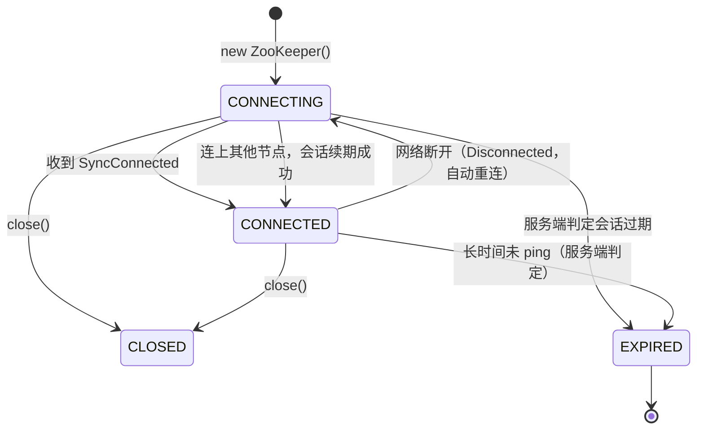

### 3.4.2 会话的底层表示

- 服务端 `SessionTracker` 维护 `sessionId → Session(owner, timeout, isClosing, 各种计数器)`。
- 会话创建/过期/关闭**都是事务提案**（走 ZAB 复制到所有节点），保证所有节点对"会话是否存在"有共同认知。
- `sessionId` 由 Leader 生成：`(epoch << 56) | 递增计数`，**带时间戳性质**——所以能防止"旧 sessionId 被重放"。

### 3.4.3 临时节点何时被删除：完整链路

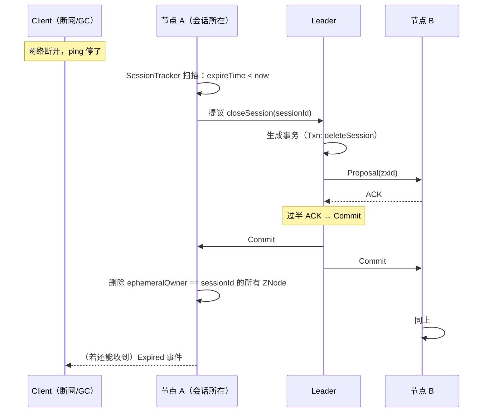

**关键点**：临时节点的删除**不是一个"后台定时清理任务"，而是一次分布式事务**。所以删除是"原子且所有节点一致"的。

### 3.4.4 会话过期的生产坑（非常重要）

| 坑 | 现象 | 原因与对策 |
|---|---|---|
| **长 GC 导致会话过期** | 服务"活着"但临时节点消失 → 注册列表里没有它 → 流量打到别处；分布式锁"自己释放了" | ZK 的 `sessionTimeout` 默认 40s 以内，一次 Full GC 超过这个时间就会过期。对策：① 增大 `sessionTimeout`（但要 < `maxSessionTimeout`，需服务端调）；② 优化 GC（G1/ZGC、减少大对象）；③ **锁的持有者必须在拿到锁后校验 `sessionId`**（Curator 的 `guaranteed` 模式） |
| **网络抖动 → 频繁 Expired** | 客户端以为重连成功，其实会话已过期 | 监听 `KeeperState.Expired`，**必须重建连接并重新注册所有 watch/临时节点**（客户端库不会自动恢复数据） |
| **会话过期但客户端未感知** | 客户端仍在用旧 sessionId 发请求 → `SessionExpiredException` | 任何 ZK 操作都要处理 `ConnectionLoss` / `SessionExpired` |
| **时钟漂移** | 客户端认为还没超时，服务端认为已超时 | 所有节点 NTP 对齐；`sessionTimeout` 不要贴着 `maxSessionTimeout` |

> 一句话：**ZK 不是"面向不可靠网络的长连接"，它是"面向可靠低延迟网络"设计的**。所以在容器化 + 弹性伸缩 + 长 GC 的环境里，ZK 的会话问题会被放大——这是 Nacos/Eureka 兴起的一个真实背景。

## 3.5 集群角色与读写路径

### 3.5.1 三种角色

| 角色 | 参与投票 | 参与写 | 说明 |
|---|---|---|---|
| **Leader** | ✅ | ✅（唯一提案者） | 全局唯一，负责所有写 |
| **Follower** | ✅ | ✅（转发给 Leader） | 参与选举与写确认 |
| **Observer** | ❌ | ❌（只转发给 Leader + 同步数据） | 扩容**读能力**，不增加写吞吐，不影响选举 |

**为什么 Observer 不增加写吞吐？** 因为写要"过半 ACK"，而 Observer **不计入投票集合**。加 Observer 只是让你的读请求有了更多节点可以承接，以及跨机房部署时让"读"就近。

### 3.5.2 写路径（详细）

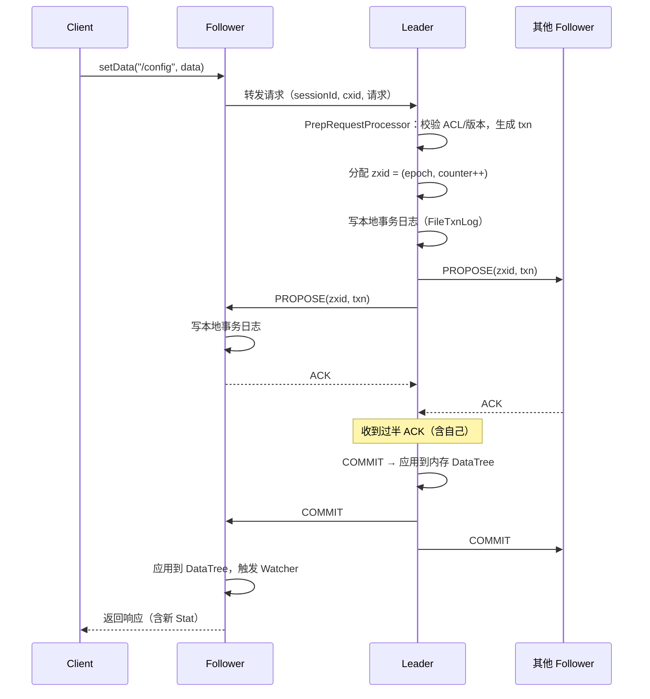

**关键细节（面试可深挖的点）**：
1. **Leader 自己也算一票**，所以 3 节点集群只需要 1 个 Follower ACK 就能提交。
2. **先落盘再广播**：Leader 先把自己写进事务日志，避免"自己挂了但已经承诺"。
3. **Commit 后本地 Apply 是串行的**（`FinalRequestProcessor` 在单线程队列里跑），保证所有节点 apply 顺序完全一致。
4. **`sync()` 与写的关系**：写已完成但 Follower 可能还没 apply，此时从 Follower 读到旧值。若需要"写后立刻读到最新"，客户端调 `sync(path)` 强制与 Leader 同步一次再读。

### 3.5.3 读路径与一致性等级

- 读请求**在本地内存直接返回**，不经过 Leader，也不落盘 → **极快（10 万+ QPS/节点）**。
- 代价：**可能读到旧数据（stale read）**。ZK 的官方承诺是"**顺序一致性（Sequential Consistency）**"，不是线性一致：
  - 同一会话内，读到的数据不会倒退（zxid 单调）；
  - 但不同会话之间，可能一个看到新值、一个看到旧值。
- 需要"读到最新"的场合：`sync()`（同步屏障）。Dubbo 早期用 ZK 注册中心时，消费者订阅后会有短暂"看不到新提供者"的窗口，就是这个问题。

### 3.5.4 单线程处理链（为什么 ZK 的 CPU 只用一个核）

ZK 的请求处理是一条**串行的 Processor 链**：

```
NIOServerCnxn (Selector 线程池收包)
   ↓ 入队 (RequestThrottler 限流)
PrepRequestProcessor      （单线程：生成事务、校验）
   ↓
ProposalRequestProcessor  （广播提案）
   ↓
SyncRequestProcessor      （单线程：落盘、批量 flush）
   ↓
FinalRequestProcessor     （单线程：应用内存、生成响应）
```

- **为什么串行？** 为了保证"同一 zxid 顺序在所有节点一致地 apply"。若多线程 apply，就必须处理依赖关系，复杂度暴涨。
- **代价**：吞吐受单核限制（写 TPS 通常 1w~3w，取决于磁盘 fsync）；CPU 是"单核打满、其余空闲"。
- **优化**：批量提案（pipeline）、`FileTxnLog` 的组提交（一次 fsync 提交多条）、把 `dataDir` 放独立 SSD。

## 3.6 ZAB 协议详解（ZK 的心脏）

### 3.6.1 ZXID 结构

```
 64 bit
┌──────────────────────┬──────────────────────┐
│  epoch（高 32 位）    │  counter（低 32 位）  │
│  当前 Leader 的任期   │  该任期内的自增序号   │
└──────────────────────┴──────────────────────┘
```

- **epoch**：每换一次 Leader +1。作用：**每个 epoch 只有一个 Leader 能提案**——旧 Leader 的提案因 epoch 更小会被 Follower 拒绝。
- **counter**：同一 epoch 内从 0 递增（实际从 1 开始）。
- **比较规则**：先比 epoch，再比 counter。所以 zxid 大 = "更新的 Leader 任期 或 同任期内更晚的事务"。

### 3.6.2 消息广播（正常期）

ZAB 的广播是"**简化版 2PC**"：

```
① Client 写请求 → Follower 转发 Leader
② Leader 生成 Proposal(zxid, txn)，先写本地日志
③ 广播 PROPOSE 给所有 Follower（Follower 不投票表决"是否接受"，只落盘后 ACK）
④ 收到过半 ACK（含 Leader 自己）→ Leader 发 COMMIT
⑤ 所有节点按 zxid 顺序 Apply，触发 Watch
```

**与 2PC 的差异**：Follower 没有"中止投票权"（不会投 No），只要日志写成功就 ACK。因为 ZAB 依赖"Leader 的提案合法"这一前提（由选举保证），而不是让多数派决定值。

### 3.6.3 崩溃恢复（选主 + 同步）

这是 ZAB 与 Raft 差异最大的地方：

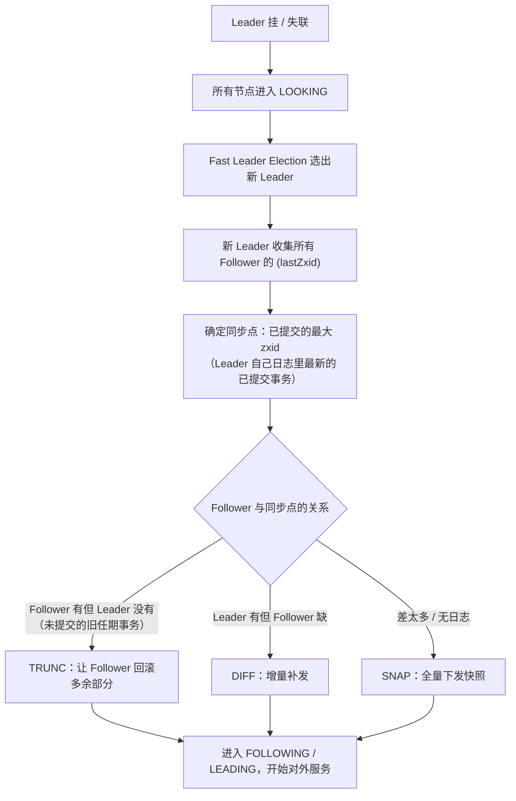

**关键点（面试深水区）**：
1. **新 Leader 必须"同步点最高"**：选举时比较 zxid，保证选出的 Leader 拥有**最全**的已提交数据（更严格说：拥有所有已被多数派接受过的数据中最新的一份）。
2. **TRUNC 的必要性**：旧 Leader 可能在提交前就挂了，某些 Follower 却已经落盘了这些"未提交事务"。新 Leader 若没有这些事务，必须让 Follower**回滚**（截断），否则数据分叉。
3. **"所有 Follower 同步完成后才对外服务"**：这是 ZAB 的强约束，宁可短暂不可用，也要保证单一视图。
4. 同步完成后，新 Leader 会**开启一个新 epoch**，之后所有提案都用新 epoch 的 zxid。

### 3.6.4 ZAB 的一致性保证（官方五条）

| 保证 | 含义 |
|---|---|
| **顺序一致性 Sequential Consistency** | 同一会话的请求按发送顺序生效 |
| **原子性 Atomicity** | 一个事务要么所有节点都成功，要么都失败（不会部分生效） |
| **单一视图 Single System Image** | 客户端无论连哪个节点，看到的是同一个视图（同步后） |
| **可靠性 Reliability** | 事务一旦成功，结果被持久化，不会丢失（除非所有节点都崩） |
| **实时性 Timeliness** | 客户端在有限时间内能看到最新状态（不保证多久，只保证"最终"） |

> 注意：**"单一视图"在读写分离下是打折扣的**（读可能读到旧值），所以才有 `sync()` 的存在。

## 3.7 Fast Leader Election 选举细节

### 3.7.1 触发条件
- 集群启动（还没有 Leader）；
- Leader 崩溃/失联（Follower 心跳超时）；
- 多数派失联后恢复（原 Leader 发现自己不再是 Leader，退回 LOOKING）；
- 集群扩容（新节点加入时可能触发重新选举，3.5+ 的动态配置不一定触发）。

### 3.7.2 投票比较规则（核心）

每个节点投票给"**(lastZxid, myid)** 字典序最大"的候选：
1. 先比 `lastZxid`（epoch 优先，再 counter）—— **数据最新的优先**；
2. zxid 相同，比 `myid`（`server.id`，配置里的大数优先）。

**为什么"数据最新"优先？** 因为新 Leader 必须拥有所有已提交事务，否则恢复阶段无法保证不丢数据。

### 3.7.3 流程

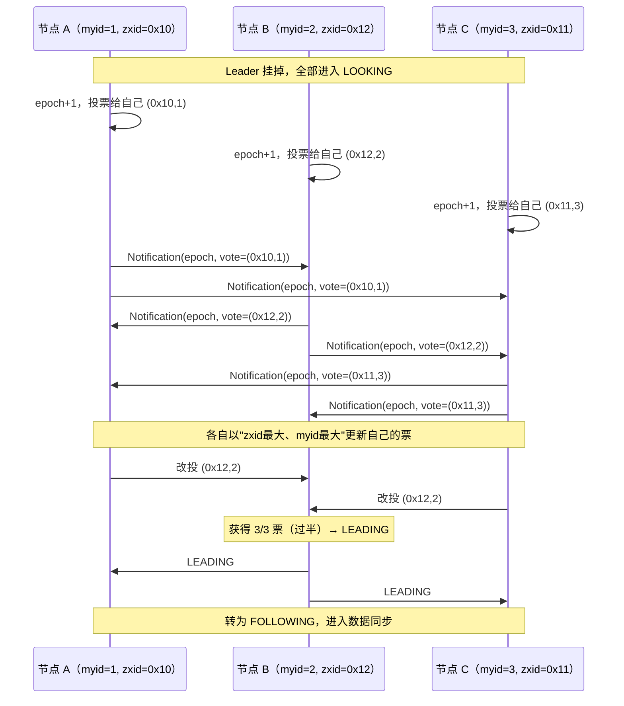

要点：
- 每轮选举有 **epoch（选举轮次）**，防止"僵尸投票"干扰新一轮。
- 收到更高 epoch 的通知 → 更新自己的 epoch 并重新投票。
- **过半即胜**，不需要全票；一旦某个节点收到过半相同投票，就宣布结果。
- 选举期间**不提供读写服务**（这是 ZK 的可用性代价，通常几百毫秒到几秒）。

### 3.7.4 为什么"选举期间不可用"是设计而不是缺陷

如果允许 LOOKING 状态继续服务：
- 可能两个分区各自选出 Leader，都对外写 → 脑裂；
- 可能读到"一半事务"的状态 → 破坏单一视图。

所以 ZK 选择"**宁可停一会儿，也不能错**"。这是 CP 的必然代价。生产上要减少选举频率：避免网络抖动、避免长 GC 导致心跳超时、避免把 ZK 与业务混部抢 CPU。

## 3.8 存储与数据恢复

### 3.8.1 三层存储结构

| 层 | 组件 | 内容 |
|---|---|---|
| 内存 | `DataTree` | 完整 ZNode 树（含 Stat、data） |
| 磁盘-日志 | `FileTxnLog` | **Write-Ahead Log**：所有事务（create/setData/delete/session） |
| 磁盘-快照 | `FileSnap` | 某一时刻的**完整 DataTree** 序列化 |

### 3.8.2 事务日志的关键设计

- **文件预分配**：每个日志文件预分配 64MB（`preAllocSize`），避免频繁 seek 与磁盘碎片。
- **组提交（Group Commit）**：`SyncRequestProcessor` 把一批事务一起 `flush` + `fsync`，把"每条一次 fsync"变成"每批一次"，这是 ZK 写吞吐的关键优化。
- **日志格式**：`FileHeader` + 多条 `TxnHeader + Record`，每条带 zxid。
- **为什么日志比快照重要**：快照可以丢（可以重放日志），日志不能丢（丢了就真丢数据）。

### 3.8.3 「模糊快照」（Fuzzy Snapshot）

**问题**：拍快照要遍历整棵树，如果加锁，会阻塞所有写请求（`FinalRequestProcessor` 是单线程）。

**ZK 的做法**：**不加锁，边写边拍**。
- 快照期间事务仍在 apply，所以拍出来的快照可能是"**某个中间时刻之后**"的状态（部分节点是新的、部分是旧的）。
- **为什么不影响正确性？** 因为恢复时的流程是：
  1. 找最新的**有效**快照（末尾有 `zxid` 标记）；
  2. 重放"该快照 zxid 之后"的所有事务日志；
  3. **重放是幂等的**：如果快照里某个节点已经是新值，重放同一个 setData 还是新值；如果是旧值，重放后变新值。两种情况最终一致。
- 这就是"模糊"的含义：**快照不必精确到某个 zxid，只要"不早于"它即可**。

### 3.8.4 快照触发条件

- 累计事务数超过 `snapCount`（默认 100000）；
- 为避免所有节点同时拍快照（IO 风暴），实际触发阈值是 `snapCount/2 + random(snapCount/2)`。

### 3.8.5 恢复流程

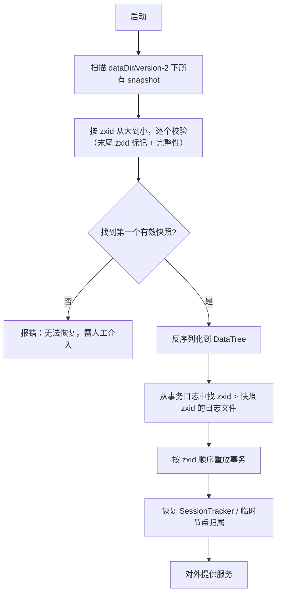

**生产坑**：`dataDir` 与 `dataLogDir` 要分开（快照和日志 IO 争抢），磁盘要用低延迟 SSD，否则 fsync 延迟直接变成写延迟。

## 3.9 典型应用场景与底层实现

### 3.9.1 五种经典用法

| 场景 | 实现要点 | 底层依赖 |
|---|---|---|
| **命名服务** | `/services/{name}/{instance}` 存地址 | 树形 + 顺序节点 |
| **配置管理** | 配置放持久节点，客户端 watch | Watch + 持久节点 |
| **集群管理/存活感知** | 成员建临时节点，watch 父节点子列表 | 临时节点 + Session |
| **Master 选举** | 所有候选建临时顺序节点，最小者为主 | 临时顺序节点 + watch 前一个 |
| **分布式锁** | 同上，但锁释放即删除节点 | 临时顺序节点 + 互斥语义 |

### 3.9.2 分布式锁：三种实现的对比（面试高频）

**方案一：`create("/lock")` 抢占式（不推荐）**
- 谁 create 成功谁是持有者，释放时 delete。
- 问题：**惊群**（所有等待者 watch 同一节点）、**不可重入**、**非公平**、**会话过期后锁释放但业务还在跑**（"锁失效"问题）。

**方案二：临时节点 + watch（改良版）**
- 依然是抢同一个节点，但 watch 只挂一次。仍有羊群效应。

**方案三：临时顺序节点 + watch 前一个（Curator 的标准实现）**

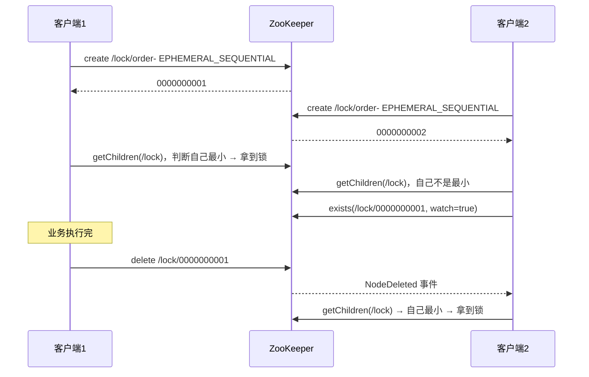

**Curator `InterProcessMutex` 的工程细节（能说出这些就是资深）**：
1. **可重入**：本地 `ConcurrentMap<Thread, LockData>` 记录"当前线程持有几次"（`threadData`），重入只 +1 不重复建节点。
2. **锁数据**：节点内容存 `lockData`（含 owner、path），用于诊断与"误删检测"。
3. **`guaranteed` 模式**：创建节点使用 `CreateMode.EPHEMERAL_SEQUENTIAL` + 若发生 `ConnectionLoss`（不确定是否创建成功）则**遍历子节点按 owner 匹配**，避免"节点建了但客户端不知道"。
4. **`maxLeases`**：允许"同时 N 个持有者"（如读写锁的读锁 = Integer.MAX_VALUE）。
5. **公平性**：顺序节点天然 FIFO，是**公平锁**。

**ZK 锁 vs Redis 锁（用户最关心的对比）**

| 维度 | ZK 锁 | Redis 锁 |
|---|---|---|
| 一致性 | CP（强一致，不会双主） | AP（主从异步复制，主挂可能丢锁） |
| 性能 | 低（~几千 TPS，受 fsync 限制） | 高（~10w+ TPS） |
| 阻塞等待 | 原生支持（watch 前一个，精确唤醒） | 需轮询或 pub/sub |
| 锁失效风险 | 会话过期 → 锁被删（需业务校验 sessionId 或加"锁版本"） | 网络分区 → 可能两个客户端都以为持有 |
| 适用 | 强一致、低频（选主、元数据变更、定时任务） | 高频、可容忍极端场景（库存扣减前置、防重复提交） |

> **结论性观点**：如果要"**绝对不能双主**"，选 ZK/etcd；如果要"**高吞吐、可容忍极小概率**"，选 Redis。金融场景里，前者用于主控/账务切换，后者用于流量前置。

## 3.10 局限、性能边界与生产实践

### 3.10.1 五个硬局限

| 局限 | 原因 | 后果 |
|---|---|---|
| **写吞吐低** | 所有写走 Leader + 落盘 fsync + 过半 ACK + 单线程 apply | 大规模实例心跳会把 Leader 打死 |
| **无分片** | 每个节点存全量数据 | 数据量受单机内存限制（通常几十万 ZNode 就吃紧） |
| **Watch 一次性** | 省服务端内存 | 客户端要重复注册，易漏事件 |
| **会话脆弱** | 长 GC/网络抖动 → 过期 → 临时节点消失 | 注册列表"假死"、锁意外释放 |
| **选举期不可用** | ZAB 恢复期要求全同步 | 秒级不可用窗口 |

### 3.10.2 关键配置清单（可执行）

| 配置 | 建议值 | 理由 |
|---|---|---|
| `tickTime` | 2000 | 太小 → 误判；太大 → 故障感知慢 |
| `initLimit` | 10 | Leader 等待 Follower 同步的 tick 数 |
| `syncLimit` | 5 | Leader 与 Follower 心跳超时 |
| `snapCount` | 100000 | 太小 → 频繁快照 IO；太大 → 恢复慢 |
| `maxClientCnxns` | 按需（默认 60） | 单 IP 连接数限制，容器化下很容易打满 |
| `autopurge.snapRetainCount` | 3~5 | 保留快照数 |
| `autopurge.purgeInterval` | 24 | 定期清理，否则磁盘爆 |
| JVM | 堆 2~4G，G1/ZGC | 堆不要过大（快照/FGGC 会拖长 STW） |
| `dataLogDir` | 独立 SSD | 事务日志的 fsync 是写瓶颈 |

### 3.10.3 为什么 ZK 不适合做"海量服务注册中心"

以 Dubbo 早期用 ZK 为例：
- 每个 Provider 实例 → 1 个临时节点 + 每 `sessionTimeout/3` 一次 ping；
- 1000 个服务 × 50 实例 = 5 万个临时节点 → 每次 Provider 上下线都是一次**写事务**（走 Leader + 落盘）；
- 消费者还要 watch `providers` 节点 → 每次变化触发大量通知；
- 结果是：**注册中心的写能力成了整个微服务体系的扩容上限**。

这就是 Dubbo 后续支持 Nacos、以及 Nacos 出现的直接动因：**把"高频心跳"从 CP 通道挪到 AP 通道**。

---

# 四、Eureka 深度拆解

## 4.1 背景与定位

- **出身**：Netflix 开源（2012 年前后），是 Spring Cloud Netflix 体系中"服务发现"的标准实现。
- **定位**：**只做服务注册与发现**（Naming Service），不做配置中心、不做服务端负载均衡。
- **一致性取向**：**纯 AP**。官方明确表述：Eureka 保证的是 **availability 和 partition tolerance**，不保证强一致。
- **命运拐点**：2018 年 7 月 Netflix 宣布 **Eureka 2.0 的开源工作停止**，社区版停留在 1.x（1.9.x / 1.10.x）。Spring Cloud 后续把推荐方案转向 Consul / Nacos / K8s。但**存量项目极多**，面试依然是高频考点。

## 4.2 三大角色与拓扑

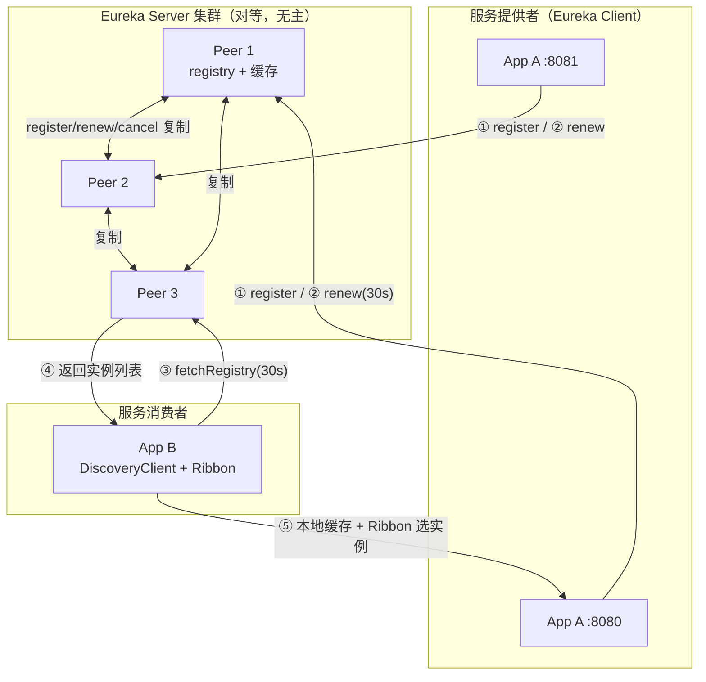

| 角色 | 职责 | 关键类 |
|---|---|---|
| **Eureka Server** | 注册中心，维护注册表、提供 REST 接口、peer 间同步 | `EurekaServerAutoConfiguration`、`PeerAwareInstanceRegistryImpl`、`ResponseCacheImpl` |
| **Eureka Client（Provider 侧）** | 启动注册、定时续约、优雅下线 | `EurekaClient`、`DiscoveryClient`、`ApplicationInfoManager` |
| **Eureka Client（Consumer 侧）** | 拉取注册表、喂给 Ribbon/Feign 做本地负载均衡 | `DiscoveryClient`、`EurekaClientConfig` |

> **重要认知**：Eureka 的"服务发现"= **客户端发现模式（Client-side Discovery）**。消费者自己拉全量列表，自己在本地选实例，**注册中心不参与流量转发**。

## 4.3 核心设计哲学（四条，条条都是"为什么"）

| 设计 | 表面做法 | 深层理由 |
|---|---|---|
| **纯内存存储** | 注册表是 `ConcurrentHashMap`，重启即空 | 注册数据是**软状态**，客户端会持续心跳重新注册，几分钟自动补齐 → 用短暂空窗换掉持久化复杂度与写延迟 |
| **对等复制（Peer-to-Peer）** | 没有主从，任何节点都能接受写 | 去掉选主 → 没有"选举期不可用"、没有脑裂，可用性最大化（AP 的极致） |
| **客户端缓存 + 多级服务端缓存** | 客户端 30s 拉一次，服务端两级缓存 | 注册中心是**读放大**型系统（1 万消费者 × 30s 轮询 = 每秒数百 QPS 的全量序列化）→ 必须用缓存挡住 |
| **不做强一致** | 异步复制、允许不一致窗口 | 列表多一个/少一个实例，业务靠重试与熔断兜得住；反过来，注册中心不可用会直接阻塞扩容 |

## 4.4 数据结构与三级缓存（Eureka 最"值钱"的设计）

### 4.4.1 内存结构

```java
// AbstractInstanceRegistry
ConcurrentHashMap<String, Map<String, Lease<InstanceInfo>>> registry;
//  key = APP_NAME（服务名，大写），value = (instanceId -> Lease)

// Lease：租约
class Lease<T> {
    T holder;            // InstanceInfo
    Long lastUpdateTimestamp;  // 最后一次续约时间
    long duration;              // 租约时长（默认 90s）
}

// 三个队列（用于增量与监控）
recentCanceledQueue;    // 最近取消的实例（用于调试/诊断）
recentRegisteredQueue;  // 最近注册的实例
recentlyChangedQueue;   // 最近 3 分钟内变更的实例 ← 增量拉取的来源
```

**`recentlyChangedQueue` 是增量拉取的核心**：它保留最近 3 分钟内的所有变更（register/renew 状态变化/cancel），客户端带 `appsHashCode` 来请求 `delta`，服务端只返回这些变更。

### 4.4.2 三级缓存与"保护注册中心"的动机

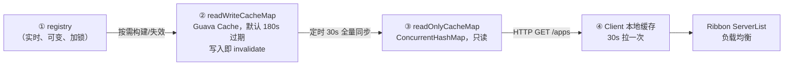

| 层 | 位置 | 作用 | 失效方式 |
|---|---|---|---|
| ① `registry` | Server 内存 | 唯一真实数据源（有锁保护） | 注册/续约/剔除时修改 |
| ② `readWriteCacheMap` | Server 内存 | **序列化结果缓存**（XML/JSON 已序列化好的字节） | 写操作主动 `invalidate`；默认 180s 兜底过期 |
| ③ `readOnlyCacheMap` | Server 内存 | **无锁只读快照**，挡住并发序列化 | 定时（默认 30s）从 ② 全量同步 |
| ④ Client 本地缓存 | 客户端内存 | 消费者进程内可用列表 | 定时（默认 30s）拉取 |

**为什么不直接读 ①？** 因为每次请求都要：
1. 加锁遍历 `ConcurrentHashMap`；
2. 把上千个 `InstanceInfo` **序列化**成 JSON/XML（CPU 密集）。
1 万个消费者每 30s 拉一次 = 333 QPS × 序列化 5000 实例 = CPU 直接爆。
**② 缓存序列化结果**（同一个服务只有一份字节流，所有请求复用），**③ 再挡一层并发**（避免每次都查 Guava Cache 的锁与统计开销）。

### 4.4.3 变更传播的真实时延（面试最爱问的"多久能感知"）

假设配置为默认值，消费者要感知"某实例下线"，最坏时延：

| 环节 | 默认 | 可调 |
|---|---|---|
| Server 写入 / 剔除 registry | ~0 | — |
| ②→③ 同步（`response-cache-update-interval-ms`） | **30s** | 可调小 |
| ③→④ 客户端拉取（`registry-fetch-interval-seconds`） | **30s** | 可调小 |
| Ribbon `ServerListUpdater` 刷新（polling 模式） | 30s | 与上者通常合一 |
| **合计最坏** | **约 60~90s** | 调小后约 10~20s |

> **这就是 Eureka 被诟病"下线感知慢"的根源**——不是协议慢，是**多层缓存叠加**。Nacos 2.x 用长连接推送把这一链路压到**毫秒级**，正是针对这个痛点。
>
> 生产调优：`eureka.client.registry-fetch-interval-seconds=10` + `eureka.server.response-cache-update-interval-ms=10000`（代价是 Server CPU 上升）。

## 4.5 注册、续约、剔除的完整流程

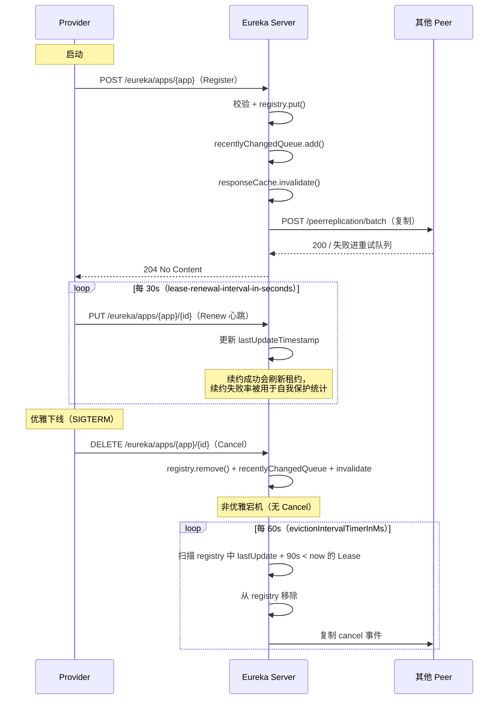

**核心参数**

| 参数 | 默认 | 含义 |
|---|---|---|
| `eureka.instance.lease-renewal-interval-in-seconds` | **30** | 续约间隔 |
| `eureka.instance.lease-expiration-duration-in-seconds` | **90** | 租约时长（3 次续约失败才剔除） |
| `eureka.server.eviction-interval-timer-in-ms` | **60000** | 剔除扫描周期 |
| `eureka.server.response-cache-update-interval-ms` | **30000** | 只读缓存刷新 |
| `eureka.client.registry-fetch-interval-seconds` | **30** | 客户端拉取周期 |

> **注意"三倍关系"**：续约 30s、过期 90s、扫描 60s。意味着实例真故障后，**最坏 90+60=150s** 才会被从 registry 移除（若关掉自我保护）。这是 Eureka 的"故障发现延迟"。

## 4.6 集群间数据同步：为什么是最终一致

### 4.6.1 复制机制

- 每个 Peer 收到写请求后，**先写自己**，再调用其他 Peer 的 `peerreplication` 接口（**同步 HTTP 调用**，但失败**不影响本次请求返回**）。
- 批量复制：`PeerReplicationResource` 支持批量（`BatchReplication`）。
- 失败处理：进入**重试队列**，由 `replicationClient` 后台重试（带 session/backoff）；多次失败后放弃（**丢弃**）→ 这就是"最终一致"的来源之一。

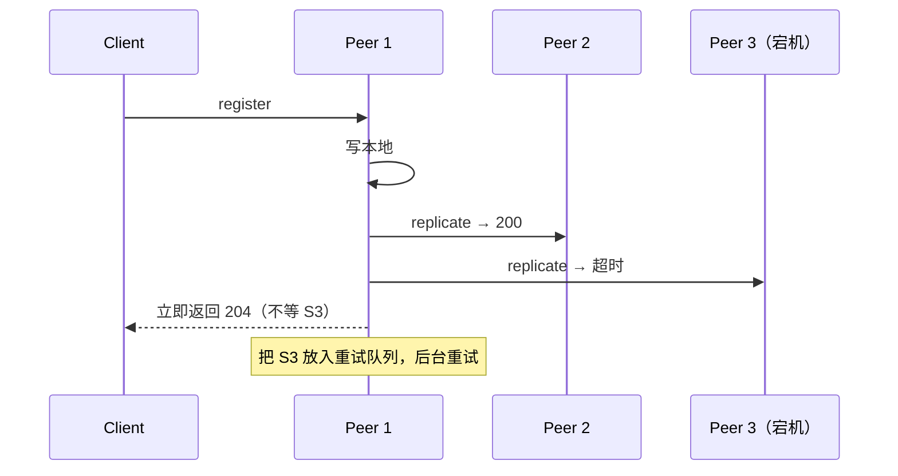

### 4.6.2 三个"不一致"的真实来源

| 原因 | 说明 |
|---|---|
| **异步 + 失败丢弃** | Peer 3 恢复后，可能永远收不到那条注册（重试队列已放弃）→ 只能靠客户端下一次 `renew` 补上 |
| **网络分区** | 分区期间两个子集群各自写，恢复后靠 renew 覆盖（**后写覆盖**，没有版本/时钟仲裁） |
| **客户端连不同 Peer** | 消费者 A 连 Peer1，消费者 B 连 Peer2，两者在窗口内看到不同列表 |

### 4.6.3 `appsHashCode`：如何判断"我的缓存过期了"

- Server 对整张注册表算一个哈希（`appsHashCode`，包含每个 app 的实例数与状态）。
- Client 每次拉取带上本地 hash。**hash 不同 → 服务端返回全量；hash 相同 → 可返回空/增量**。
- 这是"**低成本一致性校验**"的经典手法（和 Nacos Distro 的 checksum 校验同源思想）。

> 延伸：为什么用 hashCode 而不是版本号？因为 Eureka 没有全局单调版本（对等复制没有中心序列），只能用"内容指纹"这种无中心的一致性判断。

## 4.7 自我保护机制（Self-Preservation）

### 4.7.1 它要解决的问题：故障放大

```
网络抖动 / Server GC / 交换机故障
   ↓
大量 Provider 的心跳（Renew）失败
   ↓
Lease 到期 → Server 把它们全部剔除
   ↓
注册表几乎变空
   ↓
消费者拿到空列表 / 或只剩极少实例
   ↓
所有流量打到少数实例 → 雪崩
```

**本质**：注册中心把"网络问题"误判成"实例故障"，然后**主动删掉了本来健康的实例**，造成"故障放大"。这在分布式系统里叫**误判型级联失效**。

### 4.7.2 机制

| 概念 | 公式/含义 |
|---|---|
| 每分钟期望续约数 `expectedNumberOfRenewsPerMin` | 实例数 × 2（因为 30s 一次 → 1 分钟 2 次） |
| 续约阈值 `numberOfRenewsPerMinThreshold` | `expectedNumberOfRenewsPerMin × renewalPercentThreshold`（默认 **0.85**） |
| 判定 | 上一分钟的**实际续约数** < 阈值 → **进入自我保护** |
| 行为 | **停止剔除过期实例**（注册表保持"最后已知的良好状态"），同时打 WARN 日志 |
| 恢复 | 续约数回升到阈值以上 → 自动退出保护模式 |
| 阈值重算 | 每 15 分钟按当前实例数重算一次 |

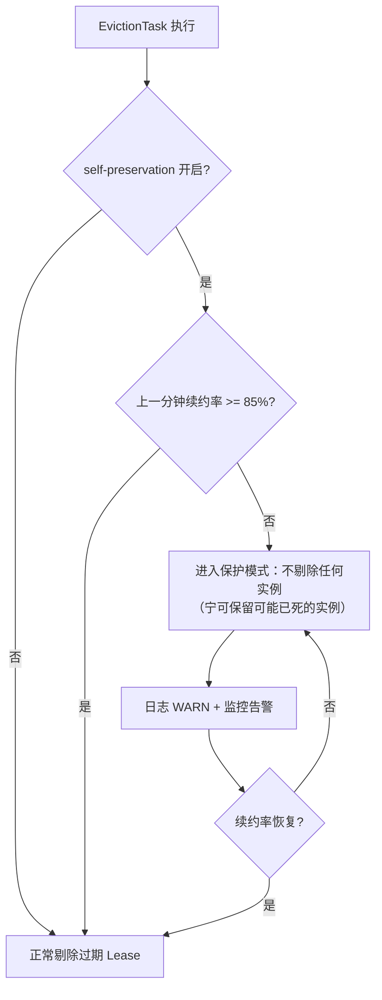

### 4.7.3 配置与取舍

| 配置 | 默认 | 建议 |
|---|---|---|
| `eureka.server.enable-self-preservation` | 早期版本 `true`；Spring Cloud Netflix 后续默认 **false** | **生产建议显式开启 `true`**，并在监控上盯住 `Renews threshold` / `Renews (last min)` 两个指标 |
| `eureka.server.renewal-percent-threshold` | 0.85 | 小集群（<10 实例）建议调低到 0.6~0.7，否则一两个实例抖动就触发 |
| `eureka.server.renewal-threshold-update-interval-ms` | 900000（15min） | 大规模频繁扩缩容时可调小 |

> **面试的灵魂提问**："自我保护开启后，如果实例真的全挂了怎么办？"——答案是：**保护模式只能识别"续约率骤降"，不能区分'网络问题'与'真的全挂'**。极端场景下（真的全挂），Server 会一直保留死实例，此时需要：① 客户端侧熔断与重试兜底；② 人工介入；③ 或用 Consul/Nacos 的服务端探测模式（能区分"端口不通"与"心跳丢失"）。

### 4.7.4 延伸：这是"背压/降级"思想的一个实例
- "宁可给一个可能错误的旧答案，也不要给一个确定有害的新答案"；
- 类似思想：Nacos 的 **保护阈值 `protectThreshold`**（健康实例比例低于阈值时，返回**全部**实例，避免流量集中）、Sentinel 的"慢调用比例"熔断、K8s 的 `PodDisruptionBudget`。

## 4.8 健康检查：客户端心跳的天花板

- Eureka 的健康信息**完全来自客户端**：Provider 定时 POST `Renew`，Server 只更新 `lastUpdateTimestamp`。
- 想表达"业务不健康"，Provider 需要**主动上报状态**：
  - `InstanceInfo.status = DOWN / OUT_OF_SERVICE`（通过 `ApplicationInfoManager.setInstanceStatus()`）；
  - 结合 `spring-boot-actuator` 的 `/health`，由 `EurekaHealthCheckHandler` 把 health 结果映射成 status；
  - 消费者侧 Ribbon 会**默认过滤掉非 UP 的实例**（`DiscoveryEnabledNIWSServerList` 里 `filterOnlyUpInstances`）。
- **真正的缺口**：进程活着、端口 listen 正常、但依赖的 DB 挂了 → 心跳依然成功，实例依然 UP。
  - 对策：在 `health` 里检查关键依赖；或改用"服务端探测 + 业务探活"的模式（Nacos 持久实例、Consul HTTP check）。

## 4.9 消费侧：客户端发现 + Ribbon 的完整链路


**Ribbon 关键组件**

| 组件 | 作用 | 默认 |
|---|---|---|
| `ServerList` | 提供实例列表 | `DiscoveryEnabledNIWSServerList` |
| `ServerListUpdater` | 列表刷新策略 | Polling（30s）/ Push（Eureka 事件驱动） |
| `IRule` | 选择算法 | **`ZoneAvoidanceRule`**（区域可用性 + 轮询）；另有 `RoundRobinRule`、`AvailabilityFilteringRule`、`WeightedResponseTimeRule`、`RandomRule`、`BestAvailableRule` |
| `IPing` | 客户端侧"被动探活" | `NIWSDiscoveryPing`（**只看 Eureka 的 status，不发真 ping**，所以零额外开销） |
| `RetryHandler` | 失败重试 | `RetryRule`（重试时换实例） |

> **重点认知**：Ribbon 的 `IPing` 默认是"零成本"的（不做真实探测），所以**实例是否可用完全依赖 Eureka 的状态**。这在 Eureka 本身感知慢的场景下会放大故障影响——这也是后来 Spring Cloud LoadBalancer 引入 `HealthCheckService`（真实 HTTP 探测）的原因。

## 4.10 为什么 AP 的 Eureka 能撑住生产（关键论证）

| 质疑 | Eureka 的答案 |
|---|---|
| "不一致会不会导致调用到死实例？" | 会，但**概率与时长可控**：① 客户端有 30s 缓存，实例下线后仍有窗口；② 消费侧有重试（`RetryRule` 换实例）+ 熔断（Hystrix/Sentinel）；③ 实例优雅下线时会主动 `Cancel`，能把窗口压到秒级 |
| "Server 重启注册表空了怎么办？" | 客户端 30s 一次 `renew`，**几分钟内自动重建**；期间消费者用本地缓存继续调用，业务不中断 |
| "Peer 之间不一致怎么办？" | 靠 `renew` 覆盖（后写覆盖）；`appsHashCode` 让客户端发现差异并拉全量 |
| "为什么不做强一致？" | 强一致要选主 + 同步确认 → 引入选举期不可用 + 写延迟；而注册数据的业务价值远低于"注册中心永远可写" |

> **这段话是回答"Eureka 为什么不保证强一致还能用"的标准答案框架**：先承认不一致，再说清"不一致的窗口 + 兜底手段 + 业务容忍度"，最后反证"强一致的成本更高"。

## 4.11 为什么 Eureka 会被替代（技术演进复盘）

| 短板 | 具体表现 | 后续方案如何解决 |
|---|---|---|
| **变更感知慢** | 30s×N 层缓存 → 60~90s | Nacos 2.x 长连接推送（毫秒级）；Consul 的 blocking query |
| **无配置中心** | 只有服务发现，配置还得靠 Config Server / Apollo | Nacos = Naming + Config 一体 |
| **纯内存 + 无分片** | 单集群实例上限（万级吃紧）、全量复制 O(n) | Nacos Distro 分片校验；Consul 多数据中心 |
| **无 CP 能力** | 需要强一致的元数据无处放 | Nacos 持久实例走 Raft；etcd/Consul |
| **项目停滞** | 2.0 停止开源，1.x 只修不演进 | Spring Cloud 官方推荐 Consul / Nacos / K8s |
| **健康检查能力弱** | 只有客户端心跳 | Consul 多类型 check；Nacos 服务端探测 |

> **面试加分**：能说出"Eureka 的衰落不是因为它错，而是因为它**只解决了一个很窄的问题**，而生态需要的是'注册中心 + 配置中心 + 控制面'"。这是架构演进中典型的"**单点能力被平台化产品吸收**"。

## 4.12 生产实践与坑（可直接用于排障）

| 坑 | 现象 | 排查/对策 |
|---|---|---|
| **主机名注册** | 云上多网卡/容器内注册了 `hostname`，其他节点解析不了 | `eureka.instance.prefer-ip-address=true`；或显式 `ip-address` |
| **Zone 配置缺失** | 跨机房流量乱窜 | `eureka.instance.metadata-map.zone=az1` + `ZonePreferenceServerListFilter` |
| **自我保护误触发** | 注册表长期不剔除死实例 | 调低 `renewal-percent-threshold`（小集群）；检查网络与 GC |
| **自我保护误关闭** | 网络抖动一次，注册表被清空 | 显式开启并配监控 |
| **Peer 同步风暴** | 大规模扩缩容时 Server CPU 飙高 | 减少 peer 数量、开启批量复制、错峰发布 |
| **全量拉取过频** | Client CPU / Server CPU 高 | 确认 `delta` 生效（`appsHashCode` 是否正确）；调大 `registry-fetch-interval-seconds` |
| **优雅下线没生效** | 实例停了但列表里还在 90s | 确认 `shutdown()` 被调用（Spring 的 `@PreDestroy` / actuator `/shutdown`）；K8s 要配 `preStop` + `terminationGracePeriodSeconds` |
| **Eureka 与 Ribbon 版本冲突** | 列表刷新不生效 | Spring Cloud 版本对齐；注意 `ribbon.eureka.enabled` |

---

# 五、Nacos 深度拆解

## 5.1 定位：Nacos = Naming and Configuration Service

Nacos 是阿里巴巴开源（2018 年）的**"注册中心 + 配置中心"二合一**产品，名字本身就是 "**Na**ming + **Co**nfiguration **S**ervice"。

它的价值主张有三条，条条都是对 Eureka/ZK 的"补短板"：

| 主张 | 针对谁的短板 |
|---|---|
| **AP + CP 混合**：临时实例走 AP、持久实例与配置走 CP | Eureka 只有 AP、ZK 只有 CP |
| **注册 + 配置一体** | Eureka 无配置中心、ZK 配置能力弱（无灰度/历史/审计） |
| **长连接毫秒级推送** | Eureka 60~90s、ZK watch 一次性、1.x 的 UDP 不可靠 |

## 5.2 架构总览

```mermaid
flowchart TB
    subgraph Client["客户端"]
        SDK["Nacos SDK / Spring Cloud Alibaba / Dubbo"]
    end

    subgraph Server["Nacos Server 集群"]
        Console["Console 控制台<br/>（Web UI）"]
        OpenAPI["OpenAPI<br/>（HTTP 8848）"]
        Grpc["gRPC 服务端<br/>（9848 SDK / 9849 集群）"]
        Naming["Naming 模块<br/>服务注册/发现/健康检查"]
        Config["Config 模块<br/>配置 CRUD/监听/灰度"]
        Core["Core 模块<br/>一致性协议 + 存储抽象"]
        Distro["Distro（AP）<br/>分片反熵"]
        Raft["Raft（CP）<br/>SOFAJRaft"]
    end

    subgraph Store["存储"]
        Mem["内存注册表<br/>（Service → Instances）"]
        Derby["内嵌 Derby"]
        MySQL["外置 MySQL（生产推荐）"]
    end

    SDK -->|"gRPC 长连接"| Grpc
    SDK -->|"HTTP OpenAPI"| OpenAPI
    Console --> Naming
    Console --> Config
    Grpc --> Naming
    OpenAPI --> Naming
    OpenAPI --> Config
    Naming --> Distro
    Naming --> Raft
    Config --> Raft
    Distro --> Mem
    Raft --> Derby
    Raft --> MySQL
```

**模块职责**

| 模块 | 职责 |
|---|---|
| **Naming** | 服务注册、实例心跳、健康检查、服务发现、订阅推送、集群/权重管理 |
| **Config** | 配置发布、监听、灰度（beta/tag）、历史版本、加密 |
| **Core** | 一致性协议封装（Distro / Raft）、集群成员管理、数据存储抽象、鉴权 |
| **Console** | 可视化运维（服务列表、实例详情、配置管理、命名空间） |

## 5.3 数据模型：从"五层"到"分层 + 索引"

### 5.3.1 逻辑模型（1.x 起确立，2.x 沿用）

```
Namespace（命名空间 / 租户，隔离环境与配置）
  └── Group（分组，默认 DEFAULT_GROUP；2.x 中常用于灰度/业务分组）
        └── Service（服务名，如 com.example.UserService）
              └── Cluster（集群，如同一服务的不同机房/分组，默认 DEFAULT）
                    └── Instance（实例：ip:port + weight + healthy + enabled + ephemeral + metadata）
```

| 层级 | 作用 | 典型用法 |
|---|---|---|
| **Namespace** | 多租户/多环境隔离（dev/test/prod 各一个 namespace） | 隔离配置与服务，避免串环境 |
| **Group** | 业务分组，同一服务可分多组 | Dubbo 的 group、Spring Cloud 的 group |
| **Service** | 服务唯一标识 | 接口名/应用名 |
| **Cluster** | 同服务的不同集群（机房/单元） | **同机房优先路由的基础** |
| **Instance** | 具体实例 + 元数据 | 权重、健康、是否临时、版本号、灰度标签 |

### 5.3.2 实例的元数据字段（面试可细说）

| 字段 | 含义 | 影响 |
|---|---|---|
| `ip` / `port` | 地址 | 注册时由客户端上报（**注意容器内要报宿主 IP 或 Pod IP**） |
| `weight` | 权重，默认 1，范围 0~10000 | 负载均衡按权重分配；0 通常表示不接流量 |
| `healthy` | 健康状态 | 由心跳/探测计算得出，消费者默认只拿 healthy 的 |
| `enabled` | 是否启用 | 运维手动下线某个实例（不删除） |
| `ephemeral` | **是否临时实例** | **决定走 AP 还是 CP！** |
| `clusterName` | 所属集群 | 同集群优先 |
| `metadata` | 自定义 KV | 版本号、灰度标签、机房、权重扩展 |
| `instanceId` | 实例唯一 ID（通常是 `ip:port#cluster`） | 幂等注册的 key |

### 5.3.3 存储与表结构（配置中心侧）

| 表 | 用途 |
|---|---|
| `config_info` | 正式配置（data_id, group, content, md5, tenant, type） |
| `config_info_beta` | **灰度配置**（beta 发布，只对"带 beta IP 的客户端"生效） |
| `config_info_tag` | **标签配置**（按 tag 推送给部分客户端） |
| `his_config_info` | 历史版本（支持回滚与审计） |
| `tenant_info` | 命名空间元信息 |
| `users` / `roles` | 鉴权 |

> **核心设计**：配置内容用 **`md5` 做内容指纹**。客户端上报本地 md5，服务端比对：相同 → 挂起长轮询；不同 → 立即返回新内容。这是"低成本变更检测"的经典手法（和 Eureka `appsHashCode`、Nacos Distro `checksum` 同一思想谱系）。

## 5.4 临时实例 vs 持久实例：AP/CP 混合的实现核心

**这是 Nacos 最值得讲的设计，也是面试最能区分水平的地方。**

| 维度 | **临时实例（ephemeral=true）** | **持久实例（ephemeral=false）** |
|---|---|---|
| 典型注册者 | 有 SDK 的微服务（Spring Cloud / Dubbo） | 无 SDK 的第三方服务（MySQL、Redis、老系统、容器外服务） |
| 心跳 | **客户端上报**（5s） | **服务端主动探测** |
| 一致性协议 | **Distro（AP，最终一致）** | **Raft（CP，强一致）** |
| 存储 | **纯内存**（重启即空，靠心跳重建） | **持久化到 Derby/MySQL** |
| 会话过期 | 心跳超时自动删除（15s 不健康 / 30s 删除） | 不会因"没心跳"被删除，只会被标记不健康 |
| 数据可靠性 | 可丢（客户端会重注册） | 不可丢（必须落盘 + 共识） |
| 写性能 | 高（只写内存 + 异步反熵） | 低（要过半确认 + 落盘） |
| 适用规模 | 几十万实例 | 数千（少量关键元数据） |

```mermaid
flowchart LR
    A["注册请求"] --> B{"ephemeral ?"}
    B -->|"true（临时）"| C["EphemeralClientOperationServiceImpl"]
    C --> D["写内存 ServiceStorage"]
    D --> E["更新 ClientServiceIndexesManager 索引"]
    E --> F["PushExecuteTask 推送给订阅者"]
    D --> G["Distro 反熵（1s 周期）<br/>最终一致"]

    B -->|"false（持久）"| H["PersistentClientOperationServiceImpl"]
    H --> I["提交 Raft 日志"]
    I --> J["过半复制 + 落盘 Derby/MySQL"]
    J --> K["状态机 apply → 内存 + 磁盘"]
    K --> F
```

> **一句话总结**：**Nacos 把"高频、可丢、要可用"的数据交给 Distro，把"低频、不可丢、要一致"的数据交给 Raft。** 这不是"两种模式二选一"，而是"同一份服务列表里，两类实例各走各的通道"。

## 5.5 Distro 协议：AP 数据的最终一致方案（1.x 核心创新）

### 5.5.1 为什么不能像 Eureka 那样"全量对等复制"

假设集群 N 个节点、S 个服务：
- Eureka 式：每次写都复制给 N-1 个节点 → 写放大 O(N)，S 大时广播风暴；
- 而且每次比对全量 → O(N × S)。

**Distro 的核心思路：把"数据校验"这件事分片。**
- 每个节点负责**一部分** service 的"校验权"（`DistroMapper`：`serviceName.hashCode() % serverList.size()` 决定负责人）。
- 只有负责人负责**定时广播该 service 的 checksum**；其他节点只负责"比对 + 不一致就拉数据"。
- 成本从 O(N × S) 降到 **O(S)**（每个 service 只被一个节点校验，广播给 N-1 个节点）。

### 5.5.2 三个数据包

| 包 | 内容 | 方向 |
|---|---|---|
| **VerifyData** | `{service, ver（版本号）, checksum（数据指纹）}` | 负责人 → 其他所有节点（每 1s） |
| **DataRequest** | `{service, keys..., ver}` | 接收方发现 checksum 不一致 → 向负责人请求 |
| **Data** | `{service, 全量/增量数据, ver}` | 负责人 → 请求方 |

### 5.5.3 完整时序

```mermaid
sequenceDiagram
    participant C as Client
    participant N1 as 节点1（service A 负责人）
    participant N2 as 节点2
    participant N3 as 节点3

    C->>N1: 注册实例（service A）
    N1->>N1: 写本地内存，ver++ ，重算 checksum
    Note over N1: 不阻塞等待其他节点

    loop 每 1s
        N1->>N2: VerifyData(A, ver=5, checksum=X)
        N1->>N3: VerifyData(A, ver=5, checksum=X)
        N2->>N2: 本地 checksum=Y ≠ X，且 ver 更小
        N2->>N1: DataRequest(A, ver=5)
        N1->>N2: Data(A 全量/增量)
        N2->>N2: 合并/覆盖 → 更新本地 checksum
        N3->>N3: checksum 相同 → 什么都不做
    end
```

### 5.5.4 为什么它能保证"最终一致"（而不是"可能永远不一致"）

1. **周期性反熵**：即使某一次广播丢了，下一秒还会再发（只要 checksum 不同就一定会被纠正）。
2. **checksum 是可收敛的判据**：任一方数据变化 → checksum 变化 → 另一方必然发现差异。
3. **ver 单调递增**：用于判断"谁的数据更新"，避免旧数据覆盖新数据。

### 5.5.5 Distro 的真实缺陷（面试深水区，能说出这些说明真读过源码/踩过坑）

| 缺陷 | 表现 | 缓解 |
|---|---|---|
| **不一致窗口**（最长约 1~2s） | 刚注册的实例，其他节点上的消费者可能还看不到 | 客户端注册后**重试订阅**；服务端"快照同步"（`distroSnapshot`）加速新节点追平 |
| **全量拉取放大** | service 实例多（几千个）时，一次 `Data` 包很大（UDP/HTTP 包体限制） | 分页拉取、压缩；2.x 改为内部 gRPC 通道 |
| **负责人成为热点** | 某些 service 的 checksum 请求集中在一个节点 | 依赖 hash 均匀分布；节点扩容时负责人会变（需重新分配） |
| **启动/扩容风暴** | 新节点加入时，要为所有 service 拉全量 | `distroSnapshot` + 限流分批 |
| **只保证最终一致** | 不适合"注册完立刻必须可见"的强语义 | 这类需求走持久实例（Raft） |

> **对比 Eureka**：Eureka 是"**全量对等 + 写时广播**"（写放大，读一致快但写贵）；Distro 是"**分片校验 + 定时反熵**"（写便宜，读有延迟）。这是 AP 注册中心两种不同的工程取舍。

## 5.6 Nacos 2.0：gRPC 长连接重构（最大的性能跃迁）

### 5.6.1 1.x 的四个痛点

| 痛点 | 1.x 做法 | 后果 |
|---|---|---|
| **短连接开销** | 注册/心跳/查询都是独立 HTTP 请求 | 每次 TCP 建连 + TLS（若开）+ 序列化；心跳 5s 一次 × 百万实例 = 巨量 QPS |
| **推送不可靠** | 服务端通过 **UDP** 把变更推到客户端的监听端口 | UDP 无连接、易丢包、跨 NAT/防火墙不通；只能靠客户端定时全量兜底 |
| **长轮询占资源** | 配置变更用 HTTP 长轮询（挂起 29.5s） | 每个客户端一个挂起连接 → Tomcat 线程/连接数被打满 |
| **连接数爆炸** | 客户端与每个 Server 各建短连接 | 3 节点 × 1 万客户端 × 多类请求 → 连接与 FD 压力 |

### 5.6.2 2.0 的连接模型

```mermaid
flowchart TB
    subgraph SDK["客户端 SDK"]
        RpcClient["RpcClient<br/>（对每个 Server 一条连接）"]
    end

    subgraph S1["Nacos Server 节点1"]
        G1["gRPC Server :9848"]
        CM1["ConnectionManager<br/>ConnectionId → Connection"]
        CL1["ClientManager<br/>clientId → Client"]
        IDX1["ClientServiceIndexesManager<br/>Service → Set(clientId)"]
        PUSH1["PushExecuteTask"]
    end

    RpcClient -->|"HTTP/2 双向流（多路复用）"| G1
    G1 --> CM1 --> CL1 --> IDX1
    IDX1 --> PUSH1 -->|"ServerRequest(Push)"| RpcClient
```

四层对象模型（2.0 的"骨架"，值得记住）：

| 层 | 含义 | 关键点 |
|---|---|---|
| **Connection** | 物理 TCP/gRPC 连接 | 一个客户端进程对每个 Server 一条；连接上有 `connectionId`、`metaInfo`（clientIp、version、appName） |
| **Client** | 逻辑客户端 | 一个 `clientId` 对应一个 connection；连接断开 → Client 移除 |
| **Publisher（发布者）** | 该 Client 注册的实例 | 用于"连接断开时批量注销它注册的所有实例" |
| **Subscriber（订阅者）** | 该 Client 订阅的服务/配置 | 用于"变更时精确找到要推给谁" |
| **Index（索引）** | `Service → Set<ClientId>` 的双向索引（publisher / subscriber） | **推送的性能关键**：O(1) 找到订阅者，而不是遍历所有连接 |

### 5.6.3 为什么端口是 9848 / 9849（偏移 1000）

| 端口 | 用途 |
|---|---|
| `8848` | 主端口：HTTP OpenAPI、Console |
| `9848` = 8848 + 1000 | **SDK 的 gRPC 端口**（客户端长连接） |
| `9849` = 8848 + 1001 | **集群间 gRPC 端口**（Server 之间同步/转发） |

**偏移 1000 的原因**：
1. **不改动主端口**，兼容存量客户端与运维规范（防火墙、网关、K8s Service 都按 8848 规划）；
2. **偏移量固定**，客户端只需知道 `serverAddr`，自动推导 `8848+1000`，无需额外配置；
3. 集群间通道与客户端通道**分离**，防止"客户端连接把集群同步通道挤爆"。

> **生产坑**：容器/防火墙只开了 8848，导致 2.x SDK 连不上（报 `client not connected` / gRPC 超时）。必须同时放通 **9848**（客户端）和 **9849**（集群，仅 Server 之间需要）。

### 5.6.4 一次"注册 + 推送"在 2.0 里的完整链路

```mermaid
sequenceDiagram
    participant C as Client SDK
    participant S as Server
    participant Sub as 订阅该服务的其他 Client

    C->>S: gRPC 建连（HTTP/2 双向流）
    C->>S: ConnectionSetupRequest（clientId, appName, version）
    S->>S: ConnectionManager 注册 Connection + Client
    C->>S: InstanceRequest(type=register, service, instance)
    S->>S: 写内存 ServiceStorage（含 healthy=true, lastBeat）
    S->>S: ClientServiceIndexesManager.addPublisher(service, clientId)
    S->>S: 重算 checksum（供 Distro 反熵）
    S->>Sub: PushExecuteTask → 查 subscriberIndexes → 逐个 push
    Sub->>Sub: 更新本地缓存 → 触发 EventListener 回调
    S-->>C: InstanceResponse(ok)

    loop 每 5s（同一连接上）
        C->>S: HealthCheckRequest（心跳，复用长连接）
        S->>S: 刷新 lastBeat
    end
```

**2.0 的收益（可量化的"面试素材"）**

| 指标 | 1.x | 2.0 |
|---|---|---|
| 心跳开销 | 每实例 5s 一次 HTTP（含建连） | 复用已有长连接，仅一个轻量帧 |
| 推送时延 | UDP（丢包则不可靠）+ 客户端兜底 | **毫秒级**可靠推送 |
| 单机连接数 | 高（短连接 + 长轮询占线程） | 低（HTTP/2 多路复用，一条连接跑所有请求与推送） |
| 服务端 CPU | 高（协议解析 + 线程切换） | 明显下降（官方宣称 CPU 降低约 30%~50%，视场景） |
| 配置变更 | 长轮询（占线程） | 长连接推送（不占线程） |

**代价**：长连接保活（需 ping/pong 与 `connection timeout` 清理）、服务端内存（每个 Connection 有状态）、**跨版本兼容**（1.x SDK 不能连 2.x 的推送通道，需保留 HTTP/UDP 兼容路径）。

## 5.7 健康检查：两种范式并存

### 5.7.1 临时实例：客户端心跳（`ClientBeatCheckTask`）

| 参数 | 默认 | 说明 |
|---|---|---|
| 心跳间隔 | **5s** | 客户端在长连接上发 `HealthCheckRequest` |
| 不健康阈值 | **15s** | 超过 15s 未心跳 → `healthy=false`（**标记不健康但不删**） |
| 删除阈值 | **30s** | 超过 30s 未心跳 → **从注册表移除** |

```mermaid
flowchart TD
    A["ClientBeatCheckTask 每 5s 扫描"] --> B{"now - lastBeat > 30s?"}
    B -->|是| C["移除实例 + 更新索引 + 推送变更"]
    B -->|否| D{"now - lastBeat > 15s?"}
    D -->|是| E["标记 healthy=false（推送一次）<br/>消费者不再拿到它"]
    D -->|否| F["healthy=true"]
```

> **为什么"先标记不健康、再删除"？** 因为"不健康"是**可逆**的（网络抖动恢复后心跳回来就变健康），"删除"是**不可逆**的（需重新注册）。两级状态避免了"抖动即删除"造成的注册表震荡。

### 5.7.2 持久实例：服务端主动探测（`HealthCheckReactor`）

- 无 SDK/无心跳的实例，由 Server 主动探测。
- **三种探测器**：

| 探测器 | 逻辑 | 适用 |
|---|---|---|
| `TcpSuperSenseProcessor` | **单线程 + NIO Selector** 做非阻塞 `connect`，批量并发探测 | 绝大多数 TCP 服务（默认） |
| `HttpHealthCheckProcessor` | 发 HTTP 请求，判断状态码 | Web 服务，可配 `path`、`headers` |
| `MysqlHealthCheckProcessor` | 走 MySQL 协议握手 | 数据库 |

**`TcpSuperSenseProcessor` 是 Nacos 的一个工程亮点**：传统健康检查是"一个实例一个线程"（1 万实例 = 1 万线程，直接 OOM）。Nacos 用 **一个 Selector 线程 + 非阻塞连接**，把 1 万次探测压到少数线程（"SuperSense" = 超强感知）。这就是**为什么 Nacos 能承载大规模持久实例**的底层原因。

- **探测结果处理**：连续失败达到阈值 → `healthy=false`（同样不删除，因为是持久数据）。

### 5.7.3 两种范式的对比（面试常问"为什么两套"）

| 维度 | 客户端心跳（临时实例） | 服务端探测（持久实例） |
|---|---|---|
| 覆盖对象 | 有 SDK 的服务 | 无 SDK 的服务/中间件 |
| 成本 | 客户端承担，Server 只做"记录 + 检查时间戳" | Server 承担（要有并发探测能力） |
| 准确度 | 只能证明"客户端活着" | 能证明"端口/协议可达"，甚至业务可用 |
| 实时性 | 5~30s | 探测周期（默认 5s 起） |
| 可扩展性 | 极好（O(1) 每实例） | 需要异步 IO 兜底 |

## 5.8 负载均衡与路由：Nacos 提供的"治理原语"

Nacos 本身**不做流量转发**，它提供的是"**让客户端能做正确决策的元数据**"：

| 原语 | 字段 | 客户端如何使用 |
|---|---|---|
| **权重** | `weight` | Spring Cloud Alibaba 的 `NacosRule`/`WeightedLoadBalancer` 按权重随机 |
| **健康过滤** | `healthy` | 默认只取 `healthy=true && enabled=true` |
| **同集群优先** | `clusterName` | `NacosRule`：先取同 cluster，取不到再退化到全部（**跨机房就近访问**） |
| **保护阈值** | `protectThreshold`（0~1） | 健康实例占比 < 阈值时，**返回全部实例（含不健康）**，避免流量全压到少量健康实例造成雪崩 |
| **元数据** | `metadata` | 灰度标签、版本号、自定义路由（如 `version: v2` 只路由到新版本） |

```mermaid
flowchart TD
    A["getInstances(service)"] --> B["过滤 enabled=false"]
    B --> C["过滤 healthy=false"]
    C --> D{"健康占比 < protectThreshold ?"}
    D -->|是| E["返回全部（含不健康），防止雪崩"]
    D -->|否| F["只返回健康实例"]
    F --> G{"配置了 clusterName ?"}
    G -->|是| H["优先同 cluster；为空则退化全部"]
    G -->|否| I["全部实例"]
    H --> J["按 weight 加权选择"]
    I --> J
    E --> J
```

> **`protectThreshold` 的深意**：它是"**用少量错误换整体可用**"的典型。假设 100 个实例只剩 3 个健康（很可能是健康检查误判/网络抖动），如果只给这 3 个导流，会把它们打死；返回全部，则 97 个"疑似不健康"的实例分担流量，整体反而更稳。**与 Eureka 的自我保护是同一类思想**。

## 5.9 集群、选主与一致性

### 5.9.1 两套协议并存

| 数据类型 | 协议 | 有无 Leader | 说明 |
|---|---|---|---|
| 临时实例（AP） | Distro | **无主**（对等） | 每个节点都能接写，靠反熵收敛 |
| 持久实例（CP） | Raft | **有 Leader** | 写必须经过 Leader，过半提交 |
| 配置（CP） | Raft（1.x 简化版 / 2.x SOFAJRaft） 或外置 MySQL | 有 Leader（raft 模式） | 也可选"直连 DB 模式"（无共识，靠 DB 事务） |

### 5.9.2 Nacos 的 Raft 演进

| 版本 | 实现 | 特点 |
|---|---|---|
| 1.x | **自研简化 Raft**（`com.alibaba.nacos.core.raft`） | 只做选主 + 日志复制，功能精简 |
| 2.x | **SOFAJRaft**（蚂蚁开源） | 生产级 Multi-Raft，支持多 group（不同数据分不同 raft group）、快照、成员变更 |

### 5.9.3 集群成员发现

| 模式 | 配置 | 说明 |
|---|---|---|
| **地址服务器模式**（`address-server`） | 独立 HTTP 地址服务返回集群列表 | 大规模/云环境推荐，支持动态扩缩容 |
| **文件模式**（`file`） | `cluster.conf` 写死 IP 列表 | 小集群，简单可靠 |

### 5.9.4 部署建议（生产可用）

- **节点数 3 或 5**（Raft 需要多数派）；
- **外置 MySQL**（内嵌 Derby 只适合单机/测试），MySQL 主从 + 读写分离；
- **必须放通 8848 / 9848 / 9849 / 7848（1.x raft）**；
- **必须改默认鉴权 token**（`nacos.core.auth.plugin.nacos.token.secret.key` 等，2.2+ 强制要求设置，否则启动失败/安全风险）；
- 跨机房部署时，**Raft 的多数派要落在同一低延迟网络内**（否则 CP 写会因跨机房 RTT 而变慢）。

## 5.10 配置中心能力（Nacos 的另一半）

### 5.10.1 长轮询（1.x 的核心机制）

```mermaid
sequenceDiagram
    participant C as Client
    participant S as Server（Config 模块）
    C->>S: POST /v1/cs/configs/listener<br/>Listening-Configs: dataId^group^md5^tenant
    S->>S: 比对 md5
    alt md5 不同
        S-->>C: 立即返回变更的 dataId 列表
    else md5 相同
        S->>S: 挂起请求（HeldTask），最长 29.5s
        Note over S: 期间若配置被修改 → 立即唤醒该请求
        S-->>C: 29.5s 到期返回空 → 客户端重新发起
    end
    C->>S: GET /v1/cs/configs?dataId&group 拉取新内容
```

**为什么是 29.5s 而不是 30s？** 客户端/网关/负载均衡普遍配置 30s 超时；若服务端"恰好"也在 30s 返回，容易撞上"客户端已超时、服务端还在写响应"的竞态。留 0.5s 余量是**防御性设计**。

**长轮询 vs 短轮询 vs 推送**

| 模式 | 实时性 | 服务端成本 | 客户端成本 |
|---|---|---|---|
| 短轮询（每 30s 拉） | 30s 级 | QPS 高，但无状态 | 简单 |
| **长轮询**（挂起 29.5s） | 准实时（变更即返） | 占用连接/线程（需异步 Servlet） | 简单 |
| **长连接推送**（2.x gRPC） | 毫秒级 | 需管理连接与索引 | 需处理连接重连 |

### 5.10.2 灰度与历史
- **beta 发布**：新配置先写入 `config_info_beta`，只对"beta 客户端 IP 列表"生效，验证后全量。
- **tag 发布**：按客户端上报的 tag 定向推送（可用于灰度机器/单元化）。
- **历史版本**：`his_config_info` 记录每次变更，支持一键回滚与审计（**这是 ZK 配置管理做不到的**）。

## 5.11 与生态的集成

| 生态 | 集成方式 | 注意点 |
|---|---|---|
| **Spring Cloud Alibaba** | `spring-cloud-starter-alibaba-nacos-discovery` / `-config` | 版本对齐（Spring Cloud 版本 ↔ SCA 版本），否则 Bean 冲突 |
| **Dubbo 3.x** | `dubbo-registry-nacos` | Dubbo 3 转向**应用级服务发现**（按应用注册而非接口），Nacos 更契合 |
| **K8s** | Nacos 作为"外部注册中心"（Pod 注册到 Nacos） | 与 K8s Service 并存，需明确谁是"真相来源"，避免双写混乱 |
| **多语言** | Java/Go/Python/C++ SDK，或直接调 OpenAPI | 非 Java 客户端要处理 2.x gRPC 协议 |

## 5.12 生产实践与坑

| 坑 | 现象 | 原因 | 对策 |
|---|---|---|---|
| **只开 8848** | 2.x SDK 连不上 | 9848 未放通 | 放通 8848/9848/9849 |
| **默认 token 未改** | 安全漏洞（可被任意注册/篡改配置） | `nacos.core.auth.enabled` 未开或默认 key | 开启鉴权 + 强随机 key |
| **连接数打满** | `too many connections` | 客户端进程数 × 节点数 超限 | 提升 `nacos.remote.server.grpc.max-connection`、减少客户端实例数、合并应用 |
| **推送风暴** | 大批实例同时上下线，Server CPU 飙高 | 一个 service 变更要推给所有订阅者 | 推送合并/限流（`nacos.naming.push.batch` 类配置）、错峰发布 |
| **Raft 写慢** | 持久实例注册延迟高 | 跨机房 RTT + 磁盘慢 | 多数派同机房、SSD、减少 CP 数据量 |
| **Distro 不一致窗口** | 新实例注册后 1~2s 内其他节点看不到 | AP 反熵周期 | 客户端重试订阅；关键服务用持久实例 |
| **1.x → 2.x 升级** | 老客户端连不上/双重注册 | 协议不兼容（HTTP vs gRPC） | 官方提供"双写/平滑升级"方案，先在灰度环境验证 |
| **cluster.conf 漂移** | 扩容后节点认不出彼此 | 文件模式未同步更新 | 用地址服务器模式 |
| **健康检查误判** | 实例被标记不健康但实际正常 | 探测超时太短/网络抖动 | 调整 `healthCheck` 超时与重试次数；开启 `protectThreshold` |

---

# 六、横向对比与选型决策

## 6.1 六维大对比表（面试可直接背诵的骨架）

| 维度 | **ZooKeeper** | **Eureka** | **Nacos** | **Consul** | **etcd** |
|---|---|---|---|---|---|
| **核心定位** | 分布式协调（通用） | 纯服务发现 | 注册 + 配置中心 | 服务发现 + 健康检查 + KV | 强一致 KV（K8s 底座） |
| **一致性模型** | CP（ZAB） | AP（P2P 异步） | **AP + CP 混合** | CP（Raft）+ Gossip(AP) | CP（Raft） |
| **集群拓扑** | Leader/Follower/Observer | 完全对等 | Distro 对等 + Raft 主从 | Server(Raft) + Client(Gossip) | Raft 组 |
| **健康检查** | 客户端 Session | 客户端心跳 | 心跳 + 服务端探测 | **多类型 check（TCP/HTTP/gRPC/TTL/Script）** | Lease（客户端续租） |
| **变更通知** | Watch（一次性） | 客户端定时拉（30s） | 1.x UDP+长轮询；2.x 长连接推 | Blocking Query / Watch | Watch（长连接，历史可重放） |
| **消费模式** | 客户端自行封装 | 客户端发现 + Ribbon | 客户端发现 + 本地 LB | 客户端发现 / DNS 接口 | 客户端自行封装 |
| **存储** | 内存 + 事务日志 + 快照 | **纯内存** | 内存 + Derby/MySQL | 内存 + Raft 日志 | 内存 + WAL + 快照 |
| **数据分片** | ❌ | ❌ | ✅（Distro 责任分片） | ❌ | ❌（单 raft group） |
| **配置中心** | 弱（裸 KV，无灰度/历史） | ❌ | ✅（灰度/历史/加密/审计） | 弱（KV + ACL） | 弱（KV） |
| **多数据中心** | 需自建 | 靠 Zone | 靠 Namespace/Cluster | ✅ 原生（多 DC + gossip） | 需自建 |
| **写性能** | 低（fsync + 过半 + 单线程） | 高（写内存） | 高（AP）/ 中（CP） | 中（Raft 写） | 中（Raft 写） |
| **读性能** | 高（本地内存） | 高（多级缓存） | 高（内存 + 本地缓存） | 高 | 高 |
| **规模上限** | 万级 ZNode 级 | 万级实例 | **十万级实例** | 万~十万 | 万级 key |
| **运维复杂度** | 中 | 低 | 中 | 中高 | 中 |
| **生态** | Dubbo(旧)/Kafka(旧)/HBase | Spring Cloud Netflix | Spring Cloud Alibaba/Dubbo 3 | Spring Cloud/跨语言 | K8s/Prometheus |
| **活跃度** | 稳定迭代 | **基本停滞** | 活跃 | 活跃 | 活跃 |

## 6.2 "感知时延"专项对比（运维与面试都爱问）

| 场景 | ZK | Eureka | Nacos（2.x） |
|---|---|---|---|
| 新实例上线 → 消费者可见 | 秒级（watch 触发，但 Dubbo 有缓存层） | 30~60s | **毫秒级**（长连接推送） |
| 实例宕机 → 从列表移除 | `sessionTimeout`（默认 40s） | 90s 租约 + 60s 扫描 ≈ **150s** | 5s 心跳 / 15s 不健康 / **30s 移除** |
| 实例优雅下线 → 移除 | 立即（会话关闭） | 立即（Cancel） | 立即（连接断开注销） |
| 配置变更 → 客户端生效 | 秒级（watch） | 不支持 | 1.x 长轮询≈实时；2.x **毫秒** |

> **一句话结论**：**Eureka 的"慢"是缓存设计；ZK 的"慢"是会话超时；Nacos 的"快"是长连接。** 这三种"慢/快"都不是协议问题，而是产品定位与工程取舍。

## 6.3 选型决策树

```mermaid
flowchart TD
    A["需要服务注册中心"] --> B{"是否已全量上 K8s？"}
    B -->|"是，且只服务内部 K8s 应用"| C["K8s Service + CoreDNS<br/>（无需独立注册中心）"]
    B -->|"否 / 跨集群 / 非容器"| D{"是否需要配置中心？"}
    D -->|"是"| E["Nacos（注册 + 配置一体）"]
    D -->|"否"| F{"对一致性要求？"}
    F -->|"必须强一致（选主/元数据不能错）"| G["ZK / etcd / Consul"]
    F -->|"可容忍秒级不一致"| H{"实例规模？"}
    H -->|"万级以内"| I["Eureka（存量）/ Consul"]
    H -->|"十万级 + 需毫秒推送"| E
    F -->|"需要多语言/多数据中心"| J["Consul"]
```

### 场景化建议表

| 场景 | 推荐 | 理由 |
|---|---|---|
| **Spring Cloud 老项目（Netflix 全家桶）** | 继续 Eureka（别折腾） | 迁移成本 > 收益；除非遇到感知慢的硬伤 |
| **Spring Cloud Alibaba 新项目** | **Nacos** | 官方配套、注册+配置一体 |
| **Dubbo 3.x** | **Nacos** | 应用级服务发现原生支持 |
| **需要分布式锁/选主/队列** | **ZK 或 etcd** | 注册中心只是它的一个用途 |
| **K8s 内部微服务** | K8s Service（+ 可选 Nacos 做外部） | 平台内建，无额外组件 |
| **跨语言（Go/Python/Node）** | Consul / Nacos（多语言 SDK） | Eureka 生态偏 Java |
| **多数据中心/全球部署** | Consul | 原生多 DC + gossip |
| **需要强一致 KV + watch（K8s 式）** | etcd | Raft + 历史 watch |

## 6.4 三种"注册中心"的哲学对比（答题升华用）

| 框架 | 一句话哲学 | 代价 |
|---|---|---|
| **ZooKeeper** | "**先保证不出错，再谈可用**"——强一致协调服务，注册只是它的副产品 | 写瓶颈、会话脆弱、选举期不可用 |
| **Eureka** | "**注册中心永远可写，错一点没关系**"——把可用性拉到极致 | 感知慢、无分片、生态停滞 |
| **Nacos** | "**按数据特性分流：该 AP 的 AP，该 CP 的 CP**" | 架构复杂（两套协议）、运维门槛更高 |

---

# 七、延伸知识（让答案"有厚度"的部分）

## 7.1 etcd 与 K8s 的服务发现

### 7.1.1 etcd 的核心抽象
- **Raft + MVCC KV + Watch + Lease**。
- **MVCC**：每个 key 有全局递增的 `revision`，历史版本可查（`--rev`），这是"**watch 可重放历史**"的基础——ZK 的 watch 做不到。
- **Lease**：key 可绑定租约，租约到期自动删除（等价于 ZK 的临时节点，但更轻量、可批量续约）。
- **Watch**：长连接、支持 `prevKV`、支持从任意 revision 开始（不丢事件）。

### 7.1.2 K8s 的服务发现链路

```mermaid
flowchart LR
    A["Pod 启动"] --> B["kubelet 上报状态"]
    B --> C["Endpoints / EndpointSlice 更新<br/>（写入 etcd）"]
    C --> D["CoreDNS 监听变更<br/>生成 DNS 记录"]
    D --> E["客户端解析 service.namespace.svc<br/>→ 得到 ClusterIP 或 Pod IP"]
    E --> F["kube-proxy（iptables/ipvs）<br/>做转发"]
```

| 组件 | 角色 |
|---|---|
| **etcd** | 唯一真相源（所有 API 对象） |
| **Endpoints/EndpointSlice** | 服务的"实例列表"（本质就是注册表） |
| **CoreDNS** | 把"服务名"翻译成 IP（**DNS 即服务发现**） |
| **kube-proxy / ipvs / eBPF** | 服务端负载均衡（与 Eureka/Nacos 的"客户端 LB"相反） |

> **面试升华点**：K8s 把"注册中心"拆成了三件事：**etcd 存元数据、Endpoints 表实例、CoreDNS 做名字解析**。所以"K8s 时代还需要注册中心吗"的答案是：**内部不需要，跨集群/跨语言/需要配置中心时仍需要**（这也是 Nacos 在 K8s 时代仍有市场的原因）。

## 7.2 Consul 的三个关键设计

| 设计 | 说明 |
|---|---|
| **Gossip（SWIM）用于成员管理** | 节点存活检测 O(N) 而非 O(N²)（Eureka 式全量心跳的替代） |
| **Raft 用于 KV 与服务目录** | 强一致的服务目录（Catalog） |
| **多数据中心原生** | 每个 DC 一个 Raft 组 + 跨 DC gossip；查询支持 `?dc=` 和"最近 DC" |
| **健康检查类型丰富** | TCP / HTTP / gRPC / TTL / Docker / Script，**服务端主动探测** |
| **Blocking Query** | 带 `index` 的长轮询：`GET /catalog/services?index=5&wait=30s`，比 Eureka 的定时拉更省资源 |

> **对比记忆法**：**Consul = etcd（一致性）+ Eureka（服务目录）+ 丰富健康检查 + 多 DC**。

## 7.3 Dubbo 的服务发现（注册中心的"消费者"视角）

### 7.3.1 接口级 vs 应用级服务发现

| 维度 | **接口级（Dubbo 2.x，ZK 时代）** | **应用级（Dubbo 3.x，Nacos 时代）** |
|---|---|---|
| 注册粒度 | 每个 **接口** × 每个实例 一条记录 | 每个 **应用** × 每个实例 一条记录 |
| 节点数量 | 接口数 × 实例数（**爆炸**） | 应用数 × 实例数（**收敛 1~2 个数量级**） |
| 典型路径 | `/dubbo/com.foo.BarService/providers/...` | `/dubbo/{应用名}/providers/...` |
| 消费者如何知道接口 | 每个接口单独订阅（元数据在 URL 里） | 拉应用列表 + 再从元数据中心（MetadataReport）拿"应用 → 接口"映射 |
| 优点 | 直观、按接口精确路由 | 节点少、注册中心压力小 |
| 缺点 | 节点爆炸（ZK 扛不住） | 需额外的元数据服务（Nacos/MetadataReport） |

> **这是"ZK 被 Dubbo 抛弃"的技术根因之一**：接口级注册让 ZK 的临时节点数与心跳数按"接口 × 实例"增长，**写路径直接成为瓶颈**。

### 7.3.2 Dubbo 的注册中心 SPI
- `RegistryFactory` / `Registry` / `RegistryService` 抽象；
- 实现：`ZookeeperRegistry`、`NacosRegistry`、`RedisRegistry`、`MulticastRegistry`；
- 消费者：`RegistryDirectory`（本地缓存 + 动态更新 `Invoker` 列表）+ `ClusterInvoker`（Failover/ Failfast/ Failsafe/ Forking 等集群容错策略）。

## 7.4 客户端负载均衡 vs 服务端负载均衡（选型必答）

| 维度 | **客户端 LB（Ribbon / Spring Cloud LoadBalancer / NacosRule）** | **服务端 LB（Nginx / Envoy / kube-proxy）** | **Sidecar/Mesh（Envoy + Istio）** |
|---|---|---|---|
| 决策位置 | 消费者进程内 | 独立代理 | 消费者旁边的代理 |
| 额外网络跳数 | **0**（直连实例） | 1~2 跳 | 1 跳（本机） |
| 语言一致性 | 每种语言都要实现（或依赖 SDK） | 与语言无关 | 与语言无关 |
| 灰度/路由灵活性 | 高（可读 metadata 做复杂路由） | 中 | 高 |
| 故障感知 | 依赖注册中心（Eureka 慢则慢） | 可自己做健康检查（快） | 快（主动探测） |
| 典型问题 | **多语言重复建设**、版本碎片 | 代理成为瓶颈/单点 | 运维复杂 |

> **趋势**：从"客户端 LB"（Eureka 时代）→ "服务端/Sidecar LB"（K8s + Mesh 时代）。注册中心的角色从"给客户端发列表"退化为"给代理发列表"，甚至被 Endpoints 取代。

## 7.5 服务治理：注册中心只是"入口"

注册中心提供的是**"你是谁、你在哪、你健康吗、你有什么标签"**，真正治理靠下游：

| 能力 | 依赖注册中心的什么 | 实现者 |
|---|---|---|
| **权重流量** | `weight` | Ribbon/NacosRule |
| **同机房优先** | `clusterName` / `zone` | ServerListFilter / NacosRule |
| **灰度发布** | `metadata.version` / 独立 group | 客户端路由规则 / 网关 |
| **熔断限流** | 不依赖（但需要实例列表的"容量信息"） | Sentinel / Hystrix / Resilience4j |
| **故障隔离** | `healthy` / `enabled` | 客户端过滤 + 保护阈值 |
| **单元化/多活** | `namespace` / `cluster` / 多注册中心实例 | 路由层 |

## 7.6 大规模注册中心的设计要点（架构题必答）

假设要求：**100 万实例、10 万消费者、毫秒级感知、跨 3 机房、可用性 99.99%**。

```mermaid
flowchart TB
    subgraph Access["接入层"]
        A1["地域化接入点<br/>（就近连接）"]
    end
    subgraph Cluster["注册中心集群（分片）"]
        S1["Shard 1（service hash 0-1/3）"]
        S2["Shard 2"]
        S3["Shard 3"]
    end
    subgraph Store["存储层"]
        M1["内存索引<br/>Service → Instances"]
        D1["持久化（仅 CP 数据）"]
    end
    subgraph Push["推送层"]
        P1["连接网关（百万长连接）"]
        P2["推送队列（按 service 合并）"]
    end

    A1 --> S1
    A1 --> S2
    A1 --> S3
    S1 --> M1 --> D1
    S1 --> P2 --> P1
    P1 -->|"变更推送"| Client["消费者"]
```

七个设计要点：

| # | 要点 | 具体做法 |
|---|---|---|
| 1 | **数据分片** | 按 `serviceName` 哈希分片（Nacos Distro 思想），每片独立一致性协议；避免"全量对等"的写放大 |
| 2 | **读写分离** | 写走"分片主人"，读走本地副本/缓存 |
| 3 | **多级缓存** | 服务端序列化缓存（Eureka 思想）+ 客户端本地缓存 + 磁盘快照兜底 |
| 4 | **长连接推送** | 连接网关独立部署（Nacos 2.x 思想），支持百万连接、按 service 索引订阅 |
| 5 | **合并推送** | 同一 service 的多次变更合并成一次推送（防"推风暴"） |
| 6 | **分片扩容** | 一致性哈希 + 虚拟节点；扩容时只迁移 1/N 数据；新节点先"快照同步"再接管 |
| 7 | **多机房** | 同机房读写为主，跨机房异步复制；CP 数据的多数派必须在同机房 |

## 7.7 注册中心故障的兜底体系（运维必答）

| 层级 | 手段 | 说明 |
|---|---|---|
| **客户端** | 本地内存缓存 | 注册中心挂了仍能调用（最重要的一层） |
| **客户端** | 本地磁盘快照 | 进程重启后能恢复上次的列表（Eureka/Nacos SDK 都会落盘） |
| **客户端** | 静态兜底列表 | 配置里写死几个"保底实例"（Dubbo 的 `DirectUrl`、Spring Cloud 的 `SimpleDiscoveryClient`） |
| **调用层** | 重试 + 熔断 | 拿错实例时快速失败，避免线程堆积 |
| **服务端** | 多节点 + 多机房 | 客户端配多个 server 地址，随机/轮询连 |
| **运维** | 变更窗口管控 | 大促/发布期不做注册中心升级；变更走灰度 |

> **经典故障复盘模式**：注册中心重启（或网络分区）→ 所有实例瞬间"重新注册"→ **注册风暴**打满写入 → 消费者拉取超时 → 触发自我保护/保护阈值 → 流量集中到少数实例 → 雪崩。对策：**注册限流 + 启动抖动（jitter）+ 客户端指数退避 + 保护阈值调优**。

## 7.8 一次 RPC 调用里，注册中心到底做了什么（时序总结）

```
T0  Provider 启动 → 注册（写注册中心）
T1  Consumer 启动/首次调用 → 订阅/拉取 → 得到列表（第一次参与）
T2  Consumer 本地缓存 → 负载均衡选实例 → 发起 RPC（不参与）
T3  Provider 心跳/变更 → 注册中心感知（持续参与，但不阻塞业务）
T4  变更 → 推送给 Consumer → 更新缓存（异步参与）
T5  Provider 下线 → 注册中心移除 → 推送 → Consumer 剔除（异步参与）
```

**关键结论**：注册中心只在 **T1（首次拿到地址）** 和 **T4/T5（变更通知）** 两个瞬间"卡"在业务链路上；其余时间它都是一个**旁路的控制面**。这就是为什么它挂了业务还能撑一段时间，也是为什么它必须"永远可写"（否则新实例上不了线，扩容就瘫痪了）。

---

# 八、大厂高频面试题库（分级 + 详解）

> **说明**：以下题目按"国内一线互联网公司（阿里、字节、腾讯、美团、京东、滴滴、快手、拼多多、百度、网易、华为等）在服务治理 / 微服务 / 中间件方向的高频考点"整理。同一考点在各家的问法会有变体（有的偏原理、有的偏场景、有的直接让你画图），这里给出的是**母题 + 常见变体**。
>
> **难度标记**：★ 基础（必须秒答）｜★★ 进阶（能讲清机制）｜★★★ 深水区（能讲清"为什么这么设计"和边界）
>
> **答题通用框架（任何一题都能套）**：
> ① 一句话结论 → ② 关键机制（2~3 点）→ ③ 底层原理/流程 → ④ 边界与代价 → ⑤ 工程实践/踩坑。

---

## A. ZooKeeper（10 题）

### Q1. ZooKeeper 的数据模型是什么？有哪几种节点类型？临时节点为什么不能有子节点？  `★` `高频：阿里、美团、京东`

**考点**：ZNode、节点类型、临时节点语义。

**答题框架**：树形 + 绝对路径 + 每节点可存数据 → 四种（六种）类型 → 临时节点的生命周期绑定会话。

**详解**

1. **数据模型**：树形结构（类似文件系统），每个节点叫 **ZNode**，用绝对路径 `/a/b/c` 唯一标识；与传统文件系统不同，**ZNode 既能存数据（byte[]，上限 1MB）又能有子节点**。ZK 无相对路径、无 rename。
2. **节点类型**：
   - 持久 `PERSISTENT`：显式删除才消失（配置、目录）。
   - 持久顺序 `PERSISTENT_SEQUENTIAL`：名字自动追加 10 位单调递增序号（分布式队列、全局 ID）。
   - 临时 `EPHEMERAL`：**会话结束（close 或过期）即删除**（服务注册、存活感知、选主）。
   - 临时顺序 `EPHEMERAL_SEQUENTIAL`：**分布式锁的标准做法**。
   - 容器 `CONTAINER`（3.5+）：最后一个子节点删除后由服务端清理（解决"临时目录"问题）。
   - TTL 节点（3.6+）：无子节点且超时未改则删除。
3. **临时节点不能有子节点**，原因有两层：
   - **语义冲突**：父节点随会话消失时，子节点（可能是别人创建的持久节点）要么被级联删（越权删别人的数据），要么变孤儿（破坏树结构完整性）。
   - **实现简单**：ZK 用 `ephemeralOwner` 标记临时节点，会话过期时"按 owner 批量删除"；若允许嵌套，就要处理递归与归属，且无法保证原子性。
   - 官方用**容器节点**作为替代方案：既能"自动清理"，又不需要把生命周期绑在会话上。

**延伸追问**："`ephemeralOwner` 字段是什么？"——Stat 里记录创建该临时节点的 `sessionId`；持久节点该字段为 0。会话过期时，服务端扫描所有 `ephemeralOwner == sessionId` 的节点删除。

---

### Q2. 讲一下 ZK 的 Watcher 机制。为什么是一次性的？羊群效应怎么解决？  `★★` `高频：阿里、字节、腾讯`

**考点**：Watch 注册/触发、one-shot 语义、羊群效应。

**答题框架**：客户端注册 → 服务端 WatchManager 记录 path→watchers → 变更时发事件（不带数据）→ 客户端本地回调并移除 → 一次性 → 羊群效应 → 临时顺序节点只 watch 前一个。

**详解**

1. **两处存储**：
   - 服务端 `WatchManager`：`watchTable: path → Set<Watcher>` + `watch2Paths`（为了按会话批量清理）。
   - 客户端 `ZKWatchManager`：`dataWatches` / `existWatches` / `childWatches` 三张表，负责把事件路由到业务回调。
2. **触发流程**：变更事务 Apply 时 → 查 `watchTable` → 组装 `WatcherEvent(type, path)` → **异步**发给客户端（**事件里不带新数据**）→ 客户端从本地表移除该 watcher → 回调 `process()`。
3. **三种事件**（务必分清）：
   - `NodeCreated`（对不存在的节点做 `exists` watch）
   - `NodeDeleted`
   - `NodeDataChanged`（`setData`）
   - `NodeChildrenChanged`（子节点**增删**，**不含子节点内容变化**，且**不携带子节点列表**）
4. **为什么 one-shot**：
   - 省服务端内存：否则 N 个客户端长期 watch 同一节点，服务端要长期维持大集合，且每次变更需全量遍历；
   - 语义清晰：避免"持续 watch 却漏掉中间状态"的歧义；
   - 代价：客户端必须"处理完立刻重注册"，否则漏事件。
5. **羊群效应**：1000 个客户端都 `getChildren` + watch 同一节点，节点一变 → 1000 个同时被唤醒 → 同时发请求 → 服务端瞬时过载。
   **解法（ZK 官方推荐）**：**临时顺序节点 + 只 watch 前一个**。
   ```
   /lock/order-0000000001  ← 持有者
   /lock/order-0000000002  ← 我（watch 0001）
   /lock/order-0000000003  ← 别人（watch 0002）
   ```
   前一个节点删除 → 只有"紧邻"的那一个被唤醒 → 唤醒量从 O(N) 降到 **O(1)**。
6. **必须避免的竞态**：先 `getData` 判断不存在、再 `exists(watch)`。这两步之间数据可能已被创建 → **永久漏事件**。
   正解：**直接 `exists(path, watch=true)`**（返回 null 也代表注册成功），因为 ZK 保证"watch 注册 + 读"是一个原子操作，事件在之后发生必送达。

**延伸追问**："3.6 的持久 Watch 是什么？"——`addWatch` 支持 `PERSISTENT` / `PERSISTENT_RECURSIVE`，一次注册多次触发，服务端按 `(session, path)` 维护，并在事件发生时先补发"当前状态"再持续推送。代价是服务端内存与通知量上升，不适合大规模场景。

---

### Q3. ZAB 协议和 Paxos、Raft 有什么区别？讲一下消息广播的完整流程。  `★★★` `高频：阿里、字节、美团`

**考点**：ZAB 两阶段、zxid、与 Paxos/Raft 的差异。

**答题框架**：ZAB = 崩溃恢复 + 原子广播 → 广播是"简化版 2PC" → zxid=(epoch, counter) → 与 Paxos 差在"强 Leader + 顺序性 + 恢复期全同步"。

**详解**

1. **ZAB 两个阶段**：
   - **崩溃恢复（Recovery）**：选主 → 新 Leader 收集所有 Follower 的 `lastZxid` → 定同步点 → 按差异做 `DIFF`（增量补）/ `TRUNC`（让 Follower 回滚未提交的旧事务）/ `SNAP`（全量下发）→ **全部同步完成后才对外服务**。
   - **原子广播（Broadcast）**：正常期的写复制。
2. **消息广播（五步）**：
   1. Client 写请求 → Follower 转发 Leader；
   2. Leader 在 `PrepRequestProcessor` 校验（ACL/版本）并生成 txn，分配 **zxid**；
   3. **先写自己的事务日志**（避免"已承诺但自己挂了"）；
   4. 广播 `PROPOSE(zxid, txn)` → Follower 落盘后回 `ACK`（**Follower 没有否决权**，只要写成功就 ACK）；
   5. 收到**过半 ACK（含 Leader 自己）** → 发 `COMMIT` → 各节点按 zxid 顺序 Apply → 触发 Watch。
3. **ZXID 结构**：64 位 = 高 32 位 `epoch`（Leader 任期）+ 低 32 位 `counter`（任期内自增）。
   - **epoch 的作用**：每个 epoch 只有一个 Leader 能提案；旧 Leader 的提案因 epoch 小而**必然被拒**——这是防脑裂的核心。
   - **比较规则**：先 epoch 后 counter，所以"zxid 更大 = 更晚或更权威"。
4. **与 Paxos 的差异**（面试重点）：
   - Paxos 强调"**任意多数派达成共识**"，Leader 只是优化；ZAB **强依赖 Leader**，Follower 不投票表决值。
   - ZAB 额外承诺**全局顺序**（所有节点按同一 zxid 顺序 Apply），Paxos 不保证。
   - ZAB 的恢复阶段**强制所有 Follower 与 Leader 完全同步后才服务**，Paxos 无此要求。
5. **与 Raft 的差异**（更细）：
   - Raft：Follower 可以"拒绝 AppendEntries"（日志不连续时），靠 `nextIndex` 回退追平；ZAB：靠 `TRUNC` 主动截断多余日志。
   - Raft 允许"Follower 部分落后时集群仍可服务"；ZAB 恢复期要求**全部同步完**（更保守）。
   - 两者的 Leader 选举都保证"新 Leader 数据最新"，机制同构（term/epoch）。

**延伸追问**："为什么 Follower 不投票是否决？"——因为 ZAB 认为"Leader 的提案一定合法"（Leader 是 zxid 最大的节点，且经过选举），Follower 只需保证"**日志落盘**"即可，落盘失败才会异常。这与 Paxos"多数派决定值"的哲学不同。

---

### Q4. ZK 的 Leader 选举过程？为什么 zxid 大的优先？  `★★★` `高频：字节、腾讯、滴滴`

**答题框架**：触发条件 → LOOKING → 自增 epoch → 投票给自己 → 广播 Notification → 比较 (lastZxid, myid) → 过半 → LEADING/FOLLOWING → 数据同步。

**详解**

1. **触发**：集群启动无 Leader、Leader 失联（`syncLimit` 超时）、Leader 崩溃、多数派恢复。
2. **投票比较规则**：候选用 `(lastZxid, myid)` 字典序比较，**大者胜**。
   - 先比 `lastZxid`（epoch 优先，再 counter）→ **数据最新的优先**；
   - zxid 相同再比 `myid`（`server.id`，配置中大者优先）→ 打破平局。
3. **为什么"数据最新"优先**：新 Leader 必须拥有所有"已被多数派接受过"的事务。如果选了一个 zxid 较小的节点，它就没有那些事后的数据，恢复阶段只能让其他节点 `TRUNC` 丢弃——**已提交数据就丢了**。所以选举必须保证 **Leader Completeness**。
4. **流程**：每节点 epoch+1（选举轮次）→ 投自己 → 广播 `Notification(epoch, vote)` → 收到更高 epoch 则更新并重投 → 收到更高 zxid 的票则改投 → 某节点获过半票 → 宣布 `LEADING`，其余 `FOLLOWING`。
5. **代价**：选举期间**不提供读写**（通常几百毫秒~几秒），这是 CP 的必然。
6. **为什么需要"选举轮次 epoch"**：防止上一轮迟到的投票/通知干扰新一轮（"僵尸投票"）。

**延伸追问**："3 节点集群挂 1 个会怎样？"——剩下 2 个仍满足过半（2/3），会**重新选主**并继续服务（短暂抖动）。"挂 2 个呢？"——只剩 1 个，凑不过半，**整个集群不可用**（进入 LOOKING 死循环），此时连读都不行。

---

### Q5. ZK 是怎么保证一致性的？为什么读可能读到旧数据？`sync()` 有什么用？  `★★★` `高频：阿里、美团`

**考点**：顺序一致性 vs 线性一致性、读写分离的代价。

**详解**

1. **ZK 的官方保证是"顺序一致性（Sequential Consistency）"，不是线性一致性**：
   - **同一会话内**：请求按客户端发送顺序生效，且读到的 zxid 单调不减（不会"读到旧值再读到更旧的值"）；
   - **不同会话之间**：可能一个客户端看到新值、另一个看到旧值。
2. **为什么读会旧**：读请求在**任意节点的内存 DataTree** 上直接返回，不经过 Leader、不等 Follower apply。如果 Leader 已 Commit 但某 Follower 还没 apply，从该 Follower 读就是旧值。
3. **五条一致性保证**：顺序一致性、原子性、单一视图、可靠性、实时性（最终可见）。
4. **`sync()` 的作用**：客户端调用后，ZK 会**把该 Follower 与 Leader 做一次同步**（等待其 apply 到当前最新 zxid），之后读就是最新的。典型用法：**写完立刻读**（如"创建节点后马上判定自己是不是最小的锁持有者"）。
5. **工程含义**：Dubbo 用 ZK 做注册中心时，Provider 注册后 Consumer 可能短暂看不到——这就是"读旧值"的真实后果。所以 Dubbo 的 `RegistryDirectory` 会做**定时全量刷新**兜底。

**延伸追问**："那为什么不做成强一致读？"——因为那要求所有读都转发 Leader 或等 follower 追平，读吞吐会掉一个数量级（ZK 的读能力是它最大的优势，10w+ QPS/节点）。

---

### Q6. ZK 的写请求为什么都要走 Leader？它的请求处理为什么是单线程？瓶颈在哪？  `★★★` `深水区：阿里、字节`

**详解**

1. **为什么写走 Leader**：为了保证**全局顺序**。所有写由一个节点分配单调递增的 zxid，天然形成全序；若多节点并行写，就需要额外的冲突解决机制（那就变成 Paxos/Raft 的多提案者模型了）。
2. **请求处理链（串行 pipeline）**：
   ```
   NIOServerCnxn（Selector 收包）
     → RequestThrottler（限流队列）
     → PrepRequestProcessor（生成事务、校验）
     → ProposalRequestProcessor（广播提案）
     → SyncRequestProcessor（落盘、批量 fsync）
     → FinalRequestProcessor（Apply 内存、生成响应）
   ```
   **为什么串行**：保证"同一 zxid 在所有节点以相同顺序 Apply"。多线程 Apply 要处理节点间依赖，复杂度和 bug 风险指数上升。
3. **瓶颈定位**（三层）：
   - **磁盘 fsync**：每条写要落盘，机械盘 ~10ms → 上限 100 TPS；SSD ~0.1ms → 上限万级。ZK 用**组提交**（一批事务一次 fsync）把吞吐提到 1w~3w。
   - **单线程 CPU**：`FinalRequestProcessor` 单线程，序列化/反序列化成为 CPU 上限（表现为"单核打满"）。
   - **Leader 单点写**：所有写集中在一个节点，无法水平扩展（这是"无分片"的直接后果）。
4. **可做的优化**：SSD + 独立 `dataLogDir`、增大组提交批次、减少 Watch 触发量（避免 watcher 回调占用处理链）、用 Observer 分担读。

**延伸追问**："能否通过增加 Follower 提升写吞吐？"——不能。Follower 越多，Leader 要广播的节点越多，**写延迟反而上升**（虽然只需过半 ACK，但广播扇出变大）。**扩容只能提升读能力**（加 Observer）。

---

### Q7. ZK 的会话机制是怎样的？临时节点什么时候被删除？长 GC 会导致什么问题？  `★★★` `高频：美团、京东、快手`

**详解**

1. **参数**：`tickTime`（默认 2000ms）、`minSessionTimeout = 2*tickTime`、`maxSessionTimeout = 20*tickTime`（默认 40s）；客户端每 `sessionTimeout/3` 发一次 ping。
2. **会话是事务**：创建/关闭/过期都是**提案**，走 ZAB 复制到所有节点 → 保证所有节点对"会话是否存在"有共同认知（这就是临时节点删除"原子且一致"的原因）。
3. **删除链路**：某节点 `SessionTracker` 发现 `expireTime < now` → 提议 `closeSession(sessionId)` → Leader 生成事务（含 `deleteSession`）→ 复制 Commit → **各节点删除所有 `ephemeralOwner == sessionId` 的 ZNode**。
4. **长 GC 的后果（生产事故高发点）**：
   - 一次 Full GC / STW 超过 `sessionTimeout`（40s）→ 客户端 ping 停了 → 服务端判定过期 → **临时节点被删**。
   - 后果一：注册中心里该实例消失（消费者不再给它流量，但其实它活着）。
   - 后果二：**分布式锁被自动释放**，另一个客户端拿到锁 → **双写/数据错乱**。
   - 对策：① 优化 GC（G1/ZGC、减少大对象、控制堆）；② 适当增大 `sessionTimeout`（同时要调服务端 `maxSessionTimeout`）；③ **锁使用者拿到锁后必须校验"锁还是不是自己的"**（Curator `guaranteed` 模式 / 读节点内容比对 owner / 在业务中加"fencing token"）。
5. **`Expired` 之后必须做的**：重建连接 + **重新创建临时节点 + 重新注册所有 watch**（客户端库不会自动恢复）。

**延伸追问**："为什么 ZK 不适合跑在有长 GC 的 JVM 里做锁？"——因为它的活性判定基于"时间"，而 JVM 的 STW 会让"活着"的客户端表现为"死"。这是"**用时间做活性判定的系统都怕长暂停**"的通用问题（Eureka 的自我保护、Raft 的选举超时同样怕）。

---

### Q8. ZK 的事务日志和快照是怎么工作的？「模糊快照」为什么能保证正确？  `★★★` `深水区：阿里、字节`

**详解**

1. **分层**：内存 `DataTree` + 磁盘 `FileTxnLog`（WAL）+ `FileSnap`（快照）。
2. **日志设计**：文件预分配 64MB（减少 seek 与碎片）；每条记录带 `zxid`；**组提交**（`SyncRequestProcessor` 批量 flush）是写吞吐的关键。
3. **快照为什么"模糊"**：拍快照要遍历整棵树，而 `FinalRequestProcessor` 是单线程——若加锁会阻塞所有写。所以 ZK **不加锁，边写边拍**，得到的快照可能是"某个中间时刻之后"的状态。
4. **为什么仍正确**：恢复时是"**最新有效快照 + 重放其后的事务日志**"。重放是**幂等**的：
   - 若快照里某节点已是新值 → 重放同一 setData 仍是新值；
   - 若是旧值 → 重放后变新值。
   两种情况最终一致，所以"快照只需不早于某个 zxid，不必精确等于它"。
5. **快照触发**：事务数超过 `snapCount/2 + random(snapCount/2)`（避免所有节点同时拍快照造成 IO 风暴）。
6. **恢复流程**：扫描快照按 zxid 从大到小校验完整性 → 取第一个有效快照 → 反序列化 → 从日志文件找 `zxid > 快照zxid` 的记录按序重放 → 恢复会话与临时节点归属。
7. **生产要点**：`dataDir` 与 `dataLogDir` 分开（快照与日志 IO 争抢）；低延迟 SSD；`autopurge` 定期清理否则磁盘爆。

**延伸追问**："快照丢了会怎样？"——不会丢数据（日志是权威），只是恢复慢（要重放全部日志）。"日志丢了会怎样？"——真丢数据。所以日志盘的可靠性优先级高于快照盘。

---

### Q9. Observer 是干什么的？为什么它不能提升写吞吐？  `★★` `高频：腾讯、美团`

**详解**

1. **Observer 的特征**：**不参与投票、不参与选举、不计入 quorum**；它同步 Leader 的数据，可以接受读请求，写请求转发给 Leader。
2. **用途**：
   - **扩容读能力**（读是 ZK 的主要负载）；
   - **跨机房部署**：让远端机房有本地副本可读，避免跨机房读延迟；
   - **降低选举风险**：加 Observer 不会改变 quorum 大小（仍按 participant 数算），所以不会因为"节点变多导致 quorum 变大"而降低可用性。
3. **为什么不能提升写**：写要"过半 ACK"，而 **Observer 不计入投票集合** → 它的 ACK 不参与"过半"计算；同时 Leader 仍要把提案广播给它（多一份网络开销），所以**写延迟可能略微增加**，吞吐不变。

**延伸追问**："Observer 挂了对集群有影响吗？"——不影响 quorum，但会少一个读节点。"能否用 Observer 解决跨机房写？"——不能，写仍要回源 Leader，跨机房写延迟无法通过 Observer 消除。

---

### Q10. 用 ZK 实现分布式锁，有几种方案？Curator 做了哪些优化？ZK 锁和 Redis 锁怎么选？  `★★★` `高频：阿里、字节、美团、拼多多`

**详解**

1. **方案一：抢占式 `create("/lock")`** —— 谁建成功谁持锁。问题：**惊群**（所有失败者 watch 同一节点）、不可重入、非公平。
2. **方案二：临时节点 + watch** —— 仍抢同一节点，改善有限。
3. **方案三（标准）：临时顺序节点 + watch 前一个**
   - 每个客户端 `create("/lock/order-", EPHEMERAL_SEQUENTIAL)` 得到序号；
   - `getChildren` 判断自己是否最小 → 是则持锁；
   - 否则 `exists(前一个节点, watch=true)`；
   - 前一个删除 → 被唤醒 → 重新判断。
   - 优点：**公平（FIFO）**、**无惊群（O(1) 唤醒）**、**会话结束自动释放**。
4. **Curator `InterProcessMutex` 的工程细节**：
   - **可重入**：`threadData: ConcurrentMap<Thread, LockData>` 记录"当前线程持有次数"，重入只 +1，不重复建节点；
   - **`lockData`**：节点内容写入 owner 信息（用于诊断与"误删检测"）；
   - **`guaranteed` 模式**：`create` 遇 `ConnectionLoss`（不知是否建成）时，遍历子节点按 owner 匹配，避免"节点建了但客户端不知道"的幽灵锁；
   - **`maxLeases`**：允许同时 N 个持有者（读写锁的读锁 = `Integer.MAX_VALUE`）；
   - **`internals`**：`LockInternals` 统一处理"排序 → 判断 → watch → 等待"。
5. **ZK 锁 vs Redis 锁**：

| 维度 | ZK 锁 | Redis 锁 |
|---|---|---|
| 一致性 | CP（不会双主） | AP（主从异步复制，主挂可能丢锁） |
| 性能 | 低（几千 TPS，fsync 限制） | 高（10w+ TPS） |
| 阻塞等待 | 原生优雅（watch 前一个，精确唤醒） | 需轮询/pub-sub |
| 失效风险 | 会话过期 → 锁被删（需 fencing token） | 分区 → 双持有可能 |
| 适用 | 选主、账务切换、元数据变更（**绝不能双主**） | 高频前置校验（防重复提交、库存预扣） |

> **结论式回答（面试官爱听）**：**"一致性要求决定选型，不是性能决定选型"**——凡"错了就是资损/双写"的场景用 ZK/etcd；凡"错了只是多一次重试"的场景用 Redis。

---

## B. Eureka（6 题）

### Q11. Eureka 的架构是怎样的？为什么它是 AP 模型？为什么不做成 CP？  `★` `高频：阿里、京东、美团`

**答题框架**：三大角色 → 对等无主 → 纯内存 + 客户端缓存 → 异步复制 → AP 的收益与代价。

**详解**

1. **三大角色**：
   - **Eureka Server**：注册中心，维护注册表（`ConcurrentHashMap`）+ 多级缓存 + peer 复制；
   - **Eureka Client（Provider）**：启动注册、30s 续约、优雅下线；
   - **Eureka Client（Consumer）**：30s 拉取注册表 → 喂给 Ribbon 做**本地负载均衡**。
2. **AP 的三个技术证据**：
   - **无主对等**：没有选主，每个 peer 都能接受写 → 没有"选举期不可用"；
   - **异步复制**：写先落本地立即返回，再异步复制给其他 peer，失败进重试队列 → 可能不一致；
   - **纯内存**：不持久化，重启后靠客户端重注册恢复 → 数据可丢。
3. **为什么不做 CP**：
   - 注册中心是**控制面**，一旦不可写，**新实例无法上线 → 扩容/发布瘫痪**；
   - 注册数据是**软状态**，短暂不一致的业务后果远小于"整个注册中心不可用"；
   - CP 要引入选主 + 同步确认 → 写延迟上升、选举期不可用、脑裂处理复杂。
4. **代价（必须承认）**：感知慢（30~90s）、实例规模受限（无分片）、peer 不一致窗口。

**延伸追问**："Eureka 会不会把请求路由到已死实例？"——会，但概率与时长可控：优雅下线会 `Cancel`（秒级）；非优雅宕机要 90s 租约 + 60s 扫描；消费侧有 `RetryRule` 换实例 + 熔断兜底。

---

### Q12. Eureka 的三级缓存是什么？为什么客户端要缓存？实例下线后多久能被感知？  `★★★` `高频：阿里、字节、美团、快手`

**详解**

1. **三级（其实是四层）**：
   | 层 | 内容 | 失效方式 |
   |---|---|---|
   | ① Server `registry` | 真实注册表（有锁） | 注册/续约/剔除时修改 |
   | ② Server `readWriteCacheMap` | **已序列化的响应字节**（Guava，默认 180s 兜底过期） | 写操作主动 `invalidate` |
   | ③ Server `readOnlyCacheMap` | 无锁只读快照 | 定时（默认 30s）从 ② 同步 |
   | ④ Client 本地缓存 | 进程内列表 | 定时（默认 30s）拉取 |
2. **为什么要缓存序列化结果**：每次 `GET /apps` 都要遍历注册表 + 序列化上千个 `InstanceInfo`，CPU 密集。② 让"同一个服务只有一份字节流"，所有并发请求复用 → 挡住读放大（1 万消费者 × 30s = 数百 QPS 的序列化）。
3. **为什么还要 ③**：② 是 Guava Cache（有锁、有统计开销）；③ 是纯 `ConcurrentHashMap`，**完全无锁**，扛高并发。
4. **感知时延计算（必背）**：
   - ②→③：最坏 30s
   - ③→④：最坏 30s
   - ④→Ribbon（若 polling 模式）：30s
   - **合计最坏 60~90s**；调优后（`registry-fetch-interval-seconds=10` + `response-cache-update-interval-ms=10000`）可到 ~20s。
5. **这就是 Eureka"下线感知慢"的真正原因**——不是协议慢，是**多层缓存叠加**。Nacos 2.x 用长连接推送把这条链路压到毫秒级，正是对症下药。

**延伸追问**："如何在不换注册中心的前提下加快感知？"——① 调小两个 interval；② 优雅下线（`Cancel` 立即失效缓存）；③ 消费侧加真实健康检查（Spring Cloud LoadBalancer 的 `HealthCheckService`）；④ 关闭 `readOnlyCacheMap`（`shouldUseReadOnlyResponseCache=false`，代价是 CPU 上升）。

---

### Q13. Eureka 的自我保护机制是什么？什么时候该开、什么时候不该开？  `★★★` `高频：阿里、美团、滴滴`

**详解**

1. **要解决的问题：故障放大**。网络抖动/Server GC → 大量续约失败 → Lease 到期 → 全部剔除 → 注册表变空 → 流量集中到少数实例 → **雪崩**。
2. **机制**：
   - `expectedNumberOfRenewsPerMin = 实例数 × 2`（30s 一次 → 1 分钟 2 次）；
   - 阈值 `numberOfRenewsPerMinThreshold = 期望 × renewalPercentThreshold`（默认 **0.85**）；
   - 上一分钟**实际续约数 < 阈值** → **进入保护模式：停止剔除所有过期实例**，同时 WARN；
   - 续约数回升到阈值以上 → 自动退出；
   - 阈值每 15 分钟按当前实例数重算。
3. **本质**：**"宁可保留可能已死的实例，也不要删掉可能活着的实例"**——因为前者的后果是"调用失败一次（可重试）"，后者是"注册表清空（全站故障）"。
4. **开/不开的取舍**：

| 场景 | 建议 |
|---|---|
| 实例数多（>50）、网络稳定 | **开**（防误判雪崩） |
| 实例数很少（<10） | 阈值 0.85 太敏感（2 个实例抖动就触发），建议**调低到 0.6~0.7** 或谨慎评估 |
| 云上网络抖动频繁 | **开** + 监控 `Renews (last min)` 指标 |
| 要求"死实例必须尽快剔除" | 关掉，但要配消费侧真实健康检查 |

5. **极端场景的真相**：保护模式**无法区分"网络问题"与"真的全挂"**。真的全挂时它会一直保留死实例 → 必须靠消费侧熔断 + 人工介入。这是一个**故意不做完美判断**的设计（因为完美判断需要"服务端主动探测"，那是另一套架构）。

**延伸追问**："和 Nacos 的什么机制类似？"——**`protectThreshold`（保护阈值）**：健康实例占比低于阈值时返回全部实例（含不健康），同样是"用少量错误换整体可用"。

---

### Q14. Eureka 集群间是怎么同步数据的？为什么说它是最终一致？可能不一致的三种情况？  `★★` `高频：腾讯、京东`

**详解**

1. **复制机制**：收到写请求 → **先写本地** → 调用其他 peer 的 `peerreplication` 接口（同步 HTTP，但**失败不影响本次响应**）→ 失败进**重试队列**（带 backoff）→ 多次失败后**放弃**。
2. **不一致的三个来源**：
   - **异步 + 失败丢弃**：peer 宕机期间的写，恢复后可能永远收不到（只能靠客户端下一次 `renew` 补）；
   - **网络分区**：两个子集群各自写 → 恢复后靠 `renew` **覆盖**（没有版本/时钟仲裁，后写覆盖前写）；
   - **客户端连不同 peer**：消费者 A 连 Peer1、B 连 Peer2，窗口内看到不同列表。
3. **如何缓解**：
   - **`appsHashCode`**（内容指纹）：客户端带本地 hash 请求，hash 不同则服务端返回**全量**，相同才可返回增量 → 客户端能"自愈"；
   - `recentlyChangedQueue`（最近 3 分钟变更）支撑 `delta` 拉取；
   - 客户端 30s 周期拉取本身就是一种"反熵"。
4. **为什么接受最终一致**：见 Q11 的三条理由（控制面、软状态、业务容忍度）。

**延伸追问**："如果两个 peer 对同一实例的 status 不一致（一个 UP 一个 DOWN）怎么办？"——Eureka 没有仲裁，**以后写入的为准**；最终由客户端下一次 `renew`（带真实 status）纠正。这正是"没有中心序列"的代价。

---

### Q15. Eureka 是纯内存的，Server 重启注册表不就空了？为什么可以接受？  `★★` `高频：阿里、美团`

**详解**

1. **确实会空**：Eureka Server 不持久化注册表，重启后 `registry` 为空。
2. **但业务不会断**：
   - **消费者有本地缓存（层④）**：30s 内继续用旧列表调用，业务不受影响；
   - **Provider 每 30s 续约**：重启后第一次 `Renew` 时如果发现注册表里没有自己，会**自动重新注册** → 几分钟内注册表自动重建；
   - **多 peer**：只有重启的那个节点是空的，客户端连其他 peer 仍能拿到完整列表。
3. **为什么可以接受（设计层面的三个理由）**：
   - 注册数据是**可重建的软状态**（真相在 Provider 进程里，不在注册中心）；
   - 持久化会引入写延迟（fsync）与恢复复杂度（快照/日志/一致性），与"AP + 高性能写"的目标冲突；
   - 注册中心的价值是"**当下的路由信息**"，不是"历史档案"——历史档案是配置中心/元数据服务的职责。
4. **对比 ZK/Nacos**：ZK 持久化（因为它的临时节点/配置不能丢）；Nacos 混合（临时实例在内存，持久实例与配置落盘）。**三种选择都是"数据属性决定存储策略"的体现**。

**延伸追问**："那注册表重建期间，消费者会不会拿到空列表？"——如果客户端连接到"刚重启的 peer"，可能拿到空列表。缓解：① 客户端配多个 server 地址并轮询；② 客户端"空列表不覆盖本地缓存"策略（部分实现有）；③ 用 Nacos 的持久实例或 ZK 规避。

---

### Q16. Eureka 的客户端发现模式和 Ribbon 是怎么配合的？它和服务端负载均衡有什么区别？  `★★` `高频：京东、美团、滴滴`

**详解**

1. **链路**：`DiscoveryClient` 拉取 `/apps`（或 `/delta`）→ 写入本地注册表 → `DiscoveryEnabledNIWSServerList` 提供列表 → `ServerListFilter`（Zone 过滤）→ `IRule`（默认 `ZoneAvoidanceRule`）→ 选实例 → `RestTemplate`/`Feign` 发起调用 → 失败 `RetryRule` 换实例。
2. **`IPing` 的默认实现是"零成本"的**：`NIWSDiscoveryPing` 只检查 Eureka 的 `status==UP`，**不发真实 ping**。所以"实例是否可用"完全依赖 Eureka 的状态——这是 Eureka 感知慢会放大故障的机制原因。
3. **客户端发现 vs 服务端发现**：

| 维度 | 客户端发现（Eureka+Ribbon） | 服务端发现（Nginx/Envoy/K8s Service） |
|---|---|---|
| 网络跳数 | 0（直连实例） | 1~2 |
| 语言成本 | 每种语言都要实现 LB | 与语言无关 |
| 路由灵活性 | 高（可读 metadata 做灰度/同机房） | 中 |
| 故障感知 | 受注册中心时延影响 | 代理可主动探测，更快 |
| 典型问题 | 多语言重复建设、SDK 版本碎片 | 代理成为瓶颈/单点 |

4. **趋势**：Eureka 时代是"客户端 LB"；K8s/Mesh 时代转向"服务端/Sidecar LB"，注册中心退化为"给代理发列表"。

---

## C. Nacos（12 题）

### Q17. Nacos 是什么？它凭什么替代 Eureka 和 ZK？  `★` `高频：阿里、字节、美团`

**答题框架**：Naming + Configuration 二合一 → AP/CP 混合 → 长连接推送 → 补齐了 Eureka/ZK 各自的短板。

**详解**

1. **定位**：注册中心 + 配置中心二合一（Nacos = **Na**ming + **Co**nfiguration **S**ervice）。
2. **三个差异化能力**：
   - **AP/CP 混合**：临时实例走 Distro（AP），持久实例与配置走 Raft（CP）——不用在"可用性"和"一致性"之间二选一；
   - **注册 + 配置一体**：Eureka 没有配置中心，ZK 的配置能力缺灰度/历史/审计；
   - **2.x 长连接**：毫秒级推送，解决 Eureka 60~90s 感知延迟与 1.x UDP 不可靠问题。
3. **补齐的短板**：

| 对手短板 | Nacos 的解法 |
|---|---|
| Eureka：感知慢 | gRPC 长连接推送 |
| Eureka：纯内存、无分片 | 临时实例内存 + 持久实例落盘；Distro 责任分片 |
| Eureka：无配置中心 | Config 模块（灰度/历史/加密） |
| ZK：写瓶颈（所有写走 Leader + 落盘） | AP 数据只写内存 + 反熵 |
| ZK：会话脆弱（长 GC 致锁失效） | 心跳 5s/15s/30s 三级状态，不依赖会话 |
| ZK：无灰度/无历史配置 | beta/tag 发布 + `his_config_info` |

4. **代价**：架构更复杂（两套协议 + 两种存储）、运维门槛更高（端口、鉴权、Raft 网络要求）。

**延伸追问**："Nacos 能完全替代 ZK 吗？"——**不能**。ZK 的分布式锁、选主、队列、屏障等协调语义，Nacos 不提供（Nacos 只做注册与配置）。"能替代 Eureka 吗？"——功能上可以，且更优；但存量 Spring Cloud Netflix 项目迁移成本高。

---

### Q18. Nacos 的数据模型是怎样的？五层结构分别解决什么问题？  `★` `高频：阿里、美团`

**详解**

```
Namespace（环境/租户隔离）
  └── Group（业务分组 / 灰度分组）
        └── Service（服务名）
              └── Cluster（集群 / 机房 / 单元）
                    └── Instance（ip:port + weight + healthy + enabled + ephemeral + metadata）
```

| 层 | 解决的问题 |
|---|---|
| **Namespace** | 多环境/多租户隔离（dev/test/prod 各一个），防止串环境；配置也按 namespace 隔离 |
| **Group** | 同一服务多分组（Dubbo group、灰度分组）；不同 group 的实例互不可见 |
| **Service** | 服务唯一标识，服务发现的最小单位 |
| **Cluster** | **同机房/同单元优先路由**的基础；NacosRule 会优先选同 cluster |
| **Instance** | 粒度最细，承载 weight/healthy/enabled/ephemeral/metadata |

**Instance 的关键字段**（面试可细说）：`ip/port`、`weight`（0~10000）、`healthy`（由心跳/探测算出）、`enabled`（运维手动下线）、**`ephemeral`（决定走 AP 还是 CP）**、`clusterName`、`metadata`（版本/灰度标签/机房）。

**延伸追问**："`enabled=false` 和 `healthy=false` 有什么区别？"——`enabled` 是**运维主动下线**（不删除，便于回滚）；`healthy` 是**系统判定**（心跳/探测失败）。两者都会被客户端过滤，但语义与恢复方式不同。

---

### Q19. Nacos 的临时实例和持久实例有什么区别？AP 和 CP 是怎么共存的？  `★★★` `高频：阿里、字节、美团、拼多多`

**考点**：AP/CP 混合，Nacos 最核心的设计。

**详解**

| 维度 | 临时实例（ephemeral=true） | 持久实例（ephemeral=false） |
|---|---|---|
| 注册者 | 有 SDK 的微服务 | 无 SDK 的第三方/中间件 |
| 心跳 | 客户端上报（5s） | **服务端主动探测** |
| 一致性 | **Distro（AP）** | **Raft（CP）** |
| 存储 | **纯内存**（重启即空） | **落盘 Derby/MySQL** |
| 过期 | 15s 不健康 / 30s 删除 | 不会因"没心跳"删除，只标记不健康 |
| 写性能 | 高（写内存 + 异步反熵） | 低（过半提交 + 落盘） |

**AP/CP 共存的实现路径**：
1. 注册请求进来，**先看 `ephemeral` 字段**分流：
   - `true` → `EphemeralClientOperationServiceImpl` → 写内存 `ServiceStorage` → 更新 `ClientServiceIndexesManager` 索引 → 触发推送 → 参与 Distro 反熵；
   - `false` → `PersistentClientOperationServiceImpl` → **提交 Raft 日志** → 过半复制 + 落盘 → 状态机 apply → 触发推送。
2. 两条通道**互不干扰**，但最终都汇总到"同一份服务列表 + 同一套订阅索引" → 消费者无感知差异。
3. **为什么这样划分**：
   - 高频、可丢、要可用 → AP；
   - 低频、不可丢、要一致 → CP；
   - 用"数据属性"而不是"全局模式开关"来做选择，这是比"整个注册中心选 AP 或 CP"更细粒度的设计。

**延伸追问**："一个服务里能同时有临时实例和持久实例吗？"——可以，但语义上要谨慎（会出现"部分实例走 CP、部分走 AP"，故障行为不一致），生产建议一个 service 内统一。**"为什么 Nacos 不做成纯 CP？"** ——因为 30s 心跳 × 十万实例的写量，CP 的 fsync + 过半根本扛不住。

---

### Q20. 讲讲 Nacos 1.x 的 Distro 协议。它为什么能保证最终一致？有什么缺陷？  `★★★` `深水区：阿里、字节`

**详解**

1. **要解决的问题**：Eureka 式"每次写广播所有节点"写放大 O(N)；"每次比对全量"又是 O(N×S)。Nacos 要把这两项都降下来。
2. **核心：责任分片**。`DistroMapper` 用 `serviceName.hashCode() % serverList.size()` 决定"谁是该 service 的**校验负责人**"。每个节点都有全量数据，但**只对自己负责的那部分做校验广播**。
3. **三个数据包**：

| 包 | 内容 | 方向 | 频率 |
|---|---|---|---|
| `VerifyData` | `{service, ver, checksum}` | 负责人 → 其他所有节点 | **每 1s** |
| `DataRequest` | 请求某 service 的数据 | 发现不一致的节点 → 负责人 | 按需 |
| `Data` | 全量/增量数据 | 负责人 → 请求方 | 按需 |

4. **流程**：写请求 → 只写本地内存 + `ver++` + 重算 `checksum`（**不阻塞等其他节点**）→ 负责人每秒广播 `VerifyData` → 接收方比对 checksum，不一致则向负责人 `DataRequest` → 收到 `Data` 后合并/覆盖，更新本地 checksum。
5. **为什么能最终一致**：
   - **周期性反熵**：丢了下一轮还会发，只要 checksum 不同就必然被纠正；
   - **checksum 是可收敛判据**：任一方变化 → checksum 变 → 另一方必发现；
   - **`ver` 单调递增**：判断"谁的数据更新"，避免旧覆盖新。
6. **缺陷（说出这些就是真读过源码/踩过坑）**：

| 缺陷 | 表现 | 缓解 |
|---|---|---|
| 不一致窗口 1~2s | 新注册实例在其他节点上短暂不可见 | 客户端重试订阅；关键服务用持久实例 |
| 全量拉取放大 | service 实例多时 `Data` 包很大 | 分页/压缩；2.x 改内部 gRPC 通道 |
| 负责人热点 | 某些 service 的 checksum 请求集中一个节点 | 依赖 hash 均匀；扩容时重新分配 |
| 启动/扩容风暴 | 新节点要为所有 service 拉全量 | `distroSnapshot`（快照同步）+ 限流分批 |
| 启动顺序问题 | 集群冷启动时谁都没数据，反熵无意义 | 先加载本地快照再参与反熵 |

**延伸追问**："为什么不用 Gossip 全量泛洪？"——因为服务数 S 可能上万，全量泛洪是 O(S) 每轮每节点，且需要每个节点都计算全量 checksum（CPU 爆炸）。**分片把"计算 checksum"的 CPU 也分摊了**，这是 Distro 比裸 Gossip 高明的地方。

---

### Q21. Nacos 2.0 为什么改用 gRPC 长连接？端口为什么是 9848/9849？解决了什么问题？  `★★★` `高频：阿里、字节、美团、快手`

**详解**

1. **1.x 的四个痛点**：
   - **短连接开销**：注册/心跳/查询都是独立 HTTP，5s 心跳 × 百万实例 = 巨量建连与解析；
   - **UDP 推送不可靠**：易丢包、跨 NAT/防火墙不通，只能靠客户端定时全量兜底；
   - **长轮询占线程**：配置变更用 HTTP 长轮询挂起 29.5s，Tomcat 线程被打满；
   - **连接数爆炸**：多类请求各自建连。
2. **2.0 方案**：**gRPC（HTTP/2 双向流）单条长连接 + 多路复用**，一条连接同时承载：注册/心跳/查询请求 + 服务端推送 + 配置监听。
3. **端口设计**：

| 端口 | 用途 | 关系 |
|---|---|---|
| 8848 | HTTP OpenAPI / Console | 主端口（保持不变） |
| **9848** | SDK 的 gRPC | 8848 **+1000** |
| **9849** | 集群间 gRPC | 8848 **+1001** |

**为什么偏移 1000**：① 不动主端口，兼容存量客户端与防火墙/网关/K8s Service 规划；② 固定偏移让客户端只需 `serverAddr` 就能自动推导，无需额外配置；③ 客户端通道与集群通道分离，防止互相挤爆。

4. **收益**：心跳开销下降（复用连接）、**推送毫秒级且可靠**、服务端 CPU 降低（少了解析与线程切换）、配置变更不再占线程。
5. **代价**：长连接保活与清理（`connection timeout`）、服务端内存（每连接有状态）、**1.x SDK 不兼容**（升级需灰度）。

**延伸追问**："生产上 2.x 连不上怎么排查？"——① `telnet ip 9848` 是否通；② 防火墙/安全组/K8s NetworkPolicy 是否放通 9848；③ 客户端 `nacos.server-addr` 是否写的是域名/DNS 能否解析；④ 集群是否正常（9849 是 server 之间的，不要求客户端通）。

---

### Q22. Nacos 2.0 的连接模型是怎么组织的？推送是怎么精确找到订阅者的？  `★★★` `深水区：阿里、字节`

**详解**

1. **四层对象模型**：

| 层 | 含义 | 关键作用 |
|---|---|---|
| **Connection** | 物理连接（Netty Channel + gRPC 流） | 有 `connectionId`、`metaInfo`（clientIp/version/appName）；连接断开即清理 |
| **Client** | 逻辑客户端（一个 `clientId` 对应一个 Connection） | 承载"这个客户端是谁" |
| **Publisher** | 该 Client **发布**的实例 | **连接断开时可批量注销它注册的所有实例**（避免僵尸实例） |
| **Subscriber** | 该 Client **订阅**的服务/配置 | 变更时精确找到推送对象 |
| **Index** | `Service → Set<ClientId>`（publisher/subscriber 双向索引） | **推送性能的关键**：O(1) 定位订阅者 |

2. **推送链路**：某 service 的实例变化 → 更新内存 + 索引 → `PushExecuteTask` 查 `subscriberIndexes[service]` → **合并/去重**后逐个 `ServerRequest(Push)` → 客户端 SDK 更新本地缓存 → 触发 `EventListener` 回调。
3. **为什么需要 Publisher 概念**：因为"注册"和"连接"是两回事。如果只靠"连接断开删实例"，遇到"连接还在但客户端不再续约"就处理不了；反过来，有了 Publisher，连接一断就可以**立刻**注销其名下所有实例（毫秒级下线感知）。
4. **索引的意义**：如果每次变更都遍历"所有连接"判断"谁订阅了这个服务"，复杂度 O(连接数)；用索引降到 O(订阅者数)，在十万级连接下是天壤之别。

**延伸追问**："连接断了会不会误删实例？"——会删（这是设计意图：连接代表客户端存活）。但网络闪断时客户端会重连并重新注册，窗口很短；若担心误删，可用持久实例（服务端探测）。

---

### Q23. Nacos 的健康检查是怎么做的？为什么有"客户端心跳"和"服务端探测"两套？  `★★` `高频：阿里、美团、滴滴`

**详解**

1. **临时实例：客户端心跳**
   - 心跳间隔 **5s**（复用长连接）；
   - **>15s 未心跳 → `healthy=false`**（标记不健康，但**不删**）；
   - **>30s 未心跳 → 从注册表移除**；
   - 两级状态的意义：不健康是**可逆**的（抖动恢复即变健康），删除是**不可逆**的（要重新注册）。避免"抖动即删"造成注册表震荡。
2. **持久实例：服务端主动探测**
   - 因为对方没有 SDK、不会发心跳；
   - 三种探测器：`TcpSuperSenseProcessor`（默认，TCP 连接探测）、`HttpHealthCheckProcessor`（HTTP 状态码）、`MysqlHealthCheckProcessor`（MySQL 协议握手）。
3. **`TcpSuperSenseProcessor` 的工程亮点**：传统做法"一实例一线程"，1 万实例 = 1 万线程（直接 OOM）。Nacos 用**一个 Selector 线程做非阻塞 connect**，批量并发探测（"SuperSense" = 超强感知），把线程数压到常数级。**这是 Nacos 能承载大规模持久实例的底层原因。**
4. **两套的必要性**：覆盖两类注册者（有 SDK / 无 SDK），且成本模型不同（客户端承担 vs 服务端承担）。

**延伸追问**："服务端探测会不会探测得太频繁压垮业务？"——会，所以要控制探测周期、并发度与超时，并对探测结果做"连续失败 N 次才标记不健康"的平滑处理。

---

### Q24. Nacos 的负载均衡是怎么做的？`protectThreshold` 有什么用？  `★★` `高频：阿里、美团、京东`

**详解**

1. **Nacos 不做流量转发**，它提供"让客户端能做正确决策的元数据"：
   - `weight`（0~10000）→ 加权随机；
   - `healthy` / `enabled` → 过滤；
   - `clusterName` → **同集群（机房）优先**（`NacosRule`：先取同 cluster，取不到退化到全部）；
   - `metadata` → 灰度标签、版本路由。
2. **`protectThreshold`（保护阈值，0~1）**：
   - 当**健康实例占比 < 阈值**时，**返回全部实例（含不健康）**；
   - 目的：防止"健康检查误判/网络抖动"导致只剩少数实例，流量全压到它们而将其打死；
   - 本质与 Eureka 的自我保护同类：**用少量错误换整体可用**。
3. **决策顺序**（可直接背）：`enabled` 过滤 → `healthy` 过滤 → 保护阈值判断 → 同 cluster 优先 → 按 weight 加权选择。

**延伸追问**："`weight=0` 是什么意思？"——通常表示"不分配流量"（等价于优雅摘除），但实例仍在列表中；与 `enabled=false` 的区别是"一个是流量权重、一个是整体开关"。

---

### Q25. Nacos 集群是怎么选主的？Raft 在里面起什么作用？为什么不全部用 Raft？  `★★★` `深水区：阿里、字节`

**详解**

1. **两套协议并存**：
   - **AP 数据（临时实例）**：Distro，**无主**（每个节点都能接写，反熵收敛）；
   - **CP 数据（持久实例 + 配置）**：**Raft**，有 Leader，写必须过半提交。
2. **Raft 演进**：1.x 自研简化版（只做选主 + 日志复制）；2.x 换 **SOFAJRaft**（生产级 Multi-Raft，支持多 group、快照、成员变更）。
3. **多 Raft Group**：不同数据分到不同 group（如 `naming_persistent_service_v2`、`naming_instance_metadata`、config group），避免所有 CP 数据挤在一个 Leader 上。
4. **为什么不全用 Raft**：
   - 临时实例是"高频、可丢、要可用"的数据：写量 = 实例数 × 心跳频率，Raft 的 fsync + 过半提交根本扛不住；
   - Raft 需要"多数派同机房低延迟"，跨机房部署时写延迟会很难看；
   - 而临时实例的业务容忍度允许 AP。
5. **为什么不全部用 Distro**：持久实例和配置**不能丢、不能错**（比如路由规则、数据库地址），必须强一致 + 落盘。

**延伸追问**："Raft 少数派会怎样？"——CP 数据**不可写**（无法选出 Leader / 无法过半提交），但 AP 数据仍可读写（Distro 无主）。这就是"混合模式"的故障表现：**降级但不全挂**。这也是运维要点：**Raft 的多数派必须落在同一低延迟网络内**。

---

### Q26. Nacos 的配置中心是怎么做变更通知的？为什么长轮询是 29.5 秒？  `★★` `高频：阿里、美团`

**详解**

1. **机制（1.x 长轮询）**：客户端 `POST /v1/cs/configs/listener`，带 `Listening-Configs: dataId^group^md5^tenant` 列表 → 服务端比对 md5：
   - 不相同 → **立即返回**变更的 dataId 列表；
   - 相同 → **挂起请求**（最长 29.5s），期间配置被修改则**立即唤醒**；
   - 超时返回空 → 客户端重新发起（形成"长轮询链"）。
2. **为什么 29.5s**：客户端/网关/LB 普遍 30s 超时。若服务端也等到 30s 才返回，容易撞上"客户端已超时、服务端还在写响应"的竞态。留 0.5s 是**防御性设计**。
3. **为什么用 md5 而不是版本号**：md5 是**内容指纹**，天然支持"多客户端、无中心序列"的比对；版本号需要全局单调计数器，在多节点写入下难以维护（与 Eureka `appsHashCode`、Distro `checksum` 同一思路）。
4. **2.x 变化**：改为 gRPC 长连接推送（毫秒级），但**保留长轮询兼容 1.x 客户端**。
5. **灰度能力**（比 ZK 强的部分）：`config_info_beta`（beta 发布，只对指定 IP 生效）、`config_info_tag`（按 tag 推送）、`his_config_info`（历史版本回滚 + 审计）。

**延伸追问**："长轮询会不会把服务端线程打满？"——会，所以要用**异步 Servlet（Servlet 3.0 async）** 或 Netty，把挂起的请求从"线程"变成"任务对象"（`HeldTask`），否则 1 万客户端就把 Tomcat 打挂。

---

### Q27. Nacos 大规模部署要注意什么？有哪些典型的坑？  `★★★` `高频：阿里、字节、美团、京东`

**详解（可直接当运维 checklist 用）**

| 类别 | 要点 |
|---|---|
| **端口** | 放通 **8848 / 9848 / 9849**（2.x 必须）；1.x 另有 7848（raft）。只开 8848 会导致 SDK 连不上 |
| **存储** | 生产**必用外置 MySQL**（内嵌 Derby 只适合单机/测试）；MySQL 主从 + 备份 |
| **节点数** | 3 或 5（Raft 多数派）；同机房低延迟网络；跨机房时多数派要落在主 AZ |
| **鉴权** | 必须开启 `nacos.core.auth.enabled` 并**替换默认 token/secret key**（默认 key 是公开的，等于没有鉴权） |
| **成员发现** | 大规模用**地址服务器模式**（`address-server`），小集群可用 `cluster.conf`（文件模式易漂移） |
| **连接数** | 关注 `too many connections`；客户端进程数 × 节点数 是总量；必要时调大 gRPC 连接上限、合并应用实例 |
| **推送风暴** | 大批实例同时上下线 → 推送量爆炸 → CPU 飙高；对策：推送合并/限流、**发布错峰**（加 jitter）、分批灰度 |
| **JVM** | 堆不宜过大（大堆 GC 长）；2.x 长连接多，注意 DirectMemory（Netty） |
| **升级** | 1.x → 2.x 协议不兼容，必须灰度 + 双注册过渡；先升 Server 再升 Client（Server 兼容 1.x 客户端） |
| **监控** | 注册实例数、推送耗时、长连接数、Raft leader 状态、MySQL 慢查询、`protectThreshold` 触发次数 |
| **命名空间** | 按环境隔离（dev/test/prod），避免测试实例注册到生产 |

**故障复盘模板（面试常考"你遇到过什么问题"）**：
> "某次大促前批量扩容 200 个实例 → 注册请求瞬时打满 → gRPC 队列积压 → 部分实例注册超时 → 客户端重试又加剧 → 触发推送风暴。我们做了三件事：① 客户端启动加随机抖动（避免同时注册）；② 服务端注册接口限流 + 队列削峰；③ 把订阅推送改为按 service 合并，30ms 窗口聚批。之后同类扩容没有再出现雪崩。"

---

### Q28. Nacos 与 Dubbo 3.x 是怎么配合的？接口级和应用级服务发现的区别？  `★★★` `高频：阿里、字节、滴滴`

**详解**

1. **接口级（Dubbo 2.x，ZK 时代）**：每个**接口** × 每个实例 注册一条记录（`/dubbo/com.foo.BarService/providers/...`）。
   - 优点：按接口精确可见；
   - **致命缺点**：节点数 = 接口数 × 实例数，**指数级爆炸**；每个节点都有心跳/临时节点 → ZK 的写路径成为瓶颈。**这是 Dubbo 弃用 ZK 的技术根因之一。**
2. **应用级（Dubbo 3.x）**：按**应用**注册（`/dubbo/{应用名}/providers/...`），节点数 = 应用数 × 实例数，**收敛 1~2 个数量级**。
   - 消费者如何知道"某接口在哪些应用里"？→ 通过**元数据中心（MetadataReport）**：应用启动时把"应用 → 接口映射 + 方法级元数据"上报，消费者拉取后组合"应用实例列表 + 接口映射"得到可用地址。
   - 好处：注册中心压力骤降、支持跨语言、天然适配 Nacos。
3. **Nacos 的适配点**：应用级注册让 Nacos 的 AP 通道只需处理"应用 × 实例"级别的写量 → 十万级实例可行；同时 Nacos 的 metadata 可以承载版本/灰度标签，支撑 Dubbo 的路由策略。

**延伸追问**："应用级服务发现会不会导致'某接口只想路由到部分实例'做不到？"——靠 **metadata + 路由规则**（如 tag/version）在上层解决，而不是靠注册粒度。这是"**把注册收敛、把路由上移**"的架构演进方向。

---

## D. 综合与场景设计（9 题）

### Q29. 注册中心到底该选 AP 还是 CP？请给出判断标准。  `★★★` `高频：阿里、字节、美团、腾讯`

**详解**

1. **判断标准是"数据属性"，不是"框架偏好"**：

| 数据 | 写频率 | 可丢吗 | 错了的后果 | 应选 |
|---|---|---|---|---|
| 服务实例列表 + 心跳 | 极高 | 可（可重注册） | 调用失败一次（可重试） | **AP** |
| 持久实例/路由规则 | 低 | 不可 | 流量打错、路由错乱 | **CP** |
| 配置内容 | 低 | 不可 | 全站行为错误 | **CP** |
| 选主/锁 | 中 | 不可 | **双主/双写** | **CP** |

2. **三个补充判断维度**：
   - **故障时的业务容忍度**：注册中心不可写 = 无法扩容/发布 → 大促前不可接受 → 倾向 AP；
   - **规模**：十万实例的心跳用 CP 扛不住（fsync + 过半）；
   - **网络条件**：跨机房部署时 CP 的多数派必须同机房，否则写延迟无法接受。
3. **最优答案是"混合"**：Nacos 的 AP+CP 混合就是标准答案——**按数据分流**，而不是整个产品二选一。
4. **反例警示**：把"服务实例列表"放到 ZK（CP）→ 实例规模一上来就写瓶颈；把"路由规则"放到 Eureka（AP）→ 分区时路由可能错乱。

---

### Q30. 如果让你设计一个支撑百万实例的注册中心，你会怎么做？  `★★★` `深水区：阿里、字节、美团`

**答题框架**：先定 SLO → 拆解读写模型 → 分片 → 推送 → 缓存 → 容灾 → 降级。

**详解**

1. **先定指标**（这步最能体现水平）：百万实例 / 十万消费者 / 注册写 QPS ~20 万（5s 心跳）/ 推送时延 P99 < 100ms / 可用性 99.99%。
2. **架构分层**：

| 层 | 设计 |
|---|---|
| **接入层** | 地域化接入点（就近连接）+ 一致性哈希路由到分片 |
| **分片层** | 按 `serviceName` 哈希分片，每片独立一致性协议（避免全量对等写的 O(N) 放大） |
| **存储层** | 内存索引（Service → Instances）+ 本地快照落盘（重启快速恢复）+ 仅 CP 数据落 DB/共识 |
| **推送层** | 独立连接网关（百万长连接，Netty）+ 按 service 索引订阅者 + **推送合并（30ms 窗口）** |
| **治理层** | 权重/健康/保护阈值/灰度标签 |
3. **六个关键取舍**：
   - **写**：只写内存 + 异步反熵（不用每写广播全体）；
   - **读**：服务端序列化缓存 + 客户端本地缓存 + 磁盘快照（三层）；
   - **一致性**：实例列表 AP（最终一致，秒级），元数据/配置 CP；
   - **扩容**：一致性哈希 + 虚拟节点，只迁 1/N；新节点先快照同步再接管；
   - **推送**：索引 + 合并 + 限流（防推风暴）；
   - **降级**：注册限流、客户端抖动（jitter）、空列表不覆盖本地缓存、静态兜底。
4. **必须提前设计的故障场景**：注册中心重启（注册风暴）、网络分区（Raft 少数派）、推送风暴（批量发布）、单分片热点（hash 倾斜）。

---

### Q31. 注册中心挂了，微服务还能调用吗？请描述完整的影响与兜底。  `★★` `高频：几乎所有公司都会问`

**详解**

1. **能调用，分情况**：

| 场景 | 影响 | 兜底 |
|---|---|---|
| 全部注册中心挂掉 | **新实例无法注册**（不能扩容/发布）；**存量实例仍可被调用**（消费者本地缓存）；**无法感知下线** | 本地缓存 + 磁盘快照 + 静态兜底列表 |
| 部分节点挂掉（AP） | 无影响（客户端连其他节点） | 客户端多地址 + 随机/轮询 |
| 分区（CP） | 少数派不可写 → 注册失败 | 多数派放主 AZ |
| 数据错误（双写） | 可能调错实例 | 客户端重试 + 熔断 |

2. **"注册中心是地图不是道路"**：
   - 只在"首次拿地址"和"变更通知"两个瞬间卡在业务链路上；
   - 其余时间是**旁路控制面**；
   - 所以它必须"永远可写"（否则扩容瘫痪），这直接推出 AP 取向。
3. **兜底体系（五层）**：本地内存缓存 → 本地磁盘快照 → 静态兜底列表 → 调用层重试/熔断 → 运维变更管控。
4. **一句话总结**："**注册中心不是业务链路的一环，它是业务链路'找路'的那张地图**"——地图坏了车还能开，但新车上不了路。

---

### Q32. 服务实例下线后，客户端多久能感知？三家分别怎么优化？  `★★` `高频：阿里、美团、字节`

**详解**

| 框架 | 感知链路 | 典型时延 |
|---|---|---|
| **ZK** | 会话过期（`sessionTimeout` 默认 40s）→ 临时节点删除 → watch 通知 → 客户端刷新 | 秒级~40s |
| **Eureka** | 90s 租约 + 60s 扫描 + 30s 只读缓存 + 30s 客户端拉取 | **最坏 60~150s** |
| **Nacos 1.x** | 5s 心跳 / 15s 不健康 / 30s 删除 + UDP 推送 | 15~30s |
| **Nacos 2.x** | 长连接断开即注销（Publisher 批量删）或心跳超时 + **毫秒级推送** | **毫秒~30s** |

**优化手段（通用）**：
1. **优雅下线**：进程收到 SIGTERM → 主动 `Cancel`/注销 → 立即推送（这是最快路径，秒级）；
2. **缩短心跳/租约**（代价：写量上升）；
3. **缩短缓存层**（代价：CPU/序列化上升）；
4. **长连接推送代替定时拉**；
5. **消费侧真实健康检查**（Spring Cloud LoadBalancer `HealthCheckService`、Sentinel 熔断）兜住"注册中心还没感知"的窗口。

> **面试高分点**：能说出"**下线感知慢的代价不是协议，而是缓存层数**"，并给出"优雅下线 + 推送 + 消费侧兜底"的组合拳。

---

### Q33. K8s 时代还需要注册中心吗？K8s 的服务发现与 Nacos 有什么区别？  `★★★` `高频：字节、腾讯、阿里`

**详解**

1. **K8s 的服务发现链路**：Pod → kubelet 上报 → **Endpoints/EndpointSlice**（实例列表）→ 写入 **etcd** → **CoreDNS** 生成 DNS 记录 → 客户端解析 → **kube-proxy（iptables/ipvs/eBPF）转发**。
2. **本质区别**：

| 维度 | K8s 内建 | Nacos |
|---|---|---|
| 真相源 | etcd（API Server 对象） | 自身存储（内存 + DB） |
| 名字解析 | **DNS**（CoreDNS） | SDK 拉取/推送（非 DNS） |
| 负载均衡 | **服务端**（kube-proxy/ipvs） | **客户端**（NacosRule/Ribbon） |
| 配置中心 | ConfigMap/Secret（无灰度/无热更新审计） | Config 模块（灰度/历史/加密） |
| 跨集群/跨语言 | 弱（需 Multi-Cluster Service / Mesh） | 强（多语言 SDK / OpenAPI） |
| 健康检查 | readinessProbe/livenessProbe（**业务可自定义**） | 心跳 + 服务端探测 |

3. **结论**：
   - **纯 K8s 内部微服务**：不需要独立注册中心（平台内建已够）；
   - **跨集群、跨云、非容器、多语言、需要配置中心 + 灰度 + 审计**：仍需要 Nacos/Consul；
   - 趋势是"**注册中心退化为控制面的一部分**"，与 Mesh/网关协同，而不是消失。

---

### Q34. 大促/批量发布时出现"注册风暴"怎么解决？  `★★★` `场景题：阿里、美团、京东`

**详解**

1. **现象**：批量扩容/重启 → 所有实例同时注册 → 注册接口 QPS 飙升 → 队列积压 → 部分注册超时 → **客户端重试** → 进一步放大 → 推送风暴 → 注册中心 CPU 打满 → 消费者拉取超时 → 触发保护模式 → 流量集中 → 雪崩。
2. **根因**：**同时性 + 无退避的重试 + 推送未合并**。
3. **七条对策**：
   - **客户端启动抖动（jitter）**：注册前 `sleep(random(0~5s))`；
   - **指数退避重试**：失败后 1s/2s/4s…，别立即重试；
   - **服务端注册限流 + 队列削峰**：令牌桶/漏桶，超限快速失败并让客户端退避；
   - **推送合并**：同一 service 的多次变更在 30ms 窗口内聚批；
   - **分批发布**：K8s `maxSurge/maxUnavailable`、滚动发布批次控制；
   - **保护阈值调优**：避免"误判"导致流量集中；
   - **预热与容量评估**：大促前扩容注册中心配额（连接数、队列、线程池）。
4. **复盘话术**："先定位是'写放大'还是'推送放大'，再从'同时性'和'重试'两个源头掐断。"

---

### Q35. 什么场景必须用 ZK/etcd，而不能用 Nacos？  `★★` `高频：腾讯、华为`

**详解**

| 场景 | 为什么必须 CP 协调服务 |
|---|---|
| **分布式锁（绝对不能双主）** | Nacos 不提供锁原语；Redis 锁在分区时可能双持 |
| **Master 选举（如定时任务调度、账务主控）** | 需要"唯一性 + 会话失效自动释放"的强语义 |
| **分布式队列/屏障/计数器** | 需要顺序节点、原子递增、跨节点同步 |
| **配置的强一致读** | Nacos 配置是 CP，但读路径有客户端缓存；若要求"写后任意节点立即可见"，需 ZK/etcd |
| **元数据变更的原子性** | 需要 multi-op 事务（etcd 的 txn、ZK 的 multi） |
| **watch 事件不丢** | etcd 支持从任意 revision 重放历史；ZK watch 会丢（会话断期间） |

**结论**：**Nacos 是"服务治理的控制面"；ZK/etcd 是"分布式协调原语库"**。前者解决"服务在哪"，后者解决"谁来做主、谁先来"。二者不是替代关系，很多架构里同时存在（Nacos 做注册配置、etcd 做 K8s/选主）。

---

### Q36. 从"客户端发起一次 RPC"到"拿到结果"，注册中心参与了哪些环节？  `★` `高频：基础题但答不全`

**详解**

| 时刻 | 注册中心的角色 | 是否阻塞业务 |
|---|---|---|
| T0 Provider 启动 | 接收注册，写入注册表 | 不阻塞（Provider 自己不阻塞业务） |
| T1 Consumer 首次调用 | 提供实例列表（拉取/推送） | **是**（拿不到列表就无法调用；有本地缓存时不阻塞） |
| T2 选实例 + 发起 RPC | **完全不参与** | — |
| T3 Provider 心跳/变更 | 持续记录、计算健康度 | 否（旁路） |
| T4 实例变更 | 推送/被拉取，更新客户端缓存 | 否（异步） |
| T5 实例下线 | 移除 + 通知 | 否（异步，但有窗口） |

**结论**：注册中心只在 **T1** 与 **T4/T5** 两个瞬间"接触"业务链路，其余时间是**旁路控制面**。这解释了为什么它能被缓存兜底，也解释了为什么它必须"永远可写"。

---

### Q37. 注册中心和配置中心的边界在哪？为什么 Nacos 要把它们合并？  `★★` `高频：阿里、美团`

**详解**

1. **本质相同，形态不同**：
   - 两者都是"**分布式 KV + 变更通知**"；
   - 区别在**数据语义**：注册数据是"**谁在提供服务**"（动态、高频、软状态）；配置是"**服务该怎么行为**"（低频、强一致、需审计）。
2. **合并的收益**：
   - **一套基础设施**（部署、鉴权、监控、高可用只做一份）；
   - **复用变更通知通道**（同一长连接既推服务变更也推配置变更）；
   - **运维与成本**（少一个组件、少一次故障域）；
   - **一致性体验**（同一 namespace 隔离服务与配置，避免"服务在 prod 配置在 test"）。
3. **合并的风险**：故障域耦合（配置中心挂了可能影响注册）；两套协议（Distro/Raft）增加复杂度；升级窗口相互牵制。
4. **实践建议**：中小企业用 Nacos 二合一（省成本）；超大规模/强隔离要求下，把注册与配置拆成两套独立集群（避免故障域耦合）。

---

# 附录 A：核心参数速查表

| 组件 | 参数 | 默认 | 含义 |
|---|---|---|---|
| ZK | `tickTime` | 2000ms | 时间单位 |
| ZK | `maxSessionTimeout` | 20×tickTime（40s） | 会话上限 |
| ZK | `snapCount` | 100000 | 快照触发 |
| ZK | `jute.maxbuffer` | 1MB | 单节点数据上限 |
| Eureka | `lease-renewal-interval-in-seconds` | 30 | 续约间隔 |
| Eureka | `lease-expiration-duration-in-seconds` | 90 | 租约时长 |
| Eureka | `eviction-interval-timer-in-ms` | 60000 | 剔除扫描 |
| Eureka | `response-cache-update-interval-ms` | 30000 | 只读缓存刷新 |
| Eureka | `registry-fetch-interval-seconds` | 30 | 客户端拉取 |
| Eureka | `renewal-percent-threshold` | 0.85 | 自我保护阈值 |
| Nacos | 心跳间隔 / 不健康 / 删除 | 5s / 15s / 30s | 临时实例三级状态 |
| Nacos | `protectThreshold` | 0.0（默认关） | 保护阈值 |
| Nacos | 端口 | 8848 / 9848 / 9849 | HTTP / SDK gRPC / 集群 gRPC |
| Nacos | 配置长轮询 | 29.5s | 挂起时长 |
| Nacos | Distro 周期 | 1s | VerifyData 广播 |

# 附录 B：一页纸速记（面试前 3 分钟看这个）

1. **注册中心 = 分布式元数据表 + 变更通知 + 健康检查**，属于控制面，不参与数据面流量。
2. **CAP 真相**：P 必选，真正的选择是"分区时选 C 还是 A"；PACELC 补充"无分区时的延迟 vs 一致性"。
3. **ZK**：CP + ZAB + 强 Leader + 单线程 pipeline；写瓶颈在 fsync + 过半 + 单点；临时节点 = 会话生命周期；Watch 一次性 → 羊群效应 → 顺序节点 watch 前一个。
4. **Eureka**：AP + 对等无主 + 纯内存 + 三级缓存；感知慢（30~90s）的根因是缓存层；自我保护 = 宁可保留死实例也不清空注册表。
5. **Nacos**：AP/CP 混合（临时实例 Distro / 持久实例与配置 Raft）；Distro = 分片 + checksum 反熵（1s）；2.0 = gRPC 长连接 + 9848/9849 偏移 1000 + 四层连接模型 + 索引推送。
6. **一致性协议谱系**：2PC（阻塞/单点）→ Paxos（多数派共识）→ Multi-Paxos（Leader 优化）→ Raft（任期 + 日志复制 + 安全性）→ ZAB（强 Leader + 顺序 + 恢复期全同步）。
7. **Quorum**：3 容 1、5 容 2、偶数不划算；脑裂靠"多数派 + epoch/term + fencing"三重防护。
8. **选型**：K8s 内部用 Service；Spring Cloud Alibaba/Dubbo3 用 Nacos；需要锁/选主/队列用 ZK/etcd；多语言多 DC 用 Consul。
9. **故障兜底五层**：本地内存 → 本地磁盘 → 静态列表 → 重试熔断 → 变更管控。
10. **设计百万级**：分片 + 长连接推送 + 索引 + 合并推送 + 多级缓存 + 一致性哈希扩容 + AP/CP 分流。
