# 网关（Gateway / Zuul / Spring Cloud Gateway）底层原理与大厂面试题全解

> 面向读者：有 2~8 年经验的 Java / 后端工程师，准备一线大厂（字节、阿里、腾讯、美团、京东、拼多多、快手、蚂蚁等）中高级面试。
> 阅读建议：第 1~2 章建立"为什么需要网关、网关的极限在哪里"的物理直觉；第 3~4 章是 Zuul 与 Spring Cloud Gateway 的源码级拆解；第 5~7 章是选型与生产实践；第 8 章是可直接背诵、可直接答的面试题库。
> 全文所有图均使用 Mermaid，可在 Typora / VS Code / 语雀 / 飞书 / GitHub 直接渲染。

---

## 目录

- [第一章 网关的本质：它到底在解决什么问题](#第一章-网关的本质它到底在解决什么问题)
- [第二章 底层基石：一次请求在内核与 Netty 中到底发生了什么](#第二章-底层基石一次请求在内核与-netty-中到底发生了什么)
- [第三章 Zuul 全解：从 Servlet 阻塞到 Netty 异步的两次架构跃迁](#第三章-zuul-全解从-servlet-阻塞到-netty-异步的两次架构跃迁)
- [第四章 Spring Cloud Gateway 全解：响应式网关的每一行代码](#第四章-spring-cloud-gateway-全解响应式网关的每一行代码)
- [第五章 主流网关横向对比与选型](#第五章-主流网关横向对比与选型)
- [第六章 网关核心能力的底层算法实现](#第六章-网关核心能力的底层算法实现)
- [第七章 生产事故与排障手册](#第七章-生产事故与排障手册)
- [第八章 国内大厂面试题库（含考核程度与详解）](#第八章-国内大厂面试题库含考核程度与详解)
- [第九章 速查表、记忆口诀与复习路径](#第九章-速查表记忆口诀与复习路径)

---

# 第一章 网关的本质：它到底在解决什么问题

## 1.1 一句话定义

**API 网关 = 位于系统最外层的、对所有外部流量做"统一接入 + 统一横切处理 + 统一转发"的反向代理层。**

拆开看三个关键词：

| 关键词 | 含义 | 反例（不满足就不是网关） |
|---|---|---|
| 统一接入 | 所有外部流量只有一个 DNS 入口、一套 TLS 证书、一套鉴权 | 客户端直连各微服务，服务各自暴露公网端口 |
| 横切处理 | 鉴权、限流、熔断、日志、灰度、协议转换等"每个服务都要但都不该自己做"的事 | 每个服务各自写一套 JWT 校验拦截器 |
| 统一转发 | 按规则把请求路由到正确的后端集群，并对后端做负载均衡 | Nginx 只做静态资源 + 简单 proxy_pass |

**网关不是"转发器"，网关是"横切关注点的收口点"。** 这句话是面试里区分"背过八股"和"真做过架构"的分水岭。

## 1.2 演进史：为什么单体时代不需要网关

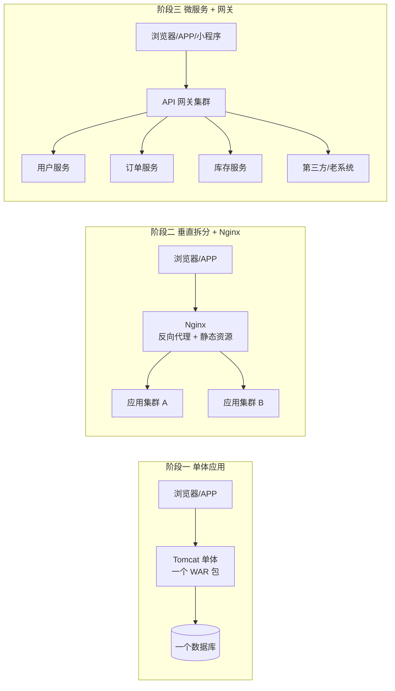

演进的三次驱动力，务必能讲清楚：

1. **单体 → 集群**：一台机器扛不住，需要多实例。此时出现"负载均衡"诉求，Nginx / LVS 出现。此时还不需要"网关"，因为只有一个应用，横切逻辑写在应用里就行。
2. **集群 → 垂直拆分**：不同业务模块拆成不同应用（用户、订单、商品）。此时出现**第一个真问题**：客户端要知道 N 个域名；N 个应用要各自实现鉴权、限流、日志。
3. **垂直拆分 → 微服务细粒度化**：服务数量从 5 个变成 200 个。此时出现**三个致命问题**：
   - **客户端耦合**：App 发版要跟着服务拆分走，无法独立演进（移动端发版不可控）。
   - **横切逻辑重复**：鉴权在 200 个服务里写 200 遍，改一次规则要发 200 次版。
   - **流量无管控**：某个服务被打挂了，没法在入口处直接挡住。

网关就是为了解决这三件事而出现的。**注意最后一句话**：如果面试官问"注册中心不也能解决客户端耦合吗"，答案是——注册中心解决的是"服务之间"的寻址，网关解决的是"客户端到服务"的寻址 + 横切。两者是内网/外网两个平面。

## 1.3 网关的分层：流量网关、业务网关、聚合网关

这是高级面试必考的分层认知。很多人把所有网关混为一谈，答不出"Nginx 和 Gateway 为什么同时存在"。

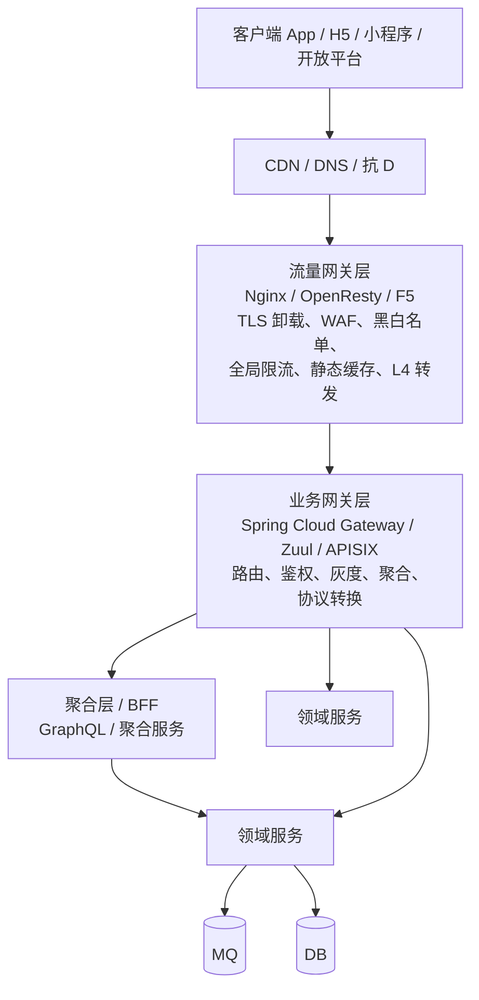

| 层次 | 典型组件 | 核心目标 | 关键指标 | 是否懂业务 |
|---|---|---|---|---|
| **流量网关 / 边缘网关** | Nginx、OpenResty、F5、Cloudflare、Envoy | 抗量、抗攻击、TLS、静态化 | QPS、连接数、P99 延迟（微秒级） | 完全不懂 |
| **业务网关 / API 网关** | Spring Cloud Gateway、Zuul、APISIX、Kong、Higress | 路由 + 鉴权 + 灰度 + 聚合 + 协议转换 | 路由正确性、鉴权准确性、可观测性 | 懂服务拓扑，尽量不懂业务语义 |
| **聚合网关 / BFF** | 自研聚合服务、GraphQL Server | 面向端侧做数据裁剪与聚合，减少端上请求数 | 聚合 RT、端上流量 | 懂页面/业务 |
| **服务网格入口** | Istio Gateway、Envoy、MOSN | 东西向 + 南北向统一治理，mTLS、流量镜像 | 连接复用、mTLS 开销 | 不懂 |

**面试可用的金句**：流量网关解决"能不能进来、进来多少"；业务网关解决"进来之后去哪、以什么身份去"；BFF 解决"端上要几次、每次要多少字段"。

## 1.4 网关的十大职责（每一项都要能举一个生产例子）

| # | 职责 | 底层依赖 | 生产注意点 |
|---|---|---|---|
| 1 | **路由转发** | 路径/Header/方法/时间窗匹配 + 服务发现 | 路由优先级、最长前缀匹配、Path 重写 |
| 2 | **负载均衡** | 轮询/随机/加权/最小连接/一致性哈希 | 会话粘性、实例摘除、预热 |
| 3 | **认证鉴权** | JWT 验签、OAuth2/OIDC、mTLS、AK/SK | 公私钥轮换、时钟偏移、白名单放行 |
| 4 | **限流** | 令牌桶/漏桶/滑动窗口 + Redis/Lua | 集群维度而非单机维度、突发流量、限流维度（IP/UID/API/租户） |
| 5 | **熔断降级** | 断路器状态机 + 信号量/线程池隔离 | 阈值设置、半开探测、fallback 响应 |
| 6 | **灰度发布** | 权重路由、Header 染色、标签路由 | 流量比例一致性、回滚速度 |
| 7 | **协议转换** | HTTP↔gRPC/Dubbo、REST↔SOAP | 序列化损耗、流式支持 |
| 8 | **安全防护** | WAF、参数校验、防重放、防越权 | 不要指望网关做业务级越权校验 |
| 9 | **可观测性** | AccessLog、TraceId 透传、Metrics、慢日志 | W3C Trace Context、采样率、日志量成本 |
| 10 | **响应处理** | 响应改写、压缩、缓存、聚合 | 流式响应不能缓存、压缩与 SSE 冲突 |

## 1.5 网关 vs 反向代理 vs 负载均衡 vs 服务网格

这四个概念经常被混答，必须能一句话切开：

- **反向代理**：强调"代后端接收请求"这一动作（Nginx proxy_pass 就是最朴素的反代）。
- **负载均衡**：强调"把请求分给多个实例"这一算法（LVS、Nginx upstream、Ribbon）。
- **API 网关**：强调"横切治理 + 面向 API 语义的路由"（鉴权、限流、灰度、协议转换）。**网关一定包含反代和负载均衡，但反代和负载均衡不一定是网关。**
- **服务网格（Service Mesh）**：强调"东西向流量的 Sidecar 治理"，网关是它的南北向入口（Istio 的 Gateway 就是 Envoy）。

> 一个常被追问的问题："有了 Service Mesh 还需要网关吗？"
> 答：Mesh 治理的是**服务与服务之间**（东西向），网关治理的是**客户端到服务**（南北向）。两者治理对象、责任边界、协议假设都不同。Istio 的架构里也是 Envoy 既做 Sidecar 又做 Gateway，但配置面、策略面是分开的。

## 1.6 网关的性能物理极限：钱到底花在哪

网关是"每请求必经"的组件，它的每一次多余操作都会被乘以全站 QPS。所以要建立"成本直觉"：

| 操作 | 大致成本量级 | 说明 |
|---|---|---|
| 一次内存内的路径匹配 | 数百 ns | 可以忽略 |
| 一次 JWT HMAC 验签 | 几 μs ~ 几十 μs | 可接受，但别在链路上做 3 次 |
| 一次 RSA 验签 | 几十 μs ~ 数百 μs（2048 位） | **网关鉴权优先用 HMAC 或本地公钥缓存，别每次请求远程 JWKS** |
| 一次 Redis 往返 | 100 μs ~ 1 ms（同机房） | 限流若每请求 100 次 Redis，网关必死 |
| 一次跨机房调用 | 1 ms ~ 10 ms | 网关绝不该跨机房调下游 |
| 一次全量请求体 Buffer 拷贝 | 与 Body 大小线性相关 | 大 Body 场景（上传）是网关 OOM 的头号原因 |
| 一次线程上下文切换 | 1 μs ~ 5 μs | Zuul 1 的线程模型成本就在这里被放大 |

**核心结论**：网关的设计哲学是"**每请求只做常数级、微秒级的操作**"。任何 O(请求体大小)、O(远程调用) 的操作，都必须被设计成"可选 + 可关 + 有上限"。

---

# 第二章 底层基石：一次请求在内核与 Netty 中到底发生了什么

> 这一章是回答"为什么 Gateway 用 Netty 就比 Zuul 1 快"的物理依据。答不出这一层，就等于只会背结论。

## 2.1 一次 HTTP 请求的完整旅程

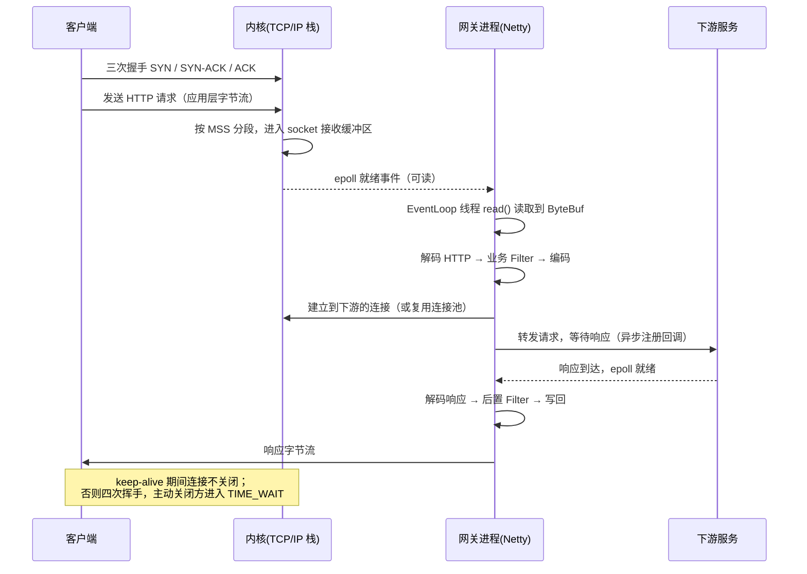

### 关键内核细节（面试加分项）

1. **socket 接收缓冲区（receive buffer）**：内核收到数据先放这里，应用不 read 就会满。缓冲区满 → 内核丢包 → 对端重传 → 表现为"网关没挂但 RT 抖动"。这就是**背压（backpressure）**的物理来源。
2. **accept 队列（backlog）**：`listen(fd, backlog)` 决定已完成三次握手但未被 accept 的连接能排多长。队列满后新连接被丢弃或 RST。**网关 `somaxconn` 与 Netty `SO_BACKLOG` 都要调**。
3. **TIME_WAIT**：主动关闭方进入，持续 2MSL（Linux 约 60s）。网关作为代理，**对客户端和对下游都是"服务端"**，正常应由客户端主动关；但网关若配置了 `Connection: close` 或下游超时主动断，就会在自己身上堆 TIME_WAIT，端口耗尽 → `Cannot assign requested address`。
4. **Nagle 算法 / TCP_NODELAY**：小包合并发送会带来最多 40ms 延迟。网关必须 `TCP_NODELAY=true`（Netty 默认已开）。
5. **keep-alive 的两个层面**：TCP 层 `SO_KEEPALIVE`（默认 2 小时，太慢）与 HTTP 层 `Keep-Alive: timeout=xx`。生产上更可靠的是**应用层心跳 + 连接池空闲检测**。

## 2.2 五种 I/O 模型：所有"高性能网关"的坐标系

```mermaid
flowchart TB
    subgraph B[阻塞 I/O]
        B1[发起 read] --> B2[线程睡眠<br/>直到数据就绪且拷贝完成]
        B2 --> B3[返回]
    end
    subgraph N[非阻塞 I/O]
        N1[发起 read] --> N2{数据就绪?}
        N2 -- 否 --> N1
        N2 -- 是 --> N3[拷贝并返回<br/>CPU 空转轮询]
    end
    subgraph M[I/O 多路复用]
        M1[select/epoll 监听多个 fd] --> M2[阻塞等待任一就绪]
        M2 --> M3[就绪后逐个 read 拷贝]
    end
    subgraph S[信号驱动 I/O]
        S1[注册 SIGIO] --> S2[内核数据就绪发信号]
        S2 --> S3[用户态 read 拷贝]
    end
    subgraph A[异步 I/O]
        A1[io_submit / IOCP] --> A2[内核完成<br/>数据+拷贝 全部就绪]
        A2 --> A3[通知用户态直接使用]
    end
```

| 模型 | 阻塞点 | 拷贝次数 | 典型实现 | 适用 |
|---|---|---|---|---|
| 阻塞 I/O | read 全程 | 2（内核→用户） | 传统 Servlet（BIO） | 连接少、逻辑简单 |
| 非阻塞 I/O | 无（轮询） | 2 | 极少单独使用 | 几乎不用 |
| **I/O 多路复用** | select/epoll | 2 | **Netty、Nginx、Redis** | **高并发网关的标准答案** |
| 信号驱动 | 无 | 2 | 罕见 | 不用 |
| 异步 I/O | 无 | 0（内核直接给结果） | Linux AIO / io_uring / Windows IOCP | 大文件、数据库 |

**关键认知**：所谓"异步非阻塞网关"，在 Linux 上绝大多数其实是 **I/O 多路复用 + 非阻塞 socket + 事件回调**（Reactor 模式），并不是真正的异步 I/O。Netty 的 `NioEventLoop` 就是 epoll。答"Netty 是真正的 AIO"是错的（Netty 有 `AioEventLoopGroup` 但生产几乎不用）。

## 2.3 epoll 为什么快：三个数据结构

```mermaid
flowchart LR
    subgraph Kernel[内核空间]
        RB[红黑树<br/>存放所有注册的 fd<br/>O(logN) 增删]
        RL[就绪链表 ready list<br/>有事件的 fd]
        CB[回调 ep_poll_callback]
    end
    APP[用户态 epoll_wait] -->|1. 检查就绪链表| RL
    APP -->|2. 为空则睡眠| WAIT[等待队列]
    NIC[网卡收包] -->|中断/软中断| CB
    CB -->|把 fd 挂到| RL
    RL -->|唤醒| WAIT
    APP -->|3. epoll_ctl 注册| RB
```

| 对比项 | select | poll | epoll |
|---|---|---|---|
| 数据结构 | 数组（fd_set，上限 1024） | 链表 | 红黑树 + 就绪链表 |
| 每次调用是否拷贝 fd 集合到内核 | 是（O(N)） | 是（O(N)） | 否（注册一次常驻，`epoll_ctl` 增删） |
| 是否轮询所有 fd 判断就绪 | 是（O(N)） | 是（O(N)） | 否（回调驱动，O(就绪数)） |
| 触发方式 | 水平触发 | 水平触发 | LT / ET 可选 |
| 适用连接数 | 少（<1024） | 中 | 万级以上 |

**LT 与 ET 的核心区别**（高频追问）：

- **LT（Level Triggered，默认）**：只要 fd 上还有数据没读完，`epoll_wait` 会**反复**返回该 fd。编程简单，不会漏事件，但可能重复唤醒。
- **ET（Edge Triggered）**：只在"状态变化"时通知一次。必须**循环 read 直到返回 EAGAIN**，否则剩余数据再也不会被通知。性能更高（减少唤醒），但编程要求严格。
- Netty 默认 **LT**（`NioEventLoop` 走 `epoll_wait`，通过 `epoll_ctl` 注册 `EPOLLIN|EPOLLOUT|EPOLLRDHUP`），因为 LT 更安全；Nginx 用 ET（读事件边缘触发 + 循环读）。

**"惊群"问题**：多个线程/进程同时 `epoll_wait` 同一个 fd，事件到来全部被唤醒但只有一个能处理。解决方案：`EPOLLEXCLUSIVE`（Linux 4.5+）、Nginx 的 `accept_mutex`、Netty 的"一个 Channel 只绑定一个 EventLoop"（从设计上避免）。

## 2.4 Reactor 三种模型：Netty 属于哪一种

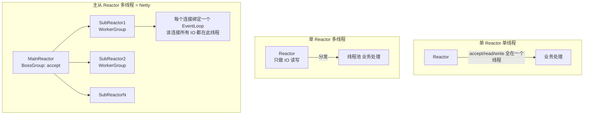

**Netty 的模型细节（必背）**：

- `bossGroup` 只负责 `accept`，`workerGroup` 负责 `read/write`。`NioEventLoopGroup` 默认线程数 = `2 * CPU 核数`（`NettyRuntime.availableProcessors() * 2`）。
- 一个 `Channel` 在生命周期内**只绑定一个 `EventLoop`**（一个 EventLoop = 一个线程 + 一个 Selector + 一个任务队列）。这带来两个结论：
  1. **单个连接的读写天然串行，无锁**；
  2. **一旦你在 EventLoop 上做阻塞操作，绑在这个 EventLoop 上的成百上千个连接全部卡住**（这是 Gateway 里"不能阻塞"的根本原因，不是"性能不好"这么轻描淡写）。
- `EventLoop` 除 IO 外还跑 `taskQueue`（普通任务）和 `scheduledTaskQueue`（定时任务）。`ctx.write()` 在非所属线程调用时会被包装成 task 投递回所属 EventLoop（**线程安全的关键**）。

## 2.5 Netty 核心组件逐个拆

### 2.5.1 Channel / Pipeline / ChannelHandler

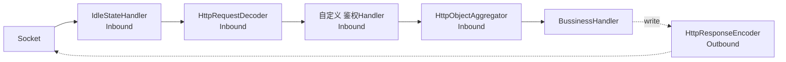

- Pipeline 是**双向链表**，Inbound 事件从 head 向 tail 传播，Outbound 从 tail 向 head 传播。
- **Inbound 与 Outbound 的顺序是相反的**。这是面试经典坑：`addLast(encoder)`（Outbound）会放在最靠近 Socket 的位置之一，编码最后执行。
- `ChannelHandlerContext` 是 handler 与 pipeline 之间的桥梁；`ctx.write()` 从当前节点往前找 Outbound，`channel.write()` 从 tail 开始。
- `@Sharable` 的 handler 必须**无状态**（不能有成员变量）。否则并发错乱。

### 2.5.2 ByteBuf：为什么不用 byte[]

| 维度 | byte[] / ByteBuffer | Netty ByteBuf |
|---|---|---|
| 读写索引 | 只有 position/limit，读写共享，需 flip() | **readerIndex / writerIndex 分离**，无需 flip |
| 扩容 | 固定容量 | 可自动扩容（`capacity` 与 `maxCapacity`） |
| 内存池 | 无 | `PooledByteBufAllocator`（jemalloc 风格 arena + thread cache） |
| 引用计数 | 无 | `refCnt`，`retain()/release()`，泄漏检测 `ResourceLeakDetector` |
| 零拷贝 | 需自己控制 | `CompositeByteBuf`、`slice()`、`duplicate()`、`wrap()` |
| 堆内外 | 手动 allocateDirect | `PooledDirectByteBuf`（默认，走直接内存） |

**引用计数是最容易出生产事故的点**：谁 `release` 谁负责。`SimpleChannelInboundHandler` 会自动 release，`ChannelInboundHandlerAdapter` 不会。多一次 `retain` 少一次 `release` → 直接内存泄漏 → `OutOfDirectMemoryError`（这个报错在网关里几乎 100% 是 handler 写错了）。

### 2.5.3 零拷贝的三种语义（必须区分）

1. **内核零拷贝（OS 层）**：
   - `sendfile`：文件 → 网卡，数据不进用户态，2 次 DMA + 0 次 CPU 拷贝（`sendfile` 老版本有 1 次 CPU 拷贝，`sendfile + DMA gather` 才真正 0 次）。
   - `mmap + write`：4 次拷贝降到 3 次（省掉内核→用户那次）。
   - `splice`：管道式零拷贝，适合代理转发。
2. **Netty 的"零拷贝"（用户态语义）**：不是 OS 的零拷贝，而是"**避免不必要的内存复制**"：`CompositeByteBuf` 逻辑合并、`slice()` 共享底层、`FileRegion`（封装 sendfile）。
3. **应用层零拷贝**：对象池化（避免 GC）、`ByteBuf` 复用。

**Gateway 场景的相关性**：大文件下载走 `FileRegion`（sendfile）可以显著降低 CPU；但 Spring Cloud Gateway 的 `NettyRoutingFilter` 用的是 Reactor Netty HttpClient，**响应体是流式 DataBuffer 转发**，本质上避免了全量聚合（前提是没开 `ModifyResponseBody` 这类全量缓冲 filter）。

### 2.5.4 内存池与分配策略

Netty 4.1 默认 `PooledByteBufAllocator`（4.1.75+ 用 `PooledByteBufAllocator.DEFAULT`，底层 jemalloc 4 的算法）：

- **Arena**：按线程绑定（`threadCache`），减少竞争；arena 数量默认 `2 * 核数`。
- **Tiny/Small/Normal/Huge** 四档规格，Tiny 用 SubPage 精细切分。
- **Chunk = 16MB**，Page = 8KB。
- **内存碎片控制**：伙伴系统 + 位图。

**为什么网关要关心这个**：网关是"高分配速率"场景（每请求 N 个 ByteBuf）。不开池化 → 每秒几百万次 allocate → GC 压力 + 直接内存抖动。生产必配：

```
-Dio.netty.allocator.type=pooled
-Dio.netty.maxDirectMemory=0        # 让 Netty 自己管，用 DirectByteBuffer 计数
-Dio.netty.leakDetection.level=paranoid   # 仅排查期开，生产用 simple
```

### 2.5.5 HashedWheelTimer：超时是怎么实现的

不要用 `ScheduledExecutorService` 给每个请求挂一个定时任务（10 万 QPS → 10 万个任务对象 + 10 万次堆操作）。Netty 的时间轮：

- 时间轮分 512 个槽（默认），每格 tickDuration=100ms，总跨度 51.2s；超过一圈的任务用 `round` 计数递减。
- 插入 O(1)，取消 O(1)（`Timeout.cancel()` 只标记）；代价是精度 = tickDuration。
- **在网关中的用途**：连接空闲检测、请求读超时、响应超时。

### 2.5.6 背压（Backpressure）：网关最容易忽略的能力

链路：`下游生产速度 > 网关消费速度 > 客户端接收速度`。三个缓冲点：下游 socket buffer、网关 ByteBuf 队列、客户端 socket buffer。任何一处堆积，最终都会变成网关内存暴涨。

Netty 的手段：

- `Channel.isWritable()` + `channelWritabilityChanged()`：写缓冲超过高水位（默认 64KB）变不可写，超过低水位（32KB）恢复。
- `AutoRead=false` + 手动 `read()`：消费端跟不上时停止读，把背压传导给上游（Reactor 的 `request(n)` 是同一思想）。
- Reactor Netty 用 `Mono`/`Flux` 的 `request(n)` 做基于需求的拉取，`Flux` 有 `limitRate`。

**这一节在面试中的价值**：能主动提到背压，说明你真调过网关，而不是只配过 yml。

## 2.6 一句话总结这一章

> 网关的高性能 = **epoll 的 O(就绪) 事件驱动** + **少量线程处理海量连接的 Reactor 模型** + **零拷贝/池化降低内存与 CPU 开销** + **背压防止内存被打爆**。
> Zuul 1 慢，不是因为它代码烂，而是因为它的模型是 `thread per request`：连接数上限 = 线程池大小，等待下游时线程在睡觉。

---

# 第三章 Zuul 全解：从 Servlet 阻塞到 Netty 异步的两次架构跃迁

> 为什么今天还要深挖 Zuul？因为面试官问"Gateway 为什么比 Zuul 快"时，如果你能讲清 Zuul 1 的线程模型缺陷 + Zuul 2 已经解决了什么 + Netflix 自己承认的收益有限，你就赢在"技术判断力"这一档。

## 3.1 Zuul 的定位与历史

- 2013 年 6 月 Netflix 开源 Zuul 1，作为其所有流媒体后端请求的"前门"（edge service）。
- 2018 年 5 月 Netflix 开源 Zuul 2（异步非阻塞重构），但**Spring Cloud 从未整合 Zuul 2**，而是自研了 Spring Cloud Gateway（2017 年启动）。
- 2019 年 Spring Cloud 官方宣布 Zuul 1 从路线图移除（Greenwich 为最后一个支持版本），Ribbon、Hystrix 同期进入维护/停更状态。

**这段历史本身就常被问**："为什么 Spring 放弃 Zuul 自己造 Gateway？"
标准答案四层：

1. **Zuul 1 是 Netflix 自家云环境（AWS）的产物**，深度绑定 Eureka/Ribbon/Hystrix，Spring Cloud 集成后发现模型不可持续（阻塞 Servlet）。
2. **Zuul 2 的架构无法直接嵌入 Spring Boot 的 Servlet 世界**，两套编程模型（Netty 原生 vs Spring MVC）无法共存，Spring 团队不愿意在框架层做这种缝合。
3. **Spring 5 有了 WebFlux**（2017 年），Reactor 提供了一套完整的响应式抽象，正好可以在 Spring 自己的生态里重建网关，且**天然非阻塞**。
4. **可扩展性诉求**：Spring 要的是"断言 + 过滤器"的声明式路由（Predicate/Filter），而不是 Zuul 那种"自己写 Filter 类往里塞"的编程式扩展（虽然两者本质一样，但前者对配置驱动、动态路由更友好）。

## 3.2 Zuul 1 架构与请求生命周期

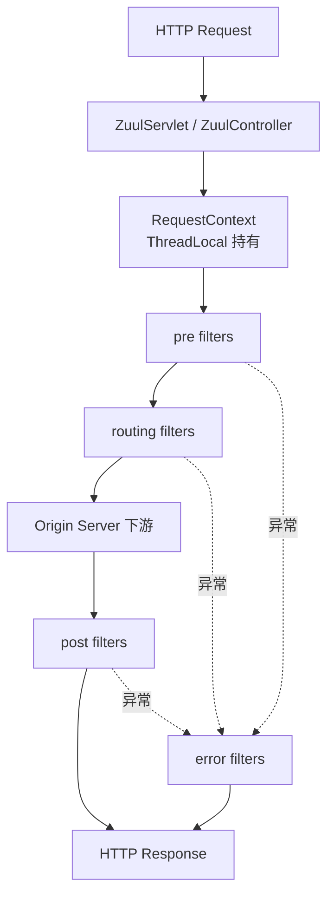

### 3.2.1 四种 Filter 类型

| 类型 | 执行时机 | 顺序 | 典型用途 |
|---|---|---|---|
| `pre` | 路由到下游**之前** | 升序（filterOrder 小的先） | 鉴权、限流、日志、请求装饰、灰度打标 |
| `routing` | 决定路由到哪 | — | 内置 `Routing`/`SimpleHostRouting`/`RibbonRoutingFilter` |
| `post` | 拿到下游响应**之后** | 升序 | 响应头加工、压缩、埋点、响应体改写 |
| `error` | 任一阶段抛异常 | — | 统一错误响应、降级 |

`ZuulFilter` 抽象类的四个必须实现的方法（这是 Zuul 源码题的高频点）：

```java
public abstract class ZuulFilter implements IZuulFilter, Comparable<ZuulFilter> {
    abstract public String filterType();        // "pre" / "routing" / "post" / "error"
    abstract public int filterOrder();          // 顺序，越小越先
    abstract public boolean shouldFilter();     // 是否执行（运行时判断，如仅对某些路径）
    abstract public Object run() throws ZuulException;  // 真正逻辑
    public boolean isStaticFilter();            // 是否静态（可缓存编译结果）
    public String filterType();
}
```

**一个非常容易答错的点**：`shouldFilter()` 与 `run()` 的区别 —— `shouldFilter()` 返回 false 时**不执行 run**，但**filter 仍然参与排序和链路**。这个设计让 Zuul 可以在运行时按请求特征决定是否启用某个 filter（比如只在灰度流量上启用某段逻辑）。

### 3.2.2 RequestContext：Zuul 的"线程内上下文"

`RequestContext` 继承自 `ConcurrentHashMap<String, Object>`（实际是 `extends HashMap` 的扩展 + ThreadLocal 绑定），核心作用：

- 在**同一次请求的所有 filter 之间共享状态**（filter 之间不直接通信）。
- 通过 `RequestContext.getCurrentContext()` 获取，内部 `ThreadLocal<RequestContext>`。
- 关键属性：`routeHost`（目标地址）、`request`/`response`、`throwable`、`responseDataStream`、`responseBody`、`filterErrors`。

**关键缺陷（Zuul 2 必须重构的原因之一）**：`ThreadLocal` 在异步模型下失效。Zuul 2 用 `SessionContext` 替代，并**显式在过滤器之间传递 context 参数**，不再依赖线程绑定。这个点在讲"为什么异步模型调试难"时是绝佳例子。

### 3.2.3 核心源码链路（Zuul 1）

```
ZuulServlet.service()
  → ZuulRunner.init()             // 绑定 RequestContext 到当前线程
  → preRoute()                    // 执行 pre filters
  → route()                       // 执行 routing filters
  → postRoute()                   // 执行 post filters
  → 异常 → error()
```

`ZuulServlet` 本身是个 `HttpServlet`，`service()` 方法是同步阻塞的：**整个链路在一个 Tomcat 线程里跑完**，包括等待下游响应。这就是所有问题的源头。

### 3.2.4 Zuul 1 的三种 RoutingFilter（重要，说明它如何与 Ribbon 协作）

| Filter | 触发条件 | 行为 |
|---|---|---|
| `SimpleHostRoutingFilter` | `routeHost` 是具体 URL（`zuul.routes.xx.url=http://...`） | 用 Apache HttpClient 直接转发，**不经过 Ribbon** |
| `RibbonRoutingFilter` | `routeHost` 为 `serviceId`（`zuul.routes.xx.serviceId=xx`） | 通过 Ribbon 从 Eureka 取实例 → 负载均衡 → 用 HttpClient 转发 |
| `SendForwardFilter` | 路径命中 `forward:` 前缀 | 内部 forward，不转发下游 |

**注意**：`SimpleHostRoutingFilter` 和 `RibbonRoutingFilter` 都基于 **Apache HttpClient 的阻塞调用**（`HttpClient.execute()`），所以 Zuul 1 是"前后端双阻塞"：Tomcat 线程阻塞在 HttpClient 上。

## 3.3 Zuul 1 的性能天花板：一次严谨的数学推演

这是面试里最容易被问到"你说 Zuul 1 慢，慢在哪、能撑多少"的地方。我们算一遍。

设：

- Tomcat `maxThreads = 200`（Spring Boot 默认就是 200，`server.tomcat.threads.max`）
- 网关自身处理耗时（路由匹配 + 过滤器）`t_g = 5ms`
- 下游平均响应时间 `t_d = 50ms`

单个请求占用线程时间 = `t_g + t_d = 55ms`（阻塞在 HttpClient 上时线程被占用）。

单实例理论最大 QPS ≈ `maxThreads / (t_g + t_d) = 200 / 0.055 ≈ 3636 QPS`。

如果 `t_d` 劣化到 500ms（下游抖动）：

`QPS ≈ 200 / 0.505 ≈ 396`。

**结论：Zuul 1 的 QPS 与下游 RT 成反比**。下游一抖动，网关线程池立刻打满，新请求排队，排队超时，形成雪崩。这也是 Netflix 当年必须发明 Hystrix 的原因——**不是因为它想做熔断，而是因为阻塞模型下慢调用会耗尽线程**。这个因果关系非常值得在面试里讲。

再对比 Gateway（Reactor Netty，默认 worker 线程 = `2 * 核数`，8 核 = 16 线程）：

- 16 个 EventLoop 线程可挂住数十万连接（受内存与 fd 限制），等待下游响应时**线程不占用**。
- 单实例 QPS 取决于 CPU（JSON 处理、TLS、filter 计算）与下游吞吐，而不是线程数。
- 实际生产 8C16G 的 Gateway 实例，简单路由场景可跑 1w~3w QPS（不含 TLS、不含重逻辑），这不是精确数字，**面试时务必强调"取决于场景，量级是万级"**，别说具体数字当真理。

**一个反直觉的事实（高分点）**：QPS 提升并不是无条件的。当 `t_g`（网关自身计算）占比高（比如复杂鉴权、加解密、响应改写）时，Gateway 的优势会被压缩到很小，因为**CPU 是共享瓶颈**。Gateway 的优势在"高连接数 + 下游 RT 抖动"场景，不在"CPU 密集"场景。

## 3.4 Zuul 2 架构：异步非阻塞重构

## 3.4.1 架构总览

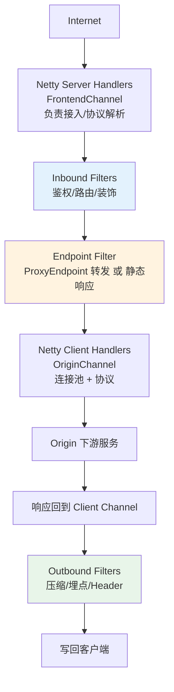

Zuul 2 与 Zuul 1 的**本质区别只有两条**（Netflix 官方说法）：

1. **前端 Netty Server 替代 Servlet** → 前端连接可以很多（不再一连接一线程）。
2. **后端 Netty Client 替代 HttpClient** → 后端调用异步化（不再一线程一等待）。

过滤器改名（语义细化）：

| Zuul 1 | Zuul 2 | 说明 |
|---|---|---|
| pre | **inbound** | 进入 Zuul、尚未转发前 |
| routing | **endpoint** | 决定"转发给谁"或"直接返回"（内置 `ProxyEndpoint`） |
| post | **outbound** | 拿到 origin 响应后、写回客户端前 |

### 3.4.2 Zuul 2 的核心组件与源码结构

```
zuul-core/
  └─ com.netflix.zuul.netty.server/
       ├─ Server                    // 启动 Netty ServerBootstrap
       ├─ ZuulServerChannelInitializer  // pipeline 装配：HttpServerCodec, HttpObjectAggregator,
       │                            //   ZuulFilterInitializer, ClientChannelManager, ...
       ├─ ClientChannelManager      // 下游连接池（每个 origin 一组连接）
       └─ OriginManager             // 管理 origin 连接集合、并发上限
  └─ com.netflix.zuul.netty.filter/
       ├─ FilterRunner              // 过滤器执行引擎（inbound/outbound 各一个）
       ├─ BaseZuulFilterRunner
       └─ ZuulFilterChainRunner     // 过滤器链，支持 sync/async 两种
  └─ com.netflix.zuul.context/
       ├─ SessionContext            // 一次请求的上下文（替代 Zuul1 的 ThreadLocal）
       └─ SessionContextDecorator
  └─ com.netflix.netty.common/
       ├─ connectionpool/           // 连接池、连接池化握手
       ├─ http/                     // HTTP/1.1、HTTP/2 编解码
       └─ status/                   // 状态机、事件
```

**`ProxyEndpoint`** 是 endpoint filter 的内置实现：它把 inbound 处理后的 `SessionContext` 交给 `ClientChannelManager`，从连接池拿一个到 origin 的 `Channel`，`write` 请求过去，并注册响应回调。**整个过程无阻塞**：拿不到连接就排队（有 `maxConnectionsPerHost` 与 `maxRequestsPerConnection` 约束）。

### 3.4.3 sync filter 与 async filter（Zuul 2 的核心创新点）

Zuul 2 的 `ZuulFilter` 接口有两个方法：

```java
public interface ZuulFilter<I, O> {
    default boolean isAsyncFilter() { return false; }
    // 同步过滤器：直接返回结果
    default O process(I input, SessionContext ctx) { ... }
    // 异步过滤器：回调式
    default void processAsync(I input, SessionContext ctx, FilterChain<I, O> next) { ... }
}
```

- **sync filter**：在 EventLoop 线程上直接执行，必须极快（不能阻塞）。适合理由同上：路由判断、Header 操作。
- **async filter**：把结果通过 `next.process()` 回调返回。适合**需要远程调用**的场景（去 Redis 验 token、去配置中心取路由）。

**这是 Zuul 2 最重要的设计方法论**：**用"显式的 sync/async 声明"来防止开发者误阻塞 EventLoop**。对比 Spring Cloud Gateway —— 它没有这种"声明式防呆"，一旦你写了个阻塞的 `GlobalFilter`，整个 EventLoop 就卡死，只能靠开发者自觉。

> 面试可讲：Zuul 2 在"防误用"上比 Gateway 更严谨，Gateway 在"生态整合"上比 Zuul 2 更强。这是设计取舍，不是优劣。

### 3.4.4 Zuul 2 的背压与连接管理（高级考点）

Zuul 2 相比 Zuul 1 增加了三样生产级能力：

1. **`OriginConcurrencyExceededException`**：当下游并发超过阈值，直接拒绝而不是无限排队——**这是"过载保护"，比超时被动失败更早**。
2. **连接池分池**：`ClientChannelManager` 按 origin（host:port）建池，支持 `maxConnectionsPerHost`、`perPoolBufferSize`。
3. **HTTP/2 支持**：`Http2FrameCodec` + 多路复用，一个连接到 origin 可承载上百个并发流，显著降低连接数。

### 3.4.5 Netflix 自己的结论（非常重要，能加分）

Netflix 在 Zuul 2 的发布博客里明确写了：

> "While we did not see a significant efficiency benefit in migrating to async and non-blocking, we did achieve the goals of connection scaling."

即：**异步化没有带来显著的效率（吞吐）提升，但达成了"连接数扩展"的目标**。

为什么会这样？因为 **CPU 仍是瓶颈**。Zuul 1 的问题是"线程数上限"，但当流量在 CPU 可承受范围内时，线程切换的开销并不构成主要成本。异步化的真正收益是：
- 连接数从"线程数 × 常数"提升到"内存决定的量级"；
- 长连接/慢客户端（移动端弱网）场景下不会被一个慢请求占死线程；
- 下游 RT 抖动时不会雪崩（因为不占线程）。

**能讲出这一层，说明你读过一手资料，而不是二手博客。**

## 3.5 Zuul 1 / Zuul 2 / Gateway 三者对比（面试标准表格）

| 维度 | Zuul 1 | Zuul 2 | Spring Cloud Gateway |
|---|---|---|---|
| 编程模型 | Servlet 同步阻塞 | Netty 异步非阻塞 | WebFlux 响应式（Reactor） |
| 前端接入 | Tomcat（thread per request） | Netty Server | Reactor Netty |
| 后端调用 | Apache HttpClient（阻塞） | Netty Client（异步 + 池化） | Reactor Netty HttpClient |
| 并发上限 | ≈ 线程池大小 | 连接数（内存/fd 决定） | 连接数（内存/fd 决定） |
| 过滤器模型 | pre/routing/post/error | inbound/endpoint/outbound，sync/async | GlobalFilter + GatewayFilter，pre/post 合一 |
| 上下文 | ThreadLocal | SessionContext（显式传递） | `ServerWebExchange`（不可变 + attributes） |
| 路由能力 | 路径 + serviceId | 路径 + 自定义 | **断言工厂（Path/Header/Method/Cookie/Host/时间/权重…）** |
| 动态路由 | 需 Eureka 刷新 + 手动 | 支持 | **`RefreshRoutesEvent` + 配置中心监听** |
| 限流 | 需自研/集成 | 需自研 | 内置 `RequestRateLimiter`（Redis + Lua） |
| 熔断 | Hystrix | 自研 | Spring Cloud CircuitBreaker（Resilience4j 等） |
| HTTP/2 | 不支持 | **支持** | 支持（下游可配） |
| WebSocket | 有限 | 支持 | 支持（`ws://`、`lb:ws://`） |
| Spring 官方支持 | 已移除 | 从未集成 | **官方推荐** |
| 社区/生态 | 停滞 | Netflix 内部为主 | 活跃 |

## 3.6 手写一个 Zuul 1 的 Filter（面试可能让你现场写）

```java
@Component
public class AuthPreFilter extends ZuulFilter {

    @Override
    public String filterType() { return "pre"; }

    @Override
    public int filterOrder() { return 0; }   // 数字越小越先执行

    @Override
    public boolean shouldFilter() {
        // 只对需要鉴权的路径生效，登录/健康检查放行
        RequestContext ctx = RequestContext.getCurrentContext();
        String uri = ctx.getRequest().getRequestURI();
        return !uri.startsWith("/auth/") && !uri.equals("/health");
    }

    @Override
    public Object run() throws ZuulException {
        RequestContext ctx = RequestContext.getCurrentContext();
        HttpServletRequest req = ctx.getRequest();

        String token = req.getHeader("Authorization");
        if (token == null || !JwtUtil.verify(token)) {
            // 关键：setSendZuulResponse(false) 阻止继续路由到下游
            ctx.setSendZuulResponse(false);
            ctx.setResponseStatusCode(HttpStatus.UNAUTHORIZED.value());
            ctx.setResponseBody("{\"code\":401,\"msg\":\"invalid token\"}");
            ctx.getResponse().setContentType("application/json;charset=UTF-8");
        } else {
            // 把用户信息透传给下游（下游无需再解 JWT）
            ctx.addZuulRequestHeader("X-User-Id", JwtUtil.getUserId(token));
        }
        return null;
    }
}
```

**三个必答细节**：
1. `ctx.setSendZuulResponse(false)` 是"短路"的唯一正确姿势；只设 status code 而不设它，请求仍会被转发。
2. `ctx.addZuulRequestHeader()` 而不是 `request.setHeader()` —— 后者在 Servlet 里对已创建的 request 无效（Zuul 用 `ZuulRequestHeaders` 包装）。
3. `filterOrder()` 是**全局**排序（跨类型也排，但每类型独立链），`-1` 常被用作"最前置"。

## 3.7 Zuul 相关的高频追问

**Q：Zuul 的 Filter 是动态加载的吗？**
A：Zuul 1 支持从 Groovy 脚本动态加载（`GroovyFilterFileManager`，7 秒扫一次目录），这是 Netflix 做"热更新规则"的手段。但它有类加载器泄漏风险，生产慎用；Spring Cloud 集成版默认关闭，改用 Spring Bean 注册。

**Q：Zuul 的 `sensitiveHeaders` 是什么？**
A：Zuul 1 默认会剥离 `Cookie`、`Set-Cookie`、`Authorization` 三个敏感头（`zuul.sensitiveHeaders`），避免把网关侧的身份信息误传给下游。这个默认值坑过很多人（透传 token 时发现下游收不到）。

**Q：Zuul 1 能改成异步吗？**
A：可以，用 Servlet 3.0 的 `AsyncContext`（`DeferredResult`）实现"前端异步"，把 Tomcat 线程提前释放。但**后端仍需异步 HttpClient**才完整，Apache HttpClient 的 `CloseableHttpAsyncClient` 可以做到。这条路径就是"不引入 Netty 也能提升连接数"，但工程复杂度很高，Spring 没走这条路。

---

# 第四章 Spring Cloud Gateway 全解：响应式网关的每一行代码

## 4.1 定位、版本与模块演进

### 4.1.1 定位

> Spring Cloud Gateway 是基于 **Spring WebFlux + Project Reactor + Reactor Netty** 构建的 API 网关，官方定位是"用一种简单但有效的方式路由到 API，并为它们提供横切关注点（安全、监控/指标、弹性）"。

它**不能跑在传统 Servlet 容器里**，也不能打成 WAR 包 —— 因为它依赖 Reactor Netty 提供的运行时。这句话是官方文档原话，面试可以直接引用。

### 4.1.2 版本演进（答题时用"版本锚点"显得专业）

| 版本线 | Spring 生态 | 关键变化 |
|---|---|---|
| 1.x | Spring Boot 1.x | 存在但更多用 Zuul；此时 Gateway 只是雏形 |
| 2.x | Spring Boot 2.0 / Spring 5 | 正式成为官方推荐，基于 WebFlux；`spring-cloud-starter-gateway` |
| 3.x | Spring Boot 2.4+ / Spring Cloud 2020.x | 引入 `spring-cloud-gateway-server`；谓词/过滤器工厂完善；`spring-cloud-starter-gateway` 拆分 |
| 4.x | Spring Boot 3.x / Spring 6 | **支持 Virtual Threads（JDK 21）**；引入 **Gateway Server MVC**（`spring-cloud-starter-gateway-mvc`，可在 Servlet 栈跑，基于 `RestClient`/`WebClient`）；`ProxyExchange` 变体 |
| 4.2+ | Spring Boot 3.4 | 官方文档明确"Server 与 ProxyExchange 两种形态，各自都有 WebFlux 与 Web MVC 版本" |
| 5.x / 最新 | Spring Boot 4 / Spring 7 | 文档提到 "Spring Framework 7, Spring Boot 4"，模块化进一步细分 |

**这里有个高频误区**："Spring Cloud Gateway 只能跑 WebFlux"。在 4.x 之后**不完全对**：`spring-cloud-gateway-server-mvc` 提供了基于 Spring MVC（Servlet/虚拟线程）的实现，适合"团队不熟悉 Reactor、或需要阻塞式组件"的场景。但**主流依然是 WebFlux 版**。答这个点能立刻区分"看过文档"和"只看过博客"。

### 4.1.3 模块结构（4.x）

```
spring-cloud-gateway/
├── spring-cloud-gateway-server/          # WebFlux 版核心（Netty + Reactor）
│   └── org.springframework.cloud.gateway
│       ├── config/          GatewayAutoConfiguration, GatewayClassPathWarningAutoConfiguration
│       ├── route/           Route, RouteDefinition, RouteLocator
│       ├── handler/         RoutePredicateHandlerMapping, FilteringWebHandler
│       ├── filter/          GlobalFilter, GatewayFilter, GatewayFilterChain, OrderedGatewayFilter
│       ├── filterfactory/   几十个 XxxGatewayFilterFactory
│       ├── predicate/       PathRoutePredicateFactory ...
│       └── route/definition/ RouteDefinitionLocator, RouteDefinitionRepository
├── spring-cloud-gateway-server-mvc/      # Servlet/虚拟线程版
├── spring-cloud-starter-gateway/          # starter（依赖 server + actuator）
└── spring-cloud-starter-gateway-mvc/      # MVC starter
```

## 4.2 三大核心概念（必须能背出字段级定义）

```java
// 简化后的 Route（org.springframework.cloud.gateway.route.Route）
public class Route implements Ordered {
    private final String id;                 // 路由唯一标识
    private final URI uri;                   // 目标地址（http:// / lb:// / ws:// / forward://）
    private final int order;                 // 路由优先级（越小越先匹配）
    private final AsyncPredicate<ServerWebExchange> predicate;   // 断言（注意是 AsyncPredicate）
    private final List<GatewayFilter> gatewayFilters;            // 路由级过滤器
    private final Map<String, Object> metadata;
}
```

**注意 `AsyncPredicate`**：Spring Cloud Gateway 的断言是**异步谓词**（返回 `Mono<Boolean>`），因为有些断言需要远程调用（比如按配置中心的路由规则判断）。这是它区别于 Zuul 的重要设计——**匹配本身也可以是异步的**。

| 概念 | 定义 | 关键类 | 类比 |
|---|---|---|---|
| **Route** | 一条转发规则 = id + uri + predicates + filters + order | `Route`、`RouteDefinition` | Nginx 的一个 `location` 块 |
| **Predicate** | 匹配条件，输入 `ServerWebExchange`，输出 `Mono<Boolean>` | `RoutePredicateFactory` 及其 20+ 实现 | Nginx `location` 的匹配表达式 |
| **Filter** | 处理逻辑，分路由级（`GatewayFilter`）与全局级（`GlobalFilter`） | `GatewayFilterFactory`、`GlobalFilter` | Servlet Filter / Nginx `rewrite`+`proxy_set_header` |

### 4.2.1 内置断言工厂清单（面试常问"你知道哪些 Predicate"）

| 断言 | 作用 | 典型场景 |
|---|---|---|
| `Path` | 路径匹配，支持 `{var}` 与 Ant 风格 | 最核心 |
| `Method` | HTTP 方法 | 读写分离（GET/POST 走不同集群） |
| `Header` / `HeaderRegexp` | 请求头存在/正则 | 灰度（`X-Gray: v2`） |
| `Query` / `QueryRegexp` | 查询参数 | 多租户（`?tenant=`） |
| `Cookie` / `CookieRegexp` | Cookie 存在/正则 | 灰度（Cookie 打标） |
| `Host` / `HostRegexp` | Host 头 | 多域名共用网关 |
| `RemoteAddr` | 客户端 IP（CIDR） | 内网接口只允许办公网 |
| `Weight` | 按权重分组路由 | **灰度流量比例** |
| `After` / `Before` / `Between` | 时间窗 | 活动期间切流、停机维护 |
| `XForwardedRemoteAddr` | XFF 中的 IP | 有 LB 在前时取真实 IP |
| `CloudFoundryRouteService` | 特定平台 | 忽略 |

**组合语义**：多个 predicate 之间是 **AND**（全部满足才匹配），需要 OR 就配多条 route（或用 `Weight` 分组 + `XxxRoutePredicateFactory` 自定义）。

### 4.2.2 YAML 与 Java DSL 两种写法

```yaml
spring:
  cloud:
    gateway:
      routes:
        - id: order-route
          uri: lb://order-service
          order: 1                      # 越小优先级越高
          predicates:
            - Path=/api/order/**
            - Method=GET,POST
          filters:
            - StripPrefix=1             # /api/order/1 -> /order/1
            - AddRequestHeader=X-From, gateway
            - name: RequestRateLimiter
              args:
                redis-rate-limiter.replenishRate: 100   # 每秒补充令牌
                redis-rate-limiter.burstCapacity: 200   # 桶容量
                key-resolver: "#{@userKeyResolver}"
            - name: CircuitBreaker
              args:
                name: orderCb
                fallbackUri: forward:/fallback/order
```

```java
@Configuration
public class GatewayConfig {

    @Bean
    public RouteLocator customRoutes(RouteLocatorBuilder builder) {
        return builder.routes()
            .route("order-route", r -> r
                .path("/api/order/**")
                .and().method(HttpMethod.GET, HttpMethod.POST)
                .filters(f -> f
                    .stripPrefix(1)
                    .addRequestHeader("X-From", "gateway")
                    .circuitBreaker(c -> c.setName("orderCb")
                                        .setFallbackUri("forward:/fallback/order"))
                    .retry(config -> config.setRetries(2)
                                          .setSeries(HttpStatus.Series.SERVER_ERROR)))
                .uri("lb://order-service"))
            .route("gray-v2", r -> r
                .path("/api/recommend/**")
                .and().weight("v2-group", 20)   // 20% 流量
                .uri("lb://recommend-v2"))
            .route("gray-v1", r -> r
                .path("/api/recommend/**")
                .and().weight("v1-group", 80)
                .uri("lb://recommend-v1"))
            .build();
    }
}
```

**`lb://` 的本质**（高频追问）：它不是真实协议，是一个**标记**。`RouteToRequestUrlFilter` 会把 `lb://order-service/api/order/1` 变成带 scheme 的 URI，然后 `ReactiveLoadBalancerClientFilter` 检测到 scheme 是 `lb`，调用 `ReactorServiceInstanceLoadBalancer.choose()` 得到 `ServiceInstance`，把 host/port 替换进去，最终变成 `http://10.0.1.23:8080/order/1`。

## 4.3 请求全链路：从网卡到响应（源码级）

这是整个第四章最有价值的部分，务必能按顺序讲出**类名 + 职责 + 关键方法**。

### 4.3.1 全景时序图

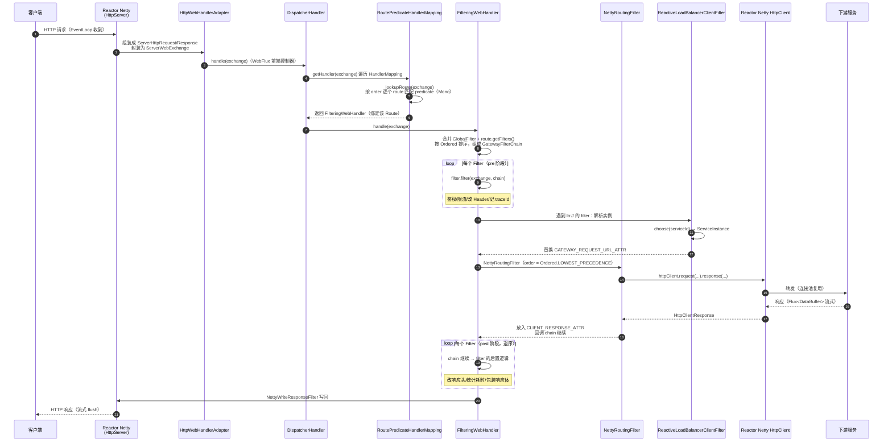

### 4.3.2 逐层拆解（含关键类与方法）

#### 第 0 层：Reactor Netty 接入

- `NettyReactiveWebServerFactory` 创建 `HttpServer`。
- `ReactorHttpHandlerAdapter` 把 Netty 的 `HttpServerRequest/Response` 适配成 Reactor 的 `HttpServerRequest/Response`。
- `HttpWebHandlerAdapter` 再适配成 Spring 的 `ServerHttpRequest/ServerHttpResponse`，并创建 `DefaultServerWebExchange`。
- **关键点**：`ServerWebExchange` 是**贯穿全链路的上下文**（相当于 Zuul 的 RequestContext），它包含 request、response、attributes（`Map<String,Object>`）、`Principal`、`FormData` 等。它是**不可变对象**（`mutate()` 返回新的 builder 构造的副本），这是响应式编程的"不可变性"要求。

#### 第 1 层：DispatcherHandler

WebFlux 的"前端控制器"，等价于 MVC 的 `DispatcherServlet`。它依次询问所有 `HandlerMapping`：

```java
// DispatcherHandler.handle()
return Flux.fromIterable(this.handlerMappings)
    .concatMap(mapping -> mapping.getHandler(exchange))
    .next()                       // 取第一个匹配的
    .switchIfEmpty(createNotFoundError())
    .flatMap(handler -> invokeHandler(exchange, handler))
    ...
```

#### 第 2 层：RoutePredicateHandlerMapping（核心！）

```java
public class RoutePredicateHandlerMapping extends AbstractHandlerMapping {

    private final FilteringWebHandler webHandler;
    private final RouteLocator routeLocator;

    @Override
    protected Mono<?> getHandlerInternal(ServerWebExchange exchange) {
        // 1. 从 RouteLocator 拿到所有路由（已按 order 排序，Flux）
        // 2. 逐个匹配 predicate（AsyncPredicate，返回 Mono<Boolean>）
        // 3. 第一个匹配上的即为选中路由，放入 exchange attributes
        return this.routeLocator.getRoutes()
            .concatMap(route -> Mono.just(route).filterWhen(r ->
                    r.getPredicate().apply(exchange)
                     .doOnError(e -> ...)
                     .onErrorReturn(false)))
            .next()
            .flatMap(route -> {
                exchange.getAttributes().put(GATEWAY_ROUTE_ATTR, route);   // 关键！
                return Mono.just(this.webHandler);
            });
    }

    @Override
    protected int getOrder() { return 1; }   // 优先级高于默认的 RequestMappingHandlerMapping(0)
}
```

**三个必须记住的点**：

1. `getOrder() = 1`，比 `RequestMappingHandlerMapping` 的 0 更高优先级 —— 所以网关的路由匹配先于普通 Controller 匹配。
2. 匹配成功后把 `Route` 塞进 `exchange.getAttributes().put(GATEWAY_ROUTE_ATTR, route)`，后续所有 filter 都从这里取。
3. 匹配是**短路**的：`next()` 取第一个满足的路由，后续不再匹配。所以 **route 的 `order` 是决定性的**，配错 order 会出现"路由永远命中不到"的诡异问题。

#### 第 3 层：FilteringWebHandler —— 过滤器链的组装

```java
public class FilteringWebHandler implements WebHandler {

    private final List<GlobalFilter> globalFilters;

    @Override
    public Mono<Void> handle(ServerWebExchange exchange) {
        Route route = exchange.getRequiredAttribute(GATEWAY_ROUTE_ATTR);
        List<GatewayFilter> gatewayFilters = route.getFilters();

        // 1. GlobalFilter 包装成 GatewayFilter（order 默认 0 或自定义）
        List<GatewayFilter> combined = new ArrayList<>(this.globalFilters);
        combined.addAll(gatewayFilters);
        // 2. 按 Ordered 排序
        AnnotationAwareOrderComparator.sort(combined);
        // 3. 组成链并执行
        return new DefaultGatewayFilterChain(combined).filter(exchange);
    }
}
```

**`DefaultGatewayFilterChain` 的精髓**（这是理解"pre/post 顺序相反"的关键）：

```java
private static class DefaultGatewayFilterChain implements GatewayFilterChain {
    private final int index;
    private final List<GatewayFilter> filters;

    @Override
    public Mono<Void> filter(ServerWebExchange exchange) {
        return Mono.defer(() -> {
            if (this.index < filters.size()) {
                GatewayFilter filter = filters.get(this.index);
                DefaultGatewayFilterChain chain = new DefaultGatewayFilterChain(this, this.index + 1);
                return filter.filter(exchange, chain);   // 递归：filter 内部决定何时调 chain.filter()
            }
            return Mono.empty();   // 链尾
        });
    }
}
```

**为什么 pre 升序、post 逆序？**
因为整个链是"**洋葱模型**"：`filter.filter(exchange, chain)` 里，`chain.filter(exchange)` 之前的代码是 pre 逻辑，`.then(...)` 之后是 post 逻辑。order 小的 filter 先进入 → 它的 pre 先执行；但它 `.then()` 里挂的 post 逻辑会**等后面的 filter 全部完成**才执行 → 所以 post 是逆序。这和 Servlet Filter 的 `chain.doFilter()` 前后是完全一样的模型。

> 面试题："Gateway 的过滤器能像 Zuul 那样分 pre 和 post 吗？"
> 答：不能显式分。**Gateway 只有一个 Filter 接口，pre/post 是通过在 `filter()` 方法里"链调用前/后"的代码位置来天然实现的**。这也是为什么很多人写 GlobalFilter 时踩坑——把 post 逻辑写在 `chain.filter()` 之前，就变成了 pre。

#### 第 4 层：内置 GlobalFilter 的执行顺序（重要！）

Spring Cloud Gateway 的内置 GlobalFilter 及其 order（**必须能说出至少 5 个**）：

| Order | GlobalFilter | 作用 |
|---|---|---|
| `HIGHEST_PRECEDENCE` (-2147483648) | `AdaptCachedBodyGlobalFilter` | 缓存请求体（配合 `CacheRequestBody`） |
| `-1` | `RemoveCachedBodyFilter` | 结束时清理缓存的 body |
| `0` | `NettyWriteResponseFilter` | 把下游响应写回客户端（**实际在链尾执行**） |
| `1` | `ForwardPathFilter` | 处理 `forward:` 路径 |
| `2` | `GatewayMetricsFilter` | 采集 metrics（`spring.cloud.gateway.metrics.enabled`） |
| `3` | `RouteToRequestUrlFilter` | **把 route 的 uri 合入请求 URL**（`lb://` → 带 scheme） |
| `4` | `ReactiveLoadBalancerClientFilter` | **`lb://` 的服务发现 + 负载均衡** |
| `5` | `WebsocketRoutingFilter` | `ws://` / `wss://` |
| `6` | `NettyRoutingFilter` | **真正发 HTTP 请求（order = LOWEST_PRECEDENCE）** |
| ... | `ForwardRoutingFilter`、`GatewayMetricsFilter` | |
| `LOWEST_PRECEDENCE` (2147483647) | `NettyRoutingFilter` / `WebClientHttpRoutingFilter` | 最后一个执行 |

**一个高频追问**："为什么 `NettyRoutingFilter` 的 order 是 `LOWEST_PRECEDENCE`？"
答：因为它要等所有前置 filter 处理完（鉴权、改 header、LB 解析）才发起真正的转发；它必须是 pre 阶段的最后一个。

#### 第 5 层：NettyRoutingFilter —— 真正的转发

```java
public class NettyRoutingFilter implements GlobalFilter, Ordered {

    private final HttpClient httpClient;   // Reactor Netty HttpClient（全局单例，带连接池）

    @Override
    public Mono<Void> filter(ServerWebExchange exchange, GatewayFilterChain chain) {
        URI requestUrl = exchange.getRequiredAttribute(GATEWAY_REQUEST_URL_ATTR);
        String scheme = requestUrl.getScheme();
        if (isAlreadyRouted(exchange) || !("http".equals(scheme) || "https".equals(scheme))) {
            return chain.filter(exchange);      // 不是 http，交给别的 filter
        }
        setAlreadyRouted(exchange);

        HttpMethod method = exchange.getRequest().getMethod();
        // 关键：把 ServerHttpRequest 的 headers/body 适配成 Reactor Netty 的请求
        return this.httpClient.request(method, requestUrl, req -> {
                // 复制 headers（注意 Hop-by-Hop 头会被过滤）
                // body 用 Flux<DataBuffer> 流式写，不做全量缓冲
                return req.headers(...).send(exchange.getRequest().getBody());
            })
            .response(response -> {
                // 把响应写入 exchange
                exchange.getAttributes().put(CLIENT_RESPONSE_ATTR, response);
                // 复制响应头、status
                return Mono.just(response);
            })
            .then(chain.filter(exchange))          // ★ pre 结束，进入后续（实际是写响应）
            .then(Mono.fromRunnable(() -> {
                // post 逻辑：把响应 body 刷给客户端
            }));
    }

    @Override
    public int getOrder() { return Ordered.LOWEST_PRECEDENCE; }
}
```

**注意 `HttpClient` 的三种实现**（4.x 支持）：

| 实现 | 类 | 说明 |
|---|---|---|
| Reactor Netty（默认） | `ReactorNettyHttpClient` | 性能最好，与 WebFlux 同栈 |
| JDK HttpClient | `JdkHttpClient` | 无需 Netty，JDK 11+ |
| Jetty HttpClient | `JettyHttpClient` | 特定场景 |

通过 `spring.cloud.gateway.httpclient.type=netty|jdk|jetty` 切换。

#### 第 6 层：NettyWriteResponseFilter —— 写回响应

```java
public class NettyWriteResponseFilter implements GlobalFilter, Ordered {
    @Override
    public Mono<Void> filter(ServerWebExchange exchange, GatewayFilterChain chain) {
        return chain.filter(exchange).then(Mono.defer(() -> {
            HttpClientResponse clientResponse = exchange.getAttribute(CLIENT_RESPONSE_ATTR);
            if (clientResponse == null) return Mono.empty();
            ServerHttpResponse response = exchange.getResponse();
            // 关键：用 Flux<DataBuffer> 流式写出，不聚合整个 body
            return response.writeWith(clientResponse.body()
                .map(dataBuffer -> {
                    // 若响应需要压缩/改写，在这里插
                    return dataBuffer;
                }))
                .doOnCancel(() -> close(clientResponse));
        }));
    }
    @Override
    public int getOrder() { return NettyWriteResponseFilter.WRITE_RESPONSE_FILTER_ORDER; } // 通常 -1
}
```

**这里有个深刻的设计点**：`NettyWriteResponseFilter` 的 order 是 `-1`（很小），但它的逻辑写在 `chain.filter().then(...)` 里，所以**实际执行时机是全链之后**。这再次印证"order 只决定进入顺序，不决定完成顺序"。

## 4.4 路由定义与动态刷新机制

### 4.4.1 RouteDefinition 与 RouteLocator 的关系

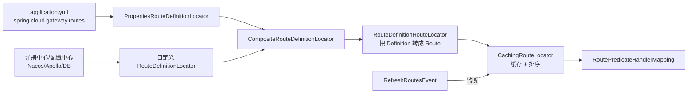

关键类与职责：

| 类 | 职责 |
|---|---|
| `RouteDefinition` | 配置层模型（id、uri、predicates 字符串列表、filters） |
| `RouteDefinitionLocator` | 从某个源读取 `RouteDefinition`（`Flux<RouteDefinition>`） |
| `PropertiesRouteDefinitionLocator` | 从 yml 读 |
| `DiscoveryClientRouteDefinitionLocator` | 从注册中心（Eureka/Consul/Nacos）自动生成路由（`spring.cloud.gateway.discovery.locator.enabled=true`） |
| `RouteDefinitionRouteLocator` | **把 Definition 转成 Route**：解析 predicate/filter 工厂，构造 `AsyncPredicate` 与 `GatewayFilter` |
| `CachingRouteLocator` | 缓存 Route 列表，按 order 排序，监听刷新事件 |
| `RouteLocator` | 对外统一接口 `Flux<Route> getRoutes()` |

### 4.4.2 动态路由刷新的三种路径

**路径 A：Spring Cloud Context 的 RefreshScope（最常用）**

```java
// 配置中心（Nacos/Config Server）推送变更 → 发布 EnvironmentChangeEvent
// → RefreshScope 重新绑定 @ConfigurationProperties(prefix="spring.cloud.gateway") 
// → 触发 RefreshRoutesEvent → CachingRouteLocator 清缓存
@EventListener(RefreshRoutesEvent.class)
public void onRefresh() { this.cachedRoutes = null; }
```

**路径 B：自定义 RouteDefinitionRepository + 手动触发**

```java
@Component
public class NacosRouteDefinitionRepository implements RouteDefinitionRepository {

    private final ApplicationEventPublisher publisher;

    // 从 Nacos 监听路由配置，变更时写入本地并发布刷新事件
    @Override
    public Flux<RouteDefinition> getRouteDefinitions() {
        return Flux.fromIterable(localCache.values());
    }

    @Override
    public Mono<Void> save(Mono<RouteDefinition> route) { ... }

    @Override
    public Mono<Void> delete(Mono<String> routeId) { ... }

    public void onNacosChange(String dataId, String data) {
        // 解析 YAML/JSON → 更新 localCache
        publisher.publishEvent(new RefreshRoutesEvent(this));  // 关键
    }
}
```

**路径 C：`@RefreshScope` + Actuator 手动刷新**

```
POST /actuator/refresh
```
（注意：这是 Spring Cloud 2020 之前的方式，之后有 `gateway` 的 `/actuator/gateway/refresh` 端点，需要开 `management.endpoints.web.exposure.include=gateway`）

### 4.4.3 一个非常隐蔽的坑（生产级）

**问题**：改了路由配置，`RefreshRoutesEvent` 发出去了，但路由没生效。
**原因排查清单**：

1. `RouteDefinitionRepository` 是自定义实现时，`getRouteDefinitions()` 返回的是**缓存快照的引用**，如果返回的是同一个 `Flux` 对象，`CachingRouteLocator` 会认为没变化。
2. `CachingRouteLocator` 的缓存是 `AtomicReference<List<Route>>`，刷新时虽然置空，但 `getRoutes()` 可能被 `RoutePredicateHandlerMapping` 在**请求开始时**就订阅了旧引用（冷启动的 Mono 缓存问题）。
3. `spring.cloud.gateway.routes` 的 yml 配置在 `RefreshScope` 下**不会**被重新绑定，因为 `GatewayProperties` 是 `@ConfigurationProperties`，需要 `refresh-enabled=true` 且配置中心真的推送了变更。
4. 集群中只有一台实例收到 Nacos 推送（Nacos 长轮询连接不均匀），**需要每台都监听**。

**最佳实践**：不要依赖框架的自动刷新，自己实现 `RouteDefinitionRepository` 并显式 `publishEvent(new RefreshRoutesEvent(this))`，同时加一个 `/internal/routes` 接口做"检查 + 强制刷新"，方便运维。

## 4.5 负载均衡：`lb://` 背后的完整机制

### 4.5.1 组件协作

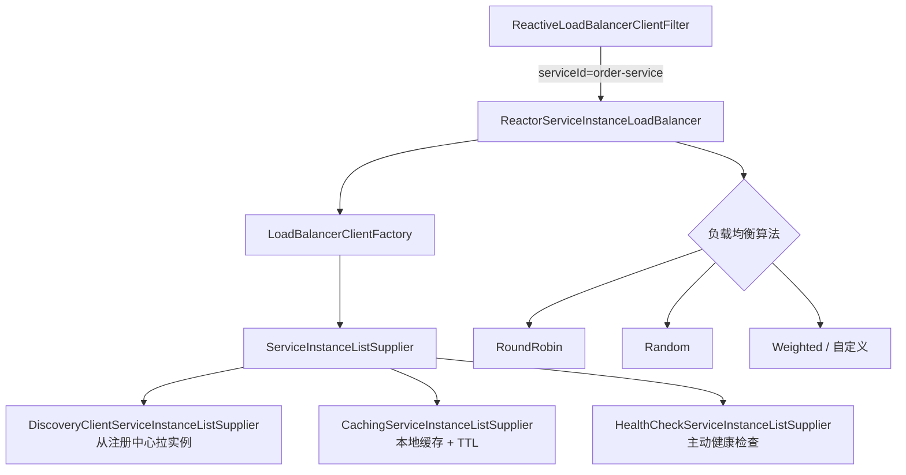

### 4.5.2 核心流程

1. `ReactiveLoadBalancerClientFilter` 取到 scheme 为 `lb` 的 URL。
2. 用 `LoadBalancerClientFactory.getInstance(serviceId)` 拿到该服务的 `ReactorServiceInstanceLoadBalancer`。
3. 调 `choose(Request)` → `Mono<Response<ServiceInstance>>`。
4. 从 `ServiceInstance` 取 `getHost()/getPort()/isSecure()`，**替换 URI 的 host/port/scheme**，写回 `GATEWAY_REQUEST_URL_ATTR`。
5. 找不到实例 → 返回 **503**（可配 `spring.cloud.gateway.loadbalancer.use404=true` 改 404）。

**注意 `isSecure()` 的覆盖规则**（一个冷门考点）：如果下游实例是 `https`，即使客户端用 http 访问网关，网关也会用 https 转发；反之亦然。这个行为由 `ServiceInstance.isSecure()` 决定，可用 `GATEWAY_SCHEME_PREFIX_ATTR` 覆盖。

### 4.5.3 负载均衡算法与实现类

| 算法 | 实现类 | 说明 |
|---|---|---|
| 轮询 | `RoundRobinLoadBalancer` | 默认，`AtomicInteger` 递增取模 |
| 随机 | `RandomLoadBalancer` | `ThreadLocalRandom` |
| 加权 | 自定义 `ReactorServiceInstanceLoadBalancer` | 需自己按 weight 分配 |
| 最少连接 | 需自研（Spring Cloud LB 无内置） | 依赖实例的实时连接数上报 |
| 一致性哈希 | 需自研 | 缓存类服务常用 |

**`RoundRobinLoadBalancer` 源码要点**：

```java
public Mono<Response<ServiceInstance>> choose(Request request) {
    ServiceInstanceListSupplier supplier = ...;
    return supplier.get(request).next()
        .map(serviceInstances -> processInstanceResponse(supplier, serviceInstances));
}

private Response<ServiceInstance> processInstanceResponse(...) {
    if (instances.isEmpty()) return new EmptyResponse();
    int pos = this.position.incrementAndGet() & Integer.MAX_VALUE;   // 位运算保证非负
    ServiceInstance instance = instances.get(pos % instances.size());
    return new DefaultResponse(instance);
}
```

**为什么用 `& Integer.MAX_VALUE` 而不是 `Math.abs()`？** 因为 `Math.abs(Integer.MIN_VALUE)` 还是负数（溢出），会导致 `pos % size` 为负 → 索引越界。这是一个极小的细节，但面试里讲出来会显得你真读过源码。

### 4.5.4 缓存与健康检查（生产必需）

```yaml
spring:
  cloud:
    loadbalancer:
      cache:
        enabled: true
        ttl: 35s                       # 缓存实例列表
      health-check:
        initial-delay: 5s
        interval: 10s
        path:
          default: /actuator/health
      configurations:
        default:
          health-check:
            interval: 25s
```

**为什么必须开缓存？** 每次请求都去注册中心拉实例列表 → 注册中心变成网关的瓶颈，且 RT 抖动。缓存 TTL 短（30~60s）+ 健康检查（10~30s）是标准配置。

**生产坑**：`HealthCheckServiceInstanceListSupplier` 会对每个实例发 `GET /actuator/health`，如果实例数 200、间隔 10s，就是 20 QPS 的探活流量 —— 不要小看，某些服务的 health 接口很重。

## 4.6 限流：`RequestRateLimiter` 的完整实现

### 4.6.1 配置与语义

```yaml
filters:
  - name: RequestRateLimiter
    args:
      redis-rate-limiter.replenishRate: 100    # 令牌补充速率（个/秒）
      redis-rate-limiter.burstCapacity: 200    # 桶容量（允许的瞬时突发）
      redis-rate-limiter.requestedTokens: 1    # 每个请求消耗几个令牌
      key-resolver: "#{@userKeyResolver}"      # 限流维度
      status-code: TOO_MANY_REQUESTS           # 429
      deny-empty-key: true                     # 取不到 key 时是否拒绝
      empty-key-status-code: FORBIDDEN
```

```java
@Bean
KeyResolver userKeyResolver() {
    return exchange -> Mono.just(
        Optional.ofNullable(exchange.getRequest().getHeaders().getFirst("X-User-Id"))
                .orElse(exchange.getRequest().getRemoteAddress().getHostString())
    );
}
```

### 4.6.2 底层：Redis + Lua 的令牌桶

```java
// RedisRateLimiter.isAllowed() 核心
String script = """
    local tokens_key = KEYS[1]        -- 令牌剩余
    local timestamp_key = KEYS[2]     -- 上次刷新时间
    local rate = tonumber(ARGV[1])    -- replenishRate
    local capacity = tonumber(ARGV[2])-- burstCapacity
    local now = tonumber(ARGV[3])
    local requested = tonumber(ARGV[4])

    local last_tokens = tonumber(redis.call('get', tokens_key) or capacity)
    local last_refreshed = tonumber(redis.call('get', timestamp_key) or 0)

    -- 按经过时间补充令牌，上限为 capacity
    local delta = math.max(0, now - last_refreshed)
    local filled_tokens = math.min(capacity, last_tokens + delta * rate)

    local allowed = filled_tokens >= requested
    local new_tokens = filled_tokens
    if allowed then new_tokens = filled_tokens - requested end

    redis.call('setex', tokens_key, 2 * math.ceil(capacity / rate), new_tokens)
    redis.call('setex', timestamp_key, 2 * math.ceil(capacity / rate), now)

    return { allowed and 1 or 0, new_tokens }
    """;
```

**必须讲清的四个技术点**：

1. **为什么用 Lua**：`GET + 计算 + SET` 三步必须原子，否则并发下令牌会被超发。Lua 脚本在 Redis 内单线程执行，天然原子。
2. **为什么 `setex` 的 TTL 是 `2 * capacity / rate`**：桶空闲超过这个时间就等价于"满桶"，key 可以过期，**避免 Redis 里堆积无数冷 key**。
3. **`replenishRate` 与 `burstCapacity` 的关系**：`burstCapacity` 应 >= `replenishRate`，否则桶装不下一秒的量，突发会被削平（官方文档明确说了这一点）。典型配置 `rate=100, burst=200`（允许 2 倍突发）。
4. **`requestedTokens`**：支持"大请求消耗更多令牌"（比如批量接口一次消耗 10 个），这是成本加权限流。

### 4.6.3 限流维度设计（架构题）

| 维度 | KeyResolver | 优缺点 |
|---|---|---|
| 单 IP | `remoteAddress` | 能防刷，但 NAT 后面会误伤 |
| 单用户 | `X-User-Id` | 最公平，但需要前置鉴权已解析出 userId |
| 单 API | `path` | 保护"重接口"，但挡不住分布式刷 |
| 单租户 | `X-Tenant` | SaaS 多租户必需 |
| 组合 | `user + path` | 精细，但 Redis key 数量爆炸 |

**生产建议**：网关做**粗粒度**（IP + API）兜底，服务内做**细粒度**（用户 + 业务语义）用 Sentinel/自研。不要把复杂限流全压在网关。

## 4.7 熔断降级：Spring Cloud CircuitBreaker 的接入

### 4.7.1 配置

```yaml
filters:
  - name: CircuitBreaker
    args:
      name: orderCb
      fallbackUri: forward:/fallback/order
```

```yaml
resilience4j:
  circuitbreaker:
    instances:
      orderCb:
        sliding-window-size: 100              # 滑动窗口请求数
        failure-rate-threshold: 50            # 失败率 50% 触发
        slow-call-rate-threshold: 80          # 慢调用比例阈值
        slow-call-duration-threshold: 2s      # 慢调用定义
        wait-duration-in-open-state: 10s      # 打开后多久进半开
        permitted-number-of-calls-in-half-open-state: 10
        minimum-number-of-calls: 20           # 窗口内至少 20 次才计算失败率
```

### 4.7.2 状态机（必背）

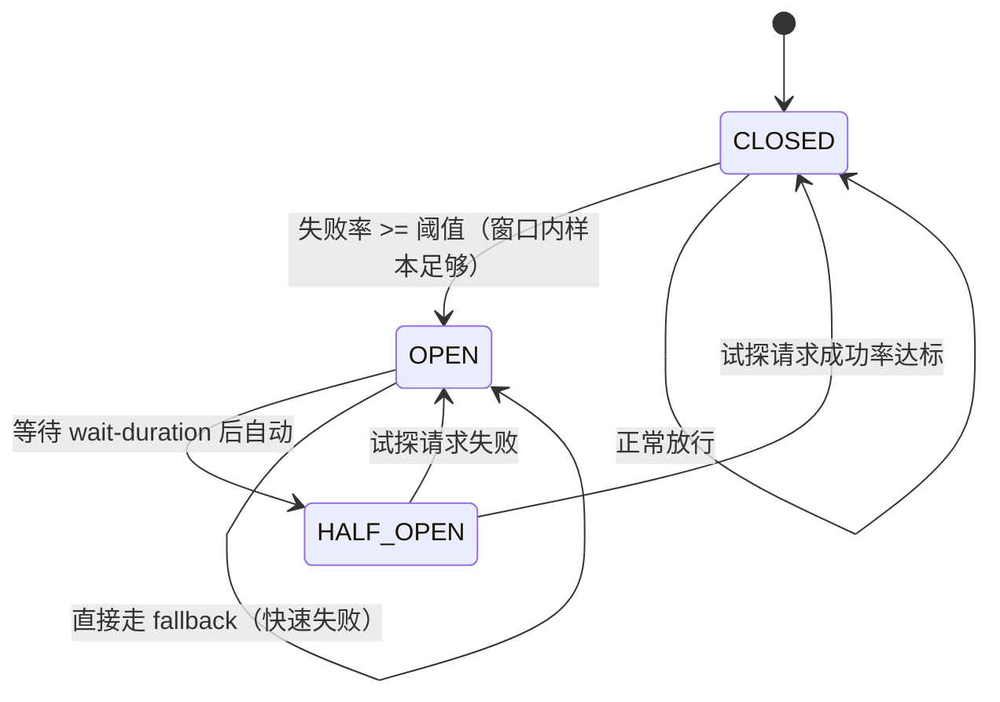

**关键实现细节**：

- `SpringCloudCircuitBreakerFilter` 的 `filter()` 里用 `ReactiveCircuitBreaker.run(mono, fallback)` 包装整条下游调用链。
- **熔断的是"整条路由的调用"，不是"某个下游接口"** —— 因为网关这一层的粒度就是路由。
- `fallbackUri: forward:/fallback/order` 会**在网关内部 forward** 到一个 Controller（不经过下游），所以网关自己要有 `/fallback/order` 的 Controller。

### 4.7.3 熔断 vs 限流 vs 超时（三者必须能区分）

| 机制 | 触发条件 | 目的 | 位置 |
|---|---|---|---|
| 限流 | 流量超过配额 | 保护自己不被压垮 | 入口 |
| 熔断 | 下游错误率/慢调用率超阈值 | 保护自己不被下游拖死（快速失败） | 出口 |
| 超时 | 单次调用超时 | 防止无限等待 | 出口 |
| 降级 | 熔断/异常后返回兜底 | 保证可用性 | 出口 |
| 隔离（舱壁） | 线程池/信号量隔离 | 防止一个下游拖垮所有 | 出口 |

**一个经典追问**："熔断打开后，fallback 返回什么？"
答：三种策略 —— ① 静态兜底（缓存数据/默认值）；② 降级到备用服务（`forward:/fallback` 里调备用集群）；③ 快速失败（返回 503 + 明确错误码，让客户端自己重试/降级）。**生产推荐 ①+③ 组合**，绝不要在 fallback 里做重试（会引发重试风暴）。

## 4.8 重试机制与"重试风暴"

```yaml
filters:
  - name: Retry
    args:
      retries: 2
      series: SERVER_ERROR          # 5xx
      methods: GET
      exceptions: java.io.IOException, java.util.concurrent.TimeoutException
      backoff:
        firstBackoff: 10ms
        maxBackoff: 50ms
        factor: 2
        basedOnPreviousValue: false
```

**`RetryGatewayFilter` 的实现原理**（源码级）：

```java
public Mono<Void> filter(ServerWebExchange exchange, GatewayFilterChain chain) {
    // 关键：把请求 body 缓存起来（否则重试时 body 已被消费，第二次为空）
    ServerHttpRequest request = exchange.getRequest();
    if (body is present) {
        // 用 ServerHttpRequestDecorator 包装，缓存 body 到 byte[]
        // 然后多次重放
    }
    return chain.filter(exchange).retryWhen(...)  // Reactor 的 retryWhen
        .onErrorResume(...)
        .then(...);
}
```

**三个生产级警告**：

1. **只对幂等方法重试**（GET/HEAD/PUT/DELETE），POST 重试可能重复下单。默认配置里 `methods=GET` 就是这个原因。
2. **必须有 backoff**，否则 3 次重试就是 3 倍流量打向下游（重试风暴）。
3. **重试与熔断的交互**：`retries=2` + 熔断窗口 100，意味着 1 次失败会算 3 次（1 原始 + 2 重试）的错误率 —— **熔断会被提前触发**。这是很多团队踩过的坑。

## 4.9 全局异常处理与统一响应

```java
@Component
@Order(-1)
public class GlobalExceptionFilter implements GlobalFilter, ErrorWebExceptionHandler {
    // 方式一：实现 ErrorWebExceptionHandler（推荐）
    @Override
    public Mono<Void> handle(ServerWebExchange exchange, Throwable ex) {
        ServerHttpResponse response = exchange.getResponse();
        response.setStatusCode(HttpStatus.OK);   // 业务错误用 200 + code
        response.getHeaders().setContentType(MediaType.APPLICATION_JSON);
        ApiResult<?> body = ApiResult.fail(mapError(ex));
        DataBuffer buffer = response.bufferFactory()
            .wrap(objectMapper.writeValueAsBytes(body));
        return response.writeWith(Mono.just(buffer));
    }
}
```

**关键点**：`ErrorWebExceptionHandler` 是 WebFlux 的全局异常处理入口，优先级高于 `@ControllerAdvice`（后者只处理 Controller 内异常，不处理 filter 链上的异常）。网关的异常大多发生在 filter 链，所以**必须用 `ErrorWebExceptionHandler`**。

**常见异常映射表**：

| 异常 | HTTP | 业务码 |
|---|---|---|
| `ResponseStatusException(404)` | 404 | 40400 |
| `NotFoundException`（路由未匹配） | 404 | 40401 |
| `TimeoutException` | 504 | 50400 |
| `ConnectException` | 502 | 50200 |
| `DataBufferLimitException` | 500（实际应 413） | 41300 |
| `RedisConnectionFailureException` | 503 | 50300 |

## 4.10 自定义 GlobalFilter 实战三件套（面试必写）

### 4.10.1 统一鉴权 + 用户信息透传

```java
@Component
public class AuthGlobalFilter implements GlobalFilter, Ordered {

    private static final PathPatternParser PARSER = PathPatternParser.defaultInstance;

    @Override
    public Mono<Void> filter(ServerWebExchange exchange, GatewayFilterChain chain) {
        String path = exchange.getRequest().getURI().getPath();

        // 1. 白名单（用 AntPathMatcher 或 PathPattern 匹配）
        if (isWhitelisted(path)) return chain.filter(exchange);

        // 2. 取 token
        String token = exchange.getRequest().getHeaders().getFirst("Authorization");
        if (token == null) return unauthorized(exchange, "missing token");

        // 3. 验签（本地公钥，不远程调）
        JwtPayload payload;
        try {
            payload = JwtUtil.verify(token);
        } catch (Exception e) {
            return unauthorized(exchange, "invalid token");
        }

        // 4. 透传给下游：用 mutate 构造新 request（不可变对象）
        ServerHttpRequest mutated = exchange.getRequest().mutate()
            .header("X-User-Id", payload.getUserId())
            .header("X-Tenant-Id", payload.getTenantId())
            .build();

        // 5. 把用户信息放进 attributes，供后续 filter / 日志使用
        exchange.getAttributes().put("userId", payload.getUserId());

        return chain.filter(exchange.mutate().request(mutated).build());
    }

    private Mono<Void> unauthorized(ServerWebExchange exchange, String msg) {
        ServerHttpResponse resp = exchange.getResponse();
        resp.setStatusCode(HttpStatus.UNAUTHORIZED);
        resp.getHeaders().setContentType(MediaType.APPLICATION_JSON);
        byte[] bytes = ("{\"code\":401,\"msg\":\"" + msg + "\"}").getBytes(StandardCharsets.UTF_8);
        return resp.writeWith(Mono.just(resp.bufferFactory().wrap(bytes)));
    }

    @Override
    public int getOrder() { return -100; }   // 必须在 NettyRoutingFilter 之前
}
```

**三个必须强调的设计点**：

1. **`exchange.mutate().request(newRequest).build()`** 而不是直接改 `exchange.getRequest()` —— `ServerHttpRequest` 是只读的，`mutate` 返回 `ServerHttpRequest.Builder`，构造新对象。这是响应式不可变设计的直接体现。
2. **鉴权必须放行"预检请求"（OPTIONS）**，否则 CORS 全挂。
3. **不要在 filter 里做远程调用验 token**（每次请求一次 Redis/认证服务会成瓶颈）。用本地公钥验签 + 短期缓存（Caffeine，TTL 与 token 有效期对齐）。

### 4.10.2 全链路 TraceId

```java
@Component
public class TraceIdFilter implements GlobalFilter, Ordered {

    public static final String TRACE_ID = "X-Trace-Id";

    @Override
    public Mono<Void> filter(ServerWebExchange exchange, GatewayFilterChain chain) {
        String traceId = exchange.getRequest().getHeaders().getFirst(TRACE_ID);
        if (StringUtils.isBlank(traceId)) {
            traceId = UUID.randomUUID().toString().replace("-", "");
        }
        String finalTraceId = traceId;

        // ★ 响应式链路必须用 Reactor Context 传递，不能用 ThreadLocal
        ServerHttpRequest req = exchange.getRequest().mutate()
            .header(TRACE_ID, finalTraceId).build();
        exchange.getResponse().getHeaders().set(TRACE_ID, finalTraceId);

        return chain.filter(exchange.mutate().request(req).build())
            .contextWrite(ctx -> ctx.put("traceId", finalTraceId));  // Reactor 3.4+ Context
    }

    @Override
    public int getOrder() { return -200; }
}
```

**为什么必须用 `contextWrite` 而不是 `ThreadLocal`？**
因为一个请求的 filter 链可能在不同线程上执行（`publishOn`、`subscribeOn`、Netty EventLoop 切换）。`ThreadLocal` 在异步模型下**不可靠**（Zuul 2 就是因为这个放弃了 ThreadLocal）。Reactor 3.4+ 提供 `Context`，通过 `contextWrite` 写入、`deferContextual` 读取，是响应式链路的正确做法。

**补充两条生产实践**：
- 采样率：全量 TraceId 只是"串联日志"，真正上报 SkyWalking/Zipkin 要按比例采样（1%~10%）。
- W3C Trace Context 标准：`traceparent: 00-<trace-id>-<span-id>-01`，跨语言/跨厂商统一，比自定义 `X-Trace-Id` 更通用。

### 4.10.3 统一响应包装（慎用！）

```java
@Component
public class ResponseWrapperFilter implements GlobalFilter, Ordered {
    @Override
    public Mono<Void> filter(ServerWebExchange exchange, GatewayFilterChain chain) {
        ServerHttpResponseDecorator decorator = new ServerHttpResponseDecorator(exchange.getResponse()) {
            @Override
            public Mono<Void> writeWith(Publisher<? extends DataBuffer> body) {
                // 危险：把 Flux 聚合为一个整体 → 破坏流式、占内存
                return super.writeWith(DataBufferUtils.join(body).map(buf -> {
                    byte[] bytes = new byte[buf.readableByteCount()];
                    buf.read(bytes);
                    DataBufferUtils.release(buf);
                    ApiResult<Object> result = ApiResult.ok(new String(bytes));
                    return getDelegate().bufferFactory()
                        .wrap(objectMapper.writeValueAsBytes(result));
                }));
            }
        };
        return chain.filter(exchange.mutate().response(decorator).build());
    }
    @Override
    public int getOrder() { return -1; }
}
```

**必须警告的三点**（面试中能说出这些，比会写这段代码更值钱）：

1. `DataBufferUtils.join()` 会**把整个响应体聚合成一个 DataBuffer**，大文件/流式响应会直接 OOM。**只对 `application/json` 且小于 N KB 的响应做包装**，其余直接透传。
2. 会破坏 `SSE`、`gRPC-Web`、`WebSocket`、分块传输。
3. 应该用 `writeWith` + 判断 `Content-Type` + 判断 `Content-Length`（> 阈值直接 `super.writeWith(body)` 透传）。

## 4.11 线程模型与"不能阻塞"的物理原因

### 4.11.1 线程全景

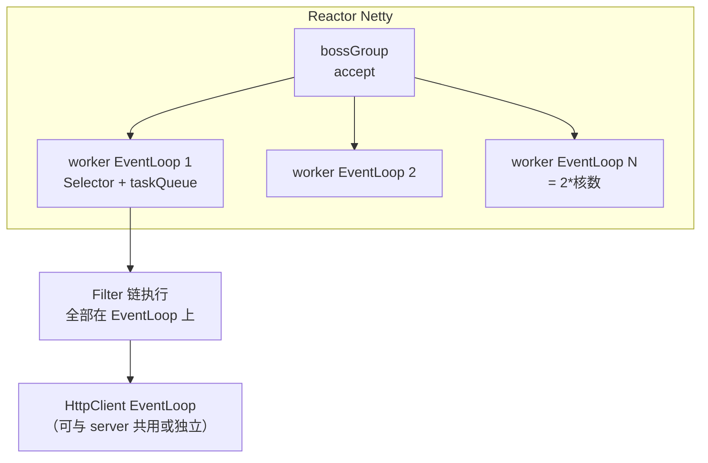

- Reactor Netty 的 `HttpServer` 与 `HttpClient` 默认**共用同一个 `LoopResources`**（即同一组 EventLoop 线程）。这意味着：**转发下游的 IO 与接收上游的 IO 在同一批线程上**。
- 所以一旦某个 filter 里写了 `Thread.sleep(100)` 或一次 JDBC 查询，**卡死的不只是这个请求**，而是这个 EventLoop 上挂着的所有连接（可能几千个）。
- 这就是为什么 Gateway 里"阻塞"是**致命错误**，而不是"性能稍差"。

### 4.11.2 确实需要阻塞怎么办（正确做法）

```java
// 错误：直接阻塞 EventLoop
String data = restTemplate.getForObject(url, String.class);   // 灾难

// 正确 1：把阻塞调用切到弹性线程池
return Mono.fromCallable(() -> blockingCall())
           .subscribeOn(Schedulers.boundedElastic())
           .flatMap(result -> chain.filter(exchange));

// 正确 2：用异步客户端（推荐）
return webClient.get().uri(url).retrieve().bodyToMono(String.class)
           .flatMap(result -> chain.filter(exchange));

// 正确 3：publishOn 切换后续处理线程
return chain.filter(exchange)
           .publishOn(Schedulers.boundedElastic());
```

**`Schedulers.boundedElastic()` 是什么？**
- 为阻塞任务设计的调度器：线程数上限 = `10 * CPU 核数`，队列上限 100K（默认），**线程空闲 60s 回收**。
- 与 `Schedulers.parallel()`（固定 = CPU 核数，只适合 CPU 密集）区分。**这是 Reactor 调度器的必考点**。

### 4.11.3 `publishOn` vs `subscribeOn`（高频）

| | `subscribeOn` | `publishOn` |
|---|---|---|
| 作用位置 | 影响**源**（订阅发生在哪个线程） | 影响**下游操作符**（后续在哪个线程） |
| 在链中的位置 | 只有最靠前的有效（多次调用只第一个生效） | 可以多次，每次影响后续 |
| 典型用途 | `Mono.fromCallable(...).subscribeOn(boundedElastic())` | `chain.filter().publishOn(...)` |

## 4.12 内存与背压：网关 OOM 的四大根因

| 根因 | 机制 | 解决 |
|---|---|---|
| **请求体全量缓冲** | `CacheRequestBody`、`ModifyRequestBody`、`Retry`（缓存 body）把 body 读进内存 | 限制 `maxInMemorySize`；大 Body 路由不加这些 filter |
| **响应体全量缓冲** | `ModifyResponseBody`、`DataBufferUtils.join` | 只对 JSON 小响应；加 Content-Length 阈值 |
| **DataBuffer 泄漏** | 自定义 filter 里 `retain` 未 `release` | `DataBufferUtils.release()`；用 `LeakDetection` |
| **直接内存溢出** | 池化 ByteBuf 未释放 | `-Dio.netty.maxDirectMemory`；`ResourceLeakDetector.paranoid` 排查 |

**关键配置**：

```yaml
spring:
  codec:
    max-in-memory-size: 10MB      # 默认 256KB，大 body 会报 DataBufferLimitException
  cloud:
    gateway:
      httpclient:
        pool:
          max-connections: 500      # 全局最大连接
          max-idle-time: 30s
          max-life-time: 60s
        connect-timeout: 3000       # ms
        response-timeout: 10s
```

**`max-in-memory-size` 的坑**：默认 256KB。上传 1MB 的 JSON 就报 `DataBufferLimitException: Exceeded limit on max bytes to buffer`。**但这个值不能随便调大**——它是保护你的。正确做法是：大 body 的路由**不要经过任何需要读 body 的 filter**，让它纯流式透传。

## 4.13 跨域、WebSocket、SSE、大文件

### 4.13.1 CORS

```yaml
spring:
  cloud:
    gateway:
      globalcors:
        cors-configurations:
          '[/**]':
            allowedOriginPatterns: "*"        # 注意：allowedOrigins: "*" 与 allowCredentials 冲突
            allowedMethods: "*"
            allowedHeaders: "*"
            allowCredentials: true
            maxAge: 3600
        add-to-simple-url-handler-mapping: true   # 让 OPTIONS 预检也走 CORS 处理
```

**两个坑**：
1. `allowedOrigins: "*"` + `allowCredentials: true` 会被浏览器拒绝（规范禁止）。必须用 `allowedOriginPatterns`。
2. `add-to-simple-url-handler-mapping: true` 必须开，否则预检请求（OPTIONS）不会被 CORS 处理器拦截，返回 403。

### 4.13.2 WebSocket 与 SSE

```yaml
routes:
  - id: ws-route
    uri: lb:ws://chat-service       # 注意是 lb:ws://
    predicates:
      - Path=/ws/**
```

- `WebsocketRoutingFilter` 的 order 是 5，它会把 `ws://` 请求交给 Spring WebSocket 基础设施做**升级握手**，然后双向转发。
- **SSE（Server-Sent Events）**：Gateway 天生支持（流式写），但**不要**给 SSE 路由加任何"全量缓冲"filter，且必须关闭响应压缩（`gzip` 会破坏流式 flush）。
- **长连接的 `response-timeout`**：默认 10s 会**掐断 SSE/WebSocket**！必须对这类路由单独配 `response-timeout: -1`（不超时）或较大的值。

## 4.14 性能调优清单（生产可直接抄）

### JVM / 系统层

```
# 堆：网关是 IO 密集 + 少量对象，堆不用太大
-Xms4g -Xmx4g
# 直接内存：Netty 池化用直接内存，要给足
-XX:MaxDirectMemorySize=2g
# GC：低延迟优先
-XX:+UseG1GC -XX:MaxGCPauseMillis=20
# Netty
-Dio.netty.allocator.type=pooled
-Dio.netty.leakDetection.level=simple

# 内核
net.core.somaxconn=32768
net.ipv4.tcp_max_syn_backlog=16384
net.ipv4.ip_local_port_range="1024 65535"
net.ipv4.tcp_tw_reuse=1
net.ipv4.tcp_fin_timeout=15
fs.file-max=1000000
```

### 应用层

| 项 | 建议值 | 说明 |
|---|---|---|
| `spring.cloud.gateway.httpclient.connect-timeout` | 2000~3000ms | 建连超时，不能太长 |
| `response-timeout` | 按下游 P99 + 20% | 统一 10s 太粗暴，按路由配 |
| `pool.max-connections` | 200~500 | 太小会排队，太大会打爆下游 |
| `pool.max-idle-time` | 30s | 与下游 keep-alive 对齐 |
| `loadbalancer.cache.ttl` | 30~60s | 别每次请求拉注册中心 |
| `metrics.enabled` | true（采样） | 全量 metrics 有开销 |
| `max-in-memory-size` | 256KB~1MB | 除非必要不要调大 |

### 架构层（比参数更重要）

1. **网关无状态**：不写本地缓存（除路由缓存）、不做 session、不落盘。这样才能水平扩容。
2. **网关不做业务**：任何"调 A 再调 B 再拼装"的逻辑都该放 BFF，不要放网关。
3. **网关数量与下游隔离**：不同 SLA 的下游用不同网关集群（避免一个慢下游拖垮全站）。
4. **双机房/多活**：网关是最外层，必须多可用区部署，DNS 层做容灾。
5. **优雅停机**：`server.shutdown=graceful` + `spring.lifecycle.timeout-per-shutdown-phase=30s`，避免发布时打爆在途请求。

## 4.15 网关"不该做"的四件事（架构判断题必答）

| 不该做 | 为什么 | 该放哪 |
|---|---|---|
| 业务逻辑（订单校验、库存扣减） | 网关是"横切层"，业务逻辑放这里会导致**每次业务变更都要发网关**，网关变成瓶颈团队 | 领域服务 |
| 复杂数据聚合 | 聚合会引入多次下游调用 + 全量缓冲，直接破坏网关的"常数级开销"原则 | BFF / 聚合服务 |
| 业务级权限（能否看这个订单） | 网关不知道业务语义，只能做"身份认证" | 服务内部 |
| 分布式事务 | 网关不参与事务边界 | 服务编排层（Saga/TCC） |

**一句话总结**：**网关只做"与业务无关的、对所有路由都一样的"事情**。判断标准是："这段逻辑变更时，需不需要所有业务方一起评审？" 需要 → 放网关；不需要 → 放服务。

---

# 第五章 主流网关横向对比与选型

> 面试里的选型题从来不是"哪个性能好"，而是"你的约束是什么"。会答选型的人，答案里一定有"取舍"和"边界"。

## 5.1 六大主流网关的技术底座

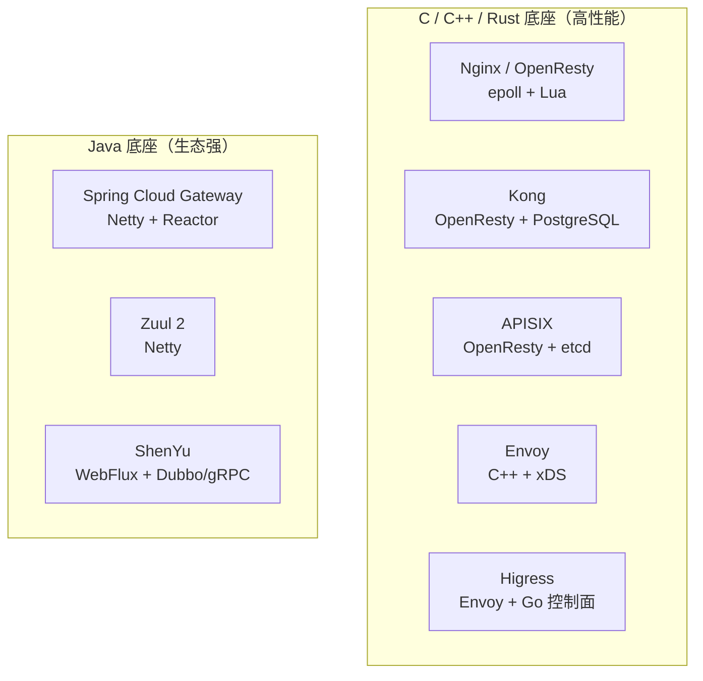

| 网关 | 语言/底座 | 配置存储 | 动态能力 | 协议支持 | 典型用户 |
|---|---|---|---|---|---|
| **Nginx** | C | 文件（reload） | 弱（需 reload） | HTTP/1.1、TCP/UDP（stream）、HTTP/2 | 几乎所有公司的最外层 |
| **OpenResty** | C + Lua | 文件 / Lua 自定义 | 中（Lua 可动态） | 同上 + 可编程 | 有定制需求的中大型 |
| **Kong** | OpenResty | PostgreSQL / Cassandra + 内存缓存 | 强（Admin API） | HTTP、gRPC、WebSocket | 海外较多 |
| **APISIX** | OpenResty | **etcd** | **很强（etcd watch 毫秒级）** | HTTP、gRPC、Dubbo、MQTT、WebSocket | 国内互联网较多 |
| **Higress** | Envoy + Go | K8s CRD / Nacos | 很强 | HTTP、gRPC、Dubbo、WebSocket、AI 代理 | 阿里云生态 |
| **Envoy** | C++ | xDS（静态/动态） | 强（xDS 增量） | L4/L7 全协议、gRPC、HTTP/3 | Service Mesh |
| **Spring Cloud Gateway** | Java / Netty | yml / 配置中心 | 中上（RefreshRoutesEvent） | HTTP、WebSocket、SSE | Spring Cloud 体系 |
| **Zuul 2** | Java / Netty | 自定义 | 中 | HTTP、HTTP/2、WebSocket | Netflix 内部 |
| **ShenYu** | Java / WebFlux | 多种（Nacos/ZK/DB/Local） | 强（admin 后台） | HTTP、Dubbo、gRPC、Motan、Sofa、Tars、MQ | 国内异构 RPC 体系 |

## 5.2 性能量级的客观认知

**先说结论，再讲为什么**：

| 网关 | 单核 QPS 量级（简单路由，无 TLS） | 延迟量级 |
|---|---|---|
| Nginx / OpenResty | 数万 ~ 十万级 | 百微秒 |
| APISIX / Kong | 数万（插件开多了会显著下降） | 百微秒 ~ 毫秒 |
| Envoy | 数万 ~ 十万级 | 百微秒 |
| Spring Cloud Gateway | 数千 ~ 数万（8 核实例，简单路由） | 毫秒 |
| Zuul 1 | 数千（受线程池限制，且随下游 RT 劣化急剧下降） | 毫秒 |

**必须强调的三条免责**（否则就是耍流氓）：

1. 这些数字依赖**硬件、包大小、TLS、filter 数量、JVM 预热、GC 配置**，不同测试差异可达 10 倍。**面试说"量级"不要说"精确值"**。
2. Java 网关的 QPS 上限主要是 **CPU（序列化/加解密/GC）** 而不是 IO；C 网关的上限是**内存带宽与 syscall 次数**。
3. **网关不是瓶颈**：在真实系统里，下游 RPC/DB 的 RT 通常是网关自身耗时的 10~100 倍。**优化网关到极致，不如优化下游 1ms**。

**那为什么大厂还要用 Java 网关？** 四个真实理由：
- **团队技术栈统一**：Java 团队维护 Java 网关，故障排查成本低。
- **业务定制成本低**：写一个 `GlobalFilter` 比写 Lua 插件对 Java 工程师友好 10 倍。
- **与 Spring Cloud 生态无缝**：注册中心、配置中心、链路追踪、Actuator 全部现成。
- **性能已够用**：绝大多数公司 QPS < 10 万，多部署几台 Gateway 就能扛，成本远低于"为性能换语言"。

## 5.3 为什么"Nginx + Gateway"双层架构是主流

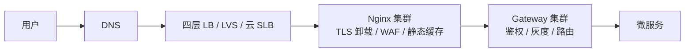

**职责切分**：

| 能力 | 放 Nginx | 放 Gateway | 原因 |
|---|---|---|---|
| TLS 握手 | ✅ | ❌ | Nginx 的 TLS 性能远好于 JVM；证书集中管理 |
| 静态资源 / 缓存 | ✅ | ❌ | Nginx 的 sendfile + 内存缓存 |
| WAF / IP 黑名单 | ✅ | ⚠️ | Nginx + 安全模块，或云 WAF |
| 全局限流（IP 级） | ✅ | ⚠️ | Nginx `limit_req` 更轻 |
| 业务路由 | ❌ | ✅ | 需要服务发现 + 动态路由 |
| 鉴权 | ❌ | ✅ | 需要解析 JWT、查权限 |
| 灰度 | ❌ | ✅ | 需要按用户/Header 分流 |
| 协议转换 | ❌ | ✅ | 需要业务语义 |

> 面试金句："Nginx 是**性能层**，Gateway 是**治理层**。把治理逻辑塞进 Nginx，等于用 Lua 重写一套 Java 生态；把 TLS 放进 Gateway，等于让 JVM 干它不擅长的事。"

## 5.4 选型决策树（可直接背）

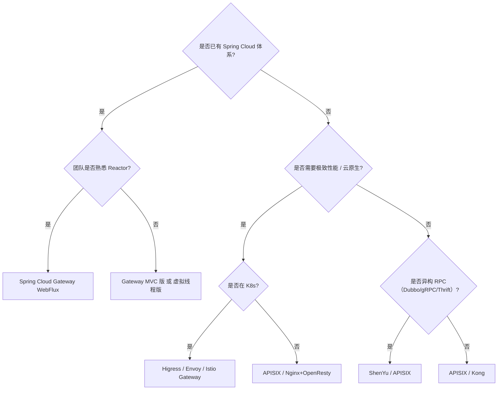

## 5.5 各网关的核心原理补充（面试可能追问）

### 5.5.1 Nginx

- **Master-Worker 进程模型**：master 只做管理（读配置、热部署、平滑重启），worker 独立处理连接。worker 数 = CPU 核数，**每 worker 一个独立的 epoll**，无锁竞争。
- **惊群解决**：`accept_mutex`（老方案）、`EPOLLEXCLUSIVE`（新方案）、`reuseport`（每个 worker 独立监听 socket，内核分流）。
- **平滑重启**：`nginx -s reload` → master 启动新 worker（新配置）→ 向老 worker 发 QUIT → 老 worker 处理完存量请求后退出。**这是"零停机发布"的经典范式**。
- **11 个阶段的 HTTP 处理**：`post-read → server-rewrite → find-config → rewrite → post-rewrite → preaccess → access → post-access → try-files → content → log`。Lua 模块可以在大部分阶段挂载。
- **`limit_req` 的漏桶**：`burst` + `nodelay`。`nodelay` 表示突发部分不排队（但仍计数），这是最常用的配置。

### 5.5.2 APISIX

- **etcd 作为唯一配置源**：所有路由/插件/上游存在 etcd，各节点 watch etcd 变更，**毫秒级生效，无需 reload**。这是它相对 Nginx 的最大优势。
- **Radix Tree 路由**：用基数树做路径匹配，支持最长前缀 + 通配，比正则快一个数量级。
- **插件热加载**：Lua 插件在 `rewrite/access/header_filter/body_filter/log` 阶段挂载，可按 route/service/global 三级生效。
- **`limit-count` / `limit-req` / `limit-conn`** 三种限流插件分别对应计数窗口、漏桶、并发限制。

### 5.5.3 Kong

- **架构**：Nginx + Lua（OpenResty）+ 插件 + PostgreSQL/Cassandra + `kong.conf`。
- **声明式配置**：Service（上游服务）→ Route（匹配规则）→ Plugin（插件）三级模型。这套模型后来被 APISIX 借鉴。
- **弱点**：DB 是单点（虽然可以多节点共享）；**配置同步有延迟**（默认 5~60s 轮询），不如 APISIX 的 etcd watch。

### 5.5.4 Envoy / Istio Gateway

- **L4/L7 过滤器链**：`Listener → FilterChain (Network/HTTP Connection Manager) → Cluster`。
- **xDS 协议**：LDS（Listener）、RDS（Route）、CDS（Cluster）、EDS（Endpoint）、SDS（Secret），增量下发，是 Service Mesh 的控制面标准。
- **热重启**：通过 `hot restart`（共享内存 + UDS）实现零丢包升级。
- **HTTP/3（QUIC）** 原生支持。
- **Istio Gateway** 就是 Envoy 的一个 Deployment + `Gateway` CRD，负责南北向流量；Sidecar 负责东西向。

### 5.5.5 ShenYu（原 Soul）

- 国产异构 RPC 网关，核心价值是**协议转换**：HTTP → Dubbo / gRPC / Motan / Sofa / Tars / MQ。
- 基于 WebFlux，插件化（`ShenyuPlugin`），支持 `divide`（流量切分）、`rateLimiter`、`waf`、`contextBuilder` 等内置插件。
- 适合"老系统 Dubbo + 新系统 HTTP + 外部 OpenAPI"混合的架构。

> 对比表：`ShenYu` vs `Spring Cloud Gateway` —— 前者强在**多协议**，后者强在**Spring 生态整合**。如果只做 HTTP 路由，Gateway 更轻；如果有大量 Dubbo 服务要暴露 HTTP，ShenYu 省很多事。

---

# 第六章 网关核心能力的底层算法实现

## 6.1 限流四算法（必须能手画 + 手写）

### 6.1.1 固定窗口计数器

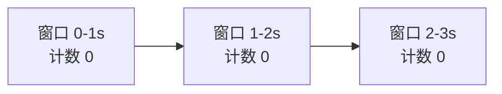

- 实现：`INCR key` + `EXPIRE key 1`（Redis）。
- **致命缺陷：临界问题**。0.9s 打了 100 次，1.1s 又打 100 次，两个窗口各不超限，但 **0.2 秒内实际通过了 200 次**（2 倍突发）。

### 6.1.2 滑动窗口日志（Sliding Window Log）

- 记录每个请求的时间戳（Redis ZSET：`ZADD key timestamp timestamp`，`ZREMRANGEBYSCORE` 清理过期，`ZCARD` 计数）。
- 精确，但**内存开销 O(请求数)**，10 万 QPS 的场景不可接受。

### 6.1.3 滑动窗口计数（Sliding Window Counter，工业界最常用）

把窗口切成 N 个小格（如 10 格，每格 100ms），用"当前格 + 上一格按比例加权"估算：

```
count ≈ cur_count + prev_count * (1 - elapsed_in_cur_window / window_size)
```

- 内存 O(N)，精度可调（N 越大越准）。
- **Sentinel 的 `LeapArray` 就是滑动窗口**：`windowLengthInMs = 1000`（1s），`sampleCount = 2`（2 格），用 `AtomicReferenceArray` 做环形数组 + CAS 更新，**无锁**。
- 这种实现比"每请求一次 Redis"快 2~3 个数量级 —— **单机限流绝不要用 Redis**。

### 6.1.4 漏桶（Leaky Bucket）

```java
// 漏桶：恒定速率流出，桶满则拒绝
public class LeakyBucket {
    private final long capacity;      // 桶容量
    private final long ratePerMs;     // 流出速率（个/ms）
    private long water;               // 当前水量
    private long lastLeakMs;

    public synchronized boolean tryAcquire() {
        long now = System.currentTimeMillis();
        // 先漏水
        water = Math.max(0, water - (now - lastLeakMs) * ratePerMs);
        lastLeakMs = now;
        if (water < capacity) { water++; return true; }
        return false;
    }
}
```

- 特点：**输出速率绝对平滑**，不允许突发。适合"保护下游不被突发打爆"（如调第三方 API 有严格 QPS 限制）。
- Nginx `limit_req` 就是漏桶（`burst` 是桶容量，`nodelay` 是是否排队）。

### 6.1.5 令牌桶（Token Bucket）

```java
// 令牌桶：恒定速率放令牌，请求取令牌，允许突发（最多 burst 个）
public class TokenBucket {
    private final long capacity;       // 桶容量 = 允许的最大突发
    private final double ratePerMs;    // 令牌生成速率
    private double tokens;
    private long lastRefillMs;

    public synchronized boolean tryAcquire(long need) {
        refill();
        if (tokens >= need) { tokens -= need; return true; }
        return false;
    }

    private void refill() {
        long now = System.currentTimeMillis();
        tokens = Math.min(capacity, tokens + (now - lastRefillMs) * ratePerMs);
        lastRefillMs = now;
    }
}
```

- 特点：**允许突发**（桶里攒的令牌可以一次性用掉），长期平均速率 = rate。
- **Spring Cloud Gateway 的 `RedisRateLimiter` 就是分布式令牌桶**（见 4.6.2 的 Lua）。

**四算法对比（面试标准表）**：

| 算法 | 突发容忍 | 精度 | 内存 | 分布式实现难度 | 典型应用 |
|---|---|---|---|---|---|
| 固定窗口 | 差（2 倍临界） | 低 | O(1) | 易 | 粗粒度兜底 |
| 滑动日志 | 无 | 最高 | O(N) | 中 | 小流量精确限流 |
| 滑动计数 | 好 | 较高 | O(格子数) | 中 | **Sentinel**、单机限流 |
| 漏桶 | 无（强制平滑） | 高 | O(1) | 易 | Nginx、调第三方 |
| 令牌桶 | **好（可配 burst）** | 高 | O(1) | 易（Lua） | **Gateway、Guava RateLimiter** |

## 6.2 熔断器状态机（Resilience4j / Sentinel 对比）

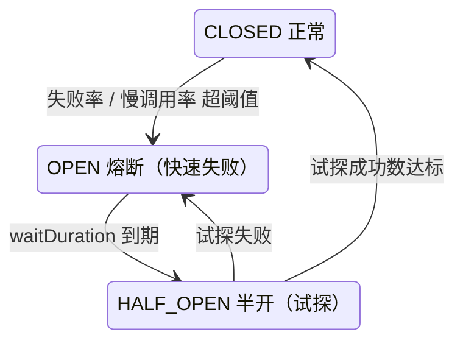

**两个实现的关键差异**：

| 维度 | Resilience4j | Sentinel |
|---|---|---|
| 统计方式 | 环形数组滑动窗口（`SlidingTimeWindow`/`SlidingCountWindow`） | `LeapArray` 滑动窗口（秒级/分钟级） |
| 隔离 | 默认**信号量**（`SemaphoreBasedBulkhead`），无额外线程 | 并发线程数限流（`ParamFlowRule`） |
| 触发条件 | 失败率、慢调用率、异常数 | 异常数、异常比例、慢调用比例（**Sentinel 1.8+**） |
| 半开行为 | `permittedNumberOfCallsInHalfOpenState` 固定次数 | `halfOpen` 探测 |
| 与网关集成 | Spring Cloud CircuitBreaker 官方支持 | 需自研 filter 或 Sentinel 网关适配 |

**为什么要"半开"而不是"直接闭合"？**
如果熔断打开后直接闭合，会遇到"下游刚恢复就又被瞬间流量打挂"（雪崩重启）。半开让**少量请求试探**，成功后才逐步放开，这是**渐进恢复**思想。

## 6.3 负载均衡算法与实现要点

| 算法 | 优点 | 缺点 | 适用 |
|---|---|---|---|
| 轮询（RR） | 简单、均匀 | 不考虑实例负载差异 | 同规格实例 |
| 加权轮询（WRR） | 支持异构实例 | 权重静态，不感知实时负载 | 新旧机型混部 |
| 随机 | 无状态、易扩展 | 短时间可能不均 | 大规模实例 |
| 加权随机 | 同上 + 异构 | 同上 | 大规模 + 异构 |
| 最小连接数 | 感知负载 | 需维护连接计数，长连接偏差大 | 长连接/耗时差异大 |
| 最短响应时间（P2C） | 自适应 | 需采样 | **Envoy / Finagle 默认** |
| 一致性哈希 | 缓存命中率高 | 热点、扩容需虚拟节点 | 有状态/缓存服务 |
| 源地址哈希 | 会话保持 | 分布不均 | 无 session 共享时 |

**P2C（Power of Two Choices）** —— 高分点：

> 随机挑 2 个实例，选当前"负载/在途请求数"较小的那个。**用 O(1) 的代价近似"最小连接数"**，在 Envoy、Finagle、gRPC 的 `pick_first`/`round_robin` 之外广泛使用。数学上证明：2 次随机采样已能获得接近最优的负载均衡效果（"the power of two choices"）。

**一致性哈希的虚拟节点**：

```java
// 环上放 N 个虚拟节点，解决数据倾斜
for (int i = 0; i < instanceCount; i++) {
    for (int v = 0; v < VIRTUAL_NODES; v++) {
        long hash = hash("instance-" + i + "-vnode-" + v);
        ring.put(hash, instances.get(i));
    }
}
// 查找：hash(key) 顺时针找到第一个 >= 它的节点
```

虚拟节点数的经验值：**100~200 个/实例**。太少倾斜严重，太多内存与查找成本上升。

## 6.4 灰度发布的四种实现

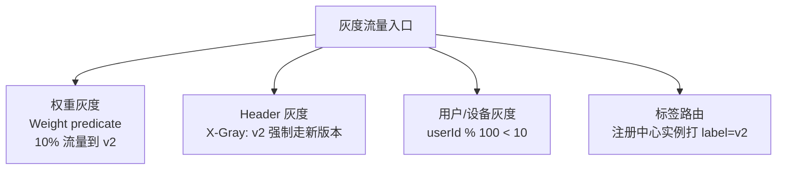

| 方式 | 实现 | 优点 | 缺点 |
|---|---|---|---|
| 权重 | `Weight` predicate（Gateway 内置） | 简单，比例可控 | **比例是"请求级"不是"用户级"**，同一用户会在新旧版本间跳变 |
| Header/Cookie | `Header`/`Cookie` predicate | 精准，可指定测试用户 | 只适合内部测试 |
| 用户 ID 取模 | 自定义 `KeyResolver` / filter | **同一用户稳定命中同一版本** | 需要网关知道 userId（依赖鉴权先行） |
| 实例标签 | 注册中心 metadata + 自定义 LB | 与部署系统联动，天然支持"发布即灰度" | 需要改造 LB 与注册中心 |

**生产推荐组合**：**用户 ID 取模（保证一致性）+ 权重（控制总量）+ Header（紧急回滚/内部验证）**。

**灰度必须配的三个能力**（面试加分）：
1. **快速回滚**：权重一键归零（配置中心推送，秒级生效）。
2. **指标观测**：新旧版本的 RT、错误率、业务指标分版本对比。
3. **流量染色**：给灰度流量打标（`X-Gray-Version`），贯穿全链路，便于日志排查与数据核对。

---

# 第七章 生产事故与排障手册

> 这一章是"你上过生产吗"的试金石。每个事故都给出：现象 → 定位 → 根因 → 修复 → 预防。

## 7.1 事故一：502 Bad Gateway 间歇性出现

**现象**：网关偶发 502，下游服务自身日志无异常。

**定位路径**：
```mermaid
flowchart LR
    A[502] --> B{下游进程活着?}
    B -->|否| C[OOM / 崩溃 / 被 kill]
    B -->|是| D{TCP 连接能建吗?}
    D -->|否| E[连接被拒: 端口错/防火墙/backlog 满]
    D -->|是| F{请求发出后连接被断?}
    F -->|是| G[下游 keep-alive 超时 < 网关空闲时间<br/>→ 网关复用了已被下游关闭的连接]
```

**最常见的根因**：**连接复用竞态（stale connection）**。
- 下游 Tomcat `keepAliveTimeout=60s`，网关连接池 `max-idle-time=30s`。
- 但下游在 60s 时关闭连接的那一刻，网关可能正好把这个连接从池里取出来用 → 请求写到一个已 FIN 的连接 → 502。
- **修复**：网关 `max-idle-time` 必须 **小于** 下游 `keepAliveTimeout`（建议下游 60s / 网关 30s），并且下游 `keepAliveTimeout` 要比上游 LB 的空闲超时大。

## 7.2 事故二：504 超时成群出现

**根因三选一**：
1. **下游真的慢**：看下游 RT 分位（P99 是否劣化）。
2. **连接池排队**：`max-connections` 太小 + 下游 RT 抖动 → 请求在池里等待而不是在建连 → 表现为"网关耗时 = 排队 + 下游"。
3. **`response-timeout` 配得太短**：SSE / 长轮询 / 大文件被误掐。

**快速判定**：看网关指标 `gateway_requests_seconds`（`GatewayMetricsFilter` 提供）与下游 RT 的差值。差值大 = 排队/网关自身慢；差值小 = 下游慢。

## 7.3 事故三：`OutOfDirectMemoryError`

**现象**：跑一段时间后 OOM，堆内存正常，直接内存爆。

**根因**：自定义 filter 里对 `DataBuffer` 多 `retain` 少 `release`，或 `NettyRoutingFilter` 的响应流被 `cancel` 后没释放。

**定位**：
```
-Dio.netty.leakDetection.level=paranoid
```
日志里会打印 `LEAK: ByteBuf.release() was not called before it's garbage-collected`，附分配栈。

**修复**：
- 所有 `DataBufferUtils.join()` 之后必须 `DataBufferUtils.release(buf)`。
- 自定义 `ServerHttpResponseDecorator` 里，`super.writeWith(body)` 后不要再持有 body 引用。
- 限制 `max-in-memory-size`，从源头减少大 buffer。

## 7.4 事故四：EventLoop 被阻塞，全站 RT 飙升

**现象**：QPS 没涨，但所有路由的 P99 从 20ms 涨到 2s；CPU 使用率不高（线程都在 sleep/等待）。

**定位**：`jstack` 看 `reactor-http-nio-*` 线程的栈，若卡在 `Thread.sleep`、`SocketInputStream.read`、JDBC `socketRead`，就是阻塞了。

**根因清单**：
- 在 `GlobalFilter` 里调了 `RestTemplate` / `Feign`（同步 HTTP）。
- 在 filter 里查了数据库/Redis（同步客户端）。
- 用了 `synchronized` 或 `ThreadLocal` 的重度竞争。
- 日志框架同步写盘（`logback` 的 `FileAppender` 未用 `AsyncAppender`）。

**修复**：`Schedulers.boundedElastic()` 或换异步客户端；日志改 `AsyncAppender`；**在 CI 里加 ArchUnit 规则禁止在 gateway 模块引入阻塞客户端**（这是治本）。

## 7.5 事故五：重试风暴把下游打死

**现象**：下游某个接口超时 → 网关重试 → 下游压力翻倍 → 更多超时 → 雪崩。

**根因**：`Retry` 无 backoff + `retries` 过大 + 重试不分错误类型（对 500 也重试）。

**修复三步**：
1. `backoff`（指数退避 + 抖动）。
2. 只对**幂等方法 + 连接类错误**重试（`ConnectException`/`IOException`），**不要对 5xx 盲目重试**（5xx 往往意味着下游已经过载）。
3. 重试与熔断联动：熔断打开时**禁止重试**。

## 7.6 事故六：网关内存缓慢上涨（GC 后不回落）

**根因**：`CachingRouteLocator` 的旧 Route 列表被 `RoutePredicateHandlerMapping` 持有引用；或自定义 `RouteDefinitionRepository` 的 cache 只增不减；或 `@RefreshScope` 的代理对象不断创建。

**排查**：`jmap -histo:live` 看 `Route`、`GatewayFilter` 实例数量是否异常增长；`heap dump` 看 GC root 引用链。

## 7.7 事故七：跨域预检失败 / 401 先于 CORS

**现象**：前端报 CORS 错误，但后端日志显示 401。

**根因**：鉴权 filter 的 order 在 CORS filter 之前，OPTIONS 预检请求被鉴权拦掉，浏览器拿不到 `Access-Control-Allow-Origin`。

**修复**：鉴权 filter 里**放行 `OPTIONS` 且放行 `Access-Control-Request-Method` 存在的请求**，并确保 `globalcors.add-to-simple-url-handler-mapping=true`。

## 7.8 排障工具清单（能说出来很加分）

| 工具 | 用途 |
|---|---|
| `jstack` | 看 EventLoop 是否阻塞、线程死锁 |
| `jmap -histo:live` / `heap dump` | 对象增长、内存泄漏 |
| `arthas` | 在线诊断（`watch`、`trace`、`profiler`），**生产排障神器** |
| `async-profiler` | CPU/内存火焰图，看热点在哪个 filter |
| `tcpdump` + Wireshark | 抓包看 502/504 的真实原因（RST / FIN / 超时） |
| `ss -s` / `netstat` | TIME_WAIT / CLOSE_WAIT 数量 |
| `Nginx access log` | 看网关前面的 LB 是否有 5xx |
| Micrometer + Prometheus | `gateway_requests_seconds` 分路由 RT、QPS、状态码分布 |
| SkyWalking / Zipkin | 全链路 traceId 串联 |

---

# 第八章 国内大厂面试题库（含考核程度与详解）

## 8.0 阅读说明

**考核程度标记体系**：

| 标记 | 含义 | 出现频率 |
|---|---|---|
| ★★★★★ | **必考题**，几乎每场都问，答不上直接挂 | 90%+ |
| ★★★★☆ | 高频题，中高级岗位必问 | 60%~80% |
| ★★★☆☆ | 中频题，区分度题，答好加分 | 30%~50% |
| ★★☆☆☆ | 低频题，特定岗位（架构/中间件）才问 | <20% |

**级别标注**：P5（初级）/ P6（中级，3~5 年）/ P7（高级，5~8 年）/ P8（专家）。薪资档位不同，考察深度差异极大 —— 同一个题目在 P6 只要求讲清流程，在 P7 会追问源码与设计取舍。

**答题方法论（比答案本身更重要）**：

> 面试官问网关，**从来不是想听你背概念**，而是通过网关考察三件事：
> 1. **你有没有架构视角**（知道每一层为什么存在）
> 2. **你有没有读过源码**（能说出类名和方法）
> 3. **你有没有踩过坑**（能讲出生产事故与排查过程）
>
> 所以每题的标准答法都是"**结论 → 原理 → 源码/数据 → 生产实践 → 边界**"五段式。

---

## 8.1 字节跳动（ByteDance）

> 字节的面试风格：**极重基础、极重源码、极重性能**。网关题通常出现在二面/三面，会连着追问 5~8 层，直到你答不出来为止。他们的目的是找"知识边界"。

### Q1. Spring Cloud Gateway 的完整请求处理流程是怎样的？从 Netty 接收到请求到写回响应，中间经过哪些核心类？

- **考核程度**：★★★★★ 极高频
- **岗位级别**：P6 / P7
- **考察点**：是否真正理解 WebFlux 的 Handler 体系，而不是只会配 yml

**参考答案（按五层讲，一层不落）**：

**第 1 层：Netty 接入层**
`Reactor Netty` 的 `HttpServer` 在 EventLoop 上收到数据 → `HttpServerCodec` 解码 → `ReactorHttpHandlerAdapter` 适配成 Reactor 的 `HttpServerRequest/Response` → `HttpWebHandlerAdapter` 再适配成 Spring 的 `ServerHttpRequest/ServerHttpResponse`，并创建 `DefaultServerWebExchange`。

> **关键点**：`ServerWebExchange` 是贯穿全链路的上下文容器（request + response + attributes），它**不可变**，`mutate()` 返回新副本。

**第 2 层：WebFlux 前端控制器**
`DispatcherHandler.handle(exchange)` 遍历所有 `HandlerMapping`，用 `concatMap + next()` 取第一个能处理该请求的 Handler。

**第 3 层：路由匹配（核心）**
`RoutePredicateHandlerMapping.getHandlerInternal()`：
- 从 `RouteLocator.getRoutes()` 拿到 `Flux<Route>`（已按 order 排序）
- 对每条 Route 执行 `predicate.apply(exchange)`（`AsyncPredicate`，返回 `Mono<Boolean>`）
- `next()` 短路，取第一个匹配成功的
- 把 Route 写入 `exchange.getAttributes().put(GATEWAY_ROUTE_ATTR, route)`
- 返回 `FilteringWebHandler`

> 该类 `getOrder() = 1`，优先级高于默认的 `RequestMappingHandlerMapping(0)`，所以路由匹配先于普通 Controller。

**第 4 层：过滤器链组装**
`FilteringWebHandler.handle()`：
- 取 `route.getFilters()`（路由级 GatewayFilter）
- 合并所有 `GlobalFilter`（包装成 `GatewayFilterAdapter`）
- `AnnotationAwareOrderComparator.sort(combined)`
- 用 `DefaultGatewayFilterChain` 递归执行

**第 5 层：过滤器链执行（洋葱模型）**
`DefaultGatewayFilterChain.filter()` 递归：`filter.filter(exchange, chain)` → filter 内部调 `chain.filter(exchange)` 进入下一个 → 到最后 `Mono.empty()` 回溯。

链中关键 GlobalFilter 的顺序：
`AdaptCachedBody(-MAX)` → `RouteToRequestUrlFilter(3)` → `ReactiveLoadBalancerClientFilter(4)` → `WebsocketRoutingFilter(5)` → `NettyRoutingFilter(MAX)`（真正转发）→ 回溯时 `NettyWriteResponseFilter` 写回。

**第 6 层：写回**
`NettyWriteResponseFilter` 的 order 是 `-1`，但逻辑在 `chain.filter().then(...)` 里，所以**实际在全链之后执行**：从 `CLIENT_RESPONSE_ATTR` 取下游响应，用 `response.writeWith(Flux<DataBuffer>)` **流式**写回，不聚合。

**延伸追问（字节最爱问的下一层）**：
- "为什么 `NettyRoutingFilter` 的 order 是 `LOWEST_PRECEDENCE`？" → 它必须等所有前置 filter（鉴权、LB 解析、Header 改写）完成，是 pre 阶段最后一个。
- "`NettyWriteResponseFilter` 的 order 是 -1 却最后执行，为什么？" → order 只决定**进入链的顺序**，不决定**完成顺序**；它把写逻辑挂在 `then()` 里，所以最后执行。这是理解洋葱模型的关键。
- "如果我在 filter 里调 `chain.filter()` 两次会怎样？" → 请求会被转发两次（除非有 `isAlreadyRouted` 保护），这是生产事故的常见原因。

---

### Q2. Gateway 的 Filter 是怎么实现 pre 和 post 的？为什么 post 阶段是逆序执行？

- **考核程度**：★★★★★ 极高频
- **岗位级别**：P6
- **考察点**：是否理解响应式链式调用与"洋葱模型"

**参考答案**：

Spring Cloud Gateway **没有** Zuul 那种显式的 pre/post 分类，它只有一个 `GatewayFilter.filter(exchange, chain)` 方法。pre 与 post 是**通过代码位置天然实现的**：

```java
@Override
public Mono<Void> filter(ServerWebExchange exchange, GatewayFilterChain chain) {
    // ===== 这里是 pre 逻辑（chain 调用之前）=====
    log.info("before, path={}", exchange.getRequest().getPath());

    return chain.filter(exchange)        // 进入下一个 filter，直到链尾
        .then(Mono.fromRunnable(() -> {
            // ===== 这里是 post 逻辑（chain 完成之后）=====
            log.info("after, status={}", exchange.getResponse().getStatusCode());
        }));
}
```

**为什么 post 逆序？** 因为整个链是一层层嵌套的：

```
F1.pre → F2.pre → F3.pre → 转发下游 → F3.post → F2.post → F1.post
```

order 小的先进入（pre 先执行），但它 `.then()` 挂的回调要**等内层全部完成**才执行，所以 post 反过来（后进的先出）。这和 Servlet Filter 的 `chain.doFilter()` 前后模型完全一致，是"栈"的天然语义。

**三个必须提醒的坑**：
1. **post 逻辑写在 `chain.filter()` 之前 = 变成了 pre 逻辑**。很多人写"统计耗时"写在前面，结果统计到的是 0。
2. **`chain.filter()` 只能调用一次**。写了两次会触发两次转发（虽然 `GATEWAY_REQUEST_URL_ATTR` 有 `isAlreadyRouted` 保护，但 filter 自身的副作用会执行两次）。
3. **异常处理**：post 逻辑里如果抛异常，会走全局 `ErrorWebExceptionHandler`，但此时响应可能已经开始写出（`response.isCommitted()`），无法再改状态码。

**延伸**：
- "那你觉得 Gateway 的模型比 Zuul 好还是差？" → 更简洁（一套模型），但对新手不友好（没有强制区分 pre/post，容易写错）。Zuul 2 的 sync/async 声明式防呆更严谨。
- "如果要实现一个'必须最后执行'的 post filter，怎么做？" → `order = Ordered.LOWEST_PRECEDENCE`，且 post 逻辑放 `then()` 里（那就是最后中的最后）。

---

### Q3. 你们网关的单机 QPS 是多少？怎么压测的？瓶颈在哪里？

- **考核程度**：★★★★★ 极高频（字节几乎必问）
- **岗位级别**：P7
- **考察点**：**真实经验**。这题答不出具体数字和压测方法，基本就挂了。

**参考答案（按"数据 → 方法 → 瓶颈 → 优化"四段答）**：

**1. 给数据（必须具体，但要说明前提）**
"我们生产环境是 8C16G 的 Gateway 实例，纯 HTTP 路由 + JWT 验签（HMAC256）+ 简单 Header 改写，单机稳定在 **8000~12000 QPS**，P99 在 15ms 左右。如果关掉鉴权和 metrics，能到 2 万+。如果是 TLS 卸载 + 复杂响应改写，会掉到 3000~5000。"

> **注意**：说数字一定要带前提（硬件、功能、包大小）。不带前提的数字在面试官眼里就是编的。

**2. 说压测方法**
- 工具：`wrk2`（能控速率、能出准确保时延分布）或 `JMeter`（分布式发压）。不用 `ab`（单线程、不准）。
- 拓扑：压测机 → 网关 → mock 下游（用 `MockWebServer` 或一个返回固定 JSON 的 Go 服务，RT 固定 1ms），**避免下游成为瓶颈**。
- 步骤：阶梯加压（1000 → 2000 → 5000 → 10000 → ...），每档稳跑 3 分钟，记录 **QPS / P50 / P99 / P999 / CPU / GC / 线程状态**。
- **找拐点**：QPS 涨但 P99 开始非线性上升的那个点，就是容量拐点。

**3. 说瓶颈（这是区分度）**
"我们压测发现瓶颈不在 Netty，而在三处：
- **CPU 的 JSON 序列化与 JWT 验签**（火焰图里 `ObjectMapper` 和 `Mac.doFinal` 占比最高）；
- **GC**（每请求创建大量 `ServerWebExchange`/`DataBuffer` 包装对象，G1 的 Young GC 频率上升）；
- **连接池排队**（`max-connections` 设成 200，下游 RT 5ms 时理论 4 万 QPS 够，但 RT 抖到 20ms 就只能 1 万，此时 QPS 被连接数卡死而不是 CPU）。"

**4. 说优化**
- 鉴权从每次验签改成"验签结果短期缓存（Caffeine，key=token 的 hash，TTL 与 token 有效期对齐）"；
- 关掉不必要的 `GatewayMetricsFilter` 全量标签（metrics 的 tag 基数爆炸会显著拖慢）；
- 连接池按"下游 P99 × 目标 QPS"反推 `max-connections`，并开 `max-idle-time` 小于下游 keep-alive；
- 用 `-XX:+UseG1GC` + `MaxGCPauseMillis=20`，对象尽量复用（`ServerHttpRequest` 的 header 用 `HttpHeaders` 只读视图）。

**延伸追问**：
- "怎么判断瓶颈是 CPU 还是 IO？" → 看 `top -H` 的线程状态 + `async-profiler` 火焰图。如果 `reactor-http-nio-*` 线程的 CPU 高 → 计算瓶颈；如果线程 `RUNNABLE` 但 CPU 低、`ss` 显示连接大量 `ESTABLISHED` 且 `Recv-Q` 堆积 → IO/下游瓶颈。
- "为什么不用 JMeter 而用 wrk2？" → JMeter 是线程模型，压测机自身容易先到瓶颈，且定时器不精确；wrk2 基于 epoll + 恒定速率（`--rate`），能测出真实的排队延迟分布（ coordinated omission 问题）。

---

### Q4. 网关限流怎么做？为什么必须用 Lua？如果 Redis 挂了限流还能用吗？

- **考核程度**：★★★★★ 极高频
- **岗位级别**：P6 / P7
- **考察点**：分布式原子性、降级设计

**参考答案**：

**1. 为什么用 Lua**
令牌桶的语义是"读当前令牌数 → 按时间补充 → 判断是否够 → 扣减 → 写回"。这五步如果拆成 5 次 Redis 命令，在并发下会出现**超发**：两个请求同时读到 `tokens=1`，都判断够，都扣减，实际发了 2 个令牌。Lua 脚本在 Redis 内部**单线程原子执行**，彻底解决竞态。

**2. 核心脚本（要能默写关键逻辑）**

```lua
local tokens_key = KEYS[1]
local timestamp_key = KEYS[2]
local rate = tonumber(ARGV[1])
local capacity = tonumber(ARGV[2])
local now = tonumber(ARGV[3])
local requested = tonumber(ARGV[4])

local last_tokens = tonumber(redis.call('get', tokens_key) or capacity)
local last_refreshed = tonumber(redis.call('get', timestamp_key) or 0)

local delta = math.max(0, now - last_refreshed)
local filled = math.min(capacity, last_tokens + delta * rate)  -- 补充，上限 capacity

local allowed = filled >= requested
local new_tokens = filled - (allowed and requested or 0)

redis.call('setex', tokens_key, 2 * math.ceil(capacity / rate), new_tokens)
redis.call('setex', timestamp_key, 2 * math.ceil(capacity / rate), now)

return { allowed and 1 or 0, new_tokens }
```

**三个细节（能讲出来就是加分）**：
- `delta = math.max(0, now - last_refreshed)`：防止时钟回拨导致负补充。
- TTL = `2 * capacity / rate`：桶空置超过这个时间等价于"满桶"，key 可过期，**避免 Redis 里堆积无数冷 key**。
- `setex` 每次刷新 TTL，保证活跃 key 不会被误删。

**3. Redis 挂了怎么办（这是字节最爱追问的"降级"）**

三档降级策略，按业务重要性选择：

| 策略 | 行为 | 适用 |
|---|---|---|
| **fail-open（放行）** | Redis 异常时直接放行，靠下游服务自身的限流兜底 | 大多数业务；**可用性优先** |
| **fail-close（拒绝）** | 直接 429/503 | 资金、防刷等安全敏感接口 |
| **本地兜底限流** | 降级到单机 `Sentinel` / `Guava RateLimiter` 的 QPS × 实例数 | 想保持"至少不被打爆" |

**实现方式**：`RedisRateLimiter` 里 `onErrorResume(e -> Mono.just(new Response(true, ...)))` 就是 fail-open；真要 fail-close 就返回 `Response(false)`。

**我们生产的做法**：默认 fail-open + 本地 `Sentinel` 单机限流（阈值设成集群阈值的 1/N，取 1.5 倍冗余）+ 监控告警。这样 Redis 挂了不会全站 429，但也不会完全不设防。

**延伸追问**：
- "限流的 key 怎么设计？" → `request_rate_limiter.{routeId}.{keyResolverValue}.tokens`。**注意 key 的基数**：如果用 `userId` 做维度，百万用户就是百万个 key × 2，Redis 内存要算清楚（一个 key 约 100~200 字节，200 万 key ≈ 400MB）。
- "为什么不用 Redis 的 `INCR + EXPIRE` 做固定窗口？" → 临界问题（2 倍突发），且 `INCR` 和 `EXPIRE` 不是原子的（虽然可以 pipeline，但仍有边界）。
- "Sentinel 的滑动窗口和 Redis 令牌桶能一起用吗？" → 能，但要注意**两层限流的阈值叠加**：Redis 层 100 QPS + 本地 20 QPS × 5 实例 = 100，实际效果是"先到先限"，容易出现本地先触发导致 Redis 层形同虚设。

---

### Q5. 如果让你从零设计一个支撑 10 万 QPS 的网关，你会怎么做？

- **考核程度**：★★★★★ 极高频（P7/P8 架构题）
- **岗位级别**：P7 / P8
- **考察点**：全局架构能力，是否能把前面所有知识点串起来

**参考答案（必须按"分层 → 选型 → 关键设计 → 容量 → 容灾"讲）**：

**1. 分层设计（不要一上来就说用什么框架）**

```
客户端 → DNS/GSLB → 四层 LB(LVS/云 SLB) → Nginx 集群(TLS/WAF/静态)
      → API 网关集群(业务治理) → 微服务
```

- **为什么四层？** 10 万 QPS 的 TLS 握手如果放在 Java 网关，CPU 会被吃光；LVS 做四层转发，成本极低（内核态转发）。
- **为什么 Nginx 和 Gateway 都要？** Nginx 做 TLS 卸载 + WAF + 限流兜底（C 语言，单机可扛 10 万连接）；Gateway 做业务路由、鉴权、灰度。

**2. 网关选型**

- 如果团队是 Spring Cloud：**Spring Cloud Gateway（WebFlux + Reactor Netty）**。
- 如果要极致性能/云原生：**APISIX（etcd 动态配置）或 Envoy**。
- **关键判断**：10 万 QPS 不是单机扛的，是**集群扛的**。8C 实例单机 1 万 QPS → 10~15 台就够，加 30% 冗余 = 15~20 台。所以**选型的第一约束不是性能，而是团队维护成本**。

**3. 关键设计（这五点必须说到）**

| 设计点 | 做法 | 原因 |
|---|---|---|
| **无状态** | 网关不存 session、不写本地缓存（除路由/实例列表） | 才能水平扩容、滚动发布 |
| **连接池** | `max-connections` 按下游反推，`max-idle-time < 下游 keep-alive` | 避免排队与 stale connection |
| **路由缓存** | `CachingRouteLocator` + 配置中心推送刷新，**不每次请求查配置** | 否则配置中心成瓶颈 |
| **鉴权本地化** | JWT 本地公钥验签 + 结果短缓存，**不每请求调认证服务** | 10 万 QPS × 1 次 RPC = 认证服务必挂 |
| **限流分层** | 网关粗粒度（IP/API，Redis 令牌桶）+ 服务内细粒度（Sentinel） | 网关不做精细业务限流 |

**4. 容量规划（要给公式）**

```
所需实例数 = 峰值 QPS / 单机安全 QPS × (1 + 冗余系数)
单机安全 QPS = 压测拐点 QPS × 0.6（留 40% 余量）
连接池上限 ≥ 单机 QPS × 下游 P99 秒数 × 1.5
```

举例：峰值 10 万，单机拐点 1.5 万 → 安全 9000 → 需要 11 台 → 加 30% 冗余 = 15 台。

**5. 容灾**

- **多可用区**：网关至少 2 个 AZ，DNS/GSLB 做健康检查切换。
- **优雅停机**：`server.shutdown=graceful` + `timeout-per-shutdown-phase=30s`，发布时先摘流量再停。
- **下游隔离**：按 SLA 分网关集群（支付一个集群、内容一个集群），避免慢下游拖垮全站。
- **熔断兜底**：每个路由配 `CircuitBreaker` + fallback，下游挂了不拖死网关。

**6. 可观测**
- Metrics：`gateway_requests_seconds`（分 route/status）、连接池使用率、EventLoop 队列长度、GC。
- Trace：W3C `traceparent` 透传，采样 1%~10%。
- 日志：异步 appender + 结构化 JSON，只记必要字段（**不要打 body**）。

**延伸追问**：
- "10 万 QPS 时 DNS 会成为瓶颈吗？" → 会。所以用 GSLB + 客户端 DNS 缓存 + HTTPDNS（移动端）。
- "网关集群扩到 20 台，配置怎么统一？" → 配置中心（Nacos/Apollo）推送 + 启动时拉取 + 定时校验。
- "如果某个下游突然 RT 从 5ms 涨到 500ms，网关会怎样？" → 连接池被占满 → 请求排队 → P99 暴涨 → 若开了熔断则快速失败，否则雪崩。**所以连接池 + 熔断 + 超时必须三件套配齐**。

---

## 8.2 阿里巴巴（Alibaba）

> 阿里的风格：**重架构、重分层、重业务抽象**。他们特别爱问"为什么这么设计""有没有更好的方案"，网关题常从"系统分层"切入。

### Q6. 为什么需要 API 网关？它和 Nginx 反向代理的本质区别是什么？

- **考核程度**：★★★★★ 极高频
- **岗位级别**：P6
- **考察点**：架构分层认知，别把网关答成"高级 Nginx"

**参考答案**：

**1. 需求侧：三个真问题**
- 客户端要记住 N 个服务地址（移动端发版不可控，服务拆分即客户端改动）；
- 鉴权/限流/日志在 200 个服务里重复实现，改一次规则要发 200 次版；
- 流量无统一管控点，某个服务被打挂没法在入口拦住。

**2. 网关的本质：横切关注点的收口**
网关不是一个"转发器"，而是"**把与业务无关、但每个服务都要的横切逻辑，收口到一层**"。判断标准：这段逻辑变更时需不需要所有业务方评审？需要 → 放网关。

**3. 与 Nginx 的本质区别（三层）**

| 维度 | Nginx 反向代理 | API 网关 |
|---|---|---|
| **路由依据** | 静态配置（`location` 正则/前缀） | 动态路由（服务发现 + 配置中心 + 断言：Header/方法/权重/时间） |
| **扩展方式** | Lua 脚本 / 编译模块，改配置要 reload | Java Filter / 插件，可热刷新、可与业务系统集成（查权限库） |
| **语义层级** | 传输层 + HTTP 语法层（不懂"API"） | **API 语义层**（懂路由、懂身份、懂灰度、懂协议转换） |
| **治理能力** | 限流、缓存、TLS | 鉴权、灰度、熔断、聚合、协议转换、多租户 |

一句话总结：**Nginx 是"性能层"，网关是"治理层"**。Nginx 关心"这个字节流往哪送、送多快"，网关关心"这个请求是谁、该不该让他进、进哪个版本"。

**4. 为什么生产上两者并存（这是阿里面试官最爱追的）**
因为它们的**优化目标冲突**：Nginx 追求"每条连接的成本最低"（C 语言、零拷贝、无 GC）；网关追求"治理逻辑最灵活"（Java 生态、可热更新）。把 TLS 放 Nginx（JVM 的 TLS 性能差 3~5 倍），把鉴权放网关（Lua 写鉴权是噩梦）。**这不是冗余，是分工**。

**延伸追问**：
- "那 Kong / APISIX 是 Nginx 还是网关？" → 它们是"用 Nginx 的性能 + 网关的能力"，属于融合形态。但它们的动态能力依赖 etcd/PG，运维复杂度比纯 Nginx 高。
- "什么时候可以不要网关？" → 单体应用、服务数 < 5、无多端、无灰度诉求时，Nginx 足够。**网关是有维护成本的，别为了架构而架构**。

---

### Q7. Zuul 1 的性能瓶颈到底在哪？为什么 Zuul 2 改成异步了，Spring 还是不用它？

- **考核程度**：★★★★★ 极高频
- **岗位级别**：P6 / P7
- **考察点**：是否理解"模型决定上限"，以及技术选型的历史判断

**参考答案**：

**1. Zuul 1 的瓶颈（用数学讲，不要只讲结论）**

Zuul 1 是 Servlet 同步模型，一个请求占一个 Tomcat 线程，**从进入到响应返回全程占用**（因为 `HttpClient.execute()` 是阻塞的）：

```
单机 QPS ≈ maxThreads / (t_gateway + t_downstream)
默认 maxThreads = 200
若 t_gateway=5ms, t_downstream=50ms → 200/0.055 ≈ 3600 QPS
若 t_downstream 劣化到 500ms → 200/0.505 ≈ 396 QPS
```

**关键结论：Zuul 1 的吞吐与下游 RT 成反比**。下游一抖动，线程池打满 → 新请求排队 → 超时 → 雪崩。

**这就是 Netflix 发明 Hystrix 的真实原因**：不是为了"熔断"这个概念，而是**阻塞模型下慢调用必然耗尽线程**，必须有一个东西在慢调用发生时快速失败，把线程还回来。

**2. Zuul 2 改了什么**

- 前端：Netty Server 替代 Servlet → 连接数不再受线程数限制。
- 后端：Netty Client 替代 HttpClient → 转发不再阻塞线程。
- 上下文：`SessionContext` 替代 `ThreadLocal`（异步模型下 ThreadLocal 失效）。
- 过滤器：声明 `sync` / `async`，**强制开发者标注是否会阻塞**（防呆设计）。
- 新增 `OriginConcurrencyExceededException`（下游并发超限直接拒绝）、连接池分池、HTTP/2。

**3. 为什么 Spring 不用 Zuul 2（四层原因）**

1. **编程模型无法缝合**：Zuul 2 是原生 Netty + 自己的事件模型，Spring Boot 是 Servlet/WebFlux 两套栈，硬塞进去要写大量适配层。
2. **Spring 5 有了 WebFlux**（2017），Reactor 提供了完整的响应式抽象，Spring 团队宁愿在自己的生态里重建，也不愿维护一个 Netflix 的第三方实现。
3. **可扩展性**：Spring 需要"断言 + 过滤器工厂"这种**配置驱动**的模型（yml 就能配路由），Zuul 是"写 Filter 类"的编程模型，对动态配置不友好。
4. **所有权**：Spring Cloud Gateway 是 Spring 自己的项目，可控、可长期演进；Zuul 2 的所有权在 Netflix，Netflix 自己用得爽但不会为 Spring 的诉求改架构。

**4. 一个高分补充（Netflix 自己的结论）**

Netflix 在 Zuul 2 发布博客里明确写："**While we did not see a significant efficiency benefit in migrating to async and non-blocking, we did achieve the goals of connection scaling.**"

翻译：异步化**没有带来显著的吞吐提升**，但达成了**连接数扩展**的目标。原因是 CPU 仍是瓶颈；异步化的真正收益是"慢客户端/慢下游不占线程"和"连接数不受线程数限制"，而不是"QPS 翻倍"。

**能说出这段一手资料，面试官会立刻认为你读过原文而不是二手博客。**

**延伸追问**：
- "那 Spring Cloud Gateway 就一定比 Zuul 1 快吗？" → 在"下游 RT 抖动 + 高连接数"场景快得多；在"CPU 密集（复杂加解密）+ 低连接数"场景，优势会被压缩，因为 CPU 是共同瓶颈。
- "Zuul 2 的 sync/async 声明设计，Gateway 有吗？" → 没有，这是 Gateway 的一个缺陷：你写阻塞代码它不会警告你，只能靠 CI 规则或代码评审兜底。

---

### Q8. 网关如何做统一鉴权？JWT 无状态带来了什么问题，怎么解？

- **考核程度**：★★★★★ 极高频
- **岗位级别**：P6 / P7
- **考察点**：认证体系的完整认知，不只是"验个签"

**参考答案**：

**1. 分层设计（网关只做"认证"，不做"业务鉴权"）**

| 层次 | 做什么 | 放哪 |
|---|---|---|
| **认证（Authentication）** | 校验 token 合法性、解析出 userId | **网关** |
| **粗粒度鉴权（Authorization）** | 这个 API 该角色能不能访问（RBAC 的资源级） | 网关（可选，需要权限数据同步） |
| **细粒度鉴权** | 这个订单是不是你的、这个字段能不能看 | **服务内部**（网关不懂业务语义） |

**这是阿里面试官最想听的边界划分**。网关做业务级越权校验是典型的架构错误。

**2. 网关鉴权的标准实现**

```java
@Component
public class AuthFilter implements GlobalFilter, Ordered {
    @Override
    public Mono<Void> filter(ServerWebExchange exchange, GatewayFilterChain chain) {
        // 1. 白名单 + OPTIONS 预检放行（否则 CORS 全挂）
        if (isWhitelisted(exchange) || isPreflight(exchange)) return chain.filter(exchange);

        // 2. 取 token（支持 Header / Cookie / Query 三种来源）
        String token = extractToken(exchange);
        if (token == null) return write401(exchange, "missing_token");

        // 3. 本地验签（HMAC 或 RSA 公钥），绝不远程调用
        Claims claims;
        try {
            claims = JwtUtil.parse(token);   // 公钥本地缓存，JWKS 定期刷新
        } catch (ExpiredJwtException e) {
            return write401(exchange, "token_expired");
        } catch (JwtException e) {
            return write401(exchange, "invalid_token");
        }

        // 4. 透传（用 mutate 构造新 request，不可变对象）
        ServerHttpRequest req = exchange.getRequest().mutate()
                .header("X-User-Id", claims.getSubject())
                .header("X-Tenant-Id", claims.get("tenant", String.class))
                .build();

        return chain.filter(exchange.mutate().request(req).build());
    }
    @Override public int getOrder() { return -100; }
}
```

**3. JWT 无状态的三个真实痛点（这是本题的核心）**

| 痛点 | 现象 | 解法 |
|---|---|---|
| **无法主动失效** | 用户被封禁/改密码后，旧 token 在有效期内仍可用 | ① 短有效期（5~15min）+ refresh token；② Redis 黑名单（key=tokenId，TTL=剩余有效期）；③ 用户维度"token 版本号"（改密码时版本+1，验签时比对） |
| **token 体积大** | 每个请求带几百字节 header，QPS 高时带宽与解析成本上升 | 精简 claims，只放 userId/tenant/role，别放权限列表 |
| **密钥轮换困难** | 换密钥时旧 token 全失效 | JWKS 双密钥（`kid` 标识），新旧并存过渡期 |

**4. 为什么"不能在网关每请求调认证服务"**

10 万 QPS × 1 次 RPC（1ms）= 认证服务需要 10 万 QPS 的处理能力 + 100 个并发连接/请求。这是典型的"把中心化组件放在关键路径上"。**正确做法：本地验签（无状态）+ 需要在线校验的场景才查 Redis（黑名单），且 Redis 查询要能 fail-open。**

**5. OAuth2 / OIDC 场景**
- 网关扮演 **Resource Server**：拿 `Authorization: Bearer` → 校验 `scope` → 转发。
- 授权码流程（Authorization Code + PKCE）在**认证中心**完成，网关不参与。
- 内部服务间用 **mTLS + SPIFFE**（Service Mesh 场景），不用 JWT。

**延伸追问**：
- "token 放 Header 还是 Cookie？" → 移动端/开放平台用 Header（`Authorization: Bearer`）；浏览器端如果要防 XSS 用 `HttpOnly Cookie`（但要防 CSRF，需 `SameSite=Strict` + CSRF token）。
- "网关怎么把用户信息给下游？" → Header 透传（`X-User-Id`），且**必须在内网可信**（外部请求的同名 header 要剥离，否则伪造）。这个细节很多人漏。

---

### Q9. 网关怎么做灰度发布？如何保证同一个用户不"跳版本"？

- **考核程度**：★★★★☆ 高频
- **岗位级别**：P6 / P7
- **考察点**：灰度的一致性，这是实际经验题

**参考答案**：

**1. 四种灰度方式（对应四种 predicate）**

| 方式 | Gateway 实现 | 一致性 | 适用 |
|---|---|---|---|
| 权重 | `Weight` predicate（`group, weight`） | ❌ **请求级**，同一用户会跳变 | 快速验证 |
| Header | `Header=X-Gray, v2` | ✅ 精准 | 内部测试、紧急验证 |
| Cookie | `Cookie=gray, v2` | ✅ 精准 | Web 端 |
| **用户 ID 取模** | 自定义 filter/predicate | ✅ **稳定** | **生产主力** |
| 实例标签 | 注册中心 metadata + 自定义 LB | ✅ 稳定 | 与 K8s 部署联动 |

**2. 为什么"权重灰度"会跳变（这是本题的核心）**

Gateway 的 `Weight` predicate 用 `ThreadLocalRandom` 每次请求随机：

```java
// WeightRoutePredicateFactory 的核心逻辑
int random = ThreadLocalRandom.current().nextInt(1, totalWeight + 1);
// 每次请求独立随机 → 同一用户第 1 次命中 v2，第 2 次可能命中 v1
```

对于一个"下单 → 支付 → 查订单"的多请求流程，用户会看到**不一致的版本**（下单走了 v2，查订单走了 v1，数据结构不兼容直接报错）。**这是灰度最经典的事故**。

**3. 正确做法：用户维度哈希 + 权重**

```java
@Component
public class GrayFilter implements GlobalFilter, Ordered {
    // 灰度规则：v2 占 20%
    private static final int GRAY_PERCENT = 20;

    @Override
    public Mono<Void> filter(ServerWebExchange exchange, GatewayFilterChain chain) {
        String userId = exchange.getAttribute("userId");   // 依赖鉴权 filter 已解析
        if (userId == null) return chain.filter(exchange); // 未登录流量走默认

        // 一致性哈希：同一 userId 永远得到同一个 bucket
        int bucket = Math.abs(murmur3_32(userId)) % 100;
        String version = bucket < GRAY_PERCENT ? "v2" : "v1";

        ServerHttpRequest req = exchange.getRequest().mutate()
                .header("X-Gray-Version", version)
                .build();
        return chain.filter(exchange.mutate().request(req).build());
    }
    @Override public int getOrder() { return -90; }  // 在鉴权之后
}
```

然后路由用 `Header=X-Gray-Version, v2` 分流到不同服务。**这样比例调整时（20% → 50%），已经命中 v2 的用户不会变回 v1**（因为 bucket 是固定的，只是阈值变了），用户是"单向迁移"的，避免了来回切换。

**4. 灰度必须配的三个能力**

1. **秒级回滚**：阈值从配置中心推送（`@RefreshScope` 或 Apollo 监听），从 50% 改回 0% 只影响"尚未迁移"的用户。
2. **指标分版本对比**：RT、错误率、业务成功率按 `X-Gray-Version` 打 tag，Prometheus 里分组看。
3. **流量染色贯穿**：`X-Gray-Version` 要能被下游、MQ、日志全部记录，否则出问题查不出是哪个版本。

**5. 一个高级补充：全链路压测的流量染色**
压测流量用 `X-Flow-Type: stress-test` 打标，网关识别后路由到"影子库/影子表"，避免压测脏数据污染生产。这是阿里双 11 的标准做法。

**延伸追问**：
- "灰度比例怎么定？" → 按"影响面 + 可观测性"：1% 观察 1 小时 → 5% 观察 2 小时 → 20% → 50% → 100%，每个阶段看核心指标。
- "灰度出问题怎么快速止损？" → 三件事：① 权重归零（秒级）；② 熔断/限流保护；③ 数据修复预案（v2 写入的数据 v1 能不能读）。

---

### Q10. 网关是单点，怎么保证高可用？多机房怎么容灾？

- **考核程度**：★★★★☆ 高频
- **岗位级别**：P7
- **考察点**：架构级高可用设计

**参考答案**：

**1. 单点消除：三层**

```
DNS / GSLB（多 IP，健康检查）
   ↓
四层 LB / 云 SLB（VIP，多后端）
   ↓
网关集群（≥3 实例，跨 AZ）
```

- **网关必须无状态**：不存 session、不做本地文件缓存、实例可随时被替换。
- **实例数**：至少 3 个（容忍 1 个挂 + 1 个发布），跨可用区部署（容忍 AZ 故障）。

**2. 多机房容灾的三种模式**

| 模式 | 说明 | RTO | 成本 |
|---|---|---|---|
| **主备（Active-Standby）** | 主机房承载全量，备机房待命 | 分钟级 | 低 |
| **双活（Active-Active）** | 两机房同时承载，DNS 分流（按地理位置/权重） | 秒级 | 高（需要数据双写） |
| **单元化（Set 化）** | 按用户 ID 分单元，每单元独立机房闭环 | 秒级（故障只影响一个单元） | 最高（蚂蚁/阿里核心） |

**3. 网关层的容灾关键点（不是"多部署几台"就够）**

- **DNS 的 TTL 要短**（30~60s），否则切流不生效。或用 **HTTPDNS**（移动端，绕过 LocalDNS 缓存）。
- **健康检查要有业务语义**：不能只 `ping`，要检 `/actuator/health` 且包含"下游连通性"检查（否则网关活着但下游全挂，DNS 照样把流量切过来）。
- **优雅停机**：`server.shutdown=graceful`，实例下线前先从注册中心摘除 + 等在途请求完成（30s）。
- **配置中心也要容灾**：网关启动时拉不到配置就起不来，所以配置要**本地文件兜底**（启动时先读本地快照，再异步拉远程）。

**4. 一个容易被问倒的点："网关自己挂了 30 秒，客户端会怎样？"**
- 如果客户端有重试 → 请求被 LB 转到其他实例 → 用户无感（但要防重试风暴）。
- 如果所有实例同时重启（比如配置推送错误导致全量 OOM） → **全站不可用**。所以：**配置发布要灰度**（先推 1 台，观察，再推全量），这是最容易被忽略的"网关自身的高可用"。

**延伸追问**：
- "网关和注册中心之间断连了怎么办？" → 用本地缓存的实例列表继续服务（`CachingServiceInstanceListSupplier`），不能因为注册中心挂了就 503。
- "多机房下会话怎么处理？" → 网关无状态，session 放 Redis/客户端 token，不依赖机房粘性。

---

## 8.3 腾讯（Tencent）

> 腾讯的风格：**重网络、重底层、重并发**。网关题常从 Netty/epoll 切入，喜欢问"为什么"，并且会一直追到操作系统层。

### Q11. Netty 的线程模型是怎样的？为什么一个 Channel 只绑定一个 EventLoop？

- **考核程度**：★★★★★ 极高频
- **岗位级别**：P6
- **考察点**：Reactor 模型 + 线程安全设计

**参考答案**：

**1. 模型：主从 Reactor 多线程**

```
bossGroup（1 或 N 个 EventLoop）：只做 accept
    ↓ 注册 Channel 到某个 worker EventLoop
workerGroup（2*CPU 核数个 EventLoop）：做 read/write/编解码/业务 Handler
每个 EventLoop = 1 个线程 + 1 个 Selector + 1 个 taskQueue + 1 个 scheduledTaskQueue
```

`NioEventLoopGroup` 默认线程数 = `NettyRuntime.availableProcessors() * 2`。

**2. 为什么一个 Channel 绑一个 EventLoop（三个原因）**

1. **无锁化**：单个 Channel 的所有 IO 事件（read/write/close）都在同一个线程上串行执行，**不需要任何同步**。这是 Netty 高性能的核心设计之一——用"线程绑定"换"无锁"。
2. **状态一致性**：`ChannelPipeline` 里的 handler 可能持有连接级状态（如解码器的半包缓冲），如果多线程并发进入，状态会错乱。
3. **顺序保证**：同一个连接的请求/响应必须有序处理，单线程天然有序。

**代价（必须说出来）**：**一旦在 EventLoop 上阻塞，绑在这个 EventLoop 上的成百上千个 Channel 全部卡死**。所以 Netty 提供 `EventLoop.execute(task)` 把任务投递回所属线程，`ctx.write()` 在非所属线程调用时会被自动包装成 task 投递。

**3. `EventLoop` 的"IO 时间片"机制**

`NioEventLoop.run()` 的主循环：

```java
for (;;) {
    // 1. 阻塞 select（带超时，超时时间由定时任务决定）
    select();
    // 2. 处理 IO 事件
    processSelectedKeys();
    // 3. 运行所有任务（普通任务 + 定时任务），但受 ioRatio 限制
    runAllTasks(ioRatio);   // 默认 ioRatio=50，即 IO 与任务各占 50% 时间
}
```

`ioRatio` 是 Netty 的一个精细设计：限制单次事件循环里"任务执行"占用的时间比例，避免任务队列积压导致 IO 饥饿（或反之）。

**4. 与 Gateway 的关系（腾讯爱追问）**
Reactor Netty 的 `HttpServer` 与 `HttpClient` **默认共用同一组 EventLoop**。所以网关里一个阻塞的 `GlobalFilter` 会同时卡住"接收请求"和"转发下游"两条链路。这就是为什么 Gateway 里"阻塞"是致命的。

**延伸追问**：
- "bossGroup 需要几个线程？" → 通常 1 个就够（accept 是极轻的操作）；多网卡/多端口可以配多个。阿里云的最佳实践是 boss=1。
- "workerGroup 为什么是 2 倍核数而不是核数？" → IO 线程会有阻塞（select 系统调用、GC 暂停），2 倍留出冗余；但不是绝对的，需要根据压测调。
- "Netty 的 `FastThreadLocal` 为什么快？" → 用数组下标（每个 `FastThreadLocal` 分配一个唯一 index）替代 `ThreadLocalMap` 的哈希查找，且 `FastThreadLocalThread` 里维护 `InternalThreadLocalMap` 数组，O(1) 访问且无哈希冲突。

---

### Q12. epoll 的 LT 和 ET 有什么区别？Netty 和 Nginx 分别用哪个？为什么？

- **考核程度**：★★★★☆ 高频
- **岗位级别**：P6 / P7
- **考察点**：Linux IO 多路复用的细节

**参考答案**：

**1. 定义**

- **LT（Level Triggered，水平触发，默认）**：只要 fd 的读缓冲区**还有数据**，`epoll_wait` 就**持续返回**该 fd，直到你读完。
- **ET（Edge Triggered，边缘触发）**：只在**状态变化**（空→非空）时通知一次。之后即使还有数据，也不再通知。

**2. 编程要求**

- LT：读一次即可，没读完下次还会被通知，**不会漏事件**，编程简单。
- ET：**必须循环 read 直到返回 `EAGAIN`**，否则剩余数据永远不再通知（经典 bug：只读了一半，连接"假死"）。

**3. 性能差异**

- ET 减少 `epoll_wait` 的返回次数（减少系统调用与上下文切换），在高并发下略优。
- LT 可能重复唤醒，但实现简单、不易出错。

**4. 各自的实践**

| 组件 | 触发方式 | 原因 |
|---|---|---|
| **Nginx** | **ET**（`ngx_epoll_module` 的 `EPOLLET`） | 追求极致性能，Nginx 的读事件处理是"循环读到 EAGAIN"，代码受控 |
| **Netty** | **LT**（默认，`NioEventLoop` 走 `epoll_wait`，注册 `EPOLLIN\|EPOLLOUT\|EPOLLRDHUP`） | 安全性优先。Netty 的 handler 链可能中断/异步，ET 容易漏读；LT 保证不漏 |
| **Redis** | LT（`ae_epoll` 未设 ET） | 简单可靠 |
| **libevent** | 默认 LT，可配 ET | 兼容性 |

**5. 一个高级点：Netty 的 `EpollEventLoop`（native transport）**
Netty 提供 `Epoll.Native`（基于 JNI 直接调 epoll），比 NIO 的 `Selector` 少一层抽象、支持 `SO_REUSEPORT`、支持 `EPOLLEXCLUSIVE`（解决惊群）。生产上 Linux 环境推荐 `EpollEventLoopGroup`（`-Dio.netty.transport=native` 或显式指定）。**注意：它仍然是 LT**，只是系统调用更省。

**延伸追问**：
- "什么是惊群？怎么解决？" → 多线程/进程同时 `epoll_wait` 同一个 fd，事件到来全部唤醒但只有一个能处理。解法：`EPOLLEXCLUSIVE`（Linux 4.5+，内核保证只唤醒一个）、`SO_REUSEPORT`（每个进程独立监听，内核分流）、Nginx 的 `accept_mutex`。
- "为什么 `epoll_wait` 是 O(就绪数) 而 select 是 O(fd 总数)？" → epoll 用红黑树存 fd + 就绪链表，事件到来时通过回调 `ep_poll_callback` 把 fd 挂到就绪链表，`epoll_wait` 只需遍历就绪链表；select 每次要把整个 fd_set 从用户态拷到内核态并线性扫描。

---

### Q13. 网关如何处理大文件上传和下载？为什么容易 OOM？

- **考核程度**：★★★★☆ 高频
- **岗位级别**：P6 / P7
- **考察点**：流式处理与内存控制，这是实战题

**参考答案**：

**1. 先说结论：网关对大文件必须"纯流式透传"，不能有任何"读全量"的操作**

Gateway 默认的 `NettyRoutingFilter` + `NettyWriteResponseFilter` 是**流式**的：

```java
// 请求 body：Flux<DataBuffer> 直接写给下游，不聚合
req.send(exchange.getRequest().getBody());

// 响应 body：Flux<DataBuffer> 直接写回客户端
response.writeWith(clientResponse.body());
```

`DataBuffer` 是**分块的**（Reactor Netty 按 `maxChunkSize` 切分），内存占用与"块大小 × 并发"有关，**与文件总大小无关**。这是 Gateway 相比 Zuul 1 的一个巨大优势（Zuul 1 如果用 `ContentCachingRequestWrapper` 会全量缓存）。

**2. 四个会导致 OOM 的"坑"（这是本题的核心）**

| 坑 | 机制 | 症状 | 解法 |
|---|---|---|---|
| **`CacheRequestBody` / `ModifyRequestBody`** | 把 body 读进内存 | 上传 1GB 文件直接 OOM | 大文件路由**不要加**这类 filter |
| **`ModifyResponseBody` / `DataBufferUtils.join`** | 聚合成一个 DataBuffer | 下载大文件 OOM | 只对 JSON 小响应使用；加 Content-Length 阈值判断 |
| **`spring.codec.max-in-memory-size`** 太小 | 默认 256KB，超了抛 `DataBufferLimitException` | 上传 1MB JSON 报错 | 适度调大，但**不要为了大文件调到 100MB** |
| **`Retry` filter** | 重试需要缓存 body 才能重放 | 大 body + 重试 = 内存翻倍 | 大文件路由**禁用 Retry** |

**3. 大文件场景的正确配置**

```yaml
spring:
  cloud:
    gateway:
      httpclient:
        pool:
          max-connections: 200
        # 关键：不要给大文件路由配 response-timeout
      routes:
        - id: file-upload
          uri: lb://file-service
          predicates:
            - Path=/api/file/**
          filters:
            - StripPrefix=1
            # 注意：这里绝对不能加 CacheRequestBody / ModifyRequestBody / Retry
```

**4. 更好的方案（面试加分）**
- **直传对象存储**：网关只负责"签发临时凭证"（STS/预签名 URL），文件由客户端直传 OSS/S3，**根本不经过网关**。这是现代架构的标准做法。
- **分片上传**：客户端切片，网关只路由小分片。
- **下载走 CDN**：静态文件不经过网关。

**5. `max-in-memory-size` 的两难（能讲出来很加分）**
调大 → 抗住大 body，但单个慢请求可能吃掉几十 MB，并发一高就 OOM。
调小 → 安全，但业务方上传稍大就报错。
**正解：不是调参数，而是"按路由隔离"** —— 用独立的 filter chain（不同 route 配不同 filter），大文件路由完全不碰 body，小 JSON 路由才用 `ModifyRequestBody`。

**延伸追问**：
- "怎么限制上传大小？" → `spring.codec.max-in-memory-size` 是"内存缓冲上限"不是"上传大小上限"。真要限大小，用 `Content-Length` 校验（在 filter 里读 header 判断）+ Nginx 的 `client_max_body_size`（更可靠，因为 Nginx 在更前面）。
- "网关转发大文件时 CPU 高吗？" → 高，因为要解码/编码 + 内存拷贝。所以大文件场景应该用 `sendfile`（Nginx）或直传，而不是 Java 网关。

---

### Q14. 线上突然大面积 502，你怎么排查？

- **考核程度**：★★★★☆ 高频（实战题）
- **岗位级别**：P6 / P7
- **考察点**：排障方法论，不是"重启试试"

**参考答案（按"止血 → 定位 → 根因 → 修复 → 预防"五步）**：

**第 0 步：止血（先保业务，再查原因）**
- 如果是某个下游导致，先在网关侧对该路由**熔断/限流**，或摘掉该下游实例。
- 如果是网关自身问题，**回滚最近一次变更**（配置/发布），这是最快的止血。

**第 1 步：定位"502 是谁发的"**

```
客户端 ← 502 ← 谁？
  可能是：LB、Nginx、Gateway、下游
```

- 看 Nginx access log：如果 Nginx 记录 502，说明是 Gateway 返回的或 Nginx 连不上 Gateway。
- 看 Gateway 日志/指标：`gateway_requests_seconds{status="502"}` 是否有量。
- 抓包：`tcpdump -i eth0 port <下游端口>`，看是否有 **RST**（说明连接被拒/被重置）。

**第 2 步：按 502 的四种典型根因逐一排除**

| 根因 | 现象 | 判定方法 |
|---|---|---|
| **下游进程挂了/OOM** | 连接被拒（RST） | 下游 `ps` + 日志；`telnet host port` |
| **stale connection（连接复用竞态）** | 间歇性、低频、随机实例 | 网关 `max-idle-time` > 下游 `keepAliveTimeout`；抓包看请求发到已 FIN 的连接 |
| **backlog 满** | 高并发时集中出现 | `ss -lnt` 看 `Recv-Q`/`Send-Q`；`netstat -s | grep overflow` |
| **下游主动断开（读超时）** | 大 body/慢请求 | 下游日志有 "connection reset by peer"；下游 read timeout 配置 |

**第 3 步：我们线上真实遇到过的那次（讲具体故事最加分）**

"我们的现象是：**每 5 分钟出现一批 502，持续 3~5 秒，然后自动恢复**。排查发现：
- 下游 Tomcat `keepAliveTimeout=60s`，网关连接池 `max-idle-time=30s` 看似安全。
- 但下游还有一层 `connectionTimeout` 和 LB 的空闲超时（65s），实际连接在 60s 被 FIN。
- 网关的连接池在"取连接"和"发请求"之间有一个微小窗口，正好取到了刚被 FIN 的连接。
- **修复**：网关 `max-idle-time` 降到 25s，并在连接池加"取出前校验 `isActive`"；同时下游 keep-alive 调到 90s，形成 25 < 60 < 90 的梯度。
- **根治**：升级到 Reactor Netty 的 `ConnectionProvider` 的 `maxIdleTime` + `evictInBackground`（后台定期清理空闲连接），避免"用到才发现失效"。"

**第 4 步：预防**
- 连接池三层超时梯度：`网关 idle < 下游 keepAlive < LB idle`。
- 加监控：`gateway_requests_seconds` 按 status 分路由告警；连接池活跃数、等待队列长度告警。
- 加混沌测试：定期 kill 下游实例，验证网关的故障转移。

**延伸追问**：
- "502 和 504 的区别？" → 502 = 网关从下游收到了**无效响应**（或连不上）；504 = 网关**等待下游超时**。502 通常是连接层问题，504 是响应层问题。
- "怎么区分是网关的问题还是下游的问题？" → 看网关的"下游耗时"指标与"总耗时"的差值。差值为 0 且都是 502 → 下游；差值大 → 网关自身（排队/GC）。

---

## 8.4 美团（Meituan）

> 美团风格：**重工程实践、重可观测性、重"你踩过什么坑"**。网关题常常从"你们线上怎么做的"入手，然后追问细节。

### Q15. 网关如何做全链路追踪？traceId 怎么在响应式链路里传递？

- **考核程度**：★★★★☆ 高频
- **岗位级别**：P6 / P7
- **考察点**：响应式上下文传递，这是最容易答错的一题

**参考答案**：

**1. 为什么不能用 ThreadLocal（本题的核心）**

传统 Servlet 用 `ThreadLocal` 存 traceId 是可行的，因为"一个请求一个线程，从头到尾"。但 Gateway 是响应式：

- 请求可能在 EventLoop-A 上接收，经过 `publishOn` 切到 EventLoop-B 处理；
- 下游响应回来时，回调可能在 EventLoop-C 上执行；
- 一个 EventLoop 线程会**交替处理成百上千个请求**。

`ThreadLocal` 在这种模型下**会串号**（A 请求的值被 B 请求读到）。Zuul 2 就是因为这个放弃了 `ThreadLocal`，改用显式传递的 `SessionContext`。

**2. 正确做法：Reactor Context（3.4+）**

```java
@Component
public class TraceFilter implements GlobalFilter, Ordered {

    public static final String TRACE_ID = "traceId";

    @Override
    public Mono<Void> filter(ServerWebExchange exchange, GatewayFilterChain chain) {
        String traceId = exchange.getRequest().getHeaders().getFirst("traceparent");
        if (traceId == null) traceId = generateTraceId();

        // 按 W3C Trace Context 格式往上游透传，下游服务能继续串联
        ServerHttpRequest req = exchange.getRequest().mutate()
                .header("traceparent", traceId)
                .build();
        exchange.getResponse().getHeaders().set("X-Trace-Id", traceId);

        return chain.filter(exchange.mutate().request(req).build())
                // ★ 关键：写入 Reactor Context，随 Mono 链传播
                .contextWrite(ctx -> ctx.put(TRACE_ID, traceId));
    }

    @Override public int getOrder() { return Ordered.HIGHEST_PRECEDENCE + 100; }
}
```

读取时：

```java
// 任意 filter / 日志里读取
Mono.deferContextual(ctx -> {
    String traceId = ctx.get(TraceIdFilter.TRACE_ID);
    log.info("traceId={}, path={}", traceId, path);
    return Mono.empty();
});
```

**3. 为什么 `contextWrite` 要放在链的"后面"（一个隐蔽的坑）**

Reactor 的 `Context` 是**从下游往上游传播**的（`contextWrite` 写在链的末端，但作用于整个上游链）。所以：

```java
// ✅ 正确：contextWrite 放在 chain.filter() 之后
return chain.filter(exchange).contextWrite(ctx -> ctx.put("traceId", id));

// ❌ 错误：放在之后但用了不同的 Mono 实例，或者放在 doOnEach 里
```

另一个坑：**`contextWrite` 只影响它上游的操作符**，如果中间有 `Mono.cache()` 或 `share()`，Context 可能丢失。

**4. 生产上的完整方案（美团体感最强）**

| 层 | 做法 |
|---|---|
| 入口 | 网关生成/透传 W3C `traceparent`（`00-{traceId}-{spanId}-01`） |
| 网关内部 | Reactor Context 传递；日志 MDC 通过 `Hooks.onEachOperator` 注入（Reactor 3.5 的 `MicrometerContextSnapshot`） |
| 下游 | 服务收到 `traceparent` 后创建子 span，继续透传 |
| 上报 | SkyWalking / Zipkin / OTel Collector，采样率 1%~10% |

**5. 一个加分点：Micrometer Tracing**
Spring Boot 3 + Micrometer 提供 `micrometer-tracing-bridge-otel`，网关只需引入依赖，它会自动：
- 从 `traceparent` 提取上下文；
- 在 Reactor Context 中传播；
- 给 Reactor Netty 的 HTTP Client 自动注入 header。

**延伸追问**：
- "采样会不会丢关键链路？" → 会。所以"错误链路"要 100% 采样（tail-based sampling），正常链路才按比例。
- "traceId 能不能用 userId？" → 不能，会泄露用户信息，且一个用户多个请求会混。

---

### Q16. 响应式编程里 ThreadLocal 为什么不可靠？Reactor 的 Context 是怎么实现的？

- **考核程度**：★★★★★ 高频（深度题）
- **岗位级别**：P7
- **考察点**：是否真的理解 Reactor 的运行时

**参考答案**：

**1. ThreadLocal 失效的三个场景**

| 场景 | 现象 |
|---|---|
| **线程切换**（`publishOn`/`subscribeOn`） | 请求从线程 A 切到 B，B 的 ThreadLocal 是空的 |
| **线程复用**（EventLoop 是固定的 N 个线程） | 线程 A 处理完请求 1，接着处理请求 2，请求 1 的 ThreadLocal 若未清理会污染请求 2 |
| **异步回调** | 下游响应回调可能在完全不同的线程执行 |

**2. Reactor Context 的实现原理**

Reactor 的 `Context` 是**不可变的 key-value 结构**，实现上是 `ContextN`（一个链表/数组结构），通过 `Mono` 的 `contextWrite` **封装**在 `Mono` 的装饰器上，随 `subscribe` 向下传播。

关键：**Context 不是存在线程上的，而是存在"Mono 的调用链"上的**。所以无论代码在哪个线程执行，只要还在这个 Mono 链上，就能读到。

```java
// 源码级理解：contextWrite 实际是把 Mono 包装成 ContextWriteMono
public final Mono<T> contextWrite(ContextView contextToAppend) {
    return onAssembly(new MonoContextWrite<>(this, contextToAppend));
}

// 订阅时，把 context 合并进 subscriber 的 context
```

**3. Context 的传播方向（最反直觉的点）**

`contextWrite` 写在**链的末尾**，但它影响的是**整个上游链**（因为订阅是从下游往上游走的）：

```java
Mono.just("a")
    .map(a -> a + readFromContext())   // 这里能读到 context
    .contextWrite(ctx -> ctx.put("k", "v"));
```

所以 Gateway 里 `chain.filter(exchange).contextWrite(...)` 是正确的写法 —— 虽然写在最后，但所有 filter 都能读到。

**4. 生产实践：MDC 怎么办**

日志框架（logback/slf4j）依赖 `MDC`（本质是 ThreadLocal）。在响应式链路里，正确做法是：

```java
// Reactor 3.5+ 配合 micrometer-context-propagation
Hooks.enableAutomaticContextPropagation();   // 自动在操作符边界做 Context 快照/恢复

// 或者在关键操作符上手动包
.doOnEach(signal -> MDC.put("traceId", ...))
.doFinally(signal -> MDC.clear())
```

**5. 为什么 Zuul 2 用 SessionContext 而不是 ThreadLocal**
因为 Zuul 2 是"显式传递"模型：每个 filter 方法签名都带 `SessionContext ctx` 参数，开发者必须手动传。**这更笨重但更可靠**。Gateway 的 Reactor Context 是"隐式传递"，更优雅但更容易踩坑（比如 `contextWrite` 位置写错）。

**延伸追问**：
- "Context 会不会成为性能瓶颈？" → `ContextN` 是不可变链表，每次 `put` 创建新对象。高频 `put` 会有 GC 压力，所以**只在链路入口 put 一次，不要每个 filter 都 put**。
- "ThreadLocal 在 Gateway 里完全不能用吗？" → 不能用于"请求级数据"。但可以用于"线程级缓存"（如 EventLoop 本地的对象池、`FastThreadLocal`）。

---

### Q17. 网关的连接池怎么配？stale connection 是怎么回事？

- **考核程度**：★★★★★ 高频（实战细节题）
- **岗位级别**：P6 / P7
- **考察点**：是否真的调过生产参数

**参考答案**：

**1. 三个超时形成"梯度"（核心口诀）**

```
网关连接池 idle  <  下游 keepAliveTimeout  <  上游 LB idle
   25s                  60s                     90s
```

**为什么必须这样？**
- 如果网关 idle > 下游 keepAlive：网关认为连接还活着，但下游已经 FIN 了。网关从池里取出这个"僵尸连接"发请求 → 写到已关闭的 socket → **502**。
- 如果下游 keepAlive > LB idle：LB 会先断开连接，网关收到 RST。

**2. Reactor Netty 的连接池配置**

```yaml
spring:
  cloud:
    gateway:
      httpclient:
        pool:
          max-connections: 500        # 全局最大连接数
          max-idle-time: 25s          # 空闲多久回收
          max-life-time: 60s          # 连接最大存活时间（防止长连接老化）
          acquire-timeout: 45000      # 从池里拿不到连接的超时
          leasing-strategy: FIFO      # FIFO 更适合稳定 RT
        connect-timeout: 3000
        response-timeout: 10s
```

**3. `max-connections` 怎么算（给公式）**

```
max-connections ≈ 单机 QPS × 下游 P99 秒数 × 1.5
```

举例：单机 1 万 QPS，下游 P99 = 20ms → `10000 × 0.02 × 1.5 = 300`。

**为什么不能设太大？** 每个连接占一个 fd + 内存（socket buffer）。500 连接 × 2（收/发缓冲）× 几十 KB = 几十 MB，还好；但如果是 1 万连接，直接 OOM。**连接池不是越大越好，够用即可**。

**为什么不能设太小？** 排队。`acquire-timeout` 会先触发，表现为"网关耗时 = 排队时间 + 下游 RT"，P99 暴涨但下游 RT 正常。

**4. stale connection 的三种触发场景**

| 场景 | 触发条件 |
|---|---|
| 下游重启/发布 | 连接被 FIN，网关仍持有 |
| 下游 keepAlive 到期 | 空闲连接被对端关闭 |
| LB/防火墙空闲超时 | 中间设备断开连接（NAT 表过期） |

**5. 根治手段（比调参更重要）**

- `max-idle-time` + `evictInBackground`（后台定期清理，而不是"用到才发现"）；
- 连接取出时做 `isActive` 校验（Netty 的 `Channel.isActive()`）；
- **重试一次**：对 `IOException`（连接类错误）在**建连阶段**重试（不是请求阶段，避免重复业务）。

**延伸追问**：
- "为什么用 FIFO 而不是 LIFO？" → LIFO 会让连接"过度复用"（老连接一直用，新连接闲置老化），FIFO 让连接轮转，配合 `max-life-time` 更均匀。
- "连接池和线程池有什么区别？" → 连接池管的是"到下游的 TCP 连接"（IO 资源），线程池管的是"执行任务的线程"（CPU 资源）。Netty 的网关没有"每请求一线程"，所以只有连接池，没有业务线程池。

---

### Q18. 熔断、限流、降级、隔离，四个概念的区别？分别放在哪一层？

- **考核程度**：★★★★☆ 高频
- **岗位级别**：P6
- **考察点**：稳定性保障体系的整体认知

**参考答案**：

| 概念 | 触发条件 | 保护对象 | 动作 | 位置 |
|---|---|---|---|---|
| **限流** | 流量超过配额（QPS/并发） | **自己**不被压垮 | 拒绝部分请求（429） | 入口 |
| **熔断** | 下游错误率/慢调用率超阈值 | **自己**不被下游拖死 | 快速失败（走 fallback） | 出口 |
| **降级** | 熔断/异常/超时发生后 | **用户体验** | 返回兜底数据/默认值 | 出口 |
| **隔离（舱壁）** | 常驻机制（不是触发式） | **故障不扩散** | 资源分组（线程池/连接池/信号量） | 出口 |

**四者的协作关系（一张图）**：

```mermaid
flowchart LR
    A[请求] --> L{限流<br/>超配额?}
    L -->|是| R1[429 拒绝]
    L -->|否| I[进入隔离舱<br/>连接池/信号量]
    I --> C{熔断器<br/>OPEN?}
    C -->|是| D[降级 fallback]
    C -->|否| S[调用下游]
    S -->|失败/超时| CB[计数 → 可能触发熔断]
    CB --> D
```

**关键区分点（面试官最爱追问）**：
- **限流是"主动拒绝"，熔断是"被动快速失败"**。限流在请求进入时判断，熔断在调用失败后判断。
- **降级是"动作"，熔断是"决策"**。熔断打开后执行的动作就是降级。
- **隔离是"事前"，其余三个是"事中/事后"**。隔离是常年生效的资源划分，熔断/限流是阈值触发的。

**在网关里怎么配（答出层次）**：

| 层 | 机制 | 组件 |
|---|---|---|
| 入口 | IP/API 粗粒度限流 | Gateway `RequestRateLimiter` |
| 路由 | 下游熔断 + fallback | `CircuitBreaker` filter |
| 连接 | 并发隔离（信号量） | `max-connections` / Resilience4j Bulkhead |
| 服务内 | 细粒度限流 + 热点参数限流 | Sentinel |

**延伸追问**：
- "为什么网关不做线程池隔离？" → 网关是异步模型，本来就没有"每请求一线程"，所以线程池隔离无意义。网关的隔离是**连接池 + 信号量**。
- "熔断的阈值怎么定？" → 基于历史 P99 与错误率基线，且**样本量要足够**（`minimum-number-of-calls`）。阈值太松没效果，太紧会误熔断（正常抖动就被熔断）。

---

## 8.5 京东（JD）

### Q19. 网关如何做协议转换（HTTP → Dubbo / gRPC）？

- **考核程度**：★★★☆☆ 中频（异构体系公司高频）
- **岗位级别**：P6 / P7
- **考察点**：协议栈理解与工程实现

**参考答案**：

**1. 为什么需要**
外部开放 HTTP（REST/JSON），内部是 Dubbo（二进制 + 自定义协议）或 gRPC（HTTP/2 + Protobuf）。网关做"协议适配"层，避免每个服务都暴露两种协议。

**2. 实现路径（三条）**

| 路径 | 做法 | 优缺点 |
|---|---|---|
| **泛化调用（Dubbo）** | `ReferenceConfig` + `GenericService.$invoke(method, types, args)` | 无需依赖服务接口 jar，但**无法编译期校验**，性能略低 |
| **接口 jar 依赖** | 引入 provider 的 api jar，直接调用 | 类型安全，但网关要依赖所有服务的 api 包（**依赖地狱**） |
| **gRPC 动态代理** | 用 `proto` 文件生成 stub，或 `DynamicMessage` 反射 | 灵活，但复杂度高 |

**3. 泛化调用的核心代码（京东 Dubbo 体系必问）**

```java
// 1. 引用远程服务（不依赖接口 jar）
ReferenceConfig<GenericService> reference = new ReferenceConfig<>();
reference.setApplication("gateway");
reference.setInterface("com.jd.order.api.OrderService");
reference.setGeneric("true");              // ★ 关键：开启泛化
reference.setRegistry("zookeeper://...");  // 或 Nacos
reference.setTimeout(3000);

GenericService genericService = reference.get();

// 2. 泛化调用
Object result = genericService.$invoke(
    "queryOrder",
    new String[]{"java.lang.Long"},      // 参数类型
    new Object[]{orderId}                 // 参数值
);
```

**4. HTTP → Dubbo 的完整链路**

```
HTTP 请求 → Gateway Filter
  → 解析 path/method/body，映射到 Dubbo 的 interface + method + 参数
  → 参数反序列化（JSON → POJO，或 Map → 泛化参数）
  → GenericService.$invoke()
  → 结果序列化（POJO → JSON）
  → 写回响应
```

**5. 关键设计点（能讲出来说明你真做过）**

- **路径映射规则**：`/api/{service}/{method}` → `com.xx.{service}Api.{method}`，用配置表维护，**不要硬编码**。
- **参数类型推断**：泛化调用必须精确传 `String[] parameterTypes`，JSON 无法推断（`1` 是 Integer 还是 Long？）。所以要么在配置里声明类型，要么用 `Map` 传参（Dubbo 支持 `Map` 作为唯一参数）。
- **异常映射**：Dubbo 的 `RpcException` 要映射成 HTTP status + 业务码。
- **性能**：泛化调用比直接调用慢 10%~30%（反射 + 类型转换），QPS 高的接口不要用泛化。

**延伸追问**：
- "有没有更优雅的方案？" → 用 **ShenYu**（原 Soul），它内置了 HTTP→Dubbo/gRPC/Motan/Sofa 的插件，配置化即可。
- "gRPC 怎么转？" → `JsonToGrpc` filter（Spring Cloud Gateway 4.x 内置），把 JSON body 按 proto 定义转成 gRPC 请求。

---

### Q20. Gateway 的过滤器 order 怎么定？如果两个 filter 都要"最先执行"怎么办？

- **考核程度**：★★★★☆ 高频
- **岗位级别**：P6
- **考察点**：Ordered 机制 + 实际排序策略

**参考答案**：

**1. 排序规则**

- `GlobalFilter` 与 `GatewayFilter` 合并后，用 `AnnotationAwareOrderComparator.sort()` 排序。
- 排序依据：`Ordered.getOrder()`（实现 `Ordered` 接口）或 `@Order` 注解（`AnnotationAwareOrderComparator` 支持）。
- **数值越小越先执行**（pre 阶段）；post 阶段反过来。

**2. 推荐的 order 分配（生产可用）**

| order | Filter | 说明 |
|---|---|---|
| `HIGHEST_PRECEDENCE` | 请求体缓存、TraceId | 最前置 |
| `-200` | TraceId / 日志 | 尽早打标 |
| `-100` | 鉴权 | 尽早拦截非法请求 |
| `-90` ~ `-50` | 灰度、限流 | 业务治理 |
| `0` | 通用改写 | 默认 |
| `1` ~ `10` | 路由/负载均衡（内置） | 框架保留 |
| `LOWEST_PRECEDENCE` | 转发（内置） | 最后 |

**3. `@Order` 的坑（高频追问）**

```java
@Component
@Order(-1)          // ✅ 有效：AnnotationAwareOrderComparator 识别
public class MyFilter implements GlobalFilter { ... }

@Component
public class MyFilter implements GlobalFilter, Ordered {
    @Override public int getOrder() { return -1; }   // ✅ 也有效，且优先级高于 @Order
}
```

**注意**：如果同时实现了 `Ordered` 和 `@Order`，**`Ordered.getOrder()` 优先**（`Ordered` 是接口方法，`AnnotationAwareOrderComparator` 先查 `Ordered`）。

**4. "两个都要最先执行"怎么办**

Order 是**全序**，不存在并列。如果要"同一优先级、按注册顺序"，可以用**相同 order 值**：`AnnotationAwareOrderComparator` 对相同 order 的元素**保持原有顺序**（稳定排序），而原有顺序取决于 Bean 的注册顺序（`@DependsOn` 或 `@Order` 无法保证，**不可靠**）。

**正确做法**：用**小数**错开（-100 和 -99），或在同一个 filter 里合并逻辑。**不要依赖"相同 order 的注册顺序"**，这是不可控的。

**延伸追问**：
- "怎么查看实际生效的 filter 顺序？" → 开 `logging.level.org.springframework.cloud.gateway=DEBUG`，启动时会打印 filter chain；或自己写一个 filter 在 `filter()` 里 `log.info("order={}", getOrder())`。
- "内置 filter 的 order 能改吗？" → 不能直接改（它们是 `final` 的 order 常量），但可以**禁用**（`spring.cloud.gateway.filter.xxx.enabled=false`）或用自己的 filter 替代。

---

### Q21. 网关怎么做容量规划？压测怎么设计？

- **考核程度**：★★★☆☆ 中频
- **岗位级别**：P7
- **考察点**：工程化思维

**参考答案**：

**1. 容量公式（必须给）**

```
所需实例 = 峰值 QPS / 单机安全 QPS × (1 + 冗余)
单机安全 QPS = 压测拐点 × 0.6
```

**2. 压测设计（四个关键点）**

| 项 | 做法 |
|---|---|
| **下游 mock** | 用固定 RT（1ms/10ms/50ms）的 mock 服务，隔离下游变量 |
| **流量模型** | 按真实比例混合路由（80% 读 / 20% 写），不要全打一个接口 |
| **阶梯加压** | 1000 → 2000 → 5000 → 10000 → 20000，每档稳跑 3~5 分钟 |
| **观测指标** | QPS、P50/P99/P999、CPU、GC（Young/Old 频率与耗时）、连接池使用率、EventLoop 队列长度 |

**3. 找拐点的三个信号**

- QPS 不再随并发上升（吞吐饱和）；
- P99 开始非线性上升（排队）；
- 错误率上升（超时/连接拒绝）。

**4. 压测工具选择**

| 工具 | 适用 |
|---|---|
| `wrk2` | 恒定速率、精确延迟分布（支持 `--rate`） |
| `JMeter` | 复杂场景编排，但线程模型易成瓶颈 |
| `Gatling` | Scala DSL，报告好 |
| 自研 Go 压测器 | 超高 QPS（10 万+），资源占用低 |

**5. 一个实战经验（加分）**
"我们压测时发现 QPS 到 8000 就上不去了，但 CPU 只有 40%。排查发现是 `max-connections=200`，下游 RT 25ms → 理论吞吐 = 200/0.025 = 8000，**连接池成了瓶颈而不是 CPU**。调到 500 后 QPS 上到 1.8 万。这个教训是：**压测一定要同时看连接池指标，不能只看 CPU**。"

**延伸追问**：
- "压测结果能直接用于生产吗？" → 不能。压测是"理想下游 + 固定流量"，生产有 GC 波动、网络抖动、突发流量。**生产容量至少留 40% 余量**。
- "怎么压测 TLS 场景？" → 必须用真实证书 + 真实握手，因为 TLS 握手是 CPU 密集操作，压测工具要支持会话复用（`--session-ticket`）。

---

## 8.6 拼多多（PDD）

> 拼多多风格：**极重高并发、极重"极限场景"**。问题往往很尖锐："10 万 QPS 下你这个方案会怎样崩？"

### Q22. 高并发下限流算法怎么选？单机限流和分布式限流怎么配合？

- **考核程度**：★★★★★ 极高频
- **岗位级别**：P7
- **考察点**：算法 + 架构的组合判断

**参考答案**：

**1. 选型决策（按场景，不按喜好）**

| 场景 | 推荐算法 | 理由 |
|---|---|---|
| 保护自己不被突发打垮 | **令牌桶**（可配 burst） | 允许合理突发，长期速率可控 |
| 保护下游（第三方有严格 QPS） | **漏桶** | 强制平滑，绝不允许突发 |
| 单机精细限流（Sentinel） | **滑动窗口计数** | 无锁、O(格子数)、精度可调 |
| 分布式精确限流 | **Redis 令牌桶 + Lua** | 原子、跨实例一致 |
| 超大流量粗粒度兜底 | **固定窗口** | 实现最简单，允许少量误差 |

**2. 单机 + 分布式的两层架构（核心）**

```mermaid
flowchart TB
    A[请求] --> B[本地 Sentinel 限流<br/>单机阈值 = 集群阈值 / 实例数 × 1.5]
    B -->|通过| C[Redis 令牌桶<br/>集群维度精确限流]
    C -->|通过| D[下游]
    B -->|拒绝| E[429]
    C -->|拒绝| E
```

**为什么两层？**
- **只有 Redis**：每请求一次 Redis 往返（100μs~1ms），10 万 QPS 就是 Redis 10 万 QPS，且网络抖动会直接变成网关延迟。
- **只有本地**：实例数变化时总阈值漂移，且无法做"用户维度"的全局限制。
- **两层**：本地挡住 90% 的异常流量（几乎是零成本），Redis 只处理"通过本地"的流量，且能做用户级精确控制。

**关键细节：本地阈值怎么定？**
`单机阈值 = 集群目标 QPS / 实例数 × 1.5`。1.5 是冗余系数，防止实例数临时变化（发布、扩容）时误限。

**3. Redis 单点问题（拼多多必追）**
- Redis Cluster 分片：按 key 哈希分布，单个 key 的限流仍是单分片（热点 key 问题）。
- **热点 key 的解法**：把 key 拆成 N 个子 key（`key:{shard}`），每个子 key 限 `total/N`，网关随机选一个 shard。代价是精度略降。
- **Redis 挂了**：fail-open + 本地兜底（见 Q4）。

**4. 一个反直觉的点**
"限流不是越精确越好"。**限流的目的是"保护"，不是"精确计费"**。允许 10% 的误差换取 10 倍的性能，是划算的。所以生产上大量使用"滑动窗口计数"而非"滑动日志"。

**延伸追问**：
- "怎么限'热点参数'（同一个商品 ID 被刷）？" → Sentinel 的 `ParamFlowRule`（热点参数限流），或网关里用 `KeyResolver = path + 商品ID` 做 Redis 限流。
- "限流和熔断同时触发会怎样？" → 限流先拒绝（入口），请求根本到不了熔断器，所以**熔断器看不到这部分流量，统计会失真**。设计上要让限流的拒绝不计入熔断的失败率。

---

### Q23. 网关如何防刷、防重放、防越权？

- **考核程度**：★★★★☆ 高频
- **岗位级别**：P6 / P7
- **考察点**：安全设计的完整性

**参考答案**：

**1. 防刷（Anti-Abuse）**

| 手段 | 实现 | 说明 |
|---|---|---|
| **IP 限流** | `KeyResolver = remoteAddr` | 注意 NAT/代理后要取 `X-Forwarded-For` 的第一个非内网 IP |
| **用户限流** | `KeyResolver = userId` | 需鉴权先行 |
| **设备指纹** | `X-Device-Id` + 频次统计 | 移动端防刷的关键 |
| **行为验证** | 滑块/验证码（网关只做"触发"，不做验证） | 阈值触发时返回特定 code，前端拉起验证 |
| **黑名单** | Redis Set / 布隆过滤器 | 布隆过滤器有假阳性，适合"宁可误杀"场景 |

**2. 防重放（Anti-Replay）**

三个必要元素（缺一不可）：
```
sign = HMAC(secret, method + path + timestamp + nonce + bodyHash)
```

| 元素 | 作用 |
|---|---|
| `timestamp` | 限制时间窗（如 ±5 分钟），过期拒绝 |
| `nonce` | 一次性随机数，Redis `SETNX` 存 5 分钟，重复即拒绝 |
| `sign` | 防篡改（body 也要参与签名） |

**网关实现**：
```java
@Component
public class AntiReplayFilter implements GlobalFilter, Ordered {
    @Override
    public Mono<Void> filter(ServerWebExchange exchange, GatewayFilterChain chain) {
        String ts = exchange.getRequest().getHeaders().getFirst("X-Timestamp");
        String nonce = exchange.getRequest().getHeaders().getFirst("X-Nonce");
        String sign = exchange.getRequest().getHeaders().getFirst("X-Sign");

        // 1. 时间窗校验
        if (Math.abs(System.currentTimeMillis() - Long.parseLong(ts)) > 5 * 60_000) {
            return reject(exchange, "timestamp_expired");
        }
        // 2. nonce 幂等（Redis SETNX + TTL）
        Boolean first = redis.opsForValue().setIfAbsent("nonce:" + nonce, "1", 5, TimeUnit.MINUTES);
        if (Boolean.FALSE.equals(first)) return reject(exchange, "duplicate_request");
        // 3. 验签（body hash 需要缓存 body，注意大 body 场景）
        if (!verifySign(exchange, ts, nonce, sign)) return reject(exchange, "invalid_sign");

        return chain.filter(exchange);
    }
    @Override public int getOrder() { return -150; }
}
```

**注意**：验签需要 body hash → **必须缓存 body** → 与"大文件流式"冲突。所以**防重放只对特定 API 开启**（支付、下单），不要全局开。

**3. 防越权（IDOR，Insecure Direct Object Reference）**

**网关做不了业务级越权校验**，这是本话题最重要的结论：
- 网关只知道"你是谁"（userId），不知道"这个订单是不是你的"。
- 越权校验必须在**服务内部**做（`where order_id = ? and user_id = ?`）。

网关能做的：
- **强制注入 `X-User-Id`**（从 token 解析，不允许客户端传）；
- **剥离客户端伪造的内部 header**（`X-User-Id`、`X-Internal-*`），这是**必做**的安全措施；
- **敏感接口的二次校验**（如 `/admin/**` 要求 role=admin）。

**4. 一个常见漏洞（面试加分）**
如果网关把 token 解析出的 userId 放在 `X-User-Id` 透传给下游，但**网关没有剥离客户端自带的 `X-User-Id`**，攻击者可以直接伪造 header 绕过鉴权。**正确做法：网关必须在入口处把所有 `X-User-*`/`X-Internal-*` 头清空，再注入自己解析的值。**

---

### Q24. 10 万 QPS 场景下，你的网关方案会在哪里先崩？

- **考核程度**：★★★★★ 高频（压力测试式追问）
- **岗位级别**：P7 / P8
- **考察点**：极限思维，能不能预判瓶颈

**参考答案（按"先崩顺序"答，这个顺序本身就是答案）**：

**崩溃顺序（从先到后）**：

```mermaid
flowchart TB
    A["① Redis 限流<br/>（每请求一次，10万 QPS 打爆 Redis）"] --> B["② 连接池<br/>（排队 → P99 暴涨）"]
    B --> C["③ 下游<br/>（被打爆，雪崩）"]
    C --> D["④ 网关 CPU<br/>（JSON/加解密/GC）"]
    D --> E["⑤ 网关内存<br/>（大 body / 泄漏）"]
    E --> F["⑥ 注册中心<br/>（每请求拉实例列表）"]
```

**逐个说为什么 + 怎么防**：

| 顺序 | 瓶颈 | 原因 | 防御 |
|---|---|---|---|
| ① | **Redis 限流** | 10 万 QPS × 1 次 Redis = Redis 需要 10 万 QPS + 网络往返 0.5ms 会让网关 P99 +0.5ms | 本地 Sentinel 先挡 90%；Redis 只处理通过的流量；key 分片 |
| ② | **连接池** | 10 万 QPS × 下游 20ms = 需要 2000 个并发连接 | 按公式算 `max-connections`；下游扩容；超时分级 |
| ③ | **下游** | 网关能扛但下游扛不住 | 限流 + 熔断 + 排队；网关是"保护下游"的第一道闸 |
| ④ | **CPU** | JWT RSA 验签、JSON 序列化、TLS | 用 HMAC 而非 RSA；验签结果缓存；TLS 放 Nginx |
| ⑤ | **内存** | 大 body 缓冲、DataBuffer 泄漏 | 流式透传；`max-in-memory-size` 限制；LeakDetection |
| ⑥ | **注册中心** | 每次请求查实例列表 | `CachingServiceInstanceListSupplier`（TTL 30s） |

**一个高级回答（P8 级别）**：
"其实第一个崩的可能不是技术组件，而是**发布流程**。网关是全站入口，一次错误的配置推送（比如把所有路由的 uri 改成错的服务名）会让全站 100% 502。所以 10 万 QPS 的网关，**配置发布必须灰度 + 可秒级回滚 + 有本地配置兜底**。这是很多团队忽略的'非技术瓶颈'。"

**延伸追问**：
- "怎么验证这些瓶颈？" → 混沌工程：注入 Redis 延迟、连接池耗尽、下游 50% 超时，看系统行为是否符合预期。
- "网关能不能水平无限扩容？" → 受限于：注册中心容量、配置中心推送能力、DNS/LB 的承载、以及**下游的总容量**（扩网关不会让下游变强）。

---

## 8.7 快手（Kuaishou）

### Q25. Spring Cloud Gateway 和 Zuul 2，你会怎么选？给出决策依据。

- **考核程度**：★★★★☆ 高频
- **岗位级别**：P7
- **考察点**：技术选型方法论

**参考答案**：

**1. 先给结论，再给依据**

"如果团队是 Spring Cloud 体系，选 Gateway；如果是 Netflix 式的大规模自研、且团队有 Netty 功底，Zuul 2 也可以。但**大多数公司没有理由选 Zuul 2**，因为它没有 Spring 生态整合，所有东西都要自己搭。"

**2. 六个决策维度**

| 维度 | Gateway | Zuul 2 |
|---|---|---|
| **生态整合** | ✅ Spring Cloud 全家桶（Nacos/Eureka/Config/Tracing/Actuator） | ❌ 需自己适配 |
| **动态路由** | ✅ `RefreshRoutesEvent` + 配置中心 | ⚠️ 需自研 |
| **限流/熔断** | ✅ 内置 + Spring Cloud CircuitBreaker | ⚠️ 需自研 |
| **防误阻塞** | ❌ 无声明式防呆 | ✅ sync/async 强制标注 |
| **HTTP/2** | ✅ 支持 | ✅ 支持（更强） |
| **社区/文档** | ✅ 极活跃 | ⚠️ 主要为 Netflix 内部 |
| **二次开发** | ✅ Java，门槛低 | ⚠️ 需熟悉 Netty 事件模型 |

**3. 关键的"决策锚点"（能讲出这个层次很加分）**

- **"你的团队能不能维护 Zuul 2 的二次开发？"** 这是最核心的问题。Zuul 2 的代码复杂度远高于 Gateway（Netty 事件模型 + 自研连接池 + FilterRunner），出问题能定位的人极少。
- **"你需要 HTTP/2 到下游吗？"** 如果需要（比如 gRPC 后端），Zuul 2 的多路复用更成熟；Gateway 也支持但配置更绕。
- **"你的规模到 Netflix 那个量级了吗？"** 没有的话，Zuul 2 的性能优势（Netflix 自己说"效率提升不显著"）不值得付出维护成本。

**4. 一个真实的选型故事（加分）**
"我们曾经评估过 Zuul 2，最后放弃的原因是：① 团队没人写过 Netty 生产级代码；② Zuul 2 的文档极少，`ProxyEndpoint` 的调试只能靠读源码；③ 我们的瓶颈其实在下游，网关换哪个都不会改变 P99。**所以我们选了 Gateway，把精力放在'减少一次 Redis 调用'和'连接池调优'上，收益比换框架大 10 倍。**"

**延伸追问**：
- "如果一定要用 Zuul 2，要注意什么？" → ① 过滤器必须是 sync 且极快，或显式 async；② `OriginConcurrencyExceededException` 要配好；③ 连接池按 origin 分池；④ 监控要自己埋（Zuul 2 的 metrics 不如 Gateway 开箱即用）。
- "Gateway 有什么明显缺陷？" → ① 无防阻塞机制；② 响应式调试困难（堆栈全是 lambda）；③ 一些阻塞组件（如老版本 JDBC、同步 HTTP 客户端）不能直接用；④ 内存模型对新手不友好（DataBuffer 泄漏）。

---

### Q26. 网关出现内存泄漏，你怎么定位和根治？

- **考核程度**：★★★★☆ 高频
- **岗位级别**：P7
- **考察点**：JVM 排障实战

**参考答案**：

**1. 先区分"堆泄漏"还是"直接内存泄漏"**

| 类型 | 现象 | 排查 |
|---|---|---|
| **堆内存** | Old GC 后仍不回落，`jmap -histo` 显示对象增长 | `heap dump` + MAT |
| **直接内存** | 堆正常，但 RSS 持续上涨，最终 `OutOfDirectMemoryError` | `-Dio.netty.leakDetection.level=paranoid` + `NMT` |
| **Metaspace** | 类加载器泄漏（动态 Groovy/热部署） | `jmap -clstats` |

**2. Gateway 最常见的四类泄漏（按概率排序）**

| 泄漏点 | 机制 | 定位 |
|---|---|---|
| **`DataBuffer` 未释放** | 自定义 filter 里 `retain` 了但没 `release` | Netty `LEAK` 日志（paranoid 级别会打印分配栈） |
| **`CachingRouteLocator` 旧路由** | 路由刷新时，旧 `Route` 对象被 handler 持有 | `heap dump` 看 `Route` 实例数量是否随刷新次数增长 |
| **`@RefreshScope` 代理对象** | 每次刷新创建新的 CGLIB 代理类，旧的进 Metaspace | `jmap -clstats` 看类数量 |
| **自定义缓存无上限** | `ConcurrentHashMap` 只 put 不 evict | 看容器 size |

**3. 完整的定位流程**

```mermaid
flowchart TD
    A[内存上涨] --> B{堆还是直接内存?}
    B -->|堆| C[jmap -histo:live<br/>找 TOP 对象]
    C --> D[heap dump + MAT<br/>看 GC Root 引用链]
    B -->|直接内存| E[开 leakDetection=paranoid]
    E --> F[看 LEAK 日志的分配栈]
    F --> G[定位到具体 filter]
    A --> H[同时看 GC 日志<br/>是否 Full GC 频繁]
```

**4. 根治（不是"加大内存"）**

- 所有 `DataBufferUtils.join()` 后必须 `release`；
- 自定义 `ServerHttpResponseDecorator` 里，`writeWith` 的 body 用完即弃，不要存成员变量；
- 路由缓存用 `CachingRouteLocator`（框架自带），不要自己写 `Map` 缓存；
- 引入 **CI 门禁**：`-Dio.netty.leakDetection.level=paranoid` 在测试环境常开，泄漏就挂测试。

**5. 一个实战细节（加分）**
"我们遇到过一次：`DataBuffer` 泄漏发生在 `RetryGatewayFilter` 里。它为了重放请求缓存了 body，但异常路径上没有释放，导致每次重试泄漏一个 buffer。压测 1 小时后直接内存爆。修复是在 `doFinally` 里统一释放 —— **`doFinally` 是响应式里最可靠的清理钩子**（无论正常、异常、取消都会执行）。"

**延伸追问**：
- "为什么用 `doFinally` 而不是 `doOnTerminate`？" → `doOnTerminate` 只在正常完成或异常时执行，**取消（cancel）时不执行**；`doFinally` 覆盖所有终止信号（`onComplete`/`onError`/`cancel`）。
- "怎么快速判断是不是网关泄漏？" → `jcmd <pid> VM.native_memory summary` 看 committed 的直接内存；如果持续增长且不回落 → 泄漏。

---

## 8.8 蚂蚁集团（Ant Group）

### Q27. 资金类接口经过网关，如何保证幂等和不重复扣款？

- **考核程度**：★★★★☆ 高频
- **岗位级别**：P7
- **考察点**：分布式一致性认知（网关只能做"第一道"，不能做最终保证）

**参考答案**：

**1. 一个必须先说的结论**
**网关不能保证业务幂等**，因为幂等需要"业务唯一键 + 状态机 + 持久化"，而网关无状态。网关能做的是"**防重放 + 传递幂等键**"，最终幂等必须由业务服务保证。

**2. 网关层的三件事**

| 事 | 做法 |
|---|---|
| **生成/透传幂等键** | 客户端生成 `Idempotency-Key`（UUID），网关校验存在性并透传；若客户端没传，网关生成（但这样重试时会变，所以强烈要求客户端传） |
| **防重放** | `nonce + timestamp + sign`（见 Q23） |
| **同键请求串行化（可选）** | Redis `SETNX idempotency:{key}`，TTL 与业务超时对齐，拿不到锁直接返回"处理中" |

**3. 完整的幂等链路（要讲出四层）**

```
① 客户端：生成 Idempotency-Key，重试时复用同一个
② 网关：校验 key 非空 + 透传（不做业务判断）
③ 服务：Redis SETNX 抢锁（key = 业务唯一键）
④ DB：唯一索引兜底（uk_biz_no），最终防线
```

**关键点：四层缺一不可**
- 只靠网关：网关重启/Redis 挂了就失效。
- 只靠 Redis：Redis 主从切换可能丢锁。
- 只靠 DB 唯一索引：能兜底，但会抛异常（体验差），且高并发下大量异常。
- **四层组合**：网关快速拦截重复 → Redis 挡 99% → DB 唯一索引保最终正确。

**4. 网关做"同键串行化"的实现（蚂蚁关注点）**

```java
@Component
public class IdempotencyFilter implements GlobalFilter, Ordered {
    @Override
    public Mono<Void> filter(ServerWebExchange exchange, GatewayFilterChain chain) {
        String key = exchange.getRequest().getHeaders().getFirst("Idempotency-Key");
        if (key == null) return reject(exchange, "missing_idempotency_key");

        // SETNX：成功=首次，失败=重复
        return Mono.fromCallable(() ->
                redis.opsForValue().setIfAbsent("idem:" + key, "PROCESSING", 30, TimeUnit.SECONDS))
            .subscribeOn(Schedulers.boundedElastic())
            .flatMap(first -> {
                if (Boolean.TRUE.equals(first)) {
                    return chain.filter(exchange)
                        .doOnSuccess(v -> redis.opsForValue().set("idem:" + key, "SUCCESS", 30, TimeUnit.SECONDS))
                        .doOnError(e -> redis.delete("idem:" + key));   // 失败要释放，允许重试
                }
                // 重复请求：查状态，返回"处理中"或上次结果
                String status = redis.opsForValue().get("idem:" + key);
                return writeResult(exchange, status);
            });
    }
    @Override public int getOrder() { return -120; }
}
```

**5. 三个必须提醒的坑**
- **失败要释放锁**，否则用户重试永远失败（`doOnError` 里 delete）。
- **TTL 要大于业务最长处理时间**，否则处理到一半锁过期，重复请求进来。
- **网关的幂等只是"入口去重"**，跨天的重复请求（TTL 过期后）仍需 DB 唯一索引兜底。

**延伸追问**：
- "幂等键应该由谁生成？" → **客户端**。因为"同一次业务意图"只有客户端知道，网关无法区分"用户点了两次"和"用户真的想买两件"。
- "支付回调（第三方 → 网关）怎么幂等？" → 用第三方的 `transaction_id` 做幂等键，网关透传，服务端 SETNX + DB 唯一索引。

---

### Q28. 网关如何支持 mTLS？和 JWT 鉴权怎么配合？

- **考核程度**：★★★☆☆ 中频（金融/开放平台高频）
- **岗位级别**：P7
- **考察点**：双向认证与零信任

**参考答案**：

**1. mTLS 的本质**
普通 TLS 只验证服务端（客户端信任 CA），mTLS 要求**客户端也出示证书**，服务端验证客户端证书是否由可信 CA 签发。用于"机器对机器"的强认证（开放平台、内部服务间、金融对接）。

**2. 在网关实现的三条路**

| 路径 | 做法 |
|---|---|
| **Nginx 层终止 mTLS** | `ssl_client_certificate` + `ssl_verify_client on`，把 `$ssl_client_s_dn` 通过 header 传给网关 |
| **Gateway 层（Reactor Netty）** | 配置 `SslContext` 的 `trustManager`，从 `ServerHttpRequest` 取客户端证书 |
| **Service Mesh** | Istio `PeerAuthentication: STRICT`，Sidecar 自动做 mTLS |

**3. Gateway 配置（4.x）**

```yaml
server:
  ssl:
    enabled: true
    client-auth: need            # none / want / need
    trust-store: classpath:truststore.p12
    trust-store-password: xxx
    key-store: classpath:keystore.p12
    key-store-password: xxx
```

`client-auth: need` 表示"必须提供客户端证书"。验证失败时 TLS 握手直接失败（连接层拒绝，不会到 HTTP 层）。

**4. 与 JWT 的配合（两条链路，不冲突）**

```mermaid
flowchart LR
    A[客户端/合作方] -->|mTLS: 证书证明"是哪个机构"| G[网关]
    G -->|JWT: 证明"是哪个用户/什么权限"| S[服务]
```

- **mTLS 解决"调用方身份"**（是哪个合作方/哪个服务）；
- **JWT 解决"用户身份与授权"**（是哪个用户、有什么 scope）；
- 两者是**不同维度**：mTLS 是传输层，JWT 是应用层。

**5. 一个关键设计点**
mTLS 的证书校验在 **TLS 握手阶段**，早于 HTTP 解析，所以：
- 性能开销在握手（RSA 验签），**长连接可以摊销**；
- 证书轮换要提前（双证书过渡），否则握手全失败；
- **不要**在网关再做一次"证书 → 用户"的映射（那是业务逻辑）。

**延伸追问**：
- "mTLS 和 SPIFFE/SPIRE 的关系？" → SPIFFE 是"给工作负载发身份"的标准，SPIRE 是它的实现。Service Mesh 里用 SPIFFE ID 代替证书 CN，做零信任。
- "mTLS 会不会影响性能？" → 握手成本高（一次 RSA 验签 ~100μs），但连接复用后影响很小。QPS 高时建议在 Nginx/LB 层终止。

---

## 8.9 滴滴（Didi）

### Q29. 网关的动态路由怎么实现？配置变更如何秒级生效？

- **考核程度**：★★★★★ 极高频
- **岗位级别**：P7
- **考察点**：配置驱动的架构能力

**参考答案**：

**1. 三条技术路径（按成熟度）**

| 路径 | 实现 | 生效延迟 | 复杂度 |
|---|---|---|---|
| **配置中心推送** | Nacos/Apollo 监听 → `RefreshRoutesEvent` | 秒级 | 低 |
| **自研 RouteDefinitionRepository** | 监听配置 → 更新本地缓存 → 发事件 | 秒级 | 中 |
| **注册中心元数据路由** | `DiscoveryClientRouteDefinitionLocator` + 实例 metadata | 秒级 | 低（但路由规则受限） |

**2. 核心实现（Nacos 版，可直接用）**

```java
@Component
public class NacosRouteDefinitionRepository implements RouteDefinitionRepository, InitializingBean {

    private final Map<String, RouteDefinition> cache = new ConcurrentHashMap<>();
    private final ApplicationEventPublisher publisher;
    private final ConfigService configService;

    @Override
    public void afterPropertiesSet() {
        // 1. 启动时拉取全量
        String data = configService.getConfig("gateway-routes", "DEFAULT_GROUP", 5000);
        refresh(data);

        // 2. 注册监听（长轮询，变更秒级推送）
        configService.addListener("gateway-routes", "DEFAULT_GROUP", new Listener() {
            @Override
            public void receiveConfigInfo(String configInfo) {
                refresh(configInfo);
                publisher.publishEvent(new RefreshRoutesEvent(this));   // ★ 关键
            }
        });
    }

    private void refresh(String yaml) {
        List<RouteDefinition> defs = YamlUtils.parse(yaml);
        cache.clear();
        defs.forEach(d -> cache.put(d.getId(), d));
    }

    @Override
    public Flux<RouteDefinition> getRouteDefinitions() {
        return Flux.fromIterable(cache.values());
    }
}
```

**3. 为什么必须"本地兜底"（这是滴滴最关心的）**
配置中心挂了，网关不能跟着挂。所以：
- 启动时**先读本地文件快照**（`/data/gateway/routes-backup.yml`），再异步拉远程；
- 每次刷新成功后**写回本地快照**；
- 配置中心不可用时，用本地快照继续服务。

**4. 秒级生效的三个必要条件**
1. 配置中心支持**推送**（Nacos 长轮询 30s 超时 + 变更立即返回；Apollo 有 HTTP 长轮询）；
2. `RefreshRoutesEvent` 必须**被 `CachingRouteLocator` 监听**并清缓存；
3. **所有实例都要收到**（Nacos 的 `addListener` 在每个实例上注册，天然支持）。

**5. 一个隐蔽的坑**
`CachingRouteLocator` 的缓存是 `AtomicReference<List<Route>>`，刷新时置 `null`，但 `getRoutes()` 返回的 `Flux` 是**冷流**（每次订阅重新计算）。如果代码里有人 `routes.cache()` 缓存了 Flux，刷新就不生效 —— **不要对 `getRoutes()` 的返回值做 `cache()`**。

**延伸追问**：
- "路由变更怎么做灰度？" → 先推 1 个实例，观察 5 分钟（错误率、RT），再推全量。可以在 `RouteDefinition` 里加 `metadata.weight` 做"路由级灰度"。
- "配置冲突怎么办？" → 多条路由都匹配同一个 path 时，靠 `order` 决定；必须有"路由冲突检测"（启动时校验 path 是否重复）。

---

### Q30. 网关如何做流量镜像与全链路压测染色？

- **考核程度**：★★★☆☆ 中频（高并发公司特色题）
- **岗位级别**：P7
- **考察点**：流量治理的高级玩法

**参考答案**：

**1. 流量镜像（Shadow Traffic）**
把生产流量**复制一份**打到预发/新版本，不影响主链路。

| 实现 | 做法 |
|---|---|
| **网关层复制** | 在 filter 里 `chain.filter(exchange)` 的同时，异步发一份到影子地址（`subscribeOn(boundedElastic())`，失败静默） |
| **Nginx mirror** | `mirror /shadow;`（Nginx 1.13.4+），性能更好 |
| **Envoy** | `request_mirror_policies` |

**关键约束**：
- 镜像流量**必须异步、必须限速、必须丢弃响应**（否则会拖慢主链路 + 浪费下游容量）；
- 镜像请求要打标（`X-Shadow: true`），下游据此走影子库/只读。

**2. 全链路压测染色（阿里/滴滴标准做法）**

```java
@Component
public class StressTestFilter implements GlobalFilter, Ordered {
    @Override
    public Mono<Void> filter(ServerWebExchange exchange, GatewayFilterChain chain) {
        String flowType = exchange.getRequest().getHeaders().getFirst("X-Flow-Type");
        if ("stress-test".equals(flowType)) {
            // 1. 打标，贯穿全链路（HTTP/MQ/DB 都要识别）
            ServerHttpRequest req = exchange.getRequest().mutate()
                    .header("X-Flow-Type", "stress-test")
                    .header("X-Stress-Tag", "2026-11-11")
                    .build();
            // 2. 强制路由到影子集群（不碰生产）
            exchange.getAttributes().put(GATEWAY_REQUEST_URL_ATTR,
                    URI.create("http://shadow-cluster:8080" + req.getURI().getPath()));
            return chain.filter(exchange.mutate().request(req).build());
        }
        return chain.filter(exchange);
    }
    @Override public int getOrder() { return -80; }
}
```

**3. 染色的三个层次（必须讲全）**
- **流量层**：网关打标 → 下游识别 → 影子库/影子表；
- **数据层**：DB 中间件识别 `X-Flow-Type` → 路由到影子库；
- **消息层**：MQ 消息带 tag → 消费者路由到影子消费者。

**任何一环没识别，压测数据就会污染生产**，这是压测最常见的事故。

**延伸追问**：
- "镜像流量会不会打爆下游？" → 会。必须**限速**（如只镜像 10%），且影子集群独立部署、独立容量。
- "怎么保证压测不影响真实用户？" → 影子库物理隔离 + 压测流量不进缓存（避免污染缓存）/ 不进 MQ 生产 topic。

---

## 8.10 百度（Baidu）

### Q31. `RoutePredicateHandlerMapping` 的匹配是同步还是异步？为什么要设计成异步？

- **考核程度**：★★★★☆ 高频（源码深度题）
- **岗位级别**：P7
- **考察点**：是否理解 `AsyncPredicate` 的设计动机

**参考答案**：

**1. 是异步的**

```java
public interface AsyncPredicate<T> {
    Publisher<Boolean> apply(T t);          // 注意：返回 Publisher（Promise 的抽象）
    default AsyncPredicate<T> and(AsyncPredicate<? super T> other) { ... }
    default AsyncPredicate<T> negate() { ... }
}
```

`Route.getPredicate()` 返回 `AsyncPredicate<ServerWebExchange>`，所以匹配过程是 `Mono<Boolean>`。

**2. 为什么设计成异步（三个理由）**

1. **某些断言需要远程调用**：比如"按配置中心的路由规则判断"、"按灰度平台的黑白名单判断"。如果是同步接口，只能阻塞 EventLoop。
2. **组合语义**：`and`/`or`/`negate` 可以返回 `Mono`，短路求值（`and` 在前者为 false 时不再求值后者）。
3. **与 WebFlux 的 `HandlerMapping` 契约一致**：WebFlux 的 `getHandler` 返回 `Mono<WebHandler>`，天然异步。

**3. 代价（必须说出来）**
- **简单场景也有异步开销**（`Mono.just(true)` 也有对象分配）；
- **调试困难**（堆栈里全是 lambda 和 Reactor 操作符）；
- **内置的 `PathRoutePredicateFactory` 实际上是同步计算**（`Mono.just(match)`），异步只是"可能性"，不是"必然"。

**4. 匹配的短路逻辑（源码）**

```java
return this.routeLocator.getRoutes()
    .concatMap(route -> Mono.just(route).filterWhen(r ->
            r.getPredicate().apply(exchange)))
    .next();   // 取第一个匹配的，后续不再订阅
```

`filterWhen` 是"异步 filter"，`concatMap` 保证串行（按 order 逐个测），`next()` 短路。

**延伸追问**：
- "如果某个 predicate 抛异常会怎样？" → `filterWhen` 的异常会传播到 `Mono` 的错误通道，最终走 `ErrorWebExceptionHandler`（500）。所以自定义 predicate 里要 `onErrorReturn(false)`，避免一个坏 predicate 让整个网关 500。
- "多条路由都匹配同一个 path，谁赢？" → `order` 最小的赢。如果 order 相同，取决于 `RouteDefinition` 的加载顺序（**不可靠**），必须显式设 order。

---

### Q32. Gateway 的 `GatewayFilter` 和 `GlobalFilter` 有什么区别？什么时候必须用 GlobalFilter？

- **考核程度**：★★★☆☆ 中频
- **岗位级别**：P6
- **考察点**：概念清晰度

**参考答案**：

| 维度 | `GatewayFilter` | `GlobalFilter` |
|---|---|---|
| **作用范围** | 绑定到**某条路由** | **所有路由** |
| **注册方式** | `Route.getFilters()`（yml 的 `filters` 或 Java DSL） | Spring Bean（`@Component`） |
| **是否有 Factory** | 有（`GatewayFilterFactory`，支持 yml 配置） | 无（直接写类） |
| **排序** | 与 GlobalFilter 合并后按 `Ordered` 排序 | 同左 |
| **典型用途** | `StripPrefix`、`AddRequestHeader`、`Retry`、`CircuitBreaker`（**按路由配置**） | 鉴权、TraceId、日志、统一异常（**全局生效**） |

**关键区别（本质）**：
- `GatewayFilter` 是**"配置驱动"**的，通过 `GatewayFilterFactory` + yml 参数创建，适合"每个路由可独立配置"的能力（比如 A 路由重试 2 次，B 路由不重试）。
- `GlobalFilter` 是**"代码驱动"**的，直接实现接口，适合"所有路由都一样"的能力（鉴权、TraceId）。

**什么时候必须用 GlobalFilter？**
1. 需要在**路由匹配之前**执行（比如 TraceId，要在匹配失败时也能记录）；
2. 需要访问**所有路由的公共状态**（比如全局限流器）；
3. 需要**统一异常处理**（`ErrorWebExceptionHandler` 只能全局）；
4. 无法用 Factory 表达的逻辑（比如依赖多个 Bean 的复杂鉴权）。

**一个实现细节**：
`GlobalFilter` 会被 `FilteringWebHandler` 用 `GatewayFilterAdapter` 包装成 `GatewayFilter`，所以两者在链里是**同一种东西**，只是注册来源不同。

**延伸追问**：
- "能用一个 GatewayFilter 实现全局效果吗？" → 不能。GatewayFilter 必须挂在 route 上，没有 route 就不执行。**凡是"没有路由也要执行"的逻辑（如 404 处理、TraceId），必须用 GlobalFilter。**
- "自定义 GatewayFilterFactory 怎么写？" → 继承 `AbstractGatewayFilterFactory<Config>`，实现 `apply(Config)` 返回 `GatewayFilter`；类名必须以 `GatewayFilterFactory` 结尾（Spring 自动识别 `Xxx` 前缀作为 yml 里的 name）。

---

## 8.11 华为（Huawei）

### Q33. 网关如何做 QoS / 优先级队列？高优流量怎么保证不被低优挤占？

- **考核程度**：★★★☆☆ 中频（华为/运营商场景）
- **岗位级别**：P7
- **考察点**：资源调度与隔离

**参考答案**：

**1. 为什么需要**
网关资源（连接、线程、CPU）是有限的。当低优先级流量（爬虫、批量任务、免费用户）暴涨时，会挤占高优先级流量（支付、VIP）。

**2. 四种实现层次**

| 层次 | 手段 | 效果 |
|---|---|---|
| **路由隔离** | 高优流量走独立网关集群 | 最强，物理隔离 |
| **连接池隔离** | 不同优先级用不同 `HttpClient`（不同 `ConnectionProvider`） | 强，资源不共享 |
| **信号量隔离** | Resilience4j `Bulkhead`，高优给大配额 | 中 |
| **队列优先级** | 自定义 `Reactor` 调度（高优先进先出） | 弱，Reactor 原生不支持优先级队列 |

**3. 在 Gateway 里的落地（第三条路径最实用）**

```java
// 高优路由：独立连接池 + 大信号量
@Bean
public ConnectionProvider vipConnectionProvider() {
    return ConnectionProvider.builder("vip")
        .maxConnections(300)
        .pendingAcquireTimeout(Duration.ofMillis(2000))
        .build();
}

// 低优路由：小连接池 + 长排队 + 快速拒绝
@Bean
public ConnectionProvider normalConnectionProvider() {
    return ConnectionProvider.builder("normal")
        .maxConnections(100)
        .pendingAcquireTimeout(Duration.ofMillis(200))
        .build();
}
```

**4. 一个现实约束（必须说）**
Spring Cloud Gateway 基于 Reactor，**没有原生的优先级队列**。Reactor 的 `Schedulers` 是 FIFO。所以真正的 QoS 只能靠"隔离"（连接池/信号量/集群），不能靠"排队优先级"。

**如果一定要优先级队列**：要在 Netty 层自定义 `EventLoop` 的任务队列（`PriorityQueue`），但会破坏 Netty 的假设（`taskQueue` 是 FIFO），风险高。**更现实的做法是：按业务 SLA 拆集群。**

**延伸追问**：
- "限流能不能当 QoS 用？" → 部分可以。给低优流量设更低的限流阈值，间接保证高优的配额。但限流是"总量控制"，不是"优先级调度"。
- "怎么保证低优流量不饿死？" → 加权公平队列（WFQ）思想：给每个优先级分配保证带宽（minimum share），剩余带宽按权重分配。

---

### Q34. 云原生时代，API 网关和 Service Mesh 是什么关系？会互相替代吗？

- **考核程度**：★★★☆☆ 中频（架构演进题）
- **岗位级别**：P7 / P8
- **考察点**：技术趋势判断

**参考答案**：

**1. 先说结论：不会互相替代，是"南北向"与"东西向"的分工**

```mermaid
flowchart TB
    U[外部客户端] --> GW[API 网关 / Ingress Gateway<br/>南北向]
    GW --> S1[服务 A]
    S1 -->|Sidecar / mTLS| S2[服务 B]
    S1 -->|Sidecar| S3[服务 C]
    S2 --> DB[(DB)]
```

- **API 网关**：面向**外部客户端**（南北向），关注"认证、限流、灰度、API 版本、协议转换"。
- **Service Mesh**：面向**服务之间**（东西向），关注"服务发现、mTLS、流量治理、可观测、故障注入"。

**2. 三者的融合现状**

| 形态 | 说明 |
|---|---|
| **Istio Gateway** | Envoy 作为南北向入口，配置来自 `Gateway` CRD |
| **Higress** | Envoy + Go 控制面，既是 Ingress 又是 API 网关，支持 Dubbo/Nacos |
| **MOSN（蚂蚁）** | 既是 Sidecar 又是网关，统一数据面 |
| **Spring Cloud Gateway + Mesh** | 网关做南北向，Mesh 做东西向，两者并存 |

**3. 为什么网关不会被 Mesh 吃掉（三个理由）**
1. **API 语义**：Mesh 的 CRD 是"路由/集群"语义，不懂"API 版本、租户、开放平台配额"。网关的 `Route/Predicate/Filter` 更贴近 API 治理。
2. **多协议转换**：HTTP→Dubbo/gRPC 是网关的核心能力，Mesh 的 Envoy 支持有限。
3. **组织边界**：网关通常由"架构/中台团队"维护，Mesh 由"基础设施团队"维护，职责不同。

**4. 未来趋势（P8 级回答）**
"南北向和东西向会共用数据面（Envoy/MOSN），但控制面会分开：网关的控制面面向'API 产品'（开发者门户、配额、计费），Mesh 的控制面面向'基础设施'（服务发现、mTLS、流量策略）。**数据面统一降低运维成本，控制面分离保证职责清晰。**"

**延伸追问**：
- "Service Mesh 的 mTLS 会不会取代网关鉴权？" → 不会。mTLS 证明"是哪个服务"，JWT 证明"是哪个用户"，两者维度不同。
- "Serverless / 边缘计算对网关有什么影响？" → 网关会下沉到边缘（CDN 边缘节点跑轻量网关），核心机房只做治理。这是 Cloudflare Workers / 阿里边缘计算的思路。

---

## 8.12 网易（NetEase）

### Q35. 网关如何支持 WebSocket 长连接？和 HTTP 转发有什么本质区别？

- **考核程度**：★★★★☆ 高频（游戏/IM 场景必问）
- **岗位级别**：P6 / P7
- **考察点**：协议升级与长连接管理

**参考答案**：

**1. 协议升级的本质**
WebSocket 通过 HTTP 的 `Upgrade: websocket` + `Connection: Upgrade` 完成握手（101 Switching Protocols），之后**连接变成全双工**，不再是"请求-响应"模型。

**2. Gateway 的实现**

```yaml
routes:
  - id: ws-route
    uri: lb:ws://chat-service        # ★ 注意 scheme 是 lb:ws
    predicates:
      - Path=/ws/**
```

`WebsocketRoutingFilter`（order=5）：
1. 检测 `GATEWAY_REQUEST_URL_ATTR` 的 scheme 是 `ws`/`wss`；
2. 用 Spring 的 `WebSocketService` 建立到客户端的 WebSocket 会话；
3. 用 `Reactor Netty` 的 `HttpClient` 建立到下游的 WebSocket 连接（`WebsocketClient`）；
4. **双向桥接**：客户端消息 → 下游，下游消息 → 客户端。

**3. 与 HTTP 转发的四个本质区别**

| 维度 | HTTP 转发 | WebSocket 转发 |
|---|---|---|
| **生命周期** | 一次请求一次转发，结束即释放 | **连接长期存在**（分钟~小时） |
| **超时** | `response-timeout` 有效 | **必须关闭超时**（`-1`），否则连接被掐 |
| **连接数** | 连接池复用 | 每个客户端一个**独占连接**（不能池化） |
| **背压** | 请求级 | 连接级，需要 `isWritable` 控制 |

**4. 生产上的三个关键配置**

```yaml
spring:
  cloud:
    gateway:
      httpclient:
        response-timeout: -1          # 全局关掉？不，要按路由
      # WebSocket 路由单独处理
```

更好的做法：用 `Metadata` + 自定义 filter 对 ws 路由设置 `response-timeout=-1`。

**5. 长连接的三个运维难点（能讲出来很加分）**
1. **连接数上限**：10 万长连接需要调 `ulimit -n`（fd 数）、`somaxconn`、Netty 的 `SO_BACKLOG`。
2. **优雅停机**：发布时不能直接 kill（会断开所有长连接）。要先"停止接受新连接 + 通知客户端重连 + 等待旧连接自然断开"。
3. **心跳与假死**：NAT/防火墙会断开空闲连接（通常 5~30 分钟）。必须应用层心跳（`ping/pong`，30s 一次）+ `IdleStateHandler` 检测。

**延伸追问**：
- "WebSocket 能不能水平扩容？" → 能，但需要**会话粘性**（同一个客户端始终连同一台网关）或**广播机制**（Redis Pub/Sub 跨实例转发）。这是 IM 架构的核心难点。
- "为什么 ws 不能用连接池？" → 连接池的前提是"连接可复用、无状态"，而 WebSocket 连接是**有状态的会话**，绑定特定客户端。

---

### Q36. Gateway 有哪些性能优化手段？按收益排序。

- **考核程度**：★★★★☆ 高频
- **岗位级别**：P7
- **考察点**：优化优先级判断（不是罗列一堆参数）

**参考答案（按"收益/成本"排序）**：

**第一梯队：架构级（收益最大）**

| 优化 | 收益 | 成本 |
|---|---|---|
| **TLS 卸载到 Nginx** | JVM 的 TLS 比 Nginx 慢 3~5 倍，卸载后网关 CPU 降 30%~50% | 低 |
| **减少远程调用**（鉴权/限流/配置） | 每次远程调用 +0.5~2ms，砍掉就是净赚 | 中 |
| **按 SLA 拆集群** | 慢下游不再拖垮全站 | 中（运维成本） |
| **大文件/静态资源绕过网关** | 网关不碰大 body，内存与 CPU 双降 | 低 |

**第二梯队：应用级**

| 优化 | 收益 | 说明 |
|---|---|---|
| **鉴权结果缓存**（Caffeine） | 验签 CPU 降 50%+ | TTL 与 token 有效期对齐 |
| **关闭全量 metrics 标签** | metrics 的 tag 基数爆炸会显著拖慢 | 只保留 route/status |
| **异步日志**（AsyncAppender） | 避免同步写盘阻塞 EventLoop | 必须 |
| **减少 filter 数量** | 每个 filter 都有 Mono 开销 | 合并同类 filter |
| **`max-in-memory-size` 合理设置** | 避免大 buffer 分配 | 不要盲目调大 |

**第三梯队：参数级（收益有限，但必配）**

| 参数 | 建议 |
|---|---|
| `pool.max-connections` | 按公式算，不要拍脑袋 |
| `connect-timeout` | 2~3s |
| `response-timeout` | 按路由，不要全局 10s |
| `loadbalancer.cache.ttl` | 30~60s |
| JVM `-XX:+UseG1GC` | 低延迟 |
| Netty `-Dio.netty.allocator.type=pooled` | 默认就是 |

**第四梯队：微优化（几乎无收益，别浪费时间）**
- `-XX:+UseStringDeduplication`（网关没有大量重复字符串）；
- 调 `MaxGCPauseMillis` 到 10ms（会适得其反，GC 更频繁）；
- 用 `ParallelGC`（网关是低延迟场景）。

**一个"反常识"的结论（P8 加分）**：
"网关优化最大的收益往往不是'让网关更快'，而是**'让网关做更少的事'**。我们砍掉了一个'每个请求都查一次 Redis 的用户画像'逻辑，P99 从 45ms 降到 12ms，比任何 JVM 调参都有效。**架构优化 > 参数优化**。"

**延伸追问**：
- "怎么量化优化收益？" → 压测对比（同流量下的 P99/CPU），不要靠感觉。用 `async-profiler` 看火焰图变化。
- "优化到什么程度算够？" → 网关自身耗时（不含下游）应 < 3ms（P99），否则说明网关在做不该做的事。

---

## 8.13 小红书 / B站 / 携程（特色题）

### Q37. BFF 和 API 网关的边界在哪？什么时候需要 BFF？

- **考核程度**：★★★☆☆ 中频
- **岗位级别**：P7
- **考察点**：架构分层的细腻度

**参考答案**：

| 维度 | API 网关 | BFF（Backend for Frontend） |
|---|---|---|
| **服务对象** | 所有客户端（App/H5/开放平台） | **某一类端**（如只服务 App） |
| **核心职责** | 路由、鉴权、限流、灰度 | **数据聚合、裁剪、端侧适配** |
| **是否懂业务** | 不懂（只懂"路由与身份"） | **懂**（知道"首页需要哪 5 个接口"） |
| **调用下游次数** | 1 次（透传） | N 次（聚合） |
| **团队** | 架构/中台 | 业务/前端团队 |

**判断标准（一句话）**：
> 如果一个逻辑**只服务某一种端、且需要组合多个服务的数据**，它就是 BFF；如果它**对所有权端都一样、且只做透传**，它就是网关。

**为什么不能把聚合放网关？**
网关是"每请求必经"，聚合会引入 N 次下游调用 + 可能的全量缓冲，直接破坏"常数级开销"原则。而且聚合逻辑变更频繁（页面改版），放网关会导致网关天天发版。

**什么时候需要 BFF？**
- 端多（App/H5/小程序/Pad）且数据结构差异大；
- 一个页面需要聚合 5+ 个服务的接口；
- 需要按端做字段裁剪（减少移动端流量）。

**延伸追问**：
- "BFF 会不会成为新的单点？" → 会。所以 BFF 要按"端 + 业务域"拆分，且不能做成"大泥球"。
- "GraphQL 是 BFF 的一种吗？" → 是。GraphQL Server 让端侧按需取字段，本质是"动态 BFF"。

---

### Q38. 多租户 SaaS 场景，网关如何做租户隔离？

- **考核程度**：★★★☆☆ 中频
- **岗位级别**：P7
- **考察点**：SaaS 架构认知

**参考答案**：

**1. 网关层的四件事**

| 事 | 做法 |
|---|---|
| **租户识别** | 从 JWT 的 `tenant_id`、或域名（`xxx.saas.com`）、或 Header `X-Tenant-Id` |
| **租户级限流** | `KeyResolver = tenantId`，每个租户独立配额 |
| **租户级路由** | 大客户走独立集群（`Header=X-Tenant-Id, vip` → `lb://vip-cluster`） |
| **租户级鉴权** | 校验 token 的 `tenant_id` 与请求的租户是否一致（**防跨租户越权**） |

**2. 防跨租户越权（最关键）**

```java
// 网关必须校验：token 里的 tenant 与请求路径/Header 里的 tenant 一致
String tokenTenant = claims.get("tenant", String.class);
String reqTenant = exchange.getRequest().getHeaders().getFirst("X-Tenant-Id");
if (!tokenTenant.equals(reqTenant)) {
    return reject(exchange, "cross_tenant_access");
}
```

这是 SaaS 最常见的安全漏洞：攻击者用自己的 token 访问别的租户的数据。**网关是第一道防线，但最终防线在数据层（每个查询都必须带 `tenant_id` 条件）。**

**3. 隔离级别（三种）**

| 级别 | 说明 | 成本 |
|---|---|---|
| **共享库共享表**（`tenant_id` 字段） | 最常见，成本最低 | 低，但隔离性最弱 |
| **共享库独立 Schema** | 每租户一个 schema | 中 |
| **独立库/独立集群** | 大客户专属 | 高 |

网关要支持"按租户路由到不同隔离级别"：大客户 `lb://vip-cluster`（独立库），小客户 `lb://shared-cluster`。

**延伸追问**：
- "租户标识放 Header 还是 JWT？" → **JWT**（不可篡改）。Header 只用于"路由决策"，不能作为权限依据。
- "限流的租户配额怎么动态调整？" → 配置中心存"租户套餐 → QPS 配额"映射，网关启动时加载 + 监听变更。

---

### Q39. JDK 21 虚拟线程对网关有什么影响？Gateway 4.x 的 Virtual Threads 支持是怎么回事？

- **考核程度**：★★★☆☆ 中频（新技术题）
- **岗位级别**：P7
- **考察点**：对新技术的判断，而不是盲目追新

**参考答案**：

**1. 虚拟线程解决什么问题**
传统平台线程（`Thread`）1:1 映射到 OS 线程，创建成本高（1MB 栈）、切换成本高。虚拟线程由 JVM 调度，**M:N 映射到载体线程（carrier thread）**，阻塞时自动让出载体线程，可以创建百万个。

**2. 对网关的影响（三条）**

| 影响 | 说明 |
|---|---|
| **降低"阻塞式实现"的门槛** | 如果团队用 Gateway MVC 版（Servlet 栈），虚拟线程让"每请求一线程"重新可行，**不需要学 Reactor** |
| **对 WebFlux 版没有直接收益** | WebFlux 本来就是非阻塞，虚拟线程是"给阻塞代码续命"，不是替代 Reactor |
| **可能引入新的坑** | 虚拟线程 + `synchronized` 在某些场景会 pin 载体线程（JDK 21 的 pinning 问题）；`ThreadLocal` 在虚拟线程里成本更高（每个虚拟线程一份） |

**3. Gateway 4.x 的两条路线**

| 路线 | 技术栈 | 适合 |
|---|---|---|
| **Gateway Server WebFlux** | Reactor Netty | 主流，高性能 |
| **Gateway Server MVC** | Spring MVC + `RestClient`/`WebClient`，可配虚拟线程 | 团队不熟 Reactor；需要阻塞组件（老 JDBC） |

配置：`spring.threads.virtual.enabled=true`（Boot 3.2+）即可在 MVC 版启用虚拟线程。

**4. 一个理性的判断（P8 加分）**
"虚拟线程不是'银弹'。它解决的是'阻塞代码的并发上限'，而网关的核心瓶颈是**连接数、CPU（加解密/序列化）、下游容量**。虚拟线程能让你用简单代码扛住更多连接，但不会让 CPU 变快。**所以：新项目用 WebFlux（性能上限高）；老团队迁移用 MVC + 虚拟线程（心智负担低）。不要为了'技术先进'而选型。**"

**延伸追问**：
- "虚拟线程会不会取代 Reactor？" → 不会。Reactor 的背压、流式处理、组合能力是虚拟线程没有的。两者是"不同抽象层次"：Reactor 是"事件驱动"，虚拟线程是"阻塞式并发的廉价化"。
- "pinning 是什么？" → 虚拟线程在 `synchronized` 块内阻塞时，会"钉住"载体线程，导致载体线程无法复用（退化成平台线程）。JDK 21 有这个限制，JDK 24 已大幅改善（`synchronized` 不再 pin）。

---

# 第九章 速查表、记忆口诀与复习路径

## 9.1 一页纸速查表

### 9.1.1 三大网关核心对比

| | Zuul 1 | Zuul 2 | Spring Cloud Gateway |
|---|---|---|---|
| 模型 | Servlet 阻塞 | Netty 异步 | WebFlux 响应式 |
| 并发上限 | 线程池大小 | 连接数 | 连接数 |
| 过滤器 | pre/routing/post/error | inbound/endpoint/outbound（sync/async） | Global + Gateway（洋葱模型） |
| 上下文 | ThreadLocal | SessionContext | ServerWebExchange + Reactor Context |
| 动态路由 | 弱 | 中 | 强（RefreshRoutesEvent） |
| 官方支持 | 已移除 | 无 | ✅ |

### 9.1.2 Gateway 请求链路（背这一行）

```
Reactor Netty → HttpWebHandlerAdapter → DispatcherHandler
→ RoutePredicateHandlerMapping（匹配 + 塞 GATEWAY_ROUTE_ATTR）
→ FilteringWebHandler（合并 + 排序 Global/Gateway Filter）
→ DefaultGatewayFilterChain（洋葱递归）
→ RouteToRequestUrlFilter(3) → ReactiveLoadBalancerClientFilter(4)
→ NettyRoutingFilter(MAX) 转发 → NettyWriteResponseFilter 写回
```

### 9.1.3 关键类职责

| 类 | 职责 |
|---|---|
| `RoutePredicateHandlerMapping` | 路由匹配，order=1 |
| `FilteringWebHandler` | 过滤器链组装与执行 |
| `DefaultGatewayFilterChain` | 递归链（洋葱模型） |
| `RouteToRequestUrlFilter` | 把 route.uri 合入请求 URL |
| `ReactiveLoadBalancerClientFilter` | `lb://` 解析 + 负载均衡 |
| `NettyRoutingFilter` | 真正发 HTTP 请求（LOWEST_PRECEDENCE） |
| `NettyWriteResponseFilter` | 流式写回响应 |
| `CachingRouteLocator` | 路由缓存 + 刷新 |
| `RouteDefinitionRouteLocator` | Definition → Route 转换 |

### 9.1.4 关键参数

| 参数 | 建议值 | 坑 |
|---|---|---|
| `httpclient.pool.max-connections` | QPS×P99×1.5 | 太小排队，太大 OOM |
| `pool.max-idle-time` | 25s | 必须 < 下游 keepAlive |
| `connect-timeout` | 2~3s | — |
| `response-timeout` | 按路由 | 全局 10s 会掐断 SSE/WS |
| `codec.max-in-memory-size` | 256KB~1MB | 调大会 OOM |
| `loadbalancer.cache.ttl` | 30~60s | 不设会打爆注册中心 |

### 9.1.5 稳定性五件套

```
限流（入口） → 隔离（连接池/信号量） → 超时（分级） → 熔断（出口） → 降级（fallback）
```

## 9.2 记忆口诀

- **网关五职责**：**路、鉴、限、灰、协**（路由、鉴权、限流、灰度、协议转换）
- **Gateway 三核心**：**Route 定去哪、Predicate 定归谁、Filter 定怎么处理**
- **洋葱模型**：**pre 升序进，post 逆序出；order 管进门，then 管出门**
- **Zuul 1 死因**：**一请求一线程，等下游就睡觉，线程池一满就雪崩**
- **异步收益**：**不是 QPS 翻倍，是连接数不受限、慢下游不占线程**
- **限流口诀**：**固定窗口有临界，滑动日志太费内存，滑动计数最实用，漏桶平滑令牌桶突发**
- **熔断口诀**：**闭合看失败率，打开快速失败，半开少量试探，成功才恢复**
- **连接池口诀**：**网关 idle < 下游 keepAlive < LB idle，三层梯度防 502**
- **网关边界**：**与业务无关、对所有权端都一样 → 网关；只服务某端、要聚合 → BFF**

## 9.3 按岗位级别的复习重点

| 级别 | 必须掌握 | 加分项 |
|---|---|---|
| **P5（初级）** | Route/Predicate/Filter 概念、yml 配置、`lb://` 含义、基本鉴权 filter | 能讲清请求流程 |
| **P6（中级）** | 完整请求链路 + 关键类、Filter 顺序语义、限流实现、502/504 排查、Zuul 1 vs Gateway | 源码级细节、生产参数 |
| **P7（高级）** | 连接池/线程模型/背压、动态路由、灰度一致性、容量规划、Netty/epoll 底层 | 事故复盘、架构取舍 |
| **P8（专家）** | 10 万 QPS 架构设计、多机房容灾、Mesh 与网关的关系、技术演进判断 | 选型方法论、成本意识 |

## 9.4 30 天复习路径

```mermaid
flowchart LR
    D1["第 1~3 天<br/>概念 + 分层<br/>第 1 章"] --> D2["第 4~7 天<br/>内核 + Netty<br/>第 2 章"]
    D2 --> D3["第 8~11 天<br/>Zuul 全解<br/>第 3 章"]
    D3 --> D4["第 12~18 天<br/>Gateway 源码<br/>第 4 章（重点）"]
    D4 --> D5["第 19~22 天<br/>选型 + 算法<br/>第 5~6 章"]
    D5 --> D6["第 23~25 天<br/>排障 + 面试题<br/>第 7~8 章"]
    D6 --> D7["第 26~30 天<br/>模拟面试<br/>自测 + 手写代码"]
```

**每天的具体动作**：
1. 读一章（30 分钟）；
2. **手画一遍图**（不看原文，凭记忆画请求链路/状态机/限流算法）；
3. 挑 2 道面试题，**口头答一遍并录音**（听自己有没有卡壳）；
4. 写 1 段代码（filter / 限流 / 熔断配置）。

## 9.5 自测清单（能全部答"是"才算出师）

- [ ] 能不看资料画出 Gateway 的完整请求链路，并说出 6 个关键类
- [ ] 能解释"为什么 post 阶段是逆序"，并用代码说明
- [ ] 能说清 `NettyRoutingFilter` 为什么是 `LOWEST_PRECEDENCE`
- [ ] 能算出 Zuul 1 在 `200 线程 / 50ms 下游` 下的 QPS 上限
- [ ] 能解释 Netflix 说的"异步化没有显著效率提升"是什么意思
- [ ] 能手写 Redis 令牌桶的 Lua 脚本（关键逻辑）
- [ ] 能说出限流四算法的突发容忍度与内存复杂度
- [ ] 能解释 `lb://` 从配置到最终 URL 的完整变换
- [ ] 能说清"网关 idle < 下游 keepAlive < LB idle"的原因
- [ ] 能说出至少 3 种导致 Gateway OOM 的原因
- [ ] 能解释为什么响应式里不能用 ThreadLocal，以及 Reactor Context 的原理
- [ ] 能给出"10 万 QPS 网关"的实例数计算过程
- [ ] 能区分限流/熔断/降级/隔离，并说明各自位置
- [ ] 能讲一个自己排查过的 502/504 事故（有细节、有根因、有修复）
- [ ] 能说清网关的边界（什么该做、什么不该做）

## 9.6 面试现场的三条建议

1. **先给结论，再展开**。面试官时间有限，"我认为 X，理由是 Y"比"让我想想"更值钱。
2. **主动给数字和前提**。"8C16G、1 万 QPS、P99 15ms"比"性能还行"可信 100 倍。
3. **主动说边界**。"这个方案在 X 场景下不适用"是加分项，说明你有工程判断力，而不是只会背标准答案。

---

## 附录：参考资料

- Spring Cloud Gateway 官方文档（4.0.8 / 4.2 / 最新版）：工作原理、Global Filters、GatewayFilter Factories
- Netflix Tech Blog：*Zuul 2 - The Netflix Journey to Asynchronous, Non-blocking*
- 《Netty 权威指南》/ Netty 官方 API 文档
- Resilience4j 官方文档（CircuitBreaker 状态机）
- Sentinel 官方文档（LeapArray 滑动窗口）
- Linux man pages：`epoll(7)`、`tcp(7)`
- 各公司公开技术博客（美团技术团队、阿里云开发者社区、字节技术团队）

> **免责说明**：本文中的性能数字、参数建议均为"工程经验量级"，不同硬件、流量模型、功能组合下差异可能达数倍。生产环境请以**自己的压测结果**为准，不要照搬任何博客的绝对值。

---

*文档完*
