# 系统设计篇（深度整理版）

> **主题**：系统设计高频面试题 10 道核心 + 深度延伸 + 大厂真题拆解
> **适用**：Java/后端 3~8 年社招、阿里 P6/P7、字节 2-1/2-2、美团 L7/L8、腾讯 T9/T10 级别系统设计面；也适用于校招"架构思维"加分项。
> **文档定位**：不是"背答案"，而是**建立一套可复用的系统设计推导体系**——同一套方法论可以套到面试官临时编的新题上。

---

## 目录

- [0. 先看这里：系统设计面试的评分底层逻辑](#0-先看这里系统设计面试的评分底层逻辑)
- [1. 设计一个秒杀系统](#1-设计一个秒杀系统)
- [2. 设计一个短链系统](#2-设计一个短链系统)
- [3. 设计一个分布式 IM 系统](#3-设计一个分布式-im-系统)
- [4. 设计一个权限管理系统（RBAC）](#4-设计一个权限管理系统rbac)
- [5. 设计一个分布式配置中心](#5-设计一个分布式配置中心)
- [6. 设计一个分布式定时任务调度平台](#6-设计一个分布式定时任务调度平台)
- [7. 设计一个搜索引擎（Elasticsearch）](#7-设计一个搜索引擎elasticsearch)
- [8. 高并发读的缓存策略与一致性](#8-高并发读的缓存策略与一致性)
- [9. 设计一个分布式 ID 生成器](#9-设计一个分布式-id-生成器)
- [10. 设计一个 API 网关](#10-设计一个-api-网关)
- [11. 横向总结：十大题目的内在联系 + 大厂真题总索引 + 冲刺路线](#11-横向总结十大题目的内在联系--大厂真题总索引--冲刺路线)

---

## 0. 先看这里：系统设计面试的评分底层逻辑

### 0.1 面试官到底在打什么分

系统设计题**没有标准答案**，面试官手里通常是一张 5 维评分表。你要做的不是"答得全"，而是"每一维都不掉分"。

| 维度 | 权重（经验值） | 面试官在心里问的问题 | 掉分表现 |
|---|---|---|---|
| 需求澄清 & 边界定义 | 15% | 他有没有先问 DAU、QPS、读写比、一致性要求？还是上来就画图？ | 直接开讲"我会用 Redis"，从不问量级 |
| 容量估算 | 10% | 数字合不合理？会不会算错单位（QPS vs TPS vs 带宽） | 说"用 100 台机器"但说不出为什么 |
| 架构分层与主链路 | 30% | 请求从端到库，每一跳做了什么？瓶颈在哪？ | 图很漂亮，但讲不清哪一层做了什么 |
| 核心难点深挖 | 30% | 超卖怎么防？消息怎么保证不丢？ID 怎么保证不重？ | 只有名词（"用 Lua"），没有原理与代价 |
| 取舍、容错、演进 | 15% | 能不能说出方案的缺点？系统挂了怎么办？量涨 10 倍怎么改？ | 只讲优点，问"如果 Redis 挂了"就卡住 |

**一句话心法**：面试官不怕你不知道某个中间件，怕你**不知道自己不知道**——所以"取舍"和"失效场景"是性价比最高的加分项。

### 0.2 万能四步法（背下来，任何题都能用）


**① 澄清（1~2 分钟，必做）**——固定五个问题，形成肌肉记忆：

1. **核心功能**是哪 1~2 个？（"秒杀"里下单和支付要不要做？）
2. **量级**：DAU / 峰值 QPS / 峰值集中时长？（10 万 QPS 和 1 万 QPS 是两种架构）
3. **读写比**：读多写少（短链跳转、商品详情）还是写多（日志、IM 消息）？
4. **一致性要求**：强一致（库存、余额）还是最终一致（点赞数、消息数）？
5. **可用性要求**：允许丢多少？允许停多久？（99.9% vs 99.999% 差一个数量级的成本）

**② 估算（2 分钟，给出数量级即可）**

常用换算（务必背下来，面试时口算就能震住场）：

| 换算 | 值 |
|---|---|
| 1 天 ≈ | 86 400 s ≈ **10 万秒（取整便于口算）** |
| 100 万 QPS 持续一天 | ≈ 864 亿次请求 |
| 平均 QPS → 峰值 QPS | 通常 ×3 ~ ×10（秒杀类 ×100 以上） |
| 单机 MySQL 写入 | 数千 TPS（普通硬件，单条简单写） |
| 单机 MySQL 点查 | 1 万 ~ 2 万 QPS（带索引、无复杂 join） |
| 单机 Redis | 8 万 ~ 12 万 QPS（单线程、pipeline 可更高） |
| 单机 Nginx 静态 | 数万 ~ 十万 QPS |
| 1 条 1KB 消息 | 1 万 QPS ≈ 10 MB/s 带宽 |

**③ 骨架**——固定四层，从外到内：

```
客户端/浏览器 → CDN/静态资源 → 接入层(Nginx/网关:限流·鉴权·路由)
            → 应用层(无状态服务集群) → 缓存层(Redis) → 存储层(MySQL/MQ/对象存储)
            + 旁路: MQ削峰、异步任务、监控告警
```

**④ 深挖**——只挑 1~2 个真正难的点讲透（超卖、消息有序、ID 不重、缓存一致性）。讲透的标准是：**原理 → 为什么这么选 → 代价/边界 → 失效后怎么办**。

**⑤ 收尾**——固定三句话模板：

> "这套方案的风险点有三个：① Redis 是单点，我用主从+哨兵/Cluster 兜底；② Redis 扣减成功但下单失败会造成少卖，我用本地消息表+定时对账补偿；③ 如果流量再涨 10 倍，我会把库存分桶、把 DB 换成按活动分库，并前置一层 Nginx+Lua 做本地限流。"

### 0.3 十个题目的"题眼"速查表

| # | 题目 | 一句话题眼（面试官真正想听的） | 难度 | 出现频次 |
|---|---|---|---|---|
| 1 | 秒杀系统 | **库存不能超卖、流量不能打到 DB** | ★★★★☆ | 超高频（阿里/字节/美团必考） |
| 2 | 短链系统 | **发号器 + 302 + 缓存挡住读** | ★★★☆☆ | 高频（美团/字节/快手） |
| 3 | 分布式 IM | **长连接路由 + 消息有序 + 可靠投递** | ★★★★★ | 高频（腾讯/字节/阿里） |
| 4 | 权限系统 RBAC | **模型设计 + 鉴权链路 + 数据权限** | ★★★☆☆ | 高频（阿里/美团/华为） |
| 5 | 配置中心 | **长轮询/推送 + 灰度 + 容灾本地缓存** | ★★★☆☆ | 中高频（阿里/携程/字节） |
| 6 | 定时任务平台 | **分布式选主 + 分片 + 幂等** | ★★★★☆ | 高频（美团/阿里/京东） |
| 7 | 搜索引擎 ES | **倒排索引 + 分片路由 + 深分页** | ★★★★☆ | 高频（阿里/字节/百度） |
| 8 | 缓存策略 | **一致性时序 + 穿透击穿雪崩** | ★★★★★ | 超高频（所有公司） |
| 9 | 分布式 ID | **位分配 + 时钟回拨 + 有序性** | ★★★☆☆ | 高频（美团/滴滴/字节） |
| 10 | API 网关 | **非阻塞模型 + 限流熔断 + 统一鉴权** | ★★★☆☆ | 中高频（阿里/腾讯/京东） |

### 0.4 星级与频次的标注约定

本文所有真题统一标注：

- **考核程度**：★×1~★×5，代表"面试官期望你讲到多深"
  - ★★☆☆☆：能说出方案名词即可（一面/初筛）
  - ★★★☆☆：要讲清主链路与关键组件（二面）
  - ★★★★☆：要讲原理 + 取舍 + 失效场景（三面/交叉面）
  - ★★★★★：要能被他连续追问 5 层不倒（终面/架构面/专家面）
- **频次**：`超高频`（几乎每轮必问）/ `高频`（3 轮中出现 1~2 次）/ `中频`（看部门）
- **来源说明**：下列"大厂真题"为**根据公开面经、技术博客与各公司开源实践归纳的经典题型**；同一知识点在不同年份、不同部门的表述会有差异，请把它当作"考点地图"而非"原题复现"。

---

## 1. 设计一个秒杀系统

### 1.1 面试官考什么

| 考察点 | 期望的回答层次 |
|---|---|
| 是否理解"秒杀"的本质 | 不是"高并发"，而是**瞬时脉冲 + 库存强一致 + 恶意流量占比极高** |
| 分层削峰思维 | 每一层都要挡掉一部分流量，绝不能"全部打到 DB 靠 DB 扛" |
| 库存扣减的一致性 | 超卖 / 少卖 / 幂等 / 补偿，四件事必须闭环 |
| 极限场景意识 | 100 万人抢 100 件、1 秒内卖光、黄牛脚本、Redis 挂掉 |

### 1.2 秒杀的四个真实特征（先说这个，立刻区别于"普通的商品下单"）

1. **瞬时**：流量不是"高"，而是"尖"。日常 100 QPS 的活动，开抢后 1 秒内可能来 10 万 QPS，**峰值/均值比可达 1000 倍**。任何"按平均 QPS 扩容"的方案都会当场崩。
2. **读多写少，但写极重**：99.9% 的请求注定失败，却要和成功的那 0.1% 抢同一把锁（库存）。
3. **强一致 + 硬约束**：库存不能超卖（超卖=资损），也不能少卖太多（少卖=运营事故）。这里**不能只用最终一致**。
4. **对抗性**：正常用户和脚本没有区别，所以"限流"必须做成"按人限流 + 按行为风控"，否则限流只会误伤真人。

> **面试加分点**：主动说出"秒杀其实是**流量治理问题**，不是一个'下单系统'"，面试官会立刻把你从"背答案"里区分出来。

### 1.3 容量估算（一定要在面试里算一遍）

假设场景：**商品 100 件，活动页曝光 1000 万，实际参与 100 万人，开抢持续 10 秒**。

```
峰值 QPS ≈ 100 万 / 10s = 10 万 QPS（保守）
若考虑用户狂点、脚本重放 → 按 20 万 QPS 设计
成功下单 = 100 单（库存 100）
失败请求 99.99% → 这些请求必须在"最便宜的一层"被拒掉
```

**关键推论（这句话必须说）**：

> "10 万 QPS 里只有 100 个请求需要落库。所以架构目标不是'让 DB 扛 10 万 QPS'，而是**让 10 万 QPS 在前面 3 层就被削到 1000 以内**，DB 只需要扛最后那 100 单。"

### 1.4 整体架构（分层削峰）

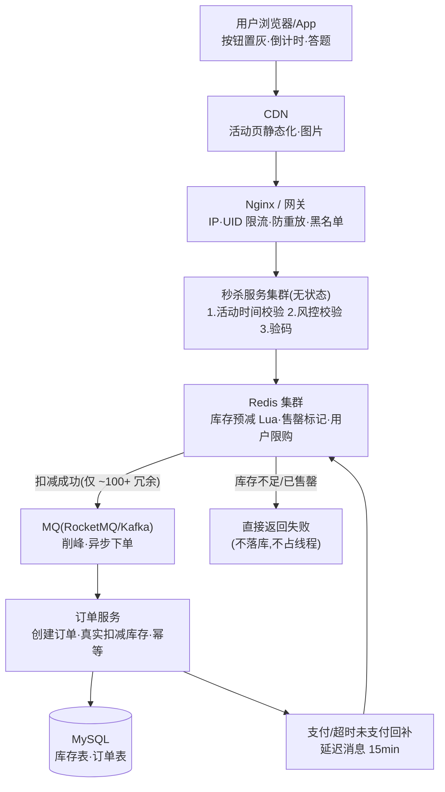

**分层职责一句话版（面试时按这个顺序讲，节奏最好）**：

| 层 | 做什么 | 挡掉多少 | 关键技术 |
|---|---|---|---|
| ① 页面层 | 静态化、CDN、按钮置灰、倒计时、答题/滑块 | 30%~50%（减少无效点击） | 页面静态化、CDN 边缘缓存、前端防抖 |
| ② 接入层 | IP/UID/设备维度限流、黑名单、防重放（签名+时间戳） | 剩 10%~20% | Nginx `limit_req`、Sentinel 热点参数限流 |
| ③ 服务层 | 活动时间校验、库存预检、风控、验证码校验 | 只放行"人+有时间+有资格" | Redis Lua 原子扣减、用户限购 set |
| ④ 缓存层 | 库存预减、售罄标记、限购去重 | 把 10 万 → 几百 | Lua 脚本、Cluster 分片、本地库存桶 |
| ⑤ 异步层 | MQ 削峰、异步下单、超时回补 | 把"几百"变成稳定 TPS | RocketMQ 事务消息 / 本地消息表 |
| ⑥ 存储层 | 订单落库、真实库存扣减 | 最终只有 ~100 单 | 乐观锁/唯一索引/幂等 |

### 1.5 核心难点一：库存扣减（三种方案 + 一个进阶）

#### 方案 A：Redis 原子递减（`DECR` / `DECRBY`）

```lua
-- 判断 + 扣减在一条命令里，天然原子（Redis 单线程执行 Lua）
if redis.call('exists', KEYS[2]) == 1 then
    return -2                     -- 已售罄标记，快速失败
end
local stock = tonumber(redis.call('get', KEYS[1]) or '-1')
if stock <= 0 then
    redis.call('set', KEYS[2], '1', 'EX', 3600)   -- 打售罄标记，后续请求不再查
    return -1
end
redis.call('decr', KEYS[1])
return stock - 1
```

- **优点**：O(1)、单线程原子、能扛 10 万 QPS。
- **缺点**：Redis 与 DB 是两套库存，**Redis 扣了不等于订单成功**（少卖风险）。
- **关键细节**：`DECR` 返回值 < 0 就说明超卖了，但更稳的做法是"先 `get` 判断再 `decr`（用 Lua 包成原子）"，否则扣成负数还要回补。

#### 方案 B：Redis + Lua（推荐，生产主流）

和 A 的区别不在"命令"，而在**把多步操作合并成一次原子执行**：

1. `exists` 售罄标记 → 直接失败（避免每次都读库存 key，热 key 保护）
2. 读库存 → ≤0 打标记返回
3. `decr` 库存
4. `sadd` 用户限购集合（`uid` 维度一人一单）
5. `incr` 活动维度的"已放行数"（用于对账）

> **面试话术**："Lua 的价值不是性能，而是**原子性 + 减少 RTT**。5 次网络往返变成 1 次，10 万 QPS 下省下的 RTT 就是省下的连接数。"

#### 方案 C：MQ 异步扣减（把"扣"变成"排队扣"）

- 请求只做"**入队 + 返回排队中**"，消费者串行扣库存。
- **优点**：DB 绝对不被打穿，天然削峰。
- **缺点**：**响应变慢**（用户要等），且"排队中"的体验很差；MQ 堆积时延迟不可控。
- **适用**：预约制、大促尾款、抽签制；不适合"抢到即知道结果"的秒杀体验。

#### 进阶：分段库存（库存分桶）—— 面试官最爱的追问

单 key 库存 10 万 QPS 会打到一个 Redis 节点（**热 key + 单分片瓶颈**）。解法：

```
总库存 100 → 拆成 10 个桶: stock:act1:0 ~ stock:act1:9，每桶 10
请求按 hash(uid) % 10 落到某个桶 → 扣减该桶
某桶扣完 → 标记该桶售罄，请求转发到其他桶（或直接失败并重试一次）
```

- **代价**：会出现"某桶还有货但用户被拒"，需要**桶间转移/重试**逻辑；总量对账要 `sum(所有桶)`。
- **变种**：本地库存（每台应用机器预分配 10 个名额，用本地 `AtomicInteger` 扣）——极致性能，但**少卖风险最大**，只适合"允许少量少卖"的场景。

### 1.6 核心难点二：超卖 / 少卖 / 幂等 三件套

#### 超卖（卖了 101 件）

| 层级 | 手段 | 原理 |
|---|---|---|
| Redis | Lua 原子判断+扣减 | 单线程串行，不会两个请求同时读到 1 |
| DB | `UPDATE stock SET stock = stock - 1 WHERE id=? AND stock >= 1` | 利用 `WHERE` 条件做 CAS，返回影响行数 0 即失败 |
| DB | 乐观锁 `WHERE version = ?` | 版本号 CAS；缺点是失败要重试 |
| DB | 唯一索引 `(activity_id, user_id)` | 兜住"同一人重复下单" |
| 对账 | 定时 `sum(订单) vs sum(库存扣减)` | 最终发现并修偏 |

> **易错点**：`UPDATE ... SET stock = stock - 1 WHERE stock > 0` 这条语句在 MySQL 里**是安全的**（行锁 + 条件判断原子），很多人以为必须加 version。真正的坑是"先 `SELECT` 再 `UPDATE`"，那才会超卖。

#### 少卖（Redis 扣了 10 个，订单只成功 7 个）

链路：`Redis 扣减成功 → 发 MQ → 消费失败/超时 → 库存没真正卖出去`

**闭环方案（四选二组合）**：

1. **MQ 至少一次 + 消费幂等**：消息重投，消费端用 `orderId` 唯一索引去重。
2. **本地消息表**：业务表和消息记录同库同事务，定时任务扫表补发（最终一致）。
3. **RocketMQ 事务消息**：半消息 + 事务回查，保证"扣库存"和"发消息"原子。
4. **定时对账回补**：每 1 分钟扫"Redis 已放行数 vs 订单成功数"，差值回补 Redis（**这是最实用的兜底**）。

#### 幂等（重复请求不能下两单）

| 方案 | 实现 | 适用 |
|---|---|---|
| 唯一索引 | `uk(activity_id, user_id)` | 最强兜底，必做 |
| 令牌 | 进入秒杀页先领 `token`，下单时带 token，Redis `del` 成功才处理 | 防脚本重放 |
| 状态机 | 订单状态 `INIT→PAID→CLOSED`，只允许合法跃迁 | 支付回调等场景 |
| 去重表 | `request_id` 落库/Redis SETNX | 通用 |

### 1.7 核心难点三：限流（四种算法必须能对比）

| 算法 | 原理 | 优点 | 缺点 | 典型实现 |
|---|---|---|---|---|
| 固定窗口计数 | 每窗口 `INCR` + `EXPIRE` | 最简单、省内存 | **临界突刺**（窗口边界 2 倍流量） | Redis `INCR` |
| 滑动窗口日志 | 记录每次请求时间戳，滑动统计 | 精确 | 存时间戳，内存大 | Redis ZSET |
| 滑动窗口计数 | 分桶（如 10 桶/秒）加权 | 精度与内存折中 | 仍是近似 | Sentinel 底层即滑动窗口 |
| 漏桶 | 固定速率流出，桶满则拒 | 输出绝对平滑 | 无法应对突发（突发也被削平） | Nginx `limit_req`（burst 队列） |
| 令牌桶 | 固定速率放令牌，桶容量允许突发 | **允许突发 + 长期限速**，最常用 | 参数需调优 | Guava `RateLimiter`、Sentinel、Gateway `RequestRateLimiter` |

**秒杀里的三层限流（讲这个结构最加分）**：

```
① 网关/接入层: 单 IP 100 QPS、单设备 20 QPS        → 挡脚本
② 服务层:     单 UID 1 次/活动（Redis SETNX）        → 挡重复提交
③ 全局层:     令牌桶 1000 QPS 放行到下单链路          → 保护下游
④ 系统层:     Sentinel 对 DB/下游依赖做 QPS 自适应    → 自我保护
```

**分布式限流怎么做？**

- Redis + Lua（`INCR` + `EXPIRE` 或 `ZSET` 滑动窗口）——**有网络开销，单 Redis 会有热点**。
- 网关本地令牌桶 + 按实例数分摊配额（`总配额 / 实例数`）——**精度换性能**，适合大规模。
- Sentinel Cluster 模式（Token Server 统一发令牌）——精度高、成本高。

### 1.8 核心难点四：防刷与防黄牛

| 手段 | 原理 | 注意 |
|---|---|---|
| URL 动态化 | 秒杀 URL 带 `md5(uid+时间戳+盐)`，服务端校验 | 只能防"猜 URL"，防不住真人黄牛 |
| 答题/滑块 | 拉高机器人成本 | 体验差，量小的活动不建议 |
| 设备指纹 | 采集设备 ID/浏览器指纹，一设备一单 | 需合规 |
| 风控画像 | 历史行为、收货地址聚类、下单频率 | 大厂有专门风控中台 |
| 黑名单 | 黄牛库、代理 IP 库、异常 UA | 需持续更新 |
| **库存延迟释放** | 下单后 15 分钟未支付则回补（延迟消息） | **不做这个，黄牛占库存就能拖垮活动** |

> **高频追问**："如果黄牛用 10 万个真实账号怎么办？" → 答：**账号维度限购 + 设备/收货地址/支付账户聚类 + 库存与资格绑定（邀请制/会员等级）+ 风控异步踢单**。承认"无法 100% 防住，只能提高成本"。

### 1.9 高可用与降级（收尾必讲）

| 风险 | 后果 | 方案 |
|---|---|---|
| Redis 挂 | 库存判断失效 → 可能超卖 | Cluster + 多副本；降级为"DB 乐观锁直扣"（性能差但正确）；活动页直接提示"稍后再试" |
| MQ 堆积 | 下单延迟、超时回补错乱 | 削峰 + 消费端限流 + 死信队列 + 监控堆积告警 |
| DB 热点行 | 库存行锁竞争，TPS 掉到几十 | 分段库存；库存行拆多行；只让少数请求落库 |
| 应用雪崩 | 上游超时重试风暴 | 熔断（Sentinel/Hystrix）+ 超时时间逐层递减 + 舱壁模式（线程池隔离） |
| 活动页被刷 | 带宽打满 | CDN + 静态化 + 预热；限速（`limit_rate`） |

### 1.10 面试追问清单（自测）

1. 为什么用 Redis 扣库存，不直接用 DB 的 `stock > 0`？→ DB 单行 TPS 上限几千，10 万 QPS 打不住；Redis 是"挡流量的闸门"，DB 是"最终账本"。
2. Redis 扣减成功但 MQ 消息丢了怎么办？→ 本地消息表/事务消息 + 定时对账回补。
3. 库存预热什么时候做？→ 活动开始前 T-10min 写入 Redis，同时 `warmup` 到本地缓存；预热量级=库存量+冗余（如 1.2 倍）。
4. 为什么要有"售罄标记"？→ 避免每次请求都读库存 key（热 key），一个 `exists` 就能挡掉 99% 请求；标记 TTL 到活动结束。
5. 一人一单用 Redis SET 会不会内存爆？→ 参与人数 100 万 × ~40B ≈ 40MB，可接受；更大规模按活动维度分 key + TTL。
6. 秒杀要不要做"排队"? → 看体验要求；排队能用 MQ 削峰，但"未知等待时间"体验差，一般只在大促尾款/预约场景用。
7. 如果库存只有 100，但放行了 120 个请求进 MQ？→ 允许"超发少量"，下游用 DB 兜底 + 失败补偿；这叫**漏斗放大量**（通常 1.1~1.3 倍，用少量少卖换吞吐）。
8. 怎么证明你的系统不超卖？→ 三重保障：Lua 原子 + DB 条件更新 + 唯一索引；再加 T+1 对账。

### 1.11 大厂真题与详解

| # | 公司 / 部门 | 题目 | 考核程度 | 频次 |
|---|---|---|---|---|
| 1 | 阿里 · 淘系/聚划算 | 设计一个秒杀系统，100 万用户抢 1000 件商品，要求不超卖、不宕机 | ★★★★★ | 超高频 |
| 2 | 字节 · 电商/抖音商城 | 大促零点开抢，流量是日常 1000 倍，如何保证系统不被打挂？ | ★★★★☆ | 高频 |
| 3 | 美团 · 到店/酒旅 | 秒杀场景下 Redis 扣减成功但订单创建失败，怎么保证不少卖？ | ★★★★☆ | 高频 |
| 4 | 京东 · 零售 | 如何防止黄牛脚本刷单？风控和限流怎么配合？ | ★★★★☆ | 中高频 |
| 5 | 拼多多 | 库存只有 100，如何让 10 万 QPS 的请求快速失败且不浪费资源？ | ★★★★☆ | 高频 |
| 6 | 腾讯 · 广告/活动 | 单 Redis key 成为热点怎么办？（库存热 key） | ★★★★☆ | 中频 |
| 7 | 阿里 · 中间件 | 分布式限流有哪几种实现？各自精度与成本如何取舍？ | ★★★☆☆ | 高频 |

---

#### 真题 1｜阿里：100 万用户抢 1000 件，不超卖不宕机（★★★★★）

**回答骨架（面试现场 8 分钟版）**

**(1) 澄清**：1000 件、100 万人、开抢 5 秒、允许少量少卖（≤1%）、要求页面可打开（不能全站 502）。

**(2) 估算**：峰值 `100万/5s = 20万 QPS`；成功率 0.1%；**DB 只需承接 1000 次左右写**。

**(3) 架构**：见 1.4 分层图，四道闸门：CDN 静态页 → Nginx 限流 → 服务层资格校验 → Redis Lua 扣减 → MQ → DB。

**(4) 深挖（讲三段）**

- **闸门一（页面）**：活动页全静态 + CDN；按钮"请求中置灰 + 200ms 节流"；倒计时以服务端时间为准（`serverTime` 下发，客户端算偏移），否则用户改本地时间就能提前抢。
- **闸门二（Redis）**：库存预热 + 售罄标记 + Lua 原子扣减 + 一人一单 `SADD`；库存按 10 桶分片避免热 key。
- **闸门三（异步）**：放行 1.1 倍（1100）进 MQ，消费端幂等（`uk(activity_id,user_id)`），DB `UPDATE stock=stock-1 WHERE stock>=1` 兜底；15 分钟未支付延迟消息回补。

**(5) 收尾三风险**：Redis 单点 → Cluster；MQ 堆积 → 消费限流 + 死信；少卖 → 分钟级对账回补。

**面试官可能追问的"杀手锏"**："Redis 扣减和 MQ 发送不是原子的，中间进程被杀怎么办？"
→ 答：**先落"本地扣减流水"再发 MQ**（同库同事务），或直接用 **RocketMQ 事务消息**：先发半消息 → 执行 Redis 扣减 → 提交消息；消费端幂等。极端情况下用**对账兜底**（Redis 放行数 - 订单数 > 0 则回补），因为秒杀是"允许少量少卖、绝不允许超卖"。

---

#### 真题 2｜字节：流量是日常 1000 倍，如何不被打挂（★★★★☆）

字节系偏好考**"系统自我保护"**，答案要围绕"**任何一层都不许把压力传给下一层**"：

1. **入口**：`limit_req`（IP/UID/设备）+ 人机验证 + 活动页 CDN 化。
2. **服务**：无状态 + 水平扩容（提前扩容 3~5 倍）；线程池隔离（秒杀单独线程池，失败不拖累其他业务）。
3. **依赖**：所有下游调用设"短超时 + 熔断"（如 DB 超时 50ms、Redis 20ms）；**超时逐层递减**（网关 300ms → 服务 200ms → DB 100ms），避免重试风暴。
4. **兜底**：开关降级（关掉非核心：推荐、评论、积分）；**兜底返回**（"当前人数过多，请稍后再试"由 Nginx/网关直接返回，不打到应用）。
5. **观测**：QPS/RT/错误率/线程池队列/GC 五件套；预案是**预案化脚本**（一键限流到 1000 QPS）。

> 加分句："1000 倍流量不可能靠扩容解决，**只能靠拒绝**。所以设计的核心是'**优雅地拒绝**'——快速失败、友好提示、不影响主站其他业务。"

---

#### 真题 3｜美团：Redis 扣了但订单失败，怎么不少卖（★★★★☆）

这是**"最终一致性"专项题**，答题主线是"**消息不丢 + 消费幂等 + 定时对账**"：

| 环节 | 风险 | 手段 |
|---|---|---|
| 扣减 → 发消息 | 进程崩溃，消息未发出 | 本地消息表（同事务）/ 事务消息 / 半消息回查 |
| 消息 → 消费 | 重复消费 | `orderId` 唯一索引；`msgId` Redis SETNX |
| 消费 → DB | DB 超时/异常 | 重试（指数退避）+ 死信队列（人工/自动补偿） |
| 全链路 | 静默丢失 | **分钟级对账**：`Redis 放行数 - 成功订单数 - 处理中订单数`，差额回补库存 |
| 用户侧 | 支付超时占库存 | 延迟消息 15min → 关闭订单 + 回补 Redis |

> 关键取舍："**宁可少卖，不可超卖**"。所以扣减顺序一定是"先 Redis 预减（多减一点）→ 再 DB 实扣"，失败就回补，而不是反过来。

---

#### 真题 4｜京东：如何防黄牛脚本（★★★★☆）

答题分三层，层层递进才显得专业：

1. **成本层**：滑块/答题、设备指纹、实名/会员门槛、邀请码。
2. **规则层**：一人一单（UID）、一设备一单（设备 ID）、一地址 N 单（收货地址聚类）、支付账户绑定校验。
3. **对抗层**：风控中台异步打分（历史成功率、下单间隔、IP 段聚集度、UA 一致性）；**事后踢单**（已下单但判定为黄牛 → 取消 + 回补库存 + 拉黑）。
4. **库存保护**：未支付 15min 自动释放（这是最关键的一条，黄牛靠"占库存"就能拖死活动）。

> 面试官会追问："风控误杀了真实用户怎么办？" → 答：**分级处置**（高危直接拒、中危进人工审核/延后放行、低危通过）+ 申诉通道 + 灰度阈值。

---

#### 真题 5｜拼多多：10 万 QPS 快速失败且不浪费资源（★★★★☆）

拼多多风格：**极致性价比、极致性能**。答案要突出"**在最便宜的层失败**"：

1. **Nginx 层直接返回**：售罄后由 Nginx/网关返回 `{"code":"SOLD_OUT"}`（`lua-resty-redis` 直读标记），**不进入 Java 进程**——省线程、省 GC、省连接。
2. **Redis 售罄标记**：一个 `exists` 即可，避免读库存。
3. **本地售罄缓存**：应用内 `volatile boolean soldOut` + 定时/订阅刷新，连 Redis 都不查（**本地短路**）。
4. **连接层保护**：`keepalive` 复用、请求体小、禁止大 body；失败响应体 < 200B。
5. **成本视角**："10 万 QPS 的失败请求如果每个都打 Java，按 5000 QPS/机算要 20 台；如果 Nginx 直接拒，1~2 台就够。这就是为什么失败路径要设计得比成功路径更快。"

---

#### 真题 6｜腾讯：单 Redis key 热点怎么办（★★★★☆）

标准答法（四级递进，逐级成本更高）：

1. **本地缓存**：JVM 内 `Caffeine` 缓存售罄标记/库存快照（TTL 10~50ms），90% 请求不出进程。
2. **key 拆分（分桶）**：`stock:{act}:{0..N}`，`hash(uid)%N` 路由；总量对账 `sum`。
3. **读写分离/多副本**：热点 key 复制到多个 key，随机读；写仍需回主。
4. **Redis Cluster 的 hash tag 陷阱**：`{act1}:stock` 这种 hash tag 会把同活动 key 打到**同一 slot/节点**，做原子操作方便但**放大热点**——分桶时不要用 hash tag 包住整个活动。
5. **兜底**：热点探测（`redis-cli --hotkeys`、代理层统计）+ 限流（单 key QPS 上限）。

---

#### 真题 7｜阿里中间件：分布式限流实现对比（★★★☆☆）

| 方案 | 精度 | 性能 | 成本 | 适用 |
|---|---|---|---|---|
| Redis + Lua 固定窗口 | 中（临界突刺） | 中（1 RTT） | 低 | 中小集群 |
| Redis ZSET 滑动窗口 | 高 | 低（内存/带宽） | 中 | 精确计费/风控 |
| Redis + Lua 令牌桶 | 高（可突发） | 中 | 低 | 通用首选 |
| Sentinel Cluster Token Server | 高 | 高（本地取令牌批量） | 高 | 大规模生产 |
| 网关本地令牌桶 + 配额分摊 | 低（实例不均） | 极高（无网络） | 极低 | 超大规模、允许误差 |

> 收尾句："限流的目标不是'精确'，而是'**保护下游**'。所以生产上常用'**粗粒度本地限流（保命）+ 细粒度分布式限流（保公平）**'双层结构。"

---

## 2. 设计一个短链系统

### 2.1 面试官考什么

| 考察点 | 期望层次 |
|---|---|
| 发号器设计 | 能对比"自增/号段/雪花/哈希"，并说清冲突与有序性 |
| Base62 数学 | 能算出"6 位够不够用" |
| 302 与 301 的业务差异 | 知道"要统计就必须 302" |
| 高并发读 | 缓存 + 布隆过滤器 + Nginx/Lua 直读 |
| 安全 | 开放重定向、钓鱼、扫描爆破 |

> **题眼一句话**："短链是**写少读极多**的系统（读写比可能 1:10000），所以 90% 的设计精力应该放在**跳转路径**，而不是生成路径。"

### 2.2 需求与估算

**功能需求**：长链 → 短链（`https://t.cn/Ab3xK9`）、跳转、自定义别名、过期、访问统计（PV/UV/来源/地域）。

**估算示例**：

```
每天新增短链 1000 万条，保留 3 年 → 1000万 × 365 × 3 ≈ 1.1 万亿条
每天跳转 100 亿次 → 平均 QPS ≈ 11.6 万，峰值 30 万 QPS
读:写 ≈ 10000:1
每条记录 ~200B（长链 + 元数据）→ 3 年 ≈ 220 TB（需分库分表）
```

**Base62 长度计算（必背）**：

| 位数 | 容量 | 说明 |
|---|---|---|
| 4 位 | 62^4 ≈ 1477 万 | 小站够用 |
| 5 位 | 62^5 ≈ 9.16 亿 | 中等 |
| **6 位** | 62^6 ≈ **568 亿** | 主流选择（够用几十年） |
| 7 位 | 62^7 ≈ 3.52 万亿 | 超大规模 |

> 字符集 `0-9a-zA-Z`（62 个）。去掉了 `+/=`（URL 不安全）、`O/0/l/1`（易混淆）会变成 58/54 进制，容量下降但用户体验好——**这是一个很好的加分细节**。

### 2.3 架构

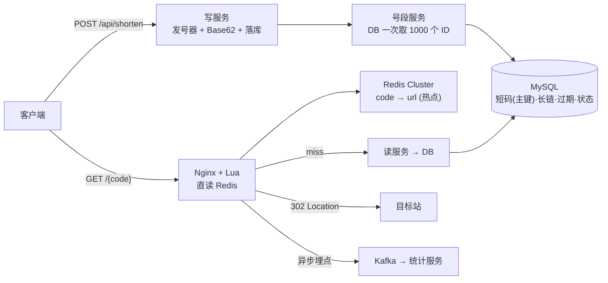

### 2.4 核心难点一：短码怎么生成（四种方案对比）

| 方案 | 原理 | 优点 | 缺点 | 生产选择 |
|---|---|---|---|---|
| **DB 自增 + Base62** | `AUTO_INCREMENT` 转 62 进制 | 简单、无冲突、趋势递增 | DB 单点；**ID 可被遍历**（安全问题） | 小规模、内网 |
| **号段模式（Leaf-segment）** | DB 一次发 1000 个号，内存分配 | 高吞吐、少 DB 压力、无冲突 | 号段浪费（重启丢弃）；DB 短暂不可用会耗尽 | **推荐**（美团 Leaf 同款） |
| **雪花算法 + Base62** | 64bit ID 直接转 62 进制 | 本地生成、无网络 | 转出来是 ~11 位（太长）；需 workerId | 可接受长码时 |
| **哈希（MD5/Murmur）截断** | `md5(url)` 取前 6 位 | 相同 URL 天然同码（可去重） | **冲突**需处理；无法自定义 | 需要"同链同码"时 |
| **随机生成 + 重试** | 随机 6 位，查重后插入 | 不可遍历、安全 | 高水位时冲突率上升、多次 RTT | 安全敏感场景 |

**哈希冲突的数学（面试亮点）**：生日悖论，`n` 条记录、空间 `N=62^6=5.68e11`，冲突概率 ≈ `1 - exp(-n²/(2N))`：

| 记录数 | 预期冲突概率 |
|---|---|
| 100 万 | ≈ 0.0009（万分之一） |
| 1 亿 | ≈ 0.87% |
| 10 亿 | ≈ 58%（不可接受！） |

> 所以"MD5 截 6 位"在**千万级以下**可用，**亿级以上必须发号器**。这就是为什么大厂都用 Leaf/号段，而不是哈希。

**号段模式的关键细节（Leaf-segment 做得最好的两点）**：

1. **双 Buffer 预加载**：当前号段用到 10% 时，异步去 DB 取下一段，避免"用完才取"造成 RT 抖动。
2. **动态步长**：根据上次号段消耗速度调整 `step`（消耗快 → 步长变大），避免频繁访问 DB。

```sql
-- 号段表
CREATE TABLE leaf_alloc (
  biz_tag     VARCHAR(128) PRIMARY KEY,   -- 业务标识, 如 'short_url'
  max_id      BIGINT NOT NULL DEFAULT 0,  -- 当前已分配到的最大 ID
  step        INT    NOT NULL DEFAULT 1000,
  update_time TIMESTAMP NOT NULL
);

-- 取号段（一条 SQL 完成"读+改"，行锁保证并发安全）
UPDATE leaf_alloc SET max_id = max_id + step WHERE biz_tag = 'short_url';
SELECT max_id, step FROM leaf_alloc WHERE biz_tag = 'short_url';
```

### 2.5 核心难点二：跳转为什么必须 302

| 状态码 | 语义 | 浏览器行为 | 能否统计 | 短链场景 |
|---|---|---|---|---|
| 301 | 永久重定向 | 缓存，下次直接跳，不再请求短链服务 | **不能**（请求不到你） | 极少用（除非纯公益、无需统计） |
| **302** | 临时重定向 | 每次都请求短链服务 | **能** | **99% 的短链用这个** |
| 307 | 临时 + 保持方法/body | 同 302，但 POST 不降级 GET | 能 | 需要保方法的 API 跳转 |
| 308 | 永久 + 保持方法 | 同 301 | 不能 | 少用 |

**302 的副作用与对策**：
- 每次跳转都过一次你的服务 → **必须靠缓存与边缘计算扛**。
- 可以在响应里加 `Cache-Control: no-cache` 或不加（让浏览器不缓存）。
- **统计必须异步**：跳转响应不能等埋点落库（否则 RT 从 5ms 变 50ms）。做法：Nginx `access log` → Kafka/文件 → 离线+实时双算。

**跳转的极致优化（Nginx + Lua / OpenResty）**：

```lua
-- 伪代码：完全绕过 Java 应用，RT 可到 1~3ms
local code = ngx.var.arg_code
local redis = require "resty.redis"
local red = redis:new()
red:set_timeout(20)                      -- 20ms 超时
red:connect("redis-host", 6379)
local url = red:get("sl:" .. code)
if url == ngx.null then
    ngx.exec("@fallback")                -- 回源到 Java 读 DB 并回填
end
-- 异步埋点（ngx.timer 或 log_by_lua），不阻塞响应
ngx.timer.at(0, report, code)
ngx.redirect(url, 302)
```

> 加分层："Java 应用做跳转单机 3000~5000 QPS（线程模型 + 序列化开销），OpenResty 单机可到 3~5 万 QPS。读量 10 万 QPS 时，这个差距就是 20 台机器。"

### 2.6 核心难点三：缓存与布隆过滤器

**为什么需要布隆过滤器？** 短链系统有一个独特的攻击面：**爬虫/攻击者随机遍历 `/aaaaaa`、`/aaaaab`**，全部打到 DB（缓存穿透）。

| 方案 | 原理 | 优点 | 缺点 |
|---|---|---|---|
| 布隆过滤器 | `k` 个哈希映射到 `m` 位 bitmap，全 1 才可能存在 | 内存极省（1 亿条约 114MB @1% 误判）、O(k) | **有误判、不支持删除** |
| 空值缓存 | 查不到也写 `code → ""`，TTL 60s | 简单 | 被随机 code 刷时会污染缓存（内存放大） |
| 计数布隆 / 布谷鸟过滤器 | 支持删除 | 可删除 | 实现复杂、内存略增 |

**布隆过滤器参数公式（能写出来非常加分）**：

```
m = -n·ln(p) / (ln2)^2     位数组大小
k = (m/n)·ln2             哈希函数个数
n = 1 亿, p = 1%  → m ≈ 9.6e8 bit ≈ 114 MB, k ≈ 7
```

**缓存策略**：
- Key：`sl:{code}`，Value：长链 URL（可加一点元数据）。
- TTL：长链（永久链）用 LRU + 不设 TTL；短期链按过期时间设 TTL。
- **缓存更新**：短链的链接基本不改，所以"写时删缓存（`DEL sl:{code}`）"就够，不需要复杂一致性。
- **热点**：大 V 发的短链（微博/短信营销）会瞬时热点 → 本地缓存（Caffeine，TTL 秒级）+ Redis 多副本。

### 2.7 存储设计

```sql
CREATE TABLE short_link (
  code         VARCHAR(10)  NOT NULL COMMENT '短码(Base62)',
  long_url     VARCHAR(2048) NOT NULL,
  url_hash     CHAR(32)     NOT NULL COMMENT 'md5(long_url) 用于去重',
  biz_type     TINYINT      NOT NULL DEFAULT 0 COMMENT '0普通 1自定义 2活动',
  creator      BIGINT       NOT NULL DEFAULT 0,
  status       TINYINT      NOT NULL DEFAULT 1 COMMENT '1有效 0禁用(举报)',
  expire_at    DATETIME     NULL,
  created_at   DATETIME     NOT NULL DEFAULT CURRENT_TIMESTAMP,
  PRIMARY KEY (code),
  UNIQUE KEY uk_hash (url_hash, biz_type) COMMENT '同业务下同长链不重复发码',
  KEY idx_expire (expire_at)
) ENGINE=InnoDB;

CREATE TABLE short_link_stat (       -- 统计表, 可与业务表分离(不同库)
  code      VARCHAR(10),
  dt        DATE,
  pv        BIGINT,
  uv        BIGINT,
  referer   VARCHAR(64),
  region    VARCHAR(32),
  PRIMARY KEY (code, dt)
);
```

**分库分表**：按 `code` 哈希分 1024 表（因为读是点查，按 code 分片最优）。**注意**：如果先按 `url_hash` 去重，可能要去"另一个库"查已有 code → 这就是"**去重与分片的矛盾**"，取舍方案：
- 用 Redis `SETNX url_hash → code` 做去重（TTL 长），避免跨库查。
- 或者放弃"同链同码"，接受多个短码指向同一长链（成本极低）。

### 2.8 安全与运营（面试官爱问的"脏活"）

| 问题 | 方案 |
|---|---|
| **开放重定向（Open Redirect）** | 白名单域名（只允许自家域）；外链二次确认中间页；`Referer`/`token` 校验 |
| 短链被用于钓鱼/垃圾营销 | 长链入库前过 URL 黑名单 + 内容安全审核；提供举报入口；`status=0` 直接 404 |
| 枚举爆破 | 码空间离散（雪花/随机而非自增连续）；单 IP 限流；404 比例监控 |
| 恶意消耗存储 | 创建接口限流（单用户/单 IP 每天 N 条）+ 验证码 |
| 过期清理 | 定时任务扫 `expire_at`（分区表按天）+ 惰性删除（访问时判断过期） |

### 2.9 面试追问清单

1. 短链会不会被别人"抢注"自定义别名？→ 别名走独立命名空间 + `INSERT` 唯一键冲突即失败；敏感词/品牌词保留表。
2. 统计 PV 用什么？UV 用什么？→ PV 用计数（Redis `INCR` 后批量落库）；UV 用 `HyperLogLog`（12KB 误差 0.81%）或 bitmap（按天/按 code）。
3. 302 会不会被运营商劫持？→ HTTP 明文有风险，全站 HTTPS + HSTS；跳转目标也校验 HTTPS。
4. 高并发下"缓存与 DB 不一致"怎么办？→ 短链是"写少读多 + 不可变"，写完 `DEL` 缓存即可，天然弱一致没问题。
5. 一个短链要支持"按地区/设备跳不同长链"怎么设计？→ code 存"规则集"（JSON），跳转时按 UA/IP 匹配；规则变更用版本号 + 缓存刷新。
6. Redis 挂了怎么办？→ 降级"回源 DB"（QPS 掉到 1/10）+ 限流保护 + 静态兜底页；这是**读路径必须能降级**的典型案例。

### 2.10 大厂真题与详解

| # | 公司 | 题目 | 考核程度 | 频次 |
|---|---|---|---|---|
| 1 | 美团 | 设计短链服务，日均 10 亿跳转，如何设计发号器与存储？ | ★★★★☆ | 高频 |
| 2 | 字节 | 短链跳转 QPS 30 万，怎么把 RT 压到 5ms 内？ | ★★★★☆ | 高频 |
| 3 | 快手 | 短链如何防止被遍历？布隆过滤器误判怎么处理？ | ★★★☆☆ | 中频 |
| 4 | 腾讯 | 301 和 302 的区别？为什么短链必须用 302？ | ★★★☆☆ | 高频（基础必问） |
| 5 | 阿里 | 短链系统如何做访问统计（PV/UV/来源/地域），不拖慢跳转？ | ★★★★☆ | 中高频 |
| 6 | 百度 | 短链的存储如何分库分表？按什么维度分？ | ★★★☆☆ | 中频 |

---

#### 真题 1｜美团：10 亿跳转的发号器与存储（★★★★☆）

**核心回答**：

1. **发号器**：业务表 `leaf_alloc`，`step=1000`，**双 Buffer**（用 10% 时预取下一段），单机可发 10 万+/s；多机部署时每机独立号段（`step` 不同），天然不冲突。
2. **编码**：`Base62(max_id)` → 6 位（容量 568 亿）；若担心"ID 连续可遍历"，用"**号段 + 位混淆**"：把 ID 的低位做一次可逆置换（如 `id ^ salt` 或 Feistel 变换），**保持唯一但不连续**——这比随机生成+查重优雅得多（叫"**保序混淆/仿射加密**"）。
3. **存储**：`code` 为主键（InnoDB 聚簇索引，点查一次 B+ 树 IO）；按 `code` 哈希分 1024 库表；长链较长用 `VARCHAR(2048)` + 独立 `TEXT` 表 optional。
4. **写入**：`INSERT ... ON DUPLICATE KEY` 处理唯一键冲突（同链同码策略）；同步写 Redis（`SET sl:{code}`）。
5. **跳转**：OpenResty 直读 Redis → 302；miss 回源；异步 `log_by_lua` 打点。

> 追问："号段服务重启后浪费的号怎么办？" → 无法回收（ID 不需要连续），**唯一性不受影响**，只是可读性差一点；这正是号段模式的已知代价。

---

#### 真题 2｜字节：30 万 QPS，RT 压到 5ms（★★★★☆）

要按"**RT 拆解**"回答，非常工程化：

| 环节 | 典型耗时 | 优化 |
|---|---|---|
| DNS + TCP + TLS | 30~100ms | **不在你的控制范围**，但可 `keep-alive`、HTTP/2 复用、就近接入 |
| 接入层 | 1~3ms | Nginx + Lua 直读，避免进 JVM |
| 查 Redis | 0.5~2ms（同机房） | 连接池、`pipeline`、本地缓存 |
| 302 响应 | <0.5ms | 响应体最小化（`Location` + 空 body） |
| 埋点 | **不能进主链路** | `log_by_lua` 异步 / access log 离线解析 |

**结论句**："服务端可做到 1~3ms，用户感知的 5ms 主要靠**边缘节点 + 连接复用 + 本地缓存**；如果要求'端到端 5ms'，那必须把跳转逻辑下沉到 CDN 边缘（Edge Worker 读 KV）才行。"

---

#### 真题 3｜快手：防遍历 + 布隆误判（★★★☆☆）

- **防遍历**：① 码不连续（混淆/雪花）；② 单 IP 404 比例 > 阈值即封；③ 布隆过滤器前置（误判率 1% 时，假阳性请求会回源，但假阴性不存在——**布隆的"不存在"是确定的**，这点必须说准）。
- **误判处理**：误判只会造成"少量无效请求回源 DB"，用 `空值缓存`（TTL 60s，value 为空串）兜住；**不要**给空值长 TTL（防内存放大）。
- **删除问题**：短链会过期/被举报下架 → 布隆不支持删除，用"**计数布隆**"或"**定期重建 + 双布隆切换**"（老过滤器只读、新过滤器写入，切换后丢弃老的）。

---

#### 真题 4｜腾讯：301 vs 302（★★★☆☆）

标准四句：
1. 301 永久，浏览器/代理会缓存，后续请求**不再到你的服务器**；
2. 302 临时，每次都到服务器，**统计与风控可做**；
3. 短链的商业价值在"数据"，所以用 302；
4. 副作用是"流量全部回到自己身上"，所以必须 CDN/OpenResty/本地缓存三级扛读。

---

#### 真题 5｜阿里：统计不拖慢跳转（★★★★☆）

三层架构：
1. **采集**：Nginx `access.log`（含 code、IP、UA、Referer、时间）+ `log_by_lua` 异步写 Kafka。
2. **计算**：Flink 实时算 PV/UV（UV 用 `HyperLogLog`/bitmap）/来源 Top；离线 Hive 做地域、设备、转化漏斗。
3. **存储与查询**：ClickHouse/Druid 做多维 OLAP，报表按天聚合。
4. **关键点**：**跳转链路只写日志、不做任何 RPC/DB 写**；统计允许 1~5 分钟延迟。

---

#### 真题 6｜百度：分库分表维度（★★★☆☆）

- **读路径决定分片键**：90% 是 `GET /{code}` 点查 → 按 `code` 哈希分片（保证一次定位）。
- **写入去重**：`url_hash` 唯一键如果也按 code 分片就做不到"全局唯一" → 用 Redis 去重或接受重复。
- **统计表**独立库（写量大、可按 `code+dt` 分片，允许异步）。
- **冷热分离**：3 个月无访问的链迁到"冷库/对象存储"，热表只留热数据。

---

## 3. 设计一个分布式 IM 系统

### 3.1 面试官考什么

IM 是**系统设计里最难的一题**，因为它同时叠加了四种约束：

| 约束 | 说明 |
|---|---|
| **长连接** | 不是"请求-响应"，而是"服务器主动推"，天然有状态 |
| **强有序** | 同一会话消息顺序不能乱（乱序=事故） |
| **必达** | 消息不能丢（丢消息比慢更严重） |
| **多端同步** | 手机、PC、Pad 同时在线，读到哪了要一致 |

> **题眼一句话**："IM 的本质是**把'有状态的连接'变成'无状态的集群'**——连接在网关，状态在存储，路由靠一张映射表。"

### 3.2 需求与估算

**功能**：单聊、群聊（最大 5000 人）、离线消息、多端同步、已读回执、撤回、在线状态、图片/语音/视频消息、推送给未在线用户。

**估算**：

```
DAU 1 亿，同时在线 20%（2000 万长连接）
每连接内存 ~10KB（Netty Channel + buffer）→ 2000 万 × 10KB = 200 GB 内存
→ 单机 50 万连接（48C/128G 可做到）→ 需 40 台网关
消息量: 人均 100 条/天 → 100 亿条/天 ≈ 1.16 万 TPS 均值，峰值 5 万 TPS
每条消息 200B + 索引 100B → 每天 ~30 GB → 一年 10 TB（需分片 + 冷热分离）
```

**关键结论**：**连接数是内存瓶颈，消息量是存储瓶颈，二者要分开扩容**。

### 3.3 协议选型（先讲这个，显示你有工程判断）

| 协议 | 实时性 | 服务端推送 | 穿透/兼容 | 移动端耗电 | 适用 |
|---|---|---|---|---|---|
| HTTP 短轮询 | 差（秒级） | 无 | 最好 | 高（频繁请求） | 兜底/弱网 |
| HTTP 长轮询 | 中（~秒级） | 伪推送（hold 请求） | 好 | 中 | Web 兼容、配置中心 |
| SSE | 中 | 单向推送 | 好（HTTP） | 中 | 只需要服务端→客户端（通知、AI 流式输出） |
| **WebSocket** | 好 | **双向** | 好（80/443 穿透） | 低 | **Web/PC 端主流** |
| **TCP 私有协议** | 最好 | 双向 | 差（可能被封端口） | 最低 | **App 端主流**（微信/QQ/抖音） |
| MQTT | 好 | 双向（Pub/Sub） | 好 | 极低 | IoT、弱网、海外 |

**为什么 App 用私有 TCP 协议而不是 WebSocket？**
1. 更省流量：自定义二进制头（比 HTTP Header 小一个数量级）；
2. 更省电：可控心跳（WebSocket 心跳由应用层维护，但移动端 TCP 保活更可控）；
3. 可做**多路复用 + 加密 + 压缩 + 序号**一体化；
4. 避开 HTTP 代理/中间设备的奇怪行为。

> 现在主流用 **Protobuf**（比 JSON 小 3~5 倍，解析快 10 倍）+ 自定义包头（`magic|version|cmd|seq|length|body`）。

### 3.4 整体架构

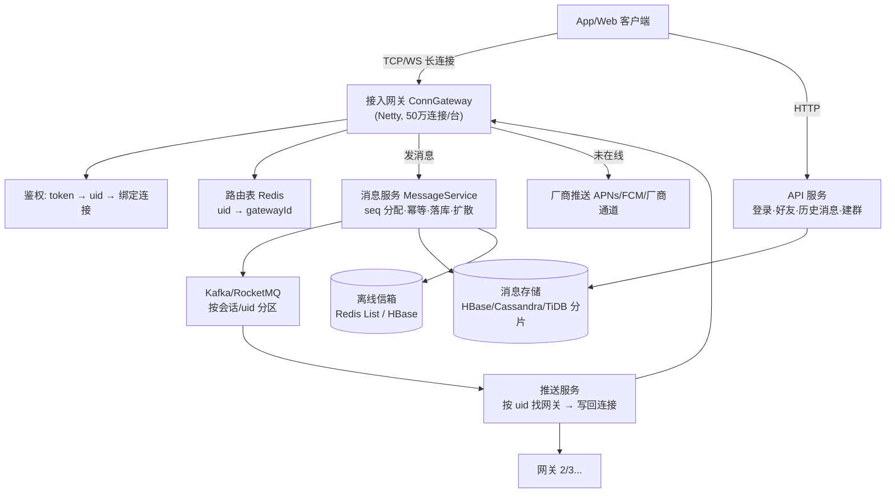

**分层职责（按这个顺序讲，逻辑最清楚）**：

| 层 | 职责 | 关键点 |
|---|---|---|
| 接入网关 | 维护长连接、编解码、心跳、限流、鉴权 | **无状态化**：连接状态在内存，用户路由在 Redis，网关本身可随意扩缩 |
| 路由层 | `uid → gatewayId` 映射 | Redis Hash；网关上线全量注册、宕机靠心跳/TTL 过期清理 |
| 消息服务 | 分配 `seq`、幂等、落库、扩散、回 ACK | 顺序与可靠性的核心 |
| 存储层 | 消息持久化、历史查询、离线信箱 | 写多读少 + 按会话顺序读 |
| 推送层 | 按路由把消息写到对应网关 | 在线推、离线存、第三方推 |

### 3.5 核心难点一：连接管理与路由（"网关无状态"是什么意思）

**陷阱**：一个用户连在哪台网关只有那台网关知道 → 网关成了"有状态"节点，扩缩容、宕机都会丢连接。解法：

```
登录/重连: 客户端带 token 连任意网关 → 网关校验 → 
          Redis: HSET online:{uid} gatewayId, connId, ts (TTL 90s, 心跳续期)
发消息:   消息服务按 to_uid 查 online:{uid} → 得到 gatewayId →
          若在本机, 直接写 Channel; 否则通过"网关间 RPC/Kafka"转发
心跳:     客户端 30~60s 发 ping, 网关回 pong 并续 TTL
掉线:     TTL 过期 / 网关下线事件 → 标记离线 → 后续消息走离线信箱
```

**心跳参数怎么定（面试常考）**：
- 移动端 App 前台 30~60s，后台由系统/厂商通道接管；
- 服务端判定超时 = 2~3 个心跳周期（避免网络抖动误杀）；
- **NAT 超时**：运营商 NAT 表项通常 5~20 分钟，所以心跳必须远小于此（60s 安全）。
- 心跳包要"极小"（< 10B），否则 2000 万连接 × 每分钟 = 巨大流量。

**单机 50 万连接怎么做到的？**
1. **epoll**（IO 多路复用）+ Netty 的 `EpollEventLoopGroup`（Linux）；
2. 每连接**不占线程**（EventLoop 线程数 = CPU 核数），只有业务处理走线程池；
3. 内存优化：`ByteBuf` 池化（PooledByteBufAllocator）、关闭 `SO_SNDBUF` 过大、减少 per-channel 对象；
4. 文件句柄：`ulimit -n` 调到 100 万；内核参数 `somaxconn`、`tcp_max_syn_backlog`；
5. **GC 压力**：避免大对象/频繁分配 → 用 Protobuf + 池化 + 直接内存；
6. 单机极限受限于**带宽与中断**（10 万连接 × 每秒 1 包 × 100B ≈ 10MB/s，不算高）。

### 3.6 核心难点二：消息有序（IM 的"灵魂问题"）

**为什么乱序会出事故**：A 发 "我到了" 后发 "取消"，如果乱序，对方看到"取消"再看到"我到了"。

**方案对比**：

| 方案 | 原理 | 问题 |
|---|---|---|
| 客户端时间戳排序 | 用发送端本地时间 | **时钟不可信**（用户改时间/时区/手机时间漂移） |
| 服务端接收时间 | 用服务端时间 | 同一毫秒多条无法定序；跨机器时钟漂移（NTP 也有几十 ms） |
| **服务端分配单调递增 seq（推荐）** | 每个会话一个计数器，服务端串行分配 | 需要"按会话串行"，热点会话（大群）有压力 |
| 雪花 ID 排序 | 全局递增 | 多机时钟微差 → 近似有序；高并发同 ms 需靠序列号 |

**生产方案（腾讯/微信、字节的做法）**：

```
单聊: 会话 = (uidA, uidB) 的 hash → 固定落到某个"seq 分配服务"分片
      Redis INCR conv:{convId}:seq  (或 DB 号段)
      消息体里带 seq, 客户端按 seq 排序展示
群聊: 会话 = groupId → 群维度 seq（Redis INCR gseq:{groupId}）
      同群消息严格有序; 不同群之间无需有序
```

**关键细节（这些才是面试官想听的）**：

1. **seq 必须是"服务端分配"，不能客户端生成**——否则恶意客户端可以伪造 seq 插队。
2. **seq 要持久化**：Redis `INCR` 是内存，重启丢失 → 用"号段/DB 递增"或"Redis 持久化 + 启动时从 DB max(seq) 校准"。
3. **发送失败要"占位"**：如果先分配 seq 再发送失败，会留下空洞。做法：seq 分配和消息落库在**同一事务/同一分片串行**，失败则回滚空洞或标记 `seq` 为已跳过（客户端容忍空洞，因为"缺一条"可以重拉）。
4. **客户端只信任服务端 seq**，本地时间只用于展示。
5. **撤回/编辑消息**要保留原 seq（否则顺序变了），用"原 seq + 新版本"覆盖。

> **加分表述**："IM 的有序不是'全局有序'，而是'**会话内有序**'。全局有序既没必要（不同人的消息互不关心），也不可能（分布式下无法低成本做到）。"

### 3.7 核心难点三：可靠投递（不丢、不重、不炸）

IM 的可靠性模型是 **At least once + 客户端幂等**（不是 exactly once）：

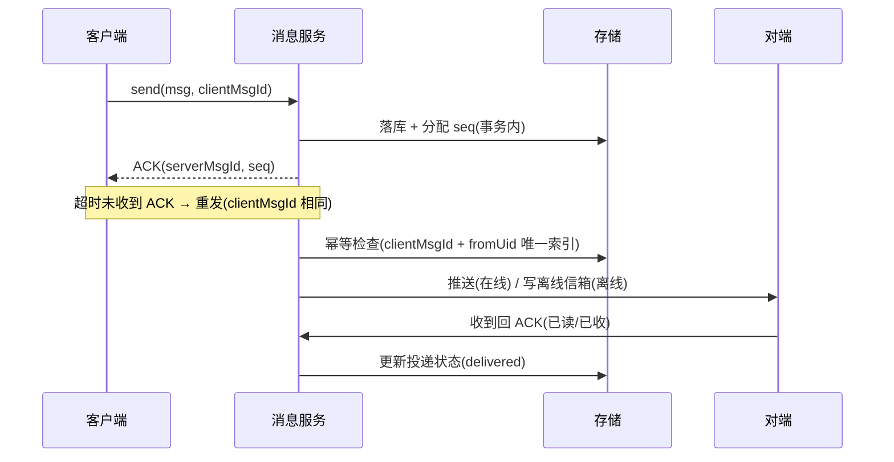

| 环节 | 风险 | 手段 |
|---|---|---|
| 客户端 → 服务端 | 网络抖动/超时 | 客户端重发（同 `clientMsgId`）+ 指数退避 |
| 服务端去重 | 重复消息 | `uk(from_uid, client_msg_id)` 唯一索引；Redis `SETNX` 短期去重 |
| 服务端落库 | 写失败 | 重试 + 落库失败即不 ACK（让客户端重发） |
| 服务端 → 对端 | 对端掉线/网关宕机 | 在线推 + 离线信箱双写；网关 ACK 后删离线；**推拉结合** |
| 全链路 | 静默丢失 | 定期对账（发送数 vs 存储数）、客户端 `seq` 空洞检测触发拉取 |

**"推拉结合"是必讲的重点**：

```
在线且连接健康: 推送（低延迟）
离线/推送失败:   写离线信箱（Redis List 按 uid，只存最近 N 条；更早的落 HBase）
上线时:          拉取（syncSeq 之后的所有消息）→ 保证不丢
大群:            只推"有新消息"通知，客户端主动拉（避免 5000 人 × 每条消息的推送风暴）
```

**为什么"写扩散"会爆？** 5000 人群，每条消息写 5000 份离线 → 一条消息 5000 次写。所以：
- **小群（<200）**：写扩散（每人一份，读取简单）；
- **大群（>200/~5000）**：**读扩散**（消息只存一份，按群 seq；客户端按 `lastReadSeq` 拉取）；
- **超大群（万人直播）**：只保留最近 N 条 + 不落每人信箱，走"拉"。

### 3.8 核心难点四：多端同步与已读

**核心概念：`syncSeq`（每个用户在每个会话的"已同步位点"）**

```
用户有 3 个端(手机/PC/Pad)，每个端维护:
  - maxSeq(收到的最大)
  - readSeq(已读到)
  - syncSeq(已同步到本地存储)
上线: 上报各端 seq → 服务端算"最小"作为拉取起点（或每端独立拉）
任意端已读 → 上报 readSeq → 服务端取 max 广播给其他端 → 其他端清理未读
```

| 功能 | 实现 |
|---|---|
| 未读数 | Redis `HINCRBY unread:{uid} {convId}`；打开会话清零 |
| 已读回执 | 客户端上报 `convId+readSeq`；服务端更新并推给对端（单聊）；群聊只推"某成员已读"（大群不再推每人的已读，成本太高） |
| 消息撤回 | 发撤回指令（原 `msgId`），服务端标记 `revoked`，通过 MQ 广播，客户端按 `msgId` 替换展示 |
| 历史消息 | 按 `convId + seq` 倒序分页（`seq < cursor limit 20`），走 HBase/TiDB 的 rowkey 设计 |

**存储选型对比（这题很能体现深度）**：

| 存储 | 写入 | 按会话顺序读 | 成本 | 适用 |
|---|---|---|---|---|
| MySQL 分库分表 | 中 | 好（主键 `convId+seq`） | 高（索引大） | 中小规模 |
| **HBase** | 高（LSM，顺序写） | 极好（rowkey=`convId+seq` 倒序） | 低 | **大厂主流**（微信/钉钉同款思路） |
| Cassandra | 高 | 好 | 低 | 海外/多 DC |
| TiDB | 中高 | 好 | 中 | 想复用 SQL 能力 |
| Redis | 极高 | 好 | 极高（内存） | 只存最近消息/离线信箱 |

> HBase rowkey 技巧：`convId` 反转 + `seq` 左补零（`convId_rev + 8位seq`），避免热点（同一会话集中）和数据倾斜。

### 3.9 面试追问清单（能扛住才算懂）

1. 网关挂了，上面 50 万连接怎么办？→ 客户端**指数退避重连**（1s/2s/4s...最大 30s）+ 随机抖动（防雪崩）；DNS/HTTPDNS 换节点；服务端限流（重连风暴是最大杀手）。
2. 用户 A 在网关 1、B 在网关 2，消息怎么过去？→ 消息服务查路由 → 走**网关间 RPC**（内部 gRPC）或 Kafka 定向 topic；不要"网关互相直连全互联"（N² 连接）。
3. 消息存储要不要"一条消息存多份"？→ 单聊存一份（双方共享）；群聊**存一份 + 群成员位点**；只有"离线信箱"才按人存。
4. 群消息的"已读人数"怎么算？→ 大群用**位图**（5000 人 → 625B）；每 1000 人一个 bitmap，`readCount` 用 `BITCOUNT` 求和。
5. 怎么防止"消息风暴"（一个大群 1 秒 1000 条）？→ 服务端合并推送（每 100ms 聚合一次）、客户端限流渲染、大群开启"仅拉不推"。
6. 消息加密怎么做？→ 传输层 TLS + 应用层端到端（Signal 协议/Double Ratchet）；**服务端只存密文**，合规与隐私兼顾。
7. 消息 100 亿条怎么查"某天某人的消息"？→ 双存储：会话维度（HBase）+ 用户维度二级索引（ES/画像表）；或冷数据进对象存储（Parquet）+ 查询引擎。
8. 如何做"消息必达"的证明？→ 监控三指标：**发送成功率、端到端延迟 P99、seq 空洞率**。

### 3.10 大厂真题与详解

| # | 公司 | 题目 | 考核程度 | 频次 |
|---|---|---|---|---|
| 1 | 腾讯 · 微信/QQ | 设计一个支持 2000 万在线的 IM 系统，消息不丢不乱序 | ★★★★★ | 超高频 |
| 2 | 字节 · 抖音私信 | 群聊 5000 人，一条消息如何高效扩散？ | ★★★★★ | 高频 |
| 3 | 阿里 · 钉钉 | 多端同步（手机+PC）已读状态如何一致？ | ★★★★☆ | 高频 |
| 4 | 腾讯 | 长连接网关如何做到单机 50 万连接？瓶颈在哪？ | ★★★★☆ | 高频 |
| 5 | 网易 · 云信 | 离线消息存储怎么设计？大量离线消息如何清理？ | ★★★★☆ | 中高频 |
| 6 | 快手 | 客户端弱网/频繁重连，服务端如何防止重连风暴？ | ★★★★☆ | 中频 |
| 7 | 阿里 | IM 消息如何保证有序？为什么不用时间戳？ | ★★★★☆ | 超高频（基础必问） |

---

#### 真题 1｜腾讯：2000 万在线，不丢不乱序（★★★★★）

**标准 10 分钟答法（按层次推进）**：

1. **澄清**：2000 万同时在线、单聊+群聊、消息必达、允许"重复"不允许"丢"、P99 延迟 < 200ms。
2. **接入层**：Netty + 私有 TCP 协议 + Protobuf；单机 50 万连接 → 40 台网关；心跳 60s。
3. **路由**：`online:{uid} → gatewayId`（Redis，TTL 90s 心跳续期）；网关间用内部 RPC 转发。
4. **消息链路**：消息服务按 `convId` 分片串行分配 `seq` → 落 HBase（rowkey=`convId+seq`）→ 在线推 / 离线信箱 → ACK。
5. **有序**：会话内单写者（分片串行）+ 服务端 seq + 客户端按 seq 排序。
6. **不丢**：客户端重发 + 服务端幂等 + 落库后才 ACK + 推拉结合 + seq 空洞检测。
7. **扩容**：网关按连接数扩、消息服务按会话分片扩、存储按会话 hash 扩——**三者独立扩容**。

**腾讯风格追问**："如果 A 发了消息，服务端落库成功但推送失败，A 却收到 ACK，消息丢了怎么办？"
→ 答：ACK 只表示"**服务端已持久化**"（at least once 语义中的"服务端责任"），推送失败由**离线信箱 + 上线拉取**兜底；客户端侧对"对方是否收到"用**已读/已收回执**（双勾）表示，而不是用发送 ACK。这是微信"一个勾/两个勾"的语义来源。

---

#### 真题 2｜字节：5000 人群消息扩散（★★★★★）

**核心矛盾**：5000 人 × 每条消息 = 5000 次写（写扩散），或 1 次写 + 5000 次读（读扩散）。

| 群规模 | 策略 | 理由 |
|---|---|---|
| ≤ 200 人（普通群） | 写扩散到每人信箱 | 读简单、延迟低 |
| 200 ~ 5000（大群） | **消息存一份 + 成员位点表**（读扩散） | 写入 O(1)，读时按 `lastSeq` 拉 |
| 万人以上（直播/公告群） | 完全不落个人信箱，只存群消息 + 推"有新消息" | 避免 N 倍放大 |

**推送优化**：
- 按网关聚合：先把"群成员 → 网关"分组（Redis `SMEMBERS` 或本地缓存），**一次网关 RPC 批量推 1000 条**，而不是 5000 次单推。
- 合并推送：100ms 窗口内同群新消息合并成"3 条新消息"通知。
- **去重**：大群里"@我"单独走强提醒通道，普通消息走弱通道。

---

#### 真题 3｜钉钉：多端已读一致（★★★★☆）

**答法**：引入"**每用户每会话的位点三元组**"：

```
maxSeq(最新)  readSeq(已读到)  syncSeq(已同步)
存储: Redis Hash {uid}:{convId} → 三个字段
规则:
  - 任一端上报 readSeq = X → 取 max(现有, X) 写入 → 广播给其他端（MQ/推送）
  - 其他端收到后，只改本地未读计数与"已读分割线"，不重拉消息
  - 新端首次登录: 用 min(各端 syncSeq) 拉历史 → 保证不漏
  - 未读数: Redis HINCRBY；打开会话时 HSet unread=0（注意并发, 用 Lua 原子）
```

**追问**："如果 PC 端断网 1 小时，手机端读了 100 条，PC 上线后怎么只拉增量？" → 用 `syncSeq`（PC 上报自己的 maxSeq），服务端返回 `(maxSeq, syncSeq]` 区间；**不要重拉全量**。

---

#### 真题 4｜腾讯：单机 50 万连接的瓶颈（★★★★☆）

按"**五个瓶颈**"回答，条理清晰：

| 瓶颈 | 表现 | 解法 |
|---|---|---|
| 文件句柄 | `Too many open files` | `ulimit -n 1000000`、`fs.file-max` |
| 内存 | OOM/GC 抖动 | ByteBuf 池化、`-XX:MaxDirectMemorySize`、减少 per-channel 对象、Protobuf |
| 线程模型 | 上下文切换多 | 1 EventLoop = 1~2 线程绑定 CPU 核；业务走独立线程池，避免阻塞 IO 线程 |
| 带宽/中断 | 网卡打满、软中断高 | 多队列网卡 + RPS/RFS、`SO_REUSEPORT` 多进程监听 |
| 内核参数 | 连接建立慢、SYN 丢 | `somaxconn`、`tcp_max_syn_backlog`、`tcp_tw_reuse`、`netdev_max_backlog` |

**加分**："50 万不是技术极限，而是**成本/故障域**的权衡——连接越多，单机故障影响越大、发布重启越痛。所以生产上通常单机 10~20 万，用更多机器换稳定性。"

---

#### 真题 5｜网易云信：离线消息存储（★★★★☆）

- **分层**：Redis List（最近 7 天/每人 1000 条，`LPUSH` + `LTRIM`）→ HBase（全量，rowkey `uid_rev + seq`）→ 冷存储（OSS/Parquet）。
- **清理**：Redis 用 `LTRIM` 自动裁剪 + TTL；HBase 用 TTL（`hbase.hstore.time.to.live`）或定期 compaction/删除任务。
- **上线拉取**：按 `syncSeq` 拉增量，Redis 命中 95%，miss 回源 HBase。
- **注意**："离线信箱不能无限增长"——按"用户离线时长 + 消息类型"做策略（系统通知只留最新一条）。

---

#### 真题 6｜快手：重连风暴（★★★★☆）


**五道防线**：
1. **客户端退避 + 抖动**：`min(30s, 1s * 2^n) + random(0~3s)`；
2. **服务端接入限流**：`accept` 速率限制（Netty `ChannelTrafficShapingHandler`/监听队列控制）；
3. **鉴权降级**：token 校验走本地缓存（JWT 无状态/短 TTL 缓存），避免打 DB；
4. **分批放量**：按"用户 ID 哈希分桶"分批允许重连（如每秒放 5%）；
5. **就近调度**：HTTPDNS + 多可用区，把重连打散到不同集群。

---

#### 真题 7｜阿里：为什么不用时间戳排序（★★★★☆）

四句标准答案：
1. **客户端时钟不可信**：用户可改时间、时区不同、设备时钟漂移（几分钟很常见）。
2. **服务端时间也不够**：跨机器 NTP 同步有几十 ms 误差，同毫秒多条无法定序。
3. **需要"因果序"**：同一会话内，后发必须先到，"递增 seq"是最便宜的因果表达。
4. **seq 是可恢复的游标**：断线重连时"我收到第 100 条，请给我 101 之后"——时间戳做不到（同一时间的多条无法界定边界）。

---

## 4. 设计一个权限管理系统（RBAC）

### 4.1 面试官考什么

| 考察点 | 期望层次 |
|---|---|
| 模型设计 | 不只是"用户-角色-权限"三张表，要讲清**功能权限 / 数据权限 / 接口权限**三分 |
| 鉴权链路 | 登录 → 发凭证 → 每次请求如何校验 → 缓存如何失效 |
| 数据权限 | 行级/列级权限怎么落地（SQL 拼接的风险与替代方案） |
| 扩展性 | 多租户、分级管理员、ABAC、权限变更实时性 |

> **题眼一句话**："RBAC 三张表谁都会画，真正的难点是**权限的实时性**与**数据权限的落地方式**。"

### 4.2 RBAC 的四代模型（讲清这个，档次立刻上去）

| 模型 | 内容 | 解决什么问题 |
|---|---|---|
| **RBAC0**（基础） | 用户-角色-权限（多对多） | 权限与用户解耦 |
| **RBAC1**（角色继承） | 角色有层级（部门经理 > 主管 > 员工） | 避免角色爆炸 |
| **RBAC2**（约束） | 静态职责分离（SSD：同一人不能兼任会计+出纳）、动态职责分离（DSD：同一会话不能同时激活冲突角色）、基数约束（一个角色最多 N 人） | 合规与风控（金融/政企刚需） |
| **RBAC3**（完整） | RBAC1 + RBAC2 | 大型组织 |
| **ABAC**（属性） | 按属性动态判定（主体/资源/环境） | 细粒度、动态策略（Casbin/OPA） |

**面试加分点**："国内大多数 SaaS 停在 RBAC1（角色继承+菜单权限），金融/政企会要求 RBAC2 的职责分离，云原生场景开始用 ABAC（如 K8s RBAC + OPA）。"

### 4.3 数据模型（DDL 要能写出来）

```sql
-- 用户
CREATE TABLE sys_user (
  id BIGINT PRIMARY KEY AUTO_INCREMENT,
  tenant_id BIGINT NOT NULL DEFAULT 0,      -- 多租户
  username VARCHAR(64) NOT NULL,
  dept_id  BIGINT,
  status   TINYINT DEFAULT 1,
  UNIQUE KEY uk_tenant_user (tenant_id, username)
);

-- 角色
CREATE TABLE sys_role (
  id BIGINT PRIMARY KEY AUTO_INCREMENT,
  tenant_id BIGINT NOT NULL DEFAULT 0,
  code VARCHAR(64) NOT NULL,        -- 'admin' / 'finance_manager'
  name VARCHAR(64) NOT NULL,
  parent_id BIGINT DEFAULT 0,       -- 角色继承(RBAC1)
  data_scope TINYINT DEFAULT 1,     -- 数据权限范围: 1全部 2本部门 3本部门及以下 4仅本人 5自定义
  UNIQUE KEY uk_tenant_code (tenant_id, code)
);

-- 权限(菜单/按钮/接口 三合一, 用 type 区分)
CREATE TABLE sys_permission (
  id BIGINT PRIMARY KEY AUTO_INCREMENT,
  tenant_id BIGINT DEFAULT 0,
  parent_id BIGINT DEFAULT 0,
  type TINYINT NOT NULL,            -- 1目录 2菜单 3按钮 4接口
  code VARCHAR(128) NOT NULL,       -- 'order:read' / 'order:refund'
  name VARCHAR(64),
  path VARCHAR(255),                -- 前端路由 / 接口路径
  method VARCHAR(16),               -- GET/POST...(type=4 时)
  sort INT DEFAULT 0,
  UNIQUE KEY uk_tenant_code (tenant_id, code)
);

-- 关联
CREATE TABLE sys_user_role   (user_id BIGINT, role_id BIGINT, PRIMARY KEY(user_id, role_id));
CREATE TABLE sys_role_perm   (role_id BIGINT, perm_id BIGINT, PRIMARY KEY(role_id, perm_id));
-- 数据权限的自定义范围(如"某几个部门")
CREATE TABLE sys_role_dept   (role_id BIGINT, dept_id BIGINT, PRIMARY KEY(role_id, dept_id));
```

**设计要点（逐条讲，都是面试官会挑的点）**：

1. **权限用 `code` 而不是 `id` 做业务判断**：`code` 可读、可配置、跨环境（开发/生产 id 不同）。
2. **`type` 区分菜单/按钮/接口**：一套模型覆盖"前端能看见什么 + 后端能做什么"。
3. **`data_scope` 放在角色上**：数据权限跟角色走，用户多角色时取"并集/最大范围"。
4. **`tenant_id` 全表冗余**：所有查询强制带租户，防越权（**这是最容易出安全事故的地方**）。

### 4.4 鉴权链路（一张时序图讲清）

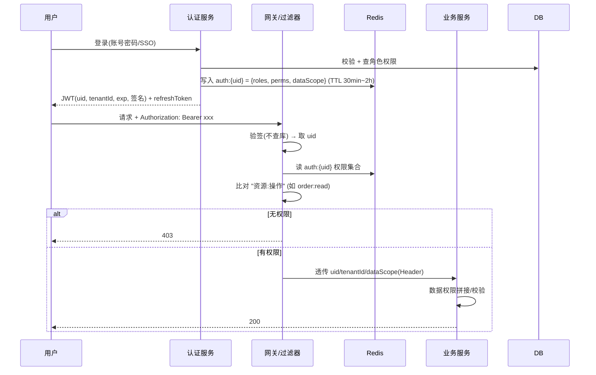

**三种凭证方案对比（必考）**：

| 方案 | 无状态 | 可主动失效 | 携带信息 | 适用 |
|---|---|---|---|---|
| Session（服务端存储） | 否 | 是（删 session） | 无 | 单机/小集群、强管控 |
| **JWT（自包含）** | 是 | **否**（只能等过期或用黑名单） | 多（uid/角色/过期） | 网关统一鉴权、微服务 |
| OAuth2 + 短 token + 中心校验 | 半 | 是 | 少 | 大厂/开放平台 |

**JWT 的坑（面试官最爱问）**：
- **无法主动失效** → 解法：短有效期（15min）+ refreshToken + Redis 黑名单（`jti`）+ "用户维度版本号"（改密码即升版本，旧 token 校验时版本不匹配）。
- **payload 可解码（不是加密）** → 不要放敏感信息。
- **签名算法混淆攻击**（`alg:none`）→ 服务端固定算法白名单。
- **体积大** → Header 里每次带，注意别塞权限列表（塞 uid 就够，权限查 Redis）。

### 4.5 核心难点一：功能权限 vs 数据权限（必须分清）

| 类型 | 回答的问题 | 实现位置 | 示例 |
|---|---|---|---|
| **功能权限**（菜单/按钮/接口） | "你能不能做这个动作" | 网关/拦截器 | 你有 `order:refund` 吗 |
| **数据权限**（行级/列级） | "你能操作哪些数据" | Service/DAO 层 | 你只能看本部门的订单 |
| 列级权限 | "哪些字段能看" | 序列化层/脱敏 | 手机号中间四位打码 |

**数据权限的五种实现路线（从土到优雅）**：

| 路线 | 做法 | 优点 | 缺点 |
|---|---|---|---|
| ① 手写 `WHERE dept_id = ?` | 每个 SQL 自己拼 | 简单直观 | **漏一个就越权**；改规则要改所有 SQL |
| ② AOP + 注解 + MyBatis 拦截器 | `@DataScope(deptAlias="d")`，拦截器改写 SQL | 统一、少漏 | SQL 解析有风险（复杂 SQL 解析失败） |
| ③ 拼接 `IN (子查询)` | `dept_id IN (SELECT id FROM dept WHERE path LIKE ?)` | 支持树形部门 | 子查询性能差；可用"部门 path 前缀"优化 |
| ④ 数据权限服务化 | 先算出"可见 ID 集合"（缓存），再 `IN (...)` | 可缓存、可审计 | 集合大时 SQL 过长（要分页/分片查） |
| ⑤ 数据库行级安全（RLS） | PostgreSQL RLS / Oracle VPD | 最安全（DB 兜底） | MySQL 不支持；运维复杂 |

**面试标准答法**：

> "功能权限放**接入层**（网关注解 + 权限 code 比对），数据权限放**服务层**（AOP 注解 + MyBatis 拦截器改写 SQL，或先算可见集合）。核心原则是**默认拒绝**——没有明确授权就不可见，而不是'默认放行'。"

### 4.6 核心难点二：权限变更的实时性（缓存一致性）

问题：管理员改了角色 → 用户已缓存的权限还是旧的 → **越权窗口**。

| 方案 | 做法 | 延迟 | 代价 |
|---|---|---|---|
| TTL 自然过期 | 缓存 30min | 最长 30min | 越权窗口大，金融场景不可接受 |
| 主动删除 | 改权限时 `DEL auth:{uid}` | 秒级 | 需知道"哪些用户受影响"（角色→用户反查） |
| **版本号** | 用户维度 `permVersion`，缓存 key 带版本 | 秒级 | 每次请求多读一个版本号（可合并） |
| 广播（MQ） | 权限变更发广播，各节点清本地缓存 | 毫秒~秒 | 需要广播通道（Nacos/Redis Pub/Sub） |
| 长连接推送 | 网关推"权限已变更，重新拉取" | 实时 | 复杂 |

**生产推荐组合**："**Redis 集中缓存 + 变更时删 key + 本地 Caffeine 二级缓存（TTL 5s）+ 版本号兜底**"。既保证 99% 请求不打 DB，又把越权窗口压到秒级。

### 4.7 扩展场景（面试官"再深一层"时用）

| 场景 | 设计 |
|---|---|
| **多租户** | 所有表带 `tenant_id`；权限 code 可全局复用；超管 `platform_admin` 跨租户 |
| **分级管理员** | 角色带"可管理范围"（部门树 + 数据范围），上级可给下级授权；授权行为要**审计** |
| **SSO 单点登录** | CAS/OAuth2/SAML；中心认证 + 各子系统只做"票据校验" |
| **ABAC/动态策略** | Casbin：`p, alice, data1, read` + `g, alice, admin`；支持 RBAC+ABAC 混合 |
| **权限继承** | 角色树：子角色自动拥有父角色权限（RBAC1）；注意"循环继承"检测 |
| **临时授权** | `grant` 带 `expire_at`，到期自动回收（比"记得手动删"可靠） |
| **审计** | 记录"谁在什么时候改了谁的什么权限"，用于合规与溯源 |

**Casbin 模型示例（能写出来很加分）**：

```ini
# model.conf
[request_definition]
r = sub, obj, act

[policy_definition]
p = sub, obj, act

[role_definition]
g = _, _          # 角色继承
g2 = _, _         # 资源继承(如 /api/v1/* 继承 /api/*)

[policy_effect]
e = some(where (p.eft == allow)) && !some(where (p.eft == deny))

[matchers]
m = g(r.sub, p.sub) && g2(r.obj, p.obj) && (r.act == p.act || p.act == "*")
```

### 4.8 面试追问清单

1. 用户有多个角色，权限怎么合并？→ 功能权限取**并集**；数据权限取**最大范围**（但要注意"最小权限原则"的反向争议，金融场景宁可取交集/需显式配置）。
2. 权限 100 万条怎么保证性能？→ 缓存"用户 → 权限集合"（不是"角色→权限"）；只缓存 `code` 的 bitmap 或 `Set`；网关本地缓存 + Redis。
3. 菜单树怎么存？→ `parent_id` + `path`（物化路径 `/1/12/123/`），前端递归渲染，后端按 `path` 前缀查子树。
4. 如何防止"越权访问别人的数据"？→ ① 所有查询强制带 `tenant_id + data_scope`；② 关键操作二次校验（不信任前端传的 id）；③ 自动化测试用例覆盖"水平越权/垂直越权"。
5. 接口权限和数据权限冲突怎么办？→ 先过接口权限（能不能调），再过数据权限（能操作哪些），**两层都要**。
6. 权限模型怎么支持"组织架构调整"？→ 权限绑"岗位/角色"而非"人"；组织调整只改 `dept` 树，角色继承自动生效。

### 4.9 大厂真题与详解

| # | 公司 | 题目 | 考核程度 | 频次 |
|---|---|---|---|---|
| 1 | 阿里 · 中台 | 设计一个支持多租户的权限系统，RBAC 模型怎么建表？ | ★★★★☆ | 高频 |
| 2 | 美团 | 如何实现"只能查看本部门及以下部门的数据"？ | ★★★★☆ | 高频 |
| 3 | 字节 | 权限变更后，用户已经登录的会话如何立刻生效？ | ★★★★☆ | 高频 |
| 4 | 华为/政企 | RBAC 的职责分离（SSD/DSD）怎么落地？ | ★★★☆☆ | 中频 |
| 5 | 阿里 | JWT 无法主动失效，你怎么解决？ | ★★★★☆ | 超高频 |
| 6 | 腾讯 | 权限系统如何防止水平越权与垂直越权？ | ★★★★☆ | 高频 |
| 7 | 京东 | 权限点 10 万个、用户 50 万，鉴权如何做到 1ms 内？ | ★★★★☆ | 中频 |

---

#### 真题 1｜阿里：多租户 RBAC 建表（★★★★☆）

**要点三条**：
1. **隔离级别**：共享库共享表（`tenant_id` 字段）成本最低，适合中小租户；大客户用"独立 schema/独立库"（物理隔离）。
2. **唯一键必须带租户**：`uk(tenant_id, code)`，否则 A 租户建了 `admin` 角色，B 租户就建不了。
3. **权限 code 可全局共享**（平台级权限），租户级权限用 `tenant_id` 覆盖：`(tenant_id=0 表示平台内置)`。

**追问"租户 A 的管理员能不能看到租户 B 的数据？"** → 三处兜底：① 所有 SQL 强制 `tenant_id`（MyBatis 拦截器自动注入）；② 缓存 key 带 `tenant_id`；③ 网关解析 token 时**以 token 里的 tenantId 为准**，忽略请求参数里的 tenantId（防篡改）。

---

#### 真题 2｜美团：本部门及以下的数据权限（★★★★☆）

**答法（按"部门树 + 范围计算 + SQL 落地"三步）**：

1. **部门树**：`dept(id, parent_id, path)`，`path` 用物化路径（`/1/12/123/`）。
2. **计算可见范围**：
   ```sql
   -- 方案A: 子查询(简单, 但慢)
   WHERE d.dept_id IN (SELECT id FROM dept WHERE path LIKE CONCAT((SELECT path FROM dept WHERE id=?), '%'))
   -- 方案B: 预计算 + 缓存(推荐)
   -- 定时/变更时把"部门 → 后代部门ID列表"写入 Redis, 查询时直接 IN (...)
   ```
3. **落地**：`@DataScope(deptAlias="d", userAlias="u")` + MyBatis `Interceptor` 在 `Executor.query` 阶段改写 SQL，追加 `AND (d.dept_id IN (...) OR d.create_by = #{userId})`。
4. **兜底**：`data_scope=1(全部)` 时不加条件；`=4(仅本人)` 时加 `create_by = userId`。

**追问性能**："5000 个部门的 IN 列表 SQL 太长怎么办？" → 用 `path` 前缀匹配（`WHERE dept_path LIKE '/1/12/%'`，利用索引最左前缀）或"部门分段 + 分页查"。

---

#### 真题 3｜字节：权限变更立刻生效（★★★★☆）

**答法（三方案递进 + 最终组合）**：

| 方案 | 说明 | 生效延迟 |
|---|---|---|
| 短 TTL | 缓存 5min | ≤5min |
| 主动失效 | 变更 → 反查"角色关联的用户" → 批量 `DEL auth:{uid}` | 秒级 |
| **版本号** | `permVersion:{uid}`，请求时比对，不一致则重载 | 秒级（多一次 Redis 读，可 pipeline 合并） |
| 广播 | MQ/Nacos 广播"perm changed"，各节点清本地缓存 | 毫秒级（集群内） |

**最终方案**："Redis 集中缓存（权威）+ 本地 Caffeine（TTL 3~5s，抗热点）+ 变更时 `DEL + 广播`。这样即便广播丢失，本地缓存 5s 后也会失效——**用 TTL 兜住广播的不可靠**，这是所有缓存失效设计的通用套路。"

---

#### 真题 4｜华为：职责分离 SSD/DSD（★★★☆☆）

- **SSD（静态）**：在"用户-角色分配"时就禁止冲突组合 → 建"冲突矩阵"表（`role_a, role_b`），分配时校验。
- **DSD（动态）**：运行时"同一会话不能同时激活冲突角色" → 会话里维护 `activeRoles`，激活时校验冲突。
- **落地**：`role_conflict(role_id_a, role_id_b, type)`；分配接口 + 会话激活接口各做一次校验；审计记录"被拒绝的冲突分配"。

---

#### 真题 5｜阿里：JWT 无法主动失效（★★★★☆）

**标准答法（四条，从轻到重）**：

1. **短有效期**：access token 15min，refresh token 7天（refresh 时可校验"用户是否被禁用"）。
2. **黑名单**：登出/改密/封号 → `SET jwt:blacklist:{jti} 1 EX 剩余有效期`；网关验签后查黑名单（一次 Redis 读）。
3. **用户版本号**：`user:ver:{uid}`，token 里带 `ver`；改密/踢人 → `INCR`；校验不匹配即拒。**比黑名单更省内存**（一个用户一个计数器）。
4. **中心化校验兜底**：网关对"高风险接口"（转账、改密）强制实时校验会话有效性。

> 加分："JWT 的'无状态'是相对的。真正需要'可撤销'的场景，本质是**状态必须存在某处**——要么 Redis（黑名单/版本号），要么网关每次查询。没有免费的午餐。"

---

#### 真题 6｜腾讯：越权防护（★★★★☆）

| 类型 | 定义 | 防护 |
|---|---|---|
| **水平越权** | 同角色用户访问他人数据（`?userId=2`） | 服务端**不信任前端 id**：从 token 取 `uid`；资源归属二次校验；`data_scope` 强制 |
| **垂直越权** | 低权限用户调用高权限接口 | 网关统一接口权限（`code` 比对）；敏感接口二次鉴权；隐藏不等于保护 |

**工程化手段**：
- 统一"资源归属校验"注解（`@OwnerCheck`）；
- 自动化越权测试（遍历接口 + 篡改 id）；
- 审计日志（谁访问了什么资源）；
- **默认拒绝（Deny by default）**：新接口默认无权限，必须显式授权。

---

#### 真题 7｜京东：10 万权限点、1ms 鉴权（★★★★☆）

**答法**："1ms 内不可能每次都做'权限计算'，只能做'**权限比对**'"。

1. **离线计算 + 在线比对**：权限变更时（异步）把"用户最终权限集合"算好写入 Redis（`Set` 或 **bitmap**：10 万权限点 = 12.5KB bitmap，`GETBIT` O(1)）。
2. **网关本地缓存**：热点用户/服务账号的 bitmap 缓存在本地（Caffeine，TTL 5s）。
3. **接口 → 权限位映射**：启动时把"接口 → bit 位"加载成内存 Map（`ConcurrentHashMap`），零分配。
4. **鉴权**：`GETBIT perm:{uid} {bitIndex}` → 1 通过。**单次 Redis 读 + O(1) 位运算**，1ms 内轻松。

> 这是"**空间换时间 + 预计算**"的经典应用：把"权限的语义计算"从请求路径彻底移出。

---

## 5. 设计一个分布式配置中心

### 5.1 面试官考什么

| 考察点 | 期望层次 |
|---|---|
| 为什么需要 | 配置散落、改配置要重启、多环境多集群难管理 |
| 客户端如何"实时"感知变更 | 长轮询 vs 推送的取舍，以及**为什么不用纯推送** |
| 高可用 | 配置中心自己挂了，业务不能挂 → 本地缓存/容灾快照 |
| 灰度与回滚 | 按 IP/机房/实例灰度，版本 diff 与回滚 |
| 安全 | 加密、权限、审计 |

> **题眼一句话**："配置中心的核心不是'存配置'，而是**变更如何可靠、及时、可回滚地到达每一台机器**，并且**配置中心挂了业务也不挂**。"

### 5.2 需求与痛点

| 痛点 | 传统做法 | 后果 |
|---|---|---|
| 配置散落 | 每个服务自己的 `application.yml` | 改一个参数要改 N 个仓库 |
| 改配置要重启 | 打包发布 | 发布风险 + 恢复慢（故障时无法快速调参） |
| 多环境混乱 | 手工维护 dev/test/prod | 配错环境是经典事故 |
| 变更不可追溯 | 谁改的不知道 | 事故复盘困难 |
| 无法动态调参 | 限流阈值、开关、黑名单 | 大促时无法"临时改一个数" |

**核心功能清单**：
1. 配置**存储**（DB + 缓存）
2. 配置**发布**（灰度、审批、版本、回滚）
3. 配置**推送/监听**（客户端感知变更）
4. **权限与审计**
5. **加密**（DB 密码、AK/SK）
6. **多环境/多集群/多命名空间**

### 5.3 架构（以 Apollo 为原型，Nacos 作对比）

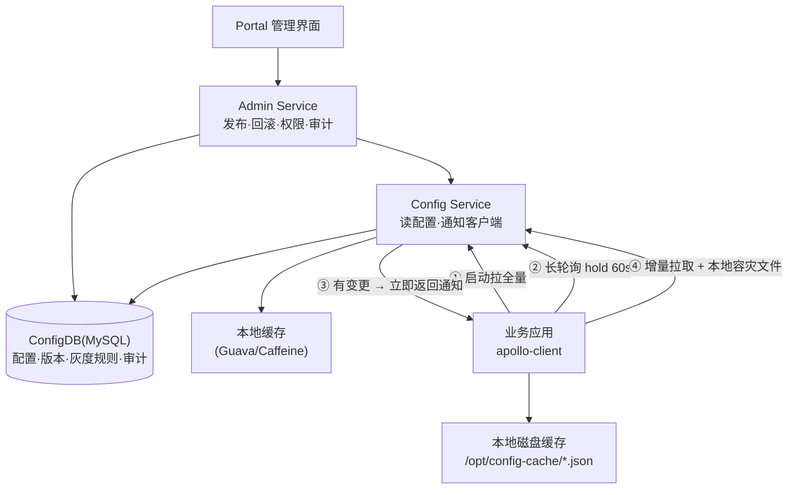

**Apollo 的五个组件（能报出名字就赢一半）**：

| 组件 | 职责 |
|---|---|
| **Config Service** | 提供配置读取接口 + 长轮询通知；**无状态，可多实例**；只读 ConfigDB |
| **Admin Service** | 配置的增删改、发布、回滚、灰度；**写 ConfigDB** |
| **Portal** | Web 管理界面（基于 Admin Service） |
| **Eureka/注册中心** | Config/Admin Service 的注册与发现 |
| **Client** | 客户端 SDK：拉取、缓存、长轮询、容灾文件、`@Value` 自动更新 |

**Nacos 的差异（对比讲最加分）**：

| 维度 | Apollo | Nacos |
|---|---|---|
| 定位 | 纯配置中心 | **配置 + 注册中心二合一** |
| 长轮询 | HTTP Long Polling（30s hold） | 1.x 长轮询；2.x **gRPC 长连接**（端口 9848/9849） |
| 推送 | 变更后"返回通知"，客户端再拉 | 2.x 支持**服务端主动推送**（更快） |
| 灰度 | 支持（按 IP/自定义规则） | 支持（灰度发布 beta） |
| 命名空间 | `env + cluster + namespace` | `namespace + group + dataId` |
| 生态 | Spring Boot 深度集成（`@RefreshScope`） | Spring Cloud Alibaba 生态 |
| 运维 | 组件多（5 个） | 单进程（更轻） |

### 5.4 核心难点一：客户端如何"及时"感知变更

#### 为什么不用"纯推送"？

| 方式 | 问题 |
|---|---|
| 客户端轮询（每 5s 拉） | 99% 的请求是"没变化"，浪费 QPS；间隔大则延迟高 |
| WebSocket/长连接推送 | 需要维持海量连接；客户端要引 Netty；防火墙不友好；**配置客户端的连接数 = 应用实例数，远小于 IM，但运维复杂度更高** |
| **HTTP 长轮询（主流）** | 复用 HTTP 基础设施；hold 住请求，有变更立刻返回；无变更 30~60s 后超时重发 |

#### 长轮询的实现细节（这段是"技术含金量"所在）

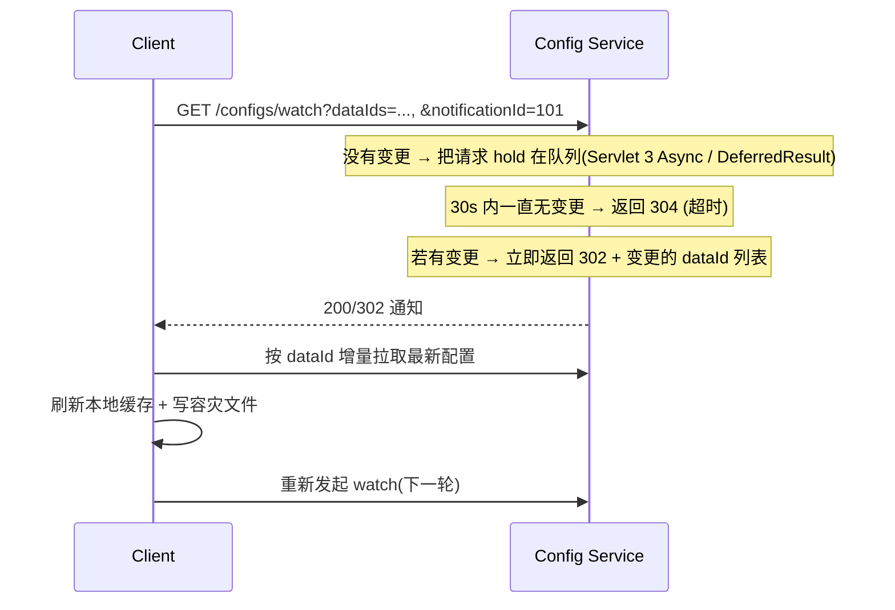

**服务端如何"hold 住 3 万个请求"而不炸？**
- **不能一个请求一个线程**：3 万实例 × 1 线程 = 3 万线程，直接 OOM。
- 用 **Servlet 3 异步（`AsyncContext`）/ Spring `DeferredResult` / WebFlux**：请求挂起，**不占线程**；变更时通过 `DeferredResult.setResult()` 唤醒。
- 超时用**统一的时间轮/延迟队列**（`HashedWheelTimer`）管理，而不是每个请求一个 `ScheduledFuture`。
- **客户端侧限流**：单实例只允许 1 个 watch 请求在途（避免重复连接）。

> **加分句**："长轮询的本质是'**用异步 IO 换取实时性**'——它把'每秒轮询'变成'一次挂起几十秒'，QPS 降低两个数量级，延迟却只有秒级。"

#### 变更通知的可靠性（这一环最容易漏）

| 风险 | 后果 | 方案 |
|---|---|---|
| 通知丢了 | 某实例一直用旧配置 | ① 客户端定时（如 5min）**全量对账**（比对 `md5/version`）；② 长轮询超时重发天然补偿；③ 客户端每次重连都拉一次 `notificationId` 之后的所有变更 |
| `notificationId` 语义 | 客户端要知道"我消费到哪了" | 服务端维护单调递增的"变更流水号"，客户端带上已消费的 `notificationId`，服务端返回之后的变更 |
| 变更风暴 | 一次发 100 个 key → 100 次通知 | 通知**合并**（返回变更的 dataId 列表，客户端一次批量拉） |
| 客户端版本不一致 | 灰度时不同实例拿到不同值 | 灰度规则**服务端计算**（按 IP/实例 ID 判断），客户端只拿"自己能拿到的那份" |

### 5.5 核心难点二：高可用（配置中心挂了业务不能挂）

| 层 | 手段 |
|---|---|
| 服务端 | Config Service 多实例 + 注册中心（Eureka/Nacos）；无状态，随便扩 |
| 存储 | MySQL 主从/一主多从；ConfigDB 只被 Admin 写、被 Config 读 → **读写分离**天然合适 |
| 客户端 | **本地缓存（内存）** + **容灾快照文件（磁盘）** → 三份数据：服务端 DB、客户端内存、客户端磁盘 |
| 降级 | 超过 N 次拉取失败 → 进入"**本地模式**"（只用快照，指数退避重试），并打监控告警 |
| 启动 | **必须能在配置中心完全不可用时启动**（读本地快照）——否则配置中心成了"启动强依赖"（这是很多自研配置中心踩的坑） |

**容灾文件的细节**（面试官很爱问）：
- 路径固定（如 `/opt/data/config-cache/{appId}/{cluster}/{namespace}.json`）。
- 每次成功拉取后**原子写**（`写临时文件 → rename`），避免半截文件。
- 内容含 `version + md5`，启动时校验完整性。
- **不要放敏感明文**（加密配置仍加密存储）。

### 5.6 核心难点三：发布、灰度与回滚

**发布模型（三条铁律）**：

1. **"改"与"发"分离**：编辑配置只是**草稿**，点"发布"才生效（避免误改立刻全量生效）。
2. **发布 = 生成一个新版本**（不可变），回滚 = 指向旧版本（而不是"改回去"）。
3. **灰度 = 规则匹配**：同一份配置，按 `IP / 实例 ID / 机房 / 百分比` 决定实例拿到哪个版本。

```sql
-- 简化的版本表
CREATE TABLE config_release (
  id BIGINT PRIMARY KEY AUTO_INCREMENT,
  app_id     VARCHAR(64),
  env        VARCHAR(16),      -- DEV/FAT/UAT/PRO
  cluster    VARCHAR(64),
  namespace  VARCHAR(64),
  key        VARCHAR(255),
  value      TEXT,             -- 加密的存密文
  version    INT,
  release_id BIGINT,           -- 一次发布(可含多个key)共享
  is_gray    TINYINT DEFAULT 0,
  gray_rule  VARCHAR(1024),    -- 'ip=10.1.*.*;percent=10'
  status     TINYINT,          -- 草稿/已发布/已回滚
  operator   VARCHAR(64),
  created_at DATETIME
);
```

**灰度规则示例**：
```
gray_rule: "ip=10.20.30.*,10.20.31.5; instanceId=order-svc-001; percent=5"
匹配顺序: 白名单IP → 指定实例 → 百分比(按 instanceId hash % 100 < 5)
```

**回滚**：`release_id` 维度一键回滚（把 `status` 置回滚 + 客户端拉最新版本）；**回滚要能秒级**，因为故障时"改配置"往往是最快的止血手段。

### 5.7 核心难点四：配置热更新的原理（Spring 视角）

**为什么 `@Value` 加了 `@RefreshScope` 就能变？**

```
@RefreshScope 的 Bean 被注册为 "refresh" scope 的 bean
  → Spring 用 CGLIB 生成一个代理对象（ScopedProxy）
  → 真正的实例存在 scope 的 targetCache 里
  → 配置变更时调用 ContextRefresher.refresh():
      ① 重新加载 Environment（配置源）
      ② 发布 EnvironmentChangeEvent
      ③ 清空 refresh scope 的 cache → destroy 旧 bean → 下次访问时重建
  → 重建时 @Value 重新解析新值
```

**关键副作用（务必说出）**：
- 重建 Bean = **丢弃该 Bean 的所有内部状态**（连接池、本地缓存、计数器）→ 所以 `@RefreshScope` **只适合无状态/轻量 Bean**（Controller、配置持有类），**不要加在连接池、Netty 客户端、状态机 Bean 上**。
- 更安全的替代：**配置变更事件监听**（`EnvironmentChangeEvent`）→ 手动更新 `volatile` 字段/`AtomicReference`，不重建 Bean。

> 加分："很多人把 `@RefreshScope` 加在 `DataSource` 上，配置一变连接池被重建，正在处理的请求全部报错——这是典型的'热更新事故'。"

### 5.8 安全与治理

| 项 | 方案 |
|---|---|
| 敏感配置加密 | AES-GCM 加密存 DB；密钥不放在配置中心（放 KMS/环境变量）；客户端解密 |
| 权限 | 按"应用 + 环境 + 命名空间"授权；**生产环境二次审批**（双人复核） |
| 审计 | 每次变更记录 `who/when/old/new/reason`；不可篡改（追加写 + 哈希链） |
| 防误操作 | 生产禁改开关、批量导入需 diff 预览、变更通知到群（IM 机器人） |
| 配置规模 | 大配置拆 key（避免单个 10MB 的大 JSON 每次全量推）；`dataId` 粒度小 |

### 5.9 面试追问清单

1. 长轮询 30s 超时后客户端立刻重发，会不会形成"每 30s 一波"的尖峰？→ 会，所以**超时时间加随机抖动**（25~35s），把 3 万实例的请求错开。
2. 配置中心能不能存"业务动态数据"（如黑名单）？→ 可以但要注意量级；黑名单这类"高频写、海量 key"更适合专门的 KV/缓存，配置中心只放"低频变更的配置"。
3. 客户端如何保证"拉到的配置是完整一致的"？→ 全量拉取带 `version + md5` 校验；增量按 `notificationId` 顺序应用；失败整包丢弃重拉。
4. 多个配置项有关联（A 变了 B 必须变）怎么保证原子？→ **同一 `release_id` 一次发布**，客户端按 release 粒度整体替换，而不是逐 key 应用。
5. 配置中心与注册中心的区别？→ 注册中心解决"**服务在哪**"（动态、临时、心跳），配置中心解决"**参数是什么**"（持久、版本化、审计）。
6. Nacos 2.x 为什么改成 gRPC 长连接？→ 减少 HTTP 短连接开销、支持**服务端主动推送**（不再依赖客户端拉）、降低延迟；代价是端口更多、运维更重。

### 5.10 大厂真题与详解

| # | 公司 | 题目 | 考核程度 | 频次 |
|---|---|---|---|---|
| 1 | 阿里 · 中间件 | 设计一个配置中心，要求改动 1 秒内生效，且配置中心挂了业务不受影响 | ★★★★☆ | 高频 |
| 2 | 携程 | Apollo 的长轮询是怎么实现的？为什么不用 WebSocket？ | ★★★★☆ | 中高频 |
| 3 | 字节 | 配置发布如何做灰度？灰度规则怎么设计？ | ★★★☆☆ | 高频 |
| 4 | 阿里 | 配置中心的高可用方案？客户端本地缓存怎么设计？ | ★★★★☆ | 高频 |
| 5 | 美团 | `@RefreshScope` 的原理？它有什么坑？ | ★★★★☆ | 中高频 |
| 6 | 腾讯 | 配置中心的权限与审计怎么做？生产配置如何防止误改？ | ★★★☆☆ | 中频 |
| 7 | 阿里 | Nacos 和 Apollo 的区别？什么场景选哪个？ | ★★★☆☆ | 高频 |

---

#### 真题 1｜阿里：1 秒生效 + 配置中心挂了不影响业务（★★★★☆）

**答题结构："三层保证"**

1. **1 秒生效怎么做到**：
   - 服务端：发布 → 写 DB（新版本）→ 更新内存缓存 → **立即唤醒该 `dataId` 下所有挂起的 `DeferredResult`**（返回 302 通知）。
   - 客户端：收到通知 → 立即增量拉取（不等下一轮）→ 刷新内存 + 写快照 → 触发 `EnvironmentChangeEvent`。
   - 全链路延迟 = 发布耗时(ms) + 通知(ms) + 拉取(ms) ≈ **几百 ms**。

2. **配置中心挂了怎么办**：
   - 内存缓存（最后一次成功值）+ 磁盘快照（多份，含历史版本）；
   - 客户端进入"本地模式"，指数退避重试（1s→2s→4s→...→60s）；
   - **启动不依赖配置中心**（读快照即可启动）。

3. **数据不丢**：Admin 写 DB（主从同步），Config 只读；DB 定期备份。

> 追问："如果发布后部分实例没收到通知（网络分区）？" → 客户端**5 分钟全量对账**（比 version）+ 重启时全量拉；两套机制覆盖"通知丢失"。

---

#### 真题 2｜携程：长轮询 vs WebSocket（★★★★☆）

**Apollo 当年为什么选长轮询（真实工程理由）**：

| 维度 | 长轮询 | WebSocket |
|---|---|---|
| 客户端改造成本 | 只需 HTTP 客户端 | 需引入 WS/Netty 客户端 |
| 网络兼容 | 走 80/443，代理友好 | 部分企业代理/网关不支持 |
| 服务端连接数 | 实例数级别（几千~几万），hold 请求可异步 | 同样量级，但需维护连接状态 |
| 变更频率 | 配置变更低频（分钟级） | 高频推送才划算 |
| 故障排查 | 就是 HTTP，抓包/日志清晰 | 需专门工具 |

> 结论句："**配置变更的频率决定了技术选型**。低频变更用长轮询（简单、够用、延迟秒级）；如果要'毫秒级 + 高频推送'（如在线特征、开关），才值得上长连接。Nacos 2.x 上 gRPC 长连接，是因为它同时要做注册中心（心跳本身就是高频的）。"

---

#### 真题 3｜字节：灰度规则设计（★★★☆☆）

**四层规则（优先级从高到低）**：

```
① 白名单实例/IP（先小范围验证）
② 标签匹配（机房/可用区/机器规格/业务线）
③ 百分比灰度（hash(instanceId) % 100 < N，保证同一实例稳定落桶）
④ 全量
```

**关键细节**：
- **稳定分桶**：用 `instanceId`（不是随机数）算 hash，否则同一实例每次请求落到不同版本，配置会"抖动"。
- **可回退**：灰度期间两个版本并存，回滚 = 把灰度比例调 0。
- **可观测**：灰度实例打标（日志/Metric 里带 `configVersion`），出问题能立刻定位。
- **自动熔断**（进阶）：灰度期间监控错误率，超阈值**自动回滚**。

---

#### 真题 4｜阿里：高可用与本地缓存（★★★★☆）

见 5.5。补充两个面试官爱听的细节：

1. **客户端缓存要有"内存 + 磁盘"两级**：内存抗"配置中心短暂不可用"，磁盘抗"应用重启 + 配置中心不可用"。
2. **快照文件要有版本目录**：保留最近 3~5 个版本，回滚时可手工指定；写入用 `rename` 原子替换。

---

#### 真题 5｜美团：`@RefreshScope` 原理与坑（★★★★☆）

见 5.7。核心三句：
1. 它是 **scope 代理**（CGLIB），真正的 Bean 在 `refresh` scope 的缓存里；
2. 配置变更 → `ContextRefresher.refresh()` → 清 cache → **destroy + 重建 Bean**；
3. **坑**：重建会丢状态（连接池/本地缓存/正在处理的请求），所以只加在无状态 Bean 上；有状态组件用事件监听手动更新。

**追问**："怎么做到不重建 Bean 也能更新？" → `@EventListener(EnvironmentChangeEvent.class)` 里更新 `AtomicReference`/`volatile` 字段；或自己实现"配置 holder"（`ConfigHolder.get()` 每次读最新快照）。

---

#### 真题 6｜腾讯：权限与审计（★★★☆☆）

- **权限模型**：`用户 → 应用 → 环境 → 命名空间 → 操作(读/写/发布/回滚)`，RBAC 复用第 4 章模型。
- **生产保护**：① 生产发布需**双人审批**；② 高危 key（开关类）单独加锁；③ 变更自动同步到 IM 群（机器人播报 diff）。
- **审计**：变更流水（不可变，追加写）+ 操作留痕（IP/UA/操作人）+ 定期合规导出。

---

#### 真题 7｜阿里：Nacos vs Apollo 选型（★★★☆☆）

| 场景 | 推荐 | 理由 |
|---|---|---|
| 只需配置中心、团队熟悉 Spring Cloud | Apollo | 功能完整、灰度/权限/审计成熟 |
| 同时需要注册中心 + 配置中心 | **Nacos** | 一套组件解决两件事，运维轻 |
| 需要毫秒级推送/大规模实例 | Nacos 2.x | gRPC 长连接 + 服务端推送 |
| 强审计/强审批的金融场景 | Apollo | 审批流与审计更成熟 |

> 收尾句："选型不看功能列表，看**运维成本**和**故障时的可恢复性**——配置中心是'基础设施的基础设施'，它挂了会影响所有服务，所以'简单、可降级'比'功能多'更重要。"

---

## 6. 设计一个分布式定时任务调度平台

### 6.1 面试官考什么

| 考察点 | 期望层次 |
|---|---|
| 单体 `@Scheduled` 为什么不行 | 集群重复执行、无失败重试、无监控、无分片 |
| 调度与执行分离 | 调度中心 + 执行器，**调度只决策、执行不决策** |
| 避免重复执行 | 选主（DB 行锁/ZK/Redis）到底怎么用 |
| 大规模任务 | 10 万任务秒级调度，靠什么扛（时间轮/分组/缓存） |
| 分片 | 一个任务拆到 N 台并行，怎么做（分片参数 + 一致性） |
| 幂等与补偿 | 至少一次语义、失败重试、漏跑补跑 |

> **题眼一句话**："定时任务平台的三个核心问题：**谁能调（防重复）、调给谁（路由分片）、调失败怎么办（重试补偿）**。"

### 6.2 从单体到分布式：问题演进

| 阶段 | 做法 | 问题 |
|---|---|---|
| 单体 | `@Scheduled(cron="0 0 2 * * ?")` | 多实例部署 → **重复执行 N 次** |
| 加锁 | Redis 分布式锁包住任务体 | 锁超时/释放失败 → 仍可能重复；**无法分片、无监控** |
| 调度中心 | 独立服务统一触发（XXL-JOB 模式） | 调度中心本身要**高可用**，否则全站停摆 |
| 平台化 | 调度 + 执行器 + 注册中心 + 告警 + 日志 + 分片 + DAG | 复杂度上升，需要治理 |

### 6.3 架构（XXL-JOB 原型 + 关键原理）

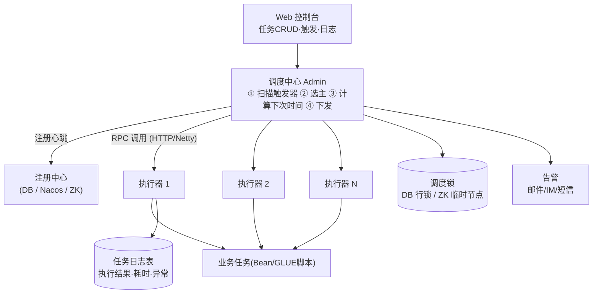

**核心组件职责（严格区分，别混着说）**：

| 组件 | 做什么 | 不做什么 |
|---|---|---|
| **调度中心**（Admin） | 管理任务、扫描到期触发器、计算下次执行时间、路由决策、下发 | 不执行业务逻辑 |
| **执行器**（Executor） | 接收调度请求、执行任务、上报结果、注册心跳 | 不做时间决策（**只执行被下发的任务**） |
| **注册中心** | 执行器上下线、地址列表 | 不做调度 |
| **调度锁** | 保证多台调度中心只有一台在调度 | 不保证任务不重复（那是执行器/幂等的事） |

### 6.4 核心难点一：调度中心高可用（"选主"到底怎么选）

**问题**：调度中心部署 3 台，如果都扫描触发器 → 同一任务被下发 3 次。

**三种选主方案对比（必背）**：

| 方案 | 原理 | 优点 | 缺点 |
|---|---|---|---|
| **DB 行锁（XXL-JOB 采用）** | `SELECT ... FOR UPDATE` 抢 `xxl_job_lock` 表的行锁，抢到才调度 | 简单、无需额外组件、与 DB 同生命周期 | DB 是单点（需主从）；锁持有期间事务要短 |
| **ZK 临时顺序节点** | 抢最小序号节点成为 leader，session 断开自动让位 | 自动故障转移、强一致 | 需维护 ZK 集群；羊群效应 |
| **Redis 分布式锁 + 续期** | `SET NX PX` + 看门狗续期 | 轻量、性能好 | 锁丢失/双主风险（GC 停顿、网络分区） |
| **DB 乐观锁抢占** | 每个任务 `UPDATE ... SET owner=? WHERE owner IS NULL` | 无锁竞争、天然分片 | 任务级粒度，实现稍复杂 |

**XXL-JOB 的真实做法（能讲出来就赢了）**：

```
调度线程（每 30s 一轮，可配置）:
  1. 抢锁: SELECT * FROM xxl_job_lock WHERE lock_name='schedule_lock' FOR UPDATE
  2. 扫描: 查 xxl_job_info 中 trigger_next_time <= now + 预读窗口(5s) 的任务
  3. 计算下次时间: 按 cron 表达式算出 next_time 并写回
  4. 路由: 按路由策略选执行器地址 → 发送调度请求(异步)
  5. 释放锁
  关键优化: "预读 5 秒" —— 提前把即将到期的任务捞出来，避免"刚好错过"
```

**为什么用 `FOR UPDATE` 而不是 `SET NX`？**
- 调度中心与 DB 同生共死：**DB 活着，锁就可靠**（InnoDB 行锁在事务结束自动释放，不会"锁泄漏"）。
- 缺点：DB 挂了整个调度停摆 → 所以 DB 要主从 + 快速切换；且**锁事务必须短**（不能在里面做 RPC）。

### 6.5 核心难点二：大规模任务的调度算法

**问题**：10 万个任务，每秒都可能到期，**每 30s 全表扫 10 万行** → DB 压力大、延迟高。

| 方案 | 原理 | 适用规模 |
|---|---|---|
| **DB 扫描 + 索引** | `WHERE next_time <= now` + 索引 | 万级（中小平台） |
| **分组（任务分桶）** | 按"执行频率"分组：秒级/分钟级/小时级/天级，各自独立扫描频率 | 十万级（主流优化） |
| **时间轮** | 环形槽（如 60 槽 × 1s），任务挂到对应槽；指针每 tick 走一格执行 | 十万~百万级（内存调度） |
| **延迟队列** | Redis ZSET（`score=执行时间`）/ RocketMQ 延迟消息 / Kafka 时间轮 | 十万级、单机友好 |
| **分层时间轮（HashedWheelTimer）** | 多级轮（秒/分/时/天），类似手表齿轮 | Netty/Kafka 内部实现，海量延时任务 |

**时间轮原理（能画出来最加分）**：

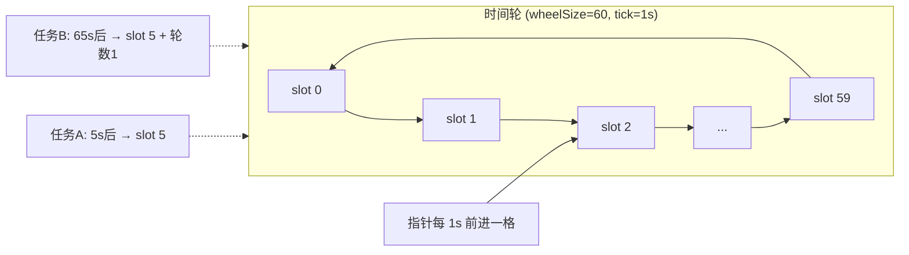

- 插入 O(1)，执行 O(1)（每 tick 处理当前槽的链表）；
- "多圈"任务用 `remainingRounds` 计数，指针经过时减 1，减到 0 才执行；
- **精度 = tick**（1s 精度就够定时任务用，毫秒级才需要更细）。

> 加分："时间轮适合'**海量、短延时**'（如 15 分钟未支付关单）；'**少量、长周期、需持久化**'的 cron 任务仍应落 DB（重启不丢、可查可改）。所以生产上是**DB 存任务定义 + 时间轮/延迟队列做短期触发**的组合。"

### 6.6 核心难点三：任务分片（一个大任务拆到 N 台并行）

**场景**：10 亿用户的对账，单机跑 10 小时 → 拆 10 片，每片 1 小时。

```
调度中心把任务下发时带上分片参数:
  shardIndex = 0..N-1, shardTotal = N
执行器(或广播到所有执行器) 按分片处理:
  for (userId in allUsers) if (hash(userId) % shardTotal == shardIndex) { process(userId) }
```

| 分片方式 | 说明 | 注意 |
|---|---|---|
| **分片广播**（XXL-JOB `BROADCAST`） | 调度中心把"分片总数"告诉**所有**执行器，每个执行器认领自己的 `shardIndex` | 执行器数量变化时 `shardTotal` 要动态调整（按在线实例数） |
| 静态分片 | 任务表里配死"分 10 片，分给 10 台" | 机器挂一台就少一片 → 需重试/转移 |
| 动态分片（任务队列） | 把"待处理 ID"放到队列，执行器抢着消费 | 负载最均衡，实现最复杂（要防重复消费） |

**分片的核心风险**：
- **分片不均**：`hash` 分布不均 → 慢分片拖尾（用一致性哈希/按数据量动态切分）。
- **部分失败**：8 片成功、2 片失败 → 重试要**幂等**（按 `(taskId, shardIndex)` 记录进度断点续跑）。
- **重复执行**：广播模式下，若某执行器误判 `shardTotal`，会漏片 → 用"调度中心记录每个分片的完成状态"兜底。

### 6.7 核心难点四：幂等、重试与漏跑

| 问题 | 手段 |
|---|---|
| **至少一次 → 可能重复** | 业务幂等：唯一键 / 状态机 / 乐观锁 / 分布式锁（`lock:task:{taskId}:{bizKey}`） |
| 失败重试 | 可配置次数 + 间隔（指数退避）；重试要**新开一次执行记录**（不覆盖历史） |
| 重试爆炸 | 失败率高的任务**熔断**（连续失败 N 次 → 暂停 + 告警），避免打挂下游 |
| 任务超时 | 执行器侧超时中断（线程中断 + 状态标记 `TIMEOUT`）；**注意**：Java 线程 `interrupt` 不保证停止，需业务配合检查中断标志 |
| 调度中心挂了 | 任务漏跑 → 启动时**补偿扫描**（`next_time` 已过期但未执行的任务，立即补一次） |
| 执行器挂了 | 调度中心检测心跳超时（如 90s）→ 从地址列表摘除；任务标记失败 → 重试（可路由到其他执行器） |
| **misfire（错过触发）** | Quartz 语义：`withMisfireHandlingInstructionDoNothing`（跳过）/`FireNow`（立即补一次）；平台默认"补一次"更符合业务预期 |

**"漏跑"是这类平台最真实的事故**，一定要主动讲：
```
漏跑原因: ① 调度中心发布重启（锁释放期间无人调度）② DB 慢查询导致扫描延迟 
        ③ 执行器全部忙（阻塞策略丢弃）④ 时钟漂移（NTP 跳变）
兜底: ① 启动补偿扫描 ② 每任务记录 last_exec_time，超过 2 倍周期未执行则告警 
     ③ 阻塞策略不要用"丢弃"（用"排队"）④ 服务器统一 NTP + 监控时钟偏移
```

### 6.8 阻塞处理策略与路由策略（细节，面试官爱问）

**阻塞处理策略（同一任务上次还没跑完，这次又到期）**：

| 策略 | 行为 | 适用 |
|---|---|---|
| 单机串行（Serial） | 排队，等上次完成 | 不允许并发的任务（默认） |
| 丢弃后续调度（Discard Later） | 直接跳过本次 | 允许漏跑的幂等任务 |
| 覆盖之前调度（Cover Early） | 杀掉上次，跑新的 | 只需最新结果的任务（如"同步最新数据"） |

**路由策略（选哪台执行器跑）**：

| 策略 | 说明 |
|---|---|
| 轮询（Round） | 均匀分配 |
| 随机（Random） | 简单，可能不均 |
| 一致性哈希（ConsistentHash） | 同一任务固定落同一执行器（**适合有本地缓存/状态的任务**） |
| 最不经常使用（LFU）/ 最近最久未使用（LRU） | 按负载 |
| 故障转移（Failover） | 心跳检测后自动换机器 |
| 分片广播（Sharding Broadcast） | 所有执行器各领一片 |

### 6.9 面试追问清单

1. 为什么不让执行器自己定时（去掉调度中心）？→ 那就要每台执行器都做"防重复 + 分片"，等于把复杂度下放；且**无法统一改 cron、无法统一监控**。
2. 任务执行很慢（1 小时）会阻塞调度线程吗？→ 不会：调度是**异步下发**（RPC 调用后不等待结果），执行结果通过回调/日志表上报。
3. 任务日志存多久？→ 明细 7~30 天（量大），聚合指标长期保留；日志表按 `taskId + 日期` 分表。
4. 怎么支持"任务依赖"（A 完成才跑 B）？→ DAG 编排：任务表带 `parent_ids`，A 完成后检查"所有父任务成功"则触发 B；失败则 B 标记"依赖未满足"。复杂编排上 Airflow/DolphinScheduler。
5. 秒级任务（每秒跑一次）怎么支持？→ 不能靠 DB 扫描（1s 一轮扫全表太重）→ 用**时间轮 + 常驻任务**；且要限制"秒级任务"的数量（治理）。
6. 执行器版本升级怎么平滑？→ 执行器**优雅下线**（先摘流量 + 等在跑的任务完成），再滚动升级；调度中心下发时跳过"下线中"的地址。

### 6.10 大厂真题与详解

| # | 公司 | 题目 | 考核程度 | 频次 |
|---|---|---|---|---|
| 1 | 美团 | 设计一个分布式任务调度平台，10 万任务，如何保证不重复不遗漏？ | ★★★★★ | 高频 |
| 2 | 阿里 · 中间件 | 调度中心集群部署，如何避免同一任务被多次调度？ | ★★★★☆ | 高频（必考选主） |
| 3 | 字节 | 10 亿数据对账任务，单机跑不完，如何分片并行？ | ★★★★☆ | 高频 |
| 4 | 京东 | 定时任务重复执行导致资损，如何根治？ | ★★★★☆ | 中高频 |
| 5 | 美团 | 秒级定时任务（每秒触发）如何实现？ | ★★★★☆ | 中频 |
| 6 | 阿里 | 时间轮算法原理？和延迟队列比有什么优势？ | ★★★★☆ | 中频 |
| 7 | 携程 | 任务错过触发（misfire）怎么处理？ | ★★★☆☆ | 中频 |

---

#### 真题 1｜美团：10 万任务不重复不遗漏（★★★★★）

**答题结构：三句话框架 + 逐个展开**

> "不重复靠**调度选主 + 任务幂等**双保险；不遗漏靠**预读窗口 + 补偿扫描 + 心跳摘除**；大规模靠**分组 + 时间轮**。"

1. **不重复**：
   - 调度层：DB 行锁选主（3 台调度中心只有 1 台在扫）。
   - 下发层：每次下发带 `triggerId`（触发器唯一 ID），执行器按 `triggerId` 去重（Redis `SETNX trigger:{id}`，TTL=超时时间）。
   - 执行层：业务幂等（唯一键/状态机）。
2. **不遗漏**：
   - 扫描用"预读 5s"（`next_time <= now+5s`），避免"刚好卡在边界"；
   - 启动/主从切换时**补偿扫描**（扫 `next_time < now` 且未执行的）；
   - 执行器心跳 30s，90s 未心跳则摘除并**重新路由**失败任务；
   - 每任务记 `last_exec_time`，超过 2 个周期未执行 → 告警。
3. **10 万任务**：
   - **按频率分组**（秒级/分钟级/小时级/天级），各自扫描周期不同；
   - 秒级任务用**时间轮**（内存），不落 DB 扫；
   - 触发器表加索引 `(status, next_time)`；分页扫描（`limit 1000`）+ 批量更新 `next_time`。
4. **可观测**：调度延迟、执行成功率、错过率、执行器负载四个指标。

---

#### 真题 2｜阿里：调度中心如何避免重复调度（★★★★☆）

**先纠正一个常见误区（这步很加分）**：

> "很多人以为'选了主'就万事大吉。实际上选主只能保证'**同一时刻只有一个调度中心在扫**'，但如果主节点 GC 停顿 10s，锁事务超时释放，另一个节点补位，两个节点**同时**认为自己是主 → 仍会重复。所以**选主 + 下发去重（triggerId）+ 业务幂等**三层都要有。"

三层细节：
1. **选主**：`SELECT ... FOR UPDATE`（事务短、锁表专用，别和业务表混）+ 锁等待超时（`innodb_lock_wait_timeout`）。
2. **下发去重**：`triggerId = taskId + 计划执行时间`（唯一），执行器 `SETNX`；同一 `triggerId` 只执行一次。
3. **业务幂等**：任务体里用"业务唯一键 + 状态机"，保证"多执行一次无副作用"。

---

#### 真题 3｜字节：10 亿数据对账分片（★★★★☆）

**分片方案（按"切分 → 派发 → 断点 → 汇总"讲）**：

1. **切分**：按 `uid % 100` 切 100 片（或按"数据量均匀"的区间切，避免长尾）。
2. **派发**：`BROADCAST` 分发到所有执行器，每台按 `shardTotal=在线执行器数` 认领 `shardIndex`。
3. **断点续跑**：每片记录"已处理到的游标"（`(taskId, shardIndex) → cursor`），失败重跑从 cursor 继续。
4. **汇总**：所有分片完成后，一个"汇总任务"（DAG 的父任务全部成功才触发）合并结果并出报表。
5. **限流**：每执行器并发度限制（如 8 线程），避免把 DB 打挂；**分批提交**（每 1000 条一批）。
6. **幂等**：对账是"读多写少"的，重复跑结果一致（天然幂等）；如果写结果表，用 `uk(task_id, shard_index, biz_id)`。

> 追问："执行器中途扩到 200 台，`shardTotal` 变了怎么办？" → 分片数**固定为 100**（与机器数解耦），机器数只是"消费者"；用"任务队列 + 抢占"模式保证不漏不重。

---

#### 真题 4｜京东：重复执行导致资损（★★★★☆）

**排查 + 根治（这条要"工程化"地回答）**：

| 根因 | 现象 | 根治 |
|---|---|---|
| 多实例 + 无锁 | 每天重复 N 次（N=实例数） | 调度中心 + 选主 |
| Redis 锁超时 | 任务跑得比锁 TTL 长，锁释放后另一台进来 | 锁续期（看门狗）+ 任务超时 < 锁 TTL |
| 重试 + 无幂等 | 超时重试导致扣两次 | 幂等键（`bizNo` 唯一索引） |
| 人工手动触发 + 定时同时跑 | 双跑 | 手动触发也走同一个"去重键" |
| 补偿扫描 + 正常调度重叠 | 补一次又跑一次 | 补偿只补"确实未执行"的（查执行记录） |

**资损场景的额外要求**："涉及资金的任务，必须有**执行前后对账**（T+0 实时 + T+1 全量）+ 单笔金额上限 + 人工复核开关。"

---

#### 真题 5｜美团：秒级定时任务（★★★★☆）

- **不要**用 DB 每秒扫全表（10 万任务 × 86400 次/天 = 不可行）。
- 用**时间轮**：内存里维护"下一秒要执行的任务集合"，调度线程每 tick 取一批下发。
- 持久化：任务定义仍在 DB（重启后重建时间轮）。
- 治理：秒级任务数量限制（如 < 1000 个），并要求"必须幂等 + 快速返回"。
- 替代：如果是"延迟触发"（如 30s 后发券），用 **Redis ZSET / RocketMQ 延迟消息**，不必进调度平台。

---

#### 真题 6｜阿里：时间轮 vs 延迟队列（★★★★☆）

| 维度 | 时间轮 | Redis ZSET 延迟队列 | RocketMQ 延迟消息 |
|---|---|---|---|
| 精度 | tick 级（可 1ms~1s） | 轮询间隔 | 固定延迟级别（1s/5s/10s...） |
| 吞吐 | 极高（O(1) 插入） | 中（ZRANGEBYSCORE 轮询） | 高 |
| 持久化 | **内存，重启丢失**（需重建） | 持久（AOF/RDB） | 持久 |
| 分布式 | 各节点自己维护（不适合共享） | 天然共享（多消费者抢） | 天然分布式 |
| 适用 | 单机海量短延时（Netty/Kafka 内部） | 中等规模延迟任务 | 跨服务延迟消息（订单关单） |

> 结论："**时间轮解决'计算'，持久化解决'不丢'**。生产方案 = DB/Redis 持久化任务 + 时间轮做进程内快速触发。"

---

#### 真题 7｜携程：misfire 处理（★★★☆☆）

- **定义**：到了该触发的时间，但调度线程没执行（停机/忙碌/时钟跳变）。
- **三种语义**：跳过（DoNothing）、立即补一次（FireNow）、全部补跑（FireAll，危险，可能雪崩）。
- **平台建议**：默认"**立即补一次**"（业务通常希望"至少跑一次"），但必须配**幂等**；补跑时打标记（`is_makeup=1`），便于审计。
- **防雪崩**：补跑要**限流 + 错峰**（加随机延迟），否则停机 1 小时后重启，所有小时级任务同时补跑会打挂下游。

---

## 7. 设计一个搜索引擎（基于 Elasticsearch）

### 7.1 面试官考什么

| 考察点 | 期望层次 |
|---|---|
| 倒排索引原理 | 词典结构（FST）、倒排表压缩（Frame of Reference/RoaringBitmap）、跳表 |
| 写入与近实时 | buffer → segment → refresh → flush → translog → merge 全链路 |
| 分片与路由 | 路由公式、分片数怎么定、副本作用、扩容代价 |
| 查询两阶段 | query then fetch、DFS、相关性打分（BM25） |
| 工程优化 | 深分页、mapping 爆炸、filter vs query、读写性能调优 |
| 数据同步 | MySQL → ES 的一致性方案 |

> **题眼一句话**："ES 快在'**倒排索引 + 分段（segment）不可变 + 文件缓存**'，慢在'**深分页 + 大聚合 + 频繁更新**'。面试就是考你能不能把这句话展开。"

### 7.2 需求与估算（搜索类系统的典型场景）

**功能**：商品/文章搜索（关键词、过滤、排序、聚合、高亮、拼写纠错）。

**估算**：

```
商品 1 亿条，每条 1KB（含字段）→ 原始 ~100 GB
ES 存储放大 ~1.5~2 倍（倒排 + doc_values + _source）→ 150~200 GB（含 1 副本 → 300~400 GB）
查询 QPS 峰值 5 万 → 需 20~30 个分片 × 2 副本，20+ 节点
写入 QPS 5000（binlog 同步）→ bulk 批量写入，每批 500~1000 条
```

**分片数怎么定（必考）**：

```
经验值: 单分片 30~50 GB（SSD）；单分片承载 1000~5000 QPS 查询
1 亿商品 / 200GB → 5~7 个主分片 → 取 8 个主分片 + 1 副本 = 16 个分片
原则: 分片数 ≈ 节点数 × (1~2)；分片过多 → 元数据/文件句柄/查询扇出爆炸
```

### 7.3 架构

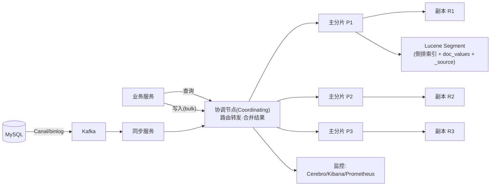

**节点角色（要分清）**：

| 角色 | 职责 | 说明 |
|---|---|---|
| Master（专用） | 集群元数据、分片分配、索引管理 | **不存数据**（`node.data=false`），避免 GC 影响集群 |
| Data（热/温/冷） | 存数据、执行查询 | 热节点 SSD、温节点 HDD、冷节点可冻结 |
| Coordinating | 接收请求、分发、合并 | 大集群单独部署，避免 data 节点被合并任务拖累 |
| Ingest | 预处理（pipeline） | 可选 |

### 7.4 核心难点一：倒排索引（原理级，能撑住 3 层追问）

**正排 vs 倒排**：

| | 正排（doc → terms） | 倒排（term → docs） |
|---|---|---|
| 结构 | 文档 ID → 字段内容 | 词条 → 文档 ID 列表（+ 位置/词频） |
| 用途 | 取文档、排序、聚合 | **检索** |
| ES 里的载体 | `_source` + `doc_values` | `.tim`（词典）+ `.doc`（倒排表） |

**三段结构（面试重点）**：

```
① Term Dictionary（词典）: 所有词条有序排列 → 用 FST(有限状态转换机) 压缩存储
   特点: 前缀共享(phone/photograph/photography...)、可 O(词长) 查词、支持前缀查询/通配
② Term Index（词典索引）: 记录"某前缀在词典的块位置" → 常驻内存(FST)，快速定位
③ Posting List（倒排表）: 文档 ID 列表 → 用增量编码(Frame of Reference)+位图 压缩
   - 有序(便于求交集/并集, 用跳表 skip list 加速)
   - 压缩: 相邻 docId 差值(增量编码) + 分块(每 128 个一个 block) + 位压缩
```

**为什么 "搜得快" 而不是 "扫得快"**：
- 10 亿文档，扫一遍要几秒；倒排能"**直接跳到包含该词的文档**"，复杂度 ≈ `O(log N)` 定位词典 + O(命中文档数) 取交集。

**加分细节（这是区分"背过"和"懂"的地方）**：

| 机制 | 原理 | 解决什么 |
|---|---|---|
| **FST** | 有限状态转换机，共享前缀/后缀 | 词典从 GB 级压到 MB 级，可全量进内存 |
| **Frame of Reference** | 每 128 个 docId 一组，用最小位数存差值 | 倒排表压缩率 3~10 倍 |
| **Roaring Bitmap** | 分桶（低 16 位/高 16 位）+ 容器（数组/位图/run） | 过滤（filter）缓存与快速交并 |
| **跳表（skip list）** | 多层索引链表 | 多个 term 求交集时"跳着走" |
| **doc_values** | 列式存储（磁盘 + 文件缓存） | 排序/聚合不需要解析 `_source`，省内存 |

### 7.5 核心难点二：写入链路与"近实时"（这是 ES 最常被追问的点）

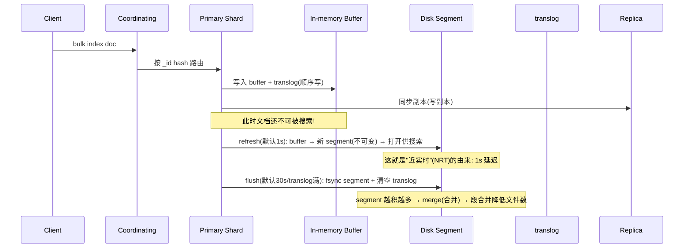

**关键参数与含义（必背）**：

| 阶段 | 默认 | 作用 | 调优 |
|---|---|---|---|
| `index.refresh_interval` | **1s** | buffer 刷成 segment，使文档可搜索 | 批量导入时设 `-1`（关闭），导入后手动 `_refresh`；查询型集群可设 `30s` |
| `index.translog.durability` | `request`（每次写都 fsync） | 保证不丢 | 大批量导入设 `async` + `sync_interval=5s`（丢 5s 数据换吞吐） |
| `index.translog.flush_threshold_size` | 512MB | translog 满了触发 flush | 视磁盘 |
| `index.number_of_replicas` | 1 | 容错 + 读扩展 | 写入重的索引可临时设 0 提速，完成后再加回 |

**为什么"更新/删除"代价高**：segment **不可变** → 更新 = 标记旧文档 `_delete` + 写新文档；删除 = 打删除标记（`.del` 文件）；真正回收在 **merge** 时。所以"频繁更新"的索引写入放大严重（写放大 3~5 倍）。

**加分："ES 为什么不是数据库"** → 无事务、无跨文档 join、更新代价高、count 大基数慢、内存/磁盘放大；它是"**检索 + 排序 + 聚合**"的专用引擎，**权威数据必须落库**。

### 7.6 核心难点三：分片路由与查询两阶段

**写入路由（公式必须能写）**：

```
shard = hash(routing) % number_of_primary_shards
routing 默认 = _id（可自定义 _routing）
→ 这就是为什么"主分片数建索引后不能改"（改了所有文档的路由都错）
→ 扩容只能 reindex / split / shrink
```

**查询两阶段**：

```
① Query Phase: 协调节点把请求广播到所有分片(主或副本, 轮询)
   每个分片本地查询 + 打分 → 返回 (docId, score) 的 Top N（N = from+size）
② Fetch Phase: 协调节点合并排序取全局 Top N → 按 docId 回各分片取 _source → 返回
```

| 问题 | 原因 | 解法 |
|---|---|---|
| **深分页**（`from=10000`） | 每个分片都要返回 `from+size` 条 → 协调节点内存爆炸（`O(shards × (from+size))`） | ① `search_after` + **PIT**（推荐）；② `scroll`（快照、不适合实时）；③ 限制 `index.max_result_window` |
| **扇出大**（几百个分片） | 每查询都打所有分片 | 减少分片数；用 `routing` 把查询限定到单分片；冷热分离 |
| **结果不准**（跨分片打分） | 各分片独立打分，词频统计是局部的 | `dfs_query_then_fetch`（多一轮收集全局统计，慢）；`preference` 固定分片 |
| 相关性差 | BM25 是"词频 + 文档长度 + 逆文档频率" | 调 `boost`、字段权重、`function_score`、业务规则重排 |

**BM25 公式（能说出核心项即可）**：

```
score = Σ_idf(qi) · (tf·(k1+1)) / (tf + k1·(1 - b + b·dl/avgdl))
其中 tf = 词频, dl = 文档长度, avgdl = 平均长度, k1/b 为可调参数
直觉: 词出现越多越相关(tf)，但文档越长越"稀释"(dl)，越罕见的词权重越高(idf)
```

### 7.7 核心难点四：Mapping 与查询优化（工程化考点）

**`text` vs `keyword`（最基础但最常错）**：

| | text | keyword |
|---|---|---|
| 分词 | 是（IK/standard） | 否（整串） |
| 用途 | 全文检索（`match`） | 精确匹配（`term`）、排序、聚合 |
| 常见错误 | 对 `keyword` 用 `match`（能查但不精确） / 对 `text` 用 `term`（分词后查不到） | |

**`query` vs `filter`**：

| | query context | filter context |
|---|---|---|
| 打分 | 计算 `_score` | 不计算 |
| 缓存 | 不缓存 | **缓存 bitset**（`filter` 结果） |
| 用法 | 需要相关性排序 | "必须满足"的过滤条件（价格区间、状态、类目） |

> 口诀：**"要相关性用 query，要过滤用 filter，filter 还能被缓存。"**

**Mapping 爆炸（大厂真实事故）**：

```
现象: 字段动态映射(dynamic mapping)把每个新 key 当字段 → 字段数 10 万 → 集群拒绝写入
原因: index.mapping.total_fields.limit 默认 1000（旧版）/ 集群级限制
方案: ① 关闭动态映射(dynamic: strict/false) ② 用 flattened 类型 ③ 多值场景改"动态字段 + keyword 数组"
```

**写入优化清单**：

| 优化 | 效果 | 代价 |
|---|---|---|
| `bulk` 批量（500~1000 条/批） | 减少网络/协调开销 | 批次过大会内存压力 |
| `refresh_interval=-1`（导入期） | 避免每秒生成小 segment | 导入期不可搜索 |
| `translog.durability=async` | 提升写吞吐 | 可能丢几秒数据 |
| 副本数临时 0（导入后加回） | 写入不加倍 | 导入期无容错 |
| 减少字段（`_source` 关掉/`includes`） | 降存储 | 需要时取不到原值 |
| 用 `index.codec: best_compression` | 压缩率高 | CPU 增加 |
| 按时间分区（索引模板 + rollover） | 冷热分离、删除快 | 查询要跨索引 |

**查询优化清单**：

| 优化 | 说明 |
|---|---|
| 只取必要字段（`_source: includes`） | 减少 IO 与网络 |
| 用 `keyword` 做聚合（`doc_values`） | 避免 fielddata 堆内存 |
| 避免 `script` 查询/排序 | 极慢，能预计算就预计算 |
| 避免大基数聚合（10 万+ 桶） | 用 `composite agg` 分页或预聚合（ClickHouse） |
| 用 `search_after` 而非 `from/size` | 深分页 |
| 缓存：`filter` + 请求缓存 + 分片请求缓存 | 热点查询 |

### 7.8 数据同步（MySQL → ES 一致性）

| 方案 | 原理 | 优点 | 缺点 |
|---|---|---|---|
| **双写** | 业务写 MySQL 同时写 ES | 简单 | 不一致（一方失败）、业务耦合、性能差 |
| **Canal 订阅 binlog**（主流） | 伪装从库读 binlog → MQ → 同步服务 → ES | 解耦、可重放、顺序性好 | 需维护 Canal/MQ；延迟秒级 |
| **MQ 业务消息** | 业务发消息，消费者写 ES | 简单解耦 | 消息可能丢/重（要幂等） |
| **定时全量 + 增量** | 定时 reindex + binlog 增量 | 兜底修复 | 全量重跑成本高 |
| **Logstash JDBC** | 定时 `SELECT` 拉取 | 无需开发 | 高频轮询压力大、删改难捕获 |

**最终一致性的关键**：`document_id = 业务主键`（幂等 upsert）+ `version`（防乱序覆盖，用 binlog 位点做版本）+ **定时对账**（DB 与 ES 的条数/hash 比对）。

### 7.9 面试追问清单

1. 为什么 ES 6.x 之后去掉 `type`？→ 同一索引内不同 type 的字段映射冲突（同名字段不同类型），且底层本就共享 Lucene 索引；改为"一索引一类型/一索引一表"。
2. `_source` 和 `doc_values` 的区别？→ `_source` 是原始 JSON（取回用）；`doc_values` 是列式正排（排序/聚合用）。
3. 集群变红（red）怎么办？→ 有主分片未分配：检查磁盘水位（`watermark`）、节点下线、分片分配失败原因（`_cluster/allocation/explain`）；先恢复节点，再 `reroute`。
4. 脑裂怎么防？→ `discovery.seed_hosts` + `cluster.initial_master_nodes` 明确投票节点；`minimum_master_nodes`（旧版）保证多数派；**专用 master 节点奇数台**。
5. 分词器怎么选中文？→ IK（`ik_max_word` 细粒度 / `ik_smart` 粗粒度）；自定义词典（新词、品牌词）；同义词 `synonym` 过滤器。
6. ES 能不能当主库？→ 不能：无事务、更新代价高、可能丢数据（translog async）、运维风险；只能做"检索副本"。
7. 10 亿文档，如何做到"搜索 + 多维筛选 + 排序"都很快？→ 倒排检索 + filter（bitset 缓存）+ doc_values 排序 + 分片裁剪（按类目 routing）+ 冷热分层。

### 7.10 大厂真题与详解

| # | 公司 | 题目 | 考核程度 | 频次 |
|---|---|---|---|---|
| 1 | 阿里 · 搜索 | 设计一个商品搜索系统，1 亿商品，支持关键词 + 多维筛选 + 排序 | ★★★★★ | 高频 |
| 2 | 字节 | ES 的写入流程是怎样的？为什么是"近实时"？ | ★★★★★ | 超高频 |
| 3 | 美团 | 深分页为什么慢？search_after 和 scroll 怎么选？ | ★★★★☆ | 高频 |
| 4 | 百度 | 倒排索引的底层结构？FST 解决什么问题？ | ★★★★☆ | 高频 |
| 5 | 滴滴 | MySQL 数据如何同步到 ES？如何保证一致性？ | ★★★★☆ | 高频 |
| 6 | 阿里 | 分片数量如何设计？分片过多有什么问题？ | ★★★★☆ | 高频 |
| 7 | 京东 | ES 集群变红/写入被拒绝（mapping 爆炸）怎么排查？ | ★★★★☆ | 中频 |

---

#### 真题 1｜阿里：1 亿商品搜索（★★★★★）

**答题框架"五段式"**：

1. **澄清**：1 亿商品、QPS 5 万、要求 P99 < 100ms、支持类目/品牌/价格筛选、按销量+相关性排序、数据准实时（秒级）。
2. **数据模型（mapping）**：
   ```json
   {
     "mappings": {
       "dynamic": "strict",
       "properties": {
         "id":       {"type": "long"},
         "title":    {"type": "text", "analyzer": "ik_max_word", "fields": {"kw": {"type": "keyword"}}},
         "category": {"type": "keyword"},          // 精确筛选/聚合
         "brand":    {"type": "keyword"},
         "price":    {"type": "scaled_float", "scaling_factor": 100},
         "sales":    {"type": "long"},             // 排序
         "tags":     {"type": "keyword"},
         "updatedAt":{"type": "date"}
       }
     }
   }
   ```
3. **索引设计**：8 主分片 × 1 副本；按"类目 routing"（同类的商品落同一分片 → 类目内查询只打 1 个分片，扇出从 8 降到 1）。
4. **查询设计**：
   - 关键词：`multi_match`（title^3 + tags^1）；
   - 筛选：`filter`（category/brand/price）→ 命中缓存 bitset；
   - 排序：`function_score`（销量权重 + 相关性）；
   - 深分页：`search_after`（不用 `from`）。
5. **写入与同步**：Canal → Kafka → 同步服务 `bulk`（500/批，`refresh_interval=30s`）；`id` 为主键幂等 upsert。
6. **兜底**：ES 挂了 → 降级到 DB 的"类目热销榜"（缓存好的 JSON）；搜索结果为空 → 放宽条件/推荐补位。

> 追问："为什么用 `scaled_float` 而不是 `double`？" → 价格用"分"存整数，避免浮点精度问题，也省空间（`scaled_float` 内部按 long 存）。

---

#### 真题 2｜字节：写入流程与近实时（★★★★★）

**必须按顺序讲完这 6 步，一个都不能漏**：

```
1. 客户端 bulk → 协调节点
2. 协调节点按 hash(_id) % 主分片数 路由到 primary shard
3. primary 写内存 buffer + 写 translog（顺序写、默认每次 fsync）
4. primary 把文档同步给 replica（replica 也写自己的 translog）
5. 返回成功（此时数据在 buffer，还不可搜索）
6. 每隔 refresh_interval(默认1s)：buffer 生成新 segment → 打开 → 可搜索
   （"近实时"= 默认 1s 的可见延迟，不是"实时"）
   每 30s 或 translog 满：flush（fsync segment 落盘 + 清空 translog）
   segment 数量多时：merge（合并小段，回收删除标记）
```

**"为什么不能像 MySQL 一样实时？"** → 因为 Lucene 的 segment **不可变**，要让新文档可搜索必须"生成新 segment 并打开"，这个动作有成本（文件句柄、内存映射），所以**批量攒 1 秒再刷**是吞吐与实时性的折中；把 `refresh_interval` 设 0 可以"实时"，但每个文档生成一个段，性能崩塌。

---

#### 真题 3｜美团：深分页（★★★★☆）

**为什么慢（讲清数学）**：

```
from=10000, size=10, 5 个分片
每个分片要返回 10010 条 (docId+score) → 协调节点接收 50050 条 → 排序取 10000~10010
分片越多、from 越大 → 协调节点内存 O(shards × (from+size))、网络 O(同)、CPU 排序 O(n log n)
```

| 方案 | 原理 | 限制 |
|---|---|---|
| `search_after` + **PIT** | 用上一页最后一条的排序值作游标，每页只取 size 条 | **不能跳页**（只能"下一页"）；需要唯一排序键（加 `_id` 兜底） |
| `scroll` | 生成快照，分批取 | 快照占资源、不反映实时变更、不适合用户交互 |
| 限制窗口 | `max_result_window=10000` | 治标 |
| 业务改造 | "只展示前 N 页" + 更精确的筛选条件 | 最有效 |

**标准答法**："用户场景其实不需要跳到第 1000 页，所以我会用 `search_after` + PIT 做'无限下拉'，并把 `from+size` 限制在 1000 以内；对于导出/报表场景，改用 `scroll` 或直接走 ClickHouse。"

---

#### 真题 4｜百度：倒排结构 + FST（★★★★☆）

见 7.4。重点讲"**三级结构 + 两个压缩**"：
- 三级：Term Index（内存 FST）→ Term Dictionary（FST 压缩的词典）→ Posting List（增量编码 + 位压缩的文档列表）；
- 压缩 1：词典用 FST 共享前缀（`photo*` 系列共享路径）；
- 压缩 2：倒排表用"差值 + Frame of Reference + 分块位压缩"。

**追问："FST 支持什么查询？"** → 前缀查询（`prefix`）、通配（`wildcard`，性能差）、模糊（`fuzzy`，编辑距离）；**不支持**"中缀任意匹配"高效查询（那需要 n-gram 或专门索引）。

---

#### 真题 5｜滴滴：MySQL → ES 一致性（★★★★☆）

**答法（"主链路 + 兜底"）**：

1. **主链路**：Canal 订阅 binlog（`ROW` 模式）→ Kafka（按主键分区保证顺序）→ 同步服务 → `bulk upsert`（`_id = 业务主键`）。
2. **顺序**：同一主键的变更必须同分区（`key = id`），否则"先删后建"会错。
3. **幂等**：`_id` 固定 + `version_type=external`（把 binlog 位点作为 version，旧版本写入被拒）。
4. **延迟监控**：binlog 位点差 / Kafka lag / ES 刷新延迟，超阈值告警。
5. **兜底对账**：每天凌晨"全量 hash 比对"（按主键分段抽样）+ 差异修复任务。
6. **全量重建**：别名切换（`index_v1` → 建 `index_v2` → 灌数据 → `alias` 原子切换 → 删旧索引），**零停机**。

> 加分："别名（alias）是 ES 运维最重要的技巧：所有读写都走别名，重建/扩容/换 mapping 时只切别名，业务无感。"

---

#### 真题 6｜阿里：分片数量设计（★★★★☆）

**公式化回答**：

```
主分片数 ≈ 数据总量 / 单分片容量(30~50GB)
且 主分片数 ≈ 数据节点数 × (1~2)
副本数 = 1（容错）+ 需要读扩展时加到 2
例: 200GB 数据, 8 个数据节点 → 8 主分片 × 1 副本 = 16 分片 (每节点 2 个分片)
```

**分片过多的危害**：

| 危害 | 原因 |
|---|---|
| 查询扇出 | 每次查询要打所有分片，合并成本线性上升 |
| 元数据/文件句柄 | 每分片 = 一个 Lucene 索引 = 多个文件（段文件 ×2） |
| 恢复慢 | 节点重启要恢复大量分片（每分片有恢复线程池上限） |
| 写入分摊不均 | 分片多但数据少 → 单分片很小，segment 频繁 merge |

**分片过少的危害**：单分片过大（> 50GB）→ 恢复慢、merge 慢、无法水平扩展。

**扩容怎么办**：`split`（同节点拆）、`shrink`（合并）、`reindex`（改分片数，最通用，配合别名切换）。

---

#### 真题 7｜京东：集群红 / mapping 爆炸（★★★★☆）

**排查步骤（工程化顺序）**：

```
① GET _cluster/health → 看 red/yellow 与 unassigned_shards
② GET _cluster/allocation/explain → 看分片为什么没分配
   常见原因: 磁盘超过 high watermark (85%) / low (80%) / flood (95%)
③ 磁盘满 → 删旧索引/rollover/加节点/调 watermark
④ 写入被拒 400: "Limit of total fields [1000] has been exceeded"
   → 说明 dynamic mapping 把未知字段都建了索引
   → 修: 关闭 dynamic(strict)、用 flattened、清理脏字段、重建索引
⑤ 用 _nodes/stats 看 GC/线程池 rejected
```

**预防**："mapping 必须由**索引模板（index template）+ 严格 schema** 控制，禁止业务随意加字段；上线前做 mapping 评审。"

---

## 8. 高并发读的缓存策略与一致性

### 8.1 面试官考什么

这一题是**超高频**，几乎所有公司都会问，而且必考"时序图"。面试官想看的是：

| 考察点 | 期望层次 |
|---|---|
| 四种缓存模式的区别 | Cache Aside / Read Through / Write Through / Write Behind 各自适用 |
| **为什么"删缓存"而不是"更新缓存"** | 能讲清并发写的时序冲突 |
| 先删 vs 后删 | 能画出两种"不一致窗口"的时序图 |
| 穿透/击穿/雪崩 | 三者区别 + 各自方案 + 方案的副作用 |
| 热点与多级缓存 | 本地缓存 + Redis + CDN 的分层与一致性 |

> **题眼一句话**："缓存与 DB 的一致性是**不可能强一致**的（除非加分布式锁串行化，那就失去了缓存的性能意义）。所以工程目标是'**把不一致窗口压到可接受范围，并且有兜底**'。"

### 8.2 四种缓存模式对比（先立框架）

| 模式 | 读 | 写 | 一致性 | 性能 | 适用 |
|---|---|---|---|---|---|
| **Cache Aside**（旁路缓存） | 读缓存 → miss 读 DB → 回填 | 更新 DB → **删缓存** | 最终一致（窗口 ms 级） | 高 | **99% 的业务（推荐默认）** |
| **Read Through** | 读缓存，缓存层负责回源 DB | 同上 | 同上 | 高（应用简化） | 缓存中间件支持（如 Guava Cache 的 `CacheLoader`） |
| **Write Through** | 读缓存 | **写缓存 + 同步写 DB**（缓存层负责） | 较强一致 | 写慢（两次写） | 写少、要求强一致 |
| **Write Behind**（Write Back） | 读缓存 | 只写缓存，**异步批量**写 DB | 弱（可能丢） | 写极快 | 计数、点赞、日志、允许丢的场景 |

**一句话区分**：
- **Cache Aside** = 应用自己管两套存储（最灵活、最常用）。
- **Read/Write Through** = 应用只面对缓存，缓存层当"代理"。
- **Write Behind** = 把 DB 当"异步持久化"，用可靠性换性能。

### 8.3 核心难点一：为什么"删缓存"而不是"更新缓存"

**这是最高频的追问**，标准答法要讲"**并发写导致的脏数据**"：

```
场景: 两个线程同时更新 DB 的同一个 key
T1: 写 DB = 1
T2: 写 DB = 2
T2: 更新缓存 = 2   ← 先执行
T1: 更新缓存 = 1   ← 后执行（覆盖）
结果: DB = 2, 缓存 = 1  ← 不一致，且"长期"不一致（除非过期）
```

**用"删除"为什么更好**：

| 理由 | 说明 |
|---|---|
| 删除是"幂等"的 | 删两次结果一样；更新两次可能顺序错 |
| 删除后由"读"来回填 | 回填一定是"读 DB 的最新值"，天然正确 |
| 避免"无效更新" | 有时更新了缓存但根本没人读（浪费） |
| 避免"值计算复杂" | 有些缓存值是多表聚合，更新时算一遍成本高 |

**"删除"的副作用**：删除后瞬间有大量读请求 → **缓存击穿**（下一个问题会讲互斥锁/逻辑过期来兜）。

**"延迟双删"是什么？（必考）**

```
写流程: ① DEL cache → ② 更新 DB → ③ 延迟 500ms~1s → ④ 再 DEL cache
```

为什么需要第二次删？因为"**读请求可能在 ② 之前读到旧 DB 并回填了缓存**"：

```
T1(写): DEL cache
T2(读): miss → 读 DB(旧值=1) → 准备回填
T1(写): UPDATE DB = 2
T2(读): SET cache = 1     ← 脏数据写进缓存，长期不一致!
T1(写): 延迟后再 DEL cache ← 补救
```

**延迟多久？** 经验值 = "一次读请求的最长耗时"（如 500ms~1s）+ 主从复制延迟（若读走从库，要等主从同步）。

### 8.4 核心难点二：先删缓存 vs 先更新 DB（两种失败场景时序图）

#### 方案 A：先删缓存，再更新 DB

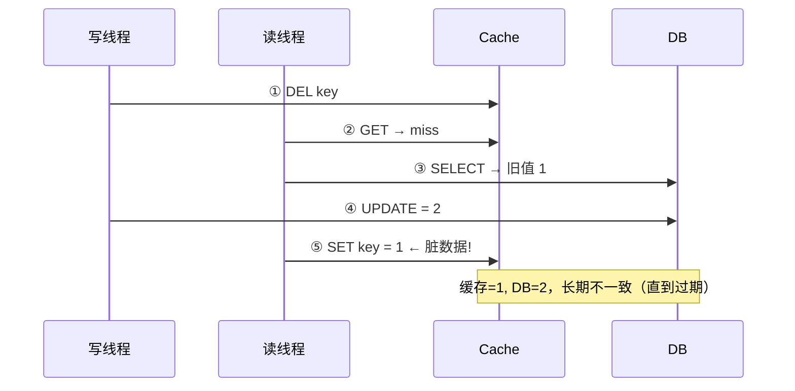

- **概率**：需要"写删缓存后、写更新 DB 前"恰好有读请求，且读回填发生在更新之后 → 概率不低（高并发下必然发生）。
- **补救**：延迟双删。

#### 方案 B：先更新 DB，再删缓存（Cache Aside 标准做法）

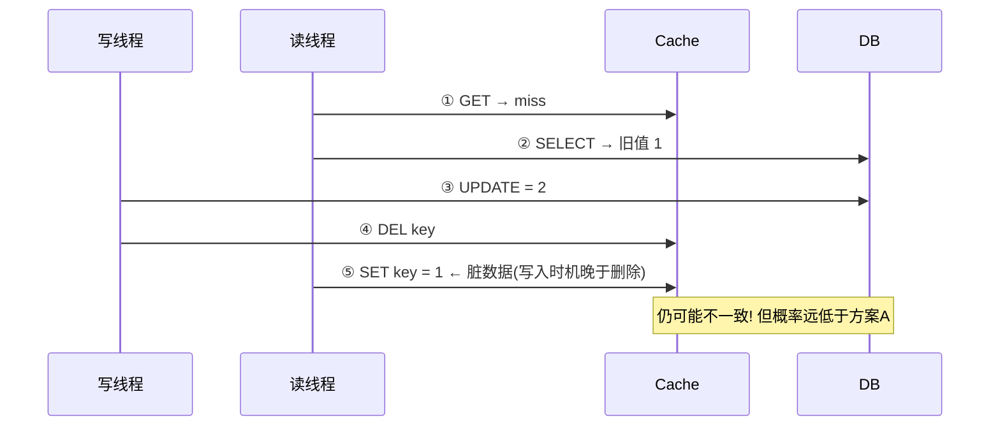

- **概率**：需要"读 miss 后、读 DB 前"写完成并删缓存，然后读把旧值写回 → **窗口极窄**（读 DB 的耗时要落在"更新DB+删缓存"之间）。
- **为什么概率低**："写操作通常伴随行锁/更慢，读 DB 往往比写快"，所以窗口小。
- **仍有风险**：读走**从库**时，主从延迟会放大窗口（主库已更新、从库还是旧值 → 读回填旧值）。

#### 结论表（面试直接背这张）

| 方案 | 不一致窗口 | 概率 | 推荐 |
|---|---|---|---|
| 先删缓存 → 更新 DB | 大（删后到更新前） | 中高 | ❌ 不推荐（除非配延迟双删） |
| 更新 DB → 删缓存 | 小（读 miss 到写回） | 低 | ✅ **默认方案** |
| 更新 DB → 删缓存 → 延迟再删 | 更小 | 极低 | ✅ 强一致要求时用 |
| 更新 DB → **binlog 订阅删缓存** | 依赖 binlog 延迟（ms） | 低且可重试 | ✅ 大厂主流（Canal） |
| 加分布式锁（读也加锁） | 0 | 无 | ⚠️ 性能崩塌，只在极少数强一致场景 |

### 8.5 核心难点三：缓存穿透 / 击穿 / 雪崩（三张表说清）

| | **穿透** | **击穿** | **雪崩** |
|---|---|---|---|
| 现象 | 查**不存在**的数据，缓存永不命中，全部打 DB | **单个热点 key** 过期瞬间，大量请求同时打 DB | **大量 key 同时过期** 或 Redis 整体宕机 |
| 根因 | 恶意攻击/业务 bug（如 `id=-1`） | 热点 key 失效 + 高并发 | TTL 集中 / 同时间预热 / 实例故障 |
| 影响 | DB 被无效查询打满 | 单行/单表被打穿（可能连带雪崩） | 全站 DB 被打满，服务不可用 |
| 方案 1 | **布隆过滤器**（不存在直接拒） | **互斥锁**（只让一个线程重建） | **TTL 加随机偏移**（±10%~30%） |
| 方案 2 | **缓存空值**（`""` + 短 TTL 60s） | **逻辑过期**（不删 key，异步重建） | **Redis 高可用**（主从+哨兵/Cluster） |
| 方案 3 | 参数校验（非法 ID 直接拒） | 热点 key **永不过期**（后台定时更新） | **多级缓存**（本地 Caffeine 兜底） |
| 方案 4 | 限流/风控（单 IP/UID 频率） | 预热（大促前把热点 key 提前加载） | **降级开关**（关闭非核心、限流） |
| 副作用 | 布隆有误判、空值占用内存 | 互斥锁增加 RT、逻辑过期有短暂旧值 | 随机 TTL 让"过期时间不可控"（业务要用过期时需注意） |

**三者关系一句话**："**穿透是'查不存在的'，击穿是'一个热点的'，雪崩是'一大批同时的'**。"

### 8.6 核心难点四：布隆过滤器（原理 + 数学 + 局限）

**原理**：

```
位数组 m 位（初始全 0）+ k 个独立哈希函数
插入 x: 对 x 做 k 次哈希 → 得到 k 个位置 → 全部置 1
查询 y: 对 y 做 k 次哈希 → 若全部为 1 → "可能存在"；若有任意一个 0 → "一定不存在"
```

**关键性质（面试必须说准）**：
- **假阳性（false positive）存在**：判定"存在"可能实际不存在；
- **假阴性不存在**：判定"不存在"一定不存在（这是它"挡穿透"有效的原因）；
- **不支持删除**（删了会影响其他元素的判断）→ 需要删除用**计数布隆**（每位一个计数器）或**布谷鸟过滤器**。

**参数公式**：

```
m = -n·ln(p)/(ln2)²        k = (m/n)·ln2
n=1亿, p=1%  → m ≈ 9.6e8 bit ≈ 114 MB, k ≈ 7
```

**工程实现**：Redis 的 `BF.ADD/BF.EXISTS`（RedisBloom 模块）；或本地 Guava `BloomFilter`（重启丢失 → 启动时用 DB 重建/预热）。

**布隆挡不住的场景**：数据**动态新增**（新 ID 还没进过滤器）→ 需要"写时同步加入过滤器" + "定期全量重建"。

### 8.7 核心难点五：互斥锁 vs 逻辑过期（击穿的两种解法）

| | **互斥锁（mutex）** | **逻辑过期（logical expire）** |
|---|---|---|
| 做法 | miss 时 `SETNX lock`，抢到的查 DB 回填，其他线程**等待/短暂睡眠重试** | 缓存里存 `{data, expireTime}`，TTL 设永久；发现"逻辑过期"则**异步重建**，当前请求返回旧值 |
| 一致性 | 强（等待后拿新值） | 弱（可能返回旧值几百 ms） |
| 吞吐 | 低（等待会堆积，线程占用） | **高**（无人等待） |
| 复杂度 | 低 | 中（需异步线程池、防重复重建） |
| 适用 | 数据敏感、能接受短暂 RT 上升 | 高并发热点、允许短暂旧值（商品详情、榜单） |

**互斥锁的坑**：
- 锁超时 → 拿不到锁的线程"自旋重试"会打满 CPU → 用**有限重试 + 随机睡眠**；
- 锁持有者崩溃 → 死锁 → 必须设 TTL + `tryLock`；
- 重建失败 → 要把锁释放（`finally`），别让其他线程一直等。

**逻辑过期的坑**：
- 重建时的并发控制（用 `SETNX` 保证只有一个线程重建）；
- 返回旧值的"过期程度"要可观测（打点）。

### 8.8 多级缓存架构（大厂标配）

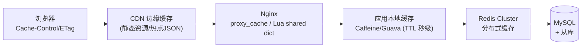

| 层 | 命中率 | TTL | 一致性手段 |
|---|---|---|---|
| 浏览器 | 高（重复访问） | 分钟~天 | `Cache-Control`/`ETag`/版本号 URL |
| CDN | 高（热点） | 秒~分钟 | 刷新 API / URL 带版本 |
| Nginx | 中高 | 秒级 | `proxy_cache_purge` |
| 本地 | 高（热点） | 1~10s | TTL 短 + 变更广播（Pub/Sub） |
| Redis | 很高 | 分钟~小时 | 删 key / binlog 订阅 |

**关键取舍**："本地缓存 TTL 越短 → 一致性越好、命中率越低。生产常用 **1~5 秒 TTL + 变更广播（Redis Pub/Sub 通知各实例清本地）**，把不一致窗口压到秒级。"

### 8.9 面试追问清单

1. 读请求要不要"加锁"？→ 默认不加（会毁掉性能）；只有在"缓存与 DB 必须强一致"的极少数场景（如余额）才用"分布式锁 + 双读校验"。
2. 为什么不用"更新缓存"配合"版本号"？→ 可以（`version` 做 CAS），但复杂度高、收益低；删除+回填更简单。
3. 大 key 怎么处理？→ 拆分（`hash` 分片）、压缩、只存必要字段；避免 `HGETALL`、用 `HSCAN`。
4. 热 key 怎么发现？→ `redis-cli --hotkeys`（需 `maxmemory-policy` 支持）、代理层（Twemproxy/Codis）统计、客户端埋点。
5. 缓存要不要设 TTL？→ **必须设**（哪怕很长）：兜底"逻辑错误导致永久脏数据"；永久 key 只给"配置类"数据。
6. Redis 挂了，读请求怎么办？→ 降级：① 本地缓存兜底；② 直接读 DB + 限流（保护 DB）；③ 返回兜底数据/友好提示。**关键是"限流"，否则 DB 会被打挂**。
7. 缓存和 DB 的"双写"有没有更优雅的方案？→ **binlog 订阅（Canal）异步删缓存**：与业务解耦、可重放、失败可重试；缺点是延迟（ms~s）。
8. "先写缓存再写 DB"（Write Behind）能用在订单吗？→ 不能：可能丢数据（缓存宕机）；只适合"计数/点赞/日志"这类可丢可重算的数据。

### 8.10 大厂真题与详解

| # | 公司 | 题目 | 考核程度 | 频次 |
|---|---|---|---|---|
| 1 | 字节 | 缓存与数据库如何保证一致性？先删缓存还是先更新 DB？ | ★★★★★ | 超高频 |
| 2 | 阿里 | 缓存穿透、击穿、雪崩的区别与解决方案？ | ★★★★★ | 超高频 |
| 3 | 腾讯 | 热点 key 如何发现与治理？ | ★★★★☆ | 高频 |
| 4 | 美团 | 延迟双删的延迟时间怎么定？为什么是两次删除？ | ★★★★☆ | 高频 |
| 5 | 拼多多 | 布隆过滤器的原理、误判率、能否删除？ | ★★★★☆ | 高频 |
| 6 | 阿里 | 多级缓存如何保证一致性？本地缓存怎么失效？ | ★★★★☆ | 中高频 |
| 7 | 京东 | Redis 集群宕机，如何保证服务可用？ | ★★★★☆ | 中高频 |
| 8 | 百度 | 如何设计一个"计数"场景的缓存（点赞数）？ | ★★★☆☆ | 中频 |

---

#### 真题 1｜字节：缓存一致性（★★★★★）

**字节风格：要"结论 + 时序 + 边界"三段式**。

**(1) 结论**："默认用 **Cache Aside：更新 DB → 删除缓存**，配 TTL 兜底；需要更强一致时用 **延迟双删** 或 **Canal 订阅 binlog 删缓存**。"

**(2) 时序（讲清为什么删比更新好 + 剩余风险）**：

```
更新 DB → DEL cache
残留风险: 读线程 miss 后读 DB(旧) 再回填 → 窗口极窄但存在
工程对策: TTL(如 30min) 兜底 + 延迟双删(500ms) + 读走主库(强一致场景)
```

**(3) 边界（判断你是否真懂）**：

| 场景 | 建议 |
|---|---|
| 商品详情、文章（可容忍秒级旧值） | 更新 DB → 删缓存 + TTL |
| 库存/余额（强一致） | 不进缓存做"权威判断"；缓存只做"展示/预检"；DB 条件更新才算数 |
| 复杂聚合值（多表 join 算出的榜单） | 用"定时重建 + 版本号切换"，不做增量更新 |
| 超高并发热点 | 逻辑过期（不删 key）+ 异步重建 |

**追问："为什么不用分布式锁把读也锁住？"** → 因为读是 99% 的流量，加锁等于"把缓存退化成 DB"，QPS 从 10 万掉到几千，不可接受。

---

#### 真题 2｜阿里：穿透/击穿/雪崩（★★★★★）

**标准答法（一张口就要分清三者，别混）**：

> "**穿透**是查不存在的数据（缓存永不命中）；**击穿**是单个热点 key 过期（一瞬间并发打 DB）；**雪崩**是大量 key 同时失效或 Redis 整体不可用。"

然后按 8.5 的表逐条给方案，每个方案补一句"**副作用**"（这是阿里面试官最看重的"取舍意识"）：

| 问题 | 首选方案 | 副作用（必须说） |
|---|---|---|
| 穿透 | 布隆过滤器 | 有误判、不能删、需定期重建 |
| 穿透 | 缓存空值 | 内存放大，可能被"随机 ID 攻击"刷满 → 要配合限流 |
| 击穿 | 互斥锁 | RT 上升、锁竞争、需防死锁 |
| 击穿 | 逻辑过期 | 可能返回旧值、需异步重建线程 |
| 雪崩 | TTL 随机 | 过期时间不可控（业务依赖过期时要注意） |
| 雪崩 | 多级缓存 + 限流 | 本地缓存一致性变差 |

---

#### 真题 3｜腾讯：热点 key 治理（★★★★☆）

**四步法**：

1. **发现**：
   - `redis-cli --hotkeys`（`maxmemory-policy=allkeys-lfu` 时可统计）；
   - 代理层（Codis/Twemproxy）per-key QPS 统计；
   - 客户端埋点（采样，1% 请求打点）；
   - 监控告警：单 key QPS > 5000 触发。
2. **缓解**：
   - **本地缓存**（Caffeine，TTL 1~5s）：90% 请求不出 JVM；
   - **key 拆分**：`hot:{id}:{0..9}`，随机读；写时全写（或写主 + 异步同步）；
   - **多副本读**：Redis 从库/多主（注意一致性）。
3. **保护**：
   - 单 key 限流（令牌桶）；
   - 熔断（QPS 超阈值直接返回兜底数据）。
4. **根治**：业务上避免"全局单 key"（如"全站计数器"）→ 改成"分片计数 + 汇总"。

> 加分："Redis Cluster 里热 key 最致命——一个 key 只能落一个 slot/节点，Cluster 扩节点也救不了。**所以热 key 必须靠'拆'，不能靠'扩'**。"

---

#### 真题 4｜美团：延迟双删的延迟时间（★★★★☆）

**答法（要给出可计算的依据，而不是"拍脑袋 500ms"）**：

```
延迟时间 T ≥ 一次读请求的最大耗时(读DB+回填缓存) + 主从复制延迟
实测: 读 DB P99 = 50ms，主从延迟 P99 = 200ms → T ≥ 250ms，取 500ms~1s 留余量
```

**为什么必须"两次"**：第一次删是"让后续读去 DB 拿新值"；第二次删是"清掉'在新值写入前抢跑回填的脏值'"。

**代价**：多一次 `DEL`；延迟期间可能读旧值。**所以生产上更推荐 Canal 方案**（用 binlog 精确触发删除，无需猜延迟）。

---

#### 真题 5｜拼多多：布隆过滤器（★★★★☆）

见 8.6。拼多多喜欢追问"**成本和精度**"：

- 1 亿数据、1% 误判 → 114MB；**如果要 0.1% 误判** → `m` 翻倍 ≈ 228MB，`k≈10`。
- 内存吃紧 → 用"**分层布隆**"或"**布谷鸟过滤器**（空间效率更高、支持删除）"。
- **Redis 集群下布隆的位置**：放在**客户端本地**（零网络开销、但一致性问题）或**独立 RedisBloom**（一致但多一跳）。

**追问："布隆判断'存在'但 DB 查不到，怎么办？"** → 这正是"误判"，正常返回空并**缓存空值（短 TTL）**，避免重复穿透。

---

#### 真题 6｜阿里：多级缓存一致性（★★★★☆）

- **本地缓存 TTL 短（1~5s）+ Redis Pub/Sub 广播失效**：变更时 `PUBLISH cache:invalidate {key}`，各实例订阅后清本地。
- **广播不可靠？** 用 TTL 兜底（最坏 5s 后自然失效）。
- **发布/订阅的坑**：Redis Pub/Sub 不持久（实例离线期间的消息丢失）→ 靠 TTL 兜；或用"Nacos 配置推送"代替。

---

#### 真题 7｜京东：Redis 宕机（★★★★☆）

| 阶段 | 手段 |
|---|---|
| 预防 | Cluster（多主多从）+ 哨兵；跨机房容灾；`maxmemory` 与淘汰策略配置 |
| 检测 | 客户端熔断（连续超时 N 次 → 打开熔断开关，快速失败） |
| 降级 | ① 本地缓存兜底（TTL 内可用）；② 读 DB + **严格限流**（否则 DB 挂）；③ 非核心功能关闭（推荐、榜单） |
| 恢复 | 预热（重启后缓存空 → 用 `keys` 分批预热或按"热点清单"预热）；**不要**一次性全量预热（会把 DB 打挂） |
| 复盘 | 缓存命中率、DB QPS 曲线、限流触发次数 |

> 关键句："**Redis 不可用的本质是'DB 要被暴露'**。所以真正的预案不是'救 Redis'，而是'**把打到 DB 的流量限住在 DB 能承受的范围**'。"

---

#### 真题 8｜百度：点赞计数（★★★☆☆）

| 层 | 做法 |
|---|---|
| 写 | Redis `HINCRBY like:{bizId} {userId} 1`（或 `INCR` 计数 + `SADD` 记录谁点过） |
| 读 | 直接读 Redis 计数（不做 DB 查询） |
| 落库 | 定时（每 10s/每分钟）把增量 `INCRBY` 回写 DB（**Write Behind**） |
| 防重 | `SADD` 判重（`SADD` 返回 1 才 `INCR`）；或用 `SETBIT` 位图（亿级用户需 ~125MB/天） |
| 一致性 | 允许短时不准；DB 是"最终账本"，定时对账修正 |
| 宕机 | Redis 丢失 → 用 DB 已有值 + 剩余增量恢复；**用 AOF 减轻丢失** |

---

## 9. 设计一个分布式 ID 生成器

### 9.1 面试官考什么

| 考察点 | 期望层次 |
|---|---|
| 能不能列出需求维度 | 唯一、递增（趋势）、高可用、高性能、长度、可读性、信息量（分片基因） |
| Snowflake 的位分配 | 41+10+12 各是多少、每 ms 多少个、能撑多少年 |
| 时钟回拨怎么处理 | 等待/抛异常/借未来时间/Leaf 的 ZK 方案 |
| 号段模式 | 双 Buffer、动态步长、DB 不可用时的表现 |
| **有序性为什么重要** | InnoDB 聚簇索引页分裂、顺序写 vs 随机写 |
| 分库分表下 ID 怎么带"分片基因" | 基因法（避免二次查询） |

> **题眼一句话**："分布式 ID 的终极取舍是 **'性能 ↔ 有序 ↔ 不重'** 三者。雪花牺牲'绝对有序'换本地生成；号段牺牲'ID 连续'换吞吐；UUID 牺牲'有序'换绝对唯一。"

### 9.2 需求维度（先问清，别上来就雪花）

| 维度 | 选项 | 影响 |
|---|---|---|
| 唯一性 | 单库唯一 / 全局唯一 / 全局唯一且业务隔离 | 决定方案 |
| 趋势递增 | 严格递增 / 趋势递增 / 无所谓 | **决定 DB 性能**（页分裂） |
| 生成性能 | 1000/s / 10万/s / 百万/s | 决定是否要本地生成 |
| 可用性 | 允许依赖 DB/Redis 吗 | 决定是否有外部依赖 |
| 长度 | 64bit（long） / 32 位字符串 / 可读 | 决定编码方式 |
| 信息量 | 是否要"分片基因"/时间可读 | 决定位分配 |
| 安全 | ID 可否被外部看到（会暴露业务量） | 是否需要混淆 |

### 9.3 六种方案横向对比（这张表背下来）

| 方案 | 唯一 | 递增 | 性能 | 依赖 | 长度 | 主要问题 |
|---|---|---|---|---|---|---|
| **UUID**（v4） | 全球唯一 | ❌ 完全无序 | 极高（本地） | 无 | 128bit/36 字符 | **索引性能差**、不可读、太长 |
| **DB 自增** | 单表唯一 | ✅ 严格 | 低（数千 TPS） | DB（单点） | 小 | 单点瓶颈、分库后不唯一 |
| **DB 号段**（Leaf-segment） | 全局唯一 | ✅ 趋势 | 高（一次取 N 个） | DB（弱） | 小 | 号段浪费、DB 短暂不可用会耗尽 |
| **Redis INCR** | 全局唯一 | ✅ 严格 | 很高（10万+/s） | Redis | 小 | **持久化可能丢/重复**、网络开销 |
| **Snowflake** | 全局唯一 | ✅ 趋势（时间序） | 极高（本地） | 无（需 workerId） | 64bit | **时钟回拨**、workerId 管理 |
| **Leaf-snowflake** | 全局唯一 | ✅ 趋势 | 极高 | ZK（弱，仅启动） | 64bit | 依赖 ZK、仍需处理回拨 |

### 9.4 核心难点一：Snowflake 位分配（必须能默写）

```
0 - 41bit(时间戳, 毫秒) - 10bit(机器ID) - 12bit(序列号)
↑
符号位(恒0，保证正数)

容量计算:
- 12bit 序列号 → 每毫秒每机器 4096 个 ID → 单机 ~409.6 万 ID/秒
- 10bit 机器 → 1024 台机器 → 总 ~41.9 亿 ID/毫秒（理论）
- 41bit 时间戳 → 2^41 ms ≈ 69.7 年（从自定义起始时间算）
```

**为什么是 41/10/12 这个组合？** 因为它刚好"卡"进 `long`（64bit）：
- 少 1 位符号 → 63 位可用；
- 时间给 41 位是"够用 69 年"；
- 机器 10 位是"1024 台"（多数集群够）；
- 序列 12 位是"单机每秒 400 万"（远超需要）。

**变种（面试加分）**：
- 机器位不够 → `5bit 数据中心 + 5bit 机器`（同 10 位，分层管理）；
- 需要"业务标识" → 从序列位里切 2~3 位做 `bizType`（牺牲并发换隔离）；
- **美团 Leaf-snowflake**：`workerId` 由 ZK 顺序节点分配（持久化到本地文件，重启复用）；
- **百度 uid-generator**：`workerId` 用 DB 分配 + "借用未来时间"解决回拨。

### 9.5 核心难点二：时钟回拨（Snowflake 唯一的真实风险）

**回拨场景**：NTP 校时、虚拟机迁移、人工改时间、闰秒 → 时间倒退 → **可能生成重复 ID**。

| 处理方式 | 做法 | 代价 |
|---|---|---|
| ① 直接抛异常 | 发现 `now < lastTime` → 拒绝服务 | 服务短暂不可用（最安全） |
| ② 等待追平 | 回拨在几十 ms 内 → `sleep` 到 `lastTime` | 短暂阻塞 |
| ③ 借用未来时间 | 百度 uid-generator：把序列号当"未来时间"用，等真实时间追上来 | ID 会"跳变"，需额外位管理 |
| ④ ZK 记录 + 比较 | Leaf：启动时对比 ZK 上记录的最大时间戳，小于则等/报警 | 依赖 ZK，但只影响启动 |
| ⑤ 双 Buffer + 预生成 | 提前生成一批 ID，回拨时用缓冲 | 复杂度高 |
| ⑥ 直接不用时间（号段/Redis） | 绕开问题 | 失去"时间可读"特性 |

**面试标准答法**：

> "工程上最实用的是 **① 检测并拒绝（回拨超过阈值就抛异常，让上游重试） + ④ 启动时与 ZK 比对**。因为时钟回拨是'小概率但后果严重'，宁可短暂失败也不能重复发号。"

### 9.6 核心难点三：号段模式（Leaf-segment）——为什么它是大厂主流

```
号段表: biz_tag='order_id', max_id=1000000, step=1000
① 应用启动/号段用尽 → UPDATE max_id = max_id + step → SELECT max_id
② 内存中分配 [max_id-step+1, max_id]
③ 用到 10% 时，异步预取下一段（双 Buffer）
④ 双 Buffer 用尽且预取未完成 → 阻塞等待（此时 RT 抖动）
```

**双 Buffer 的作用**：避免"号段刚用完才去 DB 取"导致的尖刺延迟（一次 DB 往返 1~5ms，在 10 万 QPS 下就是灾难）。

**动态步长**：记录"上次号段消耗完用了多久"，若 5 分钟就用完 → 步长翻倍；若 1 小时没用完 → 步长减半。**目的：DB 访问频率稳定在"每 15 分钟一次"量级**。

**号段模式的问题（必须主动说）**：

| 问题 | 方案 |
|---|---|
| DB 短暂不可用 → 号段耗尽后无法发号 | 内存多级 Buffer（预取 2~3 段）；降级到本地雪花 |
| 重启浪费剩余号段 | 无法避免（ID 不需连续）；可持久化"当前用到的位置"减少浪费 |
| 多业务共享一张表 → 行锁竞争 | 每个 `biz_tag` 一行，行锁粒度小；或分库 |
| ID 可被推算（连续） | 加"位混淆"（可逆置换）或对外只暴露加密后的 ID |

### 9.7 核心难点四：有序性为什么重要（InnoDB 视角）

**这是"技术深度"最强的追问**：

```
InnoDB 主键是聚簇索引（B+ 树），数据按主键顺序存放：
- 递增 ID: 新数据总插在 B+ 树最右侧 → 顺序 IO、页分裂少、缓存命中高
- 随机 ID(UUID): 插入位置随机 → 频繁页分裂(每页 50% 填充率)、随机 IO、buffer pool 命中率低
实测: 同一张表，UUID 主键的写入 TPS 可能只有自增的 1/3~1/5，且索引体积大 2~3 倍
```

**所以选型优先级**：

```
严格递增(DB自增/Redis) > 趋势递增(Snowflake/号段) >> 无序(UUID)
```

**UUID 什么时候能用？**
- 作为"**业务幂等键**"（`uk(request_id)`），不当事务主键；
- 分库分表后"无法用自增"且"写入压力不大"的场景；
- 新版 **UUIDv7**（时间前缀）或 **ULID/TSID**：既有时间有序性，又本地生成 → **比 UUIDv4 好得多**，是近年的主流替代。

**UUID 版本对比（能说出来很亮）**：

| 版本 | 组成 | 有序性 | 说明 |
|---|---|---|---|
| v1 | 时间 + MAC | 大致有序 | 暴露 MAC 地址（隐私风险） |
| v4 | 随机 | ❌ | 最常用，但最不适合做 DB 主键 |
| **v7** | **时间戳(ms) + 随机** | ✅ 有序 | RFC 9562（2024），**推荐** |
| ULID | 时间(ms, Base32) + 随机 | ✅ 有序 | 26 字符、可排序、大小写不敏感 |
| TSID | 时间 + 节点 + 序列 | ✅ | 类似雪花但更好读 |

### 9.8 核心难点五：分库分表下的"基因法"（高级加分项）

**问题**：订单按 `user_id % 16` 分库，但订单号是全局 ID → 用订单号查订单时，**不知道在哪个库** → 要扫 16 个库。

**基因法（也叫"分片基因/位基因"）**：

```
订单号 = 雪花ID(高位) + user_id 的低 4 位(基因, 放在 ID 低位)
查询时: 从订单号低位取出 4 位基因 → 拼出分片号 → 直接定位到唯一库
```

**代价**：牺牲 4 位序列号空间（4096 → 256/ms），且"一个订单的基因必须与分片规则一致"（分片规则变更要谨慎）。

**替代方案**：映射表（`order_no → user_id` 存索引表）；或"双写维度"（按 user 分 + 按 order 分两套表，成本高）。

### 9.9 面试追问清单

1. Redis `INCR` 会不会重复？→ 会：① 主从切换时从库数据落后（异步复制丢写）② AOF `everysec` 丢 1s ③ RDB 快照丢失 → **对策**：`INCR` 前用 `INCRBY step` 预分配（丢失只影响"号段"，但可能回退 → 要用"多 master 步长错开"或干脆用号段模式）。
2. 1000 台机器 workerId 冲突怎么办？→ 启动时从 ZK/DB/Redis 申请（`SETNX worker:{id}`），申请不到就换；或用"IP/PodName 哈希 + 冲突重试"。
3. 能不能用"数据库自增 + 步长"（如 3 台机器各步长 3，起始 1/2/3）？→ 可以（经典 MySQL 双主方案），但扩容时要改步长（易错），且 ID 不连续。
4. 雪花 ID 暴露业务量怎么办？→ 混淆（`id ^ salt` 可逆异或、Feistel 置换）；或对外用"短码"（Base62 编码 + 扰动）。
5. 需要"按时间范围查询"怎么办？→ 用雪花（高位是时间）→ 可用时间反推 ID 范围；或额外存 `create_time` 索引。
6. 一个 ID 服务要支撑"订单/支付/消息"多业务，怎么隔离？→ 按 `bizTag` 独立号段/独立 workerId 段；避免一个业务把号段打满影响其他业务。
7. 为什么不用"数据库自增"扛 10 万 QPS？→ 单表单行 `AUTO_INCREMENT` 有全局锁/自增锁（`innodb_autoinc_lock_mode`），且单库 TPS 上限数千；分库后又不全局唯一。

### 9.10 大厂真题与详解

| # | 公司 | 题目 | 考核程度 | 频次 |
|---|---|---|---|---|
| 1 | 美团 | 设计一个分布式 ID 生成器，要求高性能、趋势递增、高可用 | ★★★★☆ | 高频 |
| 2 | 滴滴 | 雪花算法的时钟回拨怎么解决？ | ★★★★☆ | 高频 |
| 3 | 字节 | 为什么 UUID 不适合做数据库主键？ | ★★★☆☆ | 高频（基础） |
| 4 | 阿里 | 分库分表后，如何用订单号直接定位到库？ | ★★★★☆ | 中高频 |
| 5 | 腾讯 | 号段模式的双 Buffer 是怎么实现的？ | ★★★★☆ | 中频 |
| 6 | 美团 | Leaf 号段模式如果 DB 挂了怎么办？ | ★★★★☆ | 中频 |
| 7 | 拼多多 | Redis INCR 生成 ID 可靠吗？会重复吗？ | ★★★★☆ | 中频 |

---

#### 真题 1｜美团：设计分布式 ID 生成器（★★★★☆）

**答题结构"需求 → 对比 → 选型 → 细节 → 兜底"**：

1. **需求**：全局唯一、趋势递增、10 万 QPS、99.99% 可用、64bit、可带分片基因。
2. **对比**：见 9.3 表，一句话点评每个方案。
3. **选型（分层方案，最贴合真实大厂）**：
   ```
   主方案: Leaf-segment(号段) → 高性能、趋势递增、无时钟问题
   备用:   Leaf-snowflake(本地雪花) → DB 不可用时降级
   兜底:   预生成 Buffer + 本地文件记录 max_id
   ```
4. **细节**：
   - 号段表按 `biz_tag` 分行，`step` 动态调整（10 分钟用完 → 翻倍）；
   - 双 Buffer（用 10% 预取），内存里 `AtomicLong` 分配（无锁）；
   - 应用重启：从本地文件恢复"已用到位置"（减少浪费），并与 DB `max_id` 比对（防止 DB 回滚导致重复）。
5. **兜底**：DB 主从 + 探活；号段耗尽 → 切本地雪花（workerId 已在启动时申请）；监控"号段剩余量"告警（< 20% 报警）。

---

#### 真题 2｜滴滴：时钟回拨（★★★★☆）

见 9.5。滴滴（TinyID 作者）会追问"**你怎么检测回拨**"：

```
每台机器记录 lastTimestamp(内存) + 持久化(本地文件/ZK)
每次生成: if (now < lastTimestamp) → 回拨
  - 差值 < 阈值(如 100ms) → 自旋等待追平
  - 差值 >= 阈值 → 抛异常 / 报警 / 拒绝服务（让上游换机器重试）
启动时: 从 ZK 读该 workerId 的 lastTimestamp，若 now < 它 → 等待或重新申请 workerId
```

**加分**："真正稳的做法是**不依赖系统时钟**：用号段（DB）或 Redis `INCR`；雪花只用在'能容忍短暂失败'的场景。"

---

#### 真题 3｜字节：UUID 不适合做主键（★★★☆☆）

见 9.7。三步答：
1. **无序** → B+ 树随机插入 → 页分裂 + 随机 IO + 缓存命中低；
2. **太长** → 128bit（36 字符）→ 索引体积大、每页容纳的 key 少 → 树更高、IO 更多；
3. **不可读/无业务信息** → 无法按时间范围查询、无法定位分片。

> 追问："那 UUID 用在哪？" → 幂等键、链路追踪 `traceId`、临时文件名、消息去重 ID（不进主键索引，或只做唯一索引）。

---

#### 真题 4｜阿里：订单号直接定位库（★★★★☆）

见 9.8 基因法。答题顺序：
1. 问题：按 `user_id` 分片，按 `order_id` 查会"全库扫描"。
2. 方案 A（基因法）：订单号低位塞 `user_id % 16`（4bit），查询时取低位还原分片。
3. 方案 B（映射表）：`order_no → user_id` 单独一张索引表（或 Redis），多一次查询但灵活。
4. 方案 C（双维度表）：按 user 分 + 按 order 分，写两份（成本高、一致性难）。
5. 选型：**高并发订单用 A（零额外查询），低频业务用 B（简单）**。

---

#### 真题 5｜腾讯：双 Buffer 实现（★★★★☆）

```
状态: currentBuffer(正在用) / nextBuffer(预取好)
阈值: currentBuffer 剩余 10% 时触发异步预取(线程池)
切换: current 用尽 → current = next, next = null → 再次触发预取
并发: 用 AtomicReference 切换; 分配用 AtomicLong.getAndIncrement
异常: 预取失败 → 重试 + 告警; 若 current 用尽且 next 为空 → 阻塞等待(并打点)
```

**关键数字**：`step=1000`、阈值 10%（即剩 100 个时预取）；预取超时 500ms（超过则阻塞告警）。

---

#### 真题 6｜美团：DB 挂了怎么办（★★★★☆）

```
分层降级:
① 本地双 Buffer(预取 2 段) → 可撑 2×step 个 ID（如 2000 个, 按 10万QPS 只够 20ms → 不够!）
   → 所以 step 要按"QPS × 预期故障时长"设计：10万QPS × 60s = 600万 → step 至少 600 万
② 切本地雪花（workerId 已预申请）→ 完全本地，可持续
③ 已发出的 ID 不能重复 → 切换时把雪花时间戳从"当前时间"开始，天然大于号段 ID（如果号段 ID 高位不是时间则需映射）
④ 恢复后: 号段 max_id 可能落后于已用的雪花ID → 用"号段ID + 前缀/类型位"区分，或把 DB max_id 上调到安全值
```

> 这是最能体现"想过故障"的一段，面试时主动讲会非常加分。

---

#### 真题 7｜拼多多：Redis INCR 可靠性（★★★★☆）

```
风险:
① 主从异步复制 → 主挂了, 从库没同步到最新 INCR → 切换后从旧值继续 → 重复
② AOF everysec → 丢 1s 的 INCR → 重复
③ RDB 快照 → 丢更多

缓解:
① 用 INCRBY 预分配号段(如每次 1000) → 丢的是"未使用的号段", 但可能"回退" → 仍可能重复
② 多 master 步长错开(如 3 主, 步长 3, 起始 1/2/3) → 单主丢失仍可能重复, 但概率低
③ 最稳: 用"号段模式(DB)"或"雪花(本地)" → Redis 只做"辅助/缓存"
```

**结论句**："Redis `INCR` 适合'允许极小概率重复'的场景（如日志 ID、消息 ID）；**订单号、支付流水号绝不能用它**。"

---

## 10. 设计一个 API 网关

### 10.1 面试官考什么

| 考察点 | 期望层次 |
|---|---|
| 网关的职责边界 | 路由、鉴权、限流、熔断、日志、协议转换；**但不该做重业务** |
| 线程模型 | 阻塞（Servlet/Tomcat）vs 非阻塞（WebFlux/Netty），为什么网关必须异步 |
| 限流与熔断 | 令牌桶参数、熔断三态机 |
| 统一鉴权 | JWT 校验放网关，用户信息如何透传下游 |
| 高可用与性能 | 无状态、连接池、大 body、超时、部署架构 |

> **题眼一句话**："网关是'**所有流量的咽喉**'——它必须**足够快、足够稳、足够薄**。任何'重业务'放进网关，都会变成全站的单点故障。"

### 10.2 网关 vs Nginx vs 服务网格（先说清定位）

| 组件 | 层次 | 擅长 | 不擅长 |
|---|---|---|---|
| **Nginx** | 接入层（L4/L7） | 静态资源、TLS 卸载、四层负载、极高并发、`limit_req` | 动态业务逻辑（Lua 可做但生态薄） |
| **API 网关**（Gateway/Zuul/Kong） | 应用层 | 动态路由、鉴权、灰度、限流、熔断、日志、协议转换 | 超高并发静态流量（不如 Nginx） |
| **Service Mesh**（Istio/Envoy） | 东西向（服务间） | 服务发现、mTLS、流量治理、可观测 | 面向公网的 API 管理 |
| **BFF** | 业务聚合层 | 面向端的接口聚合/裁剪 | 通用治理 |

**生产典型链路**：`Client → CDN → Nginx(LB/TLS) → API 网关(治理) → 微服务 → Sidecar/Mesh`

> 加分句："Nginx 做'流量的搬运'，网关做'流量的治理'。两者不是替代关系，而是**分层配合**。"

### 10.3 架构

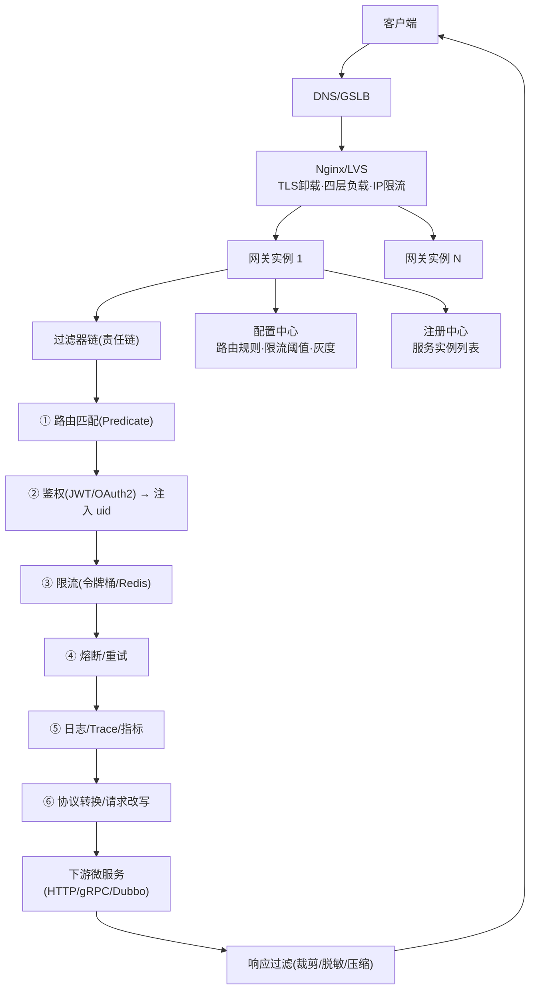

### 10.4 核心难点一：非阻塞模型（为什么网关不能用 Servlet 阻塞 IO）

| | Tomcat（Servlet 阻塞） | Netty/WebFlux（事件驱动） |
|---|---|---|
| 线程模型 | 1 请求 1 线程（`maxThreads=200`） | 少量 EventLoop 线程（≈CPU 核数）处理海量连接 |
| 并发上限 | 受线程数限制（200 并发 → 超过就排队） | 受内存/连接数限制（万级~十万级） |
| 下游慢时的表现 | 线程被占满 → **整个网关卡死**（这是网关最致命的故障） | 线程不阻塞 → 只是"挂起请求"，其他请求照常 |
| 上下文切换 | 多（线程多） | 少 |
| 编程复杂度 | 低（同步代码） | 高（Reactor、回调、背压） |

**网关的宿命**："网关的下游（各业务服务）一定有慢的、有挂的。如果用阻塞模型，**一个慢下游就能拖垮整个网关**——这就叫'**同步调用放大器**'。所以网关必须是异步/非阻塞 + 每个下游独立超时。"

**Spring Cloud Gateway 的核心抽象（能讲出来很加分）**：

```
① Route(Predicate + Filters): Predicate 匹配(Host/Path/Method/Header/时间)
② Filter Chain: 责任链, 每个 Filter 是 GatewayFilter
③ GlobalFilter: 全局过滤器(鉴权、日志、灰度)
④ Ordered: 通过 getOrder() 控制顺序(越小越先)
⑤ ServerWebExchange: 请求/响应上下文(可改写 header/body)
```

**自定义过滤器示例**：

```java
@Component
public class AuthGlobalFilter implements GlobalFilter, Ordered {
    @Override
    public Mono<Void> filter(ServerWebExchange exchange, GatewayFilterChain chain) {
        String token = exchange.getRequest().getHeaders().getFirst("Authorization");
        if (!jwtVerifier.verify(token)) {
            exchange.getResponse().setStatusCode(HttpStatus.UNAUTHORIZED);
            return exchange.getResponse().setComplete();   // 快速失败
        }
        // 把用户信息注入下游 header(下游无需再解析 token)
        ServerHttpRequest req = exchange.getRequest().mutate()
                .header("X-User-Id", uid).header("X-Tenant-Id", tenantId).build();
        return chain.filter(exchange.mutate().request(req).build());
    }
    @Override public int getOrder() { return -100; }  // 最先执行
}
```

### 10.5 核心难点二：限流（网关最常被追问的落地细节）

**Spring Cloud Gateway 的 `RequestRateLimiter`（面试常问参数含义）**：

```yaml
filters:
  - name: RequestRateLimiter
    args:
      redis-rate-limiter.replenishRate: 100    # 每秒补充令牌数(平均速率)
      redis-rate-limiter.burstCapacity: 200    # 桶容量(允许的突发)
      redis-rate-limiter.requestedTokens: 1    # 每个请求消耗令牌
      key-resolver: "#{@userKeyResolver}"      # 限流维度(按用户/IP/API)
```

- **底层是 Redis + Lua 的令牌桶**（`RedisRateLimiter`），保证集群内多网关实例共享配额。
- `replenishRate=100, burstCapacity=200` 的含义：长期 100 QPS，瞬时最多 200。

**四种限流维度（网关通常同时开多个）**：

| 维度 | Key | 目的 |
|---|---|---|
| 全局 | `api:{routeId}` | 保护下游整体 |
| 用户 | `uid:{userId}` | 防单用户刷 |
| IP | `ip:{clientIp}` | 防单机/单出口刷 |
| 接口 | `api:{method}:{path}` | 保护热点接口 |

**分布式限流的精度问题（必说）**："Redis 集中令牌桶精度高但有网络开销（1 RTT/请求）；大规模下常用'**本地令牌桶按实例分摊配额**'（精度换性能），再加'全局 QPS 总闸'兜底。"

### 10.6 核心难点三：熔断与降级（三态机必须能画）

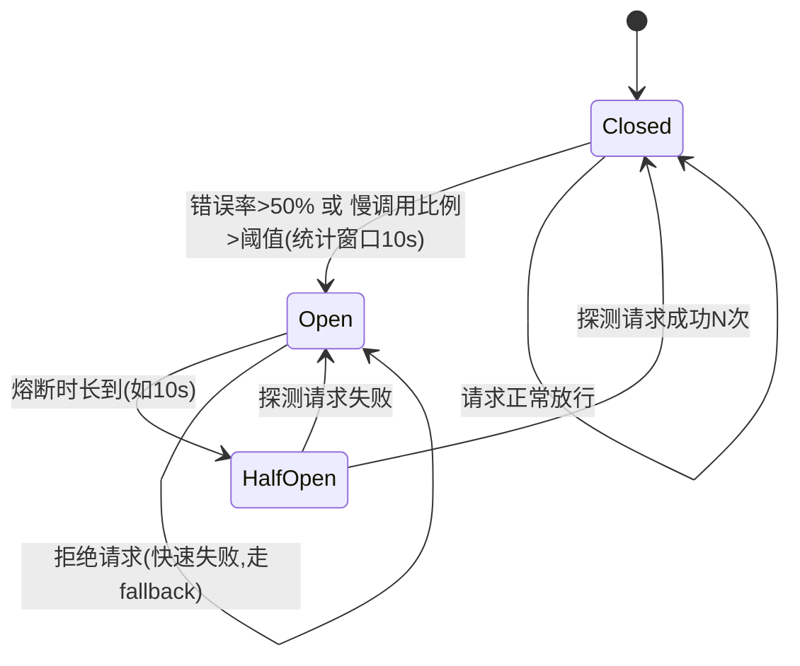

| 状态 | 行为 |
|---|---|
| **Closed**（关闭） | 正常放行，统计成功率/RT |
| **Open**（打开） | **直接拒绝**（不调用下游），返回兜底/降级响应 |
| **Half-Open**（半开） | 放**少量探测请求**，成功则恢复，失败则继续熔断 |

**熔断 vs 限流的区别（很多人搞混）**：

| | 限流 | 熔断 |
|---|---|---|
| 触发依据 | **流量大小**（QPS 超阈值） | **下游健康度**（错误率/慢调用比例） |
| 目的 | 保护自己/下游不被流量压垮 | 防止"雪崩"（下游已挂，别继续打） |
| 动作 | 拒绝超出部分 | **全部拒绝**一段时间 |

**降级（fallback）要做的事**：
- 返回缓存/默认值（如"推荐服务降级 → 返回热销榜"）
- 返回友好提示（业务码而非 500）
- **开关化**：降级策略放配置中心，可动态开关

### 10.7 核心难点四：统一鉴权与用户信息透传

**两种模式**：

| 模式 | 做法 | 优点 | 缺点 |
|---|---|---|---|
| **网关集中鉴权** | 网关验 JWT/查 Redis，把 `uid/tenant/roles` 放 Header 透传下游 | 下游零成本、统一策略 | 网关成为信任中心（**内网必须可信**） |
| **下游各自鉴权** | 每个服务自己验 token | 去中心、服务自治 | 重复实现、策略不一致、性能浪费 |
| **混合（推荐）** | 网关验"身份"（认证），下游验"权限"（授权，靠注解 + 权限码） | 职责清晰 | 需要统一规范 |

**透传的安全隐患（面试官爱问）**：
- 下游如果**直接信任** `X-User-Id`，而内网可被访问 → **伪造 Header 越权**。
- 对策：① 内网隔离（mTLS/Service Mesh）；② 网关注入**签名头**（`X-Sign = HMAC(uid+ts)`），下游验签；③ 下游校验"请求来源"（只允许网关 IP）。

### 10.8 核心难点五：Zuul vs Gateway（对比要成表）

| 维度 | Zuul 1.x | Zuul 2.x | Spring Cloud Gateway |
|---|---|---|---|
| 底层 | Servlet（阻塞） | Netty（异步） | **WebFlux（Reactor + Netty）** |
| 线程模型 | 1 请求 1 线程 | 事件驱动 | 事件驱动 |
| 长连接 | ❌ 不支持 | ✅ | ✅（WebSocket/SSE） |
| 过滤器 | `ZuulFilter`（4 阶段） | 同 | `GatewayFilter` + `GlobalFilter` |
| 性能 | 低（高并发下线程耗尽） | 高 | 高 |
| 生态 | Netflix 已停维护 | 普及度低 | Spring Cloud 官方，生态最好 |

**Zuul 1.x 为什么性能差（要讲到根因）**：
```
每个请求占用一个 Tomcat 线程,线程在"等下游响应"期间被阻塞
→ 下游 RT 200ms,线程池 200 → 理论并发上限 1000 QPS
→ 下游变慢到 1s → 上限掉到 200 QPS(而且开始排队/超时)
→ 网关先于业务崩溃(雪崩起点)
```

**Gateway 的优势（讲三点就够）**：
1. 非阻塞 → 高并发下稳定；
2. 支持长连接（WebSocket 透传）；
3. 与 Spring Cloud 生态无缝（配置中心、注册中心、熔断、限流）。

### 10.9 高可用与性能调优（工程化清单）

| 项 | 做法 |
|---|---|
| 无状态 | 不存 session（JWT 或 Redis）；可任意扩缩 |
| 部署 | 多可用区 + Nginx/LVS 前置 + VIP/Keepalived；**网关实例数 ≥ 3** |
| 超时 | **逐层递减**：网关→下游 200ms，下游→DB 100ms，下游→缓存 20ms |
| 连接池 | 下游 HTTP 用连接池（`maxConnections`、`pendingAcquireTimeout`）；**禁止每请求新建连接** |
| 大 body | 限制 `maxRequestSize`；文件上传**直传对象存储**（不要过网关）；流式转发避免全量进内存 |
| 内存 | 网关不要缓存大响应；`-XX:MaxDirectMemorySize` 适配 Netty |
| 观测 | 每路由的 QPS/RT/错误率/熔断次数；**TraceId 贯穿**（网关生成，透传下游） |
| 发布 | 灰度（按 header/uid 分流）+ 优雅下线（先摘流量，等在途请求完成） |
| 防护 | 防重放（`timestamp + nonce`）、防注入（参数校验）、TLS、WAF 前置 |

### 10.10 面试追问清单

1. 网关要不要做"服务聚合"（一次请求聚合多个下游）？→ 可以但**要克制**：聚合会拉长 RT、放大故障面；更适合放在 BFF 层。
2. 网关如何做"灰度发布"？→ 按 `header/uid/百分比` 匹配 Route，把流量导到不同版本的服务实例（或不同 `weight`）。
3. 网关的"路由"存在哪？→ 内存（启动加载 + 配置中心推送刷新）；**不要每次请求查 DB/Redis**。
4. 网关挂了怎么办？→ Nginx 层摘除 unhealthy 实例（主动健康检查）；DNS/GSLB 切流；客户端重试（幂等接口）。
5. 如何防止"绕过网关直连服务"？→ 服务只监听内网；mTLS/Sidecar；网络策略（K8s NetworkPolicy）。
6. 网关如何做"响应脱敏"？→ 响应过滤器按字段规则（身份证/手机号）正则脱敏；规则配置化。
7. WebFlux 的坑有哪些？→ 阻塞调用会卡 EventLoop（**任何 JDBC/同步 HTTP 都必须切到弹性线程池**）；背压处理；调试困难。

### 10.11 大厂真题与详解

| # | 公司 | 题目 | 考核程度 | 频次 |
|---|---|---|---|---|
| 1 | 阿里 | 设计一个 API 网关，支持路由、鉴权、限流、熔断 | ★★★★☆ | 高频 |
| 2 | 字节 | 网关为什么必须用非阻塞模型？阻塞模型会有什么问题？ | ★★★★☆ | 高频 |
| 3 | 腾讯 | 网关如何做统一鉴权？用户信息怎么传给下游？ | ★★★★☆ | 高频 |
| 4 | 美团 | 限流算法在网关里怎么落地？分布式限流精度如何保证？ | ★★★★☆ | 高频 |
| 5 | 京东 | 熔断和限流的区别？熔断三态怎么实现？ | ★★★★☆ | 中高频 |
| 6 | 携程 | Spring Cloud Gateway 和 Zuul 的区别？选哪个？ | ★★★☆☆ | 中频 |
| 7 | 阿里 | 网关如何做到高可用与高性能？有哪些坑？ | ★★★★☆ | 高频 |

---

#### 真题 1｜阿里：设计 API 网关（★★★★☆）

**答题"六段式"**：

1. **职责**：路由、鉴权、限流、熔断、日志、协议转换、灰度；（**明确说"不做业务逻辑"**）
2. **架构**：见 10.3 图；强调"过滤器责任链 + 配置中心驱动"。
3. **路由**：`Predicate` 匹配（Host/Path/Method/Header），规则内存化，配置中心推送刷新。
4. **鉴权**：JWT 验签（无状态、不查库）+ Redis 黑名单/版本号；注入 `X-User-Id` 并加 HMAC 签名。
5. **限流熔断**：Redis+Lua 令牌桶（全局）+ 本地令牌桶（性能）；Sentinel/Resilience4j 熔断三态。
6. **高可用**：无状态多实例 + Nginx 健康检查 + 逐层超时 + 优雅下线 + 全链路 Trace。

---

#### 真题 2｜字节：为什么必须非阻塞（★★★★☆）

**用"数字"讲最有说服力**：

```
假设: 下游平均 RT 100ms, Tomcat 线程池 200
阻塞模型: 单实例最大并发 = 200 → QPS ≈ 200/0.1s = 2000
         若下游 RT 涨到 500ms → QPS 掉到 400（线程全在等）
         若下游挂死(不返回) → 线程全占满 → 网关"假死"，所有路由一起挂
非阻塞: 事件循环线程不等待 → 并发只受内存/连接数限制
        下游慢只是"请求挂起"，其他路由不受影响 → 故障隔离
```

> 结论："**阻塞模型的致命问题不是'性能低'，而是'故障会跨业务传染'**。网关是所有业务的公共入口，一个慢下游就能让全站 502。"

---

#### 真题 3｜腾讯：统一鉴权与透传（★★★★☆）

见 10.7。腾讯会追问"**如果攻击者伪造 `X-User-Id` 头怎么办**"：

```
① 服务只允许网关访问（内网 + IP 白名单/NetworkPolicy）
② 网关注入签名: X-User-Id + X-Ts + X-Sign(HMAC-SHA256(uid|ts, secret))
③ 下游验签 + 时间窗口(±60s) 防重放
④ 或上 mTLS: 网关持有客户端证书，服务端校验 CN
```

---

#### 真题 4｜美团：限流落地与精度（★★★★☆）

见 10.5。补充"**分层限流**"这个美团很喜欢的回答：

```
① 实例本地令牌桶: 配额 = 全局配额 / 实例数 → 零网络开销(粗)
② Redis 全局令牌桶: 精度高(1 RTT) → 用于核心接口
③ 慢启动/预热: 冷启动时限制并发(避免瞬时打满)
④ 自适应限流: 按 RT/并发数动态调整(Sentinel 系统规则/BBR 思想)
```

---

#### 真题 5｜京东：熔断 vs 限流（★★★★☆）

见 10.6。京东（大促场景）会追问"**熔断后如何恢复**"：

```
半开探测: 每 10s 放 5 个请求
  - 全部成功 → 关闭熔断(逐步放量: 10%→50%→100%)
  - 有失败 → 继续 Open,并延长熔断时长(指数退避 10s→30s→60s)
防抖: 统计窗口要足够长(如 10s/20 个请求),避免"抖动误熔断"
```

---

#### 真题 6｜携程：Gateway vs Zuul（★★★☆☆）

见 10.8。一句总结："**Zuul 1.x 是'上一代'（阻塞），Gateway 是'当前主流'（非阻塞 + 长连接），Zuul 2.x 性能好但生态弱。选型看团队与技术栈，Spring Cloud 体系毫无疑问选 Gateway。**"

---

#### 真题 7｜阿里：高可用与性能的坑（★★★★☆）

**必讲的五个坑（都是真实事故）**：

| 坑 | 后果 | 对策 |
|---|---|---|
| 过滤器里做**阻塞调用**（查 DB/同步 HTTP） | EventLoop 被卡，全站 RT 飙升 | 全部改异步/切弹性线程池 |
| 大 body/文件上传过网关 | 内存溢出、GC 抖动 | 限制大小 + 直传 OSS |
| 无连接池（每请求新建连接） | 端口耗尽、TLS 握手开销 | 连接池 + keep-alive |
| 超时没设或设太长 | 请求堆积 → 内存爆 | 逐层递减超时 + 快速失败 |
| 网关里放业务逻辑（如聚合、计算） | 网关变"胖"，发布风险高 | 只做治理，业务下沉到 BFF/服务 |

---

## 11. 横向总结：十大题目的内在联系 + 大厂真题总索引 + 冲刺路线

### 11.1 十道题其实只有五个"底层矛盾"

面试官换着花样出题，但底层矛盾就这五个。看穿这层，任何新题都能套。

| # | 底层矛盾 | 涉及题目 | 标准解法 |
|---|---|---|---|
| **1** | **流量 ≫ 处理能力** | 秒杀、短链、网关、IM | 分层削峰（CDN→缓存→异步）、限流、快速失败、拒绝优先 |
| **2** | **多副本之间的一致性** | 缓存、配置中心、ES 同步、分库分表 | 最终一致（MQ/对账/补偿）、延迟双删、binlog 订阅、版本号 |
| **3** | **有状态与无状态的转换** | IM、定时任务、网关 | 状态外置（Redis/DB）、选主、会话亲和、粘性路由 |
| **4** | **唯一性与有序性** | 分布式 ID、IM 消息序、短链发号 | 中心化分配（号段/DB）、分片串行、位分配、基因法 |
| **5** | **单点与热点的破坏力** | 秒杀热 key、Redis 宕机、调度中心、网关 | 分片/拆分、多副本、降级兜底、本地缓存 |

**背下这张表的价值**：面试官问"设计一个 XX 系统"时，你在脑子里问自己五个问题：
1. 流量会不会打爆？怎么削？
2. 有几份数据？怎么保持一致？
3. 状态放哪？怎么做到可扩缩？
4. 需要唯一/有序吗？谁分配？
5. 哪里是单点/热点？挂了怎么办？

### 11.2 十大题目关键指标对比（速查）

| 题目 | 核心矛盾 | 必答的 3 个技术点 | 难度 | 最容易被追问的点 |
|---|---|---|---|---|
| 秒杀 | 流量 ≫ 库存 | Redis Lua 扣减、MQ 异步、限流分层 | ★★★★☆ | 少卖补偿、热 key 分桶 |
| 短链 | 读 ≫ 写 | 发号器、Base62、302+缓存 | ★★★☆☆ | 冲突概率、布隆误判、分片键 |
| IM | 有状态 + 有序 + 必达 | 路由表、会话 seq、推拉结合 | ★★★★★ | 群扩散、重连风暴、多端同步 |
| RBAC | 权限实时性 + 数据权限 | 模型、JWT、数据权限拦截 | ★★★☆☆ | JWT 失效、越权防护、权限缓存 |
| 配置中心 | 变更可靠到达 | 长轮询、灰度、本地快照 | ★★★☆☆ | 长轮询实现、@RefreshScope 坑 |
| 定时任务 | 不重不漏 + 分片 | 选主、分片、幂等 | ★★★★☆ | 时间轮、misfire、重复执行资损 |
| ES | 检索 vs 实时 vs 成本 | 倒排、写入链路、两阶段查询 | ★★★★☆ | 深分页、分片数、mapping 爆炸 |
| 缓存 | 一致性 vs 性能 | Cache Aside、延迟双删、三穿 | ★★★★★ | 时序图、布隆、热 key |
| 分布式 ID | 唯一 + 有序 + 性能 | 雪花位分配、号段、回拨 | ★★★☆☆ | 时钟回拨、基因法、Redis 可靠性 |
| 网关 | 高并发 + 治理 | 非阻塞、限流熔断、统一鉴权 | ★★★☆☆ | 阻塞模型危害、Header 伪造 |

### 11.3 大厂真题总索引（按公司，方便针对性突击）

| 公司 | 偏好风格 | 高频真题（本文对应章节） |
|---|---|---|
| **阿里** | 爱问"取舍 + 底层原理 + 大规模" | 秒杀（1）· 缓存一致性（8）· 配置中心（5）· ES 分片（7）· 网关（10）· 权限 JWT（4） |
| **字节** | 爱问"数字 + 链路细节 + 性能" | 秒杀流量治理（1）· ES 写入流程（7）· 缓存一致性（8）· 网关非阻塞（10）· 短链 RT（2） |
| **腾讯** | 爱问"IM + 长连接 + 海量在线" | IM 全链路（3）· 单机连接数（3）· 热 key（8）· 网关鉴权（10） |
| **美团** | 爱问"平台化 + 工程完整性" | 调度平台（6）· Leaf 号段（9）· 短链（2）· 数据权限（4）· 延迟双删（8） |
| **京东** | 爱问"大促 + 资损 + 稳定性" | 防黄牛（1）· 重复执行资损（6）· 缓存宕机（8）· 熔断（10）· mapping 爆炸（7） |
| **拼多多** | 爱问"极致性能 + 成本" | 快速失败（1）· 布隆过滤器（8）· Redis INCR 可靠性（9） |
| **滴滴** | 爱问"ID + 一致性 + 出行场景" | 时钟回拨（9）· MySQL→ES 同步（7）· 缓存一致性（8） |
| **百度** | 爱问"检索 + 倒排 + 分片" | 倒排/FST（7）· 短链分片（2）· 点赞计数（8） |
| **快手/小红书** | 爱问"防刷 + 内容 + 存储" | 短链防遍历（2）· 重连风暴（3）· 缓存三穿（8） |
| **华为/政企** | 爱问"合规 + 高可用 + 安全" | RBAC 职责分离（4）· 配置中心审计（5）· 网关安全（10） |

### 11.4 通用追问 TOP 20（不管哪道题都可能被问）

这 20 个问题**跨题目通用**，建议每条都准备好 3 句话的答案：

| # | 追问 | 标准答法要点 |
|---|---|---|
| 1 | 系统瓶颈在哪？ | 说"当前瓶颈是 X（如 DB 单行写），因为 Y；当 QPS 到 Z 时先崩" |
| 2 | 怎么扩容？ | 无状态服务水平扩；存储分片扩；**说明分片键选择** |
| 3 | 数据怎么分库分表？ | 按"最高频查询维度"分；说明跨分片查询的代价 |
| 4 | 怎么保证幂等？ | 唯一键 / 状态机 / token / 分布式锁 |
| 5 | 消息会不会丢？ | 至少一次 + 幂等 + 对账；说清"哪个环节可能丢" |
| 6 | 怎么保证顺序？ | 分片串行 + 单调 seq（不要用时间戳） |
| 7 | 缓存挂了怎么办？ | 本地兜底 + 限流保护 DB + 降级 |
| 8 | DB 挂了怎么办？ | 主从切换 + 只读降级 + 熔断 + 排队 |
| 9 | 怎么做限流？ | 令牌桶 + 多维度（IP/UID/API）+ 本地/分布式双层 |
| 10 | 怎么做熔断？ | 三态机 + 错误率/慢调用比例 + 半开探测 |
| 11 | 热点数据怎么办？ | 本地缓存 + key 拆分 + 多副本 |
| 12 | 怎么做灰度？ | 按 IP/UID/百分比 + 稳定分桶 + 可回滚 |
| 13 | 怎么监控？ | 黄金指标（QPS/RT/错误率/饱和度）+ 业务指标 + 告警 |
| 14 | 慢查询怎么优化？ | 索引/覆盖索引/避免深分页/读写分离/缓存 |
| 15 | 怎么防重复提交？ | 前端置灰 + token + 唯一索引 |
| 16 | 超时怎么设？ | 逐层递减 + 快速失败 + 重试预算 |
| 17 | 怎么防雪崩？ | 舱壁隔离（线程池/信号量）+ 熔断 + 限流 |
| 18 | 数据一致性怎么保证？ | 强一致用 DB 事务；跨系统用最终一致 + 对账 |
| 19 | 怎么做到高可用 99.99%？ | 多副本 + 多 AZ + 自动故障转移 + 演练（混沌工程） |
| 20 | 如果量涨 10 倍？ | 先算瓶颈在哪 → 分片/异步/降级 → 说明成本上升 |

### 11.5 答题"加分话术"清单（背 10 句，临场可用）

1. "我先澄清一下量级和一致性要求，因为这决定了架构选型。"
2. "这套方案里，**Redis 是可以降级的，DB 是不能降级的**——所以我要保护的是 DB。"
3. "这个方案有个副作用是 X，业务上要接受 Y 才能用。"
4. "我优先保证**不超卖**，宁可少卖，因为少卖可以补，超卖是资损。"
5. "这里我选择**删除缓存**而不是更新，是因为并发更新会导致脏数据。"
6. "**所有失败路径都要比成功路径更快**，否则流量会把线程占满。"
7. "我不追求强一致，我追求'**不一致窗口可量化 + 有兜底**'。"
8. "单点故障的解法不是'让它不挂'，而是'**挂了也能降级**'。"
9. "这套设计里，唯一不可水平扩展的是 X，所以我把它做成了异步/预计算。"
10. "如果面试官允许，我可以画一下这条链路的时序。"

### 11.6 7 天冲刺复习路线

| 天 | 内容 | 产出（自测标准） |
|---|---|---|
| D1 | 第 0 章 + 第 8 章（缓存） | 能默画"延迟双删"时序图，说清三穿区别 |
| D2 | 第 1 章（秒杀） | 能在白纸上画出分层架构 + 说出 5 个限流维度 |
| D3 | 第 3 章（IM） | 能讲清"路由表 + seq + 推拉结合"三件套 |
| D4 | 第 7 章（ES）+ 第 2 章（短链） | 能默写 ES 写入 6 步 + Base62 容量计算 |
| D5 | 第 9 章（ID）+ 第 6 章（调度） | 能默写雪花 41/10/12 + 说清选主三种方案 |
| D6 | 第 4/5/10 章（RBAC/配置中心/网关） | 每章能用 3 分钟讲完主链路 |
| D7 | 第 11 章 + 全量口述 | 随机抽 1 题，8 分钟内讲完（含澄清/估算/架构/深挖/收尾） |

**每日 30 分钟"口述训练"**：不看文档，对着手机录音讲一道题，回放找"卡壳点"。**系统设计是"说"出来的，不是"看"出来的。**

### 11.7 一页纸"临场卡片"（面试前 5 分钟看一眼）

```
【开场 4 问】功能? 量级? 读写比? 一致性/可用性?
【估算 4 数】1天≈10万秒 / 峰值=均值×3~10(秒杀×100) / MySQL单机数千TPS / Redis 10万QPS
【骨架 4 层】端→CDN/接入(限流鉴权)→应用(无状态)→缓存→存储 + MQ旁路
【深挖 2 点】挑最难的 1~2 个讲透：原理→选型理由→代价→失效兜底
【收尾 3 句】风险点? 挂了怎么办? 涨 10 倍怎么改?
【五问自检】会打爆吗? 几份数据一致吗? 状态在哪? 要唯一/有序吗? 哪是单点/热点?
```

### 11.8 关于本文"大厂真题"的说明

- 题目为**根据公开面经、技术社区讨论与各公司开源项目实践归纳的经典题型**，用于建立"考点地图"，**不代表任何公司的原始题面**；
- 各公司面试风格会随年份、部门、职级变化（如阿里不同 BU 差异很大），请以"知识点覆盖"为准，而非"押题"；
- 建议用法：**先把每章的"原理 + 取舍"讲顺，再用真题做"限时口述"演练**。能讲清"为什么"，比背下"是什么"重要 10 倍。

---

> **最后的提醒**：系统设计的答案从来不是"最优架构"，而是"**在当前约束下的合理架构**"。面试官想看到的，是你在 Constraints（量级/成本/一致性/人力）之下做 Trade-off 的过程，而不是一份从网上抄来的架构图。
>
> 祝 Offer。

