# 计算机网络：从底层逻辑到面试实战（深度整理版）

> **这份笔记回答两个问题**
> 1. 计算机网络这一堆协议，底层到底在解决什么矛盾？为什么长成这样？
> 2. 国内大厂到底怎么考？每道题的考核权重多大？怎么答才算"答到点上"？
>
> **使用建议**：第 1 章是全篇的"骨架"，所有后续协议都是它的展开；第 2～6 章按分层递进；第 7 章是题库（可直接刷）；第 8 章是考前速查。
>
> **关于面试题来源**：题库为公开面经（牛客/脉脉/知乎/掘金/ GitHub 面经仓库等）的归纳与重新组织，**不代表任何公司官方题库**，公司标注表示"该题型在该公司高频出现"的经验性统计。考核程度分三档：
>
> | 星级 | 含义 | 出现频率 | 答不出来后果 |
> |---|---|---|---|
> | ★★★ | 必考核心 | 几乎每轮技术面都问 | 直接判定基础不牢 |
> | ★★ | 高频常考 | 70% 以上场次出现 | 影响评级 |
> | ★ | 进阶/加分 | 30% 以下，社招/SP 岗多见 | 不影响基本盘，答好加分 |

---

## 目录

- [第 0 章 学习路径：先建立骨架，再填肉](#第-0-章-学习路径先建立骨架再填肉)
- [第 1 章 底层逻辑总纲：网络在解决什么矛盾](#第-1-章-底层逻辑总纲网络在解决什么矛盾)
- [第 2 章 物理层与数据链路层：一段链路上如何把比特送过去](#第-2-章-物理层与数据链路层一段链路上如何把比特送过去)
- [第 3 章 网络层：如何把包送到地球另一端](#第-3-章-网络层如何把包送到地球另一端)
- [第 4 章 传输层：如何让两个进程"可靠地对话"](#第-4-章-传输层如何让两个进程可靠地对话)
- [第 5 章 应用层与安全：HTTP / HTTPS / DNS / CDN](#第-5-章-应用层与安全https--https--dnscdn)
- [第 6 章 内核网络栈、IO 模型与故障排查](#第-6-章-内核网络栈io-模型与故障排查)
- [第 7 章 国内大厂面试题库（含考核星级与详解）](#第-7-章-国内大厂面试题库含考核星级与详解)
- [第 8 章 速查表与复习路线](#第-8-章-速查表与复习路线)

---

## 第 0 章 学习路径：先建立骨架，再填肉

多数人学网络是"背协议"：背三次握手、背状态码、背 OSI 七层。结果一被追问"为什么"就崩。正确顺序是**反向的**：

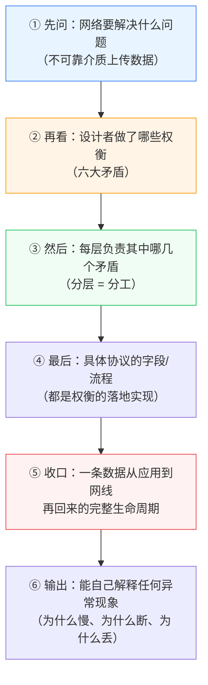

**三条主线贯穿全篇，记住它们，协议细节可以随时推出来：**

1. **分层 = 解耦**：每层只对上层承诺一个"服务接口"，不关心下层怎么实现。所以 IP 能跑在以太网、WiFi、4G、光纤上。
2. **封装 = 信息隐藏 + 逐层加信封**：每层加自己的头，对端同层拆自己的头。头部字段就是"这一层与对端的私有协议"。
3. **一切设计都是权衡**：可靠性 vs 效率、状态 vs 无状态、集中 vs 分布、端到端 vs 逐跳。**面试的所有"为什么"，本质上都在问你在权衡里站哪一边、为什么。**

---

## 第 1 章 底层逻辑总纲：网络在解决什么矛盾

### 1.1 一句话本质

> **计算机网络 = 在一堆"不可靠、异构、共享、有延迟"的传输介质之上，构建一个"可扩展"的端到端数据搬运系统。**

拆开这句定义，就是全部的底层逻辑：

| 定语 | 带来的问题 | 网络的应对 |
|---|---|---|
| **不可靠** | 信号会衰减、会被干扰、会丢、会错、会乱序 | 差错检测 + 重传（放哪一层？见 1.3） |
| **异构** | 以太网、WiFi、光纤、4G 的帧格式/速率/寻址完全不同 | **IP 作为"细腰"**，屏蔽底层差异 |
| **共享** | 一根线/一个频段被多个用户共用 | 复用（TDM/FDM/统计复用）+ 拥塞控制 |
| **有延迟** | 光速有限、排队、处理耗时 | 流水线/窗口，用"在途数据"填满管道 |
| **可扩展** | 从 2 台到 50 亿台，不能靠中心节点记账 | 分层编址、分布式路由、无状态设计 |

### 1.2 六大根本矛盾（网络设计的"宪法"）

这是本笔记最核心的一节。**看懂这六条，后面所有协议你都能自己"发明"出来。**

#### 矛盾 ①：异构网络如何互联 —— "沙漏模型"

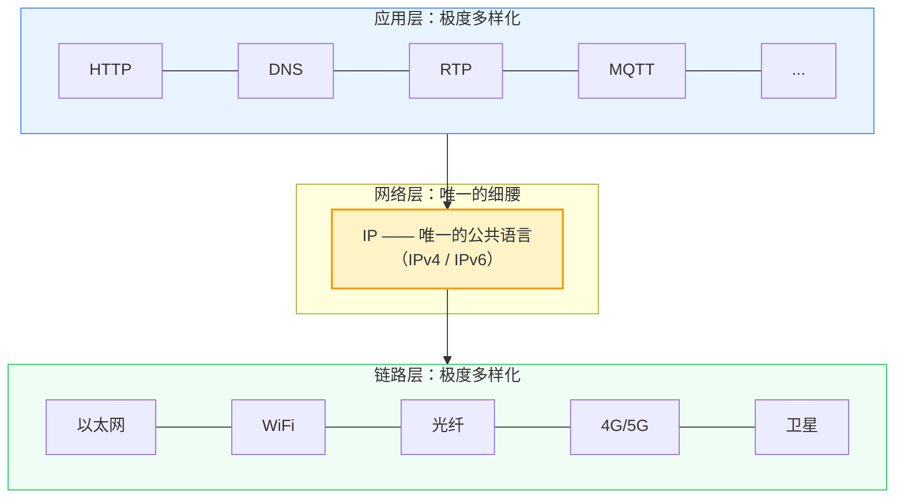

**逻辑**：如果让 N 种应用去适配 M 种链路，需要 N×M 个适配器；插入一个统一的 IP 层后，只需 N+M 个。这就是"**沙漏/细腰（narrow waist）**"设计——把复杂度压到中间一层，上下两端各自自由演化。

**推论（很重要）**：
- IP 之上可以有任意新协议（HTTP/3、gRPC），不需要改路由器。
- IP 之下可以换任意新介质（5G、WiFi 6、光传输），不需要改应用。
- 代价：**IP 层只能提供最小公约数服务 = "尽力而为"（best effort）**。它不敢承诺可靠、不承诺顺序、不承诺带宽，因为它不知道底下是光纤还是丢包率 20% 的卫星链路。

> **面试延伸点**：为什么互联网选择了"尽力而为"而不是像 ATM 那样承诺 QoS？因为**智能端、傻瓜网（End-to-End Argument）** 的可扩展性更好：网络核心只做转发，复杂功能（可靠性、加密、拥塞控制）推到端系统，网络越简单越容易做大。ATM 的失败就是"网络太聪明"的反面教材。

#### 矛盾 ②：介质不可靠，可靠性放在哪一层？—— 端到端论元

这是网络里最经典的哲学问题。三种选择：

| 方案 | 做法 | 代表 | 优点 | 缺点 |
|---|---|---|---|---|
| **逐跳可靠（Hop-by-Hop）** | 每一段链路都保证不丢，逐段重传 | X.25、WiFi 802.11 的链路层 ARQ、TCP over 无线 | 局部恢复快，端到端时延可控 | 中间节点要缓存/重传，路由器变复杂；**无法处理网络内部拥塞导致的丢包**；端到端仍可能因中间队列溢出而丢 |
| **端到端可靠（End-to-End）** | 链路层不管，端系统用序号+确认+重传兜底 | Internet / TCP | 核心简单、可扩展；能覆盖所有丢包原因 | 恢复慢（要等 RTT），端要实现完整机制 |
| **两者结合** | 链路层做轻量重传（WiFi 有 ACK），传输层兜底 | 现实世界 | 兼顾 | 可能重复重传，需去重 |

**结论（要背下来的表述）**：Internet 的选择是**"端到端可靠性为主，链路层只做差错检测（丢弃）+ 局部轻量重传"**。原因：只有端系统才知道"什么才算真正送达"（比如服务器是否真的处理了请求），中间节点无法判断语义；而且端到端机制天然能处理网络内部拥塞丢包。

#### 矛盾 ③：地址不够用 —— 三层编址与"复用"

50 亿设备、每台多个进程，如何唯一标识？


| 层级 | 标识 | 作用域 | 谁分配 | 为什么必须是它 |
|---|---|---|---|---|
| MAC | 48 bit | **同一广播域（二层网络）内** | 厂商固化 | 硬件出厂即唯一，不依赖网络位置，插哪儿都能用 |
| IP | 32/128 bit | **全球（逻辑上）** | ISP/管理员，按拓扑分配 | **与位置绑定**，可聚合（CIDR），路由器才能"按前缀汇总"而不爆表 |
| Port | 16 bit | **单台主机内** | 内核分配 | 区分同机多进程，实现"复用/分用" |

**底层逻辑**：**"标识"必须与"路由的可聚合性"妥协**。MAC 是"身份"，IP 是"地址（位置）"。身份不变、位置会变——这正是移动网络（手机换基站）和 NAT 打洞问题的根源。

**地址不够的三次补救**：
1. **子网 + CIDR**：把一个 A 类地址切成很多小块，按需分配（减少浪费）。
2. **NAT**：一个公网 IP 后面挂一整个局域网，用端口号区分内网主机（`192.168.1.7:5000 ↔ 1.2.3.4:60001`）。
3. **IPv6**：128 bit，彻底解决；但迁移成本高，于是长期"双栈共存"。

#### 矛盾 ④：介质共享 —— 复用与拥塞

一根光纤 10 Gbps，1000 个用户怎么分？

| 复用方式 | 机制 | 特点 | 例子 |
|---|---|---|---|
| 静态复用（FDM/TDM） | 切频率/切时隙，预先分配 | 保证不冲突，但**空闲也浪费** | 传统电话网、SDH |
| **统计复用（Statistical Mux）** | 按需使用，谁有数据谁发 | 效率极高，但**可能拥塞** | 互联网、以太网 |
| 预留/准入控制 | 先申请带宽再发 | 保证 QoS，难扩展 | ATM、RSVP |

**关键洞察**：互联网选了统计复用 → **必然拥塞** → 所以必须有一套"拥塞控制"来防止集体崩溃（见第 4 章）。**拥塞控制在互联网里不是为了"更快"，而是为了"不塌"**。这是理解 TCP 拥塞控制、AQM、BBR、QUIC 的一把钥匙。

另一个衍生问题：**共享介质上的"谁先发"** → 介质访问控制（MAC）协议：CSMA/CD（有线以太网，已随全双工消亡）、CSMA/CA（WiFi）、令牌环。

#### 矛盾 ⑤：时延 × 带宽 —— 窗口与流水线

假设北京到深圳 RTT = 40 ms，带宽 1 Gbps。**问：不等待确认、一直发，管道里最多能塞多少数据？**

```
带宽时延积 BDP = 带宽 × RTT = 1 Gbps × 0.04 s = 40 Mbit ≈ 5 MB
```

也就是说，**发送方必须能"在途"5 MB 数据，才能把这条管道灌满**。如果 TCP 窗口只有 64 KB（老版本上限），那么
```
吞吐 = 窗口 / RTT = 64 KB / 0.04 s = 1.6 MB/s ≈ 13 Mbps
```
**1 Gbps 的链路只能跑出 13 Mbps** —— 这就是"长肥管道（Long Fat Network, LFN）"问题。

**结论**：**窗口大小是吞吐的天花板**。所以：
- TCP 有窗口缩放选项（Window Scale，最大 2^30）；
- 现代协议（QUIC/BBR）用 BDP 直接算出应发速度，即"**用带宽时延积决定发送速率**"。

> **面试延伸点**：为什么"带宽大但延迟高"的跨国链路，单条 TCP 连接就是慢？因为慢启动每 RTT 才翻倍，从 10 MSS 涨到 5 MB 窗口需要 ~9 个 RTT，再加丢包就退回。这就是 CDN、多连接、连接池、QUIC 0-RTT 存在的现实理由。

#### 矛盾 ⑥：状态的代价 —— 无状态 vs 有状态

| | 无状态 | 有状态 |
|---|---|---|
| 代表 | HTTP（天然）、DNS、UDP、IP | TCP、会话、NAT、BGP |
| 优点 | 服务器易扩展（任意节点可处理）、崩溃恢复简单 | 能做可靠传输、流量控制、复杂决策 |
| 缺点 | 每次都要带全上下文（Cookie/Token），无法做连续性控制 | 状态同步成本高、节点故障影响大、内存/连接数受限 |

**底层逻辑**：**"状态"是能力的来源，也是扩展性的敌人。** 所以架构上常见"把状态尽量外移"：HTTP 无状态 + Redis 存 Session、JWT 自包含、TCP 连接用连接池复用、微服务无状态化。

---

### 1.3 分层模型的真实含义

OSI 七层是**教学模型**，TCP/IP 四层是**工程模型**，实际实现常按五层讲。

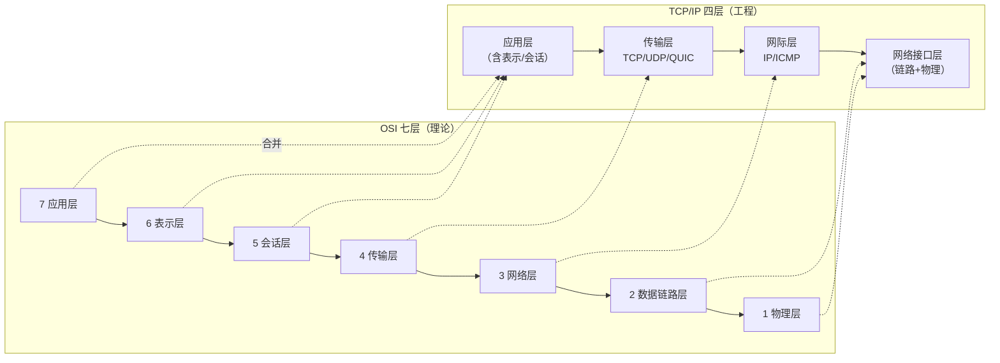

| 层 | 解决的核心问题 | 关键"抓手" | PDU 名称 | 典型设备 |
|---|---|---|---|---|
| 应用层 | 业务语义：我要"取一个网页" | 协议语义（方法/状态码/记录类型） | 报文 message | 网关、代理 |
| 传输层 | **进程到进程**；可靠/不可靠；流量与拥塞 | 端口、序号、窗口 | 段 segment（TCP）/ 数据报（UDP） | 四层负载均衡 |
| 网络层 | **主机到主机**、跨网寻址与路由 | IP 地址、路由表 | 包 packet | 路由器 |
| 链路层 | **一跳之内**如何成帧、寻址、检错 | MAC、FCS、VLAN | 帧 frame | 交换机、网桥 |
| 物理层 | 比特如何变成电/光/电磁波 | 编码、调制、速率 | 比特 bit | 网卡、中继器、集线器 |

**分层的三条铁律（面试爱考"为什么分层"）：**
1. **各层独立演化**：换 WiFi 6 不影响 HTTP。
2. **每层只依赖下层提供的服务**：TCP 假设 IP 能"尽力送到"，不假设 IP 可靠。
3. **同层对等通信（peer-to-peer）**：逻辑上"我的 TCP 和对端 TCP 直接对话"，物理上数据要穿过所有下层。

**分层不是越多越好，也不是必须七层。** 分层过细（OSI 的会话层/表示层）在实践中被证明是过度设计——TLS 就横跨"表示层+会话层"的职责，却放在传输层之上、应用层之下，因为这样对应用最透明。

---

### 1.4 封装与解封装：一条数据的完整生命周期

**这是全篇最重要的一张图。请务必能默画。**

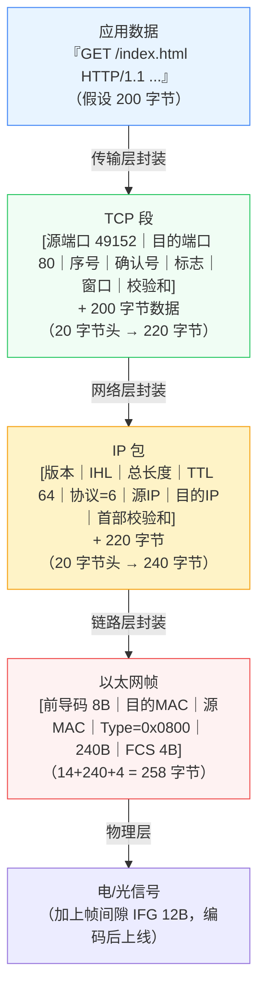

**每一层的头，都是"给对端同层看的私信"**：

| 头 | 谁写给谁看 | 关键字段的作用 |
|---|---|---|
| 以太网头 | 本跳网卡 → **下一跳网卡** | 目的 MAC 决定"这一帧交给谁"；Type 决定"拆给哪个上层" |
| IP 头 | 本机 → **最终目的主机** | 目的 IP 决定"最终去哪"；TTL 防止环路 |
| TCP 头 | 本机进程 → **对端进程** | 端口决定"哪个进程"；序号/确认/窗口决定"怎么可靠地传" |

> **关键认知**：**源/目的 IP 在整个旅程中不变（除 NAT），源/目的 MAC 每跳都在变。** 这一条能解释 80% 的路由与交换问题，也是面试"ping 不通但能上网"之类题目的解题钥匙。

**解封装**就是对端反向剥洋葱，每层校验自己的头：
- 链路层查 FCS，错了就**直接丢帧，不通知上层**（交给 TCP 超时重传）；
- 网络层查首部校验和、TTL，错了丢包并发 ICMP；
- 传输层查校验和（含伪首部），错了丢段；
- 应用层查业务合法性。

---

### 1.5 三种转发，三种视角

| 设备 | 看什么 | 依据 | 作用域 | 关键动作 |
|---|---|---|---|---|
| **交换机（二层）** | 目的 MAC | MAC 地址表（自学习） | 一个广播域/VLAN | 查表→转发；查不到→泛洪 |
| **路由器（三层）** | 目的 IP | 路由表（最长前缀匹配） | 全球 | 查表→改 MAC→TTL-1→转发 |
| **主机（四层）** | 目的端口 | socket 表 | 本机 | 交给对应进程 |

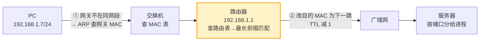

**这套机制叫"逐跳转发（hop-by-hop forwarding）"**：每台路由器只关心"下一步给谁"，不关心全程路径——这是**分布式、无状态、可扩展**的又一体现。路由表是"每个节点各自算出来的局部最优"，而不是中心下发的全程路径（对比 MPLS/源路由）。

---

### 1.6 性能三要素与真实体感

| 指标 | 定义 | 谁决定 | 常见误区 |
|---|---|---|---|
| **带宽（吞吐）** | 单位时间能传多少 bit | 链路容量、窗口、拥塞 | "办了 1000M 宽带下载还是慢"——瓶颈常在**服务器出口/窗口/RTT**，不在你的接入带宽 |
| **时延（Latency）** | 数据从 A 到 B 的时间 | 传播（光速）+ 传输（串行化）+ 排队 + 处理 | 光在光纤里约 **5 μs/km**（折射率导致约 200 km/ms），深圳-北京 2000 km 单向 ≈ 10 ms，RTT ≈ 20~40 ms |
| **丢包率** | 丢失比例 | 拥塞、误码、队列溢出 | 1% 丢包对 TCP 吞吐的打击是**非线性**的（ Reno 时代吞吐 ∝ 1/√p） |

**RTT 的四个组成部分**：
```
RTT = 2×(传播时延 + 传输时延 + 排队时延 + 处理时延)
    ≈ 2×(距离/光速 + 包大小/带宽 + 队列等待 + 协议栈处理)
```
- **传播时延**：物理定律，**无法优化**（只能靠 CDN 把内容搬到用户附近）。
- **传输时延（serialization delay）**：包越大越久，1 KB 在 1 Gbps 上约 8 μs。
- **排队时延**：拥塞时爆炸，是"网络抖动"的主因。
- **处理时延**：每跳路由查表、NAT、防火墙检查，微秒级但会累加。

> **实战延伸**：为什么"ping 值很低但网页打开慢"？因为 ping 走 ICMP 小包，不经过 TCP 握手、TLS 握手、DNS 解析、慢启动。真正拖慢首屏的是**串行的多次 RTT**（DNS 1 次 + TCP 1 次 + TLS 2 次 + HTTP 1 次 ≈ 5 个 RTT）。这就是 HTTP/2 多路复用、TLS 1.3、0-RTT、DNS 预解析、CDN 的收益来源。

---

### 1.7 端到端 vs 逐跳，一句话总结

| | 端到端（End-to-End） | 逐跳（Hop-by-Hop） |
|---|---|---|
| 谁负责 | 两端主机 | 中间每个节点 |
| 例子 | TCP 可靠传输、TLS 加密、HTTP 语义 | 链路层 ARQ、IP 转发、NAT、逐跳 QoS |
| 好处 | 核心简单、可扩展、语义正确 | 局部快速恢复、可做局部优化 |
| 代价 | 恢复慢、依赖端能力 | 中间节点复杂、状态多、难扩展 |

**Internet 的配方：核心"尽力而为 + 无状态转发"，端系统"全套可靠性 + 安全 + 拥塞控制"。**

---

### 1.8 一张图预演全篇：输入网址回车后发生了什么

先给结论框架，第 7 章会有逐层详解版。

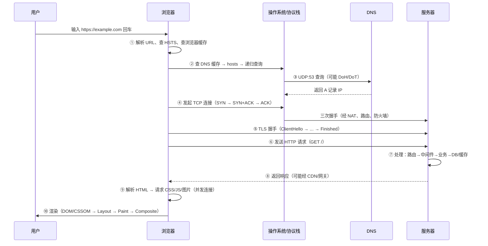

---

## 第 2 章 物理层与数据链路层：一段链路上如何把比特送过去

### 2.1 物理层到底在做什么

**任务**：把"0/1"变成能在介质上传播的信号，并尽可能快、尽可能远、尽可能不出错。

| 介质 | 特点 | 典型速率 | 距离 |
|---|---|---|---|
| 双绞线（Cat5e/6/6a） | 便宜、易布线、有串扰 | 1G/2.5G/10G | 100 m |
| 多模光纤 | 便宜光源、模态色散 | 10G~100G | 数百米 |
| 单模光纤 | 激光、低损耗 | 100G~Tbps（DWDM） | 数十~数千 km |
| 无线（WiFi/4G/5G） | 共享、易干扰、移动性 | 百 Mbps~Gbps | 视环境 |
| 卫星 | 覆盖广、时延大（GEO RTT≈600ms） | 百 Mbps | 全球 |

**香农公式（速率的理论上限）**：
```
C = B × log₂(1 + S/N)
```
C 信道容量（bps），B 带宽（Hz），S/N 信噪比。**含义：带宽和信噪比共同决定速率上限；想提速，要么加频宽（更多频段/更短波长），要么提信噪比（更好的编码/更大的功率/更近的距离）。** 这就是 5G 用毫米波（大带宽）+ Massive MIMO（提信噪比）的物理原因。

**编码与调制（为什么不能直接发 0/1）**：
- **基带编码**：曼彻斯特编码（每比特中间跳变，自带时钟，但效率 50%）、4B/5B（每 4 bit 映射 5 bit，保证足够跳变）、8B/10B（千兆/万兆以太网、PCIe）、64B/66B（10G+ 以太网）。
- **为什么要编码**：接收端需要**时钟同步**（从信号里恢复位边界），长时间不变的电平会导致失步；同时要保证**直流平衡**（避免基线漂移）。
- **调制**：把数字信号搬到高频载波上（ASK/FSK/PSK/QAM），QAM-256 一个符号带 8 bit，是 WiFi/5G 高速率的来源。

> **延伸（面试加分）**：为什么以太网最小帧是 64 字节？因为早期共享介质用 CSMA/CD，发送方必须在**信号往返最远端所需的时间（2τ，即碰撞窗口）内持续发送**，才能确认没发生碰撞。10 Mbps、最长 2500 m、4 个中继器的最坏 RTT 是 51.2 μs，对应 512 bit = 64 字节。**帧太短就会"发完了才撞上"，无法检测碰撞。** 现代全双工交换式以太网已不需要 CSMA/CD，但 64 字节最小帧作为兼容性保留。

### 2.2 链路层的三个核心任务

1. **封装成帧（framing）**：给上层数据加"帧头+帧尾"，让接收方能识别边界。
2. **差错检测（error detection）**：FCS/CRC 发现错误 → **丢弃**（注意：链路层只"检错"不"纠错"，重传交给 TCP，这就是 1.2 中端到端论元的体现）。
3. **介质访问控制（MAC）**：多台设备共享介质时决定谁先发。

### 2.3 以太网帧结构（必须能画）

```
┌──────────┬────────┬────────┬──────────┬───────────────┬────────┐
│ 前导码 8B │ 目的MAC │ 源MAC  │ Type 2B  │  数据 46~1500B │ FCS 4B │
│ 7B 10101010│  6B    │  6B    │0x0800=IP │               │ CRC32  │
│ +1B SFD   │        │        │0x0806=ARP│               │        │
│ 0xAB      │        │        │0x86DD=v6 │               │        │
└──────────┴────────┴────────┴──────────┴───────────────┴────────┘
   物理层      ←──────────── 链路层 ────────────→
```

| 字段 | 长度 | 作用 | 考点 |
|---|---|---|---|
| 前导码 | 7+1 B | 时钟同步、帧起始定界 | SFD=0xAB 标志帧开始 |
| 目的/源 MAC | 6+6 B | 一跳内的寻址 | 全 F 广播、首字节最低位=1 组播 |
| Type/Length | 2 B | 上层协议解复用 | 0x0800=IPv4，0x0806=ARP，0x8100=VLAN |
| 数据 | 46~1500 B | 载荷 | **最少 46** 是为了凑 64 字节最小帧 |
| FCS | 4 B | CRC-32 校验 | 只检错，错了静默丢弃 |

**MTU = 1500 字节的来历**：以太网帧数据字段上限。它带来一串连锁反应：
```
MTU 1500 → IP 包最大 1500 → IP 头 20 → TCP 载荷最大 1480 → TCP 头 20 → MSS = 1460
```
**MSS（Maximum Segment Size）就是 TCP 一次能发的最大数据量**，是 TCP 在 SYN 里协商出来的（双方各报自己的 MSS，取小）。这也是"为什么 TCP 段通常 1460 字节"的标准答案。

> **延伸**：某些网络（PPPoE 拨号、VPN 隧道）会额外加 8~60 字节包头，导致实际 MTU 只有 1492/1400。这时如果没做 PMTUD（路径 MTU 发现），大包会被分片或丢弃，表现为"能 ping 通小包、打不开网页/SSH 卡住"——经典的 **MTU 黑洞** 故障。

### 2.4 从 CSMA/CD 到交换式全双工

| 阶段 | 机制 | 问题 |
|---|---|---|
| 集线器（Hub）+ CSMA/CD | 所有口共享同一冲突域；先听后发、边发边听、冲突则退避（二进制指数退避） | 冲突导致效率随节点数急剧下降 |
| 交换机（Switch） | 每个口一个冲突域，支持**全双工**，用 MAC 表定向转发 | 冲突消失，CSMA/CD 退役 |
| 现代 | 全双工、无冲突、无 CSMA/CD；流量控制改用 PAUSE 帧（802.3x） | 缓冲区溢出仍会丢包 |

**CSMA/CD 的退避算法**：第 n 次冲突后，从 `{0, 1, ..., 2^min(n,10)-1}` 中随机取 k，等待 `k × 512 bit time`（10 Mbps 下为 51.2 μs）。**为什么叫"二进制指数退避"**：冲突越多，随机范围越大，降低再次碰撞概率——这是分布式系统里"冲突退避"思想的鼻祖（今天 WiFi 的 CSMA/CA、甚至以太坊的 PoW 都在用）。

**WiFi 为什么用 CSMA/CA（避免而非检测）**：无线无法"边发边听"（自己的信号会淹没别人的），所以改为**先预约再发**：RTS/CTS 交换 + ACK 确认 + 随机退避。隐藏终端问题（A、C 都听不到对方却都能干扰 B）靠 RTS/CTS 缓解。

### 2.5 MAC 地址与 ARP：最容易被追问的一层

**MAC 地址**：48 bit，前 24 bit 是 OUI（厂商），后 24 bit 厂商分配。**全球唯一、与位置无关、烧在网卡里**（可改，但那是软件层的"伪装"）。

**ARP（Address Resolution Protocol）——已知 IP 求 MAC**：

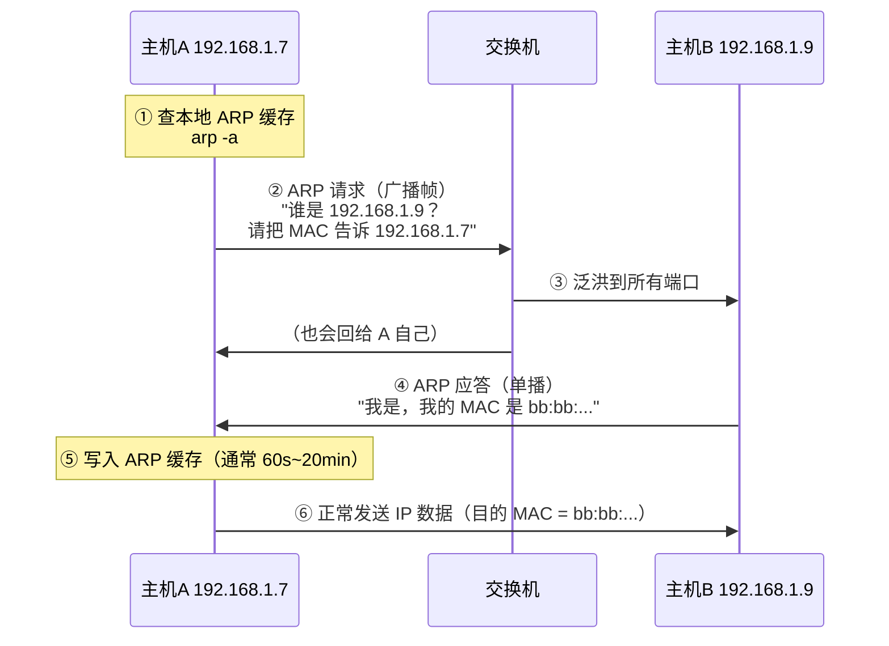

**ARP 的关键细节（面试常问）：**
1. **请求是广播（目的 MAC = FF:FF:FF:FF:FF:FF），应答是单播。** 因为请求时还不知道对方 MAC。
2. **ARP 缓存有老化时间**，过期要重新解析。
3. **ARP 只在同一广播域（同一子网/VLAN）内工作。** 跨网段时，主机 ARP 的是**网关**的 MAC，而不是最终目标的 MAC——这是很多人答错的点。
4. **免费 ARP（Gratuitous ARP）**：主机主动广播"我的 IP 是 X，MAC 是 Y"，用于**IP 冲突检测**和**更新他人缓存**（比如 HA 切换、VIP 漂移时快速让交换机/主机更新 ARP 表）。
5. **ARP 欺骗**：攻击者不断发"我是网关 IP，我的 MAC 是攻击者 MAC"，把流量引到自己。防御：静态 ARP 绑定、交换机端口安全、ARP 防火墙、VLAN 隔离。
6. **ARP 表项状态**：Linux 中 `arp -a` 会显示 `<from_interface>`、`<complete>`、`<incomplete>`（后者表示发了请求没收到应答，正在重试）。

### 2.6 交换机工作原理详解

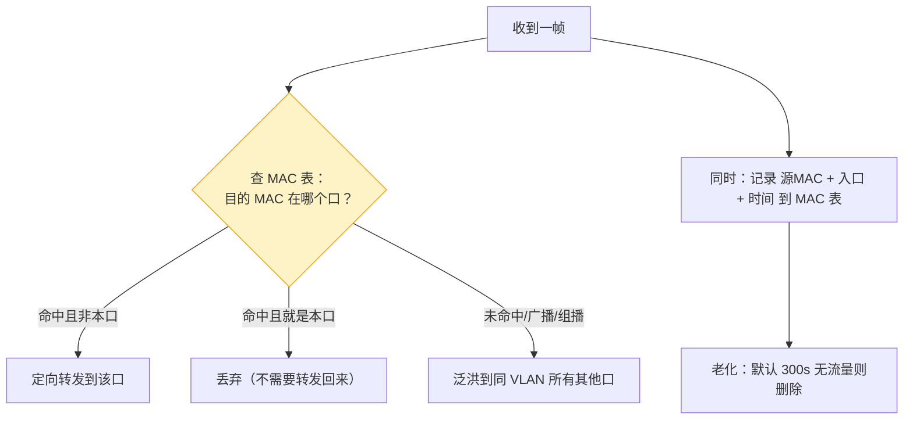

| 概念 | 说明 | 面试点 |
|---|---|---|
| MAC 表（转发表） | 源 MAC 学习、目的 MAC 转发 | 二层交换机**不需要配置就能工作**（自学习） |
| 泛洪（Flooding） | 未知单播/广播/组播发往所有口 | 泛洪环路会"广播风暴"，必须靠 STP |
| **STP 生成树** | 逻辑上阻断冗余链路，避免环路 | 收敛慢（几十秒），RSTP 秒级，现代用 TRILL/SPB 或干脆三层到边缘 |
| **VLAN（802.1Q）** | 在帧里插 4 字节标签，把一个物理交换机切成多个广播域 | 12 bit VID → 4094 个 VLAN；跨交换机需 Trunk（打标签） |
| 环路危害 | 广播帧无限循环 → 带宽耗尽、MAC 表震荡 | 这是"网络突然全断"的经典原因 |

**Trunk 与 Access 口**：Access 口接终端，帧不带标签；Trunk 口接交换机/路由器，帧带 802.1Q 标签区分 VLAN。**"为什么跨交换机同 VLAN 能通，不同 VLAN 不通？"** ——同 VLAN 靠二层泛洪/转发，跨 VLAN 必须经过三层（路由器或三层交换机）做一次路由。

### 2.7 差错检测：CRC 与校验和的差别

| 层 | 方法 | 检错能力 | 为什么用它 |
|---|---|---|---|
| 链路层 | **CRC-32** | 极强（能检出所有单/双 bit 错、奇数 bit 错、长度 <32 的突发错） | 硬件实现便宜（移位寄存器），对高速链路几乎零成本 |
| 网络层 | IP 首部 16 位反码和 | 弱（只校验头，不校验数据） | 只保护头部（地址/TTL），且每跳 TTL 变化必须重算，所以故意只做头 |
| 传输层 | TCP/UDP 16 位反码和（**含伪首部**） | 中等 | 端到端校验，伪首部把 IP 地址也纳入，防止"错投" |
| 应用层 | MD5/SHA/HMAC | 强（抗篡改） | 完整性 + 认证，防恶意篡改而非随机错误 |

> **延伸（高分点）**：IP 首部校验和每跳都要重算（因为 TTL 变了），是路由器的一个性能负担；**IPv6 直接取消了首部校验和**，把可靠性交给链路层 CRC + 传输层校验，减少每跳计算。这就是"删掉冗余设计"的优雅案例。

### 2.8 拨号时代遗留：PPP / PPPoE

- **PPP**：点对点链路协议（拨号、专线），支持认证（PAP/CHAP）、多协议复用、链路质量检测，**没有 MAC 地址**（因为只有两端）。
- **PPPoE**：把 PPP 装进以太网帧（家庭宽带拨号），额外 8 字节头 → **MTU 1492**，是家宽 MTU 问题的源头。

### 2.9 延伸：从网卡到内存（为第 6 章埋伏笔）

```
光纤/网线 → PHY 芯片（串并转换、解码）→ MAC 控制器 → DMA 写入内存 ring buffer
→ 网卡发中断 → 内核中断处理 → 软中断（NET_RX_SOFTIRQ）→ 协议栈逐层解析 → socket 接收队列
```

**关键点**：现代网卡用 **NAPI（中断 + 轮询混合）**：第一个包来中断，之后关中断改为轮询批量收包（`poll`），避免高流量下"中断风暴"打爆 CPU。这也是为什么高 PPS 场景要调 `netdev_budget`、开多队列（RSS）、甚至用 DPDK 绕过内核。

---
## 第 3 章 网络层：如何把包送到地球另一端

### 3.1 IP 的定位：故意"不靠谱"

| 特性 | 含义 | 为什么这么设计 |
|---|---|---|
| **无连接（connectionless）** | 每个包独立处理，不维护连接状态 | 路由器不必为每条流存状态 → 可扩展（核心只转发） |
| **尽力而为（best-effort）** | 不保证送达、不保证顺序、不保证不重复、不保证带宽 | 不知道底下是光纤还是弱信号 WiFi，只能承诺"尽力" |
| **不可靠** | 丢了就丢了，不重传 | 重传交给端到端（TCP），避免逐跳重传的复杂度 |
| **无状态转发** | 路由器只查表转发，不记忆 | 单点故障不影响全局，加机器就能扩容 |

**"IP 只做一件事：把包从源主机送到目的主机，尽力而为。"** 这句话是所有"IP 之上/之下"设计的出发点。

### 3.2 IPv4 首部（20 字节，必须背下来）

```
 0                   1                   2                   3
 0 1 2 3 4 5 6 7 8 9 0 1 2 3 4 5 6 7 8 9 0 1 2 3 4 5 6 7 8 9 0 1
┌───────┬───────┬───────────────┬───────────────────────────────┐
│版本 4 │首部长 4│  服务类型 8   │        总长度 16              │
├───────┴───────┴───────────────┼───────────┬───────────────────┤
│          标识 16              │标志 3│片偏移 13│                 │
├───────────────┬───────────────┼───────────┴───────────────────┤
│      TTL 8    │    协议 8     │      首部校验和 16            │
├───────────────┴───────────────┴───────────────────────────────┤
│                     源 IP 地址 32                             │
├───────────────────────────────────────────────────────────────┤
│                    目的 IP 地址 32                             │
└───────────────────────────────────────────────────────────────┘
```

| 字段 | 作用 | 考点 |
|---|---|---|
| 版本 | 4 或 6 | 双栈靠它分流 |
| 首部长度 | 单位 4 字节，最小 5（=20B），最大 15（=60B） | 有选项时变长 |
| 总长度 | 首部 + 数据，最大 65535 | 超过 MTU 要分片 |
| **标识（ID）** | 同一原始包的多个分片共享同一 ID | 分片重组靠它 |
| **标志（Flags）** | DF（不分片）、MF（还有更多分片） | **DF=1 且超 MTU → 丢弃 + ICMP**（PMTUD 依赖此） |
| **片偏移** | 单位 8 字节 | 重组排序 |
| **TTL** | 每跳减 1，为 0 丢弃并回 ICMP | **防止环路无限转发**；traceroute 靠它 |
| 协议 | 6=TCP，17=UDP，1=ICMP，2=IGMP，47=GRE，50=ESP | 上层解复用 |
| 首部校验和 | 只校验首部 | 每跳重算（TTL 变） |

> **延伸**：为什么分片偏移以 8 字节为单位？因为 3 bit 标志 + 13 bit 偏移挤在 16 bit 里，13 bit 最大 8191，×8 = 65528，刚好覆盖 65535 的总长度上限。这是"字段位宽决定协议能力"的经典案例。

### 3.3 IP 地址、子网与 CIDR（考试重灾区，必须会算）

#### 三层地址演进

| 阶段 | 方案 | 问题 |
|---|---|---|
| 分类地址 | A(/8)、B(/16)、C(/24)、D(组播)、E(保留) | 严重浪费（一个 B 类给 256 个 C 类的量） |
| 子网掩码 | 在 A/B/C 内部再切子网 | 仍受"类"限制，不能跨类聚合 |
| **CIDR（无类别域间路由）** | `a.b.c.d/n`，任意前缀长度 | 需要"路由聚合"配合，否则路由表爆炸 |

**CIDR 的两个核心能力**：
1. **超网（supernet）/ 路由聚合**：把 `10.1.0.0/16`、`10.2.0.0/16` 合成 `10.0.0.0/8` 通告，路由表从百万条降到十万级。
2. **最长前缀匹配（LPM）**：多条规则都匹配时，**取前缀最长的（最具体的）**。例如目的 `10.1.2.3` 同时匹配 `10.0.0.0/8` 和 `10.1.0.0/16`，选后者。

#### 计算模板（拿去直接用）

**题目**：`192.168.10.0/24` 网段，要划分 6 个子网，每个子网至少 20 台主机。

```
① 找子网位 n：2^n >= 6 → n = 3（8 个子网，够用）
② 新前缀 = 24 + 3 = 27 → 掩码 255.255.255.224
③ 每个子网大小 = 2^(32-27) = 32 个地址（含网络地址和广播地址）
④ 可用主机 = 32 - 2 = 30 >= 20 ✓
⑤ 子网边界（块大小 32）：
   192.168.10.0/27    → 可用 .1 ~ .30
   192.168.10.32/27   → 可用 .33 ~ .62
   192.168.10.64/27   → 可用 .65 ~ .94
   192.168.10.96/27   → 可用 .97 ~ .126
   192.168.10.128/27  → 可用 .129 ~ .158
   192.168.10.160/27  → 可用 .161 ~ .190
   192.168.10.192/27  → 可用 .193 ~ .222
   192.168.10.224/27  → 可用 .225 ~ .254
```

**速算技巧（面试现场救命）**：
- 前缀 `/n` → 块大小 = `2^(32-n)`，子网数 = `2^(n-网络位原长度)`。
- 通配符（wildcard）= `255.255.255.255` 减去掩码（用于 ACL/OSPF 匹配）。
- 判断某 IP 属于哪个子网：`(IP / 块大小) × 块大小`。
- **前缀越短 = 范围越大 = 越不具体**。

#### 特殊地址表（常考）

| 地址/段 | 含义 |
|---|---|
| `0.0.0.0/8`、`127.0.0.0/8` | 保留 / 环回（127.0.0.1 本机） |
| `10.0.0.0/8`、`172.16.0.0/12`、`192.168.0.0/16` | **私有地址**（NAT 内部用） |
| `169.254.0.0/16` | 链路本地（DHCP 失败时自动配置，APIPA） |
| `224.0.0.0/4` | 组播（IPv4），`240.0.0.0/4` 保留 |
| `255.255.255.255` | 本地广播 |
| IPv6: `::1` 环回、`fe80::/10` 链路本地、`fc00::/7` ULA | — |

**"为什么私网地址不能直接访问公网？"** —— 因为公网路由器上没有 `10.x` 的路由（没人会通告），而且私网地址被无数组织重复使用，语义上无法区分。必须经 NAT 换成公网地址。

### 3.4 分片、MSS、PMTUD（故障排查必考）

**流程**：IP 包 > 出接口 MTU 时：
- `DF=0`：**分片**，每个分片带相同 ID、偏移、MF 标志（最后一个 MF=0）。接收端按 ID + 偏移重组（**只有目的主机重组，路由器不重组**）。
- `DF=1`：**丢弃**，回 `ICMP Fragmentation Needed (Type 3 Code 4)` 并带上本跳 MTU → 源端据此调小包 → 这就是 **PMTUD（路径 MTU 发现）**。

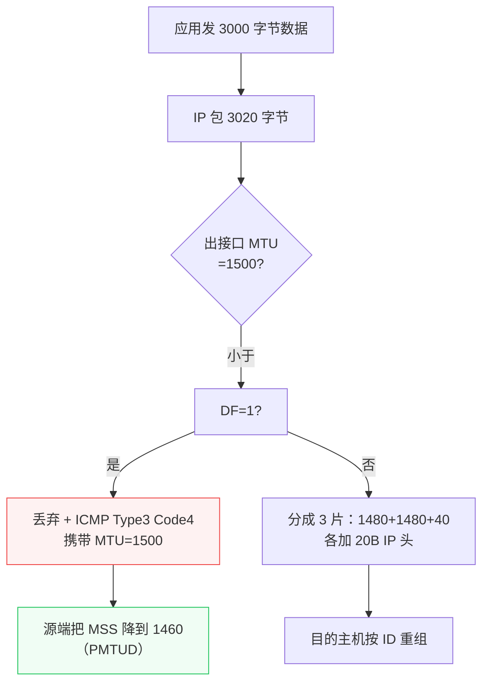

**为什么现代尽量不分片**：
1. 任一分片丢失 → 整个原始包作废，浪费已传的带宽；
2. 重组消耗目的主机内存，易被攻击（分片重叠攻击、Teardrop）；
3. 中间设备（NAT/防火墙）处理分片困难（只有第一片有传输层头！）。

**"MTU 黑洞"故障现象**：小包（ping 默认 56B）通，大包（网页、SSH、TLS 握手）卡死。原因：路径上某设备 MTU 更小，但 ICMP 被防火墙拦了，PMTUD 失败。**排查**：`ping -M do -s 1472 x.x.x.x` 逐步试，或 `tracepath`。**修复**：调小 MSS（`iptables -t mangle -A ... -p tcp --tcp-flags SYN,RST SYN -j TCPMSS --clamp-mss-to-pmtu`）。

### 3.5 NAT：把"地址不够"变成"端口够用"

**NAPT（网络地址端口转换）原理**：

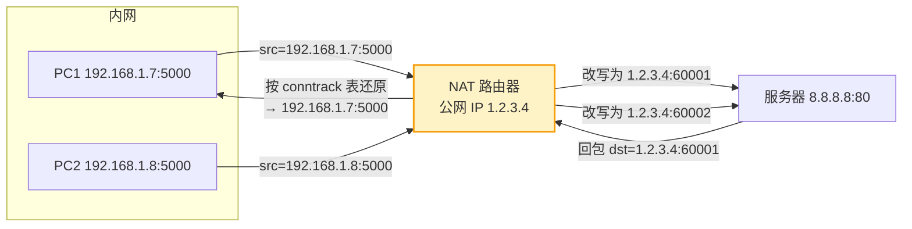

**转换表（conntrack）**：

| 内网 | 公网映射 | 目的 |
|---|---|---|
| 192.168.1.7:5000 | 1.2.3.4:60001 | 8.8.8.8:80 |
| 192.168.1.8:5000 | 1.2.3.4:60002 | 8.8.8.8:80 |

**两种 NAT**：
- **SNAT**（源地址转换）：内网访问外网，改源地址。家用路由器、云上出网。
- **DNAT**（目的地址转换）：外网访问内网服务，改目的地址。端口映射、负载均衡 VIP。
- 实际常常同时用（双向 NAT）。

**NAT 的"破坏性"（面试高分点）**：
1. **破坏端到端透明性**：外部无法主动连接内网（没有映射表项），所以需要**端口映射 / 内网穿透（frp、STUN）**。
2. **P2P 打洞**：双方都在 NAT 后，靠 STUN 拿到自己的公网映射地址，互相发包"在各自 NAT 上打洞"。但**对称型 NAT（Symmetric NAT）** 对每个目的地址分配不同端口，打洞失效 → 必须 TURN 中继。
3. **有状态**：conntrack 表满了 → 新连接被丢（`nf_conntrack: table full`）。高并发服务器要调 `net.nf_conntrack_max`。
4. **UDP NAT 超时短**：家用路由器 UDP 映射通常 30s~2min 失效，所以长连接要用 TCP 或定期心跳保活。

### 3.6 ICMP：网络的"诊断语言"

| 类型 | 名称 | 用途 |
|---|---|---|
| 0 / 8 | Echo Reply / Echo Request | `ping` |
| 3 | Destination Unreachable（Code 0/1/3/4 网络/主机/端口/需分片） | 路由失败、端口未监听、PMTUD |
| 5 | Redirect | 告诉你走更优网关 |
| 11 | Time Exceeded（TTL 耗尽） | `traceroute` |
| 12 | Parameter Problem | 头字段错 |

**ping 原理**：发 ICMP Echo Request（Type 8），对端回 Echo Reply（Type 0），算 RTT。
**traceroute 原理（两种实现）**：
- **UDP 版（Linux 默认）**：发 UDP 包，TTL 从 1 递增；TTL 耗尽的第 n 跳路由器回 **ICMP Time Exceeded**；到达目的主机时，因为用的是高端口且无监听，回 **ICMP Port Unreachable** → 判定到达。
- **ICMP 版（Windows tracert）**：发 ICMP Echo，TTL 递增，靠 Time Exceeded 逐跳。
- **TCP 版**：用 SYN 到 80/443，穿透防火墙更好（很多网络封 ICMP/UDP）。

> **延伸**：为什么 `traceroute` 每跳发 3 个包？因为路由可能负载均衡，同一 TTL 的包走不同路径，多发包能增加命中率并显示多条路径。

### 3.7 转发与路由：两张表，两件事

| | 路由表（RIB, routing table） | 转发表（FIB, forwarding table） |
|---|---|---|
| 谁生成 | 路由协议（OSPF/BGP）+ 静态配置 | 由 RIB 编译而来（`ip route`） |
| 内容 | 目的前缀、下一跳、度量、来源 | 目的前缀、下一跳、出接口 |
| 用途 | **决策**（去哪、哪条更优） | **执行**（每包查表，越快到极致） |
| 位置 | 控制平面 | 数据平面（常卸载到硬件/TCAM） |

**转发流程（路由器收到一个包）**：
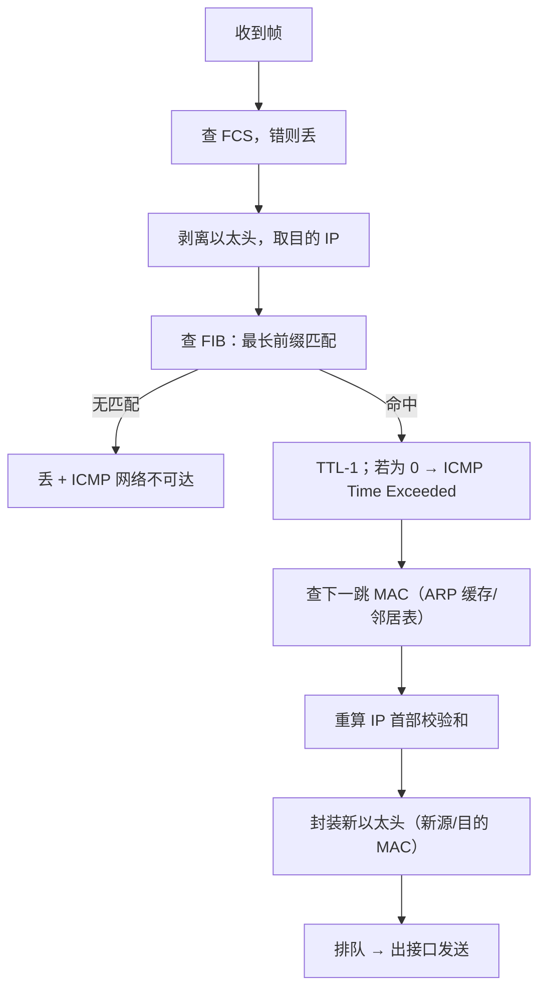

**最长前缀匹配的高效实现**：路由表可能有百万条，线性查太慢。实际用：
- **多级 Trie（LC-Trie）**：按 bit 建树，深度 = 前缀长度。
- **TCAM 硬件并行匹配**：一次比较所有表项，O(1)。
- **缓存（flow cache）**：记住"某五元组走哪条"，后续直接命中（现代内核因流量多样性取消了 flow cache）。

### 3.8 路由协议：三种思路

| 协议 | 类型 | 算法 | 适用范围 | 度量 | 关键特性 |
|---|---|---|---|---|---|
| **RIP** | 距离矢量（Distance Vector） | Bellman-Ford | 小型网络 | 跳数（最大 15） | 简单，但"坏消息传得慢"、收敛慢 |
| **OSPF** | 链路状态（Link State） | Dijkstra（SPF） | 大型企业/园区 | 带宽/成本 | 每台路由器有**全网拓扑**，收敛快，支持分层区域 |
| **BGP** | 路径矢量（Path Vector） | 策略 + 路径 | **AS 之间（全球互联网）** | 策略（AS 数、Local Pref、MED…） | 不追求最短，追求**策略与可控**；是互联网的"政治层" |

#### RIP 的"坏消息传得慢"（经典考题）

拓扑 `A—B—C`，A 到 C 距离 2。若 C 宕机：
- B 表里"到 C 距离 2，经 A"（其实是 A 抄 B 的），A 表里"到 C 距离 1"（其实 C 已经没了）。
- A 说"我到 C 是 1"，B 就更新为 2；B 说"我到 C 是 2"，A 更新为 3……**逐跳 +1 直到 15 才判定不可达**，收敛极慢。
- 缓解：**水平分割（Split Horizon）**：不从学来的方向回告；**毒性逆转**：回告距离 16；**触发更新**：变化立即发；**最大跳数 15** 兜底。

#### OSPF 核心机制

1. 每台路由器发 **LSA（链路状态通告）** 描述自己的邻居和链路代价；
2. 所有 LSA 汇成 **LSDB（链路状态数据库）**，全网拓扑一致；
3. 各自跑 **Dijkstra/SPF** 算最短路径树 → 生成路由表；
4. **分层**：Area 0（骨干）+ 其他区域，区域间通过 ABR 汇总，减少泛洪范围；
5. **报文**：Hello（发现/保活）、LSU（携带 LSA）、LSR/LSU/ACK（可靠泛洪）。

**为什么 OSPF 比 RIP 收敛快**：链路状态是"全网拼图"，一处变化立即触发全网重算，且每台路由器自己算，不存在"邻居谣言逐跳传播"的延迟。

#### BGP 为什么是"策略优先"

- 互联网由 **AS（自治系统）** 组成，每个 AS 归属不同运营商/公司；
- BGP 交换的是 **路径（AS_PATH）**，可以**基于商业策略选择路径**（比如"我不走某运营商"、"我只收不发"）；
- 只通告"我确实能到达"的路由（可达性 + 路径），能**检测环路**（自己的 AS 号出现在 AS_PATH 里就拒绝）；
- 全球路由表约 **100 万条前缀**，靠 CIDR 聚合 + 分层 AS 才撑得住。

> **延伸**：BGP 的"可信"是建立在"邻居守约"上的。历史上多次大规模断网（如 2021 年 Facebook 全球宕机、各类 BGP 劫持）都是因为错误路由被通告。这就是为什么要有 RPKI（路由起源认证）。

### 3.9 IPv6：不只是"地址变长"

| 变化 | 说明 | 好处 |
|---|---|---|
| 128 bit 地址 | 彻底解决地址耗尽 | 不再需要 NAT（但实践中仍有 NAT66） |
| **简化首部** | 固定 40 字节，**取消首部校验和、取消分片字段** | 路由器处理更快 |
| 扩展头链 | 分片/路由/认证等作为"扩展头"按需出现 | 灵活、可演进 |
| **无路由器分片** | 只有源端分片（PMTUD 强制） | 路由器不做重组，性能更好 |
| **SLAAC** | 无状态地址自动配置（前缀+接口标识） | 即插即用，不需要 DHCP |
| **NDP 取代 ARP** | 用 ICMPv6 的 NS/NA（邻居请求/通告） | 更安全（可加密）、支持重复地址检测 |

**过渡技术**：双栈（最常用）、隧道（6in4/GRE）、NAT64/DNS64（IPv6 访问 IPv4 资源）。

### 3.10 组播与 Anycast（延伸，社招常见）

- **单播**：一对一。**广播**：一对所有（仅本地广播域）。**组播**：一对多（IGMP 加入组，路由器按组播路由分发，如 IPTV、视频会议）。**Anycast**：多台服务器共享同一 IP，路由把用户送到"最近的一台"——**DNS、CDN、GSLB 的基石**。
- **Anycast 的代价**：路由变化会导致"同一 TCP 连接被送到另一台机器" → 所以 Anycast 适合**无状态/短连接**（DNS over UDP），不适合长连接（长连接要用一致性哈希或 GSLB 定向解析）。

### 3.11 延伸：现代"网络层"长什么样（云原生视角）

| 传统 | 虚拟化/云 | 说明 |
|---|---|---|
| 物理交换机 | **veth pair + Linux bridge** | 容器/VM 的虚拟网卡对，一头在容器、一头在 bridge |
| 物理隔离 | **Network Namespace** | 每个容器一个独立网络栈 |
| 独立网段 | **Overlay（VXLAN）** | 把二层帧封进 UDP（4789 端口），跨三层打通二层 |
| 手工路由 | **SDN / CNI** | 控制面集中下发（Calico 用 BGP，Flannel 用 VXLAN） |
| 服务发现 | **Service / Ingress** | L4/L7 负载均衡 + 域名 |

**VXLAN 一句话**：`原以太帧 + VXLAN头(8B) + UDP头 + 新IP头 + 新以太头`，实现"在 IP 网上跑二层"，解决传统 VLAN 只有 4094 个的限制（VXLAN 有 24 bit VNI = 1600 万个）。

---

## 第 4 章 传输层：如何让两个进程"可靠地对话"

### 4.1 传输层到底多做了什么

| 能力 | 说明 | 谁提供 |
|---|---|---|
| **进程到进程** | 用端口区分应用 | 端口号 + socket |
| **复用/分用** | 多进程共用一个 IP | 五元组（srcIP, srcPort, dstIP, dstPort, proto） |
| **可靠性** | 不丢、不重、不乱序 | TCP 序号+确认+重传 |
| **流量控制** | 别把我打爆 | 接收窗口 rwnd |
| **拥塞控制** | 别把网络打爆 | 拥塞窗口 cwnd |
| **连接管理** | 双方状态同步 | 三次握手 / 四次挥手 |

**为什么"可靠性"要放在传输层而不是网络层？**
1. 网络层不知道"应用语义"（哪个包重要、哪个可以丢）；
2. 中间节点无状态才能扩展；
3. 端到端重传能覆盖所有丢包原因（链路错、拥塞丢、路由丢）。

### 4.2 UDP：极简主义的胜利

```
┌────────────┬────────────┬──────────┬──────────┐
│ 源端口 16  │ 目的端口 16│ 长度 16  │ 校验和 16 │   ← 只有 8 字节头
└────────────┴────────────┴──────────┴──────────┘
```

| 特性 | 说明 |
|---|---|
| 无连接 | 不发握手，直接发，开销 = 8 字节 |
| 不保证可靠/顺序 | 丢了不管，顺序乱了不管 |
| 无流量/拥塞控制 | 想发多快就发多快（**这是双刃剑**） |
| 支持广播/组播 | TCP 不支持 |
| 保留消息边界 | 一次 send 对应一次 recv（**不会粘包**） |

**适用场景（要能说出"为什么用 UDP"）**：
- **DNS**：一问一答，一个包搞定，用 TCP 要 3 次握手不划算。超过 512 字节或 DoT 才用 TCP。
- **DHCP**：启动时还没有 IP，无法建 TCP 连接；靠广播。
- **实时音视频（RTP/WebRTC）**：宁可丢帧也不要卡顿，重传没意义（过期数据没用）。
- **游戏**：状态同步，旧包无价值。
- **QUIC**：在 UDP 上自建可靠传输（用户态可控、可快速迭代、避免内核 TCP 的队头阻塞）。

> **延伸（高分点）**：**UDP 不是"不安全/不可靠"的代名词，它只是"把控制权交给应用"**。QUIC 就是最好的例子：用 UDP 绕过内核 TCP 的限制，在用户态实现可靠性 + 拥塞控制 + 加密 + 多路复用。

### 4.3 TCP 首部（20 字节起，必须逐字段讲清）

```
 0                   1                   2                   3
┌───────────────┬───────────────┬───────────────────────────────┐
│   源端口 16   │  目的端口 16  │                              │
├───────────────┴───────────────┤                              │
│                序号 seq 32                                    │
├───────────────────────────────────────────────────────────────┤
│              确认号 ack 32                                    │
├─────┬─────────┬─────┬─────────┬───────────────────────────────┤
│首部长│ 保留  │标志│  窗口 16 │        校验和 16              │
│ 4   │  4    │ 6+  │          ├───────────────────────────────┤
│     │       │     │          │       紧急指针 16             │
├─────┴───────┴─────┴──────────┴───────────────────────────────┤
│                  选项（MSS / SACK / WS / Timestamp）           │
└───────────────────────────────────────────────────────────────┘
标志位：URG ACK PSH RST SYN FIN
```

| 字段 | 作用 | 面试点 |
|---|---|---|
| **序号 seq** | 本报文第一个字节在整个字节流中的编号 | 初始序号 ISN 随机（安全）；序号是**字节级**不是包级 |
| **确认号 ack** | 期望收到的**下一个**字节序号（累积确认） | `ack=1000` 表示"999 及之前都收到了" |
| **ACK 标志** | 确认号是否有效 | 握手后所有包都置 1 |
| **SYN** | 建立连接、同步序号 | 消耗一个序号 |
| **FIN** | 我要关发送方向 | 消耗一个序号 |
| **RST** | 异常重置 | "端口没监听/连接不存在/拒绝" |
| **PSH** | 提示接收方尽快交给应用 | 不等于"立即发送" |
| **窗口 window** | 接收方还能收多少（rwnd） | 16 bit，最大 65535，靠 **Window Scale** 扩大 |
| **校验和** | 含**伪首部**（srcIP、dstIP、proto、TCP 长度） | 防止 IP 层错投 |
| **选项** | MSS、SACK、WS、Timestamp | 现代 TCP 性能的关键 |

**"为什么校验和要含伪首部？"** —— 因为 IP 层只校验自己的头，不校验数据；如果 IP 头里的地址被破坏（导致错投），TCP 校验和必须能发现。伪首部把 IP 地址"借"进来参与计算，代价是 TCP 层要跨层读 IP 头（违反分层，但是值得）。

### 4.4 三次握手：为什么是三次，而不是两次或四次

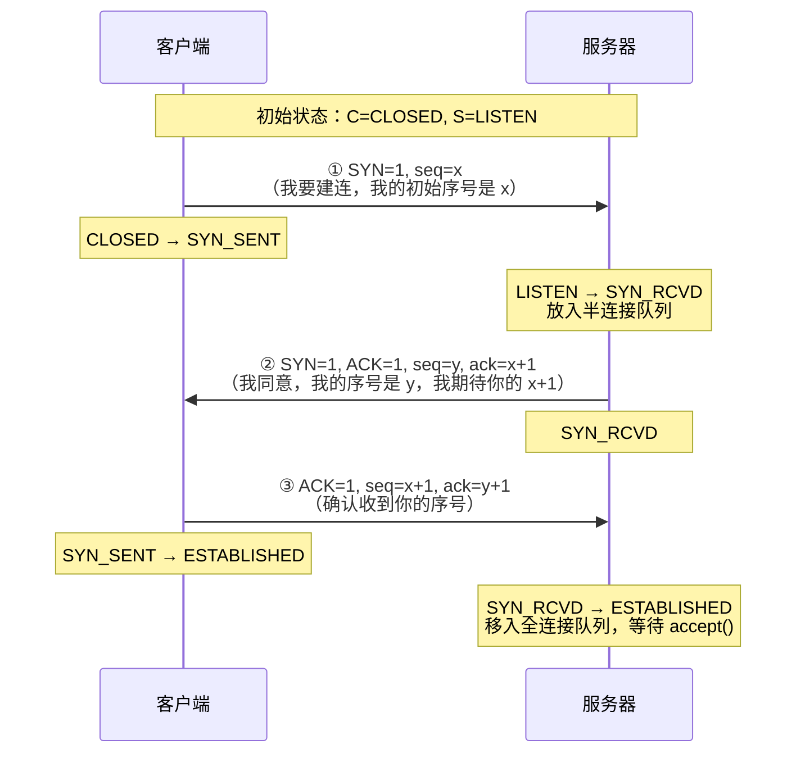

**为什么必须三次？（这是★★★必考题，要能讲出至少三个理由）**

1. **双方都要确认"自己的发送能力"和"对方的接收能力"都正常**，且**双方初始序号都被确认**。
   - 两次握手只能确认：C 能发、S 能收；C 不知道"S 能不能发"。
2. **防止历史重复连接（失效的连接请求）建立错误连接**：
   - C 发了一个 SYN，网络滞留很久；C 放弃重发新 SYN 建连成功、传输完、关闭。
   - 此时滞留的旧 SYN 到达 S，S 若"两次握手就建连"，就会单方面建立一个已经没用的连接，并一直等 C 发数据，浪费资源。
   - 三次握手中，C 收到 S 的 SYN+ACK 时会发现"这不是我要的 ack（序号对不上）"，直接发 RST 拒绝。
3. **同步双方 ISN（初始序号）**：TCP 靠序号做可靠传输，双方必须就"起点"达成一致，两次无法完成双向同步。
4. **（安全角度）** 让服务端在第三次握手前不分配完整资源，降低半开连接攻击的成本。

**为什么 ISN 要随机（而不是从 0 开始）？**
- **防止历史报文被误认为新连接的数据**（如果每次都从 0 开始，旧连接的包可能落进新连接）。
- **防伪造攻击**：ISN 随机（现代实现用 SipHash + 时钟），攻击者猜不到 ack 号就无法完成握手，难以伪造源 IP 发起 SYN Flood。
- RFC 793 建议 ISN 与"时钟"相关，每 4 μs 加 1，32 位回绕约 4.5 小时。

**为什么不四次？** 第二步 `SYN + ACK` 可以合并（同一个包既确认对方、又发起自己的同步），所以 3 次足够。

**SYN 队列与 accept 队列（大厂高频，工程味最浓的一题）**：

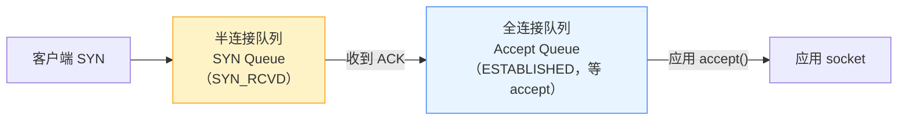

- **`tcp_max_syn_backlog`** 控制半连接队列（SYN_RCVD）。
- **`somaxconn` + `backlog` 参数** 控制全连接队列（`min(somaxconn, backlog)`）。
- **全连接队列满**：Linux 默认**丢弃**新 ACK（`tcp_abort_on_overflow=0`），客户端会重传 ACK → 表现为"连接超时/偶发失败"。设 `=1` 则回 RST（客户端立刻报 connection reset）。
- **半连接队列满 + `tcp_syncookies=1`**：不分配队列项，而是用加密 Cookie 编码状态，收到 ACK 再校验 → **抵御 SYN Flood 的标准方案**。
- **观测**：`ss -lnt` 的 `Send-Q` 是全连接队列上限，`Recv-Q` 是当前排队数；`netstat -s | grep -i listen` 看 overflow 次数。

### 4.5 四次挥手：为什么是四次，TIME_WAIT 为什么必须等

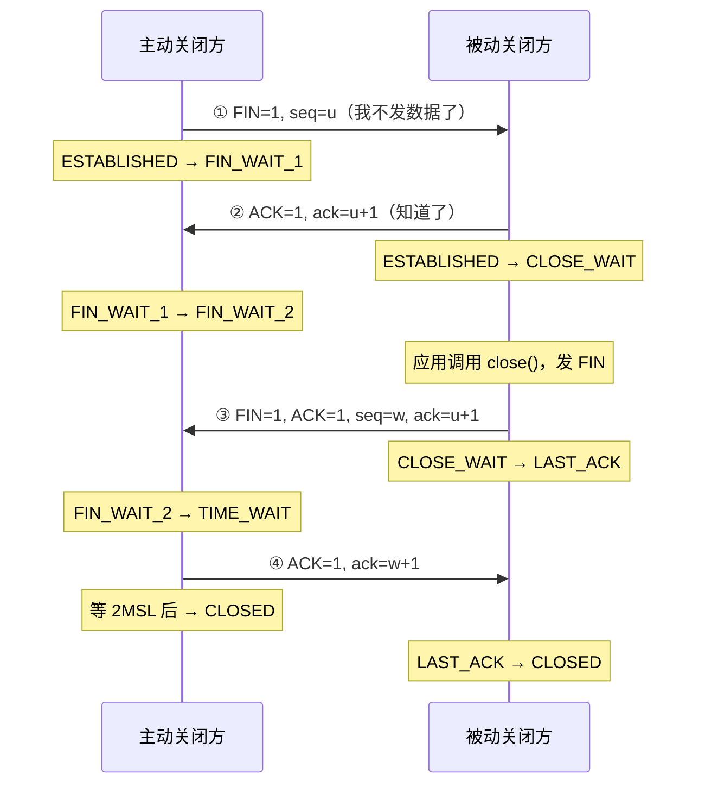

**为什么四次？** TCP 是**全双工**，两个方向要分别关闭。收到 FIN 只表示"对方不发了"，但我可能还有数据要发，所以 **ACK 和 FIN 不能合并**（要先 ACK 确认，等自己数据发完再 FIN）。

**例外**：如果被动关闭方没有数据要发，`ACK + FIN` 可以合并（延迟确认下常见），此时看起来是"三次"。

**TIME_WAIT 必须等 2MSL 的两个理由（★★★）**：
1. **保证最后一个 ACK 能到达对端**。如果这个 ACK 丢了，对端会重传 FIN；此时我还在 TIME_WAIT，能重新回 ACK。若我直接关闭，对端会收到 RST，导致"异常关闭"。
2. **让本连接的所有旧报文在网络中"自然消亡"**。2MSL = 一来一回的最大生存时间，确保旧连接的重复包不会污染下一个使用相同四元组的新连接。

**MSL 与 TTL**：MSL（Maximum Segment Lifetime）是"报文在网络中最长存活时间"，Linux 硬编码 60s（`TCP_TIMEWAIT_LEN`），所以 **TIME_WAIT = 120s**。理论上 MSL 应 ≥ 最大 TTL 耗尽时间（TTL=255 约 4 分钟），实际取 60s。

**TIME_WAIT 过多怎么办（运维必答）**：

| 现象 | 原因 | 对策 |
|---|---|---|
| `ss -s` 显示大量 TIME_WAIT | 短连接多（HTTP 短连接、反向代理） | ①**用长连接/连接池**（根本解法）；②`tcp_tw_reuse=1`（仅对 outgoing 连接、且时间戳递增时允许复用）；③缩短 `tcp_fin_timeout` 无用（那是 FIN_WAIT_2）；④扩大端口范围 `ip_local_port_range`；⑤让**客户端**主动关闭（谁先关谁承担 TIME_WAIT） |
| `tcp_tw_recycle` | 曾用于快速回收 | **已废弃**（Linux 4.12 移除），NAT 环境下会误杀，别用 |
| 端口耗尽 `Cannot assign requested address` | 客户端 TIME_WAIT 占满本地端口 | 连接池 / 加机器 / 多 IP |

**CLOSE_WAIT 过多 = 代码 bug**：说明**对端已关闭，我方应用没调用 `close()`**（连接对象泄漏、忘记释放、异常分支没关）。这是排查"句柄泄漏"的第一信号。

**RST 的常见场景（面试常问"什么时候会收到 RST"）**：
- 连接不存在的端口（无监听）→ RST；
- 全连接队列满且 `tcp_abort_on_overflow=1`；
- 应用调 `close()` 时接收缓冲区还有未读数据 → RST（而非 FIN），对端报 "connection reset by peer"；
- 防火墙/中间设备主动阻断（如"连接被重置"的典型 GFW 现象）；
- 长时间无交互，中间 NAT 表项过期，后续包到达 NAT 找不到映射 → RST 或直接丢弃。

**keepalive vs 应用层心跳**：

| | TCP keepalive | 应用层心跳（Ping/Pong） |
|---|---|---|
| 默认时间 | 2 小时（`tcp_keepalive_time`） | 自定义（如 30s） |
| 能否穿透 NAT | 能（只要有包） | 能 |
| 能否判断"业务可用" | 不能（进程假死仍回 ACK） | 能 |
| 结论 | **生产环境必须关掉默认 2 小时，改用应用层心跳** | 推荐 |

### 4.6 TCP 状态机（11 个状态，能背下来是加分项）

| 状态 | 含义 | 谁在等什么 |
|---|---|---|
| CLOSED | 初始/结束 | — |
| LISTEN | 服务端等待 SYN | 等 SYN |
| SYN_SENT | 客户端已发 SYN | 等 SYN+ACK |
| SYN_RCVD | 服务端收到 SYN 已回 SYN+ACK | 等 ACK（半连接） |
| ESTABLISHED | 可双向传数据 | — |
| FIN_WAIT_1 | 主动关闭方发了 FIN | 等 ACK（或 FIN） |
| FIN_WAIT_2 | 收到 ACK，等对方 FIN | **半关闭**，仍可收数据 |
| TIME_WAIT | 收到对方 FIN 并回 ACK | 等 2MSL |
| CLOSE_WAIT | 被动方收到 FIN | **等应用 close()** |
| LAST_ACK | 被动方发了 FIN | 等最后 ACK |
| CLOSING | 双方同时关闭（少见） | 等 ACK |

**同时打开/同时关闭**（延伸）：双方几乎同时发 SYN → 各自进入 SYN_RCVD → 状态变为 `SYN_SENT → SYN_RCVD`，最终仍能建立。同时关闭则进入 CLOSING。这说明 TCP 状态机是**对称设计**的。

### 4.7 可靠传输：序号、确认、重传、RTO

**核心机制链条**：
```
发送方：给每个字节编号 → 发出去 → 启动定时器 → 等 ACK
接收方：收到后回 ACK（累积确认）→ 乱序则缓存（SACK）→ 重复则丢弃
发送方：超时没收到 ACK → 重传 → 指数退避
```

**四个关键细节（★★★）：**

1. **累积确认（Cumulative ACK）**：`ack=N` 表示"N-1 及之前全部收到"。优点简单，缺点**一个洞会阻塞后面所有**（所以有 SACK）。
2. **SACK（选择性确认）**：接收方告诉发送方"我还缺哪几段"，发送方只重传缺的 → 大幅减少重传。选项格式：左边界+右边界（字节号）。
3. **快速重传（Fast Retransmit）**：收到 **3 个重复 ACK** 就立刻重传，不等超时（因为重复 ACK 说明后面的包到了、中间某个丢了）。为什么是 3 个？容忍乱序，避免误判。
4. **RTO 计算（Jacobson/Karels 算法）**：
```
SRTT = (1-α)·SRTT + α·RTT_sample        α=1/8（平滑 RTT）
RTTVAR = (1-β)·RTTVAR + β·|SRTT-RTT_sample|   β=1/4（RTT 偏差）
RTO = SRTT + 4·RTTVAR                     （加 4 倍偏差留余量）
```
- **Karn 算法**：重传过的样本不能用于 RTT 估计（因为不知道 ACK 对应哪次发送），且每次超时 RTO 翻倍（指数退避）。
- **超时下限**：Linux 最小 RTO 200ms（`TCP_RTO_MIN`），避免过早重传。

> **延伸**：为什么"重传"在弱网下反而更糟？因为**重传会加剧拥塞**（本来拥塞才丢包，你再重发更多）→ 所以拥塞控制要在重传之上再限速。这是"可靠传输"和"拥塞控制"必须解耦的原因。

### 4.8 流量控制：滑动窗口与"别把我打爆"

**机制**：接收方在 ACK 里带 `window`（rwnd），告诉发送方"我还能收多少"。发送方保证 `已发送未确认的数据 <= min(rwnd, cwnd)`。

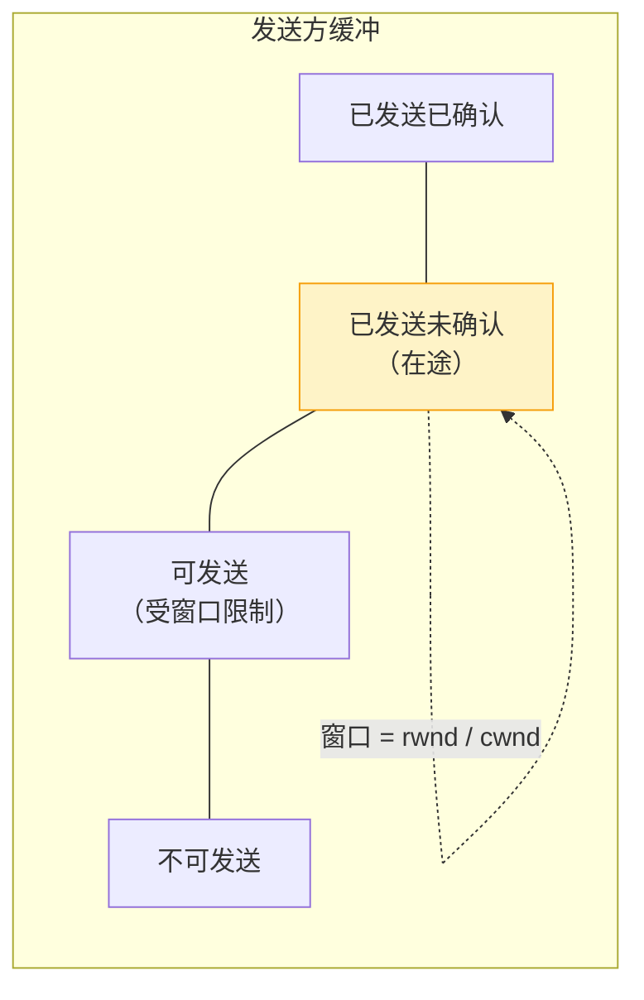

**三个经典细节（高频）：**

1. **零窗口（Zero Window）**：接收方缓冲满，通告 `window=0`。发送方停止发送，但会启动**持续计时器（persist timer）**，定期发**窗口探测（Window Probe）**（1 字节），防止"窗口更新包丢失导致双方永久死锁"。
2. **糊涂窗口综合征（Silly Window Syndrome）**：接收方一次只腾出几个字节就通告，发送方每次只发几个字节 → 头部开销 >> 数据。解决：
   - 接收方：**窗口更新要等到"能腾出 MSS 或缓冲一半"才通告**（Clark 方案）；
   - 发送方：**Nagle 算法**（见下）。
3. **Nagle 算法 vs 延迟确认（40ms 坑，面试超高频）**：
   - **Nagle**：小包不立即发，等"凑够一个 MSS"或"收到前一个包的 ACK"再发 → 减少小包数量，但会引入延迟。
   - **延迟 ACK**：接收方不立即回 ACK，等 200ms 或"收到两个包"再回 → 减少 ACK 数量。
   - **冲突**：Nagle 等 ACK 才发下一包，延迟 ACK 等第二个包才回 ACK → **互相等待 → 每次往返多 40ms（Linux 延迟 ACK 定时器）+ RTT**。表现为"小请求-小响应"场景（Redis、RPC、telnet）**明显卡顿**。
   - **解决**：`TCP_NODELAY`（关 Nagle）、`TCP_QUICKACK`（关延迟 ACK，Linux 特有，需反复设置）。

> **实战结论**：Redis 客户端、gRPC、任何"请求-响应"型 RPC 都应开 `TCP_NODELAY`。这是"协议机制互相打架"的最经典案例。

### 4.9 拥塞控制：从 Reno 到 BBR（★★★，区分度最高的一题）

#### 为什么需要

如果所有发送方都"能发多快发多快"，网络会进入**拥塞崩溃（congestion collapse）**：路由器队列满 → 丢包 → 重传 → 更多包 → 更满 → 吞吐趋近 0。**拥塞控制是互联网的"交通规则"**。

#### 四个经典阶段（Reno，必须能画图）

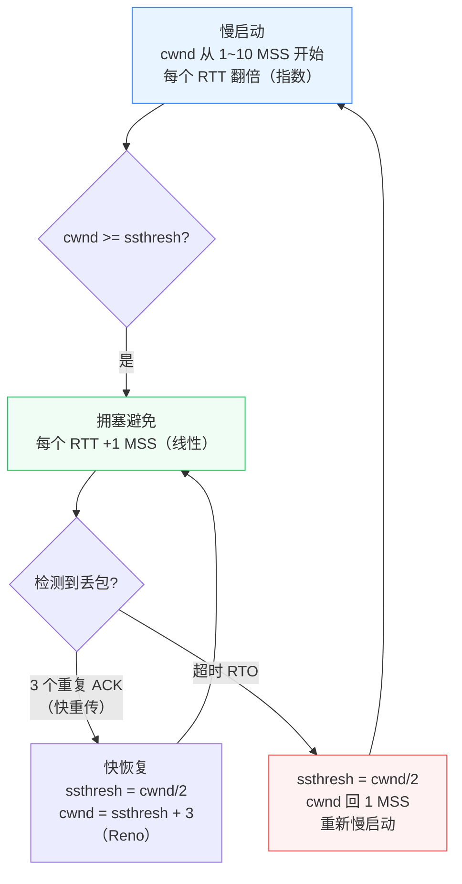

| 阶段 | 触发 | cwnd 变化 | 含义 |
|---|---|---|---|
| 慢启动 | 开始 / 超时后 | 每 RTT 翻倍（指数） | "探路"，快速接近可用带宽 |
| 拥塞避免 | cwnd ≥ ssthresh | 每 RTT +1 MSS（线性） | "谨慎增长" |
| 快重传 | 3 个重复 ACK | 立刻重传丢失段 | 不等超时 |
| 快恢复 | 快重传后 | ssthresh=cwnd/2, cwnd=ssthresh+3 | 避免回落到 1（因为只是个别丢包，网络还没崩） |

**几个必背概念**：
- **cwnd（拥塞窗口）**：发送方自己估计的"网络能容纳多少"，与 rwnd 取小决定实际窗口。
- **ssthresh**：慢启动门限，初始常设很大（如 65535），遇到拥塞减半。
- **AIMD（加性增、乘性减）**：线性增长、折半下降 —— 这是 TCP 公平性和稳定性的数学基础（多个流最终收敛到均分带宽）。
- **为什么"乘性减"而不是"减固定量"**：折半能让所有流在大致相同的 RTT 内同步退让，收敛快且公平。

**"为什么超时要回到 1，而重复 ACK 只减半？"** —— 超时说明"严重拥塞/链路断了"（连 ACK 都回不来），必须激进退让；3 个重复 ACK 说明"网络还在工作，只是个别包丢"，可以温和退让。

#### 从 Reno 到 CUBIC 到 BBR

| 算法 | 拥塞信号 | 增长方式 | 优点 | 缺点 |
|---|---|---|---|---|
| **Tahoe/Reno**（1990） | 丢包 | 线性增、折半减 | 简单、公平 | 高带宽高延迟链路上增长太慢 |
| **CUBIC**（Linux 默认，2008） | 丢包 | **三次函数**增长（靠近上次拥塞点快速恢复，远处缓慢试探） | 适合大 BDP，RTT 公平性更好 | 仍靠丢包判断，**缓冲区膨胀（bufferbloat）** 下会填满队列导致高延迟 |
| **BBR**（Google，2016） | **带宽 + 最小 RTT**（不靠丢包） | 主动测量 BDP，用 pacing 控制发送速率 | 高吞吐、低延迟、抗随机丢包（弱网友好） | 与 CUBIC 共存时**不公平**（抢带宽）；依赖 RTT 测量准确 |

**BBR 的四个状态（能说出来就是加分）**：
1. **Startup**：类似慢启动，快速探测带宽，直到"带宽不再增长"退出。
2. **Drain**：排空 Startup 期间在队列里堆积的数据（降到 BDP）。
3. **ProbeBW**：以 pacing rate = 1.25×BDP 试探，若带宽没涨则降回 1.0，周期性循环（增益系数 1.25 → 0.75 → 1 → 1 → 1 → 1 → 1 → 1）。
4. **ProbeRTT**：每 10s 停顿一下，让队列排空，重新测最小 RTT（防止 RTT 估计漂移）。

**BBR 的核心公式**：
```
BDP = 带宽估计 × 最小 RTT
pacing_rate = BDP / 最小RTT × gain
```

> **延伸（面试神答）**：为什么"丢包即拥塞"是错的？因为**随机丢包（无线误码、链路噪声）不代表拥塞**。CUBIC 一遇丢包就折半，在 1% 丢包的链路上吞吐会掉到原来的 1/3；BBR 则忽略随机丢包，保持高速——这就是为什么跨国/弱网链路常切 BBR。但 BBR 的代价是"它不管别人死活"，与 CUBIC 混跑会挤占。

**ECN / AQM（延伸）**：与其等队列满丢包，不如**提前标记**（ECN 在 IP 头打 CE 位），让发送方主动降速；配合 **RED/CoDel** 队列管理，减少排队延迟。这就是"避免拥塞"而非"事后反应"。

### 4.10 粘包与半包：本质是"字节流没有边界"

**本质**：TCP 是**面向字节流**的协议，它只保证"字节按序到达"，**不保留应用层消息边界**。所以：
- 应用一次 `send` 100 字节，可能被拆成 40+60 两个 TCP 段（**半包**）；
- 应用两次 `send` 各 50 字节，可能被合并成一个 100 字节的段（**粘包**）。

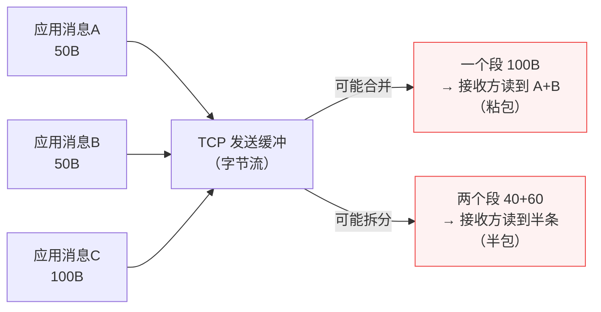

**三种解决方案（必须全答）**：

| 方案 | 做法 | 例子 | 优点 | 缺点 |
|---|---|---|---|---|
| **固定长度** | 每条消息定长（不足补齐） | 简单二进制协议 | 解析最简单 | 浪费带宽、不灵活 |
| **分隔符** | 用特殊字符分隔（`\r\n`） | HTTP 头、Redis 协议、SMTP | 可读、灵活 | 内容含分隔符要转义，需扫描 |
| **长度字段（最常用）** | 头部放"长度 N"，再读 N 字节 | **HTTP Content-Length**、Dubbo、gRPC（帧头）、Kafka | 解析确定、高效 | 需要先读头再读体（两段读） |

**"为什么 UDP 不会粘包？"** —— UDP 是**面向报文**的，内核保留每次 `sendto` 的边界，一次 `recvfrom` 对应一个完整报文（超出缓冲则截断）。但 UDP 会**丢包/乱序**，那是另一类问题。

**工程细节（加分）**：长度字段方案要处理
- **半包**：`read` 返回不足，要缓存已读数据，等下一次；
- **一次读到多条**：要循环解析；
- **长度上限校验**：防止恶意超大长度导致内存爆掉；
- **字节序**：网络字节序（大端），用 `htonl/ntohl`。

### 4.11 TCP 内核参数速查（运维/后端高频）

| 参数 | 作用 | 调优方向 |
|---|---|---|
| `net.ipv4.tcp_max_syn_backlog` | 半连接队列上限 | 抗 SYN Flood 时调大 + syncookies |
| `net.core.somaxconn` | 全连接队列上限 | 高并发调大到 4096+ |
| `net.ipv4.tcp_syncookies` | SYN Cookie | 保持 1 |
| `net.ipv4.tcp_tw_reuse` | 复用 TIME_WAIT（outgoing） | 客户端侧可开 1 |
| `net.ipv4.tcp_fin_timeout` | FIN_WAIT_2 超时 | 默认 60，可调小 |
| `net.ipv4.ip_local_port_range` | 本地端口范围 | 短连接多时扩大（如 1024-65535） |
| `net.ipv4.tcp_congestion_control` | 拥塞控制算法 | `cubic` / `bbr` |
| `net.core.rmem_max / wmem_max` | socket 缓冲上限 | 大 BDP 链路调大（配合 tcp_rmem/wmem 三元组） |
| `net.ipv4.tcp_window_scaling` | 窗口缩放 | 必须 1（否则窗口卡在 64KB） |
| `net.ipv4.tcp_sack` / `tcp_timestamps` | SACK / 时间戳 | 保持 1（时间戳还用于 PAWS 与 RTT 测量） |
| `net.ipv4.tcp_slow_start_after_idle` | 空闲后是否重置 cwnd | 长连接建议设 0（避免每次空闲后重新慢启动） |
| `net.ipv4.tcp_notsent_lowat` | 未发送数据低水位 | 降低内存占用/延迟 |
| `net.nf_conntrack_max` | NAT 连接跟踪表 | 大并发 NAT 网关必调 |

**查看命令**：`ss -s`（汇总）、`ss -ti`（每条连接的 cwnd/rtt/重传）、`nstat -az`（协议栈计数）、`sysctl -a | grep tcp`。

---
## 第 5 章 应用层与安全：HTTP / HTTPS / DNS / CDN

### 5.1 HTTP 的骨架：无状态 + 请求响应

| 要素 | 内容 |
|---|---|
| 方法 | GET（查，幂等）、POST（提交，非幂等）、PUT（全量替换，幂等）、PATCH（局部更新）、DELETE（幂等）、HEAD（只要头）、OPTIONS（探测，CORS 预检） |
| 状态码 | 1xx 信息、2xx 成功、3xx 重定向、4xx 客户端错、5xx 服务端错 |
| 头 | 通用（Date/Connection/Cache-Control）、请求（Host/Cookie/Referer/User-Agent/Accept）、响应（Set-Cookie/ETag/Last-Modified/Location） |
| 体 | 任意（HTML/JSON/二进制），由 `Content-Type` 说明 |

**幂等（idempotent）**：多次执行效果与一次相同。**为什么重要**：网络会重试，非幂等方法（POST）重试会造成重复下单/重复扣款 → 所以需要**幂等键（idempotency key）**、去重表。

**关键状态码（要能说出"什么时候出现"）**：

| 码 | 含义 | 典型场景 |
|---|---|---|
| 200 / 204 / 206 | 成功 / 无内容 / **范围请求** | 206 是断点续传、视频分片（`Range: bytes=`） |
| 301 / 302 | **永久** / 临时重定向 | 301 会被缓存（SEO 迁移用），302 不缓存（登录跳转用） |
| 304 | **未修改** | 协商缓存命中，无 body，省流量 |
| 307 / 308 | 临时/永久重定向，**保持方法不变** | 302 历史上可能把 POST 变 GET，307 不会 |
| 400 / 401 / 403 / 404 / 405 / 429 | 参数错 / 未认证 / 无权限 / 不存在 / 方法不允许 / **限流** | 401 与 403 的区别是高频考点 |
| 500 / 502 / 503 / 504 | 服务器内部错 / **网关收到无效响应** / 服务不可用 / **网关超时** | 502/504 是 Nginx 层的问题，不是业务代码 |

### 5.2 HTTP 版本演进：每一代在治什么病

| 版本 | 传输 | 关键改进 | 解决的病 | 残留的病 |
|---|---|---|---|---|
| **HTTP/1.0** | TCP，短连接 | 基础请求响应 | — | 每个请求一次 TCP+TLS 握手 |
| **HTTP/1.1** | TCP，**默认长连接** | `keep-alive`、管道化（pipelining）、`Host` 头（虚拟主机）、分块传输（chunked）、Range | 握手开销 | **队头阻塞（HOL）**：前一个响应慢，后面的全等；管道化因 HOL 基本废弃 |
| **HTTP/2** | TCP，**二进制分帧 + 多路复用** | 单连接上并发多个流（stream id）、HPACK 头压缩、服务端推送、流优先级 | HTTP 层 HOL、头冗余 | **TCP 层 HOL**：一个 TCP 段丢了，所有流都得等重传 |
| **HTTP/3** | **QUIC over UDP** | 0-RTT/1-RTT 建连、**流级独立**（一个流丢包不影响其他流）、连接迁移（换 IP 不断）、内置 TLS 1.3 | TCP 层 HOL、握手延迟 | 部署/中间设备兼容性、CPU 开销（用户态实现） |

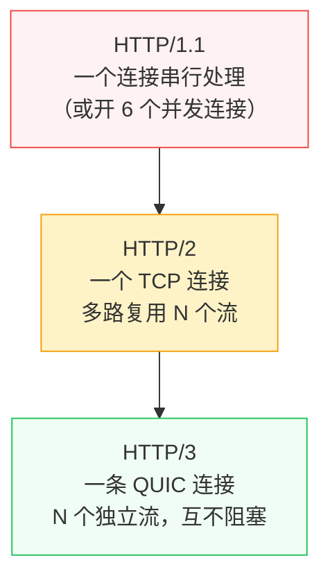

**"HTTP/2 为什么要二进制分帧？"** —— 文本协议解析成本高、无法在一连接内交错多请求。分帧后每个 frame 带 `stream id`，接收方能把交错到达的帧重新组装成不同响应 → 这就是多路复用。

**"HTTP/2 为什么还需要 TCP？问题在哪？"** —— 因为操作系统只提供 TCP/UDP 两种可靠/不可靠语义，而 TCP 的**字节流有序交付**意味着"一个段丢了，后面所有数据（不论属于哪个流）都要等它重传" → 这就是 TCP 层队头阻塞，HTTP/2 的多路复用反而放大了这个伤害。**QUIC 把"可靠有序"的粒度从"连接"降到"流"**，才真正解决。

**HPACK 头压缩**：用静态表（61 个常用头）+ 动态表（连接内缓存）+ Huffman 编码，把重复的 `Cookie`、`User-Agent` 从几百字节压到几字节。这是 HTTP/2 在大批小请求场景收益最大的地方。

### 5.3 连接复用与连接池

| 概念 | 说明 |
|---|---|
| `Connection: keep-alive` | HTTP/1.1 默认开启；`Connection: close` 关闭 |
| 浏览器并发限制 | 同域名通常 6 个 TCP 连接（HTTP/1.1 时代的多连接方案） |
| **连接池** | 后端服务（DB/Redis/HTTP 客户端）复用长连接，避免频繁握手与 TIME_WAIT |
| 池的关键参数 | maxIdle、maxActive、maxWait、minEvictableIdleTime、**testOnBorrow（心跳/校验）** |
| 常见坑 | 池里连接被中间设备（NAT/防火墙）静默断开 → 借出时才发现失效 → 必须**心跳保活 + 借出校验** |

### 5.4 HTTP 缓存：强缓存与协商缓存（★★★，前端/后端都考）

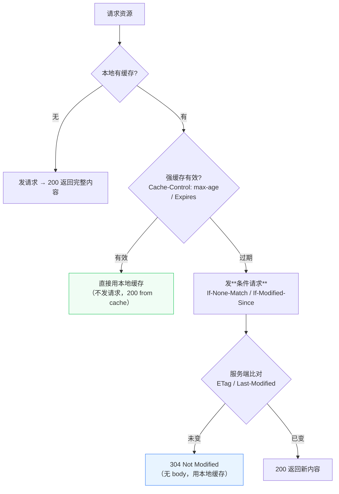

| 类型 | 头 | 优先级 | 特点 |
|---|---|---|---|
| **强缓存** | `Cache-Control: max-age=31536000` | 高（Cache-Control 覆盖 Expires） | 完全不发请求，最快；但**过期前无法感知更新**（要靠文件名 hash） |
| | `Expires: 绝对时间` | 低（HTTP/1.0 遗留，受本地时钟影响） | 同上 |
| **协商缓存** | `ETag` ↔ `If-None-Match` | 高（比 Last-Modified 精确） | 内容指纹，**强 ETag 逐字节比较**；弱 ETag（`W/`）允许语义等价 |
| | `Last-Modified` ↔ `If-Modified-Since` | 低 | 秒级精度，1 秒内多次修改无法识别 |

**常用指令组合**：
- `Cache-Control: no-cache`：**可以缓存，但每次必须验证**（走协商）。
- `Cache-Control: no-store`：**完全不缓存**（敏感数据）。
- `Cache-Control: private`：仅浏览器缓存；`public`：CDN 也可缓存。
- `must-revalidate`：过期后必须验证，不许用过期副本。
- `s-maxage`：专给 CDN/共享缓存用。

**工程实践（关键洞察）**：
- **HTML 用 `no-cache`**（每次都验证，保证拿到最新入口）；
- **JS/CSS/图片用"内容 hash 文件名 + 一年强缓存"**（`app.a1b2c3.js`），内容变了文件名就变 → 天然解决"更新不生效"问题。这是现代前端构建的缓存策略基石。

### 5.5 Cookie / Session / Token 与跨域

| 方案 | 状态存哪 | 优点 | 缺点 |
|---|---|---|---|
| **Cookie + Session** | 服务端（内存/Redis） | 可随时失效、可控 | 服务端有状态、集群需共享存储 |
| **JWT（Token）** | 客户端（自包含签名） | 无状态、易横向扩展、可跨域 | **无法主动失效**（除非黑名单）、体积大、密钥泄漏风险 |

**Cookie 关键属性（安全考点）**：
- `HttpOnly`：禁止 JS 读取 → 防 XSS 窃取。
- `Secure`：仅 HTTPS 传输。
- `SameSite=Strict / Lax / None`：跨站是否携带 → **防 CSRF**。`Lax` 是 Chrome 默认（顶级导航 GET 会带，POST/iframe 不带）。
- `Domain` / `Path` / `Max-Age`。

**跨域（CORS）**：浏览器同源策略（协议+域名+端口三者相同）限制 JS 读取跨域响应。
- **简单请求**（GET/POST + 简单头）：直接发，看响应头 `Access-Control-Allow-Origin`。
- **预检请求（Preflight）**：非简单请求（PUT/DELETE、自定义头、`Content-Type: application/json`）先发 `OPTIONS`，服务端回 `Allow-Origin / Allow-Methods / Allow-Headers / Max-Age`，通过后才发真实请求。
- **带 Cookie 的跨域**：`Access-Control-Allow-Credentials: true` 且 `Allow-Origin` 不能是 `*`。
- **其他方案**：JSONP（只支持 GET，历史方案）、Nginx 反向代理（同源化，最常用）、WebSocket（不受同源限制但服务端要校验 Origin）。

### 5.6 HTTPS / TLS：把"明文信道"变成"安全信道"

#### 三个目标
1. **机密性**：加密，中间人看不懂。
2. **完整性**：篡改能被发现（MAC/AEAD）。
3. **身份认证**：确认对端是"真的那个服务器"（证书链）。

#### 为什么"非对称加密不能全程用"
- 非对称（RSA/ECC）**计算慢**（比对称慢 100~1000 倍），且 RSA 只能加密小于密钥长度的数据。
- 所以：**用非对称协商出一个对称密钥，再用对称加密传数据**（混合加密）。这就是 TLS 的核心设计。

#### TLS 1.2 握手（RSA 密钥交换，简化版）

```mermaid
sequenceDiagram
    participant C as 客户端
    participant S as 服务器
    C->>S: ① ClientHello<br/>（支持的版本、加密套件列表、随机数 Random_C、SNI）
    S->>C: ② ServerHello<br/>（选定套件、随机数 Random_S）+ ③ Certificate（证书链）
    S->>C: ④ ServerHelloDone
    C->>S: ⑤ 用证书公钥加密 PMS（预主密钥）<br/>ClientKeyExchange
    C->>S: ⑥ ChangeCipherSpec + Finished（用协商密钥加密的校验值）
    S->>C: ⑦ ChangeCipherSpec + Finished
    Note over C,S: 双方用 Random_C + Random_S + PMS<br/>经 PRF 派生出会话密钥（对称）→ 开始加密通信
```

**为什么需要两个随机数？** 防止**重放攻击**：即使 PMS 被破解，每次连接的随机数不同，派生出的会话密钥也不同。

#### TLS 1.3 的优化（★★，社招高频）

| 改进 | 说明 |
|---|---|
| **1-RTT 握手**（甚至 0-RTT 恢复） | 合并消息，客户端在 ClientHello 里就带上密钥份额（`key_share`） |
| **只保留 (EC)DHE** | 废除 RSA 密钥交换 → 获得**前向保密（PFS）**：私钥泄漏也无法解密历史流量 |
| **废除弱算法** | 去掉 RC4、SHA-1、CBC 模式、压缩 |
| **加密更多握手内容** | 证书也在加密通道里传（除 SNI），减少信息泄漏 |
| **0-RTT 的风险** | 重放攻击（早期数据可被重放）→ 只用于幂等请求 |

**"前向保密（PFS）"是什么，为什么重要？** —— 每次连接用临时 ECDHE 密钥，会话结束后私钥即销毁。即使服务器长期私钥将来泄漏，攻击者也无法解密过去抓的包。RSA 密钥交换不具备 PFS（长期私钥一泄漏，历史全解）。

#### 证书链与校验（面试常问"证书怎么验证"）

```
根 CA（内置在操作系统/浏览器，自签名）
  └─ 中间 CA（由根 CA 签发）
       └─ 服务器证书（由中间 CA 签发，含域名、公钥、有效期、扩展）
```

**验证步骤**：
1. 拿到服务器证书 → 用**中间 CA 的公钥**验签；
2. 中间 CA 证书 → 用**根 CA 的公钥**验签；
3. 根 CA 在本地信任库中 → 链条可信；
4. 检查**域名匹配**（SAN 字段）、**有效期**、**是否被吊销**（CRL/OCSP）；
5. 检查**用途扩展**（`extendedKeyUsage: serverAuth`）。

**中间人攻击（MITM）为什么能成，怎么防**：
- 攻击者伪造证书 → 浏览器报警（因为证书不是可信 CA 签的，或域名不匹配）。
- 用户点"继续访问" → 被中间人解密。**防**：HSTS（强制 HTTPS，禁止点忽略）、证书固定（Certificate Pinning，App 内置证书指纹）、CT 日志（证书透明）。
- **企业内网"合法 MITM"**：公司装了自己的根证书到员工电脑 → 代理可解密。这解释了"为什么公司电脑上看 HTTPS 也能被审计"。

**SNI 与 ESNI**：SNI 在 ClientHello 中**明文**传域名（因为服务器还没证书，无法加密），所以可被用于**流量识别/阻断**。ESNI/ECH 试图加密 SNI。

### 5.7 DNS：互联网的电话簿

#### 层次结构

```mermaid
flowchart TD
    R["根域 . （全球 13 组服务器，Anycast）"] --> T1["顶级域 .com / .cn / .org"]
    T1 --> A1["权威 DNS<br/>example.com 的 NS"]
    A1 --> H["具体记录<br/>www.example.com → 1.2.3.4"]
    style R fill:#fef2f2,stroke:#ef4444
```

#### 递归 vs 迭代（必须分清）

| | 递归查询（Recursive） | 迭代查询（Iterative） |
|---|---|---|
| 谁做 | **客户端 → 本地 DNS**（"你帮我搞定"） | **本地 DNS → 各级服务器**（"你告诉我下一个该问谁"） |
| 负担 | 本地 DNS 承担全部查询 | 查询方自己逐级问 |
| 实际 | 客户端通常只发递归查询 | 本地 DNS 对根/顶级/权威用迭代 |

**完整解析过程（能背下来）**：
```
① 浏览器缓存 → ② 操作系统缓存（/etc/hosts、DNS cache）→ ③ 本地 DNS（ISP/公司 DNS，通常 8.8.8.8/223.5.5.5）
④ 本地 DNS 无缓存 → 问根域："com 谁管？" → ⑤ 问 .com："example.com 的 NS 是谁？"
⑥ 问权威 DNS："www.example.com 的 A 记录？" → ⑦ 返回 IP → ⑧ 逐级缓存（按 TTL）
```

| 记录类型 | 含义 |
|---|---|
| A / AAAA | 域名 → IPv4 / IPv6 |
| CNAME | 别名（`www` → `cdn.example.com`），**不能与 A 共存于同一名字** |
| MX | 邮件服务器（带优先级） |
| TXT | 文本（SPF 反垃圾邮件、域名验证） |
| NS | 该域的权威服务器 |
| SOA | 区域起始授权（含主 NS、TTL 等） |
| SRV | 服务定位（端口+优先级，常用于微服务/游戏） |

**DNS 的关键工程点**：
- **TTL 决定缓存时长**：TTL 太长改 IP 生效慢，太短查询压力大。**切流量前先调小 TTL** 是标准操作。
- **DNS 劫持/污染**：返回错误 IP → 防：DoH（DNS over HTTPS，443 端口加密）、DoT（853）。
- **UDP 512 字节限制**：超过则截断（TC 位），客户端改用 TCP；EDNS0 可扩展。
- **DNS 轮询做负载均衡**：一个域名多个 A 记录，客户端随机选 → 但**无法感知服务器健康**，且受客户端缓存影响 → 所以现代用 GSLB（智能 DNS，按地理/运营商/健康状态返回）。

### 5.8 CDN：把内容搬到离用户 10ms 的地方

```mermaid
flowchart LR
    U["用户"] -->|"① DNS 解析<br/>（GSLB 按 IP 归属/运营商<br/>返回最近节点）"| E["边缘节点<br/>（全国/全球数百个）"]
    E -->|"② 命中缓存 → 直接返回"| U
    E -->|"③ 未命中 → 回源"| P["中间层/父层缓存"]
    P -->|"④ 再未命中"| O["源站"]
    O -->|"⑤ 返回并逐层缓存"| E
    style E fill:#f0fdf4,stroke:#22c55e
    style O fill:#fef3c7,stroke:#f59e0b
```

| 关键技术 | 作用 |
|---|---|
| **GSLB / 智能 DNS** | 按地理位置、运营商、节点健康、负载返回最优节点 IP |
| **缓存键（Cache Key）** | URL + 查询参数 + Vary 头；**忽略无意义参数**可提高命中率 |
| **回源收敛** | 同一资源在边缘未命中时，只允许一个请求回源（其余等待），防"缓存击穿"打爆源站 |
| **预热** | 大促前主动把热点内容推到边缘 |
| **动态加速** | 动态请求走"最优路由 + 长连接 + 协议优化"（不是缓存，而是传输优化） |
| **HTTPS 证书** | 边缘节点持有证书，用户到边缘是短 RTT 握手 |

**"CDN 如何判断用户在哪？"** —— 靠 **Local DNS 的出口 IP**（不是用户真实 IP），所以移动网络/VPN 下定位会偏。这也是"CDN 调度不准"的常见原因。

### 5.9 WebSocket / SSE / 长轮询

| 方案 | 方向 | 协议 | 适用 |
|---|---|---|---|
| 短轮询 | 客户端拉 | HTTP | 简单，延迟高、浪费请求 |
| **长轮询** | 客户端拉（挂起） | HTTP | 准实时，服务端要 hold 连接 |
| **SSE（Server-Sent Events）** | **服务端单向下推** | HTTP（`text/event-stream`） | 推送通知、日志流、AI 流式输出 |
| **WebSocket** | **全双工** | HTTP 升级后走独立协议（`Upgrade: websocket`，101） | 聊天、协同编辑、游戏、实时行情 |

**WebSocket 握手**：客户端发 `GET` + `Upgrade: websocket` + `Sec-WebSocket-Key`（随机 Base64），服务端回 `101 Switching Protocols` + `Sec-WebSocket-Accept = Base64(SHA1(Key + 固定 GUID))`。**这个 GUID 的作用**是防止普通 HTTP 请求被误认为 WS 握手（代理缓存污染）。

### 5.10 负载均衡：L4 与 L7

| | L4（四层） | L7（七层） |
|---|---|---|
| 依据 | IP + 端口（五元组） | HTTP 路径/头/Cookie |
| 典型 | LVS（DR/NAT/TUN）、F5、云 SLB | Nginx、HAProxy、Envoy、Ingress |
| 性能 | 极高（内核转发，百万级并发） | 较低（要解析应用层，但足够） |
| 能力 | 只转发，不懂业务 | 路由、改头、限流、鉴权、灰度、WAF |
| 会话保持 | 靠源 IP 哈希 | 可靠 Cookie/URL 参数 |

**常见算法**：轮询、加权轮询、最少连接、**一致性哈希（同一 key 固定到同一后端，缓存友好）**、IP Hash。

**健康检查**：TCP 探活（端口通）、HTTP 探活（返回 200）、被动探测（失败计数）。**"为什么后端明明挂了，还有流量打过去？"** —— 健康检查间隔太长、或只做了 TCP 检查（进程还在但业务卡死）。

**代理链与 `X-Forwarded-For`**：经过代理后源 IP 会变成代理 IP，所以用 `XFF` 追加真实 IP；但 XFF 可伪造，**只信任自家代理链**。`X-Real-IP`、`Forwarded` 是类似方案。

---

## 第 6 章 内核网络栈、IO 模型与故障排查

### 6.1 一次收包的完整路径（Linux）

```mermaid
flowchart TD
    A["网卡收到帧<br/>（PHY 解码 → MAC 校验 FCS）"] --> B["DMA 写入内存<br/>ring buffer（避免 CPU 搬运）"]
    B --> C["网卡发硬中断<br/>（IRQ）"]
    C --> D["上半部：快速处理<br/>屏蔽中断、标记、唤醒软中断"]
    D --> E["软中断 NET_RX_SOFTIRQ<br/>（ksoftirqd 或中断返回时执行）"]
    E --> F["链路层：剥以太头<br/>→ 判断类型（IP/ARP）"]
    F --> G["网络层：IP 校验、路由判断<br/>（本地交付 or 转发）"]
    G --> H["传输层：TCP/UDP 校验、找 socket<br/>（四元组哈希）"]
    H --> I["放入 socket 接收队列<br/>（sk_receive_queue）"]
    I --> J["唤醒等待的进程<br/>（epoll 就绪 → 应用 read"]
    style B fill:#e8f4ff,stroke:#3b82f6
    style E fill:#fef3c7,stroke:#f59e0b
```

**关键设计点（面试高分）**：

| 机制 | 解决什么问题 |
|---|---|
| **DMA** | 网卡直接写内存，CPU 不做数据搬运 |
| **中断 + 软中断分离** | 硬中断只做最紧急的事（否则丢包），耗时解析放软中断 |
| **NAPI（中断 + 轮询）** | 高 PPS 下"每包一中断"会打爆 CPU → 第一个包中断，之后关中断轮询批量收 |
| **RSS（多队列）** | 多核并行收包，每队列绑一个 CPU 核 |
| **RPS/RFS** | 软件层面把流分发到不同核，提升缓存局部性 |
| **零拷贝** | 避免"内核缓冲 → 用户态"的内存拷贝 |

### 6.2 IO 多路复用：select / poll / epoll（★★★，后端必考）

| | select | poll | epoll |
|---|---|---|---|
| 数据结构 | 位图（fd_set） | 数组（pollfd） | **红黑树 + 就绪链表** |
| 最大 fd | **1024**（FD_SETSIZE） | 无上限（受内存） | 无上限 |
| 每次调用 | 全量 fd 拷入内核 + 线性扫描 | 同 select（数组） | **一次性注册（epoll_ctl），内核维护** |
| 就绪通知 | 返回后自己遍历找 | 同 select | **直接返回就绪链表** |
| 复杂度 | O(n) | O(n) | **O(1)**（就绪数） |
| 触发模式 | 水平触发 | 水平触发 | **LT / ET** |
| 适合 | fd 少 | fd 中等 | **高并发（C10K/C10M）** |

**epoll 的内部机理（要能讲清）**：
```
epoll_create → 创建 eventpoll 对象（内含红黑树 root + 就绪链表 rdllist）
epoll_ctl(ADD) → 把 fd 挂到红黑树，并注册回调到该 socket 的等待队列
数据到达 → 内核回调把该 fd 加入 rdllist（不管此时是否在 epoll_wait）
epoll_wait → 直接看 rdllist 是否非空，非空则返回（把就绪 fd 拷给用户态）
```
**为什么 epoll 高效**：① 不需要每次把全部 fd 拷进内核；② 不轮询扫描，靠**回调驱动**；③ 就绪链表直接给出结果，复杂度与"活跃 fd 数"相关，而不是"总 fd 数"。

**LT 与 ET（超高频）**：

| | 水平触发（LT，默认） | 边缘触发（ET） |
|---|---|---|
| 通知条件 | 只要还有数据没读完，**每次都通知** | 只在"状态变化"时通知**一次** |
| 编程难度 | 简单（读不完下次还会通知） | **必须一次读到 EAGAIN**（`read` 返回 -1 且 errno=EAGAIN），否则数据永远不通知 → 容易"卡死" |
| 性能 | 系统调用多（可能空转） | 系统调用少，适合高并发 |
| 必须配合 | — | **非阻塞 fd** + 循环读到空 |
| 例子 | Nginx 部分场景、简单实现 | **Nginx/Redis/Netty 默认用 ET** |

> **ET 常见坑**：只读了一次就回去 `epoll_wait`，缓冲里还有数据 → 但由于没有新数据到达（无新边沿），**再也不会通知** → 连接"假死"。这是面试官最爱问的"你踩过什么坑"。

**Reactor 模式**（Netty/Redis/Nginx 的架构内核）：
```
单 Reactor 单线程：一个线程处理 accept + read + 业务（Redis 6.0 前）
单 Reactor 多线程：IO 线程 + 业务线程池
主从 Reactor：mainReactor 只 accept，subReactor 多个负责读写（Netty 默认）
```

### 6.3 零拷贝

| 方式 | 数据流 | 拷贝次数 | 适用 |
|---|---|---|---|
| 传统 `read + write` | 磁盘→内核页缓存→用户态→内核 socket 缓冲→网卡 | **4 次拷贝 + 4 次上下文切换** | 通用 |
| **`sendfile`** | 磁盘→内核页缓存→内核 socket 缓冲→网卡 | **2 次（可降到 0 次 CPU 拷贝，用 DMA 直传）** | 静态文件服务（Nginx） |
| `mmap + write` | 内核页缓存**映射**到用户态 → 直接 write | 少 1 次拷贝 | 大文件、需要处理 |
| `splice` | 内核管道直连 | 0 次 CPU 拷贝 | 代理转发 |
| **`MSG_ZEROCOPY` / io_uring** | 用户态缓冲直接 DMA 到网卡 | 0 次 | 高性能发送 |

**"零拷贝真的零拷贝吗？"** —— 不是"没有拷贝"，而是**消除 CPU 参与的内存拷贝**（DMA 拷贝仍存在）。真正的收益是：省 CPU、省内存带宽、减少上下文切换。

### 6.4 排查工具与手法（实战必备）

| 工具 | 用途 | 常用命令 |
|---|---|---|
| `ping` | 连通性、RTT、丢包 | `ping -c 100 -i 0.1 host` |
| `mtr` | **连续路径质量**（traceroute + ping 结合） | `mtr -rw host` |
| `traceroute` | 路径、哪一跳开始丢 | `traceroute -T -p 443 host` |
| `ss` | 连接状态、队列、重传、cwnd | `ss -lntp`、`ss -ti`、`ss -s` |
| `netstat` | 老牌，同 ss | `netstat -s`（协议栈统计） |
| `tcpdump` | 抓包 | `tcpdump -i eth0 -nn 'tcp port 80' -w a.pcap` |
| `wireshark` | 可视化分析、看流图 | 打开 pcap，Statistics → Flow Graph |
| `curl` | 分层计时 | `curl -w "@fmt.txt" -o /dev/null -s url` |
| `nc` | 端口探活 | `nc -zv host 443` |
| `nstat`/`sar` | 协议栈计数器 | `nstat -az`、`sar -n DEV 1` |

**curl 分层计时模板（定位"到底慢在哪一段"，非常实用）**：
```bash
curl -o /dev/null -s -w "
DNS解析: %{time_namelookup}s
TCP连接: %{time_connect}s
TLS握手: %{time_appconnect}s
首字节:   %{time_starttransfer}s
总耗时:   %{time_total}s
" https://example.com
```
判读：
- `time_namelookup` 大 → DNS 问题；
- `time_connect - time_namelookup` 大 → TCP 握手慢（网络/防火墙/队列满）；
- `time_appconnect - time_connect` 大 → TLS 握手慢（证书链长、RTT 高、OCSP）；
- `time_starttransfer - time_appconnect` 大 → **服务端处理慢**（业务/DB/GC）；
- `time_total - time_starttransfer` 大 → 传输慢（带宽/窗口/丢包）。

### 6.5 常见故障速查表（面试"你遇到过什么网络问题"的弹药库）

| 现象 | 可能原因 | 验证 | 解决 |
|---|---|---|---|
| 连不上（超时） | 防火墙丢包、路由不可达、服务未监听、全连接队列满 | `telnet/nc`、`ss -lnt`、`traceroute` | 放行、调 backlog、起服务 |
| 连不上（RST） | 端口未监听、`tcp_abort_on_overflow=1`、中间设备阻断、应用 close 时缓冲有数据 | `ss -lnt`、抓包看 RST | 起服务、调参、查中间设备 |
| 偶发连接失败 | 全连接队列溢出、SYN 队列溢出 | `netstat -s \| grep -i overflow` | 调 `somaxconn`/`backlog`/`tcp_max_syn_backlog` |
| 请求慢但 ping 快 | 应用层慢（DB/GC/锁）、TLS 握手、DNS | curl 分层计时、看服务端耗时 | 优化业务/连接复用 |
| 大包不通小包通 | **MTU 黑洞** | `ping -M do -s 1472` | 调 MSS / 修 PMTUD |
| 吞吐上不去 | 窗口太小、丢包、RTT 高、单连接限制 | `ss -ti` 看 cwnd/rtt/retrans | 调窗口、多连接、BBR、CDN |
| TIME_WAIT 暴涨 | 短连接多 | `ss -s` | 长连接/连接池、`tcp_tw_reuse` |
| CLOSE_WAIT 暴涨 | 应用没 close | `ss -tan state close-wait` | 修代码（连接泄漏） |
| 端口耗尽 | 本地端口被 TIME_WAIT 占满 | `Cannot assign requested address` | 扩端口范围、连接池、多 IP |
| 周期性卡顿 | 拥塞窗口周期性折半、GC、NAT 表项过期 | 抓包看 cwnd 锯齿 | 调算法/心跳 |
| DNS 解析慢 | DNS 服务器远、递归链长、被劫持 | `dig +trace`、`time dig` | 本地缓存、HTTPDNS、DoH |

### 6.6 高并发网络编程的"五个上限"

```
① fd 上限          ulimit -n / fs.file-max
② 端口上限          ip_local_port_range（作为客户端时）
③ 内存上限          每连接的内核缓冲（tcp_rmem/wmem）× 连接数
④ 中断/软中断 CPU    单核软中断 100% → 多队列 RSS/RPS
⑤ 文件/连接跟踪      nf_conntrack_max、epoll 的 fd 数量
```
**C10K → C10M 的演进**：多进程/多线程（C10K 早期）→ select/poll（fd 上千就退化）→ **epoll + 非阻塞 + 事件驱动**（C10K 解法）→ 多核 + 多队列 + 用户态协议栈（DPDK）→ 内核旁路 + 硬件卸载。

---
## 第 7 章 国内大厂面试题库（含考核星级与详解）

> **说明**：题库按"知识域"分组，而非按公司分组——因为同一家公司不同部门问法差别很大。公司标注表示"该题在此类公司的高频出现"，供你判断"投这家要不要重点准备"。
> **答题建议**：每个答案都按"**一句话结论 → 机制展开 → 为什么这么设计 → 延伸/坑**"四段式组织，这是面试官最认可的答法。

### 7.0 全局权重表（先看这张，决定复习优先级）

| 知识域 | 出现频率 | 平均难度 | 建议投入 | 备注 |
|---|---|---|---|---|
| TCP 连接管理（握手/挥手/TIME_WAIT） | 98% | 中 | ★★★★★ | 最容易被追问到底 |
| HTTP/HTTPS | 95% | 中 | ★★★★★ | 前后端通吃 |
| TCP 可靠传输与拥塞控制 | 85% | 高 | ★★★★★ | 区分"背过"和"懂了"的分水岭 |
| IO 多路复用 / 网络编程 | 80%（后端） | 高 | ★★★★★ | 后端岗必考 |
| 输入 URL 到展示 | 75% | 高 | ★★★★ | 综合能力试金石 |
| IP/子网/路由/NAT | 70% | 中 | ★★★★ | 计算题要练手 |
| DNS/CDN | 65% | 中 | ★★★ | 常与"优化"结合 |
| ARP/链路层 | 50% | 低 | ★★★ | 基础题，答错很难看 |
| 弱网/高并发/线上排查 | 40%（社招更多） | 高 | ★★★★ | 社招必问 |
| IPv6/QUIC/新协议 | 25% | 中 | ★★ | 加分项 |

---

### 7.A 基础与分层（Q1–Q5）

#### Q1｜说说 OSI 七层与 TCP/IP 四层，每层职责与典型协议
**公司**：腾讯、阿里、百度、美团 ｜ **考核**：★★★（必考，但答错代价低，答好可加分）

**答题框架**：

| 层 | 职责（一句话） | 典型协议 | 关键设备 |
|---|---|---|---|
| 应用层 | 业务语义 | HTTP、HTTPS、DNS、FTP、SMTP、SSH、MQTT | 网关、代理 |
| 表示层 | 格式/编码/加密（OSI 独有） | TLS 常被归到这里、JPEG、JSON 序列化 | — |
| 会话层 | 会话建立/维持（OSI 独有） | RPC 会话、Socket 连接管理 | — |
| 传输层 | 进程到进程、可靠/不可靠、流量与拥塞控制 | TCP、UDP、QUIC | L4 负载均衡 |
| 网络层 | 主机到主机、跨网寻址与路由 | IP、ICMP、ARP（边界）、OSPF/BGP | 路由器 |
| 数据链路层 | 一跳内成帧/寻址/检错 | 以太网、PPP、WiFi(802.11) | 交换机 |
| 物理层 | 比特 → 信号 | 以太网 PHY、光纤、5G NR | 网卡、中继器 |

**加分表述**："OSI 是理论模型（教学用，分层过细）；TCP/IP 是工程模型（把表示层和会话层并入应用层）；实际分析常用五层。**分层的本质是解耦**：每层只对上层承诺一个服务接口，因此 IP 能跑在任意介质上，HTTP 能跑在任意传输协议上（HTTP/3 就换成了 QUIC）。"

---

#### Q2｜为什么要分层？分层有什么缺点？
**公司**：美团、百度、华为 ｜ **考核**：★★

**结论**：分层用"**接口标准化**"换来了"**独立演进**"。

**优点**：
1. **解耦**：换介质（4G→5G）不影响应用；换应用（HTTP→gRPC）不影响路由。
2. **复用**：一套 TCP 服务被所有应用共享。
3. **可维护/可并行开发**：各层可独立实现、独立测试。
4. **故障隔离**：ping 通但 HTTP 不通，可以判断问题在传输层以上。

**缺点（能说出来就是加分）**：
1. **功能重复/冗余**：链路层 CRC + 网络层校验和 + 传输层校验和，三次校验。
2. **跨层信息不可用**：TCP 看不到"这是视频流还是网页"，无法针对性优化（所以有了 ALF/ECN/QUIC）。
3. **层间开销**：每层包头（以太 14+IP 20+TCP 20 = 54 字节，小包效率极低）。
4. **违背分层的地方很多**：NAT 改 IP、防火墙看端口、TLS 横跨多层、QUIC 把传输层搬到用户态——**说明分层是手段不是目的**。

---

#### Q3｜一次 HTTP 请求的数据在各层是怎么封装/解封装的？
**公司**：字节、腾讯、阿里 ｜ **考核**：★★★

**答法（边画边说）**：
```
应用数据 "GET / HTTP/1.1\r\nHost: a.com\r\n\r\n"
  ↓ +TCP 头（源/目的端口、seq、ack、标志、窗口、校验和）
TCP 段
  ↓ +IP 头（版本、长度、TTL=64、协议=6、源/目的 IP、校验和）
IP 包
  ↓ +以太网头（前导码、目的 MAC、源 MAC、Type=0x0800）+ FCS
以太帧
  ↓ 物理层编码（8B/10B 等）→ 光/电信号
```

**必须强调的三点（这是区分度）**：
1. **IP 在整个旅程不变（除 NAT），MAC 每跳都变**。
2. **目的 MAC ≠ 最终服务器 MAC**，而是**下一跳（网关）的 MAC**。
3. **TTL 每跳减 1**，用于防环；**校验和每跳重算**（因为 TTL 变了）。

**延伸**：接收端解封装时，链路层 FCS 错 → **静默丢帧**（不通知上层），由 TCP 超时重传兜底；这就是第 1 章"端到端可靠性"的落地体现。

---

#### Q4｜端到端与点到点（逐跳）的区别？为什么可靠性放在端上？
**公司**：华为、字节 ｜ **考核**：★★

| | 端到端 | 逐跳 |
|---|---|---|
| 谁负责 | 两端主机（TCP） | 中间每跳（链路层 ARQ） |
| 恢复速度 | 慢（等 RTT） | 快（局部重传） |
| 核心复杂度 | 端系统 | 网络设备 |
| 能否处理拥塞丢包 | 能 | **不能**（中间队列溢出它不知道） |
| 可扩展性 | 好 | 差 |

**为什么选端到端（三个理由）**：
1. 只有端系统知道"什么算送达"（语义上成功），中间节点无法判断；
2. 网络内部丢包（拥塞、路由抖动）只有端到端机制能覆盖；
3. 核心保持简单无状态 → 才能承载全球规模。

**延伸**：WiFi 链路层其实有 ARQ（局部重传），这是"逐跳"的补充，但**它只解决无线误码，不解决端到端语义**。两者叠加时要注意**重复重传**的问题（链路层已重传成功，TCP 又重传一次）。

---

#### Q5｜集线器、交换机、路由器、网关的区别
**公司**：腾讯、京东、华为 ｜ **考核**：★★★（基础题，答错很掉分）

| 设备 | 工作层 | 依据 | 冲突域 | 广播域 | 关键行为 |
|---|---|---|---|---|---|
| 集线器 Hub | 物理层 | 无（广播复制） | **1 个（全部共享）** | 1 | 信号放大再生，所有口共享带宽 |
| 交换机 Switch | 链路层 | 目的 MAC | **每口一个** | 默认 1（VLAN 可切分） | MAC 表自学习、定向转发、泛洪 |
| 路由器 Router | 网络层 | 目的 IP（最长前缀匹配） | 每口一个 | **每口一个** | 改 MAC、TTL-1、查路由表、隔离广播 |
| 网关 Gateway | 多层 | 协议转换 | — | — | 广义：协议转换器；日常指"默认网关"（出口路由器） |
| 三层交换机 | 二/三层 | MAC + IP | 每口 | 每 VLAN | 一次路由多次交换（ASIC 加速） |

**一句话总结**："**交换机隔离冲突域，路由器隔离广播域。**" 三层交换机 = 交换机 + 路由能力（VLAN 间通信不必经过外置路由器）。

---

### 7.B 链路层（Q6–Q10）

#### Q6｜ARP 的工作过程？跨网段时 ARP 的是谁？
**公司**：阿里、字节、腾讯 ｜ **考核**：★★★（**跨网段那问是经典陷阱**）

**过程**：
1. 主机查本机 ARP 缓存（`arp -a`），命中直接用；
2. 未命中 → 广播 **ARP Request**（目的 MAC = `FF:FF:FF:FF:FF:FF`）："谁是 192.168.1.9？请告诉 192.168.1.7"；
3. 目标主机回 **ARP Reply（单播）**："我是，我的 MAC 是 xx"；
4. 写入缓存（Linux 默认项有效期与状态相关，通常几分钟）；
5. 之后发数据用该 MAC。

**跨网段（关键）**：主机判断"目的 IP 与本机不在同一子网"（掩码运算）→ **ARP 的是默认网关的 MAC**，不是最终服务器。IP 包的目的 IP 仍是服务器 IP，但帧的目的 MAC 是网关。**这就是"IP 端到端、MAC 逐跳"的直接体现。**

**延伸考点**：
- **免费 ARP（Gratuitous ARP）**：主动广播"我的 IP→MAC"，用于 IP 冲突检测、VIP 漂移后刷新缓存（Keepalived 切换必备）。
- **ARP 只在同一广播域生效**（同一 VLAN/子网）。跨 VLAN 必须经三层。
- **ARP 表状态**：`<complete>` / `<incomplete>`（发了没回）/ `<from_interface>`。
- IPv6 用 **NDP（邻居发现，ICMPv6 NS/NA）** 取代 ARP，且用组播而非广播。

---

#### Q7｜ARP 欺骗的原理与防御
**公司**：华为、阿里（安全方向）、字节 ｜ **考核**：★（安全岗★★）

**原理**：ARP 无认证，谁回答都信。攻击者持续发送"网关 IP 对应我的 MAC"的伪造 ARP Reply/免费 ARP，受害者缓存被污染 → 流量经攻击者（可窃听/篡改）→ 中间人。

**防御**：
1. **静态 ARP 绑定**（关键主机/网关）；
2. **交换机端口安全**（限制每口 MAC 数、绑定 MAC）；
3. **ARP 防火墙/ARP 防护**（交换机校验 ARP 与 DHCP 记录）；
4. **VLAN 隔离** + **HTTPS/加密**（即使被劫持也无法解密，降级为"可用性攻击"）；
5. **802.1X 接入认证**，防止非法设备入网。

**延伸**：ARP 欺骗是"**协议设计时未考虑恶意环境**"的典型。同类问题还有 DNS 劫持、BGP 劫持——共同特征是"早期协议假设参与者诚实"。

---

#### Q8｜以太网为什么最小帧 64 字节？MTU 为什么是 1500？
**公司**：华为、思科系、字节 ｜ **考核**：★（网络岗★★）

**64 字节的由来（CSMA/CD 碰撞检测窗口）**：
```
最坏情况：A 发出的信号要传到最远端（τ），对端此刻也在发，碰撞信号要传回 A（再 τ）
→ 检测碰撞需要 2τ 时间
→ 在 2τ 内必须持续发送，才能"边发边听"发现碰撞
10 Mbps 以太网、最长 2500 m + 4 中继器 → 2τ = 51.2 μs
→ 51.2 μs × 10 Mbps = 512 bit = 64 字节
```
**所以帧 < 64 字节时，发送方可能在"发完"之前检测不到碰撞**，协议无法工作。填充字段（46 字节最小数据）就是为了凑够 64。

**MTU=1500**：以太网数据字段上限，是历史工程折中（当时内存/延迟/效率的平衡）。它直接决定 `MSS = 1500 - 20 - 20 = 1460`。

**延伸**：现代全双工交换式以太网已无碰撞，CSMA/CD 退役，但 64 字节最小帧作为兼容性保留（也影响小包转发性能：64 字节帧 + 20 字节开销 = 84 字节，小包 PPS 是性能瓶颈）。

---

#### Q9｜VLAN 是什么？Trunk 与 Access 的区别？
**公司**：华为、京东、运营商 ｜ **考核**：★★

**VLAN（802.1Q）**：在以太帧中插入 **4 字节标签**（TPID 0x8100 + 优先级 3bit + CFI 1bit + **VID 12bit**），把一个物理交换机逻辑切成多个广播域（最多 4094 个可用）。

| 端口类型 | 用途 | 帧是否带标签 |
|---|---|---|
| **Access** | 接终端（PC/打印机） | 进出都**不带**标签（交换机内部知道属于哪个 VLAN） |
| **Trunk** | 接交换机/路由器/AP | **带标签**（除 native VLAN） |

**为什么需要 VLAN**：
1. **隔离广播域**（减少广播风暴、提升安全）；
2. **逻辑分组**（按部门而非按地理位置布线）；
3. **减少路由器端口**（一个 Trunk 承载多个 VLAN）。

**延伸**：VLAN 只有 12 bit（4094 个）不够云数据中心用 → 所以有 **VXLAN**（24 bit VNI，1600 万），把二层帧封进 UDP 跨三层传输（Overlay）。

---

#### Q10｜交换机环路为什么会"网络全断"？STP 怎么解决？
**公司**：华为、运营商、银行 IT ｜ **考核**：★

**环路灾难（广播风暴）**：
- 广播帧（ARP/DHCP）在环上无限循环，每绕一圈还被复制（多路径），**流量指数增长**；
- 交换机 MAC 表"震荡"（同一 MAC 在两个口来回学），转发混乱；
- 结果：链路带宽 100%、CPU 100%、全网不可用（几分钟内）。

**STP（802.1D）**：通过交换 BPDU 选出**根桥**，每台交换机算出到根桥的最短路径，**逻辑上阻塞冗余端口**（物理仍在，逻辑断开），形成一棵无环树。故障时重新计算，启用备用链路。

| 版本 | 收敛时间 | 改进 |
|---|---|---|
| STP (802.1D) | 30~50 s | 太慢 |
| RSTP (802.1W) | < 1 s | 端口状态精简、快速切换 |
| MSTP (802.1S) | 秒级 | 多 VLAN 多实例，负载均衡 |

**延伸**：现代数据中心更常用 **三层到边缘（Spine-Leaf）+ 路由**，或 **TRILL/SPB**，避免二层大二层环问题。云上则用 Overlay 屏蔽底层拓扑。

---

### 7.C 网络层（Q11–Q18）

#### Q11｜IP 首部有哪些字段？TTL 的作用是什么？
**公司**：华为、腾讯、字节 ｜ **考核**：★★★

**必答字段（按功能分组更好记）**：
- **定位类**：版本、首部长度、总长度
- **分片类**：标识（ID）、标志（DF/MF）、片偏移
- **生命周期类**：**TTL**、协议、首部校验和
- **地址类**：源 IP、目的 IP

**TTL 的四个作用（层层递进，面试官会顺着问）**：
1. **防环**：路由配置错误形成环路时，TTL 减到 0 丢弃，避免包永远打转；
2. **限制作用域**：可用于限制传播范围（如组播用 TTL 控制范围）；
3. **traceroute 的基础**：TTL 递增 + ICMP Time Exceeded 定位每一跳；
4. **安全**：过期包不会长期滞留。

**延伸**：
- TTL 每跳减 1，**由路由器修改**，所以 IP 首部校验和每跳都要重算 → IPv6 取消首部校验和的原因之一。
- 常见初始 TTL：Linux 64、Windows 128、部分网络设备 255 → **看 TTL 可以粗略判断对端操作系统**（`ping` 返回 TTL=57 说明经过了 7 跳，原始 64）。
- TTL 与 MSL 的关系：MSL 理论上应覆盖"最大 TTL 耗尽时间"，这也是 TIME_WAIT 取 2MSL 的理论依据之一。

---

#### Q12｜给一个网段，划分子网（计算题）
**公司**：阿里、腾讯、百度、华为 ｜ **考核**：★★★（**现场算，算错直接挂**）

**标准解法（四步）**：
```
① 由"需要多少子网"定子网位 n：2^n ≥ 子网数
② 由"每个子网多少主机"验证：2^(32-前缀) - 2 ≥ 主机数
③ 新掩码 = 原前缀 + n；块大小 = 2^(32-新前缀)
④ 按块大小枚举边界，写出每个子网的网络地址/可用范围/广播地址
```

**例题**：`172.16.0.0/16` 划分成 5 个子网，每个至少 1000 台主机。
```
约束① 子网数 ≥ 5 → 子网位 n ≥ 3 → 前缀 ≥ 19
约束② 每子网主机 ≥ 1000 → 主机位 h ≥ 10（2^10 - 2 = 1022）→ 前缀 ≤ 22
→ 前缀在 19~22 之间都合法；取 /22（最省空间，每子网刚好够用）
块大小 = 2^10 = 1024，共 2^6 = 64 个子网
前 5 个：172.16.0.0/22、172.16.4.0/22、172.16.8.0/22、172.16.12.0/22、172.16.16.0/22
以 172.16.0.0/22 为例：网络地址 172.16.0.0、可用 172.16.0.1 ~ 172.16.3.254、广播 172.16.3.255
```

**速算口诀**：
- `/n` → 块大小 `2^(32-n)`；
- 主机数 = 块大小 - 2；
- 判断 IP 归属：`IP & mask`；
- **前缀越短，范围越大**；
- `/24`=256、`/25`=128、`/26`=64、`/27`=32、`/28`=16、`/29`=8、`/30`=4（点对点链路常用 /30 或 /31）。

**延伸**：为什么 /31 可以用？RFC 3021 允许点对点链路用 /31（无网络地址/广播地址概念），省一半地址。

---

#### Q13｜什么是最长前缀匹配？路由聚合怎么做？
**公司**：华为、字节、阿里 ｜ **考核**：★★

**最长前缀匹配（LPM）**：路由表中多条规则都匹配目的 IP 时，选**前缀最长（最具体）**的那条。因为前缀越长，描述的范围越小，越精确。

**例子**：
```
目的 10.1.2.3，路由表有：
  10.0.0.0/8      → 下一跳 A
  10.1.0.0/16     → 下一跳 B
  10.1.2.0/24     → 下一跳 C
  0.0.0.0/0       → 下一跳 D（默认路由）
→ 选 /24 → 下一跳 C
```

**路由聚合（超网）**：把多条连续前缀合并成一条更短的前缀，减少路由表条目。
```
10.1.0.0/16、10.1.1.0/16 ... 10.1.255.0/16 → 可聚合为 10.1.0.0/16? 
（需检查二进制前缀是否连续对齐）
10.0.0.0/16 + 10.1.0.0/16 = 10.0.0.0/15（因为 10.0 和 10.1 只有最后一位不同）
```

**实现方式（加分）**：
- **多级 Trie（LC-Trie）**：按 bit 建树，深度 = 前缀长度，查表 O(前缀长度)；
- **TCAM**：硬件并行匹配所有表项，O(1)，但功耗/成本高；
- **默认路由兜底**：`0.0.0.0/0` 保证"总有路可走"（前缀长度 0，最后才匹配）。

**易错点**：聚合时若把"不属于自己的前缀"也包含进来，会造成**流量黑洞**（把别人的流量吸过来）→ 所以 BGP 聚合要谨慎。

---

#### Q14｜NAT 的原理？它带来了哪些问题？
**公司**：字节、阿里、腾讯 ｜ **考核**：★★★

**原理（NAPT）**：路由器维护一张**转换表**（conntrack），把 `内网IP:内网端口` 映射为 `公网IP:公网端口`。

```
出方向：改写 源IP:源端口 → 公网IP:新端口，记录映射
回方向：查表，改写 目的IP:目的端口 → 内网IP:内网端口
```

| 类型 | 改什么 | 场景 |
|---|---|---|
| **SNAT** | 源地址 | 内网访问外网、K8s Pod 出网 |
| **DNAT** | 目的地址 | 端口映射、L4 负载均衡 VIP |
| 双向 NAT | 两边都改 | 复杂组网 |

**NAT 带来的问题（这是这题的价值所在）**：
1. **破坏端到端**：外部无法主动连内网（无映射表项）→ 需要端口映射/内网穿透（frp、ngrok）。
2. **P2P 打洞困难**：双方都在 NAT 后 → 用 STUN 获取公网映射，互相发包打洞；但**对称型 NAT**（每个目的分配不同端口）无法打洞 → 只能用 TURN 中继。
3. **有状态 → 表满即挂**：`nf_conntrack: table full, dropping packet` → 调 `nf_conntrack_max`。
4. **UDP 映射超时短**（30s~2min）→ 长连接必须心跳保活。
5. **日志/审计困难**：多个内网主机共享一个公网 IP，追踪需查 NAT 日志（时间+端口）。
6. **协议兼容性**：FTP（主动模式）、SIP、IPSec 等在载荷里带 IP 地址的协议，NAT 改不了载荷 → 需要 ALG。

**延伸**：为什么 IPv6 时代还要 NAT？—— 一是安全惯性（隐藏内网拓扑），二是运营商/企业迁移成本，三是"有状态防火墙"的便利。但代价是重新引入了端到端破坏。

---

#### Q15｜IP 分片怎么发生？PMTUD 和 MTU 黑洞是什么？
**公司**：字节、阿里、腾讯（**线上故障题高频**）｜ **考核**：★★★

**分片触发**：包大小 > 出接口 MTU。
- `DF=0` → 分片：每片带同一 ID、偏移（单位 8 字节）、MF（最后一片 0）；
- **只有目的主机重组**（路由器不重组）；
- `DF=1` → 丢弃 + ICMP Type 3 Code 4（携带本跳 MTU）。

**为什么现代尽量避免分片**：
1. 任一片丢失 → 整个包作废，浪费已传输的带宽；
2. 重组占目的主机内存，易被攻击（分片重叠、Teardrop）；
3. **NAT/防火墙处理困难**：只有第一个分片有 TCP/UDP 头，后续分片无法做端口检查 → 常被直接丢弃。

**PMTUD（路径 MTU 发现）**：
```
发送方设 DF=1 发大包 → 中间某跳 MTU 更小 → 回 ICMP(3,4) 带 MTU
→ 发送方调小 MSS → 重试 → 直到通过
```

**MTU 黑洞（经典线上故障）**：
- 现象：**小包通（ping 56B 正常），大包不通**（网页打不开、SSH 卡在认证、TLS 握手失败）；
- 根因：路径上某设备 MTU 更小（PPPoE 1492、VPN 1400），但**ICMP 被防火墙/安全组拦截** → PMTUD 拿不到反馈 → 一直用大包 → 一直被丢；
- 排查：`ping -M do -s 1472` 逐级试（1472+28=1500）；`tracepath`；
- 修复：① 放行 ICMP（至少 type 3 code 4）；② MSS Clamp（`iptables TCPMSS --clamp-mss-to-pmtu`）；③ 应用层调小发送大小。

---

#### Q16｜ping 和 traceroute 的原理？
**公司**：腾讯、美团、字节 ｜ **考核**：★★

**ping**：ICMP Echo Request(Type 8) → Echo Reply(Type 0)，统计 RTT 和丢包。
- 注意：ping 通不代表业务通（ICMP 可能被放行，但端口被防火墙拦）；ping 不通也不代表不通（ICMP 被禁）。

**traceroute 三种实现**：

| 实现 | 发包 | 判定到达 |
|---|---|---|
| **UDP（Linux 默认）** | UDP 到高端口（如 33434+），TTL 从 1 递增 | 收到 **ICMP Port Unreachable (Type 3 Code 3)** |
| **ICMP（Windows tracert）** | ICMP Echo，TTL 递增 | 收到 **Echo Reply** |
| **TCP** | SYN 到 80/443，TTL 递增 | 收到 SYN+ACK 或 RST |

每跳靠 TTL 耗尽时的 **ICMP Time Exceeded (Type 11)** 识别，打印 IP 和 RTT。

**为什么每跳发 3 个包**：应对 ECMP/负载均衡（同一 TTL 可能走不同路径），提高可观测性。

**延伸**：`mtr` = traceroute + ping 持续采样，能看"哪一跳开始持续丢包/延迟上升"，是排查跨国链路的最佳工具。注意：**中间跳不回 ICMP 是正常的**（很多路由器限制 ICMP 速率），不等于丢包；要看"最后一跳"和"终端到终端的丢包"。

---

#### Q17｜RIP、OSPF、BGP 的区别？为什么互联网用 BGP？
**公司**：华为、运营商、字节（基础架构）｜ **考核**：★★（网络岗★★★）

| | RIP | OSPF | BGP |
|---|---|---|---|
| 类型 | 距离矢量 | 链路状态 | 路径矢量 |
| 算法 | Bellman-Ford | Dijkstra(SPF) | 策略 + 路径 |
| 范围 | 小型网络 | 企业/园区内部（IGP） | **AS 之间（EGP）** |
| 度量 | 跳数（≤15） | 链路代价（带宽） | 策略（AS_PATH、Local Pref、MED…） |
| 拓扑视角 | 只知道邻居说的距离 | **有全网拓扑（LSDB）** | 知道到目标的 AS 路径 |
| 收敛 | 慢（坏消息传得慢） | 快（触发全网重算） | 慢（策略多、表大） |
| 规模 | 很小 | 单域几百台 | **全球 100 万+ 前缀** |

**为什么互联网必须用 BGP（而不是 OSPF）**：
1. **规模**：OSPF 要求所有路由器持有全网拓扑，全球规模做不到；BGP 只交换"可达性 + 路径"，且可聚合。
2. **策略**：互联网是**商业体互联**，路由选择由商业合同决定（"我不走竞争对手的线路"）——BGP 的丰富属性就是为策略而生，OSPF 只看代价。
3. **自治**：各 AS 独立管理，BGP 只在边界交换，内部怎么跑是自己的事。
4. **防环**：AS_PATH 里出现自己的 AS 号就拒绝，天然防环。

**延伸**：BGP 的安全性依赖"邻居守约"。历史上多次大断网（误通告、劫持）都源于此 → 现在推 **RPKI**（路由起源认证）来验证"这个 AS 是否有权通告这个前缀"。

---

#### Q18｜IPv6 与 IPv4 的主要区别？为什么推广慢？
**公司**：阿里、华为、腾讯 ｜ **考核**：★

| 维度 | IPv4 | IPv6 |
|---|---|---|
| 地址 | 32 bit（约 43 亿） | 128 bit（近乎无限） |
| 首部 | 20~60 B，含校验和、分片字段 | **固定 40 B，无校验和、无分片字段** |
| 分片 | 路由器可分片 | **只有源端可分片**（PMTUD 强制） |
| 地址配置 | DHCP / 手工 | **SLAAC**（无状态自动配置）+ DHCPv6 |
| 邻居解析 | ARP（广播） | **NDP（ICMPv6 组播）**，支持重复地址检测 |
| 广播 | 有 | **取消广播**，用组播代替 |
| 安全 | IPSec 可选 | IPSec 曾是"必备"（后改为可选） |
| NAT | 普遍需要 | 设计上不需要（但实践中仍有 NAT66） |

**推广慢的原因**：
1. **NAT + CIDR 已"续命"**，IPv4 够用（虽然地址紧张）；
2. **双栈成本**：设备、系统、应用、监控都要改；
3. **兼容性**：只有 IPv6 的用户访问 IPv4-only 资源需要 NAT64/DNS64，链路复杂；
4. **商业动力不足**：运营商投入大、收益不明显。

**延伸**：现在很多 App/云服务已"IPv6 优先"，因为移动网络 IPv6 普及率高（运营商推动），且 IPv6 下**没有 NAT**，P2P/直连体验更好。

---
### 7.D TCP 连接管理（Q19–Q27）—— 出现频率 98%

#### Q19｜描述三次握手，并说明为什么是三次
**公司**：所有公司 ｜ **考核**：★★★（**flag 级题目，必须答满**）

**过程（带状态）**：
```
① C→S: SYN=1, seq=x            C: CLOSED→SYN_SENT   S: LISTEN→SYN_RCVD（入半连接队列）
② S→C: SYN=1,ACK=1,seq=y,ack=x+1                    S: SYN_RCVD
③ C→S: ACK=1,seq=x+1,ack=y+1   C: SYN_SENT→ESTABLISHED   S: SYN_RCVD→ESTABLISHED（入全连接队列）
```

**为什么三次（四个层次，越往后越加分）**：

1. **能力确认层**：三次才能让双方都确认"**我能发、我能收、你能发、你能收**"。
   - 两次 → C 无法确认"S 的发送能力"（S 的 SYN 没被 C 确认）。
2. **序号同步层**：TCP 靠字节序号做可靠传输，**必须双向同步 ISN**。两次只能同步一个方向。
3. **历史连接层（最关键）**：
   - 旧 SYN 在网络滞留，C 已建新连接并传输完毕；
   - 旧 SYN 到达 S，若"两次就建连"，S 会建立一个**无人使用的连接**，并长期占资源（发数据无人收 → 死等）；
   - 三次时，C 收到 `SYN+ACK` 会发现 ack 号不是自己期望的 → 回 **RST** 拒绝 → S 关闭。
4. **安全/资源层**：S 在第三次握手前不分配完整资源（只在半连接队列），降低 SYN Flood 的成本；ISN 随机使伪造更难。

**易错点提醒**：
- SYN 和 FIN **各消耗一个序号**，纯 ACK 不消耗；
- 握手阶段没有数据传输（除 TFO/TCP Fast Open）；
- `accept()` 只是从**已完成队列**取连接，**不参与握手**（握手由内核完成）。

---

#### Q20｜为什么不能是两次？能不能是四次？
**公司**：腾讯、美团、阿里 ｜ **考核**：★★★

**不能两次**：见 Q19 的三层理由，核心是"C 无法确认 S 的发送能力 + 无法拒绝历史连接 + 单向序号同步"。

**不必四次**：第二步的 `SYN + ACK` 可以**合并在一个包里**（ACK 确认对方、SYN 发起自己的同步，互不冲突），所以三次就是最优。

**"那为什么挥手要四次？"**（面试官必接着问）：
- 握手时，S 收到 SYN 后**没有其他事要做**，可以立刻捎带自己的 SYN；
- 挥手时，被动方收到 FIN 只表示"对方不发了"，**我可能还有数据要发完**，所以必须先 ACK（不能把 ACK 和自己的 FIN 合并）→ 分成两步 → 四次。
- **特例**：如果我确实没数据要发（延迟确认合并），`ACK + FIN` 可合并 → 看起来是三次。

---

#### Q21｜ISN（初始序号）为什么必须随机？
**公司**：字节、阿里、华为 ｜ **考核**：★★

**三个理由**：
1. **防止历史报文混淆**：若每次从 0 或固定值开始，上一个连接滞留的包可能被新连接当作有效数据接收（尤其在高 RTT/重传场景）。
2. **防伪造/防劫持**：攻击者要伪造 TCP 包，必须猜到 `seq/ack`。ISN 随机（现代 Linux 用 `SipHash(四元组 + 密钥 + 时间)`）使猜测成功率极低。这也是"TCP 序列号预测攻击"的防御基础。
3. **防 SYN Flood 的辅助**：随机 ISN 使攻击者无法通过"批量探测"推断有效连接。

**延伸**：
- RFC 793 原意是"ISN 与时钟相关，每 4 μs 加 1"，32 位约 4.5 小时回绕，保证不同连接的序号空间不重叠；
- 但纯时钟可预测 → 现代实现改为**密码学随机**；
- **时间戳选项（PAWS）** 进一步防止序号回绕导致的老包误收。

---

#### Q22｜描述四次挥手，为什么是四次？
**公司**：所有公司 ｜ **考核**：★★★

```
① C→S: FIN=1, seq=u        C: ESTABLISHED→FIN_WAIT_1   S: ESTABLISHED→CLOSE_WAIT
② S→C: ACK=1, ack=u+1      C: FIN_WAIT_1→FIN_WAIT_2
③ S→C: FIN=1, ACK=1, seq=w C: FIN_WAIT_2→TIME_WAIT     S: CLOSE_WAIT→LAST_ACK
④ C→S: ACK=1, ack=w+1      C: 等 2MSL→CLOSED           S: LAST_ACK→CLOSED
```

**为什么四次**：TCP 全双工，两个方向独立关闭。收到 FIN 只是"对方不再发数据"，我方可能还有数据在途或待发 → **ACK 与 FIN 不能合并**。

**关键状态含义（面试常追问"FIN_WAIT_2 是什么"）**：
- `FIN_WAIT_2` = **半关闭**：我已关闭发送方向，但**仍能接收**对方数据。若对端迟迟不发 FIN → 长期停在 FIN_WAIT_2 → `tcp_fin_timeout`（默认 60s）兜底回收。
- `CLOSE_WAIT` = 对端已关闭，**等我方应用调用 `close()`**。大量 CLOSE_WAIT = 代码 bug（连接未释放）。
- `LAST_ACK` = 我已发 FIN，等最后 ACK。

**延伸**：`shutdown(SHUT_WD)`（半关闭）vs `close()`（全关闭）——前者只关发送方向，仍可收，是"优雅关闭"的正确姿势（比如先发完响应再关）。

---

#### Q23｜TIME_WAIT 为什么要等 2MSL？TIME_WAIT 过多怎么办？
**公司**：阿里、腾讯、字节、美团 ｜ **考核**：★★★（**运维/后端高频，必答两点**）

**为什么等 2MSL（两个理由，缺一扣分）**：
1. **保证最后一个 ACK 可靠到达**：若 ACK 丢失，对端会重传 FIN；此时我还在 TIME_WAIT 能重新回 ACK。若我已关闭，对端收到 RST → 异常关闭。
2. **让旧连接的报文在网络中消亡**：2MSL 覆盖"一来一回"的最大存活时间，确保相同四元组的新连接不会收到旧连接的重复包。

**为什么是 2MSL 而不是 1MSL**：一个 MSL 只覆盖"我发出去的最后 ACK 消失"，还要覆盖"对端重传的 FIN 到达我这里"的时间，一来一回 = 2MSL。

**TIME_WAIT 过多的表现与对策**：

| 现象 | 定位 | 对策（按优先级） |
|---|---|---|
| `ss -s` 显示 TIME_WAIT 上万 | `ss -tan state time-wait \| wc -l` | ① **改用长连接/连接池**（根本解法）② 让**客户端**主动关闭（谁先关谁承担）③ `tcp_tw_reuse=1`（仅 outgoing、时间戳递增时可复用）④ 扩大 `ip_local_port_range` ⑤ 多 IP/多机 |
| 客户端报 `Cannot assign requested address` | 本地端口被 TIME_WAIT 耗尽 | 连接池、扩端口范围、多源 IP |
| 服务器端 TIME_WAIT 多 | 服务器主动关闭连接 | 改为客户端关闭、或让 Nginx 配置 `keepalive` |

**必须说的"反例"**：
- `net.ipv4.tcp_tw_recycle` **已在 Linux 4.12 移除**，NAT 环境下会误杀正常连接（因为同一 NAT 出口的多个客户端时间戳不单调），**绝对不要用**。
- 单纯调 `tcp_fin_timeout` **不能**减少 TIME_WAIT（它管的是 FIN_WAIT_2，不是 TIME_WAIT）——这是最常见的错误答案。

---

#### Q24｜服务器出现大量 CLOSE_WAIT 说明什么？
**公司**：阿里、腾讯、有赞、字节 ｜ **考核**：★★

**结论**：**对端已发 FIN，我方应用没有调用 `close()`**。这是**代码/资源泄漏问题**，不是内核参数问题。

**常见原因**：
1. 代码异常分支没关连接（try-catch 漏了 finally）；
2. 连接对象被长期持有（连接池未回收、缓存了 socket）；
3. 阻塞在读写上，没走到关闭逻辑；
4. 线程池满，任务排队导致关闭逻辑迟迟不执行。

**排查**：
```bash
ss -tan state close-wait | head            # 看数量与对端
lsof -p <pid> | wc -l                      # 句柄数是否异常
jstack / arthas                            # Java：看线程卡在哪
```
**处理**：修代码（确保 `finally { close() }`）、用连接池并设置空闲回收、加监控告警（CLOSE_WAIT > 阈值）。

**对比记忆**：
- **TIME_WAIT 多** = 我方主动关闭（正常的协议行为，优化连接模式）；
- **CLOSE_WAIT 多** = 我方被动收到 FIN 但不关（**bug**）。

---

#### Q25｜SYN Flood 是什么？syncookies 和半连接队列怎么配合？
**公司**：阿里、字节、腾讯（安全/基础架构）｜ **考核**：★★★

**攻击原理**：伪造大量源 IP 发 SYN → 服务器为每个 SYN 分配半连接队列项（SYN_RCVD）、启动重传定时器 → 队列满 → 正常用户无法建连（**拒绝服务**）。攻击者不完成第三次握手，成本极低。

**防御体系（分层答，显得专业）**：

| 层 | 手段 | 原理 |
|---|---|---|
| 内核 | **SYN Cookie**（`tcp_syncookies=1`） | 队列满时不分配状态，把连接信息（四元组+时间）**哈希成 cookie 放在 seq 里**；收到 ACK 时校验 cookie 合法性 → 合法才建连。**代价**：丢失部分选项（如窗口缩放、SACK），所以只在队列满时启用 |
| 内核 | 调大 `tcp_max_syn_backlog`、缩短 SYN 重传次数 | 提高承受力 |
| 网络 | 防火墙/清洗设备、SYN 代理 | 在边缘完成握手，只把合法连接转给后端 |
| 架构 | 负载均衡 + 限速 + 源 IP 信誉 | 分散压力 |

**半连接队列 vs 全连接队列（必须分清）**：

| | 半连接队列（SYN Queue） | 全连接队列（Accept Queue） |
|---|---|---|
| 状态 | SYN_RCVD（收到 SYN，已回 SYN+ACK，等 ACK） | ESTABLISHED（握手完成，等应用 `accept()`） |
| 上限 | `net.ipv4.tcp_max_syn_backlog` | `min(net.core.somaxconn, listen(fd, backlog))` |
| 满了怎么办 | 默认丢弃新 SYN（或启用 syncookies） | `tcp_abort_on_overflow=0`：丢弃 ACK（客户端重传）；`=1`：回 RST |
| 观测 | `netstat -s \| grep -i "SYNs to LISTEN"` | `ss -lnt` 的 `Recv-Q`（当前排队）/`Send-Q`（上限）；`netstat -s \| grep overflowed` |

**经典线上故障**：`ss -lnt` 显示 `Recv-Q` 接近 `Send-Q`，且 `netstat -s` 有 `times the listen queue of a socket overflowed` → **应用 accept 太慢**（业务逻辑在 accept 线程里做耗时操作）或 **backlog 太小**。

---

#### Q26｜什么情况下会收到 RST？
**公司**：字节、腾讯、阿里 ｜ **考核**：★★

| 场景 | 说明 |
|---|---|
| 连接不存在的端口 | 目标主机无监听 → 内核回 RST（快速失败） |
| 全连接队列满 + `tcp_abort_on_overflow=1` | 直接 RST |
| 应用 `close()` 时**接收缓冲还有未读数据** | 内核发 RST 而非 FIN → 对端报 `connection reset by peer`（**常见于"请求没读完就关连接"**） |
| 防火墙/中间设备阻断 | 安全设备注入 RST（"连接被重置"现象） |
| NAT 表项过期 | 后续包无法映射 → 丢弃或 RST |
| 半开连接收到数据 | 一方已关闭（未走四次挥手），另一方发数据 → 收方回 RST |
| 序列号不合法 | 收到不在窗口内的包 → 可能回 RST/ACK |

**延伸**：RST vs FIN 的区别 —— FIN 是"优雅关闭"（数据传完），RST 是"暴力中止"（可能丢数据）。所以**要做优雅关闭**：先 `shutdown(SHUT_WR)`，等对端 FIN，再 `close()`，并确保接收缓冲已读完。

---

#### Q27｜应该由客户端还是服务端主动关闭连接？
**公司**：阿里、字节、腾讯 ｜ **考核**：★★

**结论**：**由"先完成业务的一方"或"更耐得住 TIME_WAIT 的一方"来关**，实践中**通常让客户端主动关闭**（Web 场景是浏览器/客户端先关）。

**原因**：
1. 谁主动关闭，谁承担 **TIME_WAIT**（占端口/内存）；
2. 服务端连接数远多于客户端，若服务端主动关，TIME_WAIT 会堆积到几十万 → 端口/内存压力；
3. 客户端数量多、单机连接少，TIME_WAIT 压力可分散。

**例外/优化**：
- 服务端要主动关（如超时踢人）时，要保证**接收缓冲已读完**，避免 RST；
- 用 **SO_LINGER** 控制关闭行为（`l_onoff=1, l_linger=0` → 直接 RST 丢弃数据；不推荐）；
- 长连接场景用**优雅关闭 + 应用层协议握手**（先通知"我要关了"，等对端确认，再 FIN）。

---

### 7.E TCP 可靠传输与拥塞控制（Q28–Q34）

#### Q28｜TCP 是如何保证可靠传输的？
**公司**：所有公司 ｜ **考核**：★★★（**要答成"体系"，不要只答"重传"**）

**六层机制（按顺序讲最有条理）**：

```mermaid
flowchart LR
    A["① 序号<br/>字节级编号<br/>解决乱序/重复"] --> B["② 确认<br/>累积 ACK + SACK<br/>解决丢包检测"]
    B --> C["③ 重传<br/>超时 + 快速重传<br/>解决丢包恢复"]
    C --> D["④ 校验和<br/>含伪首部<br/>解决比特差错"]
    D --> E["⑤ 流量控制<br/>rwnd 滑动窗口<br/>解决接收端溢出"]
    E --> F["⑥ 拥塞控制<br/>cwnd<br/>解决网络崩溃"]
    style A fill:#e8f4ff,stroke:#3b82f6
    style F fill:#f0fdf4,stroke:#22c55e
```

| 机制 | 解决了什么 | 关键细节 |
|---|---|---|
| **序号** | 乱序、重复、丢失定位 | 字节级（不是包级）；ISN 随机 |
| **确认** | 让发送方知道进度 | 累积确认；SACK 补足"洞"的信息 |
| **重传** | 恢复丢失 | RTO 超时（指数退避）+ 快速重传（3 dup ACK） |
| **校验和** | 比特错误 | 含伪首部，防错投 |
| **流量控制** | 别打爆接收方 | rwnd，零窗口探测 |
| **拥塞控制** | 别打爆网络 | cwnd，AIMD |

**易错点（面试官爱挖）**：
- "TCP 保证可靠" ≠ "保证送达"：它保证**要么送达且有序、要么明确报错**（超时后 `ETIMEDOUT`），不会"悄悄丢"。
- **TCP 不保证消息边界**（所以粘包是应用层的事）。
- 应用层仍可能丢数据（如进程崩溃、读到一半断电）→ 所以业务需要 ACK/幂等/事务。

---

#### Q29｜滑动窗口与流量控制是怎么工作的？
**公司**：腾讯、阿里、字节 ｜ **考核**：★★★

**模型**：发送方维护一个"窗口"，窗口内是"已发未确认 + 可发"的数据；接收方通过 `window` 字段通告"我还能收多少"。

```
发送方视角：
  |---- 已发送且已确认 ----|---- 已发送未确认（在途）----|---- 可发送 ----|---- 不可发送 ----|
                          ↑                          ↑
                        确认边界                  窗口右边界
                     窗口大小 = min(rwnd, cwnd)
```

**关键机制**：
1. **窗口滑动**：收到 ACK 后，窗口右移（"滑动"），释放新的可发送空间。
2. **零窗口**：接收缓冲满 → 通告 `window=0` → 发送方停发，启动**持续计时器（persist timer）**，定期发**窗口探测**（1 字节）防止"窗口更新包丢失导致死锁"。
3. **窗口缩放（Window Scale）**：16 bit 窗口最大 65535（64KB），在 40ms RTT 链路上只能跑 13 Mbps → SYN 时协商缩放因子（最大 14 → 窗口 2^30 ≈ 1GB）。
4. **糊涂窗口综合征（SWS）**：
   - 接收方每次腾出几字节就通告 → 发送方发几个字节 → 头部开销 >> 数据；
   - 修复：接收方等到"能腾出 MSS 或缓冲一半"才通告；发送方用 Nagle 合并小包。

**"窗口为 0 时发送方真的完全不动吗？"** —— 不。它保留 1 字节探测能力（否则窗口更新丢了双方死锁），并且可能还有在途数据在等 ACK。

---

#### Q30｜讲一下 TCP 拥塞控制的四个算法（画图）
**公司**：阿里、字节、美团、腾讯 ｜ **考核**：★★★（**区分度最高的一题**）

**四个阶段（Reno）**：

```mermaid
flowchart TD
    S["慢启动<br/>cwnd 指数增长<br/>（每 RTT 翻倍）"] -->|"cwnd ≥ ssthresh"| CA["拥塞避免<br/>cwnd 线性增长<br/>（每 RTT +1 MSS）"]
    CA -->|"收到 3 个重复 ACK"| FR["快重传<br/>立即重传丢失段"]
    FR --> FR2["快恢复<br/>ssthresh = cwnd/2<br/>cwnd = ssthresh + 3"]
    FR2 --> CA
    CA -->|"RTO 超时"| TO["超时<br/>ssthresh = cwnd/2<br/>cwnd = 1 MSS"]
    TO --> S
    style S fill:#e8f4ff,stroke:#3b82f6
    style TO fill:#fef2f2,stroke:#ef4444
```

**五个要点（照这个顺序讲，面试官会觉得你"懂"）**：
1. **cwnd 与 rwnd 取小**才是实际发送窗口。
2. **慢启动不慢**：是指数增长（1→2→4→8…），"慢"是相对于"一次性按带宽猛发"而言。
3. **AIMD（加性增/乘性减）** 是 TCP 稳定与公平的数学基础：多流最终收敛到均分带宽。
4. **为什么超时回 1、重复 ACK 只减半**：超时说明"严重拥塞/连接可能断了"，需激进退让；3 dup ACK 说明"网络还在工作，只是个别包丢"，温和退让。
5. **为什么是 3 个重复 ACK**：容忍乱序（1~2 个重复可能是乱序造成，不一定是丢包）。

**"慢启动的初始窗口多大？"** —— 现代 Linux 默认 `initcwnd=10 MSS`（RFC 6928），老的实现是 1~4。这直接影响**短连接/小文件**的首字节时间（10 MSS 在 40ms RTT 上约 14.6 KB，1 个 RTT 内能发完首屏）。

---

#### Q31｜CUBIC 和 BBR 有什么区别？为什么弱网适合 BBR？
**公司**：字节、阿里、腾讯（社招/T3+）｜ **考核**：★★

| | CUBIC（Linux 默认） | BBR |
|---|---|---|
| 拥塞信号 | **丢包** | **带宽 + 最小 RTT**（不靠丢包） |
| 增长方式 | 三次函数（靠近上次拥塞点快、远处慢） | 按 BDP 主动计算 pacing rate |
| 队列行为 | 会把缓冲区填满（bufferbloat） | 试图保持队列很短（低延迟） |
| 随机丢包 | 视为拥塞 → 折半 → 吞吐骤降 | 忽略随机丢包 → 保持速率 |
| 公平性 | AIMD，多流公平 | 与 CUBIC 混跑时会抢带宽（**部署争议点**） |
| 适用 | 有线、低丢包 | **跨国、弱网、卫星、高 BDP** |

**BBR 的四个状态**：Startup（快速测带宽）→ Drain（排空队列）→ ProbeBW（周期试探增益 1.25/0.75/1）→ ProbeRTT（每 10s 测最小 RTT）。

**核心公式**：
```
BDP = bandwidth_estimate × min_rtt
pacing_rate = BDP / min_rtt × gain
```

**为什么弱网适合 BBR**：无线/跨国链路的丢包常来自**误码/随机丢包**，不是拥塞。CUBIC 一丢包就减半，1% 丢包下吞吐可能掉到 1/3；BBR 不受影响。

**BBR 的代价（答出来才叫懂）**：
1. 与 CUBIC 不公平（抢占）；
2. 依赖 RTT 测量，**RTT 抖动/排队**会误导；
3. 大量部署后可能造成"全体高发送、低排队"的公平性问题，需要配合 AQM。

**延伸**：QUIC 默认可用 BBR，因为拥塞控制跑在**用户态**，升级算法不需要改内核（这正是 QUIC 的一大价值）。

---

#### Q32｜Nagle 算法和延迟 ACK 为什么会打架（40ms 问题）？
**公司**：腾讯、字节、美团 ｜ **考核**：★★★（**实战题，答出来立刻加分**）

**机制**：
- **Nagle**：有小包未确认时，后续小包先缓存，等"凑够 MSS"或"收到前一个包的 ACK"再发。
- **延迟 ACK**：收到数据不立即 ACK，等 200ms 或收到第二个包再回（为了合并 ACK、减少开销）。

**死锁式互相等待**：
```
应用发小包 A → Nagle 发出去 → 等 A 的 ACK 才能发 B
对端收到 A → 延迟 ACK，等"第二个包"或 200ms
→ 双方互等 → 每次请求多 40ms（Linux 延迟 ACK 定时器实际常为 40ms 上限附近）+ RTT
```
结果：**"小请求-小响应"型协议（Redis、RPC、telnet、HTTP 小接口）延迟莫名多 40ms**。

**解决**：
- 客户端/服务端设 `TCP_NODELAY`（关掉 Nagle）—— **几乎所有 RPC/Redis 客户端都默认开启**；
- Linux 可设 `TCP_QUICKACK`（关延迟 ACK，但它是"一次性"的，内核可能重置）；
- 业务层面合并小包（批量发送）。

**延伸**：为什么 Nagle 当年是好设计？在 1980s 的窄带网络上，小包（40 字节头 + 1 字节数据）会造成严重浪费。**它是"带宽稀缺时代"的优化，在"延迟敏感时代"成了负担。**

---

#### Q33｜TCP 粘包是怎么产生的？怎么解决？
**公司**：腾讯、阿里、字节、美团 ｜ **考核**：★★★

**本质**：TCP 是**面向字节流**，没有消息边界概念。所谓"粘包"其实是**应用层没有正确切分消息**，不是 TCP 的 bug。

```mermaid
flowchart LR
    A["send(50B)"] --> B["TCP 发送缓冲<br/>（纯字节流）"]
    C["send(50B)"] --> B
    B -->|"合并"| D["接收方一次读到 100B<br/>（两条消息粘在一起）"]
    E["send(200B)"] --> B
    B -->|"拆分"| F["接收方读到 100B + 100B<br/>（半条消息）"]
```

**三种解决方案**：

| 方案 | 实现 | 适用 | 注意 |
|---|---|---|---|
| 固定长度 | 每条消息 N 字节，不足补齐 | 简单二进制协议 | 浪费带宽；长度变化大时不适合 |
| 分隔符 | `\r\n`、`\0`、STX/ETX | HTTP 头、Redis、SMTP | 内容含分隔符要转义；需扫描缓冲 |
| **长度字段（主流）** | 头部放 `len`，再读 `len` 字节 | HTTP `Content-Length`、Dubbo、gRPC、Kafka、WebSocket | 要先读头再读体；要校验长度上限 |

**工程实现要点（能说出来就是高手）**：
```
读循环：
  while (true) {
    if (缓冲中不足头部长度) → 继续 read，累积
    解析头部得到 bodyLen
    if (bodyLen > MAX_LIMIT) → 断开（防恶意超大长度打爆内存）
    if (缓冲中不足 bodyLen) → 继续 read，累积
    取出完整消息 → 交给业务 → 从缓冲移除
  }
```
- **必须处理"一次读到多条"和"读了半条"**；
- **必须用可增长的缓冲区**（不是定长数组）；
- **网络字节序**（大端），用 `htonl/ntohl`；
- **不要用 `read` 一次就假设读全**（这是最常见的错误）。

**为什么 UDP 不会粘包**：UDP 面向报文，内核保留每次 `sendto` 的边界，一次 `recvfrom` 对应一个报文（但可能丢、可能乱序）。

---

#### Q34｜RTO 是怎么计算的？Karn 算法解决什么问题？
**公司**：华为、字节 ｜ **考核**：★

**Jacobson/Karels 算法**：
```
SRTT    = (1-α)·SRTT + α·RTT_sample              α = 1/8
RTTVAR  = (1-β)·RTTVAR + β·|SRTT - RTT_sample|   β = 1/4
RTO     = SRTT + 4·RTTVAR
```
**加 4 倍偏差**是为了"覆盖波动"：RTT 抖动越大，RTO 越保守，减少误重传。

**Karn 算法的两个规则**：
1. **重传过的段，其 RTT 样本不能用**（因为不知道 ACK 对应的是第一次还是第二次发送，会污染估计）；
2. **每次超时，RTO 翻倍**（指数退避），直到成功或达到上限。

**延伸**：
- Linux 最小 RTO 为 200ms（`TCP_RTO_MIN`），最大 120s；
- **时间戳选项（Timestamp）** 让 RTT 测量不受重传歧义影响（每个包带发送时间戳，ACK 回显），比 Karn 更精确；
- RTO 过小 → 大量误重传（浪费带宽）；过大 → 恢复慢。现代 TCP 更依赖**快速重传**而不是 RTO。

---

### 7.F HTTP / HTTPS / DNS（Q35–Q45）

#### Q35｜HTTP 常见方法与状态码，401 和 403 的区别？
**公司**：所有公司 ｜ **考核**：★★★

**方法**：GET（幂等、可缓存）、POST（非幂等、不缓存）、PUT（幂等全量替换）、PATCH（局部更新）、DELETE（幂等）、HEAD、OPTIONS。

**幂等的意义**：网络会重试（超时重发、负载均衡重试、用户手抖）→ 非幂等方法必须有**幂等键/去重表**，否则重复下单。

**状态码分类记忆**：

| 段 | 含义 | 必须记住的 |
|---|---|---|
| 1xx | 信息 | 100 Continue、101 Switching Protocols（WebSocket） |
| 2xx | 成功 | 200、201 Created、204 No Content、**206 Partial Content（断点续传/视频分片）** |
| 3xx | 重定向 | 301 永久（可缓存）、302 临时、**304 Not Modified**、307/308 保持方法 |
| 4xx | 客户端错 | 400 参数错、**401 未认证**、**403 无权限**、404、405 方法不允许、**429 限流** |
| 5xx | 服务端错 | 500 内部错、**502 Bad Gateway（后端返回非法响应）**、503 不可用、**504 网关超时** |

**401 vs 403（高频送分/送死题）**：
- **401 Unauthorized**：**你是谁我不知道**（未认证/凭证无效）→ 引导登录；
- **403 Forbidden**：**我知道你是谁，但你不许** （已认证但无权限）→ 提示无权限。

**502 vs 504（Nginx 层排查必备）**：
- **502**：网关连上了后端，但后端返回了**非法响应**（进程崩溃、协议错、被 kill）；
- **504**：网关**等后端超时**（后端处理太慢）。

---

#### Q36｜HTTP 缓存机制：强缓存与协商缓存
**公司**：阿里、字节、美团、腾讯 ｜ **考核**：★★★

**流程**（见第 5 章图）：先查强缓存 → 过期则发条件请求走协商缓存 → 304 复用本地副本。

| 类型 | 头 | 谁决定 | 特点 |
|---|---|---|---|
| **强缓存** | `Cache-Control: max-age=N`（优先）、`Expires`（绝对时间，受本地时钟影响） | 客户端自己判断 | **完全不发请求**，最快；过期前无法感知更新 |
| **协商缓存** | `ETag` / `If-None-Match`（优先）、`Last-Modified` / `If-Modified-Since` | 服务端比对后回 304 | 至少一次请求，但省 body |

**关键指令**：
- `no-cache`：**可缓存但每次必须验证**（不是"不缓存"，这是最易错点）；
- `no-store`：**完全不缓存**（敏感数据）；
- `private` / `public` / `s-maxage`（CDN 专用）；
- `must-revalidate`：过期后必须验证。

**ETag vs Last-Modified**：
- ETag 是内容指纹（精确到字节），比时间戳精确；
- Last-Modified 只到秒，1 秒内多次修改会漏更新；
- 强 ETag（`"abc"`）要求字节完全一致；弱 ETag（`W/"abc"`）允许语义等价（如压缩后）。

**工程最佳实践（这是真正的加分点）**：
- HTML：`Cache-Control: no-cache`（每次验证，保证拿到最新入口）；
- JS/CSS/图片：**文件名带内容 hash + `max-age=31536000`（一年）** → 内容变则文件名变 → 天然解决"更新不生效"，同时获得最高缓存命中率；
- API 响应：短 `max-age` + `ETag`，或 `no-store`（含用户隐私）。

---

#### Q37｜HTTP/1.1、HTTP/2、HTTP/3 的区别？分别解决了什么问题？
**公司**：字节、腾讯、阿里、美团 ｜ **考核**：★★★

| | HTTP/1.1 | HTTP/2 | HTTP/3 |
|---|---|---|---|
| 传输 | TCP | TCP | **QUIC（UDP）** |
| 格式 | 文本 | **二进制分帧** | 二进制（QUIC 流） |
| 多路复用 | ❌（靠开 6 个连接） | ✅ 单连接多流 | ✅ 单连接多流，**流间独立** |
| 队头阻塞 | **HTTP 层 HOL**（前一个响应慢，后面全等） | 解决 HTTP 层 HOL，但**残留 TCP 层 HOL** | **彻底解决**（流级独立，一个流丢包不影响其他） |
| 头压缩 | ❌（每次重复发 Cookie/UA） | **HPACK**（静态表+动态表+Huffman） | QPACK |
| 建连 | TCP 1 RTT + TLS 2 RTT | 同 1.1 | **1-RTT，支持 0-RTT** |
| 连接迁移 | ❌（换 IP 断连） | ❌ | ✅（Connection ID，换网不断） |
| 服务端推送 | ❌ | ✅（后因效果不佳被弃用） | ✅ |

**两种队头阻塞（必须分清，这是本题的核心）**：
1. **HTTP 层 HOL**：HTTP/1.1 一个连接上请求必须串行（响应必须按序返回）→ HTTP/2 用"帧 + stream id"实现交错 → 解决。
2. **TCP 层 HOL**：TCP 按字节有序交付，一个段丢了，后面所有数据（即使属于别的流）都要等重传 → HTTP/2 反而因为"全压在一个连接"而**放大了**这个伤害 → **QUIC 把"可靠有序"的粒度降到"流"**，才根治。

**为什么 HTTP/2 没直接解决 TCP HOL**：因为改不了内核 TCP（全球部署成本），只能在应用层想办法；QUIC 干脆换 UDP 在用户态自己实现可靠传输。

---

#### Q38｜HTTPS 的握手过程？为什么要用对称+非对称两种加密？
**公司**：所有公司 ｜ **考核**：★★★

**先答"为什么混合加密"（这是本题的灵魂）**：

| 加密 | 优点 | 缺点 |
|---|---|---|
| 对称（AES/ChaCha20） | **快**（硬件加速，GB/s 级） | 密钥怎么安全传递？ |
| 非对称（RSA/ECDHE） | 密钥交换安全 | **慢**（慢 100~1000 倍），且 RSA 只能加密短数据 |

**所以**：用非对称（或 ECDHE）**协商出会话密钥**，之后全部用对称加密。**非对称只用于"握手"，对称用于"数据传输"**。

**TLS 1.2 握手（RSA 密钥交换）**：
```
① ClientHello: 版本、随机数 Rc、加密套件列表、SNI
② ServerHello: 选定套件、随机数 Rs  +  Certificate（证书链）  +  ServerHelloDone
③ ClientKeyExchange: 用服务器证书公钥加密 PMS（预主密钥）
④ 双方用 PRF(Rc, Rs, PMS) 派生 会话密钥（对称）
⑤ ChangeCipherSpec + Finished（用新密钥加密的校验值，验证握手完整性）
```

**TLS 1.3 握手（1-RTT）**：
```
① ClientHello: 版本、随机数、**key_share（ECDHE 公钥）**、支持的套件
② ServerHello: 随机数、**key_share**、Certificate、CertificateVerify、Finished
   → 客户端此时已能算出共享密钥（ECDHE），立即发 Finished + 应用数据
```
**1-RTT 的关键**：客户端在第一个包里就把 ECDHE 公钥份额发过去，服务器回完就能算密钥，省掉一整个 RTT。

**握手到底在解决什么（四件事）**：
1. 协商算法（套件）；
2. 交换/生成**会话密钥**（对称）；
3. **认证服务器身份**（证书 + 签名）；
4. 校验握手未被篡改（Finished 消息的 MAC）。

**易错点**：
- 证书是**明文**传的（TLS 1.2 中），所以证书内容可被看到；
- **SNI 也是明文**（TLS 1.2），所以域名可被识别（ESNI/ECH 才加密）；
- TLS 1.3 的 0-RTT 有**重放风险**，只应用于幂等请求。

---

#### Q39｜证书是如何验证的？中间人攻击为什么能/不能成功？
**公司**：阿里、腾讯、字节（安全岗必考）｜ **考核**：★★★

**证书链**：
```
根 CA（预装在 OS/浏览器信任库，自签名）
  └── 中间 CA（根 CA 签发）
        └── 服务器证书（含域名 SAN、公钥、有效期、用途）
```

**验证五步**：
1. 用**中间 CA 公钥**验证服务器证书签名；
2. 用**根 CA 公钥**验证中间 CA 签名；
3. 根 CA 在**本地信任库**中 → 链可信；
4. 校验**域名匹配**（SAN/CN）、**有效期**、**吊销状态**（CRL/OCSP）；
5. 校验**用途**（`extendedKeyUsage: serverAuth`）。

**中间人为什么通常失败**：他无法伪造"由可信 CA 签发的合法证书"（除非控制了 CA 或用户点了"继续访问"）；也无法解密 TLS 流量（没有私钥）。

**中间人什么时候能成功**：
1. 用户**手动信任**了伪造证书（钓鱼）；
2. 设备被安装了**恶意根证书**（企业 MDM、恶意软件）；
3. 客户端**不校验证书**（很多 App/爬虫关闭了校验 → 严重漏洞）；
4. CA 被攻破/误签发（历史上出现过）。

**防御**：
- **HSTS**：强制 HTTPS，禁止用户"忽略警告"；
- **Certificate Pinning**（App 内置证书/公钥指纹）；
- **CT（Certificate Transparency）日志**：任何证书签发都公开可查，误签发能被发现；
- **OCSP Stapling**：服务器代查吊销状态，减少客户端请求。

---

#### Q40｜TLS 1.3 有哪些改进？什么是前向保密（PFS）？
**公司**：字节、阿里、腾讯（社招）｜ **考核**：★★

| 改进 | 说明 |
|---|---|
| **1-RTT / 0-RTT** | 合并消息、客户端提前发 key_share |
| **废除 RSA 密钥交换** | 只保留 (EC)DHE → **强制前向保密** |
| **废除弱算法** | RC4、SHA-1、CBC、压缩全部移除 |
| **加密握手更多内容** | 证书也加密（除 SNI） |
| **更简洁的状态机** | 减少握手模式 |

**前向保密（Perfect Forward Secrecy）**：
- **定义**：每次连接使用**临时**（ephemeral）密钥对（ECDHE），会话结束即销毁；
- **效果**：即使服务器**长期私钥**将来泄漏，攻击者也无法解密**过去抓取的流量**；
- **对比**：RSA 密钥交换用长期私钥加密 PMS → 私钥一泄漏，历史流量全解 → **无 PFS**。

**"为什么 PFS 重要？"** —— 因为"先存流量、后窃密钥"（harvest now, decrypt later）是现实攻击模式，尤其在长期机密数据场景。

**0-RTT 的风险**：客户端用上次会话的 PSK 直接发数据 → 可被**重放** → 只用于幂等请求（GET），且服务端要限制。

---

#### Q41｜DNS 解析的完整过程？递归和迭代的区别？
**公司**：所有公司 ｜ **考核**：★★★

**完整过程**：
```
① 浏览器 DNS 缓存
② 操作系统缓存（/etc/hosts → nscd/systemd-resolved）
③ 本地 DNS 服务器（ISP DNS / 公司 DNS / 223.5.5.5）
④ 本地 DNS 无缓存 → 迭代查询：
   根域 "." → 返回 .com 的 NS
   .com → 返回 example.com 的权威 NS
   example.com 权威 → 返回 A 记录
⑤ 逐级缓存（按 TTL）
⑥ 返回给客户端 → 发起 TCP 连接
```

| | 递归查询 | 迭代查询 |
|---|---|---|
| 谁承担 | 被查询方（本地 DNS）替你跑完全程 | 查询方自己逐级问"下一个问谁" |
| 客户端 | 通常只发递归查询 | — |
| 本地 DNS | 对根/顶级/权威用**迭代** | — |

**记录类型**：A、AAAA、CNAME（别名，不能与 A 共存）、MX、TXT（SPF/验证）、NS、SOA、SRV。

**工程要点**：
- **TTL**：太长则改 IP 生效慢，太短则查询压力大 → **切流量前先调小 TTL**；
- **CNAME 与 CDN**：把域名 CNAME 到 CDN 厂商域名，由其 GSLB 返回最优节点；
- **DNS 劫持/污染**：返回错误 IP → DoH（443 加密）/ DoT（853）/ HTTPDNS（客户端直连 HTTP 拿结果，绕过 Local DNS）；
- **UDP 512 字节**限制 → TC 标志 → 转 TCP；EDNS0 可扩展。

**"为什么 DNS 用 UDP？"** —— 一问一答、报文小、避免三次握手开销；但**大响应/区域传送用 TCP**。

---

#### Q42｜从输入 URL 到页面展示，发生了什么？
**公司**：字节、腾讯、阿里、美团 ｜ **考核**：★★★（**综合题，能答多久决定评级**）

**这是"总复习"，按七段讲最清晰**：

```mermaid
flowchart TD
    A["① URL 解析<br/>协议/域名/端口/路径/参数"] --> B["② 缓存检查<br/>浏览器缓存 → HSTS → Service Worker"]
    B --> C["③ DNS 解析<br/>浏览器→OS→LocalDNS→根→顶级→权威"]
    C --> D["④ 建立连接<br/>TCP 三次握手（或 QUIC 1-RTT）"]
    D --> E["⑤ TLS 握手<br/>证书校验 → 协商密钥"]
    E --> F["⑥ 发送 HTTP 请求<br/>请求行/头/体 → 经代理/CDN/网关/负载均衡"]
    F --> G["⑦ 服务端处理<br/>路由→鉴权→业务→缓存/DB→响应"]
    G --> H["⑧ 接收响应<br/>状态码/头/体（可能 gzip/br 压缩、分块）"]
    H --> I["⑨ 浏览器渲染<br/>HTML→DOM，CSS→CSSOM，JS 执行<br/>→ Layout → Paint → Composite"]
    I --> J["⑩ 加载子资源<br/>CSS/JS/图片并发请求（HTTP/2 复用）"]
```

**每一段可能出问题的地方（面试官最爱追问"哪一步可能慢"）**：
1. **DNS**：解析慢（递归链长、DNS 服务器远）→ HTTPDNS/预解析；
2. **TCP**：握手慢（RTT 高、队列满）→ 连接复用、TFO、QUIC 0-RTT；
3. **TLS**：握手慢（证书链长、OCSP、RTT）→ TLS 1.3、OCSP Stapling、会话复用；
4. **服务端**：业务慢（DB 慢查询、GC、锁）→ 看 `time_starttransfer`；
5. **传输**：带宽/窗口/丢包 → CDN、压缩、HTTP/2；
6. **渲染**：阻塞资源（同步 JS、大 CSS）→ 异步加载、预加载、SSR。

**要说出"关键指标"**（显得有实战经验）：
```
DNS 耗时、TCP 耗时、TLS 耗时、TTFB（首字节）、内容下载、DOMContentLoaded、Load、FP/FCP/LCP
```

---

#### Q43｜Cookie、Session、Token 的区别？如何防 CSRF？
**公司**：阿里、字节、腾讯 ｜ **考核**：★★★

| | Cookie | Session | Token（JWT） |
|---|---|---|---|
| 存哪 | 客户端（浏览器自动带） | **服务端**（内存/Redis） | 客户端（自包含） |
| 状态 | — | 服务端有状态 | **无状态** |
| 扩展性 | — | 集群需共享存储 | 天然易扩展 |
| 失效 | 可删 Cookie | 服务端删即失效 | **无法主动失效**（需黑名单） |
| 安全 | 需 HttpOnly/Secure/SameSite | SessionID 泄漏 = 会话劫持 | 签名防篡改，但泄漏即冒用 |

**CSRF（跨站请求伪造）**：
- 原理：用户已登录 A 站（有 Cookie），访问恶意 B 站，B 站自动向 A 站发请求 → **浏览器自动带 Cookie** → A 站以为是用户操作。
- **防御**：
  1. **SameSite Cookie**（`Lax`/`Strict`）—— 现代最有效；
  2. **CSRF Token**（服务端下发随机 token，请求体/头里带，B 站拿不到）；
  3. **校验 Referer/Origin**；
  4. **关键操作二次验证**（密码/短信）；
  5. **不用 Cookie 存凭证，改用 Authorization 头**（B 站无法读取/伪造自定义头）。

**XSS 与 CSRF 的关系**：XSS 是"在页面注入脚本"，CSRF 是"借用你的身份发请求"。**XSS 可以绕过 CSRF Token**（能读页面就能读 token），所以两者要一起防：输出转义、CSP、HttpOnly。

---

#### Q44｜跨域是怎么产生的？CORS 预检流程？
**公司**：字节、美团、腾讯 ｜ **考核**：★★

**同源策略**：协议 + 域名 + 端口三者完全相同才算同源。不同源时，浏览器限制 **JS 读取响应**（但请求可能已发出）。

**CORS 流程**：
```
简单请求（GET/HEAD/POST + 仅简单头 + Content-Type 限于 3 种）：
  直接发 → 服务端回 Access-Control-Allow-Origin → 浏览器决定是否交 JS

非简单请求（PUT/DELETE/PATCH、自定义头、application/json）：
  ① 先发 OPTIONS 预检（带 Origin、Access-Control-Request-Method/Headers）
  ② 服务端回：Allow-Origin / Allow-Methods / Allow-Headers / Max-Age
  ③ 通过后才发真实请求
```

**关键细节**：
- 带 Cookie 时：`Access-Control-Allow-Credentials: true`，且 `Allow-Origin` **不能是 `*`**（必须回具体源）；
- 预检结果缓存 `Max-Age`（减少 OPTIONS 请求）；
- **CORS 是浏览器行为**，服务端到服务端调用不受限；
- 其他方案：Nginx 反向代理（同源化，最常用）、JSONP（仅 GET，历史）、WebSocket（不受同源限制但服务端要校验 Origin）。

---

#### Q45｜WebSocket 与 HTTP 长轮询、SSE 的区别？
**公司**：腾讯、字节 ｜ **考核**：★★

| 方案 | 方向 | 原理 | 开销 | 适用 |
|---|---|---|---|---|
| 短轮询 | 客户端拉 | 定时请求 | 大量空请求 | 低频、简单 |
| 长轮询 | 客户端拉 | 服务端 hold 到有数据或超时 | 连接频繁重建 | 兼容性要求高 |
| **SSE** | **服务端→客户端单向** | `text/event-stream`，连接不关，持续推送 | 一个 HTTP 连接 | 通知、日志流、AI 流式输出 |
| **WebSocket** | **双向全双工** | HTTP `Upgrade` 后切换协议（101） | 一个 TCP 连接 | 聊天、协同、行情、游戏 |

**WebSocket 握手**：
```
GET /chat HTTP/1.1
Upgrade: websocket
Connection: Upgrade
Sec-WebSocket-Key: <随机 Base64>
Sec-WebSocket-Version: 13

→ 101 Switching Protocols
Sec-WebSocket-Accept: Base64(SHA1(Key + "258EAFA5-E914-47DA-95CA-C5AB0DC85B11"))
```
那个 GUID 的作用：**防止普通 HTTP 请求/代理缓存被误认为 WS 握手**。

**工程要点**：
- 负载均衡要支持 **长连接**（不能按请求轮转，要按连接粘住）或使用**连接层网关**；
- 需要**心跳（Ping/Pong）+ 断线重连 + 消息去重/序号**；
- 大量连接要关注 fd 上限、内存、GC。

---

### 7.G 网络编程与内核（Q46–Q52）

#### Q46｜select / poll / epoll 的区别？epoll 为什么高效？
**公司**：字节、阿里、腾讯、美团 ｜ **考核**：★★★（后端必考）

| | select | poll | epoll |
|---|---|---|---|
| 数据结构 | fd_set 位图 | pollfd 数组 | **红黑树（注册）+ 就绪链表** |
| fd 上限 | **1024** | 无（受内存） | 无 |
| 每次调用 | fd 集合**全量拷贝**进内核 + **线性扫描** | 同 select | `epoll_ctl` 一次注册，内核长期维护 |
| 返回 | 全部 fd（自己遍历找就绪） | 同 | **只返回就绪的** |
| 复杂度 | O(n) | O(n) | **O(1)**（就绪数） |
| 触发模式 | LT | LT | **LT / ET** |

**epoll 高效的三点原因**：
1. **不用每次拷贝**：`epoll_ctl(ADD)` 时把 fd 挂到内核红黑树，一次注册长期有效；
2. **不用轮询**：每个 fd 注册**回调**到 socket 的等待队列，数据到达时**主动把 fd 加入就绪链表**；
3. **只返回就绪**：`epoll_wait` 直接读就绪链表，复杂度与"活跃连接数"相关，而非"总连接数"。

**关键限制（面试官爱问）**：
- epoll 的 fd 必须**支持 poll**（普通文件/磁盘文件不支持，返回 EPERM）；
- epoll 是**同步 IO**（就绪通知），不是异步 IO（AIO/io_uring 才是）；
- ET 模式必须配**非阻塞 fd**。

---

#### Q47｜LT 和 ET 的区别？ET 有什么坑？
**公司**：腾讯、字节、阿里 ｜ **考核**：★★★

| | LT（水平触发，默认） | ET（边缘触发） |
|---|---|---|
| 通知 | 只要缓冲有数据，**每次 epoll_wait 都通知** | 只在**状态变化**时通知**一次** |
| 编程 | 简单：读不完下次还会通知 | **必须循环读到 EAGAIN** |
| 系统调用 | 多（可能空转） | 少（高效） |
| 典型 | 简单实现、部分场景 | **Nginx / Redis / Netty（默认）** |

**ET 的两个必须**：
1. **fd 设为非阻塞**（`O_NONBLOCK`），否则循环读会阻塞住整个线程；
2. **一次读到 `EAGAIN`**（`read` 返回 -1 且 `errno == EAGAIN/EWOULDBLOCK`），否则缓冲区剩余数据**不会再触发通知** → 连接"假死"。

**ET 的经典坑（面试"你踩过什么坑"的绝佳素材）**：
- 只读一次就回 `epoll_wait` → 数据残留但无新边沿 → **永久不通知**；
- 用 ET 写数据时也要注意：`write` 返回 `EAGAIN` 说明发送缓冲满 → 要注册 `EPOLLOUT` 等可写，否则丢数据；
- ET + 阻塞 fd → 读循环卡死 → 整个事件循环停摆。

---

#### Q48｜Reactor 模式是什么？Netty 的线程模型是怎样的？
**公司**：阿里、美团、字节 ｜ **考核**：★★

**Reactor**：事件驱动 + 分发。核心是"**一个/多个线程等待事件，把事件分发给对应的 handler**"。

| 模型 | 结构 | 代表 |
|---|---|---|
| 单 Reactor 单线程 | 1 个线程做 accept + read + 业务 | Redis（6.0 前） |
| 单 Reactor 多线程 | 1 个 IO 线程 + 业务线程池 | 简单服务 |
| **主从 Reactor** | mainReactor 只 accept → subReactor 多个负责读写 → 业务线程池 | **Netty 默认** |

**Netty 的 Boss/Worker**：
- `bossGroup`（通常 1 个线程）：处理 `accept`，把新连接注册到 worker；
- `workerGroup`（CPU 核数 × 2）：每个 EventLoop 一个线程 + 一个 selector，处理读写、编解码、部分业务；
- **一个 Channel 绑定一个 EventLoop**（线程安全，无需加锁）；
- **耗时业务必须切到业务线程池**（否则阻塞 EventLoop，拖垮该线程上所有连接）。

**为什么这么设计**：把"IO 等待"与"业务计算"分离，用少量线程支撑海量连接（避免"一连接一线程"的栈内存与上下文切换开销）。

---

#### Q49｜零拷贝是什么？sendfile 怎么减少拷贝？
**公司**：阿里、字节、腾讯 ｜ **考核**：★★

**传统 `read + write` 的 4 次拷贝 + 4 次上下文切换**：
```
磁盘 →[DMA]→ 内核页缓存 →[CPU]→ 用户缓冲 →[CPU]→ socket 缓冲 →[DMA]→ 网卡
```

**sendfile 的 2 次拷贝（甚至 0 次 CPU 拷贝）**：
```
磁盘 →[DMA]→ 内核页缓存 →[DMA/CPU]→ socket 缓冲 →[DMA]→ 网卡
（数据不经过用户态，省掉 2 次 CPU 拷贝和 2 次上下文切换）
```

| 方式 | 适用 |
|---|---|
| `sendfile` | 静态文件服务（Nginx）、不修改内容 |
| `mmap + write` | 需要读/改数据（减少一次拷贝） |
| `splice` | 代理转发（管道直连） |
| `io_uring` / `MSG_ZEROCOPY` | 高性能场景，异步提交 |

**"零拷贝真的零拷贝吗？"** —— 不是。DMA 拷贝仍存在，消除的是**CPU 参与的内存拷贝**。收益是省 CPU、省内存带宽、减少上下文切换。

**延伸**：Kafka 用 `sendfile` 大幅提升吞吐（消息不落地用户态）；Nginx 用 `sendfile` + `tcp_nopush` 优化静态资源。

---

#### Q50｜Linux 收到一个网络包，到应用 read 到数据，经历了什么？
**公司**：字节、华为、阿里 ｜ **考核**：★（基础架构岗★★）

```
① 网卡 PHY 解码 → MAC 校验 FCS → DMA 写入 ring buffer
② 网卡发硬中断（IRQ）→ 上半部：关中断、标记、触发软中断
③ 软中断 NET_RX_SOFTIRQ（ksoftirqd）→ 按 NAPI 轮询批量取包
④ 链路层：剥以太头 → 按 Type 分发（IP/ARP）
⑤ 网络层：IP 校验 → 判断"本地交付还是转发"
⑥ 传输层：TCP/UDP 校验 → 四元组哈希查 socket → 放入 sk_receive_queue
⑦ 唤醒等待进程（epoll 就绪 → 应用 read 拷贝到用户态）
```

**关键优化点（能说出来就是加分）**：
- **DMA**：避免 CPU 搬数据；
- **中断上半部/下半部**：硬中断只做紧急事，避免丢包；
- **NAPI**：高 PPS 下关中断改轮询，避免中断风暴；
- **RSS 多队列**：多核并行收包；
- **RPS/RFS**：软件分发到不同核，提升缓存局部性；
- **零拷贝**：减少内核→用户态拷贝。

---

#### Q51｜如何支撑百万级并发连接？
**公司**：字节、腾讯、阿里 ｜ **考核**：★★（高并发岗★★★）

**五个维度的上限（按"瓶颈出现顺序"讲）**：

| 维度 | 瓶颈 | 对策 |
|---|---|---|
| **fd** | `ulimit -n` 默认 1024 | 调大到百万（`fs.file-max`、`nofile`） |
| **内存** | 每连接内核缓冲（`tcp_rmem/wmem`）× 连接数 | 调小每连接缓冲（`tcp_rmem` 三元组）、用 `tcp_notsent_lowat` |
| **CPU（软中断）** | 单核软中断 100% | 多队列 RSS、RPS、`netdev_budget`、分多机 |
| **端口**（作为客户端） | `ip_local_port_range` + TIME_WAIT | 连接池、扩端口、多 IP |
| **架构** | 单机上限 | **分布式**：接入层（L4）+ 网关层（L7）+ 多实例；长连接用**连接网关**+ 后端无状态 |

**关键设计（要讲出"分层"思路）**：
1. **接入层**：LVS/DPDK 做四层转发（百万连接）；
2. **协议层**：epoll ET + 非阻塞 + 少量线程（每线程万级连接）；
3. **业务层**：无状态 + 消息队列削峰；
4. **长连接管理**：心跳、连接数上限、优雅降级（拒绝新连接而非雪崩）。

**实测参考**：单机 8 核 16G，优化后可支撑 **10 万~50 万**空闲长连接（每连接约几 KB 内核内存），百万级需要多机或内核旁路（DPDK）。

---

#### Q52｜线上 CPU 软中断（si）很高，怎么排查？
**公司**：阿里、字节、腾讯 ｜ **考核**：★（运维/基础架构★★）

**排查步骤**：
```bash
① top → 看 si（软中断）占比，确认是网络软中断
② cat /proc/softirqs → 看 NET_RX 在哪个 CPU 核上堆积
③ mpstat -P ALL 1 → 确认是否单核打满（RSS 不均/单队列）
④ sar -n DEV 1 → 看 PPS/带宽是否异常
⑤ tcpdump / ss → 看是否有异常流量（广播风暴、攻击、大量小包）
⑥ cat /proc/interrupts → 看网卡中断是否集中在 CPU0
```

**常见原因与对策**：

| 原因 | 现象 | 对策 |
|---|---|---|
| 大量小包（PPS 高） | `sar` PPS 极高，包很小 | 合并请求、减少小包、`TCP_NODELAY` 慎用、批量发送 |
| 单队列网卡 | 所有中断在 CPU0 | 开 **RSS 多队列**、`irqbalance`、绑核 |
| 广播风暴/攻击 | 广播包/异常流量暴涨 | 查环路、限流、清洗 |
| 中断未绑核 | 中断与业务抢同一核 | 中断绑核（`smp_affinity`）、隔离 CPU（`isolcpus`） |
| 协议栈开销大 | 大量 TIME_WAIT/重传 | 长连接、调参数 |
| 单机流量超限 | 带宽打满 | 分片、加机器、CDN |

**延伸**：极致场景用 **DPDK/io_uring/XDP** 绕过内核协议栈（用户态收包），或用 **eBPF** 做可观测与加速。

---
### 7.H 场景与设计题（Q53–Q57）—— 社招重点

#### Q53｜如何优化跨国/弱网访问速度？
**公司**：字节、阿里、腾讯、美团 ｜ **考核**：★★（社招★★★）

**先定位瓶颈（不要一上来就说"上 CDN"）**：
```
curl 分层计时 → DNS / TCP / TLS / TTFB / 传输 各段耗时
mtr → 看路径哪一跳丢包/延迟上升
```

**按层次给方案（这样答显得体系化）**：

| 层次 | 问题 | 方案 |
|---|---|---|
| **DNS** | 解析慢、解析到远端节点 | HTTPDNS、预解析（`dns-prefetch`）、GSLB 就近接入 |
| **建连** | 握手 RTT 多（TCP 1 + TLS 2） | 连接复用/连接池、TLS 1.3（1-RTT）、QUIC（0-RTT）、TCP Fast Open |
| **传输** | 高 RTT + 丢包 → 慢启动 + 拥塞退避 | **BBR**、窗口调大（`tcp_rmem/wmem`、窗口缩放）、多连接并行 |
| **协议** | HTTP/1.1 队头阻塞 | HTTP/2 多路复用、HTTP/3（无 TCP HOL） |
| **内容** | 物理距离远 | **CDN 边缘节点**、静态资源就近、动态加速（最优路由） |
| **数据** | 体积大 | gzip/br 压缩、图片 WebP/AVIF、按需加载、缓存（强缓存 + hash 文件名） |
| **架构** | 源站远 | 多地部署 + 就近接入 + 数据同步（读写分离/单元化） |

**"为什么高 RTT 链路 TCP 慢？"**（这是本题的技术核心）：
```
吞吐 ≈ 窗口 / RTT
RTT 200ms、窗口 64KB → 2.6 Mbps（即使带宽 1Gbps）
慢启动每 RTT 才翻倍 → 达到大窗口需要很多 RTT
丢包 → cwnd 折半 → 反复
```
**所以：要么加大窗口（BDP），要么降 RTT（CDN），要么换算法（BBR），要么换协议（QUIC）。**

---

#### Q54｜长连接如何保活与断线重连？
**公司**：腾讯、字节、阿里 ｜ **考核**：★★

**为什么需要保活**：
- **NAT/防火墙会静默丢弃空闲连接**（家用路由器 UDP 30s~2min、TCP 可能 5~30min 回收映射）；
- 中间设备可能"连接还在但已失效"（半开连接），双方都不知道。

**保活方案对比**：

| 方案 | 机制 | 优缺点 |
|---|---|---|
| TCP Keepalive | 内核发探测包（默认 2 小时） | 太长、无法判断业务假死；**生产必须调短或改用应用心跳** |
| **应用层心跳（推荐）** | 客户端定时发 Ping，服务端回 Pong | 可控、能判断业务可用；通常 30~60s |
| 服务端主动探测 | 服务端定期下发 | 适合大量客户端（省客户端电量） |

**心跳参数设计（要讲出权衡）**：
- 间隔 < NAT 超时（通常 30~60s）；
- **超时判定**：连续 N 次（如 3 次）无响应才判定断线（避免偶发丢包误判）；
- 心跳包要**极小**（1~2 字节业务 + 少量头），但要能穿透代理。

**断线重连设计（工程细节，能答出来就是高手）**：
1. **指数退避 + 抖动**：1s、2s、4s、8s…上限 30s，加随机抖动（防"惊群"同时重连打爆服务端）；
2. **重连后状态恢复**：携带 `last_msg_id/seq`，服务端补发离线消息（**消息序号 + 去重**）；
3. **多路复用下只重连一次**（不要每个业务都重连）；
4. **网络切换检测**（移动端 WiFi↔4G）：监听系统网络变化事件，主动重建（QUIC 的 Connection ID 可以免重连迁移）；
5. **降级策略**：重连失败多次 → 切备用域名/备用 IP/长轮询。

---

#### Q55｜设计一个 IM 消息系统（网络层视角）
**公司**：腾讯、字节、阿里 ｜ **考核**：★★（社招★★★）

**网络层要点（不要跑偏去讲数据库）**：
```
① 接入：客户端 → 就近接入点（GSLB/DNS）→ 长连接网关（WebSocket/自定义 TCP）
② 连接管理：心跳、连接数上限、单机 10 万+ 长连接（epoll ET + 多队列）
③ 路由：网关 → 消息服务（用户在线状态在 Redis，找到对方所在网关）
④ 可靠投递：消息序号（每会话单调递增）+ ACK + 离线消息存储 + 重发
⑤ 顺序性：同一会话用同一 shard/单线程处理，或按会话 ID 哈希
⑥ 多端同步：同一用户多设备，各自一个连接，消息 fanout 到所有在线端
⑦ 削峰：消息队列（Kafka）解耦，网关只负责收发
```

**关键设计点（面试官会追问的）**：
- **怎么保证不丢？** 客户端 ACK + 服务端持久化 + 离线补拉（按 seq）。
- **怎么保证不重？** 客户端生成 `client_msg_id` 去重。
- **怎么保证有序？** 按会话维度串行（同一会话 ID 路由到同一 worker）。
- **怎么支撑海量连接？** 连接网关无状态化（会话状态外置）、多机房就近接入、连接数分片。
- **弱网怎么办？** 心跳 + 断线重连 + 消息重传 + 可选 QUIC。

---

#### Q56｜抓包发现大量重传和乱序，怎么分析？
**公司**：字节、阿里、腾讯 ｜ **考核**：★★（实战题）

**先分类（重传的原因不同，解法完全不同）**：

| 现象 | Wireshark 表现 | 可能原因 | 验证 |
|---|---|---|---|
| **超时重传** | 同一 seq 隔很久重发 | 拥塞、丢包、RTO 太小 | 看 RTT 与 RTO 差距 |
| **快速重传** | 收到 3 个 dup ACK 后立即重发 | 单个包丢失（拥塞） | 看 dup ACK 序列 |
| **虚假重传（spurious）** | 重传了但原包其实到了 | **RTO 过小 / 乱序 / ACK 延迟** | 看时间戳，重传后很快收到 ACK |
| **乱序** | seq 跳跃出现 | 多路径、负载均衡、队列调度 | 看是否固定跳跃模式 |

**排查路径**：
```
① tcpdump 抓两端（同时抓，才能区分"发端没发"还是"中间丢了"）
② Wireshark：Statistics → TCP Stream Graphs → Throughput / Time-Sequence（看锯齿）
③ 看 Expert Info：Retransmission / Fast Retransmission / Out-of-Order / Zero Window
④ ss -ti 看 retrans、rtt、cwnd、snd_wnd
⑤ mtr 看路径是否存在固定丢包跳
```

**常见根因与对策**：

| 根因 | 表现 | 对策 |
|---|---|---|
| 链路拥塞 | 重传集中在高峰 | 限流、扩容、BBR |
| 缓冲区不足（路由器） | 突发丢包 | 增大队列 / AQM |
| 网卡/驱动问题 | 随机丢包，`ethtool -S` 有 drop | 换驱动/队列、开 RSS |
| 中间设备限制 | 特定端口/大包丢 | 查 MTU、查防火墙 |
| RTO 过小 | 大量 spurious retrans | 调 `tcp_rto_min`（慎） |
| 乱序（多路径） | 固定乱序模式 | 减少 ECMP 不均、开 SACK |

**注意**：**少量重传是正常的**（1% 以内可接受）；关键是看"重传是否导致吞吐下降"和"是否集中在特定链路"。

---

#### Q57｜线上接口变慢，如何一步步定位？
**公司**：阿里、字节、美团 ｜ **考核**：★★（运维/后端必考）

**分层排查（从外到内，从粗到细）**：

```mermaid
flowchart TD
    A["用户反馈慢"] --> B["① 范围：全部/部分？地区/运营商/版本？"]
    B --> C["② 分层计时<br/>curl -w DNS/TCP/TLS/TTFB"]
    C --> D{"哪一段慢?"}
    D -->|"DNS"| E["DNS 解析慢 → 换 HTTPDNS/加缓存"]
    D -->|"TCP/TLS"| F["建连慢 → 队列满/RTT高/证书链长"]
    D -->|"TTFB"| G["服务端慢 → 看应用监控/DB/GC/锁"]
    D -->|"传输"| H["带宽/丢包/窗口 → 看 ss -ti、mtr"]
    G --> I["③ 服务端：APM 链路追踪<br/>（网关→服务→DB→缓存）"]
    I --> J["④ 依赖：慢 SQL、缓存击穿、下游超时、线程池满"]
```

**必答的"工具链"**：
- **分层计时**：`curl -w`（DNS/TCP/TLS/TTFB/总）；
- **链路**：`mtr`、`traceroute`；
- **连接**：`ss -ti`（rtt/cwnd/retrans）、`ss -s`；
- **抓包**：`tcpdump` + Wireshark；
- **服务端**：APM（SkyWalking/Arms）、日志耗时、GC 日志、线程栈；
- **依赖**：慢查询、连接池等待、下游 RT。

**常见"看似网络、实则应用"的坑**：
- **连接池不够** → 请求排队等连接（表现为"网络慢"，实际是池太小）；
- **DNS 解析在请求路径里同步做** → 每次多几十 ms；
- **日志同步刷盘 / 序列化慢** → CPU 打满；
- **GC 停顿** → 周期性长尾延迟；
- **TIME_WAIT/端口耗尽** → 新建连接失败或变慢。

---

### 7.I 高频"手撕/白板"类题（Q58–Q60）

#### Q58｜用 Socket 写一个最简单的 TCP 服务端，要注意什么？
**公司**：字节、腾讯、阿里 ｜ **考核**：★★

```python
# 服务端要点版
s = socket(AF_INET, SOCK_STREAM)
s.setsockopt(SOL_SOCKET, SO_REUSEADDR, 1)   # 允许复用 TIME_WAIT 端口
s.bind(("0.0.0.0", 8080))
s.listen(1024)                               # backlog：全连接队列上限
while True:
    conn, addr = s.accept()                  # 从已完成队列取
    conn.settimeout(30)
    data = conn.recv(4096)                   # 注意：可能只读到部分
    conn.sendall(b"...")
    conn.shutdown(SHUT_WR)                   # 优雅关闭：先关写方向
    conn.close()
```

**必须提到的坑（面试官在等你说这些）**：
1. **`SO_REUSEADDR`**：否则重启时"Address already in use"（TIME_WAIT 占着端口）；
2. **`listen` 的 backlog 要够**（还要配 `somaxconn`）；
3. **`recv` 不保证读全**（要循环/按协议解析）；
4. **`accept` 不要在里面做耗时业务**（会阻塞新连接）；
5. **优雅关闭**：先 `shutdown(SHUT_WR)` 再 `close`，避免 RST；
6. **异常要 close**（`finally`），否则 CLOSE_WAIT 泄漏；
7. **高并发**要用 `epoll/select` 或异步框架，不要"一连接一线程"。

---

#### Q59｜手算：一个 1Gbps、RTT=100ms 的链路，TCP 窗口至少多大才能跑满？
**公司**：字节、阿里 ｜ **考核**：★（考"带宽时延积"的理解）

```
BDP = 1 Gbps × 0.1 s = 100 Mbit = 12.5 MB
→ 窗口至少要 12.5 MB 才能跑满
```
而 TCP 窗口字段 16 bit 最大 64 KB → **必须开窗口缩放（Window Scale）**，缩放因子需 ≥ log2(12.5MB / 64KB) ≈ 7.6 → 取 8 以上。

**延伸**：这也是为什么"跨洋 1Gbps 专线，单条 TCP 只能跑几十 Mbps"——老系统没开窗口缩放，或 `tcp_rmem` 上限太小（默认 6MB 左右，需调大）。

---

#### Q60｜如何判断一个 TCP 连接是否"已经死了"？
**公司**：腾讯、字节 ｜ **考核**：★

**三个层次**：
1. **内核层**：`ss` 看状态（ESTABLISHED 不代表活的，可能是半开连接）；TCP keepalive/重传计数（`ss -ti` 的 `retrans`）。
2. **协议层**：
   - 发数据后等 ACK，超时重传多次仍无响应 → 内核最终报 `ETIMEDOUT`；
   - 收到 RST → `ECONNRESET`；
   - 对端已关闭但我方还在发 → 收到 RST。
3. **应用层（最可靠）**：**心跳 + 业务响应**。只有应用层能确认"对端进程真的活着且能处理"（TCP 层 ACK 只证明内核活着，进程可能假死）。

**结论句**："**TCP 层的 ESTABLISHED 只是内核状态，不等于业务可用；生产上必须用应用层心跳 + 超时判定 + 重连。**"

---

## 第 8 章 速查表与复习路线

### 8.1 端口速查

| 端口 | 协议 | 用途 |
|---|---|---|
| 20/21 | FTP | 数据/控制 |
| 22 | SSH / SFTP | 远程登录 |
| 23 | Telnet | 明文远程（不安全） |
| 25 / 465 / 587 | SMTP / SMTPS / Submission | 邮件发送 |
| 53 | DNS | UDP（查询）/ TCP（大响应、区域传送） |
| 67/68 | DHCP | 服务端/客户端 |
| 80 / 443 | HTTP / HTTPS | Web |
| 110 / 143 / 993 / 995 | POP3 / IMAP / IMAPS / POP3S | 收邮件 |
| 123 | NTP | 时间同步（UDP） |
| 161/162 | SNMP | 网络管理 |
| 389 / 636 | LDAP / LDAPS | 目录服务 |
| 3306 / 5432 / 6379 / 27017 | MySQL / PostgreSQL / Redis / MongoDB | 数据库 |
| 8080 / 8443 | 常用替代 HTTP/HTTPS | 代理/应用 |
| 9200 / 9300 | Elasticsearch | REST / 集群 |
| 4789 | VXLAN | Overlay |
| 500/4500 | IPSec | VPN |

### 8.2 TCP 状态速查

| 状态 | 谁 | 含义 | 异常信号 |
|---|---|---|---|
| LISTEN | 服务端 | 等待 SYN | — |
| SYN_SENT | 客户端 | 已发 SYN | 大量 = 连不上/被丢 |
| SYN_RCVD | 服务端 | 半连接 | 大量 = SYN Flood/队列满 |
| ESTABLISHED | 双方 | 已连接 | — |
| FIN_WAIT_1 | 主动关 | 发了 FIN | — |
| FIN_WAIT_2 | 主动关 | 收到 ACK，等对方 FIN | **大量 = 对端不关（应用问题）** |
| TIME_WAIT | 主动关 | 等 2MSL | **大量 = 短连接多** |
| CLOSE_WAIT | 被动关 | 等应用 close | **大量 = 代码未关连接（bug）** |
| LAST_ACK | 被动关 | 等最后 ACK | — |
| CLOSING | 同时关 | 少见 | — |

### 8.3 关键数字（面试常问，记牢）

| 数字 | 含义 |
|---|---|
| 64 B | 以太网最小帧 |
| 1500 B | 以太网 MTU |
| 1460 B | 标准 MSS（1500-20-20） |
| 14 / 20 / 20 B | 以太头 / IP 头 / TCP 头 |
| 65535 B | IP 总长度上限；TCP 窗口字段上限（64KB） |
| 6 / 17 / 1 | IP 协议号：TCP / UDP / ICMP |
| 1024 | select 的 fd 上限（FD_SETSIZE） |
| 2 MSL | TIME_WAIT 时长（Linux 60s × 2 = 120s） |
| 3 | 快速重传的重复 ACK 阈值 |
| 10 MSS | 现代 Linux 初始拥塞窗口 |
| 4094 | 可用 VLAN 数（12 bit - 保留） |
| 2^30 | 窗口缩放后的最大窗口（约 1GB） |
| 0x0800 / 0x0806 / 0x86DD | 以太 Type：IPv4 / ARP / IPv6 |

### 8.4 命令速查

```bash
# 连接与状态
ss -lntp                      # 监听端口 + 进程
ss -tan state time-wait       # TIME_WAIT 连接
ss -ti                        # 每条连接的 rtt/cwnd/retrans
ss -s                         # 汇总统计

# 抓包
tcpdump -i any -nn 'tcp port 80' -w /tmp/a.pcap
tcpdump -i any -nn 'icmp or arp'

# 链路
ping -c 10 -i 0.2 host
mtr -rw host                  # 路径质量
tracepath host                # PMTU 发现

# 分层计时
curl -o /dev/null -s -w "dns:%{time_namelookup} conn:%{time_connect} tls:%{time_appconnect} ttfb:%{time_starttransfer} total:%{time_total}\n" https://host

# DNS
dig +trace example.com        # 完整递归链
dig @8.8.8.8 example.com A

# 内核参数
sysctl net.ipv4.tcp_congestion_control
sysctl -a | grep -E 'somaxconn|syn_backlog|tw_reuse|rmem|wmem'

# 协议栈统计
nstat -az | grep -iE 'retrans|drop|overflow'
netstat -s | grep -iE 'retrans|overflow|listen'
```

### 8.5 复习路线（按"能讲出来"验收，不是"看过"）

```mermaid
flowchart TD
    S1["Day 1-2<br/>第1章总纲 + 第2章链路层<br/>目标：能讲清六大矛盾+ARP全过程"] --> S2["Day 3-4<br/>第3章网络层<br/>目标：子网计算 5 分钟做对、NAT/分片能讲透"]
    S2 --> S3["Day 5-7<br/>第4章传输层<br/>目标：白板画握手/挥手/拥塞曲线，能解释每个字段"]
    S3 --> S4["Day 8-9<br/>第5章应用层<br/>目标：HTTPS 握手 + 缓存 + HTTP 版本演进"]
    S4 --> S5["Day 10<br/>第6章内核/IO/排查<br/>目标：epoll 原理 + curl 分层定位"]
    S5 --> S6["Day 11-12<br/>第7章题库<br/>目标：每题能讲 2 分钟，被追问 3 层不崩"]
    S6 --> S7["Day 13<br/>第8章速查 + 自测<br/>目标：数字/状态/命令脱口而出"]
    style S3 fill:#fef2f2,stroke:#ef4444
    style S6 fill:#f0fdf4,stroke:#22c55e
```

**自测方法（比刷题有效 10 倍）**：
1. **费曼法**：合上笔记，给一个不懂网络的人讲"为什么三次握手"，讲不下去的地方就是漏洞。
2. **追问法**：每答完一个点，自己问"为什么是这样？不这样会怎样？"，连问 3 层。
3. **故障法**：给自己出场景（"网页打不开但 ping 通"），列出 5 个可能原因和验证方法。
4. **画图法**：只用一张白纸，画出"输入 URL 到渲染"的全链路，标出每一层的头和关键字段。

### 8.6 必背 20 句（面试时能直接说出口的"结论句"）

1. **分层是为了解耦，不是目的**；判断一个设计好坏，看它在"可靠性/效率/扩展性"上怎么权衡。
2. **IP 只承诺"尽力而为"**，可靠性交给端系统——这是"智能端、傻瓜网"的核心。
3. **源/目的 IP 全程不变（除 NAT），源/目的 MAC 每跳都变**。
4. **交换机隔离冲突域，路由器隔离广播域**。
5. **MTU 1500 → MSS 1460**，这是"为什么 TCP 段这么大"的标准答案。
6. **三次握手是因为要双向确认能力 + 同步 ISN + 拒绝历史连接**。
7. **四次挥手是因为全双工要分别关闭，ACK 与 FIN 不能合并**。
8. **TIME_WAIT 等 2MSL：保证最后 ACK 到达 + 让旧包消亡**。
9. **TIME_WAIT 多 = 短连接多（正常）**；**CLOSE_WAIT 多 = 代码没 close（bug）**。
10. **可靠传输 = 序号 + 确认 + 重传 + 校验 + 流控 + 拥塞控制**（六件套，缺一不可）。
11. **AIMD（加性增、乘性减）是 TCP 公平性的数学基础**。
12. **超时回 1、3 个重复 ACK 减半：前者是"严重拥塞"，后者是"个别丢包"**。
13. **带宽时延积（BDP）决定窗口下限，窗口决定吞吐上限**。
14. **Nagle 与延迟 ACK 叠加会产生 40ms 级延迟，RPC 必须开 TCP_NODELAY**。
15. **粘包的本质是"TCP 是字节流、没有消息边界"，与 TCP 无关，是应用层要切分**。
16. **HTTP/2 解决 HTTP 层队头阻塞，QUIC 才解决 TCP 层队头阻塞**。
17. **HTTPS = 非对称协商密钥 + 对称加密传输 + 证书认证身份**。
18. **TLS 1.3 废除 RSA 密钥交换，强制前向保密**。
19. **epoll 高效的本质：一次注册（红黑树）+ 回调驱动（就绪链表）+ 只返回就绪**。
20. **ET 模式必须"非阻塞 + 循环读到 EAGAIN"**，否则连接会假死。

### 8.7 自测题（答不上来就回去翻对应章节）

| # | 问题 | 对应章节 |
|---|---|---|
| 1 | 为什么 IP 层不做可靠传输？ | 1.2 / 3.1 |
| 2 | 跨网段时 ARP 的是谁？为什么？ | 2.5 / 7.Q6 |
| 3 | `10.0.0.0/8` 和 `10.1.0.0/16`，目的 `10.1.2.3` 走哪条？ | 3.3 / 7.Q13 |
| 4 | NAT 会给 P2P 带来什么麻烦？怎么解决？ | 3.5 / 7.Q14 |
| 5 | 小包通、大包不通，最可能是什么问题？怎么验证？ | 3.4 / 7.Q15 |
| 6 | 为什么 ISN 要随机？不随机会怎样？ | 4.4 / 7.Q21 |
| 7 | 服务器上 TIME_WAIT 和 CLOSE_WAIT 各说明什么？ | 4.4 / 7.Q23-24 |
| 8 | 画出拥塞控制的四个阶段，标出 cwnd 变化点。 | 4.9 / 7.Q30 |
| 9 | 为什么 BBR 在弱网比 CUBIC 好？代价是什么？ | 4.9 / 7.Q31 |
| 10 | 两个 `send` 被合并成一个 `recv`，怎么处理？ | 4.10 / 7.Q33 |
| 11 | HTTP/2 为什么还有队头阻塞？QUIC 怎么解决的？ | 5.2 / 7.Q37 |
| 12 | `no-cache` 和 `no-store` 的区别？ | 5.4 / 7.Q36 |
| 13 | TLS 握手里两个随机数的作用是什么？ | 5.6 / 7.Q38 |
| 14 | epoll 的 LT 和 ET，实际写代码差在哪？ | 6.2 / 7.Q47 |
| 15 | `curl` 显示 `time_connect` 很大，可能是什么原因？ | 6.4 / 7.Q57 |

---

## 结语：这套知识的"可用性"

网络知识最大的价值不是"背下来应付面试"，而是**给你一套解释世界的坐标系**：

- 看到"网页偶尔打不开"，你能条件反射地分层排除（DNS → 建连 → TLS → TTFB → 传输）；
- 看到"服务 CPU 不高但 QPS 上不去"，你会想到"是不是连接数/端口/软中断/窗口"；
- 看到"跨洋专线跑不满带宽"，你会算 BDP，然后想到窗口缩放和 BBR；
- 看到"新协议用 UDP"，你不会觉得"不可靠"，而会问"它在用户态实现了什么"。

**把这 60 道题真正讲透，你收获的不只是 offer，而是一套能终身复用的排障直觉。**

> **免责说明**：本文档中的公司标注来自公开面经的经验归纳，不代表任何公司的官方题库或录用标准；技术细节以 RFC 与各操作系统实现为准（Linux 行为在不同内核版本可能有差异），生产环境调参前请先在测试环境验证。

---

*文档版本：2026-11 · 共 8 章 · 60 道面试题（含 45+ 张对比表、12 张图）*


