# JVM 底层原理全景手册（原理 · 操作系统视角 · 大厂面试题库）

> 版本基准：以 **HotSpot VM / OpenJDK** 为主线，兼顾 JDK 8 → JDK 21（含 LTS 关键演进），标注各版本差异。
> 读者定位：已掌握 Java 基础语法，需要把「JVM 知识点」打通到「操作系统 + 硬件」层面，并用于面试/调优/排障的工程师。
> 全文结构：知识地图 → 10 章原理 → 底层链路串联 → 大厂题库（含难度分级与详解）→ 速查手册 → 学习路线。

---

## 0. 导读：这份文档怎么读

### 0.1 三条主线

JVM 的知识点如果按「八股」平铺，会变成一堆互不相连的名词。真正把它串起来的是三条主线：

| 主线 | 回答的问题 | 对应章节 |
|---|---|---|
| **数据流主线** | 一个 `.class` 字节码，怎么变成 CPU 上跑的指令？数据在哪个内存区域？ | 第 2、3、4、7 章 |
| **生命周期主线** | 对象从分配到回收，经历了什么？为什么这样设计？ | 第 5、6 章 |
| **并发/硬件主线** | Java 的内存语义怎么落到缓存一致性、内存屏障、缺页、系统调用上？ | 第 8、9 章 |

### 0.2 一张总览图

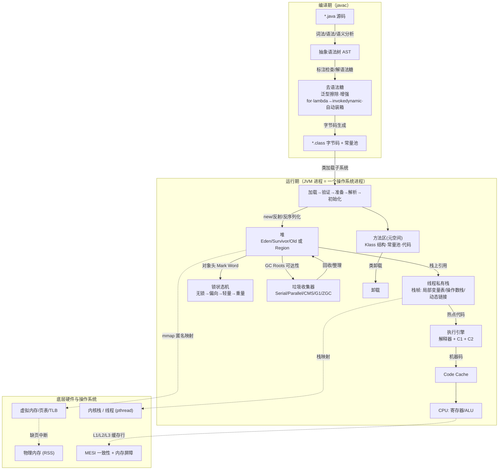

### 0.3 难度图例（后文题库通用）

| 符号 | 含义 | 期望回答深度 |
|---|---|---|
| ★ | 校招一面/送分题 | 定义 + 一句话区别 |
| ★★ | 校招二面/社招一面 | 机制 + 关键参数 + 一个例子 |
| ★★★ | 社招二面/高工面 | 原理链路（字节码→运行时→OS）+ 为什么这么设计 |
| ★★★★ | 资深/专家面 | 源码级细节 + 版本演进 + 边界条件 + 反例 |
| ★★★★★ | 架构/专家终面 | 能自己推导设计取舍，指出该机制的缺陷与替代方案 |

---

## 1. JVM 到底是个什么东西

### 1.1 从「进程」的视角看 JVM

很多人把 JVM 当成「Java 的一个功能」，但在操作系统眼里它非常简单：

**`java` 就是一个普通的用户态可执行程序（HotSpot 是 `libjvm.so` / `jvm.dll`），启动后是一个普通的多线程进程。**

```text
$ ps -o pid,vsz,rss,nlwp,cmd -p <pid>
  PID      VSZ     RSS  NLWP  CMD
 12345  8388608  524288   87  java -Xms4g -Xmx4g -jar app.jar
         ↑        ↑       ↑
     虚拟地址空间  常驻物理内存  线程数
```

由此可以直接推出几条「反常识但正确」的结论：

1. **`-Xmx` 不是「申请」内存，而是「保留（reserve）虚拟地址空间」**。`VSZ` 会立刻涨，`RSS` 不会——除非加了 `-XX:+AlwaysPreTouch` 才会提前把物理页都摸一遍（把缺页成本从运行期搬到启动期）。
2. **OOM 不等于操作系统内存不足**。`OutOfMemoryError: Java heap space` 是 JVM 自己的分配器拒绝分配；此时机器可能还有大量空闲内存。
3. **JVM 里的「线程」就是操作系统的原生线程（1:1 模型）**，直到 JDK 21 的虚拟线程（M:N）出现。所以「创建 1 万个线程 OOM」本质是 `pthread_create` 失败或栈空间耗尽，与堆无关。
4. **GC 的 Stop-The-World 之所以贵，不只是「暂停」，而是「让所有线程到达安全点」**——这涉及内核态调度、线程状态转换，细节见 9.3。

### 1.2 JVM 的五大模块

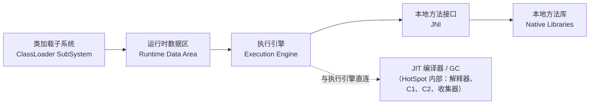

| 模块 | 职责 | 关键实现 |
|---|---|---|
| 类加载子系统 | 把字节流变成方法区里的 `Klass` 结构，并维护双亲委派 | `ClassLoader`（Java 层）+ `ClassFileParser`（C++ 层） |
| 运行时数据区 | 划分内存区域、管理生命周期 | 堆、方法区（元空间）、栈、PC、直接内存 |
| 执行引擎 | 把字节码变成机器指令 | 模板解释器、C1、C2（Graal 可选） |
| 本地方法接口 | Java 调 C/C++ | JNI、`native` 方法、JDK 内部大量 Unsafe/系统调用 |
| GC（含在执行引擎侧） | 自动内存管理 | 分代/分区收集器 + 内存分配器 |

### 1.3 HotSpot 的三种「执行形态」

这一点面试常被追问「JVM 是解释执行还是编译执行」——标准答案是 **混合模式（mixed mode）**：

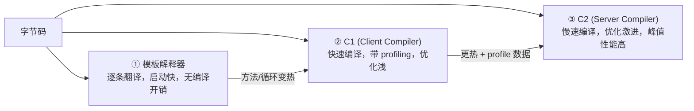

- 默认 `-XX:+TieredCompilation`（分层编译，JDK 8 起服务端默认开启），形成 **0/1/2/3/4 五层** 执行状态。
- 冷代码用解释器，热代码用 C2，是「**启动时间 vs 峰值性能**」的折中——这也是为什么短命进程（如 CLI 工具、Flink 短批）会考虑 AOT/CDS 或 GraalVM Native Image。

---

## 2. 字节码与 Class 文件：一切的起点

> 这一章是「底层」的第一层。不理解字节码，后面所有「为什么 JVM 这样做」都是背结论。

### 2.1 Class 文件结构（一张表吃透）

```text
ClassFile {
    u4             magic;              // 0xCAFEBABE，咖啡宝贝
    u2             minor_version;      // 小版本
    u2             major_version;      // 大版本：52=JDK8, 55=JDK11, 61=JDK17, 65=JDK21
    u2             constant_pool_count;   // = 常量个数 + 1（索引 0 保留）
    cp_info        constant_pool[constant_pool_count-1];
    u2             access_flags;       // ACC_PUBLIC/ACC_FINAL/ACC_INTERFACE/ACC_ENUM...
    u2             this_class;         // 指向 CONSTANT_Class
    u2             super_class;
    u2             interfaces_count;
    u2             interfaces[interfaces_count];
    u2             fields_count;       field_info fields[fields_count];
    u2             methods_count;      method_info methods[methods_count];
    u2             attributes_count;   attribute_info attributes[attributes_count];
}
```

**面试高频细节：**

- 常量池索引从 **1** 开始，0 表示「不引用任何常量」。
- `major_version` 决定兼容性：JDK 8 的 class（52）能被 JDK 21 加载（向上兼容），反过来不行 → `UnsupportedClassVersionError`。
- `access_flags` 里没有「是否 synchronized」这种标志，`synchronized` 是**方法属性**（`ACC_SYNCHRONIZED`）或**字节码指令**（`monitorenter/exit`）。

### 2.2 常量池的 14 种（JDK 8 起）常量

| tag | 类型 | 用途 |
|---|---|---|
| 1 | Utf8 | 字符串字面量、类名、方法名 |
| 3 | Integer | int 字面量 |
| 4 | Float | float 字面量 |
| 5 | Long | long（**占两个槽位**） |
| 6 | Double | double（占两个槽位） |
| 7 | Class | 类/数组的符号引用 |
| 8 | String | `String` 字面量（指向 Utf8） |
| 9 | Fieldref | 字段符号引用 |
| 10 | Methodref | 方法符号引用 |
| 11 | InterfaceMethodref | 接口方法符号引用 |
| 12 | NameAndType | 名称 + 描述符 |
| 15 | MethodHandle | 方法句柄（invokedynamic 支撑） |
| 16 | MethodType | 方法类型 |
| 18 | InvokeDynamic | 动态调用点（Lambda 的实现方式） |

> 为什么要有常量池？——**符号引用（Symbolic Reference）**。类 A 调类 B 的方法，编译期 A 的 class 里只存「`java/lang/String.length`」这样的字符串，运行期再由 JVM 解析成直接引用（指针/偏移）。这是「编译期解耦 + 运行期绑定」的基础，也是**动态链接**的由来。

### 2.3 方法体的字节码：一段真实例子

```java
public int add(int a, int b) {
    int c = a + b;
    return c;
}
```

```text
 0: iload_1          // 把局部变量槽 1 (a) 压栈
 1: iload_2          // 槽 2 (b) 压栈
 2: iadd             // 弹出两个 int，相加，压回
 3: istore_3         // 存入槽 3 (c)
 4: iload_3
 5: ireturn          // 返回 int
```

**关键概念：局部变量表槽位（Slot）**

- `this` 占槽 0（实例方法）；静态方法没有。
- `long`/`double` 占 **两个连续槽**（因为栈/槽按 32 位设计），所以 `iload` 系列有 `lload/dload`。
- 槽位可复用：作用域结束后，后面的变量可以复用同一槽 → 这也是「**局部变量表大小在编译期就确定**」的原因（`Code` 属性里的 `max_locals`）。

### 2.4 五条方法调用指令（必须背熟的能力）

| 指令 | 场景 | 绑定时机 |
|---|---|---|
| `invokestatic` | 静态方法 | 编译期确定（非虚） |
| `invokespecial` | 构造器 `<init>`、私有方法、`super.xxx()` | 编译期确定（非虚） |
| `invokevirtual` | 普通实例方法 | 运行期**虚方法分派**（vtable） |
| `invokeinterface` | 接口方法 | 运行期分派（itable） |
| `invokedynamic` | Lambda、String 拼接（JDK9+）、Kotlin 高阶函数 | 首次调用时 `LinkageResolver` 绑定 |

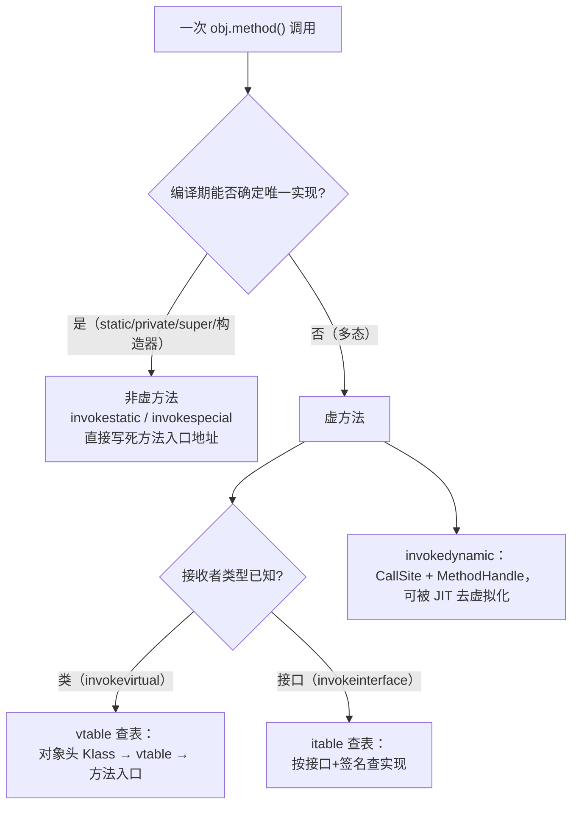

**延伸：为什么 Lambda 用 `invokedynamic` 而不是内部类？**

- 传统匿名内部类：编译期生成 `Xxx$1.class`，每个 Lambda 一个类 → 类数量爆炸、加载/元空间成本高。
- `invokedynamic`：编译期只生成一条 `InvokeDynamic` 常量 + `LambdaMetafactory` 引导方法，运行期由 `LambdaMetafactory` 生成 `CallSite`，其 `MethodHandle` 直接指向目标方法（甚至用 `MethodHandle` 组合而不生成新类）。**JIT 后可内联成零开销的静态调用**，性能优于匿名类（无额外对象分配）。

**延伸：C2 的「去虚拟化（Devirtualization）」**

JIT 观察到某个 `invokevirtual` 在运行中 **只出现过一种接收者类型（单态）**，就把虚调用内联成直接调用；再配合类层次分析（CHA，Class Hierarchy Analysis）判断「该类没有被继承」→ 变成 **guarded inline**（带一次类型检查的直调），若假设被打破（新类加载导致 vtable 变化）就**去优化（Deoptimization）**回退到解释执行。这就是「JVM 越跑越快」的机制之一，也是面试 ★★★★ 的考点（常见问法：*为什么 Java 是静态语言却能有接近甚至超过 C 的性能？*）。

### 2.5 语法糖与去糖化（编译器做了什么）

| 语法糖 | 编译后 |
|---|---|
| 泛型 `<T>` | **擦除**为 `Object` + 必要处插入 `checkcast`；桥接方法 `bridge method` 保证多态正确 |
| 增强 for | 数组 → 下标循环；`Iterable` → `iterator()` + `hasNext/next` |
| 自动装箱 | `Integer.valueOf(...)` / `intValue()` |
| 变长参数 | `new Object[]{...}` |
| try-with-resources | `try/finally` + `close()` + `addSuppressed` |
| 字符串 `+` | JDK9 前：`StringBuilder.append`；JDK9+：`invokedynamic` + `StringConcatFactory` |
| 内部类 | 生成独立 class，持有 `this$0` 外部引用（**内存泄漏经典来源**） |
| 枚举 | 继承 `Enum` 的 final 类 + `values()/valueOf()` 静态方法 + `$VALUES` 数组 |
| 断言 | `if (!assertionsEnabled) throw new AssertionError()` |
| switch on String | 先 `hashCode()` 再 `equals()` + 两次 switch（JDK 21 起可用模式匹配） |

**延伸（★★★★）：泛型擦除的三个后果**

1. `List<String>` 与 `List<Integer>` 运行时是同一个类 → 不能 `new T[]`、不能 `instanceof T`。
2. 反射可以往 `List<String>` 塞 `Integer`（`add` 的擦除签名是 `Object`）。
3. 桥接方法：`class A<T>{ void f(T t) }`，`class B extends A<String>{ void f(String s) }` → 编译器在 B 里额外生成 `void f(Object o){ f((String)o); }`，所以 `B.class.getDeclaredMethods()` 会看到 **两个** `f`。

---


## 3. 类加载机制：从字节流到「活的类」

### 3.1 生命周期全景

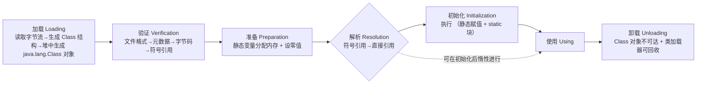

**四个「顺序 + 时机」的坑：**

1. **加载 ≠ 初始化，且顺序是「加载→验证→准备→解析→初始化」，但解析可以在初始化之后进行**（为了支持动态绑定/运行时才出现的类）。
2. **准备阶段赋的是「零值」，不是代码里的值**：`static int x = 5;` 在准备阶段 `x = 0`，在 `<clinit>` 里才变成 5。但 `static final int y = 5;`（编译期常量）会直接写进常量池 → **准备阶段就是 5**。
3. **`<clinit>` 只执行一次，且被 JVM 加锁**（`Class` 对象的初始化锁）。这就是「静态初始化线程安全」的来源，也是**死锁的经典来源**（两个类互相 `static` 引用 → 两个线程各持一把初始化锁）。
4. **接口没有 `<clinit>`**（但有 `static` 字段的接口在 JDK 8 后有 default 方法，初始化时机不同：接口初始化不要求父接口先初始化）。

### 3.2 类初始化的 6 种触发时机（JVM 规范 5.5）

| 触发 | 例子 |
|---|---|
| `new` / 访问静态字段 / 调用静态方法 | `new A()`、`A.count++`、`A.f()` |
| 反射 | `Class.forName("A")`（**会初始化**）vs `ClassLoader.loadClass("A")`（**不会初始化**） |
| 子类初始化时父类先初始化 | `class B extends A`，`new B()` → A 先 `<clinit>` |
| 启动类（含 `main`） | 主类先初始化 |
| `MethodHandle` 解析到静态字段/方法 | 较少见 |
| JVM 启动时的初始化类 | 极少 |

**不触发初始化的经典反例（★★★★ 考点）：**

- `A[] arr = new A[10];` —— 只是数组类型，不初始化 A。
- `A.STATIC_FINAL_CONST` —— 编译期常量，**已内联到调用方常量池**，不初始化 A。
- `A.class` —— 只加载，不初始化。
- `ClassLoader.loadClass("A")` —— 只加载，不初始化。

> 这几个反例的用处：**延迟初始化优化**（懒加载单例）、**类加载器泄漏排查**（为什么 `Class.forName` 会让类"活"起来）。

### 3.3 双亲委派模型：源码级拆解

```java
// java.lang.ClassLoader#loadClass（JDK 8，改动很小）
protected Class<?> loadClass(String name, boolean resolve) throws ClassNotFoundException {
    synchronized (getClassLoadingLock(name)) {      // ① 按类名分段加锁（JDK 6 前的全局锁优化）
        Class<?> c = findLoadedClass(name);          // ② 先查自己的缓存（已加载就直接返回）
        if (c == null) {
            long t0 = System.nanoTime();
            try {
                if (parent != null) {
                    c = parent.loadClass(name, false);   // ③ 递归委派父加载器
                } else {
                    c = findBootstrapClassOrNull(name);  // ④ 到底了，交给 Bootstrap（C++ 实现）
                }
            } catch (ClassNotFoundException e) {
                // 父加载器找不到，静默继续，不抛出
            }
            if (c == null) {
                c = findClass(name);                     // ⑤ 自己找（子类重写这个方法）
            }
        }
        if (resolve) resolveClass(c);                    // ⑥ 链接（可选，通常惰性）
        return c;
    }
}
```

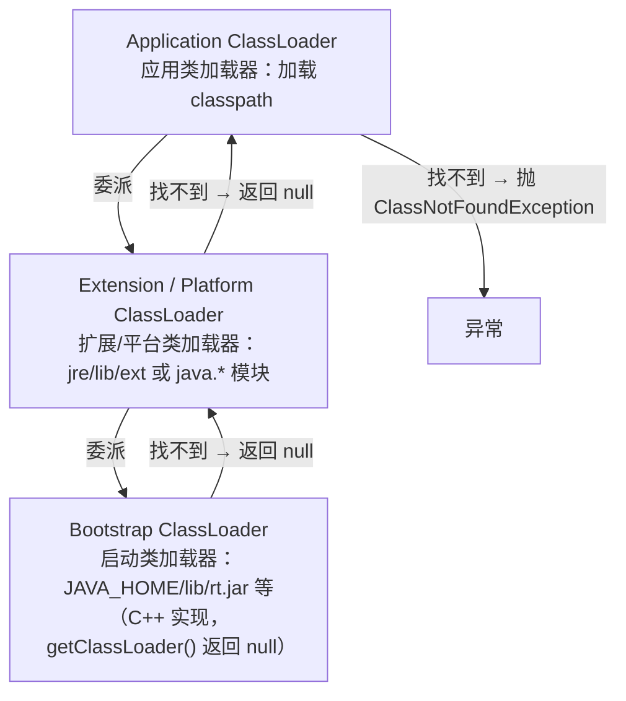

| 加载器 | JDK 8 | JDK 9+ | 典型路径 |
|---|---|---|---|
| Bootstrap | `rt.jar`、`charsets.jar` | **`java.base` 等模块** | `$JAVA_HOME/lib` |
| Extension | `jre/lib/ext/*.jar` | 改为 Platform，加载 `java.se` 等平台模块 | — |
| System/App | `-classpath` | 同 | `CLASSPATH` |
| Custom | 自定义 | 同 | 插件、容器 |

**为什么要双亲委派？**

1. **保证核心类的唯一性与安全性**：你写一个 `java.lang.String`，永远不可能被加载——因为 Bootstrap 先加载了真正的 `String`，你的类被「挡住」。否则可以伪造 `java.lang.String` 从而攻击所有代码。
2. **避免重复加载**：父子链上只保留一份。

### 3.4 打破双亲委派的四种真实场景（★★★★★ 高频）

| 场景 | 谁打破 | 怎么破 | 目的 |
|---|---|---|---|
| **SPI（JDBC/XML/JNDI）** | `Thread.currentThread().getContextClassLoader()` | 核心类（`java.sql.DriverManager` 在 Bootstrap 层）需要加载实现类（mysql 驱动在 App 层）→ 用 **线程上下文类加载器（TCCL）** 反向委派 | 让「父」能加载「子」的类 |
| **Tomcat** | `WebappClassLoader` | 重写 `loadClass`：**先自己找，找不到再委派父**（`delegate=false`），且每个 WebApp 一个加载器 | 应用隔离：两个 war 里的同名类互不干扰；JSP 热替换 |
| **OSGi** | `BundleClassLoader` | 网状委派，按 `Import-Package` 显式声明依赖，可平级加载 | 模块热插拔、版本隔离 |
| **Spring Boot / 热部署** | `LaunchedURLClassLoader` / `RestartClassLoader` | 加载 `BOOT-INF/classes`、嵌套 jar；devtools 用两个加载器实现「只重启应用类」 | 可执行 jar 内嵌依赖、快速重启 |

**Tomcat 类加载器结构（常考）：**

```text
Bootstrap
  └─ System (App)
       └─ Common  （Tomcat 内部 + 所有 WebApp 共享）
            ├─ Catalina (Server)  → Tomcat 自身类
            ├─ Shared   → 所有 WebApp 共享的 lib
            └─ Webapp1 / Webapp2  （每个 Context 一个）
                 └─ JasperLoader（JSP，每次修改生成新加载器 → 旧加载器可被回收）
```

**坑：Tomcat 热部署为什么会 `Metaspace OOM`？**

JSP 重新编译 → 新 `JasperLoader` 加载新类，旧 `JasperLoader` 若仍被引用（`ThreadLocal`、静态缓存、`Class` 对象入 map、JDBC 驱动注册、`Thread` 上下文类加载器），**整个加载器 + 它加载的所有类都无法卸载** → 元空间只增不减。这就是「类加载器泄漏（ClassLoader Leak）」的标准案例，也是 9.6 的排查对象。

### 3.5 类加载器的三个核心方法

| 方法 | 语义 | 重写时机 |
|---|---|---|
| `loadClass(name)` | 完整流程（缓存→委派→findClass） | 想改委派方向时（Tomcat） |
| `findClass(name)` | 只负责「自己怎么找到字节流」 | 想改加载来源时（从网络/DB/加密 jar） |
| `defineClass(byte[], ...)` | 把字节流转成 `Class`（native 方法） | 不重写，调用即可 |

**自定义类加载器的标准写法：**

```java
public class MyLoader extends ClassLoader {
    @Override
    protected Class<?> findClass(String name) throws ClassNotFoundException {
        byte[] bytes = readFromSomewhere(name);         // 解密 / 网络 / DB
        return defineClass(name, bytes, 0, bytes.length); // 交给 JVM
    }
}
```

> 注意：**不同加载器加载同一个 class 文件，得到的是两个不同的类**（`instanceof` 会失败、`ClassCastException`）。这是「类隔离」的原理，也是分布式框架（如 Flink、Dubbo 的 SPI 扩展）的实现基础。

### 3.6 卸载类的条件（面试冷门但常考）

一个类被卸载必须同时满足：

1. 该类的所有实例都已被回收（堆中无对象）；
2. 该类的 `java.lang.Class` 对象没有被任何地方引用（**包括反射、`Class` 常量池引用**）；
3. 加载该类的 `ClassLoader` 已被回收。

> 结论：**由 Bootstrap/App 加载的类几乎永远不会卸载**（加载器永生）。只有自定义加载器（Tomcat、热部署、OSGi、动态代理生成类）才有机会卸载。

---


## 4. 运行时数据区：内存到底分几块

### 4.1 全景图（按 JDK 8+ 画）

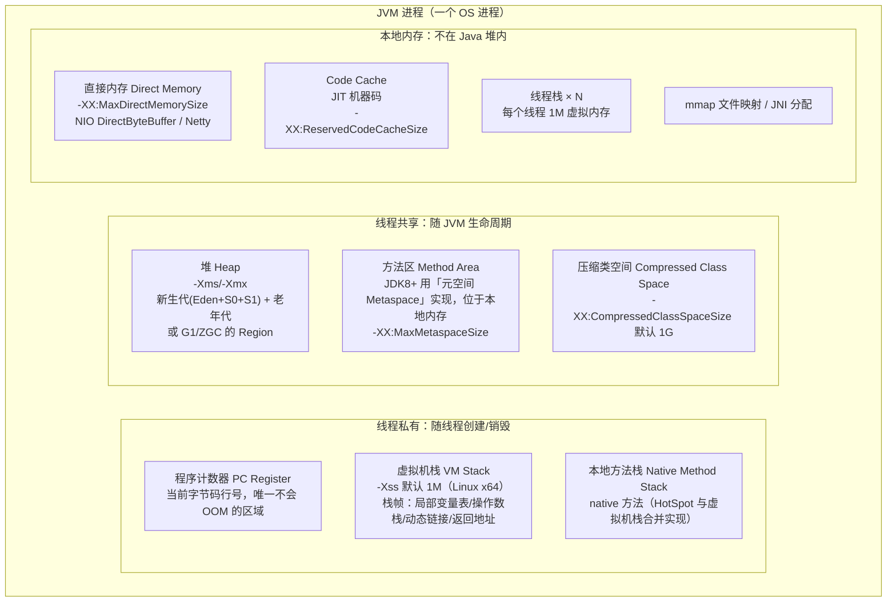

### 4.2 逐块吃透

#### ① 程序计数器（PC）

- 每个线程一份，记录**当前线程正在执行的字节码指令地址**（对 native 方法则为 `undefined`）。
- 为什么需要？——CPU 是抢占式调度的，线程切走后必须知道「回来从哪继续」。JVM 的字节码解释器靠它循环取指。
- **唯一不会抛出 OOM 的区域**（规范规定）。
- JIT 编译后的代码**不通过 PC 定位**（直接是机器指令地址），但为了 GC 能精确定位栈上引用，仍需栈映射（`StackMapTable`）。

#### ② 虚拟机栈与栈帧

```text
栈帧（Frame）结构：
┌───────────────────────────────┐  ← 高地址
│  局部变量表 LocalVariableTable │  槽(Slot)为单位，long/double 占 2 槽
│  （参数 + 方法内局部变量）        │  大小编译期确定 = Code 属性的 max_locals
├───────────────────────────────┤
│  操作数栈 Operand Stack        │  执行字节码的工作区，max_stack 也编译期确定
├───────────────────────────────┤
│  动态链接 Dynamic Linking      │  指向运行时常量池中该方法的符号引用
├───────────────────────────────┤
│  方法返回地址 Return Address    │  调用者的下一条指令地址（或异常表）
├───────────────────────────────┤
│  附加信息（栈映射帧/对齐填充）    │
└───────────────────────────────┘  ← 低地址
```

**四个必考细节：**

1. **栈帧大小在编译期就确定**，但**栈帧数量在线程数 × 调用深度决定**。`-Xss` 越小，可递归深度越小 → `StackOverflowError`。
2. **栈上不会出现「对象」吗？** 严格说：**HotSpot 的实现里，对象本体永远在堆上**。「栈上分配」只是一个**优化结果**：JIT 通过逃逸分析发现对象不逃逸 → **标量替换**，把对象拆成若干基本类型变量，直接放在栈帧/寄存器里，堆上不分配。所以「栈上分配」不是「把对象 memcpy 到栈」，而是「对象根本不存在了」。这个细节 ★★★★。
3. **局部变量表槽复用**会导致一个诡异现象：作用域结束后引用仍在槽中 → 该对象**仍然被 GC Root（栈）引用**，GC 无法回收。这就是「**手动置 null**」在某些老代码/大数组场景下有效的原因（本质是让槽位失效）。JIT 做了「**变量生命周期分析（liveness analysis）**」，编译后通常自动解决，所以现代 JVM 上手动置 null 基本无意义。
4. **`-Xss` 过大 → 线程数受限**：`线程数 ≈ 可用虚拟内存 / 栈大小`。1000 线程 × 1M = 1G 虚拟地址空间（Linux 默认用户态 3G/128T），5000 线程就开始危险。

#### ③ 堆

**分代布局（JDK 8 默认 Parallel/CMS 时代的经典图）：**

```text
┌───────────────────────── Java Heap (-Xmx) ─────────────────────────┐
│  新生代 Young (1/3)                          │ 老年代 Old (2/3)      │
│ ┌──────────┬────────┬────────┐               │                      │
│ │  Eden    │ S0     │ S1     │  ← 8:1:1      │   Tenured            │
│ │ (8/10)   │(1/10)  │(1/10)  │               │                      │
│ └──────────┴────────┴────────┘               │                      │
└────────────────────────────────────────────────────────────────────┘
   -Xmn 指定新生代大小；-XX:SurvivorRatio=8 决定 Eden:S0:S1
```

**G1 的布局（JDK 9 起默认）：**

```text
 堆被划分为 N 个大小相等的 Region（1MB~32MB，2 的幂，约 2048 个）
 ┌──┬──┬──┬──┬──┬──┬──┬──┬──┬──┬──┬──┐
 │E │E │S │O │O │H │H │O │E │Free│O │E │   E=Eden S=Survivor
 └──┴──┴──┴──┴──┴──┴──┴──┴──┴──┴──┴──┘   O=Old H=Humongous（≥Region 一半的大对象）
   每个 Region 内部还可再分 Card（512B），用于记忆集（RSet）
```

**ZGC 的布局（JDK 11+）：** Region 更小（**小 2MB / 中 32MB / 大 N×2MB**），支持**动态创建/销毁**（不像 G1 固定划分），配合染色指针实现并发整理。

**三个高频数字：**

- 默认 `-Xms` = 物理内存的 1/64，`-Xmx` = 1/4（**容器环境下由 `UseContainerSupport` 读取 cgroup limit，JDK 8u191+ 才正确**）。
- **对象优先在 Eden 分配**；大对象（`-XX:PretenureSizeThreshold`，仅 Serial/ParNew 有效）直接进老年代，避免 Eden↔Survivor 复制开销。
- **TLAB**：每个线程在 Eden 里有一块私有缓冲区（默认占 Eden 的 1%，`-XX:TLABSize` 可指定），分配对象时**无锁指针碰撞**，用完再 refill（此时才需要 CAS）。

#### ④ 方法区 / 元空间

| 版本 | 实现 | 位置 | 参数 |
|---|---|---|---|
| ≤ JDK 7 | 永久代 PermGen | **堆内** | `-XX:PermSize/-XX:MaxPermSize` |
| JDK 8+ | 元空间 Metaspace | **本地内存（malloc/mmap）** | `-XX:MetaspaceSize`（首次 GC 阈值）、`-XX:MaxMetaspaceSize`（默认无限） |

**元空间里有什么？**

```text
Metaspace
 ├─ Klass 结构（InstanceKlass / ArrayKlass）：C++ 对象，字段布局、vtable、itable
 ├─ 运行时常量池（每类一份，含字符串/数字/符号引用）
 ├─ 方法字节码（Method*）+ 方法元数据
 ├─ 注解、参数、异常表、内部类列表
 └─ CompressedClassSpace（Klass 指针压缩区，默认 1G）
字符串常量池（JDK 7 起）→ 移到了【堆】里（一个 StringTable，本质是哈希表）
```

**为什么 JDK 8 要干掉永久代？（★★★★ 必考）**

1. **永久代大小难调**：类太多/动态代理/CGLIB/JSP 编译 → `PermGen space OOM`，且 `PermSize` 必须重启才能改，运维痛苦。
2. **与 JRockit 合并**：Oracle 收购 JRockit 后要统一，JRockit 没有永久代。
3. **GC 效率**：永久代的回收条件苛刻（Full GC 才扫），且和堆一起管理导致 Full GC 变慢。
4. **元空间用本地内存**，天然可扩展到物理内存上限，且**类卸载后可归还给 OS**（`-XX:MetaspaceReclaimPolicy`）。

**字符串常量池的位置变迁（常考）：**

| 版本 | 位置 |
|---|---|
| ≤ JDK 6 | 永久代（PermGen） |
| JDK 7 | **移到堆**（因为 PermGen 太小，`String.intern()` 一多就 OOM） |
| JDK 8+ | 堆（Metaspace 时代不变） |

```java
String s = new String("abc");   // 堆中 1 个 String 对象 + 常量池 "abc"（若不存在则创建）
s.intern();                     // 把堆中对象的引用放进常量池（JDK7+ 不再复制字符串）
```

> 经典题：`String s = new String("a") + new String("b"); s.intern() == s ?` —— JDK 7+ 是 **true**（intern 只记录引用），JDK 6 是 **false**（复制到 PermGen）。这个题几乎是「JVM + 字符串」的固定考点。

#### ⑤ 直接内存

- 不受 `-Xmx` 限制，受 `-XX:MaxDirectMemorySize`（默认 = `-Xmx`）和物理内存限制。
- `ByteBuffer.allocateDirect()` → `Unsafe.allocateMemory` → `malloc`/`mmap` → 返回堆外地址，Java 侧只持有一个 `long address` 与 `Cleaner`（虚引用）用于释放。
- **为什么快？** 少一次「堆内 → 堆外」的拷贝（`FileChannel.read` 到 DirectBuffer 是 DMA 直接写内核页缓存），且不参与 GC 移动；**代价**是分配/释放昂贵（系统调用 + 缺页），且泄漏不会体现在堆 dump 里。

**典型事故：** Netty `DirectByteBuffer` 泄漏 → 堆内存正常，进程 RSS 持续上涨 → 最终 `OutOfMemoryError: Direct buffer memory` 或直接被 OS OOM Killer 杀掉。排查手段：`-XX:MaxDirectMemorySize` 限流、`PlatformDependent` 的泄漏检测（`-Dio.netty.leakDetectionLevel=paranoid`）、`jcmd <pid> VM.native_memory`（NMT）。

### 4.3 一张「报什么错」的对照表（面试常问）

| 区域 | 溢出错误 | 触发 |
|---|---|---|
| 堆 | `OutOfMemoryError: Java heap space` | 对象太多/太大/泄漏 |
| 堆（GC 效率） | `OutOfMemoryError: GC overhead limit exceeded` | 98% 时间在 GC 却只回收 <2%（JDK 11 起默认关闭该检查？实际由 `-XX:-UseGCOverheadLimit` 控制） |
| 元空间 | `OutOfMemoryError: Metaspace` | 动态生成类太多（CGLIB/反射/热部署） |
| 压缩类空间 | `OutOfMemoryError: Compressed class space` | `CompressedClassSpaceSize` 太小 |
| 直接内存 | `OutOfMemoryError: Direct buffer memory` | `MaxDirectMemorySize` 打满 |
| 栈 | `StackOverflowError` | 递归太深 / 栈帧太大 |
| 线程 | `OutOfMemoryError: unable to create native thread` | 线程数超限 / 栈空间耗尽 / `ulimit -u` |
| 本地内存 | `OutOfMemoryError: Map failed` / `out of swap space` | mmap 失败 / 物理内存+swap 耗尽 |

---


## 5. 对象的生命周期（一）：创建、布局、访问

### 5.1 一次 `new` 的完整链路

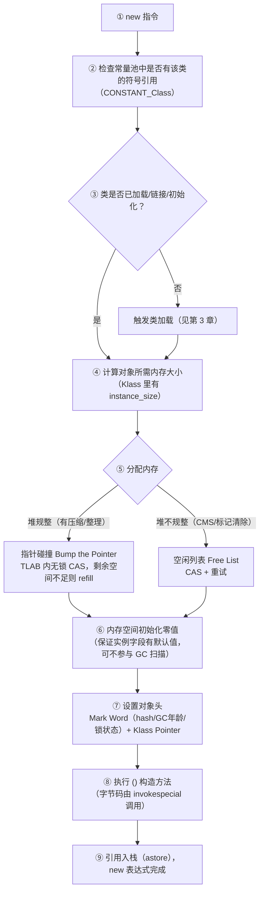

**关键点：为什么「先零值再构造」？**

- JVM 规范要求：对象分配后，除对象头外**所有实例字段必须先置为「类型零值」**。
- 原因：`<init>` 里的代码可能访问未赋值的字段（`this.b`），若没有零值保障，会读到内存垃圾 → 不可预测行为/安全漏洞。
- 副作用：分配大对象时的置零开销（`memclr`）本身就贵 → 这是 ZGC/G1 关注 `memset` 性能的原因之一；而 TLAB 内可以「**批量置零**」甚至依赖 OS 的**首次缺页清零**（`MAP_ANONYMOUS` 分配的页天然是零）。

### 5.2 对象的内存布局

```text
64 位 JVM（开启压缩指针）下，一个普通对象：
┌────────────────────────────────────────────────────────────┐
│ 对象头 Object Header (12B)                                 │
│  ├── Mark Word (8B)                                        │
│  │     unused:25 | identity_hash:31 | unused:1 | age:4 | biased:1 | lock:2
│  └── Klass Pointer (4B，压缩后指向方法区的 InstanceKlass)     │
├────────────────────────────────────────────────────────────┤
│ 实例数据 Instance Data                                      │
│  （父类字段在前，同宽度字段连续放置，long/double 优先对齐）      │
├────────────────────────────────────────────────────────────┤
│ 对齐填充 Padding（使对象大小是 8 字节的整数倍）                │
└────────────────────────────────────────────────────────────┘
数组对象额外多 4B：length 字段（所以数组头 = 16B）
```

**Mark Word 状态机（64 位，HotSpot）：**

| 状态 | 64 bit 内容（从高到低） | lock 2bit |
|---|---|---|
| 无锁 | unused 25 + hash 31 + unused 1 + age 4 + biased 1(0) + 01 | `01` |
| 偏向锁 | thread 54 + epoch 2 + unused 1 + age 4 + biased 1(1) + 01 | `01` |
| 轻量级锁 | 指向栈中 Lock Record 的指针 62 + 00 | `00` |
| 重量级锁 | 指向 ObjectMonitor 的指针 62 + 10 | `10` |
| GC 标记 | 空（标记用） + 11 | `11` |

**指针压缩（Compressed Oops）★★★★**

- 64 位指针让对象变大、缓存命中率下降。JVM 用「**地址右移 3 位**」的技巧：对象地址都是 8 字节对齐（低 3 位恒为 0），所以 32 位能表示 `2^32 × 8 = 32GB`。
- 触发条件：`-XX:+UseCompressedOops`（**堆 < 32G 时默认开启**），`-XX:+UseCompressedClassPointers`（Klass 指针压缩，默认开启，受 `CompressedClassSpaceSize` 限制）。
- **面试口径**：堆一旦 > 32G，压缩指针失效 → 指针变 8 字节 → 对象变大 → 「32G 以上堆内存的利用率反而下降」。这解释了「为什么阿里规范建议单 JVM 堆 ≤ 32G 或直接跳到 48G+」（48G 时虽无压缩指针，但对象数量少、GC 效率仍有收益，需实测）。

### 5.3 对象访问定位：句柄 vs 直接指针

```text
句柄访问：                                 直接指针（HotSpot 采用）：
栈上 reference ──→ 句柄池 ──┬─→ 对象实例      栈上 reference ─────────────→ 对象实例
                            └─→ 类型数据(方法区)                              ├─ Klass Pointer → 方法区
                                                                             └─ 实例数据
```

| 方式 | 优点 | 缺点 |
|---|---|---|
| 句柄 | 对象移动（GC 整理）时只改句柄，reference 稳定 | 两次间接寻址，慢 |
| 直接指针 | 一次寻址，快（HotSpot 选择） | 对象移动需更新所有 reference（靠 GC 的 **relocation + 栈映射** 完成） |

> 追问：既然用直接指针，GC 移动对象后怎么更新栈上的引用？——**GC 通过 `OopMap`（在 safepoint 处记录了栈/寄存器中哪些位置是引用）精确找到所有引用并修正**。这也是「为什么必须到 safepoint 才能 GC」的深层原因（见 9.3）。

### 5.4 逃逸分析三兄弟（★★★★★）

```java
public void test() {
    Point p = new Point(1, 2);     // ① 不逃逸（不出方法）
    p.x = 3;
    System.out.println(p.x);       // ② 只读/写，未被外部持有
}
```

JIT（C2）在编译期做**逃逸分析（Escape Analysis）**，得到三种结论并触发三种优化：

| 结论 | 优化 | 效果 |
|---|---|---|
| 不逃逸（NoEscape） | **标量替换（Scalar Replacement）** | 对象拆成 `int x, int y` 放栈/寄存器，**堆上不分配**，零 GC 压力 |
| 不逃逸 | **栈上分配（本质就是标量替换的一部分）** | 同上；HotSpot 没有独立「栈上分配」实现 |
| 方法内未逃逸 | **锁消除（Lock Elision）** | `synchronized(new Object())` 直接去掉 monitorenter |
| 全局逃逸 | 无优化 | 正常堆分配 |

**参数与开关：**

```bash
-XX:+DoEscapeAnalysis        # 默认开启（JDK 6u23+）
-XX:+EliminateAllocations    # 标量替换，默认开
-XX:+EliminateLocks          # 锁消除，默认开
-XX:-DoEscapeAnalysis        # 关闭后可用 jmap 观察到对象数量暴增
```

**为什么「栈上分配」常有争议？** 因为 HotSpot 的实现不是真的把对象放到栈帧里，而是**通过标量替换让对象消失**。可以自己验证：`-XX:-DoEscapeAnalysis` 后 `jmap -histo` 里 `Point` 实例数量明显增加 → 说明默认确实"分配"在栈（逻辑上）。

**局限（面试加分）：**

- 只有 **JIT 编译后的代码**才有逃逸分析；解释执行阶段仍分配在堆。
- 逃逸分析是**方法级**的，跨方法的对象流分析能力有限（尤其虚调用）。
- 大对象/数组几乎不可能被标量替换（元素数量不定）。

### 5.5 内存分配的三个层次的「加速手段」

| 手段 | 解决的问题 | 实现 |
|---|---|---|
| **TLAB** | 多线程分配竞争 Eden | 每线程一块 Eden 私有区，`top/end` 指针碰撞；`-XX:TLABSize`、`-XX:+TLABStats`、`-XX:TLABWasteTargetPercent=1` |
| **PLAB** | GC 时把对象复制到 Survivor 的竞争 | Promotion Local Allocation Buffer，GC 线程私有 |
| **批量置零 + 缺页清零** | 零值初始化开销 | `MAP_ANONYMOUS` 首次访问由内核给零页（COW 零页），`-XX:+AlwaysPreTouch` 提前触发 |

**TLAB 的三个细节（常被追问）：**

1. TLAB 只是 Eden 里的一段，**对象仍属于 Eden**，GC 时一起回收。
2. 分配失败（TLAB 剩余不足）→ **先在 TLAB 外分配（可能需要 CAS）**，再 **refill 新 TLAB**；refill 有自适应策略（`TLABWasteTargetPercent` 控制允许的浪费）。
3. 对象太大（超过 `TLABRefillWasteFraction` 或大于 TLAB 一半）→ 直接走**共享 Eden 的慢路径**。

---

## 6. 对象的生命周期（二）：锁与对象头

> 锁是「对象头」最重要的用途，也是 JVM 与 CPU 指令结合最紧的地方，面试出现率极高。

### 6.1 synchronized 的字节码形态

```java
public void sync() {
    synchronized (this) { count++; }
}
```

```text
 0: aload_0
 1: dup
 2: astore_1
 3: monitorenter        // 进入：尝试获取 monitor
 4: aload_0
 5: dup
 6: getfield count
 ...
 9: monitorexit          // 正常退出
10: goto 18
13: astore_2             // 异常路径
14: aload_1
15: monitorexit          // 异常退出（编译器自动插入）
16: aload_2
17: athrow
```

- **同步方法**用 `ACC_SYNCHRONIZED` 标志，由 JVM 隐式 `monitorenter/exit`。
- **`monitorexit` 出现两次**：正常路径 + 异常路径（`finally` 语义由编译器保证）。

### 6.2 锁升级的完整状态机

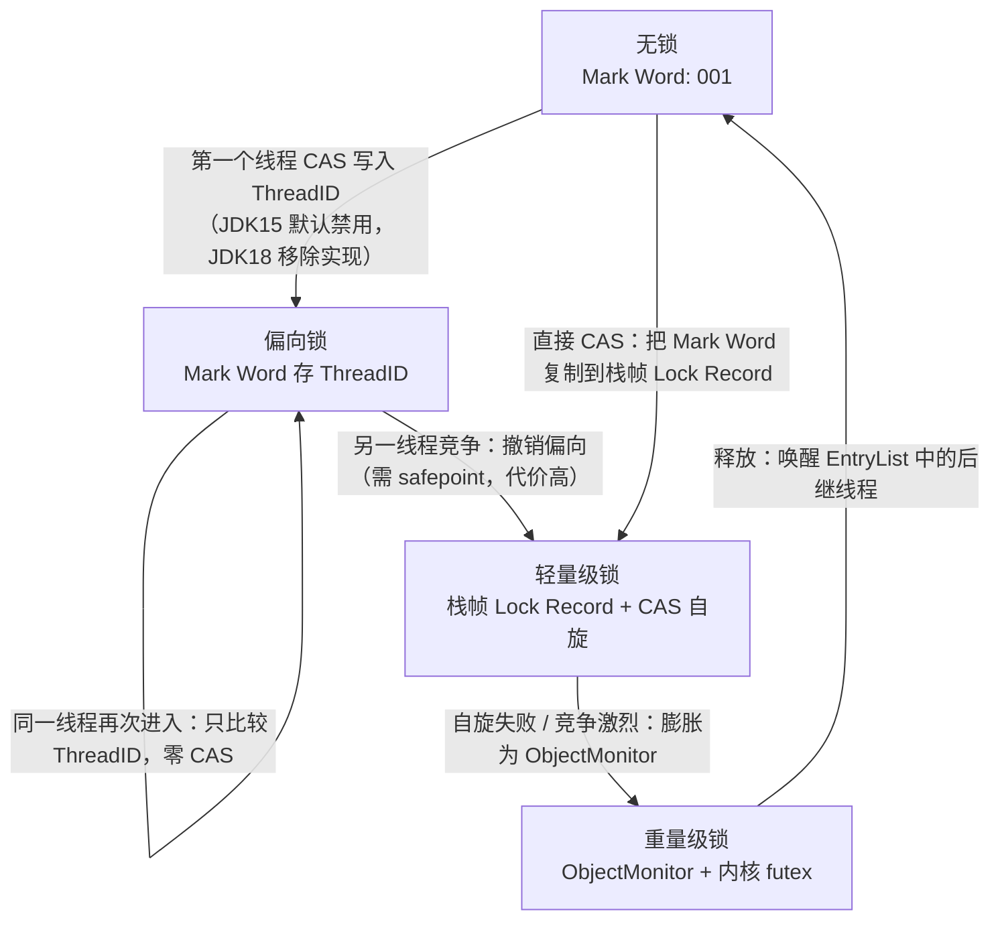

| 锁状态 | 实现 | 开销 | 适用 |
|---|---|---|---|
| 偏向锁 | Mark Word 存 ThreadID，**同一线程重入零开销** | 撤销需 STW（safepoint） | 单线程反复进入同步块（早期认为常见） |
| 轻量级锁 | 栈帧 Lock Record + CAS 自旋 | 无系统调用，但自旋耗 CPU | 交替执行、临界区极短 |
| 重量级锁 | `ObjectMonitor`（C++ 对象）+ 内核 futex/条件变量 | 线程阻塞/唤醒 → 用户态↔内核态切换 | 竞争激烈、临界区长 |

**为什么 JDK 15 废弃偏向锁（JEP 374）？★★★★**

1. **收益下降**：现代应用大量使用 `java.util.concurrent`（无锁/CAS），真正长期单线程持有同一把锁的场景变少。
2. **成本上升**：偏向锁的**撤销需要 safepoint**（`VM_RevokeBias`），高并发下批量撤销会造成明显停顿；且 Mark Word 的偏向位让 hash 计算、GC 分代年龄字段布局变复杂。
3. **维护负担**：偏向锁代码与「锁粗化/锁消除」等优化互相牵制。

> 面试答法：「偏向锁是为『单线程重复进入』优化的，但它的**撤销成本是全局停顿**，而这与低延迟目标冲突；JDK 15 默认关闭、JDK 18 后实现被移除，现在讨论锁升级基本只讲 无锁→轻量级→重量级。」

### 6.3 ObjectMonitor 的内部结构（HotSpot 源码级）

```text
ObjectMonitor (C++)
 ├── _header       : 原始 Mark Word（Displaced Header）
 ├── _owner        : 当前持有线程
 ├── _recursions   : 重入次数（可重入锁的实现）
 ├── _count        : 重入计数
 ├── _cxq          : 竞争队列（Contention Queue），新来的线程 CAS 入队（LIFO）
 ├── _EntryList    : 候选队列（从 cxq 转移过来，等待竞争 owner）
 ├── _WaitSet      : 调用 wait() 的线程（双向循环链表）
 └── _succ/_responsibl   : 后继者（减少惊群）
```

**获取锁的流程（简化）：**

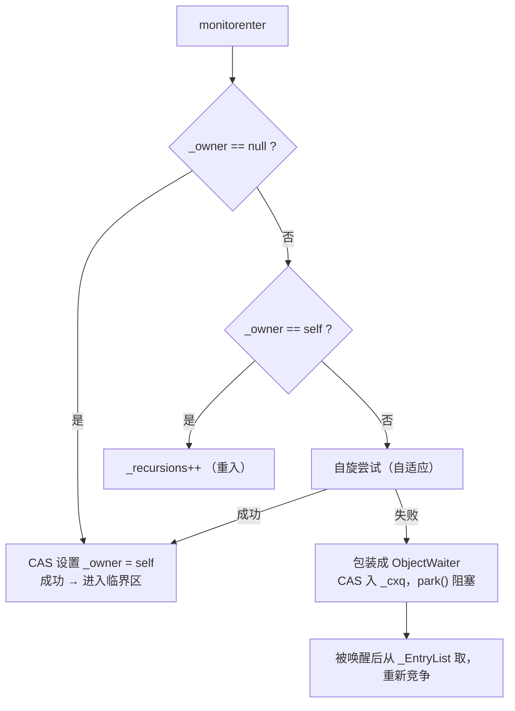

**`wait/notify` 的语义**：`wait()` 把线程放入 `_WaitSet` 并**完全释放锁**（`_recursions` 归零）；`notify()` 把 `_WaitSet` 中一个线程移到 `_EntryList`，**不释放锁**（要等 `monitorexit`）。这也是「`wait` 必须在 `synchronized` 里」的原因——没有 monitor 就没有 WaitSet。

### 6.4 锁优化四件套

| 优化 | 说明 | 触发 |
|---|---|---|
| **锁消除** | 逃逸分析发现锁对象不逃逸 → 删除同步 | JIT |
| **锁粗化** | 相邻的多次 `synchronized` 合并成一次 | JIT（循环内加锁典型） |
| **自适应自旋** | 根据上次成功与否动态调整自旋次数 | HotSpot |
| **轻量级锁** | CAS + 栈上 Lock Record，避免系统调用 | 无竞争/低竞争 |

```java
// 锁粗化例子
for (int i = 0; i < 100; i++) {
    synchronized (lock) { sum += i; }   // JIT 可能粗化为整个循环加一次锁
}
```

### 6.5 JOL 实测对象头（面试可现场演示的加分项）

```java
// 依赖：org.openjdk.jol:jol-core
System.out.println(ClassLayout.parseInstance(new Object()).toPrintable());
```

输出（64 位、压缩指针开启、JDK 17）：

```text
java.lang.Object object internals:
OFF  SZ   TYPE DESCRIPTION               VALUE
  0   8        (object header: mark)     0x0000000000000001 (non-biasable; age: 0)
  8   4        (object header: class)    0x00000e80
 12   4        (object alignment gap)
Instance size: 16 bytes        ← 空对象 16B（8 mark + 4 klass + 4 padding）
```

| 对象 | 大小 |
|---|---|
| `new Object()` | 16 B |
| `new int[0]` | 16 B（8+4+4 length + 对齐） |
| `Integer` | 16 B |
| `String`（JDK 8：4 个字段） | 24 B |
| `HashMap$Node` | 32 B |

---


## 7. 垃圾回收（GC）：从「找垃圾」到「搬垃圾」

> 这是 JVM 面试的绝对主战场（占比常达 40%）。建议按「**判定 → 算法 → 策略 → 收集器 → 调优**」五层理解。

### 7.1 判定：什么算垃圾

#### ① 引用计数 vs 可达性分析

| 方案 | 原理 | 缺点 |
|---|---|---|
| 引用计数 | 每个对象维护计数器，为 0 即垃圾 | **无法解决循环引用**；计数更新有开销（每次赋值） |
| **可达性分析** | 从 **GC Roots** 出发遍历引用图，不可达即垃圾 | 需要 STW 快照（否则并发修改导致漏标） |

**JVM 用可达性分析。**（Python/Swift 部分用引用计数 + 循环检测）

#### ② 哪些是 GC Roots（背熟）

| Root | 说明 |
|---|---|
| 虚拟机栈中局部变量表里的引用 | 正在被调用的方法参数/局部变量 |
| 方法区中**类静态属性**引用的对象 | `static Object o` |
| 方法区中**常量**引用的对象 | `static final`、字符串常量池 |
| 本地方法栈 JNI 的引用 | `JNI Global/Local Reference` |
| JVM 内部引用 | 基本类型包装类缓存、`Class` 对象、异常对象、系统类加载器 |
| 同步锁 `synchronized` 持有的对象 | monitor 相关 |
| JMXBean、JVMTI 回调、本地代码缓存 | 少见但存在 |

**易错点：**「`Class` 对象也是 GC Root？」——不准确。类的 `Class` 对象若由 Bootstrap 加载则几乎永生；自定义加载器加载的类，`Class` 对象只是**普通对象**，可被回收（这就是类卸载的条件之一）。

#### ③ 引用强度四档（面试常考）

| 类型 | 类 | 回收时机 | 典型用途 |
|---|---|---|---|
| 强引用 | `new` | 永不被回收（可达时） | 普通对象 |
| 软引用 | `SoftReference` | **内存不足时**回收 | 缓存（本地图片缓存） |
| 弱引用 | `WeakReference` | **下次 GC 必回收** | `ThreadLocalMap` 的 key、`WeakHashMap` |
| 虚引用 | `PhantomReference` | 回收前收到通知（配合 `ReferenceQueue`） | 直接内存释放（`Cleaner`）、NIO |

```java
// ThreadLocal 内存泄漏的根因（★★★★）
// ThreadLocalMap 的 Entry: key = WeakReference<ThreadLocal>, value = 强引用
// 线程池中线程长期存活 → map 一直在 → key 被回收后 value 仍在 → value 泄漏
// 所以必须 remove()，而不是依赖 GC
```

### 7.2 三种基础算法

| 算法 | 过程 | 优点 | 缺点 | 用于 |
|---|---|---|---|---|
| **标记-清除** Mark-Sweep | 标记存活 → 清除未标记 | 实现简单，不移动对象 | **碎片化**；标记/清除效率随对象数线性下降 | CMS（并发清除） |
| **标记-复制** Copying | 存活对象复制到另一半 | **无碎片**，分配用指针碰撞，快 | **浪费 50% 空间**；存活率高时复制成本大 | 新生代（Eden→Survivor，8:1:1 只浪费 10%） |
| **标记-整理** Mark-Compact | 标记 → 存活对象向一端滑动 → 清理边界外 | 无碎片，不浪费空间 | **移动对象成本高**（需更新所有引用），停顿长 | 老年代（Serial Old / Parallel Old） |

**为什么新生代用复制、老年代用整理？**

- 新生代对象 **98% 朝生夕灭**（弱分代假说）→ 存活对象极少 → 复制成本低 → 复制算法最优；用 8:1:1 把浪费压到 10%。
- 老年代对象 **存活率高** → 复制成本巨大 → 用标记-整理/标记-清除。

### 7.3 分代收集理论（三个假说）

| 假说 | 内容 | 支撑的设计 |
|---|---|---|
| **弱分代假说** | 绝大多数对象朝生夕灭 | 新生代频繁小回收（Minor GC） |
| **强分代假说** | 熬过越多次 GC 的对象越难死 | 老年代低频回收，年龄阈值 `MaxTenuringThreshold=15` |
| **跨代引用假说** | 跨代引用只占极少数 | **记忆集（Remembered Set）** 避免全堆扫描 |

**对象晋升老年代的四个条件：**

1. **年龄达到阈值**：`-XX:MaxTenuringThreshold=15`（默认 15，Parallel 下常自适应为 15；CMS 默认 6，G1 默认 15）。
2. **动态年龄判定**：Survivor 中 **年龄 1..N 的对象大小总和 > Survivor 空间一半** → 年龄 ≥N 的直接晋升（不必等 15）。
3. **大对象直接进老年代**：`-XX:PretenureSizeThreshold`（仅 Serial/ParNew 有效，G1 用 Humongous Region）。
4. **Survivor 放不下 / 空间分配担保失败**：Minor GC 前检查老年代最大连续空间，不足则改为 Full GC。

**Survivor 的两个细节：**

- **S0/S1 交替**：每次 Minor GC 把 Eden + 一个 Survivor 的存活对象复制到另一个 Survivor，然后清空前者。所以「From/To」是相对的（`jstat` 里显示 `S0C/S1C`）。
- **对象年龄存在对象头**（Mark Word 的 4 bit，**最大 15**），所以 `MaxTenuringThreshold` 不能超过 15。

### 7.4 并发标记的三个难题（★★★★★ 核心）

#### 问题一：为什么并发标记会「漏标」

三色标记法：

| 颜色 | 含义 |
|---|---|
| 白 | 尚未访问（最终仍白 → 垃圾） |
| 灰 | 自身已访问，但**引用的对象还没访问完**（在待处理队列） |
| 黑 | 自身与所有引用都已访问完（不会再扫） |


**漏标的两个必要条件（同时满足才会漏）：**

1. **赋值器插入了一条从黑对象到白对象的引用**（`black.field = white`）；
2. **赋值器删除了所有从灰对象到该白对象的引用**（`gray.field = null`）。

此时白对象对 GC 不可见 → **被错误回收**（这是致命的正确性问题，不是性能问题）。

```text
时间线：
T1: GC 扫描完 A（A 变黑），此时 A.field = null
T2: 用户线程执行 A.field = C  ← ① 黑→白引用，但 A 不会再被扫描
T3: 用户线程执行 B.field = null ← ② 灰→白引用消失，C 再也无法通过 B 被扫到
T4: GC 继续扫完，C 仍为白 → 被回收。但 C 实际仍在被 A 引用！崩溃。
```

**两种修复方案：**

| 方案 | 做法 | 代价 | 使用者 |
|---|---|---|---|
| **增量更新 Incremental Update** | 记录「①」这个新增引用（把黑对象重新变灰，重新扫描它的引用） | 需要重新扫描黑对象，**浮动垃圾少** | **CMS** |
| **原始快照 SATB（Snapshot-At-The-Beginning）** | 记录「②」被删除的旧引用（按**标记开始时的快照**继续标记），认为该白对象「在快照时刻是活的」 | 产生**浮动垃圾**（快照后死掉的对象本轮不回收） | **G1 / Shenandoah** |

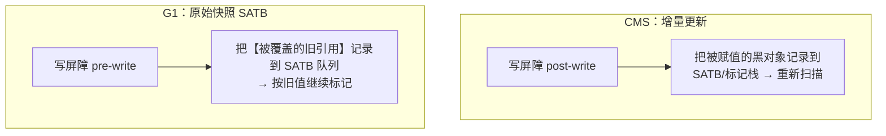

#### 问题二：写屏障（Write Barrier）

**写屏障不是「内存屏障」！** 面试常被混淆：

| 名称 | 作用 | 实现 |
|---|---|---|
| **内存屏障（Memory Barrier/Fence）** | 约束 **CPU/编译器** 的重排序，保证可见性 | `lock addl $0,0(%rsp)`、`mfence`、`LoadLoad` 等 |
| **写屏障（Write Barrier）** | JVM 在**引用赋值前后**插入的一小段代码（AOP 味道），用于维护记忆集/SATB | JIT 在 `putfield/astore` 前后插入 |

- **pre-write barrier**（赋值前执行）：G1 用它做 SATB（记录旧值）。
- **post-write barrier**（赋值后执行）：CMS/G1 用它做**卡片标记**（Card Marking），维护 RSet。

#### 问题三：记忆集与卡表（如何避免全堆扫描）

```text
问题：Minor GC 只扫新生代，但老年代可能有引用指向新生代
     → 若扫全堆，Minor GC 就失去了「快」的意义

方案：Remembered Set（记忆集），记录「非收集区域 → 收集区域」的跨代引用指针
     G1 每个 Region 一个 RSet（哈希表，粒度是 Card）
     传统分代用一个全局卡表 Card Table：堆按 512 字节切 Card，Card 数组每项 1 字节（0=干净，1=脏）
```

```text
堆：  [ Card 0 ][ Card 1 ][ Card 2 ] ...
卡表：  0          1          0        ← 1 表示该 Card 内有跨代引用
写屏障：当 obj.field = youngObj 且 obj 在 old 时 → 把 obj 所在 Card 标脏
```

**RSet 的成本（面试加分）：** G1 的 RSet 通常占用堆的 **< 5%**（最坏 20%），且维护成本体现为「**写屏障开销 + 脏卡扫描**」；这就是为什么 G1 在「高写入速率」场景下可能不如 Parallel（**写屏障饱和**，`jstat` 可见 GC 时间上升但吞吐下降）。

### 7.5 收集器全景

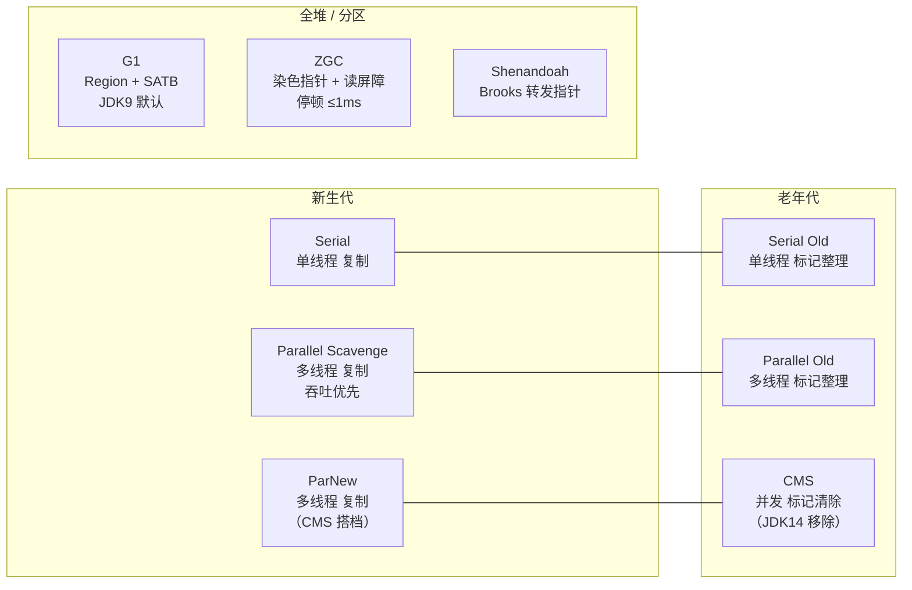

#### ① Serial / Serial Old

- 单线程，**STW**；`-XX:+UseSerialGC`。
- 优点：无多线程交互开销，**在单核/小堆（< 几百 MB）下反而最快**；适合客户端、容器内小规格 Pod、启动阶段。
- Serial Old 在 CMS 发生 `Concurrent Mode Failure` 时作为**兜底**（这也是 CMS 最痛的停顿来源）。

#### ② ParNew

- Serial 的多线程版，新生代复制，**与 CMS 配合**（`-XX:+UseParNewGC`，JDK 9 起废弃）。
- 并行线程数：`-XX:ParallelGCThreads`（默认 `min(CPU, 8)` 若 CPU ≤ 8；> 8 时为 `CPU * 5/8`）。

#### ③ Parallel Scavenge / Parallel Old（吞吐优先）

- 目标：**可控吞吐量 = 用户代码时间 /(用户代码 + GC 时间)**，而不是最短停顿。
- 关键参数：`-XX:MaxGCPauseMillis`（停顿上限，**越小吞吐越低**）、`-XX:GCTimeRatio=99`（GC 时间占比 1/100，即 1%）、`-XX:+UseAdaptiveSizePolicy`（**自适应调节 Eden/Survivor/晋升阈值**，这是它最"聪明"的地方）。
- 适用：**批处理、离线计算、大数据（Spark/MapReduce 的 executor）** —— 停顿可以容忍，吞吐最重要。

#### ④ CMS（Concurrent Mark Sweep）—— 里程碑，但已退役

**四个阶段：**

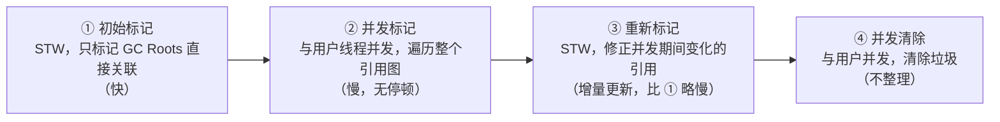

**CMS 的四大缺陷（★★★★）：**

1. **CPU 敏感**：并发阶段占用线程（默认 `(CPU+3)/4`），核少时应用变慢。
2. **浮动垃圾（Floating Garbage）**：并发清除期间又产生的垃圾只能等下次；因此 CMS 不能等老年代满了才 GC → `-XX:CMSInitiatingOccupancyFraction=68`（默认约 68% 触发）。
3. **`Concurrent Mode Failure`**：若并发 GC 期间老年代被填满（分配速度 > 回收速度）→ **退化为 Serial Old 单线程 Full GC**，停顿可能是秒级。缓解：调低触发阈值、`-XX:+CMSScavengeBeforeRemark`（重新标记前先做一次 Minor GC，减少要扫的对象）。
4. **碎片化**：标记-清除不整理 → 大对象分配失败 → Full GC。缓解：`-XX:+UseCMSCompactAtFullCollection`、`-XX:CMSFullGCsBeforeCompaction=0`（每次 Full GC 都整理）。

**其他参数：** `-XX:+UseConcMarkSweepGC`、`-XX:ParallelCMSThreads`、`-XX:+ExplicitGCInvokesConcurrent`（让 `System.gc()` 走并发 GC）、`-XX:+CMSClassUnloadingEnabled`。

**为什么 JDK 14 移除 CMS（JEP 363）？** 维护成本高（与 G1 的代码路径纠缠）、碎片问题无解、G1/ZGC 已能覆盖其场景。

#### ⑤ G1（Garbage-First）—— JDK 9 起的默认

**核心思想：把堆切成固定大小的 Region，每次只挑「垃圾最多」的若干 Region 回收（Garbage First），用「可预测停顿模型」控制 STW 时长。**

```text
关键数据结构：
 ├─ Region（1~32MB，2 的幂，约 2048 个）
 │    ├─ Eden Region / Survivor Region / Old Region
 │    └─ Humongous Region（≥ Region 一半的大对象；跨 Region 的连续 Humongous 区）
 ├─ RSet（每个 Region 一个，记录「谁引用了我」，point-in）
 ├─ CSet（Collection Set，本次要回收的 Region 集合）
 └─ TAMS（Top At Mark Start）：并发标记期间新分配对象在 TAMS 之上，本轮视为隐式存活
```

**G1 的 Young GC（STW，完全暂停）：**

`Eden + Survivor` 满 → 选中所有 Young Region 作为 CSet → 并行复制到新的 Survivor → 年龄+1 → 老的晋升到 Old Region。

**G1 的 Mixed GC（回收 Young + 部分 Old）：**

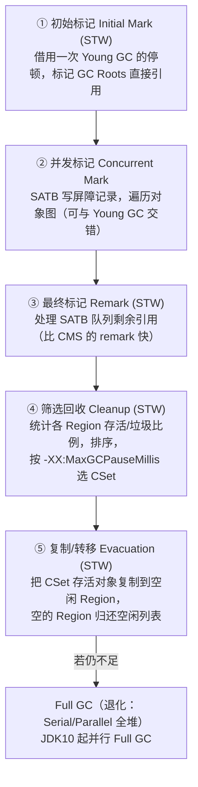

**G1 的关键参数：**

| 参数 | 默认 | 说明 |
|---|---|---|
| `-XX:+UseG1GC` | JDK9+ 默认 | 启用 |
| `-XX:MaxGCPauseMillis` | **200ms** | 目标停顿（软目标，不保证） |
| `-XX:G1HeapRegionSize` | 堆的 1/2048，1~32MB | Region 大小 |
| `-XX:InitiatingHeapOccupancyPercent` (IHOP) | **45%** | 老年代占比达此值启动并发标记周期 |
| `-XX:G1MixedGCLiveThresholdPercent` | 85% | Region 存活率高于此不纳入 Mixed CSet |
| `-XX:G1MixedGCCountTarget` | 8 | 一个标记周期内分几次 Mixed GC |
| `-XX:G1NewSizePercent / G1MaxNewSizePercent` | 5% / 60% | 新生代弹性范围 |
| `-XX:G1HeapWastePercent` | 5% | 可容忍的垃圾占比，低于则不继续 Mixed |
| `-XX:+G1UseAdaptiveIHOP` | JDK10+ 默认开 | 自适应调整 IHOP |

**G1 的三大痛点（★★★★★）：**

1. **Full GC 退化**：大对象（Humongous）分配失败、RSet 维护跟不上、晋升速度过快 → 触发 Full GC（单线程或并行全堆整理），停顿可能到秒级。**"G1 调优的核心是把 Full GC 消灭掉"**。
2. **写屏障 + RSet 内存开销**：写屏障饱和会直接吃掉吞吐；RSet 占内存。
3. **跨 Region 引用导致复制成本**：对象在 Region 间移动要更新所有指向它的 RSet（`jstat -gc` 里的 `GCT` 时间）。

#### ⑥ ZGC（JDK 11 实验 → JDK 15 转正 → JDK 21 分代）

**目标：任意堆大小（TB 级）下停顿 < 1ms（JDK 16 起实测亚毫秒）。**

三项黑科技：

**① 染色指针（Colored Pointers）**

```text
64 位指针只用 44 位表示地址（x86-64 实际 48 位虚拟地址），剩下 4 位用来存 GC 状态：
  ┌ 4 位标志 ─┬──────── 42 位对象地址 ────────┐
   M0 M1 Remapped Finalizable                （JDK 21 分代 ZGC 用 3 位 + 分代位）
```

- `Marked0 / Marked1`：两个标记位交替使用（每次 GC 翻转，避免清理上一次标记位）。
- `Remapped`：指向对象的最新（已转移）位置。
- `Finalizable`：仅可 finalize 访问。

**② 多重映射（Multi-Mapping）**

同一块物理内存映射到多个虚拟地址（`mmap` 三次，偏移对应不同的染色位）→ **读到一个"染色"指针，不需要解引用就能判断对象状态**，且 `Remapped` 视图永远指向对象的新地址 → 转移后无需修正所有引用（**这是"并发整理"的关键**）。

**③ 读屏障（Load Barrier）**

在**每次读取对象引用时**插入一小段代码（C2 编译进机器指令）：

```text
if (指针的染色位 != 当前 GC 期望的染色位) {
    慢路径：修正指针（自愈 self-healing）→ 返回正确地址
}
```

> 注意：ZGC 是**读屏障**（G1 是写屏障）。读屏障在「读多写少」场景更优，但每次读都有分支成本；现代 CPU 的分支预测 + 染色位设计让开销约 **4% 以内**。

**ZGC 的 GC 周期（十个阶段，全部并发）：**

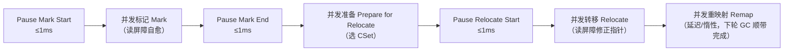

- **只有 3 个极短 STW**，且**停顿与堆大小、存活对象数无关**（只与 GC Roots 数量有关）。
- 参数：`-XX:+UseZGC`、`-XX:ZCollectionInterval`（强制周期）、`-XX:ZAllocationSpikeTolerance`、`-XX:SoftMaxHeapSize`、`-XX:+ZProactive`。
- **JDK 21 分代 ZGC（JEP 439）**：`-XX:+UseZGC -XX:+ZGenerational`（JDK 21 默认开启分代）→ 解决「ZGC 全堆扫描导致 CPU 开销高」的问题，年轻代回收更频繁、更便宜。
- **代价**：读屏障的持续 CPU 开销、内存开销（多重映射 + 转发表）、**不支持压缩指针**（>32G 也没关系，但小堆下内存占用偏高）。

#### ⑦ Shenandoah（RedHat，JDK 12 起）

- 与 ZGC 同为「并发整理」，但用 **Brooks 转发指针（Forwarding Pointer）**：每个对象头多一个转发指针字段（**对象变大 8/16 字节**，内存开销明显）。
- **读写屏障都要**（写屏障维护并发复制的一致性）。
- `-XX:+UseShenandoahGC`；在 OpenJDK 中存在，**Oracle JDK 未包含**。

#### ⑧ Epsilon（JDK 11，No-Op GC）

- 只分配、不回收；用于**性能测试、短生命周期任务、GC 开销基准对比**。
- `-XX:+UseEpsilonGC`，堆满即 OOM。

### 7.6 收集器对比总表（面试前必背）

| 收集器 | 分代 | 算法 | 停顿 | 吞吐 | 堆规模 | 适用 | 状态 |
|---|---|---|---|---|---|---|---|
| Serial | 新生代 | 复制 | 高（全 STW） | 中 | < 数百 MB | 客户端/小容器 | 在用 |
| Serial Old | 老年代 | 标记-整理 | 高 | 中 | 小 | CMS 兜底 | 在用 |
| ParNew | 新生代 | 复制 | 中 | 中 | 中 | 与 CMS 搭配 | 已废弃 |
| Parallel Scavenge | 新生代 | 复制 | 中 | **最高** | 中 | 批处理 | 在用 |
| Parallel Old | 老年代 | 标记-整理 | 中 | **最高** | 中 | 批处理 | 在用 |
| CMS | 老年代 | 标记-清除（并发） | 低（有 CMF 风险） | 中 | 中 | 低延迟 Web | **JDK14 移除** |
| G1 | 全堆（分区） | 复制 + 标记-整理（Region） | 低（可预测，~200ms） | 中高 | 大（4G~64G） | **通用默认** | 在用 |
| ZGC | 全堆（分区） | 并发标记-复制（染色指针） | **极低（<1ms）** | 中（读屏障开销） | 超大（TB） | 低延迟大堆 | 在用 |
| Shenandoah | 全堆 | 并发复制（转发指针） | 极低 | 中 | 大 | 低延迟 | OpenJDK |
| Epsilon | — | 无 | 无 | — | — | 基准测试 | 在用 |

**「怎么选」的标准回答：**

```text
① 优先默认：JDK9+ 用 G1，绝大多数场景够用（先别调，观察 GC 日志）
② 极致吞吐：批处理/离线 → Parallel（-XX:+UseParallelGC）
③ 极致低延迟 + 大堆：ZGC（JDK17+ 可用，JDK21 分代更佳）
④ 小内存容器（< 1G）/启动阶段：Serial + CDS
⑤ 遗留系统：CMS（但要接受 CMF 与碎片）
```

### 7.7 GC 日志怎么读（统一日志 JVM Unified Logging，JDK 9+）

```bash
-Xlog:gc*:file=/var/log/gc.log:time,uptime,level,tags:filecount=5,filesize=20M
```

```text
[2026-11-19T10:00:01.123+0800][1234ms] GC(12) Pause Young (Normal) (G1 Evacuation Pause)
[2026-11-19T10:00:01.123+0800][1234ms] GC(12) Using 8 workers of 8 for evacuation
[2026-11-19T10:00:01.130+0800][1241ms] GC(12)   Pre Evacuate Collection Set: 0.2ms
[2026-11-19T10:00:01.130+0800][1241ms] GC(12)   Evacuate Collection Set: 6.8ms
[2026-11-19T10:00:01.132+0800][1243ms] GC(12)   Post Evacuate Collection Set: 1.5ms
[2026-11-19T10:00:01.132+0800][1243ms] GC(12) Eden regions: 120->0(120)
[2026-11-19T10:00:01.132+0800][1243ms] GC(12) Survivor regions: 8->8(12)
[2026-11-19T10:00:01.132+0800][1243ms] GC(12) Old regions: 30->32
[2026-11-19T10:00:01.132+0800][1243ms] GC(12) Humongous regions: 2->2
[2026-11-19T10:00:01.132+0800][1243ms] GC(12) Metaspace: 51200K->51200K(1048576K)
[2026-11-19T10:00:01.132+0800][1243ms] GC(12) Pause Young (Normal) (G1 Evacuation Pause) 1243M->640M(4096M) 9.000ms
```

**读日志的三个要点：**

1. **看「回收前后堆大小」**：`1243M->640M(4096M)` → 回收后仍有 640M，说明存活对象多（正常）还是泄漏（持续上涨）。
2. **看停顿组成**：`Pre/Evacuate/Post` 哪段长 → Evacuate 长说明**复制量大**（存活率高或 Region 选得不好）；Pre 长说明 RSet/根扫描慢。
3. **看 Full GC**：`Pause Full (G1 Compaction Pause)` 出现即为调优红旗；`to-space exhausted` 表示**晋升失败**（Survivor/Old 没空间，直接 Full GC）。

### 7.8 GC 调优的「五个量」框架

| 量 | 观察指标 | 调优方向 |
|---|---|---|
| **分配速率**（Allocation Rate） | `jstat -gc` 的 Eden 增长 / 时间 | 降速率（对象复用、减少临时对象、大对象池化） |
| **晋升速率**（Promotion Rate） | Old 增长速度 | 增大 Survivor、`MaxTenuringThreshold`、检查「短命大对象」 |
| **存活集**（Live Set） | Full GC 后的 Old 大小 | 无法调，只能扩堆或查泄漏 |
| **停顿时间** | GC 日志 Pause | G1 调 `MaxGCPauseMillis`/Region 数；ZGC 基本无需调 |
| **GC 频率** | 两次 Young GC 间隔 | 增大 Eden / Young 区占比 |

---


## 8. 执行引擎：字节码如何变成 CPU 指令

### 8.1 三层执行结构

```mermaid
flowchart TB
    BC["字节码"] --> IT["① 模板解释器 Template Interpreter<br/>为每条字节码预生成一段汇编模板<br/>（不是"翻译"，是"跳转到预编译好的机器码片段）"]
    IT -->|"方法调用计数器 / 回边计数器达阈值"| C1["② C1（客户端编译器）<br/>HIR → LIR → 线性扫描寄存器分配 → 机器码<br/>编译快，优化浅，带 profiling"]
    C1 -->|"更热 + profile 数据"| C2["③ C2（服务端编译器）<br/>Sea-of-Nodes 图 IR → 大规模图优化 → 图着色寄存器分配<br/>编译慢，峰值性能高"]
    C1 --> CC["Code Cache<br/>（不在 Java 堆，本地内存）"]
    C2 --> CC
    CC --> EXEC["CPU 执行"]
```

**为什么需要解释器？** —— **启动速度**与**代码覆盖度**：JIT 编译有成本（C2 编译一个方法可能几十 ms），大量只执行一次的代码（启动、管理类操作、异常路径）编译是浪费。经典的经验值是「方法执行超过约 1 万次（`CompileThreshold`）才值得编译」。

### 8.2 热点探测：计数器怎么工作

| 计数器 | 位置 | 触发 | 阈值参数 |
|---|---|---|---|
| **方法调用计数器**（Invocation Counter） | 方法级（`Method` 里） | 方法被调用次数 → 触发**标准编译** | `-XX:CompileThreshold`（C1: 1500，C2: 10000，分层编译下阈值随层级变化） |
| **回边计数器**（Back Edge Counter） | 方法级 | 循环体回跳次数 → 触发 **OSR（On-Stack Replacement，栈上替换）** | `-XX:OnStackReplacePercentage`（默认 933/140） |

**OSR 的意义（★★★★）：** 一个包含大循环的 `main` 方法（只被调用 1 次）永远达不到调用阈值，但循环跑了 1 亿次——**回边计数器**让 JIT 在**循环执行中途**就把解释执行的栈帧「就地替换」成编译后的栈帧，从而让长循环也能享受优化。这是「为什么我的 benchmark 方法第一轮慢、后面快」的底层原因（也是 JMH 必须做 warmup 的原因之一）。

**热度衰减（Counter Decay）：** 方法调用计数器并非单调累加，JVM 会周期性（`-XX:CounterHalfLifeTime`，默认 30s 左右）**减半**，避免「启动时热过、后来不热」的方法一直被编译。这解释了「为什么服务跑一段时间后 JIT 又编译了一批方法」。

### 8.3 分层编译的 5 层（JDK 8+ 默认）

| 层级 | 执行方式 | 说明 |
|---|---|---|
| 0 | 解释器 | 初始状态 |
| 1 | C1（无 profiling） | 简单方法，不需要 profile |
| 2 | C1（有限 profiling） | 方法调用计数 + 回边计数 |
| 3 | C1（完整 profiling） | 收集类型 profile（用于 C2 去虚拟化/内联） |
| 4 | C2 | 最热代码，峰值性能 |

典型路径：`0 → 3 → 4`；若 C2 队列拥塞，会先 `3 → 2 → 4`（用 C1 顶一阵，避免排队导致性能塌陷）。

**C2 编译失败/去优化（Deoptimization）**：C2 基于「假设」（单态调用、类未加载子类等）做激进优化，一旦假设被打破 → 标记该方法为 `not_entrant`，**回退到解释器重新执行**，重新收集 profile。这就是「**JVM 性能曲线会出现锯齿**」的原因，也是「反射/动态代理/大量 lambda 导致 JIT 反复去优化」的性能陷阱。

### 8.4 JIT 的经典优化（面试必答清单）

| 优化 | 内容 | 观察方式 |
|---|---|---|
| **方法内联**（Inlining） | 把被调用方法的字节码"贴"进调用者，消除调用开销，**是所有后续优化的前提** | `-XX:+PrintInlining` |
| **常量折叠/传播** | 编译期算出常量表达式 | — |
| **公共子表达式消除** | `a.b + a.b` 只算一次 | — |
| **死代码消除** | 不可达分支删除 | — |
| **循环展开/循环不变量外提** | 减少跳转、把循环内不变计算移出 | — |
| **逃逸分析三兄弟** | 标量替换、栈上分配、锁消除 | `-XX:+PrintEscapeAnalysis` |
| **去虚拟化** | 单态/双态内联（guarded inline） | `-XX:+PrintInlining` 可见 `virtual call` |
| **分支预测提示** | 把「大概率」分支排成 fall-through | — |
| **向量化（SuperWord / AVX）** | 把标量循环变成 SIMD 指令 | `-XX:+UseSuperWord` |
| **int 范围检查消除** | 循环边界确定时去掉 `array bounds check` | — |
| **空检查消除（Null Check Elimination）** | 前面已判空则后续不再判 | — |

**方法内联的门槛（★★★★ 高频）：**

```bash
-XX:MaxInlineSize=35          # 字节码小于 35 字节的方法无条件内联
-XX:FreqInlineSize=325        # 热点方法（被频繁调用）放宽到 325 字节
-XX:InlineSmallCode=1000      # 已编译代码小于此值可内联
-XX:MaxInlineLevel=9          # 最大内联深度（防止无限递归内联）
```

> 面试题：「为什么 `getter/setter` 几乎零成本？」——字节码只有几字节，**必然被内联**，最终等价于直接访问字段。这也是为什么 JDK 里大量使用小方法而不用担心性能。

**C2 的 IR：Sea-of-Nodes**

- 传统编译器：AST → 线性 IR → 优化。
- C2：**把整个方法变成一个「节点图」**（每个值是一个节点，边表示数据/控制依赖），**没有固定顺序** → 优化时只需改图的连接（如 GVN 值编号、死节点删除），最后再「调度（Schedule）」成线性指令序列。
- 好处：全局视野的优化（跨基本块），代价是编译慢、内存占用高。

**寄存器分配：**

- C1：**线性扫描（Linear Scan）**，快但质量一般。
- C2：**图着色（Graph Coloring）**，把「冲突图」着色成 K 种颜色（K = 可用寄存器数），质量高但 NP 难（用 Chaitin-Briggs 启发式 + 溢出到栈）。

### 8.5 Code Cache 的坑（★★★★ 常被忽略的线上问题）

```bash
-XX:ReservedCodeCacheSize=240m    # 默认（分层编译，64 位）
-XX:InitialCodeCacheSize=2496K
-Xlog:codecache+sweep*=info       # 观察 Code Cache 状态
```

**现象：** 长跑的服务在运行几天/几周后**性能突然下降**，日志出现：

```text
CodeCache is full. Compiler has been disabled.
```

**原因：** JIT 编译的机器码把 Code Cache 塞满 → **JIT 被禁用，所有新热代码只能解释执行** → 性能断崖式下跌（有时掉 30%~50%）。

**解决：**

1. 增大 `ReservedCodeCacheSize`（4G 堆以上建议 512M）。
2. 排查「为什么代码这么多」：大量动态生成的类（CGLIB/JSON 序列化框架/JSP/表达式引擎）→ 每个类的方法都要编译。
3. 用 `-XX:+PrintCompilation`、`JITWatch`、`jcmd <pid> Compiler.codecache` 分析。
4. 注意 **AOT/CDS** 与 Code Cache 的交互。

### 8.6 AOT、CDS、GraalVM（JDK 演进方向）

| 技术 | 做什么 | 现状 |
|---|---|---|
| **CDS（Class Data Sharing）** | 启动时把类元数据/字节码映射到共享归档，多进程共享，加速启动 | JDK 5 起；JDK 10 加 **AppCDS**；JDK 12 默认开 **默认 CDS 归档** |
| **AOT（jaotc）** | 提前编译成 `.so`（Ahead-of-Time） | JDK 9 引入，JDK 17 **移除**（收益不明确、维护成本高） |
| **JIT Compiler Interface（JVMCI）** | 允许替换 JIT 编译器 | JDK 9+ |
| **Graal JIT** | 用 Java 写的 JIT（`-XX:+UseJVMCICompiler`） | 实验性，部分场景（大方法/长编译）表现更好 |
| **GraalVM Native Image** | 编译期**闭世界分析**，生成独立可执行文件（无 JVM） | 启动 ms 级、内存小；代价：反射/动态代理需配置、峰值性能可能低于 C2 |
| **Project Leyden** | 目标是把「启动/预热」成本前移到编译期（静态镜像 + 动态 profile） | JDK 24 起有 AOT 缓存（`-XX:AOTCache`）雏形 |
| **CRaC（Coordinated Restore at Checkpoint）** | 运行中 checkpoint，恢复时"瞬间"起来 | 第三方/OpenJDK 孵化 |

---


## 9. 并发与底层：JMM → 内存屏障 → 缓存一致性 → 系统调用

> 用户问「在操作底层是什么逻辑」，这一章就是答案：把 Java 内存模型一路拆到 CPU 缓存行、内存屏障、缺页中断、系统调用上。

### 9.1 Java 内存模型（JMM）的抽象层

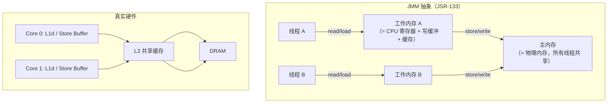

**JMM 定义了 8 种原子操作（老教材）**：`lock / unlock / read / load / use / assign / store / write`。但现代实现基本不用这套描述，而是用 **happens-before + 内存屏障**。面试时说：「JMM 的核心是 **happens-before 规则** 和 **volatile/final 的内存语义**；8 大原子操作是早期教材的描述，HotSpot 的实现是内存屏障 + 缓存一致性协议。」

**happens-before 的 8 条规则（必须能说全）：**

1. **程序顺序规则**：单线程内，前面的操作 happens-before 后面的。
2. **监视器锁规则**：`unlock` happens-before 后续的 `lock`（同一把锁）。
3. **volatile 规则**：对 volatile 字段的**写** happens-before 后续的**读**。
4. **线程启动规则**：`Thread.start()` happens-before 线程内任何操作。
5. **线程终止规则**：线程内所有操作 happens-before `join()` 返回。
6. **中断规则**：`interrupt()` happens-before 被中断线程检测到中断。
7. **终结器规则**：对象构造完成 happens-before `finalize()` 开始。
8. **传递性**：A hb B，B hb C ⇒ A hb C。

> 关键理解：happens-before **不要求真的"先发生"**，它只要求「前一个操作的结果对后一个可见」。JMM 允许重排序，只要不违反 hb。

### 9.2 volatile 的底层实现

```java
private volatile boolean flag;
```

**三个语义：**

| 语义 | 说明 |
|---|---|
| 可见性 | 写 volatile 后，其他线程读一定能看到最新值 |
| **禁止重排序** | 写前插 `StoreStore`，写后插 `StoreLoad`；读后插 `LoadLoad` + `LoadStore` |
| **不保证原子性** | `volatile++` 仍是「读-改-写」三步 |

**HotSpot 的实际做法（`OrderAccess::storeload()` 等）：**

```text
// x86 上，volatile 写被编译成：
mov  [addr], value
lock addl $0, (%rsp)     ← lock 前缀的空操作，起到 StoreLoad 屏障作用
                          （比 mfence 便宜，且顺带把 Store Buffer 刷到缓存）

// volatile 读被编译成：
mov  reg, [addr]        ← x86 的 TSO 模型保证 LoadLoad/LoadStore 天然有序
                          （读后无需额外指令，在 ARM 上则需 dmb ishld）
```

**为什么 x86 只需要 `lock` 而不是全套屏障？** —— **x86 是 TSO（Total Store Order）模型**：只允许「Store-Load」重排（写缓冲导致），Load-Load、Load-Store、Store-Store 都不重排。所以只需在 volatile 写后加一个 **StoreLoad 屏障**。而 **ARM/Power 是弱内存模型（Weak/Relaxed）**，四种重排都可能发生 → 需要 `dmb ish`（全屏障）。这也解释了「同一段 Java 代码在 x86 和 ARM（如鲲鹏/苹果 M 系列）上性能与指令不同」。

**Store Buffer 与 Invalidate Queue（理解可见性的关键）：**

```text
Core 0 写 x=1:  写进 Store Buffer（不等缓存） → 稍后异步写入 L1
Core 1 读 x:    若 L1 里是旧值，且 Invalidate Queue 里的失效消息还没处理 → 读到旧值
```

**MESI 协议**（缓存行四态）：

| 状态 | 含义 |
|---|---|
| M（Modified） | 本核独占且已修改（脏） |
| E（Exclusive） | 本核独占且与内存一致 |
| S（Shared） | 多核共享且一致 |
| I（Invalid） | 无效（被别的核改过） |

写操作需要「**RFO（Read For Ownership）**」：先让其他核把该缓存行置为 I，再独占写入。**跨核同步成本 ≈ 几十~上百 ns**，这就是「无锁不一定快」的原因。

### 9.3 safepoint：为什么 GC 必须"停下来"

**问题**：GC 要移动对象（复制/整理），必须保证「**没有任何线程正在使用对象引用**」，否则改完地址后线程手里的引用就是错的。

**解法**：让所有 Java 线程跑到 **safepoint（安全点）** 才能暂停。

```text
safepoint 的两种实现：
① 轮询式（Polling，HotSpot 默认）：JIT 在「方法返回、循环回边、可能抛异常处」插入
     test %eax, [safepoint_poll_page]   ← 一条访存指令，页被保护时触发 SIGSEGV → 进入慢路径
② 抢占式（Preemptive，已废弃）：直接挂起线程，但无法确定线程是否在"引用仍然有效"的位置
```

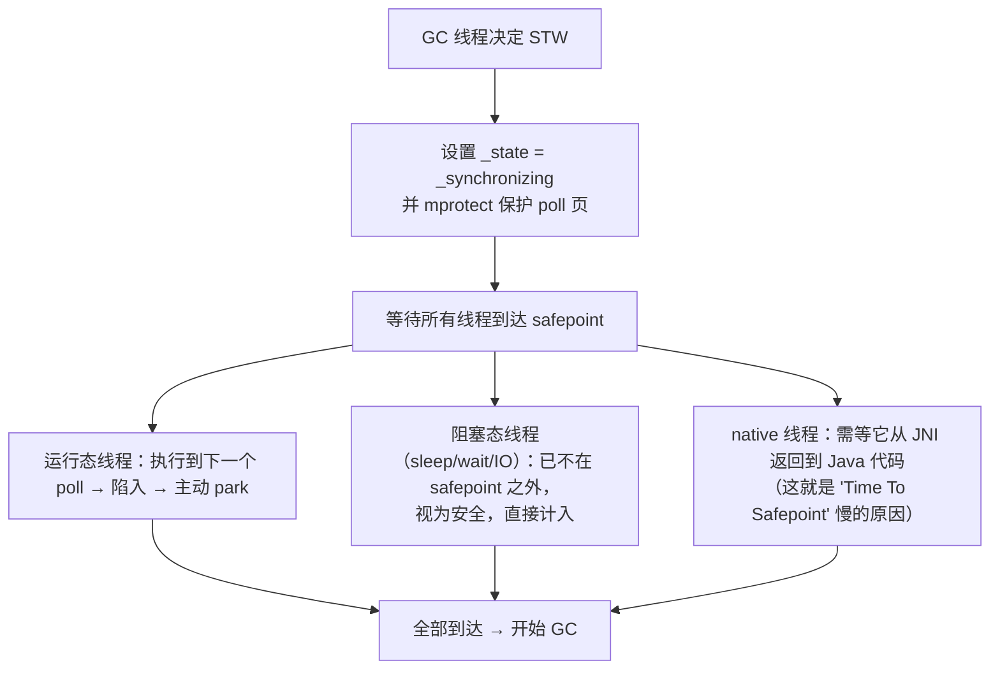

**核心指标：TTSP（Time To SafePoint）**

- 常见事故：`jstat -gcutil` 显示 GC 时间很长，但 `-Xlog:safepoint` 里 `Total time for which application threads were stopped` 里绝大部分是 **"spinning in native"** 或**等待某个线程到达 safepoint**。
- 典型原因：某线程在执行一个**超长的不含 poll 的循环**（如 `int` 计数循环、大数组拷贝、`String.hashCode` 长串）、或卡在 **native 方法 / JNI 回调**里。
- 排查：`-Xlog:safepoint=info`，看 `Application time: xxx`；`jstack` 找 `RUNNABLE` 且栈里在 native 的线程。

> 面试题「什么情况下 GC 停顿会异常长，但堆并不大？」→ **TTSP 长**（safepoint 难以达成），不是 GC 本身慢。这是 ★★★★★ 的区分度题。

### 9.4 内存语义的落地：DCL 为什么需要 volatile

```java
class Singleton {
    private static volatile Singleton instance;   // ← 缺了 volatile 就可能拿到半初始化对象
    static Singleton get() {
        if (instance == null) {
            synchronized (Singleton.class) {
                if (instance == null) {
                    instance = new Singleton();   // ① 分配内存 ② 调用构造 ③ 赋值引用
                }
            }
        }
        return instance;
    }
}
```

**`new` 的三步可能被重排为 ①→③→②**：另一个线程在 `if` 处看到 `instance != null`（非 null），但对象字段还是零值 → 使用未初始化对象 → NPE 或脏数据。

- `volatile` 禁止 ②③ 重排（写前的 `StoreStore` 屏障保证「构造完成」先于「引用赋值」可见）。
- **`final` 字段也有类似保障**：JMM 规定「**写 final 字段**在构造器返回前插 `StoreStore` 屏障；**读 final 字段**在读对象引用后插 `LoadLoad` 屏障」→ 所以**正确构造的对象，其 final 字段对所有线程可见且值正确**（无需 volatile）。这是 String 不可变、安全发布的基础。

### 9.5 从 Java 到操作系统：几条完整链路

#### 链路 ①：`new Object()` 到底发生了什么（含 OS）

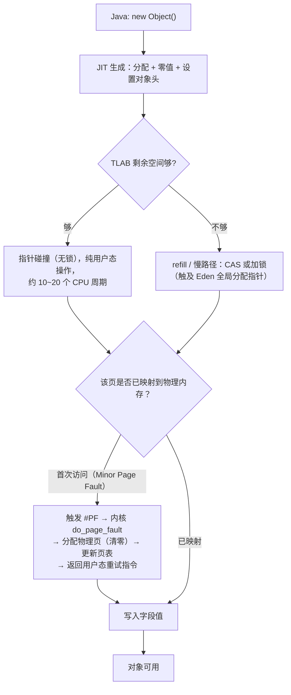

**关键数字（面试可讲的量级）：**

- TLAB 内分配：**~1-5 ns**（一条 `add` 指令 + 边界检查）。
- 首次触碰新页（minor fault）：**~1-3 μs**（内核路径长）。
- `mmap` 系统调用：**~1-5 μs**；`malloc` 小对象：**~50-100 ns**（用户态空闲链表）。

> 所以 `-XX:+AlwaysPreTouch` 是「用启动时的 μs 级缺页，换运行时的抖动」——大堆服务（>16G）建议开启，避免运行中集中触发缺页。

#### 链路 ②：`synchronized` 的底层（Java → CPU 指令 → 内核）

```text
monitorenter
  → 对象头 Mark Word 检查
  → 偏向/轻量级：纯用户态 CAS（cmpxchg + lock 前缀）
  → 重量级：ObjectMonitor::enter
       → 自旋失败 → 包装 ObjectWaiter → park()
            → JVM 的 Parker 基于 pthread_mutex + pthread_cond
                 → 最终 futex(FUTEX_WAIT) 系统调用 → 线程进入内核阻塞队列
```

**一次「无竞争」加锁 ≈ 10 ns；一次「有竞争」的阻塞+唤醒 ≈ 5-20 μs**（200~1000 倍差距）。这就是「减少锁竞争比优化锁实现更重要」的量化依据。

#### 链路 ③：一次 `FileChannel.read` 到磁盘（零拷贝基础）

```text
① 传统：read() → 数据从磁盘 → 内核页缓存（DMA）→ 拷贝到用户缓冲区（CPU copy）
② sendfile/零拷贝：磁盘 → 页缓存 → 直接 DMA 到网卡（不经用户态）
③ mmap：把文件页映射进用户地址空间，读写即内存访问 → 少一次拷贝，但仍有缺页
```

Java 对应：`FileChannel.transferTo`（sendfile）、`MappedByteBuffer`（mmap）、`DirectByteBuffer`（堆外 + 一次拷贝）。

#### 链路 ④：线程创建（`new Thread().start()`）

```text
Java Thread 对象（堆） → start() → JVM_StartThread (JNI)
  → 分配 JavaThread（C++ 对象，含 oop 句柄）
  → os::create_thread → pthread_create
      → clone(CLONE_VM|CLONE_FS|CLONE_FILES|...) 系统调用
          → 内核创建 task_struct，分配内核栈（默认 8KB/16KB）
          → 返回后线程从 thread_native_entry 开始跑
  → 线程状态 NEW → RUNNABLE
  → 执行 run()
```

**这就是「为什么 1 万个线程会 OOM」：** 每个线程 = 1M 用户栈（`-Xss`）+ 内核栈 + `task_struct`（~几 KB）+ TLB/调度开销 → 1000 个线程约 1~2G 虚拟内存，且**上下文切换成本随线程数上升**（`vmstat` 的 `cs` 列）。

**JDK 21 虚拟线程改变了这一点**（见 10.4）。

### 9.6 硬件层面的三个「Java 性能陷阱」

| 陷阱 | 原理 | 缓解 |
|---|---|---|
| **伪共享（False Sharing）** | 两个线程写同一 **缓存行（64B）** 的不同变量 → 缓存行来回失效（MESI 乒乓） | `@Contended`（需 `-XX:-RestrictContended`）、手动 padding 到 64 字节、`LongAdder` 的 cell 数组 |
| **NUMA 远程访问** | 大内存服务器（多 socket），跨 CPU 访问内存延迟高 2~3 倍 | `-XX:+UseNUMA`（Parallel GC 有效），线程与内存同节点绑定 |
| **TLB Miss / 大页** | 大堆（>32G）导致页表项多，TLB 覆盖不全 → 每次访存多级页表遍历 | `-XX:+UseLargePages` + OS 配 2M/1G HugePage；`-XX:+AlwaysPreTouch` 减少 THP 抖动 |

**伪共享的实测代码（面试可讲）：**

```java
class Padding { volatile long p1,p2,p3,p4,p5,p6,p7; }  // 7×8=56B 填充
// 或直接用 JDK 内部的 @sun.misc.Contended
```

> `LongAdder` 的高并发优势就是「**用空间换缓存行**」：每个 Cell 独占缓存行，减少 CAS 冲突；求和时再累加（所以 `sum()` 不是强一致快照）。

---


## 10. 诊断与调优：工具链、故障模式与真实案例

### 10.1 工具全景（按「是否需要停业务」分类）

| 工具 | 作用 | 是否影响运行 | 场景 |
|---|---|---|---|
| `jps -lvm` | 列出 Java 进程 | 否 | 入口 |
| `jstat -gcutil <pid> 1000 10` | GC 统计（各区使用率、YGC/FGC 次数与耗时） | 极低 | **第一站**，判断 GC 是否异常 |
| `jinfo -flags <pid>` | 查看/动态改参数（`-XX:+PrintFlagsFinal` 一致） | 低 | 确认实际生效参数 |
| `jmap -histo:live <pid>` | 类实例统计（`live` 会触发一次 Full GC！） | **高（live 时）** | 找大对象 |
| `jmap -dump:format=b,file=x.hprof <pid>` | 堆转储 | **高（STW）** | 离线分析 |
| `jstack -l <pid>` | 线程栈 + 锁信息 | 低（有 safepoint） | 死锁、CPU 高、卡住 |
| `jcmd <pid> help` | **聚合入口**（推荐） | 视子命令 | `GC.heap_info`、`Thread.print`、`VM.native_memory`、`JFR.start` |
| `jhsdb jmap --heap --pid` | 直接读 HotSpot 结构（无需 attach） | 低 | 生产环境 dump 受限时 |
| **JFR**（JDK 11+） | 低开销（<1%）事件记录：GC、锁、IO、线程、异常 | **极低** | **生产首选** |
| **Arthas** | `dashboard/watch/trace/tt/jad/ognl/heapdump/profiler` | 低 | 在线诊断神器 |
| **async-profiler** | CPU/alloc/lock 采样 + 火焰图（perf_events / itimer） | 低 | 性能剖析 |
| **MAT** | 堆转储分析：支配树、Retained Size、Leak Suspects | 离线 | 内存泄漏 |
| **JITWatch** | 日志分析：内联决策、编译层级 | 离线 | 性能调优 |
| **GCEasy / GCViewer** | GC 日志可视化 | 离线 | GC 调优 |

### 10.2 五个高频故障的标准排查路径

#### 场景 A：CPU 100%

```mermaid
flowchart TB
    A["top -Hp <pid>  找出最耗 CPU 的线程"] --> B["printf '%x' <tid>  转 16 进制"]
    B --> C["jstack <pid> | grep -A 30 'nid=0x<hex>'"]
    C -->|"栈指向业务代码"| D["分析：死循环? 正则回溯? 大计算? 频繁 GC?"]
    C -->|"栈指向 GC 线程"| E["看 jstat：是否频繁 Full GC<br/>→ 内存问题伪装成 CPU 问题"]
    C -->|"栈指向 JIT 编译线程"| F["C2 CompilerThread 高 → 代码太"热"或 Code Cache 风暴"]
    C -->|"频繁切换 / 大量线程"| G["vmstat 看 cs（context switch）→ 线程池过大/锁竞争"]
```

**经验：** 线上 CPU 飙升，**一半以上根源在 GC 或锁竞争**，不是「业务代码太慢」。

#### 场景 B：内存泄漏（存活集持续上涨）

```text
① jstat -gcutil：老年代使用率每次 Full GC 后不下降（或降得很少）
② 连续 2~3 次 jmap -dump（间隔 30min+），用 MAT 对比
③ MAT：Histogram → 找 Dominator Tree（支配树）→ 看 Retained Heap 最大的对象
④ Leak Suspects 报告 + Path to GC Roots（排除弱引用/软引用）
⑤ 常见根因：
   - 静态 Map/List 只增不删（本地缓存无淘汰）
   - ThreadLocal 未 remove（线程池放大）
   - 监听器/回调注册未注销
   - 内部类持有外部类引用（非 static 内部类 + 长生命周期持有）
   - 未关闭的流/连接（连接池耗尽后仍有对象引用）
   - 类加载器泄漏（Metaspace OOM）
```

#### 场景 C：频繁 Full GC / GC 停顿长

| 现象 | 可能原因 | 处理 |
|---|---|---|
| `Pause Full (G1 Compaction)` 频繁 | 晋升过快、RSet 膨胀、Humongous 分配失败 | 增加 Young 区（`-Xmn`/`G1NewSizePercent`）、限制大对象、`G1HeapRegionSize` 调大 |
| `to-space exhausted` | Survivor 不够，晋升失败 | 增大 Survivor（`SurvivorRatio`）、降 `MaxTenuringThreshold` |
| `Concurrent Mode Failure`（CMS） | 并发回收跟不上分配 | 降 `CMSInitiatingOccupancyFraction`、加 `CMSScavengeBeforeRemark` |
| 停顿长但堆不大 | **TTSP 长**（safepoint 难达成） | `-Xlog:safepoint` 定位，排查 native 卡住/超长循环 |
| `Metaspace` 持续涨 | 动态类生成 | `-XX:MaxMetaspaceSize` + 排查 CGLIB/反射/热部署 |

#### 场景 D：`StackOverflowError`

- 递归太深 / 栈帧过大（局部变量多、`try-finally` 嵌套、大量临时对象）。
- `-Xss` 太小（容器里默认可能被降低）。
- 排查：异常栈里看重复帧模式；`-XX:+PrintFrameSize`（部分版本）。

#### 场景 E：线程死锁 / 卡死

```bash
jstack -l <pid> | grep -A 5 "Found one Java-level deadlock"
# 或 Arthas: thread -b （直接列出阻塞其他线程的线程）
```

```
"Thread-1" waiting to lock monitor 0x00007f...(object 0x000000076ab..., a java.lang.Object),
  which is held by "Thread-0"
"Thread-0" waiting to lock monitor ..., which is held by "Thread-1"
```

### 10.3 一个完整的调优案例（可直接背下来讲）

**背景：** 订单服务，JDK 8，`-Xms8g -Xmx8g`，CMS。现象：每天 10:00 峰值时接口 P99 从 80ms 涨到 1.2s，出现 `Concurrent Mode Failure`。

**排查：**

```text
① jstat -gcutil 1000：Old 区在 68% 附近反复触发 CMS，但每次回收只降到 66% → 存活集大 + 分配速率高
② GC 日志：多次 `CMS: abort preclean due to time` + `concurrent mode failure` → 退化为 Serial Old Full GC（1.5s 停顿）
③ jmap -histo:live：`com.xxx.OrderSnapshot` 有 120 万个实例，占 3.2G
④ MAT Path to GC Roots：`OrderSnapshotCache.staticMap`（一个无上限的 ConcurrentHashMap，用于"加速查询"）
```

**根因：** 本地缓存无容量上限 + 无过期 → 存活集持续增长 → CMS 并发回收跑不过分配 → CMF → 秒级停顿。

**解决（分三步）：**

1. **止血**：缓存换 Caffeine（`maximumSize(10_000)` + `expireAfterWrite(10min)`），并在发布窗口重启。
2. **缓解**：`-XX:CMSInitiatingOccupancyFraction=60` + `-XX:+CMSScavengeBeforeRemark` + `-XX:+UseCMSCompactAtFullCollection`（降低 CMF 概率）。
3. **根治**：迁 G1（`-XX:+UseG1GC -XX:MaxGCPauseMillis=150 -XX:G1HeapRegionSize=8m`），观察 2 周后 P99 稳定在 120ms；后续 JDK 17 + ZGC 进一步把 P99 压到 30ms。

**这个案例能覆盖的面试点：** GC 日志读法、CMS 缺陷、存活集、MAT 支配树、缓存设计、收集器迁移决策。

### 10.4 JDK 版本演进与「新特性背后的原理」

| 版本 | 关键变化 | 底层影响 |
|---|---|---|
| **JDK 8** | 永久代 → 元空间；Lambda/invokedynamic；默认 Parallel；`MetaspaceSize` | 类元数据移到本地内存，`PermGen OOM` 消失 |
| **JDK 9** | **G1 成为默认**；模块系统（JPMS）；统一日志 `-Xlog`；接口私有方法；`CompactStrings`（String 用 byte[] + coder） | 类加载器变 Platform；String 内存减半 |
| **JDK 10** | 局部变量类型推断 `var`；G1 并行 Full GC；AppCDS | — |
| **JDK 11（LTS）** | **ZGC（实验）**；Epsilon；HTTP Client；**移除 Java EE/CORBA**；`String.strip` | ZGC 带来亚毫秒停顿 |
| **JDK 12** | Shenandoah；G1 可中止混合回收；默认 CDS 归档 | — |
| **JDK 13** | ZGC 归还未使用内存给 OS；`switch` 表达式预览 | — |
| **JDK 14** | **移除 CMS**；空指针异常详细信息（`-XX:+ShowCodeDetailsInExceptionMessages`）；Record 预览 | NPE 消息可用 |
| **JDK 15** | **偏向锁默认禁用（JEP 374）**；Shenandoah 转正；密封类预览；ZGC 转正 | 锁升级路径简化 |
| **JDK 16** | **ZGC 并发线程栈处理**（停顿 <1ms 稳定）；`jpackage`；强封装 JDK 内部 API | ZGC 生产可用 |
| **JDK 17（LTS）** | 密封类正式；**移除 Security Manager（废弃）**；强封装；`RandomGenerator` | — |
| **JDK 18** | 默认 UTF-8（`file.encoding`）；**移除偏向锁实现**；Simple Web Server | 编码问题减少 |
| **JDK 19** | **虚拟线程（预览）**；结构化并发；Record Patterns | Loom 登场 |
| **JDK 21（LTS）** | **虚拟线程正式（JEP 444）**；**分代 ZGC（JEP 439）**；模式匹配 for switch；SequencedCollection；`String Templates` 预览 | 并发模型革命 |
| **JDK 22** | Foreign Function & Memory API 正式（Panama）；未命名变量/模式 | 替代 JNI |
| **JDK 23/24** | ZGC 分代成为默认（24）；AOT 类加载缓存；`sun.misc.Unsafe` 内存方法告警；Pinning 移除（24） | — |

#### 虚拟线程（Virtual Thread）的底层原理（★★★★★ 新热点）

```mermaid
flowchart TB
    subgraph 载体["载体线程 Carrier Threads（= 平台线程，数量 ≈ CPU 核数）"]
        C1["ForkJoinPool 调度器<br/>默认并行度 = CPU 核数"]
        C1 --> V1["虚拟线程 A<br/>RUNNING（mount）"]
        C1 --> V2["虚拟线程 B<br/>RUNNING（mount）"]
    end
    subgraph 堆["堆"]
        S1["Continuation 栈帧<br/>（StackChunk 对象，可增长）"]
        S2["Continuation 栈帧"]
    end
    V1 -.->|"阻塞（IO/sleep）→ unmount<br/>栈帧 freeze 到堆"| S1
    S1 -.->|"IO 完成 → 调度器 mount 到空闲载体"| V2
```

| 概念 | 说明 |
|---|---|
| **Continuation** | 虚拟线程的执行状态 = 一组**可复制的栈帧**（`jdk.internal.vm.Continuation`），存在**堆**上，可 yield/resume |
| **mount / unmount** | 虚拟线程在载体线程上运行 = mount；阻塞时把栈帧 freeze 到堆、释放载体 = unmount |
| **调度** | `ForkJoinPool`（默认 `parallelism = CPU 核数`，可用 `-Djdk.virtualThreadScheduler.parallelism` 调） |
| **pinning（钉住）** | 在 `synchronized` 块内阻塞、或在 native 方法/`Object.wait` 中阻塞 → 无法 unmount → **载体线程被占死** → 吞吐暴跌。**JDK 24 已移除 synchronized 导致的 pinning** |
| **ThreadLocal** | 虚拟线程也支持，但**百万虚拟线程 × ThreadLocal = 内存炸弹** → 推荐 `ScopedValue`（JDK 21 预览/后续正式） |

**适用与不适用（面试必答）：**

| 场景 | 是否适合虚拟线程 |
|---|---|
| 高并发 IO 密集（HTTP 调用、DB 查询） | ✅ 最适合（把"每请求一线程"的成本从 MB 级降到 KB 级） |
| CPU 密集计算 | ❌ 无收益（载体线程数 = 核数，本来就没空闲） |
| 大量 `synchronized` 长临界区 | ⚠️ 会 pinning（JDK 21），改用 `ReentrantLock` |
| 需要线程池限制并发 | ⚠️ 虚拟线程池不应池化（用 `Semaphore` 限流） |

```java
// 用法
Thread vt = Thread.ofVirtual().name("vt-").start(task);
// 或
try (var executor = Executors.newVirtualThreadPerTaskExecutor()) {
    executor.submit(task);
}
```

### 10.5 参数速查表（生产常用）

```bash
# 堆
-Xms4g -Xmx4g                      # 固定堆，避免动态扩缩（减少抖动）
-Xmn1g                             # 新生代（G1 不建议设，用 G1NewSizePercent）
-XX:SurvivorRatio=8                # Eden:S0:S1 = 8:1:1
-XX:MaxTenuringThreshold=15        # 晋升年龄（≤15）
-XX:PretenureSizeThreshold=1m      # 大对象直接进老年代（Serial/ParNew 有效）
-XX:MetaspaceSize=256m -XX:MaxMetaspaceSize=512m
-XX:MaxDirectMemorySize=1g

# 栈与线程
-Xss1m                             # 线程栈（容器内注意总内存）
-XX:ParallelGCThreads=8            # GC 并行线程（容器内按 limit 计算）
-XX:ConcGCThreads=2                # 并发 GC 线程（CMS/G1）

# 收集器
-XX:+UseG1GC -XX:MaxGCPauseMillis=200 -XX:G1HeapRegionSize=8m
-XX:+UseZGC -XX:+ZGenerational     # JDK21 分代 ZGC
-XX:+UseParallelGC                 # 吞吐优先

# 诊断
-Xlog:gc*:file=gc.log:time,uptime:filecount=5,filesize=20M
-XX:+HeapDumpOnOutOfMemoryError -XX:HeapDumpPath=/data/dump
-XX:+ExitOnOutOfMemoryError        # 直接退出，交给 K8s 重启（比半死不活好）
-XX:StartFlightRecording=duration=60s,filename=app.jfr
-XX:+AlwaysPreTouch                # 大堆预触碰
-XX:+UseLargePages                 # 大页（需 OS 配置）
```

---


## 11. 大厂面试题库（含难度分级与详解）

### 11.1 使用说明

**题目来源说明：** 以下题目为**公开面经/技术社区高频题归纳**，标注的「大厂 + 轮次」代表该题**常见出现场景**，用于把握风格与深度，不代表官方题库。同一道题在不同公司可能出现在一面或三面，深度要求不同——**请按难度星级准备，而不是按公司准备**。

**难度分布统计（共 58 题）：**

| 难度 | 题数 | 定位 |
|---|---|---|
| ★ | 3 | 校招一面/热身 |
| ★★ | 9 | 校招二面、社招一面 |
| ★★★ | 21 | 社招二面、高工（P6/P7） |
| ★★★★ | 18 | 资深/专家（P7/P8、T9+） |
| ★★★★★ | 7 | 架构终面、区分度题 |

> 其中 ★★★ 及以上共 46 题（约 8 成），对应「社招二面以上」的真实水位；★★★ 以下的 12 题建议 5 分钟内答完，把时间留给深水区。

**答题方法论（很重要）：**

1. **先给结论，再给链路**：如「会漏标。原因是三色标记下同时满足两个条件……G1 用 SATB 解决……」。
2. **主动给边界**：「这个结论在 JDK 8 成立，JDK 15 后偏向锁默认关闭，所以现在……」
3. **主动给数字**：阈值（`MaxTenuringThreshold=15`）、默认值（`MaxGCPauseMillis=200`）、量级（一次无竞争加锁 ~10ns）。
4. **主动给验证手段**：`jstat`/`jmap`/`-XX:+PrintInlining`/JOL —— 显示你「真的做过」。

---

### 模块 A：类加载与字节码（8 题）

#### A1. 描述一下类的生命周期，以及「加载」阶段具体做了什么？　★

> 常见场景：阿里/美团 一面开场、字节 一面

**考察点**：五阶段名称、加载阶段的三件事、准备阶段的零值陷阱。

**详解：**

生命周期：**加载 → 验证 → 准备 → 解析 → 初始化 → 使用 → 卸载**（解析可在初始化之后，为支持动态绑定）。

「加载」阶段做三件事：

1. 通过**全限定名**获取类的二进制字节流（来源可以是 class 文件、jar、网络、动态生成、JSP）；
2. 把字节流的静态存储结构转成**方法区（元空间）的运行时数据结构**（HotSpot 里是 `InstanceKlass`）；
3. 在**堆**中生成一个代表该类的 `java.lang.Class` 对象，作为方法区数据的访问入口。

**延伸（加分）**：加载与「初始化」是两个不同时机——`ClassLoader.loadClass()` 只加载，`Class.forName()` 默认会初始化（第二个参数 `initialize=true`）；这也是很多框架「只加载不初始化」做扫描、真正用时才初始化的原因。

---

#### A2. 双亲委派模型是什么？为什么需要它？如何打破？　★★★

> 常见场景：阿里 P6 二面、腾讯 T9、京东 二面

**考察点**：源码流程 + 安全意义 + 打破的四种场景。

**详解：**

流程（`ClassLoader#loadClass`）：

```text
findLoadedClass（自己的缓存）
 → parent.loadClass（递归向上）
 → 到顶后 findBootstrapClassOrNull
 → 都找不到才 findClass（自己加载）
```

**为什么需要**：

1. **安全**：防止核心类被篡改。你写 `java.lang.String` 永远不会生效，因为 Bootstrap 先加载了官方版本（且 JVM 会对 `java.*` 包做包级保护）。
2. **唯一性**：同一个类在父子链上只加载一次，避免 `ClassCastException`（同名不同加载器 = 不同类型）。

**如何打破（四种）**：

| 场景 | 机制 |
|---|---|
| SPI（JDBC、JNDI、XML 解析） | **线程上下文类加载器（TCCL）**：核心类在 Bootstrap 层，但实现类在 App 层 → 用 TCCL 反向委派 |
| Tomcat | `WebappClassLoader` 重写 `loadClass`，**先自己找再委派**，实现 WebApp 隔离 |
| OSGi | 网状委派 + `Import-Package` 显式声明 |
| 热部署/插件化（Spring Boot devtools、Flink） | 每个模块一个加载器，替换加载器即替换类 |

**延伸（★★★★）**：为什么不直接改 `loadClass` 而是常用 `findClass`？—— 因为 `loadClass` 承担了委派逻辑与缓存，重写它容易破坏线程安全（`getClassLoadingLock` 的分段锁）；只改数据来源时重写 `findClass` 更安全。

---

#### A3. 一个类什么时候会被初始化？举几个「不会初始化」的例子。　★★

> 常见场景：美团 二面、快手 一面

**详解：**

六种触发：`new`/访问静态字段/调静态方法、反射（`Class.forName`）、子类初始化导致父类初始化、主类、MethodHandle 解析、JVM 启动指定。

**不会初始化的例子（重点）**：

1. `A[] arr = new A[10]` —— 只创建数组类型（`[LA;`），不初始化 A。
2. `A.CONST`（`static final` 编译期常量）—— 值已内联进调用方常量池，**不加载 A 都可能**。
3. `A.class` —— 只加载，不初始化。
4. `ClassLoader.loadClass("A")` —— 只加载，不初始化。

**延伸**：`<clinit>` 的线程安全由 JVM 用「类初始化锁」保证，因此**静态单例天然线程安全**；但也因此可能出现**类初始化死锁**（A 的 `<clinit>` 等 B，B 的 `<clinit>` 等 A）。

---

#### A4. 谈谈 Class 文件的结构，常量池里都放什么？　★★

> 常见场景：字节 一面、滴滴 二面

**详解：**

结构：`magic(0xCAFEBABE)` + 版本 + 常量池 + 访问标志 + 类/父类/接口索引 + 字段表 + 方法表 + 属性表。

常量池放 14 种常量：`Utf8`、`Integer/Float/Long/Double`、`Class`、`String`、`Fieldref`、`Methodref`、`InterfaceMethodref`、`NameAndType`、`MethodHandle`、`MethodType`、`InvokeDynamic`。

**为什么要有常量池（本质）**：它承载**符号引用**，让编译期只记录「名字」而不是「地址」，运行时再解析成直接引用。这是 Java「编译期与运行期解耦」的基础，也让同一个 class 可以在不同 JVM/不同内存布局上运行。

**延伸**：`long/double` 在常量池占两个位置（`constant_pool_count` 会跳过一格）；`invokedynamic` 常量（tag=18）是 Lambda 的实现基础。

---

#### A5. `invokedynamic` 是什么？为什么 Lambda 用它？　★★★★

> 常见场景：字节 三面（JVM 方向）、阿里 P7

**详解：**

`invokedynamic` 是 JVM 第五条调用指令，**调用点（CallSite）在首次执行时才绑定**，绑定逻辑由一个 **引导方法（Bootstrap Method，BSM）** 决定。

Lambda 的编译产物：

```text
invokedynamic #x, 0   // InvokeDynamic #0:apply:()LFunction;
  BSM: java/lang/invoke/LambdaMetafactory.metafactory(...)
```

`LambdaMetafactory` 生成一个 `CallSite`，其 `MethodHandle` 指向编译器生成的**合成方法**（`lambda$main$0`）。这样：

1. **不生成额外内部类**（减少类数量、元空间、加载开销）；
2. `MethodHandle` 是可直接内联的调用点 → **JIT 后零开销**；
3. 支持「同一个 lambda 表达式复用同一个 CallSite」（非捕获 lambda 可缓存为单例）。

**延伸**：捕获型 lambda（引用局部变量）每次调用仍会 `new` 一个对象（用 `invokedynamic` 的 `altMetafactory` 带参数版本），所以「lambda 一定比匿名类省内存」是错的——**非捕获才省**。

---

#### A6. 泛型擦除是什么？会带来哪些限制和坑？　★★★

> 常见场景：美团、京东 一面

**详解：**

擦除规则：类型参数擦成 `Object`（或有界类型擦成第一个边界），并在需要处插入 `checkcast`。

**四个坑**：

1. 不能 `new T[]`、不能 `instanceof T`、不能 `new T()`；
2. 静态成员不能用类级类型参数；
3. **桥接方法**导致反射看到「重复方法」（`getDeclaredMethods` 里同名不同参）；
4. 重载冲突：`f(List<String>)` 与 `f(List<Integer>)` 擦除后签名相同 → 编译失败。

**延伸**：`TypeToken` 技巧（Gson/Jackson 的 `new TypeReference<List<User>>(){}`）之所以有效，是因为**匿名子类的父类签名（Signature 属性）保留了泛型信息**，反射可以读出来——擦除的是「运行时类型」，不是「元数据」。

---

#### A7. 一个 `.class` 文件被不同 ClassLoader 加载，会发生什么？　★★★

> 常见场景：腾讯、阿里（框架方向）

**详解：**

同一个字节流被两个加载器加载 → **两个不同的 `Class` 对象**（JVM 用「加载器 + 类名」作为唯一标识）。

后果：

- `a instanceof B` 为 false；强转 `ClassCastException`；
- 静态字段互不影响（各自一份）；
- `synchronized(A.class)` 互不互斥。

**用途**：

- 应用隔离（Tomcat、OSGi、Flink 的 classloader 隔离）；
- 热部署（替换加载器即替换所有类）；
- 加密 jar（自定义 `findClass` 解密）。

**代价**：每个加载器加载的类都要占元空间，且**未卸载则永不回收** → 这就是 Metaspace OOM 的根因。

---

#### A8. 自定义类加载器的实现步骤？`defineClass` 和 `findClass` 的区别？　★★

> 常见场景：校招二面、社招一面

**详解：**

```java
class MyLoader extends ClassLoader {
    @Override protected Class<?> findClass(String name) throws ClassNotFoundException {
        byte[] b = loadBytes(name);                       // ① 拿到字节
        return defineClass(name, b, 0, b.length);         // ② 交给 JVM 生成 Class
    }
}
```

- `findClass`：**"去哪找字节"**，由子类实现，默认抛 `ClassNotFoundException`。
- `defineClass`：**native 方法**，"把字节变成 Class"，包含验证/准备/解析，不能重写，也不应绕过。

**延伸**：JDK 9+ 有 `ClassLoader.registerAsParallelCapable()` 用于并行加载（默认父类有全局锁，`getClassLoadingLock` 在非并行能力时会退化为一把锁）。

---

### 模块 B：内存区域与对象（10 题）

#### B1. JVM 内存区域划分？哪些线程私有、哪些共享？　★

> 常见场景：几乎每家公司的一面第一题

**详解：**

- **线程私有**：程序计数器、虚拟机栈、本地方法栈（HotSpot 中本地方法栈与虚拟机栈合并）。
- **线程共享**：堆、方法区（JDK 8+ 元空间，物理上在本地内存）、运行时常量池（在方法区）、字符串常量池（JDK 7 起在堆）。
- **本地内存（不在 Java 堆）**：元空间、Code Cache、直接内存、线程栈 × N。

**必错点提醒**：元空间**不属于堆**，`-Xmx` 管不到它；所以「堆 4G，但进程 RSS 8G」是正常的。

---

#### B2. 栈帧里有什么？为什么局部变量表大小在编译期确定？　★★

> 常见场景：美团、字节 一面

**详解：**

栈帧 = 局部变量表 + 操作数栈 + 动态链接 + 方法返回地址 + 附加信息（栈映射帧等）。

局部变量表以 **Slot（32 位）** 为单位：`this` 占 0 号槽（实例方法），`long/double` 占 2 槽。大小由编译期算出写入 `Code` 属性的 `max_locals`，操作数栈深度写入 `max_stack`——因为**字节码指令需要静态确定的槽位索引**（`iload_3` 是硬编码偏移）。

**延伸**：槽位可复用以节省空间，但也导致「已出作用域的引用仍在槽中」→ 该对象仍被 GC Root 引用。JIT 通过 liveness analysis 解决，所以「手动置 null」在现代 JVM 基本无意义。

---

#### B3. 一个对象的内存布局？Mark Word 里有什么？　★★★

> 常见场景：阿里 P6、字节 二面（并发方向必问）

**详解：**

布局 = 对象头（Mark Word 8B + Klass Pointer 4B 压缩）+ 实例数据 + 对齐填充；数组多 4B `length`。

Mark Word（64 位）按状态复用 8 字节：

- 无锁：`hashCode(31) | age(4) | biased(1) | 01`
- 偏向：`ThreadID(54) | epoch(2) | age(4) | 1 | 01`
- 轻量级：`指向栈 Lock Record 的指针 | 00`
- 重量级：`指向 ObjectMonitor 的指针 | 10`
- GC 标记：`11`

**关键洞察**：**hashCode、GC 年龄、锁状态共用同一块内存** —— 所以「调用 `hashCode()` 会让偏向锁撤销」（因为有地方要存 hash，偏向位放不下了）。这个细节 ★★★★，能答出来很加分。

**延伸**：JOL 实测 `new Object()` = 16B（8+4+4 padding）。

---

#### B4. 对象创建的过程？分配内存有哪两种方式？　★★

> 常见场景：京东、快手 一面

**详解：**

过程：检查常量池符号引用 → 类加载检查 → 计算大小 → 分配内存 → 置零值 → 设置对象头 → 执行 `<init>`。

分配方式：

| 方式 | 适用 | 并发处理 |
|---|---|---|
| **指针碰撞** | 堆规整（有压缩/复制） | TLAB 内无锁；否则 CAS |
| **空闲列表** | 堆不规整（CMS 标记-清除） | CAS + 重试 / 局部锁 |

**延伸（★★★★）**：为什么 CMS 用空闲列表？因为 CMS 不整理，堆是"千疮百孔"的；这也是 CMS 大对象分配容易失败、进而 Full GC 的原因。

---

#### B5. TLAB 是什么？为什么需要它？　★★★

> 常见场景：阿里、美团（性能方向）

**详解：**

TLAB（Thread Local Allocation Buffer）是**每个线程在 Eden 里的一块私有分配区**（默认约为 Eden 的 1%）。

**为什么需要**：多线程同时 new 对象时，共享 Eden 的 `top` 指针会产生 CAS 竞争。TLAB 让分配退化为**纯指针加法**（无锁），把竞争收敛到「refill」这一个低频动作上。

**细节**：

- 参数：`-XX:+UseTLAB`（默认开）、`-XX:TLABSize`、`-XX:TLABWasteTargetPercent`（允许的浪费比例，默认 1%）、`-XX:+TLABStats`。
- 对象大于 TLAB 剩余空间 → **直接在共享 Eden 分配**，再 refill。
- TLAB 只是 Eden 的一部分，**GC 时一起回收**，不是"逃过 GC"。

**延伸**：GC 时把对象复制到 Survivor 用 **PLAB**（Promotion LAB），同理避免 GC 线程竞争。

---

#### B6. 逃逸分析是什么？能带来哪些优化？为什么"栈上分配"说法不准确？　★★★★

> 常见场景：阿里 P7、字节 三面、华为

**详解：**

逃逸分析判断对象的作用域是否「逃出」方法/线程（方法返回、赋值给静态字段、传给未知方法 → 逃逸）。

三种优化：

1. **标量替换**：把对象拆成基本类型变量（`int x, int y`），**堆上不再分配**；
2. **栈上分配**：HotSpot 没有独立实现，**逻辑上等价于标量替换的结果**（对象"消失"了）；
3. **锁消除**：`synchronized(new Object())` 直接删除 monitorenter。

**为什么说不准确**：HotSpot 从未把对象本体 memcpy 到栈帧；「栈上分配」是社区俗称，真实机制是**标量替换 + 寄存器/栈上存放拆分后的字段**。

**验证方法**：

```bash
-XX:-DoEscapeAnalysis    # 关闭后 jmap -histo 里对象数暴增
-XX:+PrintEscapeAnalysis # （需 fastdebug 版本）
```

**局限**：只在 JIT 编译后生效；跨方法的流分析能力弱（虚调用、大对象数组基本无效）。

---

#### B7. 对象访问是句柄还是直接指针？GC 移动对象后引用怎么更新？　★★★★

> 常见场景：阿里 P7（深入 GC 的追问）

**详解：**

HotSpot 用**直接指针**（reference 直接指向对象，对象头里的 Klass Pointer 指向方法区类型信息）。

**GC 移动对象后如何修正引用**：靠 **OopMap（对象引用图）**。

- JIT 在每个 **safepoint**（方法返回、循环回边、异常点）生成 `OopMap`，精确记录「栈帧的哪个偏移、哪个寄存器里是引用」；
- GC 在 safepoint 处遍历所有线程的栈帧，按 OopMap 找到每个引用；
- 对象移动后，GC 按新地址**就地改写**这些位置（这叫 relocation / pointer fixup）；
- 这也是「**GC 必须在 safepoint 做**」的根本原因——没有 OopMap 就无法安全地识别和改写引用。

**延伸**：ZGC 用「染色指针 + 多重映射」绕开了大规模引用修正（`Remapped` 视图永远指向新地址），所以能做到并发整理；G1 则需要「转移后修正 RSet」。

---

#### B8. 为什么 JDK 8 用元空间替换永久代？　★★★

> 常见场景：腾讯、百度 二面

**详解：**

四个原因（按重要性排序）：

1. **永久代大小难调、易 OOM**：动态生成类（CGLIB、JSP、反射、Lambda 代理）会把 PermGen 撑爆，而 `MaxPermSize` 修改必须重启。
2. **与 JRockit 融合**：Oracle 要统一 HotSpot 与 JRockit，后者没有永久代。
3. **GC 效率**：永久代与堆一起管理，Full GC 时要扫，且类卸载条件苛刻（几乎不回收）。
4. **元空间用本地内存**，上限是物理内存，且可通过 `-XX:MaxMetaspaceSize` 限制；无上限时更少 OOM（但可能耗尽机器内存，需监控）。

**延伸**：字符串常量池在 JDK 7 就已从永久代移到堆（因为 `intern()` 用得多的应用会 `PermGen OOM`）；JDK 8 只是把「类的元数据」也搬走。所以「JDK 8 把字符串常量池移到堆」是错的——那是 JDK 7 做的。

---

#### B9. 直接内存是什么？为什么用它？会有什么问题？　★★★

> 常见场景：阿里（中间件/Netty 方向）、字节

**详解：**

`DirectByteBuffer` 通过 `Unsafe.allocateMemory` 在堆外分配（`malloc`/`mmap`），Java 侧持有 `long address` + `Cleaner`（虚引用）负责释放。

**好处**：

1. **减少一次拷贝**：`FileChannel.read(directBuf)` 是 DMA 直接写内核页缓存/用户空间，而 HeapByteBuffer 需要先拷到临时直接缓冲（JDK 内部会临时分配）；
2. **不受 GC 移动影响**：地址稳定，适合 native 库（Netty、JNI）；
3. **不占堆**：适合大缓冲（网络包、大文件）。

**问题**：

1. **分配/释放昂贵**（系统调用 + 缺页）；
2. **泄漏不体现在 heap dump 里** → 排查困难（用 NMT、`-Dio.netty.leakDetectionLevel`）；
3. 默认上限 = `-Xmx`（`MaxDirectMemorySize`），容易 `Direct buffer memory` OOM；
4. `Cleaner` 依赖 GC 触发 → 堆压力小时可能迟迟不释放。

---

#### B10. 为什么堆超过 32G 后性能可能下降？　★★★★

> 常见场景：阿里 P7、美团（JVM 调优方向）

**详解：**

因为 **Compressed Oops 失效**：

- 64 位指针 8 字节；压缩指针用「地址 8 字节对齐 → 右移 3 位」的技巧，用 32 位表示 `2^32 × 8 = 32GB` 地址空间。
- 堆 > 32G → 关闭压缩指针 → 每个引用 8 字节 → **对象变大（平均 +10~20%）** → 缓存命中率下降、GC 复制数据量增加、内存带宽压力上升。
- 同时 `UseCompressedClassPointers` 也受限（`CompressedClassSpaceSize` 默认 1G，存不下太多类）。

**实践建议**：

- 需要 ≤ 32G：就用 `-Xmx30g`；
- 需要更大：干脆 `-Xmx48g+`（接受无压缩指针），并配 **ZGC/Shenandoah**（大堆低停顿）+ **大页** + `AlwaysPreTouch`；
- 或者**拆成多个小 JVM**（分片部署），常比单个巨堆更划算。

---

### 模块 C：垃圾回收（12 题）

#### C1. 如何判断一个对象是垃圾？GC Roots 有哪些？　★

> 常见场景：所有公司一面

**详解：**

可达性分析（不是引用计数，因为后者无法处理循环引用）。

GC Roots：栈中局部变量、方法区静态属性、常量、JNI 引用、JVM 内部引用（Class、异常、系统类加载器）、同步锁持有的对象、JMXBean/JVMTI。

**延伸**：`finalize()` 的对象会被放到 `F-Queue` 复活一次（但 JDK 18 起 `finalize` 已废弃/默认禁用），这也是「不要依赖 finalize 释放资源」的原因。

---

#### C2. 三种 GC 算法及各自优缺点？为什么新生代用复制、老年代用整理？　★★

> 常见场景：京东、美团 一面

**详解：**

| 算法 | 优点 | 缺点 |
|---|---|---|
| 标记-清除 | 简单、不移动 | 碎片、效率随对象数下降 |
| 标记-复制 | 无碎片、分配快 | 浪费空间、存活率高时贵 |
| 标记-整理 | 无碎片、不浪费 | 移动对象成本高、停顿长 |

**为什么这样选**：新生代对象 98% 朝生夕灭（弱分代假说）→ 存活少 → 复制便宜，且 8:1:1 只浪费 10%；老年代存活率高 → 复制成本 ≈ 全堆拷贝 → 用整理/清除。

---

#### C3. 对象什么时候进入老年代？　★★★

> 常见场景：阿里、美团 二面（常被追问细节）

**详解：**

四个条件：

1. **年龄达阈值**：`-XX:MaxTenuringThreshold=15`（年龄字段只有 4 bit，最大 15）。
2. **动态年龄判定**：Survivor 中年龄 1..N 的对象**大小累加**超过 Survivor 的一半 → 年龄 ≥N 的直接晋升（**注意是"大于一半"而不是"超过某个年龄"**）。
3. **大对象直接进老年代**：`-XX:PretenureSizeThreshold`（Serial/ParNew 有效；G1 用 Humongous Region，≥ Region 一半）。
4. **Survivor 放不下 / 分配担保失败**：晋升失败 → 直接进老年代 → 若老年代也放不下 → Full GC。

**延伸**：G1 的「动态年龄」与「Humongous」是调优重点——大量 1~2MB 的对象会占满 Humongous Region 且**每个对象独占 Region 尾部空间**，造成大量碎片式浪费。

---

#### C4. Minor GC / Major GC / Full GC 的区别？　★★

> 常见场景：一面

**详解：**

| 名称 | 范围 | 触发 |
|---|---|---|
| Minor / Young GC | 新生代（Eden + Survivor） | Eden 满 |
| Major / Old GC | 老年代 | 老年代空间不足（CMS 有并发周期） |
| Full GC | 全堆 + 元空间 + 直接内存（部分） | 老年代不足、`System.gc()`、元空间不足、担保失败、CMS CMF |
| Mixed GC（G1） | 全部 Young + 部分 Old | IHOP 达到 45% 后启动 |

**注意**：`Major GC` 在很多语境下 = `Full GC`（因为老年代回收常伴随全堆）；严格说 CMS 的并发回收是 "Old GC"，不是 Full GC（不停顿）。

---

#### C5. 为什么需要三色标记？漏标是怎么发生的？　★★★★★

> 常见场景：阿里 P7/P8、字节 3-1 以上、快手 专家面

**详解（这是 GC 原理的"珠峰"，务必能画图讲）：**

三色：白（未访问）、灰（自身访问完但引用未扫完）、黑（自身与引用都扫完）。

灰→黑的过程就是把它的引用对象染灰。**并发标记时用户线程在改引用**，于是：

**漏标的两个必要条件（必须同时满足）**：

1. 赋值器**新增**了一条「黑 → 白」的引用（`black.field = white`）；
2. 赋值器**删除**了所有「灰 → 该白」的引用（`gray.field = null`）。

此时白对象既不会被重新扫（黑对象不再扫），也不在灰队列里 → 被当作垃圾回收 → **正确性事故**。

**两种解法：**

| 方案 | 记录什么 | 副作用 | 谁用 |
|---|---|---|---|
| 增量更新（Incremental Update） | 记录**新增**的引用（黑对象被重新置灰重扫） | 需重扫部分黑对象；浮动垃圾少 | **CMS** |
| 原始快照（SATB） | 记录**被删除**的旧引用（按标记开始时的快照继续标） | 产生浮动垃圾（快照后死的不回收） | **G1 / Shenandoah** |

**反过来说「多标」**：SATB 会多标已死对象（浮动垃圾），但**多标只会浪费内存，不会崩溃**，所以工程上可接受。

**延伸（区分度）**：为什么 CMS 用增量更新、G1 用 SATB？—— CMS 追求"回收干净"（浮动垃圾会加剧碎片和 CMF 风险），且其并发清除阶段必须知道确切存活集；G1 追求"标记可暂停/可恢复"，SATB 让并发标记可以随时中断（用 TAMS 界定新分配对象），更适合分 Region 的增量式回收。

---

#### C6. 记忆集和卡表是什么？为什么需要？　★★★★

> 常见场景：阿里 P7、腾讯 T10

**详解：**

**问题**：Minor GC 只扫新生代，但老年代对象可能引用新生代对象；若扫全堆，Minor GC 就不"快"了。

**解法**：记录「**非收集区 → 收集区**」的跨代引用 —— 这就是 **Remembered Set（记忆集）**。这是「跨代引用假说」（这类引用只占极少数）的工程化。

**传统分代实现：卡表（Card Table）**

- 堆按 **512 字节**切 Card；卡表是字节数组（每个 Card 一项），0=干净、1=脏。
- `post-write barrier`：当 `oldObj.field = youngObj` 时，把 `oldObj` 所在 Card 标脏。
- Minor GC 只扫「脏卡」对应的内存区域 → 大幅缩小扫描范围。

**G1 的实现：每个 Region 一个 RSet**（哈希表，粒度 Card，记录 "谁引用了我"），plus `point-out`（我引用了谁）。所以 G1 的 RSet 是"**反向**"的卡表。

**成本**：

- 写屏障开销（每次引用赋值都要检查）；
- RSet 内存（G1 通常 < 5%，最坏 20%）；
- 脏卡扫描时间（`Pre Evacuate` 阶段）。

**延伸**：G1 在"高写入速率 + 大堆"场景下可能因写屏障饱和而不如 Parallel —— 这是"G1 不是万能"的技术原因。

---

#### C7. CMS 的流程、缺点？为什么会 Concurrent Mode Failure？　★★★★

> 常见场景：阿里、美团、京东 P6/P7 必问

**详解：**

流程：初始标记（STW，标 Roots 直接引用）→ 并发标记（与用户并发，增量更新）→ 重新标记（STW，修正）→ 并发清除（不整理）。

**四大缺点**：

1. CPU 敏感（并发线程占用 `(CPU+3)/4`）；
2. **浮动垃圾**（并发清除期间新产生的垃圾本轮不回收）→ 不能等老年代满了才 GC，`CMSInitiatingOccupancyFraction=68`；
3. **碎片**（不整理）→ 大对象分配失败 → Full GC；
4. **CMF（Concurrent Mode Failure）**：并发回收期间老年代被填满 → **退化为 Serial Old 单线程 Full GC** → 停顿可达秒级。

**CMF 的根因**：分配速率 > 回收速率，且 CMS 预留空间不足。缓解：降低触发阈值、`-XX:+CMSScavengeBeforeRemark`、`-XX:+UseCMSCompactAtFullCollection`、加大堆、减少大对象。

**延伸**：CMS 在 JDK 9 被标记废弃（JEP 291），JDK 14 移除（JEP 363）。面试若问"为什么移除"，答：碎片问题无解、维护成本高、与 G1 代码路径冲突、G1/ZGC 已覆盖其场景。

---

#### C8. G1 的核心设计？Young GC 和 Mixed GC 的区别？　★★★★

> 常见场景：阿里 P7、字节、美团 高工

**详解：**

核心设计三件套：

1. **Region 分区**：堆切成 1~32MB 的 Region（约 2048 个），每个 Region 动态扮演 Eden/Survivor/Old/Humongous。**不需要连续的新生代空间**——这是与 CMS/Parallel 最大的结构差异。
2. **可预测停顿模型**：`-XX:MaxGCPauseMillis=200` 是软目标；G1 依据「每个 Region 的回收成本（存活对象数 / 历史数据）」选择 CSet，使总成本 ≤ 目标停顿。
3. **SATB + RSet**：并发标记用原始快照，跨 Region 引用用 RSet 记录。

| | Young GC | Mixed GC |
|---|---|---|
| 触发 | Eden 区占满（所有 Eden Region 用完） | 并发标记周期结束后（IHOP 45%） |
| 回收范围 | 全部 Young Region | 全部 Young + **部分 Old**（按垃圾比例排序选） |
| 停顿 | 全 STW，并行复制 | 全 STW，分多次（`G1MixedGCCountTarget=8`） |

**并发标记周期**：初始标记（借用 Young GC 停顿）→ 并发标记 → 最终标记（STW，处理 SATB）→ 筛选回收（STW，统计 + 选 CSet）→ 转移。

**G1 的痛点**：Full GC 退化（`to-space exhausted`、Humongous 分配失败）、RSet 内存与写屏障开销、大对象处理。

---

#### C9. ZGC 为什么能做到 < 1ms 停顿？　★★★★★

> 常见场景：阿里 P8、字节 3-2、蚂蚁、华为（云原生方向）

**详解（三个支柱缺一不可）：**

1. **染色指针（Colored Pointers）**：把 GC 状态（Marked0/Marked1/Remapped/Finalizable）编进**指针本身的空闲高位**（x86-64 只用 48 位地址，剩 16 位可用）。这样"指针自带状态"，GC 判定对象状态**不需要访问对象头** → 不必 STW 去修正。
2. **多重映射（Multi-Mapping）**：同一块物理内存 mmap 到 3 个虚拟地址视图（对应不同染色位）。对象被转移后，**旧指针依然能通过 `Remapped` 视图访问到新地址** → **不需要批量修正所有引用**（这是"并发整理"的关键，也是与 G1 最大的分野）。
3. **读屏障（Load Barrier）**：每次读引用时检查染色位，若过期则走慢路径**自愈（self-healing）**——修正该指针并返回正确地址。

**ZGC 周期**：Pause Mark Start（<1ms）→ 并发标记 → Pause Mark End（<1ms）→ 并发准备（选 CSet）→ Pause Relocate Start（<1ms）→ 并发转移 → 并发重映射（惰性）。

**停顿与堆大小无关**（只与 GC Roots 数量有关，因为只有 Root 扫描必须 STW）。

**代价**：读屏障的 CPU 开销（~4%）、不支持压缩指针、内存开销（多重映射 + 转发表）、JDK 21 之前"全堆每轮都扫"导致 CPU 偏高 → **JDK 21 分代 ZGC**（JEP 439）解决此问题。

---

#### C10. G1 和 CMS 的本质区别？G1 一定比 CMS 好吗？　★★★★

> 常见场景：美团 P7、京东、滴滴

**详解：**

| 维度 | CMS | G1 |
|---|---|---|
| 堆结构 | 连续分代 | Region 分区 |
| 算法 | 标记-清除（不整理） | 复制（Region 内）+ 标记-整理 |
| 并发标记修正 | 增量更新 | SATB |
| 停顿控制 | 不可预测（CMF 风险） | 可预测（`MaxGCPauseMillis`） |
| 碎片 | 有 | 无（Region 复制） |
| 大堆表现 | > 8G 明显吃力 | 4~64G 较优 |
| 写屏障 | 卡表标记（轻） | RSet（重） |
| 小堆（< 2G） | 可能更省 CPU | 略逊于 Parallel |

**"G1 一定更好吗" —— 不一定**：

- 小堆、单核/低核容器：Serial/Parallel 反而更优（无 RSet/写屏障开销）；
- 极高分配速率（如日志聚合、缓存穿透）：G1 的写屏障会饱和；
- 需要绝对低延迟：ZGC/Shenandoah。

---

#### C11. 如何选择垃圾收集器？说说你的决策树。　★★★

> 常见场景：阿里、美团（偏实战）

**详解：**

```mermaid
flowchart TB
    A{"堆大小?"} -->|"≤1G：容器小规格"| S["Serial + CDS<br/>（或 Parallel 多核）"]
    A -->|"1G ~ 8G"| B{"延迟敏感?"}
    A -->|"> 8G"| C{"延迟敏感?"}
    B -->|"否（批处理）"| P["Parallel（吞吐优先）"]
    B -->|"是（Web/API）"| G1A["G1（默认首选）"]
    C -->|"否"| P2["Parallel 或 G1"]
    C -->|"是（P99≤10ms）"| Z["ZGC（JDK17+）<br/>JDK21 用分代 ZGC"]
    C -->|"是（超大堆 TB 级）"| Z
```

**决策依据（面试要说出"为什么"）**：

- **看 SLA**：P99 是否受 GC 影响（先测，再选）；
- **看分配速率与存活集**：存活集大 → 扩堆/ZGC；分配速率高 → Parallel 或优化代码；
- **看团队运维能力**：G1 参数多、日志复杂；ZGC 基本免调但需 JDK17+；
- **看成本**：ZGC 消耗更多 CPU/内存，容器里需更多配额。

---

#### C12. 写过什么 GC 调优？举一个具体案例。　★★★

> 常见场景：所有社招二面以上（几乎必问）

**详解**：见 **10.3 完整案例**（CMS CMF → 定位缓存无上限 → Caffeine 改造 → 迁移 G1 → ZGC）。讲述时按 **现象 → 数据 → 假设 → 验证 → 根因 → 方案（止血/缓解/根治）→ 效果** 六步走，比背结论有说服力。

---


### 模块 D：执行引擎与 JIT（6 题）

#### D1. Java 是解释执行还是编译执行？HotSpot 为什么用混合模式？　★★

> 常见场景：字节、百度、小米 一面

**详解：**

都不是——**混合模式（mixed mode）**：

- **解释器**：逐条取字节码 → 跳转到预生成的汇编模板（模板解释器）。优点是**启动快、无编译成本、能快速到达"第一行业务代码"**；缺点是执行慢（约慢 10~30 倍）。
- **JIT（C1/C2）**：把热点代码编译成机器码，峰值性能可接近甚至超过 C（得益于运行期 profile 带来的优化，如去虚拟化、内联）。

**为什么混合**：JIT 编译一个方法有成本（C2 可能几十 ms），如果全编译，启动阶段（大量只执行一次的方法）会被编译开销拖垮；如果全解释，峰值性能不可接受。混合模式让"冷代码解释、热代码编译"，兼顾两端。

**验证**：`java -version` 输出里的 `mixed mode`；`-Xint`（纯解释）、`-Xcomp`（纯编译，仅测试用）。

---

#### D2. 热点代码怎么判定？OSR 是什么？　★★★

> 常见场景：阿里 P6、腾讯

**详解：**

两个计数器：

1. **方法调用计数器**（Invocation Counter）：方法被调用次数 ≥ `-XX:CompileThreshold`（C2 默认 10000，分层编译下按层级调整）→ 提交编译。
2. **回边计数器**（Back Edge Counter）：循环回跳次数达到阈值 → 触发 **OSR（On-Stack Replacement，栈上替换）**。

**OSR 解决的痛点**：一个 `main` 方法里跑 1 亿次循环，方法只被调用 1 次 → 永远达不到调用阈值，但这个循环是真正的热点。OSR 允许在**循环执行中途**把解释器的栈帧就地替换成编译后的栈帧（用 `OSR 入口` 跳进去）。

**延伸（加分）**：这也解释了**压测/JMH 必须预热**：不预热时测的是解释器性能。JMH 用 `@Warmup` + 多 fork 来消除 JIT 与 profile 偏差。

---

#### D3. 方法内联为什么重要？什么条件下会内联？　★★★★

> 常见场景：阿里 P7、字节 三面（性能方向）

**详解：**

**为什么最重要**：内联是**所有后续优化的前提**——只有把被调用方法的代码"贴"进调用者，逃逸分析、常量传播、死代码消除、锁消除才有跨方法的视野。不做内联，其他优化基本无意义。

**触发条件（C2）**：

| 参数 | 默认 | 含义 |
|---|---|---|
| `MaxInlineSize` | 35 | 字节码 < 35B 的方法**无条件内联** |
| `FreqInlineSize` | 325 | **热点方法**（调用频繁）放宽到 325B |
| `InlineSmallCode` | 1000 | 已编译代码小于此值可内联 |
| `MaxInlineLevel` | 9 | 最大内联深度 |
| `MaxRecursiveInlineLevel` | 1 | 递归内联限制 |

另外还看：是否虚方法（单态才易内联）、是否有异常处理器、调用点是否 cold（冷路径不内联）。

**经典结论**：`getter/setter`、`Optional.map`、Stream 的短链操作，**字节码都很小 → 必然内联 → 零开销**。所以"Stream 比 for 慢"在**预热充分**后基本不成立（真正慢的是 lambda 捕获/装箱/GC，而不是 Stream 本身）。

**验证**：`-XX:+PrintInlining -XX:+UnlockDiagnosticVMOptions` 看内联决策树。

---

#### D4. 为什么 JVM 跑久了性能会出现"锯齿"？去优化是什么？　★★★★★

> 常见场景：字节 3-2、阿里 P8、蚂蚁（性能专家面）

**详解：**

**根因：投机优化（Speculative Optimization）+ 去优化（Deoptimization）。**

C2 编译时基于"假设"做激进优化，例如：

- 「这个 `invokevirtual` 只见过 `TypeA`」→ **单态内联**，直接调 `TypeA.method`；
- 「`TypeA` 没有子类」→ **CHA（类层次分析）** 后直接去虚化；
- 「`if (obj instanceof X)` 恒真」→ 删掉分支。

一旦运行中假设被打破（加载了 `TypeB`、出现了第二种接收者类型、`Class` 被重新定义），JIT 必须：

1. 把编译代码标记为 `not_entrant`（新调用不再进入）；
2. 正在执行的线程在**去优化点**（`uncommon trap`）跳出编译代码；
3. **重建解释器栈帧**（用 `ScopeDesc` 里的调试信息还原局部变量）；
4. 回退解释执行，重新收集 profile，再重新编译。

**表现**：QPS 曲线出现周期性下滑/抖动；`-XX:+PrintCompilation` 里出现大量 `made not entrant`；`-Xlog:deoptimization` 可见 `Uncommon trap`。

**常见触发源**：

- 反射/MethodHandle（调用点类型多变）；
- 动态代理/CGLIB 生成类；
- 大量 lambda 不同捕获类型；
- 类加载顺序变化（同一个接口实现增多）；
- `Class` 重定义（热部署/字节码增强，如 Arthas 的 `retransform`）。

**缓解思路**：减少类型多态（尤其在同一热点循环里混用多种实现）、避免在热路径用反射、预热充分、必要时用 `-XX:-TieredCompilation` 观察。

---

#### D5. Code Cache 是什么？满了会怎样？　★★★

> 常见场景：阿里、美团（线上问题方向）

**详解：**

Code Cache 是 JIT 编译后机器码的存放区，**在本地内存、不在 Java 堆**（`-XX:ReservedCodeCacheSize`，默认 240M）。

**满了的后果**：

```text
CodeCache is full. Compiler has been disabled.
```

→ **JIT 被关闭，新热代码只能解释执行** → 性能断崖下滑（常见 20~50%），且**重启才能恢复**。

**为什么会长满**：

1. 动态生成类太多（CGLIB、JSP、JSON/表达式引擎、Groovy）；
2. Code Cache 太小（大堆服务建议 512M）；
3. 分层编译产生 3 份代码（C1 的 1/2/3 层 + C2 的第 4 层）。

**排查**：`jcmd <pid> Compiler.codecache`、`-Xlog:codecache=info`、JITWatch 分析哪些方法最占空间。

**延伸**：`-XX:+UseCodeCacheFlushing`（默认开）会在满时**清理"冷"的编译代码**，但清理后这些方法又退回解释执行——所以调大 Code Cache 才是根本解。

---

#### D6. AOT / CDS / GraalVM Native Image 分别解决什么问题？　★★★★

> 常见场景：阿里（云原生）、字节、蚂蚁

**详解：**

| 技术 | 解决的痛点 | 代价 |
|---|---|---|
| **CDS / AppCDS** | 启动时类解析/验证开销大、多进程重复加载 | 需生成归档（JDK 12 起默认归档 + `-XX:ArchiveClassesAtExit`）；对动态类帮助有限 |
| **AOT（jaotc，已移除）** | 启动预热（省掉 JIT 编译时间） | 收益不明显、维护成本高 → **JDK 17 移除** |
| **GraalVM Native Image** | **启动 ms 级、内存小、无 JVM** | 闭世界分析（closed-world）：反射/动态代理/JNI 需配置 `reflect-config.json`；**峰值性能可能低于 C2**（无运行期 profile）；不支持动态类加载 |
| **Project Leyden**（孵化） | 把「启动 + 预热」成本前移到构建期 | 仍在演进；JDK 24 起有 AOT Cache 雏形 |
| **CRaC** | 运行中 checkpoint，秒级恢复 | 需第三方支持，外部资源（socket/文件）需协调 |

**选择建议**：

- Serverless / FaaS / CLI / 短任务 → Native Image 优势明显（冷启动 30ms vs 300ms）；
- 长跑 Web 服务 → **CDS 足矣**，不要为了启动快牺牲峰值性能；
- 需要动态反射的框架（Spring 全量）→ Native Image 配置成本高。

---

### 模块 E：并发与 JMM 底层（8 题）

#### E1. 说说 JMM，happens-before 有哪些规则？　★★★

> 常见场景：阿里 P6、美团、字节

**详解：**

JMM 定义线程与内存的抽象关系：每个线程有工作内存（≈ 寄存器 + 缓存 + 写缓冲），共享主内存。JMM 的核心目的是**给出「多线程下读写何时可见」的规则**，而不是规定具体实现。

**8 条 happens-before（必须能背）**：程序顺序、监视器锁（unlock hb 后续 lock）、volatile（写 hb 读）、线程启动（`start` hb 线程内）、线程终止（线程内 hb `join` 返回）、中断、对象终结（构造完成 hb `finalize` 开始）、传递性。

**关键理解**：happens-before ≠ "时间上先发生"。它只保证「**前一个操作的结果对后一个操作可见，且前一个操作按顺序排在后面之前**」。JMM 允许编译器和 CPU 重排序，只要不违反 hb。

**延伸**：JMM 的"正确同步"程序（所有共享变量都被 hb 覆盖）保证 **顺序一致性（Sequential Consistency）** 的内存视图；数据竞争程序则可能看到"凭空出现"的值（out-of-thin-air），这也是为什么 `volatile`/锁必须成对使用。

---

#### E2. volatile 的底层原理？它保证原子性吗？　★★★★

> 常见场景：阿里 P7、字节、美团 必问

**详解：**

**语义三条**：可见性、禁止重排序、**不保证原子性**。

**字节码层**：字段加 `ACC_VOLATILE` 标志。

**机器码层（HotSpot `OrderAccess`）**：

```text
volatile 写：
  mov [addr], value
  lock addl $0, (%rsp)     ← lock 前缀 + 空操作，充当 StoreLoad 屏障
                              （lock 会把 Store Buffer 刷入缓存，并使其他核的缓存行失效）

volatile 读：
  mov reg, [addr]          ← x86 TSO 下无需额外指令
                              （ARM 上需 dmb ishld）
```

**JMM 要求的四种屏障插入策略**：

| 位置 | 屏障 |
|---|---|
| volatile 写前 | StoreStore |
| volatile 写后 | **StoreLoad** |
| volatile 读后 | LoadLoad + LoadStore |
| volatile 读前 | （通常不需要） |

**为什么 x86 只要一条 `lock`**：x86 是 **TSO（Total Store Order）**模型，只允许 Store-Load 重排（写缓冲导致），其他三种重排都不会发生。ARM/Power 是弱内存模型，四种都可能 → 需要 `dmb ish`（全屏障）。

**为什么不能保证原子性**：`volatile++` 是「读 → 加 → 写」三步，中间可被打断。要原子性用 `AtomicInteger`（CAS）或 `synchronized`。

**延伸**：`volatile` 的可见性本质是**缓存一致性 + 屏障**的组合；在 x86 上不加 `lock` 也能"几乎"可见（因为缓存一致性协议最终会同步），但 JMM 要求"立即"可见 → 必须有屏障约束 Store Buffer。

---

#### E3. synchronized 的原理？锁升级过程？为什么 JDK 15 废弃偏向锁？　★★★★★

> 常见场景：阿里 P7/P8、字节 3-1、腾讯 T10、美团 高工

**详解：**

**字节码**：同步块用 `monitorenter/monitorexit`（编译器保证异常路径也有 exit）；同步方法用 `ACC_SYNCHRONIZED`。

**锁状态机**：

| 状态 | Mark Word | 实现 | 开销 |
|---|---|---|---|
| 无锁 | `hash|age|0|01` | — | — |
| 偏向锁 | `ThreadID|epoch|1|01` | 首次 CAS 写入 ThreadID，同线程重入仅比较 ID（零 CAS） | 极低；**撤销需 safepoint** |
| 轻量级 | `ptr to LockRecord|00` | 栈帧 Lock Record + CAS 自旋 | 无系统调用，耗 CPU |
| 重量级 | `ptr to ObjectMonitor|10` | 内核 futex 阻塞/唤醒 | 5~20μs（上下文切换） |

**ObjectMonitor 结构**：`_owner`、`_recursions`（重入计数）、`_cxq`（竞争队列，LIFO 入队）、`_EntryList`（候选队列）、`_WaitSet`（wait 的线程）。

**为什么废弃偏向锁（JEP 374，JDK 15 默认禁用，JDK 18 移除实现）**：

1. **撤销成本是全局的**：批量撤销/重偏向需要 **safepoint**（`VM_RevokeBias`）→ 与低延迟目标冲突；高并发下（如大量线程轮流进入同一个同步块）撤销风暴会造成明显停顿。
2. **收益场景萎缩**：现代应用多用 `java.util.concurrent`（无锁/CAS），长期单线程持有同一把锁的场景变少（早期是为 Swing/AWT 这类单线程 GUI 设计的）。
3. **使 Mark Word 布局复杂**：偏向位与 hash、GC 年龄争用同一块字段，限制了后续（如 Lilliput 项目压缩对象头）的演进。

**面试口径**：「偏向锁是为『单线程重复进入』优化的，但其撤销需要 safepoint，与低延迟目标冲突；JDK 15 默认关闭，JDK 18 移除实现。现在讨论锁升级，实际只有 无锁 → 轻量级 → 重量级 三级。」

**延伸（Lilliput，JDK 24+ 孵化）**：把对象头从 96/128 位压缩到 64 位（去掉 Klass Pointer，用"每类一个指针表"+ 内联数据）——这会进一步重构锁与 hash 的存储，属于未来方向。

---

#### E4. 为什么 DCL 单例需要 volatile？　★★★

> 常见场景：所有公司（几乎必考）

**详解：**

`instance = new Singleton()` 在字节码层是三步：① 分配内存；② 调用构造 `<init>`；③ 把引用赋给 `instance`。

**②③ 可能重排序**（JIT/CPU 都可能），变成 ①→③→②。此时另一个线程在第一次 `if (instance == null)` 处读到非 null → 返回一个**字段全是零值**的对象 → NPE/脏数据。

`volatile` 在写前插入 `StoreStore` 屏障 → 保证「构造完成」先于「引用可见」；在读侧插入 `LoadLoad` → 保证「读到引用」后「读字段」不被提前。

**另一种解法**：**静态内部类（holder 模式）**，利用 `<clinit>` 的 JVM 级线程安全（且是懒加载）；或**枚举单例**（天然防反射/序列化破坏）。

---

#### E5. final 字段的内存语义？它怎么保证安全发布？　★★★★

> 常见场景：阿里 P7、字节（并发方向）

**详解：**

JMM 对 `final` 有两条特殊规则：

1. **写 final 字段**：在**构造器返回前**插入 `StoreStore` 屏障，保证「final 字段的写」先于「对象引用的发布」对其他线程可见。
2. **读 final 字段**：在读「包含 final 字段的对象引用」之后插入 `LoadLoad` 屏障，保证先读到引用、再读 final 字段（且读到的是构造后的正确值）。

**效果**：只要对象**正确构造**（构造器中没有 `this` 逃逸），那么任何线程看到该对象引用时，**一定看到 final 字段的正确值**——不需要额外同步。

**这就是 String 不可变、`Collections.unmodifiableList`、`record` 的安全发布基础。**

**反例（逃逸）**：

```java
class Bad {
    final int x;
    static Bad instance;
    Bad() { instance = this; x = 1; }   // ← this 逃逸，final 语义不保证
}
```

此时别的线程可能看到 `instance.x == 0`。

---

#### E6. CAS 的原理与问题？LongAdder 为什么比 AtomicLong 快？　★★★

> 常见场景：美团、京东、字节

**详解：**

CAS = `Unsafe.compareAndSwapXxx` → 底层 `cmpxchg` 指令 + **lock 前缀**（保证原子性与可见性，x86 上用总线锁或缓存行锁）。

**三个问题**：

1. **ABA**：值从 A→B→A，CAS 认为没变。解决：`AtomicStampedReference`（加版本号）、`AtomicMarkableReference`。
2. **自旋开销**：高竞争下大量 CAS 失败重试，CPU 空转。
3. **只能保证单个变量**：多变量需 `AtomicReference` 包装或锁。

**LongAdder 的优势**：`AtomicLong` 所有线程 CAS 同一个 `value`（同一缓存行）→ 高竞争下**缓存行乒乓 + 大量失败重试**；`LongAdder` 用 **Cell 数组**（`base + Cell[]`，每 Cell 用 `@Contended` 填充独占缓存行）→ 线程按 `ThreadLocalRandom` 散列到不同 Cell → **冲突概率骤降**。`sum()` 时累加所有 Cell（**弱一致**，不是实时快照）。

**延伸**：`@Contended` 需要 `-XX:-RestrictContended` 才能对用户类生效（JDK 内部类不受限）；伪共享的本质是 MESI 的缓存行失效，代价可达 10~100 倍。

---

#### E7. ThreadLocal 为什么会内存泄漏？Key 用弱引用为什么还不够？　★★★

> 常见场景：阿里、美团、字节 高频

**详解：**

结构：`Thread → ThreadLocalMap → Entry[]`，`Entry extends WeakReference<ThreadLocal>`，key 是 ThreadLocal 的弱引用，**value 是强引用**。

**泄漏链条**：

1. 线程池里的线程**长期存活** → `ThreadLocalMap` 一直存在；
2. `ThreadLocal` 对象被回收后，key 变成 `null`，但 **value 仍被 Entry 强引用**；
3. Entry 的 key 为 null 时，只有在 `get/set/remove` 时才会**顺带清理（expunge）**，若线程再不操作该 map，value 就永久驻留。

**所以**：`ThreadLocal` 用完必须 `remove()`（尤其在线程池中）；`key` 用弱引用只是"亡羊补牢"（避免 ThreadLocal 对象本身泄漏）。

**延伸**：`InheritableThreadLocal` 在**线程池**中会失效（线程复用不会重新拷贝），要用 `TransmittableThreadLocal`（阿里 TTL）或 `ScopedValue`（JDK 21+，结构化并发下更优）。

---

#### E8. 一个线程 `sleep` 和 `wait` 的区别？`wait` 为什么必须在 synchronized 中？　★★

> 常见场景：一面

**详解：**

| | `sleep` | `wait` |
|---|---|---|
| 所属 | `Thread` 静态方法 | `Object` 实例方法 |
| 释放锁 | **不释放**（抱着锁睡） | **释放锁**（进入 WaitSet） |
| 唤醒 | 超时/`interrupt` | `notify/notifyAll`/超时/`interrupt` |
| 用途 | 延时 | 线程间协作（生产者-消费者） |

**为什么 wait 必须在 synchronized 中**：`wait` 的语义是「把当前线程加入该对象的 `_WaitSet` 并释放 monitor」——若不持有 monitor，就无法安全地把线程放进 WaitSet（存在竞态：可能在 `notify` 之后才 `wait`，造成永久等待）。JVM 会检查 `_owner == self`，否则抛 `IllegalMonitorStateException`。

**延伸**：`notify` 唤醒的是 WaitSet 中**任意**一个线程，不保证公平；`notifyAll` 更安全但会惊群（多个线程竞争同一把锁，只有一个成功）。

---


### 模块 F：诊断、调优与排障（8 题）

#### F1. 线上 CPU 100% 怎么排查？　★★★

> 常见场景：所有社招二面以上（实战题）

**详解（步骤必须能背）**：

```bash
# ① 找到进程里最耗 CPU 的线程
top -Hp <pid>          # 或 ps -mp <pid> -o THREAD,tid,time | sort -k2 -r
# ② 线程 id 转 16 进制（jstack 的 nid 是 16 进制）
printf '%x\n' <tid>
# ③ 抓栈，定位该线程
jstack <pid> | grep -A 30 'nid=0x<hex>'
# 或用 Arthas 一步到位
thread -n 3            # 找出最忙的 3 个线程 + 栈
```

**然后按栈的位置分类判断**：

| 栈位置 | 结论 |
|---|---|
| 业务代码（如 `XxxService.calc`） | 死循环、正则回溯（`Pattern` 灾难性回溯）、大计算/加解密、序列化大对象 |
| `GCTaskThread` / `ConcurrentMarkThread` | **GC 问题伪装成 CPU 问题** → 看 `jstat`（YGC/FGC 频率） |
| `C2 CompilerThread` | JIT 编译风暴（大量动态类/巨方法）→ Code Cache 检查 |
| `Object.wait`/`park` 大量线程 | 锁竞争、线程池过大 → `vmstat` 看 `cs` |
| `epollWait` 但有大量 RUNNABLE | 业务处理慢（下游超时、DB 慢查询） |

**经验数据**：线上 CPU 飙高的根因分布大致是 —— GC/内存问题 ~40%、锁竞争/线程膨胀 ~25%、死循环/大计算 ~20%、下游依赖 ~15%。所以**先看 GC，再看线程**。

---

#### F2. 说全 OOM 的类型和原因。　★★★

> 常见场景：阿里、美团、京东 二面

**详解：**

| 错误消息 | 原因 | 排查/解决 |
|---|---|---|
| `Java heap space` | 堆内存不足：对象过多/泄漏/大对象 | `jmap -histo`、dump + MAT；扩堆/修泄漏 |
| `GC overhead limit exceeded` | GC 时间 > 98% 且回收 < 2% | 同堆 OOM；本质是"回收不动" |
| `Metaspace` | 动态类过多（CGLIB/反射/JSP/热部署） | `-XX:MaxMetaspaceSize` + 查类加载器泄漏 |
| `Compressed class space` | Klass 区不够（`CompressedClassSpaceSize=1G`） | 调大或关闭压缩类指针 |
| `Direct buffer memory` | 堆外 NIO 缓冲打满 | `MaxDirectMemorySize`、Netty 泄漏检测、NMT |
| `unable to create new native thread` | 线程数超限（`ulimit -u`）/栈空间耗尽/内存不足 | 降线程数、用虚拟线程、调 `-Xss` |
| `Out of swap space` / `Map failed` | OS 层面内存/mmap 失败 | 查 `dmesg`、`vm.overcommit`、容器 limit |
| `StackOverflowError`（Error 不是 OOM） | 递归太深/栈帧太大 | `-Xss`、改递归为迭代 |

**加分点**：`-XX:+HeapDumpOnOutOfMemoryError` 只能抓堆 OOM，**抓不到直接内存/线程**；后两者要用 NMT（`-XX:NativeMemoryTracking=summary` + `jcmd VM.native_memory`）。

---

#### F3. 内存泄漏怎么定位？MAT 里看什么？　★★★★

> 常见场景：阿里 P7、美团、滴滴（实战题）

**详解：**

**判定**：`jstat -gcutil` 观察老年代在多次 Full GC 后仍持续上涨（或回收后仍高位）→ 存活集在增长。

**取证**：

```bash
jmap -dump:live,format=b,file=/tmp/a.hprof <pid>     # live 会触发 Full GC，生产慎用
# 更低成本：jcmd <pid> GC.heap_dump /tmp/a.hprof
```

**MAT 三步**：

1. **Histogram**：按类看实例数/浅堆，找"数量异常"的类（如 120 万个 `OrderSnapshot`）。
2. **Dominator Tree（支配树）**：按 **Retained Heap** 排序 —— 找出"谁真正持有最多内存"。支配树的定义是：从 GC Roots 出发，必须经过 A 才能到达 B，则 A 支配 B。**这比"浅堆最大"更准确**（一个 1KB 的 Map 可能持有 3GB 的对象）。
3. **Path to GC Roots（排除弱/软引用）**：找到具体引用链，如 `OrderCache.staticMap → HashMap$Node → Order`。

**常见根因清单**：无上限本地缓存、`ThreadLocal` 未 remove、监听器未注销、`static` 集合、非静态内部类持有外部、连接/流未关闭、`ClassLoader` 泄漏、`ThreadPoolExecutor` 队列无限堆积、日志框架 MDC 残留。

---

#### F4. 什么情况下 GC 停顿会异常长，但堆并不大？　★★★★★

> 常见场景：阿里 P8、字节 3-2（区分度极高）

**详解：**

**答案：TTSP（Time To Safepoint）过长，而不是 GC 本身慢。**

**原理**：GC 需要 STW，但"停下来"的前提是**所有 Java 线程都到达 safepoint**。JVM 采用**轮询式 safepoint**：JIT 在「方法返回、循环回边、可能抛异常处」插入 `test` 指令访问一个受保护的内存页（`safepoint poll page`），当 GC 发起时把该页 `mprotect` 为不可读 → 线程执行到 poll 时触发 `SIGSEGV` → 陷入 JVM 慢路径 → 主动 park。

**卡住的原因**：

1. **超长循环且无 poll**：如 `int` 累加的大循环（JIT 会做「计数循环 safepoint 消除」优化，`-XX:+UseCountedLoopSafepoints` 可缓解）；
2. **native 方法/JNI 长时间不返回**：native 线程不在 Java 世界，GC 要等它回到 Java 代码才能确认引用状态；
3. **大量线程同时从阻塞态唤醒**：需要逐个挂起；
4. **页保护被频繁触发（thundering herd）**；
5. **容器/虚拟化环境下的时间漂移**（`-XX:+UsePerfData`、时钟问题）。

**排查命令**：

```bash
-Xlog:safepoint=info            # 看 "Total time for which application threads were stopped"
                                # 以及 "spinning in native" / "waiting to reach safepoint"
jcmd <pid> VM.events            # 看 VM 操作耗时
```

**结论口径**：「GC 停顿 = TTSP + 实际 GC 工作时间。很多人调堆参数无效，是因为瓶颈在 TTSP。」

---

#### F5. Metaspace OOM 怎么排查？类加载器泄漏是什么？　★★★★

> 常见场景：阿里（中间件）、腾讯、美团

**详解：**

**现象**：`java.lang.OutOfMemoryError: Metaspace`；`jstat -gc` 的 `MC/MU` 持续上涨且 Full GC 后不降。

**原因分类**：

1. **动态类爆炸**：CGLIB/ByteBuddy 生成的代理类、Groovy/Kotlin 脚本、JSP、表达式引擎（每表达式一个类）、`LambdaMetafactory`（每个 CallSite 可能生成隐藏类）。
2. **类加载器泄漏**：加载器被长期引用 → 它加载的所有类无法卸载。

**类加载器泄漏的典型引用链**：

```text
Thread (线程池中的常驻线程)
  → contextClassLoader（TCCL）
      → WebappClassLoader
          → 它加载的所有 Class（元空间）
```

或：

```text
静态单例（在父加载器中）→ 持有子加载器加载的对象 → 子加载器无法回收
```

**排查**：

```bash
jcmd <pid> GC.class_stats          # 需要 -XX:+UnlockDiagnosticVMOptions
jcmd <pid> GC.class_histogram
# dump 后在 MAT 里搜 "ClassLoader" 对象，看 Path to GC Roots
-XX:+TraceClassLoading / TraceClassUnloading    # 观察类是否在卸载
```

**Tomcat 热部署场景的经典根因**：`DriverManager` 注册的 JDBC 驱动、`ThreadLocal` 残留、`java.util.logging` 的 Handler、`SecurityManager` 相关、`RMI` 线程 —— Tomcat 为此专门提供 `JreMemoryLeakPreventionListener`。

---

#### F6. 堆外内存泄漏怎么查？　★★★★

> 常见场景：阿里（Netty/中间件）、字节、美团

**详解：**

**难点**：堆外内存不在 heap dump 里，`-Xmx` 正常但进程 RSS 持续上涨。

**手段**：

1. **NMT（Native Memory Tracking）**：

```bash
-XX:NativeMemoryTracking=summary
jcmd <pid> VM.native_memory summary             # 分类：Java Heap / Class / Thread / Code / GC / Internal / Other
jcmd <pid> VM.native_memory summary.diff        # 与基线对比，看谁在涨
```

2. **pmap/perf 定位**：`pmap -x <pid> | sort -k3 -r | head`，看匿名映射（`[anon]`）增长。
3. **glibc malloc 碎片**：`malloc_trim`、`MALLOC_ARENA_MAX=4`（多线程下 arena 膨胀导致 RSS 虚高）。
4. **Netty 泄漏检测**：`-Dio.netty.leakDetection.level=paranoid`（会打印 `LEAK: ByteBuf.release() was not called` 的创建栈）。
5. **JFR**：`jdk.NativeMemoryUsage`、`jdk.ThreadAllocationStatistics` 事件。

**常见根因**：`ByteBuffer.allocateDirect` 分配后无人释放（`Cleaner` 未触发）、Netty 的 `ByteBuf` retain/release 不匹配、JNI 里 `malloc` 未 `free`、压缩库（zlib/snappy）的 native buffer。

---

#### F7. 容器里跑 Java，JVM 参数怎么配？有哪些坑？　★★★

> 常见场景：阿里、字节、滴滴（云原生方向）

**详解：**

**坑 1：JDK 8 早期版本不认 cgroup 限制**

- JDK 8u191 之前，`-Xmx` 默认按**物理机内存**算（1/4），Pod 限 2G 但 JVM 认为有 64G → 直接 OOMKilled。
- 解决：升级到 8u191+/JDK 10+（`-XX:+UseContainerSupport` 默认开启，读 `cgroup` limit）；或显式指定 `-Xmx`（**永远显式指定更安全**）。

**坑 2：堆 ≠ 进程总内存**

```text
进程 RSS ≈ 堆(-Xmx) + 元空间 + Code Cache + 直接内存 + 线程栈×N + GC 结构 + JVM 自身
经验公式：-Xmx ≈ 容器 limit 的 50%~70%
例：Limit 4G → -Xmx2.5g, MaxMetaspace 256m, 预留 ~1.2G 给其他
```

**坑 3：CPU limit 影响 GC 线程数与 JIT**

- `ParallelGCThreads` 按容器 CPU 数计算（JDK 10+ 正确）；JDK 8 早期会按宿主机核数 → GC 线程过多反而拖慢。
- 容器 CPU 被 throttle（`cpu.cfs_quota`）时，GC 线程被限流 → 停顿变长。

**坑 4：JDK 8u 的 `Random`/`SecureRandom` 熵池阻塞**（启动卡住）。

**坑 5：内存超卖 + swap**：K8s 里 `memory.swap` 开启后 GC 停顿不可预测 → 建议关闭 swap。

**推荐模板（4G 容器，JDK 17）**：

```bash
-XX:MaxRAMPercentage=65 -XX:InitialRAMPercentage=65
-XX:MaxMetaspaceSize=256m -XX:MaxDirectMemorySize=512m
-XX:+UseG1GC -XX:MaxGCPauseMillis=150
-XX:+HeapDumpOnOutOfMemoryError -XX:HeapDumpPath=/dump
-XX:+ExitOnOutOfMemoryError
-Xlog:gc*:file=/logs/gc.log:time,uptime:filecount=5,filesize=20M
```

---

#### F8. 上线前你会怎么设计 JVM 层面的压测与监控？　★★★

> 常见场景：美团、京东、蚂蚁（工程素养题）

**详解：**

**压测侧**：

1. **预热**：先跑 5~10 分钟低压力流量，让 C2 完成主要编译（否则测的是解释器）；
2. **阶梯加压**：找到拐点（QPS 上升但 RT 暴涨/GC 变频繁的那个点）；
3. **观察四件套**：`jstat -gcutil`（GC 频率/耗时）、`top`（CPU/内存）、GC 日志（停顿分布）、`jstack` 采样（线程在干什么）。

**监控侧（生产必备）**：

| 指标 | 采集方式 | 告警阈值建议 |
|---|---|---|
| GC 次数/耗时 | `jstat` 或 Micrometer/JFR | YGC > 10/min、FGC > 0 即关注 |
| 堆使用率（GC 后） | JMX `MemoryPool` | 持续 > 75% |
| 停顿 P99 | GC 日志解析（GCEasy/自研） | > SLA 的 1/10 |
| 线程数 | JMX `ThreadCount` | 突增 2 倍 |
| 元空间 | `Metaspace` pool | > 80% MaxMetaspace |
| safepoint 耗时 | `-Xlog:safepoint` | > 50ms |

**加分**：用 **JFR 常开**（`-XX:StartFlightRecording=...settings=profile`，开销 < 1%）+ 事件流式落地，事后可回溯"当时到底发生了什么"。

---

### 模块 G：新技术与开放题（6 题）

#### G1. 虚拟线程的底层原理？什么场景不适合？　★★★★★

> 常见场景：字节 3-1+、阿里 P7/P8、蚂蚁（2024 后高频）

**详解：**

**原理三件套**：

1. **Continuation（续体）**：虚拟线程的栈帧被"对象化"成 `StackChunk` 存放在**堆**上，支持 `yield`（冻结）与 `resume`（恢复）。这是 Loom 的核心（`jdk.internal.vm.Continuation`）。
2. **mount / unmount**：虚拟线程运行在**载体线程（Carrier Thread，即平台线程）**上叫 mount；遇到阻塞（IO、`sleep`、`park`）时**把栈帧 freeze 到堆、释放载体**叫 unmount。载体线程由 `ForkJoinPool` 调度，默认并行度 = CPU 核数。
3. **调度**：`Executors.newVirtualThreadPerTaskExecutor()`，每个任务一个虚拟线程；创建成本 ~几百字节（vs 平台线程 ~1MB 虚拟内存 + 内核栈）。

**pinning（钉住）的坑（JDK 21 关键限制）**：

- 在 `synchronized` 块内阻塞、或在 `native` 方法里阻塞 → **无法 unmount** → 载体线程被占死 → 吞吐暴跌（甚至不如平台线程）。
- 解决：改用 `ReentrantLock`；**JDK 24 已移除 `synchronized` 导致的 pinning**（JEP 491）。
- 检测：`-Djdk.tracePinnedThreads=full` 打印钉住栈。

**不适合的场景**：

| 场景 | 原因 |
|---|---|
| CPU 密集 | 载体线程数 = 核数，本来无空闲，虚拟线程无收益 |
| 依赖 `ThreadLocal` 大量状态 | 百万虚拟线程 × ThreadLocal = 内存爆炸 → 用 `ScopedValue` |
| 需要线程池限流 | **不要池化虚拟线程**，用 `Semaphore` 限并发 |
| 大量 `synchronized` 长临界区（JDK 21） | pinning |

**延伸**：虚拟线程**不改变"阻塞式代码"的写法**（无需响应式编程），这是它相对 WebFlux 的最大价值——「用同步的写法获得异步的吞吐」。

---

#### G2. JDK 8 / 11 / 17 / 21 怎么选？升级要注意什么？　★★★

> 常见场景：所有社招（工程决策题）

**详解：**

| 版本 | 状态 | 关键收益 | 主要风险 |
|---|---|---|---|
| 8 | 仍在大量使用（8u 商业支持延续） | 生态最全 | 无 ZGC/虚拟线程；`UseContainerSupport` 早期版本有坑 |
| 11 | LTS | ZGC（实验）、G1 成熟、移除 Java EE、HTTP Client | 一些老框架不兼容（JAXB/CORBA 被移除） |
| 17 | LTS（当前主流） | 密封类、强封装、ZGC 生产可用、性能显著提升 | 强封装 JDK 内部 API（反射 `--add-opens`）；Spring Boot 3 要求 17+ |
| 21 | LTS | **虚拟线程正式**、**分代 ZGC**、模式匹配 for switch、SequencedCollection | 生态适配（部分 agent/字节码库需升级） |

**升级的实际步骤（工程口径）**：

1. 先升**构建与依赖**（字节码库 ASM/ByteBuddy、Lombok、CGLIB 对高版本的支持）；
2. 处理**封装限制**：`--add-opens`/`--add-exports` 清单；
3. **GC 迁移**：8→17 时 Parallel/CMS → G1，需重新压测；
4. **观测**：升级后对比 RT/P99/GC 停顿/内存占用；
5. **回滚预案**：双版本镜像 + 灰度。

---

#### G3. ZGC 和 Shenandoah 的区别？　★★★★

> 常见场景：阿里 P8、华为、腾讯 T11

**详解：**

| | ZGC | Shenandoah |
|---|---|---|
| 并发整理机制 | **染色指针**（状态编进指针高位） | **Brooks 转发指针**（每个对象多一个指针字段） |
| 屏障 | **读屏障** | **读 + 写屏障** |
| 内存开销 | 多重映射（虚拟地址 3 份）+ 转发表 | 每对象 +8/16 字节（转发指针） |
| 平台支持 | x86-64 / AArch64 / PPC / s390，需 64 位 | 更广（含 32 位） |
| 分代 | JDK 21 引入分代 ZGC | 无分代（JDK 21 起有实验性分代） |
| 停顿 | < 1ms，与堆大小无关 | 低（但通常略高于 ZGC） |
| 归属 | Oracle 主导（OpenJDK 正式） | Red Hat 主导，**Oracle JDK 不含** |

**一句话区分**：ZGC 用"指针染色"避免修正引用，Shenandoah 用"转发指针"在对象里存新地址——**前者省内存但需特殊硬件支持/多重映射，后者通用但对象变大**。

---

#### G4. GraalVM Native Image 的原理与限制？　★★★★

> 常见场景：阿里（Serverless）、字节、蚂蚁

**详解：**

**原理**：**闭世界分析（closed-world assumption）** —— 构建时假定"所有可达代码都在编译期已知"，做**指针分析（points-to analysis）** 确定可达方法 → 直接生成包含应用代码 + GC + 运行时的独立可执行文件（无需 JVM）。

**优势**：启动 **10~50ms**（vs JVM 数百 ms~数秒）、内存占用低（无 JIT/元数据冗余）、镜像小。

**限制（面试重点）**：

1. **反射/动态代理/JNI 需显式配置**（`reflect-config.json`、`proxy-config.json`、`jni-config.json`）或运行时 `--enable-preview` 的 agent 采集；
2. **不支持运行期动态类加载**（`Class.forName` 未知类失败）；
3. **无 JIT**：峰值性能可能低于 C2（无运行期 profile，只有静态 PGO 的 profile-guided 优化）；
4. **构建慢、内存要求高**（需要几 GB 堆）；
5. **GC 选择受限**（Serial 默认，G1 支持有限）；
6. `finalize`、`SecurityManager`、`Unsafe` 部分功能不支持。

**适用判断**：Serverless/FaaS、CLI 工具、短生命周期任务、边缘计算 → 强；长跑 Web 服务追求峰值吞吐 → 保守。

---

#### G5. JIT 与 AOT 的本质权衡是什么？未来会怎么走？　★★★★

> 常见场景：阿里 P8、字节 3-2（架构视野）

**详解：**

| 维度 | JIT | AOT |
|---|---|---|
| 优化时机 | 运行期，**有真实 profile**（类型、分支概率） | 编译期，**无真实 profile**（只能静态猜测/PGO） |
| 峰值性能 | 高（可投机优化 + 去虚拟化） | 通常较低（保守） |
| 启动/预热 | 慢（需解释 + 编译） | 快（直接执行） |
| 内存 | 大（元数据 + Code Cache + profile） | 小 |
| 动态性 | 支持反射/动态类/热部署 | 需闭世界假设 |

**本质**：「**优化信息在什么时候可得**」。JIT 用"运行时间来换优化质量"，AOT 用"优化质量来换启动时间"。

**未来方向（Project Leyden）**：把 JIT 的"profile 成果"**固化到构建产物**中（AOT cache / 静态镜像），实现"启动即接近峰值"，同时保留动态能力（分层：静态镜像 + 运行期补充 JIT）。JDK 24 已引入 AOT Class Loading & Linking 缓存（`-XX:AOTCache`）的雏形。

---

#### G6. 设计一个低延迟交易系统的 JVM 方案（开放题）。　★★★★★

> 常见场景：阿里 P8、字节 3-2、蚂蚁、券商/交易所类岗位终面

**详解（结构化作答）**：

**① 目标拆解**：P99 < 1ms（含 GC 抖动 < 100μs）；无长尾；确定性（deterministic）。

**② 硬件与 OS**

- 独占 CPU 核（`isolcpus`）、关闭超线程、绑核（`taskset`）；
- 关闭 swap、`vm.swappiness=0`；大页（1G HugePage）+ `AlwaysPreTouch`；
- NUMA 绑定（`numactl --cpunodebind`）；关闭透明大页（避免 `khugepaged` 抖动）；
- 高精度时钟、关闭 CPU 频率调节（`performance` governor）。

**③ JVM 选择**

- JDK 17/21 + **ZGC（分代）**：停顿 < 1ms 且与堆无关；
- 或 **Shenandoah**（若平台受限）；小堆（< 4G）+ Serial 也可获得稳定短停顿；
- 关闭偏向锁（已在 15+ 默认关闭）、`-XX:+UseTransparentHugePages` 视情况。

**④ 消除 GC 压力（比调 GC 更重要）**

- **对象池化**（RingBuffer / Disruptor，避免分配）；
- 避免装箱、避免 `String` 拼接、避免 lambda 捕获；
- 用**原始类型集合**（fastutil/HPPC）或 `ByteBuffer`；
- 用 `off-heap`（`Foreign Memory API`/Netty direct）承载大缓冲；
- 日志用**异步 + 无锁**（Log4j2 Async Logger / disruptor）。

**⑤ 并发模型**

- 单线程无锁（`Disruptor` 的 LMAX 架构，避免伪共享 + 内存屏障）；
- 需要跨线程时用 `volatile`/`VarHandle`（`acquire/release` 语义），**不用锁**；
- 谨慎用 `ConcurrentHashMap`（内部有 CAS + resize 抖动）。

**⑥ 度量与验证**

- **JFR 常开** + `-Xlog:gc*` + `safepoint` 日志；
- 用 **JMH** 做微基准（预热充分、`-prof gc` 看分配）；
- 长稳测试 24h，观察是否有 Code Cache 满、去优化风暴、TTSP 长尾。

**⑦ 兜底**：`-XX:+ExitOnOutOfMemoryError`；确定性要求极高时考虑 **Azul Zing**（C4 收集器，无停顿）或 **GraalVM Native Image**（消除 JIT 抖动）。

**面试收尾金句**：「低延迟系统的 JVM 调优，**80% 的收益来自"少分配"和"少共享"**，剩下 20% 才是选收集器和调参数。」

---

### 11.9 三条「连环追问链」（大厂深挖的真实节奏）

> 大厂面试的杀伤力不在单题，而在**追问链**。以下三条链是真实面经里最常出现的，建议逐层准备。

#### 链 1：从「一个对象」追到「操作系统」（阿里 P7 典型）

```text
Q1: new 一个对象发生了什么？
 → Q2: 分配内存用指针碰撞还是空闲列表？为什么？
   → Q3: TLAB 解决什么问题？refill 时怎么处理竞争？
     → Q4: 分配后为什么必须置零值？置零的开销大吗？
       → Q5: 首次访问新内存页会发生什么？（→ minor page fault）
         → Q6: 缺页的开销是多少？怎么避免？（→ AlwaysPreTouch / 大页）
           → Q7: 页表、TLB 在这中间起什么作用？
             → Q8: 堆超过 32G 后会发生什么？为什么？
```

**每层的"标准落点"**：指针碰撞（堆规整）/空闲列表（CMS 碎片）→ TLAB 用私有区消除 CAS → 置零保证字段默认值与 GC 安全 → minor fault 由内核 `do_page_fault` 分配物理页并清零 → 1~3μs，用 `AlwaysPreTouch` 前移 → 页表多级遍历、TLB 缓存映射 → 压缩指针失效（32G 上限）。

#### 链 2：从「synchronized」追到「CPU 缓存」

```text
Q1: synchronized 怎么实现的？
 → Q2: monitorenter 做了什么？锁升级的四种状态？
   → Q3: 偏向锁为什么被废弃？
     → Q4: 轻量级锁的 CAS 自旋，自旋次数怎么定？为什么"自适应"？
       → Q5: 重量级锁的阻塞唤醒为什么慢？（→ 用户态/内核态切换、futex）
         → Q6: 一次无竞争加锁 vs 一次阻塞唤醒，量级差多少？（10ns vs 5~20μs）
           → Q7: CAS 的底层指令是什么？lock 前缀做了什么？（→ 缓存行锁/MESI）
             → Q8: 什么是伪共享？LongAdder 怎么解决？
```

#### 链 3：从「GC」追到「safepoint 与内存屏障」

```text
Q1: 怎么判断对象是垃圾？
 → Q2: 三色标记为什么漏标？两个必要条件？
   → Q3: 增量更新和 SATB 分别解决哪一半？谁用哪个？
     → Q4: 写屏障和内存屏障是一回事吗？（陷阱题！不是）
       → Q5: 记忆集/卡表怎么维护？谁维护？（写屏障）
         → Q6: G1 的 RSet 为什么比卡表贵？什么场景会拖垮 G1？
           → Q7: 那 GC 的 STW 是怎么让线程停下来的？（safepoint）
             → Q8: 什么情况下 STW 很长但堆不大？（TTSP）
               → Q9: 为什么 GC 必须在 safepoint 做？（OopMap + 引用修正）
```

> 这三条链几乎覆盖了 JVM 全部「深度考点」。如果能顺畅讲完每条链的 8 问，JVM 部分在任何大厂都能拿到"深度达标"的评价。

---


## 12. 速查手册（面试前 30 分钟看这一章）

### 12.1 关键数字表（能报数字 = 有底气）

| 项 | 数值 | 说明 |
|---|---|---|
| 对象头 | 12B（压缩指针）/ 16B（不压缩） | 数组 +4B length |
| `new Object()` | 16B | JOL 实测 |
| 缓存行 | 64B（x86） | 伪共享的粒度 |
| 默认 `-Xss` | 1M（Linux x64）/ 512K~1M（Windows 随版本） | 线程栈 |
| 默认 `-Xms`/`-Xmx` | 物理内存 1/64 与 1/4 | 容器需 `UseContainerSupport` |
| 默认 `MaxTenuringThreshold` | 15（Parallel/G1）、6（CMS） | 年龄字段 4bit，上限 15 |
| 默认 `SurvivorRatio` | 8（Eden:S0:S1 = 8:1:1） | — |
| 默认 `MaxGCPauseMillis`（G1） | 200ms | 软目标 |
| 默认 `IHOP`（G1） | 45% | 老年代占比触发并发标记 |
| 默认 Region（G1） | 1~32MB（堆的 1/2048） | 2 的幂 |
| CMS 触发阈值 | 68%（`CMSInitiatingOccupancyFraction`） | 留浮动垃圾空间 |
| 默认 Code Cache | 240MB | 分层编译 |
| 压缩指针上限 | ~32GB | `2^32 × 8` |
| 默认元空间初始阈值 | 21MB（`MetaspaceSize`） | 首次 GC 触发点 |
| `CompileThreshold`（C2） | 10000 | 热点判定 |
| `MaxInlineSize` / `FreqInlineSize` | 35 / 325 字节 | 内联门槛 |
| 一次无竞争加锁 | ~10ns | CAS |
| 一次竞争阻塞唤醒 | 5~20μs | futex |
| 一次 minor page fault | 1~3μs | — |
| TLAB 内分配 | 1~5ns | 指针加法 |

### 12.2 参数速查（按场景）

```bash
# 通用 Web 服务（4G 堆，JDK 17）
-Xms4g -Xmx4g -XX:MaxMetaspaceSize=512m -XX:MaxDirectMemorySize=512m
-XX:+UseG1GC -XX:MaxGCPauseMillis=200
-XX:+HeapDumpOnOutOfMemoryError -XX:HeapDumpPath=/dump -XX:+ExitOnOutOfMemoryError
-Xlog:gc*:file=/log/gc.log:time,uptime:filecount=5,filesize=20M

# 低延迟（大堆，JDK 21）
-XX:+UseZGC -XX:+ZGenerational -Xms16g -Xmx16g -XX:+AlwaysPreTouch
-XX:+UseLargePages

# 批处理/吞吐优先
-XX:+UseParallelGC -XX:ParallelGCThreads=16 -XX:GCTimeRatio=99

# 排障增强
-XX:NativeMemoryTracking=summary
-Xlog:safepoint=info
-XX:StartFlightRecording=duration=120s,filename=/tmp/app.jfr,settings=profile
-XX:+UnlockDiagnosticVMOptions -XX:+PrintInlining -XX:+PrintCompilation

# 小容器（512M limit）
-XX:MaxRAMPercentage=60 -XX:+UseSerialGC -Xss512k -XX:MaxMetaspaceSize=128m
```

### 12.3 命令速查

```bash
jps -lvm                                  # 进程列表 + 启动参数
jstat -gcutil <pid> 1000 20               # GC 概览（每秒，20 次）
jstat -gc <pid>                           # 各区容量与 GC 次数/耗时
jstat -gccause <pid>                      # 上次 GC 原因
jinfo -flags <pid>                        # 实际生效参数
jmap -histo <pid> | head -30              # 实例数排行（不加 live 更轻）
jmap -dump:format=b,file=a.hprof <pid>    # 堆转储（会 STW）
jstack -l <pid> > t.txt                   # 线程栈 + 锁
jcmd <pid> GC.heap_info                   # 堆概况
jcmd <pid> VM.native_memory summary       # NMT
jcmd <pid> Thread.print                   # = jstack
jcmd <pid> Compiler.codecache             # Code Cache 使用
jcmd <pid> JFR.start duration=60s         # 启动 JFR
jhsdb jmap --heap --pid <pid>             # 免 attach 读堆
```

**Arthas 常用**：

```bash
dashboard                     # 全局面板（线程/内存/GC）
thread -n 5                   # 最忙线程
thread -b                     # 阻塞其他线程的线程（找锁）
trace com.XxxService method   # 方法耗时链路
watch com.XxxService method '{params,returnObj}' -x 2
tt -t com.XxxService method   # 记录调用现场
heapdump /tmp/a.hprof
profiler start / stop         # CPU 火焰图
```

### 12.4 术语对照（中英 + 一句话解释）

| 术语 | 一句话 |
|---|---|
| Klass / InstanceKlass | C++ 层的"类元数据对象"，存方法区（元空间） |
| Oop / OopMap | 普通对象指针 / 栈帧中引用位置的映射表（GC 精确扫描的基础） |
| Handle | 句柄，JNI/GC 用来间接持有 oop 的位置 |
| TLAB / PLAB | 线程私有分配缓冲 / 晋升分配缓冲 |
| Card Table / RSet | 卡表（粗粒度跨代记录）/ 记忆集（G1 每 Region 一份） |
| SATB | 原始快照，G1 处理并发标记漏标的方案 |
| TAMS | Top At Mark Start，并发标记期间新对象的边界 |
| CSet | Collection Set，本次要回收的 Region 集合 |
| safepoint / TTSP | 安全点 / 到达安全点所需时间 |
| Deoptimization | 去优化，投机假设被打破时回退解释执行 |
| OSR | 栈上替换，长循环中途进入编译代码 |
| Code Cache | JIT 机器码缓存区（本地内存） |
| 染色指针 | ZGC 把 GC 状态编进指针高位 |
| 读/写屏障 | 读/写引用时插入的 JVM 代码（≠ 内存屏障） |
| 内存屏障 | 约束 CPU/编译器重排的指令（StoreLoad 等） |
| HIR / LIR / Sea-of-Nodes | C1 的高/低级中间表示 / C2 的图 IR |

### 12.5 知识点自查清单（能讲出 40 项 = 面试稳）

**类加载（6）**：五阶段 · 加载三件事 · 准备阶段零值 · 双亲委派源码 · 四种打破 · 卸载三条件

**内存（8）**：五区域 · 线程私有/共享 · 栈帧四部分 · 局部变量表槽位 · 对象布局 · Mark Word 状态 · 指针压缩 · 元空间 vs 永久代

**对象（6）**：创建七步 · 指针碰撞/空闲列表 · TLAB · 逃逸分析三优化 · 四种引用 · 直接内存

**GC（12）**：可达性 + Roots · 三算法 · 三假说 · 晋升四条件 · 三色标记 · 漏标两条件 · 增量更新/SATB · 写屏障 · 卡表/RSet · 七大收集器 · CMF · G1 Mixed GC

**执行引擎（6）**：解释/JIT 混合 · 分层编译五层 · 热点两计数器 · OSR · 方法内联门槛 · 去优化

**并发（8）**：JMM 八规则 · volatile 屏障 · synchronized 锁升级 · ObjectMonitor · DCL · final 语义 · CAS/ABA · 伪共享/LongAdder

**底层（6）**：缺页中断 · 虚拟内存/页表/TLB · MESI/Store Buffer · 内存屏障 vs 写屏障 · safepoint/TTSP · 线程创建的系统调用

**调优（6）**：jstat/jmap/jstack 用法 · OOM 八种 · MAT 支配树 · GC 日志读法 · 容器参数 · CPU 高排查五步

**新特性（4）**：ZGC 三支柱 · 分代 ZGC · 虚拟线程 Continuation/pinning · Native Image 闭世界

---

## 13. 学习路线与复习计划

### 13.1 从「会背」到「真懂」的四阶段

```mermaid
flowchart TB
    A["阶段一：建立骨架（1~2 周）<br/>背下 五区域/五阶段/七收集器/锁升级<br/>目标：能画出总览图，答出一面题"] --> B["阶段二：打通链路（2~4 周）<br/>new 的完整链路 / GC 的完整链路 / 锁的完整链路<br/>目标：能回答『为什么』，应付二面"]
    B --> C["阶段三：源码与实验（4~8 周）<br/>读 HotSpot 关键类（instanceKlass/oop/collectedHeap）<br/>做实验：JOL/JFR/jstat/Arthas/自写 GC 日志分析<br/>目标：有『我验证过』的证据"]
    C --> D["阶段四：工程化（长期）<br/>线上调优案例 / 自研监控 / 贡献 OpenJDK<br/>目标：形成自己的方法论"]
```

### 13.2 推荐实验清单（做完这 10 个，比看 10 篇文章有用）

| # | 实验 | 验证什么 |
|---|---|---|
| 1 | JOL 打印 `Object`/`int[]`/`String`/自定义类布局 | 对象头、对齐、压缩指针 |
| 2 | `-XX:-DoEscapeAnalysis` 前后 `jmap -histo` 对比 | 标量替换确实生效 |
| 3 | 大循环跑 `-XX:+PrintCompilation` | OSR 触发（`%` 标记） |
| 4 | 用 `-Xlog:gc*` 观察一次 Young GC 全流程 | 晋升、Survivor 交替 |
| 5 | 构造 `to-space exhausted`（小 Survivor + 大对象） | 晋升失败 → Full GC |
| 6 | 用 `jstack` 造一个死锁并抓出来 | 死锁检测 |
| 7 | 用 `jmap -dump` + MAT 找 Retained Heap 最大对象 | 支配树 |
| 8 | 恶意大循环 + `-Xlog:safepoint` | TTSP 变长 |
| 9 | 1000 线程 vs 10 万虚拟线程（JDK 21） | 线程模型差异 |
| 10 | `-XX:+UseZGC` 跑同一压测，对比 P99 | 停顿与堆大小无关 |

### 13.3 面试前 7 天冲刺表

| 天 | 任务 |
|---|---|
| D-7 | 通读本文第 1~6 章，画出自己的总览图（手写！） |
| D-6 | 第 7 章 GC + 手画三色标记漏标图 |
| D-5 | 第 8~9 章 JIT + 底层，把三条追问链自己讲一遍（录音） |
| D-4 | 第 10 章工具与案例，准备 1 个自己的调优故事（STAR 结构） |
| D-3 | 题库模块 A~C（30 题）口头作答，录音回听 |
| D-2 | 题库模块 D~G（28 题）+ 三条追问链模拟 |
| D-1 | 只读第 12 章速查 + 自己列"我还不熟的 10 个点" |

---

## 14. 参考与说明

### 14.1 主要参考来源

- 《深入理解 Java 虚拟机：JVM 高级特性与最佳实践》（周志明，第 3 版）—— 章节骨架与术语基准
- 《The Java Virtual Machine Specification》（Java SE 8/17/21）—— 类加载、运行时数据区、字节码指令的规范依据
- 《Java 并发编程的艺术》/《Java 并发编程实战》—— JMM、锁、并发容器
- HotSpot 源码（OpenJDK `src/hotspot/share`）：`classfile/`、`oops/`、`gc/`、`compiler/`、`runtime/safepoint.cpp`
- JEP 清单：374（废弃偏向锁）、439（分代 ZGC）、444（虚拟线程）、491（移除 synchronized pinning）、363（移除 CMS）、379（Shenandoah）、Leyden 相关
- 各大厂公开面经与技术博客（美团技术团队、阿里云开发者社区、字节技术团队等）—— 题目风格参考
- OpenJDK 文档：`java.lang.instrument`、JFR、NMT、Unified Logging

### 14.2 使用说明与免责

- 本文档为**技术学习与面试准备材料**，内容基于公开资料与作者经验整理；**不同 JDK 版本、厂商实现（Oracle JDK / OpenJDK / Zulu / Dragonwell / 毕昇 JDK）在默认参数与实现细节上可能有差异**，落地前请以 `java -XX:+PrintFlagsFinal -version` 实测为准。
- 面试题标注的「大厂 + 轮次」为公开面经中的**代表性场景**，非官方题库，仅供把握考察深度。
- 文中参数与阈值为**经验值与常见默认值**，生产调优必须结合压测与 GC 日志验证，切勿照搬。
- 涉及线上操作（如 `jmap -dump:live` 会触发 Full GC、`jstack` 需 safepoint）请评估影响后再执行。

### 14.3 版本记录

| 日期 | 内容 |
|---|---|
| 2026-11-19 | 初版：10 章原理 + 58 题题库 + 速查手册 + 学习路线 |

---

**（全文完）**


