# Python 底层原理深度笔记 + 大厂面试题精讲

> 目标读者：有 2~5 年 Python 使用经验，想真正看懂"解释器在背后做了什么"的同学；以及准备一线大厂（阿里 / 字节 / 腾讯 / 美团 / 百度 / 京东 / 快手 / 华为 / 网易 / 滴滴 / 拼多多等）后端、基础架构、AI 工程岗面试的同学。
>
> 阅读方式建议：**先读"第一~十章"建立底层模型，再看"第十一章"的面试题**。面试题的答案会反复引用前面的模型，单独背答案记不住，理解模型才能现场推导。
>
> 说明：本文以 **CPython 3.11 / 3.12 / 3.13** 为主线（3.11 是"自适应解释器"分水岭，3.13 是"自由线程 + JIT"分水岭），涉及早期版本时标注版本号。PyPy / Jython / GraalPy 只在必要的对比处出现。

---

## 目录

- [第 0 章 先建立一张全局地图](#第-0-章-先建立一张全局地图)
- [第 1 章 对象模型：Python 世界的物理法则](#第-1-章-对象模型python-世界的物理法则)
- [第 2 章 内存管理：从 malloc 到 pymalloc 的三层结构](#第-2-章-内存管理从-malloc-到-pymalloc-的三层结构)
- [第 3 章 垃圾回收：引用计数 + 分代标记清除](#第-3-章-垃圾回收引用计数--分代标记清除)
- [第 4 章 解释器执行：源码 → 字节码 → 求值循环](#第-4-章-解释器执行源码--字节码--求值循环)
- [第 5 章 GIL：最著名的"锁"到底是什么](#第-5-章-gil最著名的锁到底是什么)
- [第 6 章 核心数据结构的内核实现](#第-6-章-核心数据结构的内核实现)
- [第 7 章 函数、闭包与调用机制](#第-7-章-函数闭包与调用机制)
- [第 8 章 面向对象内核：type、MRO、描述符](#第-8-章-面向对象内核typemro描述符)
- [第 9 章 迭代器 / 生成器 / 协程](#第-9-章-迭代器--生成器--协程)
- [第 10 章 异常机制、上下文管理、导入系统](#第-10-章-异常机制上下文管理导入系统)
- [第 11 章 国内大厂面试题精讲（30 题）](#第-11-章-国内大厂面试题精讲30-题)
- [第 12 章 速查表与学习路线](#第-12-章-速查表与学习路线)

---

## 第 0 章 先建立一张全局地图

### 0.1 一句话本质

**Python 的本质是：一个用 C 写的"虚拟机 + 对象系统"。**

- 你写的 `.py` 文件，解释器不会"读懂"它执行，而是**先翻译成字节码（bytecode）**；
- 字节码由一台**栈式虚拟机**逐条解释执行；
- 虚拟机里所有的数据——整数、字符串、函数、类、模块、甚至"代码本身"——**都是 `PyObject` 结构体**；
- 变量不是"盒子"，而是**贴在对象上的名字标签**（引用）。

理解了这四句话，后面所有"为什么"都能自己推出来。

### 0.2 CPython 的整体架构

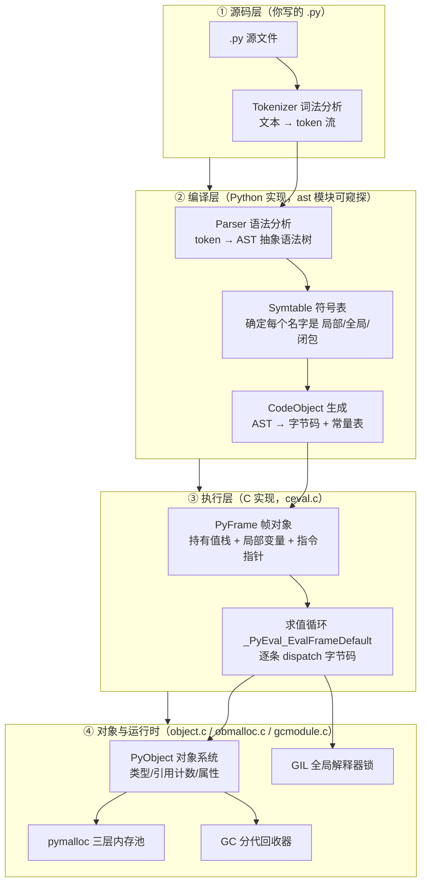

关键分层理解：

| 层 | 谁在做 | 产出物 | 你能怎么观察它 |
|---|---|---|---|
| 词法 + 语法 | PEG 解析器（3.9 起替代 LL(1)） | AST | `ast.parse(src)` / `ast.dump()` |
| 符号表 | `symtable` 模块 | 名字的作用域归属 | `symtable.symtable()` |
| 编译 | `compile()` | code object | `co = compile(...)`，`dis.dis(co)` |
| 执行 | `ceval.c` 求值循环 | 副作用（结果） | `sys.settrace` / `dis` |

**记住这个链路的价值**：面试里 90% 的"为什么"都能挂到这条链上。例如：

- "为什么局部变量比全局变量快" → 编译阶段就确定了 `LOAD_FAST` vs `LOAD_GLOBAL`；
- "为什么闭包需要 cell 对象" → 符号表阶段发现 `co_freevars`；
- "为什么 `+=` 有时改原对象有时不改" → 编译成不同的字节码（`INPLACE_ADD` 走 `__iadd__`）。

### 0.3 本文的两条主线

1. **"名字与对象"主线**（第 1、2 章）：一切赋值都是引用绑定，一切"修改"都是对对象的原地操作或新建对象。
2. **"编译与执行"主线**（第 4 章）：代码在编译期被决定成什么样的指令，决定了运行期的性能与语义。

---

## 第 1 章 对象模型：Python 世界的物理法则

### 1.1 一切皆 PyObject

CPython 里每个 Python 对象，在 C 层面都是这样一个结构体的"头部 + 载荷"：

```c
// Include/object.h（简化）
typedef struct _object {
    Py_ssize_t ob_refcnt;      // 引用计数（3.12 起部分对象是 immortal）
    PyTypeObject *ob_type;     // 指向类型对象，决定"你是谁、你能做什么"
} PyObject;

typedef struct {
    PyObject ob_base;          // 复用上面的头
    Py_ssize_t ob_size;        // 变长对象的元素个数（list/str/tuple/int）
} PyVarObject;
```

也就是说：**所有 Python 对象的前 16 个字节（64 位下）长得一模一样**——一个引用计数，一个类型指针。这是 C 层面能做"泛型容器"的根本原因：`list` 里存的不是值，是一串 `PyObject*` 指针，所以异质元素（int / str / 自定义对象）能混装。

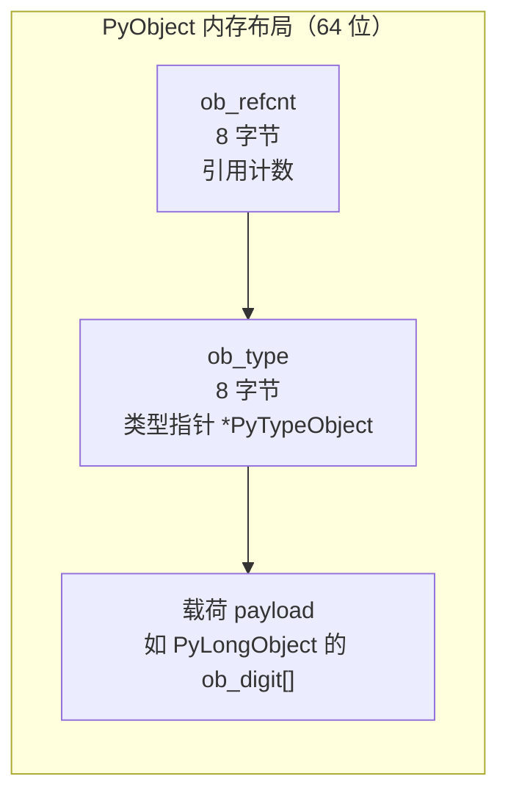

> **延伸：为什么 Python 的 int 不是 C 的 int？**
> `PyLongObject` 的载荷是 `ob_digit[]` 数组（每个 digit 30 bit），所以 Python 整数是**任意精度大整数**，`2**1000` 能直接算。代价是：每次算术都是函数调用 + 可能的内存分配，比 C 的 `int` 慢一到两个数量级。这是"Python 慢"最朴素的一层原因——**连加法都不是一条 CPU 指令，而是一次函数调用**。

### 1.2 变量不是盒子，是标签（引用语义）

```python
a = [1, 2, 3]
b = a          # b 和 a 指向同一个 list 对象
b.append(4)    # 通过 b 修改的，就是 a 看到的那个对象
print(a)       # [1, 2, 3, 4]
```

内存视图：

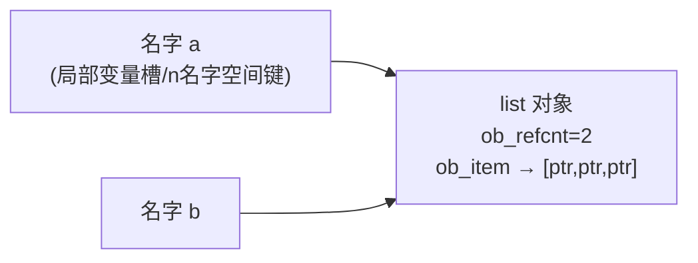

由此推出三条铁律：

1. **赋值永不复制对象**，只增加一个引用（`ob_refcnt + 1`）；
2. **参数传递既不是值传递也不是引用传递**，官方说法是 **"call by object reference"（传对象引用 / call by sharing）**：把实参对象的引用交给形参名；
3. **"可变 vs 不可变"决定的是"能不能原地改这一个对象"，不是"能不能改这个变量"**。`x += 1` 对 int 是"造一个新对象再把名字改指过去"。

### 1.3 `id` / `is` / `==` 的三角关系

| 运算符 | 比较的是什么 | 底层调用的 | 开销 |
|---|---|---|---|
| `id(x)` | 对象的**内存地址**（CPython 实现细节） | 直接读 `PyObject*` 的值 | O(1) |
| `x is y` | 两个名字是否指向**同一个对象** | 指针相等比较 | O(1) |
| `x == y` | 两个对象的**值是否相等** | `PyObject_RichCompare` → `__eq__` | 可能 O(n) |

推论：

- `is` 只应该用于**单例**：`None`、`True`、`False`、`Ellipsis`、以及自定义的哨兵对象；
- `1 is 1.0` 为 `False`（不同对象），但 `1 == 1.0` 为 `True`（值相等，`int.__eq__` 做了跨类型比较）；
- `[] is []` 恒 `False`，`[] == []` 恒 `True`。

### 1.4 小整数缓存（[-5, 256]）与字符串驻留

CPython 启动时就把 `-5 ~ 256` 这 262 个整数对象**预先创建好**，全局共享（`small_ints[]` 静态数组）。所以：

```python
a = 256; b = 256
print(a is b)          # True  —— 命中缓存
a = 257; b = 257
print(a is b)          # 交互式逐行执行：False；写在同一个函数/模块里：通常是 True
```

**为什么文件里 257 也常常是 True？** 因为**同一个 code object 的 `co_consts` 常量表去重**：编译器把 `257` 放进常量池只放一份，两个 `LOAD_CONST` 取的是同一个对象。判断依据不是"数值大小"，而是"是否在同一个常量表里"。

```python
def f():
    a = 257
    b = 257
    return a is b       # True（同一个 co_consts[1]）
```

字符串驻留（interning）：

- **编译期自动驻留**：看起来像标识符的字符串（只含字母数字下划线）在编译时被 intern；
- **运行期**：`sys.intern(s)` 手动驻留；
- 目的：让 dict 的键查找可以**先比指针、再比内容**（`unicode_eq` 里有 `if (a == b) return 1` 的快路径），以及节省内存。

> **延伸：为什么不要用 `is` 比较字符串？**
> 驻留是实现细节，不受语言规范保证。`"hello world" is "hello world"` 在不同版本/不同拼接方式下结果不一致，属于"靠巧合正确"的代码。

### 1.5 可变 / 不可变 / 可哈希 三件套

| 分类 | 类型 | 能否原地修改 | 是否可哈希（默认） |
|---|---|---|---|
| 不可变 | `int` `float` `complex` `bool` `str` `bytes` `tuple`（元素全可哈希时）`frozenset` `range` `None` | 否 | 是 |
| 可变 | `list` `dict` `set` `bytearray` `自定义普通对象` | 是 | 否（`__hash__ = None`） |

**可哈希的前提**（三条缺一不可）：

1. 生命周期内 `__hash__()` 返回值不变 → 所以可变对象被排除；
2. 有 `__eq__()` 且 `a == b` 时 `hash(a) == hash(b)`；
3. 能与其它对象比较（不一定要求同类型）。

**为什么需要"可哈希"？** 因为 `dict` / `set` 的 O(1) 查找靠"哈希值定位桶"。如果对象的哈希值会变，那么存进去时算出的桶位置，取出来时就算不到了——**数据结构会失效**。这就是"list 不能当 dict key"的**根本原因，不是语法限制，是正确性要求**。

```python
class A:
    def __eq__(self, other): return True
# 注意：定义 __eq__ 后，Python 自动把 __hash__ 置为 None（不可哈希）
hash(A())   # TypeError: unhashable type: 'A'
```

> **延伸：为什么 tuple 里放 list 就不能当 key？**
> `tuple.__hash__` 的实现是逐个元素调用 `PyObject_Hash`；遇到 `list` 时它没有 `__hash__`（是 `None`），直接抛 `TypeError`。**哈希是递归的**，所以"不可变的壳 + 可变的芯"依然不可哈希。

### 1.6 对象的创建与销毁：`__new__` / `__init__` / `__del__`

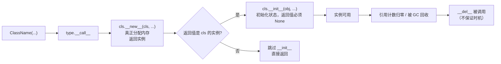

要点：

- `__new__` 是**静态方法**（隐式），负责"生"；`__init__` 是实例方法，负责"养"；
- 只在需要控制"实例化本身"时重写 `__new__`：单例、不可变子类（如继承 `tuple`/`str`/`int`）、元类创建类时；
- `__del__` **不是析构函数的可靠替代品**，它由引用计数归零或 GC 触发，解释器退出时行为不确定，不要在里做关键资源释放 → 用 `with` / `try-finally` / `weakref.finalize`。

### 1.7 属性访问的完整协议栈

`obj.x` 这一个点号，背后是一条**优先级明确的查找链**：

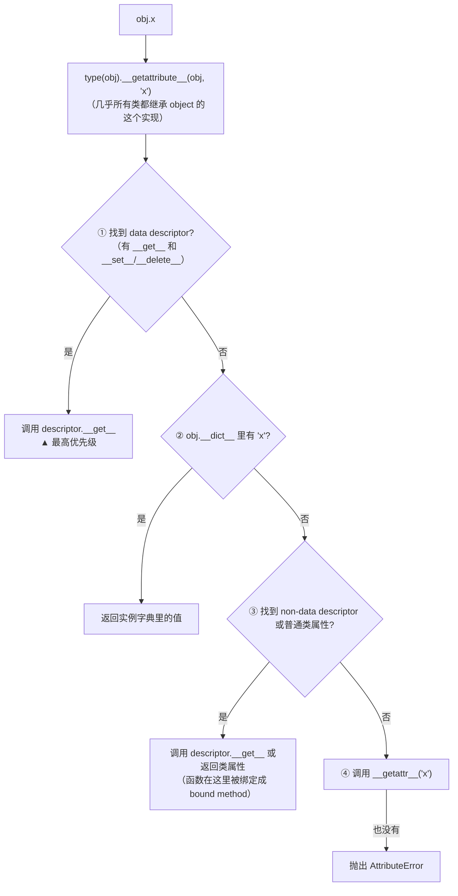

注意两个"看似一样其实完全不同"的钩子：

| 钩子 | 何时被调用 | 典型用途 |
|---|---|---|
| `__getattribute__` | **每一次**属性访问（无条件最先进去） | 拦截所有访问（代理、日志、ORM），极易写出无限递归 |
| `__getattr__` | **只有正常查找失败后**才调用（兜底） | 动态属性、`__getattr__` 实现懒加载 / 兼容旧接口 |

同理，`__setattr__` 拦截所有赋值，`__delattr__` 拦截删除。写 `__getattribute__` 时必须用 `object.__getattribute__(self, name)` 或 `super().__getattribute__` 取真值，否则 `self.x` 会再次进入你自己 → **无限递归（RecursionError）**。

### 1.8 描述符协议：Python 里最"魔法"也最核心的协议

```python
class Descriptor:
    def __get__(self, obj, objtype=None): ...
    def __set__(self, obj, value): ...
    def __delete__(self, obj): ...
```

只要一个**类属性**实现了上述任一方法，它就是描述符。**只要它定义了 `__get__` 和 `__set__`（data descriptor），它的优先级高于实例 `__dict__`。**

框架里到处是它：

| 你用的东西 | 本质 |
|---|---|
| `@property` | 一个 data descriptor（`property` 类型） |
| `@classmethod` | 一个 non-data descriptor，`__get__` 返回绑定到 **类** 的函数 |
| `@staticmethod` | 一个 non-data descriptor，`__get__` 返回**裸函数** |
| 普通方法 `def f(self)` | `function` 类型实现了 `__get__`，`__get__` 返回 `method` 对象（把 `self` 塞进去） |
| `__slots__` | 类创建时生成的 member descriptor（`__get__/__set__` 直接读写 C 结构体里的偏移） |
| SQLAlchemy / Django ORM 的字段 | data descriptor（拦截读写做校验与懒加载） |

**这就是"为什么方法调用会自动传 self"的答案**：函数对象在类字典里，通过 `__get__` 被"绑定"，产生一个 `method`，`method.__call__` 时把 `self` 作为第一个参数塞进去。

---

## 第 2 章 内存管理：从 malloc 到 pymalloc 的三层结构

### 2.1 为什么 Python 不直接 malloc？

如果你写过 C，会知道 `malloc/free` 有两个特点：**慢**（要维护空闲链表、可能触发系统调用 `brk/mmap`）、**碎片**（小块内存反复申请释放导致堆碎片）。Python 每秒可能创建销毁几百万个小对象（每个临时整数、每个字符串、每个 frame），如果直接 malloc，性能会崩。

于是 CPython 自己实现了一层分配器 **pymalloc**：**小对象集中批采、自己切分、自己回收**。

### 2.2 三层结构：Arena → Pool → Block

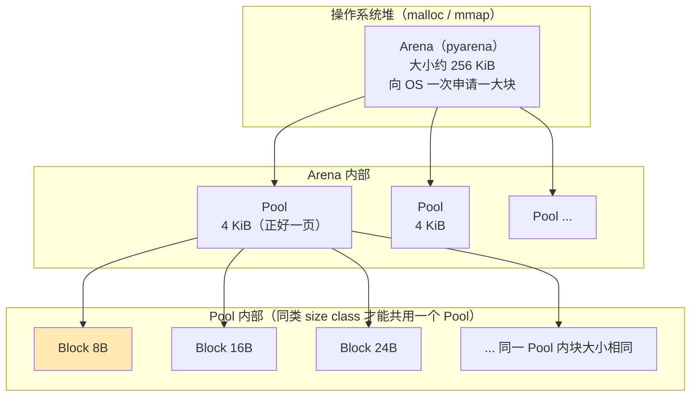

规则（`obmalloc.c`）：

- **申请 ≤ 512 字节**：走 pymalloc。按 8 字节对齐向上取整，得到 **64 个 size class**（8, 16, 24, …, 512）；
- 每个 Pool（4 KiB）只服务**一个 size class**，所以池内的块等大，天然没有"外部碎片"；
- Pool 把 `freeblock` 串成**单向空闲链表**，分配 = 摘头节点，释放 = 头插，**O(1)**；
- 当一个 Pool 的块全部空闲，Pool 可以被归还给 Arena；Arena 全空才可能还给 OS；
- **申请 > 512 字节**：直接走系统 `malloc`（大对象没必要池化，池化反而浪费）。

### 2.3 这套设计带来的三个副作用（面试常问）

1. **内存不轻易还给操作系统**：`del` 大列表后，`top` 里 RSS 可能不降。因为空闲 block 留在 Arena 里复用，这是**设计目标而非 bug**（避免反复向 OS 申请）。
2. **内存碎片表现为"水位不降"**：典型场景是"导入大量数据后释放，进程常驻内存仍然很高"。
3. **监控要看 `tracemalloc` 而不是 RSS**：RSS 包含未归还的空闲池。

```python
import tracemalloc
tracemalloc.start()
snap1 = tracemalloc.take_snapshot()
# ... 业务代码 ...
snap2 = tracemalloc.take_snapshot()
for stat in snap2.compare_to(snap1, 'lineno')[:10]:
    print(stat)   # 按行号定位增长最多的分配点
```

### 2.4 各类型的"内存开销"实测感

一个 Python 对象的实际成本 = 对象头 + 载荷 + 引用它的容器槽位。粗算（64 位）：

| 对象 | 大小 | 备注 |
|---|---|---|
| 小整数缓存内 | 0（共享） | `-5~256` |
| 普通 `int`（小值） | 28 字节 | `24 头 + 1 digit` |
| `float` | 24 字节 | 直接存 double |
| 空 `str` / 短 ascii `str` | 49~ | `PyASCIIObject` 头 + 字符 |
| 空 `list` | 56 字节 | 不含元素指针数组 |
| 空 `dict` | 64 字节（3.11+ 更省） | |
| 自定义空对象（有 `__dict__`） | 48 + 无 dict | 实例字典另算（3.11 key-sharing 后可低至 96 内） |

> **延伸：这就是 `__slots__` 能省 40%~60% 内存的原因**
> 普通实例 = `PyObject` 头 + `__dict__` 指针；而 `__dict__` 是一个 dict，即使只有一个属性也要一个哈希表（几百字节）。`__slots__` 把属性存成对象体内的**固定偏移数组**，完全不建 dict。
> 更精确地说，3.11 之后普通实例用 **key-sharing dict**：同类实例共享键表，只存值数组，所以 `__slots__` 的优势从"数量级"降到"显著"，但在**创建速度**和**属性访问速度**上仍然更快（`__slots__` 的 member descriptor 直接按偏移读写）。

### 2.5 引用计数的精确规则（面试高频细节）

`ob_refcnt` 的加减时机，可以用"**谁持有引用**"来判断：

| 增加引用 (+1) | 减少引用 (-1) |
|---|---|
| 赋值 `a = obj`（新的名字绑定） | 名字被重新绑定 `a = other` |
| 放进容器 `lst.append(obj)` | 从容器移除 `lst.remove(obj)` / `del lst[0]` |
| 作为参数传入函数（形参绑定） | 函数返回，局部变量销毁 |
| 返回给调用方 | 容器本身被销毁（连带减元素） |
| 作为属性存入 `obj.attr = x` | `del obj.attr` |

**容器"接管引用"**：`lst.append(x)` 会增加 `x` 的引用计数，所以 `x` 不会在列表还活着时被释放——这是 Python 没有"悬垂指针"的原因。

**引用计数的两个致命缺陷**：

1. **维持成本高**：每次赋值都是内存写（多线程下还涉及原子操作），这是 Python 慢的一个重要来源（PEP 683 的 immortal objects 就是为了省掉热点对象的加减）；
2. **无法处理循环引用**：见下一章。

> **延伸：`sys.getrefcount(x)` 为什么总比预期多 1？**
> 因为 `x` 作为**实参**传给 `getrefcount` 时又绑定了一次，那一刻 +1。这就是"观察行为本身改变了被观察对象"。

---

## 第 3 章 垃圾回收：引用计数 + 分代标记清除

### 3.1 双机制分工

| 机制 | 负责什么 | 触发时机 | 代价 |
|---|---|---|---|
| **引用计数** | 绝大多数对象（无环） | 实时，归零立刻释放 | 每次赋值都要加减 |
| **分代标记清除（GC）** | **循环引用** | 分配计数超阈值时周期性扫描 | 停止世界（STW），遍历容器对象 |

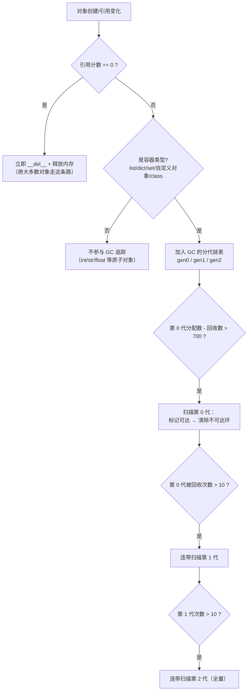

### 3.2 为什么是"分代"

**弱代假说（Weak Generational Hypothesis）**：绝大多数对象生命周期极短（临时变量），而活得久的对象往往还会活很久（模块、连接池、缓存）。

所以策略是：**重点扫描年轻代，很少扫描老年代**。新对象进 **gen0**；gen0 存活过一次回收就晋升 gen1；gen1 再存活就进 gen2。这样长期对象被反复扫描的次数大幅下降。

默认阈值 `gc.get_threshold() == (700, 10, 10)`：

- 第 1 个数：gen0 的 `分配数 - 释放数 > 700` 时触发一次 gen0 回收；
- 第 2 个数：每回收 10 次 gen0，做一次 gen1；
- 第 3 个数：每回收 10 次 gen1，做一次 gen2（**全量**，最贵）。

### 3.3 循环引用是怎么被发现的

```
a = {}
b = {}
a['b'] = b      # a 引用 b
b['a'] = a      # b 引用 a
del a, b        # 名字没了，但两个对象互相引用，refcnt 各为 1 → 不归零
```

GC 的做法（3.4 之后的**增量式**三色标记）：

1. 把 gen0 里所有对象的 `gc_refs` 设为当前 `ob_refcnt`；
2. 遍历每个对象的引用，对**被引用的内部对象**减 1（"扣掉内部引用"）；
3. 剩下的 `gc_refs > 0` 的，说明还有**外部**引用 → 是"根"，标记可达，并把可达对象的引用继续传播；
4. 最终 `gc_refs == 0` 的，就是**只能被环内引用**的对象 → 判定为垃圾，回收。

**这就是"标记-清除"在引用计数体系里的变体**：不是真的去数"有没有人引用我"，而是"扣掉环内部的相互引用后，还剩多少外部引用"。

### 3.4 `__del__` 的历史坑（PEP 442，3.4+ 已修）

3.4 之前，带 `__del__` 的对象一旦陷入循环引用，GC 会**直接放弃回收**（因为不知道该先调哪个 `__del__`），造成真实泄漏。3.4 起 GC 会先调用 `__del__`，再回收（`__del__` 里 `raise` 的异常会被 `sys.unraisablehook` 吞掉）。

但**仍然存在的风险**：`__del__` 执行时对象可能已经被"部分拆解"，属性状态不可靠；`__del__` 里 `raise` 会静默丢失；对象"复活"（`__del__` 里把自己存进全局）会让回收变得复杂。

→ 现代实践：**别用 `__del__` 管资源**，用 `contextlib.closing` / `with` / `weakref.finalize`。

### 3.5 怎么主动干预 GC（生产环境常见操作）

```python
import gc

gc.disable()                 # 关闭自动 GC（高性能短任务、已知无环的场景）
gc.collect()                 # 手动全量回收，返回回收对象数
gc.collect(0)                # 只回收 gen0（成本最低）
gc.get_count()               # 当前三代计数
gc.get_threshold()           # 阈值
gc.set_threshold(1000, 10, 10)
gc.get_referrers(obj)        # 谁引用了我（调试泄漏利器，但很慢）
gc.get_referents(obj)        # 我引用了谁
```

**`gc.freeze()`（3.7+）**：把当前所有对象"冻结"到 gen2 的永久代，**之后 GC 不再扫描它们**。在"先 import 一大堆库，再 fork 多进程"的场景里，这是**必杀技**：fork 后 GC 不扫描那些只读的模块对象，减少写时复制（COW）破坏，同时加速 GC。

> **延伸：为什么 Web 服务里会看到"GC 抖动导致 P99 抖动"？**
> gen2 全量扫描要遍历所有容器对象（几十万到几百万），耗时可达几十毫秒到上百毫秒，且是 STW（在 GIL 下等于所有线程停摆）。优化手段：调大阈值、`gc.freeze()`、用 `gc.disable()` + 定期手动 `gc.collect(0)`、减少创建大量容器对象（如避免每秒创建百万小 dict）。

### 3.6 内存泄漏的三个真实来源（不是 GC 的锅）

1. **循环引用持有者不释放**：全局 registry / 缓存里的 key 是对象本身、闭包捕获了大对象、`functools.lru_cache` 无上限；
2. **lru_cache / 单例 / 全局列表只增不减**（最常见的"泄漏"）；
3. **C 扩展引用计数写错**（自研扩展、老版本第三方库）。

**排查流程**：

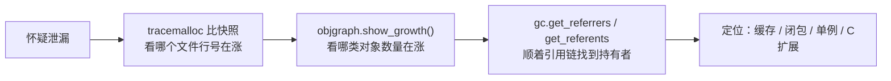

---

## 第 4 章 解释器执行：源码 → 字节码 → 求值循环

### 4.1 编译产物：code object 里到底存了什么

```python
def add(a, b):
    c = a + b
    return c

print(add.__code__.co_varnames)   # ('a', 'b', 'c')  局部变量名
print(add.__code__.co_argcount)   # 2
print(add.__code__.co_consts)     # (None,)  常量表
print(add.__code__.co_names)      # ()      全局/属性名表
print(add.__code__.co_code)       # 原始字节码 bytes
```

| 字段 | 含义 | 为什么重要 |
|---|---|---|
| `co_code` | 字节码指令序列（每条 2 字节，3.11 起有 CACHE 附加槽） | `dis` 反汇编 |
| `co_consts` | 常量元组（数字、字符串、内嵌 code） | 常量折叠 / 驻留 |
| `co_names` | 全局名、属性名（`LOAD_GLOBAL` / `LOAD_ATTR` 的索引） | 决定走字典查找 |
| `co_varnames` | 局部变量名（含参数） | `LOAD_FAST` 的下标，**数组索引，最快** |
| `co_freevars` | 闭包引用的外层变量 | `LOAD_DEREF` |
| `co_cellvars` | 本函数里被内层引用的变量 | 编译期决定要不要造 cell |
| `co_flags` | 生成器/协程/变参标志 | `inspect.isgeneratorfunction` 靠它 |

**重点**：`co_varnames` / `co_names` / `co_freevars` 这三张表在**编译期**就定死了。所以一个名字属于局部还是全局，运行期完全不用判断——这就是"局部变量快"的机制性原因。

### 4.2 反汇编看真实的执行逻辑

```python
import dis
def f(xs):
    total = 0
    for x in xs:
        total += x
    return total

dis.dis(f)
```

输出（3.11+，已做特化，`dis` 显示的是原始指令名）：

```
  2           0 RESUME                   0
  3           2 LOAD_CONST               0 (0)      ← 常量从 co_consts 取
              4 STORE_FAST               0 (total)  ← 存进帧的局部槽位（数组下标）
  4           6 LOAD_FAST                0 (xs)
              8 GET_ITER                             ← 调 __iter__
        >>   10 FOR_ITER                 6 (to 26)  ← 反复调 __next__
             12 STORE_FAST               1 (x)
  5          14 LOAD_FAST                0 (total)
             16 LOAD_FAST                1 (x)
             18 BINARY_OP                += (0)     ← 3.11 起合并算术指令
             22 STORE_FAST               0 (total)
             24 JUMP_BACKWARD           6 (to 10)
  6     >>   26 LOAD_FAST                0 (total)
             28 RETURN_VALUE
```

由此可以读出三件事：

1. **`for` 循环就是 `GET_ITER` + `FOR_ITER` 的糖**，`FOR_ITER` 内部调 `tp_iternext`，结束时抛 `StopIteration` 被吃掉；
2. **`total` 是 `STORE_FAST`（数组下标）**，而如果 `total` 是全局变量，会变成 `STORE_GLOBAL`（**哈希表查找**）→ 这是"把全局变量搬进函数"能提速的直接原因；
3. 常数 `0` 从 `co_consts` 取，不重新构造。

### 4.3 帧对象（PyFrame）：执行现场

```python
import sys
def outer():
    x = 1
    def inner():
        return x     # 通过闭包 cell 拿到 x
    return inner
```

帧里有什么：**值栈（value stack） + 局部变量槽位数组 + 指令指针 + 指向上一帧的 f_back + f_globals / f_builtins / f_code / f_lasti**。

三个关键点：

- **帧是"调用栈"的实体**。`sys._getframe()` / `inspect.currentframe()` 能拿到它；`f_back` 形成链，这就是"能不能回溯调用栈"的物理基础；
- **`f_locals` 对函数帧来说只是一个"快照副本"**（3.13 起变成 write-through 代理），所以"在函数里 `locals()['x']=1` 改不了真正的 x"是**设计使然**（局部变量存在数组里，不是字典）；
- **3.11 起帧对象是惰性创建的**：正常执行时帧在 C 栈上（`_PyInterpreterFrame`），只有你 `sys._getframe()` 或需要 traceback 时才物化出 `PyFrameObject` → 函数调用开销显著下降（这是 3.11 提速 ~25% 的原因之一）。

### 4.4 求值循环（ceval）：一台栈式虚拟机

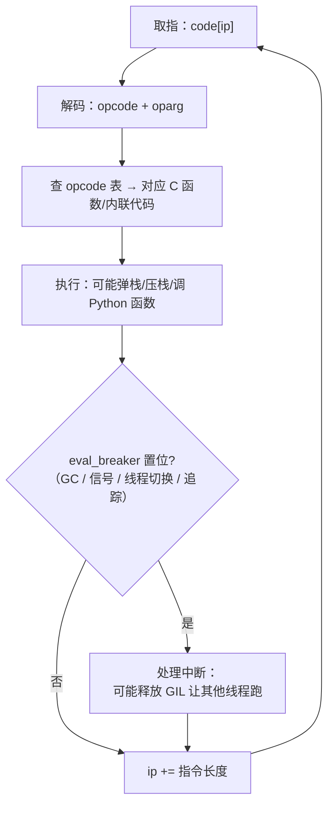

**Python 的字节码是"栈式"的**：没有寄存器，操作数从"值栈"弹出，结果压回值栈。`a + b` 的流程是 `LOAD a`（压栈）→ `LOAD b`（压栈）→ `BINARY_OP +`（弹两个，压一个）。

这带来两个特征：

- **指令紧凑**（不需要编码寄存器号），但**访存多**（每条指令都要操作栈顶）；
- 3.11 起引入 **"栈上缓存寄存器"**（在帧结构里预留固定槽位，常见指令直接操作槽位而不是反复 push/pop），配合 **PEP 659 特化**，把很多"通用的字典查找"变成"类型检查 + 直接偏移访问"。

### 4.5 PEP 659 自适应特化解释器（3.11 至今，面试热点）

**问题**：`LOAD_ATTR` 每次都要走完整的 `__getattribute__` 流程（查类型、找描述符、查实例字典），对一个 `self.x` 来说太浪费。

**做法**：解释器**在执行时观察**——如果某一处 `LOAD_ATTR` 连续几次都遇到"实例字典里有这个属性、类型没变"，就把这条指令**原地替换成专用版本** `LOAD_ATTR_INSTANCE_VALUE`，并在指令后面附带**内联缓存（inline cache）**：记住 `(类型版本号, 属性偏移)`，下次直接按偏移取值。若类型变化（`type->tp_version_tag` 变了），缓存失效，回退到通用版本。

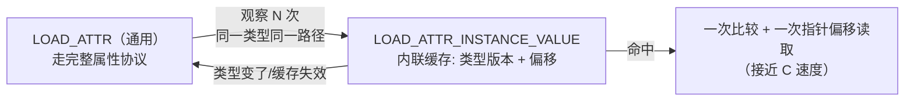

同样的特化还覆盖：`BINARY_OP`（int 加法专用版）、`CALL`（`CALL_PY_EXACT_ARGS` 跳过参数解析）、`FOR_ITER`（列表/元组迭代专用版）、`LOAD_GLOBAL`（模块字典缓存）等。

**延伸**：

- 特化是**运行时自适应**的，所以"第一次跑慢、跑热了快"（warm-up）。这也是为什么微基准要用 `timeit`（默认多次重复，取最好值）；
- 3.13 在此基础上加了 **Tier 2 优化器 + 实验性 JIT（copy-and-patch）**，把热循环编译成机器码；
- 特化对你**写代码的启示**：**保持类型稳定**（同一变量不要一会儿 int 一会儿 str），让内联缓存命中；**避免在热循环里改类属性/加方法**（`tp_version_tag` 变了会让缓存全失效）。

### 4.6 常量折叠与窥孔优化（编译期就干掉了）

```python
def f():
    return 1 + 2 * 3        # 编译成 LOAD_CONST 7
def g():
    return 2 ** 1000        # 编译期就算好了
```

注意：**只对"常量"生效**。`x = 1; y = x + 2` 不会折叠。另外 `if 0: ...` 这种**恒假分支不会被删除**（CPython 只做窥孔级优化，不做死代码消除），这也是 CPython 与 PyPy/JIT 的性能差距来源之一。

### 4.7 关于"Python 是动态语言所以慢"的准确说法

| 慢的层次 | 具体原因 | 数量级 |
|---|---|---|
| ① 每步都是 C 函数调用 | 一次 `+` 是 `PyNumber_Add` → 类型分派 → `long_add` | ~50-100 ns |
| ② 对象在堆上、非连续 | 缓存局部性差，CPU cache miss 多 | 数倍 |
| ③ 引用计数读写 | 每次赋值写内存，多线程还要原子操作 | 数倍 |
| ④ 无法提前确定类型 | 只能运行时分派，无法用寄存器/向量化 | 数十倍 |
| ⑤ GIL 限制并行 | 多核用不上 | 看场景 |

**所以正确的说法是**：不是"动态"本身慢，而是"**动态 + 通用对象模型 + 引用计数 + 解释执行**"的组合慢。Cython / Numba / PyPy / Rust 扩展都是在某一层上把这层成本抹掉。

---

## 第 5 章 GIL：最著名的"锁"到底是什么

### 5.1 GIL 是什么，不是什么

**GIL（Global Interpreter Lock）是一把互斥锁，保护的是 CPython 解释器的内部状态**——具体来说是 `ceval` 的求值循环：**同一进程同一时刻，只有一个线程在解释执行 Python 字节码**。

它**不是**：

- 不是"Python 语言规范"（PyPy 有 GIL，Jython/IronPython 没有，3.13 可编译出无 GIL 版本）；
- 不是"你所有代码都被锁住了"——**执行 C 代码期间释放 GIL**（`numpy` 计算、`hashlib`、`zlib`、`socket` 系统调用、`time.sleep`、文件 IO 都会主动 `Py_BEGIN_ALLOW_THREADS` 放锁）。

### 5.2 为什么要有 GIL（历史与现状）

早期 CPython 的引用计数、内存池（pymalloc）、以及大量 C 扩展的 API 都**默认"单线程访问"**。要支持真正的并行，就得给每个对象加锁（细粒度锁），代价是：

- 单线程性能下降 30%+（每次 refcnt 都要原子操作）；
- 所有 C 扩展都要重写成线程安全，生态崩了；
- 死锁风险剧增。

所以 1992 年 Guido 选择了**一把大锁**：简单、单线程快、C 扩展开发容易。

### 5.3 GIL 的切换机制

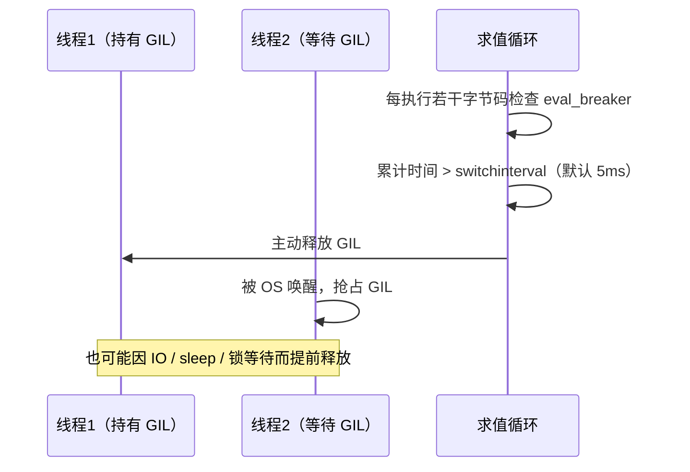

两个可调旋钮：

```python
import sys
sys.getswitchinterval()      # 默认 0.005 秒
sys.setswitchinterval(0.001) # 调小 → 切换更频繁（IO 响应更及时，但上下文切换成本上升）
```

**重要细节**：换 GIL 时，线程可能正在一个"多步操作"中间（比如 `x += 1` 分为"读 x / 加 / 写回"三步）。这就是**"Python 里的 `+=` 不是原子操作"**的原因——用 `dis` 看 `x += 1` 是 `LOAD / BINARY_OP / STORE` 三条指令，线程可能在中间被切走。

```python
# 典型竞态：两个线程同时 count += 1，可能只加了 1
counter = 0
def worker():
    global counter
    for _ in range(100_000):
        counter += 1     # 非原子！
# 正确做法：threading.Lock() 保护，或用 queue，或 multiprocessing.Value（带锁）
```

### 5.4 CPU 密集 vs IO 密集的决策树

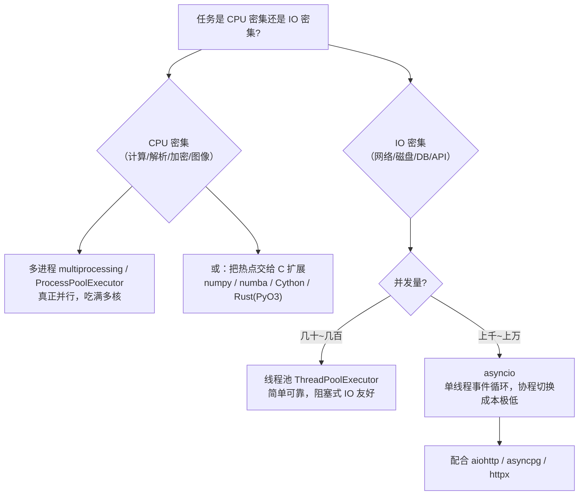

**结论一句话**：GIL 让"线程"适合 **IO 并发**（因为等 IO 时放锁），让"进程"负责 **CPU 并行**（因为各有独立解释器与 GIL）。

### 5.5 3.13 的自由线程（PEP 703）与 3.12 的"每解释器 GIL"（PEP 684）

| 方案 | 版本状态 | 机制 | 代价 |
|---|---|---|---|
| 每解释器 GIL（PEP 684） | 3.12+ 正式可用 | 每个 sub-interpreter 一把 GIL，可真正并行 | 需要 `Py_NewInterpreter`，跨解释器共享对象受限 |
| Free-threading（PEP 703） | 3.13 实验性（独立构建 `--disable-gil`） | 去掉 GIL，用**偏向引用计数（biased refcount）+ 细粒度锁 + 对象级延迟回收** | 单线程性能略降（~5-10%）、内存上升、部分 C 扩展不兼容 |
| JIT（copy-and-patch） | 3.13 实验性 | 热点代码编译成机器码 | 默认关闭 |

**面试怎么答 3.13 的影响**：方向明确（真正多核并行），但**短期内生产不普及**：生态（numpy/Cython/大量 C 扩展）需要重编译与适配，性能特征变化，运维成本高。所以"GIL 会消失"这句话在 2026 年依然是"方向对、时间早"。

---

## 第 6 章 核心数据结构的内核实现

这一章是面试重灾区。**每个容器的"底层结构 + 复杂度 + 扩容策略"都要能画出来。**

### 6.1 list：一个"会预扩容"的指针数组

```c
typedef struct {
    PyObject_VAR_HEAD
    PyObject **ob_item;   // 指向一块连续指针数组
    Py_ssize_t allocated; // 已分配容量（注意 ≠ ob_size 元素个数）
} PyListObject;
```

三个关键点：

1. **存指针，不存值**。所以 `[1, "a", None]` 可以混装，`ob_item[i]` 取出来就是 `PyObject*`；
2. **`ob_size` 与 `allocated` 分离**，这是"预扩容 / over-allocation"的实现基础；
3. **扩容公式（3.x）**：

```c
new_allocated = newsize + (newsize >> 3) + (newsize < 9 ? 3 : 6);
```

即大约 **1.125 倍 + 常量**。为什么这么小？因为 **`list` 大量用于 append 场景**，但又要防止"内存浪费 2 倍"；同时配合 `allocated` 只在**填满时**才扩容，均摊成本 O(1)。

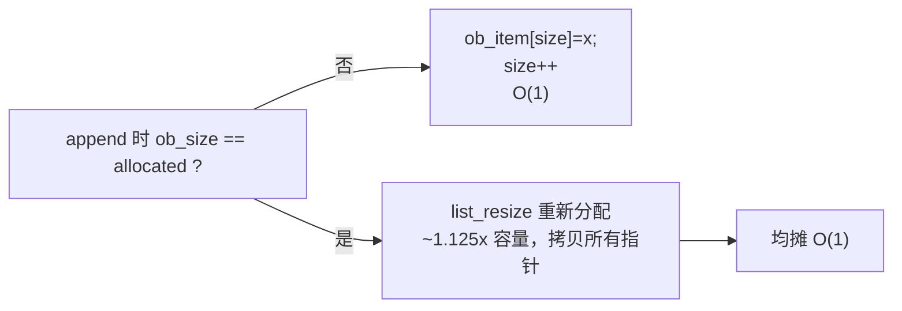

**复杂度表（必背）**：

| 操作 | 复杂度 | 原因 |
|---|---|---|
| `append` / `pop()`（尾部） | 均摊 O(1) | 预扩容 + 直接下标 |
| `insert(0, x)` / `pop(0)` | **O(n)** | 要 memmove 移动全部指针 |
| `x in lst` | **O(n)** | 逐个 `PyObject_RichCompare` |
| `lst[i]` | O(1) | 指针数组下标 |
| `del lst[i]` | O(n) | 后续要前移 |
| `sort()` | O(n log n) | Timsort（见下） |

> **延伸：Timsort 为什么是"自适应"的？**
> 它先找"自然有序的 run"（升序直接留，降序就地翻转），再对小 run 做二分插入排序，最后用"归并 + galloping"合并。对**部分有序**的真实数据接近 O(n)，最坏 O(n log n)，且**稳定**。这就是"Python 排序比快速排序在真实数据上更快"的原因。

> **性能铁律**：`list` 只适合"尾部增删 + 随机读"。需要"头部增删"用 `collections.deque`；需要"去重"用 `set`；需要"按值查找"用 `dict`。

### 6.2 tuple：不可变的"体型固定"对象

```c
typedef struct {
    PyObject_VAR_HEAD
    PyObject *ob_item[1];   // 柔性数组，直接内联在对象体内
} PyTupleObject;
```

与 list 的**结构性差异**：

| 维度 | list | tuple |
|---|---|---|
| 元素存储 | 对象体里存 `ob_item` **指针**，指向**另一块**堆数组 | 元素指针**内联在对象内部**（一块内存） |
| 可变 | 是 | 否 |
| 内存 | 对象 + 数组（两次分配） | 一次分配（少 8~16 字节 + 少一次 malloc） |
| 创建速度 | 较慢（要初始化 allocated） | **快**（一次分配，`BUILD_TUPLE` 直接填） |
| 缓存 | 无 | **空 tuple 是单例**；小常量 tuple 可在 `co_consts` 中复用 |
| 可哈希 | 否 | 元素全可哈希时可哈希 |

**为什么 tuple 更快 / 更省？** 一句话：**少一次内存分配 + 内存连续 + 创建后可被解释器当作常量复用**。

**为什么"不可变"很重要（工程价值）**：

- 可以作为 dict 的 key / set 的元素（因为哈希值稳定）；
- 可以作为**函数默认参数**、模块级常量，天然线程安全；
- 让解释器能安全地做"常量复用"与"内联缓存"；
- 语义上表达"这是一个结构体/记录"，而不是"一个可变的袋子"。

**经典理解题**：

```python
t = ([1, 2], 3)
t[0].append(4)          # 合法！tuple 不可变 ≠ 元素不可变
print(t)                # ([1, 2, 4], 3)
hash(t)                 # TypeError: unhashable type: 'list'
```

**"不可变"指的是"tuple 自己持有的引用不能换"**，它不承诺"被引用的对象不会变"。这解释了为什么 tuple 里放 list 后就不可哈希——哈希会失败，因为它**不再满足"哈希值恒定"的前提**。

### 6.3 dict：从"稀疏哈希表"到"紧凑字典 + 键共享"

这是 Python 最有讲头的数据结构。

#### 6.3.1 演进史

| 版本 | 结构 | 关键变化 |
|---|---|---|
| ≤ 3.5 | 一张大的稀疏哈希表，每个 slot 存 `(hash, key, value)` | 内存浪费大（负载 2/3 时空槽也占 24 字节） |
| 3.6 | **compact dict**（Raymond Hettinger 提议，移植自 PyPy） | **索引表 + 紧凑条目数组**，内存省 20~25%，且**插入顺序天然有序**（实现细节） |
| 3.7 | 同上 | **官方保证"插入有序"**（语言规范） |
| 3.11 | **键共享字典（key-sharing dict）** | 同类实例的 `__dict__` 共享键表，只各存值数组，实例内存大幅下降 |

#### 6.3.2 3.6+ 的紧凑结构（必须会画）

```c
/* 简化 */
struct _dictkeysobject {
    Py_ssize_t dk_nentries;   // 已用条目数
    Py_ssize_t dk_usable;     // 剩余可用
    char dk_indices[];        // 索引表：变长（1/2/4/8 字节），存"条目下标 + 1"，0 表示空
    /* 紧跟其后是 dk_entries[]：紧凑的 (hash, key, value) 三元组数组 */
};
```

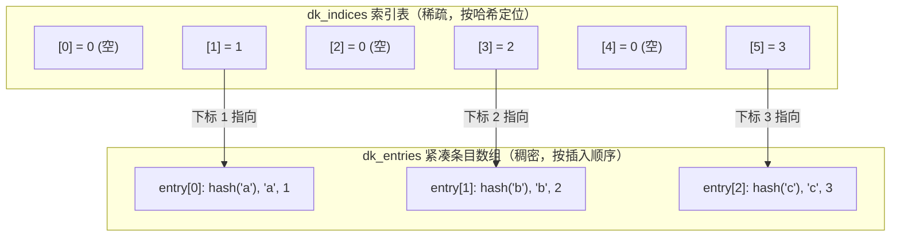

**查询流程**（`d['c']`）：

1. 算 `hash('c')`（`str` 的哈希**在对象里缓存**：`PyASCIIObject.hash`，只算一次，且不可变所以安全）；
2. `i = hash & mask`；
3. 读 `dk_indices[i]`，拿到"条目下标"；
4. **先比指针/哈希，再比 key 内容**（`startkey == key` 快路径，然后 `unicode_eq`）；
5. 命中则返回 `entry.value`；不命中则**探测下一个位置**。

**探测算法**（`perturb` 伪随机探测，不是简单的线性探测）：

```c
i = hash & mask;
perturb = hash;
while (...) {
    i = (i * 5 + 1 + perturb) & mask;  // 混合低位与高位，降低聚集
    perturb >>= 5;                     // 每轮丢弃 5 位
}
```

> 为什么不用线性探测？因为**哈希表的低位分布常常不好**（很多对象的哈希低位有规律），线性探测会导致"主聚集"，性能退化。`perturb` 混入高位信息，效果接近随机探测。

**三个"顺带"的重要结论**：

1. **dict 有序是"副产品"**：条目数组按插入顺序追加，索引表只是"映射"，所以迭代顺序 = 插入顺序。3.6 是巧合，3.7 变成承诺；
2. **删除不立即缩容**：`del` 只是把 `dk_indices` 对应槽置 0，并在 entry 上打 `DUMMY` 标记（避免探测链断裂）。所以**大量删除后 dict 不会自动变小**，需要 `dict.copy()` 或重建来压缩；
3. **扩容条件与倍率**：当 `used * 3 >= (mask + 1) * 2`（即负载 > 2/3）时扩容，新容量约为 `used * 2`（3.x 是 `GROWTH_RATE = used * 3` 用于计算 usable，实际新 size 近似翻倍）。**扩容 = 重新分配索引表 + 按新 mask 重插所有 entry**（O(n)，但均摊 O(1)）。

#### 6.3.3 键共享字典（3.11+，为什么实例变"瘦"了）

```python
class Point:
    def __init__(self, x, y):
        self.x, self.y = x, y
```

3.11 之前：每个实例的 `__dict__` 是一个完整 dict（索引表 + 条目数组），即使键永远是 `'x','y'`。
3.11 之后：**第一个实例的 dict 成为"键表持有者"（combined table）**，后续实例建立 **split table**：**共享同一张键表（含 hash 与插入顺序）**，每个实例只保存 **一个值数组**。

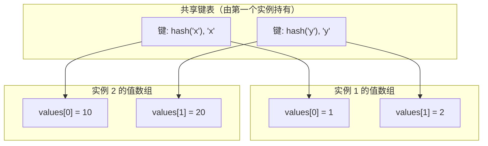

好处：实例的 `__dict__` 从"几百字节的哈希表"降到"一个指针 + 几个值"，**内存下降非常可观**（官方数据：面向对象场景实例内存降 ~30%+）。
代价：如果实例的键**差异很大**（动态加属性、不同的类共享）就会退化成普通 dict；**大量创建+销毁同类实例**时也会触发退化（"分割表转合并表"）。

### 6.4 set：一张"只有 key 没有 value"的哈希表

`PySetObject` 就是 `dk_indices + 一组 entry(只存 hash/key)`，**没有 value**，所以同样的元素数，set 比 dict 省约 1/3。

- 不保证顺序（迭代顺序受哈希与 table 大小影响）；
- 支持 O(1) 的 `in`、`add`、`discard`；
- **集合运算（`|` `&` `-` `^`）对"小集合 vs 大集合"有优化**：小的那个会被转成临时 set 后遍历，因为 `s & t` 的实现是"遍历较小的，去较大的里查"。

**去重为什么用 set 而不是 list？** `list` 去重是 O(n²)，`set` 是 O(n)（平均）。

### 6.5 str：PEP 393 的三档存储

```c
typedef struct {
    PyObject_HEAD
    Py_ssize_t length;        // 字符数（不是字节数！）
    Py_hash_t hash;           // -1 表示未计算（缓存）
    struct { unsigned kind:3; ... } state;  // kind: 1/2/4 字节
    Py_ssize_t utf8_length;
} PyASCIIObject;
```

| kind | 每字符字节 | 适用 |
|---|---|---|
| `PyUnicode_1BYTE_KIND` | 1 | 纯 Latin-1（含 ASCII） |
| `PyUnicode_2BYTE_KIND` | 2 | 含 BMP（如中文基本区） |
| `PyUnicode_4BYTE_KIND` | 4 | 含 emoji / 生僻字（非 BMP） |

**要点**：

- **UTF-8 不是内部表示**。内部是"定长编码"，这样 `s[i]` 是 **O(1)**（直接算偏移）；若用 UTF-8，随机访问就是 O(n)。**这是"Python 字符串索引快"的原因，也是"内存不总是 1 字节/字符"的原因**；
- 一个 `str` 只要包含一个 4 字节字符，**整串升格为 4 字节/字符**（内存可能翻 4 倍）；
- `len(s)` 是 O(1)（存了 length），不是"数字符"；
- **哈希只算一次并缓存**（`hash` 字段），所以"字符串作为 dict key 反复查找"并不贵；
- **拼接**：`s1 + s2` 每次新建对象（O(n)），循环里 `s += x` 是 O(n²)；**`"".join(list)` 是 O(n)**（一次性分配 + 逐个拷贝）→ 这是"为什么用 join 不用 +"的底层原因。

```python
# 反例：O(n²)
html = ""
for row in rows:
    html += f"<tr>{row}</tr>"

# 正例：O(n)
html = "".join(f"<tr>{r}</tr>" for r in rows)
```

**延伸：f-string 为什么快？** 3.6 之后 f-string 在编译期被转成 `FORMAT_VALUE` + `BUILD_STRING` 指令，避免运行期解析格式串；3.12 起 PEP 701 允许嵌套引号/多行，同时其求值走"直接用栈上的临时值"的路径，比 `%` 和 `str.format` 都快。

### 6.6 bytes / bytearray

- `bytes`：不可变，内部就是一块 `char[]`，适合**二进制数据、网络传输、文件内容**；
- `bytearray`：可变，支持原地 append / 切片赋值，适合**增量构造二进制**；
- 与 `str` 的边界：`str` 是"文本（Unicode 码点）"，`bytes` 是"字节"。`str.encode('utf-8')` / `bytes.decode('utf-8')` 是唯一的合法桥梁。**Python 3 严格区分二者，就是为了消灭 Python 2 的编码混乱**。

### 6.7 deque 及其它 collections

| 类型 | 底层 | 适用 |
|---|---|---|
| `deque` | **双向链表 + 每节点一块 64 元素的数组**（块状链表） | 两端 O(1) 增删，中间访问 O(n)（但按块跳，实际不慢） |
| `OrderedDict` | dict + 双向链表 | 3.7 后普通 dict 也有序，但需要 `move_to_end` / `popitem(last=False)` 时用它 |
| `Counter` | dict 子类 | 计数、TopK（`most_common`） |
| `defaultdict` | dict 子类 + `__missing__` | 分组聚合 |
| `ChainMap` | 多个 dict 的视图 | 分层配置 |
| `heapq` | 二叉堆（只是个算法模块，底层还是 list） | 优先队列（`heappush`/`heappop` O(log n)） |

> **延伸：`deque` 的"块状链表"设计**
> 纯链表每个元素要一个节点（两个指针 = 16 字节开销），内存浪费大、缓存命中差。所以 `deque` 用"每块 64 个元素的定长数组"作为节点：既保留两端 O(1)，又让块内访问连续、分配次数少。**pop(0) 在 deque 是 O(1)，在 list 是 O(n)** —— 这就是"BFS 队列为什么用 deque"的原因。

### 6.8 int / float 的内核细节

**int（`PyLongObject`）**：

```c
struct _longobject {
    PyObject_VAR_HEAD
    digit ob_digit[1];   // 每个 digit 30 bit（32 位机上是 15 bit）
};
```

- **每个 digit 用 30 位而非 32 位**：留 2 位余量，让"乘法"的中间结果不会溢出，且便于用 `Py_UCS4` 做快速运算（这是 CPython 的经典技巧）；
- **任意精度**：`2 ** 10000` 就是 333 个 digit；
- **小整数缓存** `-5 ~ 256`（`small_ints`），**3.12 起这些小整数是 immortal（引用计数永不变化）**，省掉热点对象的原子加减；
- `bool` 是 `int` 的子类（`True == 1`），所以 `True + True == 2`。

**float**：直接存 IEEE-754 double，所以 `< 2**53` 的整数与 float 互转无损；`0.1 + 0.2 != 0.3` 是二进制浮点的固有问题（用 `decimal.Decimal` 或 `math.isclose`）。

---

## 第 7 章 函数、闭包与调用机制

### 7.1 函数对象里有什么

```python
def f(a, b=1, *args, c, **kw):
    return a
```

`f` 是一个 `function` 对象，关键属性：

| 属性 | 内容 | 作用 |
|---|---|---|
| `__code__` | code object | 字节码、常量表、变量名表 |
| `__globals__` | **定义时所在模块的全局字典**（不是调用者的！） | 决定 `LOAD_GLOBAL` 去哪里查 |
| `__defaults__` | 默认值元组 `(1,)` | **默认值只在定义时求值一次** |
| `__kwdefaults__` | 关键字默认 `{c: ...}` | |
| `__closure__` | cell 元组（闭包） | `LOAD_DEREF` 的来源 |
| `__name__` / `__qualname__` / `__doc__` | 元信息 | 装饰器要保留（`functools.wraps`） |
| `__dict__` | 函数自己的属性字典 | 可以挂 `f.cache = {}` |

**这就是"可变默认参数陷阱"的根因**：

```python
def append_to(x, lst=[]):   # [] 在 def 执行时求值一次，存进 __defaults__
    lst.append(x)
    return lst

append_to(1)   # [1]
append_to(2)   # [1, 2]  ← 同一个 list！
```

正确写法：

```python
def append_to(x, lst=None):
    if lst is None:
        lst = []
    ...
```

**延伸**：为什么 `def f(x, lst=[])` 的默认值不会被"每次调用重新求值"？因为默认值属于**函数对象的状态**（`__defaults__`），不是调用栈的一部分。这与"参数默认值在定义期求值（definition-time evaluation）"的语义一致——顺带解释了另一个经典坑：

```python
i = 10
def f(x=i):  # 绑定的是 10，之后再改 i 不影响
    return x
```

### 7.2 参数传递：call by object reference

```python
def f(x):
    x.append(1)     # 改了调用方的 list（因为传的是同一对象）
def g(x):
    x = [1]         # 只改了本地名字，调用方看不到（重新绑定）
```

**严格表述**：

- 形参是**局部变量**，绑定到实参对象的引用；
- 所以"函数内给形参重新赋值"不影响外部；
- "函数内对形参指向的可变对象做原地操作"影响外部；
- **不存在"值传递/引用传递"的二分，只有"对象引用共享"**。

**面试话术**："Python 传的是对象的引用（call by object reference / call by sharing）。效果取决于对象的可变性：传可变对象并原地修改会外泄；传不可变对象或重新绑定形参则不会。"

### 7.3 闭包：为什么需要 cell 对象

```python
def outer():
    x = 1
    def inner():
        return x + 1
    return inner
```

编译期符号表就发现：`x` 既是 `outer` 的局部变量（`co_cellvars = ('x',)`），也是 `inner` 的自由变量（`co_freevars = ('x',)`）。为了让 `inner` 在 `outer` 返回后还能拿到 `x`，`outer` 的 `x` 不再放在"帧的局部槽位"里，而是**装箱成一个 `cell` 对象**（`PyCellObject`，里面就一个 `PyObject *ob_ref`）。

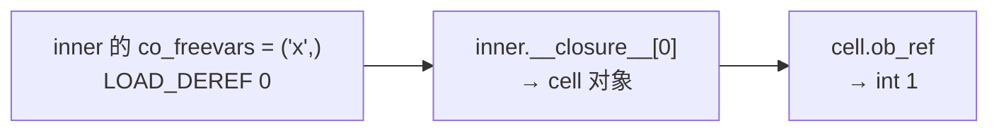

三条由此推出的结论：

1. **`nonlocal` 的意义**：让 `STORE_DEREF`（写 cell）而不是 `STORE_FAST`（写局部槽）。没有 `nonlocal` 时，`inner` 里 `x = 2` 会在编译期被判定为"新建局部变量"，跟外层无关；
2. **闭包会延长生命周期**：cell 被闭包引用，所以 `outer` 返回后 `x` 依然存活——这也是"闭包造成内存泄漏"的机制；
3. **`inner` 能看到的是"变量"而不是"值"**：晚绑定的经典坑：

```python
funcs = [lambda: i for i in range(3)]
print([f() for f in funcs])   # [2, 2, 2] —— 全部共享同一个 cell(i)

funcs = [lambda i=i: i for i in range(3)]
print([f() for f in funcs])   # [0, 1, 2] —— 用默认参数把值"冻结"进函数对象
```

（`lambda i=i` 之所以有效，正是因为**默认参数在定义时求值并存在函数对象里**，与 7.1 的机制完全一致。）

### 7.4 一次函数调用的开销分解

```python
def add(a, b): return a + b
add(1, 2)
```

`CALL` 指令要做的：

1. **解析参数**：把栈上的位置参数 / 关键字参数整理进 `args` 元组（3.11 起用 `CALL_PY_EXACT_ARGS` 特化跳过复杂解析）；
2. **创建帧**：3.11 起帧在 C 栈上分配（`_PyInterpreterFrame`），不再 malloc；
3. **绑定形参**：把实参填入帧的局部槽位（`co_varnames` 下标）；
4. **执行字节码**：`RESUME` → 若干指令 → `RETURN_VALUE`；
5. **销毁帧**：局部变量减引用计数。

**因此"减少函数调用次数"能提速**，但也要权衡可读性。真正贵的是 **① 参数打包 + ④ 帧的建立**。经验值：CPython 3.11+ 一次空函数调用约 **50~80 ns**（3.10 约 100 ns+）。

**优化建议（有实测依据的）**：

```python
# 1) 把全局/属性查找搬到局部
def slow():
    for i in range(N):
        result = GLOBAL_CONFIG.value * i      # 每次: LOAD_GLOBAL + LOAD_ATTR

def fast():
    value = CONFIG_VALUE                       # 只查一次
    for i in range(N):
        result = value * i

# 2) 用内置函数（C 实现，且避免 Python 层循环）
sum(nums)          # 而不是 for 累加
"".join(parts)     # 而不是 +=
sorted(x, key=...) # key 函数只调用 n 次（不是 n log n，Timsort 会缓存 key）
```

**注意 `key` 的细节**：`sorted(key=f)` 内部先对每个元素算一次 `f(x)` 并存成 `(key, value)` 对，所以 **`f` 被调用 n 次**，不是 O(n log n) 次。这是很多人不知道的"省时间点"。

### 7.5 递归、栈与 `RecursionError`

- CPython **不做尾递归优化**（Guido 明确表态：尾递归优化会破坏 traceback，且是"语法糖式"的循环伪装）；
- 默认 `sys.getrecursionlimit() == 1000`。它限制的是 **Python 帧的嵌套数**；但真正的限制往往是 **C 栈空间**（每个 Python 调用在 C 层也压栈），所以调大 limit 不总是安全，可能引发**段错误（segfault）**而不是异常；
- 3.12 起对"纯 Python 递归"做了感知 C 栈的优化，能容纳更深递归；
- 正确替代：改写成显式栈（迭代 + list 当栈）、`functools.lru_cache` + 自底向上动态规划、或用 `sys.setrecursionlimit` 保守提高（如 3000~5000）并压测。

```python
# 递归 -> 显式栈
def dfs(root):
    stack, seen = [root], set()
    while stack:
        node = stack.pop()
        if node in seen: continue
        seen.add(node)
        stack.extend(node.children)
```

### 7.6 装饰器的执行时机（高频考点）

```python
def deco(fn):
    print("deco 执行了")     # 定义期：模块导入/函数定义时执行一次
    def wrapper(*a, **k):
        return fn(*a, **k)
    return wrapper

@deco
def target(): ...
```

等价于：

```python
def target(): ...
target = deco(target)       # 就在 def 之后立刻执行，用返回值替换名字
```

**六个必须知道的点**：

1. 装饰器在**定义时**执行一次，被装饰函数在**调用时**执行每次；
2. 多层装饰器**自下而上**应用，执行顺序**自上而下**（洋葱模型）；
3. `functools.wraps` 的作用是把 `__name__` / `__doc__` / `__module__` / `__qualname__` / `__annotations__` / `__dict__` 复制过去，否则 `inspect` / 文档 / 日志里的函数名全是 `wrapper`；
4. **带参数的装饰器**是"三层函数"：`@deco(arg)` → 先 `deco(arg)` 返回真正的装饰器；
5. 装饰器**不能装饰类里的方法而保留 `self`** 的问题不存在（`wrapper(*a, **k)` 会接住 `self`），但**描述符协议会失效**：如果 wrapper 是普通函数，它会正常绑定；如果 wrapper 是对象/可调用实例，就没有 `__get__` → 不会绑定 `self`；
6. `@lru_cache` 要放在**内层**还是外层？如果外层有 `@app.route`，缓存要放在**离函数最近**的位置（内层），否则缓存的是被路由包装后的结果，仍可工作但 `key` 语义不同，容易踩坑。

```python
from functools import wraps

def retry(times=3, exceptions=(Exception,)):
    def decorator(fn):
        @wraps(fn)
        def wrapper(*args, **kwargs):
            for i in range(times):
                try:
                    return fn(*args, **kwargs)
                except exceptions:
                    if i == times - 1: raise
        return wrapper
    return decorator
```

---

## 第 8 章 面向对象内核：type、MRO、描述符

### 8.1 type 与 object 的"双生"关系

这是 Python 里最反直觉、也最常被问的结构：

```python
type(object)      # <class 'type'>   → object 是 type 的实例
object.__bases__  # ()               → object 没有基类
type.__bases__    # (<class 'object'>,) → type 继承自 object
type(type)        # <class 'type'>   → type 是自己的实例（自指）
isinstance(object, type)   # True
isinstance(type, object)   # True
```

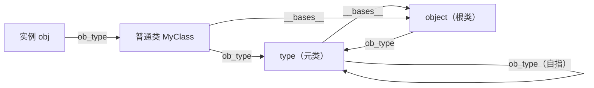

**怎么理解**：

- 从"**类型关系**（谁是谁的类）"看：`object` 是所有类（包括 `type`）的基类；`type` 是所有类（包括 `object`）的类型；
- 从"**实例关系**（谁是谁的实例）"看：`object` 是 `type` 的实例，`type` 也是 `type` 的实例；
- 这个"环"在 C 层是**两个字段**：`ob_type`（指向类型）和 `tp_base`（指向基类），它们本来就不同维度。

**结论话术**："`object` 是所有类的祖先（继承链的根），`type` 是所有类的类型（元类链的根），它们互为实例与基类，是因为'继承'和'实例化'是两条不同的关系。"

### 8.2 MRO 与 C3 线性化

```python
class A: pass
class B(A): pass
class C(A): pass
class D(B, C): pass
print(D.__mro__)
# (D, B, C, A, object)  ← 注意 A 在 C 之后
```

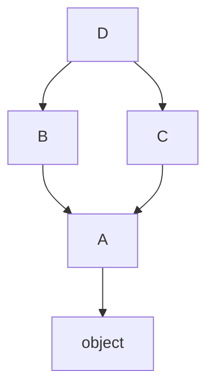

**C3 算法的三个约束**：

1. 子类一定在父类之前；
2. 多个父类保持**声明顺序**（`D(B, C)` → B 在 C 前）；
3. **单调性**：如果 M 在 N 前面，那么在所有用到的列表里 M 都应在 N 前（保证"父类的相对顺序不被子类打乱"）。

**算法描述**（递归版，最易记）：

```
L[D] = D + merge(L[B], L[C], [B, C])
merge 规则：每次取"候选列表的头部"，若该头部不出现在任何其它列表的尾部，则取出；
          否则跳过，看下一个列表的头部；全部无法取出 → TypeError（继承冲突）
```

**为什么必须用 C3 而不是"深度优先"**？深度优先会导致 `D(B,C)` 时 `C` 被跳过（先走 B 到 A 到 object），`C` 的方法永远不被调用——**违背"多继承里每个父类都该有机会"**。C3 保证"先所有直接父类，再它们的父类"，且在菱形结构里只走一次 `A`。

**经典矛盾**：

```python
class A: pass
class B(A): pass
class C(A): pass
class D(B, A): pass   # TypeError: Cannot create a consistent MRO
# 因为 B 已经是 A 的子类，然后又声明 A 在 B 后面 → 违背"子类在父类之前"
```

### 8.3 `super()` 到底是什么

**最大的误解**：`super()` 不是"调用父类"，而是"**从 MRO 里当前类的下一站继续查找**"。

```python
class A:
    def f(self): print("A")
class B(A):
    def f(self): print("B"); super().f()
class C(A):
    def f(self): print("C"); super().f()
class D(B, C):
    def f(self): print("D"); super().f()

D().f()
# D → B → C → A     （而不是 D → B → A）
```

原因是 `super()` 的语义是 **`super(current_class, self)`**，查找起点是 `type(self).__mro__` 里 `current_class` 的**下一个**元素。`B.f` 里的 `super()` 拿到了 MRO 中的 `C`，所以**协作式多继承（cooperative inheritance）** 才成立。

**这就是"多继承里每个 `f` 都要写 `super().f()`"的原因**：任何一个环节漏掉，链条就断在那里，后面所有父类都收不到调用。

**3.x 的无参 `super()`** 靠编译器注入 `__class__` cell（`co_cellvars` 里有个隐藏的 `__class__`），所以能在嵌套函数里用，但**在装饰器里会失效**（因为装饰后函数不再是类的属性，`__class__` cell 找不到或指向错误）。

### 8.4 属性访问的三种"钩子"与顺序（面试常考顺序题）

一个类里同时有 `__getattr__`、`__getattribute__`、data descriptor、实例属性、类属性时，谁先？

**答案**：`__getattribute__`（总是最先）→ data descriptor → 实例 `__dict__` → 类属性/non-data descriptor → `__getattr__`（兜底）。

```python
class A:
    def __getattribute__(self, name):
        print("getattribute:", name)
        return object.__getattribute__(self, name)
    def __getattr__(self, name):
        print("getattr:", name)
        return "default"
```

**两个必须注意的坑**：

1. **`__getattr__` 里访问 `self.xxx` 会无限递归**（因为访问失败又进 `__getattr__`）→ 用 `object.__getattribute__` 或 `super().__getattr__`（如果存在）或 `self.__dict__.get`；
2. **`__getattribute__` 里访问 `self.xxx` 也会递归** → 必须用 `object.__getattribute__(self, ...)`。

### 8.5 `__slots__` 的原理与副作用

```python
class P:
    __slots__ = ("x", "y")   # 类创建时，为每个名字生成一个 member_descriptor

p = P()
p.x = 1        # member_descriptor.__set__：按固定偏移写入对象体
p.z = 2        # AttributeError: 'P' object has no attribute 'z'
```

**原理**：`__slots__` 让 `type_new` 不创建 `__dict__` 描述符，而是为每个 slot 名生成一个 **member descriptor**（内部存 `offset`），实例对象布局里预留 `len(slots)` 个指针槽。属性读写变成"指针 + 偏移"，不做哈希查找。

| 好处 | 代价 |
|---|---|
| 内存降 40%~60%（无实例 dict 与 key-sharing 表） | **不能动态加属性**（框架里 `setattr(obj, ...)` 会炸） |
| 属性访问更快（偏移 vs 哈希） | **不能多继承冲突**：两个父类有同名 slot 会 TypeError |
| 创建更快 | 弱引用需显式加 `__weakref__`；`__dict__` 需显式加 `'__dict__'` |
| 防止手滑拼错属性名 | 与 `@property` 同名会冲突（slot 名不能与类属性重名） |

**兼容写法**：

```python
class P:
    __slots__ = ("x", "y", "__dict__", "__weakref__")  # 想保留动态属性就加 __dict__
```

> **延伸：为什么 dataclass 默认不加 `__slots__`？**
> 因为加了之后不能动态赋属性，许多序列化库（`pickle` 默认行为、部分 ORM）依赖 `__dict__`。3.10 起提供 `@dataclass(slots=True)`，按需开启。

### 8.6 类的创建全过程（元类编程入口）

```python
class Meta(type):
    def __new__(mcls, name, bases, ns, **kw):
        print("创建类:", name)
        return super().__new__(mcls, name, bases, ns)
    def __init__(cls, name, bases, ns, **kw):
        print("初始化类:", name)
        super().__init__(name, bases, ns)

class My(metaclass=Meta):
    x = 1
```

执行顺序：

1. 收集类体命名空间（`__prepare__` 可自定义为 `OrderedDict` 等）；
2. `Meta(name, bases, ns)` → 实际调用 `type.__call__` → `Meta.__new__` → `Meta.__init__`；
3. 类对象创建后，执行 `__set_name__`（给描述符机会记录自己的名字）；
4. 执行所有父类的 `__init_subclass__(cls)`（比元类更"轻"的钩子）。

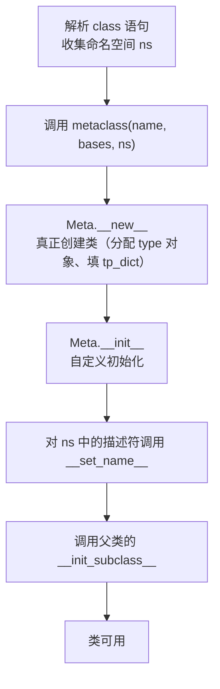

**为什么用 `__init_subclass__` 而不是元类？** 更简单、不用引入新元类、不会与别人的元类冲突（元类冲突是 OOP + 框架组合的经典坑：`class X(A, B)` 里 A/B 元类不同 → TypeError）。

### 8.7 ABC、`__subclasshook__` 与鸭子类型

```python
from abc import ABC, abstractmethod

class Repo(ABC):
    @abstractmethod
    def save(self, obj): ...
```

- **`ABCMeta` 会把抽象方法登记到 `__abstractmethods__`**，实例化时检查 → `TypeError`；
- **`isinstance` 与 ABC 的虚拟子类**：`collections.abc.Sequence` 等通过 `__subclasshook__` 让"有 `__len__` 和 `__getitem__` 的类"自动被认定为 `Sequence`，**不需要注册**；
- **`register()` 可以声明虚拟子类**（只影响 `isinstance`，不产生继承关系）；
- **Abstract 的 `__slots__ = ()`** 是标准做法，避免 ABC 子类意外获得 `__dict__`。

**为什么 Python 的"接口"要用 ABC 而不用"约定"？** 因为 ABC 提供 **`isinstance` 的可判定性 + 抽象方法强制实现 + 文档化的协议**，而鸭子类型在"打错方法名"时只会在运行深处炸掉。

---

## 第 9 章 迭代器 / 生成器 / 协程

### 9.1 迭代协议：`for` 的完整展开

```python
for x in obj:
    body(x)
```

等价于：

```python
it = iter(obj)              # 调 type(obj).__iter__，返回迭代器
while True:
    try:
        x = next(it)        # 调 type(it).__next__
    except StopIteration:
        break
    body(x)
```

两种角色要分清：

| 角色 | 要求 | 例子 |
|---|---|---|
| **可迭代对象（Iterable）** | 有 `__iter__`（返回迭代器）或只有 `__getitem__`（旧式序列协议） | `list`、`dict`、`str`、生成器函数返回的 generator |
| **迭代器（Iterator）** | 有 `__next__`，且 `__iter__` 返回 `self` | `list_iterator`、`generator`、`itertools` 的各种对象 |

**关键点**：**迭代器是一次性的**（`__next__` 会消耗内部状态）。`for` 能反复遍历 list，是因为 `list.__iter__` 每次返回**新的** `list_iterator`；而**生成器对象既是 iterable 又是 iterator，`iter(gen) is gen`**，所以生成器只能遍历一次。

```python
def gen():
    yield 1
    yield 2
g = gen()
print(iter(g) is g)      # True
list(g)                  # [1, 2]
list(g)                  # []  ← 已耗尽
```

### 9.2 生成器的本质：一个"会挂起的帧"

```c
typedef struct {
    PyObject_HEAD
    PyObject *gi_frame;      // 挂起的帧（3.11+ 惰性生成 PyFrameObject）
    char gi_running;         // 是否正在执行
    ...
} PyGenObject;
```

**核心机制**：

1. **调用生成器函数不执行函数体**，只创建一个 `generator` 对象，内部持有"未执行的帧"（帧的 `f_lasti` 指向开头）；
2. **`next()` 时从 `f_lasti` 处恢复执行**，跑到 `yield` 就把值"吐"出来，同时**保存当前帧的指令指针和值栈**；
3. **下一次 `next()` 从上次的 `f_lasti` 继续**——这就是"协程能记住执行位置"的物理基础。

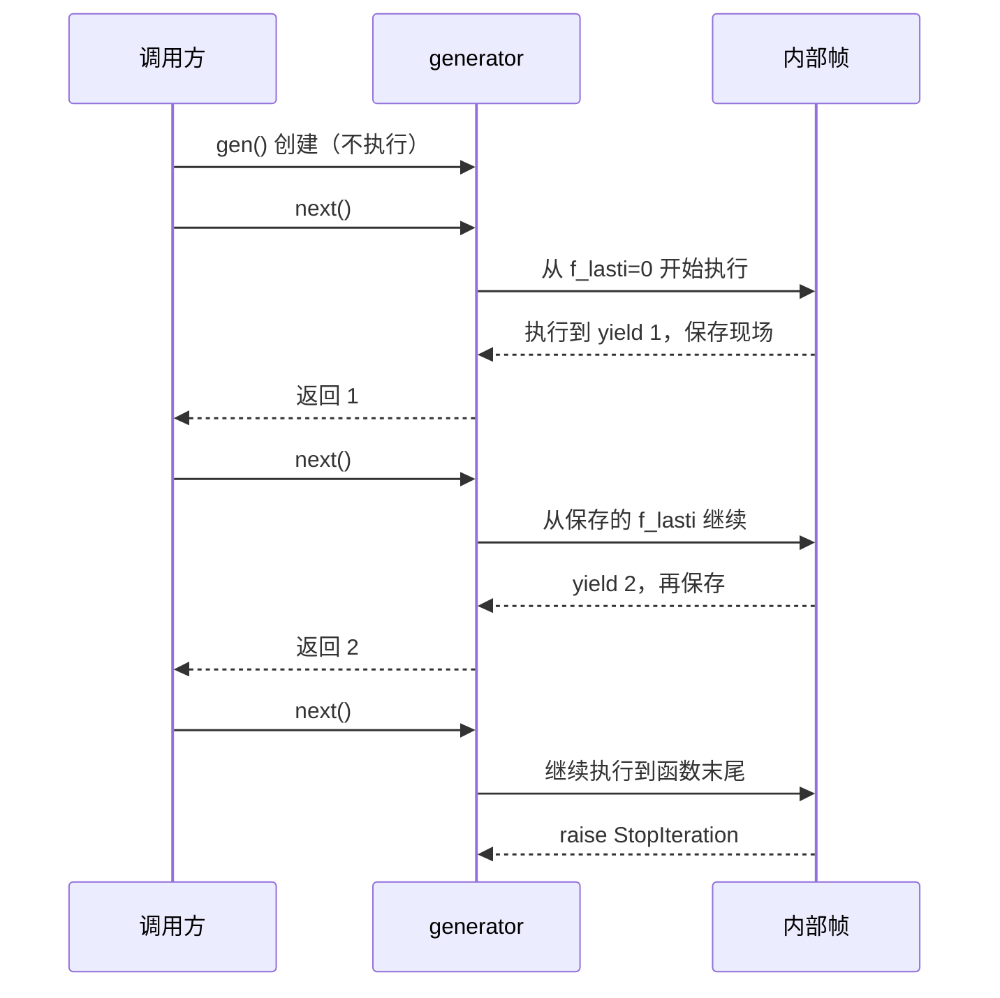

**为什么生成器"省内存"？** 不是"省了列表的内存"这么简单，而是：**它把"生产逻辑"变成了"按需推进的状态机"**，一次只在内存里存在一个元素。处理 10GB 日志时，`for line in f` 只占用一个缓冲行；如果用 `f.readlines()` 就是 10GB。

### 9.3 `send` / `throw` / `close` 与 `yield from`

```python
def echo():
    while True:
        received = yield        # yield 的"返回值" = send 进来的值
        if received is None:
            received = "默认"
        print("收到:", received)

g = echo()
next(g)                 # 预热到第一个 yield
g.send("hello")         # 把 hello 送进 received
```

四个方法：

| 方法 | 作用 |
|---|---|
| `next(g)` | 等价 `g.send(None)`，恢复执行到下一个 `yield` |
| `g.send(v)` | 恢复执行，并把 `v` 作为**当前 `yield` 表达式的结果** |
| `g.throw(E)` | 在被挂起的位置**抛出异常**（生成器内可 `try/except` 捕获） |
| `g.close()` | 在挂起位置抛 `GeneratorExit`，用于**清理**（对应 `try/finally` 会被执行） |

**`yield from` 的两层含义**：

1. **值传递**：`yield from subgen` 把 `subgen` 的所有值原样转发给调用方（省掉一层 for 循环）；
2. **双向委托**：`send/throw/close` 也会被转发给 `subgen`，且 `subgen` 的 `return` 值成为 `yield from` 表达式的值。

```python
def chain(*iterables):
    for it in iterables:
        yield from it       # 3.3+ 的高效写法（C 层优化，比手写 for 快）
```

**这是 `await` 的前身**：`await coro` 在语义上就是"把控制权委托给 coro，等它完成"，`yield from` 是生成器版本的同一件事。PEP 380（`yield from`）→ PEP 492（`async/await`）是同一条演进线上的两步。

### 9.4 生成器表达式 vs 列表推导

```python
lst  = [f(x) for x in data]     # 立即构造全部元素 → O(n) 内存
gen  = (f(x) for x in data)     # 惰性 → O(1) 内存
```

**两个容易忽略的点**：

1. **推导式有自己的作用域**（Python 3 起）。`[x for x in range(3)]` 里的 `x` 不会泄漏到外层（Python 2 会）；
2. **`sum(x for x in ...)` 可以省括号**：函数只有一个位置参数时，生成器表达式可省略外层括号；
3. **生成器表达式在"需要多次遍历"时是错的**（一次性），且 `len()` 不可用。

### 9.5 协程：`async/await` 到底做了什么

```python
async def fetch(url):
    async with session.get(url) as resp:
        return await resp.text()
```

**关键认知：`async def` 定义的函数，调用后返回的不是结果，而是一个 `coroutine` 对象**（和生成器同族：`PyCoroObject`，内部也是"挂起的帧"）。

| 概念 | 本质 | 谁驱动 |
|---|---|---|
| `coroutine` | `async def` 调用产生的对象，需要 `await` 或 `send` 驱动 | 事件循环 / 外层协程 |
| `awaitable` | 可以被 `await` 的对象：coroutine、Task、Future | — |
| `Future` | 一个"未来会有结果"的占位符，持有 callback 链 | 事件循环 set_result |
| `Task` | **包装 coroutine 并注册到事件循环的对象**（`asyncio.create_task`） | 事件循环调度 |
| 事件循环 | `selectors`（epoll/kqueue/IOCP）+ 就绪队列 + 定时器堆 | 主线程 `run_until_complete` |

```mermaid
sequenceDiagram
    participant EL as 事件循环
    participant T1 as Task(fetch A)
    participant T2 as Task(fetch B)
    participant IO as epoll/内核
    EL->>T1: step()（send(None)）
    T1->>IO: 发起 socket 读，注册 fd + callback，然后 yield
    T1-->>EL: 挂起，返回"未完成"
    EL->>T2: step()
    T2->>IO: 发起 socket 读，注册 fd + callback，然后 yield
    T2-->>EL: 挂起
    IO-->>EL: fd A 可读（事件就绪）
    EL->>T1: 把 A 放回就绪队列 → step()
    T1-->>EL: 读到数据，执行到下一个 await 或 return
```

**为什么 asyncio 快**：

- **单线程**，没有线程上下文切换（内核态切换 ~1-10 µs）；
- **协程切换只是一次函数返回 + 一次队列操作**（~几百 ns）；
- 一个进程可以挂 **上万**个并发连接（每个协程只有帧 + 少量对象，约几 KB，而一个线程要 8MB 虚拟栈）。

**为什么 asyncio 会"卡死"**：

- 任何**同步阻塞调用**（`time.sleep`、`requests`、CPU 密集计算、`file.read` 大文件）都会**阻塞整个事件循环**，所有协程一起停摆；
- 正确做法：阻塞调用丢到 `loop.run_in_executor` / `asyncio.to_thread`（3.9+）；CPU 密集丢进程池；
- 反面教材：在一个 `async def` 里写 `requests.get(...)`——这是 asyncio 最常见的事故。

```python
# 正确：同步阻塞库放到线程池，别堵住事件循环
result = await asyncio.to_thread(blocking_call, arg)
```

### 9.6 三者对比（面试必答表）

| 维度 | 多进程 | 多线程 | 协程（asyncio） |
|---|---|---|---|
| 并行度 | **真并行**（多核） | 伪并行（GIL 下同时只有 1 个跑字节码） | 单线程并发 |
| 切换成本 | 高（进程创建/销毁、IPC） | 中（内核态切换 + GIL 争抢） | **极低**（用户态） |
| 内存 | 每进程独立地址空间（大） | 每线程 ~8MB 栈（虚拟） | 每协程几 KB |
| 数据共享 | 需 IPC/序列化（安全） | 共享内存（**要加锁**） | 共享内存但**单线程无竞态**（除非 `await` 间有交错） |
| 适用 | CPU 密集 | IO 密集（几十~几百并发，含阻塞库） | 超高并发 IO（万级，全异步栈） |
| 坑 | 序列化开销、内存翻倍 | GIL 无法提速 CPU、死锁 | 一个阻塞调用拖垮全局 |

---

## 第 10 章 异常机制、上下文管理、导入系统

### 10.1 异常在底层怎么"跳转"（3.11 的重大变化）

**3.10 及之前**：字节码里有 `SETUP_FINALLY` / `SETUP_WITH` / `SETUP_EXCEPT`，压一个"块栈（block stack）"。进入 `try` 就压一个块，正常路径要 `POP_BLOCK`。**即使从不抛异常，也有压栈/弹栈的开销。**

**3.11 起：零成本异常（exception table）**。编译器为每个 `try` 区域生成一张**异常表**，记录 `(指令区间 start, end, target, depth, lasti)`。求值时**不需要任何额外指令**；只有当异常真的抛上来时，解释器才**查表**找到对应的 handler 并跳转。

```python
import dis
def f():
    try:
        return 1/0
    except ZeroDivisionError:
        return 0
dis.dis(f)
# 3.11+ 不再有 SETUP_FINALLY，而是 dis 输出末尾的 ExceptionTable:
#   4 to 12 -> 16 [0]
```

**这带来一个可观测的性能差异**：`try/except` 包住大量代码，在没有异常发生时**几乎免费**；真正的成本在 `raise` 与栈展开。所以"用异常做流程控制"的批评点是**语义与调试成本**，而不是纯性能（虽然抛异常本身仍然贵，~µs 级）。

### 10.2 异常链与 `raise from`

```python
try:
    json.loads(s)
except JSONDecodeError as e:
    raise ConfigError("配置文件格式错误") from e     # 显式因果链
```

- `from e` 设置 `__cause__`，打印时显示 "The above exception was the direct cause of..."
- 不写 `from` 但在 `except` 块里 `raise`，会隐式设置 `__context__`，显示 "During handling of the above exception..."
- `raise ... from None` 会**抑制**上下文显示（用于"这个底层错误对用户无意义"的场景）

**工程建议**：跨层封装异常时**必须 `from e`**，否则线上排查会丢失根因。

### 10.3 EAFP vs LBYL，以及 `finally` 的执行保证

| 风格 | 写法 | 适用 |
|---|---|---|
| EAFP（Easier to Ask Forgiveness） | `try: d[k] except KeyError` | Python 推荐；**避免 TOCTOU**（检查与使用之间的状态变化） |
| LBYL（Look Before You Leap） | `if k in d: d[k]` | 便宜且明确时可用（`in` 是 O(1) 但也要一次哈希） |

**性能取舍**：`dict.get(k, default)` 通常比 `try/except` 更快（不用构造异常对象），但异常发生频率低时 `try` 也很快（3.11 零成本）。

`finally` 的保证：

- **一定执行**（正常返回、异常、`return`、`break`、`continue` 都算）；
- **但不保证"进程被杀"（`kill -9`）、`os._exit`、段错误、断电**——所以关键持久化要"写完再确认"（fsync），不能指望 `finally`；
- `finally` 里有 `return` 会**吞掉异常**（危险写法）。

### 10.4 `with` 与上下文管理器

```python
class Lock:
    def __enter__(self): acquire(); return self
    def __exit__(self, exc_type, exc, tb):
        release()
        return False        # 返回 True 表示"异常已处理，不再向上抛"
```

```mermaid
flowchart LR
    A["with EXPR as VAR:"] --> B["mgr = EXPR"]
    B --> C["VAR = mgr.__enter__()"]
    C --> D["执行 with 体"]
    D -->|正常| E["mgr.__exit__(None, None, None)"]
    D -->|异常| F["mgr.__exit__(type, val, tb)"]
    F --> G{"__exit__ 返回 True?"}
    G -->|是| H["异常被吞掉"]
    G -->|否| I["异常继续向上抛"]
```

**`contextlib.contextmanager` 的实现原理**：把一个**生成器**包装成上下文管理器——

- `__enter__` = `next(gen)`（跑到 `yield` 之前）；
- `__exit__` = `gen.send(None)` 或 `gen.throw(exc)`（从 `yield` 处继续）；
- 所以"`yield` 之前是 setup，`yield` 之后是 teardown"，`yield` 的位置就是"with 体"的位置。

```python
from contextlib import contextmanager

@contextmanager
def timer(label):
    t0 = time.perf_counter()
    try:
        yield                      # ← with 体在这里执行
    finally:
        print(f"{label}: {time.perf_counter()-t0:.3f}s")
```

**精髓**：`finally` 保证 teardown 一定跑；`yield` 的异常会通过 `throw` 注入生成器，所以 `except` 能捕获 with 体内的异常。

### 10.5 导入系统：finders + loaders + `sys.modules`

```mermaid
flowchart TB
    A["import foo"] --> B{"foo 在 sys.modules?"}
    B -->|是| C["直接返回缓存模块<br/>★ 这就是'模块只执行一次'的原因"]
    B -->|否| D["遍历 sys.meta_path 的 finder<br/>PathFinder / BuiltinImporter / FrozenImporter"]
    D --> E["finder.find_spec(name)<br/>按 sys.path 顺序找 foo.py / foo/__init__.py"]
    E --> F["loader.create_module + exec_module<br/>执行模块代码，填充模块 __dict__"]
    F --> G["sys.modules['foo'] = module<br/>（执行前就已放入，用于处理循环导入）"]
    G --> H["绑定名字：foo = module"]
```

关键事实：

1. **模块只会被执行一次**，因为 `sys.modules` 缓存（**先放入再执行**，所以循环导入时能拿到"半成品模块"）；
2. **`sys.path` 的顺序**决定了"同名模块谁被加载"，第一个命中的赢；
3. **循环导入**：`a.py` 导入 `b`，`b` 又 `import a`，此时 `a` 已在 `sys.modules` 里但只执行了一半 → `b` 里能拿到 `a` 模块对象，但**里面还没有后面定义的属性** → `AttributeError`。

```python
# 循环导入的三种解法
# 1) 把 import 放进函数内（延迟导入，最常用）
def f():
    from . import b      # 用到时才导入
    return b.helper()

# 2) 只导入模块，不导入名字（用 b.helper 而不是 from b import helper）
import b

# 3) 重构：把共享依赖抽到第三个模块 c
```

**`if __name__ == "__main__"` 的原理**：直接运行脚本时，该模块的 `__name__` 是 `"__main__"`（模块在 `sys.modules["__main__"]`）；被 import 时是模块名。**副作用提醒**：如果脚本既被直接运行又被 import，会出现**两份模块对象**（`__main__` 一份 + 真实模块名一份），导致单例、全局状态、类身份（`isinstance`）失效 —— 这是"多进程/多入口项目"的经典坑。

### 10.6 `__init__.py`、命名空间包与相对导入

| 概念 | 说明 |
|---|---|
| 常规包 | 目录 + `__init__.py`（包初始化代码，可做 API 导出） |
| 命名空间包（PEP 420，3.3+） | 目录**没有** `__init__.py`，也能被导入，且**可以把多个物理目录合并成同一个包**（用于插件化/多发行包共享命名空间） |
| 相对导入 | `from . import x`（当前包）、`from .. import y`（上级包）；**只在包内有效**，直接运行该文件会报 "attempted relative import" |
| `sys.path[0]` | 直接运行脚本时是**脚本所在目录**（3.11 起可通过 `-P` 关闭） |

---

## 第 11 章 国内大厂面试题精讲（30 题）

### 考核程度说明

| 星级 | 含义 | 面试表现 |
|---|---|---|
| ★★★★★ | **必考核心**，几乎每轮技术面都会出现 | 答不出基本过不了；要能讲到字节码/结构体层 |
| ★★★★☆ | **高频**，主流岗位 70% 以上会遇到 | 要能讲清机制 + 举反例 |
| ★★★☆☆ | **常见**，中高级岗常问，或作为追问 | 说出结论 + 一个场景即可 |
| ★★☆☆☆ | **加分项**，深挖时才会问，或特定岗位（基础架构/性能） | 知道方向即可 |

题源说明：以下题目按"**大厂真实高频题型**"归纳（同一道题在多家公司反复出现，故标注多个出处），并按主题归类，便于成体系准备。

---

### 一、对象模型与内存（Q1–Q6）

#### Q1. `a = [1,2,3]; b = a; b += [4]` 和 `b = b + [4]` 有什么区别？

**考核程度：★★★★★**（阿里 / 字节 / 美团 一面必问）
**考点**：`__iadd__` 与 `__add__` 的区别、可变对象的原地修改、引用语义。

**答案**

```python
a = [1, 2, 3]
b = a
b += [4]          # 等价 b.extend([4])：原地改，a 也变成 [1,2,3,4]
print(a)          # [1, 2, 3, 4]

b = b + [4]       # 等价 b = b.__add__([4])：新建列表，再绑定给 b
print(a)          # a 不受影响（b 已指向新对象）
```

**原理深挖**

- `+=` 编译成 `INPLACE_ADD`（3.11 起并入 `BINARY_OP +=`），语义是：**先尝试 `__iadd__`（`tp_as_number->nb_inplace_add`），没有则回退到 `__add__` + 重新绑定**；
- `list` 实现了 `nb_inplace_add`（内部就是 `list_inplace_concat` → `list_extend`），所以原地改；
- `int` / `str` / `tuple` **没有原地加法**（不可变），所以 `x += 1` 一定产生新对象，只是名字重新绑定，**看起来"修改"了**。

```python
t = (1, 2)
t += (3,)        # 实际是 t = (1,2) + (3,)，新对象
# 但如果元组里有可变元素，那个元素仍可被原地改
```

**延伸（面试官最爱追问的三连）**

1. `list.__iadd__` vs `list.extend`：完全等价（`+=` 就是调 `extend`），但 `+=` 允许右侧是**任意可迭代对象**；
2. `list * 3` 是**浅拷贝**：`[[0]] * 3` 得到三个引用同一个内层 list 的元素，改一个全变；
3. `a = a + b` 与 `a += b` 在**循环里**的性能差异：前者每次新建 + 拷贝（O(n²)），后者原地 extend（均摊 O(1)）。

---

#### Q2. Python 的参数传递是"值传递"还是"引用传递"？

**考核程度：★★★★★**（腾讯 / 阿里 / 百度）
**考点**：call by object reference、可变对象的副作用。

**答案**

**都不是。** 准确说法是 **"传对象引用"（call by object reference / call by sharing）**：

- 实参对象的**引用**被复制给形参名（形参是局部变量）；
- 所以"函数内重新绑定形参"不影响外面；"对形参指向的可变对象原地修改"会影响外面。

```python
def f(x):
    x.append(1)      # 外用可见
def g(x):
    x = [9]          # 外用不可见（只改了本地名字）
```

**原理深挖**

从 C 层看：`CALL` 时把 `PyObject*` 压栈，绑定形参 = 把这些指针存进帧的 `localsplus` 数组。**没有"拷贝对象"这个动作**，只有"拷贝指针"。

**延伸**

- 想"传值"效果：对可变对象做 `copy.copy` / `deepcopy` / 或用不可变类型（`tuple`、`frozenset`、`namedtuple`）；
- **面试陷阱题**：

```python
def f(lst):
    lst = lst + [1]     # 新建，外不可见
def h(lst):
    lst += [1]          # 原地，外可见  ← 只差一个字符
```

- 与 C++ 对比：C++ 的"传引用"能改指针本身（`int*&`），Python 不能改"形参指向谁"对外生效，所以更接近"传指针的值"。

---

#### Q3. 深拷贝和浅拷贝有什么区别？`deepcopy` 怎么处理循环引用？

**考核程度：★★★★☆**（百度 / 网易 / 快手）
**考点**：`copy` 模块、循环引用、`__deepcopy__`/`__copy__` 协议。

**答案**

| | 浅拷贝 `copy.copy` | 深拷贝 `copy.deepcopy` |
|---|---|---|
| 行为 | 新建**外层容器**，内层元素仍是**同一批对象** | **递归**复制所有层级 |
| 实现 | `list[:]`、`dict.copy()`、`copy.copy` | `copy.deepcopy` |
| 循环引用 | 无所谓 | 用 **memo 字典**记录"已复制对象 → 副本"，遇到重复直接返回，从而**不会无限递归** |
| 速度 | 快 | 慢很多（且可能触发大量 `__reduce__`） |

```python
import copy
a = [[1, 2], [3]]
b = copy.copy(a)          # b[0] is a[0] → True
c = copy.deepcopy(a)      # c[0] is a[0] → False

# 循环引用
x = []
x.append(x)
y = copy.deepcopy(x)      # 正常工作，y[0] is y
```

**原理深挖**

`deepcopy` 的核心是一个 `memo`（id → 新对象）：

```python
def deepcopy(x, memo=None):
    if memo is None: memo = {}
    if id(x) in memo: return memo[id(x)]     # ★ 关键：先查表，防环
    y = _deepcopy_dispatch[type(x)](x, memo)
    memo[id(x)] = y                           # ★ 关键：先登记再递归子元素
    return y
```

注意顺序：**必须"先登记占位，再递归子元素"**，否则环会无限递归。

**延伸**

- **深拷贝不是万能的**：文件句柄、socket、线程锁、数据库连接无法/不该被深拷贝；
- 自定义类可以通过 `__deepcopy__(self, memo)` / `__copy__` 控制；
- `deepcopy` 对**不可变对象（int/str/tuple of immutables）直接返回原对象**（因为拷贝没意义）；
- 性能替代：**序列化往返**（`json`/`pickle`/`msgpack`）通常更快，但会丢失类型信息（`json`）或有安全风险（`pickle` 反序列化不可信数据 = 任意代码执行）。

---

#### Q4. `is` 和 `==` 有什么区别？`a = 257; b = 257; a is b` 的结果是什么？

**考核程度：★★★★★**（美团 / 字节 / 滴滴）
**考点**：身份 vs 相等、小整数缓存、常量表去重。

**答案**

- `is`：比较**对象身份**（`id()` / 指针），O(1)；
- `==`：比较**值**，调 `__eq__`，可能 O(n)。

`257` 的结果**取决于上下文**：

```python
# 交互式逐行执行（两个独立的 code object）
a = 257; b = 257
a is b        # False（两次 LOAD_CONST 来自不同的常量表）

# 同一个函数 / 模块（同一个 code object 的 co_consts）
def f():
    a = 257; b = 257
    return a is b     # True（常量池里去重，同一个对象）
```

已知缓存/复用：

| 对象 | 是否复用 |
|---|---|
| `-5 ~ 256` 的 int | **一定复用**（`small_ints` 静态数组） |
| `True/False/None/Ellipsis` | 单例 |
| 同一 code object 内的相同常量 | 通常复用（`co_consts` 去重） |
| 相同字符串字面量（标识符样式） | 编译期 intern，通常复用 |
| 运行时拼接的字符串 | **不复用** |

**原理深挖**

- 小整数缓存是 CPython 的**实现优化**（启动时创建 262 个对象），不是语言规范；
- 3.12 起这些对象是 **immortal（引用计数不变）**，进一步省掉热点对象的加减；
- 常量去重发生在**编译期**（`co_consts` 是元组，重复常量只存一份）。

**延伸 / 正确用法**

```python
x is None            # ✅ 正确（None 是单例，且速度最快）
x == None            # ⚠️ 能跑，但不推荐（可能被 __eq__ 重载）
type(x) is int       # ⚠️ 不如 isinstance(x, int)（后者支持子类与虚拟子类）
```

**追问：为什么 `1 is 1.0` 是 False？** 因为是两个不同类型的对象；而 `1 == 1.0` 走 `int.__eq__`，返回 `NotImplemented` 后由 `float.__eq__` 接手，跨类型比较值，返回 True。

---

#### Q5. Python 的内存管理机制是什么？

**考核程度：★★★★★**（字节 / 阿里 / 华为 / 腾讯）
**考点**：pymalloc 三层结构 + 引用计数 + GC，三件套必须都说到。

**答案（按"三层 + 双机制"结构作答）**

**① 对象层**：一切对象是 `PyObject`（`ob_refcnt` + `ob_type`），值类型对象内联在结构体里（如 `tuple` 的元素指针内联）。

**② 分配层（pymalloc）**：

- **≤512 字节**：`Arena（256KiB）→ Pool（4KiB）→ Block` 三层，按 8 字节对齐分 64 个 size class，每个 Pool 只服务一种 size class，空闲块用单向链表 O(1) 分配/回收；
- **>512 字节**：直接 `malloc`；
- 对象销毁后内存**优先还给 Pool/Arena 复用**，不立即还 OS → 表现为"RSS 不降"。

**③ 回收层（双机制）**：

- **引用计数**：实时、精确、无 STW，但无法处理环、且每次赋值都要加减（3.12 起 hot 对象 immortal 化）；
- **分代 GC**：只追踪容器对象，三代阈值 `(700, 10, 10)`，用"扣减内部引用 + 增量标记"检测循环引用。

**原理深挖（画图）**

```mermaid
flowchart LR
    OS["OS 堆"] --> AR["Arena 256KiB"] --> PO["Pool 4KiB"] --> BL["Block 8/16/.../512B"]
    BL --> OBJ["PyObject 实例"]
    OBJ -->|"refcnt 归零"| FREE["回收到 Pool 空闲链表"]
```

**面试加分点（说出这三条就拉开差距）**

1. **为什么不用 jemalloc/tcmalloc？** 历史上 pymalloc 先于它们成熟；且 Python 的对象生命周期短、尺寸分布集中，专用分配器更容易对齐 size class。
2. **`gc.freeze()` 的用途**：prefork 场景把已有对象移出 GC 扫描范围，减少 COW 破坏 + 加速 GC。
3. **`tracemalloc` 比 RSS 更能定位泄漏**，因为 RSS 含未归还的空闲池。

---

#### Q6. `__slots__` 有什么用？原理是什么？有什么副作用？

**考核程度：★★★★☆**（阿里 / 美团 / 字节）
**考点**：实例字典开销、member descriptor、限制。

**答案**

**作用**：省内存 + 加速属性访问 + 阻止动态加属性。

**原理**：

- 有 `__dict__` 的实例：对象体里一个 `PyObject *` 指向 dict，dict 本身是哈希表（即使 1 个属性也要一个 table）；
- 有 `__slots__`：`type_new` 为每个 slot 名生成 **member descriptor**（存 offset），实例体里预留 `len(slots)` 个指针槽，读写 = "指针 + 偏移"，**不做哈希查找、不建 dict**。

**副作用（要说全，这是区分"背过"和"用过"的地方）**：

1. **不能动态加属性**（`obj.new_attr = x` 抛 AttributeError）→ 框架里 `setattr` 会炸；
2. **多继承冲突**：两个父类有同名 slot 会 TypeError（因为偏移布局冲突）；
3. **不能与类属性同名**（否则 slot 会把类属性覆盖成 descriptor 而失去默认值）；
4. **弱引用**需要显式加 `'__weakref__'`，**需要 `__dict__`** 就显式加 `'__dict__'`；
5. 与 `@property` 同名的 slot 冲突；
6. **对"少量实例 + 大量属性"不一定划算**（固定预留槽可能比 dict 更浪费）。

**延伸**

- 3.10 的 `@dataclass(slots=True)`；
- 3.11 起普通实例的 **key-sharing dict** 使 `__slots__` 的内存优势从"数量级"降到"明显"（仍更快）；
- 判断"要不要用"：**实例数量 > 10 万且属性集合固定** 时值得。

---

### 二、数据结构（Q7–Q10）

#### Q7. dict 的底层实现？为什么 3.7 之后有序？扩容过程是怎样的？

**考核程度：★★★★★**（字节 / 腾讯 / 美团 / 阿里，几乎必考）
**考点**：compact dict、哈希冲突、探测、扩容、有序性来源。

**答案（必须分四步讲）**

**① 3.6+ 的结构：两张表**

- `dk_indices`：**稀疏索引表**，大小是 2 的幂，存"条目下标 + 1"（0 表示空）；
- `dk_entries`：**紧凑条目数组**，按插入顺序存 `(hash, key, value)`。

这解决了旧版"每个 slot 都要存 hash/key/value（24+ 字节）"的浪费，**内存省 20~25%**。

**② 查找流程**：`hash(key)`（str 的 hash 缓存在对象里）→ `i = hash & mask` → 读 `indices[i]` 得条目下标 → **先比指针/哈希再比内容** → 命中返回，否则**探测**下一个位置。

**③ 冲突解决**：**开放寻址 + perturb 伪随机探测**：

```c
i = (i * 5 + 1 + perturb) & mask;
perturb >>= 5;
```

比线性探测抗"主聚集"。删除时把 entry 标记为 `DUMMY`（不真正搬移），避免探测链断裂。

**④ 扩容**：当 `used * 3 >= (mask+1) * 2`（负载 > 2/3）时扩容，新容量约翻倍，**重建索引表 + 重插所有 entry**。删除**不会**自动缩容（所以大量删除后内存不释放，需 `copy()` 重建）。

**为什么有序？** 因为条目数组是**按插入顺序追加**的，"索引表"只是映射，迭代时遍历的是条目数组 → 顺序 = 插入顺序。**这是 compact dict 的副产品**，3.6 是实现细节，3.7 写进语言规范（官方保证）。

**延伸**

- **key-sharing dict（3.11+）**：同类实例共享键表，各存值数组，实例内存大降；
- **为什么 dict 的 key 必须可哈希**：桶位置由哈希决定，哈希必须不变；
- **`__eq__` 与 `__hash__` 的契约**：`a == b` 必须 `hash(a) == hash(b)`（否则同一个 key 存进去取不出来）；
- **3.13 的关注点**：是否需要有序？不需要就用 `dict` 而非 `OrderedDict`（后者多一层链表开销）。

---

#### Q8. 为什么 list 不能做 dict 的 key，而 tuple 可以？

**考核程度：★★★★★**（字节 / 拼多多 / 京东）
**考点**：可哈希的本质、`__hash__` 递归、`__eq__`/`__hash__` 联动。

**答案**

dict/set 需要**稳定的哈希值**来定位桶。`list` 可变 → 内容变了哈希就变 → 存进去时算的桶位置，取出来时找不到 → **数据结构失效**。所以 `list.__hash__ = None`（不可哈希）。

`tuple` 可哈希，但**有前提**：所有元素可哈希。实现上 `tuple.__hash__` 会**递归调用每个元素的 `hash()`**，遇到 `list` 元素直接抛 TypeError。

```python
t = ([1], 2)
hash(t)   # TypeError: unhashable type: 'list'
```

**原理深挖**

- `PyObject_Hash` 对 `__hash__ == NULL` 的对象直接报错；
- **自定义类里定义 `__eq__` 而未定义 `__hash__`，Python 会自动把 `__hash__` 置为 None**（这是 3.x 的显式设计，防止"值相等但哈希不同"的破契约）；
- 想"值相等且可哈希"，必须同时实现 `__eq__` 与 `__hash__`，且满足 `a == b → hash(a) == hash(b)`。

```python
class P:
    __slots__ = ('x', 'y')
    def __init__(self, x, y): self.x, self.y = x, y
    def __eq__(self, o): return (self.x, self.y) == (o.x, o.y)
    def __hash__(self): return hash((self.x, self.y))   # 复用 tuple 的哈希
```

**延伸**

- **不可变 ≠ 一定可哈希**：`tuple` 里有 list 就不可哈希；
- **可哈希 ≠ 一定不可变**：你可以给可变对象定义 `__hash__`（比如"按 id 哈希"），只要生命周期内不变即可（危险但合法）；
- **`frozenset` vs `set`**：前者冻结、可哈希、可做 key；
- **`namedtuple`** 是可哈希 tuple 子类的经典用法（既有可读性又可作 key）。

---

#### Q9. `list` 和 `tuple` 有什么区别？为什么 tuple 更快？

**考核程度：★★★★☆**（滴滴 / 网易 / 美团）
**考点**：内存布局差异、不可变的工程价值。

**答案（分四层）**

| 层 | list | tuple |
|---|---|---|
| 语义 | 可变序列（"袋子"） | 不可变序列（"记录"） |
| 结构 | 对象里存 `PyObject **ob_item`（**另一次分配**）+ `allocated` | 元素指针**内联在对象体内**（一次分配） |
| 开销 | 两次分配、多 8~16 字节、多一个 `allocated` 字段 | 单次分配、更小 |
| 性能 | 创建慢、append 均摊 O(1) | 创建更快；空 tuple 是单例；小常量 tuple 可复用 |
| 可哈希 | 否 | 元素全可哈希时可哈希 |

**"为什么更快"的精确说法**：

1. **分配次数少**（1 次 vs 2 次 malloc）；
2. **内存连续**（对象头与元素数组在同一块，缓存命中好）；
3. **可被解释器当常量复用**（`co_consts` 里同一个 tuple 只存一份，`LOAD_CONST` 不新建）；
4. **不需要维护 `allocated` / resize 逻辑**。

**延伸 / 工程价值**

- **不可变的真正价值是"可共享、可哈希、线程安全、可作常量"**，不是为了快 5%；
- 实践中：**"一组异质、语义固定的值" 用 tuple / NamedTuple / dataclass(frozen=True)；"同质、会增删的集合" 用 list**；
- 注意 `tuple` 的 `+=` 也是新建对象（O(n)），**循环里拼 tuple 是 O(n²)**。

---

#### Q10. `str` 的底层是怎么存的？为什么 `s[i]` 是 O(1)？为什么拼接慢？

**考核程度：★★★★☆**（字节 / 阿里，偏工程岗更常见）
**考点**：PEP 393 定长内部表示、hash 缓存、join 优化。

**答案**

**① 内部表示三档（PEP 393）**

| kind | 每字符字节 | 适用 |
|---|---|---|
| 1 字节 | 1 | Latin-1/ASCII |
| 2 字节 | 2 | BMP（大部分中文） |
| 4 字节 | 4 | 非 BMP（emoji、生僻字） |

**关键：内部是"定长编码"，不是 UTF-8**。所以：

- `s[i]` = 基址 + `i * 每字符字节` → **O(1)**（UTF-8 内部表示的话就是 O(n)）；
- `len(s)` 是 O(1)（存了 length 字段）；
- 一个非 BMP 字符会让**整个字符串升格为 4 字节/字符**（内存可能翻 4 倍）。

**② 哈希缓存**：`PyASCIIObject.hash` 字段，首次 `hash(s)` 计算后缓存，之后 O(1)。这也是"字符串做 dict key 反复查找不慢"的原因。

**③ 为什么 `+=` 慢、`join` 快**

- `s += x` → 新建字符串（长度 = len(s)+len(x)），**把已有内容整体拷一遍**，循环 n 次 → **O(n²)**；
- `"".join(parts)` → **一次算总长、一次分配、逐个 memcpy** → **O(n)**。

**延伸**

- **`bytes` 拼接**用 `b"".join`，或用 `bytearray` 原地 `extend`（O(1) 均摊）；
- **f-string 很快**（编译期转 `FORMAT_VALUE` + `BUILD_STRING`，无运行期解析）；
- **中文处理陷阱**：`len("𠮷")` 是 1（一个码点），但 `utf-8` 编码后是 4 字节 → "字符数 ≠ 字节数"；
- **`sys.getsizeof` 给的是"对象本身"**，不含其引用的字符串内容（`getsizeof(str)` 会含，因为字符数组内联在对象里）。

---

### 三、解释器与性能（Q11–Q15）

#### Q11. GIL 是什么？为什么 Python 多线程不能利用多核？怎么绕过？

**考核程度：★★★★★**（腾讯 / 字节 / 阿里 / 华为，几乎是"Python 岗"的开场题）
**考点**：GIL 作用域、切换机制、C 扩展放锁、3.13 free-threading。

**答案（三问三答）**

**① 是什么**：CPython 的一把**全局互斥锁**，保护解释器内部状态（引用计数、pymalloc、C 扩展 API），保证**同一进程同一时刻只有一个线程执行 Python 字节码**。

**② 为什么不能吃多核**：线程再多，同一时刻也只有一把 GIL 被持有 → Python 层代码串行。**注意**：**C 代码执行期间会释放 GIL**（numpy 计算、hashlib、zlib、socket IO），所以"numpy 多线程能加速"、"IO 多线程能并发"。

**③ 怎么绕过**：

| 手段 | 适用 | 说明 |
|---|---|---|
| `multiprocessing` / `ProcessPoolExecutor` | **CPU 密集** | 每进程独立解释器+GIL，真并行；代价是序列化与内存翻倍 |
| C 扩展 / Cython / Numba / Rust(PyO3) | 热点函数 | 在 C 层计算并放 GIL |
| `asyncio` | 超高并发 IO | 单线程协程，切换成本极低 |
| 线程池 | 几十~几百并发 IO | 阻塞库友好 |
| 3.13 free-threading（`--disable-gil`） | 前瞻 | 实验性，生态适配中 |
| 3.12 每解释器 GIL（PEP 684） | 需要强隔离 | `Py_NewInterpreter` 各自一把 GIL |

**原理深挖（必答细节）**

- **切换时机**：求值循环检查 `eval_breaker`；每执行若干指令检查"距上次切换 > `sys.getswitchinterval()`（默认 **5ms**）"→ 主动释放；另外遇 IO / 锁等待 / `time.sleep` 会提前释放；
- **`+=` 不是原子操作**：`x += 1` 是 `LOAD/BINARY_OP/STORE` 三条指令，线程可能在中间被切走 → **必须加锁**；
- **为什么有 GIL 还能有竞态**：GIL 保证"字节码级别的原子"，但**多条指令的组合不是原子**；且 `list.append` 这类 C 实现是原子的（因为一条指令内完成），但 `x = x + 1` 不是。

**延伸**

- GIL 让**线程适合 IO、进程适合 CPU**，这是工程决策的根；
- 3.13 的 free-threading 用"**偏向引用计数**"（biased refcount）降低锁开销，代价是内存上升与部分扩展不兼容；
- 面试官若问"GIL 会不会移除"：**方向明确，时间很长**（生态重编译成本高）。

---

#### Q12. Python 代码是怎么被执行的？`.pyc` 是什么？

**考核程度：★★★★☆**（阿里 / 字节 / 华为）
**考点**：编译链路、code object、pyc 缓存机制。

**答案**

**执行链路**：

```
.py 源码
  → 词法分析（tokenize）→ token 流
  → 语法分析（PEG parser，3.9+）→ AST
  → 符号表（symtable）→ 确定名字的作用域
  → 编译 → code object（字节码 + 常量表 + 变量表）
  → 求值循环（ceval）逐条执行
```

**`.pyc` 是什么**：**code object 的序列化（marshal 格式）**，缓存在 `__pycache__/xxx.cpython-311.pyc`。作用是**跳过前四步（编译），直接加载字节码**，加快启动。

**`.pyc` 的有效性判断**：文件头含"源文件 mtime + size"（PEP 552 后可选 hash 校验）。源码变了 → 缓存失效 → 重新编译。

**原理深挖**

- **`.pyc` 不是机器码，仍是字节码**，所以"有 pyc 也不会变快很多"（只是跳过编译，通常省几十毫秒/模块）；
- **`__pycache__` 可删**（会自动重建）；**发布时预编译**（`python -m compileall`）可以缩短冷启动；
- **`-B` / `PYTHONDONTWRITEBYTECODE=1`** 禁止写 pyc（容器只读目录常用）；
- **code object 不可序列化为 JSON**（它含 C 指针），只能 marshal / pickle（且跨版本不兼容）。

**延伸**

- `dis.dis()` / `dis.get_instructions()` 是理解执行的入口，**面试时能现场说出 `LOAD_FAST` vs `LOAD_GLOBAL`** 就很加分；
- 3.11 的 **PEP 659 特化**与 3.13 的 **JIT** 都是在"字节码之上"再加一层优化，理解"字节码是解释器的输入"是关键前提。

---

#### Q13. 为什么局部变量比全局变量快？

**考核程度：★★★★☆**（字节 / 阿里，性能向必问）
**考点**：`LOAD_FAST` vs `LOAD_GLOBAL`、编译期符号表。

**答案**

因为**编译期**就确定了名字的归属，生成**不同的指令**：

| 名字类型 | 指令 | 查找方式 | 复杂度 |
|---|---|---|---|
| 局部变量 | `LOAD_FAST` | **帧的局部槽位数组下标** | O(1) 数组索引 |
| 闭包变量 | `LOAD_DEREF` | cell 对象解引用 | O(1)，多一次跳转 |
| 全局变量 | `LOAD_GLOBAL` | **模块 dict 哈希查找**（3.11+ 有内联缓存加速） | 哈希查找 |
| 属性 | `LOAD_ATTR` | 完整属性协议 | 最慢 |
| 内置名 | `LOAD_NAME`（仅模块级） | locals → globals → builtins **三级查找** | 最慢 |

```python
import dis
G = 1
def f():
    x = 1
    return x + G
# LOAD_FAST 0 (x) , LOAD_GLOBAL 1 (G)  ← 一眼可见
```

**原理深挖**：符号表阶段（`symtable`）就标记了每个名字是 `LOCAL / GLOBAL_IMPLICIT / FREE / CELL`，编译器据此选指令。**运行期不再做"这是局部还是全局"的判断**。

**延伸（可落地的优化）**

```python
# 优化前：每轮循环 2 次 LOAD_GLOBAL + 1 次 LOAD_ATTR
def slow(items):
    for i in items:
        result.append(CONFIG.threshold * i)

# 优化后：把查找提到循环外，绑定到局部
def fast(items):
    append = result.append        # 方法绑定只做一次
    threshold = CONFIG.threshold  # 属性查找只做一次
    for i in items:
        append(threshold * i)
```

**注意**："把 `append` 绑到局部"的收益在 3.11+ 变小了（`LOAD_ATTR` 有内联缓存），但仍是常见手法，尤其在大循环里。

---

#### Q14. Python 3.11 之后为什么变快了？PEP 659 做了什么？

**考核程度：★★★☆☆**（字节 / 快手 / 阿里，偏资深岗）
**考点**：特化解释器、内联缓存、帧对象惰性化。

**答案（三个来源）**

**① 特化自适应解释器（PEP 659）**

解释器执行时**观察**指令的实际类型，把通用指令**原地替换成专用版本**，并附带**内联缓存**：

| 通用指令 | 特化后 | 优化点 |
|---|---|---|
| `LOAD_ATTR` | `LOAD_ATTR_INSTANCE_VALUE` | 缓存"类型版本 + 属性偏移"，直接按偏移读 |
| `LOAD_GLOBAL` | `LOAD_GLOBAL_MODULE` | 缓存模块字典版本与下标 |
| `BINARY_OP` | `BINARY_OP_ADD_INT` | 两个都是 int 时直接用 C 加法 |
| `CALL` | `CALL_PY_EXACT_ARGS` | 跳过参数解析 |
| `FOR_ITER` | `FOR_ITER_LIST` | 列表迭代专用路径 |

类型变化（`tp_version_tag` 变化）→ 缓存失效 → 回退通用版本。**这就是"warm-up"的来源**。

**② 帧对象惰性化**：3.11 起执行时帧在 C 栈上（`_PyInterpreterFrame`），只有 `sys._getframe` / traceback 需要时才物化 `PyFrameObject` → 函数调用开销大降。

**③ 零成本异常（exception table）** + 更快的启动（frozen modules / 更少的 import 开销）。

**延伸**

- **对写代码的启示**：**保持类型稳定**（同一变量别反复变类型）、**不要在热循环里改类结构**（会让类型版本失效、缓存全废）；
- 3.12 继续优化（comprehension inlining，PEP 709：列表/字典推导不再创建独立帧）；
- 3.13 引入 **Tier 2 优化器 + copy-and-patch JIT**（实验性）。

---

#### Q15. 如何定位 Python 程序的性能瓶颈？

**考核程度：★★★★☆**（阿里 / 字节 / 美团，工程能力题）
**考点**：剖析工具链、GIL 下的采样失真、优化层次。

**答案（按"先测量、再归因、后优化"三段）**

**① 测量（不要凭感觉）**

| 工具 | 用途 | 注意 |
|---|---|---|
| `cProfile` / `profile` | 函数级耗时与调用次数 | **有开销**（~2-5x），会扭曲短函数 |
| `py-spy` | **采样式**，可 attach 生产进程，**不需要改代码** | 最适合线上；能看 GIL 等待 |
| `pyinstrument` | 采样 + 树状火焰图 | 直观 |
| `line_profiler` | **行级**耗时 | 需要加 `@profile` 装饰 |
| `tracemalloc` | 内存分配归因 | 定位泄漏 |
| `scalene` | CPU + 内存 + **GIL 争用** | 能看到"卡在 GIL" |
| `timeit` | 微基准 | 多次重复取最优，注意 warm-up |

**② 归因（按"三层模型"判断）**

```mermaid
flowchart TB
    A["慢"] --> B{"CPU 打满?"}
    B -->|是| C{"是 Python 代码在算?"}
    C -->|是| D["算法/数据结构问题<br/>→ 换算法、减少循环、用内置函数"]
    C -->|否| E["C 扩展/numpy 在算<br/>→ 正常，或换更快的库"]
    B -->|否| F{"在等 IO?"}
    F -->|是| G["IO 密集<br/>→ 线程池/asyncio/批量/缓存"]
    F -->|否| H["在等锁 / GIL<br/>→ 减少临界区、改多进程"]
```

**③ 优化（有优先级的清单）**

1. **算法与数据结构**（换 O(n²) → O(n)，list → dict/set，`in list` → `in set`）；
2. **减少 Python 层循环**（`sum`/`map`/`any`/`join`/`sorted(key=)` 交给 C）；
3. **减少函数调用与属性查找**（局部化、缓存 `append`、避免热循环里 `getattr`）；
4. **减少对象创建**（`__slots__`、复用缓冲、避免 f-string 在关闭日志级别时仍格式化 → `logger.isEnabledFor`）；
5. **并发模型选对**（CPU→进程，IO→协程/线程）；
6. **热点下移到 C**（numpy / Cython / Numba / Rust）。

**延伸**

- **GIL 下的采样失真**：`cProfile` 会把"等待 GIL 的时间"算到某个函数上，容易误判；用 `py-spy`（能区分 GIL wait）更准；
- **Amdahl 定律**：即使能把 90% 的耗时并行化，理论加速上限也只有 10x；
- **微基准的陷阱**：不要用 `time.time()` 测 10µs 级操作，用 `timeit`；注意首次调用的特化 warm-up。

---

### 四、函数与面向对象（Q16–Q22）

#### Q16. 可变默认参数有什么坑？为什么会产生？

**考核程度：★★★★★**（字节 / 美团 / 阿里，几乎是"Python 常识题"）
**考点**：默认值的求值时机、`__defaults__`。

**答案**

```python
def f(x, lst=[]):        # [] 在 def 执行时求值一次，存进 f.__defaults__
    lst.append(x)
    return lst

f(1)    # [1]
f(2)    # [1, 2]   ← 同一个 list 被复用，跨调用"记忆"了状态
```

**根因**：默认值属于**函数对象的状态**（`f.__defaults__`），不是每次调用新建的局部变量。等价于"定义时就把一个 list 对象创建好，之后每次调用都用它"。

```python
print(f.__defaults__)    # ([1, 2],)
```

**正确写法**：

```python
def f(x, lst=None):
    if lst is None:
        lst = []
    ...
```

**延伸（三个连带知识点）**

1. **`def f(x=i)` 绑定的是定义时的 `i` 值**，之后改 `i` 不影响；
2. **这个"缺陷"其实被用于闭包晚绑定技巧**：`[lambda i=i: i for i in range(3)]`；
3. **不要用可变对象做类属性默认值**（`class C: items = []` 是所有实例共享同一个 list，比函数默认参数更容易出事）。

---

#### Q17. 闭包是什么？`for` 循环里的 lambda 为什么都输出同一个值？

**考核程度：★★★★☆**（腾讯 / 美团 / 百度）
**考点**：cell 对象、晚绑定、`nonlocal`。

**答案**

**闭包**：内层函数引用了外层函数的变量，编译器把它装箱成 **cell 对象**（`PyCellObject`），内层通过 `LOAD_DEREF` 读取。外层返回后，cell 仍被内层函数持有 → 变量存活。

```python
def outer(x):
    def inner(): return x      # x 是 co_freevars，被装箱成 cell
    return inner
```

**`for` + lambda 的经典坑**：

```python
funcs = [lambda: i for i in range(3)]
print([f() for f in funcs])    # [2, 2, 2]
```

原因：三个 lambda **共享同一个 cell `i`**（循环变量是同一个变量，每轮只是重新赋值），等到真正调用时，`i` 已经是 2。

**三种正确写法**：

```python
# ① 默认参数把值"冻结"进函数对象（最常用）
[lambda i=i: i for i in range(3)]

# ② 工厂函数（每次调用创建独立的 cell）
def make(i):
    return lambda: i
[make(i) for i in range(3)]

# ③ functools.partial
[partial(lambda i: i, i) for i in range(3)]
```

**延伸**

- **`nonlocal` 的意义**：让内层写外层变量时生成 `STORE_DEREF`（写 cell），而不是新建局部变量（`STORE_FAST`）；
- **闭包引起内存泄漏**：cell 持有大对象（如整个 DataFrame），闭包被全局保存 → 大对象不释放。解决：用完 `del` 闭包 / 用 `weakref` / 只捕获必要的小变量；
- **为什么 `global` 和 `nonlocal` 不能混用**：作用域不同（模块级 vs 函数嵌套级）。

---

#### Q18. 装饰器的原理是什么？如何写带参数的装饰器？为什么要用 `functools.wraps`？

**考核程度：★★★★☆**（腾讯 / 快手 / 京东）
**考点**：高阶函数、定义期执行、元信息丢失。

**答案**

**原理**：装饰器就是**"以函数为参数、返回新函数"的高阶函数**，`@deco` 是语法糖：

```python
@deco
def f(): ...
# 等价于： f = deco(f)   —— 在 def 语句之后就执行一次
```

**带参数的装饰器 = 三层函数**：

```python
def retry(times=3):            # 第 1 层：接收装饰器参数
    def decorator(fn):         # 第 2 层：接收被装饰函数
        @wraps(fn)
        def wrapper(*a, **k):  # 第 3 层：接收调用参数
            for i in range(times):
                try: return fn(*a, **k)
                except Exception:
                    if i == times-1: raise
        return wrapper
    return decorator

@retry(times=5)
def call(): ...
# 等价： call = retry(times=5)(call)
```

**为什么需要 `functools.wraps`**：`wrapper` 会覆盖原函数的 `__name__` / `__doc__` / `__module__` / `__qualname__` / `__annotations__` / `__dict__`。这会导致：

- 日志/监控里函数名全是 `wrapper`；
- `inspect.signature` 拿到的签名是 `(*args, **kwargs)`；
- 依赖 `__name__` 的路由注册（Flask/FastAPI）出错；
- `pickle` / 多进程按名字找函数失败。

`wraps` 内部用 `WRAPPER_ASSIGNMENTS` 复制这些属性，并设置 `__wrapped__` 指向原函数（`inspect.unwrap` 依赖它）。

**延伸**

- **装饰器叠加顺序**：`@a @b def f` → `f = a(b(f))`，**应用自下而上，执行自上而下**；
- **装饰器的"类属性"问题**：如果 wrapper 是**可调用实例**（不是函数），它没有 `__get__` → 作为类属性时**不会绑定 self** → 方法调用会缺参数。解决：包装类实现 `__get__`，或用 `functools.partial` / 普通函数；
- **类装饰器**：`__call__(self, *args)` 拦截实例化，常用于"注册表"与"单例"。

---

#### Q19. `__new__` 和 `__init__` 有什么区别？单例怎么实现？

**考核程度：★★★★☆**（京东 / 网易 / 美团）
**考点**：实例化流程、`type.__call__`、单例的线程安全。

**答案**

| | `__new__` | `__init__` |
|---|---|---|
| 角色 | **创建**（分配内存、返回实例） | **初始化**（填充状态） |
| 类型 | 静态方法（隐式），第一个参数是 `cls` | 实例方法，第一个参数是 `self` |
| 返回值 | **必须返回实例**（可以是别的类的实例） | **必须返回 None** |
| 何时需要重写 | 单例、不可变类型子类（`int/str/tuple`）、元类创建类 | 常规初始化 |

`type.__call__` 的顺序：`obj = cls.__new__(cls, *args)` → 若 `isinstance(obj, cls)` 则 `cls.__init__(obj, *args)` → 返回 `obj`。

**单例的 5 种实现**：

```python
# ① __new__ + 类变量（最经典）
class S1:
    _inst = None
    def __new__(cls):
        if cls._inst is None:
            cls._inst = super().__new__(cls)
        return cls._inst

# ② 元类（对"所有子类"生效）
class SingletonMeta(type):
    _inst = {}
    def __call__(cls, *a, **k):
        if cls not in cls._inst:
            cls._inst[cls] = super().__call__(*a, **k)
        return cls._inst[cls]

# ③ 装饰器
def singleton(cls):
    inst = {}
    @wraps(cls)
    def get(*a, **k):
        if cls not in inst:
            inst[cls] = cls(*a, **k)
        return inst[cls]
    return get

# ④ 模块级实例（Python 最推荐）
# my_singleton.py
class _Config: ...
config = _Config()     # 模块只加载一次 → 天然单例

# ⑤ 线程安全版（加锁 + 双检）
class S5:
    _inst = None
    _lock = threading.Lock()
    def __new__(cls):
        if cls._inst is None:                 # 双检第一层（性能）
            with cls._lock:
                if cls._inst is None:         # 双检第二层（正确性）
                    cls._inst = super().__new__(cls)
        return cls._inst
```

**延伸**

- **为什么推荐模块级实例**：`sys.modules` 保证模块代码只执行一次，天然线程安全、无需锁、无继承陷阱；**但多进程不共享**（每个进程一份），需要真正的全局状态就用 Redis/DB；
- **单例的反对意见**：单例是"伪装成设计的全局变量"，不利于测试（无法注入 mock）。更好的做法是**依赖注入**（把配置对象作为参数传入）；
- **`__new__` 返回别的类实例时 `__init__` 不会被调用**——这是"工厂式 `__new__`"的原理（如 `int('10')`、`tuple([1,2])` 返回不可变对象时走的就是这条路径）。

---

#### Q20. MRO 是什么？C3 算法怎么算？`super()` 到底是什么？

**考核程度：★★★★★**（美团 / 阿里 / 字节，Python 岗必考）
**考点**：C3 线性化、协作式多继承。

**答案**

**MRO（Method Resolution Order）**：一个类的方法查找顺序，存在 `__mro__`（元组）。

**C3 算法**：`L[C] = C + merge(L[base1], L[base2], ..., [base1, base2, ...])`

`merge` 规则：取"候选列表的头"，若它**不出现在任何其它列表的尾部**，就取出；否则跳到下一个列表的头；全部取不出 → TypeError。

```python
class A: pass
class B(A): pass
class C(A): pass
class D(B, C): pass
print(D.__mro__)   # (D, B, C, A, object)
```

**为什么是"B, C, A"而不是"B, A, C"（深度优先）**：C3 保证"**所有直接父类都排在它们的共同父类之前**"，从而每个父类都有机会被调用（深度优先会让 C 永远被跳过）。

**`super()` 的真相**：**不是"父类"，而是"MRO 里当前类的下一站"**：

```python
class A:
    def f(self): print("A")
class B(A):
    def f(self): print("B"); super().f()
class C(A):
    def f(self): print("C"); super().f()
class D(B, C):
    def f(self): print("D"); super().f()
D().f()      # D → B → C → A
```

`B.f` 里的 `super()` 拿到的是 `type(self).__mro__` 中 `B` 之后的下一个 → `C`（不是 `A`！）。这就是**协作式多继承**成立的原因。

**延伸**

- **`super()` 的陷阱**：无参 `super()` 依赖编译器注入的 `__class__` cell，**在被装饰器/闭包破坏上下文时会失效**（此时写 `super(B, self)`）；
- **菱形继承的实际用途**：Mixin 链（`class Foo(LogMixin, CacheMixin, Base)`），每个 Mixin 都在自己方法末尾 `super().method()`，形成"洋葱式"增强；
- **`__mro__` 与 `isinstance`**：`isinstance` 走的是 `__bases__` 递归 + ABC 的 `__subclasshook__`，不是 MRO。

---

#### Q21. 描述符协议是什么？`property`、`classmethod`、`staticmethod` 的底层原理？

**考核程度：★★★★★**（阿里 / 字节 / 腾讯，中高级岗高频）
**考点**：data/non-data descriptor、属性优先级、方法绑定。

**答案**

**定义**：实现了 `__get__` / `__set__` / `__delete__` 任一方法的**类属性**就是描述符。

| 类型 | 实现了 | 优先级 | 例子 |
|---|---|---|---|
| **data descriptor** | `__get__` + `__set__`/`__delete__` | **高于实例 `__dict__`** | `property`、`__slots__` 的 member descriptor |
| **non-data descriptor** | 只有 `__get__` | **低于实例 `__dict__`** | 函数、`classmethod`、`staticmethod` |

**属性查找顺序（背下来）**：

```
type(obj).__getattribute__ →
  ① data descriptor（在 type(obj) 及 MRO 上） →
  ② obj.__dict__ →
  ③ non-data descriptor / 类属性 →
  ④ __getattr__ 兜底 → AttributeError
```

**三者的实现差异**：

```python
# 函数：function 类型实现了 __get__ → 返回 bound method（把 self 塞进去）
# classmethod：__get__ 返回绑定到 cls 的函数
# staticmethod：__get__ 返回裸函数（不绑定）
# property：data descriptor，__get__ 调 fget，__set__ 调 fset
```

**用描述符实现一个"类型校验"字段（面试常让手写）**：

```python
class Typed:
    expected = object
    def __set_name__(self, owner, name):     # 自动记录属性名（3.6+）
        self.name = f"_{name}"
    def __get__(self, obj, objtype=None):
        if obj is None: return self          # 类访问时返回描述符自身
        return getattr(obj, self.name, None)
    def __set__(self, obj, value):
        if not isinstance(value, self.expected):
            raise TypeError(f"{self.name} 需要 {self.expected}")
        setattr(obj, self.name, value)

class Person:
    age = Typed()
    age.expected = int
```

**延伸**

- **`__get__` 的 `obj is None` 分支**：通过**类**访问（`Person.age`）时 `obj` 是 None，必须返回描述符本身，否则会炸；
- **`__set_name__`** 是 3.6 引入的钩子，让描述符知道自己被赋给了哪个属性名（否则只能靠手动传名字）；
- **ORM 的魔法全在这里**：Django/SQLAlchemy 的字段是 data descriptor，读时触发懒加载与类型转换；
- **为什么"给实例加同名属性会覆盖 non-data descriptor"**：因为 ② 在 ③ 之前 → 这是"函数可以被打补丁覆盖"的机制（但也容易踩坑）。

---

#### Q22. 元类是什么？什么时候真的需要用它？

**考核程度：★★★☆☆**（华为 / 阿里 / 字节，资深岗才深挖）
**考点**：类的创建流程、`__init_subclass__` 替代方案。

**答案**

**元类就是"类的类"**：`type` 是所有类的默认元类；`class Foo(metaclass=Meta)` 让 `Meta` 成为 `Foo` 的元类，`Foo` 是 `Meta` 的实例。

**类的创建流程**：

```
收集类体命名空间 ns（可用 __prepare__ 定制）
   → Meta(name, bases, ns) 即 type.__call__
   → Meta.__new__（真正创建类对象，填 tp_dict）
   → Meta.__init__（可自定义初始化）
   → 对 ns 中的描述符调用 __set_name__
   → 调用父类的 __init_subclass__
```

**元类的典型用途**：

1. **自动注册**（插件系统：`__init_subclass__` 或元类把子类塞进 registry）；
2. **强制编码规范**（检查方法名、必填属性、禁止某类继承）；
3. **自动加属性/方法**（ORM 把字段声明转成列、API 框架把方法转成路由）；
4. **单例/不可变/接口约束**。

**但 90% 的场景用 `__init_subclass__` 更好**：

```python
class Plugin:
    registry = {}
    def __init_subclass__(cls, **kw):
        super().__init_subclass__(**kw)
        Plugin.registry[cls.__name__] = cls
```

与元类相比：**不用引入新元类 → 不会与框架/其它库的元类冲突**（元类冲突是 Python 多继承的经典雷：`class X(A, B)` 且两者元类不同 → TypeError）。

**延伸**

- **`abc.ABCMeta` 是元类**（所以 ABC 与自定义元类容易冲突，用 `ABCMeta` 作为基类）；
- **`Enum` 用元类实现**（`EnumMeta`/`EnumType` 负责把成员收集成单例）；
- **`__prepare__`** 可以返回 `OrderedDict`（3.7 起 dict 有序，已很少用）；
- **性能提示**：元类在**导入期**执行，不影响运行期。

---

### 五、生成器、协程与并发（Q23–Q27）

#### Q23. 生成器的原理是什么？`yield` 和 `return` 有什么区别？`send` 怎么用？

**考核程度：★★★★★**（快手 / 字节 / 腾讯）
**考点**：帧挂起、状态机、双向通信。

**答案**

**原理**：生成器函数**调用时不执行函数体**，只创建一个 `generator` 对象，内部持有一个"未执行的帧"。`next()` 时从 `f_lasti`（上次停下的指令位置）**恢复执行**，遇到 `yield` 就保存现场并返回值。

| | `return` | `yield` |
|---|---|---|
| 语义 | 结束函数，返回值 | **暂停**函数，返回值，**保留现场** |
| 调用方 | 拿到值，函数销毁 | 拿到值，可用 `next()` 继续 |
| 次数 | 一次 | 多次 |
| 在生成器里 | 触发 `StopIteration(value)` | 正常流转 |

**`send` 的用法**（生成器是**双向**的）：

```python
def acc():
    total = 0
    while True:
        x = yield total      # yield 的"返回值" = send 进来的值
        total += x

g = acc()
next(g)          # 0    预热到第一个 yield
g.send(10)       # 10   送进去 10，返回新的 total
g.send(5)        # 15
```

**注意**：**第一次必须用 `next()` 或 `send(None)` 预热**（因为生成器还没停在任何 `yield` 上），否则 `TypeError: can't send non-None value to a just-started generator`。

**延伸**

- **`close()` 与 `GeneratorExit`**：在挂起点抛 `GeneratorExit`，`try/finally` 会执行 → 用于资源清理；
- **`throw()`**：在挂起点注入异常，可用于"取消/超时"语义；
- **生成器不是线程安全的**（同一时刻只能有一个"正在运行"的调用方，`gi_running` 标志会检测并抛 `ValueError`）；
- **`yield` 让函数变成"可暂停的协程"**，是 `async/await` 的前身。

---

#### Q24. `yield from` 和 `await` 有什么关系？`async/await` 的底层是什么？

**考核程度：★★★★☆**（字节 / 腾讯 / 阿里，asyncio 相关岗必问）
**考点**：PEP 380 → PEP 492 演进、协程对象、事件循环。

**答案**

**关系**：`yield from` 是**生成器版的"委托"**，`await` 是**协程版的"委托"**，两者是同一机制的两代封装：

| | `yield from subgen` | `await coro` |
|---|---|---|
| 值转发 | 是 | 是 |
| `send/throw/close` 转发 | 是 | 是（`__await__` 协议） |
| 出现版本 | 3.3（PEP 380） | 3.5（PEP 492） |
| 语义 | "把迭代委托给它" | "等它完成，期间让出事件循环" |
| 底层对象 | generator | coroutine（`PyCoroObject`，与 generator 同族） |

**`async/await` 的底层三层**：

```mermaid
flowchart TB
    A["async def f()"] -->|"调用"| B["coroutine 对象<br/>（含未执行的帧）"]
    B -->|"被 Task 包装"| C["Task（注册到事件循环）"]
    C --> D["事件循环 step()<br/>相当于 send(None) 推进"]
    D -->|"遇到 IO"| E["注册 fd 到 selector(epoll)<br/>yield 出控制权"]
    E -->|"fd 就绪"| D
    D -->|"coroutine return"| F["Task 完成，result 存进 Future"]
```

**关键认知**：`await` 只能出现在 `async def` 里，是因为**编译器要求**（`CO_COROUTINE` 标志 + `GET_AWAITABLE` 指令），不是运行期检查。`await` 的对象必须有 `__await__`（返回迭代器）。

**延伸**

- **`asyncio.run(main())` 做了什么**：创建事件循环 → 把 `main()` 包成 Task → 跑 `run_until_complete` → 关闭循环；
- **`Future` 与 `Task` 的区别**：`Future` 是"结果占位符"（被动，等 `set_result`），`Task` 是"驱动 coroutine 的执行器"（主动推进）；
- **为什么 `await` 之后状态可能变了**：`await` 是"让出控制权"的点，其它协程可能改了共享状态 → **协程之间仍有竞态**（虽然单线程），这是"asyncio 也要小心"的原因；
- **`asyncio.gather` vs `create_task`**：`gather` 把多个 awaitable 并发跑并收集结果，`create_task` 只是"安排到循环上"，需要自己 await。

---

#### Q25. 协程、线程、进程怎么选？asyncio 为什么会"卡死"？

**考核程度：★★★★★**（字节 / 阿里 / 美团，场景题必答）
**考点**：并发模型对比、事件循环阻塞。

**答案**

**决策表**（先看任务类型，再看并发量）：

| 场景 | 首选 | 理由 |
|---|---|---|
| CPU 密集（计算/解析/图像/加密） | **多进程** / C 扩展 | GIL 下线程无收益 |
| IO 密集、并发几十~几百、**依赖阻塞库**（requests/pymysql） | **线程池** | 简单，阻塞调用天然可用 |
| IO 密集、并发上千~上万、**全异步栈**（aiohttp/asyncpg） | **asyncio** | 协程切换 ~ns 级，内存占用极小 |
| 混合 | 进程池 + 每进程内 asyncio | 常见生产架构 |

**asyncio "卡死"的三个原因**：

1. **同步阻塞调用**：`time.sleep`、`requests.get`、`open().read()` 大文件、`subprocess.wait()` → **整个事件循环停摆**；
2. **CPU 密集计算**：一个 500ms 的纯计算协程 → 所有其它协程等 500ms；
3. **忘了 await**：`coro()` 只是创建对象，不 await 就等于没执行（还会报 "coroutine was never awaited" 警告）。

**正确做法**：

```python
# 阻塞库 → 丢线程池
res = await asyncio.to_thread(requests.get, url)

# CPU 密集 → 丢进程池
loop = asyncio.get_running_loop()
res = await loop.run_in_executor(ProcessPoolExecutor(), heavy_calc, data)

# 真正全异步 → 换 async 客户端
async with aiohttp.ClientSession() as s:
    async with s.get(url) as r:
        return await r.text()
```

**延伸**

- **`asyncio` 的并发不是"并行"**：单线程，只是"IO 等待时不浪费 CPU"；
- **调试手段**：`asyncio.get_running_loop().slow_callback_duration = 0.1` 会打印慢回调；`PYTHONASYNCIODEBUG=1`；`loop.set_debug(True)`；
- **生产建议**：给每个 await 加超时（`asyncio.wait_for`），否则一个 hang 住的连接会拖住整个 worker。

---

#### Q26. 线程的 `+=` 为什么会丢更新？怎么保证线程安全？

**考核程度：★★★★☆**（阿里 / 字节 / 腾讯）
**考点**：字节码非原子、锁、`queue`、`multiprocessing.Value`。

**答案**

```python
counter = 0
def worker():
    global counter
    for _ in range(100_000):
        counter += 1        # 3 条字节码：LOAD / BINARY_OP / STORE
```

两个线程各跑 10 万次，结果常常 **< 200000**。原因：`+=` 不是原子操作，线程可能在 `LOAD` 之后、`STORE` 之前被切走，另一个线程基于**旧值**计算，造成丢失更新。

```python
import dis
dis.dis(worker)
# LOAD_GLOBAL counter / LOAD_CONST 1 / BINARY_OP += / STORE_GLOBAL counter
```

**四种修复**：

```python
# ① 互斥锁（最直接）
lock = threading.Lock()
with lock:
    counter += 1

# ② 用队列（推荐的"无锁"思路：让数据流动而不是共享）
from queue import Queue
q = Queue()

# ③ 用 C 层原子操作（某些类型天然原子，如 list.append、dict[k]=v）
#   但 "读-改-写" 组合永远要加锁

# ④ 多进程共享：multiprocessing.Value（自带锁）
v = multiprocessing.Value('i', 0)
with v.get_lock(): v.value += 1
```

**延伸（GIL 与原子性的关系）**

| 操作 | 是否原子 |
|---|---|
| `x = 1`（单条 STORE） | 是 |
| `x += 1`（多条） | **否** |
| `list.append(x)` | 是（C 层一次完成） |
| `d[k] = v` / `d.pop(k)` | 是（单条 C 调用） |
| `if k in d: d[k] = 1` | **否**（两步之间可能被改） |
| `l[i] = l[i] + 1` | **否** |

**结论**：GIL 只保证"字节码级别"的原子性，**凡是"读-改-写"的组合都必须加锁**。

---

#### Q27. 多进程为什么比多线程贵？`fork` 和 `spawn` 有什么区别？

**考核程度：★★★☆☆**（腾讯 / 华为 / 字节，偏系统方向）
**考点**：进程创建、序列化、COW、启动方式。

**答案**

**贵的三个来源**：

1. **创建成本**：新进程要复制地址空间（Linux `fork` 靠 COW，成本较低；Windows `spawn` 要重新解释器启动 + 重新 import，**慢得多**）；
2. **通信成本**：进程间不共享内存，`Queue`/`Pipe` 要**pickle 序列化 + 拷贝**；大对象传输可能成为瓶颈；
3. **内存成本**：每个进程独立解释器与堆，几十个进程的内存占用是几十倍。

**`fork` vs `spawn` vs `forkserver`**：

| 方式 | 平台 | 特点 | 风险 |
|---|---|---|---|
| `fork`（Linux 默认） | Unix | 快，子进程继承父进程内存（COW） | **fork 时若有线程持锁 → 子进程死锁**；与 asyncio/线程混用危险 |
| `spawn`（Windows/macOS 默认，Linux 可指定） | 全平台 | 干净启动，只继承必要状态 | 慢；需要 `if __name__ == "__main__"` 保护；模块内定义的函数不能被 pickle |
| `forkserver` | Unix | 先起一个干净的服务进程，再由它 fork | 折中方案，3.14 起将成默认 |

**延伸**

- **"子进程里定义在函数内的类/闭包不能被 pickle"** 是 `ProcessPoolExecutor` 最常见的报错来源；
- **共享大数据的三种方式**：`shared_memory`（3.8+）、`multiprocessing.Array`、把数据写文件/内存映射（`mmap`），比 `Queue` pickle 高效；
- **`gc.freeze()`** 在 prefork 服务里能减少 COW 破坏，是"高并发 Python 服务"的进阶优化。

---

### 六、异常、导入与工程实践（Q28–Q30）

#### Q28. `try/except` 的底层是怎么实现的？为什么说 3.11 之后"零成本"？

**考核程度：★★★☆☆**（字节 / 阿里，资深岗）
**考点**：exception table、块栈、EAFP。

**答案**

**3.10 及之前**：字节码里有 `SETUP_FINALLY` / `SETUP_EXCEPT`，进入 `try` 就往"块栈"压一个块，正常退出要 `POP_BLOCK` → **即使不抛异常也有开销**。

**3.11 起**：编译器为每个 `try` 区域生成一张 **exception table**：

```
指令区间 [start, end) → 跳转到 target，栈深度 depth，lasti 位置
```

**正常路径完全不需要额外指令**（零成本）；只有异常真正抛出时，解释器才**查表**定位 handler 并跳转。

```python
import dis
def f():
    try: return 1/0
    except ZeroDivisionError: return 0
dis.dis(f)
# 3.11+ 输出末尾有 ExceptionTable:  4 to 12 -> 16 [0]
```

**延伸**

- **`raise` 本身的成本**：构造异常对象 + 填 traceback + 栈展开，约 µs 级 → 比 `if` 判断贵 3~4 个数量级，所以"用异常做正常流程控制"在**高频路径**上仍然不好；
- **`finally` 的实现**：也是异常表项（覆盖整个 try 区间，target 是 finally 块），所以"一定有清理"是编译器保证的；
- **`except` 顺序**：从上到下匹配，先具体后宽泛（`except Exception` 放最后）；
- **`try` 的粒度**：只包住"可能抛异常的最少代码"，避免把无关逻辑也包进去（虽然零成本，但会掩盖 bug）。

---

#### Q29. `import` 的机制是什么？模块为什么只加载一次？循环导入怎么解决？

**考核程度：★★★★☆**（百度 / 美团 / 京东）
**考点**：`sys.modules`、finder/loader、循环导入。

**答案**

**加载流程**：

```
import foo
 → 查 sys.modules，命中则直接返回（★ 所以只执行一次）
 → 遍历 sys.meta_path 的 finder（BuiltinImporter / FrozenImporter / PathFinder）
 → PathFinder 按 sys.path 顺序找到 foo.py 或 foo/__init__.py
 → loader.exec_module 执行模块代码，填充 module.__dict__
 → 执行前就把 module 放进 sys.modules（★ 循环导入能拿到"半成品"的原因）
 → 在当前命名空间绑定名字 foo
```

**循环导入**：`a` 导入 `b`，`b` 又导入 `a`：

- `b` 里 `import a` 时，`sys.modules['a']` 已存在但**只执行了一半** → 拿到"残缺的模块对象"；
- 如果 `b` 在**模块顶层**用 `from a import something`（`something` 在 `a` 的后半段才定义）→ `ImportError: cannot import name ...`。

**三种解法（按优先级）**：

```python
# ① 延迟导入：把 import 放进函数/方法内（最常用）
def handler():
    from . import b
    return b.run()

# ② 只 import 模块，不 import 名字（使用时 b.run，避免顶层求值）
import b
def f(): return b.run()

# ③ 重构：把共享部分抽到独立的 c 模块，a 和 b 都依赖 c（根本解法）
```

**延伸**

- **`TYPE_CHECKING` 技巧**：只在类型检查时导入，运行期用字符串注解，避免循环依赖：

```python
from typing import TYPE_CHECKING
if TYPE_CHECKING:
    from .models import User       # 只在 mypy 时导入

def f(u: "User"): ...               # 运行期是字符串，不触发导入
```

- **`__all__`** 控制 `from m import *` 的导出清单；
- **命名空间包（PEP 420）**：无 `__init__.py` 的目录也能导入，且多个物理目录可合并为同一个包（插件系统常用）；
- **`importlib.reload`** 会**重新执行模块代码**，但**旧的类/对象不会更新**（已引用旧类的实例仍是旧类）→ 热更新不可靠，慎重使用。

---

#### Q30. 一个 Python Web 服务上线后 CPU 100% / 内存暴涨 / 偶发超时，你怎么排查？（综合场景题）

**考核程度：★★★★★**（阿里 / 字节 / 腾讯 / 美团，P6/P7 场景题）
**考点**：把前面所有原理串起来用的能力。

**答案（按"三板斧 + 三层定位"作答）**

**① 先分类：CPU 打满 / 内存涨 / 延迟抖动，三条路径不同**

```mermaid
flowchart TB
    A["线上异常"] --> B{"CPU 100%?"}
    B -->|是| C["py-spy dump 抓栈<br/>看是在算、在等 GIL、还是在处理 GC"]
    C --> D{"栈在业务代码循环?"}
    D -->|是| E["算法/复杂度问题<br/>或死循环、正则回溯"]
    D -->|否| F{"栈在 gc.collect?"}
    F -->|是| G["GC 抖动：调阈值/gc.freeze/减少容器对象"]
    B -->|否| H{"内存持续涨?"}
    H -->|是| I["tracemalloc 快照对比<br/>objgraph.show_growth"]
    I --> J["定位：缓存无上限 / 闭包持大对象 / 循环引用 + __del__ / C 扩展"]
    H -->|否| K{"延迟抖动?"}
    K --> L["看 P99 而非均值<br/>GIL 争抢 / 同步阻塞 / 连接池耗尽 / 慢 SQL"]
```

**② CPU 100% 的具体手法**

```bash
py-spy top --pid <pid>            # 实时看哪个函数在烧 CPU
py-spy dump --pid <pid>           # 抓当前栈（可区分 GIL wait）
```

- **栈在用户代码 + 单函数占比极高** → 算法问题 / 死循环 / 正则回溯（`re` 的灾难性回溯是经典坑，可用 `re2`）；
- **栈在 `gc.collect`** → GC 抖动（见第 3.5 节）；
- **栈在 `PyEval_AcquireLock`** → 线程在抢 GIL（说明线程开太多，或某个线程长期不让出）；
- **多进程部署**：`top` 看到多个 worker 都 100% 才说明是真并发；只有一个 100% 说明是单点瓶颈。

**③ 内存暴涨**

```python
import tracemalloc, gc
tracemalloc.start(25)                      # 保存 25 层调用栈
snap = tracemalloc.take_snapshot()
# ... 复现 ...
diff = snap.compare_to(prev, 'traceback')
diff[:10]                                  # 按分配点排序
```

排查清单：

1. **无界缓存**（`lru_cache(maxsize=None)`、全局 dict 只增不减）；
2. **闭包/回调持有大对象**（注册了 callback 却没注销）；
3. **`__del__` + 循环引用**（3.4 后能回收，但时机不可控）；
4. **大对象切片**（`big_list[:10]` 只切片，但 `big_list` 仍被引用 → 用 `del`）；
5. **C 扩展泄漏**（`objgraph` 看不出来，需要 `valgrind` 或 `tracemalloc` 的特殊模式）。

**④ 偶发超时（P99 抖动）**

- **GIL 争抢**：CPU 密集任务和 IO 任务混在同一进程 → 拆开（进程池隔离）；
- **GC 停顿**：调 `gc.set_threshold` / `gc.freeze()` / `gc.disable()` + 定时 `collect(0)`；
- **同步阻塞**：asyncio 里混了 `requests`（见 Q25）；
- **连接池耗尽**：`pool_size` 小于并发 → 排队（监控 pool 等待时间）；
- **CPU 限流（cgroup throttling）**：容器 CPU quota 设小了，短时高峰被 throttle → 看 `nr_throttled`。

**⑤ 一句话总结的答题结构**（面试官爱听）

> "先分类型（CPU/内存/延迟）→ 再用工具定位（py-spy / tracemalloc / 日志）→ 然后按原理归因（GIL / GC / 阻塞 / 复杂度）→ 最后用最小改动验证（灰度 + 对比指标）。"

**延伸：面试官追问我最想听到的两个点**

1. **"你区分了均值与 P99"**——说明你有真实线上经验；
2. **"你考虑了容器 CPU 限流"**——说明你懂云原生环境。

---

## 第 12 章 速查表与学习路线

### 12.1 数据结构复杂度速查（面试前扫一眼）

| 操作 | list | tuple | dict | set | deque |
|---|---|---|---|---|---|
| 索引 `x[i]` | O(1) | O(1) | — | — | O(n)（按块跳转） |
| `append` / `appendleft` | 均摊 O(1) | — | — | — | 两端 O(1) |
| `insert(0, x)` | **O(n)** | — | — | — | `appendleft` O(1) |
| `pop()` 尾部 | O(1) | — | — | — | O(1) |
| `pop(0)` 头部 | **O(n)** | — | — | — | O(1) |
| `x in c` | **O(n)** | **O(n)** | O(1) 平均 | O(1) 平均 | **O(n)** |
| `d[k]` / `s.add` | — | — | O(1) 平均 | O(1) 平均 | — |
| `del d[k]` | — | — | O(1) 平均（打 DUMMY） | 同左 | — |
| 遍历 | O(n) | O(n) | O(n)（按插入序） | O(n)（无序） | O(n) |
| 切片 `x[a:b]` | O(k) | O(k) | — | — | — |
| `sort` | O(n log n) | — | — | — | — |
| 内存 | 中 | **省** | 较大（3.11 键共享后改善） | 中 | 中 |

**一句话选型**：随机读 → `list`；只读记录 → `tuple`；按键查 → `dict`；去重/成员判断 → `set`；两端增删 → `deque`；优先级 → `heapq`。

### 12.2 关键数字速查

| 项 | 数值 | 出处 |
|---|---|---|
| 小整数缓存范围 | `-5 ~ 256` | `small_ints` |
| pymalloc 上限 | **512 字节** | `SMALL_REQUEST_THRESHOLD` |
| size class 数 | **64**（8 字节对齐） | `NB_SMALL_SIZE_CLASSES` |
| Pool 大小 | **4 KiB** | `POOL_SIZE` |
| Arena 大小 | **256 KiB** | `ARENA_SIZE` |
| GC 默认阈值 | **(700, 10, 10)** | `gc.get_threshold()` |
| GIL 切换间隔 | **5 ms** | `sys.getswitchinterval()` |
| 默认递归上限 | **1000** | `sys.getrecursionlimit()` |
| dict 扩容负载因子 | **2/3** | `USABLE_FRACTION` |
| list 扩容倍率 | **约 1.125x + 常量** | `list_resize` |
| 空 tuple | **单例** | `PyTuple_New(0)` 复用 |

### 12.3 版本演进时间线（影响面试答案的节点）

| 版本 | 关键变化 | 为什么重要 |
|---|---|---|
| 3.3 | `yield from`（PEP 380）、命名空间包 | 协程演进起点 |
| 3.4 | `asyncio` 内置、`__del__` 可回收循环引用（PEP 442） | 异步与 GC 的转折 |
| 3.5 | `async/await`（PEP 492）、`@` 运算符 | 原生协程 |
| 3.6 | **compact dict**、f-string、`__set_name__` | dict 内存省 20%+ |
| 3.7 | **dict 有序成为语言保证**、`dataclasses`、`gc.freeze` | 规范化的分界 |
| 3.8 | 海象运算符、`shared_memory` | |
| 3.9 | **PEG 解析器**、`dict \|` 合并 | 语法能力提升 |
| 3.10 | `match`、`dataclass(slots=True)`、更清晰的错误提示 | |
| 3.11 | **PEP 659 特化解释器**、**零成本异常**、帧对象惰性化 | **性能分水岭（+25%）** |
| 3.12 | **PEP 683 immortal 对象**、PEP 709 推导式内联、每解释器 GIL（PEP 684） | 内存与并行的基础改造 |
| 3.13 | **free-threading（PEP 703，实验）**、**copy-and-patch JIT**、更好的 REPL | 未来十年方向 |
| 3.14 | 计划：`forkserver` 成为默认启动方式、延迟注解求值（PEP 649） | |

### 12.4 二十个"看起来对其实错"的坑速查

| # | 坑 | 正解一句话 |
|---|---|---|
| 1 | `def f(x=[])` | 默认值只在定义时求值一次，用 `None` 哨兵 |
| 2 | `a is b` 比字符串/数字 | `is` 只用于单例 |
| 3 | `[lambda: i for i in range(3)]` | 共享 cell，用 `i=i` 冻结 |
| 4 | `list` 当 dict key | 不可哈希，改 tuple/frozenset |
| 5 | `s += x` 拼字符串 | O(n²)，用 `join` |
| 6 | `list.insert(0, x)` 做队列 | O(n)，用 `deque` |
| 7 | 循环里 `x in big_list` | O(n²)，改 `set` |
| 8 | 闭包捕获大对象 | 只捕获必要的小变量 / 用 weakref |
| 9 | `__del__` 管资源 | 用 `with` / `finalize` |
| 10 | `except Exception: pass` | 吞异常，至少 log + `raise` |
| 11 | `raise X` 不带 `from e` | 丢失根因 |
| 12 | asyncio 里调 `requests` | 堵死事件循环，用 `to_thread` |
| 13 | 多进程传大对象 | pickle 拷贝，用 shared_memory/mmap |
| 14 | `x += 1` 以为原子 | 必须加锁 |
| 15 | `copy.copy` 当深拷贝 | 内层仍共享 |
| 16 | `deepcopy` 拷贝连接/锁 | 无法也无需复制 |
| 17 | `super()` 以为父类 | 是 MRO 的下一站 |
| 18 | 元类到处用 | 优先 `__init_subclass__` |
| 19 | `reload` 热更新 | 旧实例不更新，不可靠 |
| 20 | `float` 比较用 `==` | 用 `math.isclose` / `Decimal` |

### 12.5 高频考点地图（按公司偏重）

| 公司 | 更偏重的方向 | 对应章节 / 题号 |
|---|---|---|
| **字节跳动** | dict 实现、GIL、性能、3.11+ 新特性 | 6.3 / Q7、Q11、Q14 |
| **阿里巴巴** | 对象模型、内存管理、描述符、工程实践 | 1.x、2.x、Q3、Q5、Q21、Q30 |
| **腾讯** | 参数传递、并发模型、垃圾回收 | Q2、Q25、Q26 |
| **美团** | MRO、`is/==`、数据结构选型 | Q4、Q9、Q20 |
| **百度** | 深浅拷贝、导入机制、异常 | Q3、Q28、Q29 |
| **京东 / 网易** | 单例、tuple vs list、`__new__` | Q9、Q19 |
| **快手 / 华为** | 生成器、协程、元类 | Q22、Q23、Q24 |
| **滴滴 / 拼多多** | 可哈希、`+=`、并发安全 | Q1、Q8、Q26 |

### 12.6 学习路线（六周计划）

```mermaid
flowchart LR
    W1["第 1 周<br/>对象模型 + 引用语义<br/>（第 1 章 + Q1~Q6）"] --> W2["第 2 周<br/>内存 + GC<br/>（第 2、3 章 + Q5）"]
    W2 --> W3["第 3 周<br/>字节码 + 解释器 + GIL<br/>（第 4、5 章 + Q11~Q14）"]
    W3 --> W4["第 4 周<br/>数据结构内核<br/>（第 6 章 + Q7~Q10）"]
    W4 --> W5["第 5 周<br/>函数 / OOP / 描述符 / MRO<br/>（第 7、8 章 + Q16~Q22）"]
    W5 --> W6["第 6 周<br/>协程 / 异常 / 导入 / 并发<br/>（第 9、10 章 + Q23~Q30）"]
```

**每周的"动手清单"**（只看不练记不住）：

```python
# 第 1 周
import sys; print(sys.getrefcount(...))          # 观察引用计数
# 第 2 周
import gc; print(gc.get_threshold(), gc.get_count())
# 第 3 周
import dis; dis.dis(lambda a, b: a + b)           # 看真实字节码
# 第 4 周
d = {'a': 1}; print(d.__sizeof__())               # 观察 dict 大小随插入变化
# 第 5 周
class A: pass
print(A.__mro__); print(type(A), type(type))      # 亲手摸 type/object 的环
# 第 6 周
import asyncio; asyncio.run(...)                  # 写一个 1000 并发请求的 demo
```

**推荐读物（按难度递进）**

1. 《流畅的 Python》（第 2 版）—— 语义层的地基，第 1/6/17 章值得反复读；
2. 《Python 源码剖析》（陈儒）—— 早期版本但结构至今成立，配合 CPython 源码读；
3. **CPython 源码**：`Objects/dictobject.c`、`Objects/obmalloc.c`、`Python/ceval.c`（3.11 后在 `Python/generated_cases.c.h`）、`Objects/typeobject.c`；
4. **PEP 原文**：659（特化）、683（immortal）、703（free-threading）、442（`__del__`）、393（str）；
5. 官方文档 "The Python Language Reference" 第 3 章 Data model —— 最被低估的"标准答案"。

### 12.7 面试答题的通用模板（背下来救场）

遇到"讲一下 XXX 的底层原理"，按这五步展开，**永远不会话少也不会跑偏**：

```
① 一句话定位：它解决的问题 / 它在整个架构里的位置
② 数据结构：C 层是什么结构（能说出字段名最好）
③ 关键流程：一次操作/一次访问经历了哪几步（能画图最好）
④ 复杂度与代价：时间/空间/边界情况（扩容、退化、切换）
⑤ 延伸与陷阱：版本演进、常见误用、工程上的替代方案
```

举例（用 Q7 dict 演示）：

> "① dict 是 Python 的核心映射容器，Python 里几乎所有名字空间都是 dict；
> ② 3.6 起是 compact dict：一张稀疏索引表 + 一个紧凑条目数组；
> ③ 查找是 hash → `hash & mask` 定位索引 → 读条目下标 → 比指针再比内容 → 冲突用 perturb 伪随机探测；
> ④ 负载超 2/3 扩容翻倍重插，删除打 DUMMY 不缩容，均摊 O(1)；
> ⑤ 有序是条目数组顺序的副产品、3.7 成为承诺，3.11 有键共享 dict 专门优化实例 `__dict__`。"

---

## 附录：一页纸总结

```mermaid
flowchart TB
    A["Python 的本质"] --> B["一切皆 PyObject<br/>（refcnt + type + payload）"]
    A --> C["变量是引用标签<br/>赋值 = 绑定，不复制"]
    A --> D["先编译成字节码<br/>再由栈式虚拟机解释"]
    B --> E["内存：pymalloc 三层池<br/>（Arena 256K / Pool 4K / Block ≤512B）"]
    B --> F["回收：引用计数 +<br/>分代标记清除（700,10,10）"]
    D --> G["GIL：一把锁保护解释器<br/>→ 线程做 IO，进程做 CPU"]
    D --> H["3.11 特化 + 内联缓存<br/>3.13 free-threading + JIT"]
    A --> I["六大容器内核<br/>list 指针数组 / dict 紧凑哈希<br/>tuple 内联 / set 无值 / str 三档 / deque 块链"]
    A --> J["OOP 三协议<br/>type-object 双环 / C3 MRO<br/>描述符决定属性优先级"]
    A --> K["协程：挂起的帧<br/>yield from → await"]
```

> **最后一句**：Python 的"底层原理"不是零散的知识点，而是**"对象模型 + 编译执行 + 资源管理"三条主线的交叉**。把这三点想通，面试里遇到任何"为什么"，你都能从"编译器做了什么"和"运行时怎么存"两个方向现场推导出来——这比背 100 道题更有用。

---

*文档版本：2026-11-19 整理 · 以 CPython 3.11~3.13 为准 · 面试题按真实高频题型归纳*

