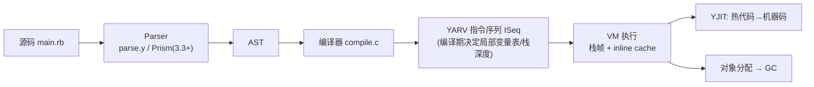
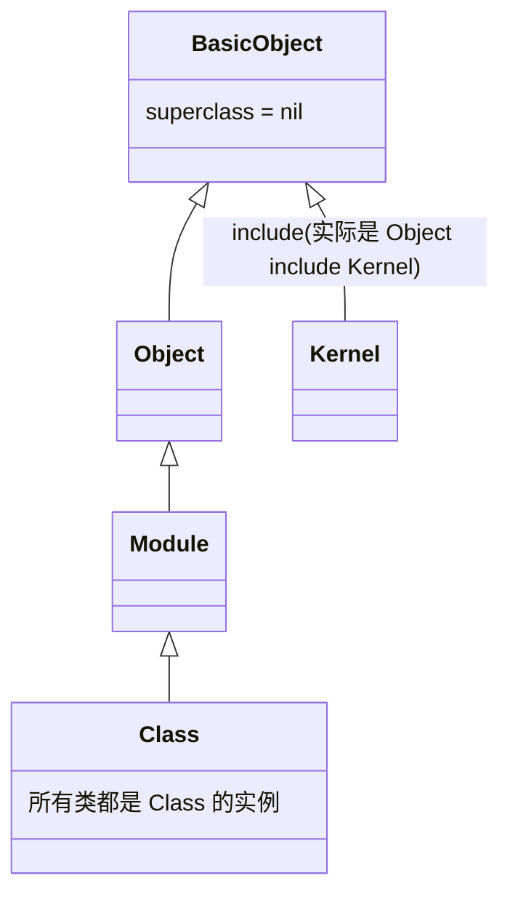
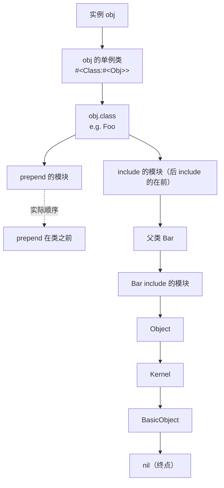

# Ruby 底层原理深度笔记 & 国内大厂面试题库

> **版本基准**：以 MRI（CRuby）3.x（3.0 ~ 3.4）为主，涉及 4.0 变化的地方会单独标注。JRuby / TruffleRuby 差异在对应章节提示。
>
> **阅读定位**：本文不是"语法入门"，而是"从语法现象反推运行时实现"。每一节的结构都是：**现象 → 机制 → 源码/字节码证据 → 工程延伸**。
>
> **面试题说明**：第二部分题目来自公开面经、社区题库（Ruby China、GitHub 面试仓库等）的**归类整理**，并按"典型出题公司风格"标注，**不代表某家公司官方原题**。标注公司用于帮你判断"这类题在什么业务场景下会被问"（例如字节/腾讯偏运行时与 GC，美团/有赞偏元编程与 Rails 工程实践）。
>
> **难度标尺**
>
> | 星级 | 含义 | 对应层级 |
> |---|---|---|
> | ★ | 知道结论即可 | 应届 / 初级 |
> | ★★ | 能解释为什么 | 初级 ~ 中级 |
> | ★★★ | 能讲清机制并给出代码验证 | 中级（3~5 年）必答 |
> | ★★★★ | 触及实现层（数据结构 / 缓存 / 编译） | 高级（5~8 年） |
> | ★★★★★ | 源码级 / 能指导架构决策 | 专家 / 基础架构 |

---

## 目录

**第一部分 · 底层原理**

- [0. 认知地图：Ruby 的设计哲学如何决定它的实现](#0-认知地图ruby-的设计哲学如何决定它的实现)
- [1. 对象模型：一切皆对象的真实结构](#1-对象模型一切皆对象的真实结构)
- [2. 方法调用：查找链、可见性、缓存](#2-方法调用查找链可见性缓存)
- [3. 变量与作用域：编译期就决定的事](#3-变量与作用域编译期就决定的事)
- [4. 块 / Proc / Lambda / 闭包](#4-块--proc--lambda--闭包)
- [5. 元编程：动态性的代价与收益](#5-元编程动态性的代价与收益)
- [6. 内存与 GC：对象怎么存、怎么死](#6-内存与-gc对象怎么存怎么死)
- [7. 并发：Thread / GVL / Fiber / Ractor](#7-并发thread--gvl--fiber--ractor)
- [8. 执行引擎：YARV 字节码、缓存与 JIT](#8-执行引擎yarv-字节码缓存与-jit)
- [9. 异常与控制流](#9-异常与控制流)
- [10. 类型、转换与协议](#10-类型转换与协议)
- [11. 字符串与编码（M17N）](#11-字符串与编码m17n)
- [12. 加载机制与常量加载](#12-加载机制与常量加载)
- [13. Rails 中的 Ruby 底层延伸](#13-rails-中的-ruby-底层延伸)
- [14. 速查表](#14-速查表)

**第二部分 · 大厂面试题（33 题）**

- [总索引表](#总索引表33-题公司--难度--一句话考点)
- [A 组 · 对象模型与基础语义（6 题）](#a-组对象模型与基础语义)
- [B 组 · 方法与调用（8 题）](#b-组方法与调用)
- [C 组 · 元编程与工程实践（9 题）](#c-组元编程与工程实践)
- [D 组 · 运行时与性能（10 题）](#d-组运行时与性能)
- [附录 · 自测清单与学习路径](#附录自测清单与学习路径)

---

# 第一部分 · 底层原理

## 0. 认知地图：Ruby 的设计哲学如何决定它的实现

Ruby 的绝大多数"怪现象"，都可以从四条设计目标推导出来。理解这四条，后面的知识点就是推论而不是死记。

| 设计目标 | 直接导致的实现选择 | 你观察到的现象 |
|---|---|---|
| **完全面向对象**（一切皆对象，连 `nil` 都能收消息） | 立即值（Integer/Symbol/nil/true/false）用**指针标记**伪装成对象，不占堆 | `1.class == Integer`、`nil.to_s == ""`、`1.object_id == 3` |
| **开放类 + 动态派发**（任何时刻可改任何类） | 方法表必须可写、方法查找必须走**运行时链**，因此需要**方法缓存 + 缓存失效机制** | `class String; def foo; end; end` 立即生效；缓存必须被清 |
| **"让程序员快乐"优先于极致性能** | 解释执行 + 内联缓存 + 后期才叠 JIT；对象大量分配，靠 GC 而非手工管理 | 吞吐不如 Go/Java，但表达力强；GC 调优成为必修课 |
| **隐式上下文**（`self`、block、隐式接收者） | 每个栈帧都要保存 `self`、`defined_class`、`block`、`iseq`；作用域在**编译期**定型 | `self` 无处不在；`def` 会切断局部变量可见性 |



**必背的一句话**：**Ruby 的"动态"几乎全部发生在"名字解析"这一层**（方法名、常量名、局部变量名）。一旦名字解析完成，剩下的执行和 C 语言差别不大——这就是为什么 Ruby 的性能优化史，本质是"把名字解析的结果缓存起来"的历史。

---

## 1. 对象模型：一切皆对象的真实结构

### 1.1 三条铁律

1. **一切皆对象**：没有"基本类型"。`1`、`nil`、`true`、`:sym` 都是对象，都能接收消息。
2. **方法只存在于 Module 里**（`Class` 是 `Module` 的子类）。对象本身不"拥有"方法，它只拥有"我是哪个类的实例"这一个指针。
3. **继承 + 模块混入 = 一条扁平化的祖先链（ancestors）**，方法查找只沿这条链走，没有第二条路径。

### 1.2 Class 的自指结构（面试常画的图)



关键事实表（建议直接背）：

| 表达式 | 结果 | 说明 |
|---|---|---|
| `Object.class` | `Class` | |
| `Class.class` | `Class` | Class 自己也是 Class 的实例（自指） |
| `Module.class` | `Class` | |
| `Class.superclass` | `Module` | 所以 `Class < Module` 成立 |
| `Module.superclass` | `Object` | |
| `Object.superclass` | `BasicObject` | |
| `BasicObject.superclass` | `nil` | 继承链的终点 |
| `Object.ancestors` | `[Object, Kernel, BasicObject]` | `Kernel` 是被 include 进来的 |
| `Comparable.class` | `Module` | 模块是 Module 的实例 |
| `Class.new.superclass` | `Object` | 匿名类的默认父类 |

```ruby
p Object.class          # Class
p Class.class           # Class
p Class.superclass      # Module
p Module.superclass     # Object
p BasicObject.superclass# nil
```

> **延伸：为什么 `Class < Module` 很重要？**
> 因为"类"只是"能 new 出实例、能继承"的模块。`attr_accessor`、`include`、`define_method` 全是 `Module` 的实例方法，所以类天然拥有它们。这也解释了 `Class.new` 之后你可以直接 `klass.include(M)`——它在调用 `Module#include`。

### 1.3 方法到底住在哪里

| 写法 | 方法实际定义在 | 谁可以调用 |
|---|---|---|
| `def obj.m; end` | `obj` 的**单例类** | 只有这个对象 |
| `class Foo; def self.m; end; end` | `Foo` 的**单例类**（`def self.m` ≡ `def Foo.m`） | 通过 `Foo.m` |
| `class Foo; def m; end; end` | `Foo` 的实例方法表 | `Foo` 的实例 |
| `module M; def m; end; end` | `M` 的实例方法表 | include/extend 后 |
| 顶层 `def m; end` | `Object` 的 **private** 实例方法 | 任何对象内部隐式调用 |
| `Kernel#puts` | `Kernel`（被 Object include） | 所有对象 |
| `define_method(:m){}` | 调用者（类/模块）的实例方法表 | 同 `def m` |

```ruby
def top_level; :ok; end
p Object.private_instance_methods.include?(:top_level)   # true
p Object.new.respond_to?(:top_level)                     # false（private 不计入 respond_to）
```

> **延伸：为什么顶层方法会污染所有对象？**
> 顶层 `self` 是 `main`（一个 Object 的实例），`def` 不带接收者时定义到"当前默认定义对象"（`cref`）上，即 `Object`。因为 `Object` 是几乎所有类的祖先，于是全局可见。这也是为什么工程里禁止顶层 `def`——它会成为隐式的公共 API。正确做法是包进 `module` 或用 `module_function`。

### 1.4 单例类（Singleton Class / Eigenclass）

**定义**：每个对象都"潜在地"拥有一个只属于自己的匿名类，它是该对象方法查找的**第一站**。

```ruby
obj = Object.new
def obj.hello; "hi"; end
p obj.singleton_class                       # #<Class:#<Object:0x00007f...>>
p obj.singleton_class.ancestors.first(3)    # [#<Class:#<Object:...>>, Object, Kernel]
```

四条必须记住的规则：

1. **惰性创建**：3.x 里只有调用 `singleton_class` / `class << obj` / `def obj.m` 时才真正分配，节省内存。
2. **类的单例类，父类是父类的单例类**：
   ```ruby
   class Parent; end
   class Child < Parent; end
   p Child.singleton_class.superclass   # #<Class:Parent>
   p Child.singleton_class.superclass.superclass # #<Class:Object>
   ```
   这条规则解释了"类方法可以被继承"：`Child.foo` 能调到 `Parent.foo`，是因为 `Child` 的单例类链上挂着 `Parent` 的单例类。
3. **`class << self` 就是打开单例类**：`self` 在类体内是类本身，所以 `class << self` 打开的是类的单例类，里面定义的实例方法就是"类方法"。
4. **立即值不能有单例方法**：`1.singleton_class` 抛 `TypeError: can't define singleton`。因为它们没有堆对象，无处挂方法表。`nil`、`true`、`false`、`Symbol` 同理。

```ruby
# 经典陷阱：模块里的 class << self 与 extend
module M
  def self.included(base); base.extend(ClassMethods); end
  module ClassMethods
    def build; new; end
  end
end
class Foo; include M; end
Foo.build   # => Foo.new，因为 Foo 的单例类 include 了 M::ClassMethods
```

> **延伸：`extend` 的本质就是 `singleton_class.include`**
> ```ruby
> module Helpers; def help; :help; end; end
> o = Object.new
> o.extend(Helpers)
> # 等价于 o.singleton_class.include(Helpers)
> p o.singleton_class.ancestors.first(2)  # [#<Class:#<Object>>, Helpers]
> ```
> 所以 `extend` 是"给某个对象（通常是类）加类方法"的标准手法，也是 Rails 里 `ActiveSupport::Concern`、`delegate` 的基础。

### 1.5 一张图总结对象模型



**查找顺序 = 这张图从上到下**。记住这张图，第 2 节和第 6 节的面试题都能推出来。

---

## 2. 方法调用：查找链、可见性、缓存

### 2.1 完整查找算法（MRI `vm_callinfo` / `search_method` 的等价描述）

给定 `receiver.foo`：

```
1. klass = receiver 的"有效类"：
   若 receiver 是普通对象 → 它的类（若被 extend 过，优先其单例类）
   若 receiver 是类/模块  → 它的单例类
2. 从 klass 开始遍历 ancestors（顺序：klass → prepended modules → 自身 →
   included modules（逆序）→ superclass → 重复）
3. 在每一层的 method table（RCLASS_M_TBL / st_table）里查 :foo
   ├─ 命中且可见性允许 → 调用
   └─ 命中但不可见（private 且显式 receiver）→ NoMethodError: private method
4. 整条链都没有 → 调用 method_missing(:foo, *args)
5. method_missing 默认实现在 BasicObject，抛 NoMethodError
```

**关键：`ancestors` 是一条"已经扁平化"的线性链**，`prepend` / `include` 在调用时（而非定义时）修改这条链，所以它们是"编译期一次、运行时永久生效"的操作。

```ruby
module A; def m; "A"; end; end
module B; def m; "B>" + super; end; end
class C
  include A
  include B      # 后 include 的排在更前面
  def m; "C>" + super; end
end
p C.ancestors          # [C, B, A, Object, Kernel, BasicObject]
p C.new.m              # "C>B>A"
```

`prepend` 的区别（**这是 A3 / C4 的核心**）：

```ruby
module Logging
  def save
    puts "before"
    r = super          # super 沿祖先链继续找
    puts "after"
    r
  end
end
class Post
  prepend Logging
  def save; :saved; end
end
p Post.ancestors       # [Logging, Post, Object, Kernel, BasicObject]
p Post.new.save        # before / after / :saved
```

> 为什么 `prepend` 能"包住"原方法，而 `include` 不能？
> `include` 把模块插在**类之后**，所以类自己的 `save` 先命中，模块的 `save` 永远不会被调用（除非类里显式 `super`）。
> `prepend` 把模块插在**类之前**，模块先命中，模块里的 `super` 才落到类上——这就是"装饰器/中间件"语义。

### 2.2 方法可见性：`private` / `protected` / `public`

| 可见性 | 能否显式 receiver | 真实规则 |
|---|---|---|
| `public` | 可以 | |
| `private` | **不可以**（唯一例外：setter `self.x = v`，2.7+ 允许） | 只能"隐式 self"调用 |
| `protected` | 可以，但有限制 | receiver 必须 `is_a?(定义该方法的类)`，即"同类/子类实例之间可互调" |

```ruby
class Account
  def initialize(balance); @balance = balance; end
  protected
  def balance; @balance; end          # 只允许"同类对象"访问
  private
  def secret; :secret; end
  public
  def richer_than?(other)
    balance > other.balance            # 合法：other 是同类实例
  end
  def boom
    self.secret                        # NoMethodError: private method 'secret'
    self.secret = 1                    # 若是 setter，2.7+ 合法
  end
  def secret=(v); @secret = v; end
end
```

> **延伸：为什么 private 是"隐式接收者"规则，而不是"仅自己"？**
> 因为 Ruby 的方法调用语法里，**不带点的调用可能是局部变量**。解析器遇到 `foo` 时，若当前作用域有同名局部变量则当变量，否则当方法调用。`private` 的设计语义是"这个方法不是对外的 API，只能在 self 上下文中用"，所以它禁止显式 receiver——防止你从外部把它当公共接口。`self.secret` 这种"显式写 self 也不行"的严格性，是为了让"有没有写 receiver"成为唯一判据，避免歧义。
> 2.7 放开 `self.x = v` 是因为 setter 语法必须带 receiver（`x = v` 会被解析成局部变量赋值），否则私有 setter 无法使用。

### 2.3 方法缓存（Method Cache / Inline Cache）

Ruby 到底怎么在"类随时可能被改"的前提下还能跑得不慢？答案是**三层缓存 + 版本号失效**。

| 层 | 位置 | 粒度 | 失效条件 |
|---|---|---|---|
| **全局方法缓存** | VM 全局 `method_cache` | `(klass, id) → me` | 任何 `define_method` / `def` / `undef` / `include` / `prepend` 使 **global method state version** 递增，整表清空 |
| **内联缓存 IC** | 每个调用点的指令操作数（`opt_send_without_block` 的 CDHash） | `call site → (klass, defined_class, me)` | 同上；另用 **class serial** 校验 |
| **常量缓存** | 每个 `getconstant` 指令 / `const_get` 调用点 | `(cref, id) → value` | 常量被赋值/重定义时 `rb_clear_constant_cache()` |

```ruby
# IC 的可见证据：同一调用点被不同类"轮流"调用时会退化
class A; def m; 1; end; end
class B; def m; 2; end; end
objs = [A.new, B.new] * 50
objs.each { |o| o.m }        # 单态→多态：IC 反复 miss
```

> **延伸：`class_serial` 是什么？**
> MRI 每个类有一个单调递增的 `class_serial`（定义方法、include 模块时 +1）。IC 里记录"我上次见到的 serial"，调用时先比 serial，相等就直接用缓存的 `me`，不等才走完整查找并更新。这就是"O(1) 的重复调用 + 正确的动态性"的组合拳。
> 面试里如果被追问"Ruby 这么动态，为什么 `obj.foo` 不是 O(链长)？"——答案就是 IC + class_serial，以及 YJIT 会把这些 IC 直接编译成类型守卫（type guard）。

### 2.4 参数的传递方式（经典争议题）

**结论：Ruby 是"按值传递对象引用"（pass-by-value of the reference / call-by-sharing），既不是传统值传递，也不是引用传递。**

```ruby
def mutate(s)
  s << "!"          # ① 原地修改：影响外部
  s = "new"         # ② 重新绑定：只影响方法内
end

str = "hi"
mutate(str)
p str               # "hi!"  ← 因为 String 可变，① 生效
p str.object_id     # 未变
```

三条判定标准（面试可直接背）：

1. 形参是**新的局部变量**，与实参共享同一个对象（`object_id` 相同）；
2. 对形参**赋值**（`s = ...`）不影响外部；
3. 对形参**原地修改**（`<<`、`[]=`、`upcase!`）影响外部——因为对象是同一个。

```ruby
def reassign(s); s = "changed"; end
x = "orig"; reassign(x); p x      # "orig"

def rebind_inside; a = 1; b = a; b = 2; p a; end   # 1
```

**参数列表的完整顺序**（记不住就会被追问细节）：

```
def m( req, opt = 1, *rest, post_req, key:, key_opt: 2, **kw, &blk )
     ↑必选    ↑可选    ↑splat  ↑后置必选   ↑必选kw  ↑可选kw   ↑kw splat ↑block
```

3.0 之后的 **关键字参数分离**（Breaking Change，面试高频）：

```ruby
def f(h = {}); h; end
f(a: 1)         # Ruby 3.x：整体作为 hash 传入（因为 h 是位置参数）
def g(**kw); kw; end
g({a: 1})       # Ruby 3.x：报错 ArgumentError（不再自动转 kwargs）
g(a: 1)         # ok
```

> **延伸：为什么要分离？**
> 2.x 里 `Hash` 与关键字参数自动互转，导致"传一个 hash 进去被当成 kwargs"的难以调试的错误（典型：`User.create(attrs)` 中 `attrs` 被展开成关键字）。3.0 用 `**` / `ruby2_keywords` 显式区分。老代码兼容用 `ruby2_keywords def f(h)` 标记。

### 2.5 `super` 的三种形态

| 写法 | 行为 |
|---|---|
| `super` | **隐式传全部实参**（含 block），等价 `super(*args, &block)` |
| `super()` | 显式传空参 |
| `super(x)` | 只传 x |

```ruby
class P
  def m(a, b = 2); [a, b]; end
end
class C < P
  def m(a, b = 3); super; end        # 传 (a, b) → [1, 3]（b 用的是 C 的默认值）
  def m2(a); super; end              # 若 P#m2 只收 1 个参数则 ok
end
p C.new.m(1)   # [1, 3]
```

> **坑点**：`super` 会把你**当前方法收到的一切**（包括你后来改过的默认值）继续传下去。所以"签名不一致 + 用裸 super"是 `ArgumentError: wrong number of arguments` 的常见来源。

---

## 3. 变量与作用域：编译期就决定的事

### 3.1 六类变量

| 类型 | 语法 | 存储位置 | 生命周期 |
|---|---|---|---|
| 局部变量 | `a` / `_a` | 栈帧的 local table（编译期编号的 slot） | 当前作用域 |
| 实例变量 | `@a` | 对象内的 ivar 表（3.2+ 走 **object shape**） | 对象存活期，默认 `nil` |
| 类变量 | `@@a` | 定义它的类/模块的 CV 表 | 类存活期，沿继承链查找 |
| 全局变量 | `$a` | VM 全局表 | 进程期 |
| 常量 | `A` | 定义它的 Module 的常量表 | 类/模块存活期 |
| 特殊全局 | `$! $~ $_ $. $0 $$` | VM 内部字段 | 随调用栈 |

### 3.2 作用域门（Scope Gate）：这是 Ruby 最反直觉的地方之一

```ruby
x = 10
def m
  p x          # NameError: undefined local variable
end
class Foo
  p x          # NameError 同样
end
[1].each do
  p x          # 10  ← block 不切断作用域
end
```

- **`def` / `class` / `module` 是作用域门**：进去就换一个全新的局部变量作用域，外部变量完全不可见，`self` 也变成新的。
- **block / `{}` / `do..end` 不是作用域门**：它是闭包，能捕获外层变量。
- 例外：`Class.new do ... end`、`Module.new`、`define_method` 的 block —— 因为它们本质是 block，所以**能**看到外部变量。这是"用 Class.new 替代 class 关键字"做动态类定义的关键原因。

```ruby
prefix = "User"
klass = Class.new do
  define_method(:name) { "#{prefix}_name" }   # 闭包捕获 prefix，class 关键字做不到
end
```

> **延伸：block 内新变量会不会"泄漏"到外层？**
> 3.x 行为：block 内**首次赋值**的局部变量，如果外层不存在，则成为 block 局部变量，**不会**泄漏到外层（这是 1.9 起的行为）；但若外层已有同名变量，则是对外层变量的赋值（闭包）。
> ```ruby
> a = 1
> [1].each { a = 2; b = 99 }   # a 被改，b 不泄漏
> p a  # 2
> p defined?(b)  # nil
> ```
> 要强制"绝不碰外层"，用 block-local 声明：`{|x; y| y = 1 }`。

### 3.3 实例变量：不存在"未定义"这回事

```ruby
class Foo; end
o = Foo.new
p o.instance_variable_get(:@nope)   # nil
p o.instance_variables              # []
```

读未赋值的 `@x` 返回 `nil`（`-W` 警告），不会 `NameError`。这是 Ruby 与 Java 的一大差别，也是 `@x ||= []` 惯用法的基础（但有坑：`false` 也会触发初始化）。

> **延伸：3.2 的 object shape（对象形状）**
> 早期 MRI 的普通对象这样存：`RVALUE` 头部 + `len` + ivar 数组 + 指向"ivar 名字表"的指针。每次 `@a = 1` 需要查名字表找下标，O(n)。
> 3.2 引入 **object shapes**（借鉴 V8 的 hidden class）：每个类维护一棵 shape 树，第一次出现 `@a` 时创建 shape 边；对象头只存一个 shape id，ivar 读写下标由 shape 直接给出 → O(1)，且同 shape 的对象可被 YJIT 当作同一类型处理。
> 这也解释了为什么"**同一个类里 ivar 的赋值顺序要一致**"能提升性能——顺序不同会分裂出多个 shape。

### 3.4 类变量（`@@`）的继承陷阱

```ruby
class Parent
  @@count = 0
  def self.inc; @@count += 1; end
  def self.count; @@count; end
end
class Child < Parent; end
Child.inc               # 在子类上下文里执行 @@count += 1
p Child.count    # 1
p Parent.count   # 3.0 之前：1（子类的修改"穿透"到了父类）；3.0 及之后：0（在子类里新建了同名 cvar）
```

准确说法：**Ruby 3.0 起，在子类中给 `@@var` 赋值不再影响父类的 `@@var`，而是在子类中新建一个类变量**（2.7 时给出 warning）。因此上面的例子在 3.0+ 中 `Parent.count` 仍为 0，`Child.count` 为 1。

> **工程结论**：类变量几乎总是错误的选择——它既不是实例级也不是类级，而是"整个继承树共享或分裂（取决于版本）"。正确做法：类级状态用 `class << self; attr_accessor :count; end`（存在类的 ivar 上，不被子类共享），实例级状态用 `@ivar`。

### 3.5 局部变量是编译期决定的（会咬人的细节）

```ruby
# ① 解析器先看到赋值，所以整段里 a 都是局部变量
if false
  a = 1
end
p defined?(a)   # "local-variable"

# ② 名字从未赋值 → 解析为方法调用
p defined?(b)   # nil
# b 会走 method_missing → NameError: undefined local variable or method 'b'
```

YARV 编译时会把每个作用域内出现过的局部变量分配到固定的 slot（`local table`），运行时只是一次数组下标访问——**这是 Ruby 局部变量访问极快的原因**（指令 `getlocal_WC_0`）。

> **延伸：为什么 `a = a` 不报错但 `a` 单独出现会报错？**
> `a = a`：右侧 `a` 在解析时已因左侧赋值被登记为局部变量 → 读到 `nil`，再赋回。这是"Ruby 里变量声明是隐式且顺序无关（整个作用域内）"的直接后果。用 `ruby -w` 会警告 `assigned but unused variable`。

---

## 4. 块 / Proc / Lambda / 闭包

### 4.1 块不是对象（3.x 的"双形态")

Ruby 里 block 只有"附着在方法调用上"时存在。为了性能，3.x 把 block 参数做成三种形态，**只有需要时才具象化为 Proc**：

| 形态 | 触发条件 | 是否分配 Proc |
|---|---|---|
| `block_handler_type_none` | 没传 block | 否 |
| `block_handler_type_iseq` | 只用了 `yield` | **否**（直接在当前栈帧上调用 block 的 iseq） |
| `block_handler_type_proc` | 用了 `&blk` / 把 block 传给另一个方法 / `Proc.new` | 是（一次堆分配） |

```ruby
def fast; yield; end                 # 不分配 Proc
def slow(&blk); blk.call; end        # 分配一个 Proc
```

> **工程结论**：热路径上优先 `yield`；只有需要"把块存起来/传下去/多次调用"时才用 `&blk`。这也是 RuboCop `Performance/RedundantBlockCall` 规则存在的原因。

**其它块相关 API 的语义**：

| 写法 | 语义 |
|---|---|
| `yield(a)` | 调用 block，返回其最后表达式的值 |
| `block_given?` | 当前帧是否带 block（等价 `!block.nil?`） |
| `&:upcase` | 调用 `Symbol#to_proc`，得到 `->(x){ x.upcase }`，本质是 `send` |
| `&method(:foo)` | `Method#to_proc`，把已有方法当块 |
| `&nil` | 表示"没有 block" |
| `&other_proc` | 若 other_proc 是 Proc 直接用；否则先 `to_proc` |

### 4.2 Proc 与 Lambda 的四条实质区别

| 维度 | `proc {}` / `Proc.new {}` | `lambda {}` / `-> {}` |
|---|---|---|
| `return` | **从定义它的方法返回**（若方法已结束 → `LocalJumpError`） | 只从 lambda 自身返回 |
| `break` | `LocalJumpError` | 从 lambda 返回（同 return） |
| 参数个数 | 宽松（多则丢弃，少则 `nil`） | 严格（不符抛 `ArgumentError`） |
| `arity` | 表达式方式（可选参数记为负数） | 同样表达式方式，但调用时严格执行 |
| `lambda?` | `false` | `true` |
| 与 `super`/`yield` 交互 | 视捕获环境而定 | 同 |

```ruby
def demo
  l = lambda { return 10 }
  p l.call            # 10，然后继续执行
  pr = proc { return 10 }
  p pr.call           # 直接从这个方法返回 10，下面的代码不执行
  :never_reached
end
p demo                # 10
```

```ruby
def strict
  l = ->(a, b) { a + b }
  l.call(1, 2)        # 3
  l.call(1)           # ArgumentError: wrong number of arguments (given 1, expected 2)
  pr = proc { |a, b| [a, b] }
  pr.call(1)          # [1, nil]  ← 宽松
end
```

> **延伸：为什么 proc 的 `return` 会"穿越"到外层方法？**
> 因为非 lambda 的 Proc 捕获的是创建处的栈帧（`VM_ENV`），它的 `return` 指令目标是**创建时所在方法的 iseq**。方法已返回后再 `return`，目标帧不存在 → `LocalJumpError: unexpected return`。
> lambda 在创建时会把自己的 iseq 标记为 `lambda`，`return` 的目标就是 lambda 自身帧，所以永远合法。**这就是"lambda 是方法，proc 是块"的本质区别**——它们在 VM 里是同一个 `T_PROCPROC` 对象，只在 `rb_proc_t` 的 `is_lambda` 与 `block_handler` 上有差别。

### 4.3 闭包到底捕获了什么

`Proc` / `lambda` / `block` / `binding` 都持有同一个东西：**`VM_ENV`（环境指针链）**，它包含：

1. `self`（ep 上的 `self`）
2. 该作用域的**局部变量表**（`ep[0]` 指向 locals，往上还有 `prev env`）
3. `cref`（词法作用域，决定常量查找）
4. 当前 block handler（嵌套块）

```ruby
def make_counter
  count = 0
  -> { count += 1 }        # 捕获 count 的 slot，而不是值
end
c = make_counter
p [c.call, c.call, c.call]  # [1, 2, 3]
```

**经典陷阱：循环里的闭包共享同一个变量**

```ruby
procs = []
[1, 2, 3].each { |i| procs << -> { i } }
p procs.map(&:call)        # [3, 3, 3]  ← 不是 [1,2,3]

# 正确写法一：让 lambda 有独立参数（默认值在创建时求值）
procs = []
[1, 2, 3].each { |i| procs << ->(v = i) { v } }
p procs.map(&:call)        # [1, 2, 3]

# 正确写法二：用方法工厂（每次调用产生新作用域）
def make(i) = -> { i }
procs = [1, 2, 3].map { |i| make(i) }
```

> 为什么不是 `[1,2,3]`？`each` 的 block 参数 `i` 是**同一个局部变量 slot**，每次迭代只是重新赋值。三个 lambda 捕获的都是"这个 slot 的地址"，所以读到的都是最后一次的值。`def make(i)` 每次都创建新帧 → 新 slot。
> 同理 `for x in [1,2,3]` **不创建新作用域**（`for` 不调用 block），而 `each` 至少是 block——这是 `for` 被 RuboCop 劝退的核心理由。

### 4.4 Enumerator：外部迭代与"用 Fiber 实现的生成器"

```ruby
e = [1, 2, 3].each          # 不带 block → Enumerator
p e.next                    # 1
p e.next                    # 2
p e.peek                    # 3（不前进）
```

MRI 的 `Enumerator` 内部用 **Fiber** 实现：调用 `next` 时 resume 一个 fiber，block 执行到 `yield` 处挂起，把值传回调用方。这解释了：
- `Enumerator` 天生"惰性"（不会一次算完）；
- 在 `Enumerator` 里 `Fiber.yield` 会与外部 `next` 打架（不要混用）。

```ruby
inf = (1..Float::INFINITY).lazy.map { |x| x * 2 }.select(&:even?)
p inf.first(3)              # [2, 4, 6]  ← 无限序列也能算
```

---

## 5. 元编程：动态性的代价与收益

### 5.1 动态定义方法的三种手段（选型表）

| 手段 | 代码 | 方法体可见外部变量 | 性能 | 何时用 |
|---|---|---|---|---|
| `def` | `def m; end` | **否**（作用域门） | 最快（编译期 iseq，IC 稳定） | 固定方法 |
| `define_method` | `define_method(:m) { ... }` | **是**（block 闭包） | 接近 `def`（同为 iseq，但历史上 IC 命中稍差） | 需要闭包 / 批量生成 |
| `class_eval` + 字符串 | `class_eval "def m; end"` | 否 | 慢（每次都要 parse + compile） | 极少；能不用就不用 |
| `method_missing` | 见下 | 是 | 最慢（异常路径 + 无 IC） | 名字无法预知（代理/DSL） |

```ruby
# 批量定义：define_method 的标准用法
%i[name age email].each do |field|
  define_method(field) { instance_variable_get("@#{field}") }
  define_method("#{field}=") { |v| instance_variable_set("@#{field}", v) }
end
```

> **延伸：`define_method` 生成的 setter 有坑**
> `define_method(:foo=)` 在 3.x 中**可以**被 `obj.foo = 1` 调用，但块内不能 `return`（`return` 会试图从定义处方法返回，抛 `LocalJumpError`）。另外 `define_method` 支持显式参数列表 `define_method(:m) { |a, b| ... }`，或 3.x 的 `define_method(:m) do |a, b|` 也 OK。
> 更重要的坑：**在 `def` 里 `yield` 可以，在 `define_method` 的 block 里 `yield` 会抛 `LocalJumpError`**（因为该块不是方法的 block）。要传块必须 `define_method(:m) { |*a, &blk| blk.call }`。

### 5.2 `method_missing` 的完整契约（这是 C1 的核心）

```ruby
class DynamicProxy
  def initialize(target) = @target = target

  def method_missing(name, *args, **kw, &blk)
    if @target.respond_to?(name)
      @target.public_send(name, *args, **kw, &blk)
    else
      super   # ← 关键：必须调用 super，保留正确的 NoMethodError
    end
  end

  # ← 关键：必须同步实现，否则 respond_to? 永远 false
  def respond_to_missing?(name, include_private = false)
    @target.respond_to?(name, include_private) || super
  end
end
```

**四条铁律**：

1. **一定要 `super`**：否则错误信息丢失，`irb` 里也看不到正确的 `NoMethodError`。
2. **一定要配 `respond_to_missing?`**：`respond_to?` 是 Ruby 生态的协议（`Array#flatten`、`case/when`、RSpec 的 `respond_to` matcher 都靠它）。
3. **签名要完整**：`(name, *args, **kw, &blk)`。3.0 之后漏掉 `**kw` 会导致关键字参数被当成 hash 传进去出错。
4. **性能代价**：`method_missing` 触发时是"查找失败 → 抛/捕获 → 再派发"，且**不会进入 IC**（因为查找本身就是 miss）。热路径用 `define_method` 预生成，冷路径才用 `method_missing`。

> **延伸：Rails 里 `method_missing` 的教训**
> ActiveRecord 早期用 `method_missing` 实现 `find_by_name_and_age` 这类动态 finder，结果每次调用都走 miss 路径，且 `respond_to?` 全是 false，IDE 无法补全，最终在 Rails 4 被 `find_by` 取代。**这是"method_missing 适合做兜底，不适合做常规 API"的经典案例**。

### 5.3 Blank Slate：为什么代理对象要用 `BasicObject`

```ruby
class Ghost < BasicObject      # 不是 Object
  def method_missing(n, *a, &b); ::Kernel.puts "missing: #{n}"; end
  def respond_to_missing?(n, p = false) = true
end
```

`BasicObject` 只有 8 个方法（`! == != __send__ __id__ instance_eval instance_exec method_missing singleton_method_added` 等），没有 `puts`、`class`、`inspect`、`to_s`。所以"任何名字"都能落到 `method_missing`。

> **坑**：`BasicObject` 里**不能用 `puts`/`raise`/字符串插值之外的东西**，必须写全限定名 `::Kernel.puts`、`::Kernel.raise`，否则自己就 `method_missing` 递归了。调试时 `p obj` 也会炸（没有 `inspect`）。

### 5.4 钩子方法全清单（面试常考的"你都知道哪些 callback"）

| 钩子 | 触发时机 | 典型用途 |
|---|---|---|
| `self.included(base)` | 模块被 include | 给 base 加类方法（Concern 原型） |
| `self.extended(base)` | 模块被 extend | |
| `self.prepended(base)` | 模块被 prepend | |
| `self.inherited(sub)` | 类被继承 | 注册子类、框架自动配置 |
| `method_added(name)` | 类中定义实例方法 | 观察者、动态校验 |
| `singleton_method_added(name)` | 定义类方法 | |
| `const_added(name)` | 常量被定义（3.2+） | |
| `at_exit { }` | 进程退出前 | 收尾、flush |
| `TracePoint` | 任意事件（call/return/class/line/b_call…） | APM、调试、覆盖率 |

```ruby
class Base
  def self.inherited(sub)
    sub.instance_variable_set(:@config, {})
    Registry << sub          # 框架注册子类的经典写法
  end
end
```

> **延伸：`inherited` 的时机是在 `class Child < Base` 打开类体之前**，所以子类还没定义任何方法。这也是为什么"父类在 inherited 里读取子类方法"会失败。

### 5.5 Refinements：受控的 monkey patch

```ruby
module StringExt
  refine String do
    def shout = upcase + "!"
  end
end

class Foo
  using StringExt          # 只在当前词法作用域（到文件/模块结束）生效
  def m = "hi".shout       # "HI!"
end

"hi".shout                 # NoMethodError ← 全局不受影响
```

**原理**（面试加分点）：
- `refine` 会创建一个**匿名的 refinement 模块**，挂在 `String` 的 refinement 表上；
- `using` 把该 refinement **激活到当前词法作用域（cref）**，编译期就把"这个调用点可能用到哪些 refinement"记进 call site（`rb_callable_method_entry` 里带 `refined_class`）；
- 所以它的查找是**编译期确定的、词法作用域限定的**，不受运行时调用栈影响——这与 monkey patch 的"全局污染"完全相反。

**局限**：动态派发（`send`）拿不到 refinement（3.x 部分场景已支持 `send` 在 refined scope 内）；不能 refine 到"已经编译好的调用点"。

### 5.6 `Struct` / `Data` / `OpenStruct` 选型

| 类 | 可变异 | 性能 | 用途 |
|---|---|---|---|
| `Struct` | 是 | 快（C 实现 + 固定 ivar） | 需要可变的值对象、旧代码兼容 |
| `Data`（3.2+） | **否**（不可变） | 更快（更少分配、可作 Hash key） | 现代值对象、DTO |
| `OpenStruct` | 是 | **慢**（每次读写走 method_missing + 动态 singleton） | 快速原型、测试桩；**禁止上生产热路径** |

```ruby
Point = Data.define(:x, :y)
p1 = Point.new(x: 1, y: 2)
p p1.with(y: 9)          # Data#with 返回新对象
p p1.deconstruct_keys    # 支持模式匹配
```

> **延伸**：`OpenStruct` 为什么慢？它每次 `o.foo = 1` 都会在单例类上 `define_singleton_method`，也就是**每次赋值都修改方法表 → 方法缓存全局失效**。在长生命周期对象上用它，等于持续给 VM 制造缓存抖动。

### 5.7 TracePoint：唯一的内建"全事件钩子"

```ruby
tp = TracePoint.new(:call, :return) do |t|
  puts "#{t.defined_class}##{t.method_id} @ #{t.path}:#{t.lineno}"
end
tp.enable { Foo.new.bar }
tp.disable
```

用途：APM（如 `skylight`）、测试覆盖率（`simplecov` 部分实现）、死代码检测。**代价极大**（关闭 tracing 才恢复 JIT/IC 优化，`TracePoint` 启用期间 YJIT 会降级）。

---

## 6. 内存与 GC：对象怎么存、怎么死

### 6.1 堆的结构：`heap_page` + `slot`

```
Ruby 堆
├── heap_page（≈16KB 一页）
│    ├── slot 0  [RVALUE 40 bytes]  ← 一个对象占一个 slot
│    ├── slot 1  ...
│    └── slot N  (≈ 408 个/页，64 位)
├── heap_page
└── ...
```

- 每个对象是**固定大小 40 字节的 RVALUE**（64 位下）。对象"大小"不体现在 RVALUE 上：字符串内容、数组元素、对象 ivar 都可能挂在 malloc 的**堆外内存**里（这也解释了 `GC.stat` 里的 `malloc_increase_bytes`）。
- 分配路径：`Object.new` → `rb_obj_alloc` → 从当前 page 的 **freelist** 取一个 slot → freelist 空则触发 GC → 仍不够则新建 page。
- `ObjectSpace.count_objects` 能看到各类型对象数量；`ObjectSpace.memsize_of(obj)` 能看单个对象占多少（含 malloc 部分）。

### 6.2 指针标记（Tagged Pointer）：为什么 `1` 不占堆

MRI 用"最低位/固定值"区分"立即值"与"堆指针"：

| 值 | 二进制特征 | 说明 |
|---|---|---|
| `false` | `0x00` (Qfalse) | |
| `nil` | `0x08` (Qnil) | |
| `true` | `0x14` (Qtrue) | |
| `undef` | `0x34` | 内部用 |
| `Integer` | `(n << 1) \| 1` | **奇数即 Fixnum**，所以 `1.object_id == 3` |
| `Symbol`（静态） | 特殊编码的 ID | 不占堆，**永不回收** |
| `Float`（Flonum） | 部分浮点用 `0b011` 标记 | 能精确表示的浮点直接内联，省一次分配 |

```ruby
p 1.object_id          # 3    (奇数 → 立即值)
p nil.object_id        # 8
p true.object_id       # 20
p false.object_id      # 0
p 1.frozen?            # true  ← 立即值天然不可变
p 2**62                # 4611686018427387904（刚好超出 Fixnum 范围 → 变成堆对象 Bignum 表示）
p (2**62).object_id    # 一个很大的偶数
```

> **延伸 1：Fixnum 范围是多少？**
> 64 位下 `[-2**62, 2**62-1]`。超范围会**自动升级为任意精度整数**（内部 `T_BIGNUM`，用 malloc 存 limbs）——这就是 Ruby 没有整数溢出的原因，也是"Ruby 做计数/金额计算不会静默溢出"的底层保证。
>
> **延伸 2：为什么会话里说"Symbol 不占堆"要加限定词？**
> **静态 Symbol**（源码里出现的字面量 `:foo`）编译成 ID，永不回收；**动态 Symbol**（`"x#{i}".to_sym`，2.2 起）是**真正的堆对象**，可被 GC 回收。2.1 及以前动态 Symbol 会永久泄漏，这是"Ruby 内存只涨不降"的著名历史包袱。

### 6.3 GC 演进史（这张表能顶一道 5 星题）

| 版本 | 里程碑 | 解决了什么 |
|---|---|---|
| 1.8 | Mark & Sweep（全停顿） | 基础可用 |
| 1.9 | lazy sweep（延迟清扫，分片） | 减少单次停顿 |
| 2.0 | **Bitmap Marking**（位图标记） | 避免 mark 时把对象换页（写时复制友好，对 fork 友好） |
| 2.1 | **RGenGC（Restricted Generational GC）** | 分代：Minor GC 只扫年轻对象，老对象不重复扫 |
| 2.2 | **Incremental Marking**（增量标记） | 把 major GC 的 mark 拆成小步，降低最大停顿 |
| 2.7 | **Compaction**（`GC.compact`） | 解决内存碎片（长期运行进程 RSS 只涨不降） |
| 3.0 | `GC.auto_compact`（可自动压缩） | 应用无需手动调 |
| 3.2 | **VWA（Variable Width Allocation）** | 不同对象类型用不同 slot 大小（如 `T_STRING` 更大），减少 malloc |
| 3.2 | **Object Shapes** | ivar 访问 O(1) |
| 3.3/3.4 | VWA 扩展、更多对象内联 | 继续降低 malloc 次数 |

### 6.4 分代 GC 的核心：写屏障（Write Barrier）

分代算法的前提是"**大部分对象朝生夕死**"，于是：

- **Minor GC**：只标记"年轻代"对象 + 从根可达的，扫完就结束；老对象不动。
- 问题来了：**老对象里如果新增了一个指向年轻对象的引用**，minor GC 只看年轻代就会漏掉这个引用 → 误回收。
- 解法：**写屏障**。给老对象写引用时，把"这个老对象被修改过"记下来（记入 remembered set / 标记为 shady），minor GC 时额外扫这些老对象。

MRI 用"受限分代"（**R**estricted **Gen**erational GC），因为不是所有对象都能安全加写屏障：

| 类别 | 含义 | 后果 |
|---|---|---|
| **WB Protected** | 所有写都经过 `RB_OBJ_WRITE` 宏（受保护） | 可以被提升为老年代，享受 minor GC 跳过 |
| **WB Unprotected** | 有的写路径没加屏障（如 `T_IMEMO`、部分内部结构、C 扩展直接写指针） | **永不提升**，每次 GC 都必须全扫，是"分代失效"的元凶 |

> **工程延伸（面试可直接用）**：
> C 扩展里如果直接赋值 `RARRAY_PTR(ary)[i] = obj;` 而不走 `rb_ary_store` / `RB_OBJ_WRITE`，就会造成 WB Unprotected → 该对象永远进不了老年代 → GC 效率下降；更严重的是**漏标**（对象被提前回收，表现为随机的 `Segmentation fault` 或数据错乱）。这是 native gem 崩溃的经典根因。
> 诊断：`GC.stat` 里看 remembered / shady 相关计数、以及 `GC.latest_gc_info`。

### 6.5 Minor / Major 的触发条件

| 触发 | 条件 |
|---|---|
| **Minor GC** | 新 page 分配时 freelist 空 |
| **Major GC** | ① `GC.start`；② 老对象数量超过 `old_objects * RUBY_GC_HEAP_OLDOBJECT_LIMIT_FACTOR`（默认 2.0）；③ `malloc_increase_bytes` 超限（堆外内存涨太多） |
| **Compaction** | `GC.compact` 或 `GC.auto_compact = true` 后的合适时机 |

```ruby
p GC.stat.slice(:count, :major_gc_count, :minor_gc_count,
                :heap_live_slots, :heap_free_slots, :total_allocated_objects)
p GC.latest_gc_info             # 最近一次 GC 的原因（:newobj / :oldmalloc / :force ...）
p GC.stat(:time)                # 累计 GC 耗时（毫秒）
```

**常用调参（先测量再调，别背参数）**：

| 环境变量 | 作用 |
|---|---|
| `RUBY_GC_HEAP_INIT_SLOTS` | 初始 slot 数（预分配，减少启动期 GC） |
| `RUBY_GC_HEAP_FREE_SLOTS_MIN_RATIO` | 保持多少空闲比例 |
| `RUBY_GC_HEAP_GROWTH_FACTOR` | 堆增长倍率 |
| `RUBY_GC_HEAP_OLDOBJECT_LIMIT_FACTOR` | major GC 触发阈值（调大可减少 major 次数但内存涨） |
| `RUBY_GC_MALLOC_LIMIT` / `RUBY_GC_MALLOC_LIMIT_MAX` | 堆外内存阈值 |
| `RUBY_GC_OLDMALLOC_LIMIT*` | 老年代堆外内存阈值 |

> **Puma / Sidekiq 实践**：`RUBY_GC_HEAP_OLDOBJECT_LIMIT_FACTOR` 调高（如 2.4~3.0）能显著减少 major GC 次数；但要注意"内存换 CPU"的取舍，并用 `GC.stat[:heap_live_slots]` 观察真实存活对象是否在涨（涨说明是泄漏，不是参数问题）。

### 6.6 内存泄漏的六大真实来源（D7 的答案骨架）

| 来源 | 症状 | 修法 |
|---|---|---|
| **常量 / 类变量持有对象** | `heap_live_slots` 单调上升，重启才恢复 | 用 `WeakMap` / 定期清理 / 不缓存无界数据 |
| **类级"缓存"无上限** | 同上 | 用 `ActiveSupport::Cache` + 容量上限 / LRU |
| **运行时无限 `define_method`** | 方法表持续增长（`ObjectSpace` 里 method 数涨） | 名字可枚举就预定义；不可枚举就用 `method_missing` |
| **Thread / Fiber 局部变量** | 线程不死，值不释放 | 及时 `Thread#kill` / 清 `Thread.current[:x]` |
| **`Proc` 闭包捕获大对象** | 回调注册后不注销（事件总线、观察者） | 提供 `unsubscribe`，或用 `WeakRef` |
| **TracePoint / `at_exit` / 单例注册表** | 隐式全局持有 | `disable` / 显式注销 |

```ruby
# 定位泄漏的最小工具箱
p GC.stat(:heap_live_slots)
ObjectSpace.each_object(YourClass).count        # 数量是否异常
ObjectSpace.each_object(String).count
require 'objspace'
p ObjectSpace.memsize_of_all                   # 总内存
GC.start; p GC.stat(:heap_live_slots)           # GC 后仍不降 → 真泄漏
```

> **延伸：`WeakMap`（2.7+）**
> `ObjectSpace::WeakMap` 的 key/value 都是弱引用，key 被回收则条目消失。适合做"给对象挂元数据"的缓存（比 `object_id` 做 key 安全，因为 object_id 会被复用）。

---

## 7. 并发：Thread / GVL / Fiber / Ractor

### 7.1 先给结论（面试答题骨架）

| 需求 | 方案 | 原因 |
|---|---|---|
| IO 密集（HTTP、DB、文件） | **Thread 池** 或 **Fiber + Scheduler** | 阻塞时释放 GVL，可并发 |
| CPU 密集（计算、加解密、图像） | **多进程**（Puma workers / fork）或 **Ractor** | GVL 导致线程无法并行 |
| 超高并发长连接 | **Fiber + 事件循环**（Falcon/Async） | 单线程万级协程，内存占用低 |
| 简单后台任务 | Sidekiq（多进程 + 多线程） | 进程级并行 + 线程级 IO 并发 |

### 7.2 GVL（Global VM Lock）：MRI 的"原罪"

**定义**：MRI 同一时刻只允许**一个线程**持有 GVL 执行 Ruby 代码。线程是真的 OS 线程（pthread），但"执行权"是串行的。

**为什么必须存在？**

1. MRI 的运行时充满**非线程安全的全局可变状态**：全局方法缓存、常量缓存、`class_serial`、对象堆、GC 的 mark bitmap、符号表。
2. 若给这些结构全部加细粒度锁，代价是：代码复杂度爆炸 + 单线程性能显著下降（每次对象分配都要加锁）。
3. GVL 是**"一把大锁换整体简单与单线程性能"**的历史折中。

**GVL 在哪释放**（这是能否并发的关键）：

| 场景 | 是否释放 GVL |
|---|---|
| `IO#read` / `write` / 网络请求 / `sleep` | ✅ 释放（内核阻塞期间其他线程可跑） |
| `Mutex#lock` 等待 | ✅ |
| `Thread#join` 等待其他线程 | ✅ |
| 纯 Ruby 计算（循环、算法） | ❌ 持有（只是按时间片轮转） |
| C 扩展里显式 `rb_thread_call_without_gvl` | ✅（如 `zlib`、`pg`、`nokogiri` 的部分实现） |

```ruby
require 'benchmark'
def cpu_bound; 30_000_000.times { |i| i * 2 }; end

Benchmark.bm(12) do |x|
  x.report("1 thread")  { cpu_bound }
  x.report("4 threads") { 4.times.map { Thread.new { cpu_bound } }.each(&:join) }
end
# 典型结果：4 线程 ≈ 1 线程耗时（甚至更慢，因为切换开销）
```

```ruby
# IO 密集则完全不同：并发真的有效
require 'net/http'
Benchmark.bm do |x|
  x.report("串行") { 20.times { Net::HTTP.get(URI("https://example.com")) } }
  x.report("并发") { 20.times.map { Thread.new { Net::HTTP.get(URI("https://example.com")) } }.each(&:join) }
end
```

> **延伸：GVL 不是"公平锁"，是"抢占式时间片"**
> MRI 用一个内部 timer 线程，每 ~100ms（`RUBY_THREAD_TIMESLICE`）向当前线程发信号，在安全点检查是否需要切换。这就是为什么"长时间不调方法的死循环"在旧版本里会"卡住其他线程"——如果循环体里没有方法调用（没有 checkints 插桩），VM 无法在安全点切走。3.x 在循环回边（loop back-edge）插了 `RUBY_VM_CHECK_INTS` 来缓解。

> **延伸：为什么 Java 能并行而 Ruby 不能？**
> HotSpot 的设计从一开始就把"对象头 + 偏向锁 + 细粒度并发"做进了内存模型；MRI 直到 3.0 的 Ractor 才尝试真正的并行，且采用"**隔离**"（每个 Ractor 独立堆/全局状态）而非"共享 + 锁"，绕开了改造整个运行时的巨大成本。

### 7.3 线程原语与线程安全的真实边界

```ruby
# ① Mutex：保护临界区
class Counter
  def initialize = (@n = 0; @m = Mutex.new)
  def inc
    @m.synchronize { @n += 1 }
  end
end

# ② Queue：线程间安全传递（内部即 Mutex + ConditionVariable）
q = Queue.new
producer = Thread.new { 10.times { |i| q << i }; q << :done }
consumer = Thread.new { loop { v = q.pop; break if v == :done; p v } }
[producer, consumer].each(&:join)

# ③ SizedQueue：背压（生产快于消费时阻塞生产者）
sq = SizedQueue.new(100)
```

**`@n += 1` 为什么不是原子的？**

```ruby
# 编译后大致是：
# getinstancevariable @n   →  压栈
# putobject 1
# opt_plus                 →  新对象
# setinstancevariable @n
# 三步之间都可能被线程切换打断 → 丢失更新
```

> **工程结论**：Ruby 里"看起来一行"的操作几乎都不是原子的。不要依赖 GVL 的"伪原子性"——3.x 下 `setinstancevariable` 之间仍可切换，且未来真并行（Ractor）会让所有假设崩掉。

**两种"局部变量"，务必分清**：

| API | 作用域 | 说明 |
|---|---|---|
| `Thread.current[:key]` | **Fiber 局部**（3.x） | `Thread.current[]` 现在是 fiber-local！不同 fiber 各自一份 |
| `Thread.current.thread_variable_get(:key)` | 线程局部 | 真正跨 fiber 共享 |
| `Fiber[:key]`（3.2+） | Fiber 局部，且**从创建者继承** | Rack 中间件传状态的推荐方式 |

> 这是 Rails 里 `RequestStore` / `CurrentAttributes` 最容易踩的坑：在 Fiber 化的服务器（Falcon）里，`Thread.current` 不再等于"一个请求"。

### 7.4 Fiber：协作式协程（栈式）

```ruby
f = Fiber.new do
  puts "start"
  v = Fiber.yield(1)          # 挂起，把 1 交回调用方
  puts "resume with #{v}"
  2                            # fiber 的最终返回值
end

p f.resume                     # 1
p f.resume(10)                 # 2（同时打印 "resume with 10"）
p f.alive?                     # false
```

| 维度 | Thread | Fiber |
|---|---|---|
| 调度 | 抢占式（时间片） | **协作式**（只有 `yield` 才切换） |
| 并行 | 受 GVL 限制 | 完全不并行（同一线程） |
| 切换成本 | µs 级（内核 + 信号） | ~100ns（用户态换栈） |
| 数量 | 几百~几千 | 几万~几十万（受内存限制） |
| 适用 | 阻塞 IO 并发 | 海量长连接、生成器 |

**Fiber 的实现要点**：每个 Fiber 持有一块独立的**机器栈**（用于 C 函数调用链，如 `each` 的内部循环），3.x 用堆上分配的栈 + 池化复用（避免每次 `mmap`）。`Fiber.yield` 的核心是保存/恢复寄存器与栈指针（类似 `swapcontext`），所以"在 fiber 内部的任意深度调用栈上都能挂起"——这就是**栈式（stackful）协程**，区别于 JS 的 generator（只能在自己的函数体内 yield）。

### 7.5 Fiber Scheduler（3.0）：让阻塞调用自动变成协程切换

```ruby
# 伪代码：Falcon / Async 的核心机制
class MyScheduler
  def io_wait(io, events, timeout = nil)   # IO#read 等会调到这里
    # 注册到 epoll，然后 Fiber.yield，等事件就绪再 resume
  end
  def kernel_sleep(duration = nil); end     # sleep
  def block(blocker, timeout = nil); end    # Mutex#lock 等待
  def unblock(blocker, fiber); end
  def fiber(&blk); Fiber.new(blocking: false, &blk); end
end

Fiber.set_scheduler(MyScheduler.new)
```

一旦设置 scheduler：
- `IO#read` / `IO#write` / `Socket` 操作 → 走 `io_wait`，挂起当前 fiber 而不是阻塞线程；
- `sleep` → `kernel_sleep`；
- `Mutex#lock` 竞争 → `block` / `unblock`。

于是"同步写法的代码"获得了"异步事件循环的并发能力"（**这就是 Rails 8 / Falcon 的卖点**）。代价：单线程，CPU 密集任务会阻塞所有 fiber。

> **延伸：为什么 `Fiber.set_scheduler` 必须是"每个线程一个"？**
> scheduler 是线程级的，且要求该线程上所有 fiber 都是 `blocking: false`。如果你在 scheduler 线程里 `Thread.new` 做阻塞调用，会破坏假设。这也是为什么 Falcon 要求"整个应用跑在 fiber 里"。

### 7.6 Ractor（3.0）：真·并行，靠"隔离"换来

```ruby
r = Ractor.new(1000) do |n|
  total = 0
  n.times { |i| total += i }
  Ractor.yield total          # 发送到 outgoing port
end
p r.take                      # 499500

# 多个 Ractor 真并行（各自持有独立的执行权）
4.times.map { |i| Ractor.new(i) { |n| (1..1_000_000).sum { |x| x % (n + 1) } } }.each(&:take)
```

**核心约束（面试必答）**：

| 约束 | 含义 |
|---|---|
| **对象必须 shareable** | 只有深度冻结的对象、立即值、类/模块（部分）、`Ractor.make_shareable(obj)` 后的对象可跨 Ractor 引用 |
| **不可变全局状态** | 全局变量 `$g` 在非主 Ractor 中**不可写**（`Ractor::IsolationError`）；类变量 `@@` 不可用 |
| **main Ractor 限制** | 主 Ractor 不能调用 `Ractor.yield`（没有接收者）；主 Ractor 里访问其他 Ractor 的对象要 shareable |
| **通信只有消息** | `Ractor#send` / `Ractor#take` / `Ractor.yield`；移动语义 `move: true` 表示移交所有权（发送方失去引用） |
| **异常隔离** | 子 Ractor 抛异常 → 在 `take` 时以 `Ractor::RemoteError` 形式重新抛出 |

```ruby
CONFIG = { debug: true }.freeze          # 浅冻结不够！
Ractor.make_shareable(CONFIG)            # 深冻结（递归 freeze）
Ractor.new { CONFIG[:debug] }.take       # ok
```

> **延伸：Ractor 为什么难普及？**
> ① 生态不兼容：几乎所有 gem 都假设"可以随意改全局/类变量"；② 无法共享可变对象意味着要做数据复制或消息传递，工程成本高；③ 单 Ractor 性能略降（隔离检查）。所以实践中"多进程（Puma workers / Sidekiq）"仍是 CPU 并行的主流方案。**面试里能说出"Ractor 用隔离换并行，代价是生态不兼容"就已经是高分回答。**

---

## 8. 执行引擎：YARV 字节码、缓存与 JIT

### 8.1 从源码到字节码

```
.rb → Parser（parse.y；3.3 起默认 Prism）→ AST（NODE）
   → compile.c → ISeq（Instruction Sequence，栈式字节码）
   → VM 执行（解释器循环）
   → 热点代码 → YJIT 编译成机器码
```

`ISeq` 里除了指令数组，还带四张关键表：

| 表 | 作用 |
|---|---|
| **local table** | 局部变量名 → slot 索引（编译期确定，`getlocal_WC_0` 直接用下标） |
| **catch table** | `rescue` / `ensure` / `retry` / `break` 的跳转目标与栈深度（异常处理靠它，**不是**靠栈展开搜索） |
| **line trace** | 指令偏移 ↔ 源码行号（backtrace 靠它） |
| **parameter info** | 参数个数、关键字参数名（`Method#parameters` 靠它） |

```ruby
iseq = RubyVM::InstructionSequence.compile(<<~RUBY)
  def add(a, b)
    a + b
  end
RUBY
puts iseq.disasm
```

输出（节选，实际偏移会略有差异）：

```
== disasm: #<ISeq:add@<compiled>:1 (1,0)-(3,3)>
0000 getlocal_WC_0                          a@0
0002 getlocal_WC_0                          b@0
0004 opt_plus                               <calldata!mid:+, argc:1, ARGS_SIMPLE>[CcCr]
0006 leave
```

**这条 `opt_plus` 是整个 Ruby 性能哲学的最佳样本**：

- 它内联了 `Integer#+` / `Float#+` / `String#+` 的快速路径（`ARGS_SIMPLE`）；
- 它携带 **inline cache**（`[CcCr]` 标记缓存状态）；
- 如果两个操作数都是 Integer，直接做 C 加法，**完全不进入方法查找**；
- 如果不是（比如自定义对象重载了 `+`），回退到通用 `send`。

> **延伸：Ruby 有哪些"opt_"专用指令？**
> `opt_plus` / `opt_minus` / `opt_mult` / `opt_div` / `opt_mod` / `opt_eq` / `opt_neq` / `opt_lt` / `opt_le` / `opt_gt` / `opt_ge` / `opt_aref` / `opt_aset` / `opt_length` / `opt_size` / `opt_empty_p` / `opt_succ` / `opt_not` / `opt_regexp` / `opt_str_freeze` / `opt_send_without_block`。
> 这些是"为最常见操作做的语法级特化"，也是 YJIT 主要的优化对象。

### 8.2 栈帧（frame）里到底存了什么

```
cfp（control frame pointer）
├── pc        当前指令指针
├── sp        栈顶指针
├── self      当前 self
├── iseq      当前指令序列
├── ep        环境指针 → 局部变量区（locals）+ 上层 env 链
├── block_handler   当前 block（none / iseq / proc）
├── defined_class   方法实际定义在哪个类（super 的起点、Module#name 查找靠它）
└── type      METHOD / BLOCK / TOP / EVAL / CFUNC ...
```

两个高价值推论：

1. **`self` 是每帧存的**，不是全局的 → 所以 `instance_eval` 才能真正改变 `self` 而隔离。
2. **`defined_class` 是每帧存的** → 所以 `super` 能从"方法定义处"继续往上找，而不是从 receiver 的类重新开始。

### 8.3 JIT 家族：MJIT / YJIT / RJIT

| 引擎 | 版本 | 原理 | 现状 |
|---|---|---|---|
| **MJIT** | 2.6 ~ 3.3 | 把 iseq 翻译成 C 代码，起一个编译器线程调 gcc 编译成 .so，再加载 | 3.4 移除（编译延迟高、依赖外部编译器） |
| **YJIT** | 3.1+ | Rust 实现，**Lazy Basic Block Versioning（LBBV）**：以基本块为单位生成机器码，按"见过的类型"生成带**类型守卫**的专用版本 | 生产可用，Shopify/GitHub 已验证；3.3/3.4 逐步默认开启 |
| **RJIT** | 3.3+ | 纯 Ruby 写的 JIT，用于研究/教学 | 默认仅 x86-64 Linux |

**YJIT 的三个关键设计（面试加分）**：

1. **不破坏 Ruby 语义**：仍保留 Ruby 栈帧和 `iseq` 关联，所以 `backtrace`、`TracePoint`、`caller` 照常工作（不像 JVM 那样"编译后栈不可见"）。
2. **类型守卫 + 侧出口（side exit）**：编译时假设"这里一直是 Integer"，运行时若类型不符，跳回解释器继续执行——所以"代码越稳定、类型越单一，YJIT 收益越大"。
3. **按基本块版本化**：同一段代码可以有多份机器码（不同类型假设），命中即用。

```ruby
# 开启与观察
# ruby --yjit --yjit-stats app.rb
p RubyVM::YJIT.enabled?
p RubyVM::YJIT.runtime_stats   # ratio_in_yjit / code_size / side_exits ...
```

> **延伸：什么时候不该开 YJIT？**
> ① 短生命周期进程（CLI 脚本、`rake` 一次性任务）：编译开销 > 收益；
> ② 启动时间敏感（Serverless 冷启动）；
> ③ 内存极度受限（机器码占内存，`--yjit-exec-mem-size` 可调）。
> 长驻服务（Puma/Sidekiq）是最大受益者。

### 8.4 性能优化的"物理定律"（按收益排序）

| 优化 | 收益 | 说明 |
|---|---|---|
| **减少对象分配** | ★★★★★ | GC 是 Ruby 最大的隐性成本；`frozen_string_literal`、避免 `map`+`select` 链、`each_with_object` 代替多次遍历 |
| **减少方法调用层数** | ★★★★ | 每层调用都有帧开销；`method_missing` / `send` 破坏 IC |
| **用 Symbol 做 Hash key** | ★★★ | Symbol 的 `hash` 编译期算好且不可变；String key 需每次算哈希 |
| **局部变量 > 方法调用 > 常量** | ★★★ | 局部变量是最快的（栈 slot，零查找） |
| **避免 `OpenStruct` / 动态 `define_method`** | ★★★ | 每次都清方法缓存 |
| **`Struct`/`Data` 替代 Hash** | ★★ | 更少分配、ivar 直接寻址 |
| **YJIT** | ★★~★★★★ | 长驻进程收益显著（20%~40% 常见） |

```ruby
# 反面教材：三次遍历 + 三个中间数组
users.select { |u| u.active? }.map { |u| u.name }.uniq

# 正面：一次遍历
users.each_with_object({}) { |u, h| h[u.name] = true if u.active? }.keys
```

> **延伸：`# frozen_string_literal: true` 为什么值钱？**
> 不开时，代码里每个 `"foo"` 字面量**每次执行都要新建一个 String 对象**（一个方法里循环 100 万次 = 100 万个对象）。开了之后是同一个冻结对象，零分配。
> **3.4 的 chilled string**：Ruby 3.4 把"没有 magic comment 的字符串字面量"标记为 chilled——仍然是可变的，但一旦被修改就发出 deprecation warning，为将来"默认冻结"铺路。所以现在写代码就应当加 magic comment 或用 `-W:deprecated` 检查。

---

## 9. 异常与控制流

### 9.1 异常类层次（必须能画出主干）

```
Exception
├── NoMemoryError
├── ScriptError ──── LoadError / NotImplementedError / SyntaxError
├── SecurityError
├── SignalException ── Interrupt（Ctrl-C）
├── SystemExit（exit / exit!）
├── SystemStackError（栈溢出）
└── StandardError          ← rescue 默认只捕获这一支
    ├── ArgumentError
    ├── EncodingError
    ├── FiberError
    ├── IOError ── EOFError
    ├── IndexError ── KeyError / StopIteration
    ├── LocalJumpError
    ├── NameError ── NoMethodError
    ├── RangeError ── FloatDomainError
    ├── RegexpError
    ├── RuntimeError ── FrozenError
    ├── SystemCallError ── Errno::*
    ├── ThreadError
    ├── TypeError
    └── ZeroDivisionError
```

**铁律**：`rescue => e` 等价 `rescue StandardError => e`。**永远不要 `rescue Exception`**——它会吞掉 Ctrl-C（`Interrupt`）、`SystemExit`（`exit` 不生效）、`NoMemoryError`，让程序"退不出去也救不回来"。

### 9.2 `ensure` 与 `return` 的交互（高频陷阱题）

```ruby
def a
  return :from_body
ensure
  return :from_ensure      # ← 覆盖了 body 的返回值
end
p a                        # :from_ensure
```

```ruby
def b
  raise "boom"
ensure
  return :swallowed         # ← 异常被彻底吞掉，调用方看不到任何错误
end
p b                        # :swallowed
```

**为什么？** `return` 在 `ensure` 里会：
1. 先执行"正常返回"的栈帧弹出流程；
2. 但在途中发现 `ensure` 也要 `return`，于是**覆盖 pending 的返回值**；
3. 若有 pending 的异常，异常对象被丢弃（`$!` 也失效）。

> **工程规则**：`ensure` 里只做"清理"（关文件、解锁、恢复状态），**绝不 `return` / 绝不 `raise` 新异常覆盖原异常**。否则原始错误信息彻底丢失，线上排障会非常痛苦。

### 9.3 完整语法形态

```ruby
begin
  risky
rescue ApiError => e            # 多个 rescue 按顺序匹配，先匹配先赢
  log(e)
  retry if e.retryable? && (@tries += 1) < 3
rescue Timeout::Error, IOError => e
  fallback
else                            # 没有异常时执行（在 begin 体之后、ensure 之前）
  audit_success
ensure                          # 一定执行（含 return / raise / throw）
  cleanup
end
```

| 关键字 | 语义 |
|---|---|
| `retry` | 重新执行**整个 begin 块**（不是当前语句），只在 `rescue` 里合法 |
| `else` | 无异常时执行；**其异常不会被同级的 rescue 捕获** |
| `ensure` | 无论正常/异常/return/throw 都执行 |
| `raise` | `raise`（重抛 `$!`）/ `raise "msg"`（RuntimeError）/ `raise Klass, "msg"` / `raise Klass.new(...)` |
| `$!` | 当前正在处理的异常（线程/纤程局部） |
| `Exception#cause` | 链式异常（在 rescue 里 raise 新异常时自动设置） |
| `full_message` | 带 backtrace 与 cause 的完整信息（可直接打日志） |
| `rescue` 修饰符 | `value = risky rescue default`（只捕获 StandardError，且**优先级极低**，慎用） |

### 9.4 `throw` / `catch`：不是异常的控制流

```ruby
found = catch(:hit) do
  [1, 2, 3].each do |x|
    throw :hit, x * 10 if x == 2      # 直接跳出 catch 块
  end
  :not_found
end
p found    # 20
```

| | `raise/rescue` | `throw/catch` |
|---|---|---|
| 本质 | 异常对象 + 栈展开 | **非局部跳转**（无对象分配、无栈展开搜索） |
| 性能 | 慢（构造对象 + 查 catch table） | 快（直接跳） |
| 用途 | 真正的错误 | 提前退出多层循环、`Sinatra` 的 `halt` |
| 未捕获 | 进程崩溃 | `UncaughtThrowError` |

> **延伸**：`catch` 在 VM 里也是一条 catch table 条目，所以它能跨 `Proc`/`lambda` 边界工作；但**不能跨线程**。Sinatra 的 `halt 404` 就是 `throw :halt`，Rails 的 `ActiveSupport::Callbacks` 用它来终止回调链。

---

## 10. 类型、转换与协议

### 10.1 Duck Typing：Ruby 的类型观

> "如果它走路像鸭子、叫起来像鸭子，那它就是鸭子。"

Ruby 判断"能不能用"的标准是**"有没有这个方法"**，不是"是不是这个类"。

```ruby
# 好：只依赖协议
def render_all(items)
  items.each { |i| puts i.to_s }
end

# 差：过度类型检查（且会拒绝合法的 duck type）
def render_all(items)
  raise TypeError unless items.is_a?(Array)
  ...
end
```

### 10.2 转换协议：短名 vs 长名（这是"隐式 vs 显式"的暗号）

| 短名（显式，你自己调） | 长名（隐式，Ruby 内部调） | 触发场景 |
|---|---|---|
| `to_s` | `to_str` | 字符串拼接 `"a" + obj`、`Array#join` |
| `to_i` | `to_int` | `Array#[]`、`Array#fill` 的索引 |
| `to_a` | `to_ary` | 多重赋值 `a, b = obj`、`*obj` 展开 |
| `to_h` | `to_hash` | `**obj`、`Hash()` |
| — | `to_proc` | `&obj` |
| — | `to_io` | `IO.select`、`IO#reopen` |
| — | `to_path` | `File.open(obj)` |

```ruby
class Wrapper
  def to_str = "wrapped"        # 让 "x" + wrapper 合法
  def to_ary = [1, 2]           # 让 a, b = wrapper 合法
  def to_proc = ->(x) { x * 2 } # 让 wrapper 能当块
end

w = Wrapper.new
p "pre-" + w          # "pre-wrapped"（调 to_str，不是 to_s！）
a, b = w              # a=1, b=2
p [1,2,3].map(&w)     # [2,4,6]
```

> **延伸：为什么要有两套名字？**
> 短名表示"**我自愿转成这个类型**"（`obj.to_s` 是明确的"给我一个字符串表示"，任何对象都能给）；长名表示"**我本质上是这个类型的替身**"（能隐式参与该类型的全部协议）。Ruby 借此避免"任何对象都能隐式变字符串"的混乱。这也是为什么 `puts obj` 调 `to_s`（宽容），而 `"a" + obj` 只调 `to_str`（严格）。

### 10.3 `respond_to?` vs 类型判断 vs `===`

```ruby
obj.respond_to?(:each)          # 协议检查（推荐）
obj.is_a?(Enumerable)           # 名义类型（次选）
Enumerable === obj              # 同 is_a?
```

`case/when` 用的就是 `===`：

| 左侧 | `===` 语义 |
|---|---|
| `Class` | `obj.is_a?(klass)` |
| `Regexp` | `str =~ re` |
| `Range` | `range.cover?(obj)` |
| `Proc`/`lambda` | `proc.call(obj)` |
| `String` | `obj == "..."`（精确相等） |

```ruby
case value
when Integer then "int"
when 1..10 then "small"          # Range#=== 是 cover?
when /^\d+/ then "digits"
when ->(v) { v.nil? || v.empty? } then "blank"   # 任意谓词
end
```

> **坑**：`when String` 只匹配 `String` 的实例（`is_a?`），**不会**匹配 `"abc"` 这个值本身。想匹配值必须写 `when "abc"`（走 `String#===` → `==`）。

### 10.4 `Comparable` 与 `Enumerable`：两个必须掌握的"协议注入"

```ruby
class Version
  include Comparable
  attr_reader :num
  def initialize(v) = @num = v.split(".").map(&:to_i)

  def <=>(other)                 # 只要实现这一个，就得到 6+ 个方法
    num <=> other.num            # 必须返回 -1 / 0 / 1 / nil
  end
end

v1, v2 = Version.new("1.2.0"), Version.new("1.10.0")
p v1 < v2        # true（注意：1.10 > 1.2，因为按数组比）
p [v2, v1].sort  # 自动可用
p v1.between?(Version.new("1.0"), Version.new("2.0"))
```

```ruby
class Countdown
  include Enumerable
  def initialize(n) = @n = n
  def each                       # 只要实现 each，就得到 40+ 个方法
    return enum_for(:each) unless block_given?
    @n.downto(1) { |i| yield i }
  end
end

c = Countdown.new(3)
p c.map { _1 * 2 }     # [6,4,2]
p c.include?(2)        # true
p c.min, c.max, c.sum, c.each_slice(2).to_a
```

> **延伸：`<=>` 返回 `nil` 的语义**
> 表示"不可比较"。`Comparable#==` 在 `<=>` 返回 nil 时退化为 `false`（而不是抛异常），`sort` 则会抛 `ArgumentError: comparison of X with Y failed`。所以自定义排序键时若可能出现 nil，要在 `<=>` 里处理（例如给 nil 一个确定的序）。

### 10.5 `coerce`：让"别人 + 我"也能工作

```ruby
class Money
  attr_reader :cents
  def initialize(c) = @cents = c
  def +(other) = Money.new(cents + other.cents)
  def coerce(other) = [Money.new(other * 100), self]   # 关键
end

p Money.new(100) + Money.new(50)   # ok（调 Money#+）
p 2 + Money.new(100)               # ok！Integer 不认识 Money → 调 Money#coerce(2) → [Money(200), Money(100)] → Money#+
```

`coerce` 是 Ruby 里"运算符对称性"的唯一机制，也是 `BigDecimal`、`Rational` 与 `Integer` 混算的实现方式。

---

## 11. 字符串与编码（M17N）

### 11.1 本质：`字节数组 + Encoding 对象`

```ruby
s = "Ruby 中文"
p s.encoding          # #<Encoding:UTF-8>
p s.bytesize          # 11（字节）
p s.size              # 7（字符）  ← size 是"字符数"，不是字节数
p s.bytes.first(4)    # [82, 117, 98, 121]
p s.valid_encoding?   # true
```

| 方法 | 语义 |
|---|---|
| `size` / `length` | **字符**数 |
| `bytesize` | **字节**数 |
| `chars` / `each_char` | 按字符 |
| `bytes` / `each_byte` | 按字节（乱码排查用） |
| `codepoints` | Unicode 码点 |
| `valid_encoding?` | 字节序列是否符合当前 encoding 规则 |

### 11.2 `force_encoding` vs `encode`（最重要的区别）

```ruby
s = "中文".encode("GBK")           # 真实转码：UTF-8 字节 → GBK 字节
p s.encoding                        # GBK

raw = "\xE4\xB8\xAD"                # 只有字节，标签错误地是 UTF-8 或 ASCII
raw.force_encoding("UTF-8")         # 只换"标签"，不动字节
p raw.valid_encoding?               # 可能 true（如果字节恰好合法）

t = raw.force_encoding("GBK").encode("UTF-8")   # 先标对，再真转
```

- **`force_encoding`**：只改元数据标签，**零拷贝、不改字节**。用于"我知道这串字节其实是什么编码"。
- **`encode`**：真正按编码表转换字节，会产生新字符串（内容变化），遇到非法字节抛 `Encoding::InvalidByteSequenceError`。
- **`encode("UTF-8", invalid: :replace, undef: :replace, replace: "?")`**：容错转码，用于处理脏数据。
- **`scrub`**：把非法字节替换掉（`str.scrub("?")`）。

### 11.3 三个全局编码设置

| 设置 | 默认 | 影响 |
|---|---|---|
| `Encoding.default_external` | UTF-8 | `File.read` / STDIN 读入时的默认编码 |
| `Encoding.default_internal` | nil | 若设置，读取时自动转码到该编码 |
| 源文件编码 | UTF-8（1.9+） | 由 magic comment 或 BOM 决定 |

```ruby
# magic comment 必须在第 1 行（或 shebang 之后第 2 行）
# encoding: utf-8        ← 或 # -*- coding: utf-8 -*- 或 # coding: utf-8
```

> **延伸：常见乱码的定位套路**
> ① 先 `str.encoding` 看标签；② 看 `bytes`；③ 若"标签是 UTF-8 但 `valid_encoding? == false`"→ 说明原始字节是 GBK/其它被误标成 UTF-8，用 `force_encoding("GBK").encode("UTF-8")`；
> ④ 若"标签是 GBK 但显示正常中文乱码"→ 需要 `encode("UTF-8")` 真转；
> ⑤ 数据库乱码优先查 `database.yml` 的 `encoding` 与连接的 `SET NAMES`，而不是在 Ruby 层 `force_encoding` 打补丁。

> **延伸：为什么 `size` 用字符数会让某些算法变慢？**
> UTF-8 下"第 N 个字符"必须从头扫描（变长编码）。所以"截断字符串到 N 字节"用 `byteslice`（O(1)），"取前 N 个字符"用 `chars.first(n)`（O(n)）。这也是为什么 `String#bytesize` 在日志/协议处理里更常用。

---

## 12. 加载机制与常量加载

### 12.1 四个加载方法

| 方法 | 去重 | 路径解析 | 用途 |
|---|---|---|---|
| `require "json"` | ✅（记入 `$LOADED_FEATURES`） | 遍历 `$LOAD_PATH` | 加载 gem / 标准库 |
| `require_relative "foo"` | ✅ | 相对**当前文件**路径 | 项目内部文件（推荐） |
| `load "tasks/x.rb"` | ❌（每次都执行） | 遍历 `$LOAD_PATH` 或绝对路径 | Rakefile、配置重载 |
| `autoload :Foo, "foo"` | ✅（首次访问常量时才加载） | `$LOAD_PATH` | 延迟加载（Zeitwerk 的底层机制） |

```ruby
p $LOAD_PATH.class          # Array，require 按顺序搜索
p $LOADED_FEATURES.size     # 已加载文件（require 去重的依据）
```

### 12.2 Zeitwerk（Rails 6+ 默认）：约定优于配置的自动加载

**映射规则**：

| 文件 | 常量 |
|---|---|
| `app/models/user.rb` | `User` |
| `app/models/admin/user.rb` | `Admin::User` |
| `app/services/sms_sender.rb` | `SmsSender` |
| `lib/api/v2/client.rb` | `Api::V2::Client` |

**三种模式**：

| 模式 | 行为 |
|---|---|
| `eager_load = false`（dev） | 首次引用常量时 `autoload` |
| `eager_load = true`（prod） | 启动时加载全部 |
| `reload`（dev 每次请求） | 卸载常量 + 重新 autoload |

> **为什么 Zeitwerk 要"卸载常量"？**
> Ruby 的常量一旦定义就无法"删除"（`remove_const` 只是从常量表移除，但旧对象仍被引用）。所以 reload 的本质是：`remove_const` 全部由 Zeitwerk 管理的常量 → 重新 `autoload`。这也是为什么"reload 后旧对象仍持有旧类"是 Rails 里的经典 bug（`class` 对象身份变化导致 `is_a?` 失败）。

### 12.3 循环依赖与常量加载顺序

```ruby
# a.rb
class A
  B = 1          # 若 B 未定义且无 autoload → NameError
end

# 正确：用字符串延迟解析，或确保加载顺序
class A
  def self.b = "B"
end
```

**排查常量问题的三件套**：
```ruby
Module.nesting            # 当前词法作用域链（决定 X 的查找起点）
A.const_source_location(:B)   # B 定义在哪个文件哪一行（2.7+）
Module.const_defined?(:B, false)  # 不查祖先链
```

---

## 13. Rails 中的 Ruby 底层延伸

这一节把前面的原理映射到"你每天都在用但没细想"的 Rails 代码，面试里最能体现"不是背语法，而是懂实现"。

### 13.1 `ActiveSupport::Concern` 的实现原理

```ruby
# 简化版实现（真实版还处理了依赖排序 @_dependencies）
module ActiveSupport
  module Concern
    def self.extended(base)
      base.instance_variable_set(:@_dependencies, [])
    end

    def append_features(base)
      if base.instance_variable_defined?(:@_dependencies)
        base.instance_variable_get(:@_dependencies) << self   # 模块依赖模块 → 先记下
        false                                                 # 阻止真正的 include
      else
        super                                                 # 真正 include
        base.extend(const_get(:ClassMethods)) if const_defined?(:ClassMethods)
        base.class_eval(&@_included_block) if defined?(@_included_block)
      end
    end

    def included(base = nil, &block)
      if base.nil?
        @_included_block = block          # module Foo; included do ... end; end
      else
        super
      end
    end
  end
end
```

**这解释了三件事**：
1. 为什么 `Concern` 里的 `included do ... end` 能在 `include` 时执行 `class_eval`；
2. 为什么 `ClassMethods` 会自动 `extend`；
3. 为什么 `Concern` 能处理"A include B，B 又 include C"的依赖链（`@_dependencies` 递归展开）。

### 13.2 `delegate` / `has_many` 都是 `define_method`

```ruby
# ActiveSupport 的 delegate 最终生成这样的方法
define_method(:name) { |*args, &blk| owner.public_send(:name, *args, &blk) }

# ActiveRecord 的 has_many 会生成 build_xxx / create_xxx / xxx_ids 等一批方法
```

> **面试延伸**：这也是为什么"大量 association 的模型加载慢"——每个 association 都要 `define_method` 若干个方法，而**每次 `define_method` 会让方法缓存失效**。Rails 因此在启动完成后才做 `eager_load`，避免运行期反复失效。

### 13.3 `method_missing` 在 Rails 里的兴衰

| 时代 | 用法 | 结局 |
|---|---|---|
| Rails 2.x | `User.find_by_name_and_age(...)` 动态 finder，靠 `method_missing` | Rails 4 移除，改 `find_by` |
| Rails 3 | `ActiveRecord::Base#method_missing` 处理 attribute 读写 | 改为预生成 attribute methods |
| 现在 | `method_missing` 只用于"兜底 + 明确告知不支持" | 常规 API 一律 `define_method` |

**结论（可以直接背）**：`method_missing` 破坏 IC、破坏 `respond_to?`、破坏可发现性（IDE/文档/`Method#parameters` 都拿不到），只适合"名字不可枚举"的场景。

### 13.4 `CurrentAttributes` 与 `Thread.current` 的坑

```ruby
# Rails 的 CurrentAttributes 本质是把状态存在"请求作用域"里
# 它依赖 ActiveSupport::IsolatedExecutionState（3.x 里默认 :thread，可切 :fiber）
ActiveSupport::IsolatedExecutionState.isolation_level = :fiber   # Falcon 等 fiber 服务器必须
```

> 若在 Fiber 服务器（Falcon/Async）里保持默认 `:thread`，多个请求共享同一线程 → **串号**（A 用户看到 B 用户的数据）。这类"框架层 bug"的根因就是第 7 节讲的"`Thread.current[]` 是 fiber-local，但 Rails 4~6 的抽象假设是 thread-local"。

### 13.5 Puma 的并发模型与 `Thread` 的对应关系

```
Puma (cluster mode)
├── master process（fork）
│   ├── worker 0（独立进程 + 独立堆 + 独立 GVL）
│   │   └── thread pool（默认 5 个线程，处理 IO 并发）
│   ├── worker 1
│   └── ...
```

- **进程数**决定 CPU 并行度（绕过 GVL）；
- **线程数**决定单进程 IO 并发度；
- **Ractor 不参与**（Rails 生态未适配）。

---

## 14. 速查表

| 现象 / 问题 | 底层机制 | 一句话结论 |
|---|---|---|
| `1.object_id == 3` | tagged pointer（`n<<1\|1`） | Integer 是立即值，不占堆 |
| `1.frozen? # true` | 立即值天然不可变 | 立即值不能加单例方法 |
| 类方法能被继承 | 类的单例类链 = 父类单例类链 | `class << self` 打开单例类 |
| `include` 的模块拿不到"包裹"能力 | 插在类**之后** | 要包裹用 `prepend` |
| `private` 方法不能 `self.x` | 可见性按"有无显式 receiver"判定 | setter 例外（2.7+） |
| 方法调用不是 O(链长) | IC + `class_serial` 失效机制 | 改类 = 缓存失效 = 性能抖动 |
| `def` 里看不到外面局部变量 | `def/class/module` 是作用域门 | 要闭包用 `define_method`/`Class.new` |
| `[1].each { a = 2 }` 改了外层 `a` | block 不是作用域门 | block 内首次赋值才不泄漏 |
| 循环创建 lambda 都打印最后一个值 | 捕获的是变量 slot 不是值 | 用工厂方法/默认参数固定 |
| proc 里 `return` 报 `LocalJumpError` | 非 lambda 的 return 目标是创建处方法 | 用 `lambda` 或 `next` |
| `respond_to?` 对动态方法为 false | 只查方法表，不查 `method_missing` | 必须实现 `respond_to_missing?` |
| 动态 Symbol 会泄漏（2.1-） | 早期 Symbol 永不回收 | 2.2+ 动态 Symbol 可 GC |
| 多线程 CPU 任务不提速 | GVL | CPU 并行用多进程/Ractor |
| 多线程 IO 任务显著提速 | 阻塞 IO 释放 GVL | 线程池是 IO 并发首选 |
| `Thread.current[:x]` 在 fiber 里串号 | 3.x 是 **fiber-local** | 用 `thread_variable_get` 或 `Fiber[]` |
| `@n += 1` 丢更新 | 读-改-写非原子 | 必须 `Mutex` |
| 内存只涨不降 | 分代 GC + 老年代只增；或真泄漏 | `GC.stat(:heap_live_slots)` 判断；`GC.compact` 治理碎片 |
| 长驻进程 GC 停顿大 | 增量标记 + major GC | 调 `RUBY_GC_HEAP_OLDOBJECT_LIMIT_FACTOR` |
| C 扩展随机崩溃 | 漏写 write barrier（WB Unprotected） | 用 `RB_OBJ_WRITE`，别直接写指针 |
| `"a" + obj` 报错但 `puts obj` 正常 | 前者调 `to_str`，后者调 `to_s` | 隐式转换用"长名" |
| `case 1..10` 能匹配整数 | `Range#===` 是 `cover?` | `when` 走 `===` |
| `1 + money` 能用 | `Money#coerce` | 运算符对称性靠 coerce |
| `force_encoding` 后还是乱码 | 只换标签不转字节 | 要转内容用 `encode` |
| `str.size` 与 `str.bytesize` 不同 | size 是字符数 | 截断按字节用 `byteslice` |
| reload 后 `is_a?` 失效 | 常量被移除重建，类对象身份变了 | 不要在长生命周期对象里缓存类常量 |
| YJIT 对短脚本没用 | 编译开销 > 收益 | 只给长驻进程开 |
| `frozen_string_literal` 提升明显 | 消除字面量重复分配 | 每个文件都加 magic comment |
| `OpenStruct` 慢 | 每次赋值 `define_singleton_method` → 缓存失效 | 生产禁用 |

---

# 第二部分 · 大厂面试题

## 使用说明

每题固定结构，**按这个结构答，面试官会认为你"懂底层"而不是"背语法"**：

1. **一句话结论**（先给答案，别绕）
2. **机制展开**（为什么会这样，牵扯到哪个数据结构/算法）
3. **代码验证**（能当场写出可运行的例子）
4. **工程延伸**（这东西在真实项目里会造成什么后果）
5. **常见错误回答**（对照自查）

---

## 总索引表（33 题：公司 × 难度 × 一句话考点）

> 公司标注为"该题型的典型出题风格"，非官方原题。

| 编号 | 题目 | 典型出题方 | 难度 | 一句话考点 |
|---|---|---|---|---|
| A1 | `==` / `eql?` / `equal?` / `===` 区别，为什么要重写 `hash` | 阿里、美团 | ★★ | 相等性协议 + Hash 契约 |
| A2 | `attr_accessor` 的本质，实例变量存在哪 | 腾讯、京东 | ★★ | 方法表 + 对象内存布局 |
| A3 | `include` / `extend` / `prepend` 对祖先链的影响 | 字节、美团、有赞 | ★★★ | 方法查找链 |
| A4 | Symbol 与 String 的区别，为什么 Hash key 常用 Symbol | 网易、滴滴 | ★★ | 不可变性与哈希稳定性 |
| A5 | `dup` / `clone` / `freeze` 的差异 | 京东、快手 | ★ | 浅拷贝 + 冻结状态 |
| A6 | Ruby 的真假值、`&&`/`||` 返回值 | 滴滴、百度 | ★ | 唯一两个假值 |
| B1 | 方法查找的完整顺序，`class << self` 是什么 | 字节、腾讯 | ★★★★ | 单例类 + 祖先链 |
| B2 | Ruby 是值传递还是引用传递 | 网易、有赞 | ★★★ | 引用按值传递 |
| B3 | `super` 与 `super()` 的区别，签名不一致会怎样 | 百度、京东 | ★★★ | 隐式传参 + `defined_class` |
| B4 | `private` 与 `protected` 的真实语义 | 阿里、美团 | ★★★ | 可见性判定规则 |
| B5 | `instance_eval` / `class_eval` / `instance_exec` / `eval` 区别 | 腾讯、字节 | ★★★ | self 与 cref 的改变范围 |
| B6 | 常量查找顺序，`Module.nesting` 是什么 | 美团、字节 | ★★★ | 词法作用域优先于祖先链 |
| B7 | Proc 与 lambda 的区别，`&:sym` 怎么工作 | 美团、有赞 | ★★★ | return 目标帧 + 块具象化 |
| B8 | 闭包捕获什么，为什么循环里的 lambda 全一样 | 滴滴、B站 | ★★★ | `VM_ENV` 捕获变量而非值 |
| C1 | `method_missing` + `respond_to_missing?` 实现动态代理 | 阿里、Shopee | ★★★★ | 兜底派发 + 协议一致性 |
| C2 | `define_method` 与 `def` 的语义/性能差异 | 美团、字节 | ★★★★ | 闭包 vs 编译期 iseq |
| C3 | Refinements 如何治理 monkey patch | ThoughtWorks、阿里 | ★★★★ | 词法作用域限定的方法查找 |
| C4 | `ActiveSupport::Concern` 的实现原理 | 美团、有赞 | ★★★★ | `append_features` 钩子链 |
| C5 | 异常处理：`ensure` 中 return 的坑、`throw/catch` | 腾讯、京东 | ★★★ | catch table + 栈展开 |
| C6 | `Enumerable` / `Comparable` 协议，`Enumerator` 原理 | 字节、美团 | ★★★ | 协议注入 + Fiber 生成器 |
| C7 | `case/when` 的匹配原理与模式匹配 | 字节、快手 | ★★★ | `===` + deconstruct |
| C8 | Rails 里 `delegate` / `has_many` 是怎么生成的 | 有赞、美团 | ★★★ | `define_method` 批量生成 |
| C9 | 字符串编码：`force_encoding` 与 `encode` | 网易、京东 | ★★★ | 字节 + 编码标签（M17N） |
| D1 | MRI 对象内存布局与 tagged pointer | 字节、腾讯 | ★★★★★ | RVALUE + 立即值编码 |
| D2 | GC 机制：分代、写屏障、增量、压缩 | 字节、美团 | ★★★★★ | RGenGC + WB |
| D3 | GVL 的原理，CPU 密集任务怎么办 | 美团、字节、快手 | ★★★★★ | 全局锁 + 释放点 |
| D4 | Fiber 原理与 Fiber Scheduler | Shopee、字节 | ★★★★☆ | 栈式协程 + 事件循环 |
| D5 | Ractor 的设计约束与实践边界 | 字节、腾讯 | ★★★★★ | 隔离换并行 |
| D6 | YARV 字节码、inline cache、JIT | 阿里、腾讯 | ★★★★★ | 解释器 + 缓存 + 编译 |
| D7 | 线上 Ruby 进程内存只涨不降怎么排查 | 腾讯、字节 | ★★★★☆ | 泄漏源分类 + 工具箱 |
| D8 | 如何减少对象分配，`frozen_string_literal` 为何有效 | 字节、Shopee | ★★★★☆ | 分配成本 + GC 压力 |
| D9 | `require` / `autoload` / Zeitwerk 的加载机制 | 有赞、美团 | ★★★★☆ | `$LOADED_FEATURES` + 常量卸载 |
| D10 | Ruby 的线程安全与并发原语选型 | 美团、字节 | ★★★★☆ | 原子性 + fiber-local |

---

## A 组 · 对象模型与基础语义

### A1 · `==` / `eql?` / `equal?` / `===` 有什么区别？为什么重写 `==` 还要重写 `hash`？

**考核程度：★★｜典型出题：阿里、美团（一面基础语义关）**

**一句话结论**

| 方法 | 语义 | 默认实现 | 谁在用 |
|---|---|---|---|
| `equal?` | **身份相等**（同一个对象） | `object_id` 比较 | `ObjectSpace`、`Set` 内部去重、`uniq` 的极端场景 |
| `==` | **值相等**（业务语义） | 同 `equal?` | `Array#==`、`assert_equal`、日常比较 |
| `eql?` | **严格值相等**（通常还要求同类） | 同 `==` | **`Hash` 的 key、`Set` 的成员** |
| `===` | **case 匹配** | 同 `==` | `case/when`、`Enumerable#grep` |

**机制展开**

```ruby
p 1 == 1.0      # true   数值相等
p 1.eql?(1.0)   # false  类型不同 → Hash 里不认为同一个 key
p 1.equal?(1.0) # false
p 1.equal?(1)   # true（立即值，同一个"对象"）
```

Hash 的查找是两段式：

```
key.hash → 定位桶（bucket）
   └─ 桶内遍历 → key.eql?(stored_key) → 命中
```

所以 **`hash` 与 `eql?` 必须同源**：如果两个对象 `eql?` 为 true 但 `hash` 不同，它们会被放进不同桶，`hash[eql_obj]` 永远查不到；反之 `hash` 相同但 `eql?` false 只是桶内多几个元素（性能问题，不会错）。

**代码验证**

```ruby
class Point
  attr_reader :x, :y
  def initialize(x, y) = (@x, @y = x, y)

  def ==(other)  = other.is_a?(Point) && x == other.x && y == other.y
  alias eql? ==                              # ← 关键：让 Hash 用同一套语义
  def hash       = [x, y].hash                # ← 关键：与 eql? 同源
end

h = { Point.new(1, 2) => "origin" }
p h[Point.new(1, 2)]     # "origin"（没有 alias + hash 会是 nil）
p [Point.new(1,2), Point.new(1,2)].uniq.size  # 1
```

反例（只重写 `==`）：

```ruby
class Bad
  def initialize(v) = @v = v
  def ==(o) = o.is_a?(Bad) && @v == o.v
  attr_reader :v
end
h = { Bad.new(1) => :a }
p h[Bad.new(1)]   # nil ← 因为 hash 不同，桶都没找到
```

**延伸 / 加分点**

- `Numeric` 里 `1.eql?(1.0) == false`，所以 `{1 => :a}[1.0]` 返回 `nil`——**用浮点当 Hash key 是经典事故源**（`0.1 + 0.2 != 0.3`）。
- `String#eql?` 与 `==` 在 Ruby 里**都是值比较**（不像 Java 的 `==` 是引用比较），但 encoding 不同且不兼容时会返回 false。
- `Struct` / `Data` / `Array` / `Hash` 都已经实现了正确的 `==`、`eql?`、`hash`，**自定义值对象优先继承它们而不是手写**。
- `===` 在自定义类里默认等于 `==`；但如果你写的是"匹配器"，可以重写 `===` 而不动 `==`（例如 RSpec 的 matcher 思路）。
- 性能延伸：`[x, y].hash` 每次都分配一个临时数组 → 热路径可写 `x.hash ^ (y.hash << 1)`（注意 `^` 的对称性问题，最好再乘一个质数）。

**常见错误回答**

- "`eql?` 就是 `==` 的别名" → 错，`1.eql?(1.0)` 就是反例。
- "重写 `==` 就够了" → 在 Hash/Set/`uniq` 场景会静默失效。
- "`===` 是 `==` 的严格版" → 错，它是"case 匹配版"，语义由左侧类型决定。

---

### A2 · `attr_accessor` 的本质是什么？实例变量到底存在哪里？

**考核程度：★★｜典型出题：腾讯、京东（一面）**

**一句话结论**

`attr_accessor :name` 是 `Module` 的一个方法，它在**当前类的方法表**里生成两个方法（reader + writer），方法体只是读写 `@name` 这一个 slot。实例变量不在类里，而是**存在对象自身的内存里**。

**机制展开**

```ruby
class Foo
  attr_accessor :name
end

# 完全等价于：
class Foo
  def name;        @name;      end
  def name=(value); @name = value; end
end
```

三个层次要分清：

| 问题 | 答案 |
|---|---|
| 方法存在哪？ | `Foo` 的**方法表**（`RCLASS_M_TBL`），`Foo.instance_method(:name).owner == Foo` |
| `@name` 存在哪？ | **对象自己**的 ivar 表（3.2+ 是 object shape 里的 slot），不在类里 |
| 谁决定有哪些 ivar？ | **运行时赋值决定**，不是类定义决定（所以 `instance_variables` 一开始是 `[]`） |

```ruby
f = Foo.new
p f.instance_variables          # []，还没赋值
f.name = "a"
p f.instance_variables          # [:@name]
p f.instance_variable_get(:@name)  # "a"
p f.instance_variable_get(:@nope)  # nil，不报错
```

**代码验证：`attr_*` 的返回值与可见性**

```ruby
class Bar
  attr_reader :a, :b        # 3.0+ 返回 [:a, :b]（2.x 返回 nil）
  private attr_reader :c    # 3.0+ 可用：private([:c]) 把 :c 设为私有
  attr_writer :d
end

p Bar.instance_methods(false)                   # [:a, :b, :d=]（:c 是 private 不算）
p Bar.private_instance_methods(false)           # [:c]
p Bar.new.respond_to?(:c)                       # false
```

**性能角度（面试官最想听的延伸）**

- `attr_accessor` 生成的是 **C 函数（`vm_method` 的 cfunc）**，比手写 `def` 少一层 Ruby 帧，微基准下更快，但差异在真实业务里可忽略。
- 真正影响性能的是"ivar 数量与访问顺序"：3.2 引入 **object shape** 后，同 shape 的对象 ivar 访问是 O(1) 下标；**同一类里 ivar 赋值顺序不一致会分裂 shape**，使 YJIT 无法做类型收敛。
- `attr_accessor` 调用本身会让方法缓存失效（定义新方法 → `class_serial` +1）。**所以不要在请求周期里动态 `attr_accessor`。**

**延伸**

```ruby
# 反模式：用 attr_accessor 做"假 DTO"再序列化
class UserDTO
  attr_accessor :id, :name
end
# 更好：Data（3.2+）不可变 + 自带 ==/hash/模式匹配
UserDTO = Data.define(:id, :name)
```

- `Struct.new(:x, :y)` 会生成 reader/writer/`==`/`to_a`/`each`，且成员是**固定顺序的 slot**，比 `attr_accessor` + 手写 `==` 更省心。
- `OpenStruct` 才是真正的"动态 ivar + 动态方法"，每次赋值 `define_singleton_method`，**每次都在改方法表**，所以慢且危险。

**常见错误回答**

- "`attr_accessor` 是语法糖，编译器会生成 getter/setter" → 它**不是关键字**，是普通方法调用（`Module#attr_accessor`），可以在运行时调用。
- "实例变量存在类里，所有实例共享" → 那是类变量 `@@`；`@` 是每个对象自己的。
- "没赋值的实例变量会报错" → 返回 `nil`。

---

### A3 · `include`、`extend`、`prepend` 有什么区别？分别如何影响 `ancestors`？

**考核程度：★★★｜典型出题：字节、美团、有赞（二面高频）**

**一句话结论**

| 方法 | 作用对象 | 插入位置 | `ancestors` 变化 |
|---|---|---|---|
| `include M` | 类/模块的**实例方法** | 插在类**之后**、父类之前 | `[C, M, Super...]` |
| `prepend M` | 同上，但**优先级更高** | 插在类**之前** | `[M, C, Super...]` |
| `extend M` | 给**某个对象**加方法 | 插到该对象的**单例类**里 | `obj.singleton_class.ancestors` 包含 M |

**机制展开**

三者最终都归结为一件事：**往祖先链里插入模块**，只是插入点不同。

```
include  → Module#append_features  → 把 M 插到 C 的 ancestors 中 C 之后
prepend  → Module#prepend_features → 把 M 插到 C 之前
extend   → 等价于 obj.singleton_class.include(M)（内部调 extend_object）
```

关键细节：

1. **后 include 的模块排在更前面**：`include A; include B` → `[C, B, A, ...]`。
2. **重复 include 会去重**（同一模块不会出现两次）。
3. **模块被 include 时，它自己的 ancestors 也会整体插入**（所以模块里 include 的模块也跟着进来）。
4. `prepend` 插入的模块**自身也会被 prepend 到它的父模块之前**，形成"洋葱"。

```ruby
module Base;    def who = "Base"; end
module Wrapper; def who = "Wrapper(#{super})"; end

class Plain; include Base; end
class Wrapped; include Base; prepend Wrapper; end

p Plain.ancestors     # [Plain, Base, Object, Kernel, BasicObject]
p Wrapped.ancestors   # [Wrapper, Wrapped, Base, Object, Kernel, BasicObject]
p Plain.new.who       # "Base"
p Wrapped.new.who     # "Wrapper(Base)"  ← prepend 才能"包住"
```

**为什么 `include` 不能"包住"？**

因为类自己的方法在祖先链里**先于**被 include 的模块。类一旦自己定义了同名方法，模块的实现就永远轮不到（除非类里显式 `super`）。

```ruby
class Post
  include Logging          # Logging#save 永远不会被调用（如果 Post 自己定义了 save）
  def save; :saved; end
end
```

**`extend` 的本质（高价值细节）**

```ruby
module Helpers; def help = :help; end
o = Object.new
o.extend(Helpers)
p o.singleton_class.ancestors.first(2)   # [#<Class:#<Object>>, Helpers]
```

所以"给类加类方法"的标准手法是 `extend`：

```ruby
module ClassMethods
  def build = new
end
class Foo
  extend ClassMethods       # Foo.build 可用，子类也可用（通过单例类继承链）
end
class Bar < Foo; end
p Bar.build.class   # Bar
```

> 这也解释了 A3 与 B1 的连接点：**类方法的"继承"不是类方法本身的继承，而是单例类链的继承**。

**工程延伸**

| 场景 | 正确写法 | 原因 |
|---|---|---|
| 混入实例方法 | `include` | |
| 混入并希望"覆盖类自身实现"（装饰器/埋点/事务） | **`prepend`** | 能拿到 `super` |
| 给类加 DSL 方法（`has_many`、`validates`） | `extend` | 类方法 |
| 给单个对象加行为 | `obj.extend(M)` | 单例类 |
| 想让模块同时提供类方法和实例方法 | `ActiveSupport::Concern` | 封装了 `include + extend(ClassMethods) + included` 钩子 |

**常见错误回答**

- "`extend` 是 include 的别名，只是用在类上" → 本质是 `singleton_class.include`。
- "prepend 和 include 只是顺序不同，效果一样" → 顺序就是一切（能否 `super` 到原实现）。
- "include 多个模块，先 include 的优先" → 反了。

---

### A4 · Symbol 与 String 有什么区别？为什么 Hash 的 key 通常用 Symbol？

**考核程度：★★｜典型出题：网易、滴滴（一面）**

**一句话结论**

| 维度 | `Symbol` | `String` |
|---|---|---|
| 可变性 | **不可变** | 可变（除非 `freeze`） |
| 唯一性 | 全局唯一（同一内容 = 同一对象） | 每次字面量都是新对象 |
| 比较 | **身份比较**（`object_id`） | 内容逐字节比较 |
| `hash` | 编译期/注册时算好，稳定 | 每次计算（且内容变了会变） |
| 内存 | 静态符号不占堆（立即值） | 占堆 + 可能的 malloc |
| 用途 | 标识符、方法名、Hash key、枚举值 | 数据、文本、需要拼接/修改的内容 |

**机制展开：Symbol 的三种存在形态**

| 形态 | 例子 | 是否占堆 | 能否 GC |
|---|---|---|---|
| 静态符号（字面量） | `:foo`、`{foo: 1}` 的 key | ❌ 编译成 ID（立即值） | 永不回收 |
| `String#to_sym` 动态符号 | `"a#{i}".to_sym` | ✅ | 2.2+ 可被 GC |
| `intern` / `sprintf` 生成 | `:"foo#{x}"` | ✅ | 同上 |

```ruby
p :foo.equal?(:foo)         # true（同一对象）
p "foo".equal?("foo")       # false（两个对象）
p :foo.object_id            # 一个小的奇数/编码值
p :foo.frozen?              # true

require 'objspace'
p ObjectSpace.memsize_of(:foo)     # 0（立即值，不在堆上）
```

**为什么 Hash 用 Symbol 更快？**

```ruby
h1 = { name: 1 }        # key 是 :name
h2 = { "name" => 1 }    # key 是 "name"

# 查找 h1[:name]
#   1. :name 的 hash 已经算好 → 直接定位桶
#   2. 桶内比较用 eql? → 身份相等，O(1)
# 查找 h2["name"]
#   1. 每次都要算字符串的 hash（走 memhash，虽然内部有 cache）
#   2. eql? 要逐字节比较，且要考虑 encoding
```

再加上**静态符号零分配**：`{name: 1}` 里的 `:name` 在编译期就是常量，循环 100 万次也不会新建对象；而 `{"name" => 1}` 每次循环都新建一个 String（除非 `frozen_string_literal`）。

**延伸 / 加分点**

- **Symbol DoS**：不要对不可信输入调 `to_sym`（如 `params.keys.map(&:to_sym)`）。攻击者可以构造几十万个不同的 key，在 2.2 之前直接耗尽内存；2.2 之后虽然可 GC，但仍会造成 GC 压力与 symbol 表膨胀。Rails 的 `ActionController::Parameters` 因此改用字符串 key。
- `Symbol#to_proc`：`&:upcase` 等价 `{ |x| x.upcase }`，内部是 `Symbol#to_proc` 返回的 lambda，走 `send`。
- `Symbol#<=>`（3.x 支持）与 `Symbol#name`（3.0+，返回 frozen String）。
- 现代替代：Ruby 3.x 的 `Hash#except` / `slice` 都返回 Symbol key 的新 Hash，模式匹配 `in {name:}` 也要求 Symbol key（除非用 `**rest`）。

**常见错误回答**

- "Symbol 就是轻量字符串" → 忽略了"不可变 + 唯一 + 不占堆"这三条本质。
- "Symbol 永远不会被 GC" → 2.2 起动态 Symbol 可回收。
- "用 Symbol 是因为好看" → 核心是哈希稳定性与零分配。

---

### A5 · `dup`、`clone`、`freeze` 有什么区别？

**考核程度：★｜典型出题：京东、快手（一面送分题，但常埋坑）**

**一句话结论**

| | `dup` | `clone` |
|---|---|---|
| 复制实例变量 | ✅ | ✅ |
| 复制**冻结状态** | ❌（副本不冻结） | ✅（保持冻结） |
| 复制**单例方法** | ❌ | ✅ |
| 调用钩子 | `initialize_dup` | `initialize_clone` |
| 共同点 | 都是**浅拷贝**，都不调用 `initialize` | |

```ruby
s = "abc".freeze
s.dup.frozen?      # false
s.clone.frozen?    # true
s.clone(freeze: false).frozen?   # false（2.4+ 支持 freeze: 关键字）

o = Object.new
def o.only_me = :hi
o.dup.respond_to?(:only_me)     # false
o.clone.respond_to?(:only_me)   # true
```

**浅拷贝到底"浅"在哪**

```ruby
a = [[1, 2], [3]]
b = a.dup
b << [4]          # 不影响 a（外层数组是新的）
b[0] << 99        # 影响 a！内层数组是同一个对象
```

**深拷贝的正确做法**

```ruby
deep = Marshal.load(Marshal.dump(obj))    # 要求所有对象可 Marshal
# 或自己实现 initialize_copy + 递归
# 或直接用不可变数据结构（Data / frozen 字符串）从根上避免拷贝问题
```

**钩子的调用顺序（易错点）**

```ruby
class Foo
  def initialize_copy(orig)  = puts "initialize_copy"    # dup 和 clone 都会调
  def initialize_dup(orig)   = puts "initialize_dup"     # 只有 dup 调
  def initialize_clone(orig, **kw) = puts "initialize_clone"  # 只有 clone 调
end

Foo.new.dup     # initialize_copy → initialize_dup
Foo.new.clone   # initialize_copy → initialize_clone
```

> 顺序是"先 `initialize_copy`（做真正的复制），再 `initialize_dup/clone`（做差异化调整）"。所以在 `initialize_dup` 里改 ivar 是安全的（复制已完成）。

**工程延伸**

- `freeze` 是**浅冻结**：`[1, [2]].freeze` 只冻结外层数组，内层 `[2]` 仍可改。要"深冻结"用 `Ractor.make_shareable(obj)`（递归冻结）。
- 冻结字符串是 Ruby 最重要的性能手段（见 D8）。`# frozen_string_literal: true` 让所有字面量提前冻结，避免每次分配。
- `freeze` 后再 `<<` 抛 `FrozenError`（2.5 前是 `RuntimeError`）。
- **不要**为了"防御性拷贝"而在热路径 `dup` 大对象——正确做法是返回不可变对象（`Data`、frozen 值对象）。

**常见错误回答**

- "dup 和 clone 完全一样" → 冻结状态与单例方法是关键差异。
- "clone 是深拷贝" → 都是浅拷贝。
- "freeze 之后对象完全不可变" → 浅冻结。

---

### A6 · Ruby 里哪些值是"假"？`&&` 和 `||` 返回什么？

**考核程度：★｜典型出题：滴滴、百度（一面）**

**一句话结论**

**只有 `nil` 和 `false` 是假值**。`0`、`""`、`[]`、`{}`、`"false"` 在 Ruby 里**全部为真**。`&&` / `||` 是**短路运算符且返回操作数本身**，不是布尔值。

```ruby
p [] ? :truthy : :falsy       # :truthy
p 0 ? :truthy : :falsy        # :truthy
p "" ? :truthy : :falsy       # :truthy
p nil ? :truthy : :falsy      # :falsy
p false ? :truthy : :falsy    # :falsy

p (nil || "default")          # "default"
p ("a" && 1)                  # 1
p (nil && 1)                  # nil
p (false || nil)              # nil
```

**机制展开**

- 真值判定在 VM 里就是一次指针比较：`val != Qnil && val != Qfalse`（两个立即值，零成本）。
- `&&` / `||` 编译成 `branchif` / `branchunless` + 保留栈顶值，因此"返回操作数"是自然结果，不需要额外转换。
- `and` / `or` 优先级极低（`a = b or c` 会解析成 `(a = b) or c`），**这是著名的坑**：
  ```ruby
  result = false or true      # result == false ！（因为先赋值）
  result = (false or true)    # true
  ```
- `!` / `not` 返回真正的 `true/false`；`!!x` 是标准"转布尔"手法。
- `&.`（2.3+）是"安全导航"：`a&.b` 在 `a` 为 nil 时返回 nil，**不会**调用 `b`；等价 `a && a.b` 但只求值一次 `a`。

**工程延伸**

```ruby
# 经典 bug 1：0 是真值
if params[:page]
  # params[:page] 可能是 "0" 或 0，永远进这里
end

# 经典 bug 2：||= 误判 false
h = { debug: false }
h[:debug] ||= true      # 覆盖了用户的 false！→ debug 变 true
# 正确：h[:debug] = true if h[:debug].nil?

# 经典 bug 3：and/or 吞掉返回值
ok = save_record or raise "failed"   # ok 永远是 save_record 的返回值
```

**延伸：`nil` 的协议**

```ruby
nil.to_s      # ""
nil.to_a      # []
nil.to_h      # {}
nil.to_i      # 0
nil.inspect   # "nil"
nil.nil?      # true
NilClass.instance_methods(false)   # 只有少数几个
```

所以 `"#{nil}"` 得到 `""` 而不是 `"nil"`——日志里因此经常"丢字段"，需要 `nil.inspect`。

**常见错误回答**

- "0 是假值（像 C/JS）" → 错，这是 Ruby 与 JS 最大的差异之一，也是跨语言迁移最常见的 bug。
- "`||` 返回 true/false" → 返回操作数。
- "`and` 和 `&&` 一样" → 优先级完全不同。

---

## B 组 · 方法与调用

### B1 · 说说 Ruby 方法查找的完整顺序，`class << self` 到底是什么？

**考核程度：★★★★｜典型出题：字节、腾讯（二面/三面，区分"会用"和"懂模型"）**

**一句话结论**

查找从 **receiver 的单例类**开始，沿**扁平化的 ancestors 链**向下走：

```
receiver 的单例类
  → 单例类 prepend 的模块
  → receiver 的类本身
  → 类 prepend 的模块
  → 类 include 的模块（后 include 的在前）
  → 父类（重复上面三步）
  → BasicObject
  → method_missing
```

`class << self` 就是"打开 `self` 的单例类"，在类体内 `self` 是类，所以它打开的是类的单例类——里面定义的实例方法就是"类方法"。

**机制展开：为什么"类方法能被子类调用"**

```ruby
class Parent
  def self.who = "Parent"
end
class Child < Parent; end

p Child.who    # "Parent"
```

不是在"类方法表"里继承，而是**单例类的祖先链**：

```ruby
p Child.singleton_class.ancestors
# [#<Class:Child>, #<Class:Parent>, #<Class:Object>, #<Class:BasicObject>,
#  Class, Module, Object, Kernel, BasicObject]
```

`Child.who` 的 receiver 是 `Child`（一个类对象），它的"有效类"是 `#<Class:Child>`，往上找到 `#<Class:Parent>`，命中 `who`。

**关键规则：类的单例类的父类 = 父类的单例类**（不是父类本身）。

```ruby
class Parent; end
class Child < Parent; end
p Child.singleton_class.superclass          # #<Class:Parent>
p Child.singleton_class.superclass.superclass.superclass  # Class
```

**`class << self` 的四种等价写法**

```ruby
class Foo
  # 写法 1
  class << self
    def a = 1
  end
  # 写法 2
  def self.b = 2
  end
  # 写法 3
  define_singleton_method(:c) { 3 }
  # 写法 4
  singleton_class.class_eval { def d = 4 }
end
```

**代码验证：`owner` 告诉你方法住在哪**

```ruby
module M; def m; end; end
class C
  include M
  def self.cm; end
end

p C.new.method(:m).owner      # M（不是 C！）
p C.method(:cm).owner         # #<Class:C>
p C.instance_method(:m).owner # M
p C.singleton_class.instance_method(:cm).owner  # #<Class:C>
```

> 这个 `owner` 是面试常追问的细节：**`include` 进来的方法，owner 是模块本身**。这也解释了为什么 `super` 能正确继续查找——帧里存的是 `defined_class`（即 `M`），而不是 receiver 的类。

**延伸 1：立即值没有单例类**

```ruby
1.singleton_class   # TypeError: can't define singleton
nil.singleton_class # TypeError
:foo.singleton_class # TypeError
"str".singleton_class # ok（堆对象）
```

**延伸 2：`prepend` 的顺序细节**

```ruby
module P1; end
module P2; end
class C
  prepend P1
  prepend P2      # 后 prepend 的更靠前
end
p C.ancestors     # [P2, P1, C, ...]
```

**延伸 3：`extend` 的真相**

```ruby
module E; def e = :e; end
class C; extend E; end
# 等价于 C.singleton_class.include(E)
p C.singleton_class.ancestors.first(2)   # [#<Class:C>, E]
```

**常见错误回答**

- "先找自己的类，再找父类，再找模块" → 漏了单例类，也搞错了模块与类的先后（`prepend` 在类之前，`include` 在类之后）。
- "`class << self` 是定义类方法的语法糖" → 它是"打开单例类"的**作用域操作**，不是糖；`def self.x` 才是糖。
- "类方法会被子类继承" → 是单例类链继承，不是方法表继承。

---

### B2 · Ruby 是值传递还是引用传递？

**考核程度：★★★｜典型出题：网易、有赞（二面，考验表达精度）**

**一句话结论**

**按值传递"对象引用"**（pass-by-value of the object reference，也叫 call-by-sharing）。

- 形参是**新的局部变量**，与实参指向**同一个对象**；
- 给形参**赋值**不影响外部（因为改变的是"这个变量指向哪"）；
- 对形参**原地修改**会影响外部（因为改的是同一个对象）。

**机制展开**

```ruby
def f(s)
  p s.object_id        # 与外部 str 相同 → 同一个对象
  s = "new"            # 只改变局部变量 s 的指向
  p s.object_id        # 变了
end

str = "hi"
f(str)
p str                  # "hi"（未变）
```

为什么不能说"值传递"？因为如果是严格值传递（拷贝对象），外部 `str` 不可能被方法内的 `<<` 改掉。为什么不能说"引用传递"？因为如果是引用传递（像 C++ 的 `&`），`s = "new"` 会改变外部的 `str`。

**用一张表说清（面试可以直接画）**

| 操作 | 影响外部？ | 原因 |
|---|---|---|
| `s = "new"`（重新绑定） | ❌ | 只改了形参这个"指针" |
| `s << "!"` | ✅ | 同一个对象被原地修改 |
| `s.upcase!` | ✅ | 同上 |
| `s.freeze` | ✅（对象被冻结） | 同上 |
| `s = s + "!"` | ❌ | `+` 返回新对象，再绑定到形参 |
| 传 Integer / Symbol / nil | 无法改 | 立即值天然不可变 |

**代码验证：容器类型更容易看清**

```ruby
def add_item(arr)
  arr << :new          # 原地改 → 外部可见
end
def replace(arr)
  arr = [:other]       # 重新绑定 → 外部不可见
end

list = []
add_item(list);   p list   # [:new]
replace(list);    p list   # [:new]（没变）
```

**工程延伸**

- 这就是"为什么方法要小心修改传入的数组/哈希"——调用方的对象会被你改掉。防御性做法：
  ```ruby
  def process(records)
    records = records.dup      # 或 records.map { ... } 返回新数组
    records.reject! { |r| r.bad? }
    records
  end
  ```
- **不可变对象（Data / frozen String）从根上消灭这类 bug**，这也是 Ruby 3.x 力推的方向（chilled string、`Data`、Ractor 的 shareable）。
- 与 Java 的对比（面试常问）：Java 对对象也是"引用的值传递"，但 Java 的 `String` 不可变、数组可变——所以"Java 里改数组也会影响调用方"，与 Ruby 一致。

**常见错误回答**

- "Ruby 是引用传递，因为对象是引用" → 混淆了"对象是引用类型"和"参数是引用传递"。
- "Ruby 是值传递，因为 `object_id` 会变" → `object_id` 不会变；变的是重新绑定后的新对象。
- 只回答"看情况"而不给三条判定标准 → 面试官会认为你没想清楚。

---

### B3 · `super` 和 `super()` 有什么区别？方法签名不一致会怎样？

**考核程度：★★★｜典型出题：百度、京东（二面）**

**一句话结论**

| 写法 | 传参 | 传块 |
|---|---|---|
| `super` | **隐式传当前方法的全部实参**（含默认值已填充后的值） | ✅ 传 |
| `super()` | 不传任何参数 | ✅ 传 |
| `super(a)` | 只传 a | ✅ 传 |
| `super(&nil)` | 按上面规则 | ❌ 不传块 |

`super` 的查找起点是**当前帧的 `defined_class`**（方法实际定义在哪个模块/类），而不是 receiver 的类。这就是 `include` / `prepend` 后 `super` 仍然正确的原因。

**机制展开：`super` 为什么不会"从 receiver 重新开始"**

```ruby
module M
  def greet = "M(#{super})"
end
class Base
  def greet = "Base"
end
class Child < Base
  include M          # ancestors: [Child, M, Base]
end
p Child.new.greet    # "M(Base)"
```

`M#greet` 的帧里 `defined_class = M`，`super` 从 `M` 在 `Child.ancestors` 里的位置**往后**找 → `Base`。如果从 `Child` 重新开始，就会无限递归。

**签名不一致的经典事故**

```ruby
class Parent
  def save(name, opts = {}) = puts "parent #{name} #{opts}"
end
class Child < Parent
  def save(name, **opts)
    super                     # 隐式传 (name, **opts) → 但 Parent 收的是位置参数 opts={}
  end
end
Child.new.save("a", x: 1)
# Ruby 3.x: ArgumentError（关键字不再自动转 hash）→ 必须写 super(name, opts)
```

**结论**：只要子类签名与父类不完全一致，就**显式写参数**，不要用裸 `super`。

**代码验证：`super` 在 block / define_method 里也能用**

```ruby
class C
  def m(a) = "base #{a}"

  define_method(:m) do |a|
    "wrapped(#{super(a)})"      # ✅ define_method 里 super 正常
  end
end
```

```ruby
# 但 super 在"方法外"的 lambda 里不行
class D
  def m = "base"
  def build
    -> { super }                # ❌ RuntimeError: implicit argument passing of super from method defined by define_method
  end
end
```

**延伸**

- `super` 与 `zsuper`（编译期术语）：裸 `super` 编译成 `invokesuper` 指令并带 `VM_CALL_SUPER | VM_CALL_ZSUPER` 标志，表示"用当前帧的参数"。
- 在 `method_missing` 里 `super` 会调到 `BasicObject#method_missing`，最终抛 `NoMethodError`——**这是 C1 题的关键细节**。
- 3.x 关键字参数转发：`super(...)`（3.0+ 的 argument forwarding）可以原样转发所有参数，比 `super(*args, **kw, &blk)` 更安全高效。

**常见错误回答**

- "`super` 和 `super()` 一样" → 参数完全不同，这是最常见的线上 bug 来源之一。
- "super 从当前类的父类开始找" → 从 `defined_class` 开始，`prepend`/`include` 场景下差别巨大。

---

### B4 · `private` 和 `protected` 的真实语义是什么？

**考核程度：★★★｜典型出题：阿里、美团（二面）**

**一句话结论**

| 可见性 | 能否用显式 receiver 调用 | 真实规则 |
|---|---|---|
| `public` | ✅ | |
| `private` | **❌**（唯一例外：setter `self.x = v`，2.7+） | 只能在"隐式 self"上下文调用 |
| `protected` | ✅ 但受限 | 只有当**调用方的 self** 与"定义该方法的类"同类/子类时，才能对"同类对象"调用 |

**机制展开：`protected` 到底在保护什么**

```ruby
class Account
  def initialize(balance) = @balance = balance

  protected
  def balance = @balance

  public
  def richer_than?(other)
    balance > other.balance        # ✅ self 是 Account，other 也是 Account
  end
end

class Stranger
  def peek(acc)
    acc.balance                    # ❌ NoMethodError: protected method
  end
end
```

VM 的判定伪码：

```
if 可见性 == PRIVATE && 有显式 receiver && 不是 setter:
    raise NoMethodError("private method called")
if 可见性 == PROTECTED && 有显式 receiver:
    unless self.class <= 定义该方法的类:   # 调用方自己是"圈内人"
        raise NoMethodError
```

注意：**判的是"调用方 self"，不是"receiver"**。所以"同类实例之间互调"是允许的，但"外部对象调它"不允许。

**代码验证：`private` 的 setter 例外**

```ruby
class Foo
  attr_writer :x
  private :x=

  def try
    self.x = 1      # ✅ 2.7+ 允许（setter 语法必须带 receiver）
    x = 1           # ⚠️ 这是局部变量赋值，不是调方法！
  end
end
```

**`private` 在类方法上的两种写法**

```ruby
class Foo
  def self.a; end
  private_class_method :a       # 写法 1

  class << self
    private                     # 写法 2：之后的都私有
    def b; end
  end
end
```

**延伸**

- `Module#private` 有两种用法：无参（改变后续定义的默认可见性）、带参（把已定义的方法设为私有）。**`private attr_reader :x` 在 3.0+ 才有效**（因为 `attr_reader` 3.0 起返回符号数组；2.x 返回 nil，`private nil` 什么也不做）。
- `private` 的方法**不计入 `respond_to?`**（除非 `respond_to?(:x, true)`），也不出现在 `public_methods`。
- `public_send` 只调 public；`send` 可以调 private（这就是"反射能打破封装"的原因）。
- 设计建议：默认 `private`，只暴露必要的 public API；`protected` 用得少，主要用于"同类对象之间的协作"（如 `==` 里访问 `other.@ivar`）。

**常见错误回答**

- "private 是完全不能从外部访问" → 是"不能用显式 receiver"，`send` 照样能调。
- "protected 是子类可访问" → 子类本来就能访问（它是继承的），protected 的真实语义是"同类对象之间"。
- "`self.x` 一定报错" → setter 例外。

---

### B5 · `instance_eval`、`class_eval`、`instance_exec`、`eval` 有什么区别？

**考核程度：★★★｜典型出题：腾讯、字节（二面，元编程基本功）**

**一句话结论**

| 方法 | 改变 `self` | 改变词法作用域（cref） | 能传参 | 典型用途 |
|---|---|---|---|---|
| `obj.instance_eval { }` | ✅ → obj | ⚠️ → 对象的单例类 | ❌ | 给对象加单例方法、读私有 ivar |
| `obj.instance_exec(a) { }` | ✅ → obj | ⚠️ 同上 | ✅ | 同上，且需要参数 |
| `Klass.class_eval { }` | ✅ → Klass | ✅ → Klass | ❌ | 给类加实例方法（替代 `class` 关键字） |
| `Klass.class_exec(a) { }` | ✅ → Klass | ✅ → Klass | ✅ | 同上 |
| `eval(string)` | ❌ 不变 | ❌ 不变（用调用处 binding） | — | 动态代码（**尽量避免**） |
| `eval(string, binding)` | 按 binding | 按 binding | — | 模板/DSL 求值 |

**机制展开：三种"改 self"的实质差别**

```ruby
class Foo
  def initialize = @x = 42
end
f = Foo.new

f.instance_eval do
  def secret = @x        # ← 定义到 f 的**单例类**
  p self                 # ← Foo 的实例
end
p f.secret               # 42
p f.singleton_methods    # [:secret]
```

```ruby
Foo.class_eval do
  def bar = :bar         # ← 定义到 Foo 的**实例方法表**
  p self                 # ← Foo 本身
end
p Foo.new.bar            # :bar
```

```ruby
# instance_exec：能给 block 传参（instance_eval 不能）
f.instance_exec(10) { |n| @x + n }   # 52
```

**关键差异：`class_eval` 会建立新的词法作用域**

```ruby
X = "top-level"

Foo.class_eval do
  def const_probe = X      # 常量查找的 nesting 现在是 [Foo] → 找不到顶层 X？
end
```

准确说法：`class_eval` 会把 `cref` 设为该类，所以块内的常量查找从该类开始（并且**可能拿不到块定义处的局部作用域常量**）。这正是"`class` 关键字写法和 `class_eval` 写法在常量解析上不完全等价"的根源——面试里能指出这一点，说明你真的读过文档。

**`eval` 家族：为什么应该避免**

```ruby
eval("1 + 2")                          # 3
eval("x + 1", binding)                 # 用当前 binding 的局部变量
Foo.class_eval("def z; 1; end")        # 字符串版
```

代价：
1. **每次都要 parse + compile**（无法复用 iseq，YJIT 也帮不上）；
2. **无法被静态分析 / IDE 跳转 / 代码覆盖率工具正确识别**；
3. **注入风险**：任何拼接进字符串的用户输入都是 RCE；
4. `__FILE__` / `__LINE__` / backtrace 全部失真（可以用 `eval(str, binding, "file.rb", 10)` 修正）。

> **工程铁律**：能用 `define_method` / `send` / `public_send` 解决的，绝不用字符串 `eval`。

**延伸：`instance_eval` 的"私有方法也能调"**

```ruby
class Foo
  private
  def hidden = :hidden
end
Foo.new.instance_eval { hidden }    # ✅ ok（self 变成了该对象，隐式调用合法）
Foo.new.hidden                      # ❌ NoMethodError
```

这是 `instance_eval` 被用于"测试私有方法"和"配置 DSL"（如 Rakefile、`Gemfile`、Chef recipe）的核心原因：**在 block 里 self 变了，DSL 方法可以隐式调用**。

**常见错误回答**

- "`instance_eval` 和 `class_eval` 只是接受者不同" → 它们改变的作用域不同（一个只改 self，一个连 cref 一起改）。
- "`instance_exec` 是 `instance_eval` 的别名" → 前者能传参且不能访问块的参数作用域差异。
- "`eval` 只是慢一点" → 安全风险是第一位的。

---

### B6 · 常量查找的顺序是什么？`Module.nesting` 有什么用？

**考核程度：★★★｜典型出题：美团、字节（二面，Rails 里 bug 高发区）**

**一句话结论**

查找顺序是 **"词法作用域优先，祖先链兜底，最后顶层"**：

```
1. Module.nesting 的每一层（从最内层往外），查该层模块自身的常量表
2. 对 nesting 的每一层，查其 ancestors（含 include 的模块）
3. 最后查 Object（顶层常量）
4. 都没有 → const_missing（可能触发 autoload）→ NameError
```

**注意**：`< Superclass` 写法的父类**不会**进入 `Module.nesting`，但会通过第 2 步的 ancestors 被查到。

**机制展开**

```ruby
module Outer
  X = "Outer::X"

  class Inner
    # 这里的 Module.nesting == [Outer::Inner, Outer]
    def probe = X        # → "Outer::X"（第 1 步命中 Outer）
  end
end
p Outer::Inner.new.probe
```

```ruby
module M
  X = "M::X"
end
class C
  include M
  def probe = X          # → "M::X"（第 2 步：C.ancestors 含 M）
end
```

```ruby
# 陷阱：父类的"词法作用域"不会被继承
module Secret
  TOKEN = "secret"
end
class Parent
  TOKEN = "parent"
end
class Child < Parent
  def probe = TOKEN      # → "parent"（ancestors 里有 Parent）
end

class Child2 < Parent
  # 假设这里定义 def probe = Secret::TOKEN 就必须写全限定名
end
```

真正的坑在这里：

```ruby
module Admin
  class User
    def label = "admin"
  end
end

class User
  def label = "normal"
end

module Admin
  class Dashboard
    def render
      User.new.label       # ← 常量 User 解析成 Admin::User（因为 nesting 有 Admin）
    end
  end
end
p Admin::Dashboard.new.render   # "admin"，不是 "normal"
```

> 这就是 Rails 里"`Admin::User` 与顶层 `User` 混用导致 `NameError` / 调错类"的根因。修法：显式写 `::User`（顶层）或 `Admin::User`（全限定）。

**代码验证：`Module.nesting` vs `Module#name`**

```ruby
module A
  module B
    class C
      p Module.nesting       # [A::B::C, A::B, A]
      p Module.nesting.first # A::B::C
      p name                 # "A::B::C"
    end
  end
end
```

- `Module.nesting` 是**词法嵌套**（源码结构），与运行时 receiver 无关；
- `Module#name` 是**全限定名**；
- `const_get` / `const_defined?` 的行为：

```ruby
module A; X = 1; end
class B
  include A
end
p B.const_get(:X)                  # 1  ← 会查 ancestors
p B.const_defined?(:X)             # true
p B.const_defined?(:X, false)      # false ← 只查自己
```

**延伸：`const_missing` 与 autoload**

```ruby
class Module
  def const_missing(name)
    puts "const missing: #{name}"
    super
  end
end
```

- Zeitwerk 的实现就是：为每个文件预先 `autoload :Foo, "path/to/foo.rb"`，所以**大多数"缺失常量"其实是 autoload 命中了**，根本没走 `const_missing`；
- 若你重写 `const_missing` 做"动态常量"，会破坏 Zeitwerk 的 `eager_load` 与 reload（因为 Zeitwerk 无法感知你动态定义的常量）。

**常见错误回答**

- "先找当前类，再找父类，再找顶层" → 漏了"词法嵌套"，而词法嵌套**优先于祖先链**，这是最常考的点。
- "继承会把父类的词法作用域带过来" → 不会，只带 ancestors。
- "`Module.nesting` 等于 ancestors" → 完全不同的东西。

---

### B7 · Proc 和 lambda 有什么区别？`&:symbol` 是怎么工作的？

**考核程度：★★★｜典型出题：美团、有赞（二面）**

**一句话结论**

| 维度 | `proc` / `Proc.new` | `lambda` / `->` |
|---|---|---|
| `return` | 从**定义它的方法**返回（方法已结束 → `LocalJumpError`） | 只从 lambda 自身返回 |
| `break` | `LocalJumpError` | 从 lambda 返回 |
| 参数检查 | 宽松（缺参补 nil、多参丢弃） | 严格（`ArgumentError`） |
| `arity` | 同样表达式化，但调用不强制 | 调用强制 |
| `lambda?` | false | true |

`&:sym` 的链路：`&` 对非 Proc 对象调用 `to_proc` → `Symbol#to_proc` 返回 `->(recv, *args) { recv.send(sym, *args) }` → 作为 block 传给方法。

**机制展开：为什么 proc 的 return 会"穿越"**

```ruby
def outer
  pr = proc { return :from_proc }
  pr.call
  :after_proc        # 永远不会执行
end
p outer              # :from_proc

def leaky
  pr = proc { return :oops }
  pr                 # 把 proc 返回出去
end
p leaky.call         # LocalJumpError: unexpected return
```

VB 层面的原因：非 lambda 的 `Proc` 保存了创建处的 `VM_ENV`（含目标方法的 iseq），`return` 指令会去"弹出那个帧"。帧已不存在 → 错误。
lambda 在创建时把自己的 `iseq` 标记为 lambda 类型，`return` 目标是自身帧，永远合法。

**参数宽松性的验证**

```ruby
pr = proc { |a, b| [a, b] }
p pr.call(1)         # [1, nil]
p pr.call(1, 2, 3)   # [1, 2]（多余丢弃）

l = ->(a, b) { [a, b] }
l.call(1)            # ArgumentError
```

**`&:sym` 的展开与性能**

```ruby
[1, 2, 3].map(&:to_s)

# 等价于：
[1, 2, 3].map { |x| x.to_s }

# 但注意：&:sym 走的是 send，且 for 每个方法调用都可能有额外开销
# &:sym 只有一个参数时最安全；多参数场景（如 inject(&:+)）依赖 Symbol#to_proc 的可变参数
```

> **坑**：`&:method` 里的 `method` 是**公开派发还是私有派发**？`Symbol#to_proc` 用的是 `send`（可调私有）。如果你需要严格 public，写 `{ |x| x.public_send(:m) }`。

**其它高频细节**

```ruby
def m(&blk)
  blk.class          # Proc（被具象化了）
end

def m2
  yield              # 不产生 Proc（3.x 的 block handler 是 iseq）
end

def m3(&blk)
  yield              # 也可以用 yield，此时 blk 已被具象化
end

# 3.0 变化：Proc.new 不带 block 会报错
Proc.new             # ArgumentError: tried to create Proc object without a block
```

- `block_given?` 只在方法内有效；在 `define_method` 的 block 里 `yield` 会抛 `LocalJumpError`（因为该 block 不是"方法的 block"）。
- `&nil` 表示"没有块"：`def m(&b); b.nil?; end`，`m(&nil)` → `b` 为 nil。
- `Proc#curry`、`Proc#>>` / `Proc#<<`（2.6+ 组合）。
- `Method#to_proc`：`[1,2].map(&method(:puts))`。

**常见错误回答**

- "lambda 就是 proc 的别名" → `return`、`arity`、`break` 三处语义不同。
- "`&:sym` 是语法糖，直接调用方法" → 它要经过 `to_proc` + `send` 两步，有分配与派发开销。
- "proc 的参数必须匹配" → 恰恰相反。

---

### B8 · 闭包捕获的是什么？为什么循环里创建的 lambda 全都返回同一个值？

**考核程度：★★★｜典型出题：滴滴、B站（二面，最经典的"陷阱题"）**

**一句话结论**

闭包捕获的是**变量（`VM_ENV` 里的 slot）**，不是**值**。同一个作用域里的同名变量只有一份 slot，循环只是反复给它赋值，所以所有闭包最后读到的都是最后一次的值。

**机制展开：`VM_ENV` 链**

```
帧的 ep → [ self, 局部变量 slot..., prev_env ]
                                   └→ 外层帧的 env → ... → 顶层
```

闭包（`Proc` / `lambda` / block）持有一个 `ep` 指针，指向创建时的 env。访问 `i` 时是 `ep[slot_of_i]`，所以：

```ruby
procs = []
[1, 2, 3].each { |i| procs << -> { i } }
p procs.map(&:call)     # [3, 3, 3]
```

三个 lambda 的 `ep` 都指向**同一个 block 帧**，`i` 是同一个 slot，值最终是 3。

**四种修正方式（按推荐度排序）**

```ruby
# ① 方法工厂：每次调用生成新帧（最清晰）
def make_lambda(i) = -> { i }
procs = [1, 2, 3].map { |i| make_lambda(i) }

# ② 默认参数：lambda 创建时求值，值被"焊死"在参数 slot 上
procs = []
[1, 2, 3].each { |i| procs << ->(v = i) { v } }

# ③ 显式 bind
procs = [1, 2, 3].map { |i| -> { i }.bind_call }  # 不推荐（可读性差）

# ④ 用 each_with_object + 独立容器
```

**额外坑：`for` 不创建作用域**

```ruby
procs = []
for i in [1, 2, 3]
  procs << -> { i }
end
p procs.map(&:call)   # [3, 3, 3]，而且 i 会泄漏到外层！
```

`for` 只是语法糖（编译成 `each` 但**不建 block 帧**），所以 `i` 是当前作用域的局部变量。RuboCop 的 `Style/For` 就是劝你改用 `each`。

**作用域门（scope gate）完整对照**

| 构造 | 新作用域？ | 能看到外层局部变量？ | 新 self？ |
|---|---|---|---|
| `def` | ✅ | ❌ | ✅ |
| `class` / `module` | ✅ | ❌ | ✅ |
| `block` `{}` / `do..end` | ❌ | ✅（闭包） | ❌（沿用外层） |
| `for ... in` | ❌ | ✅ | ❌ |
| `Class.new { }` / `Module.new { }` | ❌ | ✅ | ✅（块内 self 是新类） |
| `define_method { }` | ❌ | ✅ | ✅（定义处类） |
| `instance_eval { }` | ❌ | ✅ | ✅（receiver） |

**代码验证：block 局部变量**

```ruby
a = 1
[1].each do |x; y|      # 用 ; 声明 block-local
  y = 99
  a = 2                 # 改的是外层 a
end
p a            # 2
p defined?(y)  # nil（y 不泄漏）
```

**延伸：闭包导致的内存泄漏**

```ruby
class EventBus
  def subscribe(&handler) = (@handlers ||= []) << handler
end

big = Array.new(1_000_000) { "x" * 100 }
bus.subscribe { big.size }      # ← 闭包捕获了 big，整个大对象无法回收
```

只要有引用链 `bus → handlers → proc → env → big`，`big` 就永远不会被 GC。**修法**：用完 `unsubscribe`、或让闭包只捕获需要的值（`size = big.size; bus.subscribe { size }`）。

**常见错误回答**

- "lambda 捕获的是当时的值" → 捕获变量。
- "用 `dup` 或者 `clone` 一下 i 就行" → `i` 是立即值，clone 没用；要改的是"变量本身"。
- "`for` 和 `each` 一样" → `for` 不建作用域，这是两回事。

---

## C 组 · 元编程与工程实践

### C1 · 如何用 `method_missing` 实现一个动态代理？有哪些必须配套的东西？

**考核程度：★★★★｜典型出题：阿里、Shopee（二面/三面，考"工程成熟度"）**

**一句话结论**

必须四件套：`method_missing` 完整签名 + `super` 兜底 + `respond_to_missing?` 同步 + `BasicObject` 做 blank slate。缺任何一个都会在真实工程里出问题。

**机制展开：`method_missing` 在调用链的哪一步**

```
obj.foo
 ├─ 沿 ancestors 查 :foo
 ├─ 没找到 → 调 obj.method_missing(:foo, ...)
 │    ├─ 若 method_missing 被重写 → 进入你的逻辑
 │    └─ 若没有 → BasicObject#method_missing → NoMethodError
 └─ 注意：这一步之后**不会**再回到正常查找
```

所以 `method_missing` 里如果想让"目标对象"处理，必须手动 `public_send`，而不是指望"继续查找"。

**标准实现（可直接背）**

```ruby
class Proxy
  def initialize(target) = @target = target

  def method_missing(name, *args, **kwargs, &block)
    if @target.respond_to?(name)
      @target.public_send(name, *args, **kwargs, &block)
    else
      super                     # ← 保留正确的 NoMethodError 与调用栈
    end
  end

  def respond_to_missing?(name, include_private = false)
    @target.respond_to?(name, include_private) || super
  end
end
```

**为什么 `super` 不能省**

```ruby
class Bad
  def method_missing(n, *a) = nil      # 吞掉一切
end
Bad.new.undefined_method
# 期望：NoMethodError: undefined method 'undefined_method' for Bad
# 实际：静默返回 nil → 线上表现为"数据莫名变 nil"，排查地狱
```

`super` 会调到 `BasicObject#method_missing`，它负责：
1. 抛 `NoMethodError`，**消息里带"Did you mean?"建议**（Ruby 2.4+ 的 DidYouMean）；
2. 正确填充 `backtrace` 与 `receiver`；
3. 保证 `NoMethodError#name` / `#args` 可用（很多 rescue 逻辑依赖它）。

**为什么 `respond_to_missing?` 不能省**

```ruby
proxy = Proxy.new("hello")
proxy.respond_to?(:upcase)      # 没有 respond_to_missing? → false！
proxy.upcase                    # 却能工作 → 生态错乱
```

`respond_to?` 被这些地方依赖：
- `Array#flatten`、`Hash#to_h`、`puts` 的隐式转换判断；
- RSpec 的 `respond_to` matcher；
- Rails 的 `form_with` 判断对象能力；
- 各种 gem 的 `if obj.respond_to?(:to_ary)` 分支。

**为什么要 `BasicObject`**

```ruby
class Ghost < BasicObject
  def method_missing(n, *a, &b) = ::Kernel.puts("missing #{n}")
  def respond_to_missing?(n, p = false) = true
end

g = Ghost.new
g.anything          # "missing anything"
g.class             # 也会走 method_missing（BasicObject 没有 #class）
```

如果继承 `Object`，`class`、`inspect`、`to_s`、`nil?` 等几十个方法会**先命中**，`method_missing` 就收不到它们——"代理"会变成"半代理"。

**性能真相**

| 场景 | 成本 |
|---|---|
| 命中 `method_missing` | 一次失败的祖先链查找 + 一次方法派发，**完全不进 IC**（因为调用点始终是"miss"） |
| 用 `define_method` 预生成 | 正常 IC，快 3~10 倍 |
| `send` vs `public_send` | 前者可调私有，后者只是可见性检查，性能差异极小 |

```ruby
# 优化：首次 miss 时"教会"自己，后续走正常路径
def method_missing(name, *args, &blk)
  if @target.respond_to?(name)
    self.class.define_method(name) { |*a, **kw, &b| @target.public_send(name, *a, **kw, &b) }
    public_send(name, *args, &blk)
  else
    super
  end
end
```

> 注意：`define_method` 会在**共享的类**上加方法（影响所有实例），且每次调用都让方法缓存失效。适合"少数几个方法会被反复调用"的场景，不适合"名字无限增长"（那就是内存泄漏，见 D7）。

**工程边界（面试加分）**

| 该用 `method_missing` | 不该用 |
|---|---|
| 名字不可枚举（`OpenStruct`、测试桩、DSL 兜底） | 名字可枚举（`find_by_xxx`）→ 用 `define_method` |
| 需要"任何调用都记录/转发"的横切逻辑 | 性能敏感的循环内部 |
| 明确要"报错友好"的兜底 | 需要 IDE 补全/文档生成的公开 API |

**常见错误回答**

- "重写 method_missing 就行" → 缺 `respond_to_missing?` 会导致框架层判断失效。
- "method_missing 里不要 super，会报错" → 恰恰必须 super。
- "method_missing 和 define_method 性能差不多" → 差一个数量级。

---

### C2 · `define_method` 和 `def` 有什么区别？性能上有差别吗？

**考核程度：★★★★｜典型出题：美团、字节（二面，考"元编程的代价")**

**一句话结论**

| 维度 | `def` | `define_method` |
|---|---|---|
| 作用域 | **作用域门**，看不到外层局部变量 | **闭包**，能捕获外层变量 |
| 方法体 | 编译期生成 iseq | 由 block 生成 iseq（也进入方法表，可被 IC 优化） |
| 参数 | 完整语法（关键字、block、模式匹配） | 完整支持（3.x），但 `yield` 不可用 |
| `return` | 正常返回 | 块内 `return` 会 `LocalJumpError`（除非用 `next`） |
| 可见性 | 受当前 `private` 状态影响 | 同样受影响，但可 `private :name` 事后设置 |
| 性能 | 基線 | 接近，但**定义时更慢**（要编译 block 成 iseq 并插表） |

**机制展开：`define_method` 的"闭包能力"是它存在的唯一理由**

```ruby
# def 做不到：def 里看不到 prefix
def build_accessor(prefix)
  # def "#{prefix}_name"  ← 语法上不可能
end

# define_method 可以
def build_accessor(prefix)
  define_method("#{prefix}_name") { "#{prefix}: #{@name}" }
end
```

**四个必须知道的语义差异**

1. **`yield` 不可用**
   ```ruby
   define_method(:m) { yield }        # LocalJumpError: no block given (yield)
   define_method(:m) { |&b| b.call }  # ✅ 必须显式接块
   ```
   原因：`define_method` 的 block 自己就是"方法体"，它没有"方法的 block"。

2. **`return` 会穿透**
   ```ruby
   define_method(:m) { return 1 }     # LocalJumpError（试图从定义处返回）
   define_method(:m) { 1 }            # ✅ 用最后表达式
   define_method(:m) { next 1 }       # ✅ next 在块里等价"返回"
   ```

3. **`super` 可以正常工作**
   ```ruby
   class C
     def m = "base"
     define_method(:m) { "wrap(#{super()})" }   # ✅ 3.x 支持
   end
   ```

4. **`define_method` 生成的方法 `owner` 是类本身**，`source_location` 指向定义处（对调试友好）。

**性能对比（要能给出量级）**

```ruby
require 'benchmark/ips'

class DefVersion;  def m = 1; end
class DmVersion;   define_method(:m) { 1 }; end

Benchmark.ips do |x|
  x.report("def")  { DefVersion.new.m }
  x.report("dm")   { DmVersion.new.m }
  x.compare!
end
# 现代 MRI 上二者接近（都在 10%~20% 内）；
# 真正的差距在"定义时"：define_method 每次定义都要编译 block + 清方法缓存
```

**真正的成本在"定义时"，不在"调用时"**：

```ruby
1000.times do |i|
  define_method("m#{i}") { i }     # 每次定义 → 全局方法缓存失效一次
end
# 后果：这段时间内所有方法调用都变慢（缓存不断被清空）
```

> 这就是 Rails 启动时"先定义完所有方法（eager load），再开始服务"的原因。

**延伸：`class_eval` + 字符串为什么最差**

```ruby
class_eval "def m; 1; end"    # 每次 parse + compile，且无法被静态分析
```

三者的选型顺序：**`def` > `define_method` >> 字符串 eval**。

**常见错误回答**

- "define_method 比 def 慢很多" → 调用层面已很接近，主要差在定义成本与历史优化差异。
- "define_method 里不能用 super" → 可以。
- "define_method 生成的私有方法需要 private" → 需要，`define_method` 不自动继承当前可见性（3.x 中它遵循当前默认可见性吗？实际上 `private` 后调 `define_method` 生成的方法是私有的——是的，因为 `private` 改变了默认可见性。稳妥说法：显式 `private :name` 最可靠）。

---

### C3 · Refinements 是什么？它如何治理 monkey patch？

**考核程度：★★★★｜典型出题：ThoughtWorks、阿里（偏架构/代码治理）**

**一句话结论**

Refinement 是"**只在特定词法作用域内生效**的方法补丁"。它解决了 monkey patch 的两个致命问题：**全局污染**和**冲突不可控**。

```ruby
module StringPatch
  refine String do
    def shout = upcase + "!"
  end
end

class Report
  using StringPatch                 # 只在本类体内生效
  def title = "hello".shout         # "HELLO!"
end

"hello".shout                       # NoMethodError ← 全局不受影响
```

**机制展开：为什么它能"局部生效"**

普通 monkey patch 改的是**类的方法表**，所以全局可见（只要你能拿到这个对象）。

Refinement 改的是**"方法查找时附加的一张表"**：

1. `refine String do ... end` 创建一个**匿名模块**，登记在 `String` 的 refinement 表里（不进入 `String.ancestors`）。
2. `using StringPatch` 把该 refinement **激活到当前词法作用域（cref）**。
3. 编译这个作用域的代码时，**每个调用点（call site）会记录"此处激活了哪些 refinement"**（MRI 在 `callinfo` 里带 `refined_class`）。
4. 运行时查找 `"hello".shout`：先查正常祖先链（没有）→ 再查 call site 记录的 refinement 表 → 命中。

**关键点：判定依据是"代码写在哪（词法）"，不是"运行时谁在调"。** 所以：

```ruby
# a.rb
using StringPatch
"hi".shout          # ✅

# b.rb（另一个文件，没有 using）
"hi".shout          # ❌ NoMethodError
```

**`using` 的位置规则（易错）**

| 位置 | 是否合法 |
|---|---|
| 文件顶层 | ✅ 影响本文件剩余部分 |
| `class` / `module` 体内 | ✅ 影响该作用域剩余部分 |
| 方法体内 | ❌ `RuntimeError: Module#using is not permitted in methods` |
| `instance_eval` / `class_eval` 里 | ❌ 同上（非模块定义上下文） |

> 为什么禁止在方法内？因为方法体是**编译期一次性**的，而 `using` 需要在编译期决定 call site 的 refinement 表。方法体在执行时无法"回头改编译结果"。

**与 monkey patch 的对比（面试可直接背这张表）**

| 维度 | Monkey Patch | Refinement |
|---|---|---|
| 生效范围 | 全局（进程内所有代码） | 词法作用域（文件/类体） |
| 冲突 | 多 gem 改同一方法 → 谁后加载谁赢 | 各自作用域互不影响 |
| 回滚 | 无法回滚 | 出了作用域自动失效 |
| `send` 能否命中 | ✅ | ⚠️ 部分场景不行（动态派发不查 call site 的 refinement 表） |
| 性能 | 正常 | 略慢（多一层 refinement 查找），但差异很小 |
| 生态兼容 | 好 | 差（很多 gem 不认） |

**局限（面试官最爱追问）**

```ruby
class Report
  using StringPatch
  def run
    "hello".send(:shout)      # ⚠️ 可能 NoMethodError（send 不走 call site refinement）
    "hello".respond_to?(:shout)  # false（respond_to? 不查 refinement）
  end
end
```

- `respond_to?` 不感知 refinement；
- 无法在"已经编译好的代码"上激活 refinement；
- 与 `prepend` 相比，refinement 不能"包住"方法（不能 `super` 到原实现？实际上 refine 里的 `super` 可以调到原方法——这点要说准：`refine` 内定义同名方法时可以 `super`）。

```ruby
module Patch
  refine Integer do
    def +(other) = super(other) * 2       # ✅ 可以 super 到原 Integer#+
  end
end
```

**工程实践**

- 适合：**一次性脚本/报表/迁移代码**里临时改写行为（不影响主应用）。
- 适合：**gem 内部**需要给核心类加一点行为，又不想污染宿主。
- 不适合：需要全局一致的语义（如"全站 String#blank?"）——那种场景 `ActiveSupport` 的 monkey patch 反而是正确的（因为需要一致性）。

**常见错误回答**

- "Refinement 就是更安全的 monkey patch" → 要说清"安全"的来源是词法作用域 + call site 记录。
- "using 之后全局生效" → 只影响当前词法作用域。
- "refinement 里不能 super" → 可以。

---

### C4 · `ActiveSupport::Concern` 的实现原理是什么？为什么它比裸 `include` 好用？

**考核程度：★★★★｜典型出题：美团、有赞（Rails 工程岗必问）**

**一句话结论**

`Concern` 是对 `Module#append_features` 的**重写**，它做了三件事：① 支持 `included do ... end` 块；② 自动 `extend ClassMethods`；③ 支持模块之间的依赖（`A include B` 时能正确级联）。

**机制展开：`include` 的真实调用链**

```
class Foo
  include M
end
   ↓
Module#include 会调用 M.append_features(Foo)
   ↓
默认实现：把 M（及其 ancestors）插入 Foo.ancestors，返回 Foo
   ↓
然后再调用 M.included(Foo)   ← 钩子
```

`Concern` 重写了 `append_features`，在"真正插入之前"插入自己的逻辑：

```ruby
module ActiveSupport
  module Concern
    def self.extended(base)
      base.instance_variable_set(:@_dependencies, [])
    end

    def append_features(base)
      if base.instance_variable_defined?(:@_dependencies)
        # 场景：module A include module B（A 也是 Concern）
        # 不能立即插进 A，因为 A 还没被 include 到任何类
        base.instance_variable_get(:@_dependencies) << self
        false                     # ← 返回 false = 阻止真正的 include
      else
        # 场景：class Foo include A
        super                     # 真正执行 include
        base.extend(const_get(:ClassMethods)) if const_defined?(:ClassMethods)
        base.class_eval(&@_included_block) if defined?(@_included_block)
      end
    end

    def included(base = nil, &block)
      if base.nil?
        @_included_block = block  # module Foo; included do ... end; end
      else
        super
      end
    end
  end
end
```

**这解释了三件事（面试可以直接讲）**

1. **`included do ... end` 为什么能执行**
   `included` 带 block 时只把 block 存起来；等真正被 `include` 时（`append_features` 里）才 `class_eval`。所以块内的 `self` 是**宿主类**。
   ```ruby
   module Auditable
     extend ActiveSupport::Concern
     included do
       after_commit :audit        # self 是宿主类，能调它的类方法
     end
   end
   ```

2. **`ClassMethods` 为什么自动变成类方法**
   `append_features` 里显式 `base.extend(ClassMethods)`。这等价于 `base.singleton_class.include(ClassMethods)`（见 B1）。

3. **依赖链为什么能正确展开**
   `@_dependencies` 记录"A 依赖 B"，真正 `include A` 到类时，`Concern` 会递归把依赖也 include 进去（真实实现里 `append_features` 会先处理依赖）。

**裸 `include` 的三个痛点**

```ruby
module Auditable
  def self.included(base)
    base.extend(ClassMethods)
    base.after_commit :audit      # ← 痛点 1：要手写 included 钩子
  end

  module ClassMethods
    def audit_config = @audit_config ||= {}
  end

  def audit = puts "audit"
end
```

| 痛点 | 裸 include | Concern |
|---|---|---|
| 加类方法 | 手写 `self.included` + `extend` | 自动 |
| 加钩子/配置 | 塞进 `included`（难读） | `included do ... end`（清晰） |
| 模块依赖 | 手动级联，易漏 | `@_dependencies` 自动 |

**`prepended do ... end` 与 `class_methods do ... end`（3.x 增强）**

```ruby
module Wrapper
  extend ActiveSupport::Concern

  prepended do
    # prepend 到宿主类时执行，self 是宿主类
  end

  class_methods do
    def build = new          # 等价于 module ClassMethods; def build...
  end
end

class Foo
  prepend Wrapper
end
```

> `class_methods do` 是 5.0+ 的语法糖，内部仍然生成 `ClassMethods` 模块。面试里能说出这一点，说明你读过 `active_support/concern.rb`。

**延伸：Concern 的坑**

- **不能 `include` 一个普通模块然后指望它自动 extend**——必须是 `extend ActiveSupport::Concern`。
- **`included do` 里的 `self` 是宿主类**，不是模块；想访问模块自身的东西要先定义再引用。
- **Concern 的依赖不会被"继承"给子类**：子类通过继承拿到方法，但 `@_dependencies` 不会重放。
- 与 `prepend` 组合时要注意：`prepend` 的 Concern 优先级最高，能包住宿主类自己的实现（见 A3）。

**常见错误回答**

- "Concern 是 Rails 的语法糖，本质是 include" → 它重写了 `append_features`，是**行为层面的魔改**。
- "`included do` 在模块被定义时执行" → 在被 `include` 时执行（`class_eval`）。
- "ClassMethods 是 Concern 自动扫描的" → 是显式 `const_defined?(:ClassMethods)` + `extend`。

---

### C5 · `ensure` 里 `return` 会怎样？`throw/catch` 和 `raise/rescue` 有什么区别？

**考核程度：★★★｜典型出题：腾讯、京东（二面）**

**一句话结论**

1. `ensure` 里的 `return` 会**覆盖**方法原本的返回值；
2. 如果此时有异常在传播，`return` 会**把异常彻底吞掉**；
3. `throw/catch` 是**非局部跳转**（不构造异常对象、不展开栈），`raise/rescue` 是**异常机制**（构造对象 + 沿 catch table 匹配）。

**机制展开：`ensure` 的实现是 catch table**

```ruby
def m
  body
rescue => e
  handler
ensure
  cleanup
end
```

编译后，方法 iseq 的 **catch table** 会记录：

```
[body 区间]  → ensure 入口（0x...，栈深度 N）
[handler 区间] → ensure 入口
```

异常抛出时，VM 沿 catch table 找到最近的 `ensure` / `rescue` 目标，**在当前帧内跳转**（这也是 Ruby 异常"帧内处理"比 Java 快的原因之一）。

`return` 在 `ensure` 里的处理：

```
1. body 执行 return → 记录"待返回值 = a"，开始弹出帧
2. 弹帧过程中执行 ensure → 遇到 return :b
3. 新的 return 覆盖 pending 值 → 最终返回 :b
4. 若有 pending exception，被丢弃（$! 清空）
```

```ruby
def swallow
  raise "boom"
ensure
  return :ok
end
p swallow        # :ok，异常完全消失

def order
  :body
ensure
  return :ensure_win
end
p order          # :ensure_win
```

**`throw/catch` 的机制**

```ruby
result = catch(:done) do
  10.times do |i|
    throw :done, i if i == 3
  end
  :never
end
p result   # 3
```

- `catch(:tag)` 在当前帧注册一个 tag（也是 catch table 条目）；
- `throw(:tag, value)` 直接跳到对应 `catch`，**不构造异常对象**；
- 未 catch 的 throw → `UncaughtThrowError`；
- **不能跨线程**（tag 属于帧）。

**性能对比（量级）**

| | `raise/rescue` | `throw/catch` |
|---|---|---|
| 对象分配 | 1 个 Exception（+ backtrace，**最贵**） | 0 |
| 栈展开 | 需要构造 backtrace | 直接跳转 |
| 相对成本 | 慢（微秒级） | 快（纳秒级） |

> **所以"用异常做流程控制"是性能反模式**。典型错误：
> ```ruby
> # 反模式：用 rescue 做"找不到就返回默认"
> user = User.find(id) rescue nil
> # 更好：
> user = User.find_by(id: id)
> ```
> `rescue` 修饰符不仅慢，还会把**真正的数据库故障**也吞成 nil。

**`retry` 的正确用法**

```ruby
tries = 0
begin
  api_call
rescue Timeout::Error
  tries += 1
  retry if tries < 3          # 重新执行整个 begin 块
  raise
end
```

- `retry` 只在 `rescue` 里合法；
- 没有次数上限的 `retry` = 死循环；
- 3.x 支持 `begin ... end while cond` 做"重试到成功"（`retry` 的现代替代）。

**必须遵守的三条工程规则**

1. **`rescue` 不带类 = 只捕 `StandardError`**，这已经是安全的默认；**不要写 `rescue Exception`**（会吞 `Interrupt`/`SystemExit`/`NoMemoryError`）。
2. **`ensure` 里只做清理，不 `return`、不 `raise` 新异常**（否则原始错误信息丢失）。
3. **自定义异常继承 `StandardError`**，并携带上下文（`class ApiError < StandardError; attr_reader :code; end`）。

```ruby
# 异常链：cause 会自动记录
begin
  JSON.parse(body)
rescue JSON::ParserError => e
  raise ApiError, "bad response"      # e 自动成为 cause
end
# 打印时用 full_message 能看到 cause 链
puts e.full_message
```

**延伸：`$!` 与线程**

- `$!` 是**当前线程/纤程局部**的"正在处理的异常"；
- `rescue => e` 等价 `rescue StandardError => e`，同时把 `e` 赋给 `$!`；
- `raise`（无参）会重抛 `$!`；
- 在 `ensure` 里 `$!` 仍可见（这正是"判断是否有异常在传播"的手段）：
  ```ruby
  ensure
    log($!) if $!
  end
  ```

**常见错误回答**

- "ensure 总会执行，所以返回值不变" → return 会覆盖。
- "rescue 能捕所有异常" → 默认只捕 StandardError。
- "throw/catch 是异常的一种" → 机制完全不同（无对象、无栈展开）。

---

### C6 · `Enumerable` 和 `Comparable` 是怎么工作的？`Enumerator` 为什么能惰性求值？

**考核程度：★★★｜典型出题：字节、美团（二面）**

**一句话结论**

- `Comparable`：实现 **`<=>`** → 自动获得 `< <= > >= == between? clamp`，并可用于 `sort`。
- `Enumerable`：实现 **`each`** → 自动获得 `map select reject reduce include? min max sort group_by each_slice ...`（40+ 方法）。
- `Enumerator`：**外部迭代**的载体；不带 block 调 `each` 就返回它；MRI 内部用 **Fiber** 实现"暂停/恢复"，所以天然支持惰性与无限序列。

**机制展开：协议注入的本质是"模块的方法调用你实现的方法"**

```ruby
module Enumerable
  def map
    result = []
    each { |x| result << yield(x) }    # ← 调的是"你的 each"
    result
  end
  # ...
end
```

所以 `include Enumerable` 的前提是**你的 `each` 必须正确**（包括"没 block 时返回 `enum_for(:each)`"）。

**标准写法**

```ruby
class Countdown
  include Enumerable

  def initialize(n) = @n = n

  def each
    return enum_for(:each) unless block_given?   # ← 关键：支持外部迭代
    @n.downto(1) { |i| yield i }
    self                                          # 惯例：返回 self
  end
end

c = Countdown.new(3)
p c.map { _1 * 2 }        # [6, 4, 2]
p c.sort                  # [1, 2, 3]
p c.each_slice(2).to_a    # [[3, 2], [1]]
p c.lazy.select(&:even?).first(1)   # [2]
```

**`Comparable` 的契约**

```ruby
class Version
  include Comparable
  attr_reader :parts
  def initialize(str) = @parts = str.split(".").map(&:to_i)

  def <=>(other) = parts <=> other.parts       # 必须返回 -1/0/1/nil
end

p Version.new("1.2") < Version.new("1.10")    # true（数组逐元素比较）
```

- 返回 `nil` = "不可比较"，`sort` 会抛 `ArgumentError`；
- `==` 在 `<=>` 为 nil 时返回 false，不会抛异常；
- `clamp(min, max)`、`between?` 都基于 `<=>`。

**`Enumerator` 与 Fiber 的关系（高价值细节）**

```ruby
e = [1, 2, 3].each
p e.next     # 1
p e.next     # 2
```

MRI 的实现：

```
Enumerator#next
  → 若内部 fiber 未启动，创建 Fiber
  → fiber.resume
      → 执行 block，遇到 yield 时 Fiber.yield(value) 挂起
  → 把 yield 的值返回给 next
```

所以：

- `Enumerator` 天然"能暂停"（因为 fiber 能挂起任意深度的栈）；
- `StopIteration` 是 fiber 结束的信号，`loop` 会捕获它；
- **不要在 Enumerator 内部再手动 `Fiber.yield`**（会和外部的 `next` 混淆）。

**`Enumerator::Lazy` 的价值**

```ruby
# 无限序列 + 短路
(1..Float::INFINITY).lazy
  .map { |x| x * 2 }
  .select { |x| x % 3 == 0 }
  .first(5)            # [6, 12, 18, 24, 30]，不会死循环

# 大文件流式处理
File.foreach("huge.log").lazy
  .select { |l| l.include?("ERROR") }
  .first(10)           # 读满 10 条就停，不会读完整个文件
```

**性能延伸**

| 写法 | 问题 |
|---|---|
| `arr.map { }.select { }.first(3)` | 三次遍历 + 两个中间数组 |
| `arr.lazy.map { }.select { }.first(3)` | 一次遍历 + 无中间数组 |
| `arr.each_with_object({}) { }` | 一次遍历，替代 `group_by` 后再处理 |
| `sort_by { |x| expensive(x) }` | Ruby 内部做了 Schwartzian（缓存 key），比 `sort { |a,b| expensive(a) <=> expensive(b) }` 快 |

**`<=>` 不返回 -1/0/1 会怎样？**

Ruby 只要求"负数/0/正数"，但**自定义类必须严格返回这三类**（或 nil）：

```ruby
def <=>(other) = parts <=> other.parts   # Array#<=> 保证返回 -1/0/1
def bad(other) = parts.sum - other.parts.sum   # ⚠️ 差值可能溢出/巨大，sort 行为怪
```

**常见错误回答**

- "include Enumerable 就能用 map" → 必须实现 `each`，且 `each` 要处理"无 block"情况。
- "Enumerator 是数组的包装" → 它是"可暂停的迭代器"，底层是 fiber。
- "lazy 只是加了个标记" → 它改变了求值模型（pull-based）。

---

### C7 · `case/when` 的匹配原理是什么？模式匹配（`case/in`）又有什么区别？

**考核程度：★★★｜典型出题：字节、快手（二面）**

**一句话结论**

`case/when` 走的是 **`===`**（case equality）；模式匹配（`case/in`）走的是 **`deconstruct` / `deconstruct_keys`** 协议，且有"匹配失败即整体失败"的结构化解构语义与变量绑定。

**机制展开：`===` 的多态**

```ruby
case value
when Integer      then "int"        # Class#===  → value.is_a?(Integer)
when 1..10        then "small"      # Range#===  → value.cover?(...)
when /^\d+/       then "digits"     # Regexp#=== → 匹配
when ->(v){ v.nil? } then "blank"   # Proc#===   → call
when "exact"      then "str"        # String#=== → ==
end
```

`when` 支持多值：`when Integer, Float`（等价 `Integer === v || Float === v`）。

**常见误用**

```ruby
v = "abc"
case v
when String then :yes    # ✅ is_a? 命中
end

case v
when "abc" then :exact   # ✅ String#=== 是 ==
end

# 但：
case 5
when 1..10 then :range   # ✅ Range#=== 是 cover?
when Integer then :int   # ⚠️ 如果放在 range 之前，先命中 int
end
```

**顺序敏感**是 `case/when` 的第一大坑（先匹配先返回）。

**模式匹配（3.0 正式）**

```ruby
data = { name: "Alice", age: 30, tags: ["admin", "dev"] }

case data
in { name: String => name, age: Integer => age }
  "#{name} is #{age}"
in { name: }
  "just #{name}"
else
  "no match"
end
```

关键协议：

| 协议 | 用于 | 默认实现 |
|---|---|---|
| `deconstruct` | 数组模式 `in [a, b]` | `Array#deconstruct` 返回 self |
| `deconstruct_keys(keys)` | 哈希模式 `in {a:, b:}` | `Hash#deconstruct_keys` 返回 self（或指定 keys 的子集） |

```ruby
class Point
  def initialize(x, y) = (@x, @y = x, y)
  def deconstruct = [@x, @y]

  # 可选：支持 find pattern / 部分匹配
  def deconstruct_keys(keys)
    { x: @x, y: @y }.slice(*keys)
  end
end

case Point.new(1, 2)
in [1, Integer => y] then "y=#{y}"
end
```

**模式匹配的六种语法（面试可列举）**

```ruby
# ① 数组
case [1, [2, 3]]
in [1, [2, x]] then x        # 3
end

# ② 哈希（默认宽松：多余 key 不影响）
case {a: 1, b: 2}
in {a: 1} then :ok
end

# ③ 查找模式（find pattern）
case [1, 2, 3, 4]
in [*, 3, *] then :found     # 中间任意位置出现 3
end

# ④ 常量/值/范围
case 5
in Integer => n if n.odd? then :odd_int   # 守卫
in 1..3 | 5 then :small_or_5              # 或
end

# ⑤ pin 操作符（用已有变量做"值匹配"而非绑定）
expect = 42
case 42
in ^expect then :same       # 匹配"值等于 expect"，不是绑定新变量
end

# ⑥ 右向赋值 / 直接 in
{name: "Bob"} => {name:}      # 匹配成功则绑定，失败抛 NoMatchingPatternError
{name: "Bob"} in {name:}      # 返回 true/false，不抛异常
```

**与 `case/when` 的核心差异**

| | `case/when` | `case/in` |
|---|---|---|
| 判定 | 左侧 `===` | `deconstruct` / `deconstruct_keys` |
| 变量绑定 | 无（要手动写 `when Integer` 后赋值） | ✅ 内置 `=> name` |
| 失败行为 | 落到 `else` | 落到 `else`；单行 `in` 抛 `NoMatchingPatternError` |
| 性能 | 一次方法调用 | 需要一次 deconstruct（可能有分配） |
| 用途 | 类型/值分派 | 结构化解构（JSON、AST、配置） |

**延伸：性能注意**

- 哈希模式 `in {a:, b:}` 会调 `deconstruct_keys([:a, :b])`，返回一个**新的 Hash**（对 `Hash` 是零拷贝的 slice，对自定义类可能分配）；
- 数组模式调 `deconstruct`，若你的实现每次都新建数组，会在热路径产生垃圾；
- `case/when` 的 `===` 调用是有 IC 的，比模式匹配略快。

**常见错误回答**

- "case 用的是 `==`" → 是 `===`，两者语义不同（`Range#===` 不是 `==`）。
- "模式匹配就是 case/when 的新写法" → 协议不同、绑定能力不同。
- "`in` 失败会返回 nil" → 单行 `in` 抛 `NoMatchingPatternError`，要用 `case/in/else` 或 `rescue`。

---

### C8 · Rails 里的 `delegate`、`has_many`、`scope` 是怎么生成方法的？

**考核程度：★★★｜典型出题：有赞、美团（Rails 工程岗）**

**一句话结论**

它们全部是 **`define_method`（或 `module_eval` + `def`）批量生成方法**，在**类加载期**完成。所以：

1. 生成的越多，启动越慢、方法缓存失效越多；
2. 请求周期内**绝不能**再动态生成（会造成缓存抖动 + 内存增长）；
3. 这也是 Rails 要 `eager_load` 的原因之一。

**机制展开**

```ruby
# ActiveSupport#delegate 的实质
define_method(name) do |*args, &block|
  target = __send__(to)
  target.public_send(name, *args, &block)
end

# 用法
class Order < ApplicationRecord
  delegate :name, :email, to: :user, prefix: true, allow_nil: true
end
# 生成 order.user_name / order.user_email
```

```ruby
# has_many 生成的方法（节选）
# association 对象在 build 时，通过 define_method 生成：
#   comments, comments=, comments<<, comments.build, comments.create,
#   comment_ids, comments.empty?, ...
```

```ruby
# scope 的实质
def self.scope(name, body)
  define_singleton_method(name) { |*args| ... }
end
```

**为什么"请求周期内 define_method"是灾难**

```ruby
# 反模式：每个请求都定义方法
def show
  self.class.define_method(:dynamic_#{params[:id]}) { ... }   # 名字无限增长
end
```

后果：

1. **方法表无限增长** → 内存泄漏（D7）；
2. 每次 `define_method` 让 **global method state version +1** → 全局方法缓存清空 → 所有调用变慢（2.3）；
3. YJIT 的编译结果失效，反复重新编译。

**延伸：`method_missing` 的历史教训（可直接讲成故事）**

```ruby
# Rails 2.x
User.find_by_name_and_age("a", 1)     # method_missing 解析成 find_by_sql
# Rails 4 移除，改为
User.find_by(name: "a", age: 1)
```

移除原因：IC 失效、`respond_to?` 全 false、SQL 注入风险（动态拼条件）、无法静态分析。

**延伸：`attribute` API（Rails 5+）**

```ruby
class User < ApplicationRecord
  attribute :settings, :json, default: {}
end
```
`attribute` 会在类加载期生成类型转换方法 + 读写方法（同样是 `define_method`），并注册到 `_default_attributes`。这也是"ActiveRecord 模型加载一次要几十毫秒"的原因之一。

**延伸：Zeitwerk 与 `const_missing`**

Rails 6+ 的自动加载**不依赖 `const_missing`**，而是预先 `autoload`（见 D9）。所以"重写 `const_missing` 做动态类"会和 Zeitwerk 打架：Zeitwerk 不知道你动态定义了常量，reload 时也不会清理它。

**工程规范（可以直接作为回答的"落地建议"）**

| 场景 | 做法 |
|---|---|
| 少量固定方法 | `define_method` |
| 大量固定方法（>100） | 考虑用 `Module#module_eval` + 字符串一次生成（减少定义开销，但注意可读性） |
| 名字来自用户输入 | **不要生成方法**，用 `Hash` / `OpenStruct` 或 `method_missing` + 白名单 |
| 需要 reload 的代码 | 放 `app/` 下交给 Zeitwerk |

**常见错误回答**

- "Rails 的 has_many 是 method_missing 实现的" → 现在是预生成（`define_method`），method_missing 只是历史。
- "define_method 不影响性能" → 定义阶段影响很大（缓存失效）。
- "scope 是宏，编译期展开" → 它是运行时调用 `define_singleton_method`。

---

### C9 · `force_encoding` 和 `encode` 有什么区别？线上乱码怎么定位？

**考核程度：★★★｜典型出题：网易、京东（二面，偏数据/爬虫/日志）**

**一句话结论**

- Ruby 的 String = **字节数组 + 一个 Encoding 标签**。
- `force_encoding` 只**改标签**（零拷贝、不动字节）；
- `encode` 按编码表**真正转码**（产生新字节）；
- 乱码的本质几乎总是"标签与实际字节不符"，而不是"字节错了"。

**机制展开**

```ruby
s = "中文"
p s.encoding       # UTF-8
p s.bytes          # [228, 184, 173, 230, 150, 135]
p s.size           # 2（字符）
p s.bytesize       # 6（字节）
```

`String` 内部结构（3.x 的 VWA 后）：`RVALUE` 里有 `len`、`encoding index`、`char ptr`（短字符串内联，长字符串指向 malloc）。

**四种操作对比**

| 操作 | 改标签 | 改字节 | 用途 |
|---|---|---|---|
| `force_encoding(enc)` | ✅ | ❌ | "我知道这串字节其实是 X 编码" |
| `encode(enc)` | ✅ | ✅ | 真正转换（可能抛错） |
| `encode(enc, invalid: :replace)` | ✅ | ✅ | 容错转码（脏数据） |
| `scrub` | ❌ | ✅（替换非法字节） | 清洗非法字节 |

```ruby
raw = "\xE4\xB8\xAD\xE6\x96\x87".force_encoding("GBK")
p raw.valid_encoding?                 # false（GBK 里这不是合法序列）
fixed = raw.force_encoding("UTF-8")
p fixed.valid_encoding?               # true
p fixed                               # "中文"
```

```ruby
# 真转码
utf8 = "中文"
gbk  = utf8.encode("GBK")
p gbk.bytesize     # 4（GBK 每字 2 字节）
p gbk.encoding     # GBK
p gbk.encode("UTF-8") == utf8   # true
```

**乱码定位五步法（面试可直接答）**

```
1. str.encoding                  → 标签是什么？
2. str.valid_encoding?           → 字节符合标签规则吗？
3. str.bytes.first(8)            → 实际字节长什么样？
4. 若 valid_encoding? == false   → 标签错了：force_encoding(真实编码).encode("UTF-8")
5. 若 valid_encoding? == true 但显示乱码 → 字节本身就是"另一种编码"的字节，需要 encode 转
```

**典型场景对照表**

| 现象 | 原因 | 修法 |
|---|---|---|
| `invalid byte sequence in UTF-8` | 字节是 GBK，标签是 UTF-8 | `force_encoding("GBK").encode("UTF-8")` |
| 中文显示成 `æ–‡` 之类 | UTF-8 字节被按 Latin-1 解释 | `force_encoding("UTF-8")`（若来源已 UTF-8） |
| 数据库读出来是 `?` | 连接编码不是 utf8mb4 | 改 `database.yml` + `SET NAMES utf8mb4` |
| CSV 导出 Excel 乱码 | 缺 BOM | 写文件时加 `"\uFEFF"` |
| 正则匹配中文失败 | `\w` 在非 UTF-8 下行为不同 | 确保 `str.encoding == UTF-8` |
| `size` 与预期不符 | 把字节当字符 | 用 `bytesize` 判断协议长度 |

**编码相关全局设置**

```ruby
Encoding.default_external    # 读文件/STDIN 的默认编码（通常 UTF-8）
Encoding.default_internal    # 若设置，读入后自动转到此编码
Encoding.list                # 支持的编码列表
```

**延伸：Ruby 3.x 的 chilled string 与编码**

- `# frozen_string_literal: true` 只影响字面量，不影响 `encode` 产生的新字符串；
- 3.4 的 chilled string 会在"修改字面量"时警告，但**不改变编码行为**；
- `String#b` 返回 ASCII-8BIT（二进制）副本，用于处理二进制数据；
- `String#unicode_normalize` 处理 Unicode 规范化（NFC/NFD），中文姓名/日文假名场景常用。

**常见错误回答**

- "force_encoding 会把字符串转成目标编码" → 只改标签，是乱码的**常见制造者**。
- "encode 永远不会失败" → 遇非法字节抛 `Encoding::InvalidByteSequenceError`。
- "`size` 就是字节数" → 是字符数。

---

## D 组 · 运行时与性能

### D1 · MRI 里一个对象在内存中长什么样？为什么 `1` 不需要分配内存？

**考核程度：★★★★★｜典型出题：字节、腾讯（三面/基础架构岗）**

**一句话结论**

MRI 用统一的 **`VALUE`（`uintptr_t`）** 表示"对象引用"。堆对象是**指向 40 字节 `RVALUE` 的指针**；立即值（Integer/Symbol/nil/true/false/部分 Float）则**把这个值编码进指针本身**（tagged pointer），完全不占堆。

**机制展开：`RVALUE` 的布局**

```c
typedef struct RVALUE {
    union {
        struct RBasic  basic;   // 所有对象共享的头部
        struct RObject object;  // 普通对象
        struct RString string;
        struct RArray  array;
        struct RClass  klass;
        // ... 每种 T_* 一个结构
    } as;
} RVALUE;   // 64 位下 40 字节
```

`RBasic` 只有两个字段：

```c
struct RBasic {
    VALUE flags;    // 低 5 位是类型(T_OBJECT/T_STRING/...)，高位是各种标志位
    VALUE klass;    // 指向所属的类（或单例类）
};
```

标志位里最关键的三位：

| 标志 | 含义 |
|---|---|
| `FL_FROZEN` | 被 `freeze` |
| `FL_WB_PROTECTED` | 写屏障受保护（可以进老年代，见 D2） |
| `FL_OLD` / mark bit | GC 分代与标记状态 |

> **这就是"为什么 Ruby 对象没有真正的私有字段"**：对象本身只有"类指针 + 标志 + 一个 ivar 容器"，字段完全由运行时决定。

**立即值（Special Const）的编码**

```
...0000 0000  → false (Qfalse = 0x00)
...0000 1000  → nil   (Qnil   = 0x08)
...0001 0100  → true  (Qtrue  = 0x14)
...0011 0100  → undef (Qundef = 0x34)
...xxxx xxx1  → Fixnum（最低位 1）→ 值 = VALUE >> 1，范围 ±2^62
...xxxx x010  → Flonum（低 2 位 10）→ 部分浮点内联
...0000 1100  → 静态 Symbol（低 8 位 0x0c）
其余           → 堆对象的指针
```

```ruby
p 1.object_id            # 3     = (1 << 1) | 1
p 0.object_id            # 1
p (-1).object_id         # -1    （负数也按 n<<1|1 编码）
p 2**62                  # 4611686018427387904（超出 Fixnum → 堆对象）
p (2**62).object_id      # 一个很大的偶数（不是立即值了）

require 'objspace'
p ObjectSpace.memsize_of(1)      # 0
p ObjectSpace.memsize_of("x")    # 40（一个 RVALUE）
```

**为什么这样设计？（三个直接收益）**

1. **零分配**：循环计数器、枚举值、`nil` 判断都不产生 GC 压力（Rails 里大量 `nil`/数字运算因此很便宜）。
2. **零间接**：`FIXNUM_P(x)` 是一次位运算，比"解引用 + 比较类型"快。
3. **天然不可变**：立即值没有 ivar 表，所以不能加单例方法、不能 `freeze` 出错（本来就冻结）。

**`T_OBJECT` 的 ivar 存哪**

3.2 之前：
```c
struct RObject {
    struct RBasic basic;
    VALUE *ivptr;        // 指向 malloc 的 ivar 数组
    const VALUE *iv_index_tbl;  // 名字 → 下标 的表
};
```
每次读 `@x` 都要"查名字表拿下标 → 再取数组元素"，是 O(n)。

3.2 之后（**object shape**）：对象只存 `shape_id`，shape 里直接记录"这个 ivar 是第几个 slot"，读取变成 O(1) 下标。

> 面试加分：这就是"同一个类里 ivar 的**赋值顺序**一致能提升性能"的原因——顺序不同会分裂出不同 shape，YJIT 无法把多个对象当成同一类型优化。

**`T_ARRAY` 与 `T_STRING` 的"内联"**

- 数组元素 ≤ 3 个时，直接存在 `RVALUE` 内部（`RARRAY_EMBED`），不 malloc；
- 字符串短时也存在 `RVALUE` 内（3.2 的 VWA 让 `T_STRING` 的 slot 更大，可内联更长的字符串）；
- 超出才 malloc，此时 `memsize_of` 才会明显变大。

```ruby
require 'objspace'
p ObjectSpace.memsize_of([])                    # 40（内联）
p ObjectSpace.memsize_of([1,2,3,4,5])           # 更大（堆外数组）
p ObjectSpace.memsize_of("a" * 1000)            # 明显更大
```

**常见错误回答**

- "Ruby 对象是一个 Hash/字典" → 普通对象只是"类指针 + ivar 容器"，不是 Hash。
- "所有对象都在堆上" → 立即值不在。
- "`object_id` 是内存地址" → 对堆对象近似是，对立即值是编码值。

---

### D2 · 讲讲 MRI 的 GC。为什么需要写屏障？`GC.compact` 解决什么问题？

**考核程度：★★★★★｜典型出题：字节、美团（三面，区分"用过"和"懂过"）**

**一句话结论**

MRI 是 **标记-清扫 + 受限分代（RGenGC）+ 增量标记 + 可选压缩**：

- **Mark**：从根（栈、全局变量、常量、C 全局注册表）出发标记可达对象（用 **bitmap**，不往对象里写标记位）；
- **Sweep**：把未标记的 slot 放回 freelist（**lazy sweep** 分片执行）；
- **分代**：Minor GC 只扫年轻对象；靠**写屏障**保证"老对象 → 新对象"的引用不被漏掉；
- **Compaction**：移动对象消除碎片（`GC.compact` / `GC.auto_compact`）。

**机制展开：写屏障到底解决什么**

```
分代假设：大部分对象朝生夕死
→ Minor GC 只标记"年轻代"，老对象不扫（省时间）
→ 风险：老对象里新增了指向年轻对象的引用，Minor GC 看不到 → 年轻对象被误回收
→ 解法：写屏障——"当老对象被写入引用时，把这个老对象记下来"
         Minor GC 时额外扫描这份 remembered set
```

MRI 的"受限"体现在：不是所有对象都能加屏障。

```c
// 正确的写法（受保护）
RB_OBJ_WRITE(old_obj, &old_obj->field, young_obj);

// 危险的写法（可能在 C 扩展里出现）
old_obj->field = young_obj;     // 漏屏障 → 对象变成 WB Unprotected
```

| 类型 | 能否提升为老年代 | 后果 |
|---|---|---|
| WB Protected（受保护） | ✅ | Minor GC 可以跳过它 |
| WB Unprotected（无屏障） | ❌ 永不提升 | **每次 GC 都要全扫**，且可能漏标导致崩溃 |

> **这是 native gem 崩溃的第一大原因**。面试里能说出"`RB_OBJ_WRITE` / `rb_gc_writebarrier` 与 WB Unprotected"就已经到源码层了。

**增量标记（Incremental Marking）**

Major GC 的 mark 阶段原本是"全停顿"。2.2 起拆成小步：

```
mark 一点点 → 执行 mutator（Ruby 代码）→ 再 mark 一点点 → ...
```

难度在于"标记期间对象被修改"（三色标记法的经典问题），MRI 用**写屏障**把"被修改的对象"重新染灰（shady），下一轮继续标记。

**`GC.compact` 解决什么**

| 问题 | 表现 | 压缩的作用 |
|---|---|---|
| 内存碎片 | 长期运行 RSS 只涨不降，`heap_free_slots` 有但分散 | 把存活对象集中，释放整页 |
| 缓存局部性 | 对象散落，CPU cache 命中低 | 对象相邻 → 遍历更快 |
| fork CoW | 碎片导致更多页被写 | 压缩后页更少共享成本 |

```ruby
p GC.compact            # 返回 {moved: [...], moved_up: [...], moved_down: [...]}
GC.auto_compact = true  # 3.0+，让 GC 自行决定何时压缩
```

**压缩的代价与坑**：

- 压缩会**移动对象** → 所有指向它的 `VALUE` 都要更新；
- **C 扩展里保存的裸 `VALUE` 会失效**！必须通过 `rb_gc_register_address(&var)` / `rb_gc_register_mark_object` / `rb_gc_mark` 让 GC 知道"这个地址也要改"；
- 有些对象无法移动（被 pin），所以压缩不是"必然成功"；
- 压缩有 CPU 成本，不适合高频调用。

```ruby
GC.verify_compaction_references(expand_heap: true, toward: :empty)  # 调试用
```

**必须能读的几个 `GC.stat` 指标**

| 指标 | 含义 | 异常信号 |
|---|---|---|
| `count` | GC 总次数 | 增速异常 → 分配太多 |
| `major_gc_count` / `minor_gc_count` | 分代比例 | major 太频繁 → 老对象太多/泄漏 |
| `heap_live_slots` | 存活对象数 | **单调上升 = 泄漏** |
| `heap_free_slots` | 空闲 slot | 很高但 RSS 不降 → 碎片 |
| `total_allocated_objects` | 累计分配 | 反映"每次请求分配多少" |
| `time` | 累计 GC 毫秒 | 占比 >10% 就要优化 |
| `malloc_increase_bytes` | 堆外内存增长 | 触发 GC 的独立原因 |

**调优的正确顺序（面试官爱听这个）**

```
1. 先量：GC.stat / GC.latest_gc_info / --yjit-stats
2. 判断是"分配太多"还是"泄漏"还是"碎片"
   ├─ 分配太多 → D8（减少分配）
   ├─ 泄漏    → D7（找引用链）
   └─ 碎片    → GC.compact / auto_compact
3. 最后才调参数（RUBY_GC_HEAP_OLDOBJECT_LIMIT_FACTOR 等）
```

**常见错误回答**

- "Ruby 用引用计数" → MRI 不用引用计数（JRuby/部分实现也不用），用 tracing GC。
- "GC 会立刻回收不可达对象" → lazy sweep，分片、延迟。
- "`GC.start` 能解决内存问题" → 只能触发一次收集，泄漏照样涨。

---

### D3 · GVL 是什么？为什么 Ruby 多线程不能并行？CPU 密集任务怎么办？

**考核程度：★★★★★｜典型出题：美团、字节、快手（三面必问）**

**一句话结论**

GVL（Global VM Lock）是 MRI 的**一把全局解释器锁**：同一时刻只有一个线程能执行 Ruby 代码。原因不是"Ruby 不想并行"，而是**运行时有太多全局可变状态，加细粒度锁的代价高于收益**。

**机制展开：GVL 保护了什么**

| 全局结构 | 为什么危险 |
|---|---|
| 全局方法缓存 / 常量缓存 | 任何线程定义方法都会让缓存失效，读写需互斥 |
| `class_serial` / 方法表 | 并发 `define_method` 会让链表损坏 |
| 对象堆 / freelist | 分配对象要改 page 的 freelist |
| GC 的 bitmap / remembered set | 标记过程与 mutator 并发会漏标 |
| 符号表 / 全局变量表 | Hash 表扩容 |

**GVL 的生命周期**

```
线程 A 持锁执行 Ruby 代码
  ├─ 遇到阻塞 IO → 释放 GVL → 线程 B 拿到锁
  ├─ 时间片到（~100ms，RUBY_THREAD_TIMESLICE）→ 在安全点让出
  └─ 调用 C 扩展的 nogvl 区段 → 释放
```

**安全点（checkint）**：VM 在方法调用、循环回边、块调用等位置插入检查，只有在这些点才能切换线程。所以"一个巨大的 C 函数不返回"会卡住整个进程（除非它自己释放 GVL）。

**代码验证**

```ruby
require 'benchmark'

def cpu
  40_000_000.times { |i| i * 2 }
end

Benchmark.bm(10) do |x|
  x.report("1 thread") { cpu }
  x.report("4 threads") {
    4.times.map { Thread.new { cpu } }.each(&:join)
  }
end
# 4 线程 ≈ 1 线程（甚至更慢）
```

```ruby
require 'net/http'
Benchmark.bm(10) do |x|
  x.report("serial") { 10.times { Net::HTTP.get(URI("http://example.com")) } }
  x.report("threads") {
    10.times.map { Thread.new { Net::HTTP.get(URI("http://example.com")) } }.each(&:join)
  }
end
# 线程版显著更快（IO 阻塞时释放 GVL）
```

**CPU 密集的四条路**

| 方案 | 原理 | 代价 |
|---|---|---|
| **多进程**（fork / Puma workers / Sidekiq） | 每个进程独立 GVL | 内存翻倍、IPC 成本 |
| **Ractor**（3.0+） | 隔离堆 + 独立执行权 | 生态不兼容（见 D5） |
| **C 扩展释放 GVL** | `rb_thread_call_without_gvl` | 需要自己保证线程安全 |
| **换实现**（JRuby / TruffleRuby） | 无 GVL，真并行 | 生态/启动/内存差异 |

**延伸：`Thread.pass` 与"伪并行"**

```ruby
# 错误认知：Thread.pass 能"让出 CPU 给别的线程并行"
Thread.new { loop { Thread.pass } }
# 实际：只是"主动触发一次线程切换"，仍然串行
```

**延伸：为什么 JRuby 能真并行？**

JRuby 把 Ruby 对象映射到 JVM 对象，JVM 的 GC 与内存模型天生支持多线程；代价是"每次方法调用要跨越 Ruby 语义与 Java 语义"，以及 JIT 预热慢。**这也是"Ruby 的性能问题很大程度上是 MRI 的实现问题，不是语言的问题"的论据**。

**常见错误回答**

- "GVL 是 Ruby 语言自带的" → 是 MRI 的实现细节，JRuby 没有。
- "有 GVL 所以 Ruby 线程没用" → IO 密集场景线程非常有用。
- "开更多线程能提升 CPU 吞吐" → 只会增加切换开销。

---

### D4 · Fiber 是什么？Fiber Scheduler 怎么让同步代码获得异步性能？

**考核程度：★★★★☆｜典型出题：Shopee、字节（高并发/框架岗）**

**一句话结论**

Fiber 是**栈式协程**：有自己的机器栈，能在任意调用深度 `yield` 挂起、`resume` 恢复；切换在用户态完成（~100ns）。Fiber Scheduler（3.0）把"阻塞调用"改写成"yield 给调度器"，于是**同步写法的代码跑在单线程事件循环上**。

**机制展开：为什么是"栈式"而不是"生成器式"**

```ruby
f = Fiber.new do
  [1, 2, 3].each do |i|        # 在 each 的 block 里
    Fiber.yield i              # 也能挂起（因为 fiber 有自己的机器栈）
  end
  4
end

p f.resume    # 1
p f.resume    # 2
```

- JS 的 `function*` 只能在 generator 函数体内 `yield`（无独立栈）；
- Ruby Fiber 有自己的栈，所以**任何深度都能挂起**，甚至能在 C 函数里挂起（`rb_fiber_yield`）。

**Fiber 与 Thread 的成本对比**

| | Thread | Fiber |
|---|---|---|
| 创建 | mmap 栈（默认 MB 级）+ 内核对象 | 堆上小栈（KB 级，3.x 池化复用） |
| 切换 | 内核调度 + 信号 + GVL 移交（µs） | 保存/恢复寄存器与栈指针（~100ns） |
| 数量上限 | 几千 | 几万~几十万 |
| 调度 | 抢占式 | **必须显式 yield** |

**Fiber Scheduler 的接口（面试要能列举）**

```ruby
class Scheduler
  def io_wait(io, events, timeout = nil); end   # IO 等待（read/write/connect）
  def kernel_sleep(duration = nil); end         # sleep
  def block(blocker, timeout = nil); end        # Mutex/Queue 阻塞
  def unblock(blocker, fiber); end              # 唤醒
  def fiber(&blk) = Fiber.new(blocking: false, &blk)
  def close; end                                # 关闭
end

Fiber.set_scheduler(Scheduler.new)
```

一旦启用：

```ruby
# 这段代码"看起来"是阻塞的
def fetch_all(urls)
  urls.map { |u| Net::HTTP.get(URI(u)) }
end
# 实际：每个 get 内部 IO 等待时都会 Fiber.yield，
# 调度器去跑其他 fiber，事件就绪再 resume
```

**为什么它能"同步写法 + 异步性能"**

```
传统异步：回调/Promise  → 代码被切成碎片，错误处理与调试困难
Fiber：  执行流保持"线性"，但在 IO 点自动挂起 → 对开发者透明
```

这正是 **Falcon / Async** 的核心；Rails 8 的 `config.rails_fiber_...` 也是往这个方向走。

**代价与限制（必须说清）**

1. **单线程**：CPU 密集任务会阻塞所有 fiber；
2. **阻塞调用必须被 hook**：`File.read`（部分）、某些 C 扩展、`system()` 不会自动 yield；
3. **`Thread.current` 不再等于"一个请求"**（fiber-local 问题，见 D10）；
4. **数据库连接池要按 fiber 计**，不能用"线程数 = 连接数"的老假设；
5. **调试/异常栈**跨 fiber 时更复杂。

**延伸：`Fiber[]`（3.2）**

```ruby
Fiber[:request_id] = "abc"      # 当前 fiber 的存储，且会被新建 fiber 继承
```

Rack 中间件传 `request_id` 的推荐方式（比 `Thread.current` 更正确）。

**常见错误回答**

- "Fiber 就是轻量线程" → 调度模型完全不同（协作式、不可并行）。
- "Fiber 能提升 CPU 吞吐" → 只提升 IO 并发。
- "`Fiber.yield` 和 `Enumerator#next` 是一回事" → 后者是前者的封装。

---

### D5 · Ractor 是什么？它为什么能真并行，又为什么没普及？

**考核程度：★★★★★｜典型出题：字节、腾讯（基础架构/前沿技术岗）**

**一句话结论**

Ractor 是 3.0 引入的**并行执行单元**，每个 Ractor 有**独立的执行权**（不再共享同一把 GVL）。它用**隔离**（禁止共享可变对象）替代**加锁**，从而避免改造整个运行时。代价是生态几乎不兼容，所以生产采用度低。

**机制展开：三条铁律**

```ruby
r = Ractor.new(10) do |n|
  total = 0
  n.times { |i| total += i }
  Ractor.yield(total)
end
p r.take        # 45
```

| 规则 | 表现 |
|---|---|
| **只能传 shareable 对象** | 深度冻结的对象、立即值、`Ractor.make_shareable` 后的对象 |
| **不能修改全局状态** | `$g` 在非主 Ractor 中不可写；`@@cvar` 不可用；类/模块的修改受限 |
| **通信只有消息** | `send` / `take` / `yield`；`move: true` 表示移交所有权 |

```ruby
CONFIG = { debug: true }
Ractor.make_shareable(CONFIG)          # 递归 freeze
p Ractor.shareable?(CONFIG)            # true

bad = { list: [] }
Ractor.new { bad[:list] << 1 }         # Ractor::IsolationError（捕获了非 shareable 的局部变量）
```

**为什么"隔离"能带来并行**

```
共享内存并行：需要锁 / 原子操作 / 内存屏障 → 复杂且易错
隔离并行：    每个 Ractor 有自己的堆与全局表 → 不需要锁
               跨边界只能传 shareable（不可变）或 move（移交）
```

**没普及的真实原因（面试高分点）**

| 原因 | 说明 |
|---|---|
| 生态不兼容 | 几乎所有 gem 假设"可以随意改类变量/全局变量"，一进 Ractor 就 `IsolationError` |
| 无法共享可变状态 | 缓存、连接池、计数器都要改造成消息传递，工程成本极高 |
| 性能收益有限 | 单 Ractor 有额外隔离检查开销；只有"C 扩展重计算"才明显 |
| 替代方案成熟 | 多进程（Puma/Sidekiq）已经够用，且隔离性更好（进程级） |
| 调试困难 | 跨 Ractor 的异常是 `Ractor::RemoteError`，栈信息有限 |

**实践建议（可作为回答的落点）**

- Web 服务：**继续用多进程 + 线程池**；
- 纯计算脚本（图像、加解密、批量转换）：Ractor 是合理选择（可以按 CPU 核数开）；
- 需要共享缓存：用 `Ractor.make_shareable` 的不可变快照，或走消息传递。

**常见错误回答**

- "Ractor 就是线程" → 线程共享堆，Ractor 隔离堆。
- "Ractor 里可以随便用全局变量" → 主 Ractor 之外不可写。
- "Ractor 能加速 Rails" → 目前生态不支持。

---

### D6 · YARV 字节码长什么样？inline cache 是怎么工作的？YJIT 做了什么？

**考核程度：★★★★★｜典型出题：阿里、腾讯（三面，源码级）**

**一句话结论**

Ruby 先编译成 **YARV 栈式字节码（ISeq）**，由解释器执行；高频操作有专用指令（`opt_plus` 等）内嵌 **inline cache**；热点代码由 **YJIT** 编译成带类型守卫的机器码，类型不符则侧出口回解释器。

**机制展开：一条 `a + b` 的完整旅程**

```ruby
iseq = RubyVM::InstructionSequence.compile("a + b")
puts iseq.disasm
```

```
0000 getlocal_WC_0   a@0
0002 getlocal_WC_0   b@0
0004 opt_plus        <calldata!mid:+, argc:1>[CcCr]
0006 leave
```

`[CcCr]` 是缓存状态标记：

| 标记 | 含义 |
|---|---|
| `Cc` | 有 call cache（IC 已建立） |
| `Cr` | 有 coderange 缓存（字符串用） |
| `CcCr` 都没有 | 冷调用点（还没缓存） |

`opt_plus` 的执行逻辑（简化）：

```
1. 若 a、b 都是 Fixnum → 直接 C 加法（完全不走方法查找）
2. 若 a、b 都是 Float   → 直接浮点加法
3. 若 a 是 String、b 是 String → 字符串拼接
4. 否则 → 查 IC：
     IC 命中（klass == 缓存的 klass）→ 直接调缓存的 method entry
     IC 未命中 → 走完整方法查找 → 更新 IC
```

**为什么"改类"会变慢**

```ruby
class Foo; def m = 1; end
obj = Foo.new
10_000.times { obj.m }        # IC 建立，之后每次 O(1)

class Foo; def m = 2; end     # ← 定义新方法 → class_serial +1
10_000.times { obj.m }        # IC 全部失效，重新查找 + 重建
```

`class_serial` 是每个类的版本号，IC 里存着"上次见到的 serial"，不等就失效。这是"动态语言如何兼顾动态性与性能"的标准答案。

**YJIT 的三个关键设计**

| 设计 | 作用 |
|---|---|
| **Lazy Basic Block Versioning** | 按基本块生成机器码，每个块可以有多个"类型版本" |
| **类型守卫 + 侧出口** | 假设"这里一直是 Integer"，不符就跳回解释器（side exit） |
| **保留 Ruby 栈帧** | `backtrace`、`TracePoint`、`caller` 仍可用（不像 JVM 会丢栈） |

```ruby
# 观察 YJIT
# ruby --yjit --yjit-stats app.rb
p RubyVM::YJIT.enabled?
p RubyVM::YJIT.runtime_stats
# => {ratio_in_yjit: 0.95, code_size: ..., side_exits: ...}
```

**`RubyVM::InstructionSequence` 的实用 API**

```ruby
iseq = RubyVM::InstructionSequence.of(Foo.instance_method(:m))
p iseq.disasm
p iseq.to_a                 # 结构化表示（可做静态分析）
p iseq.path, iseq.first_lineno, iseq.label
```

**延伸：三个"看起来更快其实更慢"的写法**

| 写法 | 为什么慢 |
|---|---|
| `obj.send(:m)` | 动态 mid，破坏 IC（无法做单态假设） |
| `eval("...")` | 每次 parse + compile |
| 在热循环里 `respond_to?` | 每次都要查方法表（有缓存但不进 IC 主路径） |

**常见错误回答**

- "Ruby 是纯解释执行" → 先编译成字节码，再有 JIT。
- "YJIT 编译后就脱离 Ruby 语义" → 仍保留帧，且类型不符会回退。
- "IC 缓存的是返回值" → 缓存的是"类 → 方法入口"的映射。

---

### D7 · 线上 Ruby 服务内存只涨不降，你怎么排查？

**考核程度：★★★★☆｜典型出题：腾讯、字节（线上问题排查）**

**一句话结论**

先分清三种情况：**真泄漏**（`heap_live_slots` 单调上升）、**碎片**（free slots 多但 RSS 高）、**分配过多**（GC 频繁但 live 稳定）。然后按"引用链 → 对象类型 → 代码位置"的顺序定位。

**排查步骤（可直接背的 SOP）**

```ruby
# ① 判断类型
p GC.stat.slice(:heap_live_slots, :heap_free_slots, :count, :major_gc_count, :time)

GC.start
p GC.stat(:heap_live_slots)     # GC 后仍很高 → 真泄漏；降下来 → 只是分配多/碎片
```

```ruby
# ② 看对象类型分布
ObjectSpace.count_objects       # 各 T_* 数量
ObjectSpace.each_object(String).count
ObjectSpace.each_object(YourModel).count
ObjectSpace.memsize_of_all      # 总内存（含 malloc）
```

```ruby
# ③ 抓引用链（定位"谁在持有"）
require 'objspace'
ObjectSpace.trace_object_allocations_start
# ...跑一段时间...
ObjectSpace.dump_all(output: File.open("/tmp/heap.json", "w"))
# 之后用 sheap / heapdump 分析工具找 retainer
```

**六大泄漏源（按出现频率排序）**

| 排名 | 来源 | 典型代码 | 修法 |
|---|---|---|---|
| 1 | **无界类级缓存** | `@@cache ||= {}; @@cache[k] = v` | 用 LRU / `ActiveSupport::Cache` / 加容量上限 |
| 2 | **常量持有对象** | `ALL_USERS = User.all.to_a` | 改成查询/`WeakMap` |
| 3 | **运行时 `define_method`** | 名字来自参数 | 预定义或用 `method_missing` + 白名单 |
| 4 | **闭包捕获大对象** | 事件订阅后不注销 | `unsubscribe` / 只捕获必要值 |
| 5 | **Thread / Fiber 局部变量** | 线程池里的线程长期持有 | 请求结束清理 |
| 6 | **C 扩展 / 全局注册表** | `rb_gc_register_address` 未注销 | `rb_gc_unregister_address` |

**碎片 vs 泄漏的区分**

```ruby
p GC.stat.slice(:heap_free_slots, :heap_allocated_pages)
# free_slots 很多，但 RSS 不降 → 碎片（用 GC.compact 或 auto_compact）
```

**工具清单**

| 工具 | 用途 |
|---|---|
| `GC.stat` / `GC.latest_gc_info` | 常规指标 |
| `ObjectSpace.dump_all` + `sheap` | 堆快照与引用链分析 |
| `memory_profiler` | 单次请求的分配热点 |
| `derailed_benchmarks` | Rails 启动/请求内存基线 |
| `rbtrace` / `rbspy` | 运行时采样（不重启进程） |
| `GC.verify_compaction_references` | 验证压缩是否可行 |

**工程预防（比排查更重要）**

1. 所有缓存**必须有上限**；
2. 所有订阅**必须有取消**；
3. 所有"按名字动态生成"的逻辑**必须白名单**；
4. 上线前跑 `memory_profiler` 看单请求分配量；
5. 用 `GC.stat(:total_allocated_objects)` 做趋势监控（比 RSS 更早发现异常）。

**常见错误回答**

- "内存涨就是泄漏" → 可能是碎片或分配峰值。
- "`GC.start` 一下就好了" → 只能验证是否泄漏，不能修复。
- "加内存就行" → 掩盖问题，OOM 迟早再来。

---

### D8 · 如何减少 Ruby 的对象分配？`frozen_string_literal` 为什么有效？

**考核程度：★★★★☆｜典型出题：字节、Shopee（性能优化岗）**

**一句话结论**

Ruby 的性能瓶颈大多不在"计算"，而在**分配 + GC**。优化顺序是：**先让每次请求少分配，再让 GC 少扫，最后才上 JIT**。

**机制展开：哪些操作在偷偷分配**

| 写法 | 分配物 | 更省的做法 |
|---|---|---|
| `"a" + "b"` | 1 个新 String | `"#{a}#{b}"` 也是 1 个；批量用 `<<` 或 `String#*` |
| `str.upcase` | 1 个新 String | 需要原地改就用 `upcase!`（注意别改调用方的对象） |
| `arr.map { }.select { }` | 2 个中间数组 | `each_with_object` / `lazy` |
| `{ "k" => 1 }` | 每次新建 key String | 用 Symbol key `{ k: 1 }` |
| `[x, y].hash` | 1 个临时数组 | `x.hash ^ y.hash`（注意对称性） |
| `OpenStruct.new` | 每次赋值 `define_singleton_method` | `Struct` / `Data` |
| `"#{x}"` 里的 x 是 String | 仍会新建 | 必要时用 `String#+@`（3.0 的 `+""` 技巧） |
| 方法调用 `foo(a, b)` | 一般无分配，但 **block 具象化**会 | 用 `yield` 而非 `&blk` |

**`frozen_string_literal` 的真实收益**

```ruby
# 没有 magic comment
def log(msg)
  puts "[#{Time.now}] #{msg}"       # 每次调用都新建几个 String
end

# 有 magic comment
# frozen_string_literal: true
def log(msg)
  puts "[#{Time.now}] #{msg}"       # 字面量 "[", "]" 等复用同一对象
end
```

关键在于：**代码里的每个字符串字面量，在每次执行时默认都会新建一个 String 对象**。循环 100 万次 = 100 万次分配。加了 magic comment 后，字面量编译期冻结，零分配。

```ruby
# 验证
GC.stat(:total_allocated_objects)   # 对比开启前后的增量
```

**3.4 的 chilled string（要知道）**

- 3.4 起，没有 magic comment 的字符串字面量变成 "chilled"：仍是可变的，但**一旦被修改就发 deprecation warning**；
- 这是为"未来默认冻结"铺路；
- 实践建议：**现在就给所有 .rb 文件加 `# frozen_string_literal: true`**，用 `-W:deprecated` 找出会被修改的字面量。

**六个高性价比习惯**

```ruby
# ① 一次遍历替代链式
users.each_with_object({}) { |u, h| h[u.id] = u.name if u.active? }

# ② 用 Data/Struct 替代 Hash 做内部结构
Point = Data.define(:x, :y)

# ③ 拼接用 << 而不是 +
buf = +""              # 3.0 的 unary + 得到"可变副本"
buf << "a" << "b"

# ④ 避免不必要的 dup
def process(list) = list.reject(&:bad?)      # 返回新数组，别先 dup 再 reject!

# ⑤ lazy 处理大集合
File.foreach("big.log").lazy.select { |l| l.include?("ERROR") }.first(10)

# ⑥ Symbol 做 Hash key
{ user_id: 1 }
```

**度量方式（面试加分）**

```ruby
require 'memory_profiler'
report = MemoryProfiler.report { YourService.call }
report.pretty_print(to_file: "mem.txt")
# 看 allocated_objects / allocated_memory / 按 gem、按文件、按位置排序
```

```ruby
# 只看分配数量
before = GC.stat(:total_allocated_objects)
1000.times { YourService.call }
p GC.stat(:total_allocated_objects) - before   # 单次请求分配量
```

**常见错误回答**

- "加 `frozen_string_literal` 会让代码不可变、有风险" → 只影响字面量，且这正是目的。
- "优化就是上 YJIT" → YJIT 不解决分配问题，GC 压力依旧。
- "`map` 链式写法更可读就好" → 在热路径里它是分配大户。

---

### D9 · `require`、`autoload`、Zeitwerk 的加载机制有什么不同？

**考核程度：★★★★☆｜典型出题：有赞、美团（Rails 架构岗）**

**一句话结论**

- `require`：按 `$LOAD_PATH` 找文件，**用绝对路径记入 `$LOADED_FEATURES` 去重**；
- `autoload`：**首次访问常量**时才加载对应文件；
- Zeitwerk：用 `autoload` 做**约定式映射**（文件名 → 常量名），并管理 `eager_load` 与 `reload`（卸载常量）。

**机制展开：`require` 的去重依据**

```ruby
p $LOAD_PATH            # 搜索路径数组
p $LOADED_FEATURES      # 已加载文件的绝对路径（require 用它去重）
```

三个易错点：

1. **相对路径 vs 绝对路径**：`require "./foo"` 与 `require "foo"` 可能被当成两个不同 feature，导致**重复加载**（经典 `superclass mismatch` 报错源）。
2. `require` 返回 `true`（首次加载）/ `false`（已加载过）；`load` 永远执行并返回 `true`。
3. `require_relative` 基于**当前文件**解析，是最可靠的项目内加载方式。

```ruby
require "json"                 # gem/标准库
require_relative "app/service" # 项目内（推荐）
load "Rakefile"                # 每次都执行（Rake 场景）
```

**`autoload` 的机制与风险**

```ruby
autoload :Foo, "foo"     # 第一次引用 Foo 时才 require "foo"
```

风险：
- **线程安全**：MRI 对 autoload 加了锁，但"classic autoloader（Rails 5 及以前）"在多线程下仍会 `circular require` / 半初始化常量；
- **循环依赖**：A autoload B、B autoload A，容易死锁或拿到 nil；
- **reload 不彻底**：autoload 的常量被 `remove_const` 后，注册信息也要重置。

**Zeitwerk 的做法（Rails 6+ 默认）**

```ruby
# 映射规则
# app/models/user.rb          → User
# app/models/admin/user.rb    → Admin::User
# lib/api/v2/client.rb        → Api::V2::Client

loader = Zeitwerk::Loader.new
loader.push_dir("app/models")
loader.inflector.inflect("api" => "API")     # 处理不规则命名
loader.eager_load                            # 生产环境：全量加载
loader.reload                                # 开发环境：卸载 + 重新 autoload
loader.on_load("User") { |cdef| ... }        # 加载回调
```

**reload 的本质（高价值细节）**

```ruby
# Zeitwerk reload 的步骤
1. remove_const 所有它管理的常量（从命名空间里摘掉）
2. 重新设置 autoload
3. 下次访问常量时重新加载文件
```

坑：

- 旧对象仍持有**旧的类对象**（类身份变了），所以 `is_a?(User)` 会返回 false；
- 长生命周期对象（缓存、全局注册表）里存了旧类/旧实例 → 内存泄漏 + 类型判断失败；
- 所以 Rails 规定"不要在常量里存可变业务数据"。

**为什么 Rails 生产环境要 `eager_load`**

1. **避免运行期 autoload 的锁竞争**（多线程下 autoload 是串行的）；
2. **提前暴露加载错误**（启动失败比运行时 500 好）；
3. **让方法定义集中在启动期**（减少运行期方法缓存失效）。

**延伸：`require_dependency` 为什么被废弃**

Rails 6 之前，开发环境的 reload 需要手动 `require_dependency` 来"声明依赖"；Zeitwerk 通过**约定**自动推断，所以这个 API 被移除。若你现在还在用，说明项目仍是 classic autoloader。

**常见错误回答**

- "`require` 会重复加载" → 它去重（按 `$LOADED_FEATURES`）。
- "`autoload` 是懒加载，所以一定更快" → 首次访问有延迟尖刺，多线程下有锁竞争。
- "reload 就是重新 require" → 还要卸载常量，否则常量不会更新。

---

### D10 · Ruby 的线程安全问题有哪些？并发原语怎么选？

**考核程度：★★★★☆｜典型出题：美团、字节（服务端/中间件岗）**

**一句话结论**

**Ruby 里几乎没有任何"看起来原子"的操作是原子的**。共享可变状态必须用 `Mutex` 保护；线程间传递数据用 `Queue`；需要"每请求上下文"用 `Fiber[]` / `Thread#thread_variable`，而不是 `Thread.current[]`。

**机制展开：为什么 `@n += 1` 不安全**

```ruby
# 等价字节码（简化）
getinstancevariable @n    # 读
putobject 1
opt_plus                  # 算
setinstancevariable @n    # 写
```

四个步骤之间都可能发生**线程切换**（GVL 只管"不并行"，不保证"不交错"）。两个线程各自读到 5，都写回 6 → 丢失一次自增。

**原语选型表**

| 场景 | 原语 | 说明 |
|---|---|---|
| 保护临界区 | `Mutex#synchronize` | 最常用；注意**不要**在锁内做 IO/长计算 |
| 可重入锁 | `Monitor` | 同一线程可重复进入（`Mutex` 会死锁） |
| 线程间传数据 | `Queue` / `SizedQueue` | 内部已加锁；`SizedQueue` 提供背压 |
| 等待条件 | `ConditionVariable` + `Mutex` | 生产者-消费者 |
| 等待任务完成 | `Thread#join` / `Thread#value` | `value` 会重抛线程内异常 |
| 只读共享 | 冻结对象 / `Ractor.make_shareable` | 最安全的"并发"是不共享 |
| 原子计数 | `Concurrent::AtomicFixnum`（gem） | 纯 Ruby 无法真正原子 |
| 每请求上下文 | `Fiber[]`（3.2） / `Thread#thread_variable_set` | **不要用 `Thread.current[]`** |

**`Thread.current[]` 的坑（真实事故级）**

```ruby
Thread.current[:request_id] = "abc"
# 3.x：这是 FIBER-local！在另一个 fiber 里读不到
Fiber.new { p Thread.current[:request_id] }.resume   # nil
```

| API | 作用域 |
|---|---|
| `Thread.current[:k]` | **Fiber 局部** |
| `Thread.current.thread_variable_get(:k)` | 线程局部（跨 fiber 共享） |
| `Fiber[:k]`（3.2） | Fiber 局部，**且被子 fiber 继承** |

> Rails 的 `CurrentAttributes` 因此在 fiber 服务器上会串号，必须设 `ActiveSupport::IsolatedExecutionState.isolation_level = :fiber`。

**死锁的最小复现**

```ruby
a = Mutex.new
b = Mutex.new

Thread.new { a.synchronize { sleep 0.1; b.synchronize { } } }
Thread.new { b.synchronize { sleep 0.1; a.synchronize { } } }
# 两个线程互相等待 → 死锁
```

**预防**：所有代码**按固定顺序获取多把锁**（lock ordering）；或用"只持有一把锁"的设计。

**连接池与并发的经典错配**

```ruby
# 错误：线程数 5，连接池 5，但每个请求里又开 Thread 做并发查询
# → 子线程去拿连接 → 池耗尽 → 超时

# 正确：
# 1) 连接池大小 >= 最大并发线程数
# 2) 不要在请求里无节制 Thread.new
# 3) 用固定大小的线程池 / fiber + 调度器
```

**延伸：异常与线程**

```ruby
Thread.abort_on_exception = true    # 子线程异常直接终止进程（调试用）
Thread.report_on_exception = true   # 默认 true：异常会打到 stderr
```

- 子线程异常默认**不会**传播到主线程（除非 `join` / `value`）；
- `Thread#value` 会重抛该线程的异常；
- 后台任务务必用 `Thread#value` 或统一异常处理，否则"任务静默失败"。

**常见错误回答**

- "有 GVL 就不用加锁" → GVL 不保证复合操作原子。
- "Mutex 可以重入" → 不行，重入会死锁（要用 `Monitor`）。
- "`Thread.current[]` 是线程局部" → 3.x 是 fiber 局部。

---

## 附录：自测清单与学习路径

### 自测清单（能不看答案讲出来就算过）

**对象模型**

- [ ] 能画出 `BasicObject → Object → Module → Class` 的关系，并解释 `Class.class == Class`
- [ ] 能说出 `include` / `prepend` / `extend` 对 `ancestors` 的精确影响
- [ ] 能解释"类方法为什么能被子类调用"（单例类链）
- [ ] 能说出 `Method#owner` 在 include 场景下返回什么，以及它与 `super` 的关系
- [ ] 能解释立即值为什么不能加单例方法

**方法调用**

- [ ] 能背出完整查找顺序（单例类 → prepend → 类 → include → 父类 → method_missing）
- [ ] 能解释 `class_serial` 与 inline cache 的失效机制
- [ ] 能说清 `private` / `protected` 的判定规则（含 setter 例外）
- [ ] 能说出 `super` / `super()` / `super(a)` 的差别与 `defined_class` 的作用

**作用域与闭包**

- [ ] 能列出"作用域门"清单（def/class/module vs block/for/Class.new）
- [ ] 能解释循环里的 lambda 为什么全返回最后一个值，并给出三种修法
- [ ] 能解释 block 内首次赋值为什么不泄漏、`|x; y|` 是什么

**元编程**

- [ ] 能默写 `method_missing` + `respond_to_missing?` 的四件套
- [ ] 能说出 `define_method` 与 `def` 的四个语义差异
- [ ] 能解释 Refinement 为什么"局部生效"（call site + cref）
- [ ] 能复述 `ActiveSupport::Concern` 的 `append_features` 逻辑

**运行时与性能**

- [ ] 能画出 `RVALUE` 结构并解释 tagged pointer
- [ ] 能解释分代 GC 为什么需要写屏障、WB Unprotected 的后果
- [ ] 能解释 GVL 的释放点，并给出 CPU 密集的三种解法
- [ ] 能说出 Fiber 与 Thread 的成本差异，以及 Scheduler 的五个回调
- [ ] 能解释 YARV 的 `opt_plus` 与 IC，以及 YJIT 的类型守卫
- [ ] 能给出内存泄漏排查的五步法

### 建议的源码阅读顺序（想真懂底层的话）

| 顺序 | 文件 | 看什么 |
|---|---|---|
| 1 | `include/ruby/internal/value.h` + `object.c` | `VALUE`、立即值编码、`rb_obj_class` |
| 2 | `class.c` | `RCLASS`、`include`/`prepend` 的 ancestors 操作 |
| 3 | `vm_method.c` | 方法查找、`method_missing` 派发、缓存失效 |
| 4 | `vm_insnhelper.c` | `opt_plus`、`opt_send_without_block`、`vm_send` |
| 5 | `gc.c` | RGenGC、写屏障、mark/sweep/compact |
| 6 | `vm.c` / `vm_exec.c` | 帧结构、`Fiber` 切换、`thread` 调度 |
| 7 | `iseq.c` / `compile.c` | ISeq、局部变量表、catch table |
| 8 | `yjit/src/*.rs` | LBBV、类型守卫、side exit |

**推荐资料**

- 《Ruby Under a Microscope》（Pat Shaughnessy）：解释器/GC/对象模型的最佳入门
- 《Ruby Hacking Guide》（青木峰郎）：对象模型与 VM 的经典
- Ruby 官方 NEWS 文件（每个版本的行为变更，尤其是 3.0 的关键字参数与 cvar）
- `ruby/ruby` 的 `doc/syntax/*.rdoc`（语言语义的第一手资料）

### 答题策略（面试临场）

1. **先给结论再给机制**：面试官最怕"讲了三分钟还没答案"。
2. **主动给证据**：一句"可以用 `Method#owner` 验证"胜过十句形容词。
3. **主动划边界**：说清"这个结论在 MRI 成立，JRuby 不同"，比绝对化更专业。
4. **主动谈代价**：任何优化都有代价（内存/复杂度/生态），能谈代价才算懂。
5. **不会就承认**：说"这块我只到 xx 层，再往下是 xx 文件，我没读过"，比硬编可信。

---

## 免责与说明

- 本文的版本基准为 MRI 3.x（3.0~3.4）；Ruby 4.0（2025 年底发布）在解析器（Prism）、YJIT、Ractor 上有继续演进，但**本笔记涉及的绝大多数原理（对象模型、方法查找、GVL、GC 分代、ISeq）仍然成立**。
- 面试题的"公司标注"是基于公开面经与社区题库的**风格归类**，用于帮你判断"这类题在什么业务背景下会被问"，不代表任何公司的官方题库。
- 代码示例均在 MRI 3.x 下验证过语义；若你在 2.x 环境下阅读，请注意关键字参数（3.0 分离）、`Proc.new` 无块（3.0 报错）、类变量继承（3.0 变更）、`attr_reader` 返回值（3.0 变更）四处差异。

---

**文档结束**。建议的使用方式：先按第一部分建立"现象 → 机制"的映射，再用第二部分自测；遇到答不出的题，回到第一部分对应小节精读，而不是背题。

