# 一、操作系统概述

## 1.计算机硬件发展四个阶段

1、电子管时代

2、晶体管时代

3、集成电路时代

4、大规模集成电路时代

## 2.操作系统发展的四个典型阶段

### 1、手工操作（无操作系统）

#### 背景

电子管时代，

#### 工作流程

手动将打孔纸带输入主机中

#### 缺点

- 效率低：cpu有效运行时间极低
- 用户独占
- 缺少交互

### 2、单道批处理系统

#### 背景

晶体管时代

#### 工作流程

- 管理员事先将多个作业输入到磁盘形成作业队列；

- 操作系统一次自动处理队列中的每个作业：装入-运行-撤出

- 程序的装入和撤出：自动完成，效率高

- 运行完毕，通知用户取结果

#### 工作特点

**批量**：作业队列

**自动**：识别作业，装入和撤出

**单道**：依次，串行

#### CPU利用情况

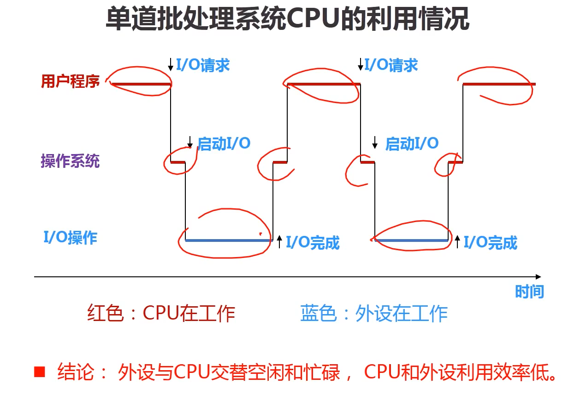

#### 缺点

- CPU利用率低
- 串行，作业处理时间常，交互能力差

### 3、多道批处理系统

#### 定义

在内存中存放多道程序，当某道程序因为某种原因（例执行I/O操作时）不能继续运行而放弃CPU时，操作系统便调度另一程序投入运行。这样可以使CPU尽量忙碌，提高系统效率

- 提高系统CPU利用效率
- 提供系统吞吐量

#### 工作特点

- 多道：内存同时存放多道程序
- 并行：宏观上
- 串行：微观上

#### CPU利用情况

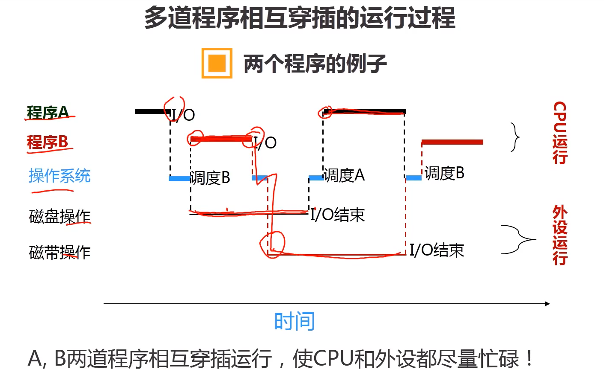

#### 缺点

- 作业处理时间长
- 交互能力差
- 运行过程不确定

### 4、分时系统

#### 背景

60年代硬件重大突破

- **中断技术**：CPU收到外部信号（**中断信号**）后，停止当前工作，转去处理该**外部事件**，处理完毕后回到原来工作的中断处（**断点**）继续原来的工作
- **通道技术**：专门处理**外设**与**内存**之间的数据传输的处理机

事务性任务的涌现

- 交互性高
- 响应快速

要求支持多任务/多用户

多终端计算机：高性能+多个终端

#### 概念

​	主机以**很短**的**时间片**为单位，把CPU轮流分配给每个终端使用，直到全部作业被运行完，即分时

​	由于**时间片**很短，在终端数量不多的情况下，每个终端都能很快重新获得CPU，使得每个终端都能得到及时响应

等待周期=时间片*终端数量

#### 特点

- 多路调制性：多用户联机使用同一台计算机
- 独占性：用户感觉独占计算机
- 交互性：及时响应用户的请求

#### UNIX

- 第一个真正体现操作系统领域各种先进概念和技术的操作系统
- 实现操作系统的可移植性
- 实现了硬件无关性
- 引进了“特殊文件”（special file）的概念，即把外设看做文件，实现对外设统一管理

#### 操作系统的进一步发展

- 微机操作系统：大规模集成电路发展促进pc机发展，BIOS把操作系统和硬件分离
- 多处理机操作系统
- 网络操作系统：普通操作系统+网络通信+网络服务
- 实时操作系统：实时事务，军事，工业控制等，要求某些任务要优先紧急处理，强调作业完成的时限
- 嵌入式操作系统：软硬件一体化，可裁剪

适合学习的小型开源操作系统

Mini UNIX——微内核架构  minix3.org

Linux——kernel.org

# 二、操作系统的逻辑结构

## 整体式结构

特点

- 模块设计、编码和调试独立
- 模块调用自由
- 模块通信多以全局变量形式完成

缺点

- 信息传递随意，维护和更新困难

## 层次结构

TCP/IP协议栈

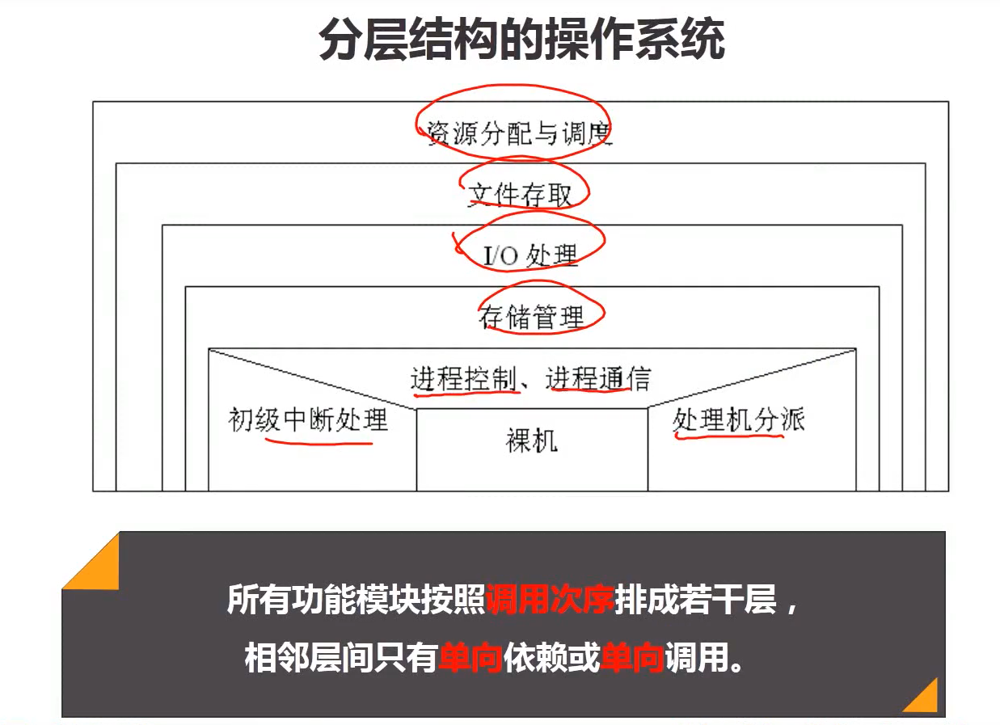

### 分层原则

- 硬件相关——最底层
- 外部特性——最外层
- 中间层——调用次序或消息传递顺序
- 共性的服务——较低层
- 活跃功能——较低层

## 微内核结构

#### 操作系统=微内核+核外服务器

#### 微内核

足够小，提供OS最基本的核心功能和服务

1. 实现与硬件紧密相关的处理
2. 实现一些较基本的功能
3. 负责客户和服务器间的通信

#### 核外服务器

完成OS的绝大部分服务功能，等待应用程序提出请求

若干服务器或进程共同构成，例：进程/线程服务器，虚存服务器，设备管理服务器等，以进程形式运行在用户态

## CPU的态

### 定义

对资源和指令使用权限的描述

### 态的分类

#### 核态（Kernel mode）

- 能够访问所有资源和执行所有指令
- 管理程序/OS内核

#### 用户态（User mode 目态）

- 仅能访问部分资源，其他资源受限
- 用户程序

#### 管态（Supervisor mode）

- 介于核态和用户态之间

#### 用户态向核态转换

- 用户请求OS提供服务
- 发生中断
- 用户进程产生错误（内部中断）
- 用户态企图执行特权指令

#### 核态向用户态转换的情形

- 一般是执行中断返回：IRET

#### 硬件和OS对CPU的观察

- 硬件按“态”来区分CPU的状态
- OS按“进程”来区分CPU的状态

## 存储器

### 分类

按存储器（半导体存储器）读写工作方式

- RAM
- ROM

按存储元的材料

- 半导体存储器（常作主存）
- 磁存储器（磁带，磁盘）
- 光存储器（光盘）

按与CPU的联系

- 主存：直接和CPU交换信息
- 辅存：不能直接和CPU交换信息

### 分级存储系统的工作原理

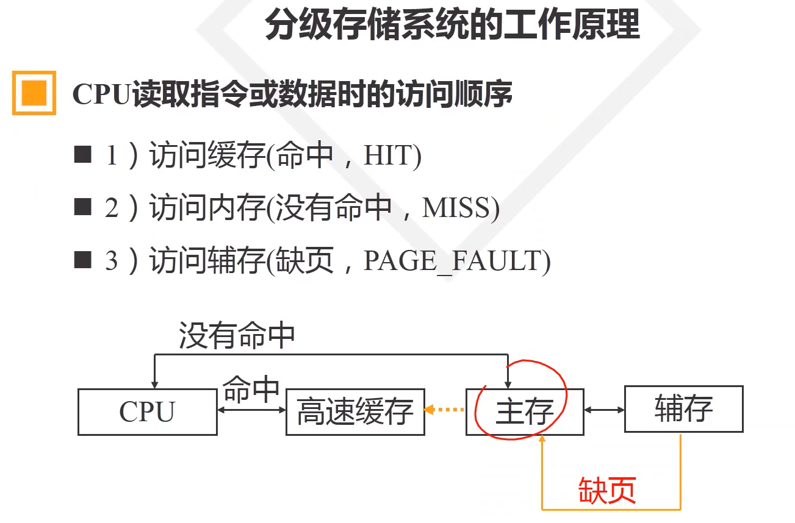

## 中断机制

### 定义

- 指CPU对突发的外部事件的反应过程或机制
- CPU收到外部信号（中断信号）后，停止当前工作，转去处理该外部事件，处理完毕后回到原来工作的中断处（断点）继续原来的工作

### 引入中断的目的

- 实现并发活动
- 实现实时处理
- 故障自动处理

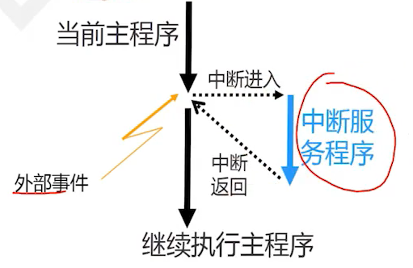

### 中断源和中断类型

引起系统中断的时间称为中断源

#### 中断类型

- 强迫中断：程序没有预期，例：I/O、外部中断
- 自愿中断：程序有预期的，例：执行访管指令
- 外中断（中断）：由CPU外部事件引起，例：I/O，外部事件
- 内中断（俘获）：由CPU内部事件引起，例：访管中断、程序中断

#### 外中断类型

- 不可屏蔽中断：中断原因很紧要，CPU必须响应
- 可屏蔽中断：中断原因不很紧要，CPU可以不响应

### 断点

程序中断的地方，将要执行的下一指令的地址，CS：IP

### 现场（上下文）

程序正确运行所依赖的信息集合，相关寄存器

现场的两个处理过程

- 现场的保护：进入中断服务程序之前，保存到栈
- 现场的恢复：退出中断服务程序之后，从栈恢复

### 中断响应过程

1. 识别中断源
2. 保护断点和现场
3. 装入中断服务程序的入口地址（CS:IP）
4. 进入中断服务程序
5. 恢复现场和断点
6. 中断返回：IRET

### 中断响应的实质

- 交换指令执行地址
- 交换CPU的态
- 工作，现场保护和恢复，参数传递（通信）

# 三、操作系统的启动界面

## 操作系统启动过程

### 操作系统工作模式

#### 1、实模式（real mode）

-  程序按照8086寻址方法访问0h-FFFFFh（1Mb）空间
- 
- 寻址方式：物理地址（20位）=段地址：偏移地址
- CPU单任务运行

#### 2、保护模式（内存保护模式 protect mode）

- 寻址方式：段（32位）和偏移量（32位），寻址4GB空间
- 段的属性：起始地址，存取属性，权限级别
- 段页式寻址机制（段，页）
- 虚拟地址，进程，封闭空间
- 应用程序和操作系统的运行环境都被保护
- CPU支持多任务

### 系统BIOS和主引导记录MBR

Basic I/O System（Firm/ware 固件）

- 基本输入/输出系统

- 位置：F0000-FFFFF

- 功能

  -  系统启动配置

  - 基本的设备I/O服务（使用中断信号）
  - 系统的加电自检POST和启动（CPU、内存、显卡等基本硬件的自检）

#### MBR

- 存放在硬盘/软盘的首扇区
- 存放和OS启动的相关信息（Main Boot Record）
- 512Bytes
- 结束：0xAA55h

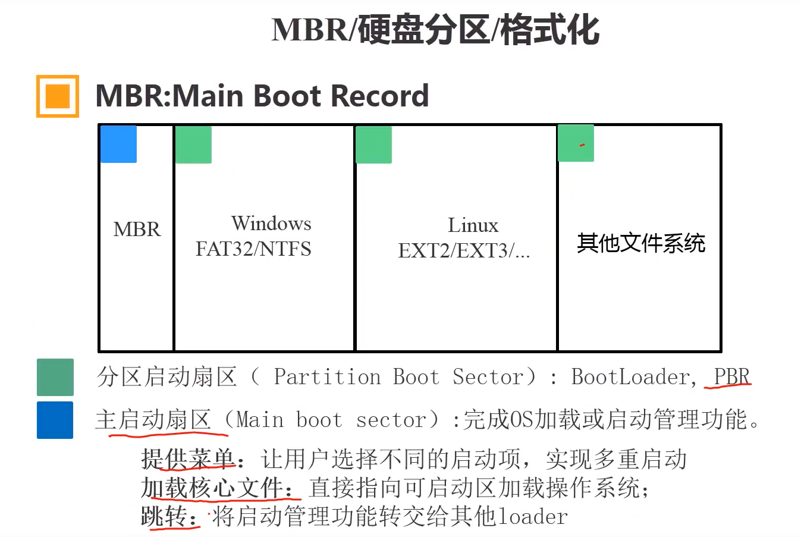

#### 流程

当按下电源开关时执行FFFF0处的指令即JUMP POST；POST位于系统BIOS内部

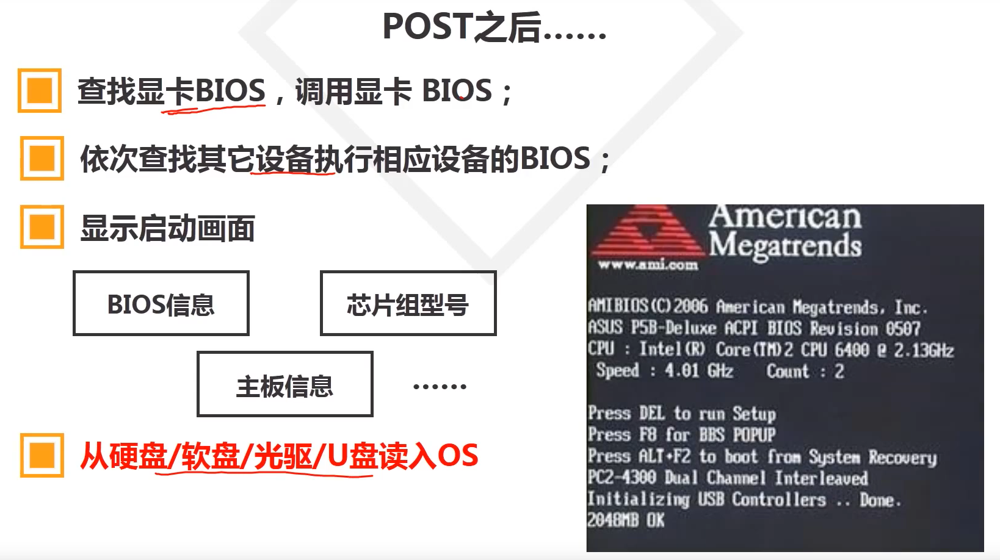

从硬盘或软盘中读取OS时，首先读取主启动记录MBR

### 操作系统的启动过程

从加电到用户工作环境准备好的过程

#### 1、初始引导

##### 目的

​	把OS核心装入内存并使之开始工作接管计算机系统

##### 过程

1. 加电，jump post
2. BIOS中的**启动程序**运行
3. **启动程序**
   -  读取0面0道第1扇区内容（MBR）
   - 加载MBR中的**引导程序**
4. **引导程序**（常见引导程序：**GRUB**）
   - 根据相关参数，读取硬盘指定位置的文件到内存（OS内核的位置在参数中有配置）
   - 加载硬盘上**OS内核**，并初始化基本参数

#### 2、核心初始化

##### 目的

OS内核初始化系统的核心数据

##### 过程

1. 各种寄存器的初始化
2. 存储系统和页表初始化
3. 核心进程构建
4. ...

#### 3、系统初始化

##### 目的

为用户使用系统做准备，是系统处于**待命状态**

##### 过程

1. 初始化文件系统
2. 初始化网络系统
3. 初始化控制台
4. 初始化图形界面
5. ...

### Windows启动过程

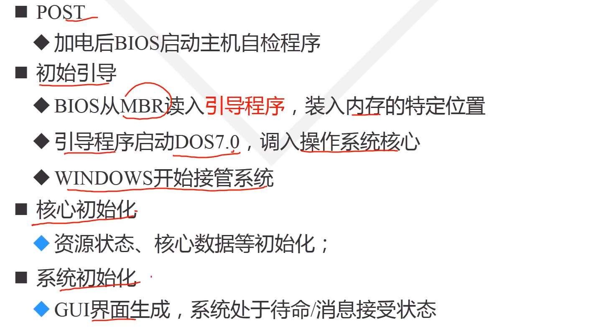

### Linux启动过程

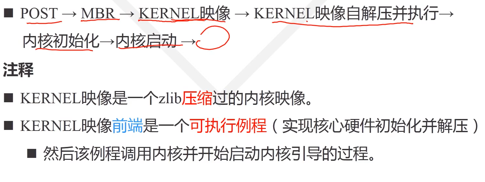

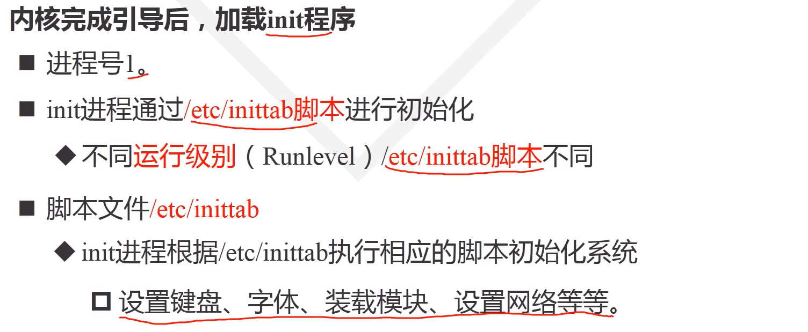

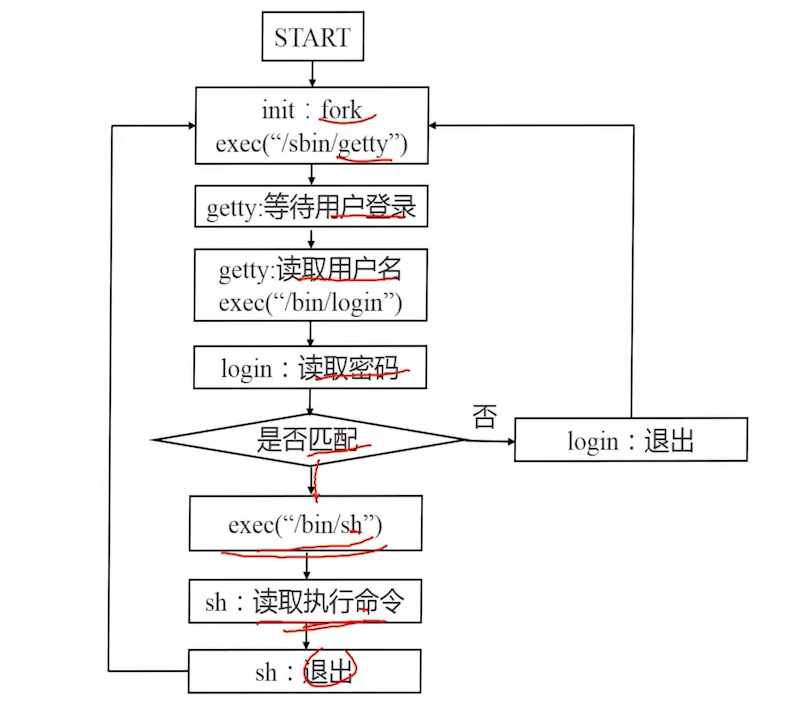

## 操作系统的生成

满足特定硬件环境和用户需要，组装和构建操作系统的过程

### 生成的主要步骤

- 根据硬件环境/用户要求配置功能模块和构造参数
- 构建（build）OS的映象

### 生成的前提

- 操作系统由可拆装模块构成
- 有交互式配置工具
- 有映象构建（build）工具

### Linux操作系统的生成

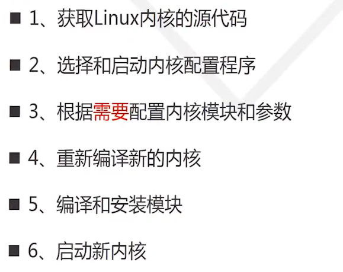

## 用户界面

OS提供给用户控制计算机的机制，又称用户接口

### 分类

1. 操作界面
2. 系统调用（System Call，系统功能调用，程序界面）

### 操作界面

- 图形用户界面（GUI）
  -  窗口，图标，菜单，按钮，鼠标（消息，事件）
- 键盘命令（COMMAND）
  - 在控制台环境下接收键盘输入的命令
  - 类型
  - 普通命令，批处理程序，shell

### shell

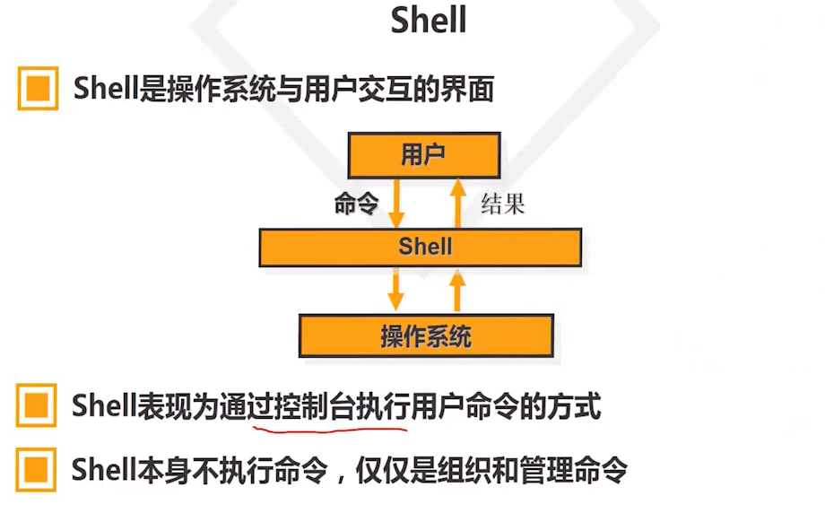

### 系统调用

#### 定义

​	操作系统**内核**为应用程序提供的**服务/函数**

#### 特点

- 一般设计核心资源或硬件的操作
- 运行于核态
- 每个系统调用具有唯一的编号：ID
- 调用过程中产生**中断**：自愿中断

#### 系统调用中断过程

windows使用21H系统调用，利用AH寄存器存放系统调用编号

Linux使用INT 80h中断实现系统调用，利用EAX寄存器存放系统调用的编号

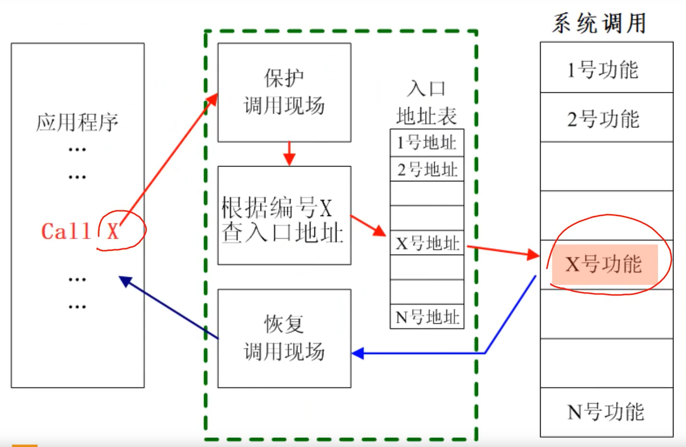

##### 隐式系统调用

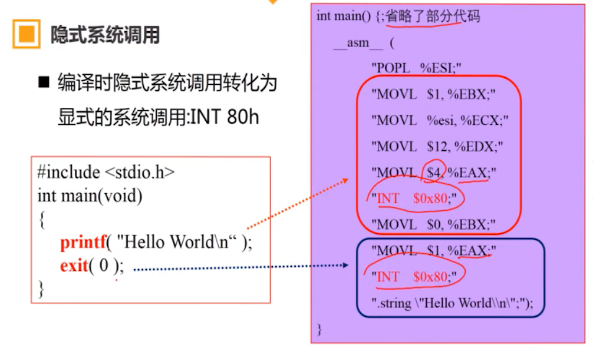

##### Linux系统调用

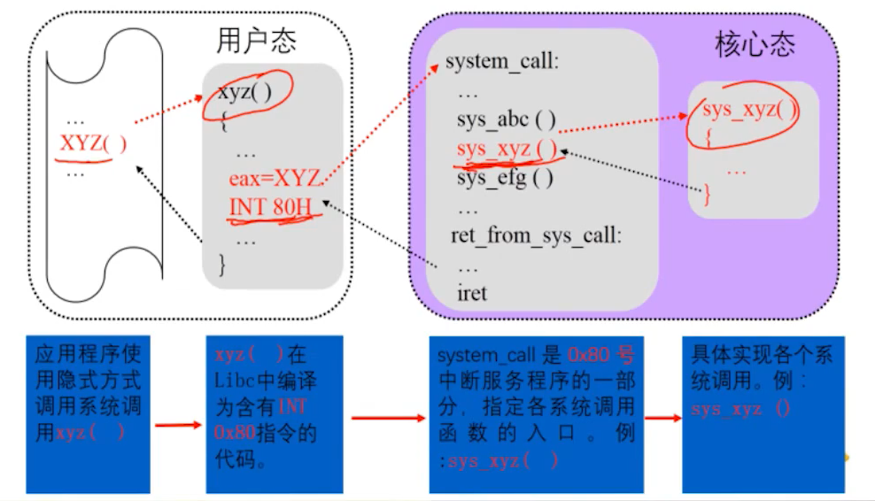

# 四、进程管理

## 进程概念

### 进程的定义

描述和管理程序运行的过程的即进程

- 进程是程序在某个数据集合上的一次运行活动
- 数据集合：软/硬件环境，多个进程共存/共享的环境

### 进程的特征

- 动态性：进程是程序的一次执行过程，动态产生/消亡
- 并发性：进程同其他进程一起向前推进
- 异步性：进程按各自速度向前推进
- 独立性：进程是系统分配资源和调度CPU的单位

### 进程与程序的区别

#### 动态与静态

- 进程是动态的：程序的一次执行过程
- 程序是静态的：一组指令的有序集合

#### 暂存与长存

- 进程是暂存的：在内存驻留
- 程序是长存的：在截止上长期保存

#### 程序和进程的对应

- 一个程序可能有多个进程

### 进程的类型

#### 按使用资源权限

- 系统进程：指系统内核相关的进程
- 用户进程：运行于用户态的进程

#### 按对CPU的依赖性

- 偏CPU进程：计算型进程
- 偏I/O进程：侧重于I/O的进程

## 进程的状态

- 运行状态（Running）
  -  进程已经战友CPU，在CPU上运行

- 就绪状态（Ready）
  -  具备运行条件但由于无CPU，暂时不能运行
- 阻塞状态（Block）【等待（wait）状态】
  -   因为等待某项服务完成或信号不能运行的状态
  - 如等待：系统调用，I/O操作，合作进程信号

### 进程状态的变迁

进程的状态可以依据一定的条件相互转化

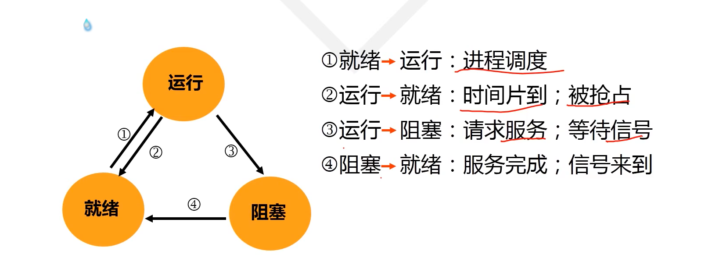

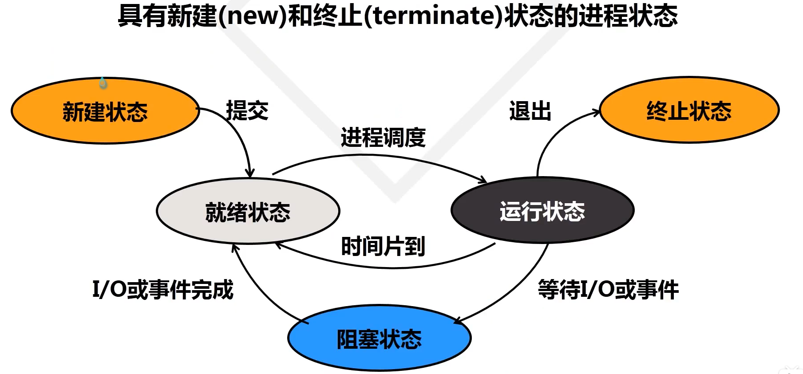

### Linux进程的状态

- 可运行态
  - 就绪：TASK_RUNNING，在就绪队列中等待调度
  - 运行：正在运行
- 阻塞（等待）态
  - 浅度阻塞：TASK_INTERRUPTIBLE（可中断），能被其他进程的信号或始终唤醒
  - 深度阻塞：TASK_UNINTERRUPTIBLE（不可中断），不能被其他进程通过信号和始终唤醒
- 僵死态：TASK_ZOMBLE
  - 进程终止执行，释放大部分资源
- 挂起态：TASK_STOPPED
  - 进程被挂起

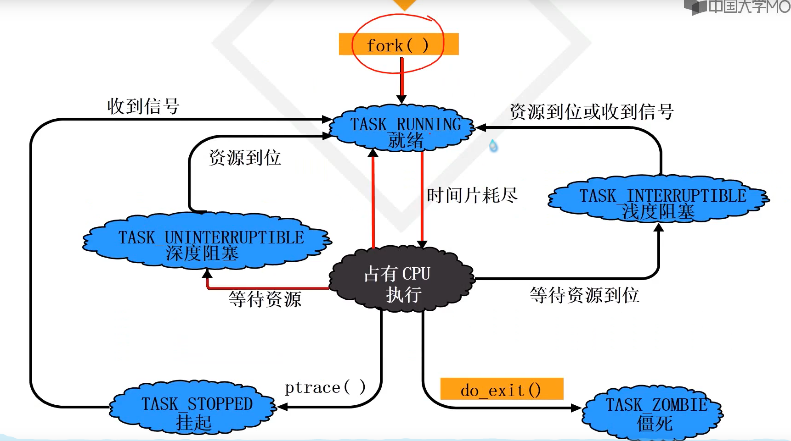

## 进程控制块PCB

#### 进程控制块（Process Control Block ，PCB）

- 描述进程状态、资源和与相关进程关系的数据结构

- PCB是进程的标志

- 创建进程时创建PCB；进程撤销后PCB同时撤销

#### 进程=程序+PCB

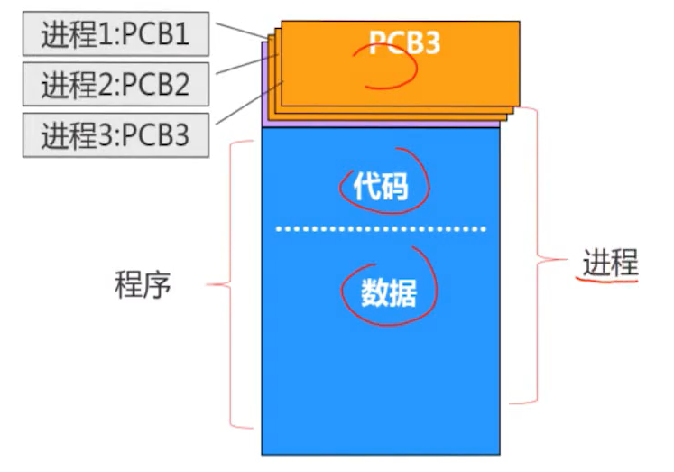

#### PCB中的基本成员

- name（ID）：进程名称（标识符）
- status：状态
- next：指向下一个PCB的指针
- start_addr：程序地址
- priority：优先级
- cpu_status：线程保留区（堆栈）
- comm_info：进程通信
- process_family：家族
- own_resource：资源

#### Linux的进程控制块PCB：task_struct

文件：sched.h

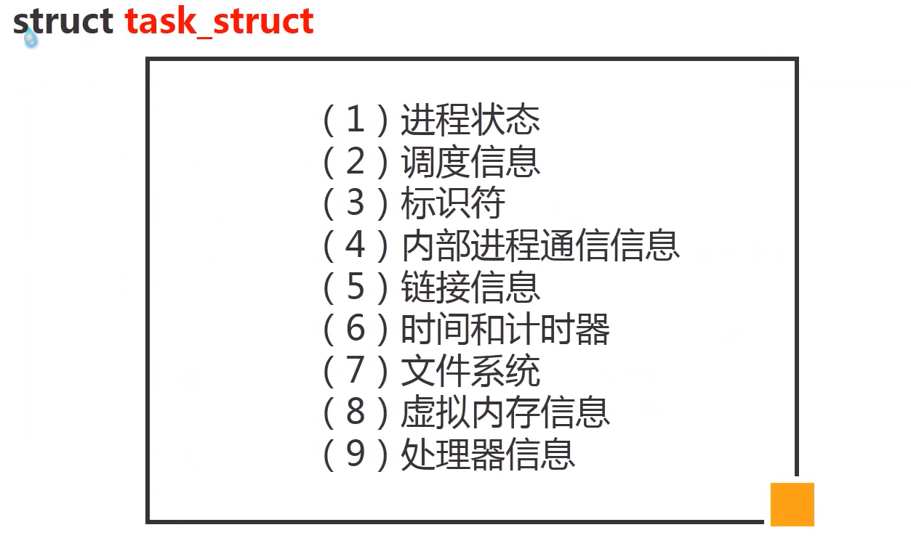

- Linux进程的标识
  - PID
  - PPID：父进程ID
  - PGID：进程组ID
- Linux进程的用户标识
  - UID：用户ID
  - GID：用户组ID

#### 进程的切换

- 进程的上下文
  - Context，进程运行环境，CPU环境
- 进程切换过程
  - 换入进程的上下文进入CPU（从栈上来）
  - 换出进程的上下文离开CPU（到栈上去）

## 进程控制

### 进程控制原语

- 由若干指令构成的具有特定功能的函数
- 具有原子性，其操作不可分割
- 四个原语，创建原语、撤销原语、阻塞原语、唤醒原语

### 进程创建

#### 功能

创建一个具有指定标识（ID）的进程

#### 参数

进程标识、优先级、进程起始地址、CPU初始状态、资源清单等

#### 创建进程的过程

- 创建一个空白的PCB
- 获得并赋予进程标识符ID
- 为进程分配空间
- 初始化PCB（默认值）
- 插入相应的进程队列（新进程插入就绪队列）

### 进程撤销

#### 功能：

- 撤销一个指定的进程
- 收回进程所占有的资源，撤销该进程的PCB

#### 进程撤销的时机/事件

- 正常结束
- 异常结束
- 外界干预

参数：被撤销的进程名（ID）

#### 进程撤销的过程

- 在PCB队列中检索出该PCB
- 获取该进程的状态
- 若该进程处于运行态，立即终止该进程。（递归检查是否有子进程，先撤销子进程）
- 释放进程占有的资源
- 将进程从PCB队列中移出

### 进程阻塞

#### 功能：

停止进程的执行，变为阻塞

#### 阻塞的时机/事件

- 请求系统服务，由于某种原因，os不能立即满足进程的要求
- 启动某种操作，进程启动某操作，阻塞等待该操作完成
- 新数据尚未到达，A进程要获得B进程的中间结果，A进程等待
- 无新工作可做，进程完成工作后，自我阻塞，等待新任务到达

#### 参数

- 阻塞原因
- 不同原因构建有不同的阻塞队列

#### 进程阻塞的过程

- 停止运行
- 将PCB”运行态“改”阻塞态“
- 插入相应原因的阻塞队列
- 转调度程序

### 进程唤醒

#### 功能

唤醒处于阻塞队列当中的某个进程

#### 引起唤醒的时机/事件

- 系统服务由不满足到满足
- I/O完成
- 新数据到达
- 进程提出新请求（服务）

#### 参数

被唤醒进程的标识

### windows控制进程

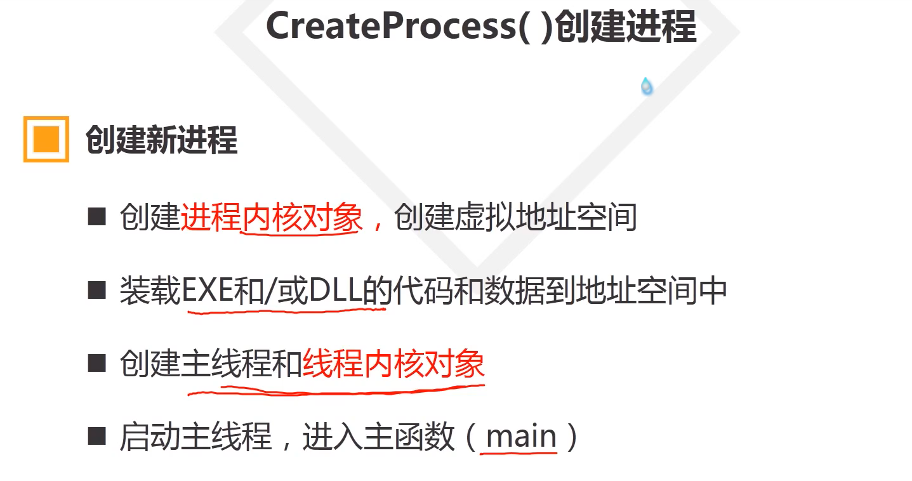

### Linux控制进程

#### 创建进程

pid_t fork(void);

例：pid_t pid = fork();

- 新进程是当前进程的子进程
- 父进程和子进程
  - 父进程：fork()的调用者，调用fork时返回子进程id号
  - 子进程：新建的进程，调用fork时返回0
- 子进程是父进程的复制
- 子进程和父进程可以并发运行

#### exec函数簇（包括若干函数）

子进程执行与父进程不同的功能，execve函数

##### 功能

- 装入一个指定的可以执行程序运行
- 使子进程具有和父进程完全不同的新功能

##### 步骤

- 根据文件名找到相应的可执行程序
- 将可执行程序的内容填入子进程的地址空间
- 进入新进程执行且不再返回

## 线程

### 线程概念（Thread）

1. 线程是可由CPU直接运行的实体；
2. 一个进程可以创建多个线程；
3. 多个线程共享CPU可以实现并发运行；

### 单线程和多线程程序

单线程程序：整个进程只有一个线程。windows程序缺省只有一个线程（主线程，main线程）；

多线程程序：整个进程至少有2个线程。主线程和至少一个用户线程；

### 线程应用场景

1. **程序的多个功能需要并发执行；**
2. **提高窗口程序的交互性**；
3. **需要改善程序结构的地方**；
4. **多核CPU上的应用，充分发挥多核性能；**

### 使用线程的缺点

1. 程序难以调试；
2. 并发过程难以控制；
3. 线程安全问题；

## 临界区和锁

### 临界区和临界资源

#### 概念

临界资源（Critical Resource）：一次只允许一个进程独占访问（使用）的资源；

临界区（Critical Section）：进程中访问临界资源的程序段；

临界区和临界资源的访问特点

- 具有排他性
- 并发进程不能同时进入临界区

#### 设计临界区访问机制的四个原则（多线程程序设计理应符合这四个原则）

- 忙则等待：当临界区忙时，其他进程必须在临界区外等待（阻塞）；
- 空闲让进：当无进程处于临界区，任何有权进程可进入临界区；
- 有限等待：进程进入临界区的请求应在有闲时间内得到满足；
- 让权等待：等待进程放弃CPU（让其他进程有机会得到CPU）；

### 锁机制

#### 基本原理

上锁：

- 设置一个标志“S”：表明临界资源“**可用**”还是“**不可用**”

- 进入临界区之前检查标志是否“**可用**”？
  - 若为“**不可用**”状态：进程在临界区之外等待
  - 若为“**可用**”状态：访问临界资源且将标志修改为“**不可用**”

开锁：

- 退出临界区时将标志修改为“**可用**”状态

#### 上锁操作（原语实现，称为上锁原语）

1. 检测锁S的状态（0或1）；
2. 如果S=0，则范湖及第1步；
3. 如果S=1，则置其为0；

#### 开锁操作（原语实现，称为开锁原语）

1. 把锁S的状态置1；

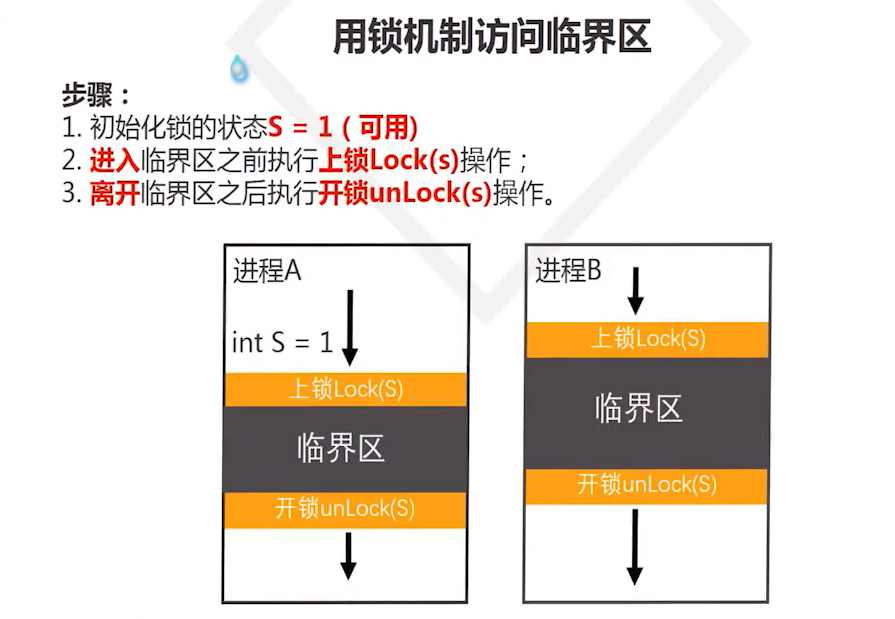

## 进程同步和P-V操作

### 同步和互斥

进程的互斥关系

- 多个进程由于共享了独占性资源，必须协调各进程对资源的存取顺序：确保没有任何两个或以上的进程同时进行存取操作。

- 互斥和资源共享相关；

- 资源：临界资源

- 存取操作区域：临界区

进程的同步关系

- 若干合作进程为了完成一个共同的任务，需要相互协调运行步伐：一个进程开始某个操作之前必须要求另一个进程已经完成某个操作，否则前面的进程只能等待；
- 另一种解释：合作进程中某些操作之间需要满足某种先后关系或某个操作能否进行需要满足某个前提条件，否则只能等待；
- 互斥关系属于特殊的同步关系；

### P-V操作

#### 信号灯

信号灯是一种卓有成效的进程同步机制；

进程在运行过程受信号灯状态控制，并能改变信号灯状态

- 进程受控制：信号灯的状态可以阻塞或唤醒进程；
- 改变信号灯：信号灯的状态可以被进程改变；

信号灯数据结构

信号灯变量定义为二元矢量（S,q）

S：整数，初值非负（S又称信号量）；

q：PCB队列，初值为空集

#### P操作：Passeren（通过）

- S值减1；
- 若差大于或等于零，该进程继续；
- 若差小于零，则该进程阻塞并加入到队列q中，并转调度函数；

提示：P操作可能是进程阻塞！

#### V操作：Vrijgeven（释放）

- S加1；
- 若和大于零，该进程继续；
- 若和小于或等于零，该进程继续同时从q中唤醒一个进程；

#### P-V操作解决互斥问题

实质是实现对临界区的互斥访问：允许最多1个进程处于临界区

应用过程

- 进入临界区之前先执行P操作（可能阻塞当前线程）；
- 离开临界区之后再执行V操作（可能唤醒某个进程）；

S的初值设置要合理

#### P-V操作解决同步问题

同步机制实质

- 运行条件不满足时，能让进程暂停
- 运行条件满足时，能让进程继续

P-V操作应用于进程同步的基本思路

- 暂停当前进程：在**关键操作之前**执行P操作
  - 必要时可暂停
- 继续进程：在**关键操作之后**执行V操作
  - 必要时唤醒合作进程
- 定义有意义的信号量S，并设置合适的初值
  - 信号量S能明确地标识“运行条件”

#### 经典同步问题

1. 生产者和消费者问题

   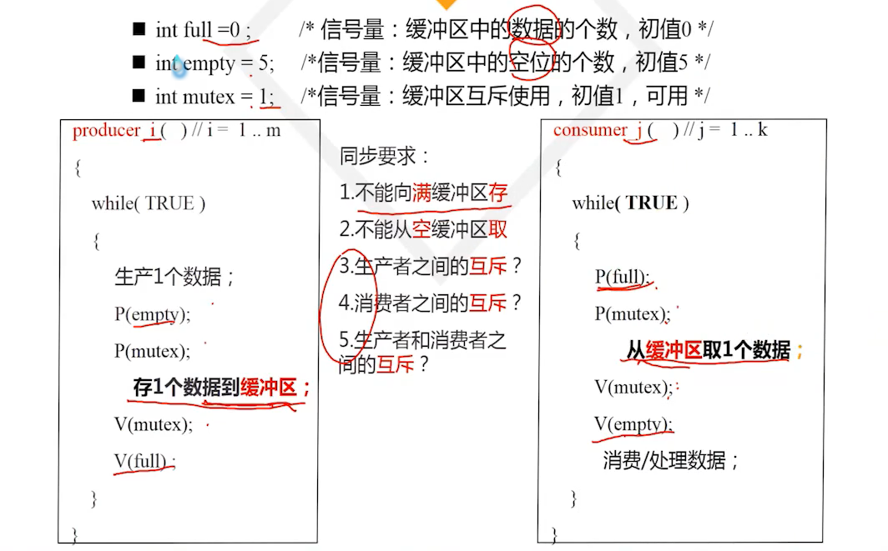

#### Windows和Linux同步机制的实现

##### windows

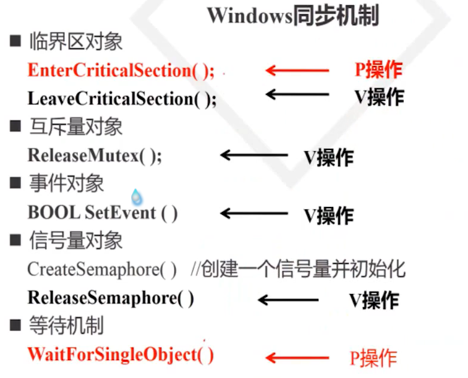

##### Linux

wait：父进程调用，父进程阻塞，等待子进程执行完毕后唤醒父进程

exit

sleep

## 进程通信

### 匿名管道通信机制

1. 管道定义（Pipe）

   定义：管道是进程间的一种通信机制。一个进程（A）可以通过管道把数据传输给另一个进程（B）。前者（A）向管道输入数据，后者（B）从管道读取数据

2. 注意事项：仅能用于父子或兄弟进程间通信

3. 应用管道的注意事项：双向通信必须建立2个管道，一个用于写读，一个用于读写

### Linux信号通信（Signal）

- 信号是Linux进程间一种重要的通信机制；
- 信号是向进程发送的一个通知，通知某个事件已发生；
- 收到信号的进程可以立即执行指定的操作；
- 信号的发出可以是进程，也可以是系统（含硬件）；

#### 信号的来源

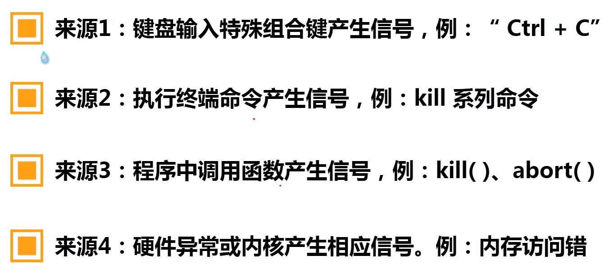

# 五、死锁

## 概念

定义：两个或多个进程无限期地等待永远不会发生的条件的一种系统状态（结果：每个进程都永远陷入阻塞）；

另一种定义：在两个或多个进程中，每个进程都持有某种资源，但又继续申请其他进程已持有的某种资源。此时每个进程都拥有其运行所需的一部分资源，但是又都不够，从而每个进程都不能向前推进，陷入阻塞状态，这种状态称为死锁。

## 死锁的起因

- 系统资源优先：资源数目不足，进程对资源的竞争而产生的死锁
- 并发进程的推进顺序不当：进程请求资源和释放资源的顺序不当，导致死锁

## 死锁的预防策略

- 互斥条件：进程互斥使用资源，资源具有独占性
- 不剥夺条件：进程在访问完资源前那不能被其他进程强行剥夺
- 部分分配条件
  - 进程边运行边申请资源，临时需要临时分配
- 环路条件：多个进程构成环路，环中每个进程已占用的资源被前一进程申请，而自己所申请资源又被环中后一进程占用着

### 预防死锁

- 破坏互斥条件（难）
- 破坏不剥夺条件（代价大）
- 破坏部分分配条件（预先静态分配）
- 破坏环路条件（有序资源分配）

#### 预先静态分配法

目的：破坏部分分配条件

策略：

进程运行前将所需资源一次性全部分配给它。因此进程在运行过程中不在提出资源请求，从而避免出现阻塞或死锁

特点：

- 执行可能被延迟：所需资源不能全部满足时
- 应用开销增大：运行前估算资源需求
- 资源利用率低：资源被占而不用

#### 有序资源分配法

目的：破坏环路条件，使得环路无法构成

策略：

- 系统中的每个资源分配有一个唯一序号
- 进程每次申请资源时只能申请序号更大的资源

### 避免死锁

不事先采取限制去破坏产生死锁的条件，而是在资源分配过程中，用某种方法去评估若分配资源是否会让系统进入死锁状态，若是，则拒绝此次分配资源，从而避免死锁的发生

### 检测和恢复死锁

允许死锁发生，但可通过检测机制及时检测出死锁状态，并精确确定与死锁有关的进程和资源，然后采取适当措施，将系统中已发生的死锁清除，将进程从死锁状态中解脱出来

### Windows和Linux中对于死锁采取的策略为鸵鸟策略（视而不见，交给用户自己解决）

# 六、进程调度

在合适的时候以一定策略选择一个就绪进程运行

## 调度目标

1. 响应速度尽可能快
2. 进程才能处理的时间尽可能短
3. 系统吞吐量尽可能大
4. 资源利用率尽可能高
5. 对所有进程要公平
6. 避免饥饿
7. 避免死锁

## 调度算法

### 先来先服务调度（First Come First Serve）

不利于短作业的任务

### 短作业优先调度算法（Short Job First）

容易出现资源饥饿现象

### 响应比高者优先调度算法

### 优先数调度算法

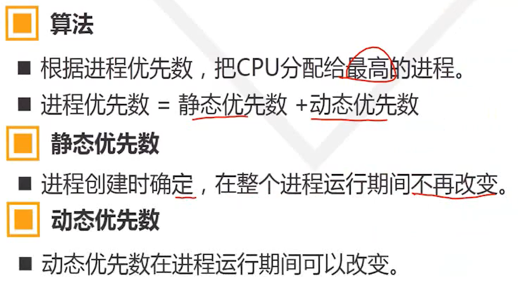

### 循环轮转调度法（Round-Robin）

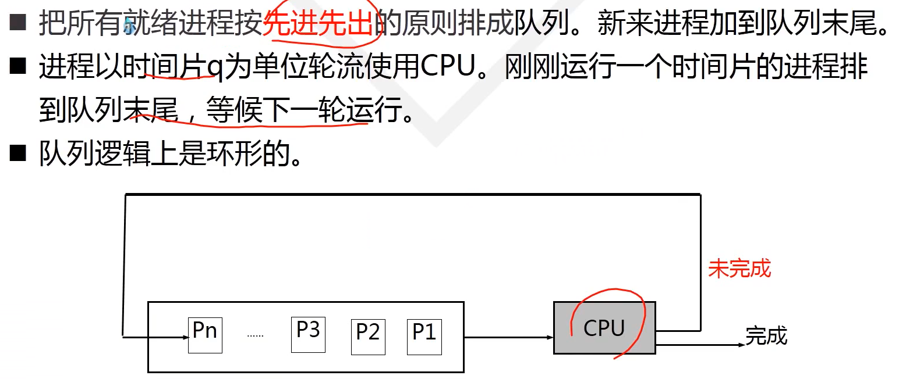

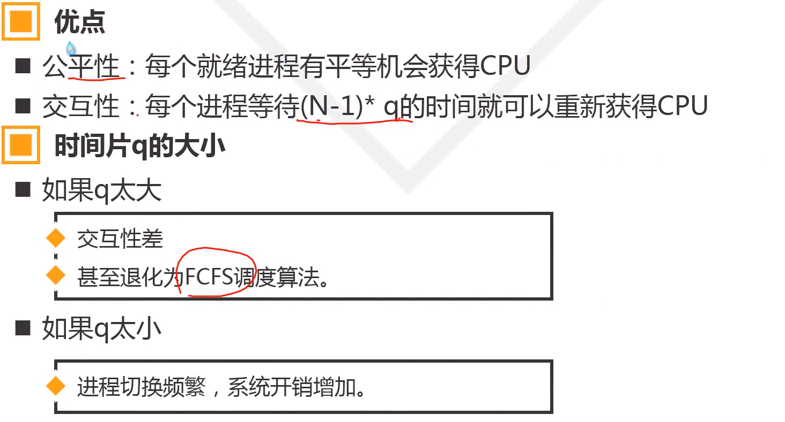

### 可变时间片轮转调度法

### 多重时间片循环调度法

## Linux进程的调度

### 普通进程

- 采用动态优先级来调度
- 调度程序周期性的修改优先级（避免饥饿）

### 实时进程

- 采用静态优先级来调度
- 由用户预先制定，以后不会改变

### 进程切换

概念

- 内核挂起当前CPU的进程并回复之前挂起的某个进程
- 任务切换、上下文切换

与终端上下文的切换有差别

- 终端前后在同一进程上下文中，只是用户态转向内核态执行

进程上下文包含了进程执行需要的所有信息

- 用户地址空间：包括程序代码，数据，用户堆栈等
- 控制信息：进程描述符，内核堆栈等
- 硬件上下文（注意中断也要保存硬件上下文只是保存的方法不同）

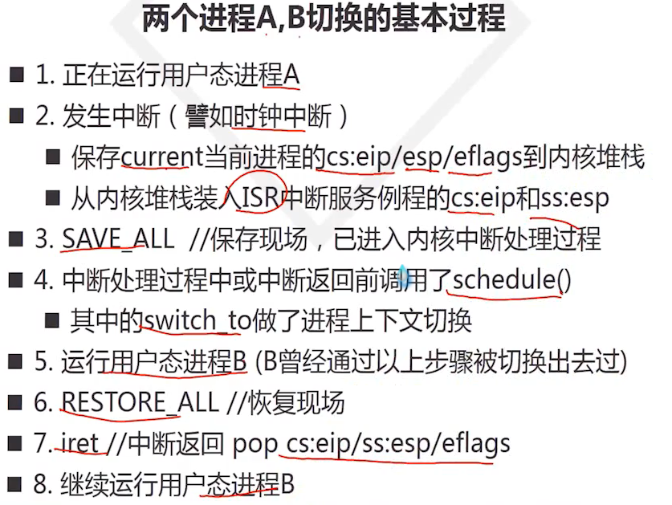

# 七、存储管理

## 内存管理功能

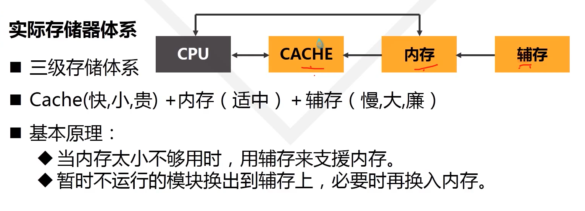

## 存储管理的功能

### 地址映射

#### 定义

把程序中的的地址（虚拟地址、虚地址、逻辑地址）变换成内存的真是地址（实地址、物理地址）的过程

#### 方式

##### 固定地址映射

定义：编程或编译时确定逻辑地址和物理地址映射关系

特点：

- 程序加载时必须放在指定的内存区域
- 容易产生地址冲突，运行失败

##### 静态地址映射

定义：程序装入时由操作系统完成逻辑地址到物理地址的映射

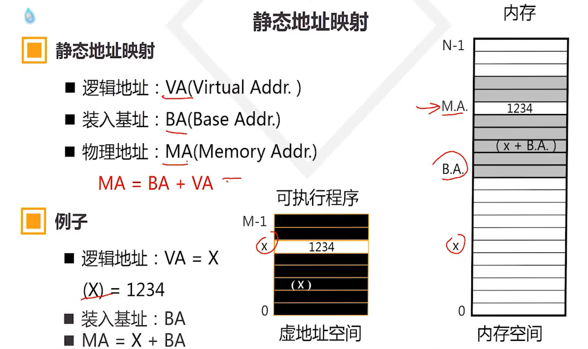

特点：

- 程序运行之前确定映射关系
- 程序装入后不能移动
  - 如果移动必须放回原来位置
- 程序占用连续的内存空间

##### 动态地址映射

定义：在程序执行过程中把逻辑地址转换为物理地址

映射过程：

- MA=BA+VA
- 逻辑地址：VA（Virtual Addr）
- 装入基址：BA（Base Addr）
- 物理地址：MA（Memory Addr）
- 注意：如果程序有移动，BA可能会有改变，自动计算新的MA

特点： 

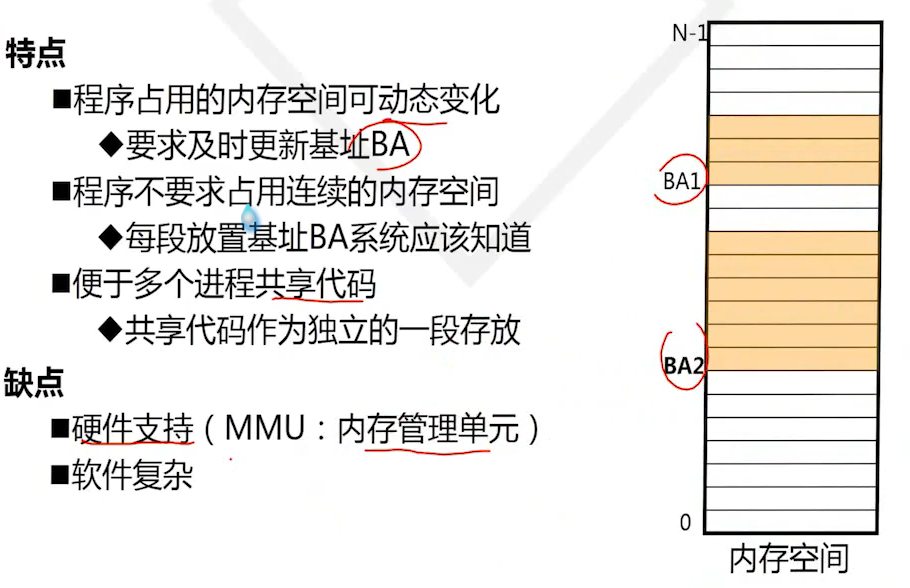

### 虚拟存储

#### 解决问题

1. 程序过大或过多时，内存不够，不能运行；
2. 多个程序并发时地址冲突，不能运行；

#### 定义

虚拟内存是面向用户的虚拟封闭存储空间

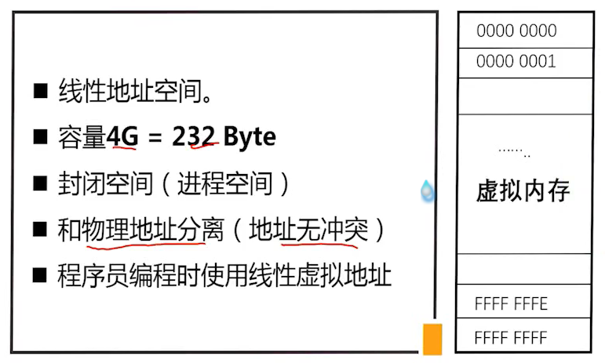

### 内存分配

#### 定义

为程序运行分配足够的内存空间

#### 解决问题

- 放置策略：程序调入内存时将其放置在哪个/哪些内存区
- 调入策略：何时把要运行的代码和要访问的数据调入内存
- 淘汰策略：内存空间不够时，迁出（淘汰）哪些代码或数据以腾出内存

### 存储保护

#### 定义及方法

## 物理内存管理

### 分区内存管理

#### 单一区存储管理（不分区存储管理）

##### 定义

用户区不分区，完全被一个程序占用，例如：DOS

##### 优点

- 简单，不许复杂硬件支持，适于单用户单人任务OS

##### 缺点

- 程序运行占用整个内存，及时小程序也是如此
  - 内存浪费，利用率低

#### 分区存储管理

##### 定义

- 把用户区内存划分为若干大小不等的分区，供不同程序使用
- 适合单用户单任务系统

##### 分类

- 固定分区
- 动态分区

##### 固定分区

###### 定义

把内存固定地划分为若干个大小不等的分区供各个程序使用。每个分区的大小和位置都固定，系统运行期间不再重新划分

###### 分区表

- 记录分区的位置、大小和使用标志

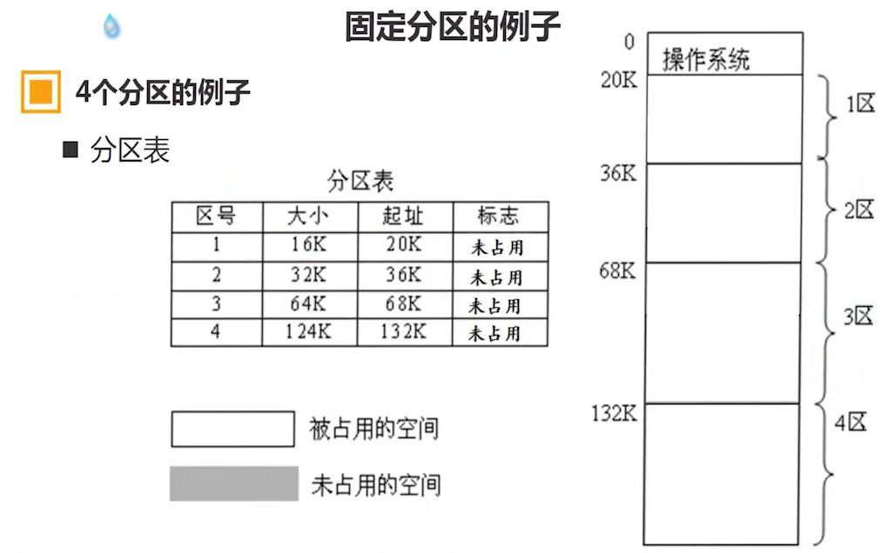

###### 特点

- 在程序装入前，内存已被分区，不再改变
- 每个分区大小不同，适应不同大小的程序
- 系统要维护分区表
- 适合具有固定任务数的OS

###### 缺点

- 浪费内存：程序比所在分区小
- 大程序可能无法运行：程序可能比最大分区打
- 不适用于通用综合操作系统

##### 动态分区

###### 定义

- 在程序装入时创建分区，使分区的大小刚好与程序的大小相等

###### 特点

- 分区动态建立
- 分区的个数和大小均可变
- 存在内存碎片

###### 问题

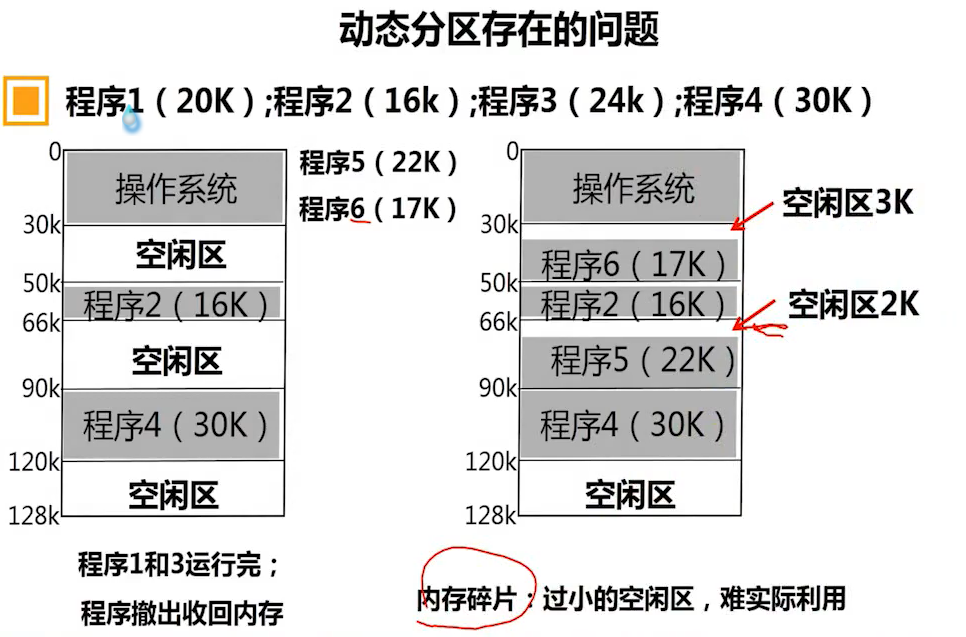

- 分区的分配
- 分区的选择
- 分区的回收
- 解决内存碎片问题

### 分区放置策略

#### 分区的分配-空闲区表

##### 定义

描述内存空闲区的位置和大小的数据结构

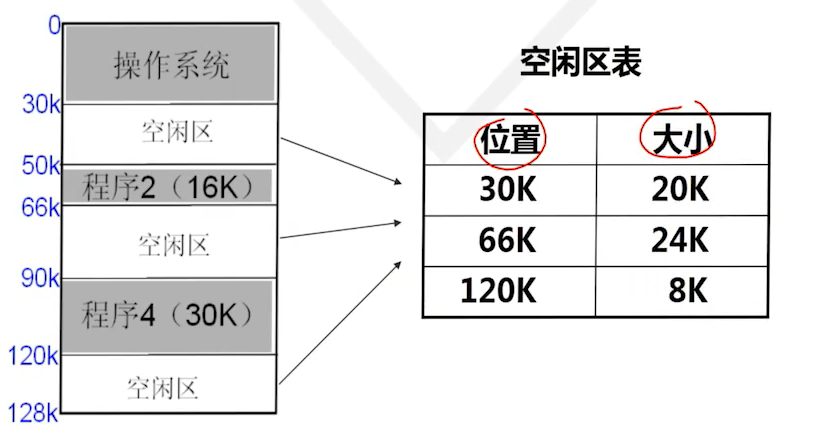

##### 分配过程

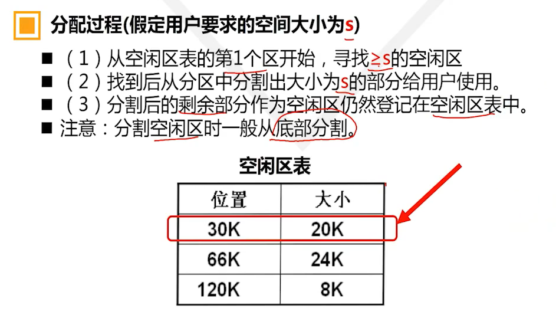

##### 放置策略

空闲区表如何排序——放置策略

放置策略（空闲区表排序原则）

- 首次适应算法：按空闲区位置（首址）递增排序
- 按空闲区位置（首址）递减排序
- 最佳适应算法：按空闲区大小的递增排序
- 最坏适应算法：按空闲区大小的递减排序

#### 分区的回收

功能：回收程序释放分区（释放区），登记到空闲区表中，以便在分配

回收算法：要考虑释放区与现有空闲区是否相邻

过程：

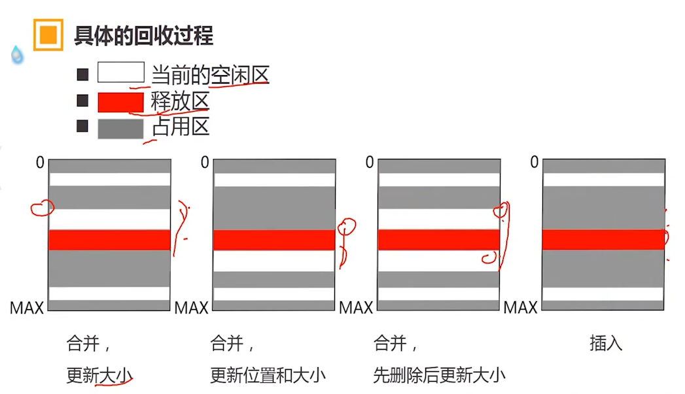

### 内存覆盖技术

目的：在较小的内存空间中运行较大的程序

常驻区：程序常用固定内存空间，可分多个区

覆盖区：程序覆盖使用内存，可分多个区

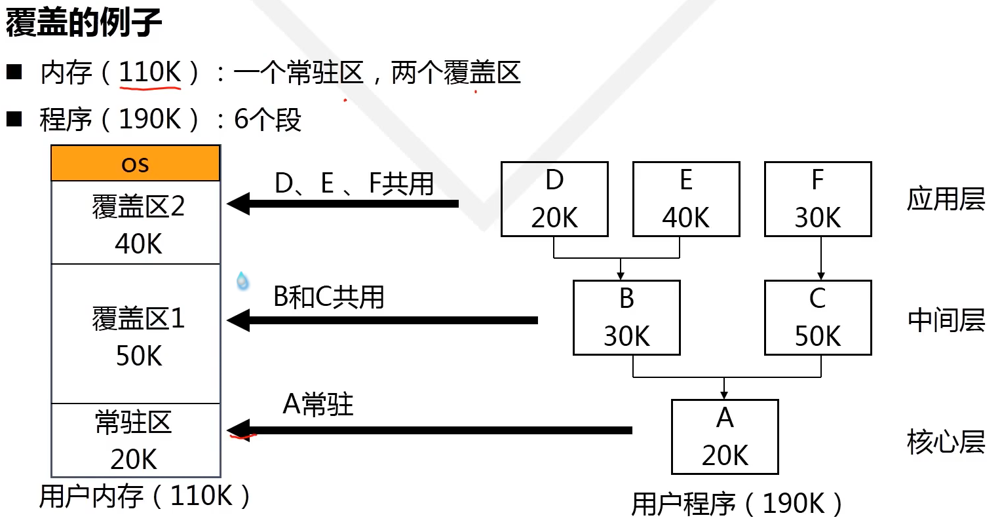

### 内存交换技术

#### 原理

内存不够时把进程写到磁盘（换出/swap out）

当进程要运行时重新写回内存（换入/swap in）

#### 优点

- 增加进程并发数
- 不考虑程序结构

#### 缺点

- 换入和换出增加CPU开销
- 交换单位太大（整个进程）

#### 需要考虑的问题

- 减少交换传送的信息量（模块/段）
- 外存交换空间的管理方法
- 程序换入时的地址重定位

### 内存碎片

- 过小的空闲区，难实际利用

- 内存碎片会降低内存有效利用率

#### 动态分区的缺点

- 容易产生内存碎片：内存反复分配和分割
- 首次适应法|**最佳适应法**|最坏适应法

#### 解决碎片的方法

1. 规定门限值，分割空闲区时，若剩余部分小于门限值，则此空闲区不进行分割，而是全部分配给用户
2. 内存拼接技术：将所有的空闲区集中一起构成一个大的空闲区
   - 释放区回收的时候拼接，拼接频率过大，系统开销大
   - 系统找不到足够大的空闲区时，空闲区的管理复杂
   - 定期，空闲区的管理复杂
3. 解除程序占用连续内存才能运行的限制
   - 把程序分拆多个部分装入不同分区，充分利用碎片

## 虚拟内存管理

### 虚拟内存管理的目标

**由于物理内存（即实内存）管理**

|      | 特点                         | 缺点                 |
| ---- | ---------------------------- | -------------------- |
| 1    | 源程序直接使用内存物理地址   | 程序件容易访问冲突   |
| 2    | 程序必须全部装入内存才能运行 | 内存太小程序无法运行 |
| 3    | 程序占用连续的一片内存       | 产生内存碎片         |
| 4    | 多程序同时运行容易相互干扰   | 不安全               |

**改善物理内存管理的相关技术**

- 内存拼接
- 交换技术（swapping）
- 覆盖技术（oberlay）

**目标**

- 使得大的程序能在较小的内存中运行；
- 使得多个程序能在较小的内存中运行（能容纳下）；
- 使得多个程序并发运行时地址不冲突（方便，高效）；
- 使得内存利用效率高：无碎片，共享方便；

### 虚拟内存管理的实现思路

**在程序运行时，只把当前必要的很小一部分代码和数据装入内存中。其余代码和数据需要时再装入。不再运行的代码和数据及时从内存中删除——实际内存很容易就能满足上述的内存需求**

####  程序运行的局部性

- 程序在一个有限的时间段内访问的代码和数据往往集中在有限的地址范围内
- 把程序一部分装入内存在较大概率上也足够让其运行一小段时间

### 典型虚拟内存管理方式

- 页式虚拟存储管理
- 段式虚拟存储管理
- 段页式虚拟存储管理

### 页式虚拟存储管理

#### 概念

把进程空间（虚拟）和内存空间划成大小的小片

- 小片的典型大小：1K，2K或4K
- 进程的小片——页（虚拟页或页面）
- 内存的小片——页框（物理页）

#### 进程装入和使用内存的原则

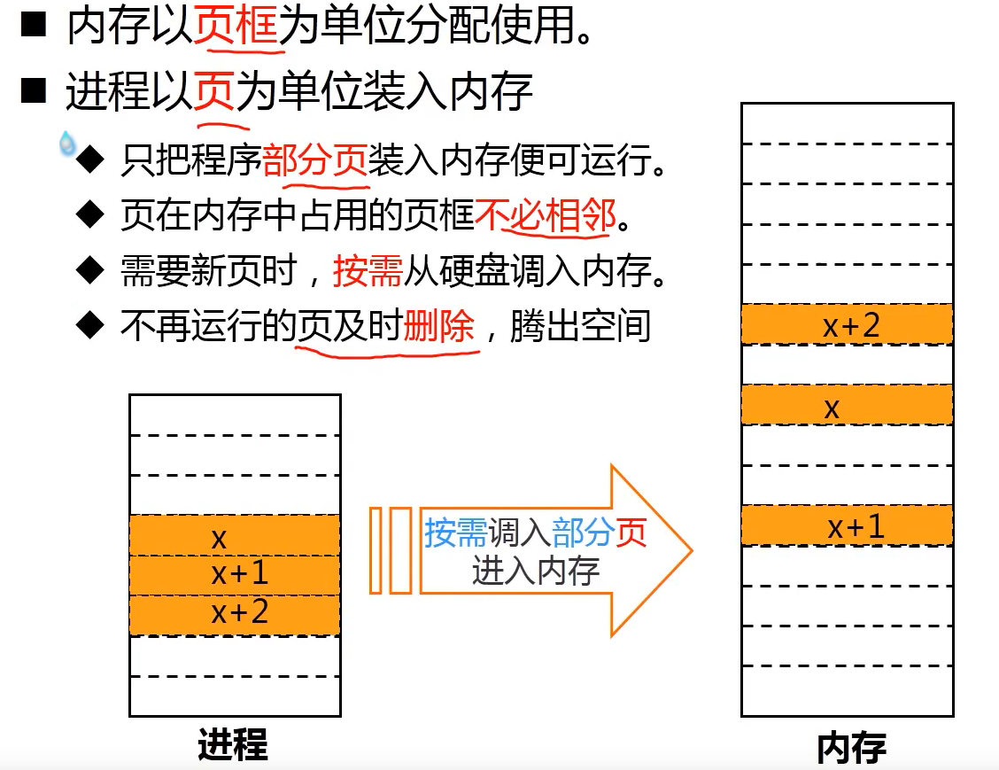

#### 页表和页式地址映射

 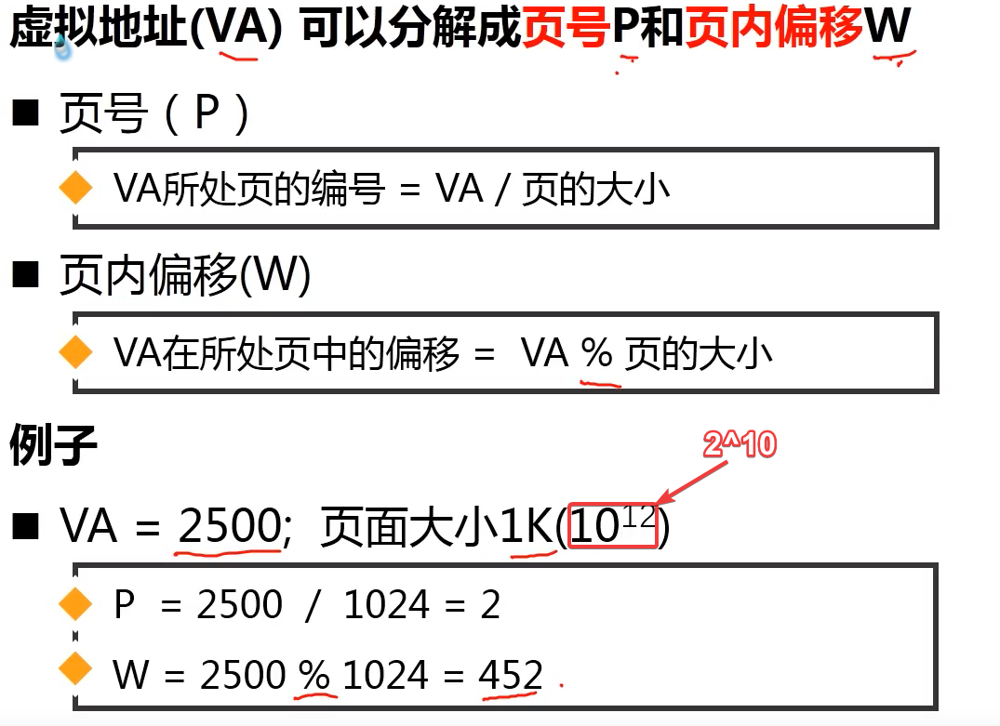

##### 页表

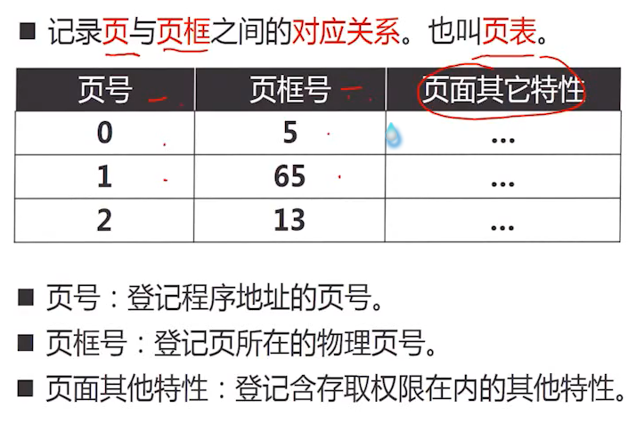

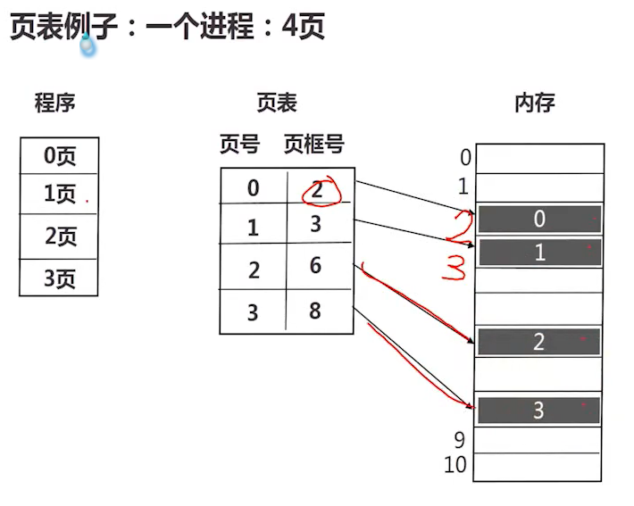

#### 页式地址映射

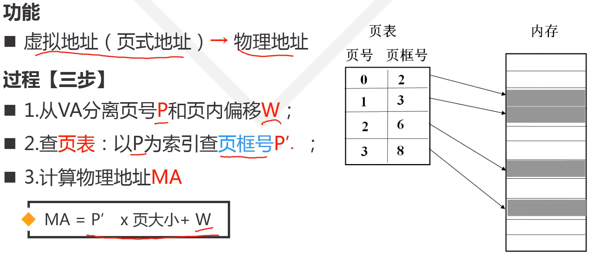

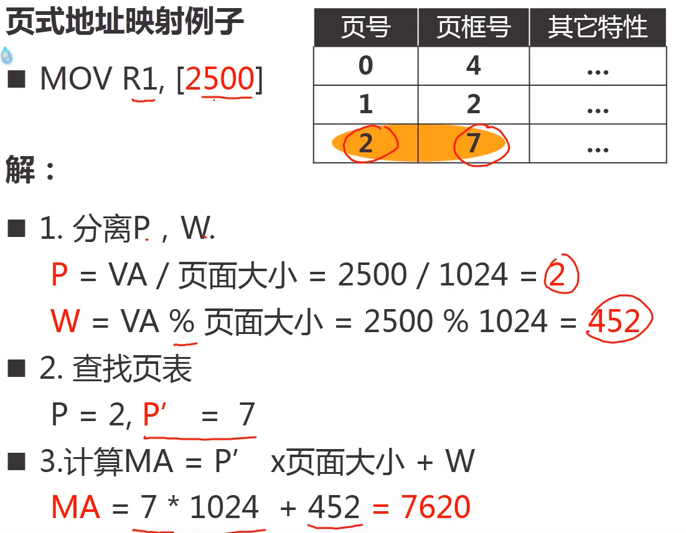

### 快表技术和页面共享技术

#### 快表机制

##### 概念

- 慢表：页表放在内存中
- 快表：页表放在Cache中

##### 特点

- 容量小，访问快，成本高
- 快表是慢表的部分内容的复制
- 地址映射时优先访问快表
  - 若在快表中找到所需数据，则成为“命中”
  - 没有命中时，需要访问慢表，同时更新快表
- 合理的页面调度策略能使快表具有较高命中率

##### 快表机制下地址映射过程

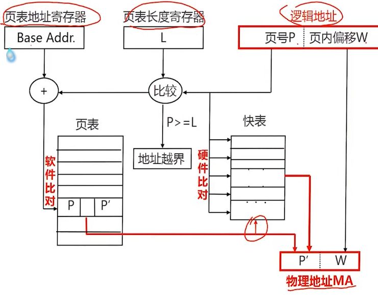

#### 页面的共享

##### 页面共享原理

- 在不同进程的页表中填上相同的页框号，多个进程能访问相同的内存空间，从而实现页面共享
- 共享页面在内存只有一份真实存储，节省内存

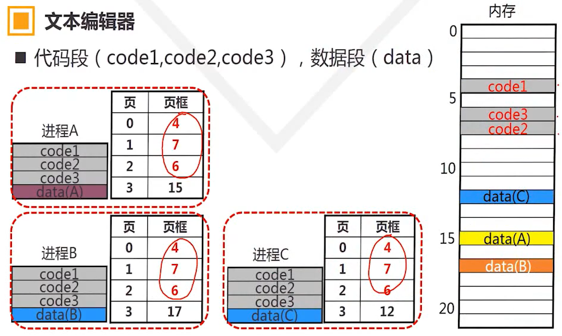

### 缺页中断

#### 分级存储体系

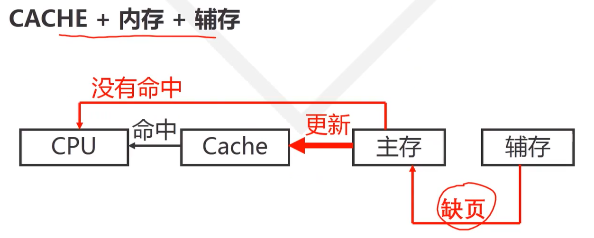

#### 页表扩充

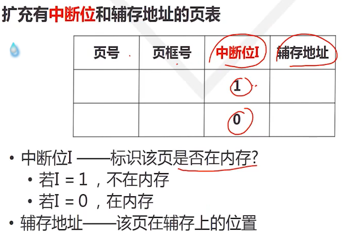

#### 定义

在地址映射过程中，当所要访问的目的页不在内存时，则系统产生异常中断——缺页中断

#### 缺页中断处理程序

中断处理程序把所缺的页从页表指出的辅存地址调入内存的某个页框中，并更新页表中该页对应的页框号以及修改终端为I为0

#### 访存指令的执行过程（含缺页中断处理）

### 页面淘汰策略

#### 定义

缺页当内存不够时需要选择一页进行淘汰（移至外存）称为淘汰策略

#### 页面抖动

- 页面在内存和辅存间频繁交换的现象
- “抖动”会导致系统效率下降

#### 好的淘汰策略

- 具有较低的缺页率（高命中率）
- 页面抖动较少

#### 常用淘汰策略

- 最佳算法（OPT）
- 先进先出淘汰算法（FIFO）
- 最久未使用淘汰算法（LRU）
- 最不经常使用算法（LFU）

#### 最佳算法（OPT）

##### 思想

- 淘汰以后不再需要或最远的将来才会用到的页面

##### 特点

- 理论上最佳，实践中该算法无法实现

#### 先进先出淘汰算法（FIFO）

##### 思想

- 淘汰在内存中停留时间最长的页面

##### 优点

- 实现简单：页面按进入内存的时间排序，淘汰队头页面

##### 缺点

- 进程只有按顺序访问地址空间时页面命中率才最理想
- 异常现象：对于一些特定的访问序列，随分配的页框增多，缺页率反而增加

#### 最久未使用淘汰算法（LRU，least recently used）

##### 思想

- 淘汰最长时间未被使用的页面

##### LRU的实现

##### LRU近似算法

###### 缺点

- 周期T难定
  - 太小，访问位为0的页过多，找不到合适的页淘汰
  - 太大，访问位为1的页过多，找不到合适的页淘汰

#### 最不经常使用算法（LFU，least frequently used）

##### 算法原则

- 选择到当前时间为止被访问次数最少的页面
- 每页设置访问计数器，每当页面被访问时，该页面的访问计数器加1
- 发生缺页中断时，淘汰计数最少的页面，并将所有计数清零 

### 缺页因素分析及页式系统缺点

#### 缺页的因素

- 淘汰算法
- 分配给进程的页框数
  - 页框越少，越容易缺页
- 页本身的大小
  - 页面太大
    - 浪费内存：极限是分区存储
  - 页面太小
    - 页面增多，页表长度增加，浪费内存
    - 换页频繁，系统效率低
  - 页面的常见大小
    - 2的证书次幂：1KB，2KB，4KB
- 程序的编写方法
  - 局部性越好，越不容易缺页
  - 跳转或分支越多越容易缺页

#### 页式系统的不足

- 页面划分无逻辑含义
- 页的共享不灵活
- 页内碎片

### 段式和段页式虚拟存储

#### 段式存储管理

##### 进程分段

- 把进程按逻辑意义划分为多个段，每段有段名，长度不定，进程由多段组成
- 例：一个具有代码段、数据段、堆栈段的进程

##### 段式内存管理系统的内存分配

- 以段为单位装入，每段分配连续的内存
- 但是段和段不要求相邻

##### 段式系统的虚拟地址

- 段式虚拟地址VA包含段号S和段内偏移W
- VA：（S，W）

##### 段表（SMT，segment memory table）

- 记录每段在内存中映射的位置

- 段号S：段的编号（唯一的）
- 段长L：该段的长度
- 基地址B：该段在内存中的首地址

##### 段式地址映射过程

1. 由逻辑地址VA分离出（S，W）
2. 查询段表
   - 检索段号S，查询该段基地址B和长度L
3. 物理地址MA=B+W

##### 段表的扩充

- 基本字段：段号，长度，基址
- 扩展字段：中断位，访问位，修改位，R/W/X

##### 段的共享

- 共享段在内存中只有一份存储
- 共享段被多个进程映射到各自段表
- 需要共享的模块都可以设置为单独的段

##### 段式系统的缺点

- 段需要连续的存储空间
- 段的最大尺寸受到内存大小的限制
- 在辅存中管理可变尺寸的段比较困难

#### 段式系统VS页式系统

- 地址空间的区别
  - 页式系统：一维地址空间
  - 段式系统：二维地址空间
- 段与页的区别
  - 段长可变；页面大小固定
  - 短的划分有意义；页面无意义
  - 段方便共享；页面不方便共享
  - 段用户可见；页面用户不可见
  - 段偏移有溢出；页面偏移无溢出

#### 段页式存储管理

- 在段式存储管理中心结合页式存储管理技术
- 在段中划分页面

##### 段页式系统的地址构成

段号，页号，页内偏移

- 逻辑地址：段号S、页号P和页内位移W
- 内存按页划分，按页装入

##### 段页式地址的映射结构

- 同时采用段表和页表实现地址映射
  - 系统为每个进程建立一个段表
  - 系统为每个段建立一个页表
  - 段表给出每段的页表基地址及页表长度（段长）
  - 页表给出每页对应的页框

##### 段页式地址的映射过程

## Intel CPU与Linux内存管理 

### Intel CPU物理结构

#### X86的实模式（Real Mode）

- 20位：1M内存空间
- 地址表示方式：段地址（16位）：偏移地址（16位）
- 段地址4位对齐

#### X86的保护模式（Protect Mode）

- 32位地址空间：4G内存
- 支持多任务，任务切换，上下文保护
- 进程隔离：代码和数据的安全
- 支持分段机制和分页机制
- 新的寄存器
  - EAX~EDX：扩充到32位
  - CR0~CR4
  - GDTR
  - LDTR
  - IDTR
  - ......

##### CR0

##### CR2

##### CR3

#### X86 CPU架构下的三种地址

### Intel CPU段机制

#### 段与段描述符（Descriptor）

- 段：一段连续内存

- 段描述符（保护模式下使用）

  - 描述段的属性，8字节
    - 段基址
    - 段界限
    - 段属性
    - 段类型
    - 访问该段所需最小特权级
    - 是否在内存
  - 段基址：32位（段基址1+段基址2）
  - 段界限：20位（段基址1+段界限2）

  

#### 描述符的数据结构

#### 描述符表（Descriptor Table）

- 描述符表
  - 存放描述符的数组
  - 长度：8字节的整数倍
- 描述符表类型
  - 全局描述符表GDT：Global Descriptor Table
    - 包含所有进程可用的段的描述符。系统仅一个GDT
  - 局部描述符表LDT：Local Descriptor Table
    - 包含与特定进程有关的描述符，每个进程有自己的LDT
  - 中断描述符表IDT：Interrupt Descriptor Table
    - 包含中断服务程序段的描述符（中断门描述符）
    - 类似中断向量表 

#### 选择子（Selector）

#### 保护模式逻辑地址转换线性地址过程（32位，4G）

### Linux的页面机制

#### 分页

- Inter CPU的页：4KB
- 通过设置CR0的PG位开启分页功能
- 分页：线性地址->物理地址
- 在MMU中进行分页

#### 普通页表实现时的问题

#### 二级页表

##### 页目录（一级页表）

##### Windows NT 二级页表的结构

##### 特点

- 访问数据需要三次访问内存
- 页目录调入内存
- 页表按需要调入主存
- 页面、页表、页目录的大小都刚好4K（占1个页框）

#### 三及页表

### Linux对于段的支持

- Linux将4G虚拟空间划分为两个部分

  - 用户空间与内核空间
  - 用户空间3G：从0到0xBFFFFFFF
  - 内核空间1G：从0xC0000000到0XFFFFFFFF

- 进程建立时，段机制对寄存器的初始化：start_thread()

  

- Linux四个范围一样的段：0~0xFFFFFFFF（4G）
  - 内核数据段|内核代码段|用户数据段|用户代码段
- 各段属性不同
  - 内核段特权级为0
  - 用户段特权级为3
- 作用
  - 利用段机制隔离用户数据和系统数据
    - 保留段的等级保护机制
  - 简化（避免）逻辑地址到线性地址转换
    - 可以直接将虚拟地址当做线性地址，二者完全一致

# 八、设备管理

## 设备管理概念

### 设备

#### 按交互对象分类

- 人际交互设备：显示设备、键盘、鼠标、打印机
- 与CPU等交互的设备：磁盘、磁带、传感器、控制器
- 计算机间的通信设备：网卡、调制解调器

#### 按交互方向分类

- 输入设备：键盘、扫描仪
- 输出设备：显示设备、打印机
- 双向设备：输入/输出：硬盘、软盘、网卡

#### 按外设特性分类

- 使用特征：存储、输入/输出
- 数据传输率：低速（如键盘）、中速（如打印机）、高速（如网卡、磁盘）
- 信息组织特征：字符设备（如打印机），块设备（如磁盘），网络设备

#### 键盘

#### 硬盘

### 设备管理的主要功能

- 设备分配：设备分配程序按照一定的策略，为申请设备的进程分配设备，记录设备的使用情况

  - 独占式分配：独占型设备包括所有的字符型设备

    - 使用过程：申请——使用——释放
    - 从进程申请成功，直到释放用完之前，独占设备

    - 任意时间段内最多只能被一个进程占用
    - 使用时，进程首先向系统申请，可能进入阻塞状态
      - 当设备可用时，唤醒一个等待进程
      - 使用完毕以后，进程必须释放设备

  - 共享式分配：共享型设备包括所有块型设备

    - I/O传输单位：块
    - 宏观上，一个共享型设备可以被多个进程同时占用
    - 微观上，多个进程交替使用同一设备，如何实现排他性的I/O操作呢？进程使用共享型设备之前，有一个隐含的申请命令；使用完毕以后，有一个隐含的释放命令，以实现一次基本I/O传输期间的排他性，保证操作的正常进行。因此使用共享型设备的过程中，进程完全有可能进入阻塞等待状态
    - 进程使用这类设备时，无需申请或释放设备，也不存在某个进程占用设备的问题

  - 虚拟式分配

    - 虚拟技术
      - 在一类物理设备上模拟另一类物理设备的技术，借助辅存部分区域模拟独占设备，将独占设备转化为共享设备
    - 虚拟设备
      - 用来模拟独占设备的部分辅存称为虚拟设备，虚拟独占设备
      - 输入井：模拟输入设备的辅存区域
      - 输出井：模拟输出设备的辅存区域
    - 当进程需要与独占设备交换信息时，就采用虚拟技术奖与该独占设备所对应的虚拟设备（部分辅存）分配给它
    - 虚拟技术和虚拟分配的实现为**Spooling系统**

- 设备映射

  - 物理设备
    - I/O系统中实际安装的设备
    - 物理名：ID或字符串
  - 逻辑设备
    - 应用软件使用的设备
    - 逻辑名：友好名（Friendly Name）
  - 设备映射功能
    - 设备管理模块将逻辑设备映射到物理设备的功能
    - 从应用软件的角度看，逻辑设备是一类物理设备的抽象
    - 从设备管理程序的角度看，物理设备是逻辑设备的实例
  - 设备独立性
    - 物理设备对用户透明，用户使用统一规范的方式使用设备
    - 用户编程时使用设备逻辑名，由系统实现逻辑设备到物理设备的转换

- 设备驱动

  - 对物理设备进行控制，实现I/O操作：IN/OUT
  - 接收应用的服务请求（例如读/写命令），转换为具体的I/O指令，控制设备完成相关操作
  - 向用户提供统一接口
    - read/write/open
    - 把外设作为特别文件处理
  - 设备驱动程序的特点
    - 设备驱动程序与硬件密切相关
    - 每类设备都要配置特定的驱动程序
    - 驱动程序一般由设备厂商根据操作系统要求编写
    - 操作系统仅对与设备驱动的接口提出要求

## SPOOLING系统

### 概念

spooling（Simultaneaus Periphernal Operations Online）系统是虚拟技术和虚拟分配的实现，也叫作外部设备同时联机操作（假脱机输入/输出操作）

例子

### 结构

#### 输入井和输出井

- 磁盘上开辟的两个存储区域
  - 输入井模拟脱机输入时的磁盘
  - 输出井模拟脱机输出时的磁盘

#### 输入缓冲区和输出缓冲区

- 内存中开辟的存储区域
  - 输入缓冲区：暂存输入数据，以后再传送到输入井
  - 输出缓冲区：暂存输出数据，以后再传送到输出设备

#### 输入监控进程和输出监控进程

- 输入监控进程模拟脱机输入的卫星机，将用户要求的数据从输入设备通过输入缓冲区再传送输入井。当用户进程需要数据时，直接从输入井读入所需数据
- 输出监控进程模拟脱机输出的卫星机。用户进程将输出数据从内存先传送到输出井。当输出设备空闲时，再将输出井的数据传送到输出设备上

### 总结

#### 原理

- 任务执行前：预先将程序和数据到输入井中
- 任务运行时：使用数据时，从输入井中取出
- 任务运行时：输出数据时，把数据写入输出井
- 任务运行完：外设空闲时输出全部数据和信息

#### 特点

- 提高了I/O速度
- 将独占设备改造为“共享”设备
  - 实现了虚拟设备功能

## Linux模块机制

### Linux内核模块

- Loadable Kernel Module：LKM
- 解决单体内核机制的不足
  - 一种未经链接的可执行代码
  - 经过装载（即链接）成为内核一部分
  - 可以动态加载或卸载

## Linux驱动程序（LDD）

- 应用程序通过驱动程序间接访问设备；
- 驱动程序工作在内核态

### Linux设备分类

- 字符设备
  - 以字节为单位逐个进行I/O操作
  - 如串口设备
- 块设备
  - 块设备的存取是通过buffer、cache来进行
  - 可以进行随记访问
  - 例如IDE硬盘设备
  - 支持可安装文件系统
- 网络设备
  - 通过BSD套接口访问（SOCKET）

#### 设备文件

- 硬件设备作为文件看待：设备文件
- 用文件接口来完成设备的操作
  - 打开、关闭、读写和I/O控制等操作
- 字符设备和块设备通过设备文件访问
  - Linux文件系统中可以找到设备文件

#### 主设备号和次设备号

- 主设备号
  - 标识该设备种类，标识驱动程序
  - 主设备号的范围：1-255
  - Linux内核支持动态分配主设备号
- 次设备号
  - 标识同一设备驱动程序的不同硬件设备
  - 次设备号只在驱动程序内部使用，系统内核直接把次设备号传递给驱动程序，由驱动程序去管理

### 功能完整的LDD结构

- **驱动程序的注册**
- **驱动程序的注销**
- **设备的打开**
- **设备的释放**
- **设备的读操作——读和写操作实现一个就OK**
- **设备的写操作——读和写操作实现一个就OK**
- 设备的控制操作
- 设备的中断和轮询处理

# 九、文件系统

## 概念

- 文件是计算机信息存取的一种重要组织形式

  - 文件有若干信息项有序构成

    - 信息项可以是字节，可以是结构化数据

      

  - 用户通过读写指针来存取文件的信息项

  - 文件具有文件名。用户通过文件名存取文件

### 文件分类

- 文件的用途
  - 系统文件
    - 包括操作系统的可执行程序和数据文件。这种文件不对用户开放，仅供系统使用
  - 库文件
    - 系统为用户提供的各种标准函数库和使用程序等。用户只能使用这些文件，而无权对其进行修改
  - 用户文件
    - 用户创建的文件，如用户可执行程序，源程序，数据文件等。这种文件的使用修改权均属于用户

- 文件的操作权限
  - 只读文件
    - 只允许进行读操作
  - 读写文件
    - 允许进行读写操作
  - 不保护文件
    - 不作任何操作限制
- 文件的性质
  - 普通文件
    - 指一般的用户文件和/或系统文件
  - 目录文件
    - 记录目录里面文件列表信息
      - 文件名，文件存放地址，文件属性等 
  - 设备文件
    - 把设备作为文件管理和使用

### 文件的属性

- 指定文件的类型、操作特性和存取保护等一组信息
- 文件属性存放在文件所在目录的目录文件中
- MS-DOS系统中，文件属性占目录项的一个字节
  - 00000001：只读属性
  - 00000010：隐藏属性

### 文件系统定义

#### 定义

负责管理文件的机构成为文件系统

#### 功能

负责文件的创立、撤销、读写、修改、复制和存取控制等，并管理存放文件的存储设备

#### 文件系统的目标是让用户以文件名来存取文件

### 文件的结构

#### 逻辑结构

- 用户的观点
- 为用户提供逻辑结构清晰、使用方便的文件
- 强调文件信息项的构成方式和用户的存取方式

##### 分类

- 记录式文件
  - 信息项是记录：结构化数据
    - 学生花名册文件：包含若干个学生记录
    - 每条学生记录：姓名，学号，性别，籍贯，成绩
    - 文件中需要保存记录长度和数量等说明信息
    - 浪费存储空间
- 流式文件
  - 信息项是字节，文件长度就是字节的数量
  - 有点
    - 文件无需额外的说明信息或控制信息
    - 节省存储空间
- **现代操作系统中文件都是流式文件，有应用程序解释和处理文件**

#### 物理结构

- 系统的观点
- 文件在存储设备（例：硬盘上的存储结构）
- 强调合理利用储存空间，缩短I/O存取时间  

### 文件的存取方法

#### 顺序存取

- 按文件信息项排列顺序依次存取
- 读写指针
  - 文件打开时，读写指针指向第1个信息项（字节或记录）
  - 每存取1个信息项，读写指针自动加1而指向下一个信息项

#### 随机存取

- 概念
  - 直接存取
  - 存取操作时指定存取的位置
- 特点
  - 对流式文件或记录为定长的记录式文件容易确定存取位置
  - 对记录不定长的记录式文件比较定位较麻烦
    - 从第1条记录开始查询，直到找到要存取的记录为止
    - 建立索引
    - 索引可作为文件一部分也可单独建索引文件

## 文件物理结构

### 概念

- 文件物理结构是指文件在存储设备上（例：硬盘）的存储方式
- 强调合理利用存储空间，并缩短I/O存取时间

### 类型

- 连续文件
- 索引结构
- 串联文件

### 连续文件

#### 概念

- 文件按逻辑块的顺序存放在硬盘连续的物理存储块中

- 文件目录记录文件长度（块数）和第一个存储块的块号

  

#### 特点

文件建立时给出文件最大长度并登记文件起始位置

#### 优点

- 简单
- 支持顺序存取和随记存取
- 顺序存取速度快：所需磁盘寻道次数和寻道时间最少

#### 缺点

- 文件不易动态增长
  - 预留空间：浪费
  - 重新分配和移动
- 不利于文件插入和删除
- 外部碎片问题

### 索引文件

#### 概念

- 文件存放在不连续的存储块中
- 建立索引表记录文件逻辑块和物理存储块的对应关系
- 索引表单独放在存储块中

#### 特点

- 文件=索引区+数据区
- 先访问索引，再访问数据
- 支持顺序存取和随机存取
- 支持文件动态增长、插入、删除

### 串联文件

#### 概念

- 文件存放在不连续的存储块中（链表结构）
  - 每个存储块有一个指针（next），指向文件下一个存储块
  - 文件目录：指明文件名和第一个存储块的块号
  - FFFF结束

 

#### 特点

- 适用于顺序存取。随记存取较为困难
- 提高了磁盘空间利用率，不存在外部碎片问题
- 有利于文件动态扩充、插入和删除

#### 缺点

- 存取速度慢，不适于随机存取
- 可靠性问题：若next指针出错，则文件访问失败
- next指针占用一定的空间

#### 串联文件的应用：FAT文件系统

## FAT文件系统

- FAT: File Allocation Table
- FAT文件系统

### 文件分配表（FAT）

### 文件分配表的缺点

- 读文件时，先读FAT，影响使用效率
- FAT要占用存储空间
  - 存储容量越大，存储块越多，FAT元素越多，且元素位宽越长，占用更多额外存储空间
- **若存储块有2^N块，FAT有2^N个元素，每项至少需要N位的宽度**

### 扇区

- 磁盘上最小可寻址存储单元（512字节）

### 簇（Cluster） =存储块

- 设备的最小存取单元，固定数量的扇区
- 簇的列子
  - 360KB磁盘：簇=2个扇区（1024字节）
  - 10MB硬盘：簇=8个扇区（4096字节）
  - 2GB银盘：簇=64个扇区（32KB）
- FAT元素数目和簇的数目一样多 假如簇数=2^N
  - FAT元素宽度至少应为N才能标识全部的簇
  - N=8位：能标识2^8=256个簇
  - N=12位：能标识2^12=4096个簇
  - N=16位：能标识2^16=64K个簇 ——Fat16
  - N=32位：能标识2^32=4G个簇
- 磁盘容量=FAT长度*簇容量=FAT长度*簇扇区数*512字节
- 若N=16，簇扇区数=64
  - 磁盘容量=2^16簇 x 64扇区 x 512字节 = 2GB
  - N越大，能标识越多的簇，能支持的磁盘容量越大

### FAT16文件系统

- 以簇为单位管理磁盘
- 簇是扇区的倍数，是2的次幂，最大64扇区
  - 扇区512B，簇32KB（64个扇区）

## 文件存储和目录

### 存储空间管理

#### 功能

- 记录磁盘使用情况
- 管理和分配、回收存储空间

#### 记录磁盘空闲块的方法

- 空闲文件目录

  - 空闲文件
    - 把连续空闲区看成一个特殊文件，由多个连续空闲块组成
  - 空闲文件目录
    - 所有空闲文件代表存储设备全部空闲空间
    - 为空闲文件建立的专门目录：空闲文件目录
    - 每个表项对应一个空闲文件，包括第一个空闲块号，空闲块个数等信息

  

- 空闲块链

  - 把所有空闲块连接在一起
  - 当申请者需要空闲块时，链头开始搜索所需空闲块
  - 当回收空闲块时，把释放的空闲块逐个加在链尾

- 位示图

  - 从内存中划出若干个字节，每个bit表示1个存储块空闲或占用状态

    

### 文件目录管理

#### 文件目录

- 文件名址录，记录文件名和存放地址的目录表
- 具有将文件名转换为外存物理位置的功能
- 文件属性也记录在目录中

#### 目录文件

- 文件目录以文件形式存于外存，这个文件叫目录文件

#### 目录结构

- 单级目录

- 二级目录

- 多级目录（树形目录，大多采用多级目录）

#### 文件全名和路径

##### 文件全名

- 包括从根目录开始到文件为止的通路上所有子目录路径
- 子目录之间用正斜线"/"或反斜线"\\"隔开
- 子目录名组成的部分又称为路径名

**每个文件都有唯一的路径名**

##### 两种路径名形式

- 绝对路径名：从根目录直到指定的文件
- 相对路径名：从当前目录直到指定的文件

#### 文件的保护

#### 文件和目录操作

#### 典型文件系统

FAT： windows

NTFS： windows

EXT： LINUX