# ClickHouse 底层原理全景 · 与大厂面试真题深度解析

> **版本基准**：以 ClickHouse **25.x（至 25.12）** 为基准，回溯 24.x、前瞻 26.x 的同一架构主线。这一代的核心演进是：Projection 从"复制数据"走向"轻量二级索引（`_part_offset`）"、并行副本从手动走向自动、JOIN 从串行 hash 走向并行 hash / Grace Hash / 运行时布隆、JSON 类型 GA、Keeper 独立进程化
> ⚠️ **关于版本**：ClickHouse 每月发版，具体参数默认值与特性可用性请以你实际部署版本的 `system.settings` / `system.table_engines` 和官方文档为准；本文标注的"默认值"为 25.x 口径
> **成文目的**：一份能"从零讲到能扛住阿里 P7 / 字节 2-2 级别深挖"的知识体系 + 题库
> **组织方式**：先建立物理直觉（数据在磁盘上到底长什么样），再讲执行（SQL 怎么变成 CPU 指令），最后讲分布式与运维，面试题全部挂在前面的知识点上，可反向定位

---

## 目录

- [阅读图例与考核程度定义](#阅读图例与考核程度定义)
- [第一部分 认知地基：ClickHouse 到底是什么](#第一部分-认知地基clickhouse-到底是什么)
- [第二部分 架构全景：从单机到集群](#第二部分-架构全景从单机到集群)
- [第三部分 存储引擎内核（最重的一章）](#第三部分-存储引擎内核最重的一章)
- [第四部分 查询执行内核](#第四部分-查询执行内核)
- [第五部分 副本复制与分布式一致性](#第五部分-副本复制与分布式一致性)
- [第六部分 资源管理、运维与调优](#第六部分-资源管理运维与调优)
- [第七部分 操作系统与硬件层逻辑](#第七部分-操作系统与硬件层逻辑)
- [第八部分 横向对比与选型](#第八部分-横向对比与选型)
- [第九部分 大厂面试真题与深度解析（核心）](#第九部分-大厂面试真题与深度解析核心)
- [第十部分 一页速记卡](#第十部分-一页速记卡)
- [附录 生产案例与参数速查](#附录-生产案例与参数速查)

---

## 阅读图例与考核程度定义

本文对每道面试题标注 **考核程度**，含义如下（这套分级对应国内大厂的实际定级逻辑）：

| 标记 | 含义 | 面试中的真实作用 |
|---|---|---|
| ★ | 了解即可 | 冷门/边缘题，答不上来不扣分，答对加分 |
| ★★ | 熟悉 | 一面筛人题，答不上来说明没真的用过 |
| ★★★ | 掌握 | **常规必答题**，答不上来基本一轮挂 |
| ★★★★ | 精通 | 二面/三面区分题，决定"能用"还是"懂" |
| ★★★★★ | 专家级 | 决定定级（P6/P7、2-1/2-2）的题，能答出原理 + 数据 + 踩坑经验才过 |

另有 **【延伸】** 标记，表示这一问之后面试官大概率会继续追的方向——面试是递进式的，答完 A 必须能接住 A.1。

---

## 第一部分 认知地基：ClickHouse 到底是什么

### 1.1 一句话定位

> ClickHouse 是一个**列式存储、向量化执行、MPP（Shared-Nothing）架构**的 OLAP 数据库。它的核心哲学只有一条：**用极致的顺序扫描，换掉一切随机访问。**

这句话拆开就是四个约束，而四个约束决定了后面所有设计：

| 关键词 | 意味着什么 | 放弃了什么 |
|---|---|---|
| 列式存储 | 一列一个文件，同列同类型、连续存放 | 行级定位、单行更新 |
| 向量化执行 | 按 8192 行一个 Block 批处理，CPU 流水线/SIMD 打满 | 逐行处理、复杂表达式逐行求值 |
| MPP / Shared-Nothing | 每个节点有独立 CPU/磁盘，只通过网络交换中间结果 | 共享存储、全局事务、全局查询计划 |
| OLAP | 大宽表、全量扫描+聚合、低 QPS 高吞吐 | 点查、高频小事务、强一致 |

### 1.2 为什么快？——面试第一道必答题，要分七层回答

绝大多数人只会答"列存 + 向量化 + 压缩"。这个答案只能拿 ★★★ 的分。真正拉开差距的是把"快"拆成 **七个层级的乘积效应**，每一层都在减少"要碰的数据量"或"每字节数据的成本"。

```
总耗时 ≈ (需要读取的行数 × 单行字节数 × 每字节CPU成本) / 并行度
                ↑第一层         ↑第二层        ↑第三层         ↑第四层
      再叠加 索引裁剪(第五层) 、预计算(第六层) 、流水线无阻塞(第七层)
```

| 层级 | 机制 | 削弱了公式里的哪一项 | 量级 |
|---|---|---|---|
| **L1 语义层** | 不支持通用事务/行级更新/外键/复杂约束，代码路径短；宽表模型让 JOIN 前移到 ETL | 整体常数开销 | 2~5× |
| **L2 存储布局** | 列存：`SELECT 3列 FROM 100列宽表` 只读 3 个文件 | 单行字节数 | 列数比例，常 10~30× |
| **L3 压缩编码** | LZ4/ZSTD + Delta/DoubleDelta/Gorilla/T64 等专用编码，压缩比常 5~10× | 单行字节数（磁盘→内存的 IO 量） | 5~10× |
| **L4 数据组织** | 按 `ORDER BY` **物理排序**写入，同值聚簇 → 压缩更好、过滤更快 | 需要读取的行数 | 排序键命中时 10~1000× |
| **L5 索引裁剪** | 分区裁剪 → part 裁剪 → 稀疏主键索引（常驻内存，二分定位 granule）→ 跳数索引 | 需要读取的行数 | 命中时 100×+ |
| **L6 执行引擎** | 向量化（8192 行/Block）+ SIMD + 模板化去虚函数 + 多线程 Pipeline | 每字节 CPU 成本 & 并行度 | 5~20× |
| **L7 预计算** | 物化视图、Projection、AggregatingMergeTree、字典 | 需要读取的行数（源头减少） | 10~100× |

关键洞察：**这七层是乘法的**。列存省 10 倍 IO，压缩再省 8 倍，索引再省 100 倍，向量化再省 5 倍 CPU——所以才有"十亿行亚秒级"这种反常识的数字。反过来，**任何一层失效，整体就塌**。这解释了 ClickHouse 生产上最常见的几类性能事故：`SELECT *`（L2 失效）、小批量高频写入导致海量小 part（L4/L5 失效）、排序键设计错（L4/L5 全废）、`Nullable` 满天飞（L3/L6 打折）。

### 1.3 六个"反常识"设计——面试的钩子都在这里

这些点每一个都能被面试官拿来当"你是不是只会背文档"的探针：

| # | 反常识设计 | 常规数据库怎么做 | ClickHouse 为什么这么干 | 代价 |
|---|---|---|---|---|
| 1 | **主键不唯一、不建 B+Tree**，只做"排序 + 稀疏索引" | 唯一约束 + B+Tree 每个键一条索引项 | 索引项数量 = 行数/8192，PB 级也能全内存常驻 | 无法点查、无法唯一约束 |
| 2 | **`ORDER BY` 就是物理排序**（MergeTree 的排序键） | 索引与物理存储解耦 | 排序后同值聚簇 → 压缩率、granule 裁剪双收益 | 写入必须排序（有 CPU 成本）；一个表只能一种顺序 |
| 3 | **INSERT 不是"写一行"，而是"写一个 part 目录"** | 写 WAL + 改 B+Tree 页 | 顺序写、无随机 IO、无锁竞争，写入吞吐极高 | 小批量写入会产生海量小 part（必须攒批） |
| 4 | **UPDATE/DELETE 是异步 Mutation，本质重写整个 part** | in-place 更新 | 避免随机写，保持 part 不可变（immutable） | 更新放大严重，不适合高频更新场景 |
| 5 | **JOIN 弱，右表全量进内存构建哈希表** | 多种 join 算法 + 优化器选 | 实现简单、单表扫描场景不需要 join | 大表 join 大表易 OOM（Grace Hash 才缓解） |
| 6 | **副本最终一致，没有强一致读** | 主从同步复制/quorum 读 | 多主异步、无冲突（因为不更新），写入不被复制阻塞 | 读可能读到旧数据，靠 `insert_quorum` 补 |

### 1.4 适用 / 不适用：选型的第一道判断题

| 场景 | 适合度 | 原因 |
|---|---|---|
| 日志/埋点/行为事件明细存储与多维聚合 | ★★★★★ | 天然 append-only、宽表、按时间分区 |
| 实时大屏、BI 即席查询（秒级/亚秒级） | ★★★★★ | 向量化 + 索引裁剪 |
| 漏斗、留存、UV/PV、A/B 实验指标 | ★★★★★ | `uniq`/`uniqCombined`/`groupBitmap` 等近似与位图聚合能力极强 |
| 时序指标（监控、IoT） | ★★★★☆ | 时序聚簇排序 + DoubleDelta/Gorilla 编码 |
| 点查（按 ID 取单行，QPS 上万） | ★☆ | 稀疏索引定位到 8192 行 granule，读放大严重 |
| 高频 UPDATE/DELETE（如订单状态流转） | ★☆ | Mutation 重写 part，写放大 10~100× |
| 多表复杂 JOIN（星型/雪花模型大表 join） | ★★☆ | 内存 join 限制，需靠宽表预打平 |
| 强事务（跨表 ACID、转账） | ☆ | 无事务，仅部分原子性（单条 INSERT 原子） |
| 高频小批量写入（每秒几十条单行 insert） | ★☆ | 产生海量 part，`too many parts` 直接拒绝写入 |

> **面试话术**：被问"你们为什么选 ClickHouse 不选 Doris"，不要答"因为快"。要答"我们的场景是 append-only 的埋点明细 + 固定几个维度的聚合，JOIN 已经在离线打平成宽表了，所以 ClickHouse 的短板（弱 join、弱更新）在我们这里不构成约束，而它的长板（单表扫描 + 高压缩 + 高写入吞吐）正好是主要矛盾"。——**这个回答的价值在于你把选型讲成了"约束匹配"，而不是"性能排名"。**

### 1.5 一个查询的一生（全景图）

后面所有章节都是这张图的展开，建议先记住这张图的骨架：

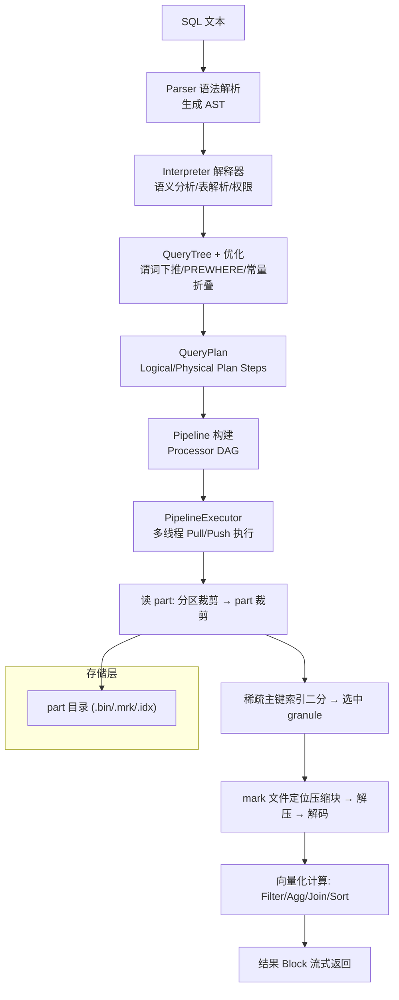

---

## 第二部分 架构全景：从单机到集群

### 2.1 进程与线程模型：单进程多线程，没有"一连接一线程"

这是很多人忽略但面试很爱问的点（"ClickHouse 为什么能扛几千并发连接"）。

- `clickhouse-server` 是**单进程**，连接由**线程池**处理，不存在 MySQL 那种"一个连接一个线程"的膨胀；
- 一个 `SELECT` 在**一个线程上串行跑完整个 Pipeline 的调度**（PipelineExecutor 是单线程调度器），但**每个 Processor 可以由多个线程并行执行**（`max_threads` 决定）；
- 后台任务是**固定的几类线程池**，各自独立、互不抢资源，这是它能稳定跑在"边写边查边合并"下的关键：

| 线程池 | 配置项 | 干什么 | 出问题的典型现象 |
|---|---|---|---|
| `background_pool` | `background_pool_size`（默认 16） | part 合并（merge） | 池满 → part 堆积 → `Too many parts` |
| `background_move_pool` | `background_move_pool_size` | TTL 的 MOVE（跨磁盘/卷搬迁） | 冷热分层迁移卡住 |
| `background_fetch_pool` | `background_fetch_pool_size` | 副本间拉取 part（fetch） | 副本追数据变慢 |
| `background_schedule_pool` | `background_schedule_pool_size` | 分布式 DDL、Keeper 会话、复制队列轮询 | DDL 卡住、副本不同步 |
| `background_common_pool` | `background_common_pool_size` | Mutation、TTL 删除、`OPTIMIZE` | mutation 长时间 pending |
| IO 线程池 | `max_io_threads` | 异步读（默认 `io_threads`/libaio 或 io_uring） | 大扫描时 IO 队列打满 |
| 查询线程 | `max_threads`（默认 = CPU 核数） | 单查询内的并行执行 | 单查询吃掉全部 CPU |

> **延伸（★★★★）**：`background_pool_size = 16` 但机器 64 核，这合理吗？
> 答案：**CPU 核数和 merge 并发不是一回事**。merge 是 IO + CPU 混合型，单机 16 个 merge 线程已经能跑满磁盘带宽；线程太多反而加剧 IO 争抢与 part 锁冲突。生产经验：机械盘/普通 SSD 保持默认 16~24 即可，NVMe 高配可到 32~64。**真正要调的是 `max_bytes_to_merge_at_max_space_in_pool`，它决定单次 merge 的上限，直接决定"能否收敛"。**

### 2.2 单机架构图

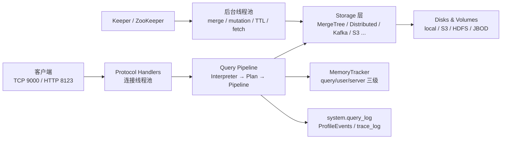

### 2.3 集群的三个原子概念

很多人把"分片、副本、集群"混着讲，其实是三个正交概念，必须分清：

| 概念 | 定义 | 决定什么 | 谁来保证 |
|---|---|---|---|
| **Shard（分片）** | 数据的一个**子集**，水平切分的结果 | 数据规模能否横向扩展、查询能否并行 | 用户（靠 `sharding_key` 或手工写不同分片） |
| **Replica（副本）** | 同一个分片数据的**完整拷贝** | 高可用、读扩展（并行副本） | `ReplicatedMergeTree` + Keeper |
| **Cluster（集群）** | `config.xml` 里 `remote_servers` 定义的一组"分片×副本"拓扑 | 一个逻辑集群 = 一套分片副本组合 | 配置文件（静态，非弹性） |

三个关键事实（面试高频）：

1. **ClickHouse 集群不是"弹性"的**：加一个新分片，老数据**不会自动 rebalance**，需要人工 `reshard`（重写分布）。这是它和 Doris/ES 分片自动均衡的重大区别。
2. **副本是表级别的**，不是实例级别。同一台机器上可以同时存在复制表和非复制表，也可以有 2 副本表和 3 副本表。
3. **一个集群拓扑可以复用**：`remote_servers` 里可以定义多个集群（如 `ck_order_cluster`、`ck_log_cluster`），不同表挂不同集群，但底层的物理节点可以是同一批机器。

### 2.4 `Distributed` 表：它不是表，是"会改写 SQL 的代理"

这是 ClickHouse 架构最容易考、也最容易答错的一点。

```
本地表：db.table_local   （真正存数据，每个分片各有一份，引擎 MergeTree/ReplicatedMergeTree）
分布式表：db.table_all   （引擎 Distributed，不存任何数据）
```

`Distributed(cluster, db, local_table, sharding_key, policy)` 的职责只有两件事：

- **写**：按 `sharding_key` 算哈希（默认 `sipHash64`）→ 决定落到哪个 shard → 转发 INSERT（或直接写本地，如果本节点就是目标 shard）；
- **读**：把 `SELECT` **改写成对每个 shard 的远程查询** → 每个 shard 选一个 replica → 并发下发 → 收回中间结果 → 在发起节点做**第二阶段的 merge/聚合**。

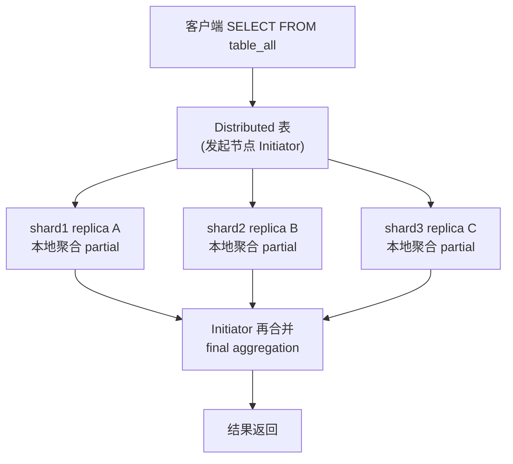

> **关键认知（★★★★★）**：**ClickHouse 没有全局查询计划**。发起节点只是"发查询 + 收结果 + 再算一遍"，每个 shard 各跑各的本地计划。对于高基数 GROUP BY、大表 JOIN，这种"单遍分布式执行"是不够的（需要 shuffle / 数据重分布），这正是 ClickHouse 分布式能力的**结构性天花板**，也是 Doris/StarRocks 相对它的优势所在。25.x 的**并行副本（Parallel Replicas）**部分缓解了这点：让一个分片的多个副本共同分担同一查询，把"读放大"变成"并行度"。

### 2.5 Keeper：集群的"大脑"（但只存元数据，不存数据）

- 早期直接依赖 **ZooKeeper**；后来内置 **ClickHouse Keeper**（C++ 重写，Raft 协议，兼容 ZK 协议），可独立进程部署（推荐）或嵌入 server；
- 存的是**元数据 + 复制日志**：哪些 part 存在、校验和、复制队列、DDL 队列、分布式锁；
- **不存业务数据**。数据永远只在本地磁盘的 part 里，副本之间传的是**压缩后的 part 文件**（物理复制），不是 SQL 或行。

### 2.6 存算分离：SharedMergeTree / ClickHouse Cloud

| 维度 | 传统 Shared-Nothing（开源版主流） | 存算分离（SharedMergeTree / Cloud） |
|---|---|---|
| 数据存放 | 本地盘，副本间物理复制 | 共享对象存储（S3），所有计算节点直接读 |
| 复制 | Keeper 复制日志 + fetch part | Keeper 只同步元数据（"数据在对象存储的哪里"） |
| 扩容 | 加节点需手工 reshard | 加计算节点即时生效（无状态） |
| 一致性 | 最终一致 | 元数据一致，数据天然唯一 |
| 适用 | 自建、可控、低延迟 | 云上弹性、PB 级低成本 |

> **延伸**：为什么存算分离下 Keeper 依然是必需的？因为**"哪个 part 在对象存储的哪个 key、合并到哪一代"这件事仍然需要全局有序**——计算节点无状态，必须有个地方仲裁"谁来做这次 merge、新版 part 叫什么名字"。Keeper 的职责从"数据搬运工"退化为"元数据仲裁者"，压力小一个数量级。

### 2.7 名词中英对照（读源码/看文档必备）

| 中文 | 英文 / 代码里叫法 | 一句话解释 |
|---|---|---|
| 分区 | Partition / `partition_key` | 目录级切分（常按 `toYYYYMM(ts)`），用于裁剪与生命周期管理 |
| 数据块 | Part | 一个不可变的目录，一次写入/一次 merge 的产物 |
| 粒度 | Granule | 8192 行（默认）的逻辑处理单元，读的最小单位 |
| 主键索引 | `primary.idx` | 稀疏索引，每 granule 一条 |
| 标记文件 | `.mrk` / `.mrk2` / `.mrk3` | granule → 压缩块物理偏移的映射 |
| 跳数索引 | Skipping Index (`skp_idx_*`) | 辅助索引，按索引块（多 granule）存 minmax/set/bloom |
| 后台合并 | Merge | 把小 part 合成大 part |
| 变更 | Mutation | ALTER UPDATE/DELETE 的异步重写 |
| 投影 | Projection | 表内隐藏的"另一种排序的副本"或"轻量二级索引" |
| 表引擎 | Table Engine | 决定存储/读写的实现类 |
| 副本 | Replica | 同一分片的完整拷贝 |
| 分片 | Shard | 数据子集 |


## 第三部分 存储引擎内核（最重的一章）

> 这一章是 ClickHouse 面试的绝对主战场。存储层的题的共同特征是：**只要你见过一次真实的磁盘目录，所有问题都会变得顺理成章**。所以先讲"长什么样"，再讲"怎么用"。

### 3.1 MergeTree 家族族谱

`MergeTree` 不是一个引擎，是一个**引擎家族**（源码里 `StorageMergeTree` / `StorageReplicatedMergeTree` 共享 `MergeTreeData` 基类）。家族分两个正交的维度：

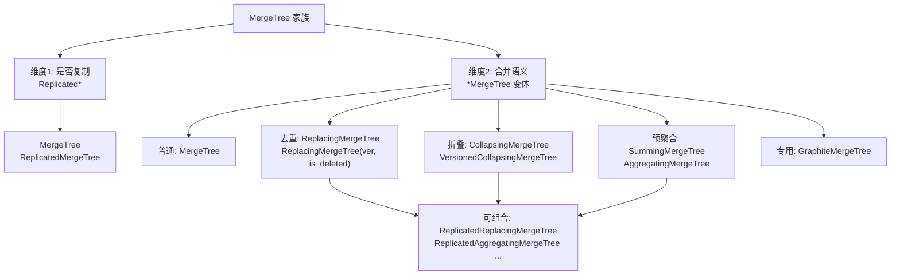

**必须背下来的分层逻辑**：

| 层 | 引擎 | 解决什么问题 |
|---|---|---|
| 基础层 | `MergeTree` | 列存 + 分区 + 排序 + 稀疏索引 + 后台合并 |
| 复制层 | `ReplicatedMergeTree` | 多副本高可用（加 `Replicated` 前缀，参数是 Keeper 路径 + 副本名） |
| 语义层 | `Replacing` / `Collapsing` / `Summing` / `Aggregating` | 在 merge 时顺便做去重/折叠/预聚合 |
| 组合 | `ReplicatedReplacingMergeTree` | 复制 + 去重 |

> 注意：`Replicated*` **只有 MergeTree 家族才有**。`Distributed`、`Kafka`、`Memory`、`Log` 这些没有副本概念。

### 3.2 磁盘布局：一个 part 目录里到底有什么

这是整章的地基。给你一张真实目录（`default` 库，表 `events`）：

```
/var/lib/clickhouse/
├── metadata/default/                    # 建表语句（.sql），DDL 的唯一真相
│   ├── events.sql
│   └── events_all.sql                   # Distributed 表也在这里
├── data/default/events/                 # 表的数据目录
│   ├── detached/                        # 被 DETACH / 损坏的 part 挪到这里，不再管理
│   ├── format_version.txt
│   ├── 202401_1_1_0/                    # ← 一个 part（一次 INSERT 或一次 merge 的产物）
│   │   ├── checksums.txt                # 所有文件的校验和（CRC32），用于副本校验/损坏检测
│   │   ├── columns.txt                  # 列名 + 类型清单（读 part 时先读它）
│   │   ├── count.txt                    # 本 part 行数
│   │   ├── primary.idx                  # ★ 稀疏主键索引（每 granule 一条）
│   │   ├── partition.dat                # 本 part 的分区表达式取值
│   │   ├── minmax_ts.idx                # 分区键列的 min/max（分区级裁剪用）
│   │   ├── default_compression_codec.txt
│   │   ├── metadata_version.txt
│   │   ├── ttl.txt                      # 若配了 TTL
│   │   ├── event_time.bin               # ★ 列数据（编码+压缩后）
│   │   ├── event_time.mrk3              # ★ 该列的 mark 文件（granule→压缩块偏移）
│   │   ├── user_id.bin
│   │   ├── user_id.mrk3
│   │   ├── skp_idx_idx_url.idx          # ★ 跳数索引数据
│   │   ├── skp_idx_idx_url.mrk
│   │   └── proj_by_time/                # 若建了 Projection，part 里会有子目录
│   │       ├── event_time.bin
│   │       └── ...
│   ├── 202401_2_2_0/
│   ├── 202401_1_2_1/                    # ← merge 产物：block 范围是 1~2，level=1
│   └── 202402_3_3_0/
```

#### 3.2.1 part 的命名规则（面试爱问的细节）

```
{partition_id}_{min_block}_{max_block}_{level}
   202401      _   1     _   2     _  1
```

| 字段 | 含义 | 说明 |
|---|---|---|
| `partition_id` | 分区键表达式值的编码（如 `202401`、`all`） | 由 `partition_key` 计算，同分区同目录 |
| `min_block` / `max_block` | 该 part 覆盖的 block 编号区间 | 全局递增；merge 时取参与 part 的 min/max |
| `level` | 合并层级 | **INSERT 直接产生的 part，level = 0**；merge 产生的 = `max(参与者 level) + 1` |

> **这个 level 有什么用？**（★★★★）
> 1. **防止无限合并**：小的 part 不断 merge，level 单调上升，运维看到 level 很高的 part 说明它反复被重写（写放大严重）。
> 2. **帮助 merge 选择器**：优先合并 level 相近、大小相近的 part，避免"小 part 反复被拖着跟大 part 合并"。
> 3. **排查写入模式**：`system.parts` 里如果看到大量 `level=0` 且 block 区间极窄（如 `_1_1_0`、`_2_2_0`），说明你在小批量高频写入——这是最典型的反模式。

#### 3.2.2 `.bin` / `.mrk3` / `primary.idx` 三件套的关系（★★★★★）

这是整个 ClickHouse 存储的灵魂，必须能画出来：

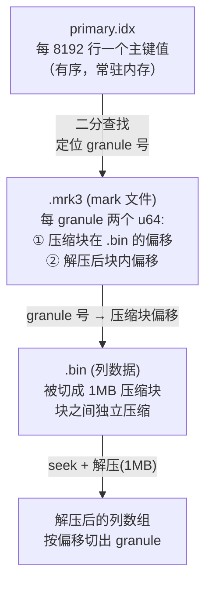

**读一次 `WHERE user_id = 12345` 的完整过程**（这是面试题"ClickHouse 怎么用索引查数据"的标准答案，必须能口述）：

```
1. 分区裁剪：读 minmax_ts.idx / partition.dat，排除不相关分区（part 目录级）
2. 对每个候选 part：
   a. 读 primary.idx（已在内存），对 user_id 的值做二分查找
      → 得到可能命中的 granule 区间 [g_start, g_end)
      → 注意：这是"可能"，因为稀疏索引只存 granule 首行的值
   b. 读 user_id.mrk3，把 granule 号映射为：
      (compressed_offset, decompressed_offset)
   c. 按 compressed_offset 顺序读 .bin 中的 1MB 压缩块 → LZ4/ZSTD 解压
   d. 按 decompressed_offset 切出 granule 的 8192 行
3. 对解压后的 8192 行 **重新应用谓词**（精确过滤）→ 得到真正匹配的行
4. 对其他需要的列（SELECT 的列），用同样的 granule 号去各自的 .mrk3 定位
   → 这就是"列存 + granule 对齐"的意义：所有列的第 N 个 granule 行号完全一致
```

**三个必须理解的点**：

| 点 | 为什么重要 |
|---|---|
| **稀疏索引"只定位不精确"** | 因为只存每 granule 首行值。若 `g` 的首行 < 12345 < 下一 granule 首行，则该 granule 可能含 12345；但 granule 内可能有其他值不匹配。所以**必须二次过滤**（`FilterTransform`）。这就是"读放大"的根源：最坏情况读 8192 行只出 1 行。 |
| **granule 是所有列的对齐单位** | 第 N 个 granule 在每一列 `.bin` 里都是第 N 个 8192 行。所以只需算一次 granule 区间，就能把所有列的读取范围一次性确定——**这就是列存能"按需只读某几列"却不失同步性的机制**。 |
| **mark 文件是"两级偏移"** | 一级定位到压缩块（因为压缩块独立压缩，不能跨块解码），二级定位到块内 granule 起点。所以**压缩块边界与 granule 边界不必对齐**，这是设计上的精妙之处。 |

#### 3.2.3 自适应索引粒度（Adaptive Granularity）

`index_granularity = 8192` 只是**行数上限**。真实行为是"双阈值"：

- 达到 `index_granularity`（默认 8192 行）**或**
- 达到 `index_granularity_bytes`（默认 10 MiB，即 `10485760`）

**谁先到就切**。这意味着：宽表（一行几百字节）实际 granule 可能只有几百行；窄表可能撑满 8192 行。

> **为什么这么设计？**（★★★★）
> 稀疏索引的粒度是"行数"，但 IO 成本按"字节"算。如果一张表每行 2KB，8192 行 = 16MB，一次误读的代价太大；反之每行 8 字节，8192 行才 64KB，读起来很划算。所以用**字节阈值兜底**，让 granule 的字节量可控（约 10MB/列/压缩前）。
> 关闭方式：`index_granularity_bytes = 0`（同时 `index_granularity` 生效），仅建议极窄表或追求完全可预测时使用。
> 副作用：granule 行数不固定 → `primary.idx` 条目数不再等于 `行数/8192`，`EXPLAIN` 里的 granule 数要按字节估算。

### 3.3 part 与 merge：写放大与"too many parts"

#### 3.3.1 写入 → part 的生命周期

```
INSERT 一批数据
   ↓ 按 max_insert_block_size(默认 1048576 行) 切 block
   ↓ 每个 block 在内存中排序（按 ORDER BY 键）
   ↓ 写成一个全新 part 目录（level=0），写完 fsync + 写 checksums
   ↓ 注册到 system.parts，查询立即可见（无 WAL，无事务日志）
后台 merge 线程
   ↓ 选若干个**同分区**、大小相近的 part
   ↓ 归并排序合并 → 生成新 part（level = max+1）
   ↓ 新 part 就绪后，原子替换（删旧 part）
```

**注意：ClickHouse 没有传统 LSM 的 memtable + WAL + flush 三段式**。它的 INSERT 是**直接生成 part**，这就是"批量写"必须大的原因——**一次 INSERT = 一次 part 写盘**。

#### 3.3.2 写放大模型：为什么它本质上是"LSM 的近亲"

| 阶段 | 写放大来源 | 量级 |
|---|---|---|
| INSERT | 排序 + 编码 + 压缩 + fsync | ~1×（不可避免） |
| merge | 每层重写数据，log 结构 | 总量 ≈ `log_{fanout}(N)` × 数据量，通常 3~10× |
| mutation | 重写 part（部分列可 hardlink 复用） | 每次 1× 全量或部分 |
| TTL | merge 时过滤重写 | 摊入 merge |

> 与 LSM 的关键差异（★★★★★，这个问题极常被问）：
> | 维度 | LSM-Tree（HBase/RocksDB） | MergeTree（ClickHouse） |
> |---|---|---|
> | 写入路径 | memtable → WAL → flush SST | 直接生成 part（无 memtable/WAL） |
> | 定位 | 每层一个 SST，**读需逐层查找 + 布隆过滤** | **主键有序 + 稀疏索引**，二分定位 granule |
> | 点查 | 支持且较快 | 差（读放大 8192 行） |
> | 范围扫描 | 需多路归并 | 天然顺序扫描，极快 |
> | 压缩 | 通用压缩为主 | 列级 + 专用编码（Delta/Gorilla），压缩比更高 |
> | 更新 | 追加 + compaction | mutation 重写（更贵） |
> | 合并触发 | 层满（size-tiered/leveled） | 大小相近 + level 相近（SimpleMergeSelector） |
>
> **一句话总结**：MergeTree = "LSM 的追加写思路 + 列存 + 有序聚簇 + 稀疏索引"，是**为扫描优化的 LSM 变体**，牺牲点查换扫描。

#### 3.3.3 `too many parts`：最经典的线上事故

ClickHouse 对"活跃 part 数"有硬阈值（按**单表单分区**计）：

| 参数 | 默认 | 行为 |
|---|---|---|
| `parts_to_delay_insert` | 150 | 超过则 INSERT **主动变慢**（每次插入人为延迟，起反压作用） |
| `parts_to_throw_insert` | 300 | 超过则 INSERT **直接抛异常拒绝**，报 `Too many parts (N). Merges are processing significantly slower than inserts` |

> **为什么是"按分区"计？** 因为 merge **只在同一个分区内发生**。所以按天/按月分区时，历史分区会自然停止增长；但如果**分区键基数过高**（比如按 `user_id` 或 `toDateTime(ts)` 秒级分区），每个分区只有几行 → 分区数爆炸 → 每个分区都是小 part → merge 永远追不上 → 全线拒绝写入。**这是 ClickHouse 最经典的 P0 事故之一。**

**根因与解法（★★★★★，必须能说出完整的因果链）**：

```
现象: INSERT 报 Too many parts
根因链:
  ① 写入侧: 单条/小批量高频 INSERT（如 Flink/应用逐条写）
     → 每次 INSERT 生成一个 level=0 小 part
  ② 分区侧: 分区键粒度太细（按小时/按 user_id）
     → 单分区 part 数迅速破 300
  ③ merge 侧: background_pool 被大 part merge 长期占用
     → 小 part 排不上队，或 max_bytes_to_merge_at_max_space_in_pool 限制导致无法继续合并
解法（按代价排序）:
  1. 写入端攒批(首选): 单批 ≥ 10万行 或 每批 100MB，配合 Buffer 表/async_insert
  2. 分区键粗化: 按天/月，杜绝按秒/按用户
  3. 调大阈值(掩盖, 非根治): parts_to_throw_insert 提高 + background_pool_size 提高
  4. 兜底: OPTIMIZE TABLE ... PARTITION xxx FINAL 手工收敛(会锁 part, 慎用)
```

相关排查 SQL：

```sql
-- 1. 谁在产生小 part？
SELECT partition, count() AS parts, sum(rows) AS rows,
       max(level) AS max_level,
       countIf(level = 0) AS level0_parts
FROM system.parts
WHERE active AND table = 'events'
GROUP BY partition
ORDER BY parts DESC LIMIT 20;

-- 2. merge 在干什么？有没有卡住的大 merge？
SELECT database, table, elapsed, progress, num_parts,
       formatReadableSize(total_size_bytes_compressed) AS size
FROM system.merges ORDER BY elapsed DESC;

-- 3. 反压是否已生效？
SELECT event_time, query_duration_ms, written_rows, exception
FROM system.query_log
WHERE query_kind = 'Insert' AND exception_code = 252
ORDER BY event_time DESC LIMIT 10;
```

#### 3.3.4 merge 选择策略细节

`SimpleMergeSelector` 的近似规则（理解它能解释"为什么我的大 part 迟迟不合并"）：

1. 只在**同一分区**内选；
2. 选**总字节量相近**的一组（避免 10MB 和 10GB 合并）；
3. 合并结果不得超过 `max_bytes_to_merge_at_max_space_in_pool`（默认 150GB 左右，取决于 `max_bytes_to_merge_at_max_space_in_pool` = `max_bytes_to_merge_at_max_space_in_pool` 与磁盘可用空间的乘积）；
4. 优先选**level 低**的（越"新鲜"越先并）。

> **这解释了一个经典困惑**：为什么 300GB 的 part 永远不会再合并？因为超过了单次 merge 上限，只能靠 `OPTIMIZE` 或调大参数。这也解释了"为什么 FINAL 查询慢"——`FINAL` 要对所有未合并的重复数据做实时去重归并。

### 3.4 跳数索引（Skipping Index）：能用，但别指望

#### 3.4.1 与"传统二级索引"的本质差异（★★★★）

这是最容易被面错的一题。务必记牢这句话：

> **传统 B+Tree 二级索引记录"哪些行匹配"；ClickHouse 跳数索引只记录"哪些块一定不匹配"。**

后者是"排除法"，不是"定位法"。因此：

- **它减少的是"要读的 granule 数"**，而不是"要检查的行数"；
- 一旦某个值在某个索引块（= GRANULARITY 个 granule）里**出现过哪怕一次**，整个索引块就**不能跳过**，那 8192×N 行必须全读进内存再过滤；
- 所以**数据"聚簇程度"决定一切**：索引列与 `ORDER BY` 高度相关 → 有效；完全随机散布（"针在草堆里"）→ **索引开销白付，一点不省**。

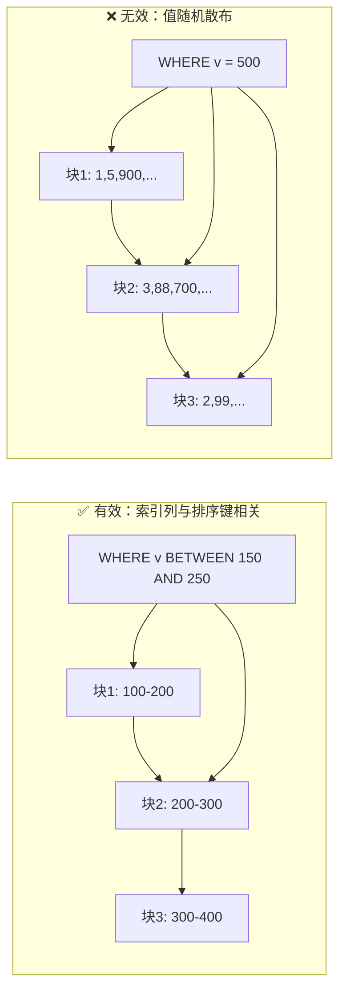

#### 3.4.2 四种索引类型对照

| 类型 | 存什么 | 适用谓词 | 关键参数 | 失效场景 |
|---|---|---|---|---|
| `minmax` | 每个索引块的 min / max | `=`, `>`, `<`, `BETWEEN`（**范围**） | `GRANULARITY` | 值散布（min/max 跨全域） |
| `set` | 每个索引块内的**所有不同值**（有上限） | `=`, `IN`（**等值集合**） | `max_rows`（默认 100，超限则该块不建索引） | 高基数（超 max_rows 直接失效） |
| `bloom_filter` | 布隆过滤器（有假阳性，无假阴性） | `=`, `IN` | `false_positive` | 范围/否定条件；高基数但查询值多时假阳性累积 |
| `tokenbf_v1` | 文本**分词后 token** 的布隆 | `hasToken`, `LIKE '%word%'`（整词） | `size_of_bloom_filter_in_bytes`, `hash_functions` | 子串、中文（中文没有空格分词 → 整段一个 token，实际失效） |
| `ngrambf_v1` | **n-gram 子串**的布隆 | `LIKE '%substr%'`, `position` | `n`, `size_of_bloom_filter_in_bytes`, `hash_functions` | n 太长导致过滤器过大；短 n 假阳性高 |

创建语法：

```sql
ALTER TABLE events
  ADD INDEX idx_url url TYPE bloom_filter(0.01) GRANULARITY 4,
  ADD INDEX idx_price price TYPE minmax GRANULARITY 8;
-- 对存量数据物化索引
ALTER TABLE events MATERIALIZE INDEX idx_url;
```

> **`GRANULARITY 4` 是什么意思？**（★★★）索引块 = 4 个 granule = 4×8192 = 32768 行存一条索引项。**粒度越粗，索引越小、越省内存，但排除的精度越低**。这是"索引体积 vs 裁剪精度"的权衡，和稀疏主键索引的 8192 是同一套哲学。

> **延伸（★★★★★）**：为什么"给 `user_id` 加 bloom_filter 后查询反而更慢了"？
> 因为在你的数据里 `user_id` 与 `ORDER BY (event_time, ...)` **完全不相关**，每个索引块里几乎都出现了全部 user_id（或至少包含被查的那几个），布隆过滤器对**每一个块**都返回"可能存在"→ 一个 granule 都没跳过，但每个 granule 都多了一次布隆计算开销 → 净亏。
> **正确姿势**：先问"我的过滤列和排序键相关吗"；不相关就别加索引，改 **Projection（另一种排序）** 或 **物化视图预聚合**，或**把该列放进排序键前缀**。

### 3.5 压缩与编码：被严重低估的性能杠杆

#### 3.5.1 两层结构：编码（preprocessor）+ 压缩（compression）

```
原始列数据
  ↓ ① 编码/预处理 (Delta / DoubleDelta / Gorilla / T64 / FPC ...)
  ↓ 变成"更好压"的中间表示
  ↓ ② 通用压缩 (LZ4 / ZSTD / LZ4HC)
  ↓ 落盘为 1MB 级压缩块
```

| 编码 | 适用类型 | 原理 | 典型收益 |
|---|---|---|---|
| `Delta` | 整数、时间戳、自增 ID | 存相邻差值 | 单调递增列可到 10~50× |
| `DoubleDelta` | 时间戳（等间隔采样） | 存"差值的差值" → 全 0 | 监控时序常 50~100× |
| `Gorilla` | Float 浮点 | XOR 前后值 + 变长编码 | 传感器/指标浮点 5~20× |
| `T64` | 整数（低位宽） | 去掉高位、按位打包 | 小范围整数 2~5× |
| `FPC` | 浮点（预测器） | 线性预测 + XOR | 科学计算浮点 |
| `LowCardinality(String)`（不是编码，是**字典类型**） | 低基数枚举（省份、URL 模板、状态） | 存字典 ID 而非字符串 | 5~100×，且**字符串比较变整数比较** |

```sql
-- 生产级典型写法
CREATE TABLE metrics (
  ts        DateTime CODEC(DoubleDelta, ZSTD(1)),
  device_id UInt64   CODEC(Delta, ZSTD(1)),
  value     Float64  CODEC(Gorilla, ZSTD(1)),
  province  LowCardinality(String),
  url       String   CODEC(ZSTD(3))
) ENGINE = MergeTree PARTITION BY toYYYYMM(ts)
ORDER BY (device_id, ts);
```

#### 3.5.2 压缩块的两个关键参数

| 参数 | 默认 | 含义 |
|---|---|---|
| `min_compress_block_size` | 65536 | 攒够这么多才切块（避免小碎块） |
| `max_compress_block_size` | 1048576（1MB） | 单块上限，超过强制切 |

> **为什么是 1MB？**（★★★★）压缩比需要"上下文窗口"，块越大压得越好；但块太大会导致 ① 解压粒度粗（读一行要解 10MB）② 解压缓冲占内存。1MB 是经验上的平衡点。**注意 mark 文件中记录的是"压缩块内偏移"，因此块边界与 granule 边界解耦**——这是 3.2.2 讲的精妙设计。

#### 3.5.3 `Nullable` 的真实代价（面试常考的"冷知识"）

| 代价 | 说明 |
|---|---|
| 额外 `null_map` 列 | 每列多存一个 `UInt8` 数组，压缩率被拉低 |
| 无法用专用编码 | `Nullable(DateTime)` 不能直接套 `DoubleDelta`（要跳过 null 位） |
| 谓词变慢 | 每个表达式要处理 null 分支，向量化路径被打断 |
| 索引失效 | `minmax` 对含 null 列要额外判断 |

**结论**：能用默认值（`0` / `''` / `1970-01-01`）表达"空"就别用 `Nullable`。生产上见过把 20 个字段全改成 `Nullable` 后查询慢 40% 的案例。

### 3.6 写入全链路：从客户端到 part 落盘

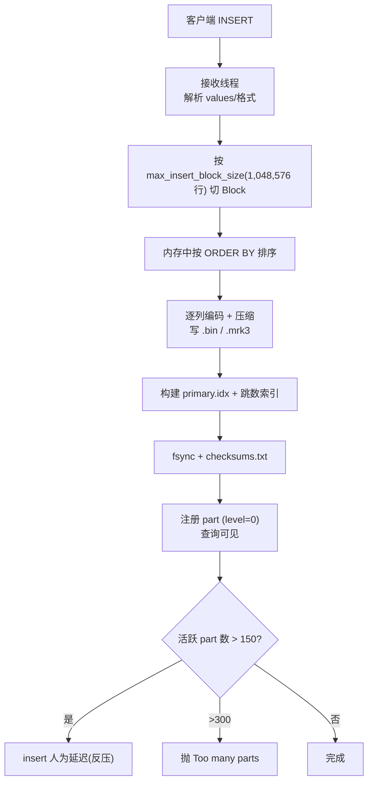

写入路径上的关键参数：

| 参数 | 默认 | 作用 |
|---|---|---|
| `max_insert_block_size` | 1048576 | 单 block 行数上限，**每 block = 一个 part** |
| `min_insert_block_size_rows` | 1048576 | 合并小 block 的最小行数（攒批） |
| `min_insert_block_size_bytes` | 256MB | 按字节攒批 |
| `async_insert` | 0 | 服务端缓冲小 INSERT，攒批后统一落盘 |
| `async_insert_max_data_size` | 10MB | 异步缓冲上限 |
| `wait_for_async_insert` | 1 | 是否等落盘才返回（0 = 更快但可能丢） |

> **`async_insert` vs `Buffer` 表 vs Kafka 引擎，三者怎么选？**（★★★★★，场景题必考）
> | 方案 | 位置 | 优点 | 缺点 | 适用 |
> |---|---|---|---|---|
> | `async_insert=1` | 服务端内存缓冲 | 零改造、天然攒批、可配 `busy_timeout` | 只解决"小 INSERT 碎"，不解决乱序/重试 | **首选**，尤其客户端无法攒批时 |
> | `Buffer` 表 | 中间表引擎 | 攒批 + 定期 flush 到目标表 | 数据在内存，宕机丢；查询要绕开 Buffer | 已很少用，被 async_insert 替代 |
> | `Kafka` 引擎 | 消费端 | exactly-once（配合物化视图去重）、削峰、解耦 | 需要 Kafka；小批量消费仍要调 `kafka_num_consumers` 攒批 | 流式接入标准方案 |
> | 客户端攒批 | 应用侧 | 最简单、最可控 | 要改代码；进程崩了丢缓冲 | **最佳实践**，能改就改 |

### 3.7 Mutation / Lightweight Delete / TTL：三种"改数据"的方式

ClickHouse 没有 in-place 更新。所有"改"都是**异步重写 part**，只是粒度不同。

| 方式 | 语法 | 实现 | 代价 | 适用 |
|---|---|---|---|---|
| **Mutation** | `ALTER TABLE ... UPDATE col=... WHERE ...` | 后台任务重写**整个 part**（未变列可 hardlink 复用） | 重、异步、不可回滚、会阻塞 merge | 低频批量修正 |
| **Lightweight Delete** | `DELETE FROM t WHERE ...`（23.3+） | 写 `_row_exists` 掩码文件（`delete_mask`），查询时过滤 | 查变慢（多读一列）；不立即释放空间 | 稀疏删除（删少量行） |
| **DROP PARTITION** | `ALTER TABLE ... DROP PARTITION` | 直接删目录 | 极快（元数据操作） | **按分区删除（最佳）** |
| **TTL** | `TTL ts + INTERVAL 30 DAY` | 后台按分区 drop 或 merge 时过滤 | 自动、低 | 时间衰减数据 |

```sql
-- Mutation 的同步控制
SET mutations_sync = 1;  -- 1=等当前副本完成; 2=等所有副本完成; 0=异步(默认)
ALTER TABLE events UPDATE status = 'x' WHERE id = 1;

-- 查看 mutation 进度（生产必看）
SELECT * FROM system.mutations WHERE is_done = 0;
-- 卡住的 mutation 会 block 该 part 的 merge，导致 part 堆积 → 连锁 Too many parts

-- 正确的批量删除姿势
ALTER TABLE events DROP PARTITION '202401';   -- 秒级
DELETE FROM events WHERE dt < '2024-01-01';   -- 慢，尽量别
```

> **延伸（★★★★★）**：为什么"用 ClickHouse 做订单状态流转"是典型的选型错误？
> 订单表需要按 `order_id` 高频 UPDATE 状态 → 每次 mutation 重写含该 order_id 的整个 part（part 动辄几百 MB）→ 写放大几十倍，且 mutation 会**长期占用 background_pool**，阻塞合并，最终表现为"写入越来越慢、查询越来越慢、part 越来越多"的雪崩。
> **正确做法**：① 用 `ReplacingMergeTree(ver)` 追加新版本，查询用 `argMax`/`FINAL`；② 或把状态变更抽成事件流，查询时用 `AggregatingMergeTree` 折叠；③ 真的要更新就用 OLTP 库（MySQL/PG）+ CDC 同步宽表。

### 3.8 MergeTree 变体：用"合并"这个动作做语义

所有变体的共同思路：**merge 时顺便做点什么，保证"最终"正确，查询时可以不看中间状态**。但**都只在 merge 时生效**——这是面试必考的一句话。

#### 3.8.1 `ReplacingMergeTree`：去重

```sql
ENGINE = ReplacingMergeTree(ver)     -- ver 可选，保留最大版本
ORDER BY id
```
- **语义**：merge 时，排序键（`ORDER BY` 列）相同的行只保留 `ver` 最大的一条；
- **坑**：merge 是异步的，**查询时可能还有重复**。所以查询要么 `FINAL`（强制去重，慢），要么 `SELECT ... argMax(col, ver) GROUP BY id`（推荐）；
- **24.x 增强**：`ReplacingMergeTree(ver, is_deleted)` 支持"逻辑删除 + 物理清理"两段式；
- **典型用法**：CDC 同步的 upsert（每行带 `_version`），报表用 `argMax`。

> **为什么 `FINAL` 慢？**（★★★★）
> `FINAL` 要在**查询时**对所有未合并的重复键做实时归并：读所有相关 part → 按排序键归并 → 每组取 `ver` 最大 → 再算聚合。等于把"merge 该做的工作"搬到查询侧，且必须读到 `ORDER BY` 全键列。数据越碎片（part 越多、重复越多）越慢。
> **优化**：① 定期 `OPTIMIZE ... FINAL` 收敛（非高峰做）；② 用 `argMax` 代替 `FINAL`（只读需要的列）；③ 用 `do_not_merge_across_partitions_select_final=1` 让 FINAL 只在分区内归并。

#### 3.8.2 `CollapsingMergeTree` / `VersionedCollapsingMergeTree`：状态折叠

```sql
ENGINE = CollapsingMergeTree(sign)  -- sign = 1 表示"新增状态", -1 表示"撤销旧状态"
```
写入模式：要更新一行，就写一对 `(旧行, -1)` 和 `(新行, +1)`，merge 时成对折叠。

| 引擎 | 解决什么问题 | 关键约束 |
|---|---|---|
| `CollapsingMergeTree` | 状态型数据的 upsert | **写入必须严格有序**（-1 必须紧跟 +1），多线程写会错乱 |
| `VersionedCollapsingMergeTree(sign, ver)` | 乱序写入也安全 | 加版本号列，折叠时按 ver 排序，不依赖写入顺序 |

> **它们和 `ReplacingMergeTree` 的选择**：能做"整行覆盖"就用 `Replacing`（简单）；必须"保留历史明细 + 可撤销"才用 `Collapsing`。**实际上 90% 的场景 `Replacing` 够用。**（很多面试官自己也分不清，你能讲清"为什么不推荐 Collapsing"就是加分项：因为它对写入顺序极度敏感，而 ClickHouse 多副本/多分区天然乱序。）

#### 3.8.3 `SummingMergeTree` / `AggregatingMergeTree`：预聚合

| 引擎 | 存什么 | 查询怎么写 | 局限 |
|---|---|---|---|
| `SummingMergeTree((val1, val2))` | 排序键相同的行，数值列**求和** | 直接 `sum()` 也行（幂等） | 非数值列/非指定列取值**不确定**（取任意一条） |
| `AggregatingMergeTree` | **聚合中间状态**（`AggregateFunction`） | 插入用 `-State`，查询用 `-Merge` | 必须配物化视图；语义复杂 |

```sql
-- 最经典的生产组合：明细表 + 物化视图 + AggregatingMergeTree
CREATE TABLE mv_daily (
  dt Date, province String,
  uv   AggregateFunction(uniq, UInt64),
  pv   AggregateFunction(sum, UInt64)
) ENGINE = AggregatingMergeTree
PARTITION BY toYYYYMM(dt)
ORDER BY (dt, province);

CREATE MATERIALIZED VIEW mv_daily_mv TO mv_daily AS
SELECT toDate(ts) AS dt, province,
       uniqState(user_id) AS uv,
       sumState(1)        AS pv
FROM events GROUP BY dt, province;

-- 查询时（必须用 -Merge）
SELECT dt, province, uniqMerge(uv) AS uv, sumMerge(pv) AS pv
FROM mv_daily GROUP BY dt, province;
```

> **为什么必须 `-State` / `-Merge`？**（★★★★★）
> `AggregatingMergeTree` 存的不是"结果值"，而是**中间状态**（例如 `uniq` 的 HyperLogLog 位图、`avg` 的 `(sum, count)` 二元组）。因为只有中间状态才满足**可结合性**：任意分片/任意 part 的部分状态可以继续合并。若存最终值，跨 part 再聚合就会错（比如 `avg` 的 avg 不等于总 avg）。这正是"预聚合能正确工作"的数学基础。

### 3.9 Projection 与物化视图：两条"预计算"路线

| 维度 | 物化视图（Materialized View） | Projection |
|---|---|---|
| 触发方式 | **INSERT 触发器**：写源表时同步写目标表 | 表**内部**维护，写入时同时写投影 |
| 存储位置 | 独立表（可 `TO` 指定） | part 目录内的子目录（`proj_*`） |
| 查询是否自动使用 | **不会**（除非查询改写或建 `Distributed` 别名） | **会自动**（优化器按代价选投影） |
| 数据一致性 | 与源表弱耦合，可能漏写（如 `POPULATE`） | 与源表强绑定，part 级一致 |
| 能力 | 可跨表、可聚合、可级联 | 只能同表、换排序/换列/预聚合 |
| 典型用途 | 预聚合宽表、跨表打平 | 多排序键（"一个表多个 ORDER BY"） |

> **ClickHouse 的物化视图不是"查询改写"，而是"写入触发器"** ——这一点和 Doris/StarRocks 的物化视图（查询自动路由）**完全不同**，是极高频的对比题（★★★★）。
> 所以建完 MV 后，**历史数据不会自动进来**（除非 `POPULATE`，而 `POPULATE` 在建表瞬间会漏掉并发写入，生产禁用）；查询也**不会自动改写到 MV**（要自己查 MV，或者把 MV 建成 `Distributed` 表的别名）。

**Projection 的三个时代（25.x 的重要演进，前沿加分项 ★★★★）**：

| 版本 | 形态 | 存储开销 | 能力 |
|---|---|---|---|
| 传统（21.x 起） | `PROJECTION p (SELECT * ORDER BY col)`，**复制全量列** | 高（≈ 再存一份表） | 换排序键加速范围/排序查询 |
| 轻量（25.5~25.6 起） | `PROJECTION p (SELECT _part_offset ORDER BY col)`，只存排序键 + 指向基表的偏移 | 低（≈ 一个索引） | **充当二级索引**，定位到 part/granule 后回基表读 |
| 组合（25.6 起 / granule 级裁剪 25.11 起） | 一个查询**同时用多个 projection 的主键索引**做裁剪（25.6 先支持 part 级，25.11 扩展到 granule 级） | 低 | 多条件、多维度过滤（"一个表多个主键"） |

```sql
-- 轻量投影：只存 event_time + 偏移，等价于给 event_time 建了个二级索引
ALTER TABLE events ADD PROJECTION by_time (
  SELECT _part_offset ORDER BY event_time
);
ALTER TABLE events MATERIALIZE PROJECTION by_time;
```

> **一句话总结演进方向**：ClickHouse 正在用 `Projection + _part_offset` 把"只能有一个主键"的限制**逐步拆掉**——从"复制一份表"走向"轻量索引"，最终形态是"一张表可以有多个主键，优化器按条件组合使用"。这是理解 25.x 版本迭代主线的最佳视角。


## 第四部分 查询执行内核

> 存储层决定"读多少数据"，执行层决定"每字节花多少 CPU"。这一章的主线是：**SQL 文本 → AST → 逻辑计划 → 物理计划 → Pipeline（Processor DAG）→ 多线程向量化执行**。

### 4.1 全链路：七步走

```
1. Parser            手写递归下降解析器 → AST（语法树）
2. Interpreter       InterpreterSelectQuery → 语义分析：解析表/列/函数、权限、类型推导
3. Analyzer          AST → QueryTree（新的分析器，24.x 起默认；旧的直接 AST → Plan）
4. Planner           QueryTree → QueryPlan（LogicalPlanStep 序列）
5. Optimizer         RBO 为主：谓词下推、PREWHERE、常量折叠、Limit 下推、分区裁剪
6. Pipeline Builder  QueryPlan → Pipeline（Processor + Port 组成的 DAG）
7. Executor          PipelineExecutor：单线程调度 + 多线程执行，Pull 模型
```

用 `EXPLAIN` 的六种层级对应这七步（**面试让你口述执行流程时，直接报这六个 EXPLAIN 就是最硬的证据**）：

| EXPLAIN 类型 | 看到什么 | 用途 |
|---|---|---|
| `EXPLAIN AST` | 原始语法树 | 确认 SQL 被解析成什么样（排查优先级/函数嵌套） |
| `EXPLAIN SYNTAX` | 重写后的 SQL | 看优化器把查询改成了什么（**最实用**） |
| `EXPLAIN QUERY TREE` | 分析器产出的 QueryTree | 看 `use_analyzer` 后的中间结构 |
| `EXPLAIN PLAN` | 物理计划步骤树 | 看 join 顺序、聚合策略、读表方式 |
| `EXPLAIN PIPELINE` | Processor DAG | 看并行度（几个线程、几个 ReadFromMergeTree） |
| `EXPLAIN ESTIMATE` | 各表/各 part 预估行数、granule 数 | 看"到底要读多少"，**排查慢查询第一入口** |

```sql
EXPLAIN ESTIMATE
SELECT province, count() FROM events WHERE dt = '2024-01-15' GROUP BY province;
/*
ReadFromMergeTree (default.events)
  Parts: 3          ← 分区裁剪后剩 3 个 part
  Granules: 1200    ← 预计要读 1200 个 granule ≈ 1200*8192 行
*/
```

> **金句（面试加分）**：ClickHouse 的优化器**是规则驱动的（RBO），不是代价驱动的（CBO）**。原因是它**没有列级统计信息**（没有直方图、没有 NDV），`EXPLAIN ESTIMATE` 的估算完全基于 part 级/ granule 级的行数，代价模型无从谈起。所以它的优化手段都很"确定性强"：能推的一定推（谓词、limit、分区），推不了的（join 顺序）近年才用启发式补上（25.9 的 global join reordering）。

### 4.2 向量化执行：为什么能比逐行快 5~20 倍

#### 4.2.1 数据模型：Block + Column

```cpp
// 简化示意
struct Block {                       // 一个"数据块"，默认 8192 行（= 1 granule）
    std::vector<ColumnPtr> columns;  // 列式：每列是一个连续数组
    size_t rows;
};
// Column 是类型化连续数组，不是 vector<Row>
class ColumnVector<UInt64> { UInt64* data; size_t size; };
```

**为什么列式 + Block 快？**（四层原因，逐层深入）

| 层次 | 机制 | 效果 |
|---|---|---|
| ① 循环结构 | `for (i in 0..8192) out[i] = f(in[i])` —— **一次函数调用处理 8192 个值** | 摊薄函数调用开销（逐行执行时 `f` 调用 8192 次） |
| ② 无分支/无虚函数 | 类型在**编译期**确定（模板实例化），`ColumnVector<UInt64>::add` 是静态绑定；热路径几乎无 `if` | 消除分支预测失败与 vtable 间接跳转 |
| ③ SIMD | 对连续数组做向量指令（`_mm256_add_epi64`），一条指令算 4 个 UInt64 | 理论 4~8× 加速 |
| ④ Cache 友好 | 列数据连续 → 顺序预取命中 L1/L2；行存则每取一个字段跳一个 stride | 减少 cache miss（内存墙） |

> **延伸（★★★★★）**：为什么 ClickHouse 的 `max_block_size` 是 65409 而不是 8192，也不是 100 万？
> - **不能太小**（如 100）：函数调用/调度开销占比高，SIMD 利用率低；
> - **不能太大**（如 100 万）：中间结果（`Block` 的临时列）会撑爆 L2 cache，且内存峰值按 block 大小 × 列数 × 并行线程数膨胀；
> - `65409` 是个"怪数"，本质是历史上 `65536` 减去对齐/填充后的经验值，配合 `max_threads` 让**每个线程的工作块刚好落在 cache 友好区间**。
> - 与 `index_granularity=8192` 的关系：**读盘以 granule 为单位（8192），计算以 block 为单位（65409）**——两者不相等但相互独立，读出来的多个 granule 会被拼成计算用的 block。这是初学者最容易混淆的一点。

#### 4.2.2 向量化的"不能向量化"清单（反向考点）

| 场景 | 为什么退化 | 规避 |
|---|---|---|
| `Nullable` 列参与运算 | 每行要判 null，插入分支 | 用默认值代替 null |
| 异构类型（`Variant`/`Dynamic`） | 运行时类型派发 | 拆列/规范类型 |
| 字符串复杂函数（正则、`LIKE` 复杂模式） | 本身逐字符扫描 | 预计算、`tokenbf`/`ngrambf` 索引、`LowCardinality` |
| `arrayJoin` / 高阶函数 | 行数动态变化，破坏定长批 | 控制使用，必要时预展开 |
| 大量小 `Block`（block 太小） | 摊薄不了开销 | 避免过渡碎化的 `LIMIT 1` 扫描、避免 `OFFSET` 大翻页 |

### 4.3 索引分析与裁剪：三层漏斗

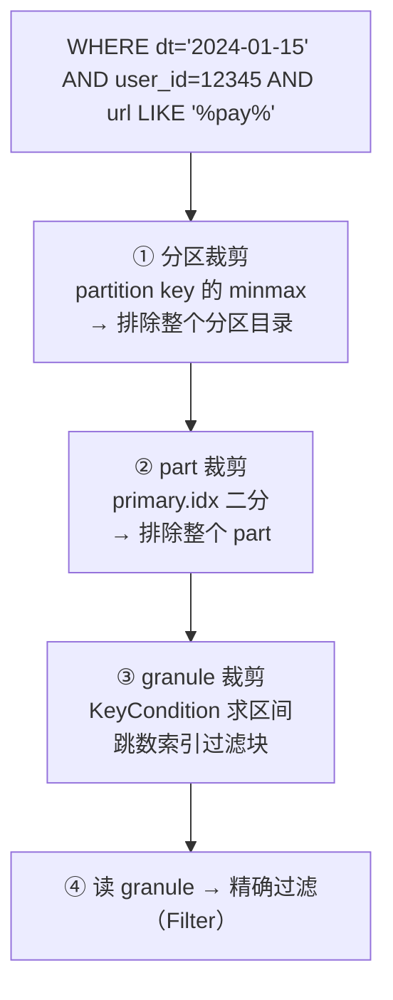

#### 4.3.1 `KeyCondition`：能把谓词变成"区间"的才叫索引条件

只有满足**单调性**的表达式才能转成区间。核心规则：

| 谓词形态 | 能否用主键索引 | 说明 |
|---|---|---|
| `k = v`、`k > v`、`k BETWEEN a AND b` | ✅ | 直接得单区间 |
| `k1 = a AND k2 = b` | ✅ | 组合成"超矩形"，最理想 |
| `k > a OR k < b` | ⚠️ 部分 | OR 会拆成多区间，可能退化为全扫 |
| `k IN (a,b,c)` | ✅ | 多个点区间 |
| `toDate(k) = '2024-01-15'` | ✅ | `toDate` 对 DateTime 单调 → 可保持区间 |
| `k + 1 > 10` | ✅ | 可逆变换回区间 |
| `hash(k) = 123` | ❌ | 非单调 → 退化为全扫 |
| `k LIKE '%x%'` | ❌ | 非单调 |
| `toStartOfHour(k) = ...` | ⚠️ | 单调但阶梯函数，区间会放大 |

> **这就是"为什么 ClickHouse 要求把过滤列放 ORDER BY 前缀"的机器级解释**：前缀列上的谓词才能被 `KeyCondition` 转成区间（后续列只能作为"谓词下推"参与过滤，不能用于二分定位）。

#### 4.3.2 PREWHERE：一个被低估的杀手锏

```sql
SELECT user_id, url, price FROM events
WHERE user_id = 12345          -- 高选择性
  AND url LIKE '%pay%';        -- 低选择性、需读大列
```

`PREWHERE` 让引擎**分两阶段读列**：

```
阶段1: 只读 user_id 列 → 过滤出少量行（比如 8192 行里剩 3 行）
阶段2: 只对这 3 行的 url / price 取值 → 再做 LIKE 判断
```

对比"普通 WHERE"：要**先把 8192 行的 url（可能 200 字节/行）全部解压读进来**，再过滤。

| 优化 | 效果 | 触发条件 |
|---|---|---|
| 自动 PREWHERE | 减少大列 IO，常 2~10× | `optimize_move_to_prewhere=1`（默认），谓词列在 `WHERE`、非 `SELECT` 大列、选择性高 |
| 手动 PREWHERE | 同 | `PREWHERE cond` 显式写在 SQL 里，优先级最高 |
| `optimize_move_to_prewhere_if_final` | FINAL 场景也要下沉 | 默认受 FINAL 影响不下沉，需显式开 |

> **延伸（★★★★）**：PREWHERE 和"谓词下推（predicate pushdown）"是一回事吗？
> **不是**。
> - **谓词下推**是**计划层面**的：把过滤条件尽量推到计划树的叶子（越靠近读表越好），跨 join/子查询/聚合都适用。
> - **PREWHERE** 是 **MergeTree 读表层面的特殊两阶段读列机制**，只对单表扫描生效。
> 两者经常叠加：下推让谓词到了 `ReadFromMergeTree`，PREWHERE 再决定"哪些列先读"。

### 4.4 并行执行：Pipeline 与 Processor

#### 4.4.1 为什么是"Pull 模型 + DAG"

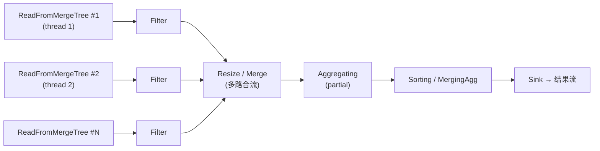

- **Processor** 是执行单元，有 input/output port；
- **PipelineExecutor** 用**单线程调度**（避免锁竞争），每个 Processor 的 `work()` 由**线程池**并行执行；
- **Pull（拉）模型**：下游主动向上游要数据 → 天然背压（下游慢，上游就停），不会像 push 模型那样把内存冲爆;
- `max_threads` 决定**读表并行度**：一个 part 会被切分成多个 `ReadRange` 分给不同线程。

#### 4.4.2 并行度从哪来（面试常问"我的查询怎么只用了 1 个核"）

| 并行来源 | 条件 | 表现 |
|---|---|---|
| **part 级并行** | 有多个 part | 最常见的并行源 |
| **granule range 级并行** | 单个大 part 也能切分（`max_threads` > part 数时） | 大 part 也不会串行 |
| **多分片并行** | 走 `Distributed` 表 | 网络/分片数是瓶颈 |
| **并行副本** | 一个 shard 的多个 replica 共同算 | 需要开 `parallel_replicas` 配置 |
| **线程内的 pipeline 并行** | 不同 Processor 用不同线程（如 Agg 与 Sort 重叠） | 高级特性 |

> **为什么我的查询只用了 1 个线程？**（★★★★）
> 1. **数据量太小**：只有 1 个 part、1 个 granule → 没有可切分的工作；
> 2. **`max_threads` 被限制**：用户 profile 或 query 里设了 `SETTINGS max_threads=1`（很多 ETL 工具默认设 1，这是隐形坑）；
> 3. **算子本身不可并行**：`ORDER BY ... LIMIT 1` 的全局 top-k、`GROUP BY` 单键、`FINAL` 去重、`JOIN` 的小右表构建阶段；
> 4. **`max_block_size` 过小** → 每块太小，调度开销吃掉收益。

### 4.5 JOIN 全解：ClickHouse 最大的短板，也是最常被深挖的点

#### 4.5.1 五种算法，默认只有一种

| `join_algorithm` | 原理 | 内存 | 适用 | 版本 |
|---|---|---|---|---|
| **`hash`（默认）** | **右表全量**读进内存建成哈希表，左表流式探测 | **右表大小决定**，易 OOM | 右表小（几百万行内） | 一直有 |
| `partial_merge` | 两表都按 join key 排序 → 归并 | 低（可落盘） | 大表 join 大表、内存紧张 | 早已有 |
| `full_sorting_merge` | 全排序归并 join | 低 | 同上，更通用 | 22.x+ |
| `grace_hash` | 按 hash 分桶，桶超限落盘 | 可控（`max_bytes_in_join`） | 大表 join，内存受限 | 23.x+ |
| `direct` | 用 `ENGINE=Join` 的预建表 / 字典直接查 | 常驻内存 | 维表 join（"维表预加载"） | 22.x+ |

**默认 `hash` 的核心事实（必须背）**：
- **右表（被 join 的表）全量加载进内存**，左表流式扫描；
- 内存 ≈ 右表行数 × (join key 宽度 + payload 宽度 + 哈希表指针开销)，实际膨胀常 2~4×；
- 超限行为：`max_rows_in_join` / `max_bytes_in_join` 达到后，按 `join_overflow_mode`（默认 `throw`）**直接报错**。

```sql
-- 生产上"右表必须小"的写法：把小维表放右边
SELECT e.user_id, d.city
FROM events e
LEFT JOIN dim_city d ON e.city_id = d.id   -- d 小 → 建在内存里的是 d ✅
```

> **25.x 的重要演进（前沿加分，★★★★）**：
> | 版本 | 改进 | 解决什么 |
> |---|---|---|
> | 25.1 / 25.2 | **Parallel Hash Join**（build / probe 阶段并行化） | 大右表构建慢、单线程瓶颈 |
> | 25.7 | 哈希表结构低层优化 | 探测阶段 CPU 效率 |
> | 25.9 | **Automatic Global Join Reordering** | 多表 join 顺序启发式优化（RBO 版"CBO"） |
> | 25.10 | **Runtime Bloom Filter in Join** | join 前先用布隆过滤掉不可能匹配的行，减少进哈希表的行数 |
> | 25.10 | Lazy columns replication | 重复 join key 值不重复处理，省 CPU/内存 |
> | 25.12 | 复杂 OR 条件下推、join 式 lazy reading | 减少参与 join 的行 |

#### 4.5.2 分布式 JOIN：为什么"大表 join 大表"在 ClickHouse 里近乎无解

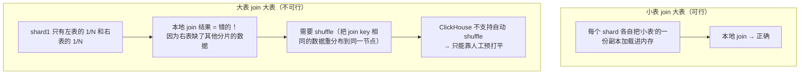

**这就是为什么国内大厂用 ClickHouse 的标准姿势是"宽表"**：把 join 全部前移到离线 ETL（Spark/Flink 双流 join），ClickHouse 里只存**已经打平的大宽表**，查询时零 join。凡是需要在 ClickHouse 里做"事实表 join 事实表"的场景，基本都会被判定为选型不当。

#### 4.5.3 `GLOBAL JOIN` / `GLOBAL IN`：一个必考的正确性问题

```sql
-- ❌ 错误认知：非 GLOBAL 的 IN 子查询在分布式下"也能用"
SELECT * FROM dist_events
WHERE user_id IN (SELECT user_id FROM dist_users WHERE vip = 1);
```

执行时会发生什么：

```
发起节点把整条 SQL 下发给 N 个 shard
→ 每个 shard 各自再对自己的 dist_users 执行一次子查询
→ 每个 shard 只看到"自己的 1/N 用户"，且子查询本身又是分布式查询（递归下发！）
→ 结果：每个 shard 用"不完整的 VIP 列表"过滤，且可能触发 N×N 次查询风暴
```

`GLOBAL` 的语义是：**子查询只在发起节点执行一次，把结果（临时表）下发到每个 shard**。

| 写法 | 子查询执行次数 | 正确性 | 成本 |
|---|---|---|---|
| `IN (SELECT ...)` | 每 shard 一次（递归） | ⚠️ 取决于数据分布，**通常是错的** | N×N 查询 |
| `GLOBAL IN (SELECT ...)` | **1 次** | ✅ 正确 | 结果集要能放进内存并下发 |
| `JOIN`（默认） | 右表在每个 shard 各取一份 | ⚠️ 右表若是分布式表 → 错 | 内存 |
| `GLOBAL JOIN` | 右表在发起节点聚合成完整一份 → 广播 | ✅ 正确 | 广播量 = 右表大小 × N |

> **延伸（★★★★★）**：`GLOBAL IN` 的致命弱点是什么？——**子查询结果必须能装进内存 + 要广播 N 份**。如果 VIP 用户有 500 万，广播到 20 个 shard = 每个 shard 收 500 万行临时表，内存和网络双爆。生产上的正解是：**把"小结果集"提前算好落到一张小表，再用 `JOIN`/字典（`ENGINE=Join` 或 `Dictionary`）**，而不是依赖 `GLOBAL IN` 兜底。

### 4.6 聚合全解：ClickHouse 最强的算子

#### 4.6.1 三层聚合

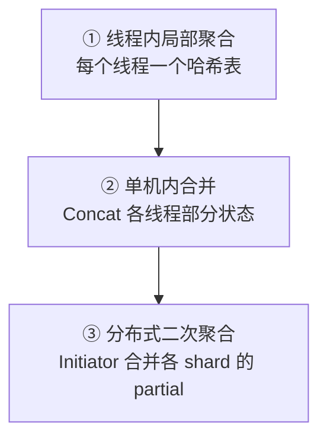

| 层 | 机制 | 说明 |
|---|---|---|
| ① 线程内 | 每个执行线程维护**独立的**哈希表 | 无锁，避免并发写同一个 hash 表 |
| ② 单机内 | 各线程的"部分聚合状态"合并（`Aggregator` 的 `merge`） | 所以 `avg` 要存 `(sum,count)` 而不是 `avg` |
| ③ 分布式 | shard 返回 `partial` 状态，发起节点再 `merge` | `Distributed` 表默认 `GROUP BY` 两阶段 |

> **这就是"为什么 `avg` 在分布式下是对的，而 `sum(avg)` 是错的"** 的根源：ClickHouse 的聚合函数都实现了"部分状态可合并"（`AggregateFunction` 的 `State`/`Merge` 契约），所以 `avg` 在分片上是 `(sum_i, count_i)`，合并后 `sum(sum_i)/sum(count_i)` 正确；但如果你手写 `sum(avg(x))`，就是在对"已经算完的比率"再求和，语义已经错了。**这个考点在"预聚合表设计"里必出。**

#### 4.6.2 `optimize_aggregation_in_order`：最容易被忽略的性能开关

```sql
-- 表 ORDER BY (province, dt)
SELECT province, count() FROM events GROUP BY province;   -- ✅ 天然有序
```

当 `GROUP BY` 的键**是排序键的前缀**时，数据在磁盘上已经按组聚簇，引擎可以**流式滚动聚合**（不建哈希表，遇到新 group 就输出上一组），内存 O(1)。

| 设置 | 默认 | 效果 |
|---|---|---|
| `optimize_aggregation_in_order` | 0（需显式开） | 前缀匹配时走流式聚合，省内存数倍 |
| 不在前缀 | — | 退化为哈希聚合（可能 OOM） |

> **这是"排序键设计"的第三个收益**：① 压缩更好 ② granule 裁剪 ③ **聚合可流式**。三个收益都来自同一个 `ORDER BY`，这就是为什么 ClickHouse 的建表设计里 `ORDER BY` 是最高杠杆的决策。

#### 4.6.3 内存与落盘：聚合 OOM 的完整因果

```
GROUP BY 高基数字段（如 user_id，上亿 UV）
  → 哈希表 entry 数 = NDV，每条 entry = key + 聚合状态（如 uniq 的 HLL ~ 几十 KB 位图）
  → 内存 = NDV × entry_size，轻松几十 GB
  → 超过 max_memory_usage（单查询，默认 0 = 不限，生产必须设）
  → 报 Memory limit exceeded
```

三级解法（按代价）：

| 方案 | 做法 | 代价 |
|---|---|---|
| ① 降基数 | `uniqCombined`/`uniqHLL12` 近似替代 `uniqExact`；用 `LowCardinality` 维度，别对 `user_id` 直接 GROUP BY | 精度损失 |
| ② 落盘 | `SET max_bytes_before_external_group_by = 10G` → 按 hash 分桶溢写磁盘再归并 | 慢 2~5×，需磁盘空间 |
| ③ 预聚合 | `AggregatingMergeTree` + 物化视图，或 `Projection` | 存储成本，写入成本 |
| ④ 分片聚合 | 让 `GROUP BY` 在 shard 上先做（分布式默认已做），避免发起节点汇聚全量明细 | 需要合理分片键 |

### 4.7 排序 / DISTINCT / 窗口

| 算子 | 关键机制 | 坑 |
|---|---|---|
| `ORDER BY` | 外部归并排序（`max_bytes_before_external_sort`）；top-k 时流式维护堆（内存 O(k)） | 无 `LIMIT` 的全排序必然落盘或 OOM；`ORDER BY` 键与排序键一致时可省一轮（`optimize_read_in_order`） |
| `DISTINCT` | 对 `SELECT` 列做 group by；25.11 起可用**轻量 Projection 加速**（若 projection 的行数更少） | `COUNT(DISTINCT x)` 与 `uniq(x)` 精度/性能差异极大 |
| 窗口函数 | 需要按 partition 排序 → 数据要重排 → 内存/落盘 | 大表窗口函数几乎必然 spill；尽量用 `ORDER BY` 前缀复用有序性 |
| `LIMIT n` | 流式提前终止（`limit` 下推到读表） | `LIMIT 100 OFFSET 1000000` 要读前 100 万行；用游标/键集分页 |

> **`optimize_read_in_order`（★★★★）**：当 `ORDER BY` 的列与表排序键一致（或前缀），引擎可以**按 part 的物理顺序流式读**，跳过排序阶段。这是"为什么分页查询要按排序键排序"的底层原因。反之，`ORDER BY create_time DESC` 而表按 `(user_id, ts)` 排序，就必须全量排序。

### 4.8 并行副本（Parallel Replicas）：25.x 的分布式能力补强

**问题**：一个 shard 有 3 副本，传统上查询只挑 1 个副本读，另外 2 个闲着。**浪费算力**。

**方案**：让同一 shard 的多个副本**共同分担一个查询**——把数据按 part/granule 切分给各副本，各自算部分结果，再汇总。

```sql
SET parallel_replicas_count = 3;         -- 或自动推断
SET allow_parallel_replicas = 1;
-- 25.12 新增全自动模式
SET automatic_parallel_replicas_mode = 1;
```

| 版本 | 能力 |
|---|---|
| 22.x | 基于 `parallel_replicas` 的手动模式（需要指定副本数） |
| 24.x | 支持 `Distributed` 表 + 复制表的自动并行副本 |
| **25.12** | `automatic_parallel_replicas_mode`：**运行时收集统计，自动判断"这个查询够不够重、值不值得并行"**（轻查询并行反而增加网络开销，得不偿失） |

> **它的边界（★★★★）**：并行副本只能加速**扫描/过滤/聚合**类查询；对 `JOIN` 帮助有限（因为 join 需要全局数据），对高 QPS 点查无意义（网络开销 > 收益）。它的本质是"**用网络换 CPU**"，所以只在"重查询"上划算——这也正是 25.12 要"自动判断轻重"的原因。

### 4.9 查询优化的实战优先级（背下来，面试必用）

```
第0步：看 EXPLAIN ESTIMATE —— 到底读了多少行/granule
第1步：改 ORDER BY / 分区键 —— 最高杠杆（可 100×）
第2步：改查询写法 —— 只 SELECT 需要列、过滤前置、避免 SELECT *
第3步：改类型 —— 去 Nullable、上 LowCardinality、右对齐 Int 宽度
第4步：加 Projection —— 多排序需求
第5步：加物化视图 —— 预聚合
第6步：加跳数索引 —— 最后手段，必须实测
```


## 第五部分 副本复制与分布式一致性

> 这一章要回答一个核心问题：**ClickHouse 到底提供什么级别的一致性？**（面试里凡是问"一致性/高可用"的，最终都落在这个问题上）

### 5.1 先给结论：ClickHouse 的一致性等级表

| 能力 | 是否提供 | 说明 |
|---|---|---|
| 单条 INSERT 的原子性 | ✅ | 一条 INSERT 要么整条可见，要么不可见（part 级原子） |
| 副本间的**最终一致** | ✅ | 通常秒级到分钟级收敛 |
| **读己之写**（同一副本） | ✅ | 本副本写完立即可读 |
| **读己之写**（跨副本 / 分布式表） | ❌ | 刚写完的另一个副本可能还读不到 |
| **可串行化 / 快照隔离** | ❌ | 无事务、无 MVCC |
| **跨表原子性** | ❌ | 一条 SQL 只碰一张表时才有原子性 |
| **强一致（quorum 读）** | ⚠️ 近似 | 只能靠 `insert_quorum` + `select_sequential_consistency` 组合出"读已提交"的近似 |
| **副本数不足时仍可写** | ✅（默认） | 默认不等 quorum，1 个副本活着就能写 → 可能丢数据 |

> **面试标准答法**：ClickHouse 是**多主异步复制 + 最终一致**。它的"一致性"是"数据不丢（开启 quorum 时）/ 不重（幂等 part 校验）"，而不是"事务隔离"。**不要用"强一致/弱一致"这种含糊词，要落实到具体能力。**

### 5.2 复制机制的物理实现：Keeper 里到底存了什么

`ReplicatedMergeTree('/clickhouse/tables/{shard}/db/table', '{replica}')` 的两个参数就是 Keeper 路径与副本名。Keeper 中的结构（**这张结构图能答出 80% 的复制题**）：

```
/clickhouse/tables/{shard}/{db}/{table}/
├── metadata                  # 建表语句（DDL 同步用）
├── columns                   # 列结构
├── replicas/
│   └── {replica_name}/
│       ├── host              # 本副本主机名
│       ├── is_active         # 是否活跃（会话正常）
│       ├── log_pointer       # ★ 本副本已执行到复制日志的哪一条
│       ├── max_log_id        # ★ 全局已产生到第几条（用于算延迟）
│       ├── parts/            # ★ 本副本持有的 part 清单 + 每个 part 的校验和
│       │   └── 202401_1_1_0  → "checksum=abc, size=123"
│       ├── queue/            # ★ 本副本待执行的复制任务（失败会重试）
│       ├── mutation_pointer  # 已应用到第几条 mutation
│       └── ...
├── log/                      # ★★ 复制日志（顺序节点 log-0000000001, 00...02）
│                              #    每条 = 一个操作：get_part / merge_part / mutate / drop_range
├── mutations/                # mutation 队列
├── blocks/                   # 用于 insert 分块编号（quorum 相关）
├── quorum/                   # quorum 提交状态
├── leader_election/          # 谁是 merge leader
└── temp_block_keys/
```

**四个必须理解的字段**：

| 字段 | 作用 | 排查时的意义 |
|---|---|---|
| `log_pointer` | 我执行到第几条 log | 与 `max_log_id` 的差 = **复制延迟条数** |
| `max_log_id` | 全局最新 log 编号 | 差值持续增大 = 副本追不上 |
| `parts/` | 我有哪些 part + 校验和 | 与本地磁盘对比 → 发现缺失/损坏 |
| `queue/` | 我还没做完的任务 | 队列堆积 = 复制卡住 |

```sql
-- 查副本延迟（生产必会）
SELECT database, table, replica_name,
       absolute_delay,      -- 秒级延迟（最直观）
       queue_size,          -- 待执行任务数
       inserts_in_queue, merges_in_queue,
       is_readonly,         -- ★ 副本是否进入只读（故障信号）
       last_queue_update,
       zookeeper_session_expiration_count
FROM system.replicas
ORDER BY absolute_delay DESC;
```

### 5.3 一次 INSERT 的复制全过程（时序图，必背）

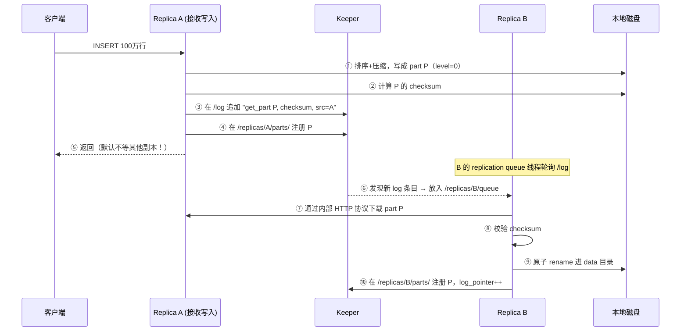

**四个关键设计点**（这些是"能讲出原理"和"只会背流程"的分水岭）：

| 设计点 | 为什么这么做 |
|---|---|
| **① 物理复制（传 part 文件，不传 SQL/行）** | 省 CPU：复制端不用重算排序/压缩；体积小：传的是已压缩的列文件 |
| **② 数据只在本地磁盘，Keeper 只存元数据与日志** | Keeper 压力与数据量解耦（PB 级数据也不怕），这也是 Cloud 版能换共享存储的基础 |
| **③ 默认不等 quorum 就返回** | 换写入吞吐与低延迟 → 代价是可能丢数据（1 副本活着就返回） |
| **④ 副本各自本地 merge（不传 merge 结果）** | 避免"网络放大"：如果每次 merge 都要同步结果，10 副本 × 每次 merge 传 100GB = 灾难。所以**只在副本落后太多时才 fetch 大 part** |

> **④ 的延伸（★★★★★）**：既然各副本自己 merge，怎么保证结果**逐字节相同**？
> 靠**merge 算法的确定性（determinism）**：给定相同的输入 part 集合与相同的 merge 规则，输出必然相同。这要求：① merge 选择规则必须一致（同一套算法 + 同一批元数据）；② 编码/压缩必须确定性；③ 不能引入时间戳/随机数。**这就是为什么"merge 结果 byte-identical"是一个必须在架构层面保证的约束**——一旦不确定，副本间 part 校验和就会永远对不上，触发无限 fetch 循环。

### 5.4 merge 的跨副本协调：leader 与"谁先发起"

- `/leader_election` 下有若干 leader（**可以多个同时存在**，通过 `replicated_can_become_leader=0` 可以让某副本永不竞选）；
- **leader 负责决定"该做哪些 merge"**，把 `merge_part` 操作写进 `/log`；
- 所有副本读 log 后**各自本地执行同样的 merge** → 得到相同结果，无需传输数据；
- 如果某副本缺输入 part（落后），则它无法本地 merge → 只能从别的副本 **fetch** 缺失的 part 后再 merge。

**这就解释了生产上的一个经典现象**：
> "副本刚加进来时疯狂传输数据、磁盘 IO 打满" —— 因为新副本的 `/parts/` 是空的，`log_pointer=0`，它必须从第一条 log 开始追，或者干脆按"最新 part 快照"全量拉一遍。**正确做法**：新副本先 `SYSTEM SYNC REPLICA` 或让它 copy 一份数据目录，而不是从零追日志。

### 5.5 副本恢复与"只读副本"事故

**恢复逻辑**：副本定期对比"本地磁盘的 part 集合"与"Keeper `/parts/` 的参考集合"：

| 差异 | 处理 |
|---|---|
| 本地缺 part（Keeper 有） | 从其他副本 fetch 下载 |
| 本地多 part（Keeper 无） | **不删除**，移到 `detached/` 目录后"忘记"它 |
| part 校验和不一致（损坏） | 视为缺失，重新 fetch |

**"只读副本"（`is_readonly=1`）的根因**：

```
本地磁盘有 part X，但 Keeper 的 /parts/ 里没有 X
  → 副本无法判断"这份数据到底该不该存在"
  → 为了不破坏一致性，进入 readonly 模式，拒绝写入
```

典型触发场景：

| 场景 | 原因 |
|---|---|
| Keeper 数据被清空 / 恢复到旧快照 | Keeper 丢了 `/parts/` 记录，但磁盘数据还在 → 大量 part "多余" |
| `DROP PARTITION` 后未同步 | 部分副本删了，Keeper 未更新 |
| 手工拷贝数据目录到另一个副本 | 数据有，元数据无 |
| Keeper 磁盘满 / 会话超时 | 元数据写入失败 |

> **修复法（★★★★★，实操必会）**：`SYSTEM RESTART REPLICA`（重新读 Keeper 对账）或 `SYSTEM SYNC REPLICA db.table`（强制追平）。若整个 Keeper 被清空，标准做法是：停写 → 选一个数据最全的副本 → `SYSTEM RESTORE REPLICA`（23.x+，从本地数据重建 Keeper 元数据）→ 其他副本重新 attach 追平。**绝不能直接删 Keeper 节点了事。**

### 5.6 `insert_quorum`：把"可能丢"变成"确认不丢"

```sql
SET insert_quorum = 2;                -- 至少 2 个副本确认落盘才返回
SET insert_quorum_timeout = 60000;    -- 超时则报错（保证不静默失败）
SET insert_quorum_parallel = 1;       -- 并行 quorum（默认 1，避免串行化）
SET select_sequential_consistency = 1;-- 读时只读"已在 quorum 中"的 part
```

实现细节（这段能讲出来是专家级）：

1. 每个 INSERT block 分配一个全局 `block_id`（Keeper `/blocks/` 下计数）；
2. 写入副本把 part 写好后，在 `/quorum/` 下建节点标明"我完成了 block N"；
3. 等待凑齐 N 个副本的确认；
4. 读侧若开 `select_sequential_consistency=1`，只返回"已被 quorum 确认"的 part → 避免读到未提交数据。

| 组合 | 语义 | 代价 |
|---|---|---|
| 默认（quorum=1） | 单副本写成功即返回 | 副本挂了可能丢最近数据 |
| `insert_quorum=2` | 至少 2 副本落盘 | 写延迟 ↑（等网络+磁盘），Keeper 压力 ↑ |
| `+ select_sequential_consistency` | 读只读已提交 | 读可能被"卡住"等复制追上，延迟抖动 |

> **延伸**：`insert_quorum` 能保证"不丢"吗？——**只保证"至少 N 份"，不保证"最新"**。若 N=2 而 3 副本中有 2 个同时宕机，剩 1 个副本可能缺最新 block，此时读它会读到旧数据。所以严格意义上它提供的是"**N-1 副本故障容忍 + 读已提交的近似**"，而不是"线性一致"。这就是为什么国内大厂在 ClickHouse 上不做金融级强一致的账务场景。

---

## 第六部分 资源管理、运维与调优

### 6.1 内存管理：三级 Tracker + 两种缓存

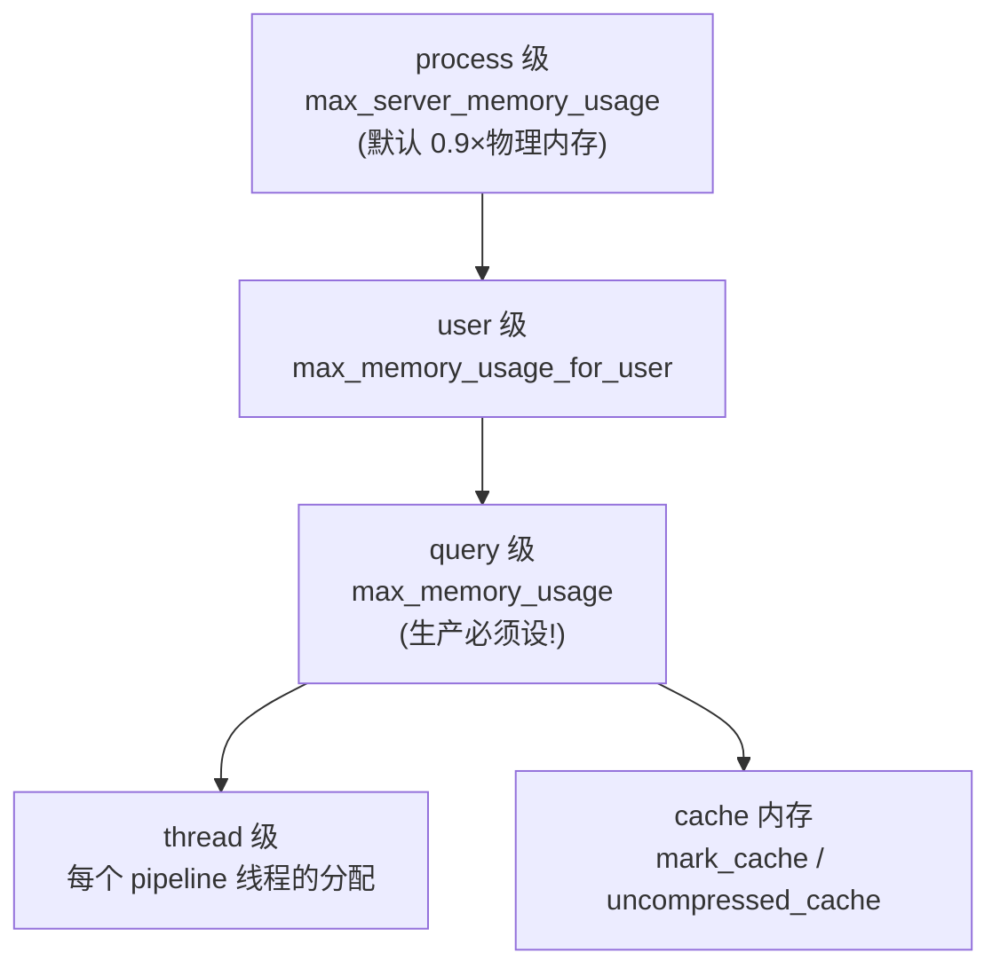

| 参数 | 默认 | 生产建议 |
|---|---|---|
| `max_server_memory_usage` | 0（自动 = 0.9 × 物理） | 保持 0.9，留 OS 余量 |
| `max_memory_usage` | **0（不限！）** | **必须设**，如单机 256G → `max_memory_usage=100G`，`max_memory_usage_for_user=150G` |
| `max_memory_usage_for_all_queries` | 0 | 可选，防"多查询叠加打爆" |
| `mark_cache_size` | 5GB | 大表多时调大（mark 文件是随机读的热点） |
| `memory_profiler_step` | 4MB | 开 `trace_log` 做内存火焰图，定位"谁吃的内存" |

> **为什么 `max_memory_usage=0` 是定时炸弹？** 因为 ClickHouse 默认不限制单查询内存 → 一个 `SELECT DISTINCT user_id` 或大 JOIN 就能把整机内存打穿 → OOM Killer 干掉进程 → **整个节点所有查询失败 + 副本掉线**。这是最常见的"集群雪崩"起点：**一个坏查询杀掉一个节点，副本延迟上升，其他节点负载加倍，继续雪崩**。所以生产第一课：**给每个 user profile 设 `max_memory_usage` 和 `max_threads`**。

### 6.2 落盘（Spill）：三条独立开关

| 算子 | 参数 | 行为 |
|---|---|---|
| 聚合 | `max_bytes_before_external_group_by` | 按 hash 分桶溢写，再归并 |
| 排序 | `max_bytes_before_external_sort` | 分块排序落盘 → 多路归并 |
| JOIN | `max_bytes_in_join` + `join_algorithm='grace_hash'` | 分桶溢写 |

> **注意**：这三个默认都是 **0（不落盘）**，即"内存到顶就报错"。生产上常见的组合是：
> ```sql
> SET max_memory_usage = 100000000000;
> SET max_bytes_before_external_group_by = 50000000000;  -- 50G 后落盘
> SET max_bytes_before_external_sort = 50000000000;
> SET max_bytes_in_join = 20000000000;
> ```
> 落盘的代价：**慢 2~5×，且磁盘 IO 与 merge 抢带宽**，可能反过来加剧 part 堆积。所以落盘是"止痛药"不是"治病"。

### 6.3 并发控制与队列

| 参数 | 默认 | 说明 |
|---|---|---|
| `max_concurrent_queries` | 0（不限） | 全局并发查询上限，生产建议按内存/CPU 算出来设 |
| `max_concurrent_queries_for_user` | 0 | 单用户上限（防一个应用独占） |
| `max_concurrent_insert_queries` | 0 | INSERT 并发（**小批量高频写入的第一道闸**） |
| `max_concurrent_select_queries` | 0 | SELECT 并发 |
| `max_execution_time` | 0（不限） | **必须设**（如 300s），否则一个慢查询占着资源 |
| `readonly` | 0 | 副本只读状态 |

> **24.x 引入 Workload 分类**（前沿）：`CREATE WORKLOAD` / `CREATE RESOURCE` 可以按"用户/查询类型"划分 CPU、内存、并发配额，实现"OLAP 大查询"与"实时小查询"的资源隔离。这是 ClickHouse 从"单租户分析库"走向"多租户平台"的关键能力。

### 6.4 参数地图：按"问题"索引，而不是按"名字"

这张表是生产调优的速查表，面试问"你怎么调优"时可以直接按类别讲：

| 问题现象 | 首要参数 | 次选 |
|---|---|---|
| 查询慢（扫描量大） | 改 `ORDER BY` / 分区键 | Projection、`optimize_move_to_prewhere` |
| 查询慢（CPU 打满） | `max_threads`、查 `EXPLAIN PIPELINE` | 去 `Nullable`、改类型 |
| 查询 OOM | `max_memory_usage`、落盘三开关 | 降基数、预聚合 |
| `Too many parts` | 写入攒批、`async_insert` | 分区键粗化、`background_pool_size` |
| merge 追不上 | `background_pool_size`、`max_bytes_to_merge_at_max_space_in_pool` | 磁盘带宽、`OPTIMIZE` 分时 |
| 副本延迟大 | 网络、`background_fetch_pool_size` | `max_replication_lag` |
| 副本 readonly | `SYSTEM RESTART REPLICA`、Keeper 健康 | `SYSTEM RESTORE REPLICA` |
| 写入慢 | `max_insert_block_size`、攒批大小 | `min_insert_block_size_rows` |
| 磁盘涨得快 | TTL、`CODEC(ZSTD)`、`LowCardinality` | 冷热分层（`storage_policy`） |
| DDL 卡住 | `system.distributed_ddl_queue`、Keeper | `distributed_ddl_task_timeout` |

### 6.5 监控体系：必须盯住的 12 个指标

| 类别 | 指标 | 采集来源 | 告警线（经验） |
|---|---|---|---|
| **写入** | `InsertedRows/s` | `system.events` / Prometheus | 环比跌 30% |
| | `parts 数（单分区）` | `system.parts` | > 100 警戒，> 300 拒绝 |
| | merge 队列长度 / 延迟 | `system.merges` | 持续 > 10 分钟 |
| **查询** | P99 延迟 | `system.query_log` | 业务定义 |
| | 失败率 / `exception_code` | `query_log` | > 1% |
| | 内存峰值 | `system.processes`、`metric_log` | > 80% `max_memory_usage` |
| **副本** | `absolute_delay` | `system.replicas` | > 60s |
| | `is_readonly` | `system.replicas` | =1 立即告警 |
| | `queue_size` | `system.replicas` | 持续增长 |
| **资源** | 磁盘水位 | `system.disks` | > 80%（写满会因"保留空间不足"直接拒绝写入，表现为表只读） |
| | CPU / IO util | OS | 持续 > 85% |
| | Keeper 延迟 / 连接数 | `system.zookeeper` | 会话过期 > 0 |

> **磁盘水位 90% 的"只读"陷阱（★★★★）**：ClickHouse 有个保护 —— 磁盘剩余低于 `keep_free_space_bytes`（默认 0，但很多发行版配了）时，**表自动变只读**，写入报 `Cannot reserve...`。这是"半夜磁盘写满 → 第二天早上才发现全部写入失败"的经典事故。**必须配 TTL + 磁盘告警。**

### 6.6 五个高频故障的排查 SOP

| # | 现象 | 排查顺序 | 处置 |
|---|---|---|---|
| 1 | 查询突然变慢 | ① `EXPLAIN ESTIMATE` 看读了多少 ② `query_log` 对比历史同 SQL ③ 看 part 数是否暴涨（碎片多→索引失效） ④ 看是否触发落盘 | 收敛 part、改 SQL、加 Projection |
| 2 | `Too many parts` | ① `system.parts` 按 partition 排查 ② `system.merges` 看是否卡住 ③ `system.mutations` 看 mutation 是否 block 了 merge | 停写入攒批、KILL MUTATION、`OPTIMIZE` |
| 3 | `Memory limit exceeded` | ① `system.query_log` 找 `memory_usage` 最大的 SQL ② `trace_log` 火焰图看分配点 | 设 `max_memory_usage`、落盘、改 SQL |
| 4 | 副本延迟/只读 | ① `system.replicas` ② `system.replication_queue` 看卡在哪个任务 ③ Keeper 健康 | `SYSTEM SYNC/RESTART REPLICA` |
| 5 | 写入吞吐掉底 | ① `background_pool` 是否被 merge/mutation 占满 ② 磁盘 IO util ③ 是否触发反压延迟 | 扩容、分摊写入、调 `parts_to_delay_insert` |


## 第七部分 操作系统与硬件层逻辑

> 这一章回答"再往下一层，ClickHouse 到底对 OS 和硬件做了什么假设"。这是从"会用"到"能解释性能"的分界线，也是 P7 面试常问的"你还往下想过吗"。

### 7.1 IO 路径：从 `.bin` 到 CPU 寄存器

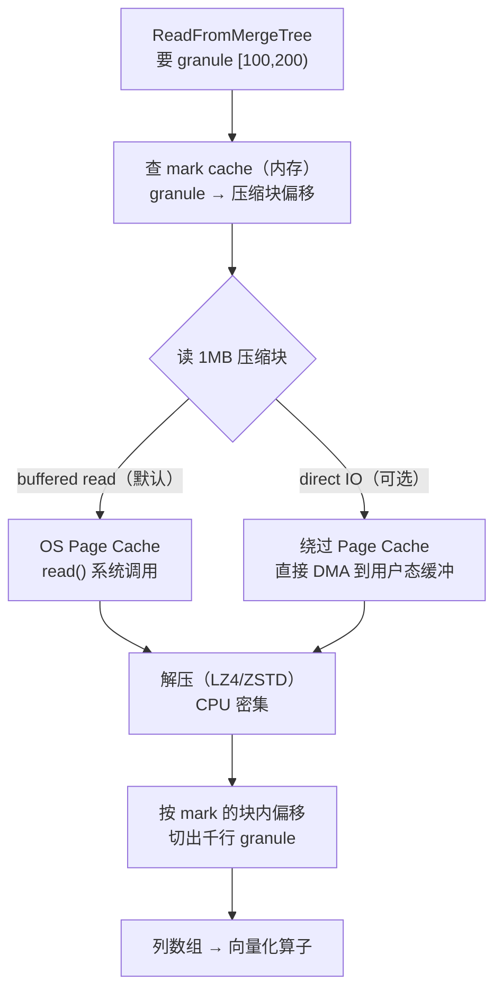

| 层 | ClickHouse 的选择 | 原因 |
|---|---|---|
| 读方式 | **默认 buffered read（走 Page Cache）** | 列存 + 高压缩后，热点数据（mark、小 part）极易被 page cache 命中；且预读（readahead）对顺序扫描有利 |
| Direct IO | 可选（`min_bytes_to_use_direct_io`，默认 0 关闭） | 大扫描时避免"读一遍污染 page cache、把热数据挤出去"（cache thrashing）；但 ClickHouse 有自己的 mark cache，实际收益有限 |
| 异步 IO | `io_threads` + libaio / **io_uring（新版本支持，`enable_io_uring`）** | 一个查询要并发读几百个 part，同步读会串行化；异步 IO 让"读"与"算"重叠 |
| 自己的缓存 | **mark cache**（5GB 默认）+ **uncompressed cache**（默认关） | mark 文件是"随机定位"的热点，必须常驻；解压后的数据块缓存收益低（压缩块本身已小），故默认关闭 |

**读放大的三个来源（面试喜欢问"ClickHouse 明明只查一行，为什么读了 8192 行"）**：

| 放大 | 量级 | 说明 |
|---|---|---|
| ① granule 放大 | 最坏 8192 行 | 稀疏索引只能定位到 granule，读不了"半行" |
| ② 压缩块放大 | 最坏 1MB / 列 | 压缩块必须整块解压（不能跨块解码） |
| ③ 列放大 | 取决于 SELECT 的列数 | 只读需要的列已经是优化，但 `SELECT *` 会退化 |

> **结论**：它是一个"用读放大换顺序 IO"的系统。顺序 IO 在 NVMe 上能到 GB/s，而随机 IO 只有几十 K IOPS——**用 8192 行的顺序读换取 1 行的随机读，整体吞吐反而高一个数量级**。这就是 ClickHouse 敢"粗暴读 granule"的硬件前提。

### 7.2 CPU：SIMD 与"编译期决定一切"

| 机制 | 说明 |
|---|---|
| **基线指令集** | ClickHouse 官方包以 `-msse4.2` 为基线（保证兼容老 CPU），**不是**基线 AVX2 |
| **运行时派发** | 对热点函数（`Filter`、`Aggregation`、`hash`）用 `__attribute__((target("avx2")))` 编译多份，运行时按 `CPUID` 选最优版本 |
| **自编译优化** | 生产上（尤其云厂商）常自行编译 `-march=native -mtune=native`，能白拿 10~30% 性能（但二进制不可移植） |
| **超线程** | 向量化是"吞吐型"，超线程收益明显（通常 1.2~1.4×），这也是 ClickHouse 默认 `max_threads = 物理核数` 却建议按逻辑核调的背景 |

> **延伸（★★★★）**：为什么 `max_threads` 默认等于**物理核数**而不是逻辑核数？
> 因为一个查询的 pipeline 已经有多个 Processor 并行，再叠加超线程会导致 ① 缓存争抢（两个超线程共享 L1/L2）② 内存带宽打满（向量化本来就是带宽敏感型）。**经验法则**：扫描密集型查询用物理核数，聚合/字符串密集型可适当上调到逻辑核数。

### 7.3 内存：jemalloc、内存墙与 false sharing

| 点 | 说明 |
|---|---|
| 分配器 | 用 **jemalloc**（不是 glibc malloc），减少多线程碎片与锁竞争；`system.jemalloc_bins` 可看各 size class 占用 |
| 内存墙 | 向量化算子是"每字节算几次"极低的操作，瓶颈常在**内存带宽**而非 ALU。所以列存 + 高压缩的价值不只是省磁盘，更是**减少内存带宽压力**（压缩后数据少，解压后立即算，少搬运） |
| Cache line | 64 字节。哈希表 entry 若跨 cache line 会 double miss；ClickHouse 的 `HashMap` 做了对齐与探测优化 |
| False sharing | 多线程聚合各有独立 hash 表就是为了避免"多线程写同一 cache line"导致的缓存一致性风暴 |
| Huge Pages | 大页（2MB）能显著减少 TLB miss，PB 级扫描场景建议开（`transparent_hugepage`） |

### 7.4 网络：副本复制走哪条链路

| 流量类型 | 端口/协议 | 说明 |
|---|---|---|
| 客户端 → 服务端 | 9000（TCP 原生协议）/ 8123（HTTP） | |
| **副本间传 part** | **`interserver_http_port`（默认 9009）** | 走内部 HTTP，端点是 `DataPartsExchange`，**不是** 8123 |
| 分布式查询 | 9000（默认）或 `interserver_http_port` | 发起节点把 SQL 下发到各 shard |
| Keeper | 2181 / 9181（内置 Keeper 默认 9181） | 只传元数据与日志，量极小 |

> **延伸（★★★★）**：跨机房部署为什么容易出问题？
> 因为副本复制是**同步 HTTP 拉取 + 逐条 log 追**，跨机房 RTT 高（20~50ms）× 大量小 part → 队列堆积。所以跨机房一般做成**两个独立集群 + 上层网关/物化视图**，而不是一个集群跨机房 3 副本。这也是国内大厂"同城双机房各 2 副本 + 异地异步"的常规做法。

### 7.5 文件系统与磁盘

| 项 | 建议 | 原因 |
|---|---|---|
| 文件系统 | **XFS**（优于 ext4） | 大量小文件（每列两个文件 × 宽表几十列 × 多 part）下元数据操作更快 |
| 挂载参数 | `noatime` | 避免每次读都更新访问时间（额外写放大） |
| 磁盘 | NVMe SSD；**不建议 RAID5/6** | merge 是大量顺序写 + 随机读混合，RAID5 的写惩罚严重；RAID10 或 JBOD 更好 |
| 多盘 | `storage_policy` 多卷（热/温/冷） | 冷数据自动迁移到 SATA/S3 |
| 网络存储 | 除 S3（存算分离）外**不要用 NFS** | 延迟与一致性不可控，part 的原子 rename 会被破坏 |

---

## 第八部分 横向对比与选型

### 8.1 ClickHouse vs Doris / StarRocks：国内最常被拿来对比的一对

| 维度 | ClickHouse | Doris / StarRocks |
|---|---|---|
| 架构 | 多主（无中心）+ Keeper 协调 | **FE（Java，中心元数据）+ BE（C++）** |
| 分布式执行 | **无全局计划**，单遍"下发+汇聚" | **完整 MPP + shuffle**，有全局计划 |
| JOIN | 弱：右表进内存；大表 join 靠预打平 | 强：Colocate Join / Bucket Shuffle / Broadcast，多种分布策略 |
| 数据更新 | Mutation 重写 part（贵）；Lightweight Delete | 支持 **Unique Key 模型**（主键更新）、部分列更新、Delete |
| 事务 | 无（仅单条 INSERT 原子） | 支持**事务**（多表、Stream Load 两阶段提交） |
| 物化视图 | **INSERT 触发器**（查询不自动路由） | **透明加速 + 自动查询改写**（Doris 2.x 异步 MV） |
| 优化器 | RBO 为主，**无列统计信息** | **CBO + 统计信息 + 直方图** |
| 弹性扩缩容 | 静态拓扑，**分片不自动 rebalance** | 分片可自动均衡（Tablet） |
| 典型优势场景 | **单表极致扫描、宽表聚合、日志/埋点、超高压缩比** | 多表关联、明细+聚合混合、需要更新的场景、湖仓一体 |
| 运维复杂度 | 低（组件少，但 Keeper/part 要懂） | 中（FE 元数据、Tablet 调度，但有 MySQL 协议） |
| 生态兼容 | 部分 MySQL 语法，无 MySQL 协议 | **MySQL 协议兼容**（BI 工具直连友好） |

> **选型话术（面试直接可用）**：
> 「如果我的模型能在 ETL 阶段打平成宽表、查询以单表多维聚合为主、追求极致扫描性能和压缩比，选 ClickHouse；如果业务需要多表灵活 JOIN、需要主键更新（订单/用户画像）、需要事务或 MySQL 生态直连，选 Doris/StarRocks。**这两者不是"谁更快"，而是"谁的约束更匹配你的模型"**。」

### 8.2 vs Trino / Presto：不是同类

| | ClickHouse | Trino |
|---|---|---|
| 定位 | **存储 + 计算一体**的数据库 | **纯计算引擎**（不存数据） |
| 数据源 | 自有存储（也可查 S3/HDFS 外表） | 联邦查询（Hive/Iceberg/MySQL/Kafka...） |
| 延迟 | 亚秒~秒 | 秒~分钟（引擎启动+调度开销） |
| JOIN | 弱 | **强**（成熟 CBO、动态过滤、spill） |
| 场景 | 高并发 BI、实时大屏 | 离线/近线 ETL、联邦分析、湖仓查询 |

### 8.3 vs Druid / ES / Spark

| | ClickHouse | Druid | Elasticsearch | Spark/Hive |
|---|---|---|---|---|
| 索引结构 | 列存 + 稀疏主键 + 跳数 | 列存 + **预聚合 roll-up** + bitmap | **倒排索引** | 无（依赖文件格式+分区） |
| 强项 | 明细扫描、高压缩、聚合快 | 时序指标的极致预聚合、实时摄取 | **全文检索、日志搜索、灵活过滤** | 海量离线批处理、复杂 ETL |
| 弱项 | 点查、更新、join | 明细查询弱、维度固定 | 聚合能力弱、存储成本高、压缩差 | 延迟分钟级 |
| 数据更新 | 差 | 好（实时 segment） | 好（近实时 refresh） | 批量重写 |
| 典型用途 | 埋点明细、BI 明细层 | 监控大盘、APM 指标 | 日志检索、搜索 | 数仓底座、宽表生产 |

### 8.4 国内大厂的实际组合姿势（Lambda / 流批一体）

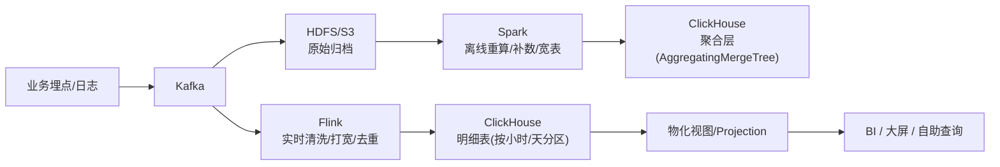

**三个工程原则（生产经验，面试讲这个很加分）**：

1. **明细与聚合分层**：明细表（`MergeTree`，全量保留 7~30 天）+ 聚合表（`AggregatingMergeTree`，按天/维度预聚合，保留 1 年）。查询路由到聚合表，只有"下钻到底"才回明细表。
2. **写入必须"大块"**：Flink 侧攒批 10 万行 / 100MB，或走 `async_insert`；单表每分区活 part 控制在 10~30。
3. **join 全部前移**：维表打宽在 Flink/Spark 做；ClickHouse 只做 `JOIN` 小维表（字典）或干脆零 join。


## 第九部分 大厂面试真题与深度解析（核心）

> **关于题目来源的说明**：以下题目来自公开招聘面经、常见面试题库与工业界实践的高频归纳。**"公司标签"表示该公司/该岗位方向对此类问题的出现频率**（字节的实时数仓、阿里的 ODPS/数据平台、美团的到店业务数仓、快手/小红书的内容侧埋点等），不代表逐字原题。答题框架比"背原题"重要得多。
>
> **答题总原则（面试官视角）**：
> 1. 先给**一句话结论**（他要知道你懂不懂）；
> 2. 再给**机制/原理**（他要判断你是背的还是懂的）；
> 3. 最后给**代价与边界**（这是他决定给你 P6 还是 P7 的地方）；
> 4. 主动带上**生产经验/踩坑**（这一条往往是唯一能证明"你真用过"的证据）。

---

### A 组：基础认知（决定你能不能进二面）

#### Q1. ClickHouse 为什么快？ ★★★★★

**高频公司**：字节、阿里、美团、快手、小红书（几乎是 ClickHouse 岗的开场必答）

**考查点**：是否理解"快"是**多层乘性叠加**，而不是单一特性。

**参考答案（分档给分）**

*及格答案（只拿 60 分）*：
> 列式存储 + 向量化执行 + 高压缩 + 稀疏索引。

*满分答案*：把"快"拆成七层，每层减少一个因子：

| 层 | 机制 | 减少什么 | 量级 |
|---|---|---|---|
| L1 语义 | 无事务/无行更新/无外键，代码路径短，宽表模型把 join 前移 | 常数开销 | 2~5× |
| L2 列存 | 只读 SELECT 涉及的列文件 | 单行字节数 | 按列数比例，10~30× |
| L3 压缩 | LZ4/ZSTD + Delta/DoubleDelta/Gorilla/T64 专用编码，5~10× 压缩比 | 磁盘→内存 IO 量 | 5~10× |
| L4 物理排序 | 按 `ORDER BY` 写入即有序，同值聚簇 | 需读行数 | 命中时 10~1000× |
| L5 索引裁剪 | 分区 → part → 稀疏主键二分 → 跳数索引 | 需读行数 | 100×+ |
| L6 执行 | 8192 行/Block 向量化 + SIMD + 模板化无虚函数 + 多线程 Pipeline | 每字节 CPU | 5~20× |
| L7 预计算 | 物化视图 / Projection / AggregatingMergeTree / 字典 | 从源头减少行数 | 10~100× |

**关键句**：**这七层是乘法的**（10×8×100×5 = 40000×），所以才出现"十亿行亚秒级"这种反常识数字；反过来，**任何一层失效，整体就塌**——这就是生产上几类典型事故的根因（`SELECT *` 让 L2 失效、小批量写让 L4/L5 失效、排序键设计错让 L4/L5 全废）。

**【追问 1】那为什么它不适合点查？**
因为 L5 的稀疏索引只能定位到 **granule（8192 行）**，读不了"半行"。一次 `WHERE id=1` 要读 8192 行 × 涉及列，读放大 3~4 个数量级；而 B+Tree 是"精确到行"的。**它是"用读放大换顺序 IO"**，在顺序 IO 带宽（NVMe GB/s）远高于随机 IOPS 的硬件上，这个交易是划算的——但如果查询模式本身是随机点查，交易就亏了。

**【追问 2】给 100 列宽表、10 亿行，`SELECT 3 列` 行存和列存各读多少？**
假设每列压缩后 1B/行：列存读 3 列 = 3GB；行存必须读整行（行存以 row group/page 为单位，一页里就是全部列）= 100GB。**33 倍差距**，这就是 L2 的量化。

**【延伸】** 如果追问"那向量化到底快在哪"，要能说出**四条**：① 一次函数调用处理 8192 值（摊薄调用开销）② 类型编译期确定、无虚函数与分支 ③ SIMD 一条指令算 4~8 个 ④ 列数据连续 → cache/预取友好。

---

#### Q2. 列式存储和行式存储的本质区别是什么？不只是"存的方向不同" ★★★★

**高频公司**：所有（一面必问，但答得浅会被追死）

**参考答案**

不是一个"方向"问题，而是**三个层面的差异**：

| 层面 | 行存 | 列存 |
|---|---|---|
| **磁盘布局** | 一行所有字段连续（`[id,name,age][id,name,age]...`） | 一列一个文件（`id.bin / name.bin / age.bin`） |
| **IO 单位** | 读一行就要读整行（page 4KB~16KB 含多行全部列） | 读一列的一段连续区（只读需要的列） |
| **压缩前提** | 相邻数据是"同一行的不同字段"，类型混杂 → 难压 | 相邻数据是"同一字段的不同行"，类型一致、分布相似 → **可套专用编码**（时间戳相邻差值小 → Delta） |
| **CPU 友好性** | 逐字段取值会跨 stride，cache 不友好 | 连续数组，SIMD 可直接吃 |
| **典型算子** | 点查、单行更新、事务 | 全列扫描、聚合、过滤 |

**一句话**：行存优化"**一次访问一行里的很多字段**"（OLTP），列存优化"**一次访问很多行里的同一个字段**"（OLAP）。**压缩率的差异其实是副产物**——因为同列同类型才可能用 Delta/Gorilla 这类"值域编码"，这是列存独有的能力，不是"顺便"。

**【追问】列存有什么代价？**
① 点查差（读放大）；② 单行更新贵（要改 N 个列文件 → ClickHouse 干脆不支持 in-place）；③ **写放大**（一行要拆成 N 列分别写，每列还要压缩，写一行比行存贵）；④ 需要"行重组"（读多列后要按行号对齐拼装，靠 granule 对齐解决）。

---

#### Q3. 什么场景不应该用 ClickHouse？ ★★★★

**高频公司**：阿里、美团（选型题，考"你有没有边界感"）

**参考答案**：分五类，每类给"为什么"和"替代方案"：

| 场景 | 为什么不行 | 应该用什么 |
|---|---|---|
| **高频 UPDATE/DELETE**（订单状态、库存） | Mutation 重写整个 part，写放大 10~100×，且会长期占用 merge 线程池 → 连锁 `Too many parts` | MySQL/PG + CDC；或 `ReplacingMergeTree` 追加版本 + `argMax` 查询 |
| **点查（按 ID 取单行，QPS 上万）** | granule 读放大 8192 行；无二级索引定位到行 | Redis / MySQL / HBase / ES |
| **大表 JOIN 大表** | 默认 hash join 把右表全量进内存；分布式下无法 shuffle → 结果甚至**是错的** | Spark/Trino/Doris；或预打平成宽表 |
| **强事务（跨表 ACID）** | 无事务、无 MVCC，仅单条 INSERT 原子 | MySQL/PG |
| **高频小批量写入（每秒几十条单行）** | 每次 INSERT = 一个 part → part 爆炸 → 拒绝写入 | 攒批 + `async_insert`；或 Kafka 缓冲 |
| **全文检索/复杂模糊匹配** | 只有 `tokenbf/ngrambf` 这类粗粒度布隆，不是倒排索引 | ES / 向量库 |

**面试加分句**：『ClickHouse 的适用边界可以用一句话概括——**append-only 的宽表 + 单表多维聚合 + 秒级延迟**。超出这三条，成本会指数上升。』

---

#### Q4. ClickHouse 的主键和 MySQL 的主键有什么不同？ ★★★★

**参考答案**

| 维度 | MySQL（InnoDB） | ClickHouse（MergeTree） |
|---|---|---|
| 唯一性 | **唯一约束**，冲突报错 | **不唯一**，允许重复（去重靠 `ReplacingMergeTree`） |
| 索引结构 | B+Tree，**每行一条索引项**，精确到行 | **稀疏索引**，每 8192 行（1 granule）一条，只能定位到 granule |
| 物理含义 | 索引是"附加结构"，数据按主键聚簇（聚簇索引） | **`ORDER BY` 就是物理排序键本身**，索引只是它的"目录" |
| 点查复杂度 | O(log n)，一次页读 | O(log(条目数)) + 一次 granule 读（8192 行） |
| 索引体积 | 与行数同阶（1T 行 ≈ 7.3TiB） | 行数的 1/8192（1T 行 ≈ 931MiB，可全内存） |
| 用途 | 唯一性 + 点查 + 范围 | **仅用于"跳过不相关的 granule"** |

**关键理解**：ClickHouse 的主键是"**排序声明 + 稀疏目录**"，不是"约束"。所以：
- `PRIMARY KEY` 子句和 `ORDER BY` 可以不同（`PRIMARY KEY` 必须是 `ORDER BY` 的前缀）；
- 主键列必须是"过滤会用到"的列，而**不是**"唯一标识"（把 `uuid` 当主键是典型误用：基数太高、无过滤价值、还拖累压缩）。

---

#### Q5. 一张表 `ORDER BY (a, b)`，`WHERE b = 1` 能用索引吗？ ★★★★

**高频公司**：字节、美团（很爱用这种"小切口"题测真实理解）

**参考答案**：**基本不能（几乎等于全扫）**，原因要讲透：

1. 数据物理按 `(a, b)` 排序 → 第一层按 `a` 分段，段内才按 `b` 有序；
2. `primary.idx` 每 granule 只存 `(a, b)` 的**首行值**；
3. `WHERE b = 1` 无法确定 `a` 的范围 → 每个 `a` 分段里都可能出现 `b=1` → **所有 granule 都可能命中** → 二分查找失效；
4. 结果：`KeyCondition` 无法构造区间 → 退化为全表扫描（只靠 `Filter` 精确过滤）。

**正确做法**（按代价排序）：

| 方案 | 做法 | 适用 |
|---|---|---|
| ① 改排序键 | `ORDER BY (b, a)`（如果 `b` 是最常用过滤维度） | 能改表结构时，最优 |
| ② 用 Projection | `PROJECTION p (SELECT _part_offset ORDER BY b)` | 已有表、不想重建，25.x 轻量索引 |
| ③ 跳数索引 | `INDEX idx_b b TYPE minmax GRANULARITY 1` —— **仅当 `b` 与 `a` 有一定相关性**才有效 | 半有序数据（如 `a` 是日期、`b` 是递增 ID） |
| ④ 复制列 + 换序 | 加一列 `b` 到排序键前缀，或建聚合表 | 常见工程解法 |

**【延伸，很关键】** 为什么 `minmax` 在"半有序"数据上有效？因为索引块内 `b` 的 min/max 范围窄 → 查询值落在范围外就能跳。但若 `b` 完全随机，每个索引块 min≈全局 min、max≈全局 max → 永远"可能命中" → 一个块都跳不掉，**白付索引计算开销**。

---

### B 组：存储层（区分"用过"和"懂"的主战场）

#### Q6. 一个 MergeTree 的 part 目录里有哪些文件？分别干什么？ ★★★★

**高频公司**：字节、阿里、腾讯（这道题答全了，面试官会认为你真看过数据目录）

**参考答案**（按重要性排序）：

```
202401_1_2_1/
├── primary.idx          # 稀疏主键索引，每 granule 一条主键值
├── <col>.bin            # 列数据（编码+压缩），一列一个
├── <col>.mrk3           # 该列的 mark：granule → (压缩块偏移, 块内偏移)
├── skp_idx_<name>.idx   # 跳数索引数据
├── skp_idx_<name>.mrk   # 跳数索引的 mark
├── count.txt            # 行数
├── columns.txt          # 列名+类型（读 part 第一步）
├── checksums.txt        # 全文件 CRC32（副本校验/损坏检测）
├── partition.dat        # 分区表达式值
├── minmax_<partkey>.idx# 分区键列的 min/max（分区裁剪）
├── default_compression_codec.txt
├── ttl.txt              # 若配 TTL
└── proj_<name>/         # Projection 子目录（同样是一套 .bin/.mrk）
```

**命名规则**（必答）：`{partition_id}_{min_block}_{max_block}_{level}`
- `partition_id`：分区键取值编码（`202401` / `all`）
- `min/max_block`：覆盖的 block 编号区间
- **`level`**：`INSERT` 直接产生为 **0**，merge 产物为 `max(参与者)+1`。**看到大量 `level=0` 且 block 区间极窄（`_1_1_0`、`_2_2_0`）就是小批量写入的反模式信号。**

---

#### Q7. 讲清楚 `primary.idx`、`.mrk`、`.bin` 三者如何配合完成一次索引查询 ★★★★★

**高频公司**：字节（实时数仓岗）、快手、B 站

**考查点**：这是"懂存储"和"会背概念"的唯一分水岭题。

**参考答案（必须能连续口述，不要停顿）**

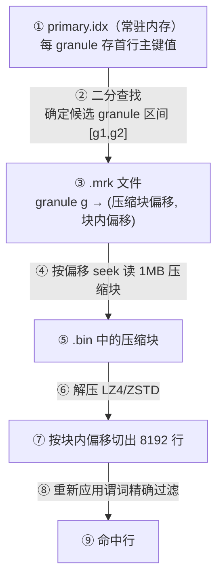

**九步详解**：

1. `primary.idx` 已随表加载进内存（体积只有行数的 1/8192）；
2. 对谓词值做**二分**，得到"可能命中"的 granule 区间 `[g1, g2)`；
3. 读该列的 `.mrk3`，把 granule 号映射成**两级偏移**：`(offset_in_compressed_file, offset_in_decompressed_block)`；
4. 按压缩块偏移 `seek` 读整块（默认 1MB）；
5. 因为压缩块是**独立压缩**的，必须整块解压；
6. 解压后按"块内偏移"定位到 granule 起点，切出 8192 行；
7. **重新应用谓词**（稀疏索引只保证"可能"，不保证"精确"）→ 真正的命中行；
8. 其他需要的列，用**同一组 granule 号**去各自的 `.mrk` 定位（因为所有列的第 N 个 granule 行号完全对齐）；
9. 拼装成 Block 交给向量化算子。

**【追问 1】为什么要"两级偏移"而不是一级？**
因为**压缩块边界与 granule 边界不对齐**。压缩块是"攒够 1MB 就切"，granule 是"攒够 8192 行或 10MiB 就切"，两个阈值独立。所以必须：一级跳到压缩块，二级在解压后的缓冲里跳到 granule 起点。**这个设计的收益是：既能享受大压缩块的高压缩比，又能保持细粒度随机定位。**（能答出这层，直接进入高分档）

**【追问 2】那为什么要"二次过滤"？不能直接信索引吗？**
因为稀疏索引只存**每个 granule 的首行值**。`WHERE id=12345` 时，二分只能定位到"首行 ≤12345< 下一 granule 首行"的那个 granule，但那 8192 行里可能只有 3 行等于 12345。所以**读放大**是结构性的，二次过滤是必须的。这也解释了 ClickHouse "**读 8192 行出 1 行**"的代价来源。

---

#### Q8. 为什么是 8192 行一个 granule？这个数字能改吗？ ★★★★

**参考答案**

**为什么是 8192**：这是"索引体积"与"读放大"的平衡点。
- 索引项数 = 行数 / 8192：1 万亿行 → 1.22 亿条 × 8B ≈ **931MiB**，能全部装进内存；
- 若用 1024：索引 7.4GiB，内存吃紧；
- 若用 65536：读放大变成 65536 行/次，点查/稀疏过滤代价过高。

**能改吗**：能，`index_granularity`（默认 8192，可建表时指定）。但要理解**自适应粒度的存在**：
- `index_granularity_bytes`（默认 10MiB）：**字节阈值**，达到就切 granule。
- 实际 granule 行数 = `min(8192, 10MiB / 单行字节数)`。
- 所以宽表（单行 200B）的 granule 可能只有 5 万…不，是 `10MiB/200B ≈ 52428` > 8192，所以仍取 8192；而单行 2KB 的宽表 → `10MiB/2KB ≈ 5120` 行/granule。

**为什么需要字节阈值**：稀疏索引按"行"切，但 IO 成本按"字节"算。**用字节兜底让"一次误读的字节量"可控（≈10MiB）**，否则超宽表读一个 granule 就是几十 MB。

**【延伸】** `max_block_size`（默认 **65409**）和 `index_granularity`（8192）不是一回事：
- `index_granularity` 是**读盘/索引的粒度**；
- `max_block_size` 是**计算/向量化的批大小**。
读出来的多个 granule 会被拼成计算用的 Block。**很多人以为"8192 就是计算批大小"，这是错的。**

---

#### Q9. 跳数索引（Skipping Index）的原理？为什么加了索引查询反而变慢？ ★★★★★

**高频公司**：字节、美团、滴滴（这题是"真懂"的试金石）

**参考答案**

**一句话本质**：传统二级索引是"**定位哪些行匹配**"，ClickHouse 跳数索引是"**排除哪些块一定不匹配**"——它是排除法，不是定位法。

| 类型 | 存什么 | 适用谓词 | 失效条件 |
|---|---|---|---|
| `minmax` | 每个索引块的 min/max | 范围（`>`,`<`,`BETWEEN`） | 值随机散布 |
| `set` | 块内所有不同值（有 `max_rows` 上限） | 等值、`IN` | 基数超上限直接失效 |
| `bloom_filter` | 布隆（有假阳性，无假阴性） | 等值、`IN` | 范围/否定；高基数多值时假阳性累积 |
| `tokenbf_v1` | 分词 token 的布隆 | 整词 `hasToken` | 子串；**中文无空格 → 整句一个 token，几乎无效** |
| `ngrambf_v1` | n-gram 子串的布隆 | `LIKE '%substr%'` | n 太小 → 假阳性高；n 太大 → 过滤器巨大 |

**为什么"反而更慢"**：设索引块 = 4 granule = 32768 行，块内有 1000 个不同的 `visitor_id`；查询 `visitor_id = 1001`：

```
布隆对每个索引块都要算一次（CPU 开销）
→ 若该值在每个块里都出现过（数据随机散布）→ 每个块都返回"可能存在"
→ 一个 granule 都没跳过
→ 净亏：多了布隆计算，读的行一点没少
```

**核心判据（面试务必说出这句）**：**跳数索引只能加速"索引列与 `ORDER BY` 相关性高"的场景**。相关性高 → 块内值域窄 → 能跳掉大量块；相关性低 → 完全无效。**没有相关性时，正确解法是 Projection（换排序）或物化视图，而不是加索引。**

**【追问】** 那怎么判断该不该加？给你一个可操作的验证流程：
```sql
-- 1. 看跳过的效果
EXPLAIN ESTIMATE SELECT ... ;  -- 对比加索引前后的 Granules 数
-- 2. 看索引体积与命中率
SELECT name, data_compressed_bytes, data_uncompressed_bytes
FROM system.columns WHERE table='events' AND name LIKE 'skp_idx%';
-- 3. 实测：加索引后 P99 是否下降（务必在真实分布上测）
```

---

#### Q10. 分区键怎么设计？为什么不能按秒/按用户分区？ ★★★★

**参考答案**

**三个原则**：

| 原则 | 说明 |
|---|---|
| ① 按**时间**且粒度够粗 | 常用 `toYYYYMM(ts)`（月）、`toDate(ts)`（天）。单分区数据量控制在 **几亿~几十亿行**（几百 MB ~ 几十 GB） |
| ② 分区总数可控 | 单表分区数建议 **< 1000**（经验值，超过后元数据与 merge 遍历开销显著） |
| ③ 分区键必须出现在常用过滤条件里 | 否则分区裁剪失效，白切 |

**为什么不能按秒/按用户**（这是事故根因题）：

```
按 toStartOfHour(ts) 分区，一年 = 8760 个分区
按 toDateTime(ts) 秒级分区，一天 = 86400 个分区 → 每分区只有几行
按 user_id 分区，10 万用户 = 10 万个分区 → 每个分区几行

后果链：
每个分区里只有极少量数据 → 每个 INSERT 产生一个 level=0 小 part
merge 只在**同分区内**进行 → 每个分区都有一堆小 part 永远合不起来
→ 单分区活跃 part 数 > parts_to_throw_insert(300) → INSERT 被拒绝
→ 同时 system.parts 元数据爆炸（几百万个 part 记录）→ 查询规划也变慢
```

**正确姿势**：
- 时间分区按月/天；配合 **TTL** 自动 drop 老分区（比 `DELETE` 快几个数量级）；
- 需要按"业务维度"快速过滤 → 放进 **`ORDER BY` 前缀**，不要放进分区键；
- 分区键尽量选**低基数 + 单调**的表达式。

---

#### Q11. 线上报 `Too many parts`，你怎么定位和解决？ ★★★★★

**高频公司**：字节、美团、快手（这是真实 P0 事故题，几乎必问）

**参考答案：给完整的因果链 + 分层解法**

```
【定位】
1. 确认是不是单分区爆炸
   SELECT partition, count() parts, sum(rows) rows, countIf(level=0) level0
   FROM system.parts WHERE active AND table='x' GROUP BY partition ORDER BY parts DESC;

2. 确认 merge 是否卡住
   SELECT * FROM system.merges;                    -- 有没有跑了几个小时的大 merge
   SELECT * FROM system.mutations WHERE is_done=0;  -- ★ mutation 会 block part 的 merge！

3. 确认写入模式
   SELECT query_duration_ms, written_rows FROM system.query_log
   WHERE query_kind='Insert' ORDER BY event_time DESC LIMIT 20;
   -- 若 written_rows 都是几百/几千 → 小批量写入，根因确认
```

```
【根因三种，按发生率排序】
① 小批量高频写入（最常见）：每次 INSERT = 一个 level=0 part
② 分区键过细：每个分区都堆小 part，且 merge 无法跨分区
③ mutation/TTL 长期占用 background_pool，merge 排不上队（次生灾害）
```

```
【解法，按代价从低到高】
1. 写入端攒批（根治）：单批 ≥ 10 万行或 ≥100MB；Flink 侧攒批 / async_insert=1
2. 分区键粗化：按天/月，禁止按秒/按用户
3. KILL 掉卡住的 mutation：KILL MUTATION WHERE database='x' AND table='y'
4. 临时调阈值（掩盖，不根治）：parts_to_throw_insert 提到 600，background_pool_size 提到 32
5. 手工收敛：ALTER TABLE x OPTIMIZE PARTITION 'p' FINAL（会锁 part、吃满 IO，非高峰做）
```

**【追问，很爱问】** 为什么调大 `parts_to_throw_insert` 只是"掩盖"？
因为 part 数上限的本质是"**merge 吞吐 < 写入速率**"的失衡。调高阈值只是让系统在"更不平衡"的状态下继续跑：查询要扫的 part 更多（每个 part 一次索引二分 + 一次文件 open），查询延迟上升、文件句柄/元数据内存上升，最终以另一种方式崩（查询超时或 OOM）。**阈值是保险丝，不是发动机。**

---

#### Q12. `UPDATE` 一条记录，ClickHouse 内部发生了什么？为什么慢？ ★★★★

**参考答案**

```
ALTER TABLE t UPDATE status='paid' WHERE order_id=123
  ↓ ① 写入一条 mutation 记录（含 SQL 表达式、mutation_id、创建时间）
  ↓ ② 后台 mutation 任务扫描所有**可能含该 order_id 的 part**
     （靠主键索引定位，可能命中多个 part —— 因为同一 order_id 可能散落在多个 part）
  ↓ ③ 对每个命中的 part：读全列 → 应用表达式 → 重写整个 part（生成新 part，删旧 part）
     （未修改的列可 hardlink 复用，但列数多的表仍要读全 part 做行过滤）
  ↓ ④ 新 part 注册，mutation 标记完成
```

**慢的四个原因**：

| 原因 | 说明 |
|---|---|
| ① **按 part 重写，不是按行** | 改 1 行可能要重写 300MB 的 part → 写放大百万倍 |
| ② **同步开销** | `mutations_sync` 默认 0（异步），业务感知是"改了但查不到"，等到 `sync=1` 又要等整个 part 重写 |
| ③ **长期占用 background_pool** | mutation 是重任务，会挤占 merge 线程 → part 堆积 → 连锁 `Too many parts` |
| ④ **不可回滚、不可撤销** | 只能 `KILL MUTATION`（已执行的 part 不会回退） |

**正确替代方案（按推荐度）**：

| 方案 | 做法 | 适用 |
|---|---|---|
| ✅ `ReplacingMergeTree(ver)` | 追加新版本行，查询 `argMax(col, ver)` | upsert 场景（CDC 同步） |
| ✅ 事件流 + 查询折叠 | 存"状态变更事件"，查询时 `AggregatingMergeTree` 折叠 | 状态机类业务 |
| ✅ `DELETE FROM`（轻量删除） | 写 `_row_exists` 掩码，查询过滤，merge 时物理删 | 稀疏删除 |
| ✅ `DROP PARTITION` | 直接删目录，秒级 | 按分区清理（**最优**） |
| ⚠️ Mutation | 只用于低频批量修正 | 补数、修脏数据 |

---

#### Q13. `ReplacingMergeTree` 怎么实现去重？为什么 `FINAL` 很慢？ ★★★★★

**高频公司**：字节、小红书（CDC 同步/画像场景必问）

**参考答案**

**去重语义**：merge 时，**排序键（`ORDER BY`）相同**的行只保留 `ver` 最大的一条（`ver` 可省略，则保留最后写入的、不确定）。

```sql
ENGINE = ReplacingMergeTree(ver) ORDER BY (order_id);
-- 也可以 ReplacingMergeTree(ver, is_deleted) 做"逻辑删+物理清"
```

**三个必须说清的坑**：

1. **去重只在 merge 时发生** → 查询时可能**仍有重复**（因为 merge 是异步、可能还没跑）；
2. 因此查询要么 `FINAL`，要么 `argMax`；
3. 去重单位是**排序键全列**，不是"某一列"—— 所以 `ORDER BY` 必须包含业务的"唯一键"。

**为什么 `FINAL` 慢**（这是本题的核心）：

```
FINAL 要做的事 = 把"merge 应该做的去重"搬到查询时做
  ↓ 读所有相关 part 的**全部**排序键列与 payload 列
  ↓ 按排序键做实时归并（多路 merge）
  ↓ 每组取 ver 最大
  ↓ 再做聚合
代价：
  ① 必须读排序键全列（不能只读需要的列）
  ② part 越碎、重复越多 → 归并代价越高
  ③ 无法用 projection/索引裁剪（因为要全局比较）
```

**优化四板斧**：

| 优化 | 做法 |
|---|---|
| ① 用 `argMax` 代替 `FINAL` | `SELECT argMax(status, ver) ... GROUP BY order_id` —— 只读需要的列，且聚合可并行 |
| ② 定期收敛 | 低峰期 `OPTIMIZE TABLE ... FINAL`（注意：对宽表极重，会锁 part） |
| ③ 分区内 FINAL | `do_not_merge_across_partitions_select_final=1` |
| ④ 控制 part 数 | 攒批写入，别让 part 碎片化（碎片化会同时拖慢 FINAL 和普通查询） |

**【延伸，容易被问】** `ReplacingMergeTree(ver, is_deleted)` 的两段式删除是什么？
写入一行带 `is_deleted=1` 的新版本 → merge 时该 key 的所有旧行都被丢弃（**物理清理**），而不只是"标记"。这样"逻辑删"和"空间回收"在同一个 merge 动作里完成，解决了旧版"删除标记行永远留着"的问题。

---

#### Q14. 一张表该怎么选压缩编码（CODEC）？ ★★★★

**参考答案**

**先理解两层**：`CODEC(编码, 压缩)`，编码是"让数据更好压"的预处理，压缩是通用算法。

| 列类型 | 推荐 | 原因 |
|---|---|---|
| 时间戳（等间隔） | `CODEC(DoubleDelta, ZSTD(1))` | 差值的差值全 0，压缩比可到 50~100× |
| 单调递增整数（自增 ID） | `CODEC(Delta, ZSTD(1))` | 存差值，接近 0 |
| 浮点指标 | `CODEC(Gorilla, ZSTD(1))` | XOR 前后值 + 变长编码 |
| 小范围整数 | `CODEC(T64, LZ4)` | 按位打包 |
| 低基数枚举（省份/状态） | **`LowCardinality(String)`**（类型，不是 codec） | 存字典 ID，字符串比较变整数比较 |
| 长文本/URL | `CODEC(ZSTD(3))` | 追求压缩比；ZSTD 级别 3 是性价比拐点 |
| 高写入吞吐、压缩要求一般 | `LZ4`（默认） | 压缩/解压极快，CPU 开销最低 |

**怎么验证（可操作）**：

```sql
SELECT name,
       formatReadableSize(sum(data_compressed_bytes))   AS compressed,
       formatReadableSize(sum(data_uncompressed_bytes)) AS raw,
       round(sum(data_uncompressed_bytes)/sum(data_compressed_bytes), 1) AS ratio
FROM system.parts_columns
WHERE table='events' AND active
GROUP BY name ORDER BY sum(data_compressed_bytes) DESC;
```

**【追问】ZSTD 级别越高越好吗？**
不是。级别 ↑ → 压缩比 ↑（收益递减）、**解压 CPU ↑**（线性）、写入 CPU ↑。列存是"写一次读多次"，本该偏向高压缩；但 ClickHouse 的解压发生在查询热路径，级别过高会吃掉向量化收益。生产经验：**默认 LZ4 或 ZSTD(1)，只有冷数据/归档列用 ZSTD(3~9)**。

---

#### Q15. 物化视图和 Projection 有什么区别？ ★★★★

**参考答案**

| 维度 | 物化视图 | Projection |
|---|---|---|
| 本质 | **INSERT 触发器**：写源表时同步写目标表 | 表内部的**隐藏副本**（part 子目录） |
| 存储 | 独立表（`TO` 指定，或隐式建） | 同一 part 内 |
| 查询自动使用 | ❌ **不会**（ClickHouse 的 MV 不是"查询改写"） | ✅ 优化器按代价选 |
| 一致性 | 弱耦合，可能漏写（`POPULATE` 会漏并发写入） | 与 part 强绑定，天然一致 |
| 能力 | 可**跨表**、可聚合、可级联 | 只能**同表**、换排序/换列/预聚合 |
| 典型用途 | 明细→聚合层、跨表打平 | 多排序键（"一个表多个 ORDER BY"） |

**最重要的一句话（面试必说）**：
> **ClickHouse 的物化视图是"写入触发器"，不是 Doris/StarRocks 那种"查询自动改写的透明加速"。** 所以：
> 1. 建完 MV，**历史数据不会自动进来**（要么 `POPULATE`（生产禁用，会漏并发写），要么手工 backfill）；
> 2. 查询**不会自动路由到 MV**（要自己查 MV，或把 MV 挂到 `Distributed` 表别名下）。

**Projection 的 25.x 演进**（说出这个会显得很前沿）：
- 传统 projection = 复制全量列（存储翻倍）；
- 25.5+ 的 `_part_offset` 轻量 projection = 只存排序键 + 回基表的偏移 → **相当于"二级索引"**；
- 25.6~25.11：一个查询可**同时用多个 projection 的主键索引**做 part/granule 裁剪 → 逼近"一张表多个主键"。

---

#### Q16. 为什么 `Nullable` 会拖慢查询？ ★★★

**参考答案**：四层代价，从底到上：

| 层 | 代价 |
|---|---|
| 存储 | 每列额外一个 `null_map`（`UInt8` 数组），压缩率下降（null 位破坏 Delta/Gorilla 的连续性） |
| 编码 | `Nullable(DateTime)` **不能直接套 `DoubleDelta`**（要跳过 null 位），专用编码失效 |
| 执行 | 每个表达式要处理 null 分支 → **打断向量化的无分支路径**，SIMD 利用率下降 |
| 索引 | `minmax`/`set` 对含 null 列需额外判断，索引精度下降 |

**结论**：能用默认值（`0` / `''` / `1970-01-01` / `[]`）表达"空"就别用 `Nullable`。生产案例：把 20 个字段改成 `Nullable` 后，同一查询慢了约 40%。

**【追问】那什么时候必须用 `Nullable`？**
业务语义上"**NULL ≠ 0 ≠ 空串**"必须区分时（如"未填写"vs"填写为 0"的评分、可空的关联 ID）。此时只能在语义正确性上让步于性能，并靠 `PREWHERE` 减少 null 列参与计算。


---

### C 组：查询执行（二面核心）

#### Q17. 一条 SQL 在 ClickHouse 里是怎么执行的？ ★★★★

**高频公司**：阿里、腾讯、字节

**参考答案：报出六个阶段 + 六个 EXPLAIN**

| 阶段 | 做什么 | 对应 `EXPLAIN` |
|---|---|---|
| ① Parser | 递归下降解析 → AST | `EXPLAIN AST` |
| ② Interpreter | 语义分析：表/列解析、权限、类型推导 | — |
| ③ Analyzer | AST → QueryTree（新分析器） | `EXPLAIN QUERY TREE` |
| ④ Planner | QueryTree → QueryPlan（物理计划步骤树） | `EXPLAIN PLAN` |
| ⑤ Optimizer | RBO：谓词下推、PREWHERE、常量折叠、Limit 下推、分区裁剪 | `EXPLAIN SYNTAX`（看改写后 SQL） |
| ⑥ Pipeline Builder + Executor | QueryPlan → Processor DAG → 多线程执行 | `EXPLAIN PIPELINE` |
| （辅助） | 预估读多少 part/granule | `EXPLAIN ESTIMATE` |

**必须点出的两个特征**：

1. **优化器是 RBO（规则驱动），不是 CBO**：因为 **ClickHouse 没有列级统计信息**（无直方图、无 NDV），`EXPLAIN ESTIMATE` 的估算只基于 part/granule 的行数。所以它的优化都很"确定"：能推的一定推，推不了的（join 顺序）近年才用启发式补（25.9 的 global join reordering）。
2. **执行是 Pipeline（Processor DAG）+ Pull 模型**：单线程调度（避免锁竞争）、多线程执行 Processor、下游拉上游（**天然背压**）。

**【追问】怎么看一个查询用了几个线程？**
`EXPLAIN PIPELINE` 里 `ReadFromMergeTree` 的份数就是并行读的份数；或 `SELECT * FROM system.query_log WHERE ... ` 看 `ProfileEvents['QueryPipelineExecutorThreads']` 之类；最直接的是 `system.processes` 里的 `thread_ids` 数组长度。

---

#### Q18. 向量化执行到底"向量化"了什么？为什么能快 5~20 倍？ ★★★★★

**参考答案：四条机制，逐层递进**

| 层 | 机制 | 加速来源 |
|---|---|---|
| ① 批处理 | 一个算子函数一次处理 **8192/65409 行**，不是 1 行 | 摊薄函数调用、类型分派、循环开销 |
| ② 编译期类型绑定 | 列类型是模板参数，`ColumnVector<UInt64>` 在编译期确定 → 静态绑定、可内联 | 消除虚函数跳转与运行时类型判断 |
| ③ 无分支热路径 | 类型/编码确定后，热循环里几乎没有 `if` | 避免分支预测失败（一次失败 ~15 周期） |
| ④ SIMD + cache | 连续数组 + `_mm256_*` 一条指令算 4 个 UInt64；顺序访存命中预取 | 理论 4~8×（实际 2~4×，受内存带宽限制） |

**一个具体的对照**（面试可以手写这个对比）：

```cpp
// 逐行（行存/传统引擎）：8192 次函数调用 + 8192 次类型判断
for (Row& r : rows) out.push_back(r.a + r.b);

// 向量化：一次调用，循环体内无分支
void add(const UInt64* a, const UInt64* b, UInt64* out, size_t n) {
    for (size_t i = 0; i < n; ++i) out[i] = a[i] + b[i];   // 编译器自动向量化
}
```

**【追问，很关键】哪些情况向量化会失效？**
① `Nullable`（每行判 null，打断流水线）；② `Variant`/`Dynamic`（运行时类型派发）；③ 复杂字符串函数（正则、复杂 `LIKE`，本身逐字符）；④ `arrayJoin`（行数动态变化，无法定长批）；⑤ **block 太小**（摊薄不了开销）。

**【延伸】** 为什么说"向量化对内存带宽敏感"？
因为每字节只做 1~2 次运算（算术强度极低），瓶颈不在 ALU 而在**搬运**。所以：① 压缩后的数据更少搬运 → 高压缩**同时**是 IO 优化和 CPU 优化；② 超线程收益有限（争抢 L1/L2 与内存带宽）。

---

#### Q19. `PREWHERE` 是什么？它和谓词下推是一回事吗？ ★★★★

**参考答案**

**PREWHERE 是 MergeTree 读表时的"两阶段读列"机制**：

```sql
-- 等价于你手写的优化
SELECT user_id, url, price FROM events
PREWHERE user_id = 12345          -- 阶段1：只读 user_id 列，先过滤
WHERE url LIKE '%pay%';           -- 阶段2：只对幸存行读 url/price
```

**执行对比**：

| 方式 | IO |
|---|---|
| 普通 WHERE | 读 `user_id` + `url` + `price` **全部**（url 可能 200B/行）→ 再过滤 |
| PREWHERE | 先读 `user_id`（8B/行）过滤掉 99.9% → 只对幸存行读 `url`/`price` |

**与谓词下推的区别（这是本题真正的考点）**：

| | 谓词下推（Predicate Pushdown） | PREWHERE |
|---|---|---|
| 层级 | **计划层**：把过滤条件尽量推到计划树叶子（跨 join/子查询/聚合都适用） | **读表层**：只对单表扫描生效，决定"先读哪几列" |
| 目的 | 减少**参与运算的行** | 减少**读取的列数据量** |
| 触发 | 优化器自动（RBO） | `optimize_move_to_prewhere=1`（默认）+ 手工 `PREWHERE` |

两者是**叠加**关系：下推把谓词送到 `ReadFromMergeTree`，PREWHERE 再决定列的读取顺序。

**【追问】什么时候 PREWHERE 没收益？**
① 过滤列本身就很大（如对大文本列做 `LIKE`）：先读它没有选择性优势；② 过滤选择性低（滤不掉几行）：白分两阶段；③ `SELECT` 的列很少且过滤列就是它：没有可省的列。

---

#### Q20. `GROUP BY` 在分布式下是怎么算的？为什么 `avg` 能算对，`sum(avg)` 却不对？ ★★★★★

**高频公司**：字节、美团（预聚合表设计的前置题）

**参考答案**

**三层聚合**：

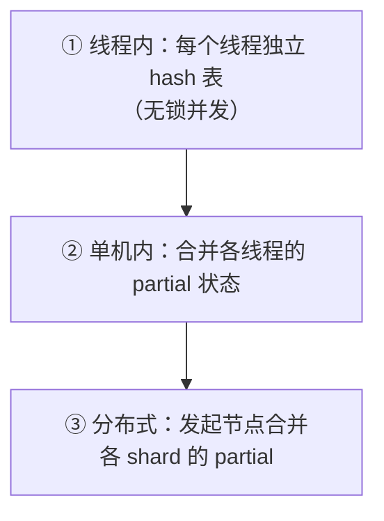

| 层 | 机制 |
|---|---|
| 线程内 | 每线程一个独立哈希表，避免并发写同一表的锁竞争 |
| 单机内 | 各线程的"部分状态"做 `merge` |
| 分布式 | shard 返回 `partial`，发起节点再 `merge` |

**为什么 `avg` 能算对**：ClickHouse 的所有聚合函数都遵守 **`State`/`Merge` 契约**——它们存的是"**可结合的部分状态**"而不是最终值：

```
avg 的部分状态 = (sum_i, count_i)
合并：sum = Σsum_i, count = Σcount_i, avg = sum/count  ✅ 可结合
```

而 `sum(avg(x))` 是在对"已经算完的比率"再求和：`avg(1)=0.5, avg(2)=0.9` → `sum = 1.4`，这没有任何业务意义（除非你就是要"比率的和"）。**语义错误，不是实现错误。**

**这就是"预聚合表必须存状态"的数学基础**：只有可结合的中间状态才能在 part 之间、分片之间任意合并。

```sql
-- 正确：AggregatingMergeTree 存状态
CREATE TABLE agg (dt Date, uv AggregateFunction(uniq, UInt64))
ENGINE = AggregatingMergeTree ORDER BY dt;
INSERT INTO agg SELECT dt, uniqState(user_id) FROM src GROUP BY dt;      -- -State
SELECT dt, uniqMerge(uv) FROM agg GROUP BY dt;                           -- -Merge
```

**【追问】`uniq` / `uniqExact` / `uniqCombined` / `uniqHLL12` 怎么选？**

| 函数 | 精度 | 内存 | 适用 |
|---|---|---|---|
| `uniqExact` | **精确** | O(NDV)，可落盘 | NDV 小于百万，要求精确对账 |
| `uniq`（= `uniqCombined`） | 误差 ~0.5~1% | 自适应（数组→HLL→bitmap） | **默认首选** |
| `uniqHLL12` | 误差 ~1.6% | 固定 ~2.5KB | 超大基数、内存极紧 |
| `uniqCombined64` | 同上，64 位 hash | 略大 | 基数 > 40 亿时避免 hash 碰撞 |

**注意**：`COUNT(DISTINCT x)` 在 ClickHouse 中被改写为 `uniq(x)`（近似！）。要对账必须显式写 `uniqExact`。这是极常见的数据口径事故。

---

#### Q21. ClickHouse 的 JOIN 是怎么实现的？为什么大表 JOIN 会 OOM？ ★★★★★

**高频公司**：字节、阿里、美团（全国都在问）

**参考答案**

**默认算法 `hash` 的机制**：

```
右表（被 join 的表）→ 全量读进内存 → 建哈希表（key = join key，value = payload）
左表 → 流式扫描，逐行探测哈希表 → 输出
```

**为什么右表进内存**：因为左表是"流式"的（不落地），要能随机探测就必须有一侧在内存里。

**内存估算（面试给公式很加分）**：

```
内存 ≈ 右表行数 × (key 宽度 + payload 宽度) × 哈希表开销(2~4×)
例：2000 万行 × (8B key + 100B payload) × 3 ≈ 6.5 GB
→ 超过 max_bytes_in_join（默认 0 不限，但受 max_memory_usage 约束）→ throw
```

**为什么大表 join 大表在分布式下"近乎无解"**：

```
shard1 只有左表 1/N、右表 1/N → 本地 join 只能配到 1/N 的右表
→ 结果**是错的**（不是慢，是错！）
→ 正解需要 shuffle（把 join key 哈希重分布，让相同 key 落到同一节点）
→ ClickHouse 没有自动 shuffle，只有"单遍下发+汇聚"
```

**五种解法（按推荐度）**：

| 方案 | 做法 | 代价 |
|---|---|---|
| ✅ **预打平（最佳）** | Flink/Spark 离线把维表 join 进事实表，CK 里零 join | 存储冗余、时效性 |
| ✅ 小维表用字典 | `ENGINE=Join` 表 / `Dictionary`，常驻内存，`direct` 算法 | 维表必须小（百万级内） |
| ✅ 广播小表 | `GLOBAL JOIN`，把小表聚成一份下发 | 广播量 × 分片数 |
| ⚠️ `partial_merge` / `grace_hash` | 两表排序归并 / 分桶落盘 | 慢 3~10×，磁盘 IO 大 |
| ⚠️ 单机大内存 | 加内存、限制并发 | 不 scalable |

**【追问，前沿加分】25.x 对 join 做了什么改进？**
① 25.1/25.2 **Parallel Hash Join**（build/probe 阶段并行化，解决大右表单线程构建瓶颈）；② 25.9 **Automatic Global Join Reordering**（多表 join 顺序启发式优化）；③ 25.10 **Runtime Bloom Filter**（join 前先布隆过滤不可能匹配的行，减少进哈希表的行数）；④ 25.10 **Lazy columns replication**（重复 join key 值不重复处理）；⑤ 25.12 复杂 OR 条件下推 + join 式 lazy reading。

---

#### Q22. 分布式表上 `IN (子查询)` 会有什么问题？`GLOBAL` 到底解决了什么？ ★★★★★

**参考答案：这是"正确性"题，不是"性能"题**

```sql
-- ❌ 危险写法
SELECT * FROM dist_events
WHERE user_id IN (SELECT user_id FROM dist_users WHERE vip = 1);
```

**实际发生的事**：

```
发起节点把整条 SQL 下发给 N 个 shard
→ 每个 shard 各自执行 "IN (SELECT ... FROM dist_users)"
→ 但 dist_users 本身又是分布式表 → 每个 shard 会**再递归下发一次**
→ 每个 shard 拿到的 VIP 列表可能只是"自己的 1/N"（取决于子查询的分布式聚合行为）
→ 最终每个 shard 用不完整的集合过滤 → **结果错**，且产生 N×N 次查询
```

`GLOBAL` 的语义：**子查询只在发起节点执行一次，把结果（临时表）广播给每个 shard。**

| 写法 | 子查询执行次数 | 正确性 | 成本 |
|---|---|---|---|
| `IN (SELECT ...)` | 每 shard 递归执行 | ⚠️ **通常错误** | N×N 查询风暴 |
| `GLOBAL IN (SELECT ...)` | **1 次** | ✅ | 结果集进内存 + 广播 N 份 |
| `JOIN`（右表为分布式表） | 每 shard 各取一份 | ⚠️ 错（右表不全） | 内存 |
| `GLOBAL JOIN` | 右表在发起节点聚合成全量 → 广播 | ✅ | 广播量 × N |

**【延伸，专家级】`GLOBAL IN` 的致命弱点**：子查询结果必须**装进内存**且**广播 N 份**。500 万 VIP × 20 shard = 1 亿行临时表传输 → 网络与内存双爆。
**生产正解**：把"小结果集"提前物化到一张小表（或 `Dictionary`/`ENGINE=Join`），用普通 `JOIN` 关联，而不是靠 `GLOBAL IN` 兜底。

---

#### Q23. 一个 `GROUP BY` 查询报 `Memory limit exceeded`，怎么排查和解决？ ★★★★

**高频公司**：美团、滴滴、快手

**参考答案**

```
【定位】
1. 谁吃的内存？
   SELECT query_id, user, memory_usage, peak_memory_usage, query
   FROM system.query_log WHERE type='QueryFinish' ORDER BY peak_memory_usage DESC LIMIT 10;

2. 具体在哪个算子吃的？（开 trace_log 后看火焰图）
   SELECT * FROM system.trace_log WHERE query_id='xxx' AND trace_type='MemorySample';

3. 是不是落盘没开？
   SELECT * FROM system.query_log WHERE query_id='xxx' AND Settings['max_bytes_before_external_group_by']='0';
```

```
【根因】GROUP BY 的哈希表大小 = NDV × entry_size
  例：对 user_id（1 亿 UV）GROUP BY，每 entry 含 key + 聚合状态
  → 若用 uniqExact（存完整集合）→ 内存爆炸
  → 若用 uniq（HLL，~几十 KB/entry）→ 1 亿 × 几十 KB 仍然爆
```

```
【解法，按代价】
① 降基数（最优）：不要对 user_id 直接 GROUP BY；
   用 LowCardinality 维度；用 uniqCombined/uniqHLL12 替代 uniqExact
② 落盘：SET max_bytes_before_external_group_by = 10G  （慢 2~5×）
③ 预聚合：AggregatingMergeTree + 物化视图（源头减少行数）
④ 分片聚合：让 GROUP BY 在 shard 先做（分布式默认已做），
   但要避免 `distributed_group_by_no_merge=1` 误用导致发起节点汇聚全量明细
⑤ 限流：max_memory_usage + max_threads，把"一个查询打爆全机"变成"一个查询失败"
```

**【追问】为什么"设了 `max_bytes_before_external_group_by` 还是 OOM"？**
因为落盘只对 **GROUP BY / ORDER BY / JOIN** 三个算子生效，**其他算子仍可能吃满内存**：① 超大 `IN` 集合；② `arrayJoin` 展开；③ 窗口函数（按 partition 缓存）；④ 单个 Block 的中间结果（`max_block_size` × 列宽 × 宽表）。**排查要看火焰图，不要只盯着 GROUP BY。**

---

#### Q24. `ORDER BY` 和表的排序键一致时有什么好处？ ★★★

**参考答案：三个收益，都来自同一个 `ORDER BY`**

| 收益 | 机制 | 开关 |
|---|---|---|
| ① **聚合可流式** | `GROUP BY` 键是排序键前缀 → 数据已按组聚簇 → 滚动聚合，内存 O(1) | `optimize_aggregation_in_order=1`（**默认关！需显式开**） |
| ② **读可省排序** | `ORDER BY` 与排序键一致 → 按 part 物理顺序流式读，跳过排序阶段 | `optimize_read_in_order=1` |
| ③ **裁剪与压缩** | 同值聚簇 → granule 裁剪精准 + 编码压缩率高 | 自动 |

**这就是"排序键是 ClickHouse 最高杠杆设计决策"的完整理由**——一个 `ORDER BY` 同时决定压缩率、索引裁剪、聚合方式、排序开销。所以建表时第一件事是问：**"我的查询 80% 带哪些过滤/分组维度？"**

**【追问】`optimize_aggregation_in_order` 为什么默认是关的？**
因为它是"有条件的优化"：只有当 `GROUP BY` 键严格是排序键前缀、且没有 `ORDER BY` 冲突时才生效；开启后引擎要多做一次判断，且在**不满足条件时可能引入额外开销**（历史上曾有 bug 导致结果顺序变化）。生产建议：**确定查询模式匹配时在 SQL 里显式 `SETTINGS optimize_aggregation_in_order=1`**。

---

### D 组：分布式与一致性（三面/定级题）

#### Q25. 分片和副本到底有什么区别？ ★★★

**参考答案**

| | 分片（Shard） | 副本（Replica） |
|---|---|---|
| 是什么 | 数据的**子集**（水平切分） | 同一分片数据的**完整拷贝** |
| 解决什么 | 容量与算力**横向扩展** | **高可用** + 读扩展 |
| 数量关系 | 1 表 = N 分片 | 1 分片 = M 副本 |
| 怎么写 | 由 `sharding_key` 决定落哪个分片 | 由 `ReplicatedMergeTree` + Keeper 同步 |
| 少了会怎样 | 单机容量/算力天花板 | 该分片单点，节点挂了数据不可用 |
| 关键事实 | **加新分片不会自动 rebalance** | **副本可动态增删**（`CREATE TABLE` 即加副本） |

**一句话**：分片是"**把数据切开**"，副本是"**把数据复制**"。两者的组合叫"集群拓扑"，在 `remote_servers` 里静态定义。

---

#### Q26. `ReplicatedMergeTree` 是怎么保证多副本一致的？ ★★★★★

**高频公司**：阿里、字节、腾讯（几乎必问，答不出细节会被判定"只会用"）

**参考答案：先给 Keeper 结构，再给时序**

**Keeper 中的关键路径**：

```
/clickhouse/tables/{shard}/{db}/{table}/
├── log/                     # ★ 复制日志（顺序节点），每条是一个操作
│                            #   get_part / merge_part / mutate / drop_range
├── replicas/{replica}/
│   ├── log_pointer          # ★ 我执行到第几条（延迟 = max_log_id - log_pointer）
│   ├── max_log_id           #   全局最新
│   ├── parts/               # ★ 我有哪些 part + 校验和
│   ├── queue/               # ★ 待执行任务（失败重试）
│   └── mutation_pointer
├── leader_election/         # 谁负责决定做哪些 merge
└── quorum/                  # quorum 提交状态
```

**一次 INSERT 的完整时序**：

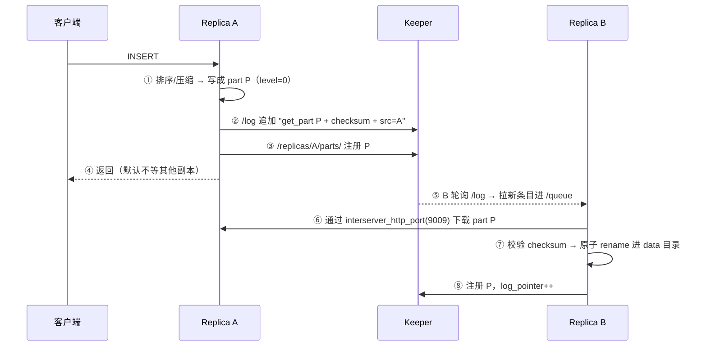

**四个关键设计（这是"懂"的标志）**：

| 设计 | 为什么 |
|---|---|
| **物理复制**（传压缩后的 part 文件，不传 SQL） | 省 CPU（不用重算排序/压缩）、省带宽（已压缩） |
| **数据在本地盘，Keeper 只存元数据** | Keeper 压力与数据量解耦（PB 级也能扛） |
| **默认不等 quorum 就返回** | 换写入延迟与吞吐；代价是可能丢数据（靠 `insert_quorum` 补） |
| **各副本本地各跑 merge，不传 merge 结果** | 避免网络放大（否则每次 merge 都要同步几十 GB × N 副本） |

**【追问，必答】那副本各自 merge，怎么保证结果完全一致？**
靠**确定性**：相同的输入 part 集合 + 相同的 merge 规则 → 逐字节相同的输出。要求：
1. **merge 决策唯一**：由 leader 把 `merge_part` 操作写进 `/log`，所有副本执行**同一序列**；
2. **算法确定性**：排序稳定、编码/压缩确定、不引入随机数或时间戳；
3. **版本一致**：副本必须同版本（不同版本的 merge/编码实现可能产生不同字节 → checksum 永远对不上 → 无限 fetch）。**所以升级时副本间要尽量快速同步升级，必要时先 `SYSTEM STOP MERGES`。**

**这个"byte-identical"约束是理解 ClickHouse 复制的钥匙**——所有看似奇怪的运维要求（同版本、别手工拷数据、别乱动 Keeper）都源自它。

---

#### Q27. `insert_quorum` 干什么用？能保证不丢数据吗？ ★★★★

**参考答案**

```sql
SET insert_quorum = 2;                 -- 至少 2 个副本确认落盘才返回
SET insert_quorum_timeout = 60000;
SET insert_quorum_parallel = 1;        -- 并行 quorum（默认，避免串行化）
SET select_sequential_consistency = 1; -- 读只读"已 quorum 确认"的 part
```

**机制**：每个 INSERT block 有全局 `block_id`（Keeper `/blocks/`）→ 各副本写完后在 `/quorum/` 下登记"我完成了 block N" → 凑够 N 个才返回。

| 配置 | 语义 | 代价 |
|---|---|---|
| 默认（quorum=1） | 单副本写成功即返回 | 副本挂了**可能丢最近数据** |
| `quorum=2` | 至少 2 副本落盘 | 写延迟 ↑（等网络+磁盘）、Keeper 压力 ↑ |
| `+select_sequential_consistency` | 读只读已提交 | 读可能"卡住"等复制追上，P99 抖动 |

**【关键追问】quorum=2 能保证"不丢"吗？**
**不能，只能保证"至少 N 份、且读到的是已提交的"**。若 N=3 副本中 2 个同时宕机，剩下的 1 个可能缺最新 block → 读它还是旧数据。所以它提供的是"**N-1 故障容忍下的读已提交近似**"，**不是线性一致**。这就是为什么 ClickHouse 不适合做账务/资金类强一致场景。

---

#### Q28. 副本变成 `readonly` 了，怎么修？ ★★★★

**高频公司**：几乎所有有 ClickHouse 集群的公司（真实故障题）

**参考答案**

```
【现象】system.replicas.is_readonly = 1，写入报 "Table is in readonly mode"
【根因】本地磁盘有 part X，但 Keeper 的 /replicas/{r}/parts/ 里没有 X
      → 副本无法判断"这份数据该不该存在" → 为保护一致性进入只读
```

| 触发场景 | 说明 |
|---|---|
| Keeper 数据被清空 / 回滚到旧快照 | `/parts/` 记录丢失，而磁盘数据还在 → 大量"多余" part |
| 手工把数据目录拷到另一个副本 | 有数据无元数据 |
| `DROP PARTITION` 部分副本执行成功、Keeper 未更新 | 状态漂移 |
| Keeper 磁盘满 / 会话超时 | 元数据写失败 |

**修复路径**：

```sql
-- ① 轻量：让它重新对账
SYSTEM RESTART REPLICA db.table;
-- ② 强制追平
SYSTEM SYNC REPLICA db.table;
-- ③ Keeper 整体丢失时的正解（23.x+）：
--    停写 → 选数据最全的副本 → 用它本地数据重建 Keeper 元数据 → 其他副本重新追平
SYSTEM RESTORE REPLICA db.table;
```

**绝对不能做的**：直接删 Keeper 节点、手工删本地 part 让"两边一致"——会丢数据且破坏其他副本。

**【追问】怎么预防？**
① Keeper 独立部署 + 3 节点 + 监控会话与延迟；② 禁止手工拷贝数据目录，新副本用 `SYSTEM SYNC REPLICA` 追；③ 定期核对 `system.replicas` 的 `absolute_delay` 与 `is_readonly`；④ Keeper 磁盘水位告警。

---

#### Q29. `Distributed` 表的写入流程是什么？`internal_replication` 为什么必须开？ ★★★★★

**参考答案**

```
INSERT INTO dist_table
  ↓ ① 按 sharding_key 计算目标分片：sipHash64(key) % shard_count
  ↓ ② 若目标分片就是本节点 → 直接写本地表（不走网络）
     否则 → 通过 remote() 连接转发到目标分片的某个副本
  ↓ ③ 目标节点执行本地表的写入（生成 part）
```

**`internal_replication` 的两种模式（这是本题的核心）**：

| 值 | 行为 | 一致性 | 推荐 |
|---|---|---|---|
| `false`（默认，**危险**） | Distributed 自己往**每个副本**都写一份 | ❌ 部分副本写成功/部分失败 → **副本数据不一致，且不可自愈** | 仅用于非复制表 |
| `true`（**生产必须**） | 只写**一个副本**，由 `ReplicatedMergeTree` 的复制机制同步到其他副本 | ✅ 复制机制保证最终一致 | 所有复制表场景 |

**为什么 `false` 是灾难**：假设 3 副本，写第 1 个成功、第 2 个超时、第 3 个失败 → 3 个副本数据永久不同，且 ReplicatedMergeTree 的 `/parts/` 对账会认为"多的那个 part 是异常的"→ 移入 `detached` 或触发修复 → 数据在副本间"飘"。**这是很多早期集群的隐形数据不一致根因。**

```sql
ENGINE = Distributed('ck_cluster', 'db', 'table_local', sipHash64(user_id))
-- 建表时务必确认：internal_replication = true（集群配置里设）
```

**【追问】Distributed 写入的批量问题？**
`distributed_foreground_insert`（默认 0）会让 INSERT 先在**发起节点内存缓冲**，攒够 `distributed_directory_monitor_batch_inserts` 再转发 → 好处是减少网络往返，坏处是 ① 缓冲在内存，宕机丢 ② 攒批不均导致某 shard part 爆炸。生产建议：**开启并配合 `insert_distributed_sync=1` 的短事务场景，或干脆让客户端直连本地表 + 用 `Distributed` 只做查询**（这是国内大厂常见做法：**写本地表，读分布式表**）。

---

#### Q30. 集群加了一个新分片，老数据会自己迁过去吗？ ★★★★

**参考答案**：**不会。ClickHouse 集群是"静态拓扑，非弹性"。**

| 事实 | 说明 |
|---|---|
| 无自动 rebalance | 新分片从空开始，老数据留在老分片 → **数据与负载倾斜** |
| `sharding_key` 变了？ | 若改了 `sharding_key`（如从 `hash(a)` 改 `hash(b)`），老数据按旧规则分布 → **查询结果可能漏**（新规则下某些 shard 的查询范围变了） |
| 官方立场 | 集群规模"几十节点"级别，接受一定不均衡，换取"完全可控" |

**扩容的三种正解**：

| 方案 | 做法 | 适用 |
|---|---|---|
| ① 重建集群 + 双写 + 迁移 | 新集群 → 双写 → 历史数据重灌（`INSERT SELECT` 带新 sharding_key）→ 切读 | 大规模、可停机窗口 |
| ② 分片内重分布 | 把部分分区 `ATTACH` 到新分片（需停机或双写） | 分区可切分的场景 |
| ③ 只扩副本不扩分片 | 加副本提高读并发（并行副本），不改分布 | 瓶颈是读不是容量 |

**【延伸】** 这也是 Doris/StarRocks 相对 ClickHouse 的一个结构性优势：Doris 的 Tablet 可以在 BE 之间自动均衡；ClickHouse 需要人工 reshard。选型时"是否会频繁扩容"是一个真实权重。

---

#### Q31. 并行副本（Parallel Replicas）是什么？什么时候不该用？ ★★★★

**参考答案**

**问题**：一个 shard 有 3 副本，传统查询只挑 1 个副本读 → 2/3 的算力闲置。
**方案**：让同一 shard 的多个副本**共同分担一个查询**（按 part/granule 切分），各自算部分结果，再汇总。

```sql
SET allow_parallel_replicas = 1;
SET parallel_replicas_count = 3;             -- 手动模式
SET automatic_parallel_replicas_mode = 1;    -- 25.12：自动判断轻重
```

| 版本 | 能力 |
|---|---|
| 22.x | 手动指定副本数 |
| 24.x | `Distributed` + 复制表的自动并行副本 |
| **25.12** | **运行时收集统计，自动判断"查询够不够重、值不值得并行"** |

**不该用的场景（这是考点）**：

| 场景 | 为什么 |
|---|---|
| 轻查询 / 高 QPS 点查 | 并行带来额外网络开销与协调成本，**得不偿失** |
| 大表 JOIN | join 需要全局数据视图，按 part 切分帮不上 |
| 网络带宽紧张 | 并行副本本质是"用网络换 CPU" |
| 副本延迟大（`absolute_delay` 高） | 各副本数据不一致 → 结果可能错（需注意一致性配置） |

> 一句话：**并行副本是"重查询加速器"，不是"通用提速开关"。** 25.12 之所以要做"自动模式"，就是因为很多人手动开启后在轻查询上反而变慢。


---

### E 组：运维与调优（决定你能不能"独立扛集群"）

#### Q32. 生产上 ClickHouse 的内存参数怎么配？ ★★★

**参考答案**

```xml
<!-- users.xml / profile -->
<max_memory_usage>100000000000</max_memory_usage>          <!-- 单查询 100G（必设！）-->
<max_memory_usage_for_user>150000000000</max_memory_usage_for_user>
<max_bytes_before_external_group_by>50000000000</max_bytes_before_external_group_by>
<max_bytes_before_external_sort>50000000000</max_bytes_before_external_sort>
<max_bytes_in_join>20000000000</max_bytes_in_join>
<max_threads>32</max_threads>
<max_execution_time>300</max_execution_time>               <!-- 5 分钟兜底 -->
```

| 参数 | 默认 | 为什么必须改 |
|---|---|---|
| `max_memory_usage` | **0（不限）** | 默认不限制 → 一个坏查询打爆整机 → OOM Killer 杀进程 → **本节点所有查询失败 + 副本掉线 → 集群雪崩** |
| `max_server_memory_usage` | 0（= 0.9×物理） | 保持默认，留 10% 给 OS/page cache |
| `max_concurrent_queries` | 0（不限） | 不限 → 高峰 500 个查询同时跑 → 集体变慢 → 超时重试 → 更慢（雪崩） |
| `mark_cache_size` | 5GB | 表多/part 多时调大（mark 是随机读热点） |

**核心原则**：**"宁可让一个查询失败，也不能让一个节点挂掉。"** 所有限制参数都是这个原则的体现。

**【追问】`max_memory_usage` 该设多少？**
按"**单机内存 / 最大并发查询数 × 安全系数**"倒推。例如 256G 机器、允许 4 个大查询并发 → 每个 50G，留余量给 merge 与 cache。**不要拍脑袋设成物理内存的 90%**（那样一个查询就能吃满）。

---

#### Q33. 线上一个查询突然变慢，你的完整排查流程是什么？ ★★★★★

**高频公司**：所有（这是"你会不会值班"的终极题）

**参考答案：六步 SOP，每步给命令**

```
【第 0 步】先确认"变慢"的定义
  是单个查询慢？还是整体 P99 上升？是特定用户？特定表？
  → 从 system.query_log 对比"同一条 SQL 的历史耗时"
```

```sql
-- 第 1 步：找最慢/最耗资源的查询
SELECT query_id, user, query_duration_ms, read_rows,
       formatReadableSize(read_bytes) AS read,
       memory_usage, query
FROM system.query_log
WHERE type = 'QueryFinish' AND event_time > now() - 3600
ORDER BY query_duration_ms DESC LIMIT 20;
```

```
【第 2 步】看"到底读了多少" —— 最快定位手段
  EXPLAIN ESTIMATE <原 SQL>
  → Parts 数、Granules 数、Rows 预估
  若 Granules 巨大 → 索引没生效（排序键不匹配 / 谓词不可下推）
```

```
【第 3 步】看执行计划与并行度
  EXPLAIN PIPELINE  → ReadFromMergeTree 有几份（并行度）
  EXPLAIN PLAN      → 是否有 Sort / Aggregating 落盘、Join 方式
  只看 1 份 ReadFromMergeTree → 并行度没起来（数据太少 or max_threads=1）
```

```
【第 4 步】看表状态（最常见的隐形根因）
  SELECT partition, count() parts, sum(rows), countIf(level=0)
  FROM system.parts WHERE active AND table='x' GROUP BY partition;
  → part 数暴涨 = 碎片化 → 每次查询要打开成百上千个文件 → 变慢
  → 同时看 system.merges 是否卡住、system.mutations 是否有 is_done=0
```

```
【第 5 步】看是否落盘 / 是否 OOM 边缘
  query_log 里看 memory_usage vs max_memory_usage
  看 ProfileEvents['ExternalAggregationWritePart'] 等是否非 0
```

```
【第 6 步】看系统层
  system.asynchronous_metrics / OS: CPU steal、IO await、磁盘水位、网络
  副本 absolute_delay（读到落后副本也会慢）
```

**处置优先级**：先 `KILL QUERY` 止血（若在打爆内存）→ 再定位根因 → 最后改表/改 SQL。

**【面试加分】把结论按"发生概率"排序**（这是实战感）：
1. **数据量增长**（最朴素：昨天 1 亿行，今天 10 亿行）；
2. **part 碎片化**（小批量写入累积）；
3. **SQL 变了**（`SELECT *`、多了个 `ORDER BY`、`JOIN` 顺序变了）；
4. **资源竞争**（别人在跑大查询 / merge 在抢 IO）；
5. **副本读到了落后节点**；
6. **统计/索引失效**（`ORDER BY` 改了但索引没重建、Projection 没 `MATERIALIZE`）。

---

#### Q34. TTL 和冷热分层怎么配？ ★★★★

**参考答案**

**TTL 的五种动作**（很多人只知道 DELETE）：

| 动作 | 语法 | 说明 |
|---|---|---|
| 删除 | `TTL ts + INTERVAL 30 DAY DELETE` | merge 时过滤；**分区级 TTL 直接 drop 目录，极快** |
| 迁移 | `TTL ts + INTERVAL 7 DAY TO VOLUME 'cold'` | 冷热分层 |
| 重压缩 | `TTL ts + INTERVAL 90 DAY RECOMPRESS CODEC(ZSTD(9))` | 老数据换更高压缩 |
| 聚合 | `TTL ts + INTERVAL 1 DAY GROUP BY dt, province SET x=sum(x)` | 明细降级为聚合 |
| 转储 | `TO DISK 's3'` | 冷数据上对象存储 |

```sql
-- 冷热分层标准写法
CREATE TABLE events (...)
ENGINE = MergeTree
PARTITION BY toYYYYMM(ts)
ORDER BY (province, ts)
TTL ts + INTERVAL 7 DAY TO VOLUME 'hot',
    ts + INTERVAL 90 DAY TO VOLUME 'cold',
    ts + INTERVAL 365 DAY DELETE
SETTINGS storage_policy = 'tiered';

-- storage_policy 定义（config.xml）
-- hot  → NVMe
-- cold → SATA / S3
```

**【关键点】分区级 TTL vs 行级 TTL**：
- 若 TTL 表达式与分区键**同粒度**（如按月分区 + `TTL ts + INTERVAL 1 MONTH`），引擎可直接 **DROP 整个分区**（元数据操作，毫秒级）；
- 若是行级（精确到天但按月分区），只能在 merge 时逐行过滤 → 慢，且要等 merge。
**结论：分区粒度要和 TTL 粒度对齐。**

---

#### Q35. 你会盯哪些监控指标？ ★★★

**参考答案：按"四类 + 十二条"**

| 类别 | 指标 | 来源 | 告警线 |
|---|---|---|---|
| **写入** | InsertedRows/s | `system.events` | 环比 -30% |
| | 单分区活跃 part 数 | `system.parts` | >100 警戒，>300 拒绝 |
| | merge 队列/延迟 | `system.merges` | 持续 >10min |
| **查询** | P99 延迟 | `system.query_log` | 业务定 |
| | 失败率/错误码 | `query_log` | >1% |
| | 内存峰值 | `system.processes` | >80% 上限 |
| **副本** | `absolute_delay` | `system.replicas` | >60s |
| | `is_readonly` | 同上 | **=1 立即告警** |
| | `queue_size` | 同上 | 持续增长 |
| **资源** | 磁盘水位 | `system.disks` | >80%（**90% 会变只读**） |
| | CPU/IO util | OS | 持续 >85% |
| | Keeper 会话/延迟 | `system.zookeeper` | 会话过期 >0 |

**【加分】一个容易被忽略的指标：`system.errors`** —— 它按错误码累计，能提前发现"还没爆但已在恶化"的问题（如 `TOO_MANY_PARTS` 的计数在涨）。

---

### F 组：场景设计题（三面/定级）

#### Q36. 设计一张日增 10 亿行的用户行为埋点表，你怎么设计？ ★★★★★

**高频公司**：字节、快手、小红书、B 站（这是最经典的"大厂场景题"，几乎必考）

**参考答案：完整 DDL + 每一步的理由**

```sql
CREATE TABLE dwd_event (
    event_date   Date,                    -- 冗余日期列，供分区与过滤
    event_time   DateTime CODEC(DoubleDelta, ZSTD(1)),
    user_id      UInt64   CODEC(Delta, ZSTD(1)),
    device_id    String   CODEC(ZSTD(1)),
    app_id       LowCardinality(String),  -- 低基数维度
    event_name   LowCardinality(String),  -- 埋点事件名
    province     LowCardinality(String),
    page_id      LowCardinality(String),
    -- 大文本/URL 放最后，单独 codec
    url          String   CODEC(ZSTD(3)),
    -- 可变属性用 Map 或 JSON（25.3 JSON GA）
    props        String   CODEC(ZSTD(3)),
    INDEX idx_event_name event_name TYPE set(100) GRANULARITY 4,
    INDEX idx_url url TYPE ngrambf_v1(3, 8192, 3, 0) GRANULARITY 8
)
ENGINE = MergeTree
PARTITION BY toYYYYMM(event_date)         -- ① 按月分区
ORDER BY (app_id, event_name, event_date, user_id)  -- ② 排序键
TTL event_date + INTERVAL 180 DAY
SETTINGS index_granularity = 8192;
```

**逐项论证（面试就讲这些"为什么"）**：

| 决策 | 选择 | 理由 |
|---|---|---|
| **分区** | `toYYYYMM(event_date)`（月） | 10 亿/天 ≈ 300 亿/月 ≈ 3~6TB/月（压缩后），单分区大小合理；分区数 12/年，可控；TTL 可按分区 drop |
| **排序键** | `(app_id, event_name, event_date, user_id)` | ① `app_id`、`event_name` 是**最高频过滤维度**（业务查询几乎都带）② `event_date` 支持时间范围裁剪 ③ `user_id` 放最后，用于"按用户下钻"（前缀不匹配时至少能过滤到 granule 内的用户段） |
| **为什么 app_id 在 event_name 前** | 基数低在前 | 低基数前置 → 每个 `app_id` 段内 `event_name` 有序 → 两级裁剪都精准；且低基数前缀压缩率更高 |
| **类型** | `LowCardinality` 给 3~5 个低基数列 | 字典编码，字符串变整数比较，压缩 5~20× |
| **编码** | 时间 `DoubleDelta`、ID `Delta`、文本 `ZSTD(3)` | 见 Q14 |
| **索引** | `set` 给事件名、`ngrambf` 给 URL | 只在"与排序键不相关但有明确过滤需求"的列上 |
| **TTL** | 180 天 | 明细保留半年，更久的数据进聚合表 |

**分层设计（这才是"设计"而不是"建表"）**：

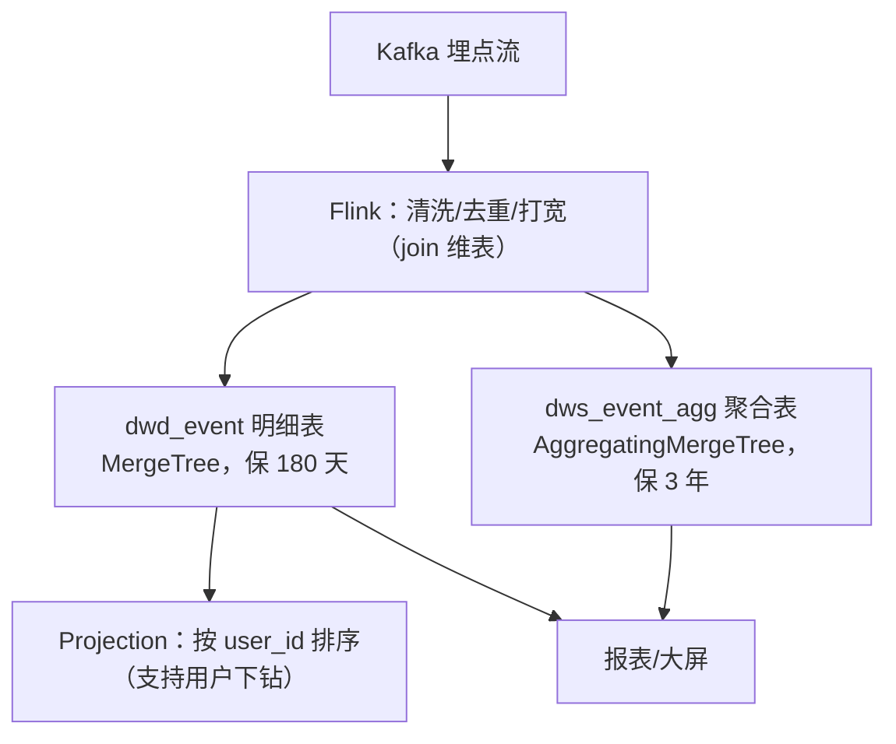

**聚合表**：

```sql
CREATE TABLE dws_event_agg (
    event_date Date,
    app_id LowCardinality(String),
    event_name LowCardinality(String),
    province LowCardinality(String),
    pv  AggregateFunction(sum, UInt64),
    uv  AggregateFunction(uniq, UInt64),
    dur AggregateFunction(sum, UInt64)
) ENGINE = AggregatingMergeTree
PARTITION BY toYYYYMM(event_date)
ORDER BY (app_id, event_name, province, event_date);
```

**【追问 1】如果业务还要按"页面 page_id"高频过滤怎么办？**
排序键只能有一个 `page_id` 不在前缀 → 加 **Projection**（25.x 轻量版）：
```sql
ALTER TABLE dwd_event ADD PROJECTION p_page (SELECT _part_offset ORDER BY page_id);
ALTER TABLE dwd_event MATERIALIZE PROJECTION p_page;
```

**【追问 2】10 亿/天，写入怎么保证不产生海量小 part？**
Flink 侧攒批（10 万行 / 100MB / 10 秒取较大者）；或 `async_insert=1, wait_for_async_insert=0`；目标：**每分区活跃 part 数 10~30**。

**【追问 3】为什么要冗余 `event_date` 而不是用 `toDate(event_time)` 分区？**
可以在 `ORDER BY` 里直接用它做范围过滤，也能在 `WHERE` 里避免函数包裹（函数包裹会阻碍 `KeyCondition` 转区间，除非是单调函数）。

---

#### Q37. 实时 UV / 留存 / 漏斗怎么算？为什么不能对 `user_id` 直接 GROUP BY？ ★★★★★

**参考答案**

**核心矛盾**：UV 要对 `user_id` 去重，`user_id` 是**超高基数**（亿级）→ 哈希表/精确集合必然爆内存。

**四层解法**：

| 层 | 方案 | 精度 | 内存 |
|---|---|---|---|
| ① | `uniq(user_id)`（= `uniqCombined`，HLL） | ~0.5~1% 误差 | 自适应，极省 |
| ② | `uniqCombined64` | 同上（64 位 hash） | 基数 >40 亿时必须用 |
| ③ | `uniqExact` | 精确 | O(NDV)，可落盘但仍慢 |
| ④ | **`groupBitmapState` + `bitmapCardinality`** | 精确（要求 ID 可映射为 UInt32） | 位图压缩后极省，且**支持集合运算** |

**"为什么不能直接 GROUP BY user_id"**：
`GROUP BY user_id` 会为每个用户建一个聚合 entry → 1 亿 entry × 每 entry 几百字节 = 几十 GB。**你要的是"UV 数"，不是"每个用户的行数"**——指标语义错了，实现自然爆。

**正确写法（预聚合 + 位图，支持留存/漏斗）**：

```sql
-- 按"天 × 维度"预聚合 UV 位图
CREATE TABLE dws_uv_bitmap (
    dt Date, app_id LowCardinality(String),
    uv_state AggregateFunction(groupBitmap, UInt32)   -- user_id 映射为 UInt32
) ENGINE = AggregatingMergeTree PARTITION BY toYYYYMM(dt) ORDER BY (app_id, dt);

INSERT INTO dws_uv_bitmap
SELECT dt, app_id, groupBitmapState(toUInt32(user_id))
FROM dwd_event GROUP BY dt, app_id;

-- ① 日 UV
SELECT dt, bitmapCardinality(uv_state) FROM dws_uv_bitmap;

-- ② 留存（第 1 天活跃 且 第 2 天活跃）= 位图交集
SELECT bitmapCardinality(bitmapAnd(d1.uv_state, d2.uv_state)) AS retained
FROM dws_uv_bitmap d1
JOIN dws_uv_bitmap d2 ON d1.app_id = d2.app_id
WHERE d1.dt = '2024-01-01' AND d2.dt = '2024-01-02';

-- ③ 漏斗（按事件序列做位图差）
SELECT bitmapCardinality(bitmapAnd(
    bitmapAnd(step1, step2), step3)) AS funnel_users ...
```

**为什么位图方案在"留存/漏斗/人群圈选"上不可替代**：UV 聚合只能算"多少个"，而位图能算"**哪些人**"——交集、并集、差集都是 O(bitmap size) 的位运算。这是 ClickHouse 在用户增长/画像场景的核心竞争力。

**【追问】位图的限制？**
`groupBitmap` 只能用 `UInt32`/`UInt64` → `user_id` 必须是紧凑整数（或提前做 ID 映射）；位图稀疏时（1 亿用户中只有 10 万活跃）压缩后仍可接受，但极端稀疏场景（10 亿 ID 空间只有 1000 个值）位图会比 HLL 大。

---

#### Q38. MySQL 的数据怎么实时同步到 ClickHouse？怎么保证不重不乱？ ★★★★★

**高频公司**：阿里、美团、京东（数据同步是落地必答题）

**参考答案**

**链路**：

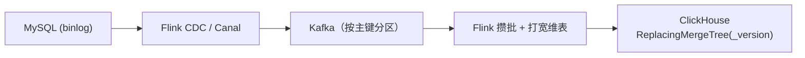

**三个正确性问题的答案**：

| 问题 | 解法 | 关键细节 |
|---|---|---|
| **不重** | `ReplacingMergeTree(_version)` + 查询 `argMax` | merge 异步 → 查询时仍可能重复，必须靠 `argMax(col, _version)` 或 `FINAL` |
| **不乱** | Kafka **按主键分区** + 单并发消费同一主键 | 同一 `order_id` 的变更必须落在同一 partition → 顺序才有保证 |
| **不丢** | Kafka 端 offset 提交 + Flink checkpoint（至少一次） | CK 不支持事务，**不能做"精确一次"，只能做"至少一次 + 幂等"** |

**幂等的三层保障（从弱到强）**：

| 层 | 机制 | 有效性 |
|---|---|---|
| ① CK 原生块级去重 | `insert_deduplicate=1`（默认），相同 block（同内容+同 block_id）重复 INSERT 会被去重 | **只在"完全相同的 block"时有效**；Flink 重试若重新攒批（行数不同）就失效 |
| ② 唯一键 + 版本号 | `ReplacingMergeTree(_version)` + `argMax` | 有效，但查询要带 `argMax`，且 `_version` 必须单调 |
| ③ 分区内去重 | `ReplacingMergeTree` + 按业务日期分区 + 每次重跑覆盖同一分区 | 补数场景最可靠（`ALTER TABLE ... DROP PARTITION` 后重灌） |

**【常见坑】**：
1. **`_version` 用了 `now()`** → 重试时时间戳变大 → 旧数据"覆盖"新数据（因为版本更大）。**必须用 binlog 位点（`binlog_file + pos`）或业务版本号**。
2. **宽表打宽时维表变更** → 历史行不会自动更新（CK 不更新）→ 需要"维表变更时重刷历史分区"。
3. **DDL 变更** → Flink 侧 schema 演进要能加列（CK `ALTER TABLE ADD COLUMN` 是元数据操作，很快）。

---

#### Q39. 业务有 5 个维度都要灵活过滤，但排序键只能一个，怎么办？ ★★★★

**参考答案：五条路，按代价排序**

| 方案 | 做法 | 代价 | 适用 |
|---|---|---|---|
| ① **Projection（首选）** | 每个高频维度一个轻量 projection（`SELECT _part_offset ORDER BY dim`） | 存储 +（很小）；25.x 可组合多个 | 2~5 个高频维度 |
| ② **预聚合 Cube** | 按"最常用的 2~3 个维度组合"建多张 `AggregatingMergeTree` 表 | 存储 × N；维护复杂 | 报表/固定看板 |
| ③ **分表** | 按查询模式拆成 2~3 张表（不同排序键） | 写入 × N；数据冗余 | 查询模式清晰、量大 |
| ④ **跳数索引** | 给非前缀维度加 `minmax`/`bloom` | 只在"与排序键相关"时有效 | 半有序数据 |
| ⑤ **字典表** | 维度值 → 编码，把字符串维度变成小整数放进排序键 | 需要映射维护 | 维度值可枚举 |

**推荐组合**（生产常见）：
```
主排序键 = 最高频过滤维度（80% 查询带它）
+ 轻量 Projection = 第 2、3 高频维度
+ 预聚合表 = 固定看板
+ 剩下的维度走普通过滤（扫 granule，靠向量化扛）
```

**【追问】为什么不用"每列都加索引"？**
因为跳数索引对"与排序键不相关"的列完全无效（见 Q9），而且索引本身要占存储、要算 CPU。**5 个维度全加索引 = 5 份索引开销 + 0 份裁剪收益**，是最典型的反模式。

---

#### Q40. 业务要求"万级 QPS 的点查"，能用 ClickHouse 吗？ ★★★★

**参考答案**：**不能作为主方案，但可以作为"分析侧"的补充。**

| 需求 | 现实 |
|---|---|
| 单行点查延迟 | CK 要读 8192 行 granule + 解压 1MB 压缩块 → 单查 5~50ms，且 CPU 消耗大 |
| 万级 QPS | 每个查询一个线程 → 万 QPS 需要上万线程，不可能 |
| 结果 | **必然被击穿**：查询排队 → 超时 → 重试 → 雪崩 |

**正确架构**：

```mermaid
flowchart LR
    B["业务服务"] --> R["Redis / MySQL<br/>（点查，QPS 1万+）"]
    R -->|"异步/定时"| CK["ClickHouse<br/>（分析、报表、下钻）"]
    B -->|"只有分析请求"| CK
```

| 场景 | 用什么 |
|---|---|
| 单行查询、高并发 | Redis / MySQL / HBase |
| 详情页（一次查几十行） | ES（倒排 + doc values）或 MySQL |
| 分析型（聚合、多维过滤） | **ClickHouse** |

**如果一定要在 CK 上做"准点查"（比如按 ID 查一行做详情兜底）**：
1. 用 **Projection 轻量索引**（`_part_offset`）把 ID 变成"索引"；
2. `WHERE id = x LIMIT 1`；
3. 但**必须限流**（`max_concurrent_queries` + 独立 user profile），且只做低频兜底。

---

#### Q41. ClickHouse 和 Doris 你怎么选？ ★★★★★

**参考答案：先给结论，再给维度表，最后给决策树**

**结论句式**：
> 「模型能打平成宽表、查询以单表多维聚合为主、追求极致压缩与扫描性能 → ClickHouse；需要多表灵活 JOIN、主键更新、事务、MySQL 生态直连 → Doris/StarRocks。**不是性能之争，是约束匹配之争。**」

| 维度 | ClickHouse | Doris |
|---|---|---|
| 架构 | 多主 + Keeper | FE（中心元数据）+ BE |
| 分布式执行 | 无全局计划，单遍下发+汇聚 | 完整 MPP + shuffle |
| JOIN | 弱（右表进内存） | 强（Colocate/Bucket Shuffle/Broadcast） |
| 更新 | Mutation 重写（贵） | Unique Key 模型（高效 upsert） |
| 事务 | 无 | 支持 |
| 物化视图 | 插入触发器（不自动路由） | 透明加速 + 自动改写 |
| 优化器 | RBO 为主，无列统计 | CBO + 统计信息 |
| 弹性 | 静态拓扑，不自动 rebalance | Tablet 自动均衡 |
| 协议 | 自有协议 + 部分 MySQL 语法 | **MySQL 协议**（BI 直连） |
| 极致场景 | 单表扫描、日志/埋点、高压缩（5~10×） | 多表关联、明细+聚合混合、湖仓 |

**决策树**：

```
Q1: 是否需要在库内做"事实表 join 事实表"？
  ├─ 是 → Doris / Trino / Spark（CK 会算错或 OOM）
  └─ 否 ↓
Q2: 是否需要按主键高频更新（订单/库存/画像）？
  ├─ 是 → Doris（Unique Key）或 MySQL
  └─ 否 ↓
Q3: 是否需要事务 / 多表原子写？
  ├─ 是 → Doris
  └─ 否 ↓
Q4: 查询是否以"单表多维聚合 + 时间范围"为主，且数据 append-only？
  ├─ 是 → ClickHouse（✅ 最优解）
  └─ 否 → 再评估
```

**【加分】说出一句真实经验**：
『我们最终选 CK 的原因是：埋点数据天然 append-only、join 已在 Flink 打平、查询 95% 是"维度+时间范围+聚合"。CK 的两个短板在我们的模型里根本不存在，而它的压缩比（1:8）让存储成本比 Doris 低一半——**选型算的是总成本，不是单查询 QPS。**』

---

#### Q42. 重复数据怎么处理？CK 有没有"唯一约束"？ ★★★★

**参考答案**

**没有唯一约束**（见 Q4）。四层去重机制：

| 层 | 机制 | 粒度 | 有效性 |
|---|---|---|---|
| ① 块级去重 | `insert_deduplicate=1`（默认） | 同一个 INSERT block（相同内容 → 相同 block_id） | 只对"完全相同的 block"有效；重试重新攒批就失效 |
| ② 表级去重 | `ReplacingMergeTree(ver)` + `argMax`/`FINAL` | 排序键相同 | 有效，异步 |
| ③ 分区级重灌 | `DROP PARTITION` + 重灌 | 整个分区 | **补数/重跑最可靠** |
| ④ 查询级去重 | `SELECT DISTINCT` / `GROUP BY` / `argMax` | 查询时 | 慢，但兜底 |

**正确姿势（按场景）**：

| 场景 | 方案 |
|---|---|
| 上游 Flink 重试导致重复 | `insert_deduplicate`（同 block）+ `ReplacingMergeTree(版本)` 双保险 |
| 离线补数重跑 | **分区级覆盖**（DROP PARTITION → 重灌），最干净 |
| CDC upsert | `ReplacingMergeTree(binlog_pos)` + `argMax` |
| 报表口径要对账 | `uniqExact`（不是 `uniq`！） |

**【追问】`insert_deduplicate` 的实现原理？**
ReplicatedMergeTree 在 Keeper `/blocks/` 里记录最近的 block_id（默认保留 100 个），block_id = hash(数据内容 + 分区 + 表)。重复 INSERT 相同内容 → 同 block_id → 检测到已存在 → 直接跳过（返回成功但不落盘）。
**注意**：① 只对**复制表**有；② 只保留最近 100 个（`replicated_deduplication_window`），窗口外的重复不会被识别；③ 内容必须**完全一致**（行序、列序、切分都一致）。

---

#### Q43. 大促/财报日，查询量翻 10 倍，怎么保住集群？ ★★★★

**参考答案：六层防护，从外到内**

| 层 | 手段 | 具体 |
|---|---|---|
| ① **入口限流** | 网关/应用层限 QPS、按业务线配额 | 最有效，把压力挡在库外 |
| ② **查询分级** | 核心看板 vs 自助查询分不同 user profile | `max_concurrent_queries`、`max_memory_usage`、`max_execution_time` 分别设 |
| ③ **读写分离** | 报表查**副本**（只读），写入走主副本 | `Distributed` 的 `load_balancing` + 副本角色 |
| ④ **预计算兜底** | 大促前把核心指标灌进 `AggregatingMergeTree` | 把"现场算"变成"查现成" |
| ⑤ **降级预案** | 关闭自助查询入口、限制 `SELECT *`、禁用大 JOIN | 必要时 `readonly=1` 的应用层开关 |
| ⑥ **资源隔离** | 24.x `CREATE WORKLOAD` / `RESOURCE` | 按 CPU/内存/并发给不同 workload 配额 |

**【加分】说出"最容易被忽略的一条"**：
**merge 与查询抢 IO**。大促时查询打满 IO → merge 变慢 → part 堆积 → 查询更慢（正反馈）。所以大促前要做两件事：① **提前 `OPTIMIZE` 收敛 part**（让查询扫的 part 更少）；② **错峰限流 merge**（`SYSTEM STOP MERGES` 在极端峰值，但要有恢复预案）。


---

## 第十部分 一页速记卡

> 面试前 10 分钟只看这一页。

### 10.1 必须脱口而出的数字

| 数字 | 含义 |
|---|---|
| **8192** | `index_granularity`：一个 granule 的默认行数（稀疏索引一条/ granule） |
| **65409** | `max_block_size`：向量化计算的批大小（**不是** 8192！） |
| **10 MiB** | `index_granularity_bytes`：granule 的字节阈值（自适应粒度，先到先切） |
| **1 MiB** | `max_compress_block_size`：压缩块上限（mark 的一级偏移指向它） |
| **1,048,576** | `max_insert_block_size`：一次 INSERT 切几个 block（**每 block = 一个 part**） |
| **150 / 300** | `parts_to_delay_insert` / `parts_to_throw_insert`（单分区活跃 part） |
| **0.9** | `max_server_memory_usage` 默认 = 物理内存的 90% |
| **5 GB** | `mark_cache_size` 默认 |
| **100** | `insert_deduplicate` 保留的 block_id 窗口（Keeper `/blocks/`） |
| **9009** | `interserver_http_port`：副本间传 part 的端口（**不是 8123**） |

### 10.2 一句话原理（每句都是面试得分点）

| 主题 | 一句话 |
|---|---|
| 为什么快 | 七层乘性：列存 × 压缩 × 排序聚簇 × 索引裁剪 × 向量化 × 并行 × 预计算 |
| 稀疏索引 | 每 8192 行存一个主键值 → 索引体积 1/8192 → 全内存常驻 → **只定位到 granule，不精确** |
| 三件套 | `primary.idx`（二分定位 granule）→ `.mrk`（granule→压缩块的两级偏移）→ `.bin`（解压后切 granule）→ **必须二次过滤** |
| part | 不可变目录；`INSERT` 直出 `level=0`；merge 产物 `level=max+1`；命名 `分区_minblock_maxblock_level` |
| 写放大 | INSERT 1×，merge 累计 3~10×（log 结构），mutation 每次重写 part |
| 跳数索引 | **排除法不是定位法**：值出现过一次整块就得读 → 只对"与排序键相关"的列有效 |
| 向量化 | 8192/65409 行一批 + 编译期类型绑定 + 无分支 + SIMD + 连续内存 |
| 聚合 | 三层：线程内 → 单机合并 → 分布式二次聚合；`avg` 存 `(sum,count)` 才可结合 |
| JOIN | 默认 hash：**右表全量进内存**；分布式下"事实表 join 事实表"会**算错**（无 shuffle） |
| GLOBAL | 子查询只在发起节点算 **1 次** 再广播；非 GLOBAL 会每 shard 递归 → N×N |
| 复制 | 物理复制（传压缩后的 part）+ Keeper 存元数据与日志 + 本地各自 merge（靠**确定性**保证 byte-identical） |
| 一致性 | 多主异步、最终一致；`insert_quorum` 只给"N-1 容忍 + 读已提交近似"，**不是强一致** |
| 分布式表 | 不是表，是**会改写 SQL 的代理**；`internal_replication` 必须 `true` |
| 扩容 | 加 shard **不自动 rebalance**，需人工 reshard |
| 更新 | 无 in-place：mutation 重写 / lightweight delete 掩码 / TTL / DROP PARTITION（最快） |

### 10.3 五个"反常识"记忆锚点

1. **主键不唯一、不建 B+Tree** —— 它是"排序声明 + 稀疏目录"。
2. **`ORDER BY` 就是物理排序** —— 一个决策同时决定压缩、裁剪、聚合方式。
3. **`INSERT` 是写一个 part 目录，不是写一行** —— 所以必须攒批。
4. **`UPDATE` 是重写整个 part** —— 所以不适合状态流转。
5. **物化视图是"写入触发器"，不是"查询改写"** —— 所以查 MV 要自己指定。

### 10.4 三个"分层"答题模板（万能结构）

**模板 A：数据怎么被读出来**
> 分区裁剪 → part 裁剪（`primary.idx` 二分）→ granule 裁剪（`KeyCondition` + 跳数索引）→ 读 `.bin` 压缩块 → 解压 → 切 granule → 二次过滤 → 向量化算子

**模板 B：分布式怎么执行**
> 发起节点改写 SQL → 按分片下发 → 各 shard 本地执行（各自计划，**无全局计划**）→ 返回 partial → 发起节点二次聚合/归并

**模板 C：写入怎么落盘**
> 攒批 → 切 block → 排序 → 编码压缩 → 写 `.bin/.mrk/idx` → fsync → 注册 part → （异步）merge 收敛

### 10.5 面试最后一定要说的一句话

> 「ClickHouse 的所有设计都是**围绕"顺序扫描"做优化**：列存、高压缩、物理排序、稀疏索引、向量化——没有一个是随机访问友好的。所以判断一个场景适不适合，就看**它的访问模式是顺序还是随机**。」

---

## 附录 A 参数速查（按模块）

### A.1 写入与 part

| 参数 | 默认 | 说明 |
|---|---|---|
| `max_insert_block_size` | 1048576 | 单 block 行数；每 block 一个 part |
| `min_insert_block_size_rows` | 1048576 | 攒批下限（行） |
| `min_insert_block_size_bytes` | 268435456 | 攒批下限（字节） |
| `async_insert` | 0 | 服务端缓冲小 INSERT |
| `wait_for_async_insert` | 1 | 异步插入是否等落盘 |
| `parts_to_delay_insert` | 150 | 超限则人为延迟（反压） |
| `parts_to_throw_insert` | 300 | 超限则拒绝写入 |
| `max_partitions_per_insert_block` | 100 | 单 block 跨分区数上限（防止分区爆炸） |
| `insert_deduplicate` | 1 | 复制表的块级去重 |

### A.2 merge 与后台

| 参数 | 默认 | 说明 |
|---|---|---|
| `background_pool_size` | 16 | merge 线程数 |
| `background_schedule_pool_size` | 128 | 复制/DDL 轮询 |
| `max_bytes_to_merge_at_max_space_in_pool` | 150GB 级 | 单次 merge 上限（**决定能否收敛**） |
| `number_of_free_entries_in_pool_to_lower_max_size_of_merge` | 8 | 线程池紧张时降低单次 merge 上限 |
| `merge_tree_min_rows_for_concurrent_read` | 163840 | 小 part 并发读阈值 |

### A.3 查询

| 参数 | 默认 | 说明 |
|---|---|---|
| `max_threads` | 物理核数 | 单查询并行度 |
| `max_block_size` | 65409 | 计算批大小 |
| `max_memory_usage` | **0** | **必须设** |
| `max_bytes_before_external_group_by` | 0 | 0 = 不落盘 |
| `max_bytes_before_external_sort` | 0 | 同上 |
| `max_bytes_in_join` | 0 | 同上 |
| `join_algorithm` | hash | hash/partial_merge/grace_hash/direct |
| `optimize_move_to_prewhere` | 1 | 自动 PREWHERE |
| `optimize_aggregation_in_order` | **0** | 有序聚合（**需显式开**） |
| `optimize_read_in_order` | 1 | 有序读（省排序） |
| `max_execution_time` | 0 | **必须设** |
| `max_concurrent_queries` | 0 | 建议设 |

### A.4 复制

| 参数 | 默认 | 说明 |
|---|---|---|
| `insert_quorum` | 0（=1 语义） | 需 N 副本确认 |
| `insert_quorum_timeout` | 600000 | 超时报错 |
| `select_sequential_consistency` | 0 | 只读已提交 |
| `max_replica_delay_for_distributed_queries` | 300 | 副本延迟超此值不选它 |
| `fallback_to_stale_replicas_for_distributed_queries` | 1 | 无健康副本时退回旧副本（**可能读到旧数据**） |
| `replicated_deduplication_window` | 100 | 去重窗口 |

### A.5 分布式的坑参数

| 参数 | 说明 |
|---|---|
| `internal_replication`（集群配置） | **必须 true**，否则副本可能永久不一致 |
| `insert_distributed_sync` | 是否同步转发（默认 0，异步） |
| `distributed_foreground_insert` | 发起节点缓冲后转发（默认 0） |
| `optimize_skip_unused_shards` | 按 sharding_key 裁剪分片（需谓词可推导） |
| `distributed_group_by_no_merge` | 慎用（改变聚合语义） |

---

## 附录 B 可复制的排查 SQL 清单

```sql
-- ① 表整体状态（大小/行数/part 数）
SELECT table, formatReadableSize(sum(bytes_on_disk)) size,
       sum(rows) rows, count() parts, max(level) max_level
FROM system.parts WHERE active AND database='db'
GROUP BY table ORDER BY sum(bytes_on_disk) DESC;

-- ② 分区分布（找分区爆炸 / 小 part）
SELECT partition, count() parts, sum(rows) rows, countIf(level=0) level0,
       formatReadableSize(sum(bytes_on_disk)) size
FROM system.parts WHERE active AND table='x'
GROUP BY partition ORDER BY parts DESC LIMIT 30;

-- ③ 正在跑的 merge
SELECT database, table, elapsed, progress, num_parts,
       formatReadableSize(total_size_bytes_compressed) size
FROM system.merges ORDER BY elapsed DESC;

-- ④ 卡住的 mutation（会阻塞 merge！）
SELECT database, table, mutation_id, command, create_time, is_done,
       latest_fail_reason
FROM system.mutations WHERE is_done=0 ORDER BY create_time;

-- ⑤ 副本健康
SELECT database, table, replica_name, absolute_delay, queue_size,
       inserts_in_queue, merges_in_queue, is_readonly,
       zookeeper_session_expiration_count
FROM system.replicas ORDER BY absolute_delay DESC;

-- ⑥ 复制队列卡在哪
SELECT database, table, type, num_tries, last_exception, create_time
FROM system.replication_queue WHERE num_tries > 3 ORDER BY create_time;

-- ⑦ 最耗资源的查询
SELECT query_id, user, query_duration_ms, read_rows,
       formatReadableSize(read_bytes) read, formatReadableSize(memory_usage) mem,
       substring(query,1,120) q
FROM system.query_log WHERE type='QueryFinish' AND event_time > now()-3600
ORDER BY memory_usage DESC LIMIT 20;

-- ⑧ 错误码趋势（提前发现恶化）
SELECT event_time, code, name, value, description
FROM system.errors WHERE value > 0 ORDER BY event_time DESC LIMIT 20;

-- ⑨ 磁盘水位
SELECT name, path, formatReadableSize(free_space) free,
       formatReadableSize(total_space) total,
       round(100*(1-free_space/total_space),1) used_pct
FROM system.disks;

-- ⑩ 表列压缩率（优化 codec 的依据）
SELECT column, formatReadableSize(sum(column_data_compressed_bytes)) c,
       formatReadableSize(sum(column_data_uncompressed_bytes)) u,
       round(sum(column_data_uncompressed_bytes)/sum(column_data_compressed_bytes),1) ratio
FROM system.parts_columns WHERE active AND table='x'
GROUP BY column ORDER BY sum(column_data_compressed_bytes) DESC;

-- ⑪ 索引使用情况验证
EXPLAIN ESTIMATE SELECT ...;          -- 看 Granules 是否被裁掉
EXPLAIN indexes = 1 SELECT ...;       -- 看每个索引裁剪掉多少
```

---

## 附录 C 知识地图（一张图串起全文）

```mermaid
flowchart TD
    ROOT["ClickHouse 为什么快?"] --> L1["列存: 只读需要的列"]
    ROOT --> L2["压缩: 5~10x, 少搬 IO"]
    ROOT --> L3["排序聚簇: 同值相邻"]
    ROOT --> L4["索引裁剪: 分区→part→granule"]
    ROOT --> L5["向量化: 8192/65409 一批 + SIMD"]
    ROOT --> L6["并行: 多线程 + 多分片 + 并行副本"]
    ROOT --> L7["预计算: MV / Projection / Aggregating"]

    L3 --> S1["MergeTree 存储"]
    S1 --> S2["part: 不可变目录<br/>分区_minblock_maxblock_level"]
    S1 --> S3["三件套: primary.idx / .mrk / .bin"]
    S1 --> S4["merge: 写放大 3~10x"]
    S4 --> S5["Too many parts 事故"]

    L4 --> I1["稀疏索引: 只定位 granule"]
    I1 --> I2["二次过滤 → 读放大 8192"]
    L4 --> I3["跳数索引: 排除法, 非定位法"]

    L5 --> E1["Pipeline: Processor DAG + Pull"]
    E1 --> E2["GROUP BY 三层聚合"]
    E1 --> E3["JOIN: 右表进内存"]
    E3 --> E4["分布式 join 无 shuffle → 会算错"]

    L6 --> D1["分片 + 副本"]
    D1 --> D2["Keeper: 日志 + 元数据"]
    D2 --> D3["物理复制 + 本地 merge<br/>byte-identical 约束"]
    D2 --> D4["最终一致 + insert_quorum"]
    D1 --> D5["Distributed 表 = SQL 代理"]
    D5 --> D6["internal_replication 必须 true"]
```

---

## 附录 D 想再往下深挖，看哪里

如果你已经吃透本文，下一步（也是 P7/P8 面试的加分项）是：

| 方向 | 入口 |
|---|---|
| **存储层源码** | `src/Storages/MergeTree/`：`MergeTreeData.cpp`（part 管理）、`MergeTreeDataPartCompact/ Wide`（两种 part 布局）、`MergeTreeReaderStream.cpp`（三件套读取）、`MergeTreeRangeReader.cpp`（索引分析） |
| **索引分析** | `KeyCondition.cpp`（谓词如何变成区间）、`MergeTreeIndexGranule*.cpp`（各种跳数索引） |
| **执行引擎** | `src/Processors/`（Processor/Port/PipelineExecutor）、`src/Interpreters/InterpreterSelectQuery.cpp`（入口）、`QueryPlan.cpp` |
| **聚合** | `src/Interpreters/Aggregator.cpp`（哈希表 + 溢出落盘）、`AggregateFunction*`（State/Merge 契约） |
| **JOIN** | `src/Interpreters/HashJoin.cpp`、`GraceHashJoin.cpp`、`PartialMergeJoin.cpp` |
| **复制** | `src/Storages/StorageReplicatedMergeTree.cpp`、`ReplicatedMergeTreeQueue.cpp` |
| **官方论文** | *ClickHouse: A Compilable, Vectorized, Parallel, and Distributed DBMS*（VLDB 类综述）与 ClickHouse 官方 "Architecture Overview"、 "Primary indexes"、 "Query optimization definitive guide" |
| **版本演进主线** | 官方 Release Call（每月的 `presentations.clickhouse.com`）：跟踪 Projection 轻量索引化、并行副本自动模式、JOIN 算法、JSON 类型 GA |

---

## 附录 E 使用建议：这份文档怎么用

| 目的 | 用法 |
|---|---|
| **面试前突击（1 天）** | 只读：第一部分 1.2/1.3 → 第三部分 3.2.2/3.3.3 → 第四部分 4.5/4.6 → 第五部分 5.3 → 第十部分速记卡 |
| **系统学习（1 周）** | 顺序读全文，每章结束时**自己手画一遍**对应那张图（尤其是 3.2.2 三件套、4.5 join、5.3 复制时序） |
| **生产落地** | 第六部分 + 附录 A/B（参数与 SQL 直接可用） |
| **面试复盘** | 按 Q 编号重做一遍，**每题先自己讲 60 秒**，再对答案找缺口 |
| **带团队/分享** | 第二部分架构图 + 第八部分对比 + 附录 C 知识地图，做成 3 页 slide 即可 |

> **最后一句提醒**：这份文档里所有"能答出来"的部分，价值都在**因果链**上，不在结论上。面试官不在意你知道"右表要进内存"，他在意你**能不能说出"为什么分布式下大表 join 会算错而不只是慢"**。把所有"所以"讲清楚，比把所有"是什么"背下来重要得多。


