# MongoDB 与操作系统底层原理 · 深度知识体系 + 国内大厂面试题库

> 面向岗位：**后端开发（Java/Go，3–5 年）** / **资深工程师·架构师（P7+）**
> 覆盖范围：操作系统与文件 IO 底层 → 存储引擎数据结构 → MongoDB 全链路 → MySQL InnoDB / Redis / Kafka / ES / RocksDB 横向对比 → 50+ 道大厂真题级题目与完整题解
> 整理时间：2026-11

---

## 写在最前：这份文档怎么读

很多人的 MongoDB 知识是"会写 CRUD、会看 explain、知道要建索引"，这在 3–5 年的面试里只能算及格线。
**真正的分水岭在于：你能不能说清"一条 `updateOne` 从驱动发出，到最终落盘在 SSD 上，中间经过了哪些层、每一层做了什么、哪一步会丢数据"。**

这句话一旦能讲透，下面这些看似不相关的问题会瞬间串成一条线：

- 为什么 `writeConcern: {w:1}` 在副本集切主时会丢数据？
- 为什么 WiredTiger 的 cache 要留一半内存给 page cache？
- 为什么 MongoDB 不用 LSM-Tree 而用 B+ 树？
- 为什么 `skip(10000).limit(10)` 会越翻越慢？
- 为什么事务有 60 秒限制？
- 为什么 `fsync` 在机械盘上是"性能杀手"，在 NVMe 上却没那么贵？
- 为什么 Kafka 敢不 fsync 就说自己可靠，而 MySQL 不敢？

所以本文的组织方式是**自底向上**：

```
卷一 OS/IO 底层  ←── 所有存储系统共用的地基（page cache / fsync / mmap / 内存 / 锁 / 网络）
卷二 数据结构    ←── B+树 vs LSM、WAL、MVCC、checkpoint（抽象层）
卷三 MongoDB     ←── WiredTiger、索引、复制集、分片、事务（具体实现层）
卷四 横向对比     ←── InnoDB / RocksDB / Redis / Kafka / ES（面试最爱问的"为什么不一样"）
卷五 面试题库     ←── 按主题分组的题 + 分级 + 完整题解 + 追问链
附录             ←── 参数表、诊断命令、术语表、学习路径
```

**难度/考核程度标记体系**（本文统一使用）

| 标记 | 含义 | 出现场景 |
|---|---|---|
| ★★★★★ | **高频必答**。答不上来直接减分，几乎每场必问 | 一面 / 二面 |
| ★★★★☆ | **重点**。区分"会用"和"懂原理" | 二面 / 三面 |
| ★★★☆☆ | **进阶**。能把原理讲到这一层，属于明显加分 | 三面 |
| ★★☆☆☆ | **加分/差异化**。多数候选人答不出，答出即亮点 | 三面 / 交叉面 |
| ★☆☆☆☆ | **冷知识/超纲**。主要用于 P7+ 论证细节或防御性追问 | 架构面 / 专家面 |

**岗位标记**

- `[后端]` — 3–5 年 Java/Go 后端开发的标准考核线
- `[架构]` — P7+ / 架构师面试，要求取舍论证而非知识点罗列

**面试答题的三个层次**（贯穿全文，请务必建立这个意识）

```
L1 结论层："应该建索引"            → 及格
L2 机制层："因为 B+ 树扇出大，3 层可覆盖千万级文档"  → 良好
L3 取舍层："但多键索引会让写放大 3 倍，读收益要大于写代价，所以我只在 xxx 场景建"  → 优秀
```

面试官的问题往往只有一句话，但他真正在听的是你**主动下探的深度**。本文每道题解都按 L1→L2→L3 展开，请重点体会 L3 的句式。

---

## 目录

- [卷一 操作系统与文件 IO 底层：存储系统的地基](#卷一-操作系统与文件-io-底层存储系统的地基)
- [卷二 存储引擎的数据结构与通用机制](#卷二-存储引擎的数据结构与通用机制)
- [卷三 MongoDB 全链路深度剖析](#卷三-mongodb-全链路深度剖析)
- [卷四 横向对比：InnoDB / RocksDB / Redis / Kafka / ES](#卷四-横向对比innodb--rocksdb--redis--kafka--es)
- [卷五 国内大厂面试题库（含分级与完整题解）](#卷五-国内大厂面试题库含分级与完整题解)
- [附录](#附录)

---

# 卷一 操作系统与文件 IO 底层：存储系统的地基

## 1. 一次写请求的完整旅程

### 1.1 从 `write()` 到磁盘：七层栈

数据库的"持久化"承诺，其实是对操作系统能力的一次**转包**。理解这条链路，是所有存储原理的起点。

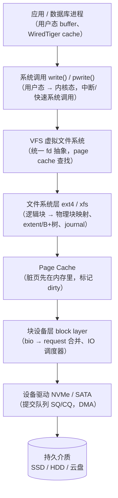

用文字画一遍（很多人面试时在白板上就是这么画的）：

```
write(fd, buf, n)
   │
   ├── ① 用户态 buffer ──copy_from_user──▶ 内核 page cache（此时 write 就可能返回了！）
   │                                        │
   │                                        ├── 脏页 (dirty page)，尚无任何磁盘 IO
   │                                        │
   │                                        ▼
   │                                   ② 回写线程 (kworker / flusher) 触发 writeback
   │                                        │
   │                                        ▼
   │                                   ③ 文件系统把脏页映射成 bio，交给块层
   │                                        │
   │                                        ▼
   │                                   ④ IO 调度器合并/排序，下发到设备队列
   │                                        │
   │                                        ▼
   │                                   ⑤ DMA 写入闪存/盘片 → 设备返回完成
   │                                        │
   └── fsync(fd) ──────────────────────────▶ ⑥ 等待上述全部完成 + 设备写缓存 flush（FLUSH CACHE 命令）
                                              │
                                              ▼
                                          ⑦ 真正掉电安全
```

### 1.2 `write()` 返回 ≠ 数据落盘："持久化"的四种语义

这张表是**面试必考、工作必用**的核心认知，请背下来：

| 操作 | 数据到哪了 | 进程崩溃 | OS 崩溃 | 断电 | 代价 |
|---|---|---|---|---|---|
| `write()` 返回 | 内核 page cache（脏页） | 安全 | **丢失** | **丢失** | 极低（纯内存拷贝，~1μs） |
| `write()` + `fdatasync()` | 数据块已落盘 | 安全 | 安全 | 安全（若设备缓存已 flush） | 高（一次真实 IO + cache flush） |
| `write()` + `mmap(MAP_SHARED)` | 写入页缓存，`msync` 才保证 | 安全 | **可能丢失** | **可能丢失** | 中 |
| `O_DIRECT` 写 | 绕过 page cache 直接下发设备 | 安全 | 安全 | 取决于设备缓存 | 高但可控，无双重缓存 |

> **一句话总结**：Linux 的默认文件 IO 是"**延迟写（write-back）**"，`write()` 只是个"把数据交给内核"的动作。**只有 `fsync` 家族才把"交给内核"升级成"交给硬盘"。**

**延伸：为什么数据库几乎都会额外维护自己的 WAL？**

因为即使有了 `fsync`，还有两个问题：

1. **随机写代价**。修改一个 4KB 页面里的 10 个字节，`fsync` 也要整页刷。如果 B+ 树的叶子分散在磁盘各处，一次事务要 fsync 很多页 —— 那是成百上千次随机 IO。
   WAL 的思路是：**把"随机写多个页"改成"顺序追加一条日志"**，一次 fsync 就够（还可以 group commit 合并多个事务）。
2. **崩溃恢复需要可重放的结构**。page cache 里的脏页在崩溃瞬间可能只写了一半（torn write），数据页结构可能损坏。日志是"先写意图、再改数据"（write-ahead），恢复时能补齐或回滚。

于是所有主流引擎（InnoDB redo log、WiredTiger journal、RocksDB WAL、PostgreSQL WAL）都长成同一个形状：

```
事务修改 → ① 写 WAL（顺序、fsync）→ ② 改内存数据页（脏页，慢慢刷）→ ③ checkpoint 记录"哪些页已落盘"
                │                              │
                └── 崩溃恢复靠它 ───────────────┘
```

这就是**卷二第 5 节**要展开的 WAL 通用模型。先记住一个结论：**"顺序追加 + fsync + 延迟刷脏页" 是数据库写性能的根基。**

---

## 2. 文件 IO 的三种方式

### 2.1 Buffered IO（默认方式）

```c
int fd = open("data.wt", O_RDWR);           // 默认带缓存
pwrite(fd, buf, 4096, offset);               // 数据进 page cache
fdatasync(fd);                               // 抖一下，落下
```

- **优点**：读命中 page cache 时零拷贝（数据直接在内存里）；写可以合并、可以延迟、可以预读。
- **缺点**：**双重缓存**（DB 自己的 buffer pool + OS page cache 各存一份，内存浪费一倍）；脏页回写时机不可控，可能造成"写抖动"（write stall）。
- **谁在用**：MySQL InnoDB（默认）、WiredTiger（默认，`directoryForIndexes` 无关）。

### 2.2 mmap（内存映射）

```c
void *p = mmap(NULL, 1GB, PROT_READ|PROT_WRITE, MAP_SHARED, fd, 0);
p[100] = 'x';            // 看起来是"改内存"，实际改的是 page cache
msync(p, 1GB, MS_SYNC);  // 才真正刷盘
```

**原理关键点（面试高频追问）**：

1. `mmap` 并**不**把文件读进内存。它只是建立"虚拟地址 → 文件偏移"的映射（`vm_area_struct`）。
2. 第一次访问某个地址会触发**缺页中断（major page fault）**，内核才去读磁盘那一页，并把它挂到 page cache。
3. 写映射区修改的是 page cache 里的物理页，标记为 dirty；**`msync`/`munmap` 才会回写**。
4. 因此 mmap **不能替代 fsync**，它只是把"系统调用 + 数据拷贝"换成"缺页 + 直接指针访问"，省掉了一次 `copy_from_user`。

**MongoDB 的 MMAPv1 就是纯 mmap 引擎，它踩了哪些坑（这段是历史但极有面试价值）**：

| MMAPv1 的问题 | 本质原因 |
|---|---|
| 内存用量"看起来"失控，RSS 一直涨 | 映射区被访问的页都算进 RSS，**操作系统认为这是 page cache，不会主动回收干净页以外的映射**（实际可回收，但监控很难看，且 `resident` 指标虚高） |
| 无法控制 cache 大小 | 缓存完全交给 OS 的 LRU，数据库无法按业务优先级淘汰 |
| 集合级锁 | 引擎只支持库/集合级锁，写并发差 |
| 空间碎片严重（padding factor） | 文档原地更新放不下就移动，产生空洞 |
| 崩溃后集合可能损坏 | 缺少 WAL（3.0 之前无 journal 默认关闭风险），页级半写无法修复 |

→ 这就是 **3.0 版本引入 WiredTiger 的根本动机**：要**自己掌控 cache、自己掌控淘汰、自己做文档级并发、自己写 WAL**。

### 2.3 Direct IO（O_DIRECT）

```c
int fd = open("data.wt", O_RDWR | O_DIRECT);
// buf 必须按 512B/4KB 对齐，长度也要对齐
```

- **绕过 page cache**，直接 DMA 到用户态 buffer。
- **优点**：**消除双重缓存**，内存账本清晰；读写的时机完全由应用决定（数据库自己就是最好的缓存管理者）。
- **缺点**：失去预读（readahead）和写合并；必须做 IO 对齐（否则 EINVAL）；小块随机写性能可能更差（每次都是一次真实设备 IO）。
- **谁在用**：WiredTiger 的 `directoryForIndexes` 之外，MongoDB 8.0 引入的 `--wiredTigerDirectoryForIndexes` 与 **`--wiredTigerEngineConfigString="...|direct_io=(true)"`** 可开启；RocksDB `use_direct_io_for_flush_and_compaction`；Oracle、SAP HANA 喜欢 O_DIRECT。

### 2.4 三种方式横向对比（面试可直接背这张表）

| 维度 | Buffered IO | mmap | O_DIRECT |
|---|---|---|---|
| 数据拷贝次数（写） | 2 次（用户→page cache→设备，若算 DMA 是 3 段） | 0 次显式拷贝（直接改 page cache） | 1 次（用户 buffer→设备 DMA） |
| 是否重复缓存 | **是**（DB cache + page cache） | **是** | **否** |
| 随机读性能（命中 cache） | 极好（纯内存） | 极好 | 差（每次真 IO） |
| 随机写性能 | 好（可合并、可延迟） | 好 | 一般（取决于设备） |
| 内存可控性 | 差（OS 决定） | 差 | 好 |
| 崩溃一致性 | 需 WAL + fsync | 需 msync + WAL，**半写风险更高** | 需 WAL + 对齐保证 |
| 典型代表 | InnoDB、WiredTiger 默认 | MMAPv1、LMDB、MongoDB 的 `--storageEngine=inMemory` 无关 | Oracle、RocksDB 可选、ScyllaDB |

**L3 级回答范例（面试可直接用）**：

> "WiredTiger 默认用 buffered IO 而不是 O_DIRECT，我认为是**权衡了通用性**。O_DIRECT 在 Linux 上要求文件系统支持对齐，跨平台（Windows/macOS）行为差异大，而且它放弃了预读 —— 对 MongoDB 这种'点查多、范围扫描也多'的负载，预读是有价值的。代价是内存被算了两次，所以官方要求 `cacheSizeGB` 不要超过内存 50%，剩下留给 page cache 和连接开销。"

### 2.5 `fsync` 家族：五个容易混淆的调用

| 调用 | 作用范围 | 刷元数据 | 典型用途 | 成本 |
|---|---|---|---|---|
| `sync()` | 全系统所有脏页 | 是 | 关机前、`echo 3 > drop_caches` 前 | 极高，全盘扫描 |
| `syncfs(fd)` | 该 fd 所在整个文件系统 | 是 | 容器/文件系统级 | 高 |
| `fsync(fd)` | 该文件的**数据 + 元数据**（size、mtime、inode） | 是 | **数据库 WAL 提交**（最常用） | 高（含一次 journal 提交 + 设备 cache flush） |
| `fdatasync(fd)` | 该文件的**数据 + 影响读取的元数据**（如 size），不刷 mtime | 否 | 追求极限性能的 WAL | 略低于 fsync |
| `sync_file_range(fd)` | 只发起回写、**不等待完成** | 否 | 预刷，用于"提前把脏页推下去"以削峰 | 低 |

**必须理解的细节：`fsync` 在 ext4 上的成本构成**

一次 `fsync` 大致包含三步，每一步都可能产生设备命令：

1. 把文件数据页回写（若文件系统是 `data=ordered` 模式，还要先确保数据页落盘，再提交 journal 事务）；
2. 提交文件系统 journal（元数据事务）—— **这是第二次 IO**；
3. 发送 `FLUSH CACHE` / `SYNCHRONIZE CACHE` 给设备，把设备自身的写缓存刷到介质 —— **这是第三次**。

所以**一次 fsync ≈ 2~3 次设备往返**。机械盘上单次往返 ~5–10ms，于是 fsync 上限约 100–200 次/秒（这直接解释了为什么"MySQL 单线程插入 QPS 只有几百"）。NVMe 上单次往返 ~20–100μs，可以到 1万–5万次/秒。

**优化手段（面试常问"怎么提升写吞吐"）**：

- **Group Commit（组提交）**：多个事务的日志合并成一次 fsync。InnoDB 有 binlog group commit 三阶段；WiredTiger 的 journal 也是批量提交（多个并发写者共享一次 fsync，谁先触发谁等）。
- **`O_DSYNC` / `fdatasync`** 替代 `fsync`，少刷 mtime。
- **把 WAL 放在独立设备**（专用 NVMe / 独立云盘），避免和数据文件争抢 IO 队列。
- **调大 `commitIntervalMs`（MongoDB）/ `innodb_flush_log_at_trx_commit=2`** —— 用"可能丢最近 1 秒"换吞吐，这是**明确的可靠性降级**，不是免费的。

### 2.6 掉电与 `fsync` 的残酷真相

三个必须知道的坑：

1. **磁盘写缓存是撒谎的**。企业级盘有带电容保护的写缓存（PLP, Power Loss Protection），普通消费级 SSD 没有。没有 PLP 的盘，`fsync` 返回成功但数据仍在盘内 DRAM 里，掉电就丢。**这是"上了云盘为什么还丢数据"的常见原因之一。**
2. **torn write（半写）**。4KB 页写到一半断电，页内 checksum 失败。WiredTiger 用**页级 checksum + journal 重放**应对；InnoDB 用 **doublewrite buffer**（先写一份连续副本，再写原位）应对。**为什么 InnoDB 需要 doublewrite 而 WiredTiger 不需要？** → 因为 WT 的页有 block checksum，且 journal 能重放到 checkpoint 起点，恢复时会丢弃损坏页（这是卷三 2.6/2.7 的伏笔）。
3. **`fsync` 返回"成功"不代表落盘**。Linux 在设备返回错误时会设置 `errseq`，但很多应用忽略 `fsync` 的返回值（正确姿势是检查返回值 + `fsync` 失败的 fd 必须视为不可用）。

---

## 3. Page Cache 与回写机制

### 3.1 Page cache 的组织

- Linux 用 `address_space`（每个 inode 一个）+ **xarray/radix tree** 索引"文件偏移 → 物理页"。
- 页大小默认 4KB（`getconf PAGESIZE`）。
- 一个页的状态位：`uptodate`（内容有效）、`dirty`（需回写）、`writeback`（正在回写）、`locked`。
- **page cache 是全局共享的**：所有进程读同一文件共享同一份页。这是"数据库 cache 之外的第二层缓存"，也是"为什么 MongoDB 重启后第一次查询慢、第二次快"的原因（但注意：MongoDB 重启后 WT cache 是冷的，命中 page cache 只是省了设备 IO，仍要走 WT 的页解密/解压/反序列化）。

### 3.2 脏页回写的三个触发器

```
① 空间水位：dirty page 超过 vm.dirty_background_ratio（默认 10%）
              → 后台 flusher 开始异步回写（应用不受影响）
           超过 vm.dirty_ratio（默认 20%）
              → 前台同步回写，write() 被阻塞 ← 这就是"写抖动/卡顿"的直接原因
② 时间水位：脏页存在超过 vm.dirty_expire_centisecs（默认 30s）
              → flusher 认为该刷了（所以"不 fsync 也可能 30 秒后落盘"）
③ 显式触发：fsync / sync / sync_file_range / drop_caches
```

**这张表的实战价值**：线上"每隔一段时间卡顿一下"、"写入延迟毛刺"，常见根因就是 `dirty_ratio` 被打满导致**前台回写**。调优方向：

- 数据库机器上通常会**调低** `dirty_ratio`（如 5%/10%），让小步快跑，避免大批量回写堵塞；
- 或者干脆用 `O_DIRECT` 把回写控制权从 OS 拿回来（数据库自己知道哪些页该刷）。

### 3.3 双缓存问题：为什么 `cacheSizeGB` 不能给满

```
物理内存 64GB
├── WiredTiger cache（默认 = max(256MB, 50% * (RAM-1GB)) ≈ 31GB）  ← 存解压后的 BSON 页
├── OS page cache（存放压缩后的 .wt 文件块，以及索引文件）             ← 需要足够空间承接回写与预读
├── 连接/聚合/排序内存（每个连接 ~几十 KB~MB，聚合有 100MB 上限）
└── 系统与副本进程
```

**如果 cache 给到 90%**：page cache 被挤到很小 → 回写时脏页没有落脚点 → 频繁直接回写 + 更严重的写放大 → **反而更慢**。这是"加内存反而变慢"的经典成因。

### 3.4 `drop_caches` 的三个级别

```bash
echo 1 > /proc/sys/vm/drop_caches   # 只清 page cache
echo 2 > /proc/sys/vm/drop_caches   # 清 dentry + inode（目录项/元数据缓存）
echo 3 > /proc/sys/vm/drop_caches   # 全清
# 注意：必须先 sync，否则脏页清不掉；生产环境慎用（会造成长时间 IO 风暴）
```

---

## 4. 内存管理：数据库的"另一半战场"

### 4.1 虚拟内存与缺页

```
进程虚拟地址空间
├── 代码段 .text / 数据段 .data / BSS
├── 堆 heap（brk / mmap 分配的 arena）
├── 栈 stack（每线程 8MB 默认）
├── 共享库
└── mmap 区域（文件映射 / 匿名映射）
```

每个虚拟页通过**多级页表**（x86-64 四级：PGD→PUD→PMD→PTE）映射到物理页；TLB 缓存最近的映射。
**缺页中断的两种类型**（面试常考区分）：

| 类型 | 触发条件 | 代价 |
|---|---|---|
| **Minor fault（次缺页）** | 页已在 page cache，只是没建立进程页表项（如 mmap 后首次访问、COW 复制） | 低（纯内存操作，~1μs） |
| **Major fault（主缺页）** | 页不在内存，需要读磁盘 | **高（一次 IO，几十 μs~ms）** |

→ 监控 `pgmajfault` 就能判断"数据库是不是真的在打盘"。

### 4.2 匿名页 vs 文件页、swap、OOM

| 页类型 | 内容 | 能否回收 | 备注 |
|---|---|---|---|
| 文件页（file-backed） | page cache、mmap 的文件 | **可回收**（干净页直接丢，脏页先写回） | 数据库数据文件属于此类 |
| 匿名页（anonymous） | 堆、栈、malloc 出来的内存 | 需 swap 才能回收 | 数据库一般**关闭 swap**（`vm.swappiness=1`），避免"内存抖动导致延迟爆炸" |

**OOM Killer**：当内存耗尽且无法回收时，内核按 `oom_score`（大致与 RSS 成正比）杀进程。数据库进程通常 RSS 最大，**所以最容易被杀**。这就是为什么生产上要求：
- `vm.overcommit_memory` 配置合理（2 = 严格，避免"申请成功但实际无法分配"）；
- 容器里必须设置 memory limit，且 **数据库 cache 要按容器 limit 计算，而不是宿主机内存**（容器内 `free` 看到的是宿主机内存，是经典事故源）。

### 4.3 Huge Page / THP

- 2MB（或 1GB）大页可以把 4KB 页表项数量降为 1/512，**TLB 命中率大幅提升**，对大内存随机访问（正是数据库的访问模式）收益明显。
- 但 **THP（Transparent Huge Page）的 `always` 模式会造成"内存碎片 + khugepaged 抢占 CPU + 延迟毛刺"**，MongoDB / Redis / MySQL 官方都建议：
  ```bash
  echo never > /sys/kernel/mm/transparent_hugepage/enabled
  echo never > /sys/kernel/mm/transparent_hugepage/defrag
  ```
  → 理由不是"大页不好"，而是"**透明**大页的**合并动作不可控**"。

### 4.4 NUMA

多路服务器上，CPU 访问本地内存 ~80ns，跨 socket 访问 ~150–300ns。数据库若把内存分配在一个 socket、线程调度在另一个 socket，性能可降 20%+。
常见处置：`numactl --interleave=all`（内存交错分配），或按 NUMA 绑核部署多实例。

### 4.5 内存分配器

| 分配器 | 特点 | 谁在用 |
|---|---|---|
| glibc malloc (ptmalloc) | 每线程 arena，易碎片，多线程竞争 arena 锁 | 默认 |
| **tcmalloc** | 线程本地缓存，小对象快，支持 `MallocExtension::ReleaseFreeMemory` | MongoDB 官方**推荐并打包**（jemalloc 也支持） |
| **jemalloc** | 大小类分桶（size class），碎片控制好，Redis 默认 | Redis、MongoDB 可选 |

**为什么数据库在意分配器**：长时间运行后"RSS 只涨不降"，往往是分配器把 free 的内存留在 arena 里不还给 OS（不是因为内存泄漏）。判断方法：看 `smaps` 里的 `heap` 与 `arena` 分布，或用 `MALLOC_CONF` 调整 `dirty_decay_ms`。

### 4.6 内存账本：RSS / VSZ / 实际

| 指标 | 含义 | 陷阱 |
|---|---|---|
| VIRT/VSZ | 虚拟地址空间大小 | 包含 mmap 映射、未提交内存，**毫无参考价值** |
| RES/RSS | 实际驻留物理页 | mmap 的**干净页也算**，所以 MMAPv1 时代 RSS 虚高 |
| `smaps_rollup` 的 Pss | 按共享比例分摊的物理内存 | 多进程共享库时更准确 |
| cgroup `memory.current` | 容器真实用量（含 page cache） | **page cache 也算**，容易误判为"内存超限" |

---

## 5. 磁盘与 IO 栈

### 5.1 介质延迟数量级（面试常拿来考"为什么慢"）

| 介质 | 随机读延迟 | 顺序带宽 | 随机 IOPS（4K） | 备注 |
|---|---|---|---|---|
| 内存 | ~100ns | ~50GB/s | — | 基准 |
| NVMe SSD | 20–100μs | 3–7GB/s | 10万–100万 | 队列深度大，多队列并行 |
| SATA SSD | 100–200μs | 500MB/s–1GB/s | 2万–8万 | 受 AHCI 单队列限制 |
| 机械盘 HDD | **5–10ms**（寻道+旋转） | 100–200MB/s | 100–200 | 随机 IO 是灾难 |
| 网络（同机房） | 0.1–1ms | 1–10Gbps | — | 跨机房 1–10ms |

> 一个极其重要的对比：**内存随机访问比 NVMe 随机读快约 1000 倍，比 HDD 快约 10 万倍。**
> 这就解释了为什么所有数据库都在拼命"把随机写变成顺序写、把随机读变成内存读"。

### 5.2 顺序 vs 随机、写放大（WAF）

- **顺序写**：追加到文件尾部，HDD 磁头不用移动，SSD 可以整块编程 → 接近带宽上限。
  → 所有 WAL 都是顺序写，这就是它"便宜"的根本原因。
- **随机写**：HDD 要寻道（~5ms），SSD 要擦除-写入新块并更新 FTL 映射 → 慢，且产生**写放大**。
- **SSD 写放大（WAF）公式**：`WAF = 实际写入闪存的数据量 / 主机写入的数据量`。GC（垃圾回收）时搬运有效页会放大 WAF，WAF=2 意味着寿命减半。**OP（over-provisioning，预留空间）越大、写入越顺序，WAF 越接近 1。**
- **TRIM**：告诉 SSD "这些块已无效，可以回收"，否则 GC 会搬运"已删除但 SSD 不知道"的数据。

### 5.3 IO 调度器

| 调度器 | 适用 | 说明 |
|---|---|---|
| `none` / `noop` | **NVMe / SSD 首选** | SSD 内部自带调度，内核再排反而增加延迟 |
| `mq-deadline` | 通用多队列 | 保证读延迟上限，防饿死 |
| `bfq` | 桌面/交互 | 按进程权重分配带宽，**服务器不要用** |
| `kyber` | 低延迟 | 读/写双队列限深度 |

### 5.4 块层做了什么（这部分能答出来是 ★★☆ 亮点）

`bio`（block IO）描述"我要读哪个逻辑块几页" → 进入 `blk-mq` 多队列 → 调度器合并相邻 bio（**plug/unplug 机制**能进一步批量合并）→ 转成 `request` → 下发设备 SQ → 完成后通过 CQ 中断/轮询回收。

**这就是"顺序写的另一个红利"：相邻 bio 能合并成一个大 IO，一次 DMA 搬更多数据。**

### 5.5 压测：怎么证明"磁盘不是瓶颈"

```bash
# 随机写 4K，队列深度 32，测 IOPS 与 p99 延迟
fio --name=randwrite --ioengine=libaio --direct=1 --bs=4k \
    --rw=randwrite --iodepth=32 --numjobs=4 --size=4G \
    --runtime=60 --time_based --group_reporting

# 顺序写 128K，测带宽（WAL 场景）
fio --name=seqwrite --ioengine=libaio --direct=1 --bs=128k \
    --rw=write --iodepth=8 --size=4G --runtime=60 --time_based
```

关键指标：`iops`、`bw`、`clat p99/p999`（**平均值毫无意义，数据库只看长尾**）、`lat` 分布。

---

## 6. 文件系统

### 6.1 核心概念

| 概念 | 说明 | 与数据库的关系 |
|---|---|---|
| **inode** | 文件的元数据（权限、大小、块指针），不含文件名 | 小文件多会耗尽 inode（`df -i`） |
| **dentry** | 目录项 → inode 的映射，内存中缓存 | 目录里文件过多会导致查找变慢（ext4 用 htree） |
| **extent** | 连续物理块的描述（ext4 默认） | 大文件顺序布局好，碎片少 |
| **XFS B+ tree** | 用 B+ 树管理空闲空间与 extent | 大文件、高并发表现优于 ext4，**数据库盘推荐 XFS** |

### 6.2 journaling 模式（ext4）

| 模式 | 写什么进 journal | 数据安全 | 性能 |
|---|---|---|---|
| `data=journal` | 数据 + 元数据都写 | 最高 | 最差（数据写两次） |
| **`data=ordered`（默认）** | 只写元数据，但**保证数据块先于元数据提交** | 高（不会出现"元数据指向未写数据"） | 好 |
| `data=writeback` | 只写元数据，不保证顺序 | 低（崩溃后可能读到旧数据） | 最好 |

> **为什么数据库盘上 ext4 用 `ordered` 很重要**：`writeback` 模式下崩溃后可能出现"文件大小变了但内容是旧的"，对 B+ 树这种自校验结构是灾难。

### 6.3 文件预分配与碎片

- `fallocate(fd, 0, 0, size)`：**直接分配物理块，不写零**（比 `dd` 快几个数量级）。MongoDB 的 journal 预分配、Kafka 的 segment 都靠它。
- 不预分配 + 边写边扩，会导致文件被打散成碎片 → 顺序写退化为随机写 → 吞吐骤降。
- 检查碎片：`filefrag -v /data/db/collection-0.wt`（看 extent 数量）。

### 6.4 `fsync` 在文件系统上的"抖动"

现象：**每 N 秒出现一次 100ms+ 的写延迟尖刺**。常见原因：
1. ext4 journal 提交与数据回写撞车；
2. 脏页批量回写把设备队列打满（`dirty_ratio` 触顶）；
3. 云盘的**突发额度（burst）耗尽**，限速从 3000 IOPS 掉到 300；
4. `fdatasync` 未对齐，触发 read-modify-write（4K 部分写要读整页再改再写）。

---

## 7. 进程、线程与并发

### 7.1 系统调用成本

一次 `syscall` 大约 100–300ns（不算真正工作）。**但 `fsync`、`read` 这类会阻塞的调用，成本是"设备延迟 + 上下文切换 + 调度"。**

减少系统调用的手段：`vDSO`（gettimeofday 等不走内核）、批量 IO（`io_uring`、`preadv`）、**`io_uring`（Linux 5.1+）**——提交/完成队列都在共享内存，一次 `io_uring_enter` 可提交上百个 IO，这是当前高性能存储的主流方案（RocksDB、ScyllaDB 已支持）。

### 7.2 线程模型对比（数据库网络层必考）

| 模型 | 代表 | 优点 | 缺点 |
|---|---|---|---|
| **one-thread-per-connection** | MySQL（默认）、MongoDB | 实现简单、隔离性好 | 连接数上万时线程切换与栈内存（8MB/线程）爆炸 |
| **线程池 + 队列** | MySQL thread pool、MongoDB 的 `serviceExecutor` | 可控并发度 | 长事务会占住 worker（队头阻塞） |
| **Reactor + 事件循环** | Redis、Node、Netty、Kafka | 少量线程撑高并发、无锁 | 单条慢命令阻塞所有人（Redis 的"大 key 阻塞"） |
| **协程/用户态线程** | Go（goroutine + netpoller）、Scylla | 兼顾并发与简单 | 调度器复杂度、GC 停顿 |

**MongoDB 实际是混合模型**：每个连接一个线程（`serviceExecutor` 可配 `synchronous`/`adaptive`），配合 **WT 内部的 ticket 机制**限制真正同时执行 IO 的线程数（默认读 128 / 写 128）。这个设计的精妙之处在于：**用少量 ticket 把"上百个线程并发打盘"变成"128 个有序进入 WT"，既避免了 WT 内部数据结构争用，又避免了 IO 队列被压垮。**

### 7.3 锁原语速览

| 原语 | 场景 | 代价 |
|---|---|---|
| `futex`（用户态自旋 + 内核等待） | pthread mutex/cond | 无竞争时纯用户态 |
| 自旋锁 | 极短临界区（内核） | 浪费 CPU |
| **RCU** | 读多写极少（路由表、配置） | 读者零开销 |
| CAS/原子指令 | 无锁计数、乐观锁 | 缓存行争用（`false sharing`） |
| **ticket / 信号量** | 限制并发度 | 排队延迟，但保护下游 |

### 7.4 CPU 缓存与伪共享

- Cache line 64B。两个线程分别改**同一 line 内的不同变量**，会导致 line 在两个核之间来回失效（ping-pong），性能可掉 10 倍。
- 解法：`alignas(64)` 填充、每线程独立计数器、`__thread` 变量。

**为什么提这个**：数据库的统计计数器（QPS、命中率）如果用全局变量，就会成为热点；MongoDB 的 `serverStatus` 内部用了大量分片计数来规避。

---

## 8. 网络 IO（数据库的网络层）

### 8.1 epoll 原理（★★★★☆ 高频）

```c
int ep = epoll_create1(0);
epoll_ctl(ep, EPOLL_CTL_ADD, fd, &ev);   // 把 fd 注册进内核的红黑树，并挂上回调
epoll_wait(ep, events, maxevents, timeout); // 只返回"就绪链表"里的 fd
```

内核侧结构：

```
epoll 实例
├── 红黑树 rbr：所有被监听的 fd（O(log n) 增删）
└── 就绪链表 rdllist：已就绪的 fd（就绪事件由设备驱动的回调主动挂入）
```

**关键洞察（面试拉开差距的点）**：

- `select/poll` 是**轮询**：每次调用都要把 fd 集合从用户态拷到内核，内核遍历全部 fd，O(n)。
- `epoll` 是**回调 + 就绪队列**：fd 就绪时由内核回调把它挂进 rdllist，`epoll_wait` 只需看链表 —— **复杂度与总连接数无关**，只与就绪数有关。这就是"1 万连接只有 10 个活跃"的场景下 epoll 完胜的原因。
- **LT（水平触发）vs ET（边缘触发）**：
  - LT：只要缓冲区还有数据，每次 `epoll_wait` 都返回该 fd —— 编程简单，但可能重复唤醒。
  - ET：只在"状态变化"时通知一次 —— 必须**一次性读到 `EAGAIN`**，否则数据会滞留（Redis/Netty 都用 ET 或类似语义）。
- **惊群（thundering herd）**：多线程同时 `epoll_wait` 同一 epoll fd，事件到来时全部唤醒。Linux 4.5+ 的 `EPOLLEXCLUSIVE` 可缓解。

### 8.2 零拷贝（Kafka 的灵魂，★★★★☆）

```
传统 read+write 发文件给客户端（4 次拷贝、4 次用户/内核切换）：
 磁盘 → DMA → 内核 page cache → 拷贝 → 用户 buffer → 拷贝 → socket buffer → DMA → 网卡

sendfile（2 次拷贝、2 次切换）：
 磁盘 → DMA → page cache ──────(内核内直接挂到 socket buffer，只拷元数据)──────→ DMA → 网卡
```

| 方案 | 拷贝次数 | 谁用 |
|---|---|---|
| `read + write` | 4 | 朴素实现 |
| `mmap + write` | 3 | 小文件 |
| **`sendfile`** | **2（且无 CPU 拷贝）** | **Kafka**（`FileChannel.transferTo`） |
| `splice` | 2（可跨 socket 管道） | 代理转发 |

**Kafka 为什么敢用 sendfile**：它的消息是**不可变追加日志**，消费者读到的就是磁盘上的原始字节，无需在用户态加工 → 完美契合零拷贝。**而 MongoDB 的查询结果必须反序列化 BSON、应用过滤条件，所以不可能零拷贝** —— 这是两者定位差异的物理体现。

### 8.3 TCP 参数与数据库连接

| 参数 | 作用 | 数据库场景建议 |
|---|---|---|
| `TCP_NODELAY` | 关闭 Nagle 合包 | **数据库必须开**，否则小请求被延迟 40ms |
| `SO_KEEPALIVE` | 探活 | 长连接池建议开，或用应用层心跳 |
| `backlog` | accept 队列长度 | 高并发下过小会导致握手失败（`tcp_abort_on_overflow`） |
| `TIME_WAIT` | 主动关闭方保持 2MSL | 短连接风暴会耗尽端口，应使用**连接池** |
| `SO_REUSEPORT` | 多进程监听同端口 | 多实例部署提升 accept 性能 |

**连接池的真相（面试常问"为什么连接数不能开太大"）**：

- 服务端每连接一个线程 → 线程栈 8MB（虚拟，实际按需）+ 调度开销 + WT 的 ticket 排队。MongoDB 官方建议单实例连接数控制在数百到数千，超过就要用 mongos 分摊或加中间件。
- **连接数过多的典型症状**：`context switches` 暴涨、`load average` 高但 CPU 利用率不高、请求排队时间远大于处理时间。

---

## 9. 卷一小结：把"底层"和"数据库设计"连起来

这张因果图是**整份文档的骨架**，也是面试"你能不能串起来"的答案：

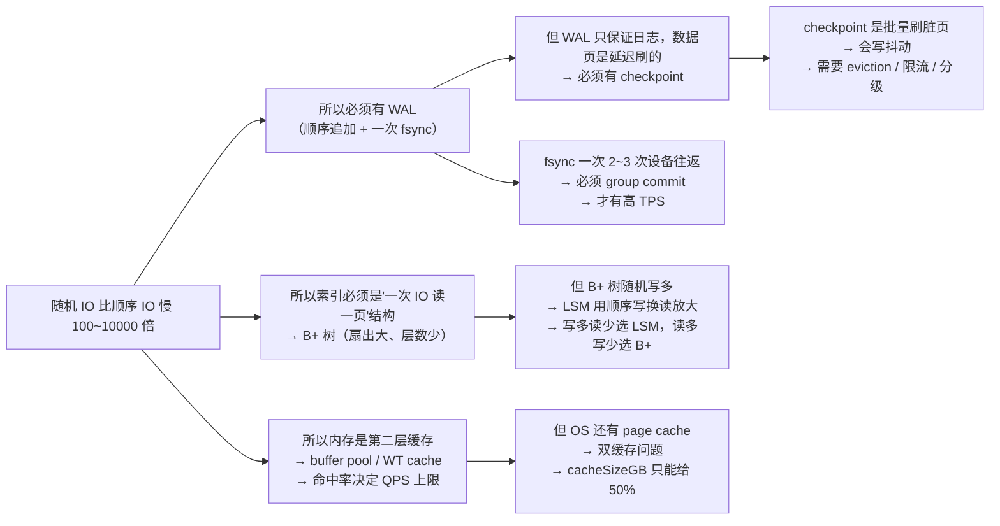

**卷一的 7 个"必须能脱口而出"的结论**：

1. `write()` 返回 ≠ 落盘，`fsync` 才是承诺；一次 fsync ≈ 2–3 次设备往返。
2. 顺序写便宜、随机写昂贵 → **WAL 是所有引擎的共同答案**。
3. 双缓存（DB cache + page cache）导致内存要分两半用。
4. `dirty_ratio` 打满会引发前台回写 → 写延迟毛刺。
5. 缺页分 minor/major，`pgmajfault` 才代表真打盘。
6. epoll 的 O(1) 来自"回调 + 就绪链表"，不是"更快的内存拷贝"。
7. 零拷贝（sendfile）只适用于"字节原样输出"的系统 → 解释了 Kafka 与 MongoDB 的架构分野。

---

# 卷二 存储引擎的数据结构与通用机制

> 卷一是"物理世界"的约束，卷二是"人类发明的应对方案"。**MongoDB、MySQL、RocksDB、Redis 的差异，本质是这里几种方案的排列组合。**

## 1. 为什么需要索引：一次量化推演

假设有一张 1000 万行的表，每行 1KB，总共 10GB，存在一个"只能按 4KB 页读写"的设备上。

| 方式 | 查找一条记录 | 缺点 |
|---|---|---|
| 全表扫描 | 最坏读 250 万个页（10GB/4KB） | 完全不可用 |
| 哈希索引 | 1 次 IO（算 hash 直接定位页） | **不支持范围查询**（`>`、`between`、排序全会退化成全扫） |
| 二叉搜索树 | 树高 log2(1000万) ≈ 24 层 → **24 次 IO** | 每次 IO 只取 4KB 里的 1 条记录，**扇出太低** |
| **B+ 树** | 树高 3 层 → **3 次 IO** | 每次 IO 取一整个页（上千个 key），扇出极高 |
| LSM | 最坏要查 N 层 SST + 每层多个文件 | 读放大，但有 Bloom Filter 兜底 |

> **核心结论：B+ 树的优势不在"树"这个形状，而在于"节点大小 = 磁盘页大小"这个设计。它让单次 IO 的价值最大化。**

---

## 2. B-Tree / B+Tree

### 2.1 定义与性质

**m 阶 B+ 树**（MySQL 官方定义为"m 叉平衡树"，不同教材表述有差异，按以下口径最稳妥）：

1. 每个节点最多 m 个孩子、m-1 个 key；
2. 除根外，每个内部节点至少 ⌈m/2⌉ 个孩子；
3. 所有**数据都在叶子层**，叶子之间用双向链表相连（这是"范围扫描"高效的原因）；
4. 所有叶子在同一深度 → **任何查找都是相同的 IO 次数**（这点对尾延迟极重要：**延迟可预测**）；
5. 内部节点只存 key（+ 指针），不存数据 → **扇出更大、树更矮**。

**对比 B 树**：B 树内部节点也存数据，扇出小、树更高；且范围查询要中序遍历回溯。**B+ 树用"数据只放叶子 + 叶子链表"换来了更高的扇出和更好的范围扫描，代价是点查必须走到叶子（多一层，但层数少所以无所谓）。**

### 2.2 扇出怎么算（★★★★☆ 面试必答的计算）

```
页大小 P = 16KB
内部节点每项：key K + 子指针 ptr
  若 K = 8B, ptr = 8B → 每项 16B
扇出 f = P / 16 = 1024

层数 L = 3 时的容量（叶子存真实行）：
  内部节点（根）     : 1024 个指针
  第二层             : 1024 × 1024 = 1048576 个指针
  叶子               : 1048576 个叶子页，每页假设放 16 行（行 1KB）
  → 总行数 = 1048576 × 16 ≈ 1677 万行，3 次 IO 覆盖
```

再看极端情况：**若每行只有 100B（约 150 行/页）**，3 层可覆盖 **1.5 亿行**。

**为什么 SQLite / InnoDB 都选 16KB 页**：太小 → 层数多、扇出小；太大 → 一次 IO 搬空页，浪费带宽、写放大，且页内二分查找的 CPU 成本上升。16KB 是"一次 IO 传输效率"与"页利用率"的平衡点。

**MongoDB 的特殊性**：WiredTiger 的默认 `internal_page_max = 4KB`、`leaf_page_max = 32KB`。内部页更小是为了**减少内部节点的写放大**（内部页会被 checkpoint 频繁刷），叶子页更大是为了放更多 BSON（减少 IO 次数）。这也解释了"为什么 Mongo 的索引树比 MySQL 高一点点，但叶子更肥"。

### 2.3 插入、分裂、删除、合并

**插入（以 16KB 页、扇出 1024 为例）**

```
① 从根开始二分查找 → 定位到目标叶子页
② 叶子页插入 key-value：
   ├── 页有空间 → 原地插入，标记 dirty（1 次 IO 读 + 事后 1 次写，异步）
   └── 页满 → 分裂 split：
          ├── 把页内 key 一分为二（约各 50%）
          ├── 新页加入父节点的子指针列表
          └── 若父节点也满 → 递归向上分裂 → 最坏到根，根分裂则树高 +1
③ 更新叶子链表指针（这在 WT 的 B+ 树里通过 cell 的 next 指针维护）
```

**关键点**：
- **分裂是"就地 + 新页"**，会触发一次 **checkpoint 期的大量随机写**；这也是 B+ 树"写放大"的来源（一次小插入可能引发多层页修改）。
- **分裂后的页填充率约 50%** → 空间利用率不是 100%，B+ 树的稳态填充率通常在 60–70%（这是空间放大）。
- **顺序插入 vs 随机插入**：自增主键顺序插入几乎只在最右叶子追加（**页分裂少**）；随机 UUID 插入会到处分裂（**写放大、碎片严重**）。→ 这就是"为什么用 UUID 做主键性能差"的原理（MySQL 更明显，因为聚簇索引）。

**删除**

```
① 找到叶子 → 删除 key
② 若页内 key 数 < ⌈m/2⌉ → 向兄弟"借"（redistribute）或"合并"（merge）
③ 合并会级联到父节点，最坏树高 -1
```

**生产真相**：多数引擎**不做激进合并**（InnoDB 只在页利用率极低时合并；WiredTiger 依赖 eviction 与 checkpoint 重组）。
→ 所以"删了大量数据后文件不缩小"是普遍现象，需要 `compact` 重建：
```javascript
db.runCommand({ compact: "collection" })   // MongoDB，4.4+ 可对副本集成员在线执行
```

### 2.4 为什么不用红黑树 / 跳表 / 哈希做磁盘索引

| 结构 | 树高/查找 | 为什么不适合磁盘主索引 |
|---|---|---|
| 二叉搜索树/AVL/红黑树 | log2(n) ≈ 24 层（1000万） | 每层一次 IO，**24 次 vs 3 次**；且节点只放 1 个 key，扇出=2 |
| 跳表（SkipList） | 期望 log2(n) | 内存结构，随机指针访问，无法保证"一次 IO 取一页"；但**适合内存索引**（Redis zset、RocksDB memtable） |
| 哈希 | O(1) | **不支持范围查询、排序、前缀扫描**；且有 hash 冲突与扩容 rehash 问题 |

**能不能答出"哈希索引在 MongoDB 里其实存在"是加分项**：MongoDB 的 `hashed` 分片键用的就是哈希（保证均匀分布），但 `hashed` 索引只支持等值查询，`$gt` 之类会全扫。

---

## 3. LSM-Tree（Log-Structured Merge Tree）

> 这是"写优化"路线的代表。**RocksDB、LevelDB、Cassandra、HBase、TiKV（RocksDB）、Elasticsearch 的 Lucene（类似思想）都是 LSM 家族。**

### 3.1 结构全景

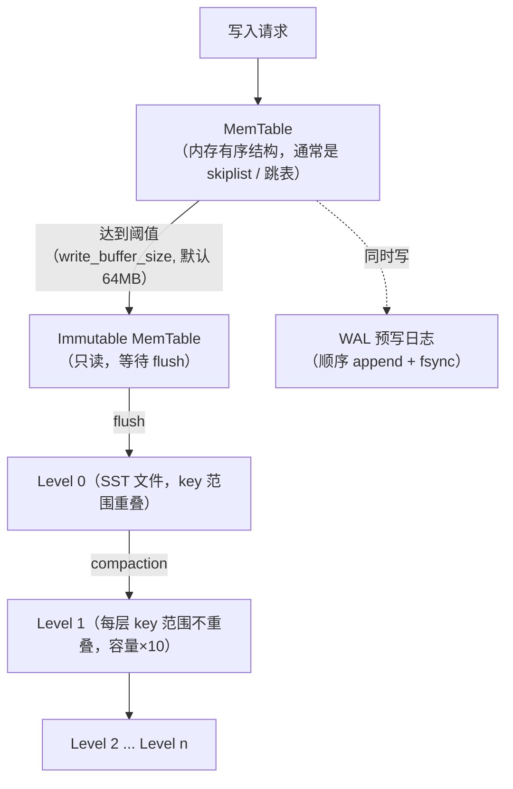

```
目录结构（LevelDB/RocksDB）
├── CURRENT           → 指向当前 MANIFEST
├── MANIFEST-000001   → 版本信息：每层有哪些 SST 文件、各自的 key 范围
├── 000003.log        → WAL
├── 000005.sst        → SSTable 文件（有序 key）
└── LOCK
```

### 3.2 写路径（为什么 LSM 写快）

```
① 写 WAL（顺序追加，可选 fsync）              ← 1 次顺序写
② 插入 memtable（内存跳表，O(log n)）          ← 无磁盘 IO
③ 返回成功
④ 后台：memtable 满 → 变 immutable → flush 成 L0 SST（顺序写）
⑤ 后台：compaction 把 L0..Ln 合并、下推（顺序读写大批量文件）
```

**核心优势**：**用户可见的写永远是"1 次顺序 WAL + 1 次内存插入"，从不随机写**。所以 LSM 的写吞吐远高于 B+ 树（尤其在 HDD 上）。

### 3.3 读路径（LSM 的最大代价）

```
① 查 memtable（内存）
② 查 immutable memtable（内存）
③ 查 L0 的每个 SST（key 范围重叠，可能要看多个文件）  ← 最坏 O(L0 文件数)
④ 查 L1..Ln（每层二分定位 1 个文件）
⑤ 每个 SST 内部：Bloom Filter 判断"可能存在" → index block 二分 → data block 读取 → 解码
⑥ 合并多版本，取最新/最旧（取决于快照）
```

**读放大的量化**：一层 L 有 `10^(L-1)` 倍容量，若总数据 1TB、L0 每文件 64MB，则 L0 就有几十个文件。一次点查最坏要访问 **L0 文件数 + 层数（约 7 层）= 数十次 IO**。这就是为什么 LSM 必须有 **Bloom Filter**（把"不存在"的判断压到内存里一次搞定）。

### 3.4 三种放大（面试最爱考的三元悖论）

| 放大类型 | 定义 | B+ 树 | LSM | 优化手段 |
|---|---|---|---|---|
| **写放大** | 实际写入字节 / 逻辑写入字节 | 中等（页分裂 + 整页写，约 2–10×） | **高**（每层 compaction 都要重写一遍，leveled 约 10–30×） | tiered compaction、更大的层级倍数、减少层数 |
| **读放大** | 一次查询实际读的字节 / 需要的字节 | 低（3 次 IO） | **高**（多层多文件） | Bloom Filter、block cache、prefix bloom、index 全内存 |
| **空间放大** | 磁盘占用 / 逻辑数据量 | 低（页填充率 60–70%） | **高**（多版本 + tombstone + 未合并的旧文件） | 定期 major compaction、TTL |

> **一句话总结（L3 级表达）**：
> "B+ 树是'读优化'，用随机写换低读放大；LSM 是'写优化'，用读放大和空间放大换顺序写。选哪个取决于读写比和设备类型 —— **写多读少、HDD、需要高吞吐摄入 → LSM；读多写少、需要稳定低延迟、范围扫描多 → B+ 树**。"

### 3.5 Compaction 策略

| 策略 | 做法 | 写放大 | 读放大 | 空间放大 | 代表 |
|---|---|---|---|---|---|
| **Leveled**（分层） | 每层 key 范围不重叠，Ln 满则挑一个文件与 Ln+1 重叠部分合并 | 高（数据被反复重写 ~10–30×） | 低（每层只查 1 个文件） | 低 | LevelDB、RocksDB 默认 |
| **Tiered**（分层级） | 每层允许多个重叠文件，攒够一批再合并 | 低（~4–6×） | 高 | 高 | Cassandra、ScyllaDB |
| **Universal / FIFO** | 大小相近的文件合并，FIFO 直接删最老的 | 最低 | 高 | 可控 | 时序场景（Prometheus、InfluxDB） |

**RocksDB 的 write stall（必知的生产问题）**：当 L0 文件数超过 `level0_slowdown_writes_trigger`（默认 20）→ 主动降速；超过 `level0_stop_writes_trigger`（默认 36）→ **完全停止写入**。所以"RocksDB 写入突然卡住 1 秒"往往是 compaction 跟不上，需要调 `max_background_jobs`、`write_buffer_size` 或换 tiered。

### 3.6 Bloom Filter（为什么它几乎是 LSM 的救命稻草）

- 原理：k 个哈希函数把 key 映射到位数组的 k 个位，全为 1 才"可能存在"。
- **误判率公式**：`p ≈ (1 - e^(-kn/m))^k`，其中 n 个元素、m 位、k 个哈希。k 最优 = `(m/n) ln2 ≈ 0.69 * 位数/元素`。
- 例：10 bits/元素、k=7 → 误判率约 **0.8%**。
- **RocksDB 的优化**：`prefix bloom`（前缀查询）、`whole key filtering`（避免同 key 多版本误判）、**`Ribbon filter`**（比 Bloom 省 30% 空间）。
- **MongoDB 不用 Bloom Filter**（因为 B+ 树点查本来就是一次 IO，不需要"预判不存在"）；**ES 用 FST + terms index**（另一种前缀索引结构）。

### 3.7 Tombstone：删除为什么在 LSM 里很贵

删除不真删，而是写一条 `key → TOMBSTONE`。真正的空间回收要等 compaction 把旧版本和 tombstone 一起合并掉。
→ **后果**：大量删除后磁盘不降、读变慢（要扫更多 tombstone）；TTL 数据在 LSM 上很常见（Kafka 用时间切 segment 直接删文件，比 LSM 的 tombstone 高效得多）。

---

## 4. 其他索引结构速览

| 结构 | 原理 | 用在哪 | 关键点 |
|---|---|---|---|
| **哈希索引** | key → hash → bucket | MongoDB hashed 分片键、Redis、InnoDB 自适应哈希 | 只支持等值；哈希冲突退化为链表 |
| **跳表 SkipList** | 多层链表 + 随机层高 | RocksDB memtable、Redis zset | 实现简单、无锁友好、范围查询好；**纯内存结构** |
| **倒排索引 Inverted Index** | term → posting list（docId 列表） | Elasticsearch / Lucene | 分词 + 词典（FST）+ posting list（跳表/roaring bitmap） |
| **位图 RoaringBitmap** | 分段压缩位图 | ES filter cache、ClickHouse、Doris | 交并差极快，适合低基数多维过滤 |
| **向量索引 HNSW/IVF** | 近似最近邻图 | Milvus、ES 8.x、MongoDB Atlas Vector Search | 召回率 vs 延迟权衡 |
| **GEO 索引（2dsphere）** | GeoJSON + 球面几何，S2/Hilbert 曲线编码 | MongoDB 地理查询 | Geohash 前缀匹配 = 范围查询 |

---

## 5. WAL 与 checkpoint 的通用模型（ARIES）

> **这一段是"所有数据库原理"的最大公约数。** 无论 InnoDB、WiredTiger 还是 RocksDB，都遵循同一套逻辑。

### 5.1 WAL 的三条铁律

```
① Write-Ahead：日志必须先于数据页落盘
     （若数据页先落盘、日志后落盘，崩溃后无法判断该页是否有效）
② 日志必须能"重放"（redo）：记录"对某页做了什么"，而不是"页的新内容"（physiological logging）
③ 日志必须能"回滚"（undo）：记录旧值，用于未提交事务的回滚与 MVCC 读
```

**为什么是"逻辑 + 物理"混合（physiological）**：如果只记"新页内容"（物理），一条记录很大（16KB）；如果只记"逻辑 SQL"（逻辑），恢复时要重跑查询，不确定性强。所以主流做法是 **"对页 X 的偏移 Y 做操作 Z"** —— 既小又确定。

### 5.2 三个关键 LSN

| 概念 | 含义 |
|---|---|
| **LSN（Log Sequence Number）** | 日志的单调递增序号，每页头部记录"最后一次修改我的 LSN"（`page_lsn`） |
| **Checkpoint LSN** | "此 LSN 之前的所有修改都已落盘"，恢复从这里开始 |
| **Flushed/持久化 LSN** | 已确认落盘的日志位置（用于 `w:majority` 的 commit point） |

**恢复算法（ARIES 三阶段）**：

```
① Analysis（分析）：从最近 checkpoint 扫描日志，构建"脏页表 DPT"与"活跃事务表 ATT"
② Redo（重做）：从 DPT 里最小的 recLSN 开始，重放所有日志（不管事务是否提交）—— 幂等
③ Undo（回滚）：把 ATT 里未提交的事务按 LSN 逆序回滚（写入 CLR 补偿日志，避免二次崩溃重复回滚）
```

**MongoDB WiredTiger 的差异**：WT 不做 undo 阶段（它靠 **MVCC + history store 保留旧版本**，未提交的修改直接丢弃，因为数据页在 checkpoint 前不会落盘，落盘的只有已提交的一致性快照）。这点在卷三 2.7 会详细讲。

### 5.3 Checkpoint 的两种模式

| 模式 | 做法 | 优点 | 缺点 |
|---|---|---|---|
| **Sharp checkpoint**（全量） | 停写 → 全部脏页刷盘 → 记录 LSN | 恢复快、日志可截断 | **停写时间长**，不可接受 |
| **Fuzzy checkpoint**（模糊） | 不停写，持续刷脏页，只要"某 LSN 之前的页都落盘"就可推进 checkpoint | 不影响服务 | 日志要保留更久，恢复要重放更多 |

**所有现代引擎都用 fuzzy checkpoint。** 具体实现差异：
- InnoDB：后台 page cleaner 线程持续刷，checkpoint LSN 取"最老脏页的 LSN"；
- WiredTiger：每 60s 或 journal ≥ 2GB 触发一次 checkpoint，把当时的内存快照**全部**刷成一个新的 checkpoint（**全量**，所以恢复只需从最近 checkpoint 开始 + 重放之后的 journal）；
- RocksDB：没有传统 checkpoint，靠 **MANIFEST + SST 不可变性**（SST 一旦写入不再修改），所以"恢复"= 加载 MANIFEST + 重放 WAL。

---

## 6. MVCC 通用模型

> **MongoDB 的"读不阻塞写、写不阻塞读"、MySQL 的"可重复读"、Redis 没有 MVCC，根都在这里。**

### 6.1 核心思想

给每份数据保留多个版本，读操作按"我的快照时间点"选择可见的版本，从而**避免读写互斥**。

### 6.2 三种实现路线（这是横向对比题的答案骨架）

| 路线 | 旧版本存在哪 | 代表 | 特点 |
|---|---|---|---|
| **Undo Log（回滚段）** | 单独的 undo 表空间，沿版本链回溯 | **InnoDB** | 需要 `purge` 线程清理；长事务会撑爆 undo |
| **History Store（历史存储）** | 引擎内部独立结构，按 `(key, timestamp)` 存旧值 | **WiredTiger** | 有 `history_store` 大小上限（默认 cache 的 20%），超过会触发 **"history store pressure"** 并拒绝写入 |
| **多版本 Key（MVCC key）** | SST 里直接存 `(user_key, seq_num) → value`，seq 递增 | **RocksDB** | 读时按 seq 找 ≤ 快照 seq 的最大版本；旧版本靠 compaction 清理 |
| **无 MVCC** | — | Redis（单线程 + 语义简单） | 靠"单线程串行"保证一致性 |

### 6.3 可见性判断（InnoDB 版，面试高频）

每一行有隐藏列：`DB_TRX_ID`（最后修改它的事务 ID）、`DB_ROLL_PTR`（指向 undo 的指针）。读时：

```
沿 undo 链回溯，找到第一个满足：
   trx_id < 当前读视图的 up_limit_id（已提交且早于快照）
   或 trx_id 在活跃事务列表之外 且 已提交
的那个版本 → 可见
```

**WiredTiger 版**：每个写操作带 `timestamp` 或 `transaction id`，读时按 `read_timestamp`（快照）选择"≤ 该时间戳的最新版本"，旧版本从 history store 取。

### 6.4 快照隔离（SI）与它的两个著名异常

MVCC 提供的是 **Snapshot Isolation**，比 Read Committed 强，但**弱于 Serializable**：

| 异常 | 含义 | SI 是否阻止 |
|---|---|---|
| **写偏斜（Write Skew）** | 两个事务各读对方的"旧值"、各写不同的行，合并后违反约束（典型：医生值班至少 1 人在岗，两人同时请假） | **不阻止**（SI 的经典缺陷） |
| **幻读（Phantom）** | 读到的行集合在快照内变化 | 一般**不出现**（快照固定），但"写幻读"（插入冲突）需唯一索引/写冲突检测兜底 |

→ 这就是为什么 **InnoDB 在 RR 下要用"间隙锁（Gap Lock）"来防写偏斜与幻读写冲突**，而 **WiredTiger 用"文档级写冲突检测 + WriteConflict 报错让应用重试"**。两种哲学：
- InnoDB：**悲观**，提前加锁阻塞；
- WiredTiger：**乐观**（除唯一索引外不加锁），冲突了让你重试。

---

## 7. 卷二小结：一张"引擎设计选择表"

| 决策点 | 选项 A | 选项 B | 谁选了 A / B |
|---|---|---|---|
| 索引结构 | B+ 树（读优化） | LSM（写优化） | InnoDB/WT 选 A；RocksDB/Cassandra 选 B |
| 旧版本存放 | undo 段 | history store | InnoDB / WT |
| 并发控制 | 悲观锁（间隙锁） | 乐观冲突检测 | InnoDB / WT |
| 日志粒度 | 逻辑（SQL/操作） | 物理（页偏移） | 混合（physiological）为主 |
| Checkpoint | 模糊增量 | 全量快照 | InnoDB / WT |
| 缓存 | 靠 OS page cache | O_DIRECT + 自管 buffer | 多数默认 A，DBA 常切 B |

---

# 卷三 MongoDB 全链路深度剖析

> 到这一卷，前面所有抽象概念都会落到具体代码与文件上。**建议边读边打开一个 mongod 实例对照看 `dbpath` 里的文件。**

## 1. 全局架构

### 1.1 三种部署形态

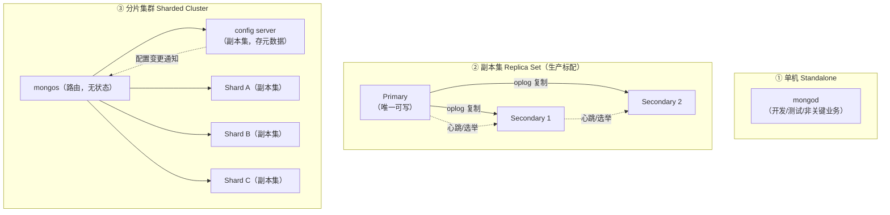

| 形态 | 组件 | 数据容量上限 | 高可用 | 典型用途 |
|---|---|---|---|---|
| 单机 | mongod | 单机磁盘 | 无 | 开发、日志、缓存型数据 |
| **副本集** | mongod × 3（PS+S+S） | 单机磁盘（**不能水平扩展**） | 自动故障转移（10–30s） | **90% 的生产场景** |
| 分片集群 | mongos + config(3) + shard(每片3节点) | 理论无上限 | 双重高可用 | 数据 >TB、写入 >单机能力 |

> **面试常问"什么时候该分片？"** 标准答案不是"数据大了就分"，而是三看：
> 1. **看容量**：单分片数据量超过单机 SSD 性价比拐点（经验值 1–2TB 可用数据），或索引+数据已占满磁盘；
> 2. **看写入**：单主写入能力到顶（一个 primary 只能串行处理写，约几万 TPS 量级，取决于文档大小与索引数）；
> 3. **看内存**：工作集（热数据 + 索引）远大于单机内存，导致 cache 命中率崩塌（**这是最容易被忽略、也最先出现的信号**）。
> 反例：如果只是"读多"，加 secondary 做读扩展即可，**不该分片**（分片会带来路由、跨片聚合、事务复杂度，成本极高）。

### 1.2 一次请求的完整链路（以分片集群的 `find` 为例）

```
客户端驱动
  │ ① 选择 mongos（按 readPreference / 就近）
  │ ② 建立连接（连接池，默认每 host 100 连接）
  ▼
mongos
  │ ③ 解析 query，查本地路由缓存（config.cacheSizeMB 默认 16MB，存 shard key → chunk 映射）
  │ ④ 若是等值/范围在 shard key 上 → targeted（只发 1..N 个 shard）
  │    否则 → scatter-gather（发给所有 shard）
  │ ⑤ 并行下发到各 shard，设置 maxTimeMS / readConcern
  ▼
shard（一个副本集）
  │ ⑥ 由该 shard 的 mongod（primary 或按 readPreference 选 secondary）执行
  │ ⑦ 进入 WiredTiger：查索引 → 查数据页 → 反序列化 BSON
  │ ⑧ 应用 skip/limit/sort/projection
  ▼
mongos
  │ ⑨ 归并（SHARD_MERGE）：排序归并、去重、skip/limit 收敛
  │ ⑩ 返回 cursor（首批 batch，默认 101 个文档 / 16MB 上限）
  ▼
客户端
```

**关键细节（面试深挖点）**：
- **`batchSize` 首批 101**：这是 MongoDB 的默认首次批量（`find` 的 `batchSize` 默认 101，后续每批 16MB 或 `batchSize` 条）。**为什么不是 1 或 1000**？1 会导致过多往返；1000 会让首屏延迟高、内存占用大。101 是个经验折中。
- **mongos 是无状态的**，所以可以随便加；但它**缓存路由表**，配置变更时由 config server 通过 `PeriodicShardingCacheLoader` 通知刷新，**最多有几十毫秒的 stale 窗口**（这就是"孤儿文档"产生的窗口之一）。
- **scatter-gather 的成本**：查询会打到**所有 shard**，mongos 要归并 N 份结果。若 shard 有 20 个，一次"没带 shard key"的查询就是 20 倍放大。

### 1.3 版本演进（面试爱问"你用的哪个版本、为什么"）

| 版本 | 关键变化 | 影响 |
|---|---|---|
| 3.0 | 引入 **WiredTiger**（可插拔引擎）、文档级并发 | 从"集合锁"到"文档级"，写入吞吐大幅提升 |
| 3.2 | 默认引擎改为 WT；引入 `readConcern: majority`、`document validation` | 一致性语义开始完善 |
| 3.4 | 引入 **`$graphLookup`**、`views`、`collation`（大小写/语言排序规则） | 多语言、树形查询 |
| **4.0** | **副本集多文档事务**、`retryableWrites` 默认开启、`$lookup` 支持 sharded | ACID 从"单文档"升级 |
| **4.2** | **分片事务**、通配符索引、`update` 支持聚合管道、移除索引 key 1024 字节限制 | 分布式事务可用 |
| 4.4 | **Hedged reads**、`$unionWith`、`hidden index`、refine shard key、可在线 `compact` | 运维友好 |
| 5.0 | **原生时间序列集合**、**在线 reshard**（改 shard key）、`live resharding`、版本化 API | 时序 + 弹性 |
| 6.0 | **change stream 支持 DDL 前镜像**、`$lookup` 性能优化、默认 chunk 128MB、时序集合分桶优化 | 分析能力 + 分片治理 |
| 7.0 | 时间序列性能提升、**分片 key 分析器**、可查询加密 GA | 安全与可观测 |
| 8.0 | **`--wiredTigerEngineConfigString`、O_DIRECT 支持、query settings（可在线改 hint）** | 底层调优能力放开 |

---

## 2. 存储引擎 WiredTiger（全卷最重要的一节）

> **一句话定位**：WiredTiger 是"B+ 树 + WAL + MVCC(含 history store) + 可插拔压缩"的存储引擎，为 MongoDB 提供了文档级并发、checkpoint、快照读、崩溃恢复。

### 2.1 为什么从 MMAPv1 换成 WiredTiger

| 维度 | MMAPv1 | WiredTiger | 为什么换 |
|---|---|---|---|
| 缓存管理 | **完全交给 OS page cache** | **自管 cache**（`cacheSizeGB`），有 LRU + eviction | 可控、可观测、可调 |
| 并发粒度 | 库锁/集合锁 | **文档级并发**（无锁读 + 单文档写） | 写入吞吐 |
| 压缩 | 无 | **block compression（snappy/zlib/zstd）+ prefix compression** | 存储成本降 50%+，IO 减少 |
| 崩溃恢复 | 无 journal 或不完善，**可能损坏** | **journal（WAL）+ checkpoint + checksum** | 数据安全 |
| 空间管理 | padding factor，碎片化严重 | 页级分配，`compact` 可回收 | 空间可控 |
| 索引 | 独立 B 树 | B+ 树，索引与集合分别在 `.wt` 文件 | 更清晰 |
| 锁与 MVCC | 无 MVCC | **MVCC + timestamp**，支持快照读与事务 | 事务能力 |

### 2.2 磁盘上的文件组织（`dbpath` 解剖）

```
/data/db/
├── WiredTiger                    # 引擎元数据（指向各表、checkpoint 信息）
├── WiredTiger.turtle              # 元数据的元数据（checkpoint LSN、文件清单的"龟壳"）
├── WiredTigerHS.wt               # History Store（历史版本存储，MVCC 的旧值）
├── _mdb_catalog                  # MongoDB 层的 catalog：哪个 collection 对应哪个 .wt 文件
├── sizeStorer.wt                 # 每个表的记录数/大小统计（给 count/大小估算用）
├── storage.bson                  # 实例标识（replset id 等）
├── collection-4-XXXXXXXX.wt       # 一个集合 = 一个 WT 表
├── collection-8-XXXXXXXX.wt
├── index-5-XXXXXXXX.wt           # 一个索引 = 一个 WT 表（每个索引独立文件）
├── index-7-XXXXXXXX.wt
├── journal/
│   ├── WiredTigerLog.0000000001  # WAL，预分配 100MB/文件
│   └── WiredTigerPreplog.0000000001  # 预分配的下一批日志文件（减少创建开销）
├── diagnostic.data/              # FTDC 诊断数据（每 6 秒采样一次指标）
└── _tmp/                         # 索引构建、compact 的临时目录
```

**这张表要能讲出"为什么每个索引一个独立文件"**：
1. **IO 隔离**：索引的随机读与集合的顺序扫描互不干扰（不同文件 → 不同 inode → 可被文件系统/设备并行处理）；
2. **压缩独立**：集合用 zstd（大页、高压缩），索引用 snappy（要快），可分别配置；
3. **可独立 compact / 重建**：重建一个索引不影响集合文件；
4. **代价**：文件数多（一个库上千个 `.wt` 文件），`open files` 上限与 `fsync` 的 inode 开销要留意（MongoDB 曾因 "too many open files" 出过事故）。

### 2.3 WT 的 B+ 树页结构

```
WT_PAGE（默认 4KB 对齐）
├── page header：页类型（leaf/internal）、记录数、**block checksum**、LSN
├── cell 数组：每行一个 "cell"（变长编码的 key + value）
│   ├── key：BSON/record id，含 **prefix compression**（与前一 key 共享前缀，只存后缀）
│   └── value：BSON 文档（压缩后的 block）
└── （leaf page 里有 next/prev 指针，构成链表 → 支持范围扫描）

内部页（internal_page_max 默认 4KB）只存 key + 子页指针
叶子页（leaf_page_max 默认 32KB）存真实文档
```

**三个必须知道的点**：
- **block checksum**：每个页有校验和，读取时校验，**发现损坏页就丢弃并依赖 journal/checkpoint**。这是 WT 不需要 doublewrite 的原因。
- **key 不是 BSON 原文**：集合表的 key 是 `record id`（一个 64 位的内部标识），**索引表的 key 才是索引字段值**。所以按 `_id` 查是最快的（直接走索引 → record id → 定位记录），而**按其他字段查要先查索引再"回表"**（这在 MongoDB 里叫 `FETCH`）。
- **prefix compression**：索引 key 通常有大量公共前缀（如 `user_id` + 时间戳），压缩后索引可缩小 30–50%，直接减少 IO 与 cache 占用。

### 2.4 内存中的页与 eviction（淘汰）

```
WiredTiger cache（cacheSizeGB，默认 min(50%*(RAM-1GB), ...)）
├── 已加载的页（含 clean / dirty 两种）
├── 每个页的修改在内存中累积（**写不立即落盘**）
└── eviction 线程（默认 1 个，可配 `eviction=(threads_min=1,threads_max=4)`）
```

**淘汰的四个水位（背下来，调优必用）**：

| 参数 | 默认 | 含义 |
|---|---|---|
| `eviction_target` | 80% | cache 使用率达 80% → 开始**后台**淘汰 |
| `eviction_trigger` | 95% | 达 95% → **应用线程也参与淘汰**（"application thread doing eviction"，写入会变慢） |
| `eviction_dirty_target` | 5% | 脏页占 cache 5% → 开始后台刷脏页 |
| `eviction_dirty_trigger` | 20% | 脏页占 20% → 应用线程参与刷脏页（**这是"写入突然卡住"的头号原因**） |

**eviction 的两种策略**：
1. **LRU（least recently used）**：按页的 `read_gen`（读代数）淘汰最久未用的；
2. **Update-restore（"再看一眼"）**：淘汰一个脏页时，如果这页**又被人改过**（更新的 LSN），就放弃淘汰、记入 `eviction failed`，转而淘汰别的。→ 所以**热点写页很难被淘汰**，会导致 dirty 比例持续偏高。

**L3 级回答（面试官问"为什么 Mongo 写入会周期性卡顿"）**：

> "通常是 **dirty page 触到 `eviction_dirty_trigger`（20%）**，应用线程被迫同步刷脏页。根因有三个方向：
> ① **cache 给太大**（>50% 或按宿主机内存算而不是容器 limit），WT 攒了太多脏页才想刷；
> ② **磁盘写带宽不够**（云盘突发额度耗尽 / 与数据文件抢 IO），刷不快；
> ③ **checkpoint 撞上 eviction**（checkpoint 每 60s 要把所有脏页刷一遍，若脏页量大，会形成 60s 周期的毛刺）。
> 处置：cache 降到内存 40–50%；把 journal 放独立盘；调 `eviction_dirty_target` 更小（如 3）让后台更早开始温和刷；避免大批量 `updateMany`（一次改几百万文档会把 cache 瞬间打脏）。"

### 2.5 写路径全链路（一次 `updateOne` 的完整旅程）

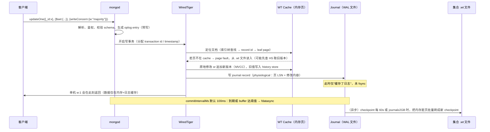

**逐步拆解（每一步都能被追问）**：

**① 驱动与路由**：驱动选节点（按 `readPreference`/写必到 primary）、组包（OP_MSG）、走连接池。写入 `retryWrites=true`（4.0+ 默认）时，若遇到网络错误会**带 `txnNumber` 重试**（服务端靠 `txnNumber` 去重，避免重复写）。

**② mongod 层处理**：
- 解析 query → 匹配索引 → 生成执行计划（plan cache，命中可省去规划开销）；
- **校验与转换**：`$set` 变成对具体字段的修改；
- **生成 oplog entry**：注意，**oplog 不是"原始命令"，而是"幂等的修改结果"**（`$set` 会记录成 `$v:2` 的 `diff` 形式，如 `{ $v: 2, diff: { u: { field: "newval" } } }`）。这是为了从节点重放时**幂等且不依赖查询条件**（当前值可能已变）。

**③ WT 层事务**：
- 分配 `txnid` 与 `timestamp`（若启用事务/因果一致性）；
- **写操作之间不互斥**（除唯一索引冲突检查）：同一文档的并发写由**乐观并发**处理，冲突时返回 `WriteConflict`，MongoDB 内部会**自动重试**（有限次数），仍失败则抛出给应用。

**④ 修改内存页（MVCC）**：
- 旧值写入 **history store（`WiredTigerHS.wt`）**，新值留在内存页；
- 页标记 dirty，记录 `page->modify->last_lsn`。

**⑤ 写 journal**：
- journal 记录是**页级增量**（`{page_id, offset, data}` 的生理日志），不是完整文档；
- journal **先在内存 buffer 里聚合**，`commitIntervalMs`（默认 100ms）到期才 `fdatasync` —— **这就是"`w:1` 也可能丢最近 100ms 数据"的原因**；
- 若 `j:true`，则**立即 fsync** 后才返回（延迟从 μs 级变成 ms 级，QPS 可能掉一个数量级）。

**⑥ checkpoint（60s 周期）**：
- 冻结当前内存状态（copy-on-write 语义：新写入不再改这批页）；
- 把**所有脏页**刷成新的 checkpoint（写到 `.wt` 文件的新位置，**不覆盖旧数据**）；
- 更新 `WiredTiger.turtle` 与 `WiredTiger` 元数据，声明"新 checkpoint 有效"；
- 删除旧 checkpoint（空间回收），截断 journal（只保留 checkpoint 之后的）。

> **为什么"不覆盖旧数据"很重要**：如果 checkpoint 写到一半崩溃，磁盘上**旧 checkpoint 仍完整可用**，只需重放旧 checkpoint 之后的 journal。这是**全量 checkpoint + 写时复制**带来的免费原子性。

### 2.6 checkpoint 与 journal 的配合（崩溃恢复的完整推演）

```
时刻线：
  T0  ── checkpoint C0 完成（journal 从 LSN_0 开始保留）
  T1  ── 事务 T1 提交，journal 记录 LSN_1（j:true 已 fsync）
  T2  ── 事务 T2 提交，journal 记录 LSN_2（j:false，仅内存）
  T3  ── 事务 T3 提交，journal 记录 LSN_3（已 fsync）
  T4  ── 【断电】
```

恢复过程：

```
① 读 WiredTiger.turtle → 找到最后一个"完整有效"的 checkpoint C0
② 校验 C0 各页 checksum；损坏页标记为"需要从 journal 重建"
③ 从 LSN_0 开始顺序重放 journal，直到日志末尾：
     ├── T1 在日志里 → 重放（页内容虽未刷盘，但日志有，可恢复）
     ├── T2 若日志未 fsync 成功（掉在设备缓存里）→ **丢失**（这正是 j:false 的代价）
     └── T3 在日志里 → 重放
④ 重放结束，所有"已提交"修改恢复；未提交的修改（WT 里没有"未提交页"落盘）自然不存在
⑤ 触发一次新 checkpoint，journal 重新从新 LSN 开始
```

**这里有一个非常好的面试对比题**：
> *"WiredTiger 崩溃恢复为什么不需要 undo 阶段，而 InnoDB 需要？"*

标准答案：
- **InnoDB 的数据页可以"半新半旧"地落盘**（脏页在后台随时刷，可能刷了部分事务的修改），所以恢复时除了 redo，还必须 undo 未提交事务。而且 InnoDB 有 `DB_TRX_ID`/`DB_ROLL_PTR` 与 undo 段，这是它的 MVCC 基础。
- **WiredTiger 的 checkpoint 是"整批一致快照"**：只有 checkpoint 时才把脏页批量落盘，且 checkpoint 前会**等待所有"正在修改页"的事务到达稳定点**（或让新写入走新页），因此落到磁盘的永远是"某个一致时间点"的数据。未提交的修改**从未落盘**，不需要 undo；需要回滚时直接从 history store 拿旧版本即可。
- 代价：**WT 的 checkpoint 是"全量"**，脏页多时 checkpoint 会造成 IO 峰值；InnoDB 是"增量模糊 checkpoint"，更平滑但恢复更复杂。

### 2.7 journal 的细节

| 项 | 值/说明 |
|---|---|
| 位置 | `dbpath/journal/WiredTigerLog.NNNNNNNNNN` |
| 单文件大小 | 100MB（预分配，`WiredTigerPreplog` 是预取的下一批） |
| 提交间隔 | `commitIntervalMs`，默认 **100ms**（3.2+ 起；早期默认 100ms 或 50ms） |
| 触发 checkpoint | 每 **60s** 或 journal 累计达 **2GB**（`checkpointSize`） |
| 压缩 | `journalCompressor`，默认 **snappy**（可选 zlib/zstd/none） |
| 内容 | 页级增量（`page id + offset + bytes`），含 `lsn`、`txnid`、`timestamp` |
| 命名清理 | checkpoint 后删除不再需要的 `WiredTigerLog.*` |

**"journal 文件为什么预分配 100MB"**：避免运行中动态扩展文件导致**元数据更新 + 碎片化**，同时让写入变成纯粹的顺序覆盖（对 SSD 友好）。代价是磁盘上会多占约 100–200MB（不写满也能接受）。

### 2.8 压缩：压缩就是"用 CPU 换 IO"

| 压缩方式 | 粒度 | 默认 | 特点 |
|---|---|---|---|
| **block compression** | 页（block）级，`block_compressor` = **snappy** | ✅ 默认 | 快、压缩比 ~2:1；zlib/zstd 更省空间更费 CPU |
| **prefix compression** | key 前缀共享 | ✅ 默认开启 | 索引体积可缩 30–50%，**对复合索引收益最大** |
| **Huffman encoding** | key/value 字节级 | ✅ 默认开启 | 对低频字符优化，额外 ~10% |

**为什么压缩对 MongoDB 是"三重收益"**：
1. **磁盘成本降**（1TB → 400–500GB）；
2. **IO 减少**（读一页搬的字节更少 → 有效带宽翻倍）；
3. **cache 容量"变大"**（WT cache 存的是**解压后的页**，所以压缩不增加 cache 命中率；但 page cache 存的是压缩后的文件块，**压缩间接放大了 page cache 的有效容量**）。

> **注意区分**（这是极常见的理解错误）：WiredTiger cache 里放的是**解压后**的页，所以"压缩让 cache 更能装"是错的；压缩只放大 **OS page cache** 与 **磁盘容量**。

### 2.9 ticket 机制：WT 的并发阀门（★★★★☆ 高频，很多人不知道）

WiredTiger 内部维护两组"票"：

```
read_ticket  = 128（默认）
write_ticket = 128（默认）
```

- 每个进入 WT 做 IO 的线程必须先"取票"，做完归还；
- 取不到票 → **排队等待（阻塞）**，而不是继续往下压；
- 目的：**保护 WT 内部的数据结构（页锁、eviction 队列）不被过多线程争用**，同时避免 IO 队列被打穿。

**为什么这个机制很精妙（L3 表达）**：

> "MongoDB 在 mongod 层是一个连接一个线程，可能有上千个线程同时在跑。如果它们全都冲进 WT 去抢页锁，锁竞争会把 CPU 全耗在自旋上。ticket 相当于一个**可控的并发窗口**：几百个线程在外面排队，只有 128 个真正在 WT 内部跑。它同时起到三个作用：限流、保护内部结构、让 IO 队列保持在一个设备能吸收的深度。
> 代价是：**如果某个操作在 WT 内部阻塞（比如等 page latch），它会占着 ticket 不放**，导致 ticket 耗尽，所有请求排队 —— 这就是为什么慢查询会"拖垮全实例"，而不是只影响自己。"

**诊断**：`db.serverStatus().wiredTiger.concurrentTransactions` 里能看到 `out`（已借出）、`available`、`totalTickets`。如果 `available` 长期为 0，说明 ticket 被打满。

### 2.10 history store（HS）与 MVCC 在 WT 的实现

```
文档 A 的多个版本：
   内存页里：A@timestamp=100（最新，未 checkpoint）
   HS 里    ：A@timestamp=90, A@timestamp=80 ...（旧版本，供快照读/事务读）
```

- 每个写操作带 `timestamp`（因果一致性/事务必需，普通写也带）；
- 读时用 `read_timestamp`（快照）→ 先看内存页，版本太新则去 HS 按 `(key, timestamp)` 找 ≤ 快照的最新版本；
- **HS 有容量上限**：默认约为 **WT cache 的 20%**（`hs_max_bytes` 类参数可调）。超过后触发 **"history store pressure"**，WT 会**主动拒绝/中止一些写**（应用可见 `WriteConflict` 或 `WT_CACHE_FULL` 类错误）。
- 触发 HS 压力的两大原因：
  1. **长事务/长快照**：一个事务开了 10 分钟，期间所有被改文档的旧版本都要留着；
  2. **大量更新 + eviction 跟不上**：旧版本来不及随页淘汰而被清理。

> **这正是"事务有 60 秒限制"的深层原因之一**（`transactionLifetimeLimitSeconds` 默认 60s）。不只是为了"防死锁"，更是**为了保护 HS 不被撑爆**。这个因果链讲出来，面试官会认为你真的读过原理而不是背文档。

### 2.11 双缓存与 `cacheSizeGB` 的决策

```
推荐（官方口径）：
  cacheSizeGB ≈ max(256MB, 50% × (可用内存 - 1GB))

为什么留一半给 OS？
  ① page cache 要承接 .wt 文件的读写（压缩块）
  ② journal 的写入也要 page cache
  ③ checkpoint 时要一次性写大量脏页，需要 page cache 作为缓冲，否则直接打到设备
  ④ 聚合/排序/连接的内存（每个连接都有开销，聚合 stage 有 100MB 上限）
```

**容器环境的坑（必讲）**：
- `cacheSizeGB` 默认值是按**宿主机内存**计算的（老版本尤其如此），容器 limit 1GB 而宿主机 64GB 时，cache 会被设成 31GB → **秒被 OOM kill**。
- 正确做法：显式设置 `cacheSizeGB`（按容器 limit 的 50%），并确保 `--setParameter` 生效。

### 2.12 WT 参数速查（调优必备）

| 参数（`storage.wiredTiger.engineConfig` 或 `setParameter`） | 默认 | 作用 | 调优方向 |
|---|---|---|---|
| `cacheSizeGB` | 50% RAM-1GB | cache 大小 | 容器/大内存机**必须显式设** |
| `journalCompressor` | snappy | journal 压缩 | CPU 富余可 zstd |
| `directoryForIndexes` | false | 索引单独目录 | 索引与数据分开盘时开 |
| `eviction=(threads_min,threads_max)` | 1,1 | eviction 线程数 | 大 cache/高写入可增至 4–8 |
| `eviction_dirty_target` / `trigger` | 5 / 20 | 脏页水位 | 写抖动时降到 3/10 更平滑 |
| `checkpointSize` | 2GB | journal 触发 checkpoint 阈值 | 批量导入时可调大，减少 checkpoint 频率 |
| `commitIntervalMs` | 100 | journal fsync 间隔 | 极端吞吐可调 500（**牺牲可靠性**），
| `file_manager=(close_idle_time)` | 30s | 空闲文件句柄回收 | 集合极多时避免 "too many open files" |
| `read_ticket` / `write_ticket` | 128/128 | 并发窗口 | 极少需要调；调大可能反而因争用变慢 |

> **提醒**：MongoDB 里改 WT 参数要通过 `--wiredTigerEngineConfigString`（8.0 支持）或 `setParameter`，直接改 `wiredtiger.conf` 不生效（MongoDB 会覆盖）。这是实操中常见的误解。

---

## 3. 文档模型与 BSON

### 3.1 BSON 的二进制结构（很多人只会说"像 JSON"，这是不够的）

BSON = **B**inary **S**tructured **O**bject **N**otation，本质是"**为快速遍历而设计的二进制 KV 序列**"。

```
一个 BSON 文档的字节布局：

┌────────────────────────────────────────────────────┐
│ int32  total_length（含自身，4 字节）                 │
├────────────────────────────────────────────────────┤
│ element 1                                          │
│   ├─ byte  type（1 字节，如 0x01=double, 0x02=string）│
│   ├─ cstring field_name（UTF-8，以 0x00 结尾）        │
│   └─ value（长度由 type 决定）                        │
│ element 2 ...                                      │
├────────────────────────────────────────────────────┤
│ byte  0x00（终止符）                                 │
└────────────────────────────────────────────────────┘
```

**关键类型码（能报出来很加分）**：

| 码 | 类型 | 说明 |
|---|---|---|
| `0x01` | double | IEEE 754 64 位 |
| `0x02` | string | 4 字节长度 + UTF-8 + 0x00 |
| `0x03` | embedded document | 嵌套文档（子文档也是完整 BSON） |
| `0x04` | array | 4 字节长度 + 若干 value |
| `0x07` | ObjectId | 12 字节：时间戳(4) + 机器标识(3) + 进程号(2) + 计数器(3) |
| `0x08` | boolean | 1 字节 |
| `0x09` | UTC datetime | int64 毫秒 |
| `0x10` / `0x12` | int32 / int64 | **注意：整数字段长度可变，这会影响索引与比较** |
| `0x13` | decimal128 | 定点小数，**金融金额首选**（避免 double 精度问题） |
| `0xFF` / `0x7F` | MinKey / MaxKey | 排序边界，用于分片范围 |

**BSON 相对 JSON 的四个设计意图（面试可讲）**：
1. **长度前缀**：可以 O(1) 跳过不关心的字段（服务端只反序列化投影需要的字段）；
2. **类型化**：数字不会被当成字符串，避免"1" vs 1 的比较歧义（**这也是索引失效的根源之一**）；
3. **支持二进制/日期/Decimal**：JSON 没有原生类型；
4. **可排序**：字段名顺序、类型顺序固定（比较规则有全局定义）。

**代价**：
- **字段名重复存储**：每个文档都带一遍字段名 → 字段名越长，空间与索引越大（见 3.5 的实测）；
- **比 JSON 略大**（因为有类型字节和重复 key），但**解析快得多**。

### 3.2 16MB 的限制从哪来，为什么还在

| 限制 | 值 | 原因 | 影响 |
|---|---|---|---|
| **单个文档** | **16MB** | 历史设计：保证一个文档能被**一个网络包 + 一次内存操作**处理；也避免单文档过大导致 WT 页放不下、oplog 条目过大 | 大对象要用 **GridFS** 或拆子文档 |
| 单个 oplog entry | 16MB | 复制单元与文档大小对齐 | 事务的总修改量受此约束 |
| 索引 key | 4.2 前 1024B，4.2 后放开 | 早期 B 树页小，长 key 会导致扇出崩坏 | 长字符串索引仍建议用 hash 前缀 |
| 集合/索引名 | 120B / 128B | 文件系统命名与 namespace 长度 | 分片集群的 namespace 更短 |
| 复合索引字段数 | 32 | 索引条目大小与规划器复杂度 | 实战一般 ≤5 |

> **P7+ 追问**：*"如果业务真的要存 100MB 的 JSON，你怎么设计？"*
> 参考答案：① 拆成"主文档 + 明细集合"（用 `parent_id` 关联，主文档只存摘要与统计）；② 用 **GridFS**（把大文件切块存 `fs.files` / `fs.chunks`）；③ 只存**外部引用**（对象存储 URL + 元数据）；④ 用 **Bucket 模式**（把时间序列/日志按时间窗聚合成固定大小的数组，控制单文档 ≤ 几百 KB）。**不要**简单调 `failIndexKeyTooLong` 之类（4.2 后已不存在）。

### 3.3 嵌入 vs 引用：建模的第一决策

```javascript
// 方案 A：嵌入（Embedding）—— 一对少、读多写少
{
  _id: "order_001",
  user: { id: 1001, name: "张三", level: "VIP" },   // 冗余用户快照
  items: [                                           // 子文档数组
    { sku: "A1", name: "键盘", price: 299, qty: 1 },
    { sku: "B2", name: "鼠标", price: 99,  qty: 2 }
  ],
  total: 497,
  created_at: ISODate("2026-11-19")
}

// 方案 B：引用（Referencing）—— 一对多、多对多、需要独立更新
{ _id: "order_001", user_id: 1001, item_ids: ["A1","B2"], total: 497 }
{ _id: "A1", name: "键盘", price: 299 }   // 独立集合
```

| 维度 | 嵌入 | 引用 |
|---|---|---|
| 读性能 | **1 次查询拿到全部**（局部性好） | N+1 次查询 或 `$lookup`（跨集合 JOIN，代价高） |
| 写性能 | 改子数据要改整个父文档（**写放大**） | 只改子文档 |
| 数据一致性 | 冗余字段会不一致（如用户名改了，历史订单里还是旧名 —— **但这往往正是业务想要的"快照"**） | 天然一致 |
| 文档大小 | 受 16MB 与"数组无上限增长"约束 | 无约束 |
| 事务需求 | 单文档原子，**天然 ACID** | 需要多文档事务（有 60s 与性能代价） |
| 索引 | 可为数组内部字段建 **multikey 索引** | 各集合独立索引 |

**一条实战判据（面试可以直接说）**：

> "**一对少（≤ 几百个、大小可控）且读多 → 嵌入；一对多（无上限增长）或需要独立生命周期 → 引用。** 判断的核心不是关系模型，而是**'这份数据的访问模式是不是总跟父文档一起'**。MongoDB 的建模原则是 'data that is accessed together should be stored together'。"

### 3.4 七种建模模式（Schema Design Patterns，★★★★☆ 加分内容）

| 模式 | 解决什么问题 | 结构 | 代价 |
|---|---|---|---|
| **Attribute Pattern** | 字段名不确定 / 大量相似字段（如"尺寸/颜色/材质…"），导致索引爆炸 | 把动态字段变成 `{k: "color", v: "red"}` 数组，建 `{k:1, v:1}` 索引 | 查询要写 `$elemMatch`，可读性下降 |
| **Extended Reference** | 引用太多导致 `$lookup` 频繁 | 引用文档里冗余**少量**常查字段（如用户名、价格） | 冗余字段需同步更新 |
| **Subset Pattern** | 文档太大（如商品 + 上千条评论） | 主文档只放"最近/最热"的 N 条，全量放另一个集合 | 应用要判断"是否在子集里" |
| **Computed Pattern** | 频繁算聚合（如总价、平均分） | 写入时预计算并存字段（读时零计算） | 写放大；要保证更新路径都维护 |
| **Bucket Pattern** | 时间序列/日志（每条一个文档 → 文档爆炸） | 按时间窗把多条记录放进一个文档的数组（如每小时一个桶） | 桶大小要调；范围查询要按照桶边界 |
| **Outlier Pattern** | 少数文档"异常大"（如爆款文章的 100 万点赞） | 正常文档存计数 + 溢出标志，溢出的点赞分片到多个 `_id: "postId_overflow_1"` 文档 | 应用要处理溢出分支 |
| **Schema Versioning** | 数据结构要演进 | 每个文档带 `schema_version`，应用按版本兼容读 | 老数据要迁移或双读 |

**MongoDB 5.0+ 的时间序列集合（Time Series Collection）就是 Bucket 模式的官方实现**：
```javascript
db.createCollection("sensor", {
  timeseries: { timeField: "ts", metaField: "sensorId", granularity: "minutes" }
})
// 底层自动按 granularity 分桶，一个桶内多文档共享 metaField，压缩率极高
// 限制：不能 update 单个文档（只能 delete/insert），不支持部分索引特性（逐步放开）
```

### 3.5 字段名长度的真实代价（一个能立刻算给面试官看的例子）

假设 1 亿文档，每文档 10 个字段：

| 字段名风格 | 平均字段名长度 | 每文档额外字节 | 1 亿文档的总开销 | 对应索引（10 个单字段索引）额外开销 |
|---|---|---|---|---|
| `a, b, c...`（1 字符） | 1B | ~10B | ~1GB | 小 |
| `userName, orderStatus...`（10 字符） | 10B | ~100B | **~10GB** | 索引 key 也变长，索引体积可能翻倍 |
| `this_is_a_very_long_field_name`（30 字符） | 30B | ~300B | **~30GB** | 显著 |

> **结论（面试可直接引用）**：字段名是**每个文档、每个索引条目**都要重复存储的。所以"把字段名缩短"是最便宜的优化之一（也是 Twitter、Foursquare 早期用 `usr`、`fllw` 这类短名的原因）。但**别过度** —— 可读性也是成本，建议折中（如 `uid`、`amt`），并用**视图（view）**对外暴露友好字段名。

---

## 4. 索引体系

### 4.1 索引在 WT 里长什么样

```
集合表：collection-N-xxx.wt
   key   = record id（内部 64 位标识）
   value = BSON 文档（压缩）

索引表：index-M-xxx.wt
   key   = 索引 key pattern 的值（可能有多个字段 + record id 作为后缀保证唯一）
   value = record id（指回集合表）
```

**这就是"回表"的物理本质**：
```
按索引字段查询 → 走 index-*.wt 找到 record id → 用 record id 去 collection-*.wt 取文档
                （这一步在 explain 里叫 FETCH）
```

**所以**：
- **覆盖查询（covered query）**不需要 FETCH，因为它需要的字段都已经在索引里了 → 少一次 IO；
- **按 `_id` 查询**是最快的（`_id` 索引的 value 就是 record id，甚至可以直接定位）。

### 4.2 复合索引与 **ESR 原则**（★★★★★ 必考）

```javascript
db.orders.createIndex({ status: 1, created_at: -1, amount: 1 })
```

**ESR = Equality → Sort → Range**：索引字段顺序应为"等值字段 → 排序字段 → 范围字段"。

为什么？把 B+ 树的索引键理解成"字典序排列的多维坐标"：

```
(Equality, Sort, Range) 的排列能让查询落在一个"连续区间"：
  status='paid'（等值 → 锁定一个前缀）
     └── created_at 降序（排序 → 在这个前缀内天然有序，无需额外 SORT 阶段）
            └── amount > 100（范围 → 只在最后一个维度上开区间，仍连续）
```

反例 `{ status: 1, amount: 1, created_at: -1 }`：
- `amount > 100` 是范围，**范围之后的 `created_at` 无法用于排序** → 必须做内存排序（`SORT` 阶段，32MB 上限，超了报错）；
- 这就是"索引字段顺序错了，明明建了索引还是要排序"的根因。

**三条硬规则**：
1. **等值字段在前**，且**选择性最高的等值字段放最前**（能最快缩小范围）；
2. **排序字段必须"连续"**：`sort({a:1, b:-1})` 需要索引 `{a:1, b:-1}` 或 `{a:-1, b:1}`（方向可整体反转，但不能只反一个）；
3. **范围字段放最后**，且**一个复合索引最多高效支持一个范围字段**（多个范围 = 后面的范围只能做过滤，不能缩小扫描区间）。

**经典追问**："`{a:1, b:1, c:1}` 这个索引，能支持 `a=1 AND c=3` 吗？"
→ 能"用上"，但**只能用到 `a` 前缀**，`c` 只能作为**索引内的过滤（index filter）**，扫描量仍是 `a=1` 的全部，**不会因为 `c` 而减少 keysExamined**。这就是"前缀原则"：**中间断了，后面就用不上**（除了做 index filter 减少回表）。

### 4.3 多键索引（Multikey）：数组字段的索引

```javascript
db.users.createIndex({ "tags": 1 })     // tags 是数组 ["a","b","c"]
// 底层：一个文档 → 索引里 3 条记录（每个元素一条），都指向同一个 record id
```

**四个必须知道的点**：
1. **写放大**：数组有 N 个元素 → 一次文档更新要维护 N 条索引记录。**一个 1000 元素的数组字段建索引，写入成本是 1000 倍**（这是"不要在标签数组上建索引"的真正原因）。
2. **一个文档在索引中出现多次** → 查询结果需要**去重**（`DISTINCT_SCAN` 或 `FETCH` 后去重），代价高。
3. **`$elemMatch` vs 直接匹配**：`{tags: {$elemMatch: {$gte: 5, $lte: 10}}}` 是"**同一个元素**满足两个条件"；`{tags: {$gte: 5, $lte: 10}}` 是"数组里存在 ≥5 的元素 且 存在 ≤10 的元素"（**可能是不同元素**）。语义完全不同！
4. **限制**：multikey 索引**不能用于覆盖查询**的某些情形（因为一个 key 对应多条），且 `$elemMatch` 之外的组合边界索引行为较弱（"multikey 边界"问题：索引边界可能无法精确表达数组内条件）。

### 4.4 索引类型全家福

| 类型 | 创建方式 | 适用 | 关键限制 |
|---|---|---|---|
| 单字段 | `{field: 1}` | 等值/范围/排序 | — |
| 复合 | `{a:1, b:-1}` | 多条件组合，遵循 ESR | 最多 32 字段 |
| 多键 | 字段是数组时自动 | 数组元素查询 | 写放大、不能覆盖全部场景 |
| 唯一 | `{unique: true}` | 业务唯一约束 | 已有重复数据会建失败；**分片集群唯一索引必须包含 shard key** |
| 稀疏 | `{sparse: true}` | 字段可缺失，只索引存在该字段的文档 | 不能用于"字段缺失"的查询（查不到） |
| **部分（Partial）** | `partialFilterExpression` | 只索引满足条件的子集（如只索引 `status:"active"`） | 查询必须**带上同样的条件**才能用上 |
| TTL | `{expireAfterSeconds: n}` | 自动过期（会话、日志、验证码） | 后台 60s 扫描一次，**不精确**；不能是复合索引的部分字段；`_id` 不能做 TTL |
| 文本 | `{field: "text"}` | 全文检索（分词 + 权重 + 语言） | **每个集合只能 1 个**；中文分词弱（需 Atlas Search / ES） |
| 地理 2dsphere | `{"loc": "2dsphere"}` | GeoJSON 点/线/面 | 只支持球面几何；平面 `2d` 已过时 |
| 通配符 | `{"$**": 1}` | 字段不确定的动态 schema | 不能用于 `_id`；比显式索引大；只适合"兜底查询" |
| 哈希（分片键） | `{field: "hashed"}` | 分片键均匀分布 | 只支持等值查询 |
| 隐藏（Hidden） | `{hidden: true}` | 灰度下线索引：先隐藏观察，确认无用再删 | 4.4+ |

**关于"唯一索引与分片"的硬约束（P7+ 常问）**：
分片集群里，**唯一索引必须包含分片键的所有字段作为前缀**，否则无法保证全局唯一（每个 shard 只能保证本地唯一）。
→ 这就是"为什么分片后某些业务唯一性约束做不了"的根源，解决思路：把唯一字段作为 shard key（或 shard key 的前缀），或用**单独的唯一性校验集合**（代价：一次额外读写）。

### 4.5 TTL 索引的真实行为（常被误解）

```
机制：mongod 有后台 TTL monitor 线程，每 60 秒跑一次
      扫描 TTL 索引，找到 expireAfterSeconds 之前过期的文档，**删除**
      
关键事实：
  ① 不精确：文档会在"过期时间 + 最多 60s + 删除耗时"后才真正消失
  ② 删除是普通删除，会写 oplog，从节点也会删（消耗 oplog 空间）
  ③ 大批量过期会集中触发删除 → 写入尖峰、oplog 膨胀
  ④ TTL 索引字段必须是 Date 类型（或数组的 Date），否则不生效
  ⑤ 唯一索引 + TTL 组合有坑：过期删除前，唯一约束仍然生效
```

> 实战建议：对"必须准时消失"的数据（如订单超时关闭），**不要依赖 TTL**，用**定时任务扫表 + 状态机**，TTL 只做兜底清理。

### 4.6 索引选择性、基数与成本模型

```
选择性（selectivity）= 不同值个数 / 总文档数（即基数的倒数视角）
  高选择性：user_id（几乎唯一）→ 一次查询只命中 1 条 → 极好
  低选择性：status（只有 paid/unpaid）→ 命中 50% 文档 → 不如全表扫描
```

**什么时候"有索引也不该用"**：如果一个查询要返回集合 30%+ 的文档，走索引就是"大量随机 IO + 回表"，还不如**顺序全表扫描**（COLLSCAN）。MongoDB 的规划器会**基于 cost 选择**，但你可以用 `hint()` 强制，或用 `explain` 看它是否选错了。

**成本模型的三个数（explain 里必看）**：

| 指标 | 含义 | 健康标准 |
|---|---|---|
| `nReturned` | 返回文档数 | 你的业务预期 |
| `totalKeysExamined` | 扫描的索引条目数 | **应 ≈ nReturned**（大了说明索引边界不精确） |
| `totalDocsExamined` | 回表取文档数 | **应 ≈ nReturned**（大了说明过滤条件没在索引里完成） |

> **黄金比例**：`nReturned : totalKeysExamined : totalDocsExamined` 越接近 **1:1:1** 越好。若 `totalDocsExamined` 远大于 `nReturned`，说明"索引只做了粗筛，大量文档被 FETCH 后在内存里过滤掉"。

### 4.7 索引构建：为什么建索引会"卡住"写入

| 版本/方式 | 机制 | 对写入的影响 |
|---|---|---|
| 4.2 之前 `background: true` | 后台建：间歇性释放锁，但仍需扫描全表 | 慢，且可能因写入而永远建不完 |
| **4.2+ hybrid index build** | **副本集内**：先在 secondary 上建（不阻塞该节点），再切主流程；构建期间**记录 oplog 变更并在结束时重放** | **几乎不阻塞**，但需要额外磁盘与 oplog 窗口足够长 |
| 单机（standalone） | 仍会加集合级排他锁（阻塞写入） | 大集合上要谨慎，建议滚动到副本集方式 |

**P7+ 现场题**："线上 5 亿文档的集合，要给一个新字段加索引，怎么做到业务无感？"
答题要点：
1. **必须用副本集**（hybrid build 只在副本集生效），逐节点滚动构建；
2. 确认 **oplog 窗口足够**（构建耗时 > oplog 窗口 → 构建期间的变更可能滚出 oplog，导致失败或数据不一致）；
3. 用 `{background: true}` + 低峰期执行，监控 `db.currentOp()` 的 `msg: "index build"`；
4. 构建期间**避免 DDL 与大批量写**；
5. 建完后 `explain` 验证命中，再考虑删掉旧索引（删索引是**立即**的元数据操作，很轻）。

### 4.8 索引失效的 12 种典型场景（排障必备清单）

| # | 场景 | 原因 | 解法 |
|---|---|---|---|
| 1 | **类型不一致**：字段存成字符串 `"123"`，查数字 `123` | BSON 类型有序（数字 < 字符串），索引按类型分区 | 统一写入类型（`$convert` 或应用层） |
| 2 | `$ne` / `$nin` / `$not` | 需要扫描"所有不等于"的区间，通常是全索引扫描 | 改写为正向条件 + 应用层过滤 |
| 3 | `$regex` **非前缀**（`/abc/`） | 无法利用前缀有序性 | 改前缀匹配 `^abc`，或用 text 索引/ES |
| 4 | `$or` 里部分子条件无索引 | 每个分支都要能走索引，否则整体退化为全扫 | 给每个分支都建索引 |
| 5 | `$expr` / 聚合表达式比较两个字段 | 需要逐文档计算，索引无法表达 | 冗余出计算字段并建索引（Computed Pattern） |
| 6 | **collation 不一致**（索引建时指定了 collation，查询没指定） | 排序规则不同 → 索引不可用 | 查询显式带相同 `collation` |
| 7 | 复合索引**跳字段** | 前缀原则 | 补建索引或调整字段顺序 |
| 8 | 范围查询后还想用后面的字段排序 | 有序性被打断 | 按 ESR 重排 |
| 9 | `$elemMatch` 与普通数组匹配混用 | 语义不同 + multikey 边界 | 明确语义，必要时建 multikey 索引 |
| 10 | 部分索引的**条件不匹配** | 查询没带 `partialFilterExpression` 的条件 | 查询补上条件 |
| 11 | 对**计算后的值**查询（`$toLower(name)`） | 索引存的是原值 | 建**表达式索引**（`{lowerName: 1}` 冗余存小写） |
| 12 | 用了 `hint()` 强行指定错误索引 | 人为干预 | 移除 hint 或换正确索引 |

### 4.9 索引越多越好吗？——写放大的量化

```
一个集合有 10 个索引，每次插入/更新一个文档：
  → 需要维护 10 棵 B+ 树（10 次索引页修改 + 10 份 journal 记录）
  → 写吞吐大致降为 1/5 ~ 1/10（非线性，因为还有页分裂与 cache 压力）
  → 磁盘占用：索引通常占数据量的 30%~100%（字段多、key 长会更高）
```

**P7+ 决策语言**：
> "索引不是免费的，每个索引都是一棵需要维护的 B+ 树。我的经验值是**单集合索引数控制在 5 个以内**，超过就要审视：① 能否用复合索引合并（`{a}` + `{a,b}` → 只留 `{a,b}`）；② 是否是低频查询（用 `$natural` 全扫或离线分析替代）；③ 能否用**部分索引**缩小索引规模。上线前我会用 `$indexStats` 看每个索引的 `accesses.ops`，**连续一个月 0 访问的索引直接下线**（先 `hidden: true` 观察一周）。"

```javascript
db.orders.aggregate([{ $indexStats: {} }])
// 输出每个索引的 accesses.ops / accesses.since，用来做"索引清理"决策
```

---

## 5. 查询执行与优化

### 5.1 一次查询的执行阶段（explain 的 stage 字典）

| stage | 含义 | 是否健康 |
|---|---|---|
| `COLLSCAN` | 全表扫描 | ❌ 大集合上不可接受 |
| `IXSCAN` | 走索引 | ✅ |
| `FETCH` | 用 record id 回表取文档 | ✅ 但次数应 ≈ 返回数 |
| `SORT` | 内存排序（**没有索引可用**） | ⚠️ 32MB 上限，超了报错 |
| `SORT_MERGE` | 归并多个索引的有序结果 | ✅ 用于 `$or` |
| `LIMIT` / `SKIP` | 截断/跳过 | ⚠️ **SKIP 大时很贵** |
| `PROJECTION_COVERED` | 覆盖查询，无 FETCH | ✅✅ 最优 |
| `SHARD_MERGE` | mongos 归并多 shard 结果 | 正常 |
| `SHARDING_FILTER` | 过滤孤儿文档 | 正常（出现多说明有孤儿） |
| `TEXT` / `GEO_NEAR_2DSPHERE` | 全文/地理 | 正常 |
| `COUNT_SCAN` | 利用索引直接计数，不取文档 | ✅ 极快 |
| `IDHACK` | 按 `_id` 直接命中 | ✅✅ 最快 |

### 5.2 `explain` 三件套：怎么读

```javascript
// ① 规划器视角：比较候选计划
db.orders.find({status:"paid"}).sort({created_at:-1}).explain("queryPlanner")

// ② 执行统计：真实数字（最常看）
db.orders.find({status:"paid"}).explain("executionStats")
/* 关注：
   executionStats.executionTimeMillis
   executionStats.totalKeysExamined
   executionStats.totalDocsExamined
   executionStats.nReturned
   executionStats.executionStages.stage / indexName
*/

// ③ 所有候选计划的表现（谁赢了、输了多少）
db.orders.find(...).explain("allPlansExecution")
```

**一份"标准体检"流程**（面试可背）：

```
① explain("executionStats")
② 看 stage 是否 COLLSCAN / 是否有 SORT
③ 看 totalKeysExamined / totalDocsExamined / nReturned 比例
④ 看是否用了预期索引（indexName）
⑤ 看 executionTimeMillis 与返回量是否匹配
⑥ 如果不理想：调整索引 → 再 explain → 比较 rejectedPlans
```

**一个真实例子（README 级别的"教科书案例"）**：

```javascript
// 集合 1000 万文档，status 只有 3 个值，created_at 分散
db.orders.createIndex({ status: 1 })                     // ❌ 选择性极低
db.orders.find({ status: "paid" }).sort({ created_at: -1 }).limit(20).explain("executionStats")
// → totalKeysExamined ≈ 333万（status 命中 1/3）
// → totalDocsExamined ≈ 333万
// → 有 SORT 阶段，且可能超 32MB 内存

db.orders.createIndex({ status: 1, created_at: -1 })     // ✅ 按 ESR（等值 + 排序）
db.orders.find({ status: "paid" }).sort({ created_at: -1 }).limit(20).explain("executionStats")
// → totalKeysExamined ≈ 20，totalDocsExamined ≈ 20，无 SORT
```

### 5.3 `skip` 分页的灾难与 keyset 分页

```javascript
// ❌ 深分页：skip 100000 意味着先扫 100020 条再丢掉 100000 条
db.orders.find({status:"paid"}).sort({created_at:-1}).skip(100000).limit(10)

// ✅ keyset（游标）分页：用上一页最后一条的排序值做"范围起点"
db.orders.find({ status:"paid", created_at: { $lt: lastCreatedAt } })
         .sort({created_at:-1}).limit(10)
```

**为什么 skip 是 O(skip) 而不是 O(1)**：B+ 树的"跳过"必须**逐条遍历索引条目**（server 端没有"第 N 条"的偏移索引），所以 skip 越大越慢，且**分页越深越慢**（典型 1s → 10s 的劣化）。
**例外**：`skip` 在 `_id` 或单字段索引上且**排序方向一致**时，可以快速推进游标位置，但仍需遍历。

**分布式下的额外代价**：mongos 必须**从每个 shard 各取 `skip + limit` 条**再归并，才能保证全局正确的 skip → shard 数 × 深分页 = 灾难。这也是为什么"分页搜索"在分片集群上必须用 keyset。

### 5.4 聚合管道与优化器

```javascript
db.orders.aggregate([
  { $match: { status: "paid" } },                 // ① 尽量前置，命中索引
  { $project: { user_id: 1, total: 1 } },         // ② 提前裁剪，减少后续阶段的数据量
  { $sort: { total: -1 } },                       // ③ 若索引支持则走索引排序
  { $limit: 100 },                                // ④ limit 前置能大幅提前终止
  { $lookup: { from: "users", localField: "user_id", foreignField: "_id", as: "user" } }  // ⑤ 最贵
])
```

**`$lookup` 的真实成本（★★★★☆ 高频）**：
- 对**左集合的每一条文档**执行一次"到右集合的查询" → **N+1**（N = 左集合结果数）；
- 若右集合 `foreignField` **没有索引** → 每条都是一次全集合扫描 → O(N×M)，灾难；
- **优化**：① 右集合 `foreignField` 必须建索引；② 先用 `$match` + `$limit` 缩小左集合；③ 把 `$lookup` 的 `pipeline` 形式写成"能带条件"的子管道；④ 高频 JOIN 考虑**用 Extended Reference 冗余字段，彻底消除 JOIN**；⑤ 分析类 JOIN 移到离线（Spark/ClickHouse）。

**聚合的内存限制**：

| 限制 | 值 | 说明 |
|---|---|---|
| 单个 `$sort`/`$group` stage | **100MB** | 超出需要 `allowDiskUse: true`（会落临时文件，慢 10 倍+） |
| `find` 的排序 | **32MB** | 无索引排序的上限，超了直接报错 |
| 结果文档 | 16MB | 聚合输出单个文档仍受 BSON 限制 |

### 5.5 `count` / `distinct` / `findAndModify` 的语义差异（细节题）

| 操作 | 行为 | 性能 | 注意 |
|---|---|---|---|
| `countDocuments(filter)` | 走聚合 `$match + $group`，**精确计数** | 慢（要真扫） | 5.0 起推荐用它 |
| `estimatedDocumentCount()` | 读 `sizeStorer` 元数据 | **O(1)** | 分片集群下是"各 shard 元数据之和"，**不准** |
| `db.coll.count()`（shell） | 走 `count` 命令（可能用元数据） | 快 | 已在 4.x 弃用 |
| `distinct(field)` | 用索引做 DISTINCT_SCAN（若可用） | 中 | 结果受 16MB 限制 |
| `findAndModify` | 原子"读-改-写"单文档 | 快 | **天然原子**，用于计数器/队列/锁 |
| `updateMany` | 逐文档更新（非原子整体） | 慢，且**一次改太多会打爆 cache 与 oplog** | 要分批（按 `_id` 范围循环） |

### 5.6 慢查询治理的完整方法论（P7+ 必答）

```
① 采集
   - db.setProfilingLevel(1, { slowms: 100 })     ← 只记录 >100ms
   - 或 profiler level 2 全量（短时间开，别长开）
   - 云上/自建：监控 slow query log + FTDC

② 分类
   - COLLSCAN 型（缺索引）
   - 索引选择错误型（有索引但规划器选错，或 hint 错误）
   - 数据模型型（$lookup、深分页、大数组）
   - 资源型（cache 不足 → 频繁 page fault；ticket 打满 → 排队）

③ 定位（关键：分清"慢"是 CPU 慢还是 IO 慢还是等待）
   - db.currentOp({ "secs_running": {$gt: 1} })   ← 看正在跑什么
   - serverStatus().globalLock / wiredTiger.concurrentTransactions
   - 磁盘：iostat / fio 基线对比

④ 处置
   - 加/改索引（ESR）、改查询（keyset 分页、投影裁剪）
   - 限流：maxTimeMS、$comment 打标、query settings（8.0 可在线上改 hint）
   - 结构：拆表、预聚合、冷热分离
```

---

## 6. 写关注与读关注：一致性矩阵（★★★★★ 面试核心）

> 这一节几乎是 MongoDB 面试的"必考区"。**能画出一张"w × readConcern × readPreference"的矩阵并解释每格的语义，基本就赢了。**

### 6.1 writeConcern 三要素

```javascript
db.orders.insertOne(doc, {
  writeConcern: {
    w: "majority",      // ① 要多少个节点确认
    j: true,            // ② 是否要求 journal 落盘（fsync）
    wtimeout: 5000      // ③ 超时毫秒（超时后报错，但写入可能仍然生效！）
  }
})
```

| `w` 值 | 含义 | 数据安全边界 | 延迟 |
|---|---|---|---|
| `0`（unacknowledged） | 不等待任何确认，**fire-and-forget** | 进程崩溃都可能丢 | 最低（但无法感知错误） |
| `1`（默认） | primary 确认"已写入内存 + 已写 journal buffer" | primary 进程崩溃安全（journal 100ms 内 fsync）；**切主可能丢** | 低 |
| `"majority"` | 多数成员确认 | **切主不丢**（多数节点有） | 中（取决于最慢的多数节点） |
| `n`（数字） | 指定节点数确认 | 取决于 n 与拓扑 | 可高 |
| `"majority" + j:true` | 多数成员**且落盘** | 最强（可抵抗多数节点同时掉电） | 高 |

**必须讲清的三个坑（面试官最爱在这里下刀）**：

1. **`wtimeout` 超时不等于写入失败**。超时只表示"没在期限内收到足够确认"，**写入可能已在 primary 生效**。应用若盲目重试，会导致**重复写入**（除非有唯一索引或 `retryWrites` 的 `txnNumber` 去重机制）。
2. **`w:1` 在副本集里不保证切主后数据还在**。primary 收到写、返回成功后立刻宕机，新 primary 的 oplog 里没有这条 → **rollback，数据被回滚掉**（会写 rollback 文件）。这就是"为什么生产必须 `w:"majority"`"。
3. **arbiter 的存在会削弱 `w:"majority"`**。PSA（Primary-Secondary-Arbiter）架构下，arbiter 不存数据但占一票：多数可能是"1 个数据节点 + 1 个 arbiter"，**实际只有 1 份数据副本**。→ 官方明确不推荐 PSA 承载关键数据，也不推荐在 PSA 上用 `w:"majority"` 做"强持久"承诺。

### 6.2 readConcern 五个级别

| 级别 | 读到什么 | 能读到"未提交/未多数确认"的数据吗 | 典型用途 |
|---|---|---|---|
| `"local"`（默认） | 本节点当前可见的最新数据 | **可能读到尚未复制到多数的写**（切主后会回滚） | 一般读 |
| `"available"` | 同 local，但**分片集群下不等待孤儿文档清理** | 可能读到孤儿文档 | 只在对性能极敏感、能容忍脏读时用 |
| `"majority"` | 只读到**已被多数确认**的数据 | 不会读到会回滚的数据 | **金额、库存、订单状态** |
| `"linearizable"` | majority + 等待所有并发写完成（读己之写 + 全局最新） | 最强 | 极小场景（分布式锁校验、选主后的关键读） |
| `"snapshot"` | 事务内的一致性快照（配合 session/事务） | 事务隔离用 | **多文档事务** |

**关键机制：`majority` 读是靠什么实现的？**

WiredTiger 维护一个 **majority commit point（多数提交点）**：只有当一个写操作被多数节点确认后，该操作对应的 `timestamp` 才被"提升"为多数可见。`readConcern: majority` 的读会**只读 `timestamp ≤ majority commit point` 的版本**，因此：
- 不会读到"某个节点已经写了但多数还没确认"的数据（那是 `local` 才能看到的）；
- 因为版本不可见，可能要**回溯 history store** 拿旧版本 → **读放大**（这也是 majority 读比 local 读慢的根本原因，不是"多了网络往返"，而是"可能读了 HS"）。

> **这条因果链（majority 读 → 走 HS → 变慢）是 P7+ 的加分点**，多数人只会说"majority 更安全所以更慢"。

### 6.3 readPreference 与拓扑

| readPreference | 行为 | 风险 |
|---|---|---|
| `primary`（默认） | 只读主 | 读压力全在主；主挂了读会失败（除非有 failover 重试） |
| `primaryPreferred` | 优先主，主不可用读从 | 切换瞬间可能读到旧数据 |
| `secondary` | 只读从 | **复制延迟 → 读到旧数据**；从节点不可用则失败 |
| `secondaryPreferred` | 优先从，无从读主 | 延迟不可控 |
| `nearest` | 就近（含主从） | 延迟最低，一致性最弱 |

**配套的 `maxStalenessSeconds`**（防"读到太旧的数据"）：只选"最近复制延迟 < 该阈值"的从节点。默认 `-1`（不检查）。**生产建议设 90s 左右**，配合 `readPreference: secondaryPreferred`。

**读写分离的正确姿势（面试必问"能不能读写分离"）**：

```
❌ 错误：写主 → 立刻读从 → 读到旧数据 → "MongoDB 丢数据了！"
✅ 正确：写主（w:majority）→ 读主（readConcern: majority）→ 业务上"写后读"必须走主
        或：使用 causal consistency（session + afterClusterTime），让从节点等到"至少复制到该时间点"
```

```javascript
// 因果一致性（4.0+）：同一 session 内的读写保证"读到自己刚写的"
const session = client.startSession({ causalConsistency: true });
await coll.insertOne(doc, { session });
await coll.findOne({ _id: doc._id }, { session, readPreference: "secondary" });
// 驱动会在读请求里带上 afterClusterTime，从节点会等到复制到该时间点才返回
```

### 6.4 一致性矩阵（把三个维度合成一张表）

| 写配置 | 读配置 | 切主（failover）后会不会"丢已确认的写" | 会不会读到"脏数据（会回滚的）" | 说明 |
|---|---|---|---|---|
| `w:1` + `local` | `local` | **会丢** | 会 | 性能最好，最不安全 |
| `w:1` + `majority` | `majority` | 已确认的写**可能丢**（因为 w:1 只保证一个节点） | 不会读到会回滚的 | 注意：**读安全 ≠ 写安全** |
| `w:majority` + `local` | `local` | **不丢** | **可能读到**（从节点上未被多数确认的新数据） | 常见误解："写了 majority 就一定能读到" |
| `w:majority` + `majority` | `majority` | 不丢 | 不会 | **金融级配置** |
| `w:majority + j:true` | `linearizable` | 不丢 | 不会 | 最强，最慢 |
| 任意 | `available`（分片） | 同上 | **可能读到孤儿文档** | 只在批量导出等场景用 |

> **一句话总结矩阵**：
> **写关注决定"已确认的写会不会丢"，读关注决定"会不会读到会丢的写"。两者独立，必须同时配。**

### 6.5 Retryable Writes（4.0+ 默认开启）

```
机制：驱动为每个写操作生成 txnNumber（单调递增），服务端记录"这个 session 的这个 txnNumber 已执行"
      网络错误 / 主节点切换 → 驱动自动重试 → 服务端发现 txnNumber 已执行 → 幂等返回

限制：不支持 $where、$out、$merge 等非幂等操作；
      重试有次数与时间上限（默认 8 次 / 总时长受限）
```

> **为什么它重要**：副本集切主（10–30s）期间，所有写都会失败。没有 retryable writes，应用必须自己实现"幂等重试"，这对业务代码是巨大负担。**`retryWrites=true` 是 MongoDB 相对 MySQL 主从架构的一个明显优势（MySQL 需要中间件或应用层做）。**

---

## 7. 副本集（Replication）

### 7.1 复制的基本单元：oplog

```
local.oplog.rs（固定在 local 库，每个节点都有一份）
一条 oplog entry 的结构：
{
  ts: Timestamp(1700000000, 1),     // ① 时间戳（复制与一致性的核心）
  t: 1,                             // ② term（选举任期，Raft 风格）
  h: NumberLong("..."),             // ③ hash（用于校验）
  v: 2,                             // ④ oplog 版本
  op: "u",                          // ⑤ 操作：i=insert, u=update, d=delete, c=command, n=noop
  ns: "shop.orders",                // ⑥ namespace
  o: { ... },                       // ⑦ 操作内容（v:2 是 diff 形式，幂等）
  o2: { _id: ... }                  // ⑧ 定位文档的字段（update/delete 需要）
}
```

**四个关键认知**：

1. **oplog 是 capped（固定大小、滚动覆盖）**。默认大小 = 空闲磁盘的 5%，下限 990MB，上限 50GB（老版本）。**超过大小就覆盖最老的条目** → 从节点若落后超过"oplog 窗口"，就必须**全量重新同步（initial sync）**。
2. **oplog 不是 binlog**：它是"**结果**日志"而不是"语句日志"。`$inc` 会被记成"字段的新值"而不是 `$inc 1`（否则重放时值会重复累加）。这是"幂等"的关键。
3. **oplog 里的 `ts` 就是 MVCC 的 timestamp 来源**。从节点的 WT 用这些 ts 写入，从而保证"从节点上的数据版本与主节点完全一致"。
4. **oplog 条目受 16MB 限制**：一个大事务（改很多文档）会被**拆成多条 oplog entry**，但**整体在一个事务边界内**（`applyOps` 命令包裹）。

**oplog 大小的计算（实战必会）**：

```
oplog 窗口（小时） = oplogSizeGB / (每小时 oplog 写入量 GB)

每小时 oplog 写入量 ≈ 写入 QPS × 平均 oplog entry 大小 × 3600
  例：5000 QPS × 1KB × 3600 ≈ 17.6GB/小时  ← 这是很常见的量级！

如果 oplogSize = 50GB → 窗口仅 ~2.8 小时
→ 意味着：从节点中断/加新节点/备份恢复，超过 2.8 小时就要全量重同步（几 TB 数据）
```

> **生产建议**：oplog 窗口至少覆盖"**最长一次维护窗口 + 一次全量备份时间**"，经验值 **≥ 24 小时**，高写入集群要 48–72 小时。用 `rs.printReplicationInfo()` 看实际窗口。

### 7.2 复制流程（从节点怎么追主节点）

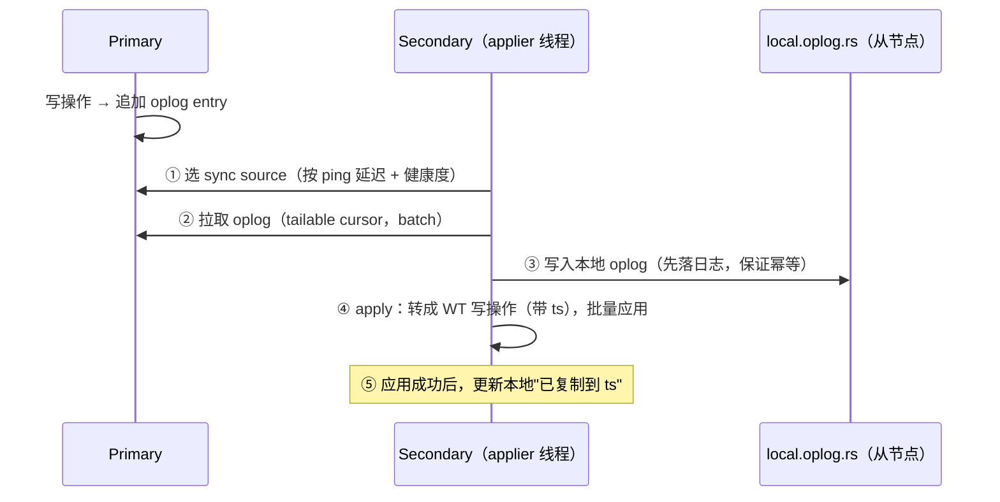

**几个精妙设计**：
- **先写本地 oplog 再 apply**：如果 apply 到一半崩溃，重启后可以"从本地 oplog 的最后一个 ts 继续"，不会重复/漏。
- **批量 apply（batched apply）**：把多条 oplog 合成一个 WT 事务提交，减少 fsync 次数 → 从节点能追上高写入。（`replWriterThreadCount` 控制并发）
- **sync source 选择**：不是固定追主节点，而是按"ping 时间 + 是否健康"动态选（可以追其他从节点，形成"链式复制"以分散主节点压力）。

### 7.3 选举（Raft 启发，但不是 Raft）

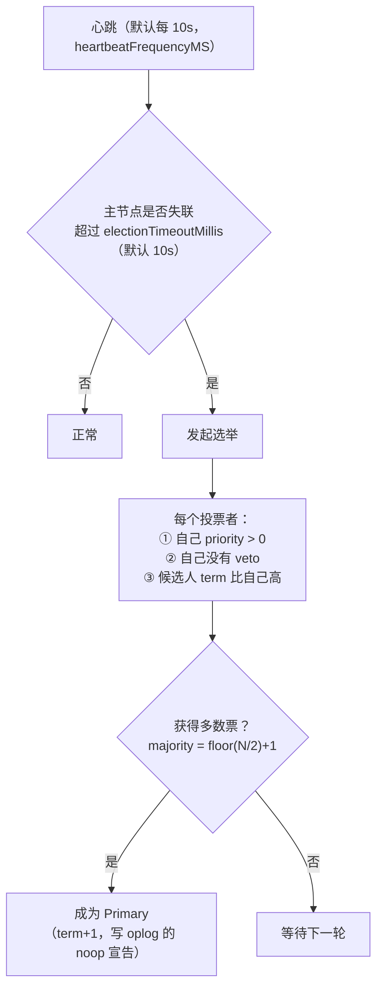

| 概念 | 说明 |
|---|---|
| **term（任期）** | 每次选举递增；term 大的节点优先；**旧 term 的写会被拒绝** → 保证不脑裂 |
| **priority** | 0–1000（默认 1）。越高越可能当选。**`priority: 0` = 永不成为主**（用于跨机房"只读副本"、备份节点） |
| **votes** | 每节点默认 1 票（最多 50 个投票成员） |
| **arbiter** | 有票、不存数据、**不能是 priority>0 的数据节点替代品** |
| **veto** | 节点可投票否决（如"我的数据太旧，等我追上"） → 防止选出一个"落后的主" |
| **catchup** | 新主选出后，其他节点要追上它的 oplog 才能正常服务（`catchupTimeoutMillis`） |

**选举时间的现实**：默认 10s 心跳超时 + 选举 + catchup ≈ **10–30 秒不可写**。
→ 优化：把 `electionTimeoutMillis` 调到 5s（更快切换，但可能误判）；用 **driver 的 retryable writes + 连接串多节点** 来平滑这 30 秒。

**"主节点为什么会主动 step down"**（☆☆ 冷知识，P7 常问）：
1. 无法与多数节点通信（"I can't see majority"）→ 主动降级，避免脑裂；
2. 收到 `rs.stepDown()`（运维主动切换）；
3. 优先级更高的节点加入（`priority` 更高的节点上线后可能触发重新选举，取决于配置）；
4. 心跳超时（`heartbeatTimeoutSecs`，默认 10s）。

### 7.4 多数提交点（majority commit point）与 `w:"majority"` 的真实含义

```
成员：P（term 5）、S1、S2
写 W 到达 P，P 写 oplog（ts=T）
  ├── S1 apply 到 T     → P + S1 = 2/3 = 多数 → **多数提交点推进到 T**
  └── S2 还在 T-100     → 不影响（多数已满足）

此时：
  ① w:"majority" 返回成功（P 已收到 2 个确认）
  ② readConcern:"majority" 的读可以看到 T（因为 T ≤ majority commit point）
  ③ 若 P 立刻宕机，S1/S2 选举（S1 有 T，S2 没有）→ S1 当选（因为它更新）→ T 不会丢
```

**反之，`w:1` 的危险场景**：

```
P 写 W（ts=T），立刻返回 w:1 成功
P 宕机（T 还没复制到任何从节点）
S2（较旧）当选为主（因为 S1 也挂了 / 或 S1 落后）
→ S2 的 oplog 里没有 T
→ P 恢复后重新加入，发现自己的 T 在 S2 的 oplog 里"不存在对应位置"
→ **rollback：把 T 之后的写回滚掉，写入 rollback 文件**
```

**rollback 的三个细节（★★★★☆ 高频深挖）**：
1. rollback 的判定：用 **`fset`（分片集群）/ `rollbackId` + oplog 的 `h` 字段**比对，找到"两边 oplog 的分叉点"；
2. 回滚的数据写入 `dbpath/rollback/<db>.<coll>.<timestamp>.bson`，**需要人工检查是否要重新应用**；
3. 回滚**不可怕但很贵**：涉及大量文档重写、索引重建、可能触发全量同步。**根本预防就是 `w:"majority"`。**

### 7.5 从节点读与复制延迟

| 现象 | 原因 | 处置 |
|---|---|---|
| 从节点读到旧数据 | 复制延迟（apply 慢 / 网络 / 大事务） | `readPreference: primary` 或 `maxStalenessSeconds` + causal session |
| 从节点 CPU 高但无查询 | apply 线程在重放大量 oplog（尤其大事务、批量更新） | 拆小批量写；从节点加资源；`replWriterThreadCount` 调优 |
| 从节点磁盘写满 | oplog + 数据双写；checkpoint 与 apply 争 IO | 独立盘、`directoryForIndexes` |
| 复制延迟持续增长 | 主节点写入超过从节点 apply 能力 | **这是"主节点必须限流"的信号**，加从节点不能解决，必须降低写入或分片 |

**"大事务/大批量写"为什么是复制灾难**：
- 一个 `updateMany` 改 100 万文档 → oplog 生成 100 万条（或几十条 `applyOps` 大条目）→ 从节点要重放 100 万次修改 → 从节点延迟飙升；
- 且 oplog 体积暴涨 → 窗口缩短 → 备份/新节点加入变难。
→ 规范：**批量写必须分批（每批 1000–10000 条），批间 sleep，避免"一秒钟改完整个集合"**。

### 7.6 多数据中心部署（P7+ 场景题）

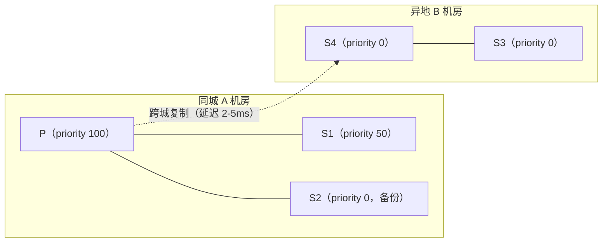

设计要点：
1. **同城 3 节点保证多数（2/3）能在同城达成** → `w:"majority"` 不会因跨城延迟而变慢；
2. **异地节点 `priority: 0`**：只做灾备读、不参与选主（避免"跨城选主"导致写入延迟）；
3. 若要"异地也能接管"，则必须接受 `w:"majority"` 包含异地节点 → 写入延迟增加 2–5ms；
4. **tag（readPreferenceTags）**可以把读定向到某个机房：`readPreferenceTags: [{ dc: "BJ" }]`；
5. **跨城链路**要注意 oplog 的批传输效率与带宽成本（写入 17GB/h 就要 17GB/h 的专线）。

---

## 8. 分片集群（Sharding）

### 8.1 组件与元数据

```
config server（副本集，通常 3 节点）
  ├── config.shards      : 有哪些 shard（host 列表）
  ├── config.databases   : 哪些库开启了分片（primary shard 是谁）
  ├── config.collections : 哪些集合分片了、shard key 是什么、是否 unique
  └── config.chunks      : **核心**：每个 chunk 的 [min, max) shard key 范围 → 属于哪个 shard

mongos（无状态路由）
  └── 内存缓存 config.chunks 的一份副本（config.cacheSizeMB，默认 16MB）

shard（每个 shard 是一个完整的副本集）
  └── 存实际数据；**每个 shard 的 primary 才是真正干活的节点**
```

**为什么 config server 必须 3 节点**：它是**整个集群的单点真相源**。它挂了 → 分片集群无法路由（mongos 只能靠缓存撑一小会儿）。所以它必须是副本集，且**不能与 shard 混部**（官方建议独立部署）。

### 8.2 分片键（Shard Key）：整个架构的命门（★★★★★）

**四条选择标准（面试必背）**：

| 标准 | 含义 | 反例 |
|---|---|---|
| **基数（Cardinality）** | shard key 的不同值要足够多 | `{status: 1}` 只有 3 个值 → 最多 3 个 chunk 能分裂，其余全挤在一起 |
| **频率（Frequency）** | 各值的文档数要尽量均匀 | `{country: 1}` 若 90% 用户在中国 → 中国 chunk 巨大，其余闲置 |
| **单调性（Monotonicity）** | 避免"一直向一个方向递增" | `{createdAt: 1}` / ObjectId / 自增 ID → **所有新写都落在最后一个 chunk（热点）** |
| **不可变/可查询** | 4.2 前 shard key 不可改；4.4 可 refine（加后缀），5.0 可 reshard | 选错后改造成本极高 |

**三种典型错误与解法**：

```
❌ 错误 1：{createdAt: 1}（时间戳）
   所有写入打到"最后一个 chunk" → 该 shard 成为写瓶颈，其他 shard 空闲
   ✅ 解法 A：hashed 分片键 {_id: "hashed"} → 均匀，但范围查询变 scatter-gather
   ✅ 解法 B：复合键 {tenantId: 1, createdAt: 1}（若租户基数足够）→ 每租户内部仍单调，但多租户分散
   ✅ 解法 C：{createdAt: 1, _id: 1} 且写入端做"随机后缀"（不推荐，业务侵入大）

❌ 错误 2：{_id: 1}（ObjectId 单调递增）
   与错误 1 相同：ObjectId 前 4 字节是时间戳 → 单调
   ✅ 解法：{_id: "hashed"}

❌ 错误 3：{userId: 1}（低基数 + 高频热点）
   大 V 用户的所有数据在一个 chunk → 单 chunk 热
   ✅ 解法：{userId: 1, _id: "hashed"}（同用户内再散开）或 {userId: "hashed"}
```

**hashed vs ranged 对比**：

| 维度 | ranged（范围） | hashed（哈希） |
|---|---|---|
| 数据分布 | 依赖业务分布，易倾斜 | **近似均匀** |
| 范围查询 | **targeted（只打相关 shard）** | **scatter-gather（打所有 shard）** |
| 等值查询 | targeted（若带完整 shard key） | targeted |
| 热点写 | 单调键会热点 | 无热点 |
| 常用场景 | 日志按时间、地理按区域、需要按范围归档 | 用户/订单按 ID 均匀分散 |

> **L3 级回答**："我选 shard key 的顺序是：先问'最常用的查询是否带这个字段且是等值'→ 如果业务天然有租户/客户维度且查询总带它，用 `{tenantId: 1, _id: "hashed"}` 复合键，既保证单租户查询 targeted，又避免单租户内热点；如果查询模式不确定、只追求写入均匀，就用 `_id: hashed`，代价是范围查询变全片广播。"

### 8.3 chunk 与分裂

```
chunk = 一段连续的 shard key 范围，默认 64MB（6.0 起 128MB）
分裂触发：chunk 内数据量 > chunkSize → 在"中位数"处一分为二
  ├── 由 mongos 在插入/更新时触发（"split" 命令）
  └── 或由后台的 split 逻辑触发

关键事实：
  ① 分裂是"逻辑分裂"，**不搬数据**（只更新 config.chunks 的边界）
  ② 分裂后的 chunk 会留在同一个 shard，直到 balancer 迁移
  ③ **jumbo chunk**：无法分裂的 chunk（单个文档 > chunkSize，或 shard key 值只有一个）
     → 标记为 jumbo，balancer **跳过不迁移** → 长期热点，必须改 shard key
```

### 8.4 balancer 与 moveChunk（迁移的完整流程，★★★★☆ 高分点）

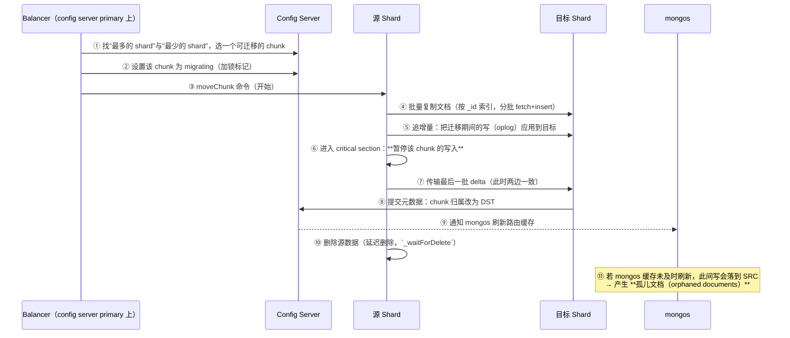

**关键细节**：
- **critical section 极短（毫秒级）**，这是设计的亮点：不做"停写整段时间"，而是"先追平、再短暂冻结、最后切元数据"。
- **孤儿文档**：mongos 用**旧路由**把写发到了源 shard，但 chunk 已迁走 → 源 shard 上留下"不该在这的数据"。后果：查询可能读到重复数据（`SHARDING_FILTER` 会过滤，但有延迟）；需要 `cleanupOrphaned` 清理。
- **balancer 不是"实时平衡"**：它在**迁移阈值（默认 chunk 数差 ≥ 2）**时才动，且有**迁移窗口**（`balancerStart`/`balancerStop`，可配置活跃时段），避免白天影响业务。
- **迁移会消耗大量 IO**：一次迁移 64MB 数据 + 索引，若同时迁很多 chunk，会打满网络与磁盘 → 生产上应**限速**（`_secondaryThrottle`、迁移窗口）。

### 8.5 路由：targeted vs scatter-gather

```javascript
// ✅ targeted：查询带完整 shard key（或范围）
db.orders.find({ userId: 1001 })              // shard key = userId → 只打 1 个 shard
db.orders.find({ userId: { $in: [1001,1002] } }) // → 打 2 个相关 shard

// ❌ scatter-gather：查询不带 shard key
db.orders.find({ amount: { $gt: 100 } })      // → 打所有 shard，mongos 归并
```

**成本量化**：10 个 shard 时，一次 scatter-gather = 10 次查询 + 归并。若每个 shard 返回 1 万条，mongos 要处理 10 万条 → **mongos 成为瓶颈**（它只有单机 CPU）。

**"为什么 mongos 不能无限加"**：mongos 本身是**有状态的归并者**（要维护游标、排序堆、去重集合）。加 mongos 能扩展"并发连接数"，但**单次 scatter-gather 的归并成本不变**。→ 根治办法是**让查询带 shard key**。

### 8.6 跨分片的 `$lookup` 与聚合

| 场景 | 约束 | 代价 |
|---|---|---|
| `$lookup` 的 `from` 是分片集合 | 4.2+ 支持，但**要求 `foreignField` 包含 shard key**（或 `from` 是同一 shard 的集合） | 若非，需先把右集合**整个拉到 mongos 内存**做 JOIN |
| `$group` 无 shard key | mongos 上做**全局归并**（shard 先本地聚合，再汇总） | 网络传输量大 |
| `$out` / `$merge` 写入分片集合 | 支持，但**需按 shard key 路由** | 若无 shard key → 广播写 |
| `$sort` 全局排序 | 各 shard 本地排序 + mongos 归并 | 内存与网络 |

> **P7+ 场景题**："分片集群里做一个'按用户 ID 查订单 + 关联商品'的接口，怎么设计？"
> → 订单集合 shard key = `{userId: 1}`（查询带 userId，targeted）；商品是**小表**（几万条），**不做分片**（放单个 shard，或用 `$lookup` 前把商品表缓存在应用侧）；如果非要 JOIN，把商品的常用字段**冗余到订单文档**（Extended Reference），彻底消除 `$lookup`。

### 8.7 扩容与 reshard（5.0+）

```
加 shard：
  ① sh.addShard("rs3/host:port") → config 记录新 shard
  ② balancer 开始把 chunk 迁过去（耗时取决于数据量与带宽）
  ③ 期间**业务无感**，但 IO 与网络压力上升（要限速/择时）

reshard（5.0+，在线改 shard key）：
  ① sh.reshardCollection("db.coll", {newKey: 1})
  ② 后台流程：复制全量数据到新分片布局 → 追增量 → 切换元数据（类似 moveChunk 的放大版）
  ③ **需要额外磁盘空间（约 1.3~2 倍）与长时间**
  ④ 期间写入继续，但延迟可能上升
```

**"为什么不建议频繁 reshard"**：它本质是一次"全量重写 + 元数据切换"，成本接近"重建集群"，且要预留大量磁盘。**选对 shard key 的成本远低于 reshard 的成本。**

### 8.8 分片集群的运维陷阱清单（实战价值最高的一节）

| 陷阱 | 表现 | 处置 |
|---|---|---|
| **mongos 路由缓存 stale** | 读到孤儿文档 / 写入落错 shard | 检查 `config.chunks` 与 `cleanupOrphaned`；升级版本（4.4+ 有改进） |
| **chunk 太多（几万个）** | balancer 与 mongos 元数据开销大，迁移慢 | 增大 `chunkSize`（改 config 需谨慎），减少 chunk 数 |
| **jumbo chunk** | balancer 不迁，单 shard 热 | 改 shard key / 拆分大文档 / `splitAt` 手动 |
| **唯一索引建不了** | `unique` 必须含 shard key | 设计阶段就定好；或改业务唯一性方案 |
| **config server 成为单点** | 挂了整个集群不能路由 | 3 节点 + 独立部署 + 监控 |
| **跨片事务性能差** | 两阶段提交 + 网络往返 | 尽量让事务只碰一个 shard（shard key 设计配合） |
| **`$lookup` 把右集合拉进 mongos** | mongos 内存暴涨/OOM | 右集合必须带 shard key，或改冗余字段 |
| **备份/恢复复杂** | 需要"一致性快照"跨所有 shard | 用 `mongodump` 的 `--oplog` 或文件系统快照 + 全局停顿（或用 Percona Backup for MongoDB） |

---

## 9. 事务（Transactions）

### 9.1 三个层次的原子性

| 层次 | 保证 | 实现 |
|---|---|---|
| **单文档** | 天然原子（要么全改，要么不改） | WT 的单文档写 + MVCC |
| **单分片多文档**（4.0+） | 事务原子 | WT 多文档事务 + 副本集 |
| **跨分片多文档**（4.2+） | 分布式事务原子 | **两阶段提交（2PC）+ mongos 协调** |

> **这是 MongoDB 最容易被误解的一点**：MongoDB 从 4.0 起**有真正的多文档 ACID**（不是"最终一致"）。但**它的实现代价与限制，决定了你不应该把它当 MySQL 用**。

### 9.2 事务的实现原理（★★★★★ 深挖点）

```
客户端 session.startTransaction()
        │
        ▼
① mongos（或 mongod，副本集场景）成为 **coordinator（协调者）**
② 事务内每个操作按 shard key 路由到对应 shard 的 primary（**participant**）
③ 每个 participant 在本地开启 WT 事务：
     - 分配 txnid + **read timestamp（快照起点）**
     - 所有修改写入内存页（**不落盘**），旧版本进 history store
     - 记录"prepare"状态
④ 客户端 commitTransaction()
⑤ coordinator 向所有 participant 发送 **prepare**（两阶段提交的第一阶段）
     - participant 检查冲突、把事务标记为 prepared（**此时持有锁/写意图**）
⑥ 所有 participant 返回 prepared OK → coordinator 写入 **commit decision**（决策日志）
⑦ coordinator 发送 **commit**（第二阶段）→ 各 participant 本地提交（写 oplog、推进 timestamp）
⑧ 若任一阶段失败 → coordinator 发送 **abort**（回滚）
```

**三个关键机制（必须能讲出来）**：

1. **快照隔离靠 timestamp**：事务开始时取一个 `read timestamp`，所有读都看"≤ 该 ts 的最新版本"（从内存页或 history store 取）。**因此事务内看到的数据是一致的，不受其他事务并发修改影响。**
2. **写冲突靠乐观检测**：两个事务改同一文档 → 先提交的赢，后提交的收到 **`WriteConflict`**（错误码 112）。MongoDB 内部会**自动重试若干次**（因为事务内的写操作可能因冲突被 abort 重试），最终失败则抛给应用 → 应用必须**重试整个事务**（捕获 `TransientTransactionError`）。
3. **原子性靠"决策日志 + 2PC"**：coordinator 在 prepare 全部成功后，先写一条"commit decision"到自己的 oplog（**这是"提交点"**），再通知各 participant 提交。若协调者在通知途中崩溃，恢复时读决策日志 → 继续通知（**保证"要么全提交，要么全回滚"**）。

### 9.3 事务的限制（背下来，面试常考"为什么不能这么用"）

| 限制 | 值/内容 | 原因 |
|---|---|---|
| **生命周期** | 默认 **60 秒**（`transactionLifetimeLimitSeconds`） | 保护 history store 与锁不被长期占用 |
| **单事务 oplog 条目** | 16MB | oplog entry 与文档大小限制一致 |
| **DDL** | 4.4 前完全禁止；4.4+ 允许**在事务内创建集合/索引**（但有条件，且不能跨 shard） | 元数据锁与 2PC 的复杂度 |
| **跨分片** | 支持，但 **participant 数量越多，2PC 成本越高** | 网络往返 × 2 阶段 |
| **不能用的操作** | `$out`、`$merge`（部分版本）、`createIndex`（4.4 前）、`db.adminCommand`、`killCursors` 等 | 非事务安全的操作 |
| **maxTimeMS** | 事务不支持 `maxTimeMS`（用 `transactionLifetimeLimitSeconds`） | 设计如此 |
| **读关注** | 事务内只能用 `snapshot`（或 local） | 快照隔离要求 |
| **写关注** | 只在 **commit 时** 指定，事务内不能按操作指定 | 提交是一个整体 |

### 9.4 事务的性能与正确用法

**事务的代价（量化）**：

```
单分片事务：≈ 2 次额外网络往返 + prepare 状态的锁持有 + history store 压力
跨分片事务：≈ 4 次以上网络往返 + 2PC + 各 participant 的 prepare 排队

对比：同样两个文档的修改
  不用事务（两次独立 update）：~2 次 RTT
  用事务（同分片）：~4 次 RTT（2 倍）
  用事务（跨分片）：~8 次 RTT（4 倍）+ 冲突概率上升
```

**正确用法（P7+ 会问"什么时候不该用事务"）**：

| 场景 | 建议 |
|---|---|
| 单文档更新（计数器、状态机） | **不需要事务**，`findOneAndUpdate` 天然原子 |
| 一个用户的所有数据 | **用嵌入/同 shard key 设计**，避免跨文档事务 |
| 跨用户/跨实体的强一致（转账） | 用事务，但**控制 participant 数 ≤ 2–3** |
| 大批量数据迁移 | **禁用事务**，用分批幂等写 + 补偿 |
| 高并发热点（库存扣减） | 事务会放**大冲突率** → 用 `$inc` + 条件更新（乐观），或分桶 |

**库存扣减的三种写法（经典场景题）**：

```javascript
// ① 原子条件更新（推荐，无事务）
db.inventory.updateOne(
  { sku: "A1", stock: { $gte: 1 } },
  { $inc: { stock: -1 }, $currentDate: { lastSold: true } }
)
// 返回 modifiedCount=0 → 库存不足（原子且无锁）

// ② 事务（需要同时改订单 + 库存）
const session = client.startSession();
session.startTransaction();
try {
  const r = db.inventory.updateOne({sku:"A1", stock:{$gte:1}}, {$inc:{stock:-1}}, {session});
  if (r.modifiedCount !== 1) throw new Error("OUT_OF_STOCK");
  db.orders.insertOne({sku:"A1", qty:1, ts:new Date()}, {session});
  await session.commitTransaction();
} catch (e) {
  await session.abortTransaction();
} finally { await session.endSession(); }

// ③ 高并发下的"分桶扣减"（避免单文档热点）
// inventory 文档按 {sku, bucket:0..9} 分成 10 个桶，每次随机选桶扣减
```

### 9.5 事务与复制、oplog

- 事务提交时，**整个事务的 oplog entries 用 `applyOps` 包裹**（一个 command 操作），从节点**整体重放**；
- 因此从节点的"事务可见性"与主节点一致（不会出现"从节点看到半个事务"）；
- **大事务（接近 16MB oplog）** 会让 oplog 条目巨大 → 复制延迟、oplog 膨胀；
- **事务内不能 `fsync` 语义**：`w:"majority", j:true` 在 commit 时生效，保证"提交落盘"。

---

## 10. 锁与并发控制

> **务必区分两套"锁"**：MongoDB 层的**意向锁/元数据锁**（粗粒度、防 DDL 冲突），和 WiredTiger 层的**ticket + 页锁 + 乐观并发**（细粒度、管数据读写）。**面试最常见的错误回答是"MongoDB 用的是文档级锁"——这只对了一半。**

### 10.1 MongoDB 层的锁层级

```
Global Lock（全局锁）
 └── Database Lock（库级）
      └── Collection Lock（集合级）
           └── Document（**不在 MongoDB 层，由 WT 的并发控制保证**）

锁模式：
  IS（意向共享）/ IX（意向排他）—— 读写操作用
  S（共享）/ X（排他）—— DDL、管理操作用
```

| 操作 | 加的锁 | 说明 |
|---|---|---|
| 普通读（find） | **不加锁**（"lock-free reads"，4.0 后彻底无锁读） | 靠 WT 的快照 |
| 普通写（insert/update） | 集合级 **IX**（意向锁，不阻塞其他 IX） | 实际互斥在 WT 的文档级 |
| `createIndex` / `drop` / `renameCollection` | 集合级 **X**（排他）→ **阻塞该集合所有读写** | 这就是"建索引会卡业务"的机制 |
| `db.dropDatabase()` | 库级 X | 影响整库 |
| `replSetStepDown` / 关库 | 全局 X | 罕见 |

**关键结论**：
- **意向锁之间不互斥**（IX 与 IX 兼容），所以**并发写不会互相阻塞**；
- **只有 DDL（X）与读写（IS/IX）互斥** → 这才是"MongoDB 里 DDL 要谨慎"的原因；
- **4.0+ 的"无锁读"** 意味着读永远不会被写阻塞（快照隔离），但也意味着**读可能读到旧数据**（如果它在读的过程中被改）。

### 10.2 WiredTiger 层的并发控制

| 机制 | 作用 |
|---|---|
| **ticket（128/128）** | 限制同时进入 WT 的线程数，保护内部结构 |
| **page latch** | 页级读写锁（读时共享，改页时排他，粒度极短） |
| **乐观并发（无锁写）** | 写文档时先"记下版本"，提交时检查是否被别人改过 → 冲突返回 `WriteConflict` |
| **唯一索引的悲观检查** | 唯一索引插入必须检查"是否已存在" → 这里会真正阻塞 |
| **cursor pin** | 防止正在被遍历的页被 evict 掉 |

**`WriteConflict` 的完整产生路径**（★★★★☆ 深挖点）：

```
事务 A 读文档 D（记录 D 的 last_lsn = L1）
事务 B 修改文档 D（D 的 last_lsn 变为 L2）
事务 A 想改 D → WT 检查：D 的当前 lsn(L2) > A 读到的 lsn(L1)
             → 抛出 WriteConflict（"the transaction was aborted because of a write conflict"）
```

- **普通单文档写也会冲突**（不是只有事务才会）：两个并发 `updateOne` 同一文档，后到的会 `WriteConflict` → MongoDB **内部自动重试**（对非事务写，通常对应用透明）；
- **事务内冲突**：整个事务需要重试 → 应用必须捕获 `TransientTransactionError` 并重跑；
- **冲突率高的信号**：`serverStatus().metrics.operation.writeConflicts`（或 `wiredTiger.transaction.transactionCheckpointConflict`）持续增长。

### 10.3 锁诊断三板斧

```javascript
// ① 谁在等锁？
db.currentOp({ "waitingForLock": true })
// 关注：secs_running、op、ns、locks、waitingForLock、numYields

// ② 全局锁状态
db.serverStatus().globalLock
// totalTime / lockTime / currentQueue.{total,readers,writers} / activeClients

// ③ 找出"长时间运行的操作"
db.currentOp({ "secs_running": { $gt: 5 }, "active": true })
```

**"`numYields` 很大说明什么"**（☆☆ 冷知识）：
表示该查询在执行过程中**主动让出（yield）了很多次**，常见于：
- 扫描量巨大（COLLSCAN），每扫一批就让出给其他请求；
- 遇到大量脏页/需要 eviction；
→ 它是"这个查询很重"的间接证据，但**不等于它在等锁**。

---

## 11. Change Stream 与 CDC

### 11.1 机制

```
Change Stream = 基于 oplog 的"变更订阅"
  ① 客户端 openChangeStream（一个 tailable cursor）
  ② 服务端从"当前时间点"（或指定 resumeToken）开始读 oplog
  ③ 把 oplog entry 转成"业务事件"（insert/update/delete/replace/...）
  ④ 推送给客户端（每批最多 batchSize，默认很大；心跳 keepAlive）
  ⑤ 客户端记录 **resumeToken**（存在 `_data` 字段），断线后从该点续读
```

```javascript
const cs = db.orders.watch([], {
  fullDocument: "updateLookup",       // update 事件带上"当前完整文档"（多一次读）
  fullDocumentBeforeChange: "whenAvailable"  // 6.0+：带变更前的文档（需开启 pre-image）
});
while (!cs.isClosed()) {
  const next = await cs.next();
  process(next);   // next._id 就是 resumeToken，务必持久化
}
```

### 11.2 五个必须知道的限制

| 限制 | 说明 | 应对 |
|---|---|---|
| **需要副本集/分片** | 单机不支持（没有 oplog） | 生产本来就该是副本集 |
| **受 oplog 窗口约束** | 断线超过 oplog 窗口 → `ChangeStreamHistoryLost`，**无法续读** | 持久化 resumeToken + 监控 lag；oplog 调大 |
| **不是"精确一次"** | 网络重试可能**重复投递**（at-least-once） | 下游必须**幂等**（用 `_id` + 事件 id 去重） |
| **`updateLookup` 有一次额外读** | 拿"当前完整文档"要回表，且**可能与事件不一致**（文档又变了） | 用 `fullDocumentBeforeChange` 或直接用 `updateDescription.diff` |
| **集合必须已存在** | 4.x 对不存在的集合 watch 会报错（6.0 支持 `showExpandedEvents` 后部分 DDL） | 先建集合 |

### 11.3 CDC 方案对比

| 方案 | 原理 | 优点 | 缺点 |
|---|---|---|---|
| **Change Stream** | 官方 oplog 封装 | 官方支持、resumeToken、语义清晰 | 需要副本集；性能受 oplog 读影响（但读是从节点可分担） |
| **oplog tailing（自己写）** | 直接 tailable `local.oplog.rs` | 最灵活、最低层 | 要自己处理 rollback、`applyOps`、幂等；容易踩坑 |
| **MongoShake**（阿里开源） | 读 oplog → 写目标（Mongo/ES/Kafka） | 成熟、支持多目标、断点续传 | 需要运维；大事务/DDL 有坑 |
| **Debezium** | Kafka Connect 连接器 | 与 Kafka 生态集成好 | MongoDB connector 的 snapshot 阶段对性能有影响 |

> **实战建议**：To B 的"数据同步到数仓/ES"，优先 Change Stream（官方、稳定）；对"必须极低延迟 + 自定义逻辑"的场景，用 MongoShake 或自研 oplog tailing。**不要用 `mongodump` 定时全量同步**（数据量大时根本跑不完）。

---

## 12. 安全与运维

### 12.1 认证与授权

| 机制 | 说明 | 适用 |
|---|---|---|
| **SCRAM-SHA-256**（默认） | 用户名/密码 + 挑战响应，不传明文 | 通用 |
| **x.509** | 客户端证书（双向 TLS） | 集群内部认证（keyfile 的升级版）、企业内网 |
| **LDAP / Kerberos** | 对接企业目录 | 大企业统一身份 |
| **keyfile** | 集群内部共享密钥（老方式） | 小集群内部认证 |

**授权模型**：
```javascript
// 内置角色：read / readWrite / dbAdmin / dbOwner / clusterAdmin / clusterMonitor / root ...
db.createUser({
  user: "app",
  pwd: passwordPrompt(),
  roles: [
    { role: "readWrite", db: "shop" },
    { role: "clusterMonitor", db: "admin" }
  ]
});

// 自定义角色（最小权限原则）
db.createRole({
  role: "orderReader",
  privileges: [{ resource: { db: "shop", collection: "orders" }, actions: ["find"] }],
  roles: []
});
```

> **P7+ 安全要点**：① 必须开 `authorization`（很多人测试环境不开，上线忘了）；② **最小权限**，不要给 `root`；③ 开启 TLS（`net.tls.mode: requireTLS`）；④ 审计日志（企业版 `auditLog`）；⑤ 定期轮换凭证；⑥ **不要暴露 27017 到公网**（历史上大量 MongoDB 被勒索删库，就是因为默认无认证 + 公网可达）。

### 12.2 备份与恢复（三种方案的能力对比）

| 方案 | 一致性 | 速度 | 增量 | PITR | 适用规模 |
|---|---|---|---|---|---|
| `mongodump` / `mongorestore` | `--oplog` 可保证一致点 | 慢（逐文档读 + BSON 编码） | 否（全量） | 配合 oplog 重放 | 小库（<100GB）、逻辑备份、跨版本迁移 |
| **文件系统快照**（LVM / EBS / 云盘快照） | 需 `db.fsyncLock()` 或停写 | **极快**（块级） | 快照链 | 快照 + oplog | 大库（TB 级） |
| **PITR（oplog 重放）** | 精确到秒 | — | 是 | **是** | 关键业务（RPO 秒级） |
| MongoDB 官方 `mongodb-backup` / Ops Manager / Percona Backup | 支持一致性 + PITR | 中 | 是 | 是 | 生产推荐 |

**`fsyncLock` 的正确姿势**（文件系统快照必用）：
```javascript
db.fsyncLock()          // ① 刷脏页并阻止新写入（注意：会阻塞写！）
// ② 做快照（LVM/EBS，秒级）
db.fsyncUnlock()        // ③ 解锁
// 风险：lock 期间写全部阻塞，时间越长业务影响越大 → 必须在低峰 + 限时
```

### 12.3 关键监控指标（一张表看清"该看什么"）

| 类别 | 指标 | 健康阈值 | 异常含义 |
|---|---|---|---|
| 连接 | `connections.current / available` | < 80% | 连接泄漏或连接池过大 |
| 操作 | `opcounters.query/insert/update/delete` | 看趋势 | 突增=攻击/异常业务 |
| 队列 | `globalLock.currentQueue.total` | 接近 0 | 有锁等待/慢查询 |
| **ticket** | `wiredTiger.concurrentTransactions.available` | 不应长期为 0 | **WT 并发打满，请求排队** |
| cache | `wiredTiger.cache."bytes currently in cache" / maximum` | < 80% | 接近 100% → 频繁 eviction |
| 脏页 | `wiredTiger.cache."tracked dirty bytes in the cache"` | < 5–10% | 高 → eviction 压力、写抖动 |
| 复制 | `replSetGetStatus.members[].optimeDate` 差值 | < 1s（同机房） | 延迟 → 读到旧数据/切主丢数据风险 |
| oplog | `rs.printReplicationInfo()` 窗口 | > 24h | 窗口太小 → 全量同步风险 |
| 磁盘 | `db.stats().dataSize` / 磁盘剩余 | > 20% | 磁盘满是 MongoDB **只读**的经典事故 |
| 慢查询 | profiler 记录数 | 看趋势 | 索引缺失/查询退化 |
| 分片 | `config.chunks` 分布、balancer 状态 | 均匀 | 倾斜/迁移风暴 |

### 12.4 十大真实故障案例库（面试"讲一个你排查过的线上问题"的弹药）

#### 案例 1：连接数暴涨，新连接全部失败
```
现象：应用大量 "connection refused" / "too many open connections"
排查：db.serverStatus().connections → current 接近 maxIncomingConnections
根因：① 连接池配置过大（每 Pod 100 连接 × 50 Pod = 5000）；② 连接泄漏（未 close）
处置：调小连接池 + 用 mongos 分摊 + 检查驱动是否复用客户端（**MongoClient 必须单例**）
```

#### 案例 2：P99 延迟周期性飙升（每 60 秒一次）
```
现象：监控显示每 60s 一次 100ms+ 毛刺，QPS 无变化
排查：iostat 显示周期性 write burst；serverStatus 的 dirty bytes 在峰值前很高
根因：**checkpoint 每 60s 全量刷脏页**，撞上业务写入 → 设备队列打满
处置：cache 降为 40%，脏页水位下调（eviction_dirty_target=3），journal 独立盘
```

#### 案例 3：一个 `updateMany` 把集群干趴
```
现象：执行 updateMany({status:"pending"}, {$set:{status:"done"}})，随后从节点延迟爆炸、业务超时
根因：一次改 200 万文档 → ① cache 瞬间全脏 → eviction_dirty_trigger 触发 → 应用线程同步刷盘 ② oplog 暴涨 → 从节点 apply 追不上 ③ 索引全部重写
处置：**规范：批量写必须分批（每批 ≤ 1000，批间 sleep）**；已发生的用 killOp 中止 + 分批重跑
```

#### 案例 4：分片集群写入全落在一个 shard
```
现象：3 个 shard，shard A 的写入是 B/C 的 100 倍，CPU 打满
排查：sh.sh.status() 看 chunk 分布；shard key = {createdAt: 1}（单调递增）
根因：**单调 shard key 热点**
处置：改 shard key（5.0 reshard 或重建）→ {tenantId:1, createdAt:1} 或 {_id:"hashed"}
```

#### 案例 5：从节点反复全量同步（initial sync）
```
现象：某从节点反复 "too stale to catch up"，进入 STARTUP2
排查：rs.printReplicationInfo() → oplog 窗口仅 40 分钟；写入 20GB/h
根因：**oplog 太小**，任何一次网络抖动/维护都超过窗口
处置：扩容 oplog（`replSetResizeOplog`，4.0+ 可在线改）到 ≥ 24h 窗口
```

#### 案例 6：事务冲突风暴（WriteConflict 刷屏）
```
现象：高峰期大量 "WriteConflict" / "TransientTransactionError"，事务成功率骤降
排查：serverStatus().metrics.operation.writeConflicts 持续增长；热点是同一个"库存"文档
根因：所有事务都改同一个文档 → 乐观并发必然冲突
处置：① 缩小事务范围（不要在事务里做无关的读） ② 分桶（把热点文档拆成 N 桶） ③ 改用原子条件更新（$inc + $gte）
```

#### 案例 7：磁盘写满导致 MongoDB 只读
```
现象：所有写入报 "server is not writable" / "No space left on device"
根因：数据 + oplog + journal + 临时文件（索引构建、compact）占满
处置：① 立即清理（drop 无用集合、调小 oplog）② **MongoDB 在磁盘满时会拒绝写入（保护数据）**，不要试图"调参数绕过"
预防：磁盘水位告警 80%、预留 1.5 倍数据量空间（compact/索引重建需要）
```

#### 案例 8：索引建了但查询还是 COLLSCAN
```
现象：明明有 {status:1, amount:-1}，查询 status='paid' AND amount>100 还是慢
排查：explain 显示 COLLSCAN 或用了别的索引；发现查询条件是 `amount: {$gt: "100"}`（**字符串**）
根因：**类型不一致**（BSON 类型序：数字 < 字符串，索引按类型分区）
处置：统一类型；用 `$convert` 迁移存量数据
```

#### 案例 9：balancer 迁移把 IO 打满
```
现象：每天凌晨 3 点 IO util 100%，业务延迟上升
排查：sh.isBalancerRunning() = true；config.chunks 显示大量迁移
根因：白天写入导致 chunk 倾斜，balancer 在窗口期内集中迁移
处置：限制迁移窗口与速率（`_secondaryThrottle`、`balancerStop`/`balancerStart`）、提前手动均衡
```

#### 案例 10：内存 OOM，mongod 被杀
```
现象：容器周期性重启，dmesg 显示 OOM kill mongod
排查：cacheSizeGB 是按宿主机内存算的（31GB），容器 limit 只有 2GB
根因：**容器内存识别错误**（老版本按宿主机物理内存计算默认 cache）
处置：显式 setParameter cacheSizeGB=800MB + 容器 memory limit 留 20% 余量
```

> **面试用法**：被问"讲一个你排查的线上问题"时，按 **"现象 → 量化指标 → 根因（机制层）→ 处置 → 预防"** 五段式讲，比"我们重启了一下就好了"强 100 倍。

---

## 13. 卷三小结：MongoDB 的"设计取舍"全景

| 取舍点 | MongoDB 的选择 | 代价 | 换来什么 |
|---|---|---|---|
| 存储引擎 | B+ 树（WT）而非 LSM | 随机写放大、compaction 成本 | 点查/范围查低延迟、延迟可预测 |
| 一致性模型 | 可调（w/readConcern） | 配置复杂，容易配错 | 从"极致性能"到"金融级"全覆盖 |
| 并发控制 | 乐观（WriteConflict）+ 无锁读 | 高冲突场景需应用重试 | 无锁读、高并发吞吐 |
| 事务 | 支持但有限制（60s/16MB） | 跨片事务昂贵 | 单文档天然 ACID + 可选多文档事务 |
| 分片 | 客户端路由（mongos 无状态） | 路由缓存、孤儿文档、scatter-gather | 水平扩展、mongos 可随意加 |
| 数据模型 | 文档（无 schema 强约束） | 应用层要自己保证一致性 | 灵活演进、局部性（读少次） |
| 复制 | 异步 + oplog | 切主可能丢 w:1 的写 | 高性能、自动故障转移 |

---

# 卷四 横向对比：InnoDB / RocksDB / Redis / Kafka / ES

> 卷四是面试的"分水岭区"。**只会 MongoDB 的人，在 P7 面试里会被"为什么不用 MySQL""为什么 MongoDB 不用 LSM"这类问题直接问穿。** 这一卷的核心不是背结论，而是**理解每个选择的物理约束**。

## 1. MongoDB vs MySQL：选型的第一性问题

### 1.1 全面对照表

| 维度 | MongoDB | MySQL (InnoDB) |
|---|---|---|
| 数据模型 | **文档（BSON）**，schema 灵活，天然嵌套/数组 | **关系表**，强 schema，范式化 |
| 主键 | 默认 ObjectId，可自定义 | 必须显式定义，**聚簇索引**（主键即数据） |
| 索引结构 | B+ 树（WT），二级索引存 record id → 回表 | B+ 树，聚簇索引存数据，二级索引存主键 → 回表 |
| 事务 | 单文档天然 ACID；多文档 4.0+（有 60s/16MB 限制） | **完整 ACID**，成熟，隔离级别 RC/RR |
| 隔离级别 | Snapshot Isolation（快照） | RC（默认）/ RR / Serializable |
| 并发控制 | 乐观（WriteConflict）+ 无锁读 | 悲观（行锁 + 间隙锁）+ MVCC |
| JOIN | `$lookup`（弱，N+1） | 原生 JOIN（成熟，但有执行计划问题） |
| 水平扩展 | **原生分片**（mongos + shard） | 需中间件（ShardingSphere）或应用分库分表 |
| 高可用 | **原生副本集**（自动选主，10–30s） | 主从 + MHA/Orchestrator/Group Replication |
| 一致性调优 | w / readConcern / readPreference（细粒度） | 半同步复制 / Group Replication（粗粒度） |
| 分析能力 | 聚合管道（较弱，无窗口函数生态） | 窗口函数、CTE、成熟的 OLAP 生态 |
| 全文检索 | 文本索引（弱，中文分词差） | 全文索引（弱）→ 都要靠 ES |
| 运维成熟度 | 中（国内 DBA 储备少） | **极高**（工具链、人才、社区） |
| 典型场景 | 内容/商品/用户画像/日志/物联网/实时分析 | 交易/账务/ERP/强关系业务 |

### 1.2 什么时候必须用 MySQL，什么时候 MongoDB 更优（决策清单）

**必须 MySQL 的场景**：
1. **强事务 + 强关系**：转账、订单-库存-账务三方一致性、复杂的多表关联报表；
2. **需要复杂 SQL**：窗口函数、CTE、多表 JOIN、子查询；
3. **团队/DBA 储备**：出问题能有人救；
4. **合规审计**：需要成熟的审计、备份、PITR 工具链；
5. **数据量 < 单机可承载**（< 几 TB）且**不需要水平扩展**。

**MongoDB 明显更优的场景**：
1. **文档型/半结构化数据**：商品 SKU（属性千变万化）、内容（富文本 + 多媒体元数据）、用户画像（标签数组）；
2. **读多且"一次查全"**：一个聚合根（订单 + 明细 + 物流 + 优惠）用一次查询返回，避免 JOIN；
3. **快速迭代**：schema 频繁变更（加字段不需要 DDL，不影响线上）；
4. **水平扩展刚需**：数据量/写入超过单机，且能接受分片复杂度；
5. **地理/时序/全文（轻量）**：2dsphere、时间序列集合、文本索引"够用"的场景；
6. **日志/事件/物联网**：写入吞吐高、查询模式简单。

> **P7+ 的标准答法（三段式）**：
> "选型不是'A 比 B 好'，而是看**访问模式**。如果 80% 的查询是'按某个 key 取一个聚合根的全部信息'，MongoDB 的文档模型能把 N 次 JOIN 变成 1 次读，这是数量级的差异；如果 80% 的查询是'多表关联 + 复杂聚合'，或者有强事务要求，MySQL 的成熟度无可替代。**我的实际做法是混合**：核心交易用 MySQL，内容/商品/日志用 MongoDB，通过 CDC（Change Stream / binlog）同步，各自发挥优势。"

### 1.3 一个真实的"混合架构"（P7 场景题模板）

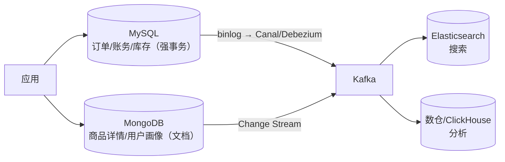

设计要点：
- **单一真相源（SoT）**：每个实体只有一个主库，其他都是"派生视图"；
- **同步用 CDC 而非双写**：双写会不一致，CDC 是"最终一致 + 可重放"；
- **查询侧按场景选**：强一致查询打主库，模糊搜索打 ES，报表打数仓；
- **一致性要求高的读**：带 `readConcern: majority` 或直接回主库。

---

## 2. WiredTiger vs InnoDB：逐项深度对照（★★★★★）

> 这张表是"资深/架构"面试的**核心武器**。能把 8 个维度讲清楚，基本可以宣告"我懂存储引擎"。

| 维度 | WiredTiger（MongoDB） | InnoDB（MySQL） | 差异的根因 |
|---|---|---|---|
| **索引组织** | 每个集合 + 每个索引各一个 B+ 树文件；key 是 record id / 索引值 | **聚簇索引**：主键 B+ 树叶子直接存整行；二级索引叶子存主键值 | Mongo 无"主键即数据"概念（document 独立存储），MySQL 用聚簇索引换"主键查询零回表" |
| **回表** | 二级索引 → record id → collection 表（可能 2 次 IO） | 二级索引 → 主键 → 聚簇索引（**随机 IO**，因为主键可能分散） | 两者都有回表，但 InnoDB 的回表更贵（随机主键访问） |
| **MVCC 旧版本** | **history store**（`WiredTigerHS.wt`），有容量上限（约 cache 20%） | **undo log**（回滚段），有 `innodb_undo_tablespaces`，长事务会撑爆 | Mongo 用"独立结构"便于按 timestamp 检索；InnoDB 用 undo 链便于回滚 |
| **隔离级别** | Snapshot Isolation | RC（默认）/ RR（间隙锁防幻读） | Mongo 天然快照；MySQL 为了兼容与"可重复读"语义保留间隙锁 |
| **写冲突** | **乐观**（WriteConflict，应用重试） | **悲观**（行锁阻塞，`innodb_lock_wait_timeout`） | Mongo 追求"无锁读 + 高并发"；MySQL 追求"确定性" |
| **WAL** | journal（`WiredTigerLog.*`），页级生理日志，100MB/文件，`commitIntervalMs` 100ms | **redo log**（环形，`innodb_log_file_size`），物理逻辑日志，`innodb_flush_log_at_trx_commit` 控制 | 结构类似，但 InnoDB 的 redo 是"固定大小循环写"，WT 是"滚动文件 + checkpoint 截断" |
| **两阶段提交** | 不涉及（MongoDB 没有 binlog 层的双日志问题） | **redo + binlog 两阶段提交**（prepare → binlog → commit） | MySQL 有 server 层 binlog，必须与引擎层 redo 一致，否则主从/恢复会错 |
| **checkpoint** | **全量**（每 60s 或 2GB journal），写时复制（不覆盖旧页） | **模糊增量**（page cleaner 持续刷，LSN 推进） | WT 用"全量快照"换"恢复简单"；InnoDB 用"增量"换"低 IO 峰值" |
| **崩溃恢复** | 从最近 checkpoint + 重放 journal，**无 undo 阶段** | ARISE 三阶段：**analysis → redo → undo** | 见 3.2 的因果链 |
| **半写保护** | 页级 **block checksum** + 丢弃损坏页 | **doublewrite buffer**（先写副本再写原位） | WT 有校验和 + 全量 checkpoint；InnoDB 页可能"原地半写"，必须双写 |
| **缓存** | WT cache（自管）+ OS page cache（双缓存） | buffer pool（自管）+ OS page cache（双缓存） | 一样的问题，一样的"只能给 50–75%" |
| **缓存淘汰** | LRU + update-restore + eviction 水位（dirty 5%/20%） | **分代 LRU**（young/old 37%）+ page cleaner + adaptive flushing | 两者思路一致：把"热数据"留在内存，把"脏页"尽快刷 |
| **预读** | 依赖 OS readahead | 有 **linear/random read-ahead**（`innodb_read_ahead_threshold`） | InnoDB 自己做了预读，更激进 |
| **change buffer** | 无 | **有**（对非唯一二级索引的写先记在内存，延迟合并） | InnoDB 为"写放大"做的优化；Mongo 没有对应机制 |
| **自适应哈希** | 无 | **有**（AHI，热点页自动建 hash 索引） | MySQL 的"点查加速"补丁 |
| **压缩** | block + prefix + Huffman（默认开） | 页压缩（`COMPRESSED`）/ 列压缩（`COMPRESSED` 行格式） | Mongo 压缩更细（block 级），MySQL 主要靠页压缩 |
| **DDL** | 建索引用 hybrid build（副本集不阻塞） | Online DDL（5.7+，`ALGORITHM=INPLACE`），但仍有 MDL 等待 | 两者都要小心"MDL 阻塞" |
| **日志与复制** | oplog（幂等结果日志），WT 的 ts 驱动 | binlog（statement/row/mixed）+ relay log + GTID | Mongo 的 oplog 是"引擎级"的；MySQL 的 binlog 是"server 级"的（所以有两阶段提交） |
| **事务** | 4.0+，60s/16MB 限制，跨片 2PC | 完整、成熟、无 60s 限制（但有长事务风险） | Mongo 的事务是"后来补的"，限制多；MySQL 的事务是"原生设计" |

### 2.1 三个最容易被追问的"为什么"

**① 为什么 InnoDB 需要 doublewrite，而 WiredTiger 不需要？**

```
InnoDB：
  数据页可能被"原地修改"并随机刷盘（脏页随时可能落盘）
  → 若 16KB 页只写了 8KB 就断电，页结构损坏（checksum 不匹配）
  → 但 redo log 里只有"对页偏移的修改"，无法修复"页头部都不完整"的情况
  → 所以必须先把页写到一个连续的 doublewrite 区域（顺序写），再写原位
  → 崩溃后：若原位页损坏，从 doublewrite 恢复该页，再重放 redo

WiredTiger：
  checkpoint 是"写新位置 + 不覆盖旧页"（copy-on-write）
  → 半写只会损坏"新 checkpoint 的页"，旧 checkpoint 完好
  → 且每页有 block checksum，可检测；损坏页直接丢弃，从 journal 重放
  → 不需要 doublewrite
```

**代价对比**：InnoDB 的 doublewrite 让**每次刷页多一次顺序写**（写放大 ~2 倍，但顺序写便宜）；WT 的"不覆盖"让**磁盘空间占用翻倍**（旧 checkpoint 要保留到新 checkpoint 完成）。

**② 为什么 Mongo 的 checkpoint 是"全量"，InnoDB 是"增量"？**

- WT 的设计目标是"**崩溃恢复尽可能简单**"：全量 checkpoint 后，恢复 = 加载 checkpoint + 重放 journal（journal 很短，因为每 60s 就截断）。而且全量 checkpoint 的"原子性"天然由"新旧 checkpoint 并存 + 元数据切换"保证。
- InnoDB 的设计目标是"**避免 IO 峰值**"：全量刷 100GB 脏页会造成几十秒的 IO 打满，业务不可接受。所以用 page cleaner 持续小批量刷，checkpoint LSN 慢慢推进，恢复时要重放更长的 redo（所以 redo 要够大）。
- **两者的取舍点相同**：恢复时间 vs 运行期 IO 平滑。**Mongo 选了"恢复快、运行期有峰值"；MySQL 选了"运行期平滑、恢复慢"。**

**③ 为什么 MongoDB 没有 binlog，而 MySQL 必须有两阶段提交？**

- MongoDB 的 oplog **本身就是引擎的一部分**（存在 `local.oplog.rs` 这个 WT 表里），**写数据与写 oplog 在同一个 WT 事务内** → 天然一致，不需要两阶段。
- MySQL 的 binlog 在 **server 层**（与引擎无关），redo 在 **引擎层** → 两个日志系统必须协调 → 必须两阶段提交（否则崩溃后可能出现"redo 说提交了、binlog 没有"→ 主从不一致）。
- **这是一个极好的"架构决定复杂度"的例子**：MongoDB 把复制日志下沉到引擎，省掉了 2PC，但也失去了"binlog 的灵活性"（如 statement 格式、跨引擎）。

---

## 3. WiredTiger vs RocksDB：B+ 树与 LSM 的正面对决

### 3.1 为什么 MongoDB 选了 B+ 树而不是 LSM（★★★★☆ 高频且高区分度）

**先看事实**：MongoDB 在 3.0 选型时，评估过 LSM（当时 RocksDB 已被 Facebook 用在 MySQL 上，叫 MyRocks）。最终选了 WiredTiger（B+ 树）。为什么？

| 理由 | 展开 |
|---|---|
| **① 读延迟可预测** | MongoDB 的核心负载是"点查 + 范围查"（文档数据库的典型用法）。B+ 树的查找路径**固定 3–4 层**，尾延迟稳定；LSM 的读要查 memtable + 多层 SST + Bloom，**尾延迟抖动大**（尤其 compaction 时）。 |
| **② 范围扫描友好** | 文档模型的查询大量是"按某字段范围 + 排序"，B+ 树的叶子链表顺序扫描极快；LSM 需要 merge iterator（多路归并），CPU 开销大。 |
| **③ 更新/删除友好** | MongoDB 有大量"原地更新"（`$set` 一个字段）、TTL 删除。B+ 树原地改；LSM 每次更新都是"写新版本 + tombstone"，**空间放大与读放大显著恶化**。 |
| **④ 事务与快照** | WT 的 MVCC + history store 与 B+ 树页结构耦合得好；LSM 上的事务（RocksDB 的 TransactionDB）要处理多版本 key + 冲突检测，复杂度更高。 |
| **⑤ 压缩效率** | 文档型数据（大量重复字段名）用 block 压缩 + prefix 压缩收益极大；LSM 的 SST 虽然也压缩，但"多版本"会稀释压缩率。 |
| **⑥ 运维可控** | B+ 树的"空间放大"是稳定的（约 1.5–2 倍）；LSM 的"待 compaction 数据"会让磁盘占用不可预测（可能 2–3 倍），这对托管服务（Atlas）的容量规划是灾难。 |

**但要客观承认 LSM 的优势（L3 表达）**：
> "如果 MongoDB 的负载是'时序写入 + 极少更新 + 很少点查'（比如纯日志），LSM 会更优：写入吞吐高 2–5 倍，压缩率更好。**MongoDB 5.0 的时间序列集合，本质上是在 B+ 树之上"模拟"了 LSM 的 bucket 思想** —— 用分桶把随机写变成顺序写，这是对 LSM 优势的一种妥协式吸收。"

### 3.2 RocksDB 深挖（面试问到 RocksDB 时能答到这一层）

```
RocksDB 架构：
┌─────────────────────────────────────────────────────────┐
│ 应用（MyRocks / TiKV / Kafka Streams / Flink）            │
├─────────────────────────────────────────────────────────┤
│ Column Family（多个独立 LSM，共享 WAL，可不同配置）        │
│   CF1: default   CF2: index   CF3: meta                  │
├─────────────────────────────────────────────────────────┤
│ MemTable（skiplist，可配 hash/vector）                    │
│   → Immutable MemTable → Flush → L0 SST                  │
├─────────────────────────────────────────────────────────┤
│ LSM: L0（重叠）→ L1..L6（不重叠，容量 ×10）                │
│   每层：SST 文件（block-based table：data/index/filter/meta）│
├─────────────────────────────────────────────────────────┤
│ WAL（每 CF 可共用一个 WAL，`enable_pipelined_write`）       │
│ MANIFEST（版本快照：每层有哪些文件）                        │
│ OPTIONS 文件（配置）+ CURRENT（指向 MANIFEST）              │
└─────────────────────────────────────────────────────────┘
```

**RocksDB 的 8 个关键机制**：

| 机制 | 说明 | 调优参数 |
|---|---|---|
| **WriteBatch + memtable** | 批量写先聚合，再一次性插 skiplist | `write_buffer_size`（默认 64MB） |
| **WAL 与 atomic flush** | 多 CF 的 WAL 要一起刷，保证"跨 CF 原子" | `atomic_flush=true`（多 CF 场景） |
| **Block-based SST** | data block（4KB）+ index block + filter block（Bloom/Ribbon）+ compression dict | `block_size`、`filter_policy` |
| **Block Cache** | 缓存解压后的 data block，分片 LRU（`cache_index_and_filter_blocks`） | `block_cache_size`（建议内存 1/3） |
| **Leveled Compaction** | Ln 的 1 个文件与 Ln+1 的重叠文件合并 | `max_bytes_for_level_base`、`target_file_size_base` |
| **Write Stall** | L0 文件数超阈值 → 降速/停止写入 | `level0_slowdown_writes_trigger`(20)、`level0_stop_writes_trigger`(36) |
| **Rate Limiter** | 限制 compaction 的 IO 带宽，避免打满业务 | `rate_limiter`、`max_background_jobs` |
| **Merge Operator** | 支持"追加式"语义（如 `append`、`count`），避免读改写 | `merge_operator`（counter、uint64add） |

**RocksDB 的"三放大"实测口径（面试可直接引用）**：

```
写放大（leveled, 6 层）：约 10–30 倍（每层都要重写一遍，且 compaction 会重写相邻文件）
读放大：点查 ≈ 1（memtable）+ L0 文件数 + 6 层 = 约 10–15 次 IO（有 Bloom 时降为 1–2）
空间放大：约 1.1–1.3（leveled） / 2+（tiered）
```

> **为什么 TiKV 用 RocksDB 而不用 B+ 树**：TiKV 的负载是"分布式 KV + 大量写入 + Region 分裂"，写入吞吐与"顺序写"更重要；而且 TiKV 在 RocksDB 之上做了 **titan（大 value 分离）**、**lifetimes**、**多 CF 隔离（raft/log/lock/default）** 等优化来抵消 LSM 的缺点。**这是"LSM 适合写多、且能容忍读放大"的典型证据。**

### 3.3 LevelDB vs RocksDB（细节题）

| 维度 | LevelDB | RocksDB |
|---|---|---|
| 维护者 | Google（基本停止更新） | Facebook/Meta（活跃） |
| Column Family | ❌ | ✅ |
| 事务 | ❌ | ✅（TransactionDB / OptimisticTransactionDB） |
| 备份/检查点 | ❌ | ✅（Checkpoint、BackupEngine） |
| 压缩算法 | snappy | snappy/zlib/lz4/zstd，可配 per-CF |
| 多线程 compaction | 单线程 | 多线程 + 分片 compaction |
| 前缀查询 | 支持（`prefix_extractor` 无） | ✅（`prefix_extractor` + prefix bloom） |
| Merge Operator | ❌ | ✅ |
| 典型用途 | 教学、嵌入式 | 生产（TiKV、MyRocks、CockroachDB、Kafka Streams） |

**一句话**：**LevelDB 是"LSM 的最小可用实现"，RocksDB 是"生产级 LSM"。**

### 3.4 三方选型决策（P7 必备）

| 场景 | 推荐 | 理由 |
|---|---|---|
| 通用文档/业务数据（读写混合、范围查多） | **B+ 树（WT / InnoDB）** | 读延迟稳定、范围扫描快 |
| 写多读少（日志、时序、埋点、消息索引） | **LSM（RocksDB）** | 顺序写吞吐高、压缩好 |
| 需要"追加 + 前缀扫描"（如 HBase 式） | LSM + prefix bloom | 前缀查询友好 |
| 需要强事务 + 复杂查询 | **InnoDB** | 事务成熟、SQL 生态 |
| 需要"超大规模 KV + 水平扩展" | LSM（TiKV/Cassandra） | 分布式友好、无中心 |
| 需要"内存级延迟 + 简单结构" | **Redis**（纯内存） | 无磁盘 IO |

---

## 4. Redis：纯内存工程的极致

### 4.1 为什么单线程还这么快（★★★★★ 必考，但要答出新意）

**错误答法**："因为它是内存操作。"（只说了一半）

**正确答法（分四层）**：

```
① 数据在内存 → 单次操作 ~100ns 级，根本没有磁盘 IO（这是前提）
② 单线程 → 无锁、无上下文切换、无并发安全开销、CPU 缓存友好
③ IO 多路复用（epoll）→ 一个线程管上万连接（详见卷一 8.1）
④ 数据结构极致优化 →
     SDS（带长度前缀，O(1) 取长度、二进制安全）
     dict（渐进式 rehash，避免一次性搬迁阻塞）
     listpack / quicklist（紧凑编码，省内存 + 缓存友好）
     skiplist（zset 范围查询 O(log n)，实现比平衡树简单）
     intset（小整数集合用位图/数组）
⑤ 命令执行是"纯内存 + 无阻塞" → CPU 几乎全在"执行命令"，而非"等待"
```

**但必须补上"单线程的代价"（L3 层）**：
> "单线程意味着**任何一条慢命令都会阻塞所有人**。所以 Redis 最怕三类东西：① **大 key**（一个 HGETALL 取 100 万个字段 → 阻塞 100ms+）；② **O(N) 命令**（`KEYS *`、`SMEMBERS` 大集合、`SORT`）；③ **Lua 脚本里的长循环**。这也是为什么 Redis 6.0 引入了**多线程 IO**（只把网络读写分到多线程，命令执行仍是单线程）—— 瓶颈从'I/O 拷贝'变成'CPU 执行'时，多线程 I/O 才有意义。"

### 4.2 持久化：RDB 与 AOF 的取舍

| 方案 | 机制 | 优点 | 缺点 |
|---|---|---|---|
| **RDB** | `bgsave`：**fork 子进程**，子进程用 **COW（写时复制）** 遍历内存生成快照 | 文件小、恢复快（直接加载） | fork 会**短暂阻塞**（页表拷贝，内存越大越久）；两次快照之间的数据会丢 |
| **AOF** | 追加写命令日志，`appendfsync always/everysec/no` | 数据更完整（everysec 最多丢 1s） | 文件大、恢复慢（重放所有命令） |
| **AOF rewrite** | `bgrewriteaof`：fork + 遍历内存生成"最小命令集" | 压缩 AOF | 与 bgsave 一样的 fork 成本 |
| **混合持久化（4.0+）** | AOF 文件 = "RDB 快照 + 增量 AOF"（`aof-use-rdb-preamble`） | 恢复快 + 数据完整 | 兼容性稍差（旧版本读不了） |

**fork 与 COW 的坑（面试深挖点）**：
- fork 时**页表要复制**（不是数据复制），内存 64GB 时页表复制可能耗时 ~100ms → **主线程阻塞**；
- 子进程写时，**被修改的页要复制一份**（COW），如果写入量大，内存可能**翻倍**（`mem_fragmentation_ratio` 飙升）→ 可能 OOM；
- 所以：**大内存 Redis 要开 `THP never`**（否则 COW 复制 2MB 大页，成本更高），并**预留 1.5 倍内存**。

> **一句话**：RDB 是"快照"，AOF 是"重放日志"，混合持久化是"快照 + 增量"。**RDB 快但可能丢数据，AOF 完整但恢复慢，混合是折中。**

### 4.3 高可用三件套

| 方案 | 机制 | 切换 | 数据一致性 |
|---|---|---|---|
| **主从（replication）** | 全量（RDB）+ 增量（repl backlog，psync2） | 手动 | **异步复制 → 可能丢** |
| **哨兵（Sentinel）** | 哨兵集群监控，主观下线（单哨兵判定）→ 客观下线（quorum）→ 选举 leader → 选新主 | 自动（10–30s） | 异步 → 仍可能丢 |
| **Cluster** | 16384 个 slot 分片，gossip 协议，`MOVED`/`ASK` 重定向 | 自动 | 异步 → 可能丢 |

**"Redis 集群为什么是 16384 个槽"**（☆☆ 冷知识）：
- 槽数 = 16384 时，节点间 gossip 包的位图大小 16384/8 = 2KB，足够小；
- 节点数一般不超过 16384（超过则槽不够分）；
- 16384 = 2^14，位运算快。
- 作者 antirez 的解释：在"心跳包大小"与"槽粒度"之间取的折中（集群规模一般 ≤ 1000 节点）。

**"Redis 为什么不能保证强一致"**（P7 常问）：
- **异步复制**：写主成功即返回，从节点可能还没收到 → 主挂了，从节点数据更旧 → 丢写；
- **没有类似 Raft 的多数确认**：哨兵选主可能选到"数据最旧"的节点（虽然有 `replica-priority` 与"复制偏移量最大者优先"的优化，但仍不是强一致）；
- 要强一致 → 用 **Redis + 业务层补偿**（如"写 DB 后删缓存"）、或用 **KeyDB / Dragonfly / RedisRaft** 等方案，或干脆用 **etcd/ZooKeeper**（Raft）。

### 4.4 过期与淘汰

```
过期策略（两个叠加）：
  ① 惰性删除：访问时检查，过期就删（不访问就永远不删）
  ② 定期删除：每 100ms 随机抽查 20 个 key，删除其中过期的；若过期比例 > 25% 则重复
→ 所以"过期 key 不一定立刻消失"，内存可能虚高

淘汰策略（8 种，maxmemory-policy）：
  noeviction          ：内存满 → 拒绝写入（返回 OOM error）
  allkeys-lru / volatile-lru   ：所有 key / 仅有过期时间的 key，按 LRU
  allkeys-lfu / volatile-lfu   ：按访问频率（4.0+）
  allkeys-random / volatile-random
  volatile-ttl        ：优先淘汰"剩余寿命最短"的
```

> **实战建议**：**缓存场景用 `allkeys-lru`（或 `allkeys-lfu`）**，**不要用 `volatile-lru` + 不过期**（会导致"内存满了但没有可淘汰的 key"→ 写入失败）。这是非常常见的配置事故。

### 4.5 大 key：Redis 最危险的敌人

```
判定：string > 10KB、hash/list/set/zset > 5000 个元素（经验值）
危害：
  ① 单线程阻塞：HGETALL / SMEMBERS 一次取 100 万元素 → 100ms+，全站卡顿
  ② 网络带宽打满：一次取 100MB → 传输 1s
  ③ 删除阻塞：DEL 大 key 要释放内存 → 阻塞；用 UNLINK（4.0+ 异步删除）
  ④ 集群倾斜：一个大 key 落在一个 slot → 该节点内存/CPU 打满
  ⑤ 持久化变慢：bgsave/AOF rewrite 要处理大 key
处置：
  ① 拆分（hash 按字段分片、list 按时间分桶）
  ② 用 SCAN 代替 KEYS
  ③ 用 UNLINK / 分批删除
  ④ 监控：redis-cli --bigkeys / MEMORY USAGE
```

---

## 5. Kafka：把"顺序写 + page cache + 零拷贝"用到极致

### 5.1 存储结构

```
topic（逻辑）→ partition（物理，有序）→ segment（文件滚动）
  /data/kafka/topic-0/
    ├── 00000000000000000000.log       ← 消息数据（顺序追加）
    ├── 00000000000000000000.index     ← 稀疏索引：offset → 物理位置
    ├── 00000000000000000000.timeindex ← 时间戳索引
    └── leader-epoch-checkpoint
  segment 滚动：log.segment.bytes（默认 1GB）或时间（log.roll.hours）
  索引稀疏：每 index.interval.bytes（默认 4KB）写一条索引
```

**为什么 Kafka 快（四个原因，按重要性排序）**：

| # | 原因 | 机制 | 量级 |
|---|---|---|---|
| ① | **顺序写** | 只追加到文件尾部，HDD 也能到 ~600MB/s | 比随机写快 100+ 倍 |
| ② | **page cache** | 写入先进 OS page cache，消费者读时大概率命中（"热数据在内存"） | 读几乎零 IO |
| ③ | **零拷贝（sendfile）** | 消费者读时，数据从 page cache **直接 DMA 到网卡**，不经过用户态 | 省 2 次拷贝 + 2 次切换 |
| ④ | **批量 + 压缩** | 生产者批量发送（`batch.size`、`linger.ms`），压缩（snappy/lz4/zstd） | 网络与磁盘放大降低 |

> **Kafka 的"顺序写"与"零拷贝"是同一个设计的两面**：因为消息是**不可变追加日志**，所以"写到哪读到哪"完全可预测 —— 这让 sendfile 可以直接把文件页丢给网卡。**这是"数据模型决定 IO 模型"的最佳案例。**

### 5.2 Kafka 为什么"不 fsync 也可靠"（★★★★☆ 高频对比题）

```
Kafka 默认：写入 page cache 即返回（不 fsync）
  依赖：① 多副本（replication.factor=3）
        ② acks=all（所有 ISR 确认）
        ③ min.insync.replicas=2
  → 单机掉电可能丢，但"多数副本"还在 → 整体不丢
  对比 MySQL/Mongo：单机 fsync 保证"单机不丢"，但性能受限

代价：
  ① 副本越多，写入延迟越高（要等网络往返）
  ② ISR 收缩时（从节点落后），acks=all 可能阻塞
  ③ "unclean.leader.election"（允许非 ISR 节点当 leader）会丢数据，默认关闭
```

**P7 对比题**："Kafka 不 fsync 也可靠，为什么 MongoDB 必须 journal + fsync？"
> 答案的骨架：**"可靠性由'副本数 × 确认机制'决定，不由'单机是否 fsync'单独决定。"**
> - Kafka 是"**分布式日志**"，可靠性靠 **3 副本 + acks=all**，单机 fsync 是冗余的（而且 fsync 会把吞吐从几十万降到几万）；
> - MongoDB/MySQL 是"**单机数据库**"，默认 `w:1` / `innodb_flush_log_at_trx_commit=1` 时靠 **fsync** 保证"单机已提交不丢"；
> - **两者都在"用副本换 fsync"上有开关**：MongoDB 的 `w:majority`（不要求 j）本质就是"靠副本"；MySQL 的半同步复制同理。
> - **本质**：fsync 是"纵向冗余（单机多份介质）"，副本是"横向冗余（多机）"。**成本不同，适用规模不同。**

### 5.3 ISR、HW、LEO（必须能画图）

```
partition 的副本状态：
  Leader   LEO = 100，HW = 95
  Follower1 LEO = 98，HW = 95
  Follower2 LEO = 95，HW = 95

LEO（Log End Offset）：该副本"最后一条消息的下一个位置"
HW（High Watermark）：**所有 ISR 都复制到的最小 LEO** → 消费者只能读到 HW 之前的消息（保证"已提交"）

ISR（In-Sync Replicas）：与 leader 保持同步的副本集合
  判定：`replica.lag.time.max.ms`（默认 30s）内没追上 → 踢出 ISR
```

**为什么消费者只能读到 HW**：如果允许读 HW 之后的消息，一旦 leader 切换，新 leader 可能没有这些消息 → 消费者读到了"会消失的数据"（与 MongoDB 的 `local` vs `majority` 读是**同一个问题**）。

**这就是"Kafka 的 HW ≈ MongoDB 的 majority commit point"** —— 面试里能做出这个类比，是非常强的信号。

### 5.4 幂等与事务

```
幂等生产者（enable.idempotence=true，3.0 起默认 true）：
  PID（Producer ID）+ sequence number（每个 partition 单调递增）
  → broker 记录"每个 PID 的最大 seq"
  → 重复的 seq 直接丢弃（解决"重试导致重复消息"）

事务（transactional.id）：
  ① initTransactions → 分配 PID
  ② beginTransaction → 写事务开始标记
  ③ 写消息（带 PID + epoch + seq）
  ④ commitTransaction → 写 **commit marker**（两阶段提交的"决策"）
  ⑤ 消费者用 read_committed 只读"已 commit 的事务消息"
```

**与 MongoDB 事务的相似性**：都用了"**先写决策标记，再让参与者生效**"的思路（2PC / marker）。**这就是分布式事务的通用解法**（卷三 9.2 讲过）。

### 5.5 消费者与 Rebalance

```
消费组：一个 partition 只能被组内一个消费者消费（保证分区内有序）
Rebalance 触发：消费者加入/离开、topic 分区数变化、订阅变化
两种协议：
  Eager（默认，经典）：所有消费者**全部停止消费** → 重新分配 → 恢复（"stop-the-world"）
  Cooperative（2.4+，增量）：只迁移"需要变动的分区"，其他继续消费
坑：rebalance 期间消费停顿、重复消费（offset 未提交）→ 要幂等
```

---

## 6. Elasticsearch：倒排索引与"近实时"的代价

### 6.1 Lucene 的存储模型

```
Index（ES 的索引）→ 多个 Shard（每个 shard 是一个 Lucene Index）
  └── Segment（不可变的最小存储单元，一次 refresh 生成一个）
        ├── 倒排索引：term → posting list（docId 列表 + 词频 + 位置）
        │     ├── Term Dictionary（FST，前缀树压缩，可 mmap）
        │     └── Posting List（跳表 / roaring bitmap，支持 AND/OR/NOT）
        ├── Stored Fields（_source 的原始 JSON，压缩存储）
        ├── Doc Values（列式存储，用于排序/聚合，正排）
        └── .del 文件（删除标记，不是真删）
```

**四个必须理解的点**：

1. **一次写入不是"立即搜索到"**：写入先进 **内存 buffer + translog**，`refresh`（默认 1s）才生成新 segment 并打开 searcher → **近实时（NRT）**。
2. **更新 = 删除 + 插入**：Lucene segment 不可变，所以 `update` 实际是"标记旧文档删除（.del）+ 写新文档"→ **写放大、空间放大**。
3. **删除不是真删**：只是 `.del` 标记，空间要等 **merge** 时才回收。
4. **段合并（merge）**：后台把多个小 segment 合并成大 segment（`max_num_segments` 策略），期间 IO/CPU 很高 → 这就是"ES 写入时 CPU 打满"的常见原因。

### 6.2 三件事：refresh / flush / merge（最容易混淆）

| 操作 | 做什么 | 触发 | 影响 |
|---|---|---|---|
| **refresh** | 内存 buffer → 新 segment，打开 searcher | 默认每 1s（`refresh_interval`） | **让文档"可被搜索"**（近实时的来源） |
| **flush** | 把内存中的 translog 落盘（fsync），清空 translog，触发 Lucene commit | 默认每 512MB translog / 30min | **持久化**（掉电不丢） |
| **merge** | 合并 segment，物理删除 .del 标记的文档 | 后台自动（tiered policy） | 回收空间、提升查询性能，但消耗 IO |

> **一句话**：**refresh 管"能不能搜到"，flush 管"会不会丢"，merge 管"磁盘大不大"。**

**"为什么 ES 不能当主存储"（P7 必答）**：
1. **无事务**（没有跨文档 ACID）；
2. **近实时**（写入 1s 后才可搜，业务要求"写后立刻读"会踩坑）；
3. **更新代价高**（删+插 + merge）；
4. **ID 唯一性弱**（并发写同一 ID 可能产生多版本，靠 version 冲突检测但不强）；
5. **深分页**受限（见下）；
6. **运维成本高**（JVM heap、GC、分片规划）。

### 6.3 深分页：三种方案的本质

| 方案 | 机制 | 限制 | 适用 |
|---|---|---|---|
| `from + size` | 每个 shard 各取 `from+size` 条，协调节点归并 | `max_result_window`（默认 **10000**）；内存 O(from+size) | 前几页 |
| `scroll` | 生成"快照游标"，逐批拉取 | 占用资源（游标要保留 segment）；**不能反映实时变更** | 全量导出、后台任务 |
| **`search_after`** | 用上一页最后一条的**排序值**做起点 | 需要**唯一且稳定的排序字段**（如 `_id` + 时间） | **推荐**，深分页首选 |

**为什么 `from+size` 深分页会 OOM**：协调节点要维护 `shard数 × (from+size)` 条的优先队列，`from=10000, size=10, 5 shard` → 5 万条文档的排序堆，每条可能几十 KB → **GB 级内存**。

### 6.4 ES 的路由与"主分片数不可改"

```
文档路由：shard = hash(routing) % number_of_primary_shards
  routing 默认是 _id
→ 所以 **主分片数一旦创建就不能改**（改了 hash 结果变，文档找不到）
→ 扩容只能"重建索引 + reindex"，或用 rollover + alias
```

**这是 ES 与 MongoDB 分片的一个关键差异**：
- MongoDB 的 chunk 可以**分裂/迁移**，shard 数可以加（hash 分片键也能扩，因为 mongos 有路由表）；
- ES 的**主分片数固定**，路由靠"取模"，没有元数据层 → 简单但**不可变**。
- **代价对比**：ES 的路由极快（一次 hash 就知道去哪个 shard），但没有"再平衡"能力；MongoDB 有再平衡能力，但要维护路由表（孤儿文档、迁移）。

### 6.5 五系统"存储内核"总对比（一张表镇场）

| 维度 | MongoDB | MySQL | Redis | Kafka | Elasticsearch |
|---|---|---|---|---|---|
| 存储介质 | 磁盘 + cache | 磁盘 + buffer pool | **纯内存**（可选持久化） | 磁盘 + page cache | 磁盘 + JVM heap |
| 索引结构 | B+ 树 | B+ 树（聚簇） | hash / skiplist / listpack | 稀疏 offset 索引 | **倒排 + FST + doc values** |
| 写优化手段 | WAL + checkpoint | redo + doublewrite | AOF/RDB | **顺序写 + 批量 + 压缩** | translog + segment |
| 读优化手段 | cache + 索引 | buffer pool + AHI | 纯内存 | **page cache + 零拷贝** | **倒排 + filter cache** |
| 一致性 | 可调（w/readConcern） | ACID | 最终（异步复制） | HW + ISR | 近实时（NRT） |
| 事务 | 多文档（有限制） | 完整 | 无（Lua 原子） | 幂等 + 事务消息 | 无 |
| 水平扩展 | 原生分片 | 中间件 | Cluster（16384 slot） | 分区（partition） | 分片（主分片数固定） |
| 最擅长 | 文档/半结构化 | 事务/关系 | 缓存/计数/队列 | 日志/流 | 搜索/分析 |
| 最怕 | 大数组/深分页/热点写 | 大事务/DDL/热点行 | 大 key/慢命令 | 分区热点/ISR 收缩 | 深分页/大量更新/段合并 |

### 6.6 存储系统选型决策树（可直接用于面试白板）

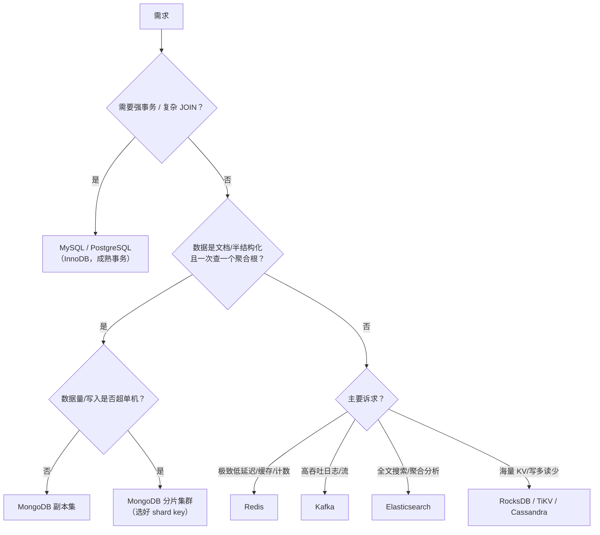

---

# 卷五 国内大厂面试题库（含分级与完整题解）

## 使用说明

**题目来源特征**（本文题目按国内大厂真实面试风格整理，覆盖以下考察偏好）：

| 公司 | MongoDB 考察偏好 |
|---|---|
| **阿里** | 偏"业务建模 + 分片治理 + 稳定性"，喜欢问"线上出问题怎么排查"；P7+ 会追问选型论证 |
| **字节** | 偏"底层原理 + 性能极限"，喜欢问"为什么这么设计""换一种行不行"，技术密度高 |
| **腾讯** | 偏"高可用 + 一致性"，副本集/选举/rollback 问得细 |
| **美团** | 偏"索引优化 + 数据模型"，场景题多（订单/商品/骑手轨迹） |
| **京东** | 偏"分片 + 事务 + 大促场景"，压测与容量规划 |
| **快手/滴滴** | 偏"写入吞吐 + 时序/位置数据"，LSM 与 B+ 树对比常问 |
| **百度** | 偏"存储引擎原理 + OS 底层"，会问 page cache / fsync |
| **网易/小米** | 偏"索引与查询优化 + 运维实操" |

**难度标记**：★★★★★ 高频必答 / ★★★★☆ 重点 / ★★★☆☆ 进阶 / ★★☆☆☆ 加分 / ★☆☆☆☆ 冷知识
**岗位标记**：`[后端]` 3–5 年 / `[架构]` P7+

**答题模板（建议形成肌肉记忆）**：
```
① 一句话给结论（L1）
② 讲机制（L2）：分层、分步骤、带数字
③ 讲取舍（L3）：代价是什么、什么场景不适用
④ 举一个线上/量化例子（加分）
```

---

## A. 存储引擎与底层 IO（12 题）

### Q-A01 ★★★★★ `[后端]` `[架构]` — writeConcern 有哪几种？`w:1` 和 `w:"majority"` 的区别？切主会丢数据吗？

**考察点**：写关注语义 + oplog 复制 + 故障推演
**高频**：阿里、字节、腾讯、美团

**答题框架**：定义三种取值 → 讲"确认"到底确认了什么 → 用切主场景推演 → 给实践建议

**解答**：

`writeConcern` 有三个维度：`w`（确认节点数）、`j`（是否 journal 落盘）、`wtimeout`（等待超时）。

| 取值 | 语义 |
|---|---|
| `w:0` | 不等待确认（fire-and-forget），连"写没写成功"都不知道 |
| `w:1`（默认） | **primary 确认已写入内存 + 已写 journal buffer**（不等于 fsync） |
| `w:"majority"` | **多数成员确认**（3 节点集群即 2 个） |
| `w:n` | 指定 n 个成员确认 |
| `j:true` | 额外要求 journal **fsync 落盘**后才返回 |

**切主丢数据的完整推演**（这是本题的核心）：

```
① primary 收到写 W，写入内存 + journal buffer，返回 w:1 成功
② 此时 W 还没复制到任何 secondary（oplog 异步推送）
③ primary 宕机
④ secondary 选举：谁的数据新谁当选（term + oplog 比较）
   → 新 primary 的 oplog 里没有 W
⑤ 旧 primary 恢复后重新加入 → 发现自己的 oplog 与新高可用主"分叉"
   → **rollback**：把 W 及其之后的写回滚掉，写入 dbpath/rollback/*.bson
⑥ 结果：客户端以为写成功了，但数据消失了
```

**关键区别（一句话）**：
- `w:1` 只保证"**primary 收到了**"，不保证"**别人也收到了**" → 切主会丢；
- `w:"majority"` 保证"**多数节点都有了**" → 新主选举必然包含这条（因为选举要求多数投票，而多数中至少有一个有 W 的节点会拒绝"没有 W 的候选人"当选）→ **不丢**。

**注意 `j` 是独立维度**：`w:"majority"` 但不带 `j:true` 时，多数节点是"写进内存 + journal buffer"确认的，理论上多数节点**同时掉电**仍可能丢（概率极低但存在）。要金融级就用 `w:"majority", j:true`。

**延伸：`wtimeout` 的陷阱**
`wtimeout` 超时后返回错误，但**写可能已经生效**（primary 已写入）。应用如果直接重试，会**重复写入**。正确做法：① 用 `retryWrites=true`（驱动带 txnNumber 去重）；② 业务侧做幂等（唯一索引 / 版本号 / 去重表）；③ 不要盲目重试。

**追问链**：
- **追问 1：`w:"majority"` 一定不丢吗？** → 不一定。若多数节点**同时掉电**且没有 `j:true`，仍在设备缓存里的数据会丢；另外 **PSA 架构（含 arbiter）**下，"多数"可能是"1 个数据节点 + 1 个 arbiter"，实际只有 1 份数据 → 官方不推荐 PSA 承载关键数据。
- **追问 2：那 `w:0` 有什么用？** → 日志/埋点类"允许丢"的场景，追求极限吞吐（省掉一次往返）。但要注意驱动层仍可能报网络错误。
- **追问 3：`readConcern: majority` 和 `w: majority` 是一回事吗？** → 不是，见 Q-F01。写关注管"写多安全"，读关注管"读多安全"。

---

### Q-A02 ★★★★★ `[后端]` `[架构]` — 一次 `updateOne` 从驱动发出到落盘，中间发生了什么？

**考察点**：全链路理解（这是"是否真懂 MongoDB"的试金石）
**高频**：字节、阿里、百度

**答题框架**：按层讲（驱动 → mongod → WT → journal → checkpoint），每层说清"做了什么 + 是否持久化"

**解答**（标准答案分 7 步）：

```
① 驱动层
   - 从连接池取连接，选 primary（写必须主）
   - 组 OP_MSG 包；若 retryWrites=true，生成 txnNumber（用于幂等重试）

② mongod 接入层
   - 一个连接一个线程（serviceExecutor）
   - 鉴权（SCRAM）、解析、校验（schema validation / 字段名合法性）

③ 查询规划与执行
   - 用 _id 或其他索引定位文档（IXSCAN）→ record id → 读 collection 表（FETCH）
   - 命中的页若不在 WT cache → page fault，从 .wt 文件读入（可能先查 history store）

④ WiredTiger 事务层
   - 分配 txnid + timestamp
   - 修改内存页：旧值写入 history store，新值留在页内，页标记 dirty
   - 同时生成 **oplog entry**（注意：oplog 也写在同一个 WT 事务里，保证"数据与 oplog 原子"）
   - 唯一索引冲突检查（这一步可能阻塞）

⑤ journal（WAL）
   - 写页级增量到 journal buffer（physiological log）
   - **此时未 fsync**；commitIntervalMs 默认 100ms 后才 fdatasync
   - 返回客户端（w:1）—— **注意：此刻数据只在内存 + 未落盘的日志 buffer**

⑥ 副本集复制
   - primary 的 oplog 变更被 secondary 拉取、重放
   - w:"majority" 要等多数节点确认后才返回

⑦ checkpoint（每 60s 或 journal ≥ 2GB）
   - 把所有脏页批量写成"新 checkpoint"（不覆盖旧数据）
   - 更新 WiredTiger.turtle 元数据 → 新 checkpoint 生效 → 截断旧 journal
```

**"哪一步会丢数据"（面试官最爱追问）**：

| 卡在哪一步 | 会丢吗 |
|---|---|
| 步骤 ④ 之后、⑤ 之前（进程崩溃） | **不会**（没有返回客户端；journal 没写，内存页也丢了，等于没发生） |
| 步骤 ⑤ 返回后、journal fsync 前（断电） | **会丢最近 ≤100ms 的写**（`j:true` 则不会） |
| 步骤 ⑤ 后、复制前（切主） | **会丢**（`w:1` 的场景，见 Q-A01） |
| 步骤 ⑦ 之前（断电） | **不会**（journal 里有，恢复时重放） |

**延伸：为什么 oplog 要和数据写在同一个事务里？**
这是 MongoDB 相对 MySQL 的一个架构优势：MySQL 有 server 层 binlog + 引擎层 redo，必须**两阶段提交**才能保证一致；MongoDB 把 oplog 放进 WT（`local.oplog.rs` 是一张 WT 表），**写数据与写 oplog 原子** → 不需要 2PC，也不会出现"数据提交了但 oplog 没有"（那会导致主从不一致）。

**追问链**：
- **追问 1：为什么 journal 是"页级增量"而不是"完整文档"？** → 因为页级增量更小（只记录改动的那几个字节），且恢复时可直接覆盖到页的对应偏移（physiological logging），比重放完整文档快得多。
- **追问 2：如果 checkpoint 写到一半崩溃，会不会损坏？** → 不会。WT 用"写新位置 + 元数据原子切换"：旧 checkpoint 完好，新 checkpoint 未完成就作废，恢复时用旧 checkpoint + 重放 journal。
- **追问 3：那 journal 里也记录了"页的半写"怎么办？** → 每页有 block checksum，重放时若页校验失败，会用 journal 里的记录逐条重建该页内容；WT 的 journal 记录是"覆盖到偏移"，能精确修复。

---

### Q-A03 ★★★★☆ `[后端]` `[架构]` — journal 和 checkpoint 是什么关系？为什么 WiredTiger 不需要 doublewrite？

**考察点**：WAL + checkpoint 的协作，以及与 InnoDB 的对比
**高频**：百度、字节、腾讯

**解答**：

**关系一句话**：**journal 是"还没落盘的修改的流水账"，checkpoint 是"某个时刻所有已落盘数据的一致快照"。**

```
journal  ── 记录"页的增量修改"，顺序写，容量小（100MB/文件，滚动）
checkpoint ── 每 60s 或 journal ≥2GB 触发一次，把**当前所有脏页**刷成新 checkpoint
           ── checkpoint 完成后，**checkpoint 之前的所有 journal 都可以删除**

恢复 = 最近一个有效 checkpoint + 重放它之后的 journal
```

**为什么不需要 doublewrite（对比 InnoDB）**：

```
InnoDB：
  ① 脏页**原地**刷盘（覆盖旧页）
  ② 若 16KB 页只写了 8KB 就断电 → 页结构损坏，checksum 不匹配
  ③ redo log 只有"页偏移的修改"，**无法修复"页头都不完整"的页**
  ④ 所以必须 doublewrite：先把页顺序写到一块连续区域，再写原位
     → 崩溃后若原位页坏，从 doublewrite 恢复该页，再重放 redo

WiredTiger：
  ① checkpoint 是"写新位置、**不覆盖**旧页"（copy-on-write）
  ② 半写只会损坏"新 checkpoint"，旧 checkpoint 完好无损
  ③ 且每页有 block checksum，能检测损坏
  ④ 损坏页直接丢弃，靠 journal 重放重建
  ⑤ 所以**不需要 doublewrite**
```

**代价对比（L3 层）**：

| | InnoDB | WiredTiger |
|---|---|---|
| 额外写 | doublewrite 让每次刷页多一次**顺序写**（写放大 ~2 倍，但顺序写便宜） | "不覆盖"让**磁盘空间占用翻倍**（旧 checkpoint 要保留） |
| 恢复 | 需要 redo + undo（未提交事务要回滚） | 只需 checkpoint + journal 重放（**无 undo**，因为未提交的修改从未落盘） |
| IO 峰值 | 增量刷，平滑 | **全量刷，有峰值**（每 60s 一次 IO burst） |

**追问链**：
- **追问 1：为什么 WT 恢复不需要 undo 阶段？** → 因为 checkpoint 落盘的是"某个一致时间点的数据"，未提交事务的修改**从未进入 checkpoint**；需要回滚时从 history store 拿旧版本即可，不需要 undo log。
- **追问 2：那 checkpoint 全量刷不会很慢吗？** → 会。这是 WT 的已知代价（"60s 周期性写毛刺"）。缓解：降低 cache、调小 `eviction_dirty_target` 让脏页更早被刷、journal 放独立盘。
- **追问 3：能不能关掉 checkpoint？** → 不能，它是"journal 能被截断"的前提，关掉会导致 journal 无限增长。

---

### Q-A04 ★★★★★ `[后端]` `[架构]` — WiredTiger 的 cache 应该设多大？为什么不能给满内存？

**考察点**：内存管理 + 双缓存 + 容器环境
**高频**：阿里、美团、京东

**解答**：

**官方公式**：`cacheSizeGB ≈ max(256MB, 50% × (可用内存 - 1GB))`

**为什么只给 50%（四个理由）**：

```
① 双缓存：WT cache 存"解压后的页"，OS page cache 存"压缩后的文件块"
   → 数据实际上在内存里存了两份，各占一半才平衡
② checkpoint 需要缓冲：每 60s 要把大量脏页写出，需要 page cache 承接回写，
   否则脏页直接打到设备队列 → IO 打满、延迟毛刺
③ 连接与查询内存：每连接有栈/缓冲，聚合/排序有 32MB/100MB 级内存
④ journal 与操作系统本身：journal 写、索引构建、compact 都要内存
```

**给满会怎样（因果链）**：

```
cache = 90% 内存
→ page cache 只剩很少
→ 脏页回写时没有"落脚点"，直接压到设备
→ 回写变慢 → 脏页堆积 → 触到 eviction_dirty_trigger(20%)
→ **应用线程被迫同步刷脏页** → 写入延迟飙升（"加内存反而更慢"）
```

**容器环境的经典事故**（必须主动提，这是实战分）：

```
问题：cacheSizeGB 默认按**宿主机物理内存**计算（老版本），
      容器 limit 2GB、宿主机 128GB → cache 被设成 ~63GB → **立即 OOM kill**
正确做法：
  ① 显式 setParameter storage.wiredTiger.engineConfig.cacheSizeGB = 容器 limit 的 50%
  ② 容器 memory limit 留 20–30% 余量给 page cache 与连接
  ③ 用 cgroup 的 memory.current 看真实用量（含 page cache）
```

**延伸：怎么验证 cache 设置是否合理？**

```javascript
db.serverStatus().wiredTiger.cache
// 关注：
//   "bytes currently in the cache" / "maximum bytes configured" → 使用率
//   "tracked dirty bytes in the cache" → 脏页占比（>10% 需警惕）
//   "pages read into cache" / "pages evicted" → 是否频繁换页
//   "pages requested from the cache" vs "pages read into cache" → 命中率
```

命中率低（`pages read into cache / pages requested` 高）说明**工作集 > cache** → 要么加内存，要么优化查询/索引，要么分片。

**追问链**：
- **追问 1：cache 加大一定会更快吗？** → 不一定。如果工作集已经能装下，加大没用；如果 page cache 被挤压，加大反而更慢。
- **追问 2：怎么估算工作集？** → 热数据量 ≈ 索引大小 + 近期活跃文档量。用 `db.coll.stats()` 看 `indexSizes`，用访问日志估算活跃比例。经验：工作集 < cache 的 70% 比较安全。

---

### Q-A05 ★★★★☆ `[后端]` `[架构]` — 线上写入每隔几十秒卡顿一下，怎么定位？和 eviction 有什么关系？

**考察点**：eviction 水位 + checkpoint 周期 + 排查方法
**高频**：阿里、滴滴、快手

**解答**：

**先给结论**：周期性卡顿（尤其 60s 周期）**90% 是 checkpoint 或 eviction 脏页水位**导致的。

**四个水位（必须背）**：

| 参数 | 默认 | 触发什么 |
|---|---|---|
| `eviction_target` | 80% | 后台线程开始淘汰 clean 页 |
| `eviction_trigger` | 95% | **应用线程也参与淘汰** |
| `eviction_dirty_target` | 5% | 后台开始刷脏页 |
| `eviction_dirty_trigger` | 20% | **应用线程同步刷脏页 ← 写入卡顿的直接原因** |

**排查路径（按顺序）**：

```
① 确认周期性
   - 监控看 P99 latency 是否有规律的尖刺（60s / 30s / 5min）
② 看脏页与 eviction
   - db.serverStatus().wiredTiger.cache["tracked dirty bytes in the cache"]
   - 看是否在尖刺前接近 maximum 的 20%
③ 看 checkpoint 频率
   - 日志里 "Checkpoint" 记录；checkpoint 期间 IO util 打满
④ 看设备
   - iostat：尖刺时 w_await / util 是否 100%
   - 云盘：是否触发"突发额度耗尽"（burst balance 归零）
⑤ 看是否"批量写"导致
   - 是否有 updateMany / 大批量导入（cache 瞬间全脏）
```

**处置方案（分层）**：

| 层面 | 措施 |
|---|---|
| 配置 | cache 降到 40–50%；`eviction_dirty_target=3`（更早温和刷）；增加 eviction 线程（`eviction=(threads_max=4)`） |
| 硬件 | journal 与数据文件分盘；用 NVMe；云盘开"预置 IOPS"避免突发额度 |
| 业务 | 批量写分批（每批 ≤1000）；避免在高峰做大范围更新 |
| 结构 | 拆分热点集合；冷热分离；考虑分片分散写入 |

**延伸：为什么 `update-restore` 会让脏页难降？**
eviction 遇到一个"正在被修改"的脏页时会**放弃淘汰**（因为改了以后还是要写，不如先留着）→ 热点写页永远淘汰不掉 → 脏页比例持续高。这就是"高并发写同一批文档"最容易踩的坑。

**追问链**：
- **追问 1：`eviction_dirty_target` 调小有什么代价？** → 后台更早开始刷脏页，**总写入量不变**，但会更频繁地小批量写，可能增加 IO 次数（每次写都有开销），且占用更多 CPU。
- **追问 2：怎么区分"checkpoint 导致的卡顿"和"复制导致的卡顿"？** → 看 `replSetGetStatus` 的复制延迟是否有同步尖刺；checkpoint 卡顿通常只影响**主节点写入**，复制延迟会滞后出现。

---

### Q-A06 ★★★☆☆ `[后端]` `[架构]` — WiredTiger 的 ticket 机制是什么？为什么需要它？

**考察点**：并发控制 + 限流设计
**高频**：字节、百度（P7 常问）

**解答**：

**是什么**：WT 内部有两组信号量（票）：`read_ticket=128`、`write_ticket=128`。任何要进 WT 做 IO 的线程必须先"取票"，做完归还；取不到就**排队阻塞**。

**为什么需要（三个作用）**：

```
① 限流：mongod 是"一连接一线程"，可能有上千线程；
        如果全部冲进 WT 抢页锁 → 锁竞争把 CPU 耗在自旋上
        ticket 把"并发窗口"限制在 128，超出的在外面等
② 保护内部结构：WT 的页锁、eviction 队列、history store 都是共享结构，
        并发过高会导致 cache line 争用（伪共享）与锁退化
③ 保护 IO 队列：设备的最优队列深度有限（NVMe 通常 32–128），
        ticket 让 IO 深度维持在设备能吸收的范围
```

**代价（必须说，否则只是背概念）**：
- **一个慢操作会占住 ticket**：若某操作在 WT 内部阻塞（等 page latch / 等 ticket / 等 IO），它不归还票 → **ticket 耗尽 → 所有请求排队** → 这就是"一条慢查询拖垮整个实例"的机制。
- **诊断**：`db.serverStatus().wiredTiger.concurrentTransactions` → `available` 长期为 0 说明打满。

**延伸：ticket 与 MySQL 的 `innodb_thread_concurrency` 很像**
两者都是"数据库层的并发阀门"，思路上等价于"**用一个较小的并发窗口换取更少的争用与更稳定的尾延迟**"。这类设计在 HikariCP（连接池）、Netty（EventLoop）里也常见。

**追问链**：
- **追问 1：调大 ticket 会更快吗？** → 通常不会。超过设备能力后，增加并发只会增加排队与争用（Little's Law：延迟 = 队列长度/吞吐）。除非确认瓶颈是"WT 内部并发不够"（如 CPU 空转、IO 队列未满）。
- **追问 2：读写 ticket 为什么分开？** → 读写路径不同（读可能触发 page fault 与 eviction，写要拿 page latch + journal）。分开可以避免"大量读把写饿死"或反之。

---

### Q-A07 ★★★★☆ `[架构]` — history store 是什么？为什么长事务会出问题？

**考察点**：MVCC 实现 + 长事务危害
**高频**：阿里、字节（P7 高频）

**解答**：

**是什么**：WT 用来存"旧版本"的独立结构（`WiredTigerHS.wt`）。读操作按 `read_timestamp`（快照）选版本：内存页里版本太新 → 去 HS 找 `≤ 快照` 的最新旧版本。

**为什么需要**：实现快照隔离。一个读事务开始后，其他事务的修改不能影响它 → 旧版本必须留着。

**长事务的危害（因果链）**：

```
事务 T 开了 10 分钟（未提交）
→ T 的 read_timestamp 停留在 10 分钟前
→ 这 10 分钟内**所有被修改的文档**，旧版本都不能被清理（T 可能还要读）
→ HS 持续增长 → 触到上限（默认约 cache 的 20%）
→ **"history store pressure"** → WT 开始拒绝/中止写（WriteConflict / WT_CACHE_FULL）
→ 整个实例写入失败率上升
```

**这就是"事务 60 秒限制"的深层原因**（`transactionLifetimeLimitSeconds=60`）：不只是防死锁，更是**保护 HS 不被撑爆**。

**延伸：怎么发现 HS 压力？**

```javascript
db.serverStatus().wiredTiger.cache["history store table insert calls"]  // HS 写入量
db.serverStatus().wiredTiger.cache["history store table max on-disk size"]
// 日志中搜 "history store" / "WT_HS"
```

**处置**：
1. 找出长事务（`db.currentOp()` 里 `transaction` 字段 + `secs_running`）；
2. 缩短事务（不要在事务里做 RPC、不要包住整个请求）；
3. 大批量写改分批（不要用一个大事务包 100 万条）。

**追问链**：
- **追问 1：HS 和 InnoDB 的 undo log 有什么区别？** → 都是存旧版本。区别：HS 是**按 timestamp 检索**（为快照读优化），有**容量上限**（超了拒绝写）；undo log 是**版本链 + 回滚段**，可以无限增长（撑爆磁盘/undo 表空间）。MongoDB 的"上限"是一种**主动保护**，MySQL 的"无上限"会导致"长事务把磁盘撑满"。
- **追问 2：如果我把事务限制调到 600 秒会怎样？** → 短期能跑更长事务，但 HS 压力与锁持有时间都会放大，**高峰期可能直接写入不可用**。不建议。

---

### Q-A08 ★★★★★ `[架构]` — 为什么 MongoDB 用 B+ 树而不是 LSM-Tree？什么场景下 LSM 更合适？

**考察点**：存储引擎选型论证（P7 核心题）
**高频**：字节、阿里、快手、滴滴

**解答**：

**先给结论**：MongoDB 的核心负载是"**点查 + 范围查 + 频繁原地更新**"，B+ 树在这些维度上更合适；LSM 的优势在"**写多读少、顺序写、前缀扫描**"。

**六条理由（按重要性排序）**：

| # | 理由 | 展开 |
|---|---|---|
| 1 | **读延迟可预测** | B+ 树路径固定 3–4 层；LSM 要查 memtable + 多层 SST，且 **compaction 期间尾延迟抖动大** |
| 2 | **范围扫描高效** | B+ 树叶子链表顺序扫；LSM 要 merge iterator（多路归并，CPU 高） |
| 3 | **更新/删除友好** | Mongo 有大量 `$set` 原地更新与 TTL 删除；LSM 每次更新 = 新版本 + tombstone → 空间放大、读放大恶化 |
| 4 | **空间可预测** | B+ 树空间放大稳定（~1.5–2×）；LSM 的"待 compaction 数据"让磁盘占用不可控（2–3×），托管服务难做容量规划 |
| 5 | **MVCC 耦合好** | WT 的 history store + 页级 MVCC 实现简单；LSM 上做快照要处理多版本 key |
| 6 | **压缩收益** | 文档型数据字段名重复，block + prefix 压缩收益大；LSM 的多版本会稀释压缩率 |

**但要客观（L3 层的加分点）**：

> "LSM 在**写吞吐**上确实更强（顺序写 + 批量 flush，比 B+ 树的随机页修改快 2–5 倍），在**压缩率**上也更好。所以如果 Mongo 的负载是'时序写入 + 很少更新 + 很少点查'，LSM 会赢。**MongoDB 5.0 的时间序列集合其实是在 B+ 树之上'模拟'了 LSM 的 bucket 思想** —— 用分桶把随机写变成顺序写，这是对 LSM 优势的妥协式吸收。同理，如果让我设计一个纯日志/埋点系统，我会选 RocksDB/ClickHouse 而不是 MongoDB。"

**什么场景该选 LSM（面试官可能反问"那你什么时候用 LSM"）**：
- 写入吞吐是瓶颈（每秒几十万条）；
- 数据"写得快、读得少"（日志、埋点、时序）；
- 设备是 HDD（随机写代价极高）；
- 需要"前缀扫描"（HBase 式访问）；
- 能接受"compaction 的 IO 峰值"与"读放大"。

**追问链**：
- **追问 1：MyRocks（MySQL + RocksDB）为什么没推广开？** → ① 读延迟不如 InnoDB（尤其范围查询）；② 大事务/长事务与 LSM 的 compaction 冲突；③ 运维复杂（write stall、compaction 调优）；④ 生态与人才都在 InnoDB。**本质是"LSM 的写优势不足以抵消读与运维的代价"**（在 OLTP 场景）。
- **追问 2：TiKV 为什么用 RocksDB？** → 它做的是分布式 KV，负载是"写多 + Region 分裂 + 前缀扫描"，且它用 titan/lifetimes/多 CF 隔离等优化补齐了 LSM 的短板。**这是"负载匹配"而非"技术先进"的选择。**

---

### Q-A09 ★★★★★ `[后端]` `[架构]` — WAL 为什么能提升性能？顺序写和随机写的差距到底有多大？

**考察点**：WAL 的本质 + IO 物理特性
**高频**：百度、字节

**解答**：

**核心逻辑**：把"**随机写多个数据页**"变成"**顺序追加一条日志**"。

```
不用 WAL：
  事务改 10 个页（分散在磁盘各处）→ 要 fsync 10 次随机写 → ~10 × 5ms = 50ms（HDD）

用 WAL：
  ① 顺序追加一条日志 + 1 次 fsync → ~5ms
  ② 数据页留在内存，慢慢刷（异步，且可合并相邻页）
  → 延迟从 50ms 降到 5ms，吞吐提升 10 倍
```

**物理差距的量化**：

| 操作 | HDD | SATA SSD | NVMe |
|---|---|---|---|
| 顺序写 | ~150MB/s（不受寻道影响） | ~500MB/s | ~3–7GB/s |
| 随机写 4K | **~100–200 IOPS**（每次 5–10ms 寻道） | ~2–8 万 IOPS | ~10–100 万 IOPS |
| 差距倍数 | **1000+** | ~100 | ~30–100 |

**但 WAL 不是免费的（L3 层）**：
- **恢复要重放**：WAL 越长，恢复越慢 → 所以需要 checkpoint 截断；
- **写放大**：同一份数据写了两次（日志 + 数据页）→ 存储成本与设备寿命受影响；
- **group commit 才能兑现优势**：单条 fsync 仍是 5ms 级 → 必须把多个事务合并成一次 fsync 才能到高 TPS。

**group commit 的原理**（面试常追问"高并发下 fsync 怎么不成为瓶颈"）：

```
多个事务并发提交：
  T1 触发 fsync → 等待中
  T2、T3、T4 的日志已经写进 buffer → **一起被这次 fsync 刷下去**
  → 一次 fsync 服务 4 个事务 → 平均摊销 1.25ms/事务
```

MongoDB 的 `commitIntervalMs=100` 本质上就是"**时间维度的 group commit**"：100ms 内的所有写合并成一次 fsync。

**追问链**：
- **追问 1：既然 WAL 这么好，为什么还要 checkpoint？** → ① 日志不能无限增长（磁盘）；② 恢复时间与日志长度成正比；③ checkpoint 后旧日志可删。
- **追问 2：`commitIntervalMs` 调大会怎样？** → 吞吐上升（fsync 更少），但**断电丢失窗口变大**（最多丢 `commitIntervalMs` 的数据）。这是"可靠性 vs 吞吐"的显式交易。
- **追问 3：机械盘上能跑 MongoDB 吗？** → 能跑但性能极差（随机 IO 是灾难）。若必须用 HDD，要保证 journal 与数据在**不同物理盘**，且尽量顺序写（避免大量随机更新）。

---

### Q-A10 ★★★☆☆ `[架构]` — buffered IO、mmap、O_DIRECT 有什么区别？MongoDB 用哪个，为什么？

**考察点**：OS 文件 IO 模型
**高频**：百度、腾讯（P7 会问）

**解答**：

| 方式 | 数据路径 | 拷贝次数 | 缓存 | 谁用 |
|---|---|---|---|---|
| **Buffered IO**（默认） | 用户 buffer → page cache → 设备 | 2 | 有 page cache（双缓存） | **WiredTiger 默认、InnoDB 默认** |
| **mmap** | 直接映射 page cache，改内存即改页 | 0 显式拷贝 | 有（且无法控制） | MMAPv1（历史）、LMDB |
| **O_DIRECT** | 用户 buffer → 设备（绕过 page cache） | 1 | 无（自己管） | Oracle、RocksDB 可选、MongoDB 8.0 可开 |

**WiredTiger 选 buffered IO 的理由**：
1. **跨平台一致**：O_DIRECT 在 Windows/macOS 与不同文件系统上行为差异大（对齐要求、不支持等）；
2. **保留预读**：MongoDB 有大量范围扫描，OS 的 readahead 有价值；
3. **实现简单**：不用管对齐、部分写、元数据同步；
4. **代价可控**：通过"cache 只给 50%"来缓解双缓存问题。

**O_DIRECT 的优势（什么时候该开）**：
- 大内存机器（page cache 争用严重）；
- 追求**内存账本清晰**（RSS 不虚高）；
- 数据库自己就是最好的缓存管理者（不需要 OS 再用 LRU 猜）。

**mmap 的坑（顺带考 MMAPv1 历史）**：
- 映射区被访问的页都算 RSS → 监控"内存爆炸"；
- 无法控制淘汰（OS 的 LRU 不懂业务优先级）；
- 半写风险高（msync 不保证原子）；
- 这就是 MongoDB 3.0 换掉 MMAPv1 的核心原因之一。

**追问链**：
- **追问 1：O_DIRECT 为什么要求对齐？** → 设备以扇区/块为单位 DMA，非对齐访问需要内核做 read-modify-write（先读整块、改、再写），失去 O_DIRECT 的意义，所以直接返回 EINVAL。
- **追问 2：`msync` 能替代 `fsync` 吗？** → 不能完全替代。`msync(MS_SYNC)` 会把映射区的脏页回写并等待完成，语义上接近 fsync，但**不保证文件元数据**（size 变化）落盘，且对"多个映射区"要分别 msync。

---

### Q-A11 ★★★☆☆ `[架构]` — 一次 fsync 的成本构成是什么？为什么"每秒 fsync 次数"上不去？

**考察点**：fsync 的真实开销 + 存储栈
**高频**：百度、字节

**解答**：

**一次 fsync 大致包含三步设备往返**：

```
① 数据页回写（write）
② 文件系统 journal 提交（ext4 data=ordered 下，还要先保证数据页落盘）
③ 发送 FLUSH CACHE / SYNCHRONIZE CACHE 给设备，把设备写缓存刷到介质
```

所以 **一次 fsync ≈ 2–3 次设备往返**：

| 介质 | 单次往返 | 单线程 fsync 上限 |
|---|---|---|
| HDD | 5–10ms | **100–200 次/秒** |
| SATA SSD | 100–200μs | ~5000–1万 |
| NVMe | 20–100μs | **1万–5万** |

**这就是"MySQL 单线程插入 QPS 只有几百"的物理原因**（每次事务一次 fsync）。

**提升手段**：
1. **group commit**（合并 fsync）；
2. **`fdatasync` 代替 `fsync`**（少刷 mtime）；
3. **WAL 独立设备**（不与其他 IO 争队列）；
4. **带 PLP（掉电保护）的企业级 SSD**（设备缓存不用 FLUSH，成本降低）；
5. **降级可靠性**（`commitIntervalMs` / `innodb_flush_log_at_trx_commit=2`）。

**追问链**：
- **追问 1：为什么消费级 SSD 上"数据丢了"但 fsync 返回成功？** → 消费级 SSD 的写缓存没有掉电保护，fsync 的 FLUSH 命令返回后数据仍在盘内 DRAM；掉电就丢。企业级盘有 PLP（电容），能保证缓存内容落盘。
- **追问 2：云盘的 fsync 有什么特殊？** → 云盘是"网络块设备"，fsync 要走网络往返 + 后端存储的多副本确认，成本更高；且**突发 IOPS 额度**会让 fsync 延迟周期性飙升。

---

### Q-A12 ★★☆☆☆ `[后端]` — 磁盘写满时 MongoDB 会怎样？怎么预防？

**考察点**：运维边界条件
**高频**：美团、京东（运维向面试）

**解答**：

**行为**：磁盘空间不足时，MongoDB 会**拒绝写入**（报 "server is not writable" / "No space left on device"），进入实质**只读**状态；读仍可用（若索引与数据已加载）。

**为什么不是"自动清理"**：MongoDB 不会自动删数据（那太危险）。它会保留足够空间做"最后的元数据写入"，避免文件系统损坏。

**空间被谁吃掉（四个来源）**：
1. 数据 + 索引（正常增长）；
2. **oplog**（默认 5% 空闲磁盘，高写入时增长快）；
3. **journal**（100MB 预分配 × 若干）；
4. **临时文件**：索引构建（`_tmp`）、`compact`、聚合的 `allowDiskUse`（`_tmp` 可能达到数据量的 1 倍）。

**预防措施（分层）**：
| 层面 | 措施 |
|---|---|
| 容量规划 | 预留 **1.5–2 倍**数据量（compact/索引重建需要） |
| 监控 | 磁盘水位告警 75% / 85%；预测增长趋势 |
| oplog | 按窗口需求设，不要盲目给 50GB |
| 运维 | 定期 `compact`（4.4+ 可在线）；清理无用集合/索引；TTL 兜底 |
| 分片 | 单 shard 磁盘接近阈值时提前扩容（加 shard + balancer） |

**追问链**：
- **追问 1：磁盘满了能不能删 journal 救急？** → **千万不要**。删 journal 会破坏崩溃恢复能力。正确做法是清理无用集合、扩大磁盘、或临时 `db.shutdownServer()` 停服处理。
- **追问 2：`compact` 需要多少额外空间？** → 大致等于该集合"压缩后大小"的 1 倍（它会把数据重写到新文件），所以必须预留空间，否则 compact 会失败。

---

## B. 索引与查询优化（14 题）

### Q-B01 ★★★★★ `[后端]` — 复合索引的字段顺序怎么定？什么是 ESR 原则？

**考察点**：索引设计核心能力
**高频**：所有公司（一面必问）

**解答**：

**ESR = Equality（等值）→ Sort（排序）→ Range（范围）**

```
索引 {status: 1, created_at: -1, amount: 1}
查询：status='paid' AND amount > 100 ORDER BY created_at DESC
        └─ Equality ─┘   └─ Range ─┘        └── Sort ──┘
→ 完美命中（等值锁定前缀 → 排序天然有序 → 范围在最后一维）
```

**为什么这个顺序有效**（把索引理解成"多维字典序"）：

```
B+ 树的 key 按 (status, created_at, amount) 排序
→ 等值条件把搜索空间"锁定"到一段连续区间
→ 该区间内 created_at 天然有序 → 无需额外排序
→ amount 作为最后一维，只在这个区间内开"子区间"，仍是连续扫描
```

**反例**：`{status:1, amount:1, created_at:-1}`，查询同样条件：
- `amount > 100` 是范围 → **它后面的 created_at 无法保证有序** → 必须内存排序（`SORT` 阶段）；
- 且 `amount` 是范围时，`created_at` 也不能作为索引边界 → 扫描量变大。

**三条实战规则**：
1. **等值字段在前，选择性最高的放最前**；
2. **排序字段必须连续**：`sort({a:1,b:-1})` 需要索引 `{a:1,b:-1}` 或 `{a:-1,b:1}`（**方向可整体反转，但不能只反一个**）；
3. **范围字段放最后，且一个索引最多高效支持一个范围**（多个范围时，后面的范围只能做"index filter"，不能缩小扫描区间）。

**追问链**：
- **追问 1：如果既要按 `amount` 范围查，又要按 `created_at` 排序，怎么办？** → 无解（同一索引里范围与排序冲突）。方案：① 业务上改成"先按时间过滤一个窗口，再按 amount 过滤"；② 建两个索引，让规划器选（但两个都会有短板）；③ 用**预计算/物化**（Computed Pattern）把范围条件变成等值条件（如金额分桶）。
- **追问 2：`{a:1,b:1}` 能支持 `b=1` 的查询吗？** → 不能走索引定位（前缀是 a），只能做**全索引扫描 + index filter**，通常不如全表扫描。
- **追问 3：索引方向 `-1` 有意义吗？** → 对单字段查询/排序有意义（`sort desc` 能否走索引）；对"倒序扫描索引"其实 MongoDB 支持 `.{hint}` + 反向遍历，但**复合索引的混合方向**是必须的（否则排序方向不匹配）。

---

### Q-B02 ★★★★★ `[后端]` — 建了索引还是慢，怎么排查？

**考察点**：explain 解读 + 索引失效
**高频**：所有公司

**解答**：

**第一步：看 explain 的三个数**

```javascript
db.coll.find(query).explain("executionStats")
```

| 字段 | 健康值 | 异常说明 |
|---|---|---|
| `nReturned` | 业务预期 | — |
| `totalKeysExamined` | ≈ nReturned | 大 → 索引边界不精确（范围太大/选择性差） |
| `totalDocsExamined` | ≈ nReturned | 大 → 过滤没在索引里完成，大量回表后内存过滤 |

**黄金比例 1:1:1**。`totalDocsExamined/nReturned > 10` 就是"索引基本没用上"。

**第二步：看 stage**

| stage | 问题 | 解法 |
|---|---|---|
| `COLLSCAN` | 没走索引 | 检查是否索引失效（见 Q-B11） |
| `SORT`（无索引） | 排序没走索引 | 调整索引方向/字段顺序；或 `allowDiskUse`（治标） |
| `FETCH` 次数远大于返回 | 回表过多 | 覆盖查询 / 改索引包含更多字段 |
| `IXSCAN` + 大量 `index filter` | 条件没在索引边界里 | 调整字段顺序到 ESR |

**第三步：按 12 种失效场景逐一核对**（见 Q-B11）。

**第四步：区分"慢在索引"还是"慢在别处"**
- `executionTimeMillis` 大但 `keysExamined` 小 → 可能是 **page fault**（cache 不足）或 **锁/ticket 等待**；
- 看 `executionStats.executionStages.works / advanced / needYield`，`needYield` 大说明频繁让出（重查询）。

**追问链**：
- **追问 1：`totalKeysExamined` 很大但 `nReturned` 很小，是什么原因？** → 索引前缀匹配范围太宽（如 `{a:1, b:1}` 查 `a=1` 但 a 的值有 100 万文档），或范围条件太宽（`{a: {$gt: 0}}`）。
- **追问 2：为什么有时候 `COLLSCAN` 比走索引还快？** → 当查询要返回集合 30%+ 文档时，走索引 = 大量随机回表，不如顺序全表扫描。MongoDB 规划器会基于 cost 选，但可能选错，可用 `hint()` 强制。

---

### Q-B03 ★★★★☆ `[后端]` `[架构]` — 给数组字段建索引（多键索引）有什么代价？

**考察点**：multikey 索引 + 写放大
**高频**：美团、阿里、快手

**解答**：

**机制**：数组字段建索引时，**每个数组元素生成一条索引记录**，都指向同一文档。

```javascript
// tags: ["a","b","c"]，建 {tags:1}
// 索引里：("a" → doc1), ("b" → doc1), ("c" → doc1)  三条
```

**四个代价**：

| 代价 | 说明 | 量级 |
|---|---|---|
| **写放大** | 更新一条文档 → 要维护 N 条索引记录 | 1000 个元素的数组 = 1000 倍写入成本 |
| **索引膨胀** | 索引大小与"元素总数"成正比，不是与文档数 | 可能超过数据本身 |
| **结果去重** | 一个文档可能被多个 key 命中 → 需要去重（`DISTINCT_SCAN` 或 FETCH 后去重） | 查询变慢 |
| **不能完全覆盖** | multikey 索引在部分场景**不能做覆盖查询**（因为一个 key 对应多条） | 少了一条优化路径 |

**还有一个语义陷阱（高频）**：

```javascript
// ① {tags: {$gte: 5, $lte: 10}} → "数组里存在 ≥5 的元素 且 存在 ≤10 的元素"
//    可能是**不同元素**满足（语义弱）
// ② {tags: {$elemMatch: {$gte: 5, $lte: 10}}} → "**同一个元素**同时满足 ≥5 且 ≤10"
```

**正确用法建议**：
1. **控制数组长度**（如标签 ≤ 50 个），或把"无上限数组"拆成子集合；
2. 只在**确实需要按元素查询**时建 multikey 索引；
3. 对"多条件 + 同一元素"的语义，必须用 `$elemMatch`；
4. 高频查询可以考虑**预计算**（如把"是否有某标签"变成布尔字段），避免 multikey。

**追问链**：
- **追问 1：multikey 索引能用于排序吗？** → 有限支持。对数组元素排序语义复杂（MongoDB 会用数组中的最小值/最大值参与排序），通常**不推荐**依赖 multikey 排序。
- **追问 2：一个复合索引里有两个数组字段会怎样？** → 索引条目数 = 两个数组长度的**笛卡尔积**（MongoDB 会报错 `cannot index parallel arrays`，即**不允许并行数组**）。这是硬限制。

---

### Q-B04 ★★★★☆ `[后端]` — 什么是覆盖查询（covered query）？为什么它快？

**考察点**：索引存储结构 + 回表
**高频**：字节、百度

**解答**：

**定义**：查询所需的**所有字段**都在索引里，且**不需要回表**（没有 FETCH 阶段）。explain 里出现 `PROJECTION_COVERED` 或 `IXSCAN` 后面没有 `FETCH`。

**三个必要条件**（缺一不可）：
1. 查询条件字段**全部**在索引里；
2. 返回字段**全部**在索引里（或显式排除 `_id`：`{_id: 0, ...}`）；
3. **不是 multikey 索引**（数组字段的索引在某些情况下不能覆盖）。

```javascript
// 索引 {status: 1, created_at: -1}
db.orders.find({status:"paid"}, {_id:0, status:1, created_at:1})
// → 全部字段在索引里，无 FETCH，最快
```

**为什么快（机制层）**：
```
普通查询：IXSCAN 找到 record id → FETCH 回表（随机 IO）→ 反序列化 BSON → 投影
覆盖查询：IXSCAN 直接拿到所有字段 → **无回表、无随机 IO、无反序列化**
→ 在 cache 命中时快 3–10 倍；未命中时省掉一次随机 IO（这是数量级差异）
```

**代价**：
- 索引变大（多存字段）→ cache 占用更多、写放大；
- 索引维护成本上升；
- 只适合"高频 + 字段少"的查询。

**追问链**：
- **追问 1：`_id` 为什么默认会破坏覆盖查询？** → 因为查询默认返回 `_id`，而 `_id` 可能不在索引里（除非索引包含它）→ 必须 FETCH。解决：`{_id: 0}` 或把 `_id` 加进索引。
- **追问 2：覆盖查询在分片集群上还有效吗？** → 有效（每个 shard 内部仍然可以覆盖），但 mongos 仍要做归并（网络与内存成本还在）。

---

### Q-B05 ★★★★☆ `[后端]` — 深分页为什么慢？怎么优化？

**考察点**：skip 的成本 + keyset 分页
**高频**：所有公司（电商/内容类必问）

**解答**：

**为什么慢**：`skip(N)` 必须**逐条遍历索引条目**并丢弃前 N 条（B+ 树没有"第 N 条"的偏移索引），复杂度 O(N)。且分片集群下，mongos 要从**每个 shard 各取 skip+limit 条**再归并 → 成本 × shard 数。

```javascript
// ❌ 第 10000 页，每页 10 条
db.orders.find({status:"paid"}).sort({created_at:-1}).skip(100000).limit(10)
// → 扫 100010 条索引 + 100010 次 FETCH，越来越慢

// ✅ keyset / 游标分页
db.orders.find({ status:"paid", created_at: { $lt: lastCreatedAt } })
         .sort({created_at:-1}).limit(10)
// → 直接定位到"上一页最后一条之后"，O(limit)
```

**keyset 分页的三个前提**：
1. 排序字段**唯一且稳定**（否则同一时间戳的多条会漏/重）→ 用复合 `(created_at, _id)` 排序；
2. 前端要传"游标"（上一页最后一条的排序值），不能"跳页"；
3. 数据可能插入/删除 → keyset 是"相对位置"，不是"绝对页码"（业务要接受）。

**其他方案对比**：

| 方案 | 优点 | 缺点 |
|---|---|---|
| keyset（推荐） | O(limit)、稳定 | 不能跳页 |
| 预计算页码（物化"第 N 页的起始值"） | 支持跳页 | 数据变动要重算 |
| ES `search_after` | 同上，适合搜索 | 需要 ES |
| 限制最大页数（如只允许前 100 页） | 简单 | 体验差 |

**追问链**：
- **追问 1：skip 在 `_id` 上会快一点吗？** → 略快（索引密集、无需 FETCH），但仍是 O(skip)。
- **追问 2：用 `$gt` 分页会不会漏数据？** → 若排序字段不唯一，会。必须加 `_id` 作为第二排序键，保证全序。

---

### Q-B06 ★★★★☆ `[后端]` `[架构]` — `$lookup` 为什么慢？什么情况下不应该用？

**考察点**：JOIN 的代价 + 数据建模
**高频**：美团、京东、阿里

**解答**：

**机制**：`$lookup` 对**左集合的每一条文档**执行一次子查询（N+1）：

```
左集合结果 N 条
  → 对每条，去右集合按 foreignField 查一次
  → 若右集合 foreignField 无索引 → 每次都是全集合扫描 → O(N×M)
```

**三个性能杀手**：
1. **右集合 `foreignField` 没索引**（最常见）；
2. **左集合结果太大**（N 大）；
3. **`$lookup` 的 pipeline 形式里带 `$match` 但没命中索引**。

**优化手段（按效果排序）**：

| 手段 | 效果 |
|---|---|
| 右集合 `foreignField` 建索引 | 从 O(N×M) 降到 O(N log M) |
| 先 `$match` + `$limit` 缩小左集合 | 直接减少 N |
| 用 `$lookup` 的 **pipeline 形式 + 索引条件** | 减少右集合扫描 |
| **用 Extended Reference 冗余字段，彻底消除 JOIN** | 最优（零 JOIN），但要有同步机制 |
| 把 JOIN 移到离线（Spark/ClickHouse） | 在线只查宽表 |

**"什么时候不该用 `$lookup`"（L3 层）**：
> "如果这个 JOIN 是**高频核心路径**（如商品详情要带店铺信息），我会**在写入时把店铺的少量字段冗余进商品文档**（Extended Reference），读的时候零 JOIN。代价是店铺信息变更时要**异步更新冗余字段**（用 Change Stream 或消息队列），接受秒级不一致。只有'低频 + 强一致'的 JOIN 才留给 `$lookup`。"

**追问链**：
- **追问 1：`$lookup` 在分片集群有什么额外限制？** → `from` 是分片集合时，4.2+ 要求 `foreignField` 包含 shard key，否则要把整个右集合拉到 mongos 内存做 JOIN（极易 OOM）。
- **追问 2：`$lookup` 和 MySQL 的 JOIN 有什么本质区别？** → MySQL 的 JOIN 有成熟的执行计划（NLJ / hash join / BNL），且能利用索引与统计信息；MongoDB 的 `$lookup` 基本就是"嵌套循环"，规划能力弱。**这就是"文档数据库不适合复杂关联"的物理原因。**

---

### Q-B07 ★★★★☆ `[后端]` — 索引选择性很低（比如 status 只有 3 个值）还要不要建？

**考察点**：成本模型 + 索引设计判断
**高频**：美团、阿里

**解答**：

**结论**：**单独建一个低选择性索引通常没用，甚至有害**；但"低选择性 + 其他字段"的复合索引可能非常有用。

**量化推理**：

```
集合 1000 万文档，status 有 3 个值（各 333 万）
查询 status='paid' → 命中 1/3 文档

走 {status:1} 索引：
  ① 扫 333 万条索引条目
  ② 回表 333 万次（随机 IO）
  → 比顺序全表扫描（扫 10GB 顺序读）还慢

走 {status:1, created_at:-1} 复合索引（带排序 + limit 20）：
  ① 定位到 status='paid' 的区间
  ② 在该区间内按 created_at 倒序取 20 条
  → 只扫 20 条！**极快**
```

**判断标准（三条）**：

| 场景 | 建议 |
|---|---|
| 低选择性字段**单独**查询（无排序/无 limit） | **不建**，让它 COLLSCAN（或加 `limit` 让它提前终止） |
| 低选择性字段 **+ 排序/范围/limit** | **建复合索引**（ESR），收益巨大 |
| 低选择性字段用于**过滤后再聚合** | 视聚合规模；可能还不如"全扫 + 聚合" |
| 低选择性字段用于**分片键** | ❌ 严重错误（基数不足会导致 chunk 无法分裂） |

**延伸：MongoDB 的规划器怎么选？**
它基于 **cost 模型**（试跑多个计划，比较 `works` 与 `advanced`）。但在"低选择性 + 大量回表"时，可能**选错**（走了索引反而慢）。可用 `hint()` 强制全表扫描，或用 **plan cache 清理**（`db.coll.getPlanCache().clear()`）重置错误计划。

**追问链**：
- **追问 1：为什么"低选择性 + limit"就变快？** → 因为 B+ 树索引在 `status` 区间内**天然按第二字段有序**，`limit` 能在扫到 20 条后**立即停止**（early termination），不需要扫完整个区间。
- **追问 2：那 `count` 呢？** → `count` 没有 limit，无法提前终止 → 低选择性索引基本没用（除非是 `COUNT_SCAN` 覆盖计数）。

---

### Q-B08 ★★★★☆ `[架构]` — 分片集群里唯一索引有什么限制？为什么？

**考察点**：分片 + 唯一性
**高频**：京东、阿里（P7 高频）

**解答**：

**硬限制**：分片集群中，**唯一索引必须包含 shard key 的所有字段作为前缀**（或索引本身就是 shard key 索引）。

```javascript
// shard key = {userId: 1}
db.orders.createIndex({ orderNo: 1 }, { unique: true })   // ❌ 会报错
db.orders.createIndex({ userId: 1, orderNo: 1 }, { unique: true })  // ✅
```

**为什么**：

```
每个 shard 只能保证"本地唯一"
若唯一字段不在 shard key 里 → 同一个 orderNo 可能被路由到不同 shard
→ 两个 shard 各自认为"唯一"，全局出现重复
→ 没有跨 shard 的全局唯一性校验机制（那需要分布式锁/协调，成本极高）
```

**解决方案（三条路）**：

| 方案 | 做法 | 代价 |
|---|---|---|
| **把唯一字段作为 shard key 前缀** | `{orderNo: 1, ...}` 作为 shard key | shard key 选择受限（orderNo 若是单调的会热点） |
| **单独的唯一性校验集合** | 一张未分片的集合存"唯一键 → 存在"，插入前先"插入校验记录" | 一次额外读写 + 需要清理（TTL/补偿） |
| **业务层保证** | 用"全局 ID 生成器"（雪花/号段）保证不重复 | 依赖外部系统 |

**追问链**：
- **追问 1：如果业务必须"按 orderNo 唯一"且 orderNo 单调，怎么办？** → 用 `{orderNo: "hashed"}` 做 shard key（唯一性满足，且均匀分布），代价是**按 orderNo 的范围查询变 scatter**（但订单号查询通常是等值，可接受）。
- **追问 2：`_id` 唯一索引在分片集群有什么特殊？** → 如果没指定 shard key，默认用 `_id` 的 hashed 或范围；`_id` 索引本身在每个 shard 内唯一，**全局唯一由 mongos 路由保证**（同一 `_id` 一定路由到同一 shard）。

---

### Q-B09 ★★★☆☆ `[后端]` — TTL 索引是怎么工作的？有什么坑？

**考察点**：TTL 机制 + 精度
**高频**：美团、快手

**解答**：

**机制**：mongod 后台 **TTL monitor 线程每 60 秒**扫描一次，删除"字段值 + expireAfterSeconds < 当前时间"的文档。

```
① 不精确：实际删除时间 = 过期时间 + 最多 60s + 删除耗时
② 删除是普通删除 → 写 oplog → 从节点也删 → 消耗 oplog 空间
③ 大批量过期 → 集中删除 → 写入尖峰、oplog 膨胀、IO 压力
④ 字段必须是 Date 类型（数组里的 Date 也行）
⑤ 复合索引的 TTL 只对"第一个字段"生效（其他字段不参与判断）
⑥ 唯一索引 + TTL：过期删除前唯一约束仍生效（可能导致插入失败）
```

**正确使用姿势**：
- 用于**兜底清理**（会话、验证码、临时缓存、日志），**不要**用于"必须准时生效"的业务（如订单 30 分钟未支付关闭）；
- 业务关键的超时逻辑用**定时任务 + 状态机**（扫表 + 条件更新），保证准时与可观测；
- TTL 字段建议加索引（TTL 索引本身就是索引）；
- 大批量过期要**错峰**（让过期时间分散，不要都在整点）。

**追问链**：
- **追问 1：TTL 索引和普通索引能共存吗？** → 可以，但对同一字段建多个索引没意义（浪费）。TTL 索引本身就能用于查询。
- **追问 2：能不能手动触发 TTL 清理？** → 没有直接命令，但可以 `db.adminCommand({compact})` 或自己写清理任务（更可控）。

---

### Q-B10 ★★★☆☆ `[后端]` — MongoDB 的文本索引能替代 Elasticsearch 吗？

**考察点**：全文检索能力边界
**高频**：阿里、字节（内容类业务）

**解答**：

**结论**：**不能替代，只能做轻量兜底。**

| 维度 | MongoDB text index | Elasticsearch |
|---|---|---|
| 分词 | **弱**（基于空格/标点，中文基本按字切，效果差） | 强（IK/jiaba/自定义词典） |
| 相关度打分 | 简单 TF/IDF + 字段权重 | BM25 + 丰富打分函数 |
| 聚合/高亮 | 无高亮，聚合弱 | 高亮、聚合、嵌套、地理 |
| 规模 | 单集合一个 text 索引，性能有限 | 水平扩展、倒排压缩 |
| 近实时 | 无（写入即索引，但性能差） | 1s NRT |
| 复杂查询 | 仅 `$text` + `$search`（Atlas） | 布尔、短语、模糊、同义词、向量 |

**该用 text 索引的场景**：
- 数据量小（百万级）、查询简单（关键词包含）；
- 不想引入 ES 的运维成本；
- 英文内容（分词相对可用）。

**该用 ES 的场景**：
- 中文搜索（分词质量决定效果）；
- 需要高亮、相关度排序、聚合分析；
- 数据量大、QPS 高；
- 需要"搜索 + 过滤 + 聚合"组合。

**追问链**：
- **追问 1：用 MongoDB + ES 双写会有什么问题？** → 不一致（双写失败）、顺序错乱（并发更新）。正确做法是 **Change Stream / MongoShake → Kafka → ES**（单一写入源 + 异步派生），并接受秒级延迟。
- **追问 2：Atlas Search 是什么？** → MongoDB Atlas 的 Lucene 集成（底层是 Apache Lucene），支持中文分词、模糊、向量，但**只在 Atlas 云服务可用**，自建 MongoDB 没有。

---

### Q-B11 ★★★★☆ `[后端]` — 列出你知道的索引失效场景，并说明原理。

**考察点**：索引原理的"反面"理解
**高频**：所有公司（答得全 = 加分）

**解答**（按高频排序，前 6 个必须能讲原理）：

| # | 场景 | 原理 | 解法 |
|---|---|---|---|
| 1 | **类型不一致**（存 `"123"`，查 `123`） | BSON 类型有序（数字 < 字符串 < ...），索引按类型分段 | 统一写入类型；`$convert` 迁移 |
| 2 | **前缀原则被破坏**（复合索引跳字段） | 索引按 `(a,b,c)` 排序，只查 `b` 无法定位 | 补建索引或调整顺序 |
| 3 | **范围之后排序** | 范围条件破坏后续字段的有序性 | 按 ESR 调整 |
| 4 | `$ne` / `$nin` / `$not` | 需要扫描"补集"，通常是全索引扫描 | 改正向条件 + 应用层过滤 |
| 5 | **非前缀 `$regex`**（`/abc/`） | 前缀有序性只对 `^abc` 有效 | 改前缀匹配 / text 索引 / ES |
| 6 | `$or` 中部分分支无索引 | 每个分支都要能走索引，否则整体退化 | 给每个分支建索引 |
| 7 | `$expr` / 聚合表达式比较字段 | 需要逐文档计算 | 冗余计算字段（Computed） |
| 8 | **collation 不一致** | 排序规则不同 → 索引不可用 | 查询显式带相同 collation |
| 9 | 部分索引条件不匹配 | 索引只覆盖子集 | 查询带上 `partialFilterExpression` 条件 |
| 10 | 对计算后的值查询（`$toLower`） | 索引存的是原值 | 冗余小写字段并建索引 |
| 11 | 稀疏索引查"字段缺失" | 稀疏索引不包含缺失字段的文档 | 用部分索引或补默认值 |
| 12 | `hint()` 指定了错误索引 | 人为干预 | 移除 hint |

**用一个例子讲透第 1 条**（面试官最喜欢追问这个）：

```javascript
db.users.insertOne({ age: 25 })        // 数字
db.users.insertOne({ age: "25" })      // 字符串
db.users.createIndex({ age: 1 })
db.users.find({ age: 25 })             // 只命中数字那条
db.users.find({ age: "25" })           // 只命中了字符串那条
// 而且：{age: {$gt: 10}} 只会匹配数字类型（因为类型序里数字在前）
```

**原理**：BSON 的比较是"**先比类型，再比值**"，索引的排序也是"按类型分段"。所以 `"25"` 和 `25` 在索引里位于**完全不同的区域**。

**追问链**：
- **追问 1：怎么发现线上有类型不一致？** → 用聚合按 `$type` 分组统计；或在写入层做 schema validation（MongoDB 3.2+ 支持 JSON Schema 校验）。
- **追问 2：`$exists: true` 能用索引吗？** → 能用稀疏/普通索引（但 `$exists: false` 通常不能有效利用，因为"缺失"不在索引里）。

---

### Q-B12 ★★★★☆ `[后端]` `[架构]` — 索引是不是越多越好？怎么判断该删哪些索引？

**考察点**：写放大 + 索引治理
**高频**：阿里、京东（P7 常问）

**解答**：

**代价量化**：

```
一个集合 10 个索引：
  ① 每次写要维护 10 棵 B+ 树 → 写吞吐降为 1/5~1/10
  ② 磁盘：索引通常占数据量的 30%~100%
  ③ cache：索引页挤占数据页 → 命中率下降
  ④ 写放大：journal 里也有索引的修改记录
```

**治理方法（可直接说给面试官的工作流）**：

```javascript
// ① 统计每个索引的使用次数
db.orders.aggregate([{ $indexStats: {} }])
/* 输出：
   { name: "status_1", accesses: { ops: 123456, since: ISODate(...) } }
   { name: "legacy_idx", accesses: { ops: 0, since: ... } }   ← 从没被用过
*/

// ② 隐藏索引观察（4.4+）：不删除，但规划器不再使用
db.orders.hideIndex("legacy_idx")
// 观察一周，确认业务无影响 → 再 dropIndex

// ③ 合并冗余索引
// {a:1} 是 {a:1,b:1} 的前缀 → 前者冗余（除非有"只查 a 且需要覆盖"的特殊需求）
```

**决策语言（P7 版）**：
> "我会每季度做一次索引治理：`$indexStats` 找 0 访问的索引 → `hidden` 一周 → 删除；同时检查**前缀冗余**（`{a}` 被 `{a,b}` 覆盖）与**部分索引替代**（把 80% 的查询用部分索引覆盖，索引体积可缩小一个数量级）。目标是把单集合索引数控制在 **5 个以内**，并保证每个索引都有明确的查询场景。"

**追问链**：
- **追问 1：隐藏索引和删除索引的区别？** → 隐藏只是"规划器不用"，索引仍在维护（写放大仍在），但可随时恢复；删除是物理删除（要重建）。所以**先隐藏观察，再删除**。
- **追问 2：删索引会阻塞业务吗？** → `dropIndex` 是元数据操作（很快），但会短暂加集合级锁；**建议低峰执行**，且删除后要观察是否有查询变慢。

---

### Q-B13 ★★★★☆ `[架构]` — 5 亿文档的集合要加索引，怎么做到业务无感？

**考察点**：索引构建机制 + 运维方案
**高频**：阿里、京东、美团（P7 高频）

**解答**：

**机制（4.2+ hybrid index build）**：

```
① 在副本集内，先在**每个 secondary 上**独立构建（不阻塞该节点读）
② secondary 构建期间，记录"构建开始后的 oplog 变更"
③ 构建完成后，**回放这些 oplog 变更**（保证索引包含构建期间的新写入）
④ 逐个节点滚动：secondary 建完 → 切主 → 老 primary 变 secondary 再建
```

**执行方案（五步）**：

```
① 评估
   - 集合大小、索引大小、磁盘剩余（需 ≥ 1.2 倍索引大小）
   - oplog 窗口是否 > 预计构建时长（否则构建期间的变更会滚出 oplog）

② 准备
   - 确认是副本集（单机不能 hybrid build）
   - 确认版本 ≥ 4.2
   - 低峰窗口（构建会消耗大量 IO 与 CPU）

③ 滚动构建（关键：不要一次性所有节点）
   - 先在一个 secondary 上建（`db.coll.createIndex(..., {background: true})`）
   - 监控 currentOp（msg: "index build"）与磁盘/IO
   - 完成后再下一个节点，最后切主（或用 rolling 方式让主节点也建）

④ 验证
   - explain 确认命中新索引
   - 对比构建前后的 P99 延迟与 QPS

⑤ 收尾
   - 删除不再需要的旧索引（先 hidden 观察）
```

**风险与预案**：

| 风险 | 预案 |
|---|---|
| 构建时间超过 oplog 窗口 | 提前扩容 oplog（`replSetResizeOplog` 在线可改） |
| 构建期间写入压力大 → 构建更慢 | 限制写入 / 低峰执行 |
| 磁盘不足 | 预留 1.5 倍；先清理无用索引 |
| 构建失败（唯一索引有重复值） | 先清洗数据，再建 |
| 单机（standalone）场景 | **会阻塞写入**，必须停机窗口或先转副本集 |

**追问链**：
- **追问 1：`background: true` 还有用吗？** → 4.2 后语义变了（hybrid build），`background` 参数仍在但主要影响"是否等待"。真正的"不阻塞"来自 hybrid build 的"oplog 回放"机制。
- **追问 2：构建期间能 `killOp` 吗？** → 能，但会留下"半成品"（MongoDB 会清理临时文件）。中止后要重新开始。

---

### Q-B14 ★★★☆☆ `[后端]` — 部分索引、稀疏索引、隐藏索引分别用在什么场景？

**考察点**：索引类型的适用边界
**高频**：美团、网易

**解答**：

| 类型 | 定义 | 适用 | 注意 |
|---|---|---|---|
| **稀疏索引** | 只索引"字段存在"的文档 | 字段大量缺失（如"可选字段"） | **不能用于查"字段缺失"**（`$exists:false` 用不上） |
| **部分索引** | 只索引满足 `partialFilterExpression` 的文档 | 只查某个子集（如 `status:"active"`，占 5%） | 查询必须**带上同样条件**才能用；不能用于"范围外"的查询 |
| **隐藏索引** | 索引存在但不被规划器使用 | 索引下线前的灰度观察 | 仍在维护（写放大仍在），只是不被查询使用 |
| **唯一索引** | 强制唯一 | 业务约束 | 稀疏+唯一：允许"缺失"重复；部分+唯一：只对子集唯一 |

**部分索引的收益量化**：

```
集合 1 亿文档，status='active' 只有 500 万
建 {status:1, updatedAt:-1} 全量索引 → 索引 ~1 亿条
建部分索引 partialFilterExpression: {status:"active"} → 只有 500 万条
→ 索引体积降 95%，cache 占用降 95%，写放大降 95%
```

**代价**：`partialFilterExpression` 的条件必须与查询条件**完全匹配**（MongoDB 的匹配是"结构等价"，不是"逻辑推导"）。所以设计时要**和查询模式严格对齐**。

**追问链**：
- **追问 1：部分索引能做唯一约束吗？** → 能（`unique: true` + `partialFilterExpression`），常用于"只对未删除记录唯一"（软删除场景）。
- **追问 2：稀疏索引和部分索引怎么选？** → 稀疏索引只能表达"字段存在"，部分索引能表达任意条件（更灵活）。**优先用部分索引**（4.0+ 更成熟）。

---

## C. 文档建模与选型（8 题）

### Q-C01 ★★★★★ `[后端]` — 电商商品表（属性千变万化：手机有内存、衣服有尺码）怎么建模？

**考察点**：动态 schema 建模 + 索引设计
**高频**：阿里、美团、京东（场景题必考）

**解答**：

**先给方案（三种，按优劣排序）**：

```javascript
// 方案 A：宽表 + 稀疏（适合属性 ≤ 几十个、可枚举）
{
  _id: "sku_001", name: "iPhone 16", category: "phone",
  attrs: { memory: "256G", color: "black", screen: "6.1" }
}
// 索引：{ "attrs.memory": 1 } —— 每个属性一个索引，索引数量爆炸

// 方案 B：Attribute Pattern（属性数组 + k/v）—— **推荐**
{
  _id: "sku_001", name: "iPhone 16",
  attrs: [
    { k: "memory", v: "256G" },
    { k: "color",  v: "black" }
  ]
}
// 索引：{ "attrs.k": 1, "attrs.v": 1 } —— **一个索引覆盖所有属性**
// 查询：{ attrs: { $elemMatch: { k: "memory", v: "256G" } } }

// 方案 C：类目分表（collection per category）
db.phones / db.clothes —— 每个类目独立集合与索引
// 优点：索引精准、查询快
// 缺点：跨类目搜索要查多个集合（用 $unionWith 或应用层合并）
```

**为什么推荐 B（三个理由）**：
1. **索引数量可控**：方案 A 有 100 个属性就要 100 个索引（写放大 100 倍）；方案 B 只要 1–2 个索引；
2. **新增属性零成本**：不需要建索引、不需要 DDL；
3. **查询语义清晰**：`$elemMatch` 保证"同一个属性键值对"。

**方案 B 的代价（必须说）**：
- 查询写法变复杂（`$elemMatch`）；
- 数组长度受 16MB 限制（几百个属性没问题）；
- **不同属性值的类型要统一**（否则索引失效，见 Q-B11）；
- 部分属性（如"价格"）**不适合放数组**（要范围查询 + 排序，应该单独字段 + 索引）。

**L3 层的回答（P7 加分）**：
> "我会**混合使用**：把'高频过滤 + 排序'的属性（价格、品牌、销量）做成**独立字段 + 复合索引**；把'低频、长尾、动态'的属性（材质、产地、适用人群）放进 **Attribute 数组 + 一个 `{k,v}` 复合索引**；把'富文本描述/图片'放在**单独集合**或对象存储（避免主文档膨胀）。**核心判据是'这个字段会不会出现在高频查询的 where/order by 里'**。"

**追问链**：
- **追问 1：属性值有范围查询（"屏幕 ≥ 6 英寸"）怎么办？** → 数组里的 `v` 是字符串，范围查询要走 `$elemMatch: {k:"screen", v:{$gte:"6.1"}}`，但**字符串比较**（"10" < "6"）会错 → 需要把数值型属性单独存为数字字段，或用 `vNum` 双字段（`{k,v,vNum}`）。
- **追问 2：类目分表后，跨类目搜索怎么做？** → 用 `$unionWith` 合并多个集合（性能一般），或建一个"搜索专用"的宽表（由 CDC 同步），或直接上 ES。

---

### Q-C02 ★★★★★ `[后端]` — 嵌入（embedding）还是引用（referencing）？判断标准是什么？

**考察点**：文档模型的核心决策
**高频**：所有公司

**解答**：

**一句话判据**：**"这份数据是不是总跟父文档一起被访问？"** 是 → 嵌入；否 → 引用。

**四维决策表**：

| 维度 | 倾向嵌入 | 倾向引用 |
|---|---|---|
| 访问模式 | 总是一起读 | 独立查询/更新 |
| 数量 | 少量（≤ 几百）且可控 | 无上限增长（评论、日志、订单） |
| 大小 | 文档总大小远小于 16MB | 可能超限或导致文档膨胀 |
| 更新频率 | 子数据很少变 | 子数据频繁独立变更 |
| 一致性 | 冗余可接受（快照语义） | 需要强一致 |
| 事务 | 单文档天然原子 | 需要多文档事务 |

**四个典型案例**：

```
① 订单 + 订单明细（≤ 几十条）→ **嵌入**（一次查询拿到全部，单文档原子）
② 用户 + 用户的所有订单（无上限）→ **引用**（订单独立集合，按 userId 查）
③ 文章 + 评论（无上限 + 高频独立写）→ **引用**（评论独立集合）
④ 商品 + 店铺信息（少量 + 高频读）→ **嵌入少量字段**（Extended Reference，冗余店铺名/评分）
```

**"嵌入的隐藏成本"（L3 层）**：
- **写放大**：改一个子字段要重写整个父文档（WT 会写整页）；
- **文档膨胀**：数组无上限增长 → 最终撞 16MB；
- **索引**：数组字段建索引 = multikey（写放大 N 倍，见 Q-B03）；
- **并发**：同一父文档的并发更新会 `WriteConflict`（热点）。

**追问链**：
- **追问 1：嵌入的数组如果一直增长怎么办？** → 用 **Bucket / Subset 模式**（文档里只留最近 N 条，全量放子集合）；或"分桶"（每 100 条一个文档，`_id: "postId_0"`）。
- **追问 2：嵌入后父文档超过 16MB 怎么办？** → 拆子文档（Subset）/ GridFS / 外部对象存储。**不要**试图调大限制（不可能）。

---

### Q-C03 ★★★★☆ `[后端]` `[架构]` — "文章 + 百万点赞"这种场景怎么设计？直接用数组会怎样？

**考察点**：Outlier 模式 + 写热点
**高频**：字节、快手、微博类业务

**解答**：

**直接数组的问题**：

```javascript
{ _id: "post1", likes: [userId1, userId2, ... 100万个] }   // ❌
```
1. **撞 16MB**（100 万个 ObjectId ≈ 12MB，接近上限）；
2. **每次点赞都要重写整个文档**（写放大 = 100 万倍）；
3. **并发点赞全部 WriteConflict**（同一文档热点）；
4. **数组索引**（multikey）体积爆炸。

**正确方案（Outlier 模式 + 计数分离）**：

```javascript
// 主文档：只放"计数"与"少量最新"
{ _id: "post1", likeCount: 1000000, recentLikes: [u1,u2,...u20] }

// 明细：分片存储（每 N 条一个文档，避免单文档膨胀）
{ _id: "post1_like_0",    postId: "post1", users: [u1..u1000] }
{ _id: "post1_like_1",    postId: "post1", users: [u1001..u2000] }
// 或者：一条点赞一个文档（最简单，但文档数巨大）
{ _id: ObjectId(), postId: "post1", userId: "u123", ts: ... }

// 计数用独立文档 + $inc 原子更新
db.posts.updateOne({_id:"post1"}, {$inc:{likeCount:1}})
```

**为什么这样设计**：
- `$inc` 是**单字段原子操作**，不需要事务，且只改一个字段（WT 的页修改很小）；
- 明细按"分桶/分文档"存 → 写入分散到不同文档 → **避免热点与写放大**；
- 读取"谁点了赞"按 `postId` 分页查明细集合；
- `recentLikes` 只放少量，满足"展示最近点赞头像"的需求。

**追问链**：
- **追问 1：`$inc` 会不会也是热点？** → 会（同一文档的高并发 `$inc` 仍会冲突）。解法：**计数分桶**（`likeCount_0..9` 十个文档，每次随机选一个 `$inc`，读时求和）；或**异步聚合**（写明细 + 后台汇总，读时容忍延迟）。
- **追问 2：怎么保证"点赞不重复"？** → 在明细集合用 `{postId, userId}` 唯一索引（若未分片），或把 `userId` 作为 `_id` 的一部分（`_id: postId + ":" + userId`）→ 天然唯一。

---

### Q-C04 ★★★☆☆ `[后端]` — 单个文档 16MB 限制怎么破？

**考察点**：限制边界 + 替代方案
**高频**：阿里、美团

**解答**：

**四种方案**：

| 方案 | 做法 | 适用 |
|---|---|---|
| **拆子文档** | 主文档存摘要，明细存子集合（`parentId` 关联） | 结构化明细 |
| **GridFS** | 大文件切块存 `fs.files` / `fs.chunks`（每块 255KB） | 图片/视频/大 JSON |
| **外部存储** | 只存对象存储的 URL + 元数据 | 文件类 |
| **Bucket 模式** | 把"无上限数组"按时间/数量分桶成多个文档 | 时序/日志 |

**GridFS 的机制（面试偶尔问）**：

```
fs.files   ：文件元数据（filename, length, chunkSize, md5）
fs.chunks  ：{ files_id, n, data }  —— 每块 255KB（默认）
→ 读取时按 n 顺序拼接
→ 优点：突破 16MB、支持流式读写、可存超大文件
→ 缺点：不是原子的（多文档）、比直接存慢
```

**"为什么不把限制调大"**：16MB 是**协议与引擎的硬约束**（一个文档要能被一个网络包/一次内存操作处理；WT 的页也放不下超大文档）。没有配置项能改，也不该改。

**追问链**：
- **追问 1：GridFS 和直接存 Base64 在文档里，哪个好？** → GridFS（Base64 会让体积膨胀 33%，且撞 16MB；GridFS 可流式）。
- **追问 2：什么数据最容易撞 16MB？** → ① 无上限数组（日志、评论、点赞）；② 整篇富文本 + 内嵌图片；③ 大批量导入的宽表行。**建模时就要警惕"无上限数组"。**

---

### Q-C05 ★★★☆☆ `[架构]` — Schema 演进（加字段/改类型）在 MongoDB 里怎么做？

**考察点**：无 schema 的代价与管理
**高频**：阿里、美团（P7 会问）

**解答**：

**MongoDB 没有 DDL，但有"数据不一致"的风险**。三种演进方式：

```
① 懒迁移（推荐）：新代码写新字段，读时兼容旧文档
   { name: "x" }                       ← 老文档
   { name: "x", nickname: "y" }        ← 新文档
   读：doc.nickname ?? doc.name        ← 应用层兜底

② 批量迁移（适合必须统一的场景）：
   分批 updateMany + 条件（{nickname: {$exists: false}}），每批 1000 条

③ Schema Versioning（推荐用于复杂演进）：
   { _id:..., schemaVersion: 2, ... }
   应用按 version 分支处理；后台异步迁移到 v2
```

**配合 JSON Schema 校验（3.2+）**：

```javascript
db.createCollection("orders", {
  validator: { $jsonSchema: {
    bsonType: "object",
    required: ["userId", "amount"],
    properties: {
      userId: { bsonType: "string" },
      amount: { bsonType: "decimal" }     // 金额用 Decimal128
    }
  }},
  validationLevel: "moderate",            // 只校验新写入
  validationAction: "warn"                // 或 "error"
})
```

**L3 层回答**：
> "无 schema 不等于'不需要 schema'。我会用**三层防线**：① 应用层用 ODM/类型定义（如 Mongoose、Go 的 struct）保证写入形状；② MongoDB 的 JSON Schema validator 做**兜底校验**（用 `moderate` 级别，避免影响存量数据）；③ 演进用 **Schema Versioning + 懒迁移**，避免"一次全量迁移把库锁死"。"

**追问链**：
- **追问 1：`validationLevel: strict` 会怎样？** → 存量不合规文档也会被拒绝更新，可能导致线上写入失败 → 一般用 `moderate`。
- **追问 2：怎么统计"有多少老文档没有新字段"？** → `db.coll.countDocuments({newField: {$exists: false}})`（大集合上要用聚合 + 分批，或直接看 `$indexStats`）。

---

### Q-C06 ★★★★☆ `[后端]` `[架构]` — 时序数据（传感器/监控/轨迹）怎么存？

**考察点**：时序建模 + 5.0 时间序列集合
**高频**：滴滴、快手、小米

**解答**：

**朴素方案的问题**：每条一个文档 → 文档数爆炸（每秒 10 万点 = 每天 86 亿文档），索引巨大、写入分散。

**方案 A：Bucket 模式（手工）**

```javascript
{
  _id: "sensor1_2026111910",        // sensorId + 小时
  sensorId: "sensor1",
  ts_start: ISODate("2026-11-19T10:00:00Z"),
  count: 3600,
  samples: [ {t:..., v:...}, ... ]  // 一小时内 3600 个点
}
// 一个文档存一小时 → 文档数降 3600 倍
```

**方案 B：MongoDB 5.0 原生时间序列集合（推荐）**

```javascript
db.createCollection("metrics", {
  timeseries: {
    timeField: "ts",
    metaField: "sensorId",
    granularity: "seconds" | "minutes" | "hours"
  },
  expireAfterSeconds: 86400 * 30     // 30 天自动过期
})
// 底层自动分桶（bucket），同一 metaField + 时间窗的数据压在一个桶里
// 压缩率极高（列式编码 + 共享 metaField）
```

**时间序列集合的限制（必须知道）**：
- **不能 update 单个文档**（只能 insert/delete，5.x 有限放开）；
- 不支持部分索引/唯一索引（渐进放开）；
- `metaField` 不能变；
- 不适合"频繁更新"的数据（它是 append-only 设计）。

**追问链**：
- **追问 1：时序数据该用 Mongo 还是 ClickHouse/InfluxDB？** → 看查询模式：**聚合分析（降采样、多维 group by）→ ClickHouse/InfluxDB**（列存 + 向量化，快 10–100 倍）；**需要"按设备查最近数据 + 与业务数据关联" → MongoDB**（文档模型 + 二次索引）。**不要用 Mongo 做"TB 级时序的复杂聚合"。**
- **追问 2：bucket 的 granularity 怎么选？** → 按"写入频率"选：每秒多个点 → `seconds`；每分钟 → `minutes`；每小时 → `hours`。选错会导致桶太大（单桶过大）或太碎（桶数量爆炸）。

---

### Q-C07 ★★☆☆☆ `[后端]` — 字段名长短、数组大小对性能有影响吗？

**考察点**：BSON 的存储细节
**高频**：字节（细节控）、百度

**解答**：

**字段名**：**每个文档、每个索引条目都要重复存储字段名**。

```
1 亿文档 × 10 字段 × 字段名平均 10 字节 = 10GB 的"纯字段名开销"
换成 3 字节短名 → 省 7GB（数据 + 索引双份 → 实际省 14GB）
```

**数组大小**：
- 数组元素越多 → 文档越大 → 一次 IO 搬的越多；
- 数组字段建索引 → 索引条目 = 元素数（写放大 N 倍）；
- 数组大会导致文档超过 16MB。

**实战建议**：
- 短字段名（`uid`、`amt`、`ts`）在**高写入/大集合**场景收益明显；
- 但**可读性也是成本**：对外 API 用**视图（view）**映射回长字段名；
- 数组要**有上限**（Bucket/Subset），无上限数组一定会出问题。

---

### Q-C08 ★★★★★ `[架构]` — MongoDB 和 MySQL 怎么选？说一个你做过的选型决策。

**考察点**：选型论证能力（P7 核心）
**高频**：所有公司（三面/交叉面必问）

**解答**：

**答题结构：先讲判据，再讲案例，最后讲混合架构。**

**判据（四问）**：

| 问题 | 选 MySQL | 选 MongoDB |
|---|---|---|
| 是否需要**强事务 + 多表一致性**？ | ✅ | ❌ |
| 查询是否是**复杂关联/聚合**？ | ✅ | ❌ |
| 数据是否**半结构化/嵌套/多变**？ | ❌ | ✅ |
| 是否需要**水平扩展**（TB 级/高写入）？ | 需中间件 | ✅ 原生 |

**案例模板（可直接改成自己的项目）**：
> "我之前做一个商品中台：商品信息有 200+ 属性，类目差异极大（手机 vs 服装），且运营每天要改属性、加字段。用 MySQL 的话，要么一张宽表 200 列（大量 NULL + 频繁 DDL），要么 EAV 表（查询要多次 JOIN）。我们选了 MongoDB：**商品主文档存核心字段 + Attribute 数组存动态属性 + 一个复合索引覆盖长尾查询**，读一次就能拿到整个商品。但**订单和库存仍留在 MySQL**（要强事务）。两边通过 CDC（Canal → Kafka）同步，商品变更后异步更新 Mongo 的冗余字段。"

**L3 层（讲取舍）**：
> "这个方案的代价是'**最终一致**'：商品改了价格，Mongo 里的冗余可能延迟 1–2 秒。我们的处理是'**价格以 MySQL 为准，Mongo 只用于展示**'，下单时回 MySQL 校验。**这就是'用不一致换性能'的显式设计**，而不是'假装没有不一致'。"

---

## D. 副本集与高可用（10 题）

### Q-D01 ★★★★★ `[后端]` `[架构]` — MongoDB 副本集怎么选主？选举期间会发生什么？

**考察点**：Raft 启发协议 + 故障转移
**高频**：腾讯、阿里、字节

**解答**：

**选举流程（五步）**：

```
① 心跳检测：每个节点每 10s（heartbeatFrequencyMS）向其他节点发心跳
② 失联判定：超过 electionTimeoutMillis（默认 10s）收不到 primary 心跳 → 认为主挂了
③ 发起选举：priority > 0 的节点可以竞选（priority=0 永不成为主）
④ 投票：多数（floor(N/2)+1）同意 → 当选
   投票条件：① 候选人 term 更高 ② 候选人数据不比投票者旧 ③ 投票者本 term 未投过别人
⑤ 当选后：term+1，写一条 noop 到 oplog 宣告；其他节点开始从新主复制
```

**选举期间业务表现（这是面试官真正想听的）**：

```
阶段 1（0–10s）：旧主已挂，但其他节点还在等心跳超时
  → **所有写失败**（connection refused / not primary），读（从节点）仍可用

阶段 2（10–15s）：选举
  → 写失败

阶段 3（15–30s）：新主选出，其他节点 catchup
  → 写恢复，但可能有短暂错误

总不可写时间：**约 10–30 秒**（取决于 electionTimeoutMillis 与 catchup）
```

**怎么让业务无感（三层）**：

| 层面 | 措施 |
|---|---|
| 驱动 | 连接串写多个节点（`mongodb://h1,h2,h3/?replicaSet=rs0`），驱动自动发现新主 |
| 驱动 | **`retryWrites=true`**（4.0+ 默认）：驱动自动重试写，利用 `txnNumber` 幂等 |
| 应用 | 捕获 `NotPrimaryError`、`NetworkTimeout`，做有界重试 + 幂等 |
| 运维 | 调小 `electionTimeoutMillis`（如 5s，但要权衡误判）；用 `priority` 保证"同城节点优先当选" |

**追问链**：
- **追问 1：为什么 `priority: 0` 的节点不能当主？** → 设计用途：备份节点、跨机房只读节点、延迟节点（Delayed Secondary）。它们不该承担写。
- **追问 2：选举能保证"数据最新的节点当选"吗？** → 不能 **100% 保证**，但"多数投票 + veto（数据太旧会拒绝投票）"机制保证了**当选者一定拥有所有"多数已确认"的写**。这就是 `w:"majority"` 不丢数据的理论基础。
- **追问 3：脑裂（双主）会发生吗？** → 不会。成为主必须获得**多数票**，且 term 更大；旧主若失去多数联系会**主动 step down**。

---

### Q-D02 ★★★★★ `[后端]` — 主库切了 30 秒，你的服务怎么扛？

**考察点**：故障转移期间的客户端行为
**高频**：所有公司（生产经验题）

**解答**：

**30 秒里会发生什么**：

| 阶段 | 现象 | 客户端表现 |
|---|---|---|
| 旧主宕机 | 连接被重置 | `MongoNetworkError` / `SocketException` |
| 选举中 | 端口仍在但无 primary | `NotPrimaryNoSecondaryOk` / `NotWritablePrimary` |
| 新主选出 | 新主开始接受写 | 需重新发现拓扑 |
| catchup | 部分节点数据落后 | 读从节点可能读到旧数据 |

**正确处置（四层）**：

```javascript
// ① 连接串必须写全副本集成员（驱动才能自动发现新主）
mongodb://h1:27017,h2:27017,h3:27017/db?replicaSet=rs0&retryWrites=true&w=majority

// ② 写操作：依赖 retryWrites（默认开），但要设合理的 serverSelectionTimeoutMS
//    默认 30s，切主期间驱动会一直等服务端可用

// ③ 读操作：写后读（read-your-writes）必须走 primary 或 causal session
const session = client.startSession({causalConsistency: true});

// ④ 应用层：有界重试 + 幂等（唯一索引 / 版本号 / 去重表）
```

**关键坑（面试常问）**：

| 坑 | 后果 | 解法 |
|---|---|---|
| 连接串只写了一个节点 | 驱动无法发现新主 → 一直失败 | 写全成员 + `replicaSet` 参数 |
| `serverSelectionTimeoutMS` 太小（如 1s） | 切主期间直接抛错，重试风暴 | 设 5–10s，配合应用层退避 |
| 无幂等 | 重试导致重复订单/重复扣款 | 唯一索引 + 业务去重 |
| 读从节点 + 无因果一致性 | 读到旧数据（"明明写成功了"） | 关键读走主，或用 causal session |
| `w:1` | 切主丢数据 | 关键业务 `w:"majority"` |

**追问链**：
- **追问 1：为什么切主需要 10–30 秒，不能更快吗？** → 心跳超时（10s）+ 选举 + catchup。调小 `electionTimeoutMillis` 能加速，但**误判风险上升**（网络抖动就切主，反而更不稳定）。
- **追问 2：能不能做到"零停机"？** → 不能完全零停机，但可以做到**业务无感**（驱动重试 + 幂等 + 合理的超时）。这才是"高可用"的真实含义：**不是不出故障，而是故障对业务透明**。

---

### Q-D03 ★★★★☆ `[后端]` `[架构]` — rollback 是怎么发生的？怎么处理？

**考察点**：复制一致性 + 故障恢复
**高频**：腾讯、阿里

**解答**：

**触发条件**：旧 primary 恢复后，发现自己的 oplog 与当前 primary 的 oplog "分叉"（即自己有一些"当前主没有"的写）。

**发生流程**：

```
① 旧主 P 在 term=5 时写了 W（ts=T），只返回了 w:1
② P 宕机，W 未复制出去
③ 新主 P2 在 term=6 当选（没有 W）
④ P 恢复，以 secondary 身份加入，向 P2 拉 oplog
⑤ 比对发现：P 的 oplog 在 T 处与 P2 不同 → **P 必须回滚 T 及其之后的写**
⑥ 回滚数据写入 dbpath/rollback/<db>.<coll>.<ts>.bson
```

**影响**：
- 被回滚的写**永久丢失**（除非人工从 rollback 文件恢复并重新应用）；
- 回滚涉及大量文档重写 + 索引重建，可能触发**全量同步**；
- 应用侧会看到"数据莫名其妙变回去了"（用户视角：订单消失了）。

**怎么处理**：

```
① 检查 rollback 文件（是否有重要数据需要人工恢复）
② 分析原因（几乎总是：写了 w:1 或 w:0 + 切主）
③ 改成 w:"majority"（根治）
④ 监控：rs.status() 里的 rollback 事件 + 日志关键字 "rollback"
```

**追问链**：
- **追问 1：`w:"majority"` 就绝对不会 rollback 吗？** → 基本不会（因为多数确认的写在任何当选者上都存在）。但**极端场景**（多数节点同时故障 + PSA 架构）仍有风险。
- **追问 2：rollback 后数据能恢复吗？** → 能（rollback 文件是 BSON 格式，可用 `bsondump` 查看、用 `mongorestore` 导回），但需要明确"这些写是否还应该存在"，通常要人工判断。

---

### Q-D04 ★★★★☆ `[后端]` `[架构]` — oplog 应该设多大？怎么算？

**考察点**：复制窗口 + 容量规划
**高频**：阿里、京东

**解答**：

**公式**：

```
oplog 窗口（小时） = oplogSizeGB ÷ 每小时 oplog 写入量

每小时 oplog 写入量 ≈ 写入 QPS × 平均 oplog entry 大小 × 3600
```

**实测量级**（很多人的直觉是错的）：

| 写入 QPS | 平均 entry | 每小时 oplog |
|---|---|---|
| 1,000 | 1KB | **3.6 GB/h** |
| 5,000 | 1KB | **18 GB/h** |
| 10,000 | 2KB | **72 GB/h** |

→ 默认 oplog（5% 磁盘，上限 50GB）在 5000 QPS 下只有 **不到 3 小时窗口**！

**设计原则**：
1. **窗口 ≥ 24 小时**（覆盖一次维护 + 一次备份）；
2. 高写入集群要 **48–72 小时**；
3. 确保"**一次从节点全量同步的时间**"小于窗口（否则新节点永远追不上）；
4. 在线调整：`db.adminCommand({replSetResizeOplog: 1, size: 20480})`（4.0+，单位 MB）。

**检查命令**：

```javascript
rs.printReplicationInfo()
// configured oplog size: 20480 MB
// log length start to end: 7200 secs (2 hrs)   ← 窗口
// oplog first event time / last event time
```

**追问链**：
- **追问 1：oplog 太大会有什么代价？** → 占磁盘；从节点拉取时传输量更大（但只是第一次）；**恢复更慢**（要重放更多）。
- **追问 2：oplog 满了会怎样？** → 覆盖最老的条目（capped 语义）→ 落后太多的节点**无法增量同步**，必须全量（initial sync）。

---

### Q-D05 ★★★★★ `[后端]` — MongoDB 能做读写分离吗？有什么坑？

**考察点**：readPreference + 复制延迟
**高频**：所有公司（必问）

**解答**：

**能做，但要分清"什么读可以分离"**。

```
配置：readPreference: secondaryPreferred + maxStalenessSeconds: 90
```

**四个坑（按严重程度）**：

| 坑 | 现象 | 原因 | 解法 |
|---|---|---|---|
| **写后读不一致** | 刚写的查不到 | 从节点还没复制到 | 写后读走 primary；或用 causal session（`afterClusterTime`） |
| **读到会回滚的数据** | 数据"凭空消失" | 从节点有未多数确认的写（`readConcern: local`） | 用 `readConcern: majority` |
| **从节点延迟不可控** | 平时 10ms，大促 10s | 复制 apply 慢（大事务/批量写） | `maxStalenessSeconds` 限制；监控延迟 |
| **从节点被读打满** | 从节点 CPU 高、延迟更大 | 读放大 → apply 跟不上 → 延迟更大 → 恶性循环 | 限流；加从节点；把分析读移到离线 |

**正确姿势（分层）**：

| 查询类型 | 读偏好 |
|---|---|
| 写后立即读（订单状态、库存） | **primary** |
| 一般业务读（列表、详情） | `secondaryPreferred` + `maxStalenessSeconds` |
| 报表/导出/分析 | `secondary` + 专用节点（priority 0） |
| 强一致校验（支付回调） | `primary` + `readConcern: majority` |

**追问链**：
- **追问 1：`secondaryPreferred` 在主挂了的时候会怎样？** → 驱动会重新选（读从节点），但**写会失败**（没主）。
- **追问 2：怎么监控"读到的数据有多旧"？** → `rs.status()` 的 `optimeDate` 差值；或用 `serverStatus().metrics.repl.apply.batches` 看 apply 速率。

---

### Q-D06 ★★★★☆ `[后端]` `[架构]` — 从节点复制延迟越来越大，怎么排查？

**考察点**：复制链路诊断
**高频**：阿里、美团、京东

**解答**：

**排查顺序（从主到从）**：

```
① 量化延迟
   rs.status() → members[].optimeDate 与 primary 的差值
   rs.printSecondaryReplicationInfo() → 每个从节点落后多少秒

② 看主节点写入量
   serverStatus().opcounters + oplog 增长率
   → 若写入量超过从节点 apply 能力，延迟必然增长（加从节点无用，要限流或分片）

③ 看从节点瓶颈（三选一）
   a) CPU：apply 线程是否打满（replWriterThreadCount 默认 16? 实际 4.4+ 可调）
   b) IO：从节点在 apply 同时还要 checkpoint → IO 争抢
   c) 网络：跨机房带宽/延迟

④ 看是否"大事务/批量写"
   oplog 里是否有巨大的 applyOps（一个 entry 几十 MB）
   → 从节点要一次性重放，期间无法推进

⑤ 看从节点是否在做"重活"
   - 备份（mongodump）在从节点跑 → 抢 IO
   - 从节点承担了大量读（读写分离没限流）
   - 索引构建在从节点跑
```

**处置**：

| 根因 | 措施 |
|---|---|
| 写入超过 apply 能力 | 业务限流 / 分批写 / 分片 |
| 大事务 | 拆小（每批 ≤1000） |
| 从节点资源不足 | 升配 / `directoryForIndexes` / 独立盘 |
| 从节点读太多 | 限流读 / 加从节点 / 读走专用节点 |
| 网络 | 同机房部署 / 专线 |

**追问链**：
- **追问 1：加从节点能解决延迟吗？** → **不能**。加从节点只是"多一个落后的副本"，不提升 apply 能力。延迟的根因是"写入速率 > 单节点 apply 速率"。
- **追问 2：`replWriterThreadCount` 调大有帮助吗？** → 有（并行 apply），但受限于"同一文档的修改必须顺序应用"，热点文档的并行度提升有限。

---

### Q-D07 ★★★☆☆ `[架构]` — PSA（Primary-Secondary-Arbiter）架构有什么问题？

**考察点**：仲裁节点的语义
**高频**：腾讯、阿里（P7 常问）

**解答**：

**PSA 的设计初衷**：省钱（arbiter 不存数据，只要 1/3 的机器成本）。

**四个问题**：

| 问题 | 说明 |
|---|---|
| **数据冗余只有 2 份** | arbiter 不存数据，实际只有 P + S 两份；再挂一个就丢数据 |
| **`w:"majority"` 语义被削弱** | "多数"可能是"1 个数据节点 + 1 个 arbiter" → 实际只有 1 份持久化 |
| **写入延迟** | `w:"majority"` 仍要等 arbiter 确认（虽然它很快返回，但网络往返仍在） |
| **无法承担读扩展** | arbiter 不能读，读压力仍在 P/S |

**官方立场**：**不推荐 PSA 用于生产**（尤其承载关键数据）。官方建议：**3 个数据节点（PSS）**。

**如果非要用 PSA 的替代方案**：
- 用 **2 个数据节点 + 1 个"延迟节点"**（priority 0，存数据但不参与选主）；
- 或用 **跨机房 2+1**（同城 2 个数据节点 + 异地 1 个）；
- 或用 **MongoDB Atlas 的 3 节点**（成本可控）。

**追问链**：
- **追问 1：arbiter 挂了会怎样？** → 只剩 2 个数据节点，仍能选主（2/2 多数）；但**没有冗余余量**（再挂一个就不可写）。
- **追问 2：arbiter 能转换成数据节点吗？** → 不能（要重新部署）。所以用 PSA 后想升级为 PSS 需要重建。

---

### Q-D08 ★★★★☆ `[架构]` — 跨机房/跨城部署副本集怎么设计？

**考察点**：多数据中心 + 一致性权衡
**高频**：阿里、腾讯、京东（P7 高频）

**解答**：

**设计目标（三选二，不可能全要）**：
- 低写入延迟（多数在同一机房）
- 异地能接管（多数跨机房）
- 成本低

**方案 A：同城 2 + 异地 1（推荐）**

```
DC1（同城）: P（priority 100）、S1（priority 50）
DC2（异地）: S2（priority 0，只读/灾备）
多数 = 2/3，且两个都在同城 → w:"majority" 延迟 ≈ 同城内网（<1ms）
DC1 整体故障 → DC2 只有 1 票，无法选主 → **异地不能自动接管**（要人工介入/切到"单节点模式"）
```

**方案 B：同城 1 + 异地 2（异地能接管）**

```
DC1: P（priority 100）
DC2: S1（priority 50）、S2（priority 40）
多数 = 2/3，其中 2 个在异地 → w:"majority" 要跨城（+2–5ms）
DC1 故障 → DC2 的 2 个节点可选出新主 → **异地自动接管**
```

**方案 C：三地五节点（金融级）**

```
DC1: P + S1
DC2: S2 + S3
DC3: S4（arbiter 或延迟节点）
→ 任一机房故障仍有多数；成本最高
```

**关键配置**：

```javascript
// readPreferenceTags：把读定向到本机房
readPreference: "nearest", readPreferenceTags: [{ dc: "DC1" }]

// maxStalenessSeconds：避免读到跨城太旧的数据
readPreference: "secondaryPreferred", maxStalenessSeconds: 90

// 延迟节点（延迟 1 小时，防误删）
{ priority: 0, hidden: true, secondaryDelaySecs: 3600 }
```

**追问链**：
- **追问 1：跨城部署，`w:"majority"` 会不会让写入慢一倍？** → 会（要等跨城 RTT）。所以方案 A 把多数放在同城。
- **追问 2：延迟节点（Delayed Secondary）有什么用？** → 防"误删/误更新"：主库执行了错误的删除，1 小时内可以从延迟节点恢复。代价是它永远落后 1 小时，不能用于实时读。

---

### Q-D09 ★★★★☆ `[后端]` — retryable writes 是怎么实现的？有什么限制？

**考察点**：驱动的幂等重试机制
**高频**：字节、阿里

**解答**：

**机制**：

```
① 驱动为每个写操作生成 txnNumber（每个 session 单调递增）
② 写请求携带 (lsid, txnNumber)
③ 服务端记录"该 session 的该 txnNumber 已执行"
④ 网络错误/切主 → 驱动用同样的 txnNumber 重试
⑤ 服务端发现 txnNumber 已执行 → **直接返回上次结果**（不重复执行）
```

**支持与不支持**：

| 支持 | 不支持 |
|---|---|
| insertOne / updateOne / deleteOne / findAndModify | `$where`、`$out`、`$merge` |
| insertMany / bulkWrite（有序/无序） | 多文档事务内的部分操作（事务本身有重试机制） |
| 单文档写 | 聚合写入类操作 |

**限制**：
- 需要副本集或分片（单机不支持）；
- 重试有**次数与时间上限**（驱动内部，通常 8 次左右）；
- **必须 `retryWrites=true`**（4.0+ 驱动默认 true，但老驱动要显式开）；
- 不能替代业务幂等（极端情况下仍可能重复）。

**追问链**：
- **追问 1：`txnNumber` 存在哪？** → 在 `config.transactions`（副本集）/ 每个 shard 的 `config.transactions`（分片），有 TTL 清理（默认保留 30 天？实际由 `transactionLifetimeLimitSeconds` 与内部机制管理）。
- **追问 2：和事务的重试有什么不同？** → retryable writes 是"**单操作**级别的幂等重试"（自动）；事务是"**整个事务**重试"，由应用捕获 `TransientTransactionError` 后手动重跑。

---

### Q-D10 ★★★☆☆ `[后端]` — 副本集成员状态有哪些？STARTUP2 / RECOVERING 是什么意思？

**考察点**：运维状态机
**高频**：腾讯、网易（运维向）

**解答**：

| 状态 | 含义 | 是否可读 | 是否可写 |
|---|---|---|---|
| `PRIMARY` | 主节点 | ✅ | ✅ |
| `SECONDARY` | 从节点，正常复制 | ✅ | ❌ |
| `ARBITER` | 仲裁节点 | ❌ | ❌ |
| `STARTUP` | 刚启动，未加载完配置 | ❌ | ❌ |
| **`STARTUP2`** | **初始同步中（initial sync）**，正在复制全量数据 | ❌ | ❌ |
| **`RECOVERING`** | 正在恢复（rollback / 追 oplog / 维护） | ❌ | ❌ |
| `ROLLBACK` | 正在回滚 | ❌ | ❌ |
| `UNKNOWN` | 心跳失联 | ❌ | ❌ |
| `DOWN` | 不可达 | ❌ | ❌ |
| `REMOVED` | 已被移出副本集 | ❌ | ❌ |

**STARTUP2 的含义（重点）**：说明该节点在做**全量同步**（initial sync），通常会持续很久（取决于数据量与网络）。这时它**不提供服务**（连接会被拒绝），且会消耗主节点与网络带宽。

**RECOVERING 的三个常见原因**：
1. **rollback** 中（数据分叉）；
2. **追赶 oplog** 中（落后太多，先追平才转 SECONDARY）；
3. **维护模式**（`rs.maintenanceMode`，5.0+ 用于滚动维护）。

**追问链**：
- **追问 1：怎么判断"从节点在初始同步"？** → `rs.status()` 里 `stateStr: "STARTUP2"`，且日志有 "initial sync" 关键字；`db.currentOp()` 能看到 `replSetInitSync` 相关操作。
- **追问 2：initial sync 能不能加速？** → ① 用**文件系统快照/物理备份**替代逻辑同步（快得多）；② 提高网络带宽；③ 从"最近的从节点"同步而不是从主节点（`syncFrom` 设置）。

---

## E. 分片与集群治理（9 题）

### Q-E01 ★★★★★ `[后端]` `[架构]` — 分片键怎么选？有什么坑？

**考察点**：分片核心能力（P7 必考）
**高频**：阿里、京东、美团

**解答**：

**四个标准（背下来）**：

| 标准 | 好的分片键 | 坏的分片键 |
|---|---|---|
| **基数** | 高基数（用户 ID、订单号） | 低基数（status、省份） |
| **频率** | 各值分布均匀 | 热点值（90% 用户在一个城市） |
| **单调性** | 非单调（hash、复合） | 单调递增（ObjectId、时间戳、自增 ID） |
| **可查询性** | 高频查询带它（targeted） | 查询从不带它（scatter-gather） |

**三种典型错误**：

```
❌ {createdAt: 1}（单调）→ 所有写落最后一个 chunk → 单 shard 热点
✅ {tenantId: 1, createdAt: 1}（复合）→ 多租户分散，但单租户内仍单调
✅ {_id: "hashed"} → 均匀，但范围查询变 scatter
✅ {tenantId: 1, _id: "hashed"} → 单租户 targeted + 租户内均匀（推荐）

❌ {status: 1}（基数 3）→ 最多 3 个 chunk 能分裂，其余挤在一起
✅ 永远不要用低基数字段做 shard key

❌ {userId: 1} 但大 V 用户数据占 50% → 单 chunk 热
✅ {userId: 1, _id: "hashed"} 或 {userId: "hashed"}
```

**选型决策流程**：

```
① 列出高频查询 → 它们都带哪个字段？
   → 带同一个字段（如 tenantId/userId）→ 用它做 shard key 前缀（targeted）
② 该字段是否单调或分布不均？
   → 是 → 加 hashed 后缀 或 换字段
③ 是否需要一个"唯一索引"？
   → 是 → shard key 必须包含唯一字段
④ 是否要"范围归档"（按时间删旧数据）？
   → 是 → 范围分片键更利于 `deleteMany({ts: {$lt}})` 定向删除
```

**追问链**：
- **追问 1：为什么不能用 `_id` 作 shard key？** → ObjectId 前 4 字节是时间戳 → **单调递增** → 所有写落最后一个 chunk（热点）。要用就用 `{_id: "hashed"}`。
- **追问 2：shard key 选错了怎么改？** → 4.4 可 `refineCollectionShardKey`（**只能加后缀字段**）；5.0 可 `reshardCollection`（**在线改，但成本极高**）。**选错一次代价巨大，所以设计阶段要反复论证。**

---

### Q-E02 ★★★★★ `[架构]` — 分片集群数据倾斜，怎么排查和处理？

**考察点**：分片治理实战
**高频**：阿里、京东、美团（P7 高频）

**解答**：

**先量化"倾斜"（三个指标）**：

```javascript
// ① chunk 分布
db.getSiblingDB("config").chunks.aggregate([
  { $group: { _id: "$shard", count: { $sum: 1 } } }
])
// ② 各 shard 的文档数与数据大小
db.getSiblingDB("admin").runCommand({ listShards: 1 })  // 5.0+
sh.status()  // 老版本
// ③ 各 shard 的写入量（opcounters）
```

**四个根因（按发生率排序）**：

| 根因 | 表现 | 处置 |
|---|---|---|
| **单调 shard key** | 最新 chunk 数据量/写入远超其他 | 换 shard key（reshard）或加 hashed 后缀 |
| **低基数 shard key** | chunk 无法分裂，全挤在少数 chunk | 换高基数键 |
| **热点值（大客户）** | 某个 shard key 值的数据量占 70% | 复合键拆分（`{tenantId, _id:hashed}`）；或把大客户单独放一个 shard（zone） |
| **jumbo chunk** | balancer 不迁，长期停留 | 拆文档/改键/手动 `splitAt` |

**"为什么 balancer 没救回来"**：
- balancer 只在"chunk 数差 ≥ 2"时迁移，且迁移是**按 chunk 数**均衡，不是按"数据量"均衡；
- 若一个 chunk 里有 100GB 数据（jumbo），它**无法迁移**；
- 若 chunk 数已经均衡但数据量不均 → balancer 认为"已经很均衡"，不会动。

**L3 层的回答**：
> "分片均衡有两个层面：**chunk 数均衡**（balancer 管）与**数据量/写入量均衡**（shard key 决定）。balancer 只能做到前者。如果 shard key 选错，chunk 数是均衡的（每个 shard 100 个 chunk），但数据量可能差 10 倍 —— 这时候加 shard、调 balancer 都没用，**只能改 shard key**。"

**追问链**：
- **追问 1：能不能用 zone 把大客户隔离？** → 能（`sh.addShardTag` + `sh.addTagRange`），但**大客户仍在同一个 chunk 范围**，只是指定到某个 shard → 该 shard 成为它的专属（不解决单点，只是隔离影响）。
- **追问 2：`chunkSize` 调大能减少 chunk 数吗？** → 能，但新写入的 chunk 会更大（更难迁移），且 `chunkSize` 修改需要重启 balancer/维护窗口。**一般不建议乱调。**

---

### Q-E03 ★★★★★ `[后端]` — 分片之后某些查询变慢了，为什么？

**考察点**：scatter-gather + 归并成本
**高频**：所有公司（分片后必现问题）

**解答**：

**核心原因：查询没带 shard key → scatter-gather**。

```
10 个 shard：
  ① 查询广播到 10 个 shard（每个都扫）
  ② mongos 归并 10 份结果（排序/去重/skip）
  → 延迟 ≈ 最慢的 shard 的延迟 × 1 + 归并开销
  → 负载 ≈ 10 倍
```

**五种"变慢"的具体形态**：

| 形态 | 原因 | 解法 |
|---|---|---|
| COLDSCAN 广播 | 无索引 + 无 shard key | 建索引 + 让查询带 shard key |
| 归并排序慢 | `$sort` 全局排序 | 让 shard key 与排序字段对齐 |
| `skip` 深分页 | 每个 shard 都要取 skip+limit | keyset 分页 |
| `$group` 全局聚合 | mongos 要汇总所有 shard 的结果 | 先在 shard 本地聚合（`$group` 前置）+ 减少返回量 |
| `$lookup` 跨片 | 右集合被拉到 mongos | 右集合带 shard key / 冗余字段 |

**怎么判断"是分片导致的慢"**：

```javascript
// explain 里看 stage 是否有 SHARD_MERGE / SHARDING_FILTER
db.coll.find(q).explain("executionStats")
// mongos 上执行时，explain 会显示每个 shard 的执行计划与返回量
```

**优化原则（一句话）**：**让"过滤 + 排序"都落在 shard key 的前缀上**，这样每个 shard 只返回很少的数据，mongos 归并成本极低。

**追问链**：
- **追问 1：如果业务查询天然不带 shard key 怎么办？** → 三种选择：① **冗余一份"按查询维度分片"的集合**（双写/CDC 同步，用空间换查询效率）；② 上 **ES**（按查询维度建索引）；③ 接受 scatter-gather，但**限制返回量与并发**（加 `limit`、加缓存）。
- **追问 2：能不能让 mongos 并行查询更快？** → 已经是并行的（并行下发到各 shard）。瓶颈通常在"最慢的 shard"与"归并的内存/CPU"。

---

### Q-E04 ★★★★☆ `[架构]` — chunk 迁移的原理是什么？孤儿文档怎么产生？

**考察点**：moveChunk 流程 + 一致性窗口
**高频**：阿里、腾讯

**解答**：

**迁移流程（六步）**：

```
① balancer 选定 chunk，标记为 migrating
② 源 shard 批量复制文档到目标 shard（按 _id 索引，分批）
③ 追增量：把迁移期间的新写（oplog）应用到目标
④ 进入 critical section：**暂停该 chunk 的写入**（毫秒级）
⑤ 传输最后 delta → 两边一致 → 更新 config.chunks（归属改为目标）
⑥ mongos 刷新路由缓存；源 shard 延迟删除旧数据
```

**孤儿文档的产生**：

```
mongos 的路由缓存有延迟（默认最多几十毫秒~几秒）
→ 在 ⑤ 之后、⑥ 刷新之前，mongos 仍认为 chunk 在源 shard
→ 应用写入被发到源 shard（源 shard 此时已"不该有这个 chunk"）
→ 源 shard 上留下了"不该在这"的文档 = **孤儿文档**
```

**后果**：
- 查询可能返回**重复数据**（同一文档在源和目标都有）；
- `SHARDING_FILTER` 阶段会过滤（但依赖元数据，可能滞后）；
- `count` 不准。

**处置**：

```javascript
// 检查孤儿文档
db.adminCommand({ cleanupOrphaned: "db.coll" })   // 4.4+ 需在 shard 上执行
// 或 db.getSiblingDB("admin").runCommand({ cleanupOrphaned: "shop.orders", startingFromKey: ... })

// 常规做法：让 balancer 在低峰完成，避免并发写
```

**追问链**：
- **追问 1：critical section 为什么这么短？** → 因为它只做"最后一批 delta 传输 + 元数据切换"，**大部分数据在之前已经复制完**。这是"先追平、再短暂冻结"的设计，避免了长时间停写。
- **追问 2：迁移会阻塞读吗？** → 不会（读可以从任意 shard 读，元数据切换是原子的）；但**迁移期间的写入延迟会上升**（要追增量 + critical section 停写）。

---

### Q-E05 ★★★★☆ `[架构]` — balancer 迁移会不会影响业务？怎么控制？

**考察点**：分片运维
**高频**：京东、阿里

**解答**：

**影响（三个维度）**：

| 资源 | 影响 |
|---|---|
| **网络** | 迁移要传输整个 chunk（默认 64MB）→ 打满带宽 |
| **磁盘 IO** | 源 shard 读 + 目标 shard 写 → IO util 飙升 |
| **写入延迟** | critical section 停写（毫秒级）+ 追增量 → 延迟上升 |

**控制手段（四层）**：

```javascript
// ① 关闭/开启 balancer（4.4+ 推荐用 balancerStart/Stop，不是 shutdownBalancer）
sh.stopBalancer()            // 关闭（迁移中的 chunk 会完成）
sh.startBalancer()

// ② 设置迁移窗口（避免白天）
db.getSiblingDB("config").settings.updateOne(
  { _id: "balancer" },
  { $set: { activeWindow: { start: "02:00", stop: "05:00" } } }
)

// ③ 限速（_secondaryThrottle：迁移时是否等从节点确认）
// ④ 手动均衡（先找出倾斜的 chunk，低峰手动 moveChunk 指定目标）
```

**"什么时候该关 balancer"**：
- 大促/高峰期（迁移会抢 IO）；
- 正在做索引构建/备份（资源已紧张）；
- shard key 有明显热点（迁移也解决不了，反而浪费资源）。

**追问链**：
- **追问 1：balancer 在哪个节点上跑？** → **config server 的 primary**（3.4+）。所以 config server 的负载也会受影响。
- **追问 2：迁移中的 chunk 能被打断吗？** → 不能直接打断（`stopBalancer` 会让它完成当前 chunk）；要打断只能 killOp，但会留下不一致（不推荐）。

---

### Q-E06 ★★★★★ `[架构]` — 什么时候该分片？什么时候不该？

**考察点**：架构决策（P7 核心）
**高频**：所有公司（三面必问）

**解答**：

**该分片的三个信号（按出现顺序）**：

| 信号 | 判断 | 说明 |
|---|---|---|
| **① 内存装不下工作集** | 热数据 + 索引 > 单机内存 → cache 命中率崩 | **最先出现**，也最容易被忽略 |
| **② 单主写入到顶** | 写入 QPS 到单 primary 极限（几万 TPS 量级） | 加从节点无用（写只能主） |
| **③ 单机磁盘到顶** | 数据 > 单机 SSD 性价比拐点（1–2TB 可用） | 或备份/恢复窗口不可接受 |

**不该分片的三种情况**：

```
① 只是"读多" → 加 secondary 做读扩展即可（分片成本极高）
② 数据量 < 1TB 且写入不高 → 单副本集完全够用（分片会引入路由/跨片聚合/事务复杂度）
③ 业务还没稳定 → shard key 一旦选错，改造成本巨大（等业务稳定再分）
```

**分片的"隐性成本"（必须讲，这是 P7 的分水岭）**：

| 成本 | 说明 |
|---|---|
| **运维复杂度** | mongos + config + 多个 shard 副本集，组件数翻倍 |
| **查询限制** | 不带 shard key 的查询变 scatter-gather；`$lookup` 受限 |
| **事务成本** | 跨片事务 2PC，延迟翻倍 |
| **唯一索引限制** | 必须包含 shard key |
| **备份恢复** | 跨 shard 一致快照难做 |
| **故障排查** | 问题可能在 mongos / config / shard / balancer 任一层 |

**L3 层的回答**：
> "我的判断顺序是：**先优化（索引、模型、批量写）→ 再垂直扩展（升配）→ 再读写分离 → 最后才分片**。因为分片是'不可逆'的架构决策（shard key 选定后改造成本极高），而前面三步都是可逆的。只有当'工作集装不下 + 写入到顶 + 磁盘到顶'同时成立，或者可以明确预见 6 个月内会到顶，才值得上分片。"

---

### Q-E07 ★★★☆☆ `[架构]` — 什么是 jumbo chunk？怎么处理？

**考察点**：chunk 分裂边界
**高频**：阿里、京东

**解答**：

**定义**：无法分裂的 chunk（大小超过 `chunkSize` 但 split 失败），被标记为 `jumbo: true`，balancer **跳过不迁移**。

**两个产生原因**：

```
① 单个文档 > chunkSize（如一个文档 100MB）→ 无法按 shard key 分裂
② shard key 值只有一个（基数极低）→ 所有文档在同一个 key 值上，无法二分
```

**后果**：
- 该 chunk 只会在一个 shard 上，**永远无法均衡**；
- 该 shard 的数据量与写入量持续增长 → 最终成为瓶颈。

**处理**：

| 方案 | 做法 |
|---|---|
| 拆分大文档 | 拆子文档/GridFS，让单文档 < chunkSize |
| 改 shard key | 加 hashed 后缀，或换成高基数字段（需 reshard） |
| 手动 `splitAt` | `sh.splitAt("db.coll", {key: value})` 在指定点分裂（仅当 shard key 有多个值时可用） |
| 接受它 | 若数据量不大，可以接受（但要监控） |

**追问链**：
- **追问 1：jumbo chunk 会影响查询吗？** → 会（数据集中在一个 shard，该 shard 成为热点）；但**查询正确性不受影响**。
- **追问 2：怎么发现 jumbo chunk？** → `db.getSiblingDB("config").chunks.find({jumbo: true})`。

---

### Q-E08 ★★★★☆ `[架构]` — 5.0 的在线 reshard 是怎么做的？有什么代价？

**考察点**：新特性原理 + 成本评估
**高频**：阿里、京东（P7）

**解答**：

**流程（与 moveChunk 类似，但规模是整个集合）**：

```
① sh.reshardCollection("db.coll", {newShardKey: 1})
② 后台开始：把所有数据按**新 shard key** 重新分布到 shard
   - 复制全量数据（新布局）
   - 追增量（迁移期间的写）
   - 切换元数据（原子）
③ 期间业务可读写（但有延迟上升）
```

**代价（必须量化）**：

| 资源 | 需求 |
|---|---|
| **磁盘** | 需要 **1.3–2 倍**额外空间（新旧布局并存） |
| **时间** | 与数据量成正比（TB 级可能数小时到数天） |
| **IO/网络** | 全量重写 + 增量追平 → 打满带宽 |
| **写入延迟** | 期间上升（尤其切换阶段） |
| **风险** | 中途失败要回滚（耗时）；需要监控进度 |

**建议**：
1. **先评估是否真的需要**（能否用 `refineCollectionShardKey` 加后缀解决？）；
2. 低峰执行 + 预留空间 + 监控；
3. 大集合可先用"双写 + 新集合 + 切流量"的方式（更可控，但代码改动大）。

**追问链**：
- **追问 1：reshard 期间能读吗？** → 能（元数据切换是原子的），但延迟可能上升。
- **追问 2：`refineCollectionShardKey` 和 reshard 的区别？** → refine 只能**加后缀字段**（如 `{a}` → `{a,b}`），成本低（不需要重写数据）；reshard 可以**换任意键**，成本极高。

---

### Q-E09 ★★★★☆ `[架构]` — 分片集群里事务有什么额外限制？

**考察点**：分片 + 事务交叉
**高频**：京东、阿里（P7）

**解答**：

| 限制 | 说明 |
|---|---|
| **跨片事务成本** | 2PC + 网络往返 → 延迟约为单片的 2–4 倍 |
| **participant 数** | 越多越慢（每个都要 prepare/commit） |
| **不能跨 config server** | 事务不能访问 `config` 库 |
| **不能对 `system.*` 集合操作** | 系统集合不支持事务 |
| **DDL** | 4.4+ 允许建集合/索引，但**不能跨 shard**，且有条件 |
| **oplog 16MB** | 事务总修改量受此限制（跨片时各 shard 各自受 16MB） |
| **shard key 不可变** | 事务内不能改 shard key 字段的值（4.2 前完全不行；4.4 后可 refine，但事务内仍受限） |

**性能建议**：
1. **让事务尽量落在一个 shard**（shard key 设计配合业务）；
2. **participant ≤ 2–3**；
3. **事务内不做 RPC/慢操作**（持有锁与快照的时间越短越好）；
4. 高频小事务 → 改用**原子单文档操作**（`findOneAndUpdate`、`$inc`）。

**追问链**：
- **追问 1：跨片事务失败会怎样？** → coordinator 会 abort 所有 participant（保证原子）；应用收到 `TransientTransactionError` 需重试。
- **追问 2：跨片事务会不会"部分提交"？** → 不会（2PC + 决策日志保证）。但**网络分区极端场景**下，可能出现"已提交但客户端不知道"（需要应用幂等 + 查询确认）。

---

## F. 事务与一致性（10 题）

### Q-F01 ★★★★★ `[后端]` `[架构]` — writeConcern 和 readConcern 怎么组合？画一张矩阵。

**考察点**：一致性模型（面试核心）
**高频**：所有公司（二面/三面必问）

**解答**：

**两者是独立维度**：
- **writeConcern** 决定"**我写的这条，多安全**"；
- **readConcern** 决定"**我读的这条，多安全**"。

**矩阵（背下来）**：

| 写 \ 读 | `local` | `majority` | `linearizable` |
|---|---|---|---|
| `w:1` | 最快，可能读到会回滚的数据 | 读到已确认的数据，但自己写的可能丢 | 最强读，但写仍可能丢 |
| `w:"majority"` | 写安全，但读可能拿到未被多数确认的新数据 | **推荐组合**（读写都安全） | 最强 |
| `w:"majority", j:true` | 写极安全，读仍可能脏 | 强一致 | **金融级** |

**关键结论**：
1. **写安全 ≠ 读安全**：`w:"majority"` + `local` 读，仍可能读到"从节点上未被多数确认的数据"（切主会消失）；
2. **读安全 ≠ 写安全**：`w:1` + `majority` 读，读到的是安全的，但**自己写的可能已经丢了**；
3. **两者都要配**才能得到"端到端强一致"；
4. **性能代价是叠加的**：`majority` 写 + `majority` 读 ≈ 单机模式的 2–5 倍延迟。

**追问链**：
- **追问 1：`linearizable` 和 `majority` 有什么区别？** → `majority` 只保证"读到多数已确认的数据"，但**不保证读到最新的**（可能读到一个稍旧的、已确认的版本）；`linearizable` 会**等待所有并发写完成**，保证"读到全局最新的已提交状态"（代价极高，很少用）。
- **追问 2：什么场景用 `snapshot`？** → 只在**事务内**（保证事务内多次读看到同一快照）。普通查询不能用。

---

### Q-F02 ★★★★☆ `[架构]` — `readConcern: majority` 是怎么实现的？为什么它比 `local` 慢？

**考察点**：多数提交点 + history store
**高频**：字节、阿里（P7 高频）

**解答**：

**机制**：

```
① WT 维护一个 **majority commit point**（多数提交点 ts）
   规则：只有"被多数节点确认"的写，其 ts 才被"提升"到多数可见
② readConcern: majority 的读 → 只读 ts ≤ majority commit point 的版本
③ local 的读 → 读"本地最新的"版本（可能 ts > majority point）
```

**为什么慢（真正的原因）**：

```
不是"多了网络往返"（读是本地操作），而是：
  ① 要读的版本可能**不在内存页里**（内存页只有最新版本）
  ② 必须去 **history store** 找"≤ majority point 的最新旧版本" → 额外一次查找/IO
  ③ history store 的读是"按 (key, ts) 查找"，比直接读页慢
  ④ 若 HS 数据被淘汰到磁盘 → 一次随机读
```

> **这句话说出来，面试官会立刻认为你读过原理**：*"majority 读慢，不是慢在网络，而是慢在'它可能必须回溯 history store 去取旧版本'。"*

**何时该用**：
- 金额、库存、订单状态等"不能读到会回滚的数据"的场景；
- 跨机房/跨副本的读（从节点可能领先于多数确认点）。

**追问链**：
- **追问 1：`majority` 读会不会读到"比 primary 更旧"的数据？** → 会（如果 primary 有更新的、未被多数确认的写）。这正是它"安全"的代价。
- **追问 2：怎么避免 HS 读放大？** → 让读尽量走 primary + `local`（数据都在内存页里）；或用 `majority` 时接受延迟（关键业务）。

---

### Q-F03 ★★★★★ `[架构]` — MongoDB 多文档事务是怎么实现的？

**考察点**：2PC + 快照隔离（P7 核心）
**高频**：阿里、字节、腾讯

**解答**：

**五步实现**：

```
① 客户端开启 session 事务（startTransaction）
② mongos/mongod 成为 **coordinator**
③ 事务内操作按 shard key 路由到各 participant（shard 的 primary）
④ 每个 participant 开 WT 事务：
   - 分配 txnid + read timestamp（快照起点）
   - 修改写入内存页（不落盘），旧版本进 history store
   - 记录 prepared 状态
⑤ commit 时执行 **两阶段提交**：
   Phase 1: 向所有 participant 发 prepare（检查冲突、锁定）
   Phase 2: 全部 OK → coordinator 写 commit decision（决策日志）→ 发 commit → 各 participant 落盘
```

**原子性靠什么**：**决策日志 + 2PC**。coordinator 在 prepare 全部成功后，先把"commit decision"写进自己的 oplog（这是"提交点"），再通知大家提交。若中途崩溃，恢复时读决策日志 → 继续通知（**要么全提交，要么全回滚**）。

**一致性靠什么**：**WT 的 timestamp + 快照隔离**。事务内的所有读都用同一个 `read timestamp`，看到的是"一致的时间点"。

**冲突靠什么**：**乐观检测**。两个事务改同一文档 → 后者 `WriteConflict` → coordinator 中止 → 应用重试（`TransientTransactionError`）。

**追问链**：
- **追问 1：为什么不能像 MySQL 那样"加锁阻塞"？** → MongoDB 的设计哲学是"**无锁读 + 乐观写**"，加锁会阻塞读、降低并发。代价是"冲突要重试"，所以**热点写场景不适合用事务**。
- **追问 2：2PC 的"prepare 阶段"具体做了什么？** → 检查写冲突、把事务标记为 prepared（持有写意图）、确保日志已写（以便恢复）。**prepare 成功后就不能再改数据**，只能等 commit/abort。

---

### Q-F04 ★★★★☆ `[后端]` — 事务为什么限制 60 秒？能调大吗？

**考察点**：事务限制的深层原因
**高频**：阿里、字节

**解答**：

**三个原因（不只是"防死锁"）**：

```
① 保护 history store：
   长事务的快照会让"这期间所有被改文档的旧版本"都无法清理
   → HS 增长 → 触到上限（约 cache 20%）→ **写入被拒绝**
② 保护锁与 ticket：
   prepare 状态会持有写意图 → 阻塞其他事务 → 长事务会让并发度急剧下降
③ 保护 oplog 与复制：
   事务的 oplog 条目在 commit 时才写 → 长事务意味着"一大坨变更同时砸向从节点"
   → 复制延迟飙升
```

**能调大吗**：能（`transactionLifetimeLimitSeconds`），但**不建议**：

| 调到 | 后果 |
|---|---|
| 120s | HS 压力翻倍，高峰期可能写入失败 |
| 600s | **几乎必然触发 HS pressure**，集群写入不可用 |

**正确做法**：**拆事务**（不要让事务跨越 RPC、不要让事务包住整个请求）。

**追问链**：
- **追问 1：事务里能不能做 HTTP 调用？** → 绝对不能（一次慢 RPC 就把事务拖到 60s，还可能超时 abort）。
- **追问 2：怎么发现长事务？** → `db.currentOp()` 里 `transaction` 字段 + `secs_running`；或 `serverStatus().transactions.currentActive`。

---

### Q-F05 ★★★★★ `[后端]` — WriteConflict 是什么？怎么处理？

**考察点**：乐观并发 + 重试设计
**高频**：所有公司（高并发业务必问）

**解答**：

**是什么**：两个并发操作修改同一文档时，后提交者发现"文档已被改过"（LSN 变了）→ 抛 `WriteConflict`（错误码 112）。

**两个层次**：

```
① 单文档写（非事务）：
   MongoDB 内部**自动重试**（通常对应用透明）
   若重试仍失败（极端热点）→ 抛给应用

② 事务内写：
   整个事务被 abort → 抛 `TransientTransactionError`（含 WriteConflict）
   → **应用必须重试整个事务**
```

**正确重试代码**：

```javascript
async function runWithRetry(fn, maxRetries = 3) {
  for (let i = 0; i < maxRetries; i++) {
    const session = client.startSession();
    try {
      session.startTransaction();
      const result = await fn(session);
      await session.commitTransaction();
      return result;
    } catch (e) {
      await session.abortTransaction();
      if (e.hasErrorLabel("TransientTransactionError") && i < maxRetries - 1) {
        await sleep(50 * (i + 1));   // 指数退避
        continue;
      }
      throw e;
    } finally {
      await session.endSession();
    }
  }
}
```

**降低冲突率的四种手段**：

| 手段 | 说明 |
|---|---|
| **缩小事务范围** | 事务里只放必要的写，别包读和 RPC |
| **分桶** | 热点文档拆成 N 个（如库存 10 桶） |
| **改用原子操作** | `$inc` + 条件更新，不用事务 |
| **错峰/队列** | 高并发写同一文档 → 用消息队列串行化 |

**追问链**：
- **追问 1：WriteConflict 会不会导致数据错乱？** → 不会（失败的写没有生效）。它是"保护机制"，不是"错误结果"。
- **追问 2：怎么监控冲突率？** → `serverStatus().metrics.operation.writeConflicts`；日志里的 "WriteConflict" 数量。

---

### Q-F06 ★★★★★ `[后端]` — 库存扣减怎么设计？（高并发 + 不超卖）

**考察点**：并发控制综合应用
**高频**：所有电商类公司（必考）

**解答**：

**四种方案（按并发量递增）**：

```javascript
// ① 原子条件更新（最简单，推荐）
db.inventory.updateOne(
  { sku: "A1", stock: { $gte: 1 }, version: v },   // 条件里带库存
  { $inc: { stock: -1 }, $inc: { version: 1 } }
)
// modifiedCount === 0 → 库存不足或版本冲突

// ② findOneAndUpdate（需要返回扣减后的值）
db.inventory.findOneAndUpdate(
  { sku: "A1", stock: { $gte: 1 } },
  { $inc: { stock: -1 } },
  { returnDocument: "after" }
)

// ③ 事务（要同时写订单 + 扣库存）
session.startTransaction();
db.inventory.updateOne({sku, stock:{$gte:1}}, {$inc:{stock:-1}}, {session});
db.orders.insertOne({sku, qty:1}, {session});
commit();

// ④ 分桶扣减（极端热点，如秒杀）
// 把 stock 拆成 10 个桶文档 {sku, bucket:0..9, stock: 100}
// 每次随机选一个桶扣减，扣不到再试下一个
// 读总库存 = sum(所有桶)
```

**四种方案的取舍**：

| 方案 | 并发能力 | 一致性 | 复杂度 |
|---|---|---|---|
| 原子条件更新 | 高（单文档） | 强（单文档原子） | 低 |
| 事务 | 中（冲突重试） | 强（ACID） | 中 |
| 分桶 | **极高**（分散热点） | 强（最终读要汇总） | 高 |
| 预扣 + 异步（Redis 扣减 + MQ 落库） | 极高 | **最终一致**（可能超卖，要补偿） | 高 |

**L3 层的回答**：
> "我会**分层**：**Redis 做预扣**（原子 `DECR`，快速拦截 99% 的无效请求）→ **MongoDB 做最终扣减**（原子条件更新，保证不超卖）→ **订单落库**（异步/事务）。这样 Redis 挡住流量，MongoDB 保证正确性。**关键是'Redis 预扣成功但 Mongo 扣减失败'的补偿**：用 MQ 重试 + 对账任务修正。**不要**用'Redis 扣减 + 定时同步'就宣布'高并发方案'，那会超卖。"

---

### Q-F07 ★★★★☆ `[架构]` — 什么是因果一致性？MongoDB 怎么保证"读到自己刚写的"？

**考察点**：session + afterClusterTime
**高频**：字节、阿里

**解答**：

**问题**：写主（`w:1`）→ 读从 → 从节点还没复制到 → **读不到自己刚写的**（"写后读"不一致）。

**MongoDB 的解法（4.0+ causal consistency）**：

```
① 客户端用同一 session（startSession({causalConsistency: true})）
② 写操作在 oplog 上产生一个 clusterTime
③ 后续读请求自动带 **afterClusterTime = 该 clusterTime**
④ 从节点收到后，**等待自己的复制进度追上该时间点**，才返回结果
→ 保证"读到至少包含自己上次写的数据"
```

**代价**：读从节点时可能**多等几毫秒到几百毫秒**（等复制）。

**三个相关概念的区别**：

| 概念 | 保证 |
|---|---|
| **causal consistency** | 同一 session 内的"读己之写 + 单调读" |
| **readConcern: majority** | 只读"多数已确认"的数据（更高的安全性） |
| **linearizable** | 读到全局最新（最强，最慢） |

**追问链**：
- **追问 1：不用 session 会怎样？** → 每次操作是独立的，没有因果保证 → 写后读可能不一致。
- **追问 2：causal + secondary 读，性能如何？** → 比 `primary` 读略慢（要等复制追平），但比 `majority` 读快（不需要 HS 回溯）。

---

### Q-F08 ★★★★☆ `[后端]` — 从节点能读到"未提交的事务"吗？

**考察点**：事务与复制的可见性
**高频**：腾讯、阿里

**解答**：

**不能。** 原因：

```
① 事务的修改在主节点上"未提交"时，**不写 oplog**
② 只有 commit 时，整个事务才以 `applyOps` 形式写入 oplog
③ 从节点只重放 oplog，所以只能看到"已提交的事务"
→ 从节点永远看不到"半个事务"
```

**这也解释了三个现象**：

| 现象 | 原因 |
|---|---|
| 事务提交后从节点才可见 | oplog 在 commit 时才写 |
| 从节点不会出现"部分文档已改、部分未改" | 整个事务作为一个 `applyOps` 重放 |
| 大事务会让从节点延迟飙升 | 一次性重放大量修改 |

**追问链**：
- **追问 1：那 `readConcern: local` 能读到未提交的吗？** → 不能（未提交的修改连主节点的 oplog 都没有，从节点更没有）。
- **追问 2：主节点上的 `local` 读能读到未提交的吗？** → 不能（WT 的 MVCC 只暴露已提交版本给其他会话）。

---

### Q-F09 ★★★★☆ `[架构]` — 跨分片事务的性能如何？怎么优化？

**考察点**：分布式事务成本
**高频**：京东、阿里（P7）

**解答**：

**成本拆解**：

```
单分片事务：2 次网络往返（prepare + commit）
跨 2 分片：  约 4–6 次往返（并行，但取最慢）
跨 5 分片：  延迟 ≈ 最慢分片的 prepare + commit，但**失败概率与资源占用**上升
```

**量化对比**（同一操作）：

| 方式 | 延迟 | 说明 |
|---|---|---|
| 两次独立 `updateOne` | ~2 RTT | 但**不原子** |
| 单分片事务 | ~4 RTT | 2 倍代价 |
| 跨 2 分片事务 | ~6 RTT | 3 倍代价 |
| 跨 5 分片事务 | ~6 RTT + 冲突概率↑ | 延迟不一定更高，但资源占用大 |

**优化手段（五条）**：

1. **让事务落在单分片**（shard key 包含事务涉及的所有实体的共同维度，如 `tenantId`）；
2. **participant ≤ 2**（把关联数据放在同一 shard）；
3. **缩短事务**（不做 RPC，不在事务里做重查询）；
4. **改用幂等 + 补偿**（放弃事务，用"状态机 + 对账"）；
5. **拆分业务**（把"资金 + 订单 + 库存"改成"异步事件驱动 + 最终一致"）。

**追问链**：
- **追问 1：跨片事务会不会锁住整个 shard？** → 不会（锁是文档级 + prepared 状态），但会**占用 participant 的事务资源**，高峰期可能影响其他事务。
- **追问 2：为什么 MongoDB 的跨片事务比 MySQL 的 XA 更"轻"？** → 它的 2PC 是在"引擎内部（WT 事务）+ coordinator"实现的，不需要外部 TM（事务管理器），协议更短；但代价是**限制更多**（60s/16MB）。

---

### Q-F10 ★★★★☆ `[后端]` — 怎么设计"至少一次 + 幂等"的写入链路？

**考察点**：可靠消息 + 幂等
**高频**：所有公司（工程能力题）

**解答**：

**三段式设计**：

```
① 生产端：写 DB（或 MongoDB）+ 发消息，保证"至少一次"
   用 **本地消息表**（事务内写业务 + 写消息表）→ 异步投递 → 失败重试
② 消费端：幂等处理
   用"唯一业务键"去重：唯一索引 / 去重表 / 状态机条件更新
③ 兜底：对账 + 补偿任务（定时扫"中间状态"）
```

**MongoDB 的幂等实现（三种）**：

```javascript
// ① 唯一索引（最可靠）
db.orders.createIndex({ orderNo: 1 }, { unique: true })
db.orders.insertOne(doc)   // 重复 → 11000 错误 → 视为"已处理"

// ② 条件更新（状态机）
db.orders.updateOne(
  { _id: id, status: "pending" },
  { $set: { status: "paid" } }
)
// modifiedCount === 0 → 已被处理过（幂等返回成功）

// ③ 版本号乐观锁
db.orders.updateOne({ _id: id, version: v }, { $set: {...}, $inc: { version: 1 } })
```

**追问链**：
- **追问 1：唯一索引在分片集群能用吗？** → 受限制（必须包含 shard key，见 Q-B08）。替代：用 `_id` 作为业务唯一键（`_id` 天然全局唯一）。
- **追问 2：消息重复投递 + 唯一索引，怎么返回"成功"？** → 捕获 11000 错误后，**查一次已存在的记录**，返回成功（对调用方幂等）。

---

## G. 性能与内存调优（8 题）

### Q-G01 ★★★★★ `[后端]` `[架构]` — 线上 QPS 上不去，怎么系统性地排查？

**考察点**：全链路瓶颈定位（P7 核心能力）
**高频**：所有公司

**解答**：

**排查框架：从"客户端 → 服务端 → 存储 → 硬件"逐层排除**。

```
第 1 层：客户端 / 网络
  □ 连接池是否够（maxPoolSize 默认 100）
  □ 是否每请求都新建 MongoClient（**最常见的性能杀手**，必须单例）
  □ 网络 RTT（跨机房？）
  □ 是否用了 retryWrites 但超时设置太小（频繁重试）

第 2 层：mongod 服务端（CPU / 队列）
  □ CPU 利用率（user vs sys）
  □ globalLock.currentQueue（是否有排队）
  □ ticket 是否打满（concurrentTransactions.available == 0）
  □ 慢查询数量（profiler）

第 3 层：查询效率
  □ explain：COLLSCAN？totalDocsExamined/nReturned 比例？
  □ 是否大量 FETCH（回表）？
  □ 是否有 $lookup / 深分页 / 大聚合？

第 4 层：缓存与存储
  □ cache 命中率（pages read into cache / pages requested）
  □ 脏页比例（>10% 说明写压力大）
  □ IO util / await（设备是否饱和）
  □ 是否频繁 checkpoint（60s 周期毛刺）

第 5 层：复制与分片
  □ 主从延迟（从节点 apply 跟不上）
  □ 分片是否 scatter-gather
  □ 是否有热点 shard
```

**最常见的 5 个根因（按发生率）**：

| # | 根因 | 判断依据 |
|---|---|---|
| 1 | **缺索引 / 索引失效** | explain 的 `totalDocsExamined` 远大于 `nReturned` |
| 2 | **连接池不当 / 客户端不单例** | 连接数暴涨、每次请求有建连延迟 |
| 3 | **cache 不足** | `pages read into cache` 高、`pgmajfault` 高 |
| 4 | **ticket 打满** | `available` 长期为 0 → 请求排队 |
| 5 | **热点文档写冲突** | `writeConflicts` 持续增长 |

**追问链**：
- **追问 1：CPU 只有 40% 但 QPS 上不去，为什么？** → 瓶颈在 IO 或等待（`iowait` 高、ticket 排队、锁等待）。CPU 不是唯一指标。
- **追问 2：怎么区分"是 Mongo 慢"还是"应用慢"？** → 看 `serverStatus().opLatencies` 的读写延迟分布；如果服务端延迟低而端到端延迟高，问题在应用或网络。

---

### Q-G02 ★★★★★ `[后端]` `[架构]` — cache 命中率低怎么办？

**考察点**：工作集 + 内存管理
**高频**：阿里、美团

**解答**：

**先确认"是不是真的低"**：

```javascript
db.serverStatus().wiredTiger.cache
// "pages requested from the cache" vs "pages read into cache"
// 命中率 = 1 - (read into cache / requested)
// 另外看 "bytes currently in the cache" / "maximum bytes configured"（使用率）
```

**四种根因与对策**：

| 根因 | 判断 | 对策 |
|---|---|---|
| **工作集 > cache**（数据量太大） | 使用率长期 95%+、频繁 eviction | ① 加内存；② 冷热分离（把冷数据迁走）；③ 分片分散 |
| **索引太多太大** | 索引大小 > cache 的一半 | 清理无用索引（`$indexStats`）；用部分索引 |
| **查询模式差**（大量随机全扫） | 慢查询多、COLLSCAN | 优化索引/查询，减少扫描量 |
| **cache 设置过小** | `maximum bytes configured` 明显小于可用内存 | 上调（但不能超 50%） |

**"工作集"怎么估**：

```
工作集 ≈ 索引大小 + 近期活跃文档
  - 索引：db.coll.stats().indexSizes
  - 活跃文档：按访问日志估算（或"最近 7 天被访问的文档"）
经验：工作集 < cache 的 70% 比较安全
```

**L3 层的回答**：
> "cache 命中率低不是'加内存就能解决'。如果工作集是 100GB 而 cache 只有 32GB，加内存到 64GB 也只能缓解，**根本解法是'减少工作集'**：① 把历史数据归档（冷热分离）；② 用部分索引缩小索引体积；③ 分片，让每个 shard 的工作集变小。"

---

### Q-G03 ★★★★☆ `[架构]` — 怎么做 MongoDB 的容量规划？

**考察点**：规划能力（P7）
**高频**：阿里、京东

**解答**：

**五个维度**：

```
① 数据量与增长
   - 当前 dataSize + indexSize
   - 月增长量（按业务预测）
   - 预留 1.5–2 倍（compact/索引重建/备份）

② 内存
   - 工作集估算（索引 + 热数据）
   - cache = 50% 内存；工作集 < cache 70%
   - 单机内存上限（如 256GB，再大要考虑分片）

③ 写入能力
   - 单 primary 写入上限（约几万 TPS，取决于文档大小与索引数）
   - oplog 增长率（决定 oplog 大小与复制窗口）
   - 索引数量（每多一个索引，写放大增加）

④ 存储 IO
   - IOPS 需求（写入 + 读 miss）
   - 容量与寿命（SSD 的 DWPD）
   - journal 与数据分盘

⑤ 网络
   - 复制流量（写入量 × 副本数）
   - 分片迁移流量
```

**一个实用的估算表**：

| 项 | 公式 |
|---|---|
| 数据文件大小 | 文档总大小 × 压缩比（snappy ~2:1，zstd ~3:1）× 1.5（空间放大） |
| 索引大小 | 文档数 × 索引 key 大小 × 索引数 × 1.2 |
| oplog 大小 | 写入 QPS × entry 大小 × 期望窗口秒数 |
| 内存 | (索引 + 热数据) × 1.5 |
| 磁盘 | (数据 + 索引 + oplog) × 2（预留） |

**追问链**：
- **追问 1：怎么预测"什么时候该分片"？** → 当"工作集 > 单机内存"或"写入 > 单主能力"或"数据 > 单机磁盘 70%"，且预计 6 个月内无法通过升配解决。
- **追问 2：容量规划最容易错在哪？** → ① 忽略索引大小；② 忽略 oplog；③ 忽略"compact/索引重建需要额外空间"；④ 按"压缩前"大小估算。

---

### Q-G04 ★★★★★ `[后端]` — 慢查询怎么治理？给一套可落地的方法。

**考察点**：慢查询治理体系
**高频**：所有公司

**解答**：

**四步法（采集 → 分类 → 定位 → 处置）**：

```javascript
// ① 采集
db.setProfilingLevel(1, { slowms: 100 })   // 只记录 >100ms
db.system.profile.find().sort({ ts: -1 }).limit(20)

// ② 分类（按 explain 的 stage）
// COLLSCAN 型 / 索引选择错误型 / 数据模型型（$lookup、深分页）/ 资源型（cache 不足）

// ③ 定位
db.currentOp({ "secs_running": { $gt: 1 }, "active": true })
// 关注：op、ns、planSummary、numYields、locks、waitingForLock

// ④ 处置
// - 加/改索引（ESR）
// - 改查询（keyset 分页、投影裁剪、$match 前置）
// - 限流（maxTimeMS、query settings）
// - 结构（拆表、预聚合、冷热分离）
```

**六种典型慢查询与解法**：

| 形态 | explain 特征 | 解法 |
|---|---|---|
| 全表扫描 | `COLLSCAN` | 建索引 |
| 索引选择性差 | `IXSCAN` + `totalKeysExamined` 巨大 | 复合索引（ESR） |
| 回表过多 | `totalDocsExamined` >> `nReturned` | 覆盖查询 / 调整索引 |
| 内存排序 | `SORT` 阶段 | 按排序建索引 |
| 深分页 | `SKIP` 大 | keyset 分页 |
| 聚合爆炸 | `$lookup` / `$group` 大量 | 预聚合 / 离线 |

**追问链**：
- **追问 1：profiler 能长期开吗？** → level 1（只记慢查询）可以；level 2（全量）会写大量数据到 `system.profile`（一个 capped 集合），**不能长期开**。
- **追问 2：怎么防止"慢查询拖垮全实例"？** → ① `maxTimeMS` 限制单查询时长；② 用 `$comment` 打标便于定位；③ 8.0 的 `query settings` 可在线加 hint/限流；④ 读写分离/独立分析节点。

---

### Q-G05 ★★★★☆ `[后端]` `[架构]` — 千万级数据迁移/批量导入怎么做？

**考察点**：批量写规范
**高频**：京东、美团、阿里

**解答**：

**三条铁律**：

```
① **分批**：每批 1000–10000 条（按文档大小调），批间 sleep（10–50ms）
② **幂等**：用 _id 或业务唯一键 upsert，失败可重试
③ **可控**：可暂停、可限速、可观测（进度、错误率）
```

**反例与后果**：

```javascript
// ❌ 一次 updateMany 改 200 万文档
db.orders.updateMany({status:"pending"}, {$set:{status:"done"}})
// → cache 瞬间全脏 → eviction_dirty_trigger 触发 → 同步刷盘 → 业务卡顿
// → oplog 暴涨 → 从节点延迟 → 备份窗口崩溃
```

**正确写法（分批 + 幂等）**：

```javascript
let lastId = null;
while (true) {
  const batch = db.src.find(lastId ? {_id: {$gt: lastId}} : {})
                       .sort({_id: 1}).limit(2000).toArray();
  if (!batch.length) break;

  const ops = batch.map(d => ({
    replaceOne: { filter: {_id: d._id}, replacement: d, upsert: true }
  }));
  db.dst.bulkWrite(ops, { ordered: false });   // 无序，单条失败不影响其他

  lastId = batch[batch.length - 1]._id;
  await sleep(20);
  // 打印进度：便于观察与断点续传
}
```

**注意**：
- `ordered: false` 让"个别失败"不阻塞整批（配合幂等）；
- 迁移时**关闭/降低索引**（先导入再建索引，比边导边维护快数倍）—— 但要注意"导入后再建索引"期间的查询会变慢；
- 大迁移用 **`mongodump` + `mongorestore`** 或**文件系统快照**（比逐条写快得多）。

**追问链**：
- **追问 1：为什么"边导边建索引"慢？** → 每次插入都要维护 N 棵 B+ 树（随机写 + 页分裂）。先导入后建索引是"一次性顺序构建"，快 3–10 倍。
- **追问 2：迁移期间如何保证不丢数据？** → **双写 + 对账**，或 **CDC 追增量**（先全量 + 再补增量），最后切读。

---

### Q-G06 ★★★★☆ `[后端]` — MongoDB 连接数怎么配？为什么不能开太大？

**考察点**：连接模型 + 资源账本
**高频**：美团、阿里

**解答**：

**服务端模型**：**一个连接一个线程**（`serviceExecutor`）。

**每个连接的成本**：

| 资源 | 估算 |
|---|---|
| 线程栈 | 8MB **虚拟**（实际按需，通常几百 KB） |
| 调度与上下文切换 | 每次切换 ~1–5μs，连接多时显著 |
| WT ticket 竞争 | 连接多 → ticket 排队 |
| 内存（游标/排序/聚合） | 每连接几十 KB–MB |

**经验值**：
- 单 mongod：**几百到几千**连接（不是"越多越好"）；
- 超过 **5000** 通常会出现明显的上下文切换与排队；
- 官方建议：**用连接池 + 少量长连接**，不要"一请求一连接"。

**客户端配置（以 Java 驱动为例）**：

```java
MongoClientSettings.builder()
  .applyToConnectionPoolSettings(b -> b
      .maxSize(100)          // 每节点最大连接
      .minSize(10)
      .maxConnectionIdleTime(Duration.ofMinutes(5))
      .maxWaitTime(Duration.ofSeconds(2)))
  .applyToClusterSettings(b -> b
      .serverSelectionTimeout(10, TimeUnit.SECONDS))
  .build();
```

**总连接数 = 应用实例数 × maxSize × 节点数**。例：50 个 Pod × 100 = 5000 连接 → 需要评估服务端能否承受（或用 mongos 分摊）。

**追问链**：
- **追问 1：连接数过多有什么症状？** → CPU 高但 QPS 低、`context switches` 暴涨、`load average` 高、请求排队。
- **追问 2：用 mongos 能撑更多连接吗？** → 能（mongos 可以横向加），但**总连接最终还是落到 shard**（mongos 到 shard 也有连接池）。

---

### Q-G07 ★★★★☆ `[架构]` — 大促前怎么准备 MongoDB？

**考察点**：稳定性保障（P7）
**高频**：阿里、京东（大促场景）

**解答**：

**准备清单（六项）**：

| 项 | 具体动作 |
|---|---|
| **容量** | 压测（目标 QPS 的 1.5–2 倍）；确认 cache/磁盘/oplog 余量 |
| **索引** | 大促查询全部 explain 验证（1:1:1）；删除无用索引减少写放大 |
| **热点** | 识别热点文档（库存/爆款），做分桶/预扣（Redis） |
| **连接** | 连接池容量、`serverSelectionTimeout`、驱动单例 |
| **降级** | 非核心查询降级（缓存/关闭部分索引/只读副本）；限流开关准备好 |
| **监控** | 关键指标告警（ticket、脏页、复制延迟、慢查询、连接数、磁盘） |

**大促期间的"禁区"**：

```
✗ 不要建索引（DDL 会加锁，且消耗 IO）
✗ 不要 reshard / 迁移 chunk（关 balancer）
✗ 不要做 compact / 备份（抢 IO）
✗ 不要改 cache 参数（重启风险）
✗ 不要跑大批量 updateMany
```

**追问链**：
- **追问 1：压测怎么做才有效？** → 用**真实流量模型**（读写比、文档大小、热点分布），不是"均匀随机读"。`mongostat`/`mongotop` + APM 一起看。
- **追问 2：大促期间最该盯的指标是什么？** → ① ticket available；② 脏页比例；③ 复制延迟；④ P99 延迟；⑤ 连接数。前三个是"雪崩前兆"。

---

### Q-G08 ★★★☆☆ `[架构]` — 说几个你认为最重要的 MongoDB 调优参数。

**考察点**：参数理解（不要背清单，要讲"为什么"）
**高频**：阿里、百度

**解答**：

**只讲 6 个（讲透比列 20 个强）**：

| 参数 | 默认 | 为什么要调 |
|---|---|---|
| `cacheSizeGB` | 50% RAM | **容器必须显式设**（否则按宿主机算 → OOM） |
| `eviction_dirty_target` / `trigger` | 5 / 20 | 写抖动时调小（3/10）让后台更早温和刷 |
| `commitIntervalMs` | 100 | 吞吐 vs 可靠性（调大丢更多） |
| `checkpointSize` | 2GB | 批量导入时调大，减少 checkpoint 频率 |
| `oplogSizeMB` | 5% 磁盘 | 按窗口需求设（≥24h） |
| `maxIncomingConnections` | 与 ulimit 相关 | 防连接打满（配合连接池） |

**调参原则（L3 层）**：
> "参数调优的前提是**先定位瓶颈**。如果是 CPU 瓶颈，调 cache 没用；如果是 IO 瓶颈，调 `eviction` 有用。我一般**一次只改一个参数**，观察 24 小时（覆盖一个 checkpoint 周期 + 一次备份），确认有效再改下一个。**最怕的是'一口气调 10 个参数'，出问题无法归因。**"

---

## H. 线上故障排查（8 题）

### Q-H01 ★★★★★ `[后端]` `[架构]` — MongoDB 进程 CPU 100%，怎么排查？

**考察点**：CPU 火焰图 + 常见热点
**高频**：所有公司

**解答**：

**三步定位**：

```
① 确认是"用户态"还是"内核态"
   top -Hp <pid>   → 找 CPU 最高的线程
   user 高 → 查询/计算密集（COLLSCAN、聚合、排序）
   sys  高 → 系统调用/IO/上下文切换（连接过多、eviction、fsync）

② 抓火焰图（perf）
   perf top -p <pid>       （实时）
   perf record -p <pid> -g -- sleep 30 && perf script | flamegraph.pl > cpu.svg

③ 对照 MongoDB 操作
   db.currentOp() → 找 secs_running 大 / numYields 大的操作
   db.serverStatus().opcounters → 是否有异常突增
```

**五种常见 CPU 热点**：

| 热点 | 特征 | 处置 |
|---|---|---|
| **COLLSCAN** | 大量全表扫描（`planSummary: COLLSCAN`） | 建索引 |
| **聚合/排序** | `$group` / `$sort` 大结果集 | 优化管道（前置 `$match`）、加 `allowDiskUse` |
| **大量连接** | `sys` 高、`context switches` 高 | 连接池限流 |
| **eviction** | `eviction` 线程占 CPU | 降低 cache、调脏页水位、加 eviction 线程 |
| **压缩/解压** | zstd 压缩 CPU 高 | 换 snappy 或降低压缩级别 |

**追问链**：
- **追问 1：CPU 高但 QPS 低，最可能是？** → 慢查询/全表扫描在"空转"；或大量连接在做无用的轮询。
- **追问 2：`sys` 高说明什么？** → 系统调用多（IO、网络、上下文切换），可能连接过多或 IO 压力大。

---

### Q-H02 ★★★★☆ `[后端]` — MongoDB 内存持续上涨，是内存泄漏吗？

**考察点**：内存账本的辨析
**高频**：阿里、美团

**解答**：

**先分清"正常上涨"与"泄漏"**：

| 现象 | 原因 | 是否正常 |
|---|---|---|
| RSS 涨到 cache 上限后**稳定** | WT cache 填满（正常） | ✅ 正常 |
| RSS **持续**超过 cache 上限 | ① 分配器碎片（arena 不归还）；② 连接/聚合内存；③ page cache | ⚠️ 需分析 |
| RSS 周期性上涨后回落 | checkpoint/eviction 的临时内存 | ✅ 正常 |
| 容器 OOM 但 RSS 没到 limit | **page cache 算进 cgroup** | ⚠️ 误判 |

**排查方法**：

```bash
# 看内存分布（RSS / PSS / 共享）
cat /proc/<pid>/smaps_rollup

# 看堆与 arena（如果用了 tcmalloc/jemalloc）
# tcmalloc: MALLOCSTATS
# jemalloc: malloc_stats_print()

# 看是否真的 cache 满了
db.serverStatus().wiredTiger.cache["bytes currently in the cache"]
db.serverStatus().wiredTiger.cache["maximum bytes configured"]
```

**三种"假泄漏"**：
1. **分配器碎片**：free 的内存留在 arena 里不还给 OS（`malloc_trim` 或重启进程可缓解）；
2. **page cache**：被 cgroup 计入 `memory.current`，但可回收；
3. **连接泄漏**：客户端没关连接 → 服务端线程/缓冲累积。

**追问链**：
- **追问 1：怎么证明"不是泄漏"？** → 长期观察 RSS 是否"稳定在某个上限"（不是无限增长），且 `cache` 使用率接近上限。
- **追问 2：容器里 OOM 了但 RSS 只有一半，为什么？** → cgroup 把 page cache 也算进去；且"RSS"是进程视角，"memory.current"是 cgroup 视角（含 page cache + 内核开销）。

---

### Q-H03 ★★★★☆ `[架构]` — 磁盘 IO 打满，怎么定位是谁在写？

**考察点**：IO 归因
**高频**：百度、阿里

**解答**：

**四步归因**：

```bash
# ① 确认是哪个设备、什么类型的 IO
iostat -x 1     # 看 %util、r/s、w/s、await、aqu-sz

# ② 找出是哪个进程
iotop -oP       # 按进程看 IO
pidstat -d 1    # 按进程看读写

# ③ 找出是哪个文件
# （需要 strace 或 /proc/<pid>/io + lsof）
lsof -p <pid> | grep .wt
cat /proc/<pid>/io

# ④ 对照 MongoDB 内部
db.currentOp()              # 是否有大批量写/compact/索引构建
db.serverStatus().wiredTiger.cache["pages evicted"]   # eviction 压力
```

**MongoDB 侧的四大 IO 来源**：

| 来源 | 特征 | 处置 |
|---|---|---|
| **checkpoint** | 每 60s 一次 burst | 调 `checkpointSize`、降低 cache、journal 独立盘 |
| **eviction 刷脏页** | 持续写入 + 脏页高 | 调脏页水位、加磁盘带宽 |
| **索引构建/compact** | 持续大 IO，`currentOp` 可见 | 低峰执行、限速 |
| **balancer 迁移** | 网络 + 磁盘双高 | 关闭/限窗口 |
| **大批量写** | 写入 QPS 突增 | 分批 |

**追问链**：
- **追问 1：`%util` 100% 但 `await` 不高，说明什么？** → 设备"忙但不慢"（可能队列深度大、并行度高，如 NVMe）；若 `await` 也高，说明真的饱和。
- **追问 2：云盘的 IO 打满有什么特殊性？** → **突发额度（burst）耗尽**后会突然限速（如从 3000 IOPS 掉到 300），表现为"延迟突然翻 10 倍"。要看云厂商的 burst balance 指标。

---

### Q-H04 ★★★★★ `[后端]` — 业务说"写成功了但读不到"，怎么排查？

**考察点**：一致性问题的系统排查（非常实战）
**高频**：所有公司

**解答**：

**先分类（按可能性排序）**：

| # | 原因 | 验证方法 |
|---|---|---|
| 1 | **读写分离 + 复制延迟** | 读从节点 → 立刻读主节点验证 |
| 2 | **`w:0` 或 `w:1` + 切主回滚** | 查 `rs.status()` 的 rollback 记录；查 rollback 文件 |
| 3 | **`readConcern: local` 读到会回滚的数据** | 换 `majority` 读验证 |
| 4 | **分片：写到了错误的 shard（孤儿文档）** | 查 `config.chunks` 与 `cleanupOrphaned` |
| 5 | **应用层缓存未更新** | 绕过缓存直查 DB |
| 6 | **事务未提交/已 abort** | 看应用日志与 `TransientTransactionError` |
| 7 | **写到 A 库、读到 B 库**（多环境/多集群） | 核对连接串 |
| 8 | **`_id` 类型不一致**（ObjectId vs string） | 查文档的实际类型 |

**排查脚本（顺序执行）**：

```javascript
// ① 主节点直接查（绕过一切副本/缓存）
db.coll.findOne({_id: targetId})

// ② 从节点查（对比是否延迟）
db.coll.findOne({_id: targetId}).readPref("secondary")

// ③ 查复制延迟
rs.printSecondaryReplicationInfo()

// ④ 查是否有 rollback
rs.status().members.forEach(m => print(m.name, m.stateStr, m.optimeDate))

// ⑤ 分片场景：确认文档在哪个 shard
db.getSiblingDB("config").chunks.find({ "min": {$lte: key}, "max": {$gt: key} })
```

**L3 层的回答**：
> "我的第一反应是'**读写路径是否一致**'：是不是读了从节点？是不是 `w:1` 后切主回滚了？是不是缓存没更新？这三类占 90%。**排查的关键是'绕开一切中间层，直查主节点'** —— 如果主节点有，就是读路径问题；如果主节点也没有，就是写路径问题（未提交/回滚/写错库）。"

**追问链**：
- **追问 1：怎么从架构上根除此类问题？** → ① 关键读写走主 + `w:"majority"`；② 写后读用 causal session；③ 缓存用"先更库再删缓存"（或延迟双删）；④ 监控复制延迟与 rollback。
- **追问 2：如果是分片孤儿文档，怎么修？** → `cleanupOrphaned`（在 shard 上执行），并检查 mongos 路由缓存。

---

### Q-H05 ★★★★☆ `[架构]` — mongos 内存暴涨/OOM，怎么排查？

**考察点**：mongos 的归并成本
**高频**：京东、阿里

**解答**：

**mongos 的职责决定了它的内存热点**：

| 热点 | 原因 |
|---|---|
| **scatter-gather 归并** | 从 N 个 shard 拉结果，在 mongos 内存里排序/去重 |
| **`$lookup` 跨片** | 右集合被整个拉到 mongos（可能 GB 级） |
| **大聚合** | `$group` / `$sort` 在 mongos 上做全局归并 |
| **游标未关闭** | 大量 tailable cursor / change stream |
| **连接过多** | 每个连接有缓冲 |

**排查**：

```javascript
db.currentOp({ "appName": "mongos" })   // 或直接连 mongos
// 关注：ns、op、planSummary、numYields、secs_running
// 找出"返回量巨大"的查询
```

**处置**：

| 根因 | 措施 |
|---|---|
| scatter-gather 返回量大 | 加 shard key 到查询、加 `limit`、加投影 |
| `$lookup` 跨片 | 右集合带 shard key / 冗余字段 |
| 大聚合 | 让 shard 先本地聚合（`$group` 前置）、限制返回 |
| 游标泄漏 | 检查应用是否 `cursor.close()`；设置 `cursorTimeoutMillis` |
| 连接过多 | 连接池限流；加 mongos 实例分摊 |

**追问链**：
- **追问 1：mongos 是无状态的吗？为什么还会内存暴涨？** → 无状态指"不持久化数据"，但它**在内存里维护游标、归并缓冲、路由缓存**，这些都会占内存。
- **追问 2：加 mongos 能解决吗？** → 能分摊连接与归并压力，但**单个 scatter-gather 的成本不变**。根治要"让查询带 shard key"。

---

### Q-H06 ★★★★☆ `[架构]` — config server 挂了，整个集群会怎样？

**考察点**：单点分析 + 容灾
**高频**：腾讯、阿里（P7）

**解答**：

**影响分级**：

```
config server 是**副本集**（3 节点），所以：
  ① 挂 1 个 → 无影响（多数仍在）
  ② 挂 2 个 → **失去多数** → 无法写入元数据
     - mongos 仍可用**缓存**的路由继续服务（已有查询不受影响）
     - 但**无法**：迁移 chunk、改 shard key、加 shard、建分片集合
     - 新建集合/索引（需要写 config）会失败
  ③ 全部挂 → mongos 缓存耗尽后**无法路由**（集群实质不可用）
```

**为什么 mongos 能撑一会儿**：mongos 内存里有 `config.chunks` 的副本（`config.cacheSizeMB`，默认 16MB），可以在 config 不可用时继续路由**已有数据**。但缓存不会更新（配置变更不可见）。

**处置**：
1. 优先恢复 config server（它是"元数据真相源"）；
2. 期间**禁止 DDL / 迁移 / 扩容**；
3. 避免重启 mongos（重启会丢失缓存 → 无法启动）。

**追问链**：
- **追问 1：config server 能和 shard 混部吗？** → 官方**不建议**（资源竞争 + 故障域重叠）。要独立部署。
- **追问 2：怎么备份 config server？** → 它是普通副本集，用 `mongodump` 备份 `config` 库 + 常规副本集备份流程。

---

### Q-H07 ★★★★☆ `[后端]` `[架构]` — 误删了数据，怎么恢复？

**考察点**：备份与 PITR
**高频**：所有公司（运维必问）

**解答**：

**恢复路径（按 RPO 要求选）**：

| 方案 | 能力 | 前提 |
|---|---|---|
| **延迟节点（Delayed Secondary）** | 恢复到 1 小时前（`secondaryDelaySecs`） | 提前配置 |
| **备份 + oplog 重放（PITR）** | 恢复到任意时间点 | 有全量备份 + oplog 窗口覆盖 |
| **文件系统快照** | 恢复到快照时刻 | 有快照 |
| **`mongodump`** | 恢复到 dump 时刻 | 有 dump |
| **rollback 文件** | 恢复"被回滚的写"（不是误删） | 有 rollback 文件 |

**PITR 的正确流程**：

```
① 找到误删的时间点 T
② 恢复最近的全量备份到临时实例
③ 用 oplog 重放"备份时刻 → T 之前"的操作
   mongorestore --oplogReplay --oplogLimit "<timestamp>:<inc>"
④ 验证数据，再切流量
```

**关键认知（L3 层）**：
> "**恢复能力取决于'你是否提前准备'**：延迟节点要提前配；PITR 要求 oplog 窗口覆盖'从上次备份到现在'的时间。**没有这些准备，误删就是永久丢失。** 所以我到任何团队第一件事是确认'备份 + PITR 演练'是否真的能跑通（很多人有备份但从没恢复过）。"

**追问链**：
- **追问 1：延迟节点会不会影响选举？** → 它 `priority: 0` + `hidden: true`，不参与选主，只做恢复源。
- **追问 2：为什么"从没演练过的备份等于没有备份"？** → 恢复流程涉及版本兼容、oplog 重放、索引重建，任何一个环节出问题都会导致"真出事时恢复不了"。

---

### Q-H08 ★★★★☆ `[架构]` — 集群整体不可用（所有请求超时），怎么快速止血？

**考察点**：应急响应（P7 场景）
**高频**：阿里、京东、美团

**解答**：

**止血优先级（先恢复服务，再查根因）**：

```
第 1 步：确认范围
  □ 是所有请求还是部分？单 shard / 单 mongos / 全集群？
  □ 是读还是写？是特定集合还是全部？

第 2 步：快速止损（按顺序尝试）
  ① 限流：在网关/应用层降级，关闭非核心查询
  ② kill 慢查询：db.killOp(opid)（针对 secs_running 大的）
  ③ 关 balancer（如果正在迁移）：sh.stopBalancer()
  ④ 停批量任务：kill 正在跑的大批量写/聚合
  ⑤ 扩容 mongos（如果是连接/归并瓶颈）
  ⑥ 重启单个 mongod（最后手段，会触发选举/全量同步风险）

第 3 步：查根因
  □ ticket 打满？→ 慢查询占住 WT
  □ 锁等待？→ DDL 或长事务
  □ cache 不足 → 频繁 page fault
  □ 磁盘 IO 饱和 → checkpoint/eviction/迁移
  □ config server 失联 → 路由不可用
  □ 网络分区 → 副本集脑裂/选举风暴
```

**最有效的三个止血动作**：
1. **kill 慢查询**（通常能立刻缓解 ticket/CPU）；
2. **应用层限流降级**（切断流量洪峰）；
3. **停后台任务**（balancer/备份/compact 抢 IO）。

**追问链**：
- **追问 1：为什么不建议"直接重启"？** → 重启会触发：① 选举（10–30s 不可写）；② cache 冷启动（大量 page fault）；③ 如果是从节点，可能触发全量同步（几小时）。**重启通常让情况更糟。**
- **追问 2：怎么避免"一次故障演变成雪崩"？** → ① 限流与熔断（保护下游）；② 超时设置（避免请求堆积）；③ 隔离（读写分离、冷热分离）；④ 演练（定期做故障演练）。

---

## I. 横向对比与架构取舍（10 题）

### Q-I01 ★★★★★ `[架构]` — WiredTiger 和 InnoDB 的 MVCC 实现有什么不同？

**考察点**：两大引擎的核心机制对比（P7 高频）
**高频**：阿里、字节、腾讯

**解答**：

| 维度 | WiredTiger | InnoDB |
|---|---|---|
| **旧版本存哪** | **history store**（独立 `.wt` 文件） | **undo log**（回滚段） |
| **版本标识** | `timestamp` + `txnid`（按 ts 检索） | `DB_TRX_ID` + `DB_ROLL_PTR`（沿链回溯） |
| **可见性判断** | 读 `ts ≤ read_timestamp` 的最新版本 | 沿 undo 链找"事务 id < 快照 up_limit_id"的版本 |
| **清理机制** | eviction 时清理 HS（有容量上限 ~20% cache） | **purge 线程**清理 undo（长事务会撑爆 undo 表空间） |
| **上限保护** | **有**（HS 满 → 拒绝写） | **无**（undo 可无限增长） |
| **隔离级别** | Snapshot Isolation | RC / RR（RR 用间隙锁防幻读） |
| **读写阻塞** | 无锁读（除唯一索引） | 行锁 + 间隙锁（写会阻塞写） |

**为什么 InnoDB 需要间隙锁而 WT 不需要**（这是本题的精华）：

```
InnoDB（RR 级别）要防"幻读"：
  事务 A 读 "age > 20" 得到 5 条
  事务 B 插入一条 age=25 的记录
  事务 A 再读 → 变成 6 条（幻读）
  → 所以 InnoDB 用**间隙锁**锁住"age > 20 的区间"，阻止 B 插入
  → 代价：并发下降，死锁概率上升

WiredTiger（快照隔离）：
  事务 A 用固定 read_timestamp 读 → 后插入的文档 ts 更新，**天然不可见**
  → 不需要间隙锁
  → 但代价：**写偏斜（write skew）** 无法阻止（见卷二 6.4）
```

**L3 层的回答**：
> "两者都用 MVCC，但**目标不同**：InnoDB 追求'可重复读 + 防幻读'（要加间隙锁），WT 追求'无锁读 + 高并发'（靠快照 + 乐观冲突）。**WT 的方案并发更高，但需要应用处理 `WriteConflict`；InnoDB 的方案更'省心'，但并发上限更低。**"

**追问链**：
- **追问 1：WT 的 HS 上限会不会导致"写入突然失败"？** → 会（"history store pressure"）。这是 MongoDB 事务不能太长（60s）的深层原因。
- **追问 2：InnoDB 的长事务为什么可怕？** → undo 无法清理 → undo 表空间膨胀 → 磁盘满 + 查询变慢（要回溯很长的版本链）。

---

### Q-I02 ★★★★☆ `[架构]` — 为什么 MySQL 需要两阶段提交，MongoDB 不需要？

**考察点**：日志架构差异（P7 高分点）
**高频**：阿里、字节

**解答**：

**根本原因：日志的"层级"不同**。

```
MySQL：
  server 层：binlog（逻辑日志，用于复制/恢复）
  引擎层  ：redo log（物理日志，用于崩溃恢复）
  → 两个独立日志，必须保证一致
  → 两阶段提交：redo prepare → 写 binlog → redo commit
  → 崩溃恢复时：若 redo 是 prepare 但 binlog 没有 → 回滚；若都有 → 提交

MongoDB：
  oplog 存在 local.oplog.rs（**就是一张 WT 表**）
  → "写数据"与"写 oplog"在**同一个 WT 事务**内
  → 天然原子，不需要 2PC
  → 崩溃恢复：checkpoint + journal 重放，oplog 与数据一起恢复
```

**代价对比**：

| | MySQL | MongoDB |
|---|---|---|
| 复制日志的灵活性 | **高**（binlog 支持 statement/row/mixed） | **低**（oplog 只有一种格式） |
| 一致性复杂度 | **高**（2PC、crash-safe） | **低**（同一事务） |
| 跨引擎 | 支持（InnoDB/MyISAM 共用 binlog） | 不支持（WT 专属） |
| 复制粒度 | 可到"语句级" | 只能"结果级"（幂等 diff） |

**L3 层的回答**：
> "MongoDB 把复制日志**下沉到引擎**，用'一个事务'换掉了'两阶段提交'的复杂度 —— 这是**架构上的简化**，代价是失去了 binlog 的灵活性（比如 statement 格式、跨引擎）。**这也解释了为什么 MongoDB 的 oplog 只能是'幂等的结果日志'而不是'SQL 语句'**：它必须能在 WT 事务里和数据一起写。"

---

### Q-I03 ★★★★☆ `[架构]` — MongoDB 和 Redis 做缓存，一致性怎么保证？

**考察点**：缓存一致性（通用架构题）
**高频**：所有公司

**解答**：

**四种方案（按一致性强度）**：

| 方案 | 一致性 | 复杂度 | 适用 |
|---|---|---|---|
| **Cache Aside（先更库，再删缓存）** | 最终一致（有短暂脏读） | 低 | 通用 |
| **延迟双删**（更库 → 删缓存 → 延迟再删） | 较好 | 中 | 高并发 |
| **写穿（Write Through）** | 强（同步更缓存） | 中 | 一致性要求高 |
| **CDC 异步失效**（binlog/Change Stream → 删缓存） | 最终一致（可靠） | 高 | 大规模 |

**为什么"先更库再删缓存"而不是"先删缓存再更库"**：

```
先删缓存 → 更库：
  ① 线程 A 删缓存
  ② 线程 B 读缓存 miss → 读库（旧值）→ 回填缓存
  ③ 线程 A 更库（新值）
  → 缓存里是旧值，长期不一致 ❌

先更库 → 删缓存：
  ① A 更库（新值）
  ② B 读缓存（旧值，短暂）
  ③ A 删缓存
  → 下次读 miss → 读库（新值）✅（只有很短窗口不一致）
```

**"删缓存失败怎么办"**（必须讲）：
1. **重试**（消息队列/本地重试表）；
2. **CDC 兜底**（监听 binlog/Change Stream，异步失效）；
3. **过期时间兜底**（TTL 保证最终一致，代价是"最长 TTL 内的脏数据"）。

**追问链**：
- **追问 1：为什么是"删缓存"而不是"更新缓存"？** → 更新缓存在并发下会乱序（A 更新为 1、B 更新为 2，可能缓存最终是 1）；删除让"下次读"从库加载，天然收敛。
- **追问 2：MongoDB 场景怎么监听变更？** → Change Stream（需要副本集）→ 消费后删 Redis key。这比"双写"可靠（单一写入源）。

---

### Q-I04 ★★★★☆ `[架构]` — Kafka 不 fsync 也可靠，为什么 MongoDB 必须 journal + fsync？

**考察点**：两种可靠性模型（P7 高频）
**高频**：字节、阿里

**解答**：

**核心：可靠性 = 冗余 × 确认机制，不是"单机 fsync"**。

| | Kafka | MongoDB |
|---|---|---|
| 冗余单位 | **副本（partition replica）** | 副本（replica set member） |
| 确认机制 | `acks=all` + `min.insync.replicas=2` | `w:"majority"` |
| 单机持久化 | 默认不 fsync（page cache 即返回） | `j:true` 才 fsync；`w:1` 默认只在 journal buffer |
| 可靠性来源 | **横向（多机）** | **纵向（fsync）+ 横向（majority）** |

**为什么 Kafka 敢不 fsync**：
1. 它是**日志系统**，消息不可变、顺序追加 → 天然适合"page cache + 批量"；
2. 3 副本 + `acks=all` 已经保证"多数有"；
3. **fsync 会把吞吐从几十万降到几万**（单次 fsync 2–3 设备往返），代价不可接受；
4. 单机掉电丢的只是"page cache 里未被刷的部分"，副本仍在。

**为什么 MongoDB 默认要 fsync（或至少 journal）**：
1. 它是**数据库**，默认单机部署（或 3 副本），`w:1` 是默认 → 单机可靠性必须由 fsync 保证；
2. 数据是"可变、随机更新"的，不能只靠 page cache（脏页太多会失控）；
3. `commitIntervalMs=100` 已经把 fsync 摊销了（本质是"时间维度的 group commit"）。

**L3 层的回答**：
> "两者不是'谁更可靠'，而是'**冗余的维度不同**'：Kafka 用'多机副本'替代'单机 fsync'，MongoDB 用'fsync + 副本'双保险。**如果 MongoDB 只用 `w:1` 且不开 journal，它就不如 Kafka 可靠；如果 Kafka 只有 1 副本且不 fsync，它就不如 MongoDB 可靠。** 关键看'冗余份数 + 确认级别'，而不是看'有没有 fsync'。"

---

### Q-I05 ★★★★☆ `[架构]` — B+ 树 vs LSM：TiKV 为什么用 RocksDB，MySQL 为什么用 InnoDB？

**考察点**：选型的物理约束
**高频**：字节、快手、滴滴

**解答**：

| 系统 | 引擎 | 负载特征 | 为什么匹配 |
|---|---|---|---|
| **MySQL** | InnoDB（B+） | OLTP：点查 + 范围查 + 事务 | 读延迟稳定、事务成熟、范围扫描快 |
| **TiKV** | RocksDB（LSM） | 分布式 KV：写多 + Region 分裂 + 前缀扫描 | 写吞吐高、顺序写、易分片（SST 文件天然分段） |
| **MyRocks** | RocksDB（LSM） | 写多 + 压缩敏感 | 压缩率高、写放大可控；但读延迟与运维复杂导致未普及 |
| **MongoDB** | WiredTiger（B+） | 文档：点查 + 范围 + 原地更新 | 读延迟 + 更新友好 + 空间可预测 |

**TiKV 用 LSM 的深层原因（P7 加分）**：
1. **Region 分裂**：TiKV 按 key range 分 Region，Region 分裂/迁移时"一段连续 key"最容易搬 —— **LSM 的 SST 文件本身就是"有序 key 段"**，切分/搬迁成本极低；
2. **写吞吐**：分布式 KV 的写量巨大（每笔业务可能写多次），LSM 的顺序写优势明显；
3. **多 CF 隔离**：RocksDB 的 Column Family 可以把 raft log / lock / default 数据分开，互不干扰；
4. **它有 titan（大 value 分离）** 来缓解 LSM 的"大 value 写放大"。

**L3 层的回答**：
> "选型的本质是**'负载特征'与'引擎物理特性'的匹配**。MySQL 的负载是'读多、事务多、范围查多'→ B+ 树；TiKV 的负载是'写多、分片、前缀扫描'→ LSM。**没有'更先进'的引擎，只有'更匹配'的引擎。** 反例：MyRocks 技术上更先进（压缩好、写放大低），但在 OLTP 场景读延迟与运维复杂度拖累，所以没普及。"

---

### Q-I06 ★★★★☆ `[架构]` — 五个系统的存储内核，用一张表说清。

**考察点**：体系化总结能力（P7 终面常问）
**高频**：所有公司

**解答**：

| 维度 | MongoDB | MySQL | Redis | Kafka | Elasticsearch |
|---|---|---|---|---|---|
| 存储介质 | 磁盘 + cache | 磁盘 + buffer pool | **内存**（可选持久化） | 磁盘 + page cache | 磁盘 + JVM heap |
| 索引结构 | B+ 树 | B+ 树（聚簇） | hash/skiplist/listpack | 稀疏 offset 索引 | **倒排 + FST** |
| WAL | journal | redo log | AOF | 无（page cache） | translog |
| 崩溃恢复 | checkpoint + journal | redo + undo + doublewrite | AOF/RDB 重放 | 无（副本恢复） | translog 重放 |
| MVCC | history store | undo log | 无（单线程） | 无 | 无（版本号） |
| 一致性 | 可调（w/readConcern） | ACID | 最终（异步复制） | HW + ISR | 近实时（NRT） |
| 事务 | 多文档（有限制） | 完整 | Lua 原子 | 幂等 + 事务消息 | 无 |
| 水平扩展 | 原生分片 | 中间件 | Cluster（slot） | partition | 分片（数量固定） |
| 写优化 | WAL + checkpoint | redo + doublewrite | AOF 缓冲 | **顺序写 + 批量** | translog + segment |
| 读优化 | cache + 索引 | buffer pool + AHI | 纯内存 | **page cache + 零拷贝** | 倒排 + filter cache |
| 最擅长 | 文档/半结构化 | 事务/关系 | 缓存/计数 | 日志/流 | 搜索/分析 |

**一句话总结（面试可直接说）**：
> "这五个系统的差异，本质是**'读写比例 + 数据模型 + 一致性要求'** 三个变量的不同取值：Redis 用'内存'换延迟，Kafka 用'顺序写 + 零拷贝'换吞吐，ES 用'倒排'换搜索能力，MongoDB 用'文档模型'换读局部性，MySQL 用'事务 + 关系'换正确性与通用性。"

---

### Q-I07 ★★★☆☆ `[后端]` — MongoDB 的深分页和 ES 的深分页，本质是同一个问题吗？

**考察点**：跨系统的模式识别
**高频**：字节、阿里

**解答**：

**是的，本质相同：都是"无法高效定位第 N 条"**。

| 系统 | 深分页问题 | 解法 |
|---|---|---|
| MongoDB | `skip(N)` 要遍历 N 条索引条目 | keyset（`$gt` 上一页最后值） |
| ES | `from+size` 每个 shard 各取 `from+size`，协调节点归并 → 内存爆炸（默认上限 10000） | `search_after`（同上）/ `scroll` |
| MySQL | `LIMIT offset, size` 要扫 offset 行 | 游标/延迟关联 |

**共同的本质**：
> "**分布式/分片系统无法'随机访问第 N 条'** —— 因为没有'全局偏移'的索引，只能'从头数'。**keyset 分页的本质是'把偏移量换成'上一页最后一条的值'**，让查询变成'范围查询'（O(log N)），而不是'遍历'（O(N)）。"

**差异点**：
- MongoDB 的 `skip` 成本在"索引遍历"；
- ES 的 `from+size` 成本在"**每个 shard 都要取 from+size 条 + 协调节点排序堆**"（更贵，因为内存 × shard 数）；
- 所以 ES 的默认上限（10000）比 MongoDB 更严格。

---

### Q-I08 ★★★★☆ `[架构]` — 为什么 MongoDB 的 JOIN 能力弱？这是设计缺陷吗？

**考察点**：数据模型与查询能力的关系
**高频**：阿里、美团（P7）

**解答**：

**不是缺陷，是"文档模型的必然结果"**。

```
文档模型的核心假设：**"一起访问的数据放在一起"**
→ 大多数查询是"取一个聚合根"（一次读就够）
→ JOIN 被视为"反模式"（说明你的数据不该分开存）

关系模型的核心假设：**"数据规范化，按需组合"**
→ JOIN 是"一等公民"（查询灵活）
→ 代价是"多次 IO + 执行计划优化"
```

**MongoDB 的 `$lookup` 为什么弱**：
1. 没有**统计信息**（不知道右集合有多大、选择性如何）→ 无法选"hash join / nested loop"；
2. 基本是"**嵌套循环**"（对左集合每条都查一次右集合）；
3. 没有**谓词下推**（右集合的过滤要显式写在 pipeline 里）；
4. 分片后跨片 JOIN 要把右集合拉到 mongos。

**"那为什么不用关系模型"**：
- MongoDB 的目标场景是"**读多、聚合根、schema 灵活**"（内容、商品、画像），这些场景用文档模型能"一次读拿到全部"，**比 JOIN 快一个数量级**；
- 代价是"复杂关联"变弱 —— **这是显式的取舍**。

**L3 层的回答**：
> "如果业务是'复杂的多表关联 + 报表'，MongoDB 不是好选择（该用 MySQL/ClickHouse）。MongoDB 的价值在'**用数据冗余换读性能**'：把关联数据冗余进同一个文档，读时零 JOIN。**这不是'缺陷'，是'用空间换时间'的另一种表达。**"

---

### Q-I09 ★★★★☆ `[架构]` — 如果让你给一个团队做技术选型，你的决策框架是什么？

**考察点**：方法论（P7 终面）
**高频**：所有公司

**解答**：

**五步框架**：

```
① 明确"不可妥协的约束"
   - 一致性要求（能否接受最终一致？）
   - 事务要求（跨实体原子性？）
   - 延迟要求（P99 目标？）
   - 数据量/增长（未来 12 个月）
   - 团队能力（有没有 DBA/运维储备）

② 明确"访问模式"（比"数据模型"更重要）
   - 读写比
   - 查询形态（点查/范围/聚合/搜索）
   - 热点分布
   - 一致性要求（哪些读必须强一致）

③ 列出候选方案 + 各自的"物理约束"
   - MySQL：事务强、JOIN 强、扩展弱
   - MongoDB：文档模型、扩展强、JOIN 弱
   - ES：搜索强、事务无、更新贵
   - Redis：延迟极低、容量有限、持久化弱
   - ClickHouse：分析极快、点查弱、事务无

④ 做"成本量化"
   - 机器成本、人力成本、迁移成本、故障成本
   - "运维复杂度"是最容易被低估的成本

⑤ 设计"演进路径"（而不是"一步到位"）
   - 先单机 → 再副本集 → 再分片
   - 先 MySQL → 再加 Mongo/ES（派生视图）
   - 保留"回滚方案"
```

**L3 层的回答（加分句）**：
> "我选型时最看重的是'**可逆性**'：能用'加机器'解决的，不要用'改架构'；能用'派生视图'解决的，不要用'换主库'。**因为架构决策一旦做出，迁移成本往往比当初的收益大 10 倍。** 所以我的默认策略是'**核心用最保守的技术（MySQL），非核心用最合适的技术（Mongo/ES/Redis），用 CDC 连接**'。"

---

### Q-I10 ★★★★☆ `[架构]` — 为什么说"文档数据库不适合做账务系统"？

**考察点**：一致性边界
**高频**：阿里、腾讯（金融向）

**解答**：

**五个原因**：

| # | 原因 | 说明 |
|---|---|---|
| 1 | **事务限制** | 60s + 16MB oplog + 跨片 2PC 成本 → 复杂账务事务难做 |
| 2 | **一致性模型可调**（易配错） | `w:1` + `local` 读 = 可能丢/脏读；团队容易配错 |
| 3 | **无强制的 schema/约束** | 金额字段可能被写成字符串/double（精度问题），缺 `DECIMAL` 约束（虽有 Decimal128 但不强制） |
| 4 | **对账/审计工具链弱** | 缺少成熟的"事务日志审计、PITR 演练、对账工具"生态 |
| 5 | **复杂查询弱** | 账务需要大量"多维度汇总/对账/关联"，`$lookup`/聚合不如 SQL |

**但要说清"不是绝对不能用"**：
- 单文档原子 + `w:"majority"` + `j:true` + Decimal128 + 严格 schema validation，**可以做到"单账户记账"级别的正确性**；
- 但"跨账户转账 + 大量对账报表"仍然更适合关系库。

**L3 层的回答**：
> "账务系统的核心不是'能不能存'，而是'**能不能证明它是对的**'：需要审计日志、对账、PITR、事务隔离的可验证性。MongoDB 在这些方面'能实现但生态弱'，所以我的建议是'**核心账务用 MySQL，MongoDB 只做'账务明细的查询视图'**'。"

---

## J. P7+ 开放场景题（8 题）

### Q-J01 ★★★★☆ `[架构]` — 设计一个 10 亿文档的内容平台存储（帖子/评论/点赞/feed）。

**考察点**：综合建模 + 分片 + 读写分离
**高频**：字节、快手、微博类

**解答**：

**分层设计**：

```
① 帖子集合 posts（分片：{authorId: 1, _id: "hashed"} 或 {_id: "hashed"}）
   { _id, authorId, content, media[], stats:{like,comment,view}, createdAt,
     authorSnapshot: {name, avatar} }   ← Extended Reference（冗余作者少量字段）
   索引：{authorId:1, createdAt:-1}（作者主页）、{createdAt:-1}（时间流）

② 评论集合 comments（分片：{postId: 1, _id: 1}）
   { _id, postId, userId, content, createdAt, likeCount }
   索引：{postId:1, createdAt:-1}（按帖子分页）

③ 点赞明细 likes（分片：{postId: "hashed"}）
   { _id: postId + ":" + userId, postId, userId, ts }   ← _id 天然去重
   索引：{postId:1, ts:-1}

④ 计数（posts.stats）用 $inc 原子更新；极端热点用分桶

⑤ Feed（收件箱模式）
   - 大 V：拉模式（读时聚合关注列表）
   - 普通用户：推模式（写时扇出到粉丝的 feed 集合）
   - feed 集合：{ userId, postId, score, ts }，索引 {userId:1, score:-1}
```

**关键取舍（必须讲）**：

| 决策 | 选择 | 理由 |
|---|---|---|
| 评论嵌入还是独立 | **独立集合** | 无上限增长 + 独立分页 |
| 作者信息 | **冗余快照** | 避免每次 `$lookup`；接受"改名后旧帖显示旧名"（业务可接受） |
| 点赞计数 | **$inc + 分桶** | 高并发热点 |
| feed | **推拉结合** | 大 V 拉、普通人推（避免扇出风暴） |
| 分片键 | 帖子按 `_id: hashed`（均匀）；评论按 `postId`（同帖评论同 shard，targeted） | 查询模式驱动 |

**追问链**：
- **追问 1：10 亿文档，索引怎么控制？** → 每集合 ≤5 个索引；用部分索引（如只索引"最近 30 天"的热帖）；定期 `$indexStats` 清理。
- **追问 2：feed 的"扇出风暴"怎么解决？** → 推拉结合（大 V 拉模式）+ 异步扇出（MQ）+ 限制扇出上限（如只扇给活跃粉丝）。

---

### Q-J02 ★★★★★ `[架构]` — 把 MySQL 的数据迁移到 MongoDB，怎么做灰度与回滚？

**考察点**：迁移方案设计（P7 必考）
**高频**：阿里、京东、美团

**解答**：

**五阶段方案**：

```
① 双写（写 MySQL + 写 MongoDB）
   - 风险：双写不一致（其中一个失败）
   - 缓解：以 MySQL 为准 + 异步补偿（MQ 重试）

② 全量迁移（历史数据）
   - mongodump/mongorestore 或批量脚本
   - 先导数据、后建索引（快数倍）

③ 增量同步（CDC）
   - MySQL binlog → Canal/Debezium → 写 MongoDB
   - 保证"迁移期间的新写"也能到 Mongo

④ 灰度读（按比例切读）
   - 1% → 10% → 50% → 100%
   - 对比"双读结果"（影子读），校验一致性

⑤ 切写 + 下线旧路径
   - 写切到 MongoDB（保留 MySQL 一段时间做回滚）
   - 观察 1–2 周后下线 MySQL 写入
```

**回滚设计（关键）**：

| 阶段 | 回滚方式 |
|---|---|
| 双写期 | 关掉 Mongo 写，回 MySQL（无影响） |
| 灰度读期 | 切回 MySQL 读（秒级） |
| 切写后 | **反向同步**（Mongo → MySQL，用 Change Stream）→ 保留 MySQL 可回切 |
| 下线后 | 只能靠备份恢复（成本高） |

**一致性校验（必须做）**：

```
① 抽样对比：随机取 N 条，对比 MySQL 与 Mongo 的字段
② 全量对账：按 _id 分片并行，统计"差异条数"
③ 业务校验：关键业务指标（订单数、金额）两边对比
```

**追问链**：
- **追问 1：为什么不用"双写"而用"CDC"？** → 双写会不一致（一个成功一个失败）；CDC 是"单一写入源 + 异步派生"，可靠且可重放。
- **追问 2：迁移后怎么保证"读到的数据是新的"？** → 灰度期用"影子读 + 对比"；切换后用"causal session"或"读主"。

---

### Q-J03 ★★★★☆ `[架构]` — 设计一个"全球多活"的 MongoDB 架构。

**考察点**：多地域 + 一致性权衡
**高频**：阿里、腾讯（P7 终面）

**解答**：

**先说结论：MongoDB 原生不支持"多主多活"**（副本集是单主）。所以"多活"只能是"多地域部署 + 单向/双向同步"。

**三种架构**：

| 架构 | 做法 | 一致性 | 适用 |
|---|---|---|---|
| **A. 单主多从（跨地域）** | 一个副本集横跨地域，异地节点 `priority:0` | 强（`w:majority`） | 读多写少、能接受跨地域写延迟 |
| **B. 单元化（多地多集群）** | 每个地域一个独立集群，按用户 ID 分片路由 | **最终一致**（跨地域异步同步） | 超大规模、地域隔离 |
| **C. 双向同步（Active-Active）** | 两个集群互相同步（MongoShake） | **冲突需解决**（最后写入赢 / 业务规则） | 极少（冲突难处理） |

**方案 B 的细节（最常用）**：

```
① 按 userId 哈希路由到"归属地域"的集群（用户数据只在本地域写）
② 跨地域只同步"需要全球可见的数据"（如公共内容、商品）
③ 本地读写都是"本地集群"→ 低延迟
④ 跨地域用 CDC + MQ 异步同步
⑤ 冲突解决：以"归属地域"为准（不做双向写）
```

**为什么不推荐 Active-Active**：
- 两个集群同时写同一文档 → 冲突（MongoDB 没有自动冲突解决）；
- "最后写入赢"会丢数据；
- 需要业务层设计"避免冲突的数据分片"（本质还是单元化）。

**追问链**：
- **追问 1：跨地域复制延迟怎么控制？** → ① 只同步"必要数据"；② 用专线；③ 异步 + 幂等 + 可重放。
- **追问 2：用户跨地域访问怎么办？** → 读本地副本（最终一致）；写回归属地域（可接受 100ms 级延迟）。

---

### Q-J04 ★★★★☆ `[架构]` — 如何把 MongoDB 的存储成本降低 50%？

**考察点**：成本优化（P7 实战）
**高频**：阿里、京东（降本议题）

**解答**：

**六个方向（按 ROI 排序）**：

| 方向 | 手段 | 节省 |
|---|---|---|
| **① 压缩** | `block_compressor=zstd`（比 snappy 省 30–50%） | 30–50% 磁盘 |
| **② 索引治理** | 删无用索引（`$indexStats` 0 访问）、合并前缀冗余、部分索引 | 索引可省 50%+ |
| **③ 冷热分离** | 历史数据归档到对象存储/廉价集群；TTL 清理 | 30–70%（看数据分布） |
| **④ 字段瘦身** | 短字段名、删除冗余字段、避免大数组 | 10–30% |
| **⑤ 去重** | 相同内容用引用/哈希去重 | 视业务 |
| **⑥ 选对存储** | 时序用时间序列集合（压缩率极高）；日志用 Kafka/ClickHouse | 视场景 |

**量化示例**：

```
原状态：数据 1TB（snappy）、索引 400GB、总 1.4TB
① zstd：1TB → 600GB
② 索引治理：400GB → 200GB
③ 冷热分离（60% 历史）：840GB → 500GB
→ 总 700GB，降 50%
```

**追问链**：
- **追问 1：zstd 有什么代价？** → CPU 开销更高（压缩/解压）。若 CPU 是瓶颈，可能不划算（要测试）。
- **追问 2：删索引有什么风险？** → 可能导致某些查询变慢（COLLSCAN）。**先 `hidden` 观察一周，确认无影响再删。**

---

### Q-J05 ★★★★☆ `[架构]` — 为什么不用 Elasticsearch 做主存储？

**考察点**：存储选型的边界
**高频**：阿里、字节

**解答**：

**六个原因**：

| # | 原因 | 说明 |
|---|---|---|
| 1 | **近实时（非实时）** | 写入后 1s 才可搜 → "写后立刻读"会失败 |
| 2 | **无事务** | 没有跨文档 ACID，更新是"删 + 插" |
| 3 | **更新代价高** | segment 不可变 → 每次更新产生新文档 + 标记删除 + merge |
| 4 | **一致性弱** | 并发更新同一 `_id` 可能产生多版本（靠 version 冲突，但不强） |
| 5 | **深分页限制** | `from+size` 默认上限 10000 |
| 6 | **运维成本高** | JVM heap/GC、分片规划（主分片数不可改）、段合并的 IO 峰值 |

**ES 的正确定位**：**"搜索与分析的派生视图"**（数据从主库（MySQL/Mongo）通过 CDC 同步过来）。

**L3 层的回答**：
> "ES 是一个'**倒排索引 + 分布式**'的搜索引擎，它的强项是'**全文检索 + 聚合分析**'，弱项是'**事务 + 实时性 + 频繁更新**'。所以正确用法是'**主库负责正确性，ES 负责查询体验**'。把它当主存储，等于用'搜索引擎'做'账本'，会在实时性和一致性上翻车。"

---

### Q-J06 ★★★★☆ `[架构]` — 设计一个"跨服务最终一致"的方案（订单 + 库存 + 积分）。

**考察点**：分布式一致性设计（P7 核心）
**高频**：所有电商类公司

**解答**：

**核心思路：本地事务 + 可靠消息 + 幂等消费 + 对账兜底**。

```
订单服务：
  ① 本地事务：写订单（pending）+ 写"消息表"（同一事务）
  ② 异步投递消息到 MQ（失败重试）
  ③ 订单状态机：pending → paid → completed

库存服务：
  ① 消费"扣减"消息 → 幂等（唯一键 orderId + sku）
  ② 扣减成功 → 发"扣减成功"消息
  ③ 失败 → 发"扣减失败"消息 → 订单服务取消订单

积分服务：
  ① 消费"订单完成"消息 → 加积分（幂等）

兜底：
  ① 定时对账：扫"中间状态"（pending 超时、扣减未确认）
  ② 补偿任务：重试/取消/人工介入
```

**关键设计点**：

| 点 | 做法 | 为什么 |
|---|---|---|
| **消息可靠性** | 本地消息表 + 定时重投 | 避免"事务提交了但消息没发" |
| **幂等** | 唯一键 / 状态机条件更新 | 消息可能重复 |
| **顺序** | 按 `orderId` 分区（Kafka partition key） | 同一订单的消息有序 |
| **对账** | 定时扫异常状态 | 最终兜底 |
| **超时** | 订单 30 分钟未支付自动取消 | 释放库存 |

**追问链**：
- **追问 1：为什么不用"分布式事务（2PC/XA）"？** → 跨服务的 2PC 会带来"同步阻塞、协调者单点、性能差"；**互联网场景更常用"最终一致 + 补偿"**。
- **追问 2：库存扣减失败但订单已支付怎么办？** → ① 优先"预留库存"（下单时预扣，支付时确认）；② 失败则退款 + 取消；③ 对账发现后人工补偿。

---

### Q-J07 ★★★☆☆ `[架构]` — 如果让你改进 MongoDB，你会改什么？

**考察点**：批判性思维（P7 终面，开放题）
**高频**：字节、阿里（终面）

**解答**：

**四个"我会改"的方向（要讲取舍，不要只吐槽）**：

| 方向 | 现状 | 改进思路 | 代价 |
|---|---|---|---|
| **① JOIN 能力** | `$lookup` 是嵌套循环，无统计信息 | 引入统计信息 + hash join | 引擎复杂度大幅上升 |
| **② 事务限制** | 60s / 16MB / 跨片 2PC | 支持更长事务（靠 HS 扩容 + 异步清理） | HS 压力、锁持有时间 |
| **③ 跨片唯一索引** | 必须含 shard key | 全局唯一索引服务（类似"分布式约束"） | 需要中心化协调（单点/性能） |
| **④ 空间回收** | 删除后文件不缩小，要 compact | 在线自动回收（类似 LSM 的 compaction） | 后台 IO 压力、复杂度 |

**"我不会改"的地方（体现理解）**：

```
① 不会改成 LSM：B+ 树的读延迟与范围扫描是文档模型的核心优势
② 不会去掉 16MB 限制：保证"单文档单包/单页"的工程简单性
③ 不会做强 schema：灵活 schema 是 MongoDB 的定位
```

**L3 层的回答**：
> "MongoDB 的设计取舍非常清晰：**'用文档模型换读局部性，用可调一致性换场景覆盖，用限制换工程简单'**。所以我会在'不影响核心定位'的地方改进（JOIN、事务限制、空间回收），而不会去'把它改成 MySQL'。**架构演进的第一原则是'不破坏已有的优势'。**"

---

### Q-J08 ★★★★☆ `[架构]` — 你怎么向一个不熟悉 MongoDB 的团队推广它？

**考察点**：技术领导力（P7 软技能题）
**高频**：阿里、腾讯（终面）

**解答**：

**四步推广法**：

```
① 选一个"低风险 + 高收益"的场景试点
   - 非核心业务（内容/日志/配置）
   - 有明显痛点（schema 频繁变更、JOIN 太多）
   - 可回滚（不改主链路）

② 用数据说话
   - 对比：开发效率（加字段耗时）、读性能（一次查询 vs N 次 JOIN）、成本
   - 不做"信仰之争"，做"量化对比"

③ 建立"护栏"
   - 建模规范（禁止无上限数组、字段命名、索引上限）
   - 监控与告警（ticket/脏页/复制延迟/慢查询）
   - 运维手册（故障处置、备份恢复演练）

④ 培养"内部专家"
   - 至少 1–2 人深入原理（能排查、能调优）
   - 定期分享（故障复盘、性能优化案例）
```

**最容易被反驳的三点（要提前准备）**：

| 反驳 | 回应 |
|---|---|
| "没有事务，数据会乱" | 4.0+ 有多文档事务；单文档天然原子；大部分场景用"嵌入 + 原子操作"就够 |
| "DBA 不会运维" | 提供运维手册 + 监控 + 演练；先小规模试点 |
| "出了问题没人救" | 建立"备份 + PITR + 演练"；关键业务保留 MySQL 兜底 |

**L3 层的回答**：
> "推广新技术的关键不是'讲它多好'，而是'**让对方觉得风险可控**'：低风险试点 + 可回滚 + 有护栏 + 有人能救。**技术选型的阻力往往不是'技术不行'，而是'责任没人担'。**"

---

# 附录

## 附录 A. 关键参数速查表

### A.1 WiredTiger 引擎参数

| 参数 | 默认 | 作用 | 何时调 |
|---|---|---|---|
| `cacheSizeGB` | max(256MB, 50%×(RAM-1GB)) | WT cache 大小 | **容器环境必须显式设** |
| `journalCompressor` | snappy | journal 压缩 | CPU 富余可 zstd |
| `directoryForIndexes` | false | 索引独立目录 | 索引与数据分盘 |
| `eviction=(threads_min,threads_max)` | 1,1 | eviction 线程数 | 高写入可 4–8 |
| `eviction_target` | 80 | clean 页淘汰水位（%） | 一般不动 |
| `eviction_trigger` | 95 | 应用线程参与淘汰（%） | 一般不动 |
| `eviction_dirty_target` | 5 | 后台刷脏页水位（%） | 写抖动时降到 3 |
| `eviction_dirty_trigger` | 20 | 应用线程刷脏页（%） | 写抖动时降到 10 |
| `checkpointSize` | 2GB | journal 触发 checkpoint 阈值 | 批量导入时调大 |
| `commitIntervalMs` | 100 | journal fsync 间隔 | 吞吐 vs 可靠性 |
| `file_manager=(close_idle_time)` | 30s | 空闲文件句柄回收 | 集合极多时 |
| `read_ticket` / `write_ticket` | 128 / 128 | 并发窗口 | 极少需要调 |

### A.2 副本集与复制参数

| 参数 | 默认 | 说明 |
|---|---|---|
| `replSetName` | — | 副本集名（必须与连接串一致） |
| `oplogSizeMB` | 5% 磁盘（下限 990MB，上限 50GB） | oplog 大小 |
| `heartbeatFrequencyMS` | 10s | 心跳间隔 |
| `electionTimeoutMillis` | 10s | 选举超时 |
| `catchUpTimeoutMillis` | -1（无限） | catchup 超时 |
| `writeConcernMajorityJournalDefault` | true | `w:majority` 是否默认要求 journal |
| `secondaryDelaySecs` | 0 | 延迟节点延迟秒数 |
| `enableMajorityReadConcern` | true | 是否启用 majority 读（4.0+ 默认开） |

### A.3 分片参数

| 参数 | 默认 | 说明 |
|---|---|---|
| `chunkSize` | 64MB（6.0 起 128MB） | chunk 大小 |
| `config.cacheSizeMB`（mongos） | 16MB | 路由缓存 |
| `balancer activeWindow` | 全天 | 迁移窗口 |
| `_secondaryThrottle` | true | 迁移时等从节点确认 |
| `sharding.autoSplit` | true | 是否自动分裂 |

### A.4 查询与事务参数

| 参数 | 默认 | 说明 |
|---|---|---|
| `transactionLifetimeLimitSeconds` | 60 | 事务最大生命周期 |
| `maxTransactionLockRequestTimeoutMillis` | 5ms | 事务等锁超时 |
| `internalQueryMaxBlockingSortMemoryUsageBytes` | 32MB | find 排序内存上限 |
| `internalQueryExecMaxBlockingSortBytes` | 100MB | 聚合 stage 内存上限（`allowDiskUse` 可绕过） |
| `cursorTimeoutMillis` | 10min | 游标超时 |
| `maxTimeMS` | 无 | 单查询超时（应用侧传） |

### A.5 操作系统参数（数据库机器建议）

| 参数 | 建议值 | 说明 |
|---|---|---|
| `vm.swappiness` | 1 | 尽量避免 swap |
| `vm.dirty_background_ratio` | 5 | 早开始后台回写 |
| `vm.dirty_ratio` | 10 | 避免前台回写卡顿 |
| `vm.overcommit_memory` | 2（谨慎） | 严格内存分配 |
| `transparent_hugepage/enabled` | never | 避免 THP 抖动（Redis/Mongo 官方建议） |
| `transparent_hugepage/defrag` | never | 同上 |
| `net.core.somaxconn` | 4096+ | accept 队列 |
| `fs.file-max` / `ulimit -n` | 65535+ | 文件句柄（集合多时重要） |
| `tcp_tw_reuse` | 1 | 缓解 TIME_WAIT（谨慎） |
| IO 调度器 | `none`/`mq-deadline`（NVMe 用 none） | 降低延迟 |

---

## 附录 B. 诊断命令速查（可直接复制）

### B.1 状态与指标

```javascript
// 实例总览
db.serverStatus()

// 关键片段
db.serverStatus().connections
db.serverStatus().globalLock
db.serverStatus().opcounters
db.serverStatus().wiredTiger.cache
db.serverStatus().wiredTiger.concurrentTransactions
db.serverStatus().metrics.operation.writeConflicts
db.serverStatus().opLatencies

// 数据库/集合大小与索引
db.stats()
db.coll.stats()
db.coll.stats().indexSizes
db.coll.totalIndexSize()

// 索引使用统计
db.coll.aggregate([{ $indexStats: {} }])
```

### B.2 慢查询与正在执行的操作

```javascript
// 开启慢查询
db.setProfilingLevel(1, { slowms: 100 })
db.getProfilingStatus()

// 最近慢查询
db.system.profile.find().sort({ ts: -1 }).limit(20).pretty()

// 正在跑的操作
db.currentOp({ active: true, secs_running: { $gt: 1 } })
db.currentOp({ waitingForLock: true })

// 杀掉
db.killOp(opid)

// explain 三件套
db.coll.find(q).explain("queryPlanner")
db.coll.find(q).explain("executionStats")
db.coll.find(q).explain("allPlansExecution")

// 计划缓存
db.coll.getPlanCache().list()
db.coll.getPlanCache().clear()
```

### B.3 副本集

```javascript
rs.status()
rs.printReplicationInfo()          // oplog 窗口
rs.printSecondaryReplicationInfo() // 各从节点延迟
rs.conf()
rs.stepDown(60)                    // 主动降级
rs.add("host:port")
rs.remove("host:port")
db.adminCommand({ replSetResizeOplog: 1, size: 20480 })  // MB
```

### B.4 分片

```javascript
sh.status()
sh.isBalancerRunning()
sh.stopBalancer(); sh.startBalancer()
sh.getBalancerState()

// chunk 分布
db.getSiblingDB("config").chunks.aggregate([
  { $group: { _id: "$shard", count: { $sum: 1 } } }
])
// jumbo chunk
db.getSiblingDB("config").chunks.find({ jumbo: true })

// 手动迁移/分裂
sh.moveChunk("db.coll", { key: value }, "shardName")
sh.splitAt("db.coll", { key: value })

// 孤儿文档清理（在 shard 上执行）
db.adminCommand({ cleanupOrphaned: "db.coll" })
```

### B.5 系统层

```bash
# CPU/内存/IO
top -Hp <pid>            # 线程级 CPU
iostat -x 1              # IO（看 %util、await、aqu-sz）
vmstat 1                 # 上下文切换（cs）、swap（si/so）
pidstat -d 1             # 进程级 IO

# 内存分布
cat /proc/<pid>/smaps_rollup
cat /proc/<pid>/status | grep -E "VmRSS|VmSize"

# 缺页
grep pgmajfault /proc/vmstat

# 磁盘/文件系统
df -h; df -i
filefrag -v /data/db/collection-0.wt    # 碎片

# 网络
ss -s; netstat -an | awk '/27017/{print $6}' | sort | uniq -c
```

---

## 附录 C. 术语中英对照

| 中文 | 英文 / 缩写 | 一句话解释 |
|---|---|---|
| 预写日志 | WAL (Write-Ahead Log) | 先写日志再改数据页 |
| 检查点 | checkpoint | 把内存脏页刷成一致快照 |
| 崩溃恢复 | crash recovery | 重启后重放日志恢复到一致状态 |
| 写放大 | write amplification | 实际写入量 / 逻辑写入量 |
| 读放大 | read amplification | 一次查询实际读取量 / 需要量 |
| 空间放大 | space amplification | 磁盘占用 / 逻辑数据量 |
| 多版本并发控制 | MVCC | 用版本+快照实现读写不阻塞 |
| 快照隔离 | Snapshot Isolation | 事务看到一致的时间点快照 |
| 写偏斜 | write skew | SI 下两个事务各改不同行但违反约束 |
| 幻读 | phantom read | 同一事务内两次读到的行集合不同 |
| 两阶段提交 | 2PC (Two-Phase Commit) | prepare → commit 的分布式提交协议 |
| 多数提交点 | majority commit point | 被多数副本确认的时间戳水位 |
| 复制操作日志 | oplog | MongoDB 的幂等结果日志 |
| 高水位 | HW (High Watermark) | Kafka 中所有 ISR 都复制到的位置 |
| 日志末端偏移 | LEO (Log End Offset) | 副本最后一条消息的下一个位置 |
| 同步副本集合 | ISR (In-Sync Replicas) | 与 leader 保持同步的副本 |
| 分片键 | shard key | 决定文档分布到哪个 shard 的字段 |
| 数据块 | chunk | 分片集群中一段连续的 key 范围 |
| 均衡器 | balancer | 在 shard 间迁移 chunk 的后台进程 |
| 孤儿文档 | orphaned document | 迁移窗口内写到错误 shard 的文档 |
| 巨型数据块 | jumbo chunk | 无法分裂、无法迁移的 chunk |
| 索引扫描 | IXSCAN | 走索引的执行阶段 |
| 全表扫描 | COLLSCAN | 不走索引的执行阶段 |
| 回表 | FETCH | 用索引里的指针去取文档 |
| 覆盖查询 | covered query | 所需字段全在索引中，无需回表 |
| 多键索引 | multikey index | 数组字段的索引（每元素一条） |
| 选择性 | selectivity | 不同值比例 / 命中比例 |
| 基数 | cardinality | 不同值的个数 |
| 内存表 | memtable | LSM 的内存写缓冲（跳表） |
| 有序字符串表 | SSTable | LSM 的磁盘有序文件 |
| 合并 | compaction | LSM 把多层文件合并下推 |
| 布隆过滤器 | Bloom Filter | 判断"可能存在/一定不存在"的位图 |
| 逻辑日志 | binlog | MySQL server 层的复制日志 |
| 重做日志 | redo log | InnoDB 的物理 WAL |
| 回滚日志 | undo log | InnoDB 存旧版本/回滚信息 |
| 双写缓冲 | doublewrite buffer | InnoDB 防页半写的机制 |
| 聚簇索引 | clustered index | 主键 B+ 树叶子存整行 |
| 间隙锁 | gap lock | InnoDB 锁住索引区间防插入 |
| 页缓存 | page cache | 内核的文件缓存 |
| 直接 IO | O_DIRECT | 绕过 page cache 的文件读写 |
| 内存映射 | mmap | 把文件映射到进程地址空间 |
| 缺页 | page fault | 访问未映射/不在内存的页 |
| 租约/票 | ticket | WT 的并发窗口令牌 |
| 历史存储 | history store | WT 存旧版本的结构 |
| 淘汰 | eviction | 把不用的页从 cache 移除 |
| 零拷贝 | zero-copy | sendfile 等避免用户态拷贝 |
| 多路复用 | IO multiplexing | epoll 管理多连接 |
| 近实时 | NRT (Near Real Time) | ES 写入 1s 后可搜 |
| 段 | segment | Lucene 不可变的最小存储单元 |
| 倒排索引 | inverted index | term → 文档列表 |

---

## 附录 D. 学习路径（从入门到能扛 P7 面试）

```
第 1 阶段（1–2 周）：会用的层面
  □ CRUD、索引创建、explain 基础
  □ 副本集搭建（3 节点）、分片集群搭建
  □ 监控工具（mongostat/mongotop/Compass）
  目标：能独立部署、能看慢查询

第 2 阶段（2–4 周）：原理的层面
  □ WiredTiger 写路径（journal + checkpoint）
  □ 索引结构（B+ 树、复合索引、ESR）
  □ oplog 与复制流程
  □ 事务的 2PC 与限制
  目标：能解释"为什么慢""为什么会丢"

第 3 阶段（1–2 月）：底层的层面
  □ 卷一全部（page cache / fsync / mmap / epoll / 内存）
  □ 卷二全部（B+ vs LSM、WAL、MVCC）
  □ 横向对比（InnoDB/RocksDB/Redis/Kafka/ES）
  目标：能回答"为什么这么设计""换一种行不行"

第 4 阶段（持续）：实战与表达
  □ 做一次"故障演练"（切主、磁盘满、慢查询、误删恢复）
  □ 做一次"容量规划"（估算内存/磁盘/oplog）
  □ 做一次"迁移方案"（MySQL → Mongo 或反之）
  □ 把本文卷五的题**口头讲一遍**（录音回听）
  目标：能在白板上画链路、能讲出取舍
```

**三本必读（如果只读三份资料）**：
1. MongoDB 官方文档的 **"Storage"** 与 **"Replication"** 章节（最准确）；
2. WiredTiger 的 **架构文档**（`wiredtiger.com` 的 docs，讲 page/eviction/checkpoint）；
3. 《数据库系统内幕》（Database Internals，Alex Petrov）—— B+ 树与 LSM 的经典对比。

---

## 附录 E. 一页纸速记卡（面试前 10 分钟看）

```
【MongoDB 一句话】
B+ 树存储引擎（WiredTiger）+ oplog 复制 + mongos 分片 + 可调一致性 + 有限事务

【写路径 7 步】
驱动 → mongod → 规划执行 → WT 事务（改内存页 + 写 oplog）→ journal buffer
→ commitIntervalMs(100ms) fsync → checkpoint(60s/2GB) 刷脏页

【四个水位】
eviction_target 80 / trigger 95 / dirty_target 5 / dirty_trigger 20

【一致性矩阵】
w:1 切主会丢；w:majority 不丢；j:true 才落盘
readConcern: local 可能脏；majority 安全但慢（走 HS）；linearizable 最强
读写分离必须配 maxStalenessSeconds + causal session

【索引三条】
ESR（等值→排序→范围）；前缀原则；黄金比例 1:1:1（返回:扫键:回表）

【分片三条】
shard key 看基数/频率/单调性；单调键必热点；唯一索引必须含 shard key

【事务三条】
2PC + 快照隔离；60s / 16MB 限制；冲突 WriteConflict → 应用重试

【B+ vs LSM】
B+ 读延迟稳定、范围快、更新友好 → MongoDB/MySQL
LSM 写吞吐高、压缩好、读放大 → RocksDB/TiKV/Cassandra

【横向对比一句话】
MySQL 两阶段提交（redo+binlog）；Mongo 无（oplog 在引擎内）
InnoDB 有 doublewrite；WT 没有（写新位置 + checksum）
Kafka 靠副本不 fsync；Mongo 靠 journal + 副本

【最难的三问，答案骨架】
① 为什么 Mongo 不用 LSM？→ 读延迟/范围扫描/原地更新/空间可预测
② 为什么 majority 读慢？→ 可能要回溯 history store 取旧版本
③ 为什么事务限 60s？→ 保护 history store 不被长快照撑爆
```

---

## 结语

这份文档的目标不是"让你背下所有知识点"，而是帮你建立一条**因果链**：

```
物理约束（随机 IO 贵、内存快、fsync 贵）
   ↓
工程方案（WAL、B+ 树、LSM、MVCC、checkpoint）
   ↓
产品实现（WiredTiger、InnoDB、RocksDB、Redis、Kafka、ES）
   ↓
使用决策（选型、建模、索引、分片、一致性配置）
   ↓
故障与取舍（为什么会慢、为什么会丢、怎么救）
```

**面试时最值钱的能力，是"从任意一个点切入，都能沿着这条链上下讲三层"。**
比如面试官问"你们为什么用 MongoDB"，你能从"文档模型"讲到"B+ 树的读延迟"，再讲到"page cache 与 fsync 的成本"，最后落到"所以我们把订单留在 MySQL，只用 MongoDB 做商品与内容"—— 这就不是"背答案"，而是"真的懂"。

祝面试顺利。

