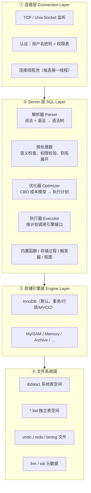
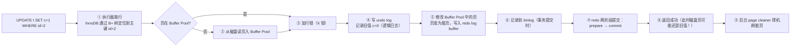
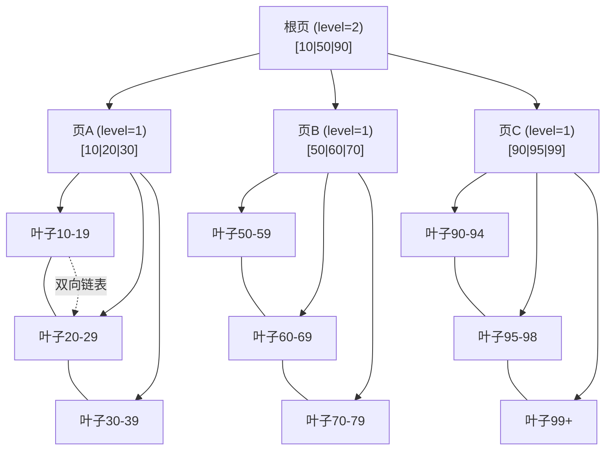
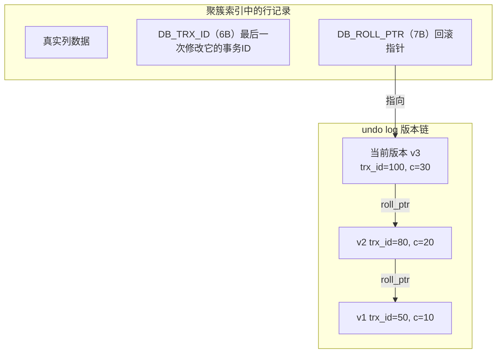
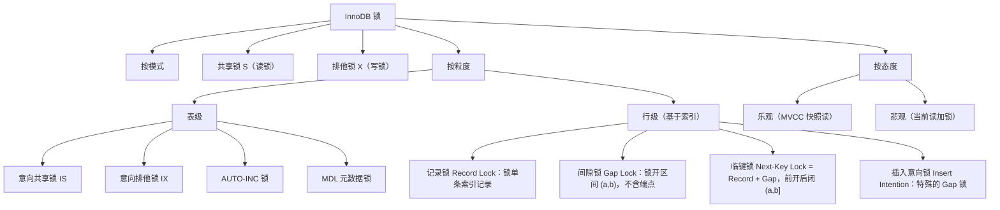
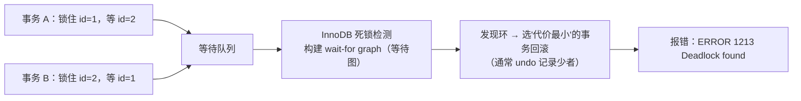
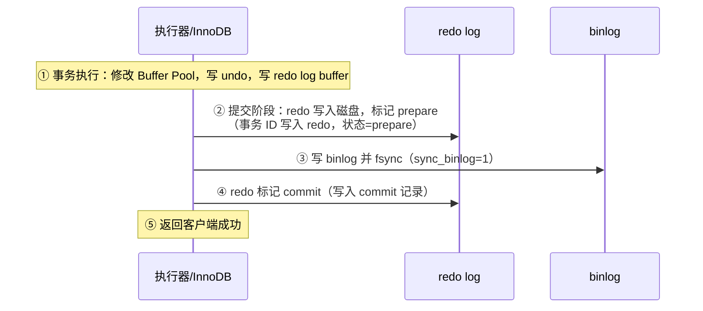
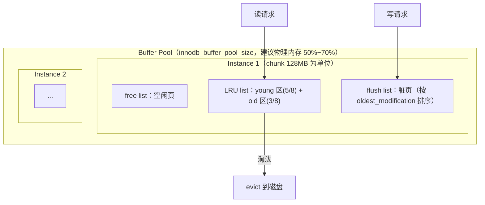
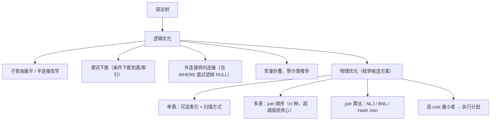
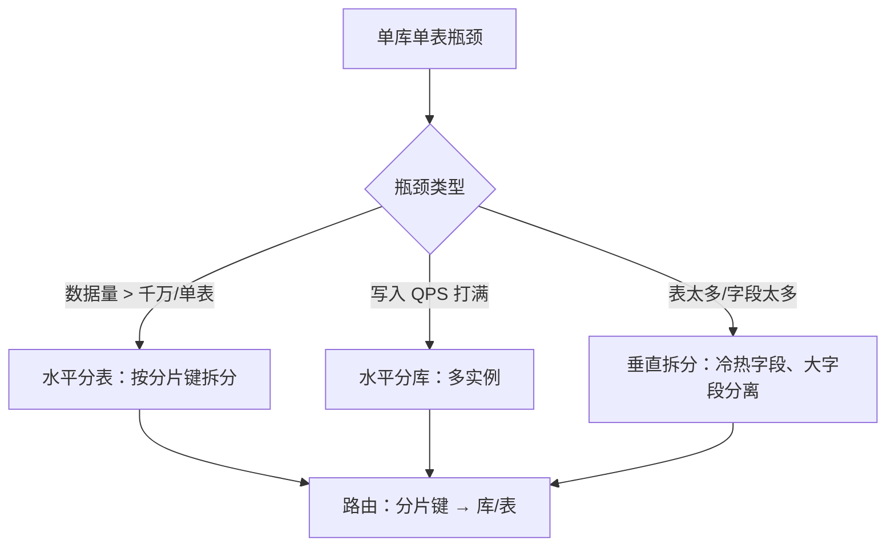

# MySQL 底层原理与大厂面试题全解

> 本文从「一条 SQL 的一生」出发，逐层拆到磁盘页、行格式、B+ 树、MVCC 版本链、redo/undo/binlog、Buffer Pool，最后落到 58 道国内大厂真实高频面试题（含考核程度分级、完整推导过程和延伸知识）。
>
> **难度图例**
> - ★☆☆☆ 基础：能背结论即可，校招/外包常问
> - ★★☆☆ 进阶：需要讲清"是什么"
> - ★★★☆ 高级：必须讲清"为什么"和底层数据结构
> - ★★★★ 专家：要能推导、能举例、能指出源码/参数级细节（P7/P8、架构岗）
>
> **阅读建议**：先按顺序读第一~第八部分建立完整知识网，再用第九部分的题目做自测。每题都标了「考点 / 参考答案 / 延伸」，面试时按"结论 → 原理 → 举例 → 权衡"四段式回答。

---

## 目录

- [第一部分 全景架构：一条 SQL 的一生](#第一部分-全景架构一条-sql-的一生)
- [第二部分 存储结构：从磁盘扇区到数据页](#第二部分-存储结构从磁盘扇区到数据页)
- [第三部分 索引：B+ 树的每一个细节](#第三部分-索引b-树的每一个细节)
- [第四部分 事务与并发控制：MVCC 与锁](#第四部分-事务与并发控制mvcc-与锁)
- [第五部分 日志系统：redo / undo / binlog](#第五部分-日志系统redo--undo--binlog)
- [第六部分 内存与缓冲：Buffer Pool](#第六部分-内存与缓冲buffer-pool)
- [第七部分 优化器与 SQL 调优](#第七部分-优化器与-sql-调优)
- [第八部分 高可用与扩展](#第八部分-高可用与扩展)
- [第九部分 大厂面试题全解（58 题）](#第九部分-大厂面试题全解58-题)
- [第十部分 速查表与学习路线](#第十部分-速查表与学习路线)

---

# 第一部分 全景架构：一条 SQL 的一生

## 1.1 分层架构

MySQL 是典型的 **C/S + 插件式存储引擎** 架构，逻辑上分四层：



**为什么分层？**

| 层 | 职责 | 分层带来的价值 |
|---|---|---|
| 连接层 | 网络、认证、线程管理 | 与 SQL 逻辑解耦，可独立做连接池/SSL/压缩 |
| Server 层 | 解析、优化、执行、函数 | **与存储引擎无关的通用能力**，换引擎不改 SQL 行为 |
| 引擎层 | 数据存取、事务、索引、锁 | 插件式，一个库可多引擎共存（`ENGINE=xxx`） |
| 文件层 | 持久化 | 可针对不同引擎设计不同文件布局 |

> 关键洞察：**"事务、索引、锁" 全部是引擎层实现的，不是 Server 层的。** 所以 MyISAM 没有事务和行锁；`SET autocommit=1` 对 MyISAM 无意义。这是面试里区分"背过"和"真懂"的分水岭。

## 1.2 一条 SELECT 语句的完整链路

```mermaid
sequenceDiagram
    participant App as 客户端
    participant Conn as 连接器
    participant Parser as 解析器
    participant Opt as 优化器
    participant Exec as 执行器
    participant Eng as InnoDB
    participant BP as Buffer Pool
    participant Disk as 磁盘

    App->>Conn: 建立连接（TCP 三次握手 + 认证）
    App->>Parser: SELECT * FROM t WHERE id=10
    Parser->>Parser: 词法分析（识别关键字/表名/列名）<br/>语法分析（生成语法树）
    Parser->>Opt: 语法树
    Opt->>Opt: 逻辑优化（子查询展开、谓词下推、外连接转内连接）
    Opt->>Opt: 物理优化（选索引、选 join 算法、估 rows）
    Opt->>Exec: 执行计划（代价最小的那棵）
    Exec->>Eng: 打开表，调用 handler->index_read / rnd_next
    Eng->>BP: 按主键查聚簇索引 B+ 树
    alt 页在 Buffer Pool
        BP-->>Eng: 命中，直接返回记录
    else 页不在 Buffer Pool
        BP->>Disk: 发起 16KB 页读取（可能触发预读 64/128KB）
        Disk-->>BP: 载入页并放入 LRU
    end
    Eng-->>Exec: 逐行返回（或回表）
    Exec-->>App: 结果集（必要时 filesort / 临时表）
```

**逐环节的底层细节（面试高频追问点）**

1. **连接器**：MySQL 默认 `max_connections=151`；连接建立后即使不做事也占一个线程和内存（每线程约 256KB~几 MB）。空闲超过 `wait_timeout`（默认 8h）被断开。**长连接导致内存上涨**是经典问题，解法是定期重连或 `mysql_reset_connection`。
2. **解析器**：只做语法层，不懂语义。`SELECT * FROM t WHERE 1=1` 能解析；`SELECT * FROM no_table` 要到预处理器才报错。
3. **预处理器**：检查表/列是否存在、展开 `*`、展开视图、检查权限。**注意：`SELECT *` 的列展开在这里完成，所以列多的宽表用 `*` 会额外消耗。**
4. **优化器**：核心输出是执行计划。MySQL 用 **CBO（Cost-Based Optimizer）**，靠 `information_schema.statistics` 里的采样统计（`innodb_stats_persistent`，默认采样 20 个页）估 `rows`。
5. **执行器**：`SELECT` 走 `handler` 接口，按 plan 调 `ha_index_read_map`（走索引）或 `ha_rnd_next`（全表扫）。5.6+ 有 **ICP**（下推条件到引擎层）。`UPDATE/DELETE` 在 Server 层是"先读后改"：执行器先按 WHERE 找到行，再调引擎写接口。
6. **引擎层**：真正做 B+ 树定位、加锁、写 undo/redo 的地方。

## 1.3 一条 UPDATE 的生命周期（最容易被问倒）

这是理解 WAL、两阶段提交、Buffer Pool 的主线，务必背下来：



**关键结论（面试要点）**
- 数据修改**先在内存（Buffer Pool）中完成**，磁盘上的页是"滞后"的。
- 之所以敢这样，是因为 **redo log 已经持久化**，崩溃可重放 → 这就是 **WAL（Write-Ahead Logging）**。
- 所以 MySQL 的持久性 **不依赖数据页刷盘，而依赖 redo log 刷盘**。`innodb_flush_log_at_trx_commit=1` 才能保证不丢已提交事务。

## 1.4 存储引擎对比（选择依据要能讲原理）

| 维度 | InnoDB | MyISAM | Memory | RocksDB(MyRocks) |
|---|---|---|---|---|
| 事务 | ✅ ACID | ❌ | ❌ | ✅ |
| 锁粒度 | 行锁 + 间隙锁 | 表锁 | 表锁 | 行锁 |
| 索引结构 | 聚簇 B+ 树 | 非聚簇 B+ 树（索引与数据分离） | Hash / B+ | LSM-Tree |
| 外键 | ✅ | ❌ | ❌ | ❌ |
| 崩溃恢复 | ✅ redo | ❌ 需 repair | ❌ 数据全丢 | ✅ |
| 并发能力 | 高 | 低（读写互斥） | 中 | 高（写优化） |
| 适用场景 | OLTP 默认 | 只读/日志归档（已淘汰） | 临时表、缓存小表 | 写多读少、压缩比要求高 |

**为什么 InnoDB 成为默认？**
1. 支持事务与崩溃恢复（redo + doublewrite）。
2. 行级锁 + MVCC → 高并发下读写不阻塞。
3. 聚簇索引 → 主键查询路径最短。
4. 5.5 起被 Oracle 收购后持续优化（`innodb_buffer_pool` 可在线调、并行复制、8.0 的 hash join / 降序索引 / instant DDL）。

> **延伸**：MyISAM 的 `COUNT(*)` 是 O(1)（表头存了行数），InnoDB 是 O(n)（因为 MVCC 下"可见行数"因事务而异）——这是面试常考的对比点。

---

# 第二部分 存储结构：从磁盘扇区到数据页

## 2.1 为什么一切设计都围绕"页"


**核心逻辑链**：磁盘随机 IO 极慢（机械盘 ~10ms，SSD ~0.1ms，内存 ~100ns，差 3~5 个数量级）→ 所以必须**一次读一大块**（局部性原理 + 磁盘预读）→ 于是把数据组织成 16KB 的页 → 索引结构必须让"一次页读"能排除大量数据 → 于是有了 B+ 树。

**为什么是 16KB？**
- 太小：一次 IO 拿到的数据少，树变高，IO 次数多。
- 太大：单次 IO 变慢（SSD 上大块读的尾延迟高），且 Buffer Pool 换入换出粒度变粗、内存碎片增加。
- 16KB ≈ 4 个 4KB 文件系统块，与多数 SSD 的 page/plane 尺寸匹配，是工程折中值。

## 2.2 表空间 → 段 → 区 → 页

| 层级 | 大小 | 说明 |
|---|---|---|
| 表空间 Tablespace | 无固定上限 | 逻辑容器。分 **系统表空间 `ibdata1`**、**独立表空间 `t.ibd`**（`innodb_file_per_table=1`，默认）、**通用表空间**、**undo 表空间**、**临时表空间** |
| 段 Segment | 由多个区组成 | 一个索引 = 2 个段：**叶子段** + **非叶子段**（数据页按 B+ 树角色归属不同段） |
| 区 Extent | 64 页 = 1MB | **连续分配**，保证页在磁盘上相邻 → 顺序 IO。小表用"碎片区"（32 页）以省空间 |
| 页 Page | 16KB | IO 与缓存的最小单位，B+ 树的节点 |

> **面试延伸**："为什么区要连续？" → 因为 B+ 树的叶子节点是双向链表、范围扫描要顺序读，区连续能让顺序扫描命中磁盘预读，避免随机 IO。

## 2.3 行格式（Row Format）：一行数据到底怎么存

InnoDB 有 4 种行格式，5.7/8.0 默认 **DYNAMIC**。

### COMPACT 行格式（理解它就理解了 DYNAMIC）

```
+---------------------------+
| 变长字段长度列表（逆序）    |  varchar/varbinary/text 的"实际长度"，每个最多 2 字节
+---------------------------+
| NULL 值标志位（逆序）       |  每列 1 bit，1 表示 NULL（NULL 不占数据区）
+---------------------------+
| 记录头信息（5 字节）        |  deleted_flag / min_rec / n_owned / heap_no / record_type / next_record
+---------------------------+
| 列1 数据 | 列2 数据 | ...   |
+---------------------------+
| (隐藏列) DB_ROW_ID 6B      |  无主键且无唯一非空索引时自动生成
| (隐藏列) DB_TRX_ID 6B      |  最后修改该行的事务 ID ← MVCC 的钥匙
| (隐藏列) DB_ROLL_PTR 7B    |  指向 undo log 中旧版本 ← 版本链的指针
+---------------------------+
```

**为什么变长字段长度列表要"逆序"存放？**
因为记录是**从右往左**读还是**从左往右**读取决于实现——InnoDB 在读取列时是从记录末尾按列定义反向推算偏移，逆序存放能让"读第一个变长列"时直接拿到它的长度，省一次遍历。

**NULL 位图的妙用**：NULL 列不占数据区，只有 1 bit。所以"很多列大量 NULL"的稀疏表，用 `NULL` 比用空字符串更省空间（但业务语义上要谨慎）。

### DYNAMIC 与 COMPRESSED 的区别

| 格式 | 行溢出处理 | 特点 |
|---|---|---|
| REDUNDANT | 全部字段偏移列表，最老 | 已弃用 |
| COMPACT | 溢出页存 768 字节前缀 + 20 字节指针 | 5.6 前的默认 |
| **DYNAMIC** | **溢出页存全部内容，行内只留 20 字节指针** | 5.7+ 默认，长字符串/大 JSON 友好 |
| COMPRESSED | 在 DYNAMIC 基础上对页和行做 zlib 压缩 | 省空间，但 CPU 开销大、写入放大 |

> **溢出阈值**：一页 16KB，当行内数据超过约半页（实际受多列共享限制），`TEXT/BLOB/VARCHAR(超大)` 会溢出到 **BLOB Page**（页类型 `FIL_PAGE_TYPE_BLOB`），行内只留 20 字节指针（`space_id + page_no + offset`）。
>
> **延伸坑**：`TEXT` 溢出后，即使查询不需要该列，只要发生**回表**，仍需读溢出页吗？—— 不需要，因为溢出页的内容不在行内，只有指针在。但如果 `SELECT` 了该列，就必须再读一次溢出页，**这是"大字段拖慢查询"的底层原因**。

## 2.4 数据页（Page）的物理结构

一个 16KB 的页（`FIL_PAGE_INDEX` 类型，即 B+ 树节点）内部布局：

```
偏移 0                                                        16384
+--------------------------------------------------------------+
| File Header 38B | Page Header 56B | Infimum+Supremum 26B      |
|  User Records（真实记录，单向链表 next_record）                |
|  Free Space（未分配空间）                                      |
|  Page Directory（槽位数组，稀疏索引，每槽 4~8 条记录）          |
| File Trailer 8B（校验和 + LSN 低 4 字节）                      |
+--------------------------------------------------------------+
```

| 区域 | 大小 | 作用 |
|---|---|---|
| File Header | 38B | 页号、页类型、上一页/下一页指针（**叶子页双向链表**就靠它）、LSN、校验和 |
| Page Header | 56B | 记录数、堆顶位置、**页目录槽位数**、页层级（叶子=0）、索引 ID |
| Infimum + Supremum | 26B | 两条虚拟记录，页内链表的头尾哨兵 |
| User Records | 变长 | 真实行记录，按主键**有序**，通过 `next_record` 组成**单向链表** |
| Free Space | 变长 | 连续空闲区，新记录从这里分配 |
| Page Directory | 变长 | 把记录分组（每组 4~8 条），每组最后一条的偏移存为"槽"，**支持二分查找** |
| File Trailer | 8B | 校验和（检测页损坏）+ LSN 后 4 字节（与 File Header 的 LSN 比对，判断页是否刷写完整） |

**页内查找一条记录的两步**：
1. **页目录二分**：在槽位数组中二分，定位到"可能包含目标"的那一组（4~8 条）。
2. **组内链表遍历**：从该组最后一条记录沿 `next_record` 往前找（因为 `next_record` 存的是"到下一条的偏移"，可正可负，所以能反向遍历）。

> **这就是"页内是链表 + 页目录是稀疏二分索引"的经典组合**：链表便于插入删除 O(1)，稀疏目录把查找从 O(n) 降到 O(log n + 4~8)。

## 2.5 页与页之间怎么连

- **叶子层**：所有叶子页通过 File Header 的 `FIL_PAGE_PREV / FIL_PAGE_NEXT` 组成**双向链表** → 支持 `BETWEEN`、`ORDER BY`、`LIMIT` 的顺序扫描。
- **非叶子层**：每个节点存 `(key, child_page_no)` 数组，通过**页内二分 + 递归下降**定位。



## 2.6 表空间文件一览

| 文件 | 内容 | 相关参数 |
|---|---|---|
| `ibdata1` | 系统表空间：数据字典（8.0 移到 `mysql.ibd`）、undo 回滚段（5.7 前）、双写缓冲 | `innodb_data_file_path` |
| `t.ibd` | 独立表空间：该表的聚簇索引 + 所有二级索引 + 元数据（8.0 SDI） | `innodb_file_per_table=1` |
| `undo_001/002` | undo 表空间（8.0 独立） | `innodb_undo_tablespaces` |
| `ib_logfile0/1` | redo log，环形复用 | `innodb_log_file_size`、`innodb_log_files_in_group` |
| `binlog.000001` | 归档日志（Server 层） | `log_bin`、`max_binlog_size` |
| `#innodb_temp` | 临时表空间 | `innodb_temp_data_file_path` |

---

# 第三部分 索引：B+ 树的每一个细节

## 3.1 为什么必须是 B+ 树（这是必答题，答不出等于没准备）

**先明确约束条件**：数据在磁盘上，最小 IO 单位是页（16KB）；一次 IO 的代价是内存访问的 10⁵ 倍。所以索引结构的唯一目标：**用最少的页 IO 次数排除最多的数据**。

| 结构 | 查询复杂度 | 范围查询 | 磁盘友好度 | 致命问题 |
|---|---|---|---|---|
| 二分数组 | O(log n) | ✅（顺序） | ❌ | 插入需整体移动，无法动态 |
| 二叉搜索树 | O(log n)~O(n) | ❌ | ❌ 树高 | 退化成链表；树高 log₂n，1 亿数据 27 层 = 27 次 IO |
| 红黑树/AVL | O(log n) | ❌ | ❌ 树高 | 仍是二叉树，1 亿数据 ~27 层，且每节点只存 1 个 key |
| 跳表 | O(log n) | ✅ | ❌ | 层高随机、内存指针多，磁盘不友好（Redis 用是因为纯内存） |
| 哈希 | O(1) 等值 | ❌ **不支持范围** | ❌ | 无法 `ORDER BY`、`BETWEEN`、`>`；哈希冲突；扩容 rehash |
| B 树 | O(log_m n) | 一般 | ✅ | **非叶子也存数据** → 单页能放的 key 少 → 树更高；范围查询要在树中来回中序遍历 |
| **B+ 树** | O(log_m n) | ✅✅ | ✅✅ | 无明显短板 |

**B+ 树胜出的四个理由（一定要分点讲）**

1. **非叶子节点不存数据，只存 key + 页号** → 单页扇出（fanout）极大。
   - 假设主键 `BIGINT` 8B，页号 4B，一条索引项 12B + 若干元数据 ≈ 13B。
   - 16KB / 13B ≈ **1260 个 key / 页**。
   - 3 层即可容纳 `1260 × 1260 × (16KB/100B≈160)` ≈ **2.5 亿行**（2 层约 20 万行）。
   - 也就是说 **1 亿行的表，树高通常仍是 3 层，一次查询 3 次 IO**（且根节点常驻内存，实际 1~2 次）。

2. **所有数据都在叶子层，且叶子用双向链表相连** → 范围查询只需"定位起点 + 沿链表顺序扫"，**不需要回到上层节点做中序遍历**。这是 B 树做不到的。

3. **树矮胖、IO 次数稳定**：B 树的每条路径长度一致，不会出现"某条查询突然要 27 次 IO"的最坏情况，**查询延迟可预测**——这对数据库 SLI 至关重要。

4. **叶子层数据有序** → `ORDER BY`、`LIMIT`、`GROUP BY` 可以直接利用索引顺序，避免排序。

> **延伸：为什么不是 B 树？** 关键差别只有两点：B 树的**非叶子也存数据行**（或行指针），导致同样 16KB 页能放的 key 数量少一个数量级，树高增加；且 B 树范围查询要在多个层间跳跃。**"B+ 树 = B 树 + 叶子链表 + 数据只放叶子"**。

## 3.2 聚簇索引 vs 二级索引 vs 回表


| 概念 | 定义 | 要点 |
|---|---|---|
| **聚簇索引** | 索引即数据，叶子存整行，**一张表只有一个** | 一定是主键索引；无主键则取第一个唯一非空索引；都没有则用隐藏 `DB_ROW_ID` |
| **二级索引（辅助索引）** | 叶子存 `(索引列..., 主键值)`，需回表 | 可以有多个；**叶子里的主键值是为了能回表** |
| **回表** | 二级索引拿到主键后再查一次聚簇索引 | 成本 = 1 次 B+ 树（二级）+ N 次 B+ 树（聚簇，N=命中行数），**随机 IO** |
| **覆盖索引** | 查询所需列全在索引里，无需回表 | `EXPLAIN` 的 `Extra: Using index` |

**为什么二级索引叶子要存主键，而不是行地址？**
因为行会因页分裂而移动（地址变），但主键不变。存主键让二级索引在**页分裂、行迁移、甚至 `OPTIMIZE TABLE` 重建**后依然有效，避免了"更新索引指针"的维护成本，也简化了 MVCC（版本判定统一走聚簇索引的 `DB_TRX_ID`）。

**回表的代价量化**：
- 二级索引命中 1000 行 → 1000 次随机聚簇索引查找 → 1000 次可能的页 IO。
- 若这 1000 行分散在 1000 个页上，就是 **1000 次随机 IO**，可能比"全表顺序扫描"还慢。
- 所以优化器在 `rows` 很大时会**主动放弃索引走全表扫描**——这就是「索引失效」里最容易被忽略的一种：**不是失效，是成本更高主动不选**。

## 3.3 联合索引与最左前缀：底层是"排序规则"

**联合索引 `idx(a, b, c)` 的叶子是这样排序的**：

```
(a=1,b=1,c=1) → (a=1,b=1,c=5) → (a=1,b=2,c=3) → (a=2,b=1,c=2) → (a=2,b=1,c=9) ...
```

即：**先按 a 升序；a 相同按 b 升序；b 相同按 c 升序**。这是 B+ 树"逐列比较"的自然结果。

**因此：**
- `WHERE a=1` ✅ 能定位（a 有序）
- `WHERE a=1 AND b=2` ✅ 能定位
- `WHERE a=1 AND b=2 AND c=3` ✅ 完美定位
- `WHERE a=1 AND c=3` ⚠️ 只能用 a 定位，c 只能靠 `Using index condition` 在索引内过滤（ICP），不能用于缩小扫描范围
- `WHERE b=2` ❌ **完全无法定位**（b 在全局不是有序的，只有 a 相同的那一小段内才有序）。这等价于"在一本书里找所有第二章都出现的词"，你必须逐章扫。

**范围查询会"截断"后面的列**：
`WHERE a>1 AND b=2` —— 因为 a 是范围，a 相同的前提下 b 才有顺序，而 a 有多个值，所以 b 无法用于定位，只能在索引内过滤（ICP 起作用）。

**`ORDER BY` 的利用**：`ORDER BY a, b` 可直接用索引顺序（`Extra` 无 `Using filesort`）；`ORDER BY b, a` 不行；`WHERE a=1 ORDER BY b, c` 可以（a 是常量，b,c 在 a 内部有序）。

> **延伸（8.0.13 Index Skip Scan）**：当**前导列基数极低**（比如 `a` 只有 1/2 两个值）时，优化器可以把 `WHERE b=2` 改写成"分别对 a=1 和 a=2 做 `a=1 AND b=2` 的探测"，从而跳过前导列。触发条件苛刻：前导列选择性差 + 后续列选择性好 + 优化器估算划算。`EXPLAIN` 会显示 `Using index for skip scan`。这不是"最左前缀失效了"，而是**用 N 次短查找换 1 次全扫**。

## 3.4 覆盖索引与索引条件下推（ICP）

**覆盖索引**：把 `SELECT` 需要的列都放进索引，避免回表。

```sql
-- 原始：需要回表拿 name、age
SELECT name, age FROM t WHERE id = 5;

-- 优化：建 idx_name_age (name, age) 后
SELECT age FROM t WHERE name = 'Tom';   -- Extra: Using index ✅
```

**覆盖索引的隐藏收益**：不需要回表 = 不需要读聚簇索引的页 = **减少 Buffer Pool 污染**（不然大范围扫描会把热数据挤出）。

**ICP（Index Condition Pushdown，5.6+）**

- 无 ICP：引擎按索引找到主键 → **每行都回表** → Server 层再判断 `WHERE` 里的其他条件 → 大量无用回表。
- 有 ICP：把 `WHERE` 中**能用索引列判断的部分**下推到引擎，在索引遍历时就过滤，**只对通过的行回表**。

```sql
SELECT * FROM t WHERE name LIKE '张%' AND age = 20;  -- idx(name, age)
```
无 ICP：`name LIKE '张%'` 命中 1000 行 → 1000 次回表 → 过滤出 3 行。
有 ICP：在索引上先判 `age=20` → 只回表 3 行。

`EXPLAIN` 表现：`Extra: Using index condition`（注意区别于 `Using index`，后者是覆盖索引不回表）。

> **延伸**：ICP 只对**二级索引**有效（聚簇索引本身就有整行，无需下推）；对 `LIKE`、`>`、`IN` 等有效；对**存储函数、子查询**无效（不可下推）。

## 3.5 索引失效的 10 种场景 + 底层原因

| # | 场景 | 例子 | 底层原因 | 破解 |
|---|---|---|---|---|
| 1 | 列上做函数/运算 | `WHERE YEAR(create_time)=2024` | B+ 树按**原始值**排序，函数后值无序 | 改写为范围 `create_time >= '2024-01-01' AND < '2025-01-01'`；或建函数索引 |
| 2 | 隐式类型转换 | `WHERE id='1'`（id 是 int） | 字符串转数字后**比较值变了**，索引有序性被破坏（反之 `WHERE name=1` 会把 name 转成数字，直接全表） | 类型对齐 |
| 3 | 隐式字符集转换 | 两表 join，一个是 `utf8` 一个是 `utf8mb4` | 转换后比较值变化，索引不可用 | 统一字符集/`COLLATE` |
| 4 | 前导模糊 | `LIKE '%abc'` | 不知道前缀，无法定位起点 | 后缀匹配用倒排/ES；或 `LIKE 'abc%'` |
| 5 | `OR` 连接非索引列 | `WHERE a=1 OR b=2`（b 无索引） | 只要一侧无法用索引，整个条件退化为全扫 | 给 b 建索引，或拆成两条 UNION |
| 6 | `!=` / `NOT IN` / `NOT LIKE` | `WHERE status != 1` | 需要扫描所有不等于的值，通常等价于大面积扫描；优化器判成本不划算 | 改为正向枚举 `IN (2,3)` |
| 7 | 联合索引跳过前导列 | `WHERE b=2`（索引 `(a,b)`） | 见 3.3 | 补齐前导列 / 8.0 skip scan |
| 8 | 范围查询后再用后续列定位 | `WHERE a>1 AND b=2` | 范围使后续列失序 | 拆成多个等值区间 / 调整索引顺序 |
| 9 | `IS NOT NULL` | `WHERE name IS NOT NULL` | 若 NULL 行极少，优化器可能选索引；反之成本高不选 | 用默认值替代 NULL |
| 10 | 优化器主动放弃 | `rows` 估算命中比例过高（如 >20~30%） | 回表随机 IO 成本 > 顺序全扫 | 覆盖索引 / `FORCE INDEX`（慎用）/ 减少 `SELECT *` |

> **注意第 10 条**：很多"索引失效"其实是**优化器算过账觉得不划算**。`EXPLAIN` 里 `possible_keys` 有值、`key` 为 NULL，就是这个情况。此时 `FORCE INDEX` 能强行用，但往往更慢——**优化的正解是减少回表（覆盖索引）而不是强行用索引**。

## 3.6 索引统计信息：cardinality 与采样

优化器靠 `cardinality`（基数，即"不同值的个数估计"）来算选择性。

- 存储位置：`information_schema.STATISTICS.CARDINALITY`（8.0 在 `mysql.innodb_index_stats`）。
- 更新时机：`innodb_stats_persistent=ON` 时，由 `innodb_stats_persistent_sample_pages`（默认 20 页）**采样估算**；`ANALYZE TABLE` 手动触发；表变更超过 10% 自动触发。
- **采样带来的坑**：数据分布倾斜时，20 页采样可能严重低估/高估 → 执行计划选错 → 这就是"同样的 SQL 有时快有时慢"的典型原因。
- 解法：`ANALYZE TABLE`、提高采样页数、8.0 的 **直方图（Histogram）** `ANALYZE TABLE ... UPDATE HISTOGRAM ON col`（解决"数据倾斜导致 range 估算错"）。

> **延伸**：8.0 引入 `innodb_stats_include_delete_marked`、`innodb_stats_auto_recalc`，以及 `EXPLAIN ANALYZE`（8.0.18）能输出**实际行数 vs 估算行数**，是排查"估算错误"的利器。

## 3.7 索引设计原则（工程落地版）

1. **区分度优先**：`SELECT COUNT(DISTINCT col)/COUNT(*)` > 0.1 才值得建单列索引（如性别 0/1 建了等于没建）。
2. **把区分度高的列放前面**（联合索引）。
3. **等值列在前、范围列在后**（`(a, b)` 中 `a` 等值、`b` 范围，优于 `(b, a)`）。
4. **控制数量**：单表索引建议 ≤ 5 个，每个索引都增加写放大（每次 INSERT 要维护所有索引的 B+ 树）。
5. **用覆盖索引优化高频只读查询**。
6. **主键用自增 BIGINT**（避免页分裂；见 3.8）。
7. **避免在索引列上用函数**；`TEXT` 用前缀索引 `INDEX(name(20))`（注意前缀索引**不能用于覆盖索引**，因为存的是截断值，必须回表校验）。

## 3.8 为什么主键要用自增

**页分裂的底层过程**：

- 自增插入：新记录总是追加到最后一个叶子页的末尾，页满了就**新分配一个页**（顺序写）。区是连续的，所以是**顺序 IO**。
- 随机主键（如 UUID）：新记录要插到**中间的页**，页满时 InnoDB 要把该页**一分为二**（`页分裂`），并把一半记录挪到新页，同时更新上层父节点的指针（可能级联分裂）。后果：
  1. **随机 IO**（要找的页不在内存就要读）；
  2. **空间碎片**：分裂后两页各 50% 填充，索引文件膨胀；
  3. **写放大**：一次插入触发多页修改 + 多层 redo。
- **UUID 更糟**：36 字节 vs 8 字节，单页能放的 key 从 ~1260 降到 ~400，**树高增加一层**，且完全随机。

> **延伸**：如果业务必须用字符串主键（如订单号），可用"**趋势递增**"方案（雪花 ID 的字符串形式、时间前缀 + 序列），让插入集中在最后几页，兼具自增的顺序性和业务含义。

## 3.9 其他索引形态

| 类型 | 结构 | 适用 | 注意 |
|---|---|---|---|
| 自适应哈希索引 AHI | 内存哈希表，key = 索引前缀 | 热点等值查询 | `innodb_adaptive_hash_index`，默认开；高并发下可能成瓶颈（`rw-latch` 争用），有时需关闭 |
| 全文索引 FULLTEXT | 倒排索引（分词 → 文档列表） | 大文本搜索 | 中文需 `ngram` 解析器；`innodb_ft_min_token_size` |
| 函数索引（8.0.13） | 隐藏虚拟列 + 索引 | `INDEX((LOWER(name)))` | 本质是"表达式索引"，能救回"函数导致失效" |
| 空间索引 SPATIAL | R-Tree | 地理位置 | MyISAM/InnoDB 均支持，仅 `GEOMETRY` 类型 |
| 降序索引（8.0） | `INDEX(a ASC, b DESC)` | 混合排序 | 8.0 才真正支持（5.7 语法接受但忽略） |

---

# 第四部分 事务与并发控制：MVCC 与锁

## 4.1 ACID 的实现手段对照表

| 特性 | 含义 | InnoDB 的实现 |
|---|---|---|
| **A** 原子性 | 事务要么全成、要么全不成 | **undo log**（逻辑回滚日志）：记录"反向操作"，回滚时逆序执行 |
| **C** 一致性 | 数据从合法状态到另一个合法状态 | 由 A+I+D 共同保证 + 应用层约束（外键、唯一索引、CHECK） |
| **I** 隔离性 | 并发事务互不干扰 | **锁 + MVCC**（快照读走 MVCC，当前读走锁） |
| **D** 持久性 | 提交后不丢 | **redo log**（WAL + `innodb_flush_log_at_trx_commit=1`）+ doublewrite |

> **面试话术**："C 其实不是 InnoDB 单独实现的，而是 A、I、D 三者共同保障的结果，加上业务约束。InnoDB 只能保证'数据库层面'的一致性，跨服务的一致性要靠分布式事务/TCC/Saga。"

## 4.2 四种隔离级别与解决的问题

| 级别 | 脏读 | 不可重复读 | 幻读 | 实现方式 |
|---|---|---|---|---|
| READ UNCOMMITTED | ✅ 可能 | ✅ | ✅ | 无 MVCC，直接读最新 |
| **READ COMMITTED** | ❌ | ✅ 可能 | ✅ | MVCC：**每次快照读都新建 ReadView** |
| **REPEATABLE READ**（默认） | ❌ | ❌ | ⚠️ 快照读避免，当前读靠间隙锁 | MVCC：**事务内首次快照读创建 ReadView 并复用** |
| SERIALIZABLE | ❌ | ❌ | ❌ | 所有读加 S 锁（`innodb` 中转为 `LOCK IN SHARE MODE`） |

**名词澄清（易错）**
- **脏读**：读到别的事务**未提交**的数据。
- **不可重复读**：同一事务两次读同一行，值变了（因为别人提交了 UPDATE）。
- **幻读**：同一事务两次 `SELECT ... WHERE`，**行数变了**（别人 INSERT/DELETE）。注意幻读是"结果集变化"，不可重复读是"单行值变化"。

> **RC 为什么有不可重复读？** 因为每次 `SELECT` 都新建 ReadView，能看到"上次创建 ReadView 之后提交的事务"。
> **RR 为什么没有不可重复读？** ReadView 在整个事务内复用，看到的永远是"事务开始那一刻的已提交状态"。

## 4.3 MVCC 深度剖析（本部分最核心）

### 4.3.1 三要素



- **`DB_TRX_ID`**：最后修改该行的事务 ID（`trx_id`，全局递增）。
- **`DB_ROLL_PTR`**：指向 undo log 中该行的**上一个版本**，通过它串成**版本链**。
- **undo log**：分为 `insert undo`（插入的回滚只需删除，可立即 purge）和 `update undo`（更新/删除的回滚，需要保留给 MVCC 读，由 `purge` 线程在无读者时清理）。

### 4.3.2 ReadView 的四个字段

| 字段 | 含义 |
|---|---|
| `m_ids` | 创建 ReadView 时，**当前活跃（未提交）的事务 ID 列表** |
| `min_trx_id` | `m_ids` 中的最小值（即"最小活跃事务 ID"） |
| `max_trx_id` | 创建 ReadView 时**下一个将要分配的事务 ID**（不是最大值，是上界） |
| `creator_trx_id` | 创建该 ReadView 的事务自己的 ID（`SELECT` 也会分配，只读事务若未写则为 0） |

### 4.3.3 可见性判断算法（必须能默写）

对版本链上某个版本的 `trx_id`，依次判断：

```
1. trx_id == creator_trx_id        → 可见（自己改的，自己当然看得见）
2. trx_id <  min_trx_id            → 可见（在 ReadView 创建前就已提交）
3. trx_id >= max_trx_id            → 不可见（ReadView 创建后才开启的事务）
4. min_trx_id <= trx_id < max_trx_id：
     若 trx_id ∈ m_ids             → 不可见（当时还活跃/未提交）
     若 trx_id ∉ m_ids             → 可见（当时已提交，只是 ID 落在区间内）
```

**形象理解**：
- "比我早提交的、且当时没在跑" → 看得见。
- "当时还在跑" 或 "比我晚开始" → 看不见。
- 看不见就顺着 `roll_ptr` 往上找下一个版本，直到找到可见的或链表结束（说明这行当时不存在）。

### 4.3.4 RR vs RC 的唯一区别

| | RC | RR |
|---|---|---|
| ReadView 创建时机 | **每次** `SELECT`（快照读）都新建 | **事务内第一次**快照读时创建，之后复用 |
| 效果 | 能看到最新提交 | 整个事务看到同一个快照 |
| 幻读 | 有 | 快照读无（当前读仍有，见 4.4） |

> **代码级细节**：`ReadView` 由 `ReadView::prepare()` 在 `trx_sys->mvcc->view_open()` 中创建；RR 下第一次 `view_open` 后 `m_up_limit_id/m_low_limit_id` 被冻结，后续复用同一个对象。RC 下每次 `row_search_mvcc` 都会重建。

### 4.3.5 一个完整例子（面试时讲这个最加分）

假设初始 `id=1, c=10`，`trx_id=50`（已提交）。

| 时刻 | 事务 A（id=100） | 事务 B（id=101） | 版本链 | A 读到什么 |
|---|---|---|---|---|
| T1 | `BEGIN` | | v1: trx 50, c=10 | |
| T2 | `SELECT c` → 建 ReadView{m_ids:[100], min=100, max=101} | | | v1 的 50 < 100 → **可见，读 10** |
| T3 | | `BEGIN; UPDATE c=20`（trx 101） | v2(trx101,c=20) → v1 | |
| T4 | | `COMMIT` | | |
| T5 | `SELECT c`（复用 ReadView） | | | v2 的 101 >= max(101) → 不可见 → 回溯到 v1 → **仍读 10（可重复读）** |
| T6 | `COMMIT`；新事务 C `SELECT` | | | 新 ReadView{m_ids:[], min=102, max=102} → v2 的 101<102 → **读 20** |

**如果 A 在 RC 下**：T5 会新建 ReadView（此时 101 已提交，不在 `m_ids` 中）→ 读到 20。

> **延伸追问："undo log 不会被无限堆积吗？"** → 不会。`purge` 线程按 `purge_lview`（最老的 ReadView）判断：**没有任何活跃 ReadView 需要的版本才可清理**。所以**长事务会阻止 purge，导致 undo 表空间膨胀、历史版本堆积**——这是"禁止长事务"的底层原因之一。

## 4.4 幻读：RR 到底解决了没有

**结论**：RR 下**快照读**（普通 `SELECT`）不会幻读；**当前读**（`SELECT ... FOR UPDATE`、`UPDATE`、`DELETE`、`INSERT`）仍有幻读，只是 InnoDB 用**间隙锁（Gap Lock）** 在"当前读"时把间隙锁住，阻止其他事务插入。

**经典反例（RR 仍幻读）**：
```sql
-- T1                          -- T2
BEGIN;
SELECT * FROM t WHERE id>10;   -- 快照读，返回 3 行
                               BEGIN;
                               INSERT INTO t(id=20) VALUES(...);  -- 插入成功（T1 没加锁）
                               COMMIT;
UPDATE t SET c=1 WHERE id>10;  -- 当前读！看到 4 行（含 id=20），发生幻读
COMMIT;
```

**为什么 `UPDATE` 会看到新插入的行？** 因为 `UPDATE` 是当前读，要"读到最新数据才能正确修改"，此时不查 ReadView 而直接读最新版本 + 加 next-key lock。

> **延伸**："MySQL 官方文档说 RR 解决了幻读，为什么还有反例？" → 官方指的是"**快照读**不幻读"；"当前读"的幻读需要用间隙锁解决，而这只有在**第一次读就用了当前读**时才生效。所以严格来说 RR 只解决了一部分，这也是 SQL 标准把 SERIALIZABLE 才称为"完全解决幻读"的原因。

## 4.5 InnoDB 锁全景图



**几个必懂的细节**

| 锁 | 关键点 |
|---|---|
| 记录锁 | 锁的是**索引记录**，不是行。若表无索引，`WHERE` 条件无法定位索引 → 退化为锁所有记录（等效表锁） |
| 间隙锁 | **只存在于 RR 及以上**（RC 下 `innodb_locks_unsafe_for_binlog` 语义，实际不生成 gap lock）。间隙锁之间**不互斥**（两个事务可以同时锁同一个 gap），因为它的目的是"阻止插入"，不是"互斥读" |
| 临键锁 | 默认加锁单位。`WHERE id=5 AND id 存在` → 唯一索引等值 → 退化为记录锁；`id=5 不存在` → 退化为 `(上一个, 5)` 的间隙锁 |
| 插入意向锁 | `INSERT` 前先在 gap 上加"插入意向锁"。它与 gap lock **冲突**（这就是间隙锁阻止插入的机制）；多个插入意向锁之间**不冲突**（不同位置可并发插入） |
| 意向锁 | 表级。加行锁前必须先加 IS/IX。目的是让"表锁"能快速判断"是否有行锁"，**不用逐行扫描** |
| AUTO-INC 锁 | 控制自增分配。`innodb_autoinc_lock_mode=0`（表锁，语句级）/`1`（默认，简单插入用轻量 mutex，批量用表锁）/`2`（完全交错，主从不安全，需 ROW binlog） |
| MDL | Server 层元数据锁。`SELECT` 加 MDL 读锁，DDL 加 MDL 写锁。**长事务不提交 → 阻塞 DDL → 后续所有请求排队**，这是线上"改表卡死"的头号原因 |

> **`innodb_lock_wait_timeout` vs `lock_wait_timeout`**：前者是 InnoDB 行锁等待（默认 50s），后者是 MDL 等待（默认 1 年！）。所以 DDL 被阻塞时表现是"永远不超时"，必须靠 `performance_schema.metadata_locks` 排查。

## 4.6 加锁规则（阿里/字节高级岗必考）

来自《MySQL 实战 45 讲》总结的四条规则 + 一个 bug：

1. **原则 1**：加锁的基本单位是 **next-key lock**（前开后闭区间）。
2. **原则 2**：查找过程中**访问到的对象**才会加锁（没访问到的索引记录不加锁）。
3. **优化 1**：索引上的**等值查询**，给**唯一索引**加锁时，next-key lock **退化为记录锁**。
4. **优化 2**：索引上的**等值查询**，向右遍历时**最后一个值不满足等值条件**时，next-key lock **退化为间隙锁**。
5. **Bug**：唯一索引上的**范围查询**会访问到不满足条件的第一个值为止（多锁一个）。

**案例表**：`t(id PK, c, d)`，`c` 上有普通索引，已有 `c = 0,5,10,15,20`。

| SQL（RR） | 加锁结果 | 推导 |
|---|---|---|
| `SELECT * FROM t WHERE id=5 FOR UPDATE` | id=5 记录锁 | 唯一索引等值 + 存在 → 优化 1 |
| `SELECT * FROM t WHERE id=6 FOR UPDATE`（不存在） | `(5,10]` 退化为 `(5,10)` 间隙锁 | 唯一索引等值 + 不存在 → 优化 2（向左找最近存在值 5，锁 (5,10) 间隙） |
| `SELECT * FROM t WHERE c=5 FOR UPDATE`（普通索引） | `(0,5]` next-key + `(5,10)` 间隙锁 | 普通索引等值不适用优化 1；定位到 c=5 时按默认单位加 `(0,5]` next-key（含 c=5 记录 + `(0,5)` 间隙）；向右遍历到 c=10 不满足等值 → 优化 2 退化为 `(5,10)` 间隙锁 |
| `SELECT * FROM t WHERE c>5 AND c<15 FOR UPDATE` | `(5,10]` + `(10,15]`（c=15 虽不满足 `c<15` 也被 next-key 覆盖） | 范围查询不适用优化 2；从第一个满足条件的 c=10 起，其 next-key 为 `(5,10]`；继续扫到 c=15，next-key 为 `(10,15]`；到 c=20 时已超出范围不再加锁 |
| `UPDATE t SET d=1 WHERE c=5` | 二级索引 `c` 上加 `(0,5]` + `(5,10)`；**同时聚簇索引上 id=5 加记录锁** | `UPDATE` 是当前读，除了按二级索引加锁，还要锁住要修改的那一行（聚簇索引），因为要改行数据 |

**记忆口诀**：**"唯一等值退记录锁，等值越界退间隙，范围一路 next-key 到底，访问到的才加锁。"**

> **延伸追问："为什么唯一索引等值不存在时要加间隙锁？"** → 因为要保证"这个值现在不存在，且在我事务结束前也不会被插入"。如果只加记录锁（无记录可锁），别的事务可能立刻插入 id=6，破坏"当前读"的语义（幻读）。

## 4.7 死锁：产生、检测、排查、避免

**产生条件（四个必要条件）**：互斥、持有并等待、不可剥夺、循环等待。InnoDB 只能破坏"循环等待"。



**检测机制**：`innodb_deadlock_detect`（默认 ON）。每个等待锁的事务会**主动遍历等待图**找环，时间复杂度 O(n²)。所以：

- **高并发下死锁检测本身成为瓶颈**（几千个并发事务互相检测，CPU 打满）→ 这也是"秒杀场景把 `innodb_deadlock_detect=OFF` + 应用层重试"的原因。
- 关闭后靠 `innodb_lock_wait_timeout` 超时兜底（响应变慢但 CPU 不爆）。

**排查手段**

```sql
SHOW ENGINE INNODB STATUS\G      -- LATEST DETECTED DEADLOCK 段，看两个事务的 SQL、持有/等待的锁
SELECT * FROM performance_schema.data_locks;        -- 8.0：当前所有锁
SELECT * FROM performance_schema.data_lock_waits;   -- 8.0：谁在等谁
SELECT * FROM sys.innodb_lock_waits;                -- 5.7+ sys 视图
```

**避免手段**

1. **固定加锁顺序**（按主键/按 ID 升序批量更新）。
2. **缩短事务**，尽快提交，减少持锁时间。
3. **降低隔离级别到 RC**（消除间隙锁，死锁概率大幅下降）。
4. **批量操作拆小**，避免一次锁太多行。
5. **给 `UPDATE` 条件建索引**，避免退化为表锁/大量记录锁。
6. 应用层**捕获 1213 重试**（指数退避）。
7. 高并发写入用**队列串行化**（如按用户 ID 哈希到固定线程）。

> **延伸**："间隙锁会导致死锁吗？" → 会，而且是 RC→RR 切换后死锁增多的主因。因为 gap lock 之间不互斥，两个事务都能获得 gap lock，然后都想插入 → 互相等对方的 gap 释放 → 死锁。这是很多互联网公司默认用 RC 的原因（阿里系普遍 RC）。

## 4.8 锁的内存结构（P8 级追问）

- 每个事务有一个 `lock` 对象链表；`lock_sys` 有一个**全局锁哈希表**（`lock_sys->rec_hash`），key 是 `(space_id, page_no, heap_no)`。
- 同一记录上的多个锁请求挂在 `lock` 的等待队列上，按**公平性**大致遵循 FIFO，但**插入意向锁与 gap lock 的兼容矩阵**会导致"后来者插队"。
- `innodb_buffer_pool_instances` 分片也影响锁：每个 buffer pool instance 有自己的 `buf_pool->mutex`，所以分片能降低锁争用。

---

# 第五部分 日志系统：redo / undo / binlog

## 5.1 三大日志总览（先建立全局观）

| | **redo log** | **undo log** | **binlog** |
|---|---|---|---|
| 所属层 | **InnoDB 引擎层** | InnoDB 引擎层 | **Server 层**（所有引擎共用） |
| 内容 | 物理页的修改（"在某某页的某某偏移写入某值"） | 逻辑反向操作（"把 c 改回 10"）或 insert 的删除 | SQL 语句 / 行变更（逻辑日志） |
| 作用 | **崩溃恢复（D，持久性）** | **回滚（A，原子性）+ MVCC** | **主从复制 + 数据恢复（PITR）** |
| 写入时机 | 事务执行中持续写（WAL） | 修改前写 | **事务提交时**写 |
| 是否循环 | ✅ 固定大小，环形复用 | ✅ 按需增长，purge 后复用 | ❌ 追加写，永不覆盖 |
| 刷盘参数 | `innodb_flush_log_at_trx_commit` | — | `sync_binlog` |
| 格式 | 逻辑物理（physical redo） | 逻辑 | STATEMENT/ROW/MIXED |

## 5.2 redo log：WAL 的核心

### 5.2.1 为什么需要 redo

**如果每次修改都直接刷数据页**：
- 数据页可能不连续 → **随机 IO**；
- 一页只改几个字节却要写 16KB → **写放大**；
- 事务提交要等多个页刷完 → **响应时间不可控**。

**WAL 的思路**：先把"改了什么"顺序写到 redo（小、顺序、append），提交即返回；数据页延后由后台批量刷。**把随机写变成顺序写，把大块写变成小块写。**

### 5.2.2 redo 的物理结构

```
ib_logfile0 / ib_logfile1  （环形，总大小 = innodb_log_file_size × innodb_log_files_in_group）
+------------------------------------------------------+
|  write pos（当前写入位置）                            |
|         ↓                                            |
|  [已写入未 checkpoint][空闲][已 checkpoint 可覆盖]     |
|                    ↑                                 |
|              checkpoint（可被覆盖的边界）              |
+------------------------------------------------------+
```

- **write pos 追上 checkpoint** → redo 写满 → 必须**停下来刷脏页推进 checkpoint**（`log checkpoints` 等待）→ 这就是"redo 太小导致写入抖动"的根因（`Innodb_log_waits` 增长）。
- **LSN（Log Sequence Number）**：全局单调递增的字节偏移，用来标记 redo 位置、页版本、checkpoint。
- **Mini-Transaction（mtr）**：一组不可分割的 redo 记录（如"页分裂"涉及多个页，必须整体重放）。redo 记录以 mtr 为单位写入，保证**崩溃恢复时的原子性**。

### 5.2.3 为什么 redo 能保证持久性（关键逻辑）

- redo 记录的是**物理页修改**，重放是**幂等**的（同一条 redo 重放多次结果一样，因为写的是确定值）。
- redo 记录带 **页的 LSN**，恢复时对比页内 LSN：若页 LSN < redo LSN → 需要重放；若 >= → 已刷过，跳过。
- 因此**恢复只需从最后一个 checkpoint 开始顺序重放**，时间可控。

> **延伸**："redo log 是逻辑日志还是物理日志？" → 严格说是**物理逻辑日志（physiological）**：它记录"在某个页（物理）的某个偏移做了什么操作（逻辑）"，而不是完整的页镜像（那是物理日志，如 doublewrite）。

## 5.3 undo log：回滚与 MVCC 的双重身份

| 类型 | 产生时机 | 内容 | 何时清理 |
|---|---|---|---|
| `TRX_UNDO_INSERT` | `INSERT` | 记录主键，回滚时**直接删除** | 事务提交后即可 purge |
| `TRX_UNDO_UPDATE` | `UPDATE`/`DELETE` | 旧值 + `roll_ptr`（形成版本链） | 提交后**等到没有 ReadView 需要它**才 purge |

**DELETE 的特殊处理**：`DELETE` 不是物理删除，而是把记录头 `deleted_flag=1`（标记删除），并写一条 `update undo`。真正的物理删除由 purge 线程在无人引用时做。这也解释了为什么 `DELETE` 后表文件不缩小，需要 `OPTIMIZE TABLE`。

**undo 的存储**：8.0 独立 undo 表空间 `undo_001/002`，内部按 **undo 段（rollback segment）→ undo slot → undo page** 组织，最多 128 个回滚段。

> **长事务的三重危害（一定要能连起来讲）**：
> 1. 阻止 purge → undo 表空间暴涨 + 版本链变长 → 快照读变慢；
> 2. 持有锁不释放 → 阻塞其他事务 + 增加死锁概率；
> 3. 主从延迟（大事务导致从库长时间应用）。

## 5.4 binlog：归档与复制

### 5.4.1 三种格式对比

| 格式 | 记录内容 | 优点 | 缺点 |
|---|---|---|---|
| **STATEMENT** | 原始 SQL | 体积小 | **非确定性函数**（`NOW()`、`RAND()`、`UUID()`、`LIMIT` 无序）导致主从数据不一致 |
| **ROW** | 每一行的 before/after 镜像 | **绝对一致**，能还原任意行变更 | 体积大（一条 `UPDATE` 改 100 万行 → 100 万条记录）；**不支持** 某些 DDL 的细粒度 |
| **MIXED** | 默认 STATEMENT，遇不确定语句自动切 ROW | 折中 | 仍有边界情况 |

> **生产建议**：`binlog_format=ROW` + `binlog_row_image=MINIMAL`（只记变化的列，省空间）。ROW 格式也是 CDC（Canal/Debezium）订阅的基础。

### 5.4.2 binlog 的写入与刷盘

```
事务执行 → binlog cache（每线程私有，binlog_cache_size）
        → 提交时 write() 到 binlog 文件（OS page cache）
        → fsync() 到磁盘（受 sync_binlog 控制）
```

| `sync_binlog` | 行为 | 风险 |
|---|---|---|
| 0 | 由 OS 决定何时刷 | 宕机丢大量事务 |
| 1（推荐） | 每次提交 fsync | 最安全，但有 IO 开销（组提交可摊薄） |
| N | 每 N 次提交 fsync | 宕机丢最多 N 个事务 |

**binlog 的三个"段"**：一个事务的 binlog 被 `BEGIN`/`COMMIT`（或 `XID` event）包裹，中间是若干 `TableMap` + `Write/Update/DeleteRows` event。**末尾的 `XID` event 是判断"事务是否完整"的标志**——这也是崩溃恢复时判断 binlog 完整性的依据。

## 5.5 两阶段提交与崩溃恢复（★★★★ 高频压轴题）

### 5.5.1 为什么需要两阶段提交

**问题**：redo（引擎层）和 binlog（Server 层）是两个独立的日志系统，必须保证"要么都有，要么都没有"。

| 反例 | 后果 |
|---|---|
| 先写 redo 并提交，再写 binlog 时崩溃 | 主库有数据，binlog 没有 → **从库/备份丢这条数据** → 主从不一致 |
| 先写 binlog，再写 redo 时崩溃 | binlog 有、主库没有 → **从库多出这条数据** → 主从不一致 |

### 5.5.2 完整流程



**关键：redo 的 prepare 阶段是"已经持久化了修改"，但事务还没"算数"。只有 binlog 落盘后才 commit。**

### 5.5.3 崩溃恢复的三分支

重启时，扫描 redo 最后一个 checkpoint 之后的事务：

| redo 状态 | binlog 状态 | 处理 | 原因 |
|---|---|---|---|
| 有 prepare，**有** commit | — | 直接提交 | 已完成 |
| 有 prepare，**无** commit，binlog **完整**（有 XID） | 完整 | **提交**（重放） | binlog 已落盘，必须与从库一致 |
| 有 prepare，**无** commit，binlog **不完整/无** | 缺失 | **回滚** | binlog 没有，主库不能有 |
| 无 prepare（只有部分 redo） | — | 回滚（mtr 不完整） | 原子性 |

**判断"binlog 是否完整"的方法**：用 redo 中记录的**事务 XID** 去 binlog 里找对应的 `XID` event（或 GTID）。找到 = 完整；找不到 = 不完整。

> **延伸追问："为什么 redo 要先 prepare 而不是直接 commit？"** → 因为如果 redo 直接 commit 而 binlog 还没写，崩溃后无法判断 binlog 是否写过（redo 里没有"binlog 已写"的信息）。prepare 状态相当于一个"待定"标记，配合 binlog 的完整性做最终裁决。这正是 **2PC 的 prepare/commit 语义**。

## 5.6 组提交（Group Commit）：把 fsync 摊薄

**问题**：每个事务都要 `fsync` redo + `fsync` binlog = 2 次磁盘同步，QPS 被 fsync 卡死在 ~几百。

**思路**：把多个事务的 fsync 合并成一次。提交分三个阶段，每阶段有一个队列：

```
① Flush 阶段：把 redo log buffer 写入文件（write，不 fsync）
② Sync 阶段：对 redo 文件 fsync（这一步会"带上"排在后面的事务）
③ Commit 阶段：写 binlog 并 fsync，然后 redo commit
```

关键优化：**binlog 的 fsync 由"组"中最先进入 Sync 的事务代表执行**，后面排队的事务搭便车。`binlog_group_commit_sync_delay`（微秒）和 `binlog_group_commit_sync_no_delay_count` 可以人为"攒一波"再 fsync，用**延迟换吞吐**。

> **量化**：单事务 2 次 fsync、每次 0.1ms → 上限 5000 TPS；组提交 10 个事务共享 2 次 fsync → 理论 5 万 TPS。这就是"为什么 MySQL 写入能到万级 TPS"的答案。

## 5.7 刷盘参数矩阵（生产配置必背）

| 场景 | `innodb_flush_log_at_trx_commit` | `sync_binlog` | 说明 |
|---|---|---|---|
| **金融级（不丢数据）** | 1 | 1 | 最安全，性能最低 |
| 互联网常规（推荐） | 1 | 1 | 配合组提交，性能可接受 |
| 允许宕机丢 1s | 2 | 100~1000 | redo 写 OS cache，binlog 批量刷 |
| 日志/埋点（可丢） | 0 | 0 | 性能最高，宕机丢 1s 甚至更多 |

`innodb_flush_log_at_trx_commit` 三值语义：

| 值 | 提交时行为 | 宕机丢失 |
|---|---|---|
| 0 | 每秒由后台线程 write+fsync | 丢 1s 内事务 |
| 1 | 每次提交 write + fsync | 不丢（配合 `sync_binlog=1`） |
| 2 | 每次提交 write 到 OS cache，每秒 fsync | 丢 OS 崩溃前的（MySQL 进程 crash 不丢，机器断电丢） |

## 5.8 doublewrite：解决"页只写了一半"

**问题**：磁盘最小原子写单位是扇区（512B/4KB），而 InnoDB 页是 16KB。**断电时可能出现"一个页的前半部分是新数据、后半部分是旧数据"**（partial page write），而 redo 是**逻辑物理日志**，它假设"页是完整的"，无法修复半个页。

**方案**：

```
① 刷脏页前，先把整页顺序写入 doublewrite buffer（内存 2MB + 磁盘 2 个区 共 128 页）
② 再写入真实数据文件位置
③ 崩溃恢复时：先用 doublewrite 里的完整页副本"修补"损坏页，再用 redo 重放
```

**代价**：每页写两次（doublewrite + 真实位置），约 5~10% 写性能损失。
**优化**：`innodb_doublewrite=0` 在 SSD（特别是支持原子写的 NVMe）上可关，但要评估风险；MySQL 8.0.20+ 支持 `innodb_doublewrite_dir` 单独放到高速盘。

> **面试延伸**："redo 为什么不能修复 partial write？" → 因为 redo 记录的是"在页偏移 X 处写入值 V"，如果页本身结构已损坏（比如页头错乱），按偏移写会写到错误位置。所以必须先有**页级别的完整副本**（doublewrite）把页恢复成合法状态，再重放 redo 到最新。

## 5.9 主从复制与 relay log


| 复制模式 | 机制 | 风险 |
|---|---|---|
| **异步**（默认） | 主库提交后立刻返回，不等从库 | 主库宕机可能丢未同步事务 |
| **半同步** `AFTER_COMMIT` | 等至少 1 个从库**收到 binlog 并写入 relay log** 后返回 | 主库已提交但从库未提交时主库宕机 → 幻读式不一致（5.7 后的 `AFTER_SYNC` 已修） |
| **半同步** `AFTER_SYNC`（5.7+ 推荐） | 从库 ack 后才在主库提交 | 更安全 |
| **组复制 MGR** | Paxos 多数派 | 强一致，但吞吐下降、配置复杂 |

**GTID**：`server_uuid:transaction_id` 全局唯一事务标识。好处是**故障切换不用算 binlog 偏移量**，从库自动找"我缺哪些事务"。`gtid_mode=ON` + `enforce_gtid_consistency=ON` 是现代标配。

**并行复制**（解决延迟）：
- 5.6：按 **schema** 并行（`slave_parallel_workers`），跨库才并行，单库无效。
- 5.7：**LOGICAL_CLOCK**（基于组提交的 `commit_parent`，同一组内的事务可并行）。
- 8.0：**WRITESET**（基于行级冲突检测，无冲突的事务可并行），效果最好。

---

# 第六部分 内存与缓冲：Buffer Pool

## 6.1 Buffer Pool 的整体结构



**三个链表的分工**

| 链表 | 作用 |
|---|---|
| `free list` | 空闲页，初始化时全在这里，用时摘下 |
| `LRU list` | 已缓存页，用于**淘汰决策**；分 young/old 两段 |
| `flush list` | **脏页**（被修改未刷盘），按 `oldest_modification`（最早 LSN）排序 → checkpoint 推进的依据 |

**为什么分多个 instance**：`buf_pool->mutex` 是全局互斥的，高并发下成为瓶颈。`innodb_buffer_pool_instances=8` 后每实例独立 mutex，争用降低 8 倍（要求总大小 ≥ 8×128MB 才生效）。

## 6.2 改进版 LRU：解决"预读失效"和"缓冲池污染"

**朴素 LRU 的两个致命问题**：

1. **预读失效**：InnoDB 线性预读（`innodb_read_ahead_threshold=56`，连续访问一个区里 56 个页就预读整个区 64 页）会把**可能用不到**的页也读进来，这些页放在 LRU 头部，把真正的热数据挤走。
2. **缓冲池污染**：一条全表扫描（如 `SELECT * FROM big_table`）会把大量一次性页塞进 LRU 头部，**瞬间清空热数据**。

**改进方案：分代 LRU（2Q 的简化版）**

```
LRU list = [ young 区（5/8） ][ old 区（3/8） ]
                ↑ midpoint 分割点
新读入的页 → 先插入 old 区头部
```

- **规则 1**：新页先进 **old 区头部**（不是 young 头部）。
- **规则 2**：old 区的页要被"再次访问"且**距离上次访问超过 `innodb_old_blocks_time`（默认 1000ms）**，才晋升到 young 区。
- 效果：全表扫描的页在 old 区，1 秒内不会被晋升，随扫描推进被迅速淘汰，**只污染 3/8 的空间**，young 区的热数据安全。

> **延伸**："为什么是 1000ms？" → 全表扫描时同一页内的多条记录会在极短时间内连续访问，1000ms 的窗口保证"同一批扫描产生的重复访问"不会晋升，而"真正被业务反复读"的页在跨秒访问后能晋升。这是经验值，`SHOW ENGINE INNODB STATUS` 的 `Buffer pool hit rate` 可调优。

## 6.3 Change Buffer：写优化的关键（阿里常问）

**问题**：对**非唯一二级索引**的写操作，如果索引页不在 Buffer Pool，是否需要立即从磁盘读入？

**Change Buffer 的答案：不需要。** 把"插入/更新索引"的**变更缓存**在内存（Change Buffer B+ 树），等索引页被读入时再 **merge**（合并）进去。

| 特性 | 说明 |
|---|---|
| 只对**非唯一二级索引**有效 | 唯一索引插入时必须读页判断唯一性 → 无法缓存 |
| 只对**写**有效 | `INSERT`/`UPDATE`/`DELETE`（DELETE 是标记删除） |
| 存储 | 内存（`innodb_change_buffering`，默认 `all`），也会持久化到系统表空间 |
| 上限 | `innodb_change_buffer_max_size=25`（占 Buffer Pool 的 25%） |
| 触发 merge | 索引页被读入、Buffer 超限、`ibuf_merge` 后台线程、正常关闭 |

**结论（面试要能算账）**：
- **写多读少的表**（如日志表、订单流水）→ Change Buffer 收益巨大（少大量随机读）。
- **写后立刻读**的表（如用户中心）→ Change Buffer 无收益（因为马上要读页，反而多一次 merge）。
- **唯一索引 vs 普通索引的选择**：唯一索引能保证业务唯一性，但**失去 Change Buffer 优化**，写入时多一次随机读。所以"业务能保证唯一就用普通索引 + 应用层校验"是有性能依据的建议，但要权衡数据正确性。

## 6.4 脏页刷盘与检查点

| 触发刷脏页的条件 | 说明 |
|---|---|
| **redo 空间不足** | write pos 逼近 checkpoint，必须推进（最紧急，会"卡住"用户线程） |
| **Buffer Pool 不足** | 需要淘汰页但都是脏页，必须先刷 |
| **后台定期刷** | `page_cleaner` 线程按 `innodb_max_dirty_pages_pct`（默认 90%，8.0 用 `innodb_max_dirty_pages_pct_lwm` 做低水位预刷） |
| **正常关闭** | 刷所有脏页 |

**为什么会有"性能抖动"**：当 `innodb_max_dirty_pages_pct` 设得过高（如 90%），系统长期"攒着不刷"，一旦触发必须**一次性刷大量页** → IO 打满 → 用户查询延迟飙升。所以：
- 调低 `innodb_max_dirty_pages_pct_lwm`（如 10%）让后台**匀速刷**；
- 保证 **redo 足够大**（能撑住高峰写入），否则会频繁触发"checkpoint 等待"。

```sql
-- 关键监控
SHOW GLOBAL STATUS LIKE 'Innodb_buffer_pool_pages_dirty';
SHOW GLOBAL STATUS LIKE 'Innodb_buffer_pool_wait_free';   -- >0 说明 Buffer Pool 不足
SHOW GLOBAL STATUS LIKE 'Innodb_log_waits';               -- >0 说明 redo 太小
SHOW GLOBAL STATUS LIKE 'Innodb_buffer_pool_read_requests'; -- 逻辑读
SHOW GLOBAL STATUS LIKE 'Innodb_buffer_pool_reads';         -- 物理读
-- 命中率 = 1 - reads/read_requests，健康值 > 99%
```

---

# 第七部分 优化器与 SQL 调优

## 7.1 优化器的工作流程与成本模型



**成本模型（MySQL 5.7+ 的常数，8.0 用 `mysql.server_cost` / `mysql.engine_cost` 表，可调）**

| 成本项 | 常数 | 说明 |
|---|---|---|
| `IO_BLOCK_READ_COST` | 1.0 | 读一个页的成本 |
| `ROW_EVALUATE_COST` | 0.2 | 判断一行 WHERE 的成本 |
| `KEY_COMPARE_COST` | 0.05 | 一次索引比较 |
| `MEMORY_TEMPTABLE_ROW_COST` | 0.1 | 临时表一行 |

**估算方式**：
- 全表扫描 cost ≈ `1（顺序读第一页） + pages`（页数，8.0 改为按 `innodb_io_capacity` 估）+ `rows × 0.2`。
- 索引扫描 cost ≈ `树高 IO + 命中行数 × (0.2 + 回表 IO)`。

> **这就是"为什么 `WHERE status=1`（90% 行都是 1）不走索引"的答案**：回表 90% 的行 = 90% × N 次随机 IO，cost 远大于顺序扫全表。优化器的选择是**对的**，错的是索引设计。

**优化器的三个已知弱点（面试可加分）**
1. **估算依赖采样**：20 页采样对倾斜数据不准 → 8.0 用直方图改善。
2. **join 顺序枚举被剪枝**：`optimizer_search_depth`（默认 62）限制搜索深度，表多时可能选错顺序。
3. **不考虑"数据在 Buffer Pool 中"**：cost 模型假设所有页都要从磁盘读，实际热表全在内存，所以有时"全表扫"比"索引+回表"更快，但优化器仍选索引 → 需人工调。

## 7.2 EXPLAIN 每一个字段的深意

| 字段 | 含义 | 怎么用 |
|---|---|---|
| `id` | 查询序号 | **id 越大越先执行**；id 相同则从上到下；`<subquery>` 是子查询 |
| `select_type` | SIMPLE / PRIMARY / SUBQUERY / DERIVED（派生表）/ UNION / UNION RESULT | `DERIVED` 出现说明有物化临时表（性能隐患） |
| `type` | 访问类型 | **优劣排序**：`system > const > eq_ref > ref > fulltext > ref_or_null > index_merge > unique_subquery > index_subquery > range > index > ALL` |
| `possible_keys` | 可能用的索引 | 有值但 `key` 为 NULL → 优化器算过不划算 |
| `key` | 实际用的索引 | |
| `key_len` | 索引使用长度（字节） | **判断联合索引用了几列**：`int` 非空 = 4，`varchar(20) utf8mb4` 非空 = 20×4+2 = 82，可空 +1 |
| `ref` | 与索引比较的对象（const/列/函数） | `ref` 为 `func` 说明用了函数/类型转换 |
| `rows` | 估算扫描行数 | 与 `filtered` 相乘 = 传给下一层的行数 |
| `filtered` | 条件过滤后剩余百分比 | 100% 说明该条件在索引层没起作用 |
| `Extra` | 额外信息 | 见下表 |

**`Extra` 高频值解读**

| Extra | 含义 | 好坏 |
|---|---|---|
| `Using index` | 覆盖索引，不回表 | ✅ 最好 |
| `Using index condition` | ICP，索引内过滤 | ✅ 好 |
| `Using where` | Server 层过滤（回表后才判断） | ⚠️ 中性，配合 rows 大就危险 |
| `Using filesort` | 需要额外排序（内存或临时文件） | ❌ 要优化 |
| `Using temporary` | 用了临时表（`GROUP BY`/`DISTINCT`/`UNION`） | ❌ 大结果集很危险 |
| `Using join buffer (Block Nested Loop)` | 被驱动表无索引，用了 BNL | ❌ 通常要加索引 |
| `Using join buffer (hash join)` | 8.0.18+ 哈希连接 | ✅ 大表 join 比 BNL 快 |
| `Using index for skip scan` | 8.0 索引跳跃扫描 | ✅ 特定场景 |
| `Backward index scan` | 反向扫索引（`ORDER BY ... DESC`） | ✅ 8.0 支持降序索引后更常见 |
| `Impossible WHERE` | 条件恒假，不执行 | ✅ 好事 |

> **`key_len` 计算示例**：`idx(a int, b varchar(20), c int)`，`utf8mb4`，均可空。
> - 用到 `a`：`4 + 1(NULL位) = 5`
> - 用到 `a,b`：`5 + (20×4 + 2 变长长度 + 1 NULL) = 5 + 83 = 88`
> - 用到 `a,b,c`：`88 + 5 = 93`
> 看到 `key_len=5` 就知道只用了 a，b 的条件没用上索引定位。

## 7.3 ORDER BY 与 filesort 的底层

**什么时候能"免费排序"**：`ORDER BY` 的列顺序与索引顺序一致，且 `WHERE` 是等值条件（不破坏有序性）。
`Extra` 有 `Using filesort` 时，InnoDB 需要在 Server 层排序：

| 算法 | 触发条件 | 过程 |
|---|---|---|
| **全字段排序** | 需要返回的字段总长度 ≤ `max_length_for_sort_data`（默认 1024） | 把"排序键 + 所有查询列"都放进 `sort_buffer`，排完直接输出**（一次 IO）** |
| **rowid 排序** | 行太大，放不下 | `sort_buffer` 只放"排序键 + 主键"，排完**再回表**取其他列 **（可能大量随机 IO）** |
| **优先队列** | `LIMIT n` 且 n 较小（8.0.2+） | 用堆维护 top N，只排 N 个 |
| **外部归并** | `sort_buffer` 装不下所有行 | 分块排序写临时文件，再归并（磁盘 IO + 临时表） |

**优化 filesort 的手段**：
1. **让索引覆盖排序**：`WHERE a=1 ORDER BY b` → 建 `(a, b)`。
2. **减少 `SELECT` 列**，让"全字段排序"能装下（避免 rowid 排序的回表）。
3. **调大 `sort_buffer_size`**（注意是每连接分配，容易 OOM）。
4. **避免 `ORDER BY` 表达式**（如 `ORDER BY LOWER(name)` 或 `ORDER BY RAND()`）。

> **`ORDER BY RAND()` 为什么慢**：需要为每行生成随机数、全部读入 sort_buffer 再排序 → 等价于全表扫 + 全量排序。优化方案：`WHERE id >= (SELECT FLOOR(RAND()*MAX(id))) LIMIT 10`（需接受分布不均）。

## 7.4 JOIN 的三种算法

### 7.4.1 Index Nested-Loop Join（NLJ，被驱动表有索引）

```
for each row r in 驱动表:
    用 r 的关联列去 被驱动表 的索引查找   ← 每次都是一次 B+ 树查找
    拼接后输出
```

代价 = `驱动表行数 × 被驱动表索引查找成本`。**驱动表越小越好**（"小表驱动大表"的真正含义是"小结果集驱动"）。

### 7.4.2 Block Nested-Loop Join（BNL，被驱动表无索引）

```
把 驱动表 一批行装入 join_buffer（join_buffer_size，默认 256KB）
for each 块:
    for each row in 被驱动表（全表扫描）:
        与 join_buffer 中的行逐个比较
```

代价 = `驱动表块数 × 被驱动表行数`。**这是"join 慢"的典型形态**，`EXPLAIN` 显示 `Using join buffer (Block Nested Loop)`。
优化：给被驱动表的关联列**加索引**（转成 NLJ），或调大 `join_buffer_size`。

### 7.4.3 Hash Join（8.0.18+，等值 join 且无索引可用）

```
① 选较小的表建哈希表（build 阶段，放内存，超限则分区落盘）
② 扫描另一张表，逐行 probe 哈希表
```

代价 = O(n + m)，**比 BNL 的 O(n×m) 快一个数量级**。仅支持**等值** join（`ON a.x = b.y`），不支持 `>、<、LIKE`。

| 算法 | 条件 | 复杂度 | 内存 |
|---|---|---|---|
| NLJ | 被驱动表关联列有索引 | O(n × log m) | 小 |
| BNL | 无索引，MySQL 5.x 默认 | O(n × m) | `join_buffer_size` |
| Hash Join | 等值 + 无索引（8.0.18+） | O(n + m) | `join_buffer_size`，可落盘 |

**驱动表怎么选**：优化器选"过滤后行数少"的那张。可人为干预：
- `STRAIGHT_JOIN`（强制左表驱动，慎用）；
- 用 `EXPLAIN` 看 `rows` 判断；
- 用子查询先过滤小结果集。

> **延伸（分页 join 的坑）**：`SELECT * FROM a JOIN b ON ... ORDER BY a.id LIMIT 100000,10` 会先 join 全部再排序再 offset。优化：先在 `a` 上取 id 列表（覆盖索引），再 join。

## 7.5 分页、COUNT、大表 DDL

### 7.5.1 深分页为什么慢

```sql
SELECT * FROM t ORDER BY id LIMIT 1000000, 10;
```
执行过程：沿聚簇索引扫 100 万 + 10 行，**前 100 万行全部回表取字段后丢弃**。

优化方案：

| 方案 | SQL | 适用 |
|---|---|---|
| **延迟关联** | `SELECT t.* FROM t JOIN (SELECT id FROM t ORDER BY id LIMIT 1000000,10) x USING(id)` | 通用，子查询走覆盖索引不回表 |
| **游标/书签** | `WHERE id > 上次最大id ORDER BY id LIMIT 10` | 连续翻页，**最优** |
| **业务限制** | 只允许翻前 N 页 | 搜索类产品常用 |

### 7.5.2 COUNT 的四种写法

| 写法 | 行为 | 性能 |
|---|---|---|
| `COUNT(*)` | 统计行数，**不取任何列值**，优化器选最小索引扫描 | ✅ 最快，官方推荐 |
| `COUNT(1)` | 同上（常量不取值） | ≈ 相同 |
| `COUNT(主键)` | 取主键值判断非 NULL | 略慢（多一次取值判断） |
| `COUNT(字段)` | 取该列，**跳过 NULL** | 最慢，且语义不同 |

**为什么 InnoDB 的 `COUNT(*)` 是 O(n)**：MVCC 下"当前事务可见的行数"因 ReadView 而异，无法像 MyISAM 那样在表头存一个全局计数（除非 `WHERE` 无条件和 RC 隔离下也仍可能需要一致性视图）。所以只能"选一个最小的二级索引，遍历计数"。8.0 有并行扫描优化（`innodb_parallel_read_threads`）。

> **延伸**："为什么 `COUNT(*)` 会选最小的索引而不是主键？" → 因为二级索引页存的是 `(索引列, 主键)`，比聚簇索引的整行小得多，同样 16KB 能放更多记录 → **扫描的页数更少**。

### 7.5.3 大表 DDL 的三种算法

| 算法 | 版本 | 行为 | 锁 |
|---|---|---|---|
| `COPY` | 5.5 前 | 建临时表 → 逐行拷贝 → 改名 | **锁读写**，全程不可用 |
| `INPLACE` | 5.6+ | 在原表上重建（`tmp` 文件），记录 DML 到 `online log`，最后应用 | 大部分只锁写（`MDL` 写锁的短暂时段） |
| `INSTANT` | 8.0.12+ | **只改数据字典**，不动数据 | 秒级，如"在末尾加列"、"改列默认值"、"重命名列" |

**判断方式**：`ALTER TABLE ... ALGORITHM=INPLACE, LOCK=NONE`（不支持会直接报错，便于提前发现）。

**为什么 INPLACE 仍需短暂 MDL 写锁**：开始和结束时要"拿一下"元数据锁，确保没有并发 DDL 和结构变更。如果此时有**长事务未提交**（持有 MDL 读锁），DDL 会一直等 → 后续所有请求排队 → **连接池耗尽**。这是线上事故的高频原因。

**第三方方案**：
- **pt-online-schema-change**：建影子表 + 触发器同步 + 分批拷贝 + 原子 rename。
- **gh-ost**：不用触发器，靠**解析 binlog** 同步，对主库压力更小，可限流。

## 7.6 慢查询排查的完整方法论（★★★★ 必考）

**Step 1 定位是哪条 SQL**

```sql
-- 开慢日志
SET GLOBAL slow_query_log = ON;
SET GLOBAL long_query_time = 1;
SET GLOBAL log_queries_not_using_indexes = ON;
-- 分析工具
pt-query-digest slow.log     -- 按"总耗时"排序，找出 TOP SQL
```

**Step 2 看执行计划**
`EXPLAIN` → 关注 `type=ALL`、`rows` 巨大、`Using filesort/temporary`、`Using join buffer`。
`EXPLAIN ANALYZE`（8.0.18）看**实际行数 vs 估算行数**，差 10 倍以上就是统计信息不准。

**Step 3 看真实耗时分布**
`SHOW PROFILE`（已废弃）/ `performance_schema.events_statements_history`：区分"SQL 执行慢"还是"等锁慢"。

**Step 4 区分三种"慢"**

| 症状 | 判断依据 | 优化方向 |
|---|---|---|
| **等锁慢** | `Innodb_row_lock_time` 高，`data_lock_waits` 有记录 | 缩短事务、加索引减少锁范围、降隔离级别 |
| **IO 慢** | `Innodb_buffer_pool_reads` 高（物理读多），命中率低 | 加索引减少扫描、扩 Buffer Pool、覆盖索引 |
| **CPU 慢** | `rows` 大但物理读少，`Innodb_rows_read` 巨大 | 减少扫描行数、避免函数、优化 join |

**Step 5 三大常见"根因"**
1. **没索引 / 索引失效** → 加索引、改写 SQL。
2. **索引选错 / 统计信息过期** → `ANALYZE TABLE`、直方图、`FORCE INDEX`。
3. **锁冲突 / 长事务** → 查 `data_lock_waits`、`trx` 表。

```sql
-- 8.0 排查长事务
SELECT trx_id, trx_state, trx_started, TIMESTAMPDIFF(SECOND, trx_started, NOW()) secs,
       trx_mysql_thread_id, trx_query
FROM information_schema.innodb_trx ORDER BY trx_started;
```

> **延伸（应急三板斧）**：`SHOW PROCESSLIST` 找阻塞源 → `KILL` 掉长事务 → 若 DDL 被 MDL 阻塞，先杀 DDL 再杀长事务（顺序错了会引发更大排队）。

---

# 第八部分 高可用与扩展

## 8.1 主从延迟：原因与解法


| 原因 | 机制 | 解法 |
|---|---|---|
| **大事务** | 从库必须"整事务重放"，期间不更新 `Seconds_Behind_Master`，实际延迟被低估 | 拆小事务（每批 1000 行） |
| **DDL** | 从库串行执行 DDL，大表 DDL 几小时 | gh-ost/pt-osc，或先在从库执行再切换 |
| **从库单线程重放** | 5.6 前只能串行 | 并行复制（LOGICAL_CLOCK / WRITESET） |
| **从库压力大** | 从库还跑报表/备份，抢 IO/CPU | 读写分离专门节点，备份走延迟从库 |
| **网络** | 跨机房带宽/延迟 | 同城双活、压缩 binlog（8.0 `binlog_transaction_compression`） |
| **无主键表** | ROW 格式下无主键的 `UPDATE` 要**全表扫描**定位行 | **强制所有表有主键**（这条最容易忽略，杀伤力最大） |

**监控**：`SHOW SLAVE STATUS` 的 `Seconds_Behind_Master`（会失真）、`SHOW SLAVE STATUS` 的 `Exec_Master_Log_Pos` vs `Read_Master_Log_Pos` 差值（更准）、`performance_schema.replication_applier_status`。

## 8.2 读写分离与一致性

| 方案 | 机制 | 一致性 |
|---|---|---|
| 应用层双数据源 | 代码里手动选主/从 | 弱，需业务判断 |
| 中间件（MyCat/ShardingSphere/ProxySQL） | SQL 解析后路由 | 中，可配"强制走主" |
| **半同步复制** | 主库等从库 ack | 强（但仍非实时一致） |

**"写完立刻读"的经典坑**：写主库 → 立刻查从库（还没同步）→ 查不到。
解法：
1. 关键读强制走主库（打标）；
2. **会话粘滞**（同一事务/同一请求内走同一库）；
3. 用 GTID/位点做"读已同步"校验（读前检查从库位点 ≥ 主库写入位点）。

## 8.3 分库分表



**分片键选择原则**
1. **高基数、分布均匀**（用户 ID、订单 ID），避免用"状态、地区"这类低基数。
2. **能覆盖大多数查询**（避免跨分片查询）。常用技巧：**基因法**（如订单表用"用户 ID 后 4 位"作为订单号后缀，保证"按订单号查"和"按用户查"都路由到同一分片）。
3. **避免热点**（如按时间分片会导致"当前月"全压一个库）。

**跨分片难题与解法**

| 难题 | 解法 |
|---|---|
| 跨分片 `JOIN` | 冗余字段（宽表）、广播表（小字典表全库复制）、应用层组装 |
| 跨分片分页 | 各分片取 `offset+limit` 后归并（深分页极慢）→ 限制最大页数 / 二次查询法 |
| 跨分片聚合 `SUM/COUNT` | 各分片算后汇总，或走 OLAP（TiDB/ClickHouse） |
| 分布式事务 | 本地消息表、TCC、Saga、Seata（AT 模式）；**尽量避免跨分片事务** |
| 全局唯一 ID | 雪花算法、号段模式（Leaf）、Redis `INCR`、数据库自增步长 |
| 扩容 | 双倍扩容（成对迁移）、一致性哈希（减少迁移量）、预分片（如 1024 个逻辑库一次规划） |

**分库分表中间件对比**

| | ShardingSphere-JDBC | ShardingSphere-Proxy | MyCat | Vitess |
|---|---|---|---|---|
| 部署 | 客户端 jar | 独立代理 | 独立代理 | 独立代理 |
| 语言 | Java | 任意 | 任意 | 任意 |
| 成熟度 | 高（Apache 顶级项目） | 高 | 中 | 高（YouTube 出品） |
| 特点 | 零额外网络跳转 | 跨语言、易运维 | 老牌 | 云原生、K8s 友好 |

## 8.4 高可用方案

| 方案 | 原理 | RPO/RTO | 复杂度 |
|---|---|---|---|
| **主从 + 手动切换** | DBA 介入 | RPO>0，RTO 分钟~小时 | 低 |
| **MHA** | Manager 节点检测主库故障，选最新从库提升，其余从库重新指向 | RPO≈0（配合半同步），RTO 30s | 中 |
| **Orchestrator** | 拓扑感知 + 自动切换，支持多级复制 | RTO 10~30s | 中 |
| **MGR（组复制）** | Paxos 多数派，单主/多主模式 | 强一致，RTO 秒级 | 高（网络要求高） |
| **云 RDS 高可用** | 主备 + 自动切换 + 代理层 | 秒级 | 低（托管） |

> **延伸**："主库宕机，如何保证切换后数据不丢？" → 需要半同步（`AFTER_SYNC`）+ GTID 保证"切换时选的最新从库确实收到了所有已提交事务"。异步复制下必有丢失窗口。

## 8.5 何时该分库分表 / 何时不该

**先做的优化顺序（Alibaba 的实践顺序）**
1. **SQL 与索引优化**（90% 的性能问题在这一层）；
2. **升级硬件 / 加内存扩 Buffer Pool**；
3. **读写分离**；
4. **垂直拆分**（拆冷热、拆大字段）；
5. **缓存**（Redis 挡读）；
6. **分库分表**（最后手段，运维成本极高）。

**单表容量参考线**：`BIGINT` 主键、单行 100B 左右，**2000 万行 / 单表 50GB** 是常见阈值（依据是 B+ 树 3 层容量 + 索引维护成本 + DDL 时间）。但这不是硬线，取决于访问模式和硬件。

---

# 第九部分 大厂面试题全解（58 题）

> 说明：
> - **考核程度**按"必答深度 + 出现频率"综合分级；括号里标常见出题公司/职级。
> - 每题建议按 **结论 → 原理 → 举例 → 权衡** 四段式回答。
> - 标 🔥 的是近两年出现频率上升的题。

## 9.1 架构与执行流程（5 题）

### Q1. 一条 SQL 从客户端到返回结果，中间经历了什么？ 🔥
**考核程度**：★★★★☆（阿里 P6/P7、字节 2-2、美团 L7 必问；社招几乎 100%）

**考点**：是否理解"分层 + 各层职责 + 引擎层做了什么"，而不只是背"连接器-解析器-优化器-执行器"四个词。

**参考答案**（分 6 步讲）
1. **连接层**：TCP 握手、认证（读 `mysql.user` 校验）、分配线程（`thread_cache_size` 复用）。此后该连接的所有请求由这个线程处理，**连接状态（会话变量、临时表、事务）都挂在线程上**。
2. **解析器**：词法分析（识别 `SELECT`、表名、列名、字面量）→ 语法分析（构建语法树，检查语法是否合法）。此阶段**不检查表是否存在**。
3. **预处理器**：检查表/列是否存在、`*` 展开成具体列、展开视图、检查权限（`SELECT` 权限）。
4. **优化器**：逻辑优化（谓词下推、子查询展开、外连接转内连接）+ 物理优化（选索引、选 join 算法与顺序），基于 `cost` 选最小方案。输出 `QEP`（查询执行计划）。
5. **执行器**：按计划调用 `handler` 接口。走索引时调 `ha_index_read_map`，全表扫时调 `ha_rnd_next`。**注意：`WHERE` 中不能下推的条件在 Server 层逐行判断**。若涉及排序/聚合，此时建临时表、`filesort`。
6. **引擎层（InnoDB）**：B+ 树定位 → 查 Buffer Pool → miss 则读磁盘页（可能触发预读）→ 处理 MVCC 可见性（沿 undo 版本链回溯）→ 返回行；二级索引还要**回表**。

**加分点**：说出"`SELECT` 也会分配事务 ID（只读事务 `trx_id=0`）"、"`ORDER BY` 无索引时在 Server 层 filesort，不在引擎层"。

**延伸**：`SELECT` 与 `UPDATE` 的路径差异 → `UPDATE` 多了"加锁 + 写 undo + 改 Buffer Pool + 写 redo + 提交时写 binlog"。

---

### Q2. InnoDB 和 MyISAM 的区别？为什么现在默认 InnoDB？
**考核程度**：★★★☆☆（腾讯 T9、京东、网易；校招高频）

**参考答案**
从 5 个维度对比：**事务**（InnoDB 有，MyISAM 无）、**锁粒度**（行锁 vs 表锁）、**索引结构**（聚簇 vs 非聚簇）、**崩溃恢复**（redo vs 需 `myisamchk`）、**外键**（支持 vs 不支持）。

**关键洞察（拉开差距的点）**：
1. **MyISAM 的索引与数据分离**：`.MYI` 存索引（叶子是行地址偏移），`.MYD` 存数据。所以**每行都要靠地址访问，一旦行移动（如 `OPTIMIZE`）索引就要重建**。
2. **MyISAM 的 `COUNT(*)` 是 O(1)**，因为表头存了 `rows`；InnoDB 是 O(n)，因为 MVCC 下"可见行数"因事务而异。
3. **MyISAM 表锁的代价**：一个长 `SELECT` 会阻塞所有写；InnoDB 行锁 + MVCC 让读写不阻塞。
4. **MyISAM 崩溃后必须 `REPAIR TABLE`**，大表可能几小时；InnoDB 靠 redo 秒级恢复。

**延伸**："MyISAM 还有什么场景能用？"— 只读的日志归档、系统表（`mysql.*` 5.7 前是 MyISAM）、临时中间表。**现代架构下基本没有理由用 MyISAM，用 RocksDB/ClickHouse 替代更合适。**

---

### Q3. 为什么 MySQL 单表建议不超过 2000 万行？ 🔥
**考核程度**：★★★★☆（阿里 P7、字节、快手；常作为"你是不是只会背结论"的试探）

**考点**：能不能从 **B+ 树层数 + 索引维护 + DDL 成本** 三个角度推导，而不是背"2000 万"这个数字。

**参考答案（推导过程）**

**角度一：B+ 树层数与 IO**
假设主键 `BIGINT`（8B）+ 页号（4B）+ 记录头开销 ≈ 13B：
- 非叶子页扇出：`16384 / 13 ≈ 1260`
- 叶子页：假设单行 100B（含隐藏列、行头），`16384 / 100 ≈ 160` 行/页
- **2 层**：`1260 × 160 ≈ 20 万`
- **3 层**：`1260 × 1260 × 160 ≈ 2.5 亿`

也就是说 **3 层能撑 2.5 亿行，2000 万行其实只有 2~3 层**。所以"2000 万"不是 B+ 树层数决定的，**这个数字被误传了**。真正的约束是：

**角度二：索引维护成本**
- 每个二级索引都是独立的 B+ 树，`INSERT` 要维护 N 棵树（N = 索引数）。
- 表越大，索引页越多，**Buffer Pool 命中率下降** → 随机 IO 上升。
- 经验上单表 **50GB 以内**、**活跃索引页能装进内存**是更实际的界线。

**角度三：DDL 与运维**
- `ALTER TABLE` 的 `INPLACE` 要重建整表，2000 万行约几分钟~几十分钟；1 亿行就是小时级，**窗口期不可接受**。
- 备份恢复时间、`mysqldump` 时间同比例增长。
- 主从延迟：一次 DDL 可能导致从库延迟数小时。

**结论话术**："2000 万是经验值而非物理极限。真正的判据是：① 单表大小与 Buffer Pool 的比例（热数据是否常驻）；② 索引数量与写放大的乘积；③ DDL 是否能在维护窗口内完成。写多读少 + 索引多 + 频繁 DDL 的表，500 万就该分；只读的窄表，5000 万也可能没问题。"

**延伸**：8.0 的 `INSTANT DDL` 让"加列"变成秒级，部分缓解了这个问题；但**索引变更仍需 INPLACE**。

---

### Q4. UPDATE 语句的执行流程？为什么改了数据但磁盘上还是旧值？
**考核程度**：★★★★☆（字节、美团；考察 WAL 理解）

**参考答案**：按 1.3 节的 9 步流程讲，重点讲清三个"反直觉"点：
1. **修改发生在内存**：Buffer Pool 中的页被改，标记为脏页（`flush list`），磁盘页滞后。
2. **敢返回成功的依据是 redo**：`redo log` 已持久化（`innodb_flush_log_at_trx_commit=1`），崩溃可重放。
3. **两阶段提交**：redo `prepare` → binlog 落盘 → redo `commit`。

**追问："如果此时断电？"** → 重启后从 checkpoint 扫 redo，对 `prepare` 且 binlog 完整的事务重放提交，对 binlog 不完整的事务回滚。

---

### Q5. MySQL 有哪些"缓存"？查询缓存为什么被移除？ 🔥
**考核程度**：★★☆☆☆（腾讯、百度；8.0 相关题近两年变多）

**参考答案**
MySQL 的缓存层级：**Buffer Pool**（数据页/索引页）、**Change Buffer**（二级索引变更）、**Adaptive Hash Index**（热点等值）、**Log Buffer**（redo）、**binlog cache**（每线程）、**Table Cache / Dictionary Cache**（元数据）、**Query Cache**（8.0 已移除）。

**Query Cache 被移除的原因**：
1. **失效粒度太粗**：表上任何一行变更，该表所有查询缓存全部失效（因为 key 是 SQL 文本，无法追踪依赖行）。
2. **全局互斥**：`query_cache` 有一把全局锁，高并发下成为瓶颈（`Waiting for query cache lock`）。
3. **命中率低**：写多的业务几乎命中不了。
4. **收益不如应用层缓存**：Redis 可以做到行级、可控 TTL、可集群。

**延伸**：8.0 移除了 `query_cache_size` 等参数；替代方案是 `performance_schema` + 应用层缓存 + 读写分离。

## 9.2 索引（13 题）

### Q6. 为什么 InnoDB 用 B+ 树而不是 B 树、红黑树、哈希？ 🔥🔥
**考核程度**：★★★★★（**所有公司必问**，校招/社招/外包都会问）

**参考答案**：见 3.1 的完整对比表。回答结构：
1. **先讲约束**：磁盘 IO 是瓶颈，一次 IO 读一页（16KB），目标是"最少 IO 排除最多数据"。
2. **排除二叉树类**（BST/红黑树/AVL）：树高 ≈ log₂N，1 亿行 = 27 层 = 27 次 IO；且每节点只存 1 个 key，无法利用页的空间。
3. **排除哈希**：O(1) 等值很快，但**不支持范围/排序/前缀匹配**，且无法做 `ORDER BY`、`BETWEEN`、`LIKE 'x%'`。InnoDB 只在**自适应哈希索引**里局部使用它（作为 B+ 树的加速，而非替代）。
4. **排除 B 树**：非叶子也存数据 → 单页 key 少一个数量级 → 树更高；范围查询需中序遍历、跨层跳转。
5. **B+ 树的四大优势**：扇出大（3 层 2000 万+）、数据全在叶子、叶子双向链表支持范围扫描、查询延迟稳定（树高一致）。

**加分点**："B+ 树还有个隐性好处——**非叶子节点不存数据，所以非叶子节点可以常驻内存**（只占索引的 1/N），实际查询的物理 IO 往往只有 1~2 次。"

**延伸**："为什么不是跳表？" → 跳表是**内存结构**（Redis ZSet 用），每层指针随机生成、节点分散，磁盘上无法保证"一个页里放多个节点"，页利用率低；B+ 树是"人为填满页"的，磁盘友好。

---

### Q7. 聚簇索引和二级索引的区别？什么是回表？如何避免？
**考核程度**：★★★★☆（美团 L7、京东 T8；几乎每题都会追问回表）

**参考答案**
- **聚簇索引**：索引即数据，叶子存整行。一张表只有一个，默认是主键；无主键则选第一个唯一非空索引；都没有用隐藏 `DB_ROW_ID`。
- **二级索引**：叶子存 `(索引列, 主键值)`，需回表。可以有多个。
- **回表**：二级索引定位到主键后，再到聚簇索引查整行。成本 = N 次随机 IO（N = 命中行数）。

**避免回表的方法**：
1. **覆盖索引**：把 `SELECT` 需要的列加入索引（`Extra: Using index`）。
2. **减少 `SELECT *`**：只取必要列。
3. **ICP**：把能在索引内判断的条件下推，减少回表次数。
4. **索引设计**：给高频查询建"能覆盖"的联合索引。

**关键洞察**："回表的代价不是 1 次 IO，而是**每行 1 次随机 IO**。命中 1000 行分散在 1000 个页上，就是 1000 次随机读；而全表顺序扫 10 万个页可能更快——这就是优化器放弃索引的底层原因。"

**延伸**："为什么二级索引叶子不存行地址？" → 行地址会因页分裂变化，存主键更稳定；同时 MVCC 只需在聚簇索引上维护一份 `DB_TRX_ID`。

---

### Q8. 联合索引的最左前缀原则，底层原理是什么？为什么 `(a,b,c)` 支持 `a=1 AND c=3` 但不能用 c 定位？
**考核程度**：★★★★☆（字节 2-1、阿里 P6；必问题）

**参考答案**
1. **底层是排序规则**：联合索引按 `(a, b, c)` 逐列排序 —— 先按 a 排，a 相同按 b，b 相同按 c。所以**只有 a 有序**；b 只在"a 固定"的区间内有序；c 只在"(a,b) 固定"的区间内有序。
2. 因此 `WHERE b=2` 时，b 在全局是无序的，B+ 树无法二分定位，只能全索引扫 → 等价于"失效"。
3. `a=1 AND c=3`：能用 a 定位到区间，c 无法用于"缩小扫描范围"，但**可以在索引内过滤**（ICP，`Using index condition`），减少回表。

**记忆方式**："**联合索引像电话簿（姓, 名）：你知道姓能定位，不知道姓只知道名就只能翻整本。**"

**延伸**：
- 范围查询会截断后续列：`a>1 AND b=2` → b 无法定位（因为 a 有多个值）。
- `ORDER BY a, b` 可用索引排序；`ORDER BY b, a` 不行。
- 8.0.13 的 **Index Skip Scan**：前导列基数极低时（如 a 只有 2 个值），优化器可以"枚举前导列的每个值"来做跳跃探测，等价于"翻两遍电话簿，一遍找张三、一遍找李四"。
- **索引列顺序设计口诀**：等值在前、范围在后、区分度高在前、`ORDER BY` 列放在最后。

---

### Q9. 什么是索引下推（ICP）？它和覆盖索引有什么区别？ 🔥
**考核程度**：★★★☆☆（阿里、字节；5.6 特性，常与覆盖索引混淆）

**参考答案**
- **ICP**：把 `WHERE` 中"能用索引列判断"的条件**下推到引擎层**，在遍历索引时就过滤，只对通过的行回表。减少回表次数。
- **覆盖索引**：查询所需列全在索引中，**完全不需要回表**。

**区别一句话**："ICP 是**减少回表**（还是要回），覆盖索引是**消除回表**（一次都不回）。" `EXPLAIN`：前者 `Using index condition`，后者 `Using index`。

**举例**：`idx(name, age)`，`SELECT * FROM t WHERE name LIKE '张%' AND age=20`
- 无 ICP：`name` 命中 1000 行 → 1000 次回表 → 过滤出 3 行。
- 有 ICP：索引上判 `age=20` → 只回表 3 次。

**延伸**：ICP 只对二级索引有效（聚簇索引本身含整行）；对存储函数、子查询不可下推；5.6 引入，由 `optimizer_switch='index_condition_pushdown=on'` 控制。

---

### Q10. 索引失效的场景有哪些？底层原因是什么？ 🔥🔥
**考核程度**：★★★★★（**所有公司必问**，答题质量差异极大）

**参考答案**：见 3.5 的 10 条表格。答题时**不要只罗列，要每条给出底层原因**，这是分水岭。

**最容易答错的三个**：
1. **隐式类型转换**：`WHERE id='1'`（id 是 int）→ MySQL 把字符串转数字比较，**值变了**（`'1abc'` → `1`），索引有序性被破坏。反过来 `WHERE name=1`（name 是 varchar）更糟：**整列都转成数字**，索引完全失效。
2. **隐式字符集转换**：join 两表一个是 `utf8` 一个 `utf8mb4` → 转换后比较值变化 → 被驱动表索引失效。这是**线上 join 慢的隐形杀手**。
3. **"优化器主动放弃"**：`possible_keys` 有值但 `key=NULL`，不是"失效"而是"成本不划算"。此时 `FORCE INDEX` 往往更慢，正解是覆盖索引。

**延伸**："如何验证是不是优化器放弃？" → `EXPLAIN` 看 `possible_keys` / `key`；`optimizer_trace` 看具体 cost 计算（`SET optimizer_trace='enabled=on'`）。

---

### Q11. 为什么推荐自增主键？UUID 主键有什么问题？ 🔥
**考核程度**：★★★★☆（腾讯、美团；页分裂是高频考点）

**参考答案**
1. **自增**：插入总在最后一页 → 顺序写 → 页分裂少 → 索引紧凑。
2. **随机（UUID）**：插入位置随机 → 命中中间页 → **页分裂**（一页拆成两页、搬移一半记录、更新父指针，可能级联）→ 随机 IO + 空间碎片（两页各 50% 填充）+ 写放大。
3. **UUID 更大**：36 字节 vs 8 字节，单页 key 从 ~1260 降到 ~400，**树高增加一层**。
4. **二级索引也变大**：二级索引叶子要存主键，主键越大所有索引都膨胀。

**延伸方案**："必须用字符串主键时用**趋势递增**（雪花 ID、时间前缀 + 序列），让插入集中在尾部；或用 `BINARY(16)` 存 UUID 减少体积。"

**加分点**：`innodb_page_cleaners`、`innodb_random_read_ahead` 与页分裂的关系；`INFORMATION_SCHEMA.INNODB_TABLESPACES` 看碎片率；`OPTIMIZE TABLE` 重建消除碎片。

---

### Q12. 唯一索引和普通索引，哪个性能更好？ 🔥🔥
**考核程度**：★★★★★（阿里 P7、字节；**Change Buffer 是核心考点**）

**参考答案（这题答好可以直接定级）**

| 场景 | 唯一索引 | 普通索引 |
|---|---|---|
| **查询** | 找到即停（1 条） | 找到后还要看下一条（判断是否还有），多一次"下一条"判断 |
| **插入（页在内存）** | 判断唯一性 → 插入 | 插入 |
| **插入（页不在内存）** | **必须把页读进来判断唯一性** → 随机读 | **可以用 Change Buffer 缓存**，不读页 |
| **更新** | 同上 | Change Buffer |

**结论**：**查询性能差距微乎其微**（一次"下一条"判断是内存操作）；**写入性能普通索引明显更好**（尤其写多读少、索引页不在内存时）。

**但选型要权衡**：
- 唯一索引提供**数据库层唯一性约束**，是数据正确性的最后防线。
- 普通索引需要应用层保证唯一（并发下需分布式锁/幂等），实现成本高。
- 所以常见实践：**核心业务用唯一索引保证正确性；日志/流水类用普通索引提升写入**。

**延伸**：`innodb_change_buffer_max_size`（默认 25）；`innodb_change_buffering`（`all`/`none`/`inserts`/`deletes`/`changes`/`purges`）；Change Buffer 只对**非唯一二级索引**有效，且**只对写**（读时反而多一次 merge）。

---

### Q13. `EXPLAIN` 中 `type` 有哪些值？`key_len` 怎么算？`rows` 准吗？
**考核程度**：★★★☆☆（各公司 DBA/后端岗；实战题）

**参考答案**：见 7.2 的完整表格。

**重点讲三个**：
1. `type` 优劣：`const`（主键/唯一等值，最快）> `eq_ref`（join 中被驱动表用主键）> `ref`（普通索引等值）> `range`（范围）> `index`（全索引扫）> `ALL`（全表）。
2. `key_len` 计算：`定长列字节数 + 变长列(字节数+2) + NULL 位(1)`。用于判断联合索引用了几列 —— **这是排查"索引只用了一半"的关键**。
3. `rows` 是**估算值**（基于采样统计），可能差 10 倍以上。8.0.18 的 `EXPLAIN ANALYZE` 能看实际行数。

**延伸**：`filtered` × `rows` = 传给下一层的行数；`Extra` 里的 `Using filesort`/`Using temporary` 是性能红灯。

---

### Q14. 前缀索引有什么代价？如何选择前缀长度？
**考核程度**：★★☆☆☆（腾讯、百度）

**参考答案**
- **做法**：`ALTER TABLE t ADD INDEX idx(name(10))`。
- **好处**：减小索引体积，`TEXT`/长 `VARCHAR` 也能建索引。
- **代价 1**：**不能用于覆盖索引** —— 索引里只有前缀，必须回表校验完整值（否则 `SELECT name` 会返回截断值）。
- **代价 2**：**区分度下降**，扫描行数增多。
- **代价 3**：**不能用于 `ORDER BY` / `GROUP BY`** 完整列排序（前缀有序不代表完整值有序）。

**长度选择方法**：
```sql
SELECT COUNT(DISTINCT LEFT(name, 5))/COUNT(*) AS s5,
       COUNT(DISTINCT LEFT(name,10))/COUNT(*) AS s10,
       COUNT(DISTINCT name)/COUNT(*) AS s_full
FROM t;
-- 选"接近 s_full"的最短长度
```

**延伸**：区分度不够时可用"前缀 + 后缀"双索引（如 `INDEX(name(10), reverse_name(10))`），或用哈希列（`INDEX(name_hash)`，`name_hash = CRC32(name)`）—— 后者只能等值查，不能范围查。

---

### Q15. 一张表能建多少索引？索引越多越好吗？
**考核程度**：★★★☆☆（美团、京东）

**参考答案**
- 硬限制：InnoDB 单表**最多 64 个二级索引**，联合索引最多 **16 列**。
- 但**实践建议 ≤ 5 个**，原因：
  1. **写放大**：每次 `INSERT`/`UPDATE` 要维护 N 棵 B+ 树，N 个索引页的修改 → N 份 redo，写性能线性下降。
  2. **Buffer Pool 占用**：索引页也占内存，挤占数据页。
  3. **优化器开销**：`possible_keys` 越多，优化器枚举成本越高（表多时尤其）。
  4. **锁范围变大**：每个索引都可能被加锁，死锁概率上升。
- **判断方法**：看 `sys.schema_unused_indexes`（从未被使用的索引）、`performance_schema.table_io_waits_summary_by_index_usage`（`COUNT_READ=0`）。

**延伸**：冗余索引（`(a)` 与 `(a,b)` 中前者冗余）、重复索引（`(a,b)` 与 `(b,a)` 不冗余但要注意顺序）的识别与清理。

---

### Q16. 什么是索引合并（Index Merge）？有什么风险？
**考核程度**：★★★☆☆（阿里、字节；8.0 后更常问）

**参考答案**
当 `WHERE` 有多个单列索引条件时，优化器可能：
- **`index_merge_union`**：`WHERE a=1 OR b=2` → 两个索引各取结果再求并集。
- **`index_merge_intersection`**：`WHERE a=1 AND b=2` → 两个索引取交集。
- **`index_merge_sort_union`**：需要排序的并集。

**风险**：多个索引扫描后要**去重/排序**，若每个索引命中行很多，代价可能远超"单索引 + 过滤"甚至全表扫。所以 `EXPLAIN` 看到 `type=index_merge` 时**要谨慎评估**，可考虑建联合索引替代。

**延伸**：`optimizer_switch` 可关闭 `index_merge`（`index_merge=off`），排查时很有用。

---

### Q17. 覆盖索引为什么能提升性能？它有什么副作用？
**考核程度**：★★★☆☆（各公司）

**参考答案**
- 提升点：① 免回表（少 N 次随机 IO）；② **减少 Buffer Pool 污染**（不读聚簇索引页，热数据不被挤出）；③ 索引页比数据页小，扫描页数少。
- 副作用：① 索引变大（存了更多列），写入维护成本上升；② 只对**特定查询**有效，查询变了就失效；③ 更新频繁的列放进索引会放大写放大。

**延伸**："延迟关联"分页优化就是覆盖索引的经典应用（子查询只取主键）。

---

### Q18. 什么是自适应哈希索引（AHI）？为什么有时候要关掉？ 🔥
**考核程度**：★★★★☆（阿里 P7、腾讯 T10；进阶题，答出来很加分）

**参考答案**
- **机制**：InnoDB 监控索引页的访问模式，对**频繁以相同模式访问**的索引前缀，在内存中建哈希表（`key = 索引前缀值, value = 页号`），把"B+ 树 3 次查找"压缩成 1 次哈希查找。
- **特点**：**自动、不可控、不可见**（没有开关能看它的内容），`innodb_adaptive_hash_index=ON`（默认）。
- **为什么要关**：① 高并发下 AHI 的 `rw-latch` 争用成为瓶颈（`SHOW ENGINE INNODB STATUS` 里 `SEMAPHORES` 的 `btr_search_latch` 等待高）；② 分区表 + AHI 有已知性能问题；③ 高并发短查询场景（如秒杀）关掉反而更稳。

**延伸**：AHI 只对**等值查询**有效（不支持范围）；它是"B+ 树的加速器"而非替代，所以"MySQL 支持哈希索引吗"的答案是"**支持自适应哈希，但用户不能显式创建哈希索引**（Memory 引擎可以）"。

## 9.3 事务与锁（12 题）

### Q19. ACID 分别怎么实现？
**考核程度**：★★★☆☆（所有公司；基础但必须准确）

**参考答案**：见 4.1 表格。
- **A** → undo log（逻辑回滚）
- **C** → A + I + D + 业务约束（外键、唯一索引、CHECK）
- **I** → MVCC（快照读）+ 锁（当前读）
- **D** → redo log（WAL）+ doublewrite（防 partial write）+ `innodb_flush_log_at_trx_commit=1`

**加分点**："C 是目的不是手段，InnoDB 只能保证数据库内部一致性，跨服务一致性要靠分布式事务。"

---

### Q20. MVCC 的原理是什么？ReadView 怎么工作？ 🔥🔥
**考核程度**：★★★★★（**所有公司必问**，且一定会追问细节）

**参考答案**：见 4.3 全节。回答结构必须是：
1. **三要素**：隐藏列 `DB_TRX_ID` / `DB_ROLL_PTR` + undo 版本链 + ReadView。
2. **ReadView 四字段**：`m_ids`（活跃事务 ID 列表）、`min_trx_id`、`max_trx_id`（下一个待分配 ID）、`creator_trx_id`。
3. **可见性算法**（四条判断，见 4.3.3）。
4. **RC 与 RR 的唯一区别**：ReadView 创建时机（每次 vs 首次）。
5. **举例**（4.3.5 的表，讲一个 UPDATE 后另一个事务读不到的场景）。

**高频追问**：
- "`max_trx_id` 是最大值还是下一个 ID？" → **是下一个将要分配的 ID**，所以"`trx_id >= max_trx_id` 一定不可见"。
- "只读事务会分配 trx_id 吗？" → 会分配（用于 ReadView），但不写数据，`DB_TRX_ID` 不会变成它。
- "undo log 什么时候清理？" → purge 线程按 `purge_lview`（最老 ReadView）判断，无引用才清理。**长事务会阻止 purge**。

---

### Q21. RR 隔离级别下能完全避免幻读吗？ 🔥🔥
**考核程度**：★★★★★（阿里 P7、字节；**经典陷阱题**，答"能"就扣分）

**参考答案（必须分"快照读"和"当前读"两种情况）**
- **快照读**（普通 `SELECT`）：**不会幻读**，因为 ReadView 复用，看到的永远是同一快照。
- **当前读**（`SELECT ... FOR UPDATE`、`UPDATE`、`DELETE`、`INSERT`）：**仍可能幻读**。InnoDB 用 **next-key lock（间隙锁）** 在当前读时锁住间隙来阻止插入，但这只在"第一次读就是当前读"时有效。

**经典反例**（背下来）：
```sql
-- T1                          -- T2
BEGIN;
SELECT * FROM t WHERE id>10;   -- 快照读，3 行
                               INSERT INTO t(id=20);  -- T1 没锁间隙，插入成功
UPDATE t SET c=1 WHERE id>10;  -- 当前读，看到 4 行 → 幻读
```

**结论话术**："MySQL 官方说的'RR 解决幻读'指的是**快照读**。当前读的幻读靠间隙锁缓解，但存在'先快照读、后当前读'的空档，所以严格意义上 RR 没有完全解决幻读——这也是 SQL 标准要求 SERIALIZABLE 的原因。"

---

### Q22. 快照读和当前读的区别？哪些语句是当前读？
**考核程度**：★★★☆☆（美团、腾讯）

**参考答案**
| | 快照读 | 当前读 |
|---|---|---|
| 读什么 | ReadView 判定可见的**历史版本** | **最新已提交版本** |
| 加锁 | 不加锁 | 加锁（S 或 X） |
| 语句 | 普通 `SELECT` | `SELECT ... FOR UPDATE`、`SELECT ... LOCK IN SHARE MODE`、`UPDATE`、`DELETE`、`INSERT` |
| 用途 | 高并发只读 | 需要"读到最新再修改"的场景（如扣库存） |

**为什么 `UPDATE` 必须当前读**：如果按快照读的旧值计算（如 `SET stock = stock - 1`），会丢失其他事务的更新（丢失更新）。所以必须读最新值 + 加锁。

**延伸**：`SELECT ... FOR UPDATE` 在 RC 下不加 gap lock，在 RR 下加 next-key lock；`LOCK IN SHARE MODE`（8.0 改为 `FOR SHARE`）加 S 锁，容易死锁，生产少用。

---

### Q23. InnoDB 有哪些锁？各解决什么问题？ 🔥
**考核程度**：★★★★☆（阿里、字节；要求体系化回答）

**参考答案**：见 4.5 全景图。回答顺序建议：**模式（S/X）→ 粒度（表/行）→ 具体类型（Record/Gap/Next-Key/Insert Intention/AUTO-INC/MDL）→ 各自解决什么**。

**必讲的三个"为什么"**：
1. **为什么需要意向锁**：表级锁要判断"是否有行锁"，若没有意向锁就要逐行扫描；有了 IS/IX，只需看表上的意向锁标志。**意向锁之间不互斥**（IS 与 IX 兼容），只与表级 S/X 互斥。
2. **为什么需要间隙锁**：防止"当前读"期间别人插入（幻读）。**间隙锁之间不互斥**（两个事务可同时锁同一 gap），因为它阻止的是"插入"不是"读"。
3. **为什么需要插入意向锁**：`INSERT` 前在 gap 上加插入意向锁，它与 gap lock 冲突（这就是"间隙锁阻止插入"的实现机制）；多个插入意向锁相互**不冲突**（不同位置可并发插入）。

**延伸**："RC 下还有间隙锁吗？" → 基本没有（`innodb_locks_unsafe_for_binlog` 已废弃，RC 语义下不生成 gap lock，只有 record lock）。这是互联网公司普遍用 RC 的原因：**减少锁范围 + 降低死锁概率**，代价是可能出现幻读（对多数业务可接受）。

---

### Q24. 一条 UPDATE 语句没有走索引，会锁全表吗？锁的到底是什么？ 🔥🔥
**考核程度**：★★★★★（阿里 P7、字节 2-2、美团；**高频且极易答错**）

**参考答案（要非常精确）**
- **锁的不是"表"，而是"所有扫描到的索引记录 + 间隙"**（实际上是聚簇索引上**全部记录**加 next-key lock，等效于锁全表），但**不是表锁**（不会阻止其他事务读不相关的行……实际上会，因为全表都锁了）。
- **RC 下**：所有记录加 record lock（无 gap），效果≈锁全表写。
- **RR 下**：所有记录 + 所有间隙加 next-key lock → **完全阻止插入**，连 `INSERT` 都被阻塞（因为第一个 gap 就被锁）。
- **例外**：若表连主键和任何二级索引都没有（只有隐藏 `DB_ROW_ID`），InnoDB 无法通过索引定位，会对**全表所有记录 + 所有间隙**逐个加锁，**效果等同于表锁**。注意这不是"InnoDB 的表级锁"，而是"行锁覆盖了整张表"——本质仍是行锁，只是范围=全表。

**回答要点**："所以'没走索引的 UPDATE'是线上最危险的操作之一：① 锁范围 = 全表；② 阻塞所有写；③ 极易死锁；④ 在 RR 下连插入都阻塞。解决方案：**先 `EXPLAIN` 确认走索引，再执行批量更新**。"

**延伸**：`UPDATE` 除了锁聚簇索引的行，还要锁**二级索引**上对应的记录（因为要维护索引），所以"改索引列"会锁更多。

---

### Q25. 说说 next-key lock 的加锁规则，并举例分析。 🔥🔥
**考核程度**：★★★★★（阿里 P7/P8、字节；**P7 分水岭题**）

**参考答案**：见 4.6 的四条规则 + 表格。
**必须能现场推演的例子**：`t(id PK, c, d)`，`c` 是普通索引，值 `0,5,10,15,20`，执行 `SELECT * FROM t WHERE c=5 FOR UPDATE`。

**推导过程（口述）**：
1. 在 `c` 索引上定位到 `c=5` → 加 `(0,5]` 的 next-key lock（默认单位）。
2. 因为 `c` 是普通索引（非唯一），等值查询不能退化，继续向右遍历到 `c=10`。
3. `c=10` 不满足 `c=5` → 按优化 2，next-key lock 退化为**间隙锁 `(5,10)`**。
4. 最终范围是 **`(0,5]` + `(5,10)`**：前者是 next-key lock（覆盖 `c=5` 这条记录和它左边的 `(0,5)` 间隙），后者是退化出来的纯间隙锁。

**注意**：这类题**不同版本/不同索引类型结果有差异**，面试时**讲清推导逻辑**比背结论更重要。可以主动说"如果是唯一索引等值且存在，会退化为记录锁；如果不存在，退化为间隙锁"。

**延伸**："为什么会多锁一个？" → 因为 B+ 树是"沿链表遍历"，`WHERE c=5` 必须先定位到 5，再"看下一条"确认没有更多 5 → 这个"看下一条"的动作就访问到了 10 → 按原则 2 加锁。**唯一索引因为只需确认唯一性（找到即停），所以不访问下一条** → 这就是优化 1 的由来。

---

### Q26. 死锁是怎么产生的？如何排查和避免？ 🔥🔥
**考核程度**：★★★★☆（所有公司；要求有实战经验）

**参考答案**：见 4.7。
**排查三板斧**：
1. `SHOW ENGINE INNODB STATUS` → `LATEST DETECTED DEADLOCK`（看两个事务的 SQL、持有/等待的锁类型、索引）。
2. `performance_schema.data_locks` / `data_lock_waits`（8.0）或 `sys.innodb_lock_waits`。
3. 业务日志里的 `ERROR 1213` 时间点，对齐 binlog/慢日志找现场。

**避免六招**：固定加锁顺序、缩短事务、降隔离级别到 RC、批量拆小、给条件建索引、应用层重试。

**加分点**："`innodb_deadlock_detect=ON` 时每次等锁都要遍历 wait-for graph，复杂度 O(n²)；高并发下检测本身成瓶颈（CPU 打满），所以秒杀场景常关掉它，靠 `innodb_lock_wait_timeout` 兜底 + 应用重试。"

**延伸**："间隙锁导致的死锁"：两个事务都申请同一 gap 的 gap lock（互不冲突），然后都想插入 → 互等 → 死锁。这是 RR 下特有的。

---

### Q27. 什么是 MDL 锁？为什么"改表"会卡死整个库？ 🔥
**考核程度**：★★★★☆（阿里、字节；**线上事故高频题**）

**参考答案**
- **MDL（Metadata Lock）**是 Server 层的元数据锁，5.5 引入。`SELECT` 加 MDL 读锁，`DDL` 加 MDL 写锁，读锁之间共享，读写互斥。
- **卡死链条**：长事务（`BEGIN` 后一直没提交，持有 MDL 读锁）→ DDL 申请写锁被阻塞 → **后续所有 `SELECT` 申请读锁也被 DDL 的写锁请求阻塞**（MDL 队列是 FIFO 且写优先，防止饿死）→ 连接堆积 → 连接池耗尽 → 整个库不可用。
- **特点**：`lock_wait_timeout` 默认 1 年（31536000 秒），所以 DDL 会**"永远等着"**，不像行锁有 50s 超时。

**排查**：
```sql
SELECT * FROM performance_schema.metadata_locks;
SELECT * FROM sys.schema_table_lock_waits;  -- 谁阻塞了谁
SELECT trx_mysql_thread_id, trx_started, trx_query FROM information_schema.innodb_trx;
```

**应急顺序**（很重要）：**先杀 DDL，再杀长事务**。如果先杀长事务，DDL 立刻获得写锁并开始执行（可能几小时），期间所有请求继续阻塞。

**预防**：`SET SESSION lock_wait_timeout = 5`（DDL 前设置）；用 gh-ost/pt-osc；避免长事务；DDL 走低峰期 + 从库先执行。

---

### Q28. 为什么 RR 下 `SELECT ... FOR UPDATE` 有时会锁住不存在的行？
**考核程度**：★★★☆☆（腾讯、美团；考间隙锁理解）

**参考答案**
因为不存在时无法加"记录锁"，只能锁**间隙**来保证"这个位置在我事务结束前不会被插入"。
例：`id` 有 `5, 10`，执行 `SELECT * FROM t WHERE id=7 FOR UPDATE` → 锁 `(5,10)` 的间隙锁 → 其他事务 `INSERT id=7` 被阻塞，但 `INSERT id=6` 也被阻塞（同一间隙）。

**关键洞察**："间隙锁锁的是'区间'而不是'值'，所以会误伤同区间的其他插入。这是间隙锁最大的副作用，也是 RC 被青睐的原因。"

**延伸**："如果两个事务分别锁 `(5,10)` 和 `(10,15)`，能同时插入 7 和 12 吗？" → 可以，因为间隙不重叠且插入意向锁不互斥（不同位置）。

---

### Q29. AUTO-INC 锁是什么？为什么自增 ID 会有空洞？
**考核程度**：★★★☆☆（京东、美团；偏细节）

**参考答案**
- `innodb_autoinc_lock_mode` 三档：
  - `0`（traditional）：语句级表锁，保证批量插入连续。**并发最差**。
  - `1`（consecutive，5.7 默认）：简单插入（行数确定）用轻量 mutex；批量插入（`INSERT ... SELECT`，行数不定）用表锁。**保证单语句连续，不保证多语句连续**。
  - `2`（interleaved，8.0 默认）：完全不加表锁，用 mutex 批量分配。**并发最好，但同一语句的 ID 可能不连续**。
- **空洞原因**：① 事务回滚（已分配的 ID 不回退）；② 批量预分配（一次申请 N 个，用不完浪费）；③ 唯一键冲突失败；④ 主从切换（不同步 `auto_increment` 计数器，8.0 已持久化解决）。

**延伸**："`innodb_autoinc_lock_mode=2` 要求 `binlog_format=ROW`，否则主从不一致（STATEMENT 下从库重新执行语句会分配不同 ID）。"

---

### Q30. 长事务有什么危害？
**考核程度**：★★★☆☆（各公司；开放题，看深度）

**参考答案（四层危害，层层递进）**
1. **undo 膨胀**：阻止 purge → 版本链变长 → 快照读要遍历更多版本 → 查询变慢 → **正反馈恶化**。
2. **锁持有**：长时间持锁 → 阻塞他人 → 死锁概率上升。
3. **MDL 阻塞 DDL**：导致改表卡死（见 Q27）。
4. **主从延迟**：大事务在从库重放耗时长；且 `Seconds_Behind_Master` 在事务期间不更新，**延迟被低估**。
5. **redo 占用**：未提交事务的 redo 不能被覆盖，可能撑爆 redo → checkpoint 无法推进 → 写入抖动。

**监控**：`information_schema.innodb_trx` 按 `trx_started` 排序；`trx_rows_modified` 大的要重点关注。

## 9.4 日志系统（9 题）

### Q31. redo log 和 binlog 有什么区别？ 🔥🔥
**考核程度**：★★★★★（**所有公司必问**）

**参考答案（一张表说清）**：见 5.1。

**必讲的四个差异**：
1. **所属层不同**：redo 是 InnoDB 引擎层的，binlog 是 Server 层的（所有引擎共用）。
2. **内容不同**：redo 是**物理逻辑日志**（页 + 偏移 + 值），binlog 是**逻辑日志**（SQL 或行镜像）。
3. **用途不同**：redo 做**崩溃恢复**（D），binlog 做**主从复制 + PITR**。
4. **写入方式不同**：redo **循环写**（固定大小，覆盖旧的），binlog **追加写**（永不覆盖）。

**加分点**："正因为两者独立且都要保证'要么都有要么都没有'，才有了**两阶段提交**。"

---

### Q32. 什么是 WAL？为什么需要它？
**考核程度**：★★★☆☆（阿里、腾讯；基础但常问"为什么快"）

**参考答案**
- **WAL（Write-Ahead Logging）**：修改数据前先写日志，日志落盘即认为"已持久化"，数据页延后刷。
- **收益**：① **顺序写替随机写**（redo append，数据页分散）；② **小写替大写**（一条 redo 几十字节，一页 16KB）；③ **响应时间可控**（不用等数据页刷完）。
- **代价**：① 需要额外日志空间；② 崩溃恢复要重放；③ 读可能读到"旧页"（但一致性由 MVCC/锁保证）。

**延伸**："WAL 是数据库通用技术（PostgreSQL 的 WAL、RocksDB 的 WAL 同理），Redis 的 AOF 也是类似思想。"

---

### Q33. 两阶段提交的过程？崩溃后如何恢复？ 🔥🔥
**考核程度**：★★★★★（阿里 P7、字节 2-2、腾讯 T10；**压轴题**）

**参考答案**：见 5.5。
**必须讲清楚的三个判断**（见 5.5.3 表格）：
- redo `prepare` + binlog 完整 → **提交**
- redo `prepare` + binlog 不完整 → **回滚**
- redo 无 `prepare` → **回滚**

**关键细节**："如何判断 binlog 完整？" → 用 redo 中记录的事务 **XID** 去 binlog 找对应的 `XID` event（ROW 格式下每个事务末尾都有）。找到 = 完整。

**追问："为什么不先写 binlog 再写 redo？"** → 那样也会不一致，只是方向相反（binlog 多、主库少）。**两阶段提交的本质是"选一个日志作为权威，另一个配合它"**：这里选 binlog 作为权威（因为主从一致依赖它）。

**延伸**："`sync_binlog=1` + `innodb_flush_log_at_trx_commit=1` 是两阶段提交生效的前提；若 `sync_binlog=0`，binlog 可能还在 OS cache 就到断电，此时判断'binlog 完整'会误判。"

---

### Q34. doublewrite 是什么？解决什么问题？为什么 redo 修不了？ 🔥
**考核程度**：★★★★☆（阿里 P7、腾讯；**理解页原子性是关键**）

**参考答案**：见 5.8。
**核心逻辑链**：
1. 磁盘最小原子写 = 扇区（512B/4KB），InnoDB 页 = 16KB → **一次页写不是原子的**。
2. 断电可能造成 **partial page write**（页前半新、后半旧），此时页结构（页头、记录链表）可能已损坏。
3. redo 是"物理逻辑日志"：记录"在页偏移 X 写入值 V"，**假设页是合法的**。若页本身损坏，按偏移写会写错位置 → 无法修复。
4. 所以需要 **doublewrite**：刷脏页前先把整页**顺序写**到 doublewrite 区（2 个区、128 页），再写真实位置。崩溃恢复时先用 doublewrite 的完整副本恢复损坏页，再重放 redo。

**代价与优化**：写放大 ~2 倍（但因为是**顺序写**，实际性能损失 5~10%）；8.0.20+ 支持 `innodb_doublewrite_dir` 放到独立高速盘；SSD 支持原子写时可考虑关闭（有风险）。

**延伸**："`innodb_doublewrite=detect_only`（8.0.20+）只检测不修复，用于评估。"

---

### Q35. undo log 的作用？MVCC 和回滚怎么共用它？
**考核程度**：★★★★☆（美团、字节）

**参考答案**
- **两个作用**：① 事务回滚（原子性）；② MVCC 版本链（一致性读）。
- **共用机制**：`undo` 记录旧值 + `roll_ptr` 指针，通过 `DB_ROLL_PTR` 从当前行串成版本链。回滚时逆序执行 undo 中的反向操作；MVCC 读时沿链回溯找可见版本。
- **两类 undo**：`insert undo`（回滚只需删除，提交后即可 purge）；`update undo`（需保留给 MVCC，等无 ReadView 引用才 purge）。
- **`DELETE` 是标记删除**：`deleted_flag=1` + 写 `update undo`，purge 线程真正删除。所以 `DELETE` 后表文件不缩小，需要 `OPTIMIZE TABLE`。

**延伸**："undo 存在哪？" → 8.0 独立 undo 表空间（`undo_001/002`），内部按回滚段（最多 128 个）→ undo slot → undo page 组织。

---

### Q36. `innodb_flush_log_at_trx_commit` 和 `sync_binlog` 怎么配？ 🔥
**考核程度**：★★★★☆（各公司 DBA/架构岗；**实战必问**）

**参考答案**：见 5.7 的矩阵。

**推荐答案**："**双 1**（`innodb_flush_log_at_trx_commit=1` + `sync_binlog=1`）是金融级标准；互联网常规也建议双 1，靠**组提交**摊薄 fsync 开销，实测 TPS 损失在 20% 以内，换来的是不丢数据。只有日志/埋点类可容忍丢失的业务才用 `2/100` 或 `0/0`。"

**追问："`=2` 和 `=0` 的区别？"** → `=2` 每次提交 `write` 到 OS cache（进程 crash 不丢，机器断电丢）；`=0` 每秒才 `write+fsync`（进程 crash 也丢 1s）。

**延伸**："`innodb_flush_method=O_DIRECT`（Linux）绕过 OS cache，避免双重缓存（Buffer Pool + page cache），大内存机器推荐。"

---

### Q37. 什么是组提交（Group Commit）？
**考核程度**：★★★★☆（字节、阿里 P7；**进阶题，讲清能加分**）

**参考答案**：见 5.6。
**关键点**：
1. 提交分 **Flush（写 redo 文件）→ Sync（fsync redo）→ Commit（写 binlog + fsync + redo commit）** 三阶段，每阶段一个队列。
2. **Sync 阶段会把队列里排队的事务一起 fsync**（一个事务的 fsync 顺带把别人的也刷了）。
3. `binlog_group_commit_sync_delay`（微秒）+ `binlog_group_commit_sync_no_delay_count` 可以**主动攒批**，用延迟换吞吐。

**量化**："单事务 2 次 fsync × 0.1ms → 上限 5000 TPS；10 个事务共享 → 5 万 TPS。"

**延伸**："5.7 的并行复制（LOGICAL_CLOCK）就是利用组提交的 `commit_parent` 信息：同一组内的事务在从库可以并行重放。"

---

### Q38. binlog 三种格式怎么选？为什么推荐 ROW？
**考核程度**：★★★☆☆（各公司；有实战经验才能答好）

**参考答案**：见 5.4.1。
**推荐理由**：① **绝对一致**（不依赖语句在从库的执行环境）；② 支持 CDC（Canal/Debezium 解析行变更做数据同步/缓存更新）；③ 能还原"改前/改后"用于审计。
**代价**：体积大 → `binlog_row_image=MINIMAL` 只记变化列；`binlog_transaction_compression=ON`（8.0.20+）压缩。

**必须知道的坑**："无主键表的 ROW 格式 `UPDATE` 会在从库**全表扫描**定位行 → 主从延迟爆炸。所以**所有表必须有主键**。"

---

### Q39. 主从复制的原理？延迟的原因和解决方案？ 🔥🔥
**考核程度**：★★★★☆（所有公司；架构岗必问）

**参考答案**：见 5.9 和 8.1。
**三线程模型**：主库 `dump` 线程 → 从库 `IO` 线程（写 relay log）→ 从库 `SQL` 线程（重放）。
**延迟原因（按杀伤力排序）**：① 大事务；② 无主键表的行定位；③ DDL；④ 从库单线程（5.6 前）；⑤ 从库资源被抢；⑥ 网络。
**解法**：拆小事务、强制主键、gh-ost、并行复制（`WRITESET`）、读写分离 + 关键读走主、`Seconds_Behind_Master` 之外看位点差。

**加分点**："`Seconds_Behind_Master` 在大事务期间**不更新**（因为 SQL 线程卡在一个事务里），所以它会**低估**真实延迟。更可靠的是比较 `Read_Master_Log_Pos` 与 `Exec_Master_Log_Pos` 的差值，或用 `pt-heartbeat`。"

## 9.5 优化与调优（8 题）

### Q40. 一条 SQL 很慢，你怎么排查？ 🔥🔥
**考核程度**：★★★★★（**所有公司必问**，开放式，看方法论）

**参考答案**：见 7.6 的 5 步法。
**必须体现"分层排查"思维**：
1. **先分清三种"慢"**：等锁 / IO / CPU（用 `Innodb_row_lock_time`、`buffer_pool_reads`、`rows_read` 区分）。
2. **再看执行计划**：`type`、`rows`、`key_len`、`Extra`。
3. **再看统计信息**：`EXPLAIN ANALYZE` 对比估算 vs 实际。
4. **最后看数据分布**：是否倾斜（`COUNT(DISTINCT)`），是否需要直方图。

**信号灯清单（能背下来很加分）**：
- `type=ALL` + `rows` 大 → 缺索引
- `Using filesort` + `rows` 大 → 排序无索引
- `Using temporary` → `GROUP BY`/`DISTINCT` 无索引
- `Using join buffer (BNL)` → 被驱动表无索引
- `possible_keys` 有、`key` 空 → 优化器放弃（成本问题，非失效）
- `Innodb_row_lock_time` 高 → 锁竞争
- `Innodb_buffer_pool_reads` 高 → 物理读多，缓存不足或扫描过多

---

### Q41. 深分页 `LIMIT 1000000, 10` 为什么慢？怎么优化？ 🔥
**考核程度**：★★★★☆（字节、美团、拼多多；**必问**）

**参考答案**：见 7.5.1。
**核心原因**：要"扫描并丢弃前 100 万行"，且 `SELECT *` 时**每行都回表**。
**三种解法**（按效果排序）：
1. **游标法**（最优）：`WHERE id > last_id ORDER BY id LIMIT 10` —— 只适用连续翻页。
2. **延迟关联**：`SELECT t.* FROM t JOIN (SELECT id FROM t ORDER BY id LIMIT 1000000,10) x USING(id)` —— 子查询走覆盖索引不回表。
3. **限制最大页数**（产品层妥协）。

**延伸**："如果 `ORDER BY` 不是主键怎么办？" → 需要 `(排序键, 主键)` 的联合索引，让子查询能覆盖；否则索引排序也用不上。

---

### Q42. `COUNT(*)`、`COUNT(1)`、`COUNT(字段)` 谁快？为什么 InnoDB 的 count 慢？
**考核程度**：★★★☆☆（腾讯、京东）

**参考答案**：见 7.5.2。
**关键洞察**："`COUNT(*)` 和 `COUNT(1)` 几乎等价（都不取列值），InnoDB 会选**最小的二级索引**扫描（页更小，扫的页少）；`COUNT(字段)` 要取值判 NULL，最慢且语义不同（跳过 NULL）。"

**为什么慢**："MVCC 下'可见行数'因 ReadView 而异，不能像 MyISAM 那样存全局计数，只能遍历。8.0 有并行扫描（`innodb_parallel_read_threads`）缓解。"

**延伸**："业务需要频繁 count 怎么办？" → 缓存计数（Redis）、维护计数表（事务内 `+1/-1`）、或走 OLAP 引擎。

---

### Q43. `ORDER BY` 为什么会 `Using filesort`？怎么优化？
**考核程度**：★★★★☆（阿里、字节）

**参考答案**：见 7.3。
**能讲清"全字段排序 vs rowid 排序"是加分点**：
- 全字段排序：`sort_buffer` 放"排序键 + 所有返回列"，排完直接输出（1 次 IO，但 buffer 可能不够）。
- rowid 排序：只放"排序键 + 主键"，排完**回表**取其他列（省内存但大量随机 IO）。
- 由 `max_length_for_sort_data`（1024）决定，8.0.20 起改为 `max_sort_length` 相关逻辑。

**优化四招**：让索引覆盖排序、减少 `SELECT` 列、调 `sort_buffer_size`、避免表达式排序。

**延伸**："`ORDER BY RAND()` 为什么最慢" → 全表读 + 生成随机数 + 全量排序；替代方案 `WHERE id >= (SELECT FLOOR(RAND()*MAX(id))) LIMIT 10`。

---

### Q44. JOIN 有哪几种算法？为什么"小表驱动大表"？
**考核程度**：★★★★☆（美团、拼多多；join 是必备）

**参考答案**：见 7.4。
**NLJ / BNL / Hash Join** 三者对比 + 触发条件。

**"小表驱动大表"的真正含义**："不是'表小'，而是**过滤后结果集小**。因为 NLJ 的代价 = 驱动表行数 × 每次被驱动表查找成本，驱动表行数少则总代价低。优化器就是按这个 cost 选驱动表的。"

**加分点**："8.0.18+ 引入 Hash Join 后，无索引的大表 join 不再退化为 O(n×m) 的 BNL，而是 O(n+m)。但**只支持等值 join**。"

**延伸**："怎么强制指定驱动表？" → `STRAIGHT_JOIN`（强制左表驱动）、`JOIN_ORDER` hint（8.0）、或改写子查询。生产慎用，因为数据分布变了就选错。

---

### Q45. 大表加字段/加索引怎么做才不影响业务？ 🔥
**考核程度**：★★★★☆（阿里、字节；**实战题**）

**参考答案**：见 7.5.3。
**三种算法**：COPY（锁读写）→ INPLACE（5.6+，短暂 MDL）→ INSTANT（8.0.12+，秒级）。
**判断方法**：`ALTER TABLE ... ALGORITHM=INPLACE, LOCK=NONE`（不支持直接报错）。
**生产方案**：
- **加列**：8.0 用 `ALGORITHM=INSTANT`（仅限加在末尾、不加 `AFTER`）。
- **加索引/改列类型**：INPLACE 仍需重建 → 用 **gh-ost**（解析 binlog 同步，可控流控）或 **pt-osc**（触发器同步）。
- **必须在低峰期 + 从库先执行 + 确保无长事务**（否则 MDL 排队）。

**关键提醒**："`lock_wait_timeout` 默认 1 年，所以 DDL 被阻塞时不会超时，会**一直排队并阻塞后续所有请求**。执行前务必设置 `SET SESSION lock_wait_timeout=5`。"

---

### Q46. `EXPLAIN` 里 `rows` 估算为什么不准？怎么改善？
**考核程度**：★★★☆☆（阿里 P7、腾讯 T10；进阶）

**参考答案**
- **原因**：`rows` 来自 `innodb` 的**采样统计**（`innodb_stats_persistent_sample_pages=20`），默认只采 20 个页；数据倾斜时严重失真；多列条件不做相关性建模（默认独立假设，`filtered` 相乘）。
- **后果**：选错索引、选错 join 顺序 → 慢查询。
- **改善**：① `ANALYZE TABLE`；② 提高采样页数；③ **8.0 直方图**：`ANALYZE TABLE t UPDATE HISTOGRAM ON col WITH 100 BUCKETS`（解决 range 估算）；④ `EXPLAIN ANALYZE` 看实际行数对比；⑤ `optimizer_trace` 看 cost 明细。

**延伸**："什么是'相关性假设错误'？" → 优化器假设 `WHERE a=1 AND b=2` 的选择性 = `sel(a) × sel(b)`，但若 a、b 强相关（如"省份"和"城市"），估算会严重偏差。

---

### Q47. 什么是 `optimizer_trace`？怎么用它排查选错索引？
**考核程度**：★★★☆☆（字节、阿里；**加分题**）

**参考答案**
```sql
SET optimizer_trace = 'enabled=on';
SELECT ...;   -- 待分析的 SQL
SELECT * FROM information_schema.OPTIMIZER_TRACE\G
SET optimizer_trace = 'enabled=off';
```
输出包含：**各候选方案的 cost 计算**（`rows_estimation`、`considered_access_paths`、`chosen`）、**为什么没选某个索引**（`cost` 对比）、**join 顺序枚举过程**。

**用途**：判断"是索引失效"还是"成本更高主动不选"；看 `rows` 估算与实际差多少。

**注意**：输出可能几 MB，`optimizer_trace_max_mem_size` 限制；只建议在排查单条 SQL 时开。

## 9.6 内存与 Buffer Pool（3 题）

### Q48. Buffer Pool 的 LRU 为什么要分代？ 🔥
**考核程度**：★★★★☆（阿里 P7、字节；**改进 LRU 是区分度题**）

**参考答案**：见 6.2。
**两个问题 + 一个方案**：
- **预读失效**：线性预读（连续访问 56 页触发预读整个区）读进来的页可能用不到，却占 LRU 头部。
- **缓冲池污染**：全表扫描把大量一次性页塞进头部，热数据被挤走。
- **方案**：分 young（5/8）/ old（3/8）两段；新页进 **old 头部**；old 区的页需"**再次访问且间隔 > `innodb_old_blocks_time`（1000ms）**"才晋升 young。

**效果**："全表扫描只污染 3/8 的空间，且 1 秒内的重复访问不晋升（同一批扫描的重复读不算热点）。"

**延伸**："`SHOW ENGINE INNODB STATUS` 里的 `Buffer pool hit rate` 和 `young/senior` 比例"；`innodb_buffer_pool_instances` 分片降低 mutex 争用。

---

### Q49. 什么是脏页？刷脏页的时机？为什么会有性能抖动？
**考核程度**：★★★★☆（美团、滴滴；**抖动问题真实现场**）

**参考答案**：见 6.4。
**四个触发条件**：redo 不足（最紧急，会卡住用户线程）、Buffer Pool 不足（要淘汰脏页必须先刷）、后台定期刷（`page_cleaner` + `innodb_max_dirty_pages_pct`）、正常关闭。

**抖动根因**："① `innodb_max_dirty_pages_pct` 设太高（如 90%）→ 长期攒着不刷 → 一次性刷大量页 → IO 打满；② redo 太小 → 频繁 checkpoint 等待（`Innodb_log_waits` 增长）→ 写入卡顿。"

**解决**："调低 `innodb_max_dirty_pages_pct_lwm`（如 10%）让后台匀速刷；增大 redo（`innodb_log_file_size`，8.0 支持在线调整）；`innodb_io_capacity` 匹配磁盘能力（SSD 设 2000~4000）。"

**监控**："`Innodb_buffer_pool_pages_dirty`（脏页数）、`Innodb_buffer_pool_wait_free`（等空闲页，>0 就是 Buffer Pool 不足）、`Innodb_log_waits`（等 redo 空间）。"

---

### Q50. Change Buffer 是什么？什么场景有效？什么场景无效？ 🔥🔥
**考核程度**：★★★★★（阿里 P7、字节；**唯一索引对比题的底层支撑**）

**参考答案**：见 6.3。
**核心机制**："对**非唯一二级索引**的写，若索引页不在 Buffer Pool，就把变更缓存到 Change Buffer（内存 B+ 树），等页被读入时 merge。"

**为什么只对非唯一索引**："唯一索引插入时必须读页判断唯一性 → 无法缓存。这就是'普通索引写更快'的根本原因。"

**有效 vs 无效**：
| 场景 | 是否有效 | 原因 |
|---|---|---|
| 写多读少（日志、流水） | ✅ 收益大 | 索引页长期不在内存，缓存后批量 merge |
| 写后立刻读（用户中心） | ❌ 无收益 | 页马上被读入，立刻 merge，反而多一步 |
| 唯一索引 | ❌ 不支持 | 需读页判唯一 |
| 主键索引 | ❌ 不支持 | 主键是聚簇索引，必须读页 |

**参数**：`innodb_change_buffering`（`all`/`none`/`inserts`/`deletes`/`changes`/`purges`）、`innodb_change_buffer_max_size=25`（占 Buffer Pool 25%）。

## 9.7 架构与高可用（4 题）

### Q51. 分库分表怎么设计？跨分片问题怎么解决？ 🔥🔥
**考核程度**：★★★★★（阿里 P7/P8、美团 L8、拼多多；**架构岗必问**）

**参考答案**：见 8.3。
**回答框架**：**先讲"什么时候该分"（何时不该分）→ 分片键选择 → 路由方式 → 跨分片难题 → 扩容方案**。

**分片键三原则**：高基数均匀分布、能覆盖主流查询、避免热点。
**基因法举例**："订单表按 `user_id` 分片，但又要支持'按订单号查' → 把 `user_id` 后 4 位作为订单号后缀（`order_no = 时间 + 序列 + user_id 后4位`），这样两种查询都能路由到同一分片。"

**跨分片五难题**：join（冗余/广播表）、分页（各片取 offset+limit 归并，深分页极慢）、聚合（汇总或走 OLAP）、事务（本地消息表/TCC/Saga/Seata，尽量避免）、全局 ID（雪花/号段/Redis）。

**扩容**："双倍扩容（成对迁移，减少数据移动）、一致性哈希（只迁移相邻节点）、**预分片**（一次规划 1024 个逻辑库，扩容只做映射调整）。"

---

### Q52. 分布式 ID 有哪些方案？各自优劣？
**考核程度**：★★★☆☆（美团、京东、拼多多）

**参考答案**

| 方案 | 原理 | 优点 | 缺点 |
|---|---|---|---|
| 数据库自增 | 单表 `AUTO_INCREMENT` | 简单、有序 | 单点瓶颈、扩展难 |
| 多实例步长 | `auto_increment_offset` + `step` | 可扩展 | 扩容麻烦、ID 不连续 |
| **号段模式（Leaf-segment）** | 一次取 1000 个号缓存本地 | 无网络开销、有序 | 服务重启浪费一段、双 buffer 需预取 |
| **雪花算法（Snowflake）** | `时间戳 + 机器ID + 序列` | 本地生成、高性能、趋势递增 | 依赖时钟（回拨问题）、机器 ID 分配 |
| Redis INCR | 原子自增 | 简单、高性能 | 依赖 Redis 可用性、需持久化 |
| UUID | 随机 | 无中心 | **无序 → 页分裂**、太长 |

**雪花的关键坑**："① **时钟回拨**（NTP 校时）→ 可能生成重复 ID，需检测并等待或用 `Leaf-snowflake` 的本地时钟缓存；② 机器 ID 分配需 ZooKeeper/配置中心；③ 前端精度丢失（JS `Number` 53 位，需转字符串）。"

---

### Q53. 如何保证缓存与数据库的一致性？ 🔥🔥
**考核程度**：★★★★★（所有公司；**虽然问的是缓存，但必考 MySQL 更新策略**）

**参考答案**
**四种策略对比**：

| 策略 | 问题 |
|---|---|
| 先更新 DB，再更新缓存 | 并发下缓存可能被旧值覆盖（两个线程乱序） |
| 先删缓存，再更新 DB | 删除后、更新前有读请求 → 读到旧值并回填缓存 → **长期不一致** |
| **先更新 DB，再删缓存**（Cache-Aside，推荐） | 仍有极小概率不一致（读请求在删缓存前读到旧值，然后回填），但窗口极小 |
| 延迟双删 | 更新 DB → 删缓存 → 延迟 N ms 再删一次（覆盖"回填旧值"的窗口） |

**为什么推荐"先更新 DB 再删缓存"**："因为'删除'比'更新'安全（删除后下次读会回源），且不一致窗口只有'读请求恰好在删缓存之前读到旧值并回填'这一种，概率极低。"

**终极方案（金融级）**：**订阅 binlog（Canal/Debezium）异步删缓存** —— 缓存失效由数据变更驱动，与业务代码解耦，且能保证顺序。

---

### Q54. 单机 MySQL 的 QPS 上限是多少？如何扩展？
**考核程度**：★★★☆☆（架构岗；开放题看经验）

**参考答案**
- **点查（主键等值）**：单机 8 核 16G，读 QPS 约 **1 万~3 万**（Buffer Pool 全命中时）；写约 **5000~1 万**（`double 1` + 组提交）。
- **复杂查询**：几十~几百 QPS。
- **瓶颈顺序**：CPU（`%sys` 高，说明锁竞争）→ IO（物理读多）→ 连接数（线程切换）。

**扩展路径（按成本排序）**：
1. **SQL/索引优化**（最高性价比，能解决 80% 问题）。
2. **加内存扩 Buffer Pool**。
3. **读写分离**（1 主 N 从，读扩展性近线性）。
4. **缓存**（Redis 挡热点读）。
5. **垂直拆分**（拆冷热、拆大字段）。
6. **分库分表**（写扩展）。
7. **换引擎/换存储**（OLAP 走 ClickHouse/TiDB/ES）。

**延伸**："为什么'加从库'不能解决写瓶颈？" → 从库只分担读；写仍集中在主库。写扩展只能分库分表或换分布式数据库。

## 9.8 对比与延伸（4 题，加分项）

### Q55. MySQL vs Redis vs Elasticsearch，分别适合什么场景？底层差异？
**考核程度**：★★★☆☆（各公司；考察技术选型能力）

**参考答案**

| | MySQL | Redis | Elasticsearch |
|---|---|---|---|
| 存储 | 磁盘（B+ 树） | 内存（哈希 + 跳表） | 磁盘（倒排索引 + Lucene 段） |
| 事务 | ✅ ACID | 有限（MULTI，无回滚） | ❌（近实时，非强一致） |
| 查询能力 | 强（join、聚合、事务） | 弱（key 级） | 最强（全文、聚合、地理） |
| 一致性 | 强 | 最终（主从异步） | 近实时（refresh_interval 1s） |
| 适用 | **源数据、事务** | **缓存、计数器、分布式锁** | **搜索、日志分析、复杂聚合** |

**架构建议**："MySQL 做 source of truth，Redis 做读缓存与热点，ES 做搜索与报表，通过 binlog（Canal）同步。"

**延伸**："为什么 Redis 用跳表不用 B+ 树？" → 纯内存无需考虑页 IO；跳表实现简单、范围查询 O(log n)、并发插入无需 rehash/分裂。

---

### Q56. InnoDB 的 MVCC 与 PostgreSQL 的 MVCC 有什么区别？
**考核程度**：★★★★☆（阿里 P7+、腾讯 T10；**高级加分题**）

**参考答案**

| | InnoDB | PostgreSQL |
|---|---|---|
| 旧版本存哪 | **undo log**（独立回滚段） | **表文件内**（旧元组留在堆里，`xmin/xmax` 标记） |
| 版本链 | `DB_ROLL_PTR` 串联 undo | 元组自身带事务 ID，靠 `visibility map` 判断 |
| 清理 | `purge` 线程异步 | `VACUUM`（需定期跑，否则表膨胀） |
| 回滚代价 | undo 小，回滚快 | 表内旧元组多，回滚/清理成本高 |
| 读放大 | 版本链在 undo，索引页干净 | 堆表有大量死元组 → 扫描要跳过 → 读放大 |

**结论话术**："InnoDB 把旧版本放 undo，索引始终指向最新版本，**索引更紧凑**；PostgreSQL 把旧版本留在表里，**写快但需要 VACUUM，且长事务会导致表膨胀**。这也是 MySQL 在 OLTP 高并发更新场景更常见的原因之一。"

---

### Q57. MySQL 8.0 相比 5.7 有哪些重要改进？（按"对业务影响"排序）
**考核程度**：★★★☆☆（各公司；考察是否跟进版本）

**参考答案**

| 改进 | 影响 |
|---|---|
| **默认字符集 utf8mb4 + utf8mb4_0900_ai_ci** | 不再有 emoji 乱码；排序规则更快（Unicode 9.0） |
| **Hash Join（8.0.18）** | 无索引大表 join 从 O(n×m) 降到 O(n+m) |
| **CTE + 窗口函数** | 复杂报表 SQL 可下沉到 DB |
| **降序索引（真支持）** | `ORDER BY a ASC, b DESC` 可用索引 |
| **INSTANT DDL（8.0.12）** | 加列秒级，缓解大表 DDL 痛点 |
| **不可见索引 / 直方图** | 安全删索引、改善估算 |
| **原子 DDL** | DDL 崩溃可回滚，不再有"半成品表" |
| **并行查询（8.0.14）** | `innodb_parallel_read_threads` 加速全表 COUNT/扫描 |
| **资源组（Resource Groups）** | 按线程绑定 CPU，隔离跑批与在线 |
| **移除 Query Cache / `GRANT` 语法简化 / 默认 `caching_sha2_password`** | 架构与安全变化 |
| **持久化自增计数器（8.0）** | 重启后 `AUTO_INCREMENT` 不回退，避免主从 ID 冲突 |

**延伸**："8.0 的 `redo log` 支持在线调整大小（`innodb_log_file_size` 动态生效），5.7 需重启。"

---

### Q58. 如果让你设计一个"亿级订单表"，你会怎么做？
**考核程度**：★★★★☆（阿里 P7、美团 L8；**综合设计题**）

**参考答案（按"从单表到分布式"演进）**

**阶段 1：单表优化（0~1000 万）**
- 主键 `BIGINT AUTO_INCREMENT`（或雪花 ID 趋势递增）。
- 必备索引：`(user_id, create_time)`（用户查自己的订单）、`(order_no)`（唯一）、`(status, create_time)`（后台扫单）。
- 冷热分离：`TEXT` 字段（商品快照 JSON）拆到副表。
- 归档：历史订单定期迁到 `order_history`（同库不同表）或 ClickHouse。

**阶段 2：读写分离 + 缓存（1000 万~1 亿）**
- 1 主 3 从，读走从库（关键读走主）。
- Redis 缓存"用户最近订单列表"（`zset` 按时间），命中率 90%+。
- 热点订单（大促爆款）单独缓存。

**阶段 3：分库分表（> 1 亿或写 QPS 打满）**
- 按 `user_id` 哈希分 16 库 × 64 表（1024 张）。
- 订单号用**基因法**（后缀含 `user_id` 分片位），支持"按订单号查"。
- 跨分片查询：C 端只按 `user_id` 查（天然单分片）；B 端报表走 **ES/ClickHouse 异构索引**（binlog 同步）。
- 分布式事务：下单涉及库存/优惠券 → **本地消息表 + 最终一致**，避免跨库事务。
- 全局 ID：Leaf 号段或雪花。
- 扩容：预分片 1024，未来只改映射。

**关键权衡（面试官最想听的）**："分库分表是最后手段，因为它带来 join/分页/事务/运维四重成本。真正的高手会先问'业务真的需要在线查 1 亿条历史订单吗'—— 用归档 + 异构索引往往比 sharding 更划算。"

---

# 第十部分 速查表与学习路线

## 10.1 一页纸速查（面试前 10 分钟看这个）

**架构四层**：连接层 → Server 层（解析/优化/执行）→ 引擎层 → 文件层。
**事务/锁/索引都在引擎层**。

**页结构**：16KB = File Header 38 + Page Header 56 + Infimum/Supremum 26 + User Records + Free Space + Page Directory + File Trailer 8。

**行格式（DYNAMIC）**：变长字段长度列表（逆序）+ NULL 位图 + 记录头 5B + 列数据 + `DB_ROW_ID` 6B + `DB_TRX_ID` 6B + `DB_ROLL_PTR` 7B。

**B+ 树容量**：`1260 × 1260 × 160 ≈ 2.5 亿`（3 层）。

**MVCC 四字段**：`m_ids`、`min_trx_id`、`max_trx_id`（下一个待分配）、`creator_trx_id`。
**可见性**：`< min` 可见；`>= max` 不可见；`∈ m_ids` 不可见；`∉ m_ids 且 < max` 可见。
**RC vs RR**：ReadView 每次新建 vs 首次创建后复用。

**锁**：Record / Gap / Next-Key（前开后闭）/ Insert Intention / IS·IX / AUTO-INC / MDL。
**加锁规则**：唯一等值退记录锁；等值越界退间隙；范围一路 next-key；访问到的才加锁。

**日志**：
- redo：引擎层、物理逻辑、环形、崩溃恢复、`innodb_flush_log_at_trx_commit`。
- undo：引擎层、逻辑、回滚 + MVCC、purge 清理。
- binlog：Server 层、逻辑、追加、复制 + PITR、`sync_binlog`。
- **2PC**：redo prepare → binlog fsync → redo commit。恢复时"binlog 完整则提交，否则回滚"。
- **doublewrite**：解决 16KB 页 vs 512B 扇区的 partial write。

**Buffer Pool**：free / LRU（young 5/8 + old 3/8）/ flush list；`innodb_old_blocks_time=1000ms`。

**关键参数**：
`innodb_buffer_pool_size`、`innodb_log_file_size`、`innodb_flush_log_at_trx_commit=1`、`sync_binlog=1`、`innodb_flush_method=O_DIRECT`、`innodb_io_capacity`、`innodb_max_dirty_pages_pct_lwm`。

**监控三件套**：
```sql
SHOW ENGINE INNODB STATUS\G
SELECT * FROM performance_schema.data_lock_waits;
SELECT * FROM information_schema.innodb_trx ORDER BY trx_started;
```

## 10.2 学习路线（从入门到 P7）

| 阶段 | 目标 | 材料 |
|---|---|---|
| 1. 会用 | 建表、索引、事务、explain | 官方文档 + 实战项目 |
| 2. 懂原理 | 架构、页、B+ 树、MVCC、日志 | 《MySQL 技术内幕：InnoDB 存储引擎》（姜承尧）、掘金小册 |
| 3. 懂调优 | 慢查询、锁分析、参数调优 | 《高性能 MySQL》、`《MySQL 实战 45 讲》`（丁奇） |
| 4. 懂架构 | 复制、分库分表、高可用 | 《数据密集型应用系统设计》（DDIA）第 5/6/7 章 |
| 5. 懂源码 | `row_search_mvcc`、`lock_rec_lock`、`trx_commit` | 源码 + `debug` 版 MySQL 实操 |

**推荐的动手实验（面试前必做）**
1. 用 `innodb_ruby` 或 `innodb_page_info` 工具 dump 一个 `.ibd` 文件，亲眼看到 B+ 树层数和页结构。
2. 建一张表，插 100 万行，用 `EXPLAIN` 观察 `key_len`、`rows`、`type` 变化。
3. 开两个会话复现：① 不可重复读（RC）；② 幻读（RR + 快照读/当前读对比）；③ 死锁（`SHOW ENGINE INNODB STATUS` 看日志）。
4. 手动 `kill -9` MySQL（或断电模拟），验证 redo 恢复 + doublewrite。
5. 用 `sysbench` 压测，观察 `Innodb_buffer_pool_wait_free`、`Innodb_log_waits` 随参数变化。

## 10.3 面试答题的通用框架

```
【结论】一句话给出答案（30 秒内让面试官知道你懂）
【原理】拆成 2~3 个层次讲（如"从页结构→B+树→IO 成本"）
【举例】给一个具体场景/数字（如"3 层 2.5 亿行 / 1000 次随机 IO"）
【权衡】主动说缺点和边界（"但这个方案在 XX 场景不适用，因为……"）
```

**三个加分技巧**
1. **主动给数字**：`16KB 页`、`3 层 2.5 亿`、`fsync 0.1ms → 5000 TPS`、`old 区 3/8`。
2. **主动说参数名**：`innodb_flush_log_at_trx_commit`、`innodb_old_blocks_time`、`innodb_change_buffer_max_size`。
3. **主动指出版本差异**：5.6/5.7/8.0 的行为变化（如 ICP 5.6、Hash Join 8.0.18、INSTANT DDL 8.0.12）。

---

> **免责与说明**：本文的参数默认值以 MySQL 8.0 为准（5.7 部分取值不同已在文中标注）。生产环境调参请结合硬件、业务特征与压测结果，不要照搬。加锁规则的具体表现受版本、索引类型、数据分布影响，面试时讲清推导逻辑比背结论更重要。
