# StarRocks 底层原理深度知识体系 + 国内大厂面试真题精讲

> 版本基准：StarRocks 3.x / 4.x（含存算一体 shared-nothing 与存算分离 shared-data 两种形态）
> 文档定位：**从"会用"到"知道它为什么快、为什么慢、坏了怎么救"**，并配套大厂高频面试题与追问链。
> 阅读建议：第 0～3 章按顺序读（建立链路认知），第 4 章做横向对比记忆，第 6 章刷题时反向回查原理章节。

---

## 目录

- 0. 阅读指南与标注体系
- 1. 全景认知：StarRocks 到底解决什么问题
- 2. 存储层原理（最硬核的一章）
- 3. 查询链路：一条 SQL 如何被"榨干"CPU
- 4. 横向对比与选型（面试的"送分题"也是"送命题"）
- 5. 建表与调优最佳实践（工程题必用）
- 6. 大厂面试真题精讲（45 题）
- 7. 自测清单（能不能过，自己打分）
- 8. 建议的 7 天复习路径
- 9. 参考资料与延伸阅读
- 10. 最后：三句"压箱底"的总结

---

## 0. 阅读指南与标注体系

### 0.1 难度与频次标注

本文所有面试题统一采用下面这套标注，方便你按目标岗位（字节 2-1/2-2 数据平台、阿里 P6/P7 数据技术、美团 L7 数据开发、快手/小红书实时数仓）做取舍：

| 标注 | 含义 | 说明 |
|---|---|---|
| ★ | 入门 | 知道概念即可，答不上会被认为没做过 |
| ★★ | 常规 | 校招/初级社招基本盘，必须能讲清"是什么 + 怎么用" |
| ★★★ | 进阶 | 中级社招分水岭，要能讲"内部怎么实现" |
| ★★★★ | 高阶 | 高级社招/技术专家，要能讲"为什么这么设计 + 代价是什么" |
| ★★★★★ | 专家 | 极少数岗位（内核/存储引擎方向），要能讲"替代方案、边界、源码级细节" |
| 🔥 | 偶考 | 特定岗位或特定面试官会问 |
| 🔥🔥 | 常考 | 一面/二面高频 |
| 🔥🔥🔥 | 必考 | 只要简历写了 StarRocks，几乎必问 |

### 0.2 本文使用的"三层学习法"

学任何一个数据库内核知识点，都建议按这三层自问，本文每一节都按这个结构组织，面试时也按这个结构作答：

1. **What（是什么）**：这个机制解决什么问题？在链路的哪个位置？
2. **How（怎么实现）**：数据结构、文件格式、线程模型、关键参数。
3. **Why / Trade-off（为什么这么设计，代价是什么）**：换一种做法会怎样？什么场景下这个设计会失效？

> 面试官区分"背过"和"真懂"的唯一办法，就是追问第三层。本文第 6 章每题都给了「延伸追问」，请一定按追问链准备。

### 0.3 全局知识地图

```mermaid
graph TB
    A["StarRocks 知识体系"] --> B["架构层"]
    A --> C["存储层"]
    A --> D["查询层"]
    A --> E["运维与治理"]

    B --> B1["FE：元数据/规划/调度"]
    B --> B2["BE 或 CN：存储+计算"]
    B --> B3["存算一体 vs 存算分离"]

    C --> C1["数据模型 4 种"]
    C --> C2["Partition-Tablet-Rowset-Segment"]
    C --> C3["索引体系 6 种"]
    C --> C4["写入链路与事务"]
    C --> C5["Compaction 与 MVCC"]
    C --> C6["主键更新 DelVector"]

    D --> D1["SQL 生命周期"]
    D --> D2["CBO + 统计信息"]
    D --> D3["MPP 与 Exchange"]
    D --> D4["向量化 + Pipeline"]
    D --> D5["Join 策略与 Runtime Filter"]
    D --> D6["物化视图与湖仓"]

    E --> E1["分区分桶设计"]
    E --> E2["资源组与隔离"]
    E --> E3["内存管理与 Spill"]
    E --> E4["慢查询定位 Profile"]
```

---

## 1. 全景认知：StarRocks 到底解决什么问题

### 1.1 先看它替代了什么（历史坐标）

要理解一个系统的设计取舍，最好的入口是看它"革了谁的命"。OLAP 引擎大致经历了四代：

| 阶段 | 代表 | 核心能力 | 主要瓶颈 |
|---|---|---|---|
| 离线批处理 | Hive + MapReduce/Spark | 海量数据、便宜、吞吐高 | 分钟~小时级延迟，无法交互式分析 |
| 交互式 MPP | Impala / Presto / Trino | 内存计算、秒级、SQL 标准 | 无存储、无更新能力、Join 与并发受限、依赖外部存储 |
| 单机列存极致 | ClickHouse | 单表扫描聚合极快、压缩比高 | 多表 Join 弱、更新弱、运维与 DDL 重、高并发一般 |
| 实时分析型 MPP + 湖仓 | **StarRocks** / Doris | 向量化 + CBO + 主键更新 + 物化视图 + 湖上查询 + 存算分离 | 极复杂的 ETL 编排、超大规模离线重算仍要 Spark |

StarRocks 的定位一句话：**一个不依赖外部组件、原生 MPP、全面向量化、支持实时更新与湖仓一体的分析型数据库**，目标是"用一套引擎同时吃下 实时数仓 + 湖上查询 + 高并发点查 + 明细/汇总混合分析"。

### 1.2 它擅长什么、不擅长什么（选型题的命门）

**擅长（面试可以直接说）**
- 秒级/亚秒级的**多维分析**：宽表扫描 + 大表 Join + 高基数 Group By。
- **实时可见的更新**：主键模型 Upsert/Delete、部分列更新、条件更新（Flink 实时打宽的经典落地）。
- **高并发点查**：前缀稀疏索引 + 分桶裁剪 + PageCache/QueryCache，可做到万级 QPS 的点查。
- **湖仓一体**：External Catalog 直查 Hive/Iceberg/Hudi/Paimon，Data Cache + 物化视图加速。
- **存算分离弹性**：CN 秒级扩缩容，存储成本降到对象存储水平。

**不擅长（一定要主动说，体现边界感）**
- 重型 ETL（复杂清洗、多级 shuffle 重算、超大历史回溯）→ 仍交给 Spark/Flink。
- 强事务 OLTP（跨行事务、行锁、二级索引点更新）→ MySQL/PG。
- 极高频**单行**写入（每秒数万条单行 update）→ 会放大成写放大与 Compaction 压力，应做攒批。
- 超大规模**非等值 Join / 复杂 UDF 密集计算**，以及需要"查询中途写回"的场景。

> 面试话术模板："StarRocks 替代的是数仓的**分析服务层（DWS/ADS）**和即席查询层，不是替代整个数仓体系；ODS 贴源与重计算仍在湖/Spark 上。"

### 1.3 架构全景图

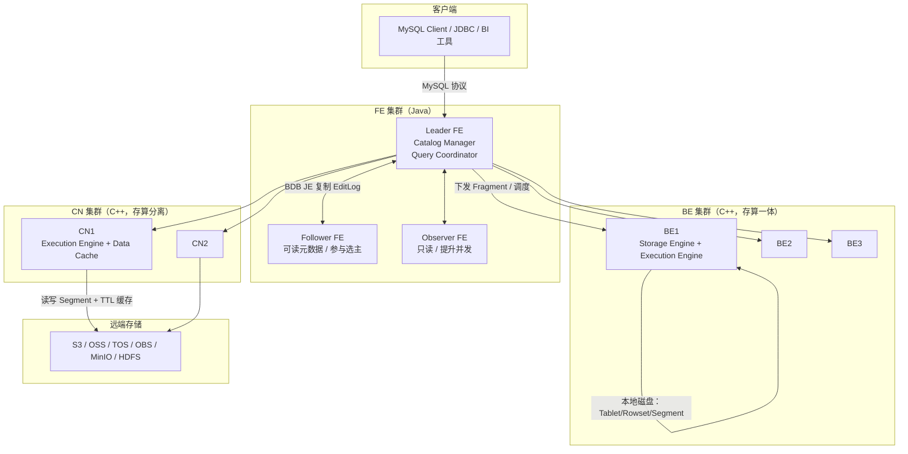

**两种形态的关键差异（后面 2.10 详述）**

| 维度 | 存算一体 shared-nothing | 存算分离 shared-data |
|---|---|---|
| 后端节点 | BE（存储 + 计算） | CN（只计算 + 本地缓存，无状态） |
| 数据位置 | BE 本地磁盘，多副本 | 对象存储/HDFS，单份 + 缓存 |
| 扩容 | 需数据均衡/迁移，重 | CN 秒级加减，不动数据 |
| Compaction 调度 | BE 自行调度 | **FE 统一调度**，可丢给独立 CN |
| 成本 | 存储随计算等比扩容，贵 | 存储便宜、计算按需 |
| 适用 | 追求极致性能、稳定负载 | 弹性、成本敏感、潮汐负载 |

### 1.4 FE 内部原理（最容易被忽略但必考）

FE 是 Java 进程，承担 5 件事：**元数据管理、连接与会话管理、SQL 解析与优化、查询调度与协调、事务与权限**。

#### 1.4.1 三种角色

| 角色 | 元数据 | 选主 | 用途 |
|---|---|---|---|
| Leader | 唯一可**写**元数据 | 本身从 Follower 中选出 | 所有 DDL/DML 元数据变更入口 |
| Follower | 只读，同步重放日志 | 参与选举（需过半 Follower 存活） | 高可用、分担读 |
| Observer | 只读，同步重放日志 | **不参与选举** | 水平扩展查询并发，不增加选举压力 |

关键细节：
- **写成功判定**：Leader 写入元数据后通过 BDB JE 同步到 Follower，**超过半数 Follower 确认**才算成功，然后才返回客户端。这是"元数据强一致 + 高可用"的代价（写延迟受最慢 Follower 影响）。
- **Observer 的价值**：查询规划是 CPU 密集型（CBO 很吃 CPU），高并发集群常靠加 Observer 横向扩规划能力，而不是加 Follower（加 Follower 会增加选举与日志复制的写放大）。
- **BDB JE**：Berkeley DB Java Edition，本质是一个支持**HA 复制 + 事务**的嵌入式 KV。FE 用它存 EditLog（每次元数据变更一条日志），而不是直接存全量元数据。

#### 1.4.2 元数据的两个载体：EditLog 与 Image

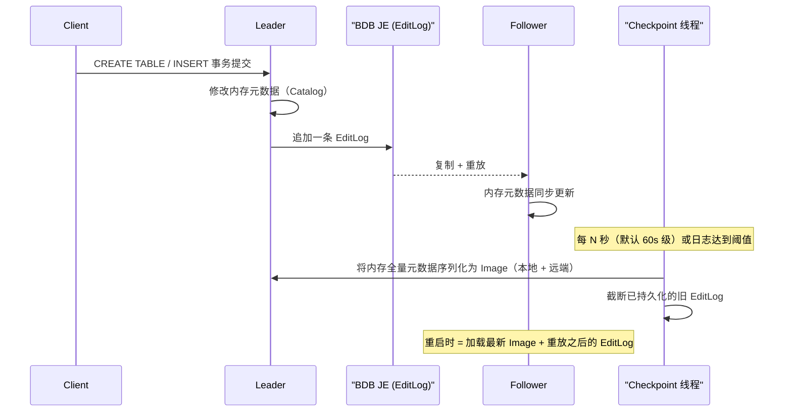

- **EditLog**：增量、顺序追加，重启要"重放"，日志越长启动越慢。
- **Image**：全量快照（`meta/image` 目录），定期生成，用于**缩短重放长度**，同时是备份/降级的基础。
- 面试点：**为什么 FE 重启有时很慢？** 因为 Image 太旧 + EditLog 太长，重放耗时；也可能是因为 Tablet 数量过多导致元数据加载慢（官方给的经验值是 Tablet 数 100 万 → FE 内存 16GB 起，500 万 → 64GB 起）。

#### 1.4.3 FE 侧的"元数据规模"成本（常被忽视的容量规划题）

FE 内存几乎与 **Tablet 数量**线性相关（每个 Tablet 的副本、版本、Rowset 元数据都在 FE 内存里）。所以：
- 分桶数过多 → Tablet 爆炸 → FE 内存与 GC 压力 → 查询规划变慢。
- 经验法则：**单 Tablet 目标 1～10GB 数据**，不要为了"并行度好看"把桶数开到几百上千。

### 1.5 BE / CN 内部一览

BE 是 C++ 进程，两个引擎：**Storage Engine（存数据）+ Execution Engine（算数据）**。

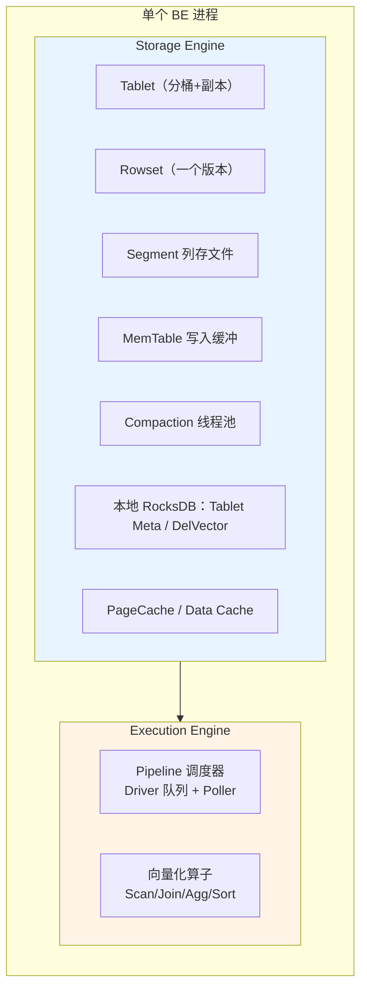

要点：
- **Tablet 是"单机列存引擎"**：一个 Tablet 内含多个 Rowset，每个 Rowset 由多个 Segment 文件组成，Segment 不可修改（append-only）。
- **Version 语义**：每次导入/Compaction 生成一个新版本，查询按最新可见版本决定读哪些 Rowset。
- **Tablet Meta + DelVector 落在本地 RocksDB**，同时缓存在内存里，目的是"快速判断某个 Segment 的某一行是否已删除"。

### 1.6 "一条 SQL 的一生"（背下这张图，面试能讲 10 分钟）

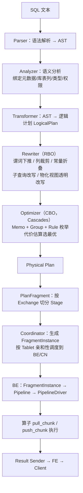

每一段的"考点钩子"：
- Parser 阶段报错 → 语法问题；Analyzer 报错 → 元数据/类型/权限问题（"表不存在/列不匹配/没有权限"）。
- Rewriter 是**规则优化（RBO）**：谓词下推、列裁剪、分区裁剪、常量折叠、子查询解关联、物化视图改写。这部分"稳赚不赔"。
- Optimizer 是**代价优化（CBO）**：Join 顺序、Join 分布式策略、聚合方式、是否用 Runtime Filter。这部分"可能出错"，所以才有 `EXPLAIN` / `EXPLAIN COSTS` / Profile 的必要。
- Schedule 阶段决定**并行度与数据本地性**：优先把 FragmentInstance 调度到"本地有副本/有缓存"的节点。
- 执行阶段就是 Pipeline 引擎的地盘（3.4 详述）。

> **面试高频追问**：`EXPLAIN` 和 `EXPLAIN ANALYZE` 的区别？
> `EXPLAIN` 只看**计划与估算**（不执行）；`EXPLAIN ANALYZE` 会**真实执行**并给出每个算子实际耗时/行数（基于 Profile），用于定位"估算 vs 实际"偏差；`EXPLAIN COSTS` 看 CBO 的代价数字。

---


## 2. 存储层原理（最硬核的一章）

> 这一章是 StarRocks 面试的主战场。简历写了 StarRocks，面试官 80% 会问到这里。

### 2.1 四种数据模型：本质是"读时合并" vs "写时标记"

StarRocks 建表必须选一种模型，这个选择直接决定**更新能力、查询性能、写放大**三者的平衡。

| 模型 | Key 语义 | 重复 Key | 更新机制 | 适用场景 | 查询侧代价 |
|---|---|---|---|---|---|
| **Duplicate（明细）** | 只排序不去重 | 允许 | 不支持更新 | 日志/明细/ODS 贴源、任意查询模式 | 最低（无 Merge） |
| **Aggregate（聚合）** | Key 列 + Value 聚合函数 | 导入时按 Key 聚合 | 导入即聚合 | 固定报表、预聚合宽表 | 中（读时 Merge 版本） |
| **Unique（唯一）** | Key 唯一 | 覆盖 | **Merge-On-Read** | 有更新但可接受读放大 | 较高（读时 Merge 多版本） |
| **Primary Key（主键）** | 主键唯一 | 覆盖 | **Delete + Insert** | 实时 Upsert/Delete、部分列更新、实时打宽 | 低（无 Merge，可下推） |

#### 2.1.1 为什么 Unique/Aggregate 是 Merge-On-Read

写入时"不碰老数据"，直接把新数据追加成一个新版本文件（**写极快、无写放大**）；查询时用 Merge 算子把多个版本按 Key 合并，取最大版本（或按聚合函数合并）。

**代价（这是面试的核心洞察）**：
1. **读放大**：要读所有历史版本，版本越多越慢。
2. **索引失效**：因为最后一步是 Merge 算子，**谓词和索引无法下推到 Scan 层**——你可以在 Scan 上过滤，但 Merge 之后的过滤没意义；而 Merge 之前过滤又要保证"每个 Key 的最新版本都能进来"，所以很多下推被迫放弃。
3. 因此 Unique 模型"Compaction 没做完时查询会很慢"（版本堆积），这是运维常见坑。

#### 2.1.2 Primary Key 为什么是 Delete + Insert

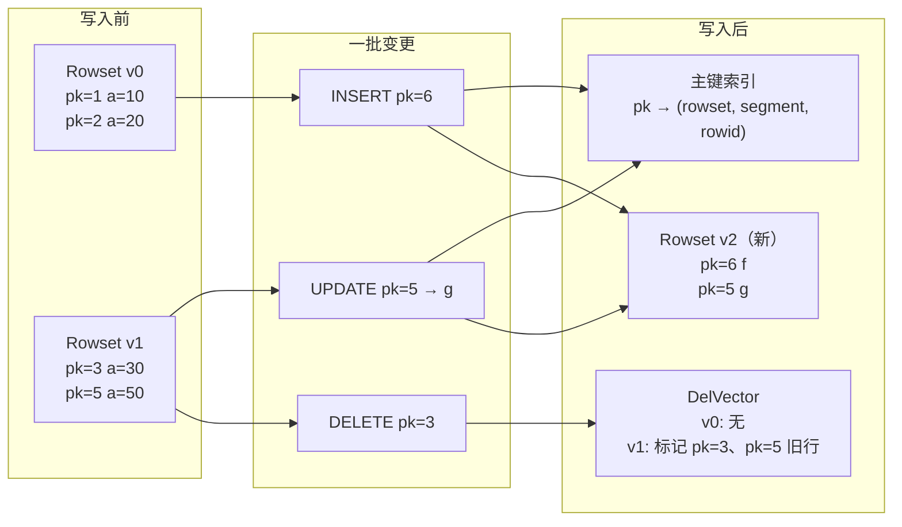

做法：
1. 载入该 Tablet 的**主键索引**到内存（PK → 位置）。
2. **Delete**：通过主键索引定位旧行的物理位置（Rowset/Segment/RowID），在 **DelVector**（RoaringBitmap）里打删除标记。**物理上不删**。
3. **Update = Delete + Insert**：旧行打标记 + 新值写成新行，同时更新主键索引指向新位置。
4. 查询时：Scan 时按 DelVector 过滤掉已标记行 → 每个主键只剩一行 → **无需 Merge**，谓词/索引全部可下推。

**收益**：相对 Merge-On-Read 的 Unique 模型，查询性能可提升 **3～10 倍**。
**代价**：写放大（一行更新 = 一行标记 + 一行新写）、DelVector 与主键索引的内存占用、需要 Compaction 回收。

> 一句话总结（面试可直接背）：**Unique 是"读时算账"，Primary Key 是"写时算账"；StarRocks 把算账成本从查询路径挪到了写入路径，因为 OLAP 的读远多于写。**

### 2.2 存储层级：Table → Partition → Tablet → Rowset → Segment

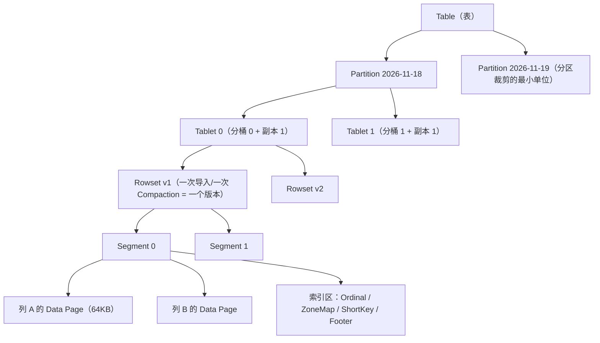

各层职责（每一层对应一种优化手段，务必对齐）：

| 层级 | 是什么 | 优化手段 | 设计要点 |
|---|---|---|---|
| Partition | 逻辑分区（时间/范围/List/表达式） | **分区裁剪**、TTL、冷热分离 | 单分区建议 ≤ 100GB；避免提前建大量空分区（FE 元数据压力） |
| Tablet | 分桶 + 副本，物理存储基本单元，也是"单机列存引擎" | **分桶裁剪**、本地聚合、Colocate Join、并行度 | 单 Tablet 1～10GB；桶数 ≈ 数据量/1GB，且不小于 BE 数 |
| Rowset | 一个**数据版本**，不可变（append-only） | MVCC、快照读、原子提交 | 版本越多 → 读放大越严重 → 靠 Compaction 收敛 |
| Segment | Rowset 内的列存文件（几十~几百 MB） | 各类索引、Page 级压缩、ZoneMap | 不可修改，删除靠 DelVector + 版本回收 |
| Data Page | 列内 64KB 数据块 | 编码 + 压缩，是**最小 I/O 单元** | 一次读一个 Page，不对齐会读放大 |

**为什么"分桶数"这么关键（面试常考的容量设计题）**：
- 桶太少 → 单 Tablet 过大 → 导入并发低、Compaction 单任务过大、查询并行度不足。
- 桶太多 → Tablet 数爆炸 → FE 内存/GC 压力、元数据操作变慢、小文件多。
- 推荐：`桶数 ≈ 分区数据量(GB) / 1GB`，且 `≥ BE 数量`；非分区表按总量估。

### 2.3 Segment 文件内部结构（能画出来就是加分项）

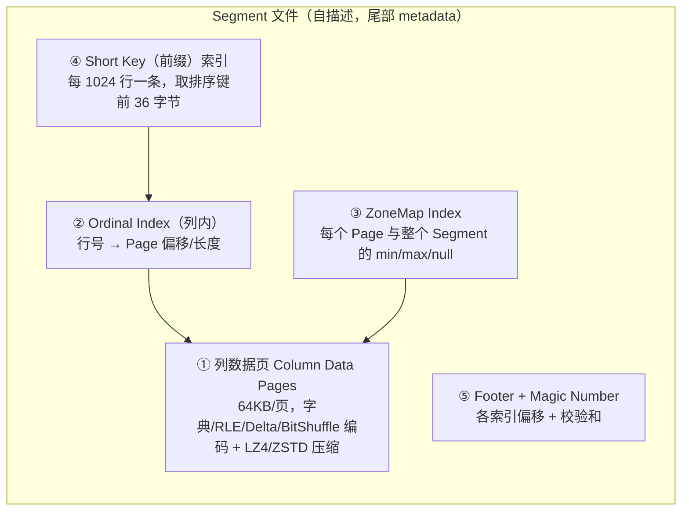

**一次带前缀条件的点查/范围查，走的是这条路径**：

1. 用查询条件的前缀（必须是排序键的**最左连续前缀**）在 **Short Key 索引**上二分 → 得到起始行号（第几个 1024 行块）。
2. 用行号在 **Ordinal 索引**里查到目标列的 Data Page 物理偏移。
3. 读 Page → 解压 → 解码 → 在 Page 内再二分/扫描定位到行。
4. 若条件列不是前缀列：先看 **ZoneMap**（min/max）能否整块跳过，否则只能全 Page 扫描（或依赖 Bloom/Bitmap/倒排索引）。

**这就是"毫秒级点查"的物理基础**：三层索引 + 排序键，命中时只需 1～2 次磁盘读（甚至命中 PageCache 就是纯内存）。

### 2.4 编码与压缩：列存为什么能省 5～10 倍空间

| 编码 | 原理 | 适合的数据 |
|---|---|---|
| 字典编码 Dictionary | 唯一值建字典，存 int 编码 | 低/中基数字符串（城市、渠道、状态） |
| RLE（游程） | 连续相同值存 (值, 重复次数) | 排序后大量重复的列 |
| BitShuffle | 按位重排，把高位相同的字节聚在一起 | 数值型、递增 ID |
| Delta / FOR | 存差值 / 存"相对基准值的偏移" | 时间戳、单调递增列、整数 |
| Frame-of-Reference | 一个块内用最小值做基准 + 短位宽 | 小范围整数 |

**为什么"排序键"能提升压缩比（面试进阶点）**：
排序后相同值相邻 → RLE/字典命中率上升；数值相邻 → Delta 差值变小 → 位宽需求降低。官方给的实测口径是：同一份遥测数据按 `(device_id, ts)` 排序后，LZ4 压缩比提升约 1.8 倍、扫描 CPU 下降约 25%。**所以"排序键选得好"不仅加速过滤，还省存储、省 CPU。**

压缩算法默认 **LZ4**（解压快、CPU 低），可选 ZSTD（压缩比更高、CPU 更高）。OLAP 场景一般**优先解压速度**，因为瓶颈常在 CPU 与 IO 抖动，而不是磁盘容量。

### 2.5 索引体系：六种索引，各有各的失效条件

| 索引 | 类型 | 建立方式 | 加速什么 | 失效/不命中条件 |
|---|---|---|---|---|
| **前缀索引（Short Key）** | 稀疏，1024 行/条，36 字节 | 自动（按排序键） | 等值/范围/前缀匹配、点查 | 条件**不是最左连续前缀**；前缀被截断（VARCHAR 只能出现一次且在末尾）；条件列在排序列之后 |
| **Ordinal 索引** | 稠密，Page 级 | 自动 | 行号 → Page 定位（所有索引最终都走它） | 不单独失效，是底层通路 |
| **ZoneMap** | 稀疏，Page/Segment 级 min/max/null | 自动 | `<` `>` `=` `BETWEEN` 的块级跳过 | 数据无序 → min/max 覆盖全范围 → 形同虚设；`LIKE`/函数包裹列无效 |
| **Bitmap 索引** | 位图 | 手动 `INDEX` | 中高基数列的等值/IN，多低基数列组合 | 不支持 FLOAT/DOUBLE/BOOLEAN/DECIMAL；基数 <255 意义不大（有低基数字典）；Aggregate/Unique 只有 Key 列可建 |
| **Bloom Filter** | 概率型（有误判） | 手动 `PROPERTIES("bloom_filter_columns")` | 高基数列 `=`/`IN` 的空块跳过 | 不支持 TINYINT/FLOAT/DOUBLE/DECIMAL；范围查询无效；只减少"读"，不减少"扫描 CPU" |
| **N-Gram Bloom / 倒排 / 向量** | 特殊 | 手动 | `LIKE`、全文检索、ANN 向量检索 | 各有类型与函数限制 |

**低基数字典（不是索引，但常被当成索引考）**：对基数很低的字符串列（如省份、渠道），引擎自动建**全局/局部字典**把字符串映射成整型编码，聚合/Join/表达式直接在编码上算（Operation on Encoded Data），**无需解码**。这就是"为什么给性别列建 Bitmap 索引没意义"的原因。

> **经典面试陷阱**："我给 `city` 建了 Bitmap 索引，为什么查询没变快？"
> 因为基数太低（<255），引擎已用低基数字典处理；而且如果过滤后剩的数据仍然很多，索引减少的只是"读哪些 Page"，不减少"要算多少行"。

### 2.6 写入链路：一个导入事务的完整生命周期（ACID 从哪来）

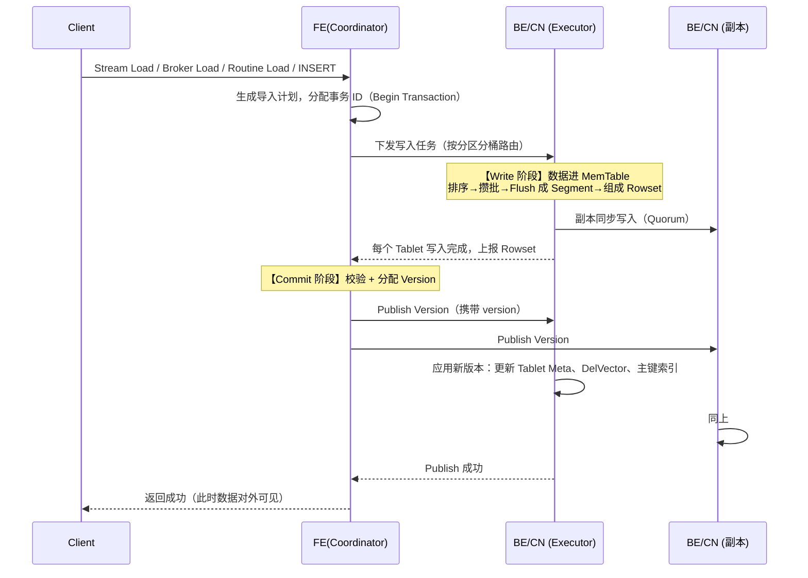

**四层语义对应**：
- **A（原子）**：一次导入跨多个 Tablet，要么全 publish 成功要么整体失败（失败则回滚未提交的 Rowset）。
- **C（一致）**：以版本号串联，读到的永远是某个完整版本。
- **I（隔离）**：**Snapshot Isolation**，读操作看到的是查询开始时的可见版本，不受并发写入影响；并发导入之间互不阻塞。
- **D（持久）**：Write 阶段已落盘（本地/远端），Commit 后元数据持久化。

**关键细节（面试加分）**：
1. **Write 与 Commit 分离**：Write 阶段耗时长但可并行；Commit 阶段短且需串行化版本分配。这是"高吞吐 + 强一致"的折中。
2. **Publish 是"版本可见"的开关**：publish 完成前，数据文件已在磁盘但查询看不到（这是 MVCC 的核心）。
3. `enable_sync_publish=true`（3.1.4+ 默认开）：Publish 会等 Apply 完成才返回，**导入返回即可见**，代价是导入 RT 略增。关掉则 Apply 异步，可能出现"导入成功但查不到"的短暂窗口。
4. **攒批很重要**：每次导入都会产生一个 Rowset/版本。**小批量高频导入 = 版本爆炸 = Compaction 追不上 = 查询变慢**。生产上建议攒批到 几十 MB～数百 MB 一次导入，或用 Routine Load 的 `max_batch_rows/max_batch_interval` 控制。

### 2.7 主键模型深入（实时更新的全部秘密）

#### 2.7.1 主键索引的两种实现

| 实现 | 存储位置 | 优点 | 缺点 | 适用 |
|---|---|---|---|---|
| 内存索引 | BE 内存（HashMap 结构） | 极快 | 吃内存，按需构建、空闲释放 | 内存充足、热数据更新频繁 |
| 持久化索引 | 本地/远端磁盘（类似 KV） | 省内存，重启不必全量重建 | 略慢（多一次 IO，通常命中 cache） | 大表、内存紧张（3.1.4+ 新建表默认开启） |

> 面试追问："主键表很吃内存吗？" → 答案取决于主键索引实现 + 主键列宽度 + 行数；**只在导入时按需加载涉及的分区**（配合分区冷热分离，老分区索引不加载），所以"按天分区 + 只更新近几天"能显著降内存。

#### 2.7.2 部分列更新（Partial Update）—— Flink 实时打宽的标准解法

场景：几十个字段来自不同 Kafka topic，想拼成一张宽表。
做法（`partial_update`）：只写变更列，**未提供的列由引擎读旧值补齐**再写入新行。
- 优点：不用全字段重传，节省带宽与 Flink 状态。
- 代价：**读旧值**（随机读）+ 每次更新仍产生新行 → 写放大与 Compaction 压力更大。
- 限制：列数过多（数百~上千列）时成本显著上升，官方建议部分更新场景列控制在 200 列以内量级。

#### 2.7.3 写放大到底有多大（面试很喜欢算这个）

设一张主键表，每天 1 亿行更新、平均行宽 200B：
- 原始数据 ≈ 20GB/天。
- 每次更新 = 1 行标记（DelVector 位，几乎免费）+ 1 行新写（200B）→ 新写 20GB/天。
- Compaction 还要把这些小 Rowset 反复重写（size-tiered 下每层大约放大 2～4 倍量级）。
- 结论：**写放大主要来自 Compaction，而不是 Delete 标记**。所以"高频单行更新"必须攒批 + 控制 Compaction 节奏（3 个参数：`write_buffer_size`、`cumulative_compaction_num_threads_per_disk`、`max_compaction_concurrency`）。

### 2.8 Compaction：StarRocks 最容易被低估的机制

#### 2.8.1 为什么必须有 Compaction

LSM 式写入的三个副作用，全靠 Compaction 收场：
1. **小文件膨胀**：每次导入一个 Rowset（多个 Segment），版本多了元数据与随机 IO 爆炸。
2. **删除/更新垃圾**：DelVector 标记的行、被覆盖的旧版本数据，物理上还在。
3. **有序性丢失**：不同 Rowset 各自有序，整体无序 → 查询需归并（merge）多路 Rowset，慢。

Compaction 干的事：**把多个小 Rowset 合并成更大的、整体有序的 Rowset，顺带清掉删除行与冗余版本**，生成一个新版本。

#### 2.8.2 两种 Compaction

| 类型 | 合并对象 | 触发 | 产出 |
|---|---|---|---|
| **Cumulative Compaction** | 多个 **Cumulative Rowset**（近期小版本） | 版本数/大小达到阈值（size-tiered） | 一个较大的 Cumulative Rowset |
| **Base Compaction** | **Base Rowset**（历史大版本）+ 全部 Cumulative Rowset | Cumulative 层积累到阈值 | 新的 Base Rowset（老版本可回收） |

**Size-Tiered 策略**：按 Rowset 大小分层（如 <10MB、10~100MB、100MB~1GB、>1GB），**同一层内数量达到阈值就合并到上一层**，像"2048 合并"。

**Compaction Score（存算分离下 FE 用的调度依据）**：
- 每个数据文件大约贡献 1 分；Tablet 的 Rowset 按大小分组，取"文件数最多的那一组"作为该 Tablet 的分数；分区取所有 Tablet 的最大值。
- 分数越高 = 越"碎" = 越该合并。FE 只挑分数 ≥ `lake_compaction_score_selector_min_score`（默认 10）的分区。

#### 2.8.3 谁来调度：两种架构的关键差异

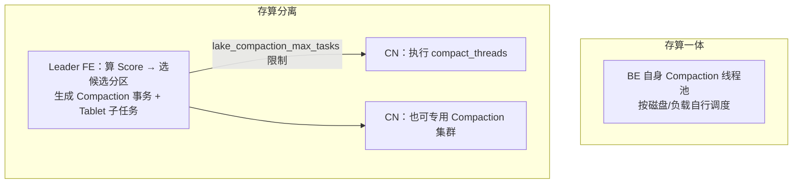

存算分离下把调度权收到 FE 的好处：**可以把 Compaction 丢给独立的 CN 组**，实现"业务查询零影响"；也能按资源池弹性扩缩。这是官方明确强调的设计动机。

#### 2.8.4 Compaction 与查询的相互影响（实战题必答）

- **Compaction 太慢/被阻塞** → 版本堆积 → 读放大（Unique 模型尤甚）→ 查询变慢、甚至 OOM（Merge 需要内存）。
- **Compaction 太猛** → 抢占 IO/CPU → 查询 P99 抖动。
- **大宽表 Compaction 的经典坑**：几千列 + 大字符串 → 行式 merge 内存爆。StarRocks 2.1 起改为**按列分批合并 + 大字符串特殊处理**，内存降几十倍。

**调优思路（答题结构：先定位 → 再分因 → 再给手段）**：
1. 看 `information_schema.partitions_meta` / `SHOW PROC '/statistic'` 里的 compaction score 与未合并版本数。
2. 若是写入太碎 → 增大导入批次、减少导入频率、提高 `write_buffer_size`。
3. 若是 Compaction 跟不上 → 增加 `cumulative_compaction_num_threads_per_disk`、`max_compaction_concurrency`，或存算分离下扩 Compaction CN。
4. 若是单 Tablet 太大 → 增加分桶数（重建表），让单个 Compaction 任务变小。
5. 若是主键表 DelVector 膨胀 → 触发 Base Compaction（存算分离有 `lake_pk_compaction_base_*` 系列阈值）。

### 2.9 副本、一致性与高可用

| 机制 | 说明 | 面试要点 |
|---|---|---|
| **多副本** | 每个 Tablet 默认 3 副本，分散到不同 BE | 副本数由 `replication_num` 控制；单副本适合可重算的湖上数据 |
| **Quorum 写入** | 写入需多数副本成功才提交 | 与 FE 元数据的"过半 Follower"是同一套思路（类 Raft/Paxos 的多数派） |
| **Publish Version** | 版本发布到所有副本，失败会重试 | 副本间"最终一致但对外快照一致" |
| **Clone** | 副本修复/新增副本时，从其他副本拉取 Segment | 大 Tablet 的 Clone 很慢，影响恢复时间 |
| **Schema Change** | 加列/改列/改排序键，本质是"重写数据 + 双版本" | 轻量 Schema Change（加列）走元数据；重 Schema Change 会做数据重写，需控时段 |
| **Tablet 修复** | BE 宕机 → FE 检测 → 触发副本补齐 | `TabletChecker` / `ReplicaScheduler` 责任在 FE |

**一致性模型小结**：StarRocks 对外提供 **Snapshot Isolation**（读快照），对内 **副本最终一致**（publish 重试兜底），元数据 **强一致**（BDB JE 过半写）。这三句话能覆盖 90% 的一致性面试题。

### 2.10 存算分离的存储层（3.0+，现在面试越来越爱问）

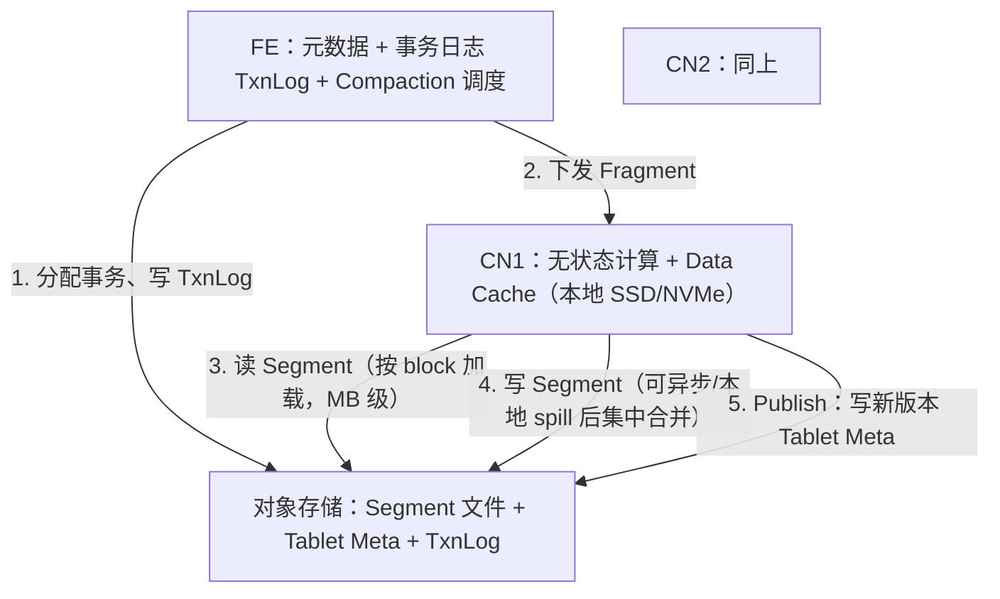

核心机制与考点：

1. **CN 无状态**：不持久化数据，只保留**缓存**。所以扩缩容不需要数据迁移，秒级完成。
2. **Tablet Meta 在对象存储**：版本信息不再只存 FE/BE 本地，而是随事务写远端；FE 仍持有内存元数据用于规划，靠 **TxnLog** 保证"元数据与数据文件的原子对应"。
3. **缓存演进**：早期 **File Cache**（按 Segment 文件整块加载，冷启动放大），3.1.7/3.2.3 起改为 **Data Cache**（按 block 按需加载，MB 级，默认开启，LRU 淘汰，容量由 `datacache_disk_size_percent` 控制），另有 `CACHE SELECT` 主动预热。
4. **写入路径优化（3.5+）**：大批量导历史数据时，走 **内存 → 本地磁盘 spill → 集中合并 → 一次性写对象存储**，避免"每个 MemTable flush 都写一次 S3"导致小文件与 API 费用爆炸。
5. **文件捆绑（File Bundling，4.0）**：把一次导入/Compaction/Publish 产生的多个文件"捆"成一次访问，降低对象存储 API 调用成本 —— 这是**对象存储按请求计费**场景的真实痛点。
6. **MVCC 与回收**：只有"不再被任何 Tablet Meta 引用"的文件才能删；靠 Vacuum/Full Vacuum 清理历史版本与孤儿文件。
7. **缓存不允许多副本**（官方限制）：缓存丢了就回源，不保证一致性，属于"性能设施"而非"数据副本"。

**一句话对比**：存算一体的可靠性靠"多副本 + 本地盘"，存算分离的可靠性靠"对象存储的多副本/纠删码 + 元数据事务"，计算层退化为**可丢弃的缓存与算力**。

---


## 3. 查询链路：一条 SQL 如何被"榨干"CPU

### 3.1 MPP 执行框架：Fragment / Instance / DOP / Exchange

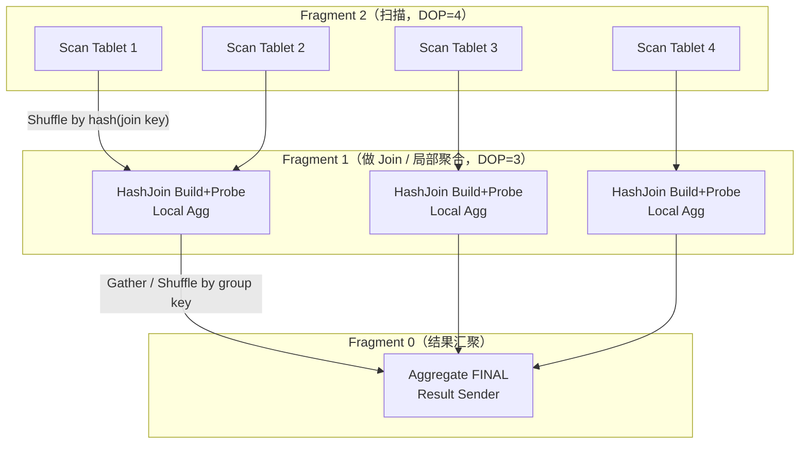

概念对齐（这几个词面试常被混用，能分清就是专业度）：

| 概念 | 含义 | 备注 |
|---|---|---|
| **Fragment** | 逻辑执行阶段，按 Exchange（数据交换）切分 | Fragment 之间靠 Exchange 传数据 |
| **FragmentInstance** | Fragment 的物理实例，一个 Fragment 可拆成多个并行实例 | 最小**调度**单位，落在某个 BE/CN 上 |
| **DOP** | 并行度，即一个 Fragment 拆几个 Instance | 可按算子计算量不同而不同（Scan 高、汇聚低） |
| **Pipeline / PipelineDriver** | Instance 内的执行流水线，以及它的并发实例 | Driver 是最小**执行**单位（协程） |
| **Exchange** | 算子间的数据交换方式 | Broadcast / Shuffle / Bucket Shuffle / Colocate / Gather |

**为什么 MPP 比 Scatter-Gather 强（经典对比题）**：
- Scatter-Gather（如老版 Presto 的一些计划、部分检索系统）：最后一级汇总只能在 **Gather 单点**做 → 高基数 Group By / 大表 Join 时单点成为瓶颈。
- MPP：数据先 **Shuffle 到多节点**，每个节点各自做局部汇总，再汇聚 → 汇总也并行化。**复杂计算（高基数 Group By、大表 Join）差距可达数量级**。

### 3.2 向量化执行引擎：为什么快，快在哪

三个层次全部"按列"：
1. **存储列式**：同类型连续存放 → 压缩好、只读需要的列（列裁剪）。
2. **内存列式**：Chunk 组织（默认 `vector_chunk_size=4096` 行一批），按列处理。
3. **计算列式**：算子对整列做批量运算，而不是"一行一函数调用"。

**四个具体加速来源（答题要能落到这四点）**：
1. **减少虚函数调用与分支**：一万行数据调一次函数，而不是一万次。
2. **SIMD 指令**：一条指令处理多个数据（如批量比较、批量哈希），官方口径是算子整体提升 3～10 倍。
3. **CPU Cache 友好**：按列连续访问，命中 L1/L2 的概率远高于按行跳读。
4. **Operation on Encoded Data（编码上计算）**：字符串列在字典编码上直接做 Join/Group By/表达式，**不解码**；官方口径相关查询可再快 2 倍以上。

> 面试追问："向量化有什么代价？" → ① 不适合点查（一次只取一行时，批量框架的固定开销反而更大，所以点查靠索引与短路径）；② 实现复杂（每个算子要写 batch 版本、要处理 null bitmap/选择向量 SelectVector）；③ 内存占用更高（一个 Chunk 4096 行 × 列数）。

### 3.3 Pipeline 引擎：解决的问题比实现更值得讲

#### 3.3.1 老的线程模型有什么问题

传统做法：**一个查询一个线程组，算子间阻塞式等待**。
- 线程数随并发线性增长 → 上千并发就是上千线程 → **上下文切换成本爆炸**。
- 一个算子阻塞（等 IO/等网络/等 Build 完成）就把整个线程挂住 → CPU 空转。
- 并行度需要人工调（`parallel_fragment_exec_instance_num` 调参地狱）。

#### 3.3.2 Pipeline 的做法：把"阻塞"从线程里摘出去

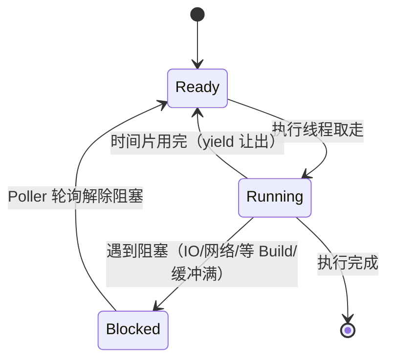

- **基本单位**：`PipelineDriver`，本质是个**协程**（用户态调度，不切内核线程）。
- **两种线程**：
  - `PipelineDriverExecutor`：数量 ≈ CPU 核数，跨查询全局共享，只负责"跑就绪的 Driver"。
  - `PipelineDriverPoller`：专门轮询阻塞队列，把"阻塞已解除"的 Driver 放回就绪队列。
- **两种队列**：Ready Queue（就绪）+ Blocked Queue（阻塞）。
- **时间片**：Driver 连续执行超过阈值就**主动 yield**，保证长查询不会独占线程（这也是"高并发下 P99 更稳"的原因）。
- **阻塞异步化**：算子自己不阻塞线程，而是"发起异步操作 + 标记 Blocked + 让出"。

**哪些地方会被拆成 Sink/Source 两个算子（面试细节题）**：
- 读 Tablet（磁盘 IO）；
- Exchange 收发（网络）；
- HashJoin 的 Probe 侧需要等 Build 侧构建完成（`HashJoinProbeOperator` 等待 `HashJoinBuildOperator` 和 Runtime Filter）；
- 阻塞型算子（如 `AggregateBlockingNode`、Sort）被拆成 `SinkOperator`（上游 Pipeline）+ `SourceOperator`（下游 Pipeline）。

**收益（记住两个数字口径）**：高并发下部分查询性能约 2 倍，CPU 利用率显著提升；并行度可自适应，减少人工调参。

> **面试杀手级追问**："Pipeline 提高了吞吐，那它牺牲了什么？"
> ① 调度开销（协程切换、队列竞争、状态机维护）；② 单个查询的延迟可能略增（时间片让出）；③ 实现复杂度高（每个算子要支持"可中断/可恢复"）；④ 排障更难（Profile 要按 Driver 维度看）。

### 3.4 CBO 优化器：从零理解"为什么要代价模型"

#### 3.4.1 为什么 RBO 不够

RBO（规则优化）只按固定规则改写，**不看数据量**。举个反例：
```sql
SELECT * FROM big_a a JOIN big_b b ON a.k=b.k JOIN small_c c ON b.k=c.k
```
RBO 可能按书写顺序先 `a JOIN b`（两个大表，Shuffle 几 TB），再 Join 小表。而 CBO 会先 `b JOIN c`（用 c 过滤 b 的大部分数据），再与 a Join，网络传输可能降一个数量级。**Join 顺序的搜索空间是 NP-Hard，只能靠代价模型近似。**

#### 3.4.2 Cascades 框架的四个零件

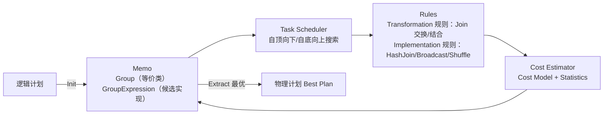

- **Group**：逻辑等价的子树集合（"这个子查询的所有等价写法"）。
- **GroupExpression**：Group 里的一个具体实现（某个 Join 顺序/某种物理算子）。
- **Transformation Rule**：逻辑等价变换（Join 交换律 `A⋈B = B⋈A`、结合律、外连接转内连接、谓词下推）。
- **Implementation Rule**：逻辑算子 → 物理算子（HashJoin / NestLoop / Broadcast / Shuffle / Colocate）。
- **Memo 的物理属性（Property Enforcement）**：数据分布（partition/bucket）、有序性（sort key）。同一个逻辑表达式"要不要 Sort""要不要 Shuffle"是不同的物理属性组合。

#### 3.4.3 统计信息（CBO 的命门）

| 统计 | 存哪 | 用途 |
|---|---|---|
| `row_count` / `data_size` | `_statistics_.table_statistic_v1` | 表规模 |
| `ndv`（基数） | 同上 | Join 输出行数、聚合膨胀估计 |
| `null_count` / `min` / `max` | 同上 | 选择率、ZoneMap 辅助 |
| **直方图（等深，equi-height）+ MCV** | `_statistics_.histogram_statistics` | 处理**数据倾斜**，估算谓词选择率 |
| 多列联合 NDV | 同上 | 列间有相关性时（多列 AND 等值、Agg 估算） |
| Predicate Column（3.5+） | `_statistics_.predicate_columns` | 自动记录高频过滤列，指导采集 |

**采集策略**：默认自动**全量**采集，每 5 分钟检查一次数据变更，有变更则触发；可关（`enable_collect_full_statistic=false`）后自定义任务；外表（Hive/Iceberg/Hudi）从 3.2 起也能直接 ANALYZE。

**为什么统计信息错了会"翻车"**（面试必答场景）：
- `ndv` 严重低估 → CBO 以为 Join 输出很小 → 选 Broadcast（实际广播了几十 GB）→ 网络打爆/OOM。
- `ndv` 严重高估 → 选了保守的 Shuffle + 多阶段聚合 → 该快的不快。
- 没有直方图 → 倾斜列（如某个 `city_id` 占了 40% 数据）被当成均匀分布 → Join 侧选错、聚合单点热点。
- **修复手段**：`ANALYZE TABLE ...` 手动采集、给倾斜列建直方图、必要时用 Hint 强制策略（`/*+ BROADCAST(t)*/`、`/*+ SHUFFLE(t)*/`、`/*+ LEADING(a b)*/`）。

#### 3.4.4 代价模型与 Join Reorder 的工程折中（高分细节）

- **Join 代价公式**（官方给出的简化模型）：
  `Join Cost = CPU × (Row(L) + Row(R)) + Memory × Row(R)`
  含义：CPU 成本正比于两侧输入行数（要处理所有输入），内存成本正比于**右表（Build 侧）行数**（要建哈希表）。**这就解释了"为什么默认用右表 Build、为什么小表放右边"**。
- **Join 输出行数估计**按 Join 类型不同（Inner: `Row(L)*Row(R)*选择率`；Left Semi: `Row(Inner)`；Left Anti: `Row(L)-Row(Inner)` 等）。
- **Join Reorder 的搜索空间控制**（这是工程上最真实的折中）：

| 表数量 | 策略 | 说明 |
|---|---|---|
| ≤ 4 | **Exhaustive（穷举）** | 全排列，最准，耗时可控 |
| 4～10 | Left-Deep 1 个 + Greedy 10 个 + DP 1 个 | 混合生成候选 |
| > 10 | 只用 Greedy + Left-Deep，共 11 个候选 | 穷举会爆炸（8 表穷举约 3 秒） |
| **无统计信息** | 退化为单一 Left-Deep | 代价模型不可信时，别乱赌 |

> 这组数字（2 表 22ms、8 表 3000ms 的穷举对比）建议记住，面试官会认可"你知道工程边界"。

### 3.5 Runtime Filter：OLAP Join 提速的隐形功臣

**问题**：大表 Join 时，Probe 侧要扫描全表，但真正能匹配上的行可能只有 1%。

**做法**（Join 执行时动态生成）：

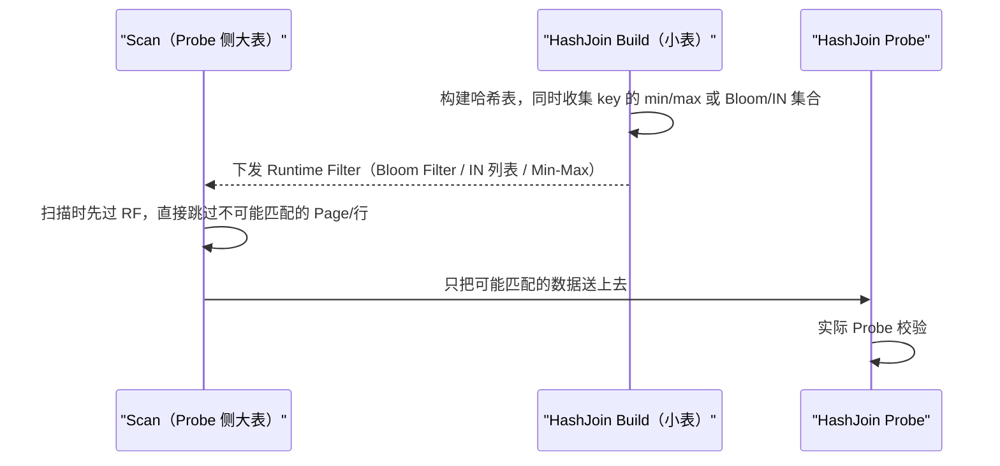

三种形态（按代价/精度选择）：
| 形态 | 何时用 | 特点 |
|---|---|---|
| **Bloom Filter** | Build 侧 key 多、无法枚举 | 有误判、无漏判，过滤率高 |
| **IN 列表** | Build 侧 key 少（如几千个） | 精确、无假阳性，但太大就退化 |
| **Min-Max** | key 有范围特征（如时间/自增 ID） | 极便宜，只能砍掉范围外的块 |

**生效条件（排查"为什么没生效"就查这几条）**：
1. 必须是**等值 Join**（非等值/函数包裹列不生成）。
2. 两侧**列类型要一致/可兼容**（`int` vs `bigint` 可能失效）。
3. Build 侧不能太大（超阈值就放弃生成，避免"过滤器本身比数据还大"）。
4. 要能下推到 Scan（中间有阻塞算子或聚合会阻断）。
5. **JPPD（Join Predicate Push Down）**：把 Join 条件里的过滤谓词提前下推到 Scan，是 RF 的"静态版本"，两者常配合。

**收益与风险**：通常能砍掉 50%～90% 的扫描量；风险是 Build 侧倾斜/过大时，RF 构造本身成为瓶颈（`JoinRuntimeFilterEvaluate` 耗时会体现在 Profile 里）。

### 3.6 聚合：为什么要分 1/2/3/4 个阶段


| 阶段数 | 触发条件 | 作用 |
|---|---|---|
| 1 阶段 | `DISTRIBUTED BY` 是 `GROUP BY` 的子集且数据 colocate | 局部聚合即最终结果，零 Shuffle |
| 2 阶段（局部+全局） | 常规分布式 Group By | 先在各 BE 折叠（`streaming preaggregation`），再按 key 重分布 |
| 3 阶段 | 重 DISTINCT + 高基数 Group By | 多一次按 distinct 列的重分布，避免膨胀 |
| 4 阶段 | 重 DISTINCT + 低基数 Group By | 再加一层中间聚合，防止单点瓶颈 |

**关键机制**：
- **流式预聚合（Streaming Preaggregation）**：边 Scan 边聚合，把重复 key 提前折叠，减少 Shuffle 数据量。模式有 `auto` / `force` / `disable`，倾斜场景可强制开。
- **Hash 聚合 vs 排序聚合**：Hash 聚合吃内存（哈希表），排序聚合吃 CPU 但内存稳（先排序再流式聚合）；超大基数时排序聚合更抗 OOM。
- **Spill（3.2+）**：哈希表超内存阈值时**落盘分区**，把内存型聚合变成"混合 hash/merge"，防止 OOM 但性能下降。

### 3.7 Join 的四种物理策略（必须能背出选择条件）

| 策略 | 选择条件 | 网络开销 | 备注 |
|---|---|---|---|
| **Colocate Join** | 两表在**同一 colocation group**：分桶键=Join 键、桶数相同、副本布局一致 | **零** | 大表 Join 大表的最优解；缺点是建表约束强、桶数绑定 |
| **Bucket Shuffle Join** | 其中一张表的分桶键 = Join 键 | 只 Shuffle **一张表** | 事实表分桶键恰好是 join key 时收益极大 |
| **Broadcast Join** | Build 侧很小（行数/字节阈值内，或 Hint） | 小表复制到所有节点 | 大表不动；小表不"小"时会网络打爆 |
| **Shuffle (Hash) Join** | 通用情况，键不对齐 | 两表都按 Join 键重分布 | 最稳的兜底；倾斜时单点热点 |

**Build 侧选择的三个原则（面试常问"为什么右表 Build"）**：
1. Hash Join 默认**右表建哈希表**（`Join Cost` 里 `Memory × Row(R)` 的由来）。
2. 小表做 Build 更省内存、Probe 更快；CBO 会按统计信息自动交换（Join 交换律）。
3. 但**外连接不能随意交换**（会改变语义），只能换物理策略不能换顺序。

### 3.8 内存管理与 Spill：OOM 是怎么发生的、怎么救

**内存分区（BE/CN 视角）**：`process` 总量受 `mem_limit`（默认物理内存 90%）约束，内部再分 `query_pool`（查询执行+存储层）、`load`（MemTable）、`table_meta`、`compaction`、`page_cache`、`column_pool`。

**OOM 的四个典型来源**：
1. **大 Build 侧 HashJoin**（Broadcast 小表其实不小）→ `HashTableMemoryUsage` 飙高。
2. **高基数 Group By / 大 DISTINCT** → 哈希表爆炸。
3. **大 Sort / Window**（分区过宽、无 frame 限制）。
4. **Compaction 大宽表 merge**（几千列 + 大字符串）。

**处置手段（按顺序）**：
- 开 **Spill**（`enable_spill`，3.2+）：Join/Sort/Agg 支持落盘，牺牲延迟换稳定。
- **改计划**：交换 Build/Probe、加 `LIMIT`、预聚合、把 Broadcast 强制改 Shuffle。
- **限流**：`query_mem_limit`、资源组内存配额、大查询队列（把"巨查询"排队而不是打死集群）。
- **治本**：改模型（Unique→Primary Key）、改分桶（治倾斜）、加物化视图（把重计算前移）。

### 3.9 物化视图：把"重算"变成"读结果"

| 类型 | 能力 | 刷新 | 改写 |
|---|---|---|---|
| **同步物化视图（Rollup）** | 单表、聚合上卷、排序键变更 | 随基表**同步**（导入时一并写） | CBO 自动透明改写 |
| **异步物化视图** | **多表 Join**、丰富聚合函数、分区增量 | `ASYNC`（定时/基表变更触发）/ `MANUAL` | SPJG 改写 + 3.3 起**基于文本（AST）改写**，还支持 View Delta Join、聚合下推 |

**改写（Query Rewrite）原理（面试要点）**：
- **SPJG 改写**：把"查询的 AST/逻辑计划"与"MV 定义的 AST"做结构匹配（Scan-Filter-Project-Join-Aggregate），能匹配就替换为读 MV，并做**补偿计算**（如 MV 粒度更细则再聚合，粒度更粗则加过滤）。
- **一致性保证**：内表场景，MV 过期或与基表不一致就**不参与候选**（保证强一致）；外部 Catalog（湖）场景，StarRocks 无法感知外部数据变化，**不保证强一致**（可配 `force_external_table_query_rewrite` 强行改写）。
- **分区 MV**：基表某分区变更 → 只刷新对应 MV 分区（这是"刷新成本可控"的关键，官方强烈建议分区建模）。

> 面试追问："MV 和 Rollup 的区别？" → Rollup 是同步的、单表的、本质是"物化索引"；异步 MV 是独立物理表、可多表、可跨库/跨 Catalog、刷新异步、可做数仓分层（ODS→DWD→ADS 都能在库内完成）。

### 3.10 数据湖分析：External Catalog 的三层加速

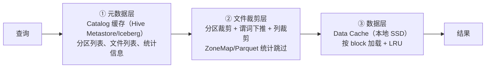

- 支持 Hive / Iceberg / Hudi / Paimon / Delta / JDBC 等 Catalog，**无需导入**即可查。
- 加速三件套：**元数据缓存**（避免每次打 Metastore）、**文件级裁剪**（分区/谓词/列）、**Data Cache**（热数据本地化）。
- 再快一层：**湖上异步物化视图**（把常用 Join/聚合结果落到 StarRocks 内表或加速层），适合"高并发 + 固定口径报表"。
- 局限：外部表**没有主键更新**、统计信息依赖外部或手动 ANALYZE、小文件多时元数据开销大。

### 3.11 资源隔离与多租户

| 机制 | 隔离什么 | 关键参数/用法 |
|---|---|---|
| **Workload Group（3.x 推荐）** | CPU（软/硬）、内存、并发数、大查询队列 | `CREATE WORKLOAD GROUP`，按用户/角色绑定 |
| Resource Group（旧） | CPU 硬隔离（cgroup）、内存、并发 | 老版本方案 |
| **Query Queue** | 并发排队，防雪崩 | 按资源组设置最大并发，超出的排队 |
| **Session/User 级限制** | 单查询内存、单用户连接数 | `query_mem_limit`、`max_user_connections` |

**存算分离下还有"计算组（Compute Group）"级别的隔离**：不同业务用不同 CN 组，物理隔离 CPU/内存/缓存，甚至可以给 Compaction 单独一组 CN。

---


## 4. 横向对比与选型（面试的"送分题"也是"送命题"）

> 选型题的回答公式：**先讲场景约束（数据量、并发、延迟、更新、成本、团队），再讲每个引擎的设计取舍，最后给结论 + 风险**。只说"StarRocks 更好"会被追问到崩。

### 4.1 StarRocks vs ClickHouse

| 维度 | StarRocks | ClickHouse |
|---|---|---|
| 定位 | 实时分析型 MPP 数据库（支持复杂 Join/更新/湖） | 单表极速扫描聚合引擎 |
| 存储模型 | 4 种模型，支持主键 Upsert/Delete | MergeTree 家族，更新靠 `ALTER UPDATE`（重写 part）/ReplacingMergeTree |
| 多表 Join | **CBO + 4 种分布式 Join 策略**，大表 Join 大表可用 Colocate | Join 相对弱（内存限制、分布式 Join 需 GLOBAL，易 OOM） |
| 优化器 | Cascades CBO，统计信息 + 直方图 | 规则为主，Join 顺序优化能力弱 |
| 高并发点查 | 前缀索引 + 分桶裁剪 + PageCache，万级 QPS 可做 | 单表点查也快，但高并发下资源争抢明显 |
| 副本/HA | 多副本 + Quorum + Publish，FE 高可用 | 依赖 ZooKeeper/Keeper 做副本协同 |
| DDL/运维 | 标准 SQL DDL，轻量 Schema Change | DDL 较重（改列常需重建），运维成本高 |
| 物化视图 | 同步 + 异步（多表、透明改写、分区增量） | Projection / MaterializedView（单表为主，能力弱于异步 MV） |
| 生态 | MySQL 协议，BI/JDBC 无缝 | 自有协议，生态适配成本略高 |
| 典型优势场景 | 多维分析、宽表 Join、实时更新、湖仓、高并发 BI | 日志/埋点/单表大宽表聚合、极致压缩比、超大规模单表扫描 |

**结论模板**："单表极致扫描 + 日志类 → ClickHouse；多表关联 + 实时更新 + 高并发 BI + 湖 → StarRocks。很多公司是两者并存：CK 做日志检索/单表大盘，SR 做业务分析层。"

### 4.2 StarRocks vs Apache Doris

两者同源（都源自百度 Palo），后来分叉演进，**这是国内面试最爱问的对比**。

| 维度 | StarRocks | Doris |
|---|---|---|
| 元数据 | FE + **BDB JE**（EditLog/Image） | FE + **Paxos/类 BDB 的元数据**（新版基于 HTTP+自研，2.x 起用 Paxos 保证一致） |
| 执行引擎 | **Pipeline 执行引擎**（协程调度、阻塞异步化） | 早期线程模型，2.x 起引入 Pipeline（新版默认开启） |
| 优化器 | 自研 **Cascades CBO**（较早就全量支持 TPC-DS） | 早期 RBO 为主，2.x 引入 **Nereids**（CBO，能力大幅提升） |
| 向量化 | 全面向量化 + 编码上计算 | 全面向量化（1.2+） |
| 存算分离 | 3.0 起 shared-data（CN + 对象存储 + Data Cache + FE 调度 Compaction） | 2.x 起存算分离（Compute Group） |
| 物化视图 | 同步 + 异步（SPJG + 文本改写 + View Delta Join） | 同步 + 异步（能力持续补齐） |
| 湖仓 | External Catalog + Data Cache + 湖上 MV | Multi-Catalog + 湖上能力 |

**怎么答才不失分**：不要给"谁更强"的绝对结论，给"演进阶段与差异点"：
> "两者现在能力高度重叠。可验证的差异主要在**优化器成熟度（Cascades 的规则与代价模型打磨）、Pipeline 调度细节、存算分离的 Compaction 调度模型（SR 把调度收到 FE，可以独立 Compaction 集群）**。选型时更该看：现有团队经验、社区活跃度、云厂商托管能力、以及你们最重的那个 query 跑出来的实测数字。"

### 4.3 StarRocks vs Trino / Presto

| 维度 | StarRocks | Trino |
|---|---|---|
| 是否有存储 | 有（内表 + 外表） | **无存储**，纯计算引擎 + Connector |
| 数据新鲜度 | 内表实时可写可查 | 依赖外部存储，无更新语义 |
| 湖上性能 | 有 Data Cache + MV + CBO，重复查询快 | 无本地缓存（靠外部），每次回源 |
| 联邦查询 | 支持多 Catalog，但跨源 Join 能力弱于 Trino | **联邦能力最强**（一套 SQL 打通几十种数据源） |
| 并发 | 高并发优化（点查、Cache、资源组） | 高并发需靠多集群/网关 |
| 适合 | 有明确分析主库 + 湖上加速 | 多源异构即席查询、ETL 前置探查 |

### 4.4 StarRocks vs Kylin / Druid

- **Kylin**：预计算 Cube（维度组合爆炸），查询极快但**只快在预计算覆盖的组合上**，模型变更成本高。SR 是"即席 + 预计算（MV）"混合，灵活得多。
- **Druid**：时序/事件型实时摄入 + Rollup，近似聚合（HLL/Theta），SQL 能力弱、Join 弱。适合"监控大盘/时序指标"，不适合复杂业务分析。

### 4.5 存算一体 vs 存算分离 决策图

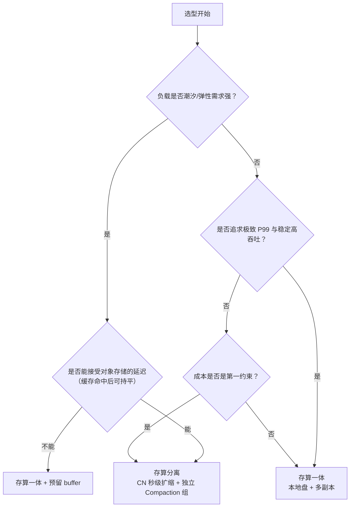

**存算分离的三个真实坑（面试可讲，显得做过）**：
1. **冷查询放大**：缓存未命中要回源对象存储，长尾延迟高（P99 明显差于一体）。
2. **小文件与 API 成本**：大批量导入若不做合并/捆绑，S3 的 PUT/LIST 费用会失控（3.5 的"本地 spill + 集中合并"、4.0 的 File Bundling 就是为此）。
3. **Compaction 与缓存争抢**：Compaction 要在 CN 上跑，若和查询混部会互相影响 → 实践中给 Compaction 单独计算组。

---

## 5. 建表与调优最佳实践（工程题必用）

### 5.1 建表五步法（照着说就是"有经验"）


1. **选模型**
   - 只追加、要明细 → Duplicate
   - 固定聚合口径、可预聚合 → Aggregate
   - 有更新但要全列覆盖、可接受读放大 → Unique
   - **实时 Upsert/Delete、部分列更新 → Primary Key**（推荐，查询快 3~10 倍）
2. **定分区**：时间列（`date_trunc` 表达式分区最省事）；单分区 ≤ 100GB；有冷热/淘汰需求用动态分区或 TTL；**不要预建大量空分区**。
3. **定分桶**：`桶数 ≈ 分区数据量(GB)/1GB`，且 `≥ BE 数`；高基数列做分桶键，兼顾"分桶裁剪"与"抗倾斜"；不能同时满足时，**优先抗倾斜**（倾斜的代价远大于裁剪失效）。
4. **定排序键**：把**最常用于 WHERE 等值/范围过滤、且基数不太低**的列放最前；点查场景把 ID 类列放第一；聚合场景低基数列在前利于本地聚合。注意**前缀索引 36 字节 / 最多 3 列 / VARCHAR 只能一次且在末尾**的限制。
5. **索引与属性**：中高基数列等值过滤加 Bloom；中基数（1万~10万）+ 等值/IN 加 Bitmap；`LIKE` 用 N-Gram Bloom 或倒排；副本数、压缩算法、`bloom_filter_columns`、`colocate_with` 按需。

### 5.2 典型场景方案（面试场景题直接套）

#### 场景 A：Flink 实时打宽 + 实时看板
```
Kafka（多 topic） → Flink（去重/关联维表） → StarRocks 主键表（partial update 打宽）
                                            → 异步物化视图（预聚合 ADS）
                                            → BI（高并发点查/多维钻取）
```
要点：主键表用 `partial_update` 减少写入量；按天分区让主键索引只加载热分区；MV 做预聚合扛高并发；用 Workload Group 隔离"写入"和"查询"。

#### 场景 B：湖仓一体（Hive/Iceberg 上做加速）
```
湖（Iceberg/Hive，Parquet） → External Catalog 直查（不导入）
                            → Data Cache 热数据本地化
                            → 湖上异步 MV（固定口径报表）
                            → 结果回写内表（极热指标）
```
要点：外部表无更新语义；MV 的一致性口径要讲清（湖场景不强一致）；小文件要先在湖侧 compaction（否则元数据开销大）。

#### 场景 C：高并发点查（万级 QPS）
```
明细/主键表 + 按 ID 分桶 + ID 作排序键首列 → 分桶裁剪到单 Tablet → 前缀索引二分 → PageCache/QueryCache
```
要点：点查 SQL 要**只带前缀条件**、避免 `SELECT *`、避免函数包裹列；开 Query Cache；用户连接数上限调大；必要时读写分离（Observer / 独立 CN 组）。

### 5.3 参数速查（生产最常动的十几个）

| 参数 | 默认/量级 | 作用 | 什么时候调 |
|---|---|---|---|
| `write_buffer_size` | ~100MB | MemTable 容量，满则 flush | 写入碎 → 调大，减少小文件 |
| `cumulative_compaction_num_threads_per_disk` | 按盘 | Cumulative 并发 | Compaction 追不上 → 调大 |
| `max_compaction_concurrency` | -1（不限） | Compaction 总并发 | 同上，但注意别抢查询 IO |
| `enable_spill` / `spill_mode` | 关/auto | 算子落盘 | 大查询 OOM → 开 |
| `vector_chunk_size` | 4096 | 向量化批大小 | 一般不动 |
| `parallel_fragment_exec_instance_num` | 自适应 | 并行度 | 老版本调参；新版本靠 Pipeline 自适应 |
| `broadcast_row_limit` | 阈值 | Broadcast 行数上限 | 误广播 → 调小 |
| `enable_profile` / `is_report_success` | false | 采集 Profile | 排障时开 |
| `query_mem_limit` | 0（不限） | 单查询单 BE 内存 | 防单查询打爆 |
| `datacache_disk_size_percent`（存算分离） | 按盘比例 | Data Cache 容量 | 缓存命中率低且盘有余量 → 调大 |
| `lake_compaction_max_tasks`（存算分离） | — | FE 下发 Compaction 任务上限 | Compaction 积压 → 调大 |
| `enable_sync_publish` | true | Publish 同步 Apply | "导入成功查不到" → 确认此项 |

### 5.4 慢查询排障七步法（面试"你遇到过什么难题"的标准素材）

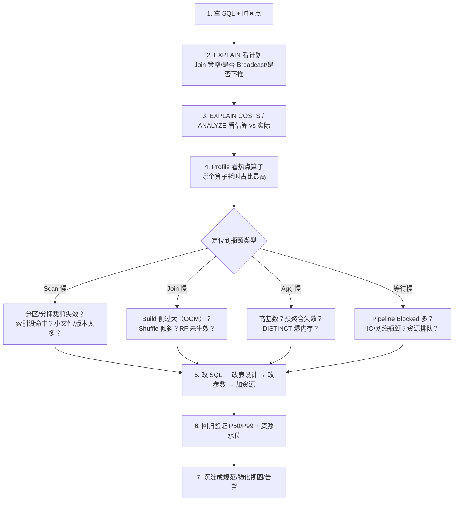

**几个高频"故障 → 原因"对照**（背下来能救场）：
| 现象 | 最可能原因 | 验证方式 |
|---|---|---|
| 导入成功但查不到数据 | Publish/Apply 未完成、事务未提交、MV 未刷新 | 查 `SHOW LOAD`、`information_schema` 版本、`enable_sync_publish` |
| 查询突然变慢，数据量没变 | 版本堆积（Compaction 落后）、统计信息过期（计划变差） | 看 compaction score、`SHOW PROC`、重新 ANALYZE |
| Join 阶段 OOM | Broadcast 了小看的大表 / Build 侧倾斜 | Profile 的 `BytesSent`、`HashTableMemoryUsage` |
| 单 Fragment 明显慢（长尾） | 数据倾斜（分桶键选得差 / Join key 热点） | Profile 里各 Instance 的 `InputRowCount` 对比 |
| FE 内存持续上涨 / GC 频繁 | Tablet 数过多、分区过多、元数据膨胀 | `SHOW PROC '/statistic'`、Tablet 计数 |
| 点查 P99 抖动 | 缓存未命中（冷数据）、Compaction 抢 IO | PageCache 命中率、Compaction 时段 |
| 存算分离查询忽快忽慢 | Data Cache 未命中回源 / 对象存储限流 | 缓存命中率、S3 请求延迟指标 |

### 5.5 常见 SQL 层优化清单（能立刻用）

1. **只查需要的列**（列裁剪是免费的优化，`SELECT *` 在宽表上是灾难）。
2. **过滤条件写在最内层子查询**，让它能下推到 Scan。
3. **避免在过滤列上套函数**（`where date_format(dt,'%Y')=...` → 改用范围条件），否则 ZoneMap/前缀索引失效。
4. **大表 Join 大表 → Colocate 或 Bucket Shuffle**，别指望 Broadcast。
5. **高基数 DISTINCT 用近似函数**（`approx_count_distinct`/HLL/Bitmap），精确 `count(distinct)` 代价极高。
6. **`ORDER BY` + `LIMIT` 前先聚合**，避免全量排序。
7. **倾斜 Key 加盐/打散**，或用 `DISTINCT [skew]` 提示。
8. **固定口径的重复查询 → 物化视图**，别让 BI 每天重复算同一份聚合。

---


## 6. 大厂面试真题精讲（45 题）

> **来源说明**：以下题目来自国内大厂（字节、阿里、腾讯、美团、快手、小红书、京东、拼多多、滴滴、华为、网易等）**公开面经中出现过的 StarRocks 相关题目及其高频变体**，我做了归并、补全与"标准答案化"。
> 公司标注表示"该题/该变体在这些公司的面经里出现过"，**不代表某公司某年的原题原话**；同一题在不同公司表述会有差异。
> 每题统一给：考核程度 → 考察点 → 参考答案 → 延伸追问 → 踩坑提示。

---

### A 组：架构与选型（一面寒暄后的第一波）

#### Q1｜讲讲 StarRocks 的整体架构，FE 和 BE 分别做什么？

- **考核程度**：★★ 🔥🔥🔥（必考，答不好直接掉档）
- **出现**：字节 2-1 数据平台、美团 L7 数据开发、快手实时数仓、小红书数据平台
- **考察点**：是否能画出架构图；是否知道 FE 的三角色与元数据机制；是否知道 BE/CN 的差异。

**参考答案（按"组件 → 职责 → 高可用 → 两种形态"四段说）**

1. **组件极简**：只有 FE（Java）和 BE（C++）/CN 两类进程，**不依赖 ZooKeeper、HDFS、Metastore 等外部组件**（这点对比 ClickHouse/Doris 生态很重要，部署运维成本低）。
2. **FE 职责**：元数据管理（Catalog）、连接与会话管理、SQL 解析与优化（CBO）、查询调度与协调、事务与权限。
   - 三种角色：**Leader**（唯一可写元数据，从 Follower 选出）、**Follower**（只读 + 参与选主，需过半存活）、**Observer**（只读、不参与选主，专门用来扩查询并发）。
   - 元数据用 **BDB JE** 存 EditLog，定期生成 Image 快照；写元数据要**过半 Follower 同步成功**才返回。
3. **BE 职责**：存储（Tablet/Rowset/Segment）+ 执行（FragmentInstance/Pipeline）。数据按分区+分桶打散，多副本保证高可用。
4. **两种形态**：存算一体 = BE 存本地盘 + 多副本；存算分离 = CN 无状态 + 对象存储 + 本地 Data Cache，**Compaction 调度从 BE 收到 FE**。

**延伸追问**
- "FE 挂了会怎样？" → Follower 过半存活即可重新选主；Observer 不参与选举所以不增加选举压力。
- "为什么要 Observer？" → 查询规划是 CPU 密集型，高并发靠 Observer 横向扩规划能力，加 Follower 会增加日志复制与选举开销。
- "FE 内存和什么强相关？" → **Tablet 数量**（100 万 Tablet ≈ 16GB 起，500 万 ≈ 64GB 起）。

**踩坑提示**：别把 FE 说成"只做 SQL 解析"，也别把 BE 说成"只存数据"，两者都是双职责。

---

#### Q2｜存算一体和存算分离怎么选？存算分离牺牲了什么？

- **考核程度**：★★★★ 🔥🔥🔥
- **出现**：阿里 P7 数据技术、腾讯 TEG 数据平台、拼多多、滴滴
- **考察点**：是否理解架构演进背后的成本/弹性/性能三角。

**参考答案**

| | 存算一体 | 存算分离 |
|---|---|---|
| 数据 | BE 本地盘，多副本 | 对象存储/HDFS，单份 + 缓存 |
| 扩容 | 要迁移/均衡数据，小时级 | CN 秒级加减，不动数据 |
| 成本 | 存算等比扩容，贵 | 存储便宜、计算按需启停 |
| Compaction | BE 自调度 | **FE 统一调度，可独立 Compaction 计算组** |
| 性能 | P99 最稳（本地盘） | 缓存命中时接近；未命中回源，长尾差 |

**牺牲的三件事（这是这道题的高分点）**：
1. **冷查询长尾**：缓存未命中要回源对象存储（几十 ms～百 ms 级），P99 明显差于一体架构。
2. **小文件与 API 成本**：每次 flush 都写远端 → 小文件爆炸 + 按请求计费（3.5 的"本地 spill + 集中合并"、4.0 的 File Bundling 就是为此优化）。
3. **Compaction 资源争抢**：Compaction 跑在 CN 上，与查询混部会互相影响 → 实践要给 Compaction 单独 CN 组。

**选型结论模板**："负载潮汐明显、成本敏感、能接受缓存未命中的长尾 → 存算分离；追求极致 P99、负载稳定、数据量适中 → 存算一体。很多团队是**分离架构 + 独立 Compaction 组 + 预热**的组合。"

**延伸追问**："Data Cache 和 File Cache 的区别？" → File Cache 按 Segment 文件整块加载（冷启动放大、粒度粗），**Data Cache 按 block（MB 级）按需加载**，3.1.7/3.2.3 起替代 File Cache 并默认开启，LRU 淘汰，容量按磁盘百分比控制。

---

#### Q3｜StarRocks 为什么比 Hive/Presto 快？快在哪几个环节？

- **考核程度**：★★★ 🔥🔥
- **出现**：美团、京东、网易、华为
- **考察点**：能否把"快"拆成可量化的机制，而不是"因为它是 MPP"。

**参考答案（按链路拆，五层，每层一句话 + 量级）**

1. **存储层**：列存 + 编码压缩（字典/RLE/Delta/BitShuffle）→ 只读需要的列，IO 降一个量级；压缩比通常 5～10 倍。
2. **索引层**：前缀稀疏索引 + Ordinal + ZoneMap + Bloom/Bitmap → **块级跳过**，扫描量可降 1～2 个数量级。
3. **优化器层**：Cascades CBO + 统计信息/直方图 → Join 顺序与分布式策略选优，**不同计划性能可能差数量级**（这是 Presto/Hive 最弱的一环）。
4. **执行层**：全面向量化（批 4096 行、SIMD、编码上计算）→ 算子 3～10 倍；Pipeline 引擎 → 高并发下无阻塞空转、CPU 利用率更高。
5. **架构层**：本地存储 + 多副本 + 数据本地性调度，减少网络传输；MPP Shuffle 让汇总也并行（vs Scatter-Gather 单点汇聚）。

**延伸追问**："和 Presto 查同一份 Hive 数据的差距主要来自哪？" → 主要是**无本地存储/无缓存 + 优化器与向量化**；StarRocks 在湖上靠 Data Cache + CBO + 向量化，Presto 每次回源且 Join 计划较弱。

**踩坑提示**：只说"向量化"会被追问"向量化具体快在哪"（见 Q33）。

---

#### Q4｜StarRocks 和 ClickHouse 怎么选？

- **考核程度**：★★★ 🔥🔥🔥
- **出现**：字节、快手、B 站、滴滴（几乎是有 CK 的公司必问）
- **考察点**：是否知道两者能力边界，而不是站队。

**参考答案（对比 4 个维度 + 一句结论）**

| 维度 | StarRocks | ClickHouse |
|---|---|---|
| 多表 Join | CBO + 4 种分布式策略，大表 Join 大表可 Colocate | 弱，分布式 Join 易 OOM/需 GLOBAL |
| 更新 | 主键模型 Upsert/Delete、部分列更新 | `ALTER UPDATE` 重写 part / ReplacingMergeTree 最终一致 |
| 高并发 | 点查优化 + 资源组 + Query Cache | 高并发资源争抢明显，需副本分流 |
| 运维 | 标准 SQL DDL、轻量 Schema Change、无外部依赖 | DDL 重、依赖 ZK/Keeper、改列成本高 |
| 强项 | 多维分析、宽表 Join、实时更新、湖仓 | 日志/埋点单表扫描聚合、极致压缩、超大规模单表 |

**结论**："两者不是替代关系。**日志/单表大盘看 CK，业务多维分析与实时更新看 SR**；很多公司双栈并存，靠数据同步或联邦查询打通。"

**延伸追问**："CK 的 MergeTree 和 StarRocks 的 LSM 有什么本质区别？" → 都靠"分区/part 内有序 + 后台 merge"，但 CK 的 part 是**不可变数据目录 + 主键稀疏索引**，更新靠重写 part；SR 有**多版本 Rowset + DelVector + 主键索引**，能做到行级删除标记与快照读。

---

#### Q5｜StarRocks 和 Doris 的区别？

- **考核程度**：★★★ 🔥🔥（国内特色题）
- **出现**：阿里、百度、美团、京东（很多公司两套都在用/评估）
- **考察点**：是否了解同源分叉后的演进差异；能否客观。

**参考答案（讲"同源 + 三个差异 + 不给绝对结论"）**
1. **同源**：都源自百度 Palo，后来分叉。
2. **优化器**：SR 较早全量落地 **Cascades CBO**（支持 TPC-DS 99 条）；Doris 早期 RBO 为主，2.x 引入 **Nereids** 后 CBO 能力大幅提升。
3. **执行引擎**：SR 的 **Pipeline 引擎**（协程调度、阻塞异步化、时间片 yield）是其标志性设计；Doris 2.x 也引入 Pipeline 并默认开启。
4. **存算分离**：SR 3.0 shared-data 把 **Compaction 调度收到 FE**（可独立 Compaction 集群）；Doris 2.x 的存算分离以 **Compute Group** 组织。
5. **物化视图/湖**：两者都支持同步+异步 MV 与多 Catalog，SR 额外有**基于文本（AST）的 MV 改写**与 View Delta Join。

**结论**："能力高度重叠，差异在**优化器打磨深度、执行引擎调度细节、存算分离的调度模型**。选型看团队经验、社区/托管生态、以及用自己最重的 query 实测。"

**踩坑提示**：不要说"XX 是抄袭 XX"，这是低级失分；也不要编造版本号。

---

#### Q6｜StarRocks 能替代数仓吗？什么数据量该用它？

- **考核程度**：★★★ 🔥🔥
- **出现**：美团数据开发、京东、平安、招商（甲方背景面试官爱问）
- **考察点**：边界感 + 架构分层理解。

**参考答案**
- **能替代的部分**：数仓的**分析服务层**（DWS/ADS）、即席查询、BI 直连层、实时明细层。一套引擎覆盖"批 + 实时"的查询侧，可替掉 Hive+Presto+部分 CK 的组合。
- **不能替代的部分**：ODS 贴源与海量归档（湖更便宜）、重型 ETL（Spark/Flink 的多级 shuffle 与复杂清洗）、强事务 OLTP、超大规模历史回溯计算。
- **数据量边界（经验值，不要当铁律）**：
  - 单表 **亿级～十亿级**、要求秒级/亚秒级、高并发 → StarRocks 很合适。
  - **百亿～千亿级**、需要全量重算/复杂加工、长周期留存 → 放湖（Iceberg/Hudi/Paimon）+ Spark，SR 做加速层或只放热数据。
  - 冷热分离：热数据（近 7～30 天）进 SR，冷数据留湖，靠 External Catalog 或湖上 MV 兜底。

**延伸追问**："那你怎么保证冷热两套的口径一致？" → 统一在湖上做 DWD，SR 侧用**同一份 SQL 逻辑 + 物化视图**产出，靠数据质量校验（行数/指标对账）与血缘管理保证。

---

#### Q7｜StarRocks 的元数据是怎么存的？为什么不用 ZooKeeper？

- **考核程度**：★★★★ 🔥🔥
- **出现**：阿里、腾讯、字节（偏内核/平台方向）
- **考察点**：BDB JE 的作用、Image/EditLog、与外部协调服务的取舍。

**参考答案**
- FE 用 **BDB JE（Berkeley DB Java Edition）**：一个支持事务与 HA 复制的嵌入式 KV，存 **EditLog**（每条元数据变更一条日志）。
- **Image**：内存全量元数据的序列化快照，由 Checkpoint 线程定期生成（本地 + 可配远端），用于**缩短重启时的日志重放**、备份与降级。
- **选主**：Leader 本身是 Follower 中被选出来的，依赖 BDB JE 的复制组；**过半 Follower 存活**才能选主/写成功。
- **为什么不用 ZK**：① 少一个外部依赖 → 部署、运维、故障面都小；② 元数据写入与选举在同一套事务语义里，**不必处理"ZK 与本地状态不一致"的双写问题**；③ CK 用 ZK 的痛点（会话、脑裂、znode 数量）可以规避。
- **代价**：FE 扩容受复制组约束（Follower 不宜过多）、Image 生成有开销、元数据规模受单机内存限制。

**延伸追问**："什么情况下 FE 启动特别慢？" → Image 太旧 + EditLog 太长（重放久）；或 Tablet/分区数量巨大导致加载慢；或磁盘 IO 差。

---

#### Q8｜如果让你从 0 设计一个公司级 OLAP 平台（基于 StarRocks），你怎么做？

- **考核程度**：★★★★ 🔥🔥
- **出现**：阿里 P7、字节 2-2、美团 L8（偏架构岗）
- **考察点**：架构分层、容量规划、多租户、稳定性、成本。

**参考答案（给一个可落地的骨架）**

```mermaid
graph TD
    A["数据源：业务库 CDC / 埋点 / 日志"] --> B["接入层：Flink CDC / Kafka / DataX"]
    B --> C["湖：Iceberg/Hudi（ODS-DWD 明细）"]
    C --> D["StarRocks：DWD 明细层 + DWS 汇总层（主键表 + 异步 MV）"]
    D --> E["服务层：BI / 报表 / 自助分析 / 点查 API"]
    D --> F["治理：血缘 + 质量 + 权限 + 成本"]
```

1. **分层**：湖做 ODS/DWD 沉淀（便宜、可回溯），SR 做 DWD 明细 + DWS 汇总 + ADS 服务（快）。**不做"全量入 SR"**。
2. **容量规划**：按"热数据 30 天 + 单 Tablet 1～10GB + 桶数 ≥ BE 数"估集群规模；FE 内存按 Tablet 数反推。
3. **多租户**：按业务线划 **Workload Group**（CPU 软/硬隔离 + 内存配额 + 并发上限 + 大查询队列）；存算分离下用**独立计算组**做物理隔离。
4. **稳定性**：FE 3 节点（1 Leader + 2 Follower）+ N Observer；BE 至少 3 副本；导入与查询分离（不同计算组）；Compaction 独立组。
5. **成本**：冷热分层 + TTL + 存算分离 + 只对热表建多副本；按业务线做成本核算（存储/计算/扫描量）。
6. **治理**：统一建模规范（模型选择/分区/分桶/排序键 checklist）、SQL 审核（禁止 `SELECT *`、禁止函数包裹过滤列）、慢查询看板、MV 自动推荐。

**延伸追问**："业务方随便写 SQL 把集群打挂怎么办？" → 资源组配额（硬隔离）+ 查询队列 + 单查询内存上限 + SQL 指纹识别（同类慢 SQL 告警/拦截）+ 只读副本分流。

---

### B 组：存储引擎与表模型（二面主战场）

#### Q9｜StarRocks 有哪几种数据模型？分别什么场景用？

- **考核程度**：★★ 🔥🔥🔥
- **出现**：几乎所有公司一面都会问
- **考察点**：模型与场景的对应关系，以及"为什么"。

**参考答案（表格 + 一句本质）**

| 模型 | 更新能力 | 读取代价 | 典型场景 |
|---|---|---|---|
| Duplicate | 无 | 最低 | 日志/明细/ODS、查询模式不固定 |
| Aggregate | 导入时聚合 | 中（读时 merge） | 固定口径报表、预聚合宽表 |
| Unique | 覆盖（Merge-On-Read） | 较高 | 有更新、可接受读放大 |
| Primary Key | Upsert/Delete（Delete+Insert） | 低（可下推） | 实时更新、实时打宽、维表、明细更新 |

**本质一句话**：**"聚合/唯一是读时合并，主键是写时标记"**——OLAP 读多写少，所以把成本挪到写侧更划算。

**延伸追问**：
- "主键表为什么比 Unique 快 3～10 倍？" → 见 Q12。
- "Aggregate 模型能更新吗？" → 只能"再导入一条同 Key 的记录按聚合函数合并"（如 sum 会累加），**不能做覆盖式更新**，容易造成重复累加（这是生产事故高发点）。

---

#### Q10｜一张表从逻辑到物理，是怎么一层层切下来的？

- **考核程度**：★★★ 🔥🔥
- **出现**：美团、快手、字节（存储方向）
- **考察点**：Partition → Tablet → Rowset → Segment → DataPage 的层级与各层职责。

**参考答案**

```
Table
 └─ Partition（分区：裁剪的最小单位，按时间/范围/List/表达式）
     └─ Tablet（分桶 + 副本：物理存储单元，也是"单机列存引擎"）
         └─ Rowset（一个版本：一次导入或一次 Compaction 的产物，不可变）
             └─ Segment（列存文件：自描述，尾部存索引）
                 └─ Data Page（64KB：编码+压缩的最小 I/O 单元）
```

各层的"优化挂钩"：
- 分区 → **分区裁剪**、TTL、冷热分离；
- Tablet → **分桶裁剪**、本地聚合、Colocate Join、并行度；
- Rowset → **MVCC 快照读**、原子提交、版本回收；
- Segment → 索引（ZoneMap/ShortKey）、Page 级压缩；
- DataPage → 最小 IO，读放大就发生在这里。

**延伸追问**："一个查询会读多少个 Segment？" → 分区裁剪 × 分桶裁剪 × 版本数 × Rowset 内 Segment 数；**版本数不受控就是读放大的根源**。

---

#### Q11｜Segment 文件内部长什么样？点查是怎么定位到一行的？

- **考核程度**：★★★★ 🔥🔥🔥（能画图就赢一半）
- **出现**：字节存储方向、阿里 PolarDB/ AnalyticDB 背景面试官、华为
- **考察点**：列存文件格式 + 三级索引 + 排序键的关系。

**参考答案（画结构 + 走一遍查找）**

Segment 五个部分（从数据到元数据）：
1. **Column Data Pages**：每列按 64KB 分页，编码（字典/RLE/Delta/BitShuffle）+ 压缩（LZ4）。
2. **Ordinal Index（列内序数索引）**：行号 → Page 偏移/长度。
3. **ZoneMap Index**：Page 级与 Segment 级的 min/max/has_null。
4. **Short Key（前缀）索引**：每 1024 行一条，存**排序键前 36 字节**。
5. **Footer + Magic Number**：各索引偏移 + 校验和（支持只 mmap 尾部就能自描述）。

**点查路径（`where id = 982347234`，id 是排序键首列）**：
1. 前缀索引二分 → 定位到"第几个 1024 行块"（约 50 次比较覆盖 5000 万行）。
2. Ordinal 索引 → 拿到该列对应 Data Page 的物理偏移。
3. 读 Page（命中 PageCache 就是纯内存）→ 解压 → 解码 → Page 内二分定位行。
4. 若还带其他列条件 → 用 ZoneMap/Bloom 先砍块，再取列。

**延伸追问**：
- "前缀索引最多 36 字节/3 列，超了怎么办？" → 超出的列不进前缀索引（只保证前 36 字节能定位），后续靠 ZoneMap/Bloom 或直接 Page 内扫描。
- "为什么 VARCHAR 只能出现一次且在末尾？" → 变长字段无法定长截断，放中间会破坏后续列的前缀可比性。
- "点查为什么必须走"最左前缀"？" → 数据只按排序键整体有序，跳过第一列就不具备单调性，无法二分。

---

#### Q12｜主键表的更新是怎么实现的？DelVector 是什么？

- **考核程度**：★★★★ 🔥🔥🔥（最高频的深度题之一）
- **出现**：字节、阿里、美团、快手、小红书（只要做实时数仓必问）
- **考察点**：Delete+Insert、主键索引、DelVector、与 Merge-On-Read 的对比。

**参考答案（按"写-读-回收"三段）**

**写**：
1. 导入数据进 MemTable → 排序（按主键）→ 合并同主键只留最新 → 拆成 Upsert 文件与 Delete 文件 → Flush 成新 Rowset。
2. Commit 时载入该 Tablet 的**主键索引**（PK → Rowset/Segment/RowID）：
   - Delete：定位旧行 → 在该 Segment 的 **DelVector（RoaringBitmap）**打删除位；
   - Update：旧行打位 + 新值写新行（**Update 被改写为 Delete+Insert**），并更新主键索引指向新位置；
3. 生成新版本 Meta + DelVector，写入本地 RocksDB（内存有缓存）。

**读**：
- 按可见版本找到要读的 Rowset；Scan 每个 Segment 时套用该版本的 DelVector 过滤 → 每个主键只剩一行 → **不需要 Merge 算子** → 谓词、ZoneMap、Bloom、前缀索引都能正常下推到 Scan。

**回收**：
- 被标记的行仍占空间，直到 **Compaction** 重写这些 Segment 才真正消失；DelVector 也随之缩小。

**为什么快 3～10 倍**：Merge-On-Read 的 Unique 表要"读多个版本 + 在线 merge"，Merge 算子阻断索引下推；主键表把这个 Merge 变成了"写入时的标记"，读路径变干净。

**延伸追问**：
- "主键索引很吃内存怎么办？" → 持久化索引（3.1.4+ 新建表默认开）、按天分区让老分区索引不加载、主键列尽量窄（避免长字符串主键）。
- "Delete 为什么不需要 Merge 也能正确？" → DelVector 按 Segment + 行号精确标记，且版本可见性由 MVCC 保证。
- "部分列更新（partial update）怎么实现？" → 只写变更列，未给列**读旧值补齐**再写入新行 → 省带宽但增加随机读与写放大。

**踩坑提示**：别把 DelVector 说成"存整行"，它是**按 Segment 的行级位图**；也别说"删除是物理删除"。

---

#### Q13｜前缀索引 / ZoneMap / Bitmap / Bloom 有什么区别？什么时候会失效？

- **考核程度**：★★★ 🔥🔥🔥
- **出现**：美团、京东、网易、携程
- **考察点**：索引的适用边界（这才是工程能力）。

**参考答案（一句话定义 + 失效条件）**

| 索引 | 一句话 | 失效条件 |
|---|---|---|
| 前缀索引 | 排序键前 36 字节，每 1024 行一条，二分定位块 | 条件不是**最左连续前缀**；超 3 列/36 字节被截断；VARCHAR 位置不对 |
| Ordinal | 行号 → Page 偏移，所有索引的最终通路 | 不失效 |
| ZoneMap | Page/Segment 的 min/max/null，块级跳过 | 数据无序 → min/max 覆盖全域；函数包裹列（`date_format(dt,...)`）；`LIKE` |
| Bitmap | 位图，等值/IN 精确过滤 | 不支持 FLOAT/DOUBLE/BOOLEAN/DECIMAL；基数 <255 无意义（有低基数字典）；Agg/Unique 仅 Key 列可建 |
| Bloom | 概率型，高基数列等值/IN | 范围查询无效；不支持 TINYINT/FLOAT/DOUBLE/DECIMAL；误判率存在 |

**失效的三个通用原因（背这三条就够）**：
1. **表达式破坏**：`where substr(name,1,3)='abc'`、`where cast(id as string)='1'` → 索引全部失效（类型转换也算）。
2. **顺序破坏**：前缀条件不从第一列开始（`where siteid=2 and event_day='...'` 而 event_day 是第一列 → 只能用 siteid 之后的部分）。
3. **选择性太低**：过滤后还剩 90% 的数据 → 索引只是多了一次查找开销。

**延伸追问**："Bloom 索引为什么只减少读、不减少 CPU？" → 它只能判断"这个 Page 里肯定没有"，跳过的是 IO；命中后仍要解压解码扫描。所以**高选择性 + 大量不命中**才划算。

---

#### Q14｜数据倾斜在存储层怎么产生的？怎么治？

- **考核程度**：★★★ 🔥🔥🔥
- **出现**：字节、美团、快手、滴滴（实时数仓必问）
- **考察点**：分桶键设计 + 倾斜的双重来源（存储倾斜 vs 计算倾斜）。

**参考答案**

**两类倾斜要分开说**：
1. **存储/分桶倾斜**：分桶键基数低或有超级热点（如 `province_id` 只有 30 个值、某城市占 30% 数据）→ 某些 Tablet 特别大 → 导入慢、Compaction 慢、Scan 长尾。
2. **计算倾斜（Shuffle 倾斜）**：Join/Group By 的 key 有热点（如大卖家、默认值 `null`/`-1`）→ 某个 Instance 处理几千万行，其他几十万 → 整个 Stage 被最慢的那个拖住。

**治法（按成本从低到高）**：
| 手段 | 适用 | 代价 |
|---|---|---|
| 换分桶键（更高基数，或用组合键） | 存储倾斜 | 可能牺牲分桶裁剪 |
| 加盐（`key || mod(id,16)`）、热点 key 打散 | 计算倾斜 | SQL 改动、需二次聚合 |
| 两阶段聚合（局部聚合后再按 key 聚合） | 高基数 Group By | 多一次 Shuffle |
| 热点 key 单独处理（广播小侧 / 单独过滤后 Union） | 极少数超级热点 | 逻辑复杂 |
| 用 `DISTINCT [skew]` 提示 / 调大并行度 | 一般倾斜 | 资源换时间 |
| Random 分桶（3.2+，仅明细表） | 写入倾斜、键不稳定 | 失去分桶裁剪与 Colocate |

**诊断方法（面试亮点）**：看 Profile 里各 **FragmentInstance 的 `InputRowCount` / `HashTableSize` / `ProbeRows`** 差异；差异 > 5 倍基本就是倾斜。

**延伸追问**："加盐之后聚合结果怎么保证正确？" → 局部聚合按 `(salted_key)` 出部分结果，再做一次按 `原 key` 的汇总（sum/sum、count/sum、avg 用 sum/count），**必须保证聚合函数可二次合并**（min/max/sum/count/bitmap/hll 可以，`count(distinct)` 不行，需 bitmap 化）。

---

#### Q15｜StarRocks 的压缩比为什么高？LZ4 和 ZSTD 怎么选？

- **考核程度**：★★ 🔥🔥
- **出现**：京东、网易、华为（偏成本/存储优化岗）
- **考察点**：列存 + 编码 + 排序键三者对压缩的叠加效应。

**参考答案**
- **列存**：同类型同分布的数据连续存 → 熵低 → 压缩算法效率高（行存因为类型混杂，通常只能压 2～3 倍，列存常 5～10 倍）。
- **编码**：字典（低基数）、RLE（连续重复）、Delta/FOR（数值/时间）、BitShuffle（按位重排）——**编码本身就是"第一层压缩"**，很多列编码后已经小一个数量级，再叠 LZ4 就很省。
- **排序键**：排序后重复相邻、差值变小 → 编码与压缩同时受益（官方实测同一份数据按 `(device_id, ts)` 排序后 LZ4 压缩比提升约 1.8 倍、扫描 CPU 降约 25%）。

**选型**：
- 默认 **LZ4**：解压极快、CPU 低，OLAP 是"频繁解压"场景，**优先解压速度**。
- **ZSTD**：压缩比更高（存储省），但解压 CPU 更高；适合**冷数据/低频访问**（配 TTL 归档），或磁盘是瓶颈而 CPU 富余的场景。
- 判断方法：看 Profile 的 `CompressedBytesRead` vs `DecompressTime`，若解压占比高就换回 LZ4。

---

#### Q16｜明细表、聚合表、更新表、主键表，`count(*)` 谁快谁慢？为什么？

- **考核程度**：★★★ 🔥（偏细，但很能区分"读过文档"和"想过原理"）
- **出现**：阿里、美团（数据开发岗的技术细节题）
- **考察点**：读路径上的 merge 成本。

**参考答案**
- **Duplicate 最快**：无 Merge，直接按 ZoneMap/元数据统计出行数，甚至可走元数据优化（只读 Segment 头部的行数）。
- **Primary Key 较快**：有 DelVector，需要"总行数 - 删除行数"，仍不需要 Merge 多版本。
- **Unique / Aggregate 较慢**：需要**在线 Merge 多版本**去重/合并，版本越多越慢；Key 是 String 时更慢（比较成本高）。

**延伸追问**："为什么 Unique 表在 Compaction 没跑完时特别慢？" → 版本堆积 → Merge 的路数变多 → 不仅慢，还可能 OOM（Merge 需要内存缓冲）。

---

### C 组：写入链路与事务（实时方向必考）

#### Q17｜一次导入的完整流程？ACID 怎么保证？

- **考核程度**：★★★★ 🔥🔥🔥
- **出现**：字节、阿里、美团、快手
- **考察点**：Write/Commit/Publish 三段、版本号、副本 quorum。

**参考答案（时序 + 四层语义）**

```
Client → FE: Begin Transaction（分配 txn id，规划路由）
FE → BE: 下发写入任务
BE: 数据进 MemTable → 排序/聚合 → Flush 成 Segment → 组 Rowset
    同时同步写其他副本（Quorum）
BE → FE: 上报每个 Tablet 的 Rowset（Write 完成）
FE: Commit —— 校验 + 分配 Version（每个 Tablet 一个单调递增版本）
FE → BE: Publish Version（带 version）
BE: Apply —— 更新 Tablet Meta / DelVector / 主键索引，新版本可见
FE → Client: 返回成功
```

- **A**：跨 Tablet 的批量要么全成功要么全失败（失败回滚未提交 Rowset）。
- **C**：靠 version 串联，读者永远看到某个完整版本。
- **I**：**Snapshot Isolation**，读看查询开始时的可见版本；并发导入互不阻塞。
- **D**：Write 阶段已落盘（本地/远端），Commit 后元数据持久化。

**关键点**：
- **Write 慢但可并行，Commit 短但需串行化版本分配** → 高吞吐 + 强一致的折中。
- **Publish 是可见性开关**：publish 前文件在盘上但查不到。
- `enable_sync_publish=true`（3.1.4+ 默认）→ 导入返回即可见，代价是 RT 略增。

**延伸追问**：
- "两个并发导入同一 Tablet 会怎样？" → 版本串行分配，**后提交的版本号更大**；若业务语义要求"按数据时间覆盖"，需用**条件更新**（如 `where update_time >= 当前值`）避免乱序覆盖。
- "导入失败了数据会残留吗？" → 未提交的 Rowset 不会被任何版本引用，最终由后台清理（孤儿文件回收）。

---

#### Q18｜为什么"导入成功但查不到数据"？怎么排查？

- **考核程度**：★★★ 🔥🔥（实战题，答得好非常加分）
- **出现**：美团、京东、拼多多、银行科技
- **考察点**：Publish/Apply 的异步性、MV 刷新、事务提交、缓存。

**参考答案（按概率排序排查）**
1. **Publish/Apply 未完成**：`enable_sync_publish=false` 时 Apply 异步 → 导入返回但数据未可见。查 `SHOW LOAD` 状态、Tablet 的 `VisibleVersion` 与 `PendingPublishVersion`。
2. **事务未提交**：手工 `BEGIN; INSERT;` 未 `COMMIT`；或 `INSERT INTO` 走了事务模式。
3. **MV 未刷新**：查的是物化视图而不是基表 → 看 MV 的 `last_refresh_time` / 刷新任务状态。
4. **查错了分区/库表**：表达式分区自动创建失败、写到了别的分区。
5. **谓词把数据过滤掉了**：类型/时区问题（`DATETIME` vs `DATE`、UTC vs 本地），典型"明明有数据但 where 过滤没了"。
6. **缓存**：Query Cache / BI 层缓存未失效。

**验证手段**：`SELECT count(*)` 不限条件 → 再逐步加条件；查 `information_schema.tablets` / `partitions_meta` 看行数与版本；开 `enable_profile` 看 Scan 的 `RowsRead`。

---

#### Q19｜小批量高频导入有什么问题？怎么优化？

- **考核程度**：★★★ 🔥🔥🔥
- **出现**：字节、快手、小红书（Flink 写 SR 的场景必问）
- **考察点**：版本爆炸 → Compaction 追不上 → 读放大。

**参考答案**
**问题链**：每次导入 = 一个 Rowset/版本 → 小文件多、元数据膨胀 → **查询要 merge 更多版本（Unique）或读更多 Segment**；Compaction 追不上 → 版本持续堆积 → 查询越来越慢，最终 OOM 或 Compaction 阻塞写入。

**优化（分写入侧 + 引擎侧）**：
1. **攒批**：Flink 侧 `sink.buffer-flush.max-rows` / `max-bytes` / `interval` 调大；Routine Load 用 `max_batch_rows` + `max_batch_interval`；Stream Load 单批几十～几百 MB。
2. **提高单批写入效率**：`write_buffer_size` 调大（减少 flush 次数）、用主键表 `partial_update` 减少写入字节。
3. **引擎侧**：增加 Compaction 并发（`cumulative_compaction_num_threads_per_disk`、`max_compaction_concurrency`）；存算分离下扩 Compaction CN 或调 `lake_compaction_max_tasks`。
4. **结构侧**：按天分区（只让热分区承受高频写）；单 Tablet 别太大（增加桶数让 Compaction 任务更细）；避免几百个小分区。
5. **架构侧**：能接受分钟级延迟就用**微批 + 定时导入**，而不是"每条都写"。

**延伸追问**："如果实时性要求 1 秒内可见，怎么办？" → 用主键表 + `enable_sync_publish` 保证可见性，同时接受版本多；用**独立写入计算组**隔离；靠 MV 承接查询，避免查询直接打明细表。

---

#### Q20｜主键表的部分列更新是怎么做的？有什么代价？

- **考核程度**：★★★ 🔥🔥
- **出现**：字节（Flink 打宽）、美团、阿里（用户画像/订单宽表）
- **考察点**：partial update 的实现与写放大。

**参考答案**
- **用法**：Stream Load / Routine Load 的 `partial_columns=true`（或 `partial_update`），只传变更列。
- **实现**：写入时对每个主键**读旧行**，把未提供的列补齐后组成完整新行，再 Delete+Insert（旧行打 DelVector，新行写入）。
- **代价**：① **随机读**旧值（IO 放大）；② 仍产生新行（写放大）；③ 列数越多成本越高（官方建议部分更新表列数控制在 200 以内量级）。
- **替代方案**：宽表列特别多（上千列）时，考虑**拆表**（按主题拆多张主键表）或用聚合模型预聚合，而不是一张巨宽表硬 partial update。

**延伸追问**："多个 topic 并发 partial update 同一行会冲突吗？" → 不同列不冲突（各自补各自的列，但都基于同一旧版本 → 可能"互相覆盖丢失"），需要业务上保证**同一主键的更新串行/按时间戳条件更新**（`conditional_update`）。

---

#### Q21｜Conditional Update（条件更新）解决什么问题？

- **考核程度**：★★★ 🔥
- **出现**：阿里、美团、字节（CDC 场景）
- **考察点**：乱序数据覆盖问题。

**参考答案**
- **问题**：CDC 或消息队列可能乱序（老数据后到），普通 Upsert 会让**旧数据覆盖新数据**。
- **做法**：指定某非主键列（如 `update_time` / `version`）作为条件，**只有导入值 ≥ 当前值才更新**（`where` 语义内置在写入路径）。
- **限制**：同一批导入只能一个条件；不支持删除；条件列要有单调性。
- **收益**：在写入侧解决乱序，避免下游"再排序一次"。

**延伸追问**："如果没有单调列怎么办？" → 在 Flink 侧按主键 keyBy + 事件时间排序/去重（状态存储），或加一列"摄取时间"作为条件列。

---

#### Q22｜实时数仓为什么常用"主键表 + 异步物化视图"这套组合？

- **考核程度**：★★★★ 🔥🔥
- **出现**：字节、快手、小红书、B 站（实时数仓架构题）
- **考察点**：写入侧与查询侧解耦的设计思想。

**参考答案（讲"职责分离"）**
- **主键表承担"最新状态"**：Upsert 保证一行一值、点查快、支持部分列更新（多流打宽）。
- **异步 MV 承担"预聚合与高并发"**：把明细的重复聚合前移，BI 查询直接读 MV；分区 MV 让刷新成本可控（只刷变更分区）。
- **写入与查询资源隔离**：不同 Workload Group / 计算组，避免大查询拖慢写入、大批导入拖慢查询。
- **口径统一**：MV 就是"物化的指标定义"，比"每个报表各写一份 SQL"更可控；配合血缘可审计。

**延伸追问**："MV 会不会有延迟，报表看到旧数据？" → 会有（异步刷新有间隔），所以要给业务定义**数据新鲜度 SLA**（如 T+5min），并在页面上标注数据时间；对强实时指标走明细表直查或同步 MV。

---

### D 组：Compaction 与稳定性（区分"用过"和"运维过"）

#### Q23｜Compaction 是什么？为什么必须有？

- **考核程度**：★★★ 🔥🔥🔥
- **出现**：字节、阿里、美团、腾讯（几乎必问）
- **考察点**：LSM 三害（小文件、删除垃圾、有序性丢失）。

**参考答案（先讲"三害"，再讲"它怎么收场"）**
写入是 append-only 的 LSM 式：每次导入一个 Rowset。三个副作用：
1. **小文件膨胀**：版本越多，Segment 越多 → 元数据与随机 IO 爆炸。
2. **垃圾数据**：被覆盖的旧版本、DelVector 标记的删除行仍在磁盘上占空间。
3. **整体无序**：每个 Rowset 内部有序，但 Rowset 之间无序 → 查询要 merge 多路。

Compaction 就是"把多个小 Rowset 合并成一个大的、整体有序的 Rowset，顺手清掉垃圾"，生成新版本，旧版本随后可回收。

**两种类型**：
- **Cumulative**：合并近期的小 Cumulative Rowset（size-tiered 分层合并）。
- **Base**：Base Rowset + 所有 Cumulative → 新 Base（老版本才能真正回收）。

**延伸追问**："不做 Compaction 会怎样？" → 查询读放大到几十上百倍、元数据撑爆 FE、删除数据永远不释放空间（存储只涨不降）。

---

#### Q24｜Compaction 是怎么被调度的？两种架构有什么不同？

- **考核程度**：★★★★ 🔥🔥
- **出现**：字节 2-2、阿里 P7（偏平台/内核）
- **考察点**：调度权归属与资源隔离。

**参考答案**
- **存算一体**：BE 自己按磁盘数和负载起 Compaction 线程池（`cumulative_compaction_num_threads_per_disk`、`max_compaction_concurrency`），按 score/版本数挑 Tablet。
- **存算分离**：**FE 统一调度**——Leader FE 按 publish 结果算每个分区的 **Compaction Score**，挑分数 ≥ 阈值（`lake_compaction_score_selector_min_score`，默认 10）的分区，生成 Compaction 事务 + Tablet 子任务，下发给 CN（上限 `lake_compaction_max_tasks`），CN 用 `compact_threads` 执行，FE 汇总后 commit + publish。
- **为什么要收到 FE**：① 可以把 Compaction 丢给**独立的 CN 组**，业务查询零影响；② 资源池可按需扩缩；③ 全局视角能避免"每个 BE 各自为战"导致的局部堆积。

**Score 怎么算（细节加分）**：每个数据文件约 1 分；Tablet 的 Rowset 按大小分组，取"文件数最多的那组"作为分数；分区取所有 Tablet 最大值。分数高 = 越碎 = 越该合并。

**延伸追问**："为什么 Compaction 会拖慢查询？" → 抢 IO/CPU/PageCache，且 merge 大宽表时吃内存（几千列 + 大字符串曾是 OOM 主因，2.1 起改按列分批合并 + 大字符串特殊处理）。

---

#### Q25｜Compaction 落后了，怎么处理？

- **考核程度**：★★★★ 🔥🔥（运维实战题）
- **出现**：美团、京东、银行/运营商科技（生产环境题）
- **考察点**：定位 → 分因 → 手段。

**参考答案（按"看指标 → 分原因 → 给手段"）**

**看指标**：`SHOW PROC '/statistic'` 或 `information_schema.partitions_meta` 看 compaction score、未合并版本数；BE 侧看 `compaction` 内存与线程使用、`CompactionNum` 指标。

**分四种原因**：
| 原因 | 特征 | 手段 |
|---|---|---|
| 写入太碎 | 导入频繁、每批很小 | 攒批、调大 `write_buffer_size`、降频 |
| Compaction 算力不足 | 队列长、线程跑满 | 加线程/加并发；存算分离扩 Compaction CN |
| 单 Tablet 过大 | 单任务耗时极长 | 增加分桶数（重建表），让任务变小 |
| 主键表删除膨胀 | DelVector 大、Base 迟迟不触发 | 手动/调阈值触发 Base Compaction（`lake_pk_compaction_base_*`） |

**延伸追问**："能手动触发 Compaction 吗？" → 有对应 ADMIN 命令/接口（不同版本名称不同），但**生产上优先调调度参数**，手动触发只用于应急，且要注意别在业务高峰做。

---

#### Q26｜多副本怎么保证一致？某个副本坏了怎么办？

- **考核程度**：★★★ 🔥🔥
- **出现**：阿里、腾讯、华为（偏高可用）
- **考察点**：Quorum、Publish、Clone、Tablet 修复。

**参考答案**
- **写入**：数据同时写多个副本，**多数副本成功**才认为该 Tablet 写入完成（类 Raft 多数派思想）。
- **可见性**：FE 统一分配 version，向所有副本 **Publish**；失败重试，直到全部副本追上（对外始终是"快照一致"）。
- **副本修复**：FE 的 TabletChecker/ReplicaScheduler 检测到副本缺失或不一致 → 从健康副本 **Clone** 数据补齐。
- **副本状态**：`ALTER TABLE ... MODIFY REPLICATION NUM` 改副本数；坏盘会让副本进入 bad 状态，靠 Clone 恢复。
- **代价**：Clone 大 Tablet 很慢（TB 级恢复时间长），这是"分桶过大"的隐性成本。

**延伸追问**："为什么存算分离不需要 3 副本？" → 对象存储自身有多副本/纠删码保证持久性，计算层只做缓存（缓存丢了回源）；所以**存储副本成本大幅下降**，但要接受回源延迟。

---

### E 组：查询优化器与执行（进阶分水岭）

#### Q27｜CBO 是怎么工作的？为什么需要 CBO？

- **考核程度**：★★★★ 🔥🔥🔥
- **出现**：字节、阿里、美团、腾讯（中高级必问）
- **考察点**：RBO vs CBO、Cascades 结构、统计信息。

**参考答案（三步：为什么 → 怎么做 → 靠什么）**

**为什么**：RBO 按固定规则改写，不看数据量。同样一条三表 Join：
```sql
a(10亿) JOIN b(10亿) ON k  JOIN c(1万) ON k
```
先 a⋈b 要 Shuffle 几 TB；先 b⋈c（用 c 过滤 b 到几十万行）再 Join a，网络可能降 1～2 个数量级。**Join 顺序是 NP-Hard，只能靠代价模型。**

**怎么做（Cascades 四个零件）**：
1. **Memo**：存等价类（Group）与候选实现（GroupExpression），避免重复搜索。
2. **Rules**：Transformation（Join 交换/结合、外连接转内、谓词下推）+ Implementation（HashJoin/NestLoop、Broadcast/Shuffle/Colocate）。
3. **Cost Estimator**：按统计信息估算每个算子的 CPU/内存/网络/IO 代价，累加成总代价。
4. **Search + Extract**：自顶向下/自底向上搜索，最后 Extract 代价最小的物理计划；期间要做**物理属性推导**（数据分布、有序性，决定要不要加 Exchange/Sort）。

**靠什么**：**统计信息**（row_count、ndv、null、min/max、直方图/MCV、多列联合 NDV）。统计不准 → 计划选错 → 性能差数量级。

**延伸追问**：
- "统计信息怎么采？" → 默认自动全量采集（每 5 分钟检查变更），可 `ANALYZE TABLE` 手动；外表 3.2+ 可采。
- "没有统计信息会怎样？" → CBO 退化为单一 Left-Deep 计划（官方明确：无统计时不做代价赌博）。
- "为什么直方图重要？" → 等深直方图 + MCV 能刻画倾斜，避免把"某城市占 40%"当成均匀分布。

---

#### Q28｜Join Reorder 是怎么控制搜索空间的？

- **考核程度**：★★★★ 🔥（偏内核，答出来很亮）
- **出现**：字节 2-2/3-1、阿里 P7、华为
- **考察点**：工程折中意识。

**参考答案（给阈值表）**

| 表数 | 策略 | 原因 |
|---|---|---|
| ≤ 4 | Exhaustive 穷举（含交换律） | 全排列可承受（2 表 22ms、4 表 74ms 量级） |
| 4～10 | Left-Deep 1 + Greedy 10 + DP 1 | 穷举到 8 表约 3 秒，不可接受 |
| > 10 | 仅 Greedy + Left-Deep，共 11 个候选 | 搜索空间必须压住 |
| 无统计信息 | 单一 Left-Deep | 代价不可信，别赌 |

**Join 代价公式（能写出来就是加分）**：
`Join Cost = CPU × (Row(L) + Row(R)) + Memory × Row(R)`
→ 解释了两件事：① 为什么**小表放右边（Build 侧）**；② 为什么 Broadcast 要卡阈值（Build 侧复制到每个节点，`Row(R) × 节点数` 才是真实网络成本）。

**延伸追问**："为什么不做完全穷举？" → 8 表穷举 ~3 秒、10 表爆炸到分钟级，**优化时间本身成为延迟**；而且统计信息有误差，穷举出来的"最优"未必真优。

---

#### Q29｜Runtime Filter 是什么？为什么能大幅提速？

- **考核程度**：★★★★ 🔥🔥🔥
- **出现**：字节、阿里、美团、快手（大表 Join 优化必问）
- **考察点**：动态过滤、三种形态、失效条件。

**参考答案（机制 + 三形态 + 失效）**

**机制**：Hash Join 的 **Build 侧**先构建哈希表，同时把 key 集合压缩成"过滤器"（Bloom/IN/Min-Max），**下推到 Probe 侧的 Scan**；Scan 时先过过滤器，把不可能匹配的 Page/行直接跳过，再进 Probe 精算。

**三种形态的选择**：
| 形态 | 条件 | 特点 |
|---|---|---|
| Bloom Filter | Build key 多、无法枚举 | 无漏判、有误判、体积可控 |
| IN 列表 | Build key 少（几千级） | 精确，太大就退化 |
| Min-Max | key 有范围性（时间/自增 ID） | 极便宜，只能砍范围外 |

**失效的五个原因（排查用）**：
1. 非等值 Join（`>`、`like`、函数包裹）→ 不生成；
2. 两侧列类型不一致（int vs bigint / string vs int）；
3. Build 侧过大 → 放弃生成（避免过滤器比数据还大）；
4. 中间有阻塞算子（Sort/Agg）阻断下推；
5. 分区/分桶裁剪已经砍得太干净 → RF 收益小（不是坏事）。

**延伸追问**："RF 会不会拖慢查询？" → 会，Build 侧构造 Bloom 有 CPU 成本（Profile 里 `JoinRuntimeFilterEvaluate`），Build 侧倾斜时更明显；所以有阈值控制。

---

#### Q30｜`EXPLAIN` 看到 Broadcast Join，但表其实很大，怎么办？

- **考核程度**：★★★ 🔥🔥（实战调优题）
- **出现**：美团、京东、字节
- **考察点**：统计信息失真 → 计划错误 → 如何强制。

**参考答案**
1. **先确认是不是统计信息失真**：`SHOW STATISTIC` / `_statistics_` 表里看该表的 `row_count`、`ndv` 是否严重偏小；刚大批量导入后最容易失真。
2. **修统计**：`ANALYZE TABLE tbl`（或 `ANALYZE TABLE tbl UPDATE STATISTIC` 之类按版本语法），倾斜列补直方图。
3. **强制策略**：`/*+ SHUFFLE(t) */` 强制 Shuffle、`/*+ BROADCAST(t) */`、`/*+ LEADING(a b) */` 固定顺序。
4. **降阈值**：`broadcast_row_limit` 调小，避免"看着小其实大"的表被广播。
5. **查真凶**：Profile 里看 `EXCHANGE(BROADCAST)` 的 `BytesSent`，如果几十 GB 就是它；同时看是否 OOM（`HashTableMemoryUsage`）。
6. **治本**：表设计（Colocate / Bucket Shuffle 让 Join 不需要广播）、SQL 改写（先聚合再 Join）。

**延伸追问**："强制 Hint 会不会有副作用？" → 会，Hint 绕过 CBO，数据分布变化后会变成"稳定的慢"；建议只在已知数据特征稳定时用，并留注释与监控。

---

#### Q31｜物化视图的查询改写是怎么实现的？如何保证结果正确？

- **考核程度**：★★★★ 🔥🔥
- **出现**：字节、阿里、美团、小红书
- **考察点**：SPJG 改写、补偿计算、一致性边界。

**参考答案（机制 + 补偿 + 一致性）**

**机制**：
1. 解析查询 AST / 逻辑计划，提取 **SPJG** 结构（Scan-Filter-Project-Join-Aggregate）。
2. 与候选 MV 的定义做**结构匹配**：表集合、Join 条件、过滤范围、Group By 粒度、聚合函数是否可映射（`sum→sum`、`avg→sum/count`、`count(distinct)→bitmap_union_count`）。
3. 匹配成功 → 用 MV 替换对应子树，再补上**补偿算子**：
   - MV 粒度更细（Group By 维度更多）→ 外层再加 Aggregate；
   - MV 粒度更粗 → 加过滤；
   - MV 只覆盖部分数据（谓词子集）→ 用 **Union** 把剩余部分补上（Predicate Union Rewrite）；
   - Join 只覆盖部分表 → **View Delta Join** 补 Join。
4. 3.3 起还支持**基于文本（AST）**的改写，能覆盖 Union/Window/Order/Limit/CTE 等更复杂形态。

**正确性保证**：
- 内表：MV 数据过期/与基表不一致 → **不进入候选**（强一致）；
- 外表（湖）：SR 无法感知外部数据变化 → **不保证强一致**，需业务接受或用 `force_external_table_query_rewrite` 显式承担；
- 刷新：分区 MV 只刷变更分区，未刷新的分区视为"不新鲜"。

**延伸追问**："MV 会不会把查询改坏（结果不对）？" → 风险点在于**聚合函数可映射性**与**过滤范围覆盖**；`count(distinct)`、`avg`、`percentile` 这类必须做状态化改写（bitmap/hll/percentile_union），否则结果会错。

---

### F 组：执行引擎（Pipeline / 向量化 / MPP）

#### Q32｜Pipeline 执行引擎解决了什么问题？它是怎么调度的？

- **考核程度**：★★★★ 🔥🔥🔥（StarRocks 的标志性设计，问不倒就是加分项）
- **出现**：字节 2-2、阿里 P7、腾讯 TEG、华为
- **考察点**：线程模型对比、协程调度、阻塞异步化、时间片。

**参考答案（问题 → 方案 → 收益 → 代价，四段式）**

**问题（老线程模型的两宗罪）**：
1. 一个查询一组线程、算子间阻塞式等待 → 线程数随并发线性增长，**上下文切换成本爆炸**；
2. 一个算子阻塞（读盘/等网络/等 Build）就把线程挂住 → **CPU 空转**，且并行度要靠人工调参。

**方案（Pipeline 三件套）**：
- **PipelineDriver = 协程**：一个 Pipeline 按 DOP 实例化多个 Driver，每个 Driver 串起 SourceOperator → 中间算子 → SinkOperator，走 **pull_chunk / push_chunk** 的拉-推模型。
- **两类线程 + 两个队列**：`PipelineDriverExecutor`（数量≈CPU 核，跨查询全局共享）从**就绪队列**取 Driver 执行；`PipelineDriverPoller` 轮询**阻塞队列**，把阻塞解除的 Driver 放回就绪队列。
- **三态状态机**：Ready / Running / Blocked。遇到阻塞（磁盘 IO、Exchange 收发、等 HashJoin Build、下游缓冲满）→ 标记 Blocked + **主动 yield**；连续执行超过**时间片**也 yield（防长查询独占）。
- **阻塞异步化**：阻塞操作交给后台线程/异步 IO，Driver 本身不占线程。
- **阻塞型算子拆成 Sink + Source**（如 AggregateBlocking、Sort）：上游 Pipeline 的 Sink 写缓冲，下游 Pipeline 的 Source 读缓冲。

**收益**：高并发下部分查询约 2 倍提升、CPU 利用率显著提高、并行度自适应（不再需要手工 `parallel_fragment_exec_instance_num` 调参）。

**代价**：调度开销（协程切换/队列竞争）、单查询延迟可能略增（时间片让出）、实现复杂（算子要可中断可恢复）、Profile 排障维度更多。

**延伸追问**：
- "为什么执行线程数要等于核数？" → 超过核数就是纯上下文切换浪费；Pipeline 的设计前提就是"线程数固定、靠协程堆并发"。
- "Profile 里 Blocked 时间高说明什么？" → IO/网络瓶颈，或下游消费慢（缓冲满），或 Build 侧太慢导致 Probe 干等。

---

#### Q33｜"全面向量化"具体快在哪？有什么代价？

- **考核程度**：★★★ 🔥🔥
- **出现**：美团、京东、网易、华为
- **考察点**：是否能落到 CPU 层面而不是背口号。

**参考答案（四个来源 + 三个代价）**

**四个来源**：
1. **批处理降低开销**：以 Chunk（默认 4096 行）为单位，一次函数调用处理一批 → 虚函数调用/分支预测失败/循环开销都被摊薄。
2. **SIMD**：一条指令处理多份数据（批量比较、批量哈希、批量聚合），官方口径算子整体提升 3～10 倍。
3. **Cache 友好**：列存 + 按列连续访问 → L1/L2 命中率高，避免行存"跳跃式"内存访问。
4. **编码上计算（Operation on Encoded Data）**：字符串列在字典编码上直接做 Join/Group By/表达式，**不解码**；配合低基数字典，相关查询可再快 2 倍以上。

**三个代价**：
1. **点查不友好**：一次只取一行时，批量框架的固定开销成为负担 → 所以点查要靠"前缀索引 + 分桶裁剪 + 短路径"，而不是向量化。
2. **内存放大**：一个 Chunk 4096 行 × 列数，宽表下内存占用显著。
3. **实现复杂**：每个算子要写 batch 版本，还要处理 NullBitmap、SelectionVector（过滤后不搬数据，只搬选择向量）。

**延伸追问**："为什么过滤后不直接搬数据，而用 SelectionVector？" → 搬数据是 memcpy 成本；用一个"哪些行有效"的向量，让后续算子按需访问，属于"延迟物化"思想。

---

#### Q34｜MPP 里的 Fragment、Instance、DOP、Exchange 是什么关系？Broadcast 和 Shuffle 怎么选？

- **考核程度**：★★★ 🔥🔥🔥
- **出现**：字节、阿里、美团（基础概念题，答混了很致命）
- **考察点**：概念边界 + 数据交换方式的代价。

**参考答案**

- **Fragment**：按 Exchange 切开的逻辑执行阶段（Stage）。
- **FragmentInstance**：Fragment 的物理实例，**最小调度单位**，落在某个 BE/CN。
- **DOP**：并行度，一个 Fragment 拆几个 Instance；不同 Fragment 可以不同（Scan 高、汇聚低）。
- **Pipeline / PipelineDriver**：Instance 内的流水线与其并发实例，**最小执行单位**。

**Exchange 四种**：
| 方式 | 网络代价 | 选择条件 |
|---|---|---|
| Broadcast | 小表 × 节点数 | Build 侧很小（阈值内） |
| Shuffle (Hash) | 两表都重分布 | 通用，键不对齐 |
| Bucket Shuffle | 只重分布一张 | 一侧分桶键 = Join 键 |
| Colocate | **零** | 两表同 colocation group |
| Gather | 汇聚到单点 | 最终结果返回（尽量避免大数据量 Gather） |

**选择逻辑一句话**：**能 Colocate 就不 Shuffle，能 Bucket Shuffle 就不全 Shuffle，小表才 Broadcast，否则 Shuffle 兜底**；而这一切最终由 CBO 按统计信息决定（所以统计信息错 = 策略错）。

**延伸追问**："Broadcast 什么时候会爆炸？" → 被广播的表实际很大（统计失真）或广播到很多节点时，网络流量 = 表大小 × 节点数，且每个节点都要建一份哈希表 → OOM。

---

#### Q35｜为什么聚合要分 2/3/4 个阶段？预聚合是什么？

- **考核程度**：★★★ 🔥🔥
- **出现**：美团、快手、字节（高基数 Group By 场景）
- **考察点**：分布式聚合的膨胀控制。

**参考答案**
- **1 阶段**：`DISTRIBUTED BY` 是 `GROUP BY` 子集且 colocate → 局部聚合即最终结果，零 Shuffle。
- **2 阶段（局部 + 全局）**：常规做法，各 BE 先"流式预聚合"把重复 key 折叠，再按 group key 重分布做全局聚合 → **Shuffle 数据量可能降一个数量级**。
- **3 阶段**：重 `DISTINCT` + 高基数 Group By → 多一次按 distinct 列重分布，避免"先按 group key 聚合再 distinct"造成膨胀。
- **4 阶段**：重 `DISTINCT` + 低基数 Group By → 再加中间层，防止单点瓶颈。

**预聚合（Streaming Preaggregation）**：边 Scan 边聚合，模式有 `auto / force / disable`；倾斜或高基数时强制开（`streaming_preaggregation_mode = force_preaggregation`）能显著减少网络。

**延伸追问**："预聚合什么时候反而变慢？" → 基数极高（几乎无重复）时，维护哈希表纯属浪费 → 此时排序聚合/流式聚合更合适（内存稳、无哈希开销）。

---

#### Q36｜大查询 OOM 怎么排查和解决？

- **考核程度**：★★★★ 🔥🔥🔥
- **出现**：字节、美团、京东、运营商/银行科技（生产必遇）
- **考察点**：内存分区、OOM 四大来源、Spill。

**参考答案**

**先看内存分区**：`process`（`mem_limit` 默认物理内存 90%）下分 `query_pool`（执行+存储）、`load`（MemTable）、`table_meta`、`compaction`、`page_cache`、`column_pool`。**OOM 常常不是"查询太大"，而是"某一类内存挤爆了别人的配额"**（如 Compaction 抢内存、导入 MemTable 堆积）。

**四大来源 + 对应指标（Profile 里能直接看到）**：
| 来源 | 指标 | 处置 |
|---|---|---|
| 大 Build 侧 HashJoin | `HashTableMemoryUsage`、`BuildHashTableTime` | 交换 Build/Probe、预过滤、强制 Shuffle、开 Spill |
| 高基数 Group By / DISTINCT | `HashTableSize`、`HashTableMemoryUsage` | 开 Spill、排序聚合、改 bitmap/hll 近似、加 MV 预聚合 |
| 大 Sort / Window | `MaxBufferedBytes`、`SpillBytes`、`PeakBufferedRows` | 加 LIMIT、加 frame 限制、预聚合 |
| Compaction 大宽表 merge | compaction 内存池 | 分桶细化、按列分批合并（新版本已优化）、错峰 |

**手段顺序**：开 Spill（`enable_spill`）→ 改计划（Hint/改写 SQL）→ 限流（`query_mem_limit` / 资源组内存配额 / 大查询队列）→ 治本（模型/分桶/MV）。

**延伸追问**："Spill 有什么代价？" → 落盘/回读带来 IO 与延迟（可能 2～5 倍），且需要额外磁盘空间与并发控制；它是"稳定性优先"的降级方案，不是性能优化。

---

### G 组：Join 优化与数据倾斜（最像"真实工作"的一组）

#### Q37｜StarRocks 里怎么优化大表 JOIN 大表？

- **考核程度**：★★★★ 🔥🔥🔥（字节/美团高频原题方向）
- **出现**：字节、美团、快手、小红书、京东
- **考察点**：是否能从"建表设计 → 计划 → 执行 → 数据"四层给方案。

**参考答案（四层递进，每层给具体动作）**

**① 建表层（最有效，常被忽略）**
- 两表按同一 Join 键、**同桶数**分桶，设同一 `colocate_with` → **Colocate Join**，零 Shuffle。
- 至少让一侧的分桶键 = Join 键 → **Bucket Shuffle Join**，只 Shuffle 一张表。
- Join 键作为排序键首列 → 前缀索引 + 更好的压缩。

**② 计划层**
- 修统计信息（`ANALYZE`），让 CBO 正确选策略；倾斜列建直方图。
- 用 Hint 纠正：`/*+ SHUFFLE(t) */`、`/*+ BROADCAST(t) */`、`/*+ LEADING(...) */`、`/*+ COLOCATE(...) */`。
- 降 `broadcast_row_limit` 防止误广播。

**③ 执行层**
- 确保 **Runtime Filter** 生效（等值、类型一致、Build 侧不太大）。
- 小表先过滤（谓词下推 + 子查询预聚合）→ 减少参与 Join 的行数。
- 大表先聚合再 Join（"先聚合后关联"是数仓经典套路）。

**④ 数据层**
- 热点 Key 加盐打散，或热点单独处理（过滤后单独 Join 再 Union）。
- 空值/默认值（`null`、`-1`、`0`）造成的大量伪热点要提前过滤。

**延伸追问**：
- "Colocate Join 有什么限制？" → 桶数/分桶键/副本布局必须完全一致；改桶数要重建表；一个 colocation group 的表要一起管理（`SHOW COLOCATE GROUP`）。
- "为什么 Bucket Shuffle 只 Shuffle 一张表？" → 因为 Join key 与分桶键一致，另一张表的数据已经在"正确的节点上"，只需把没对齐的那张表按目标分桶发过去。

---

#### Q38｜Colocate Join 的原理和坑？

- **考核程度**：★★★★ 🔥🔥
- **出现**：阿里、字节、美团（大表 Join 场景）
- **考察点**：一致性要求、收益、维护成本。

**参考答案**
- **原理**：两表属于同一 colocation group（**分桶键相同、桶数相同、副本分布一致**）→ 同一个桶号的数据一定落在同一批 BE 上 → 每个 BE 本地 Join 自己的桶，**完全不需要 Exchange**。
- **收益**：省掉最大的一笔网络开销，大表 Join 大表的延迟可降数倍。
- **坑（必须说，否则像没做过）**：
  1. **约束强**：桶数写死，扩缩容/数据增长后桶数不合理只能重建表；Join 键变了也要重建。
  2. **桶数必须完全一致**，任一方 `ALTER` 桶数就破坏 colocate。
  3. **副本布局一致性**要求高，副本修复期间可能退化。
  4. 不保证一定被选中（CBO 会算代价，可能仍选 Shuffle），必要时用 Hint。
- **实践建议**：只给"核心大宽表 Join"用（如 fact_order ⋈ dim_user ⋈ dim_item），不要全库都用。

**延伸追问**："colocate 组里的表能不能单独删？" → 要按组管理，删表/改结构都要注意组内一致性，否则整个组失效。

---

#### Q39｜Join 阶段某个 Instance 特别慢，怎么定位和处理？

- **考核程度**：★★★★ 🔥🔥🔥
- **出现**：字节、美团、快手、滴滴（真实排障题）
- **考察点**：Profile 读法 + 倾斜治理 + 聚合函数可合并性。

**参考答案（定位 → 归因 → 处理 → 验证）**

**定位**：
1. 打开 Profile（`enable_profile` / `is_report_success`），看最耗时的算子（红条）。
2. 对比同一 Fragment 下各 **FragmentInstance** 的 `InputRowCount`、`ProbeRows`、`HashTableSize` → **差异 5 倍以上基本是倾斜**。
3. 看 `EXCHANGE` 的 `BytesSent` 分布 → 判断是"发送不均"还是"某个节点消费慢"。
4. 看 `BuildHashTableTime` vs `SearchHashTableTime` → 判断是 Build 侧太大还是 Probe 侧 cache 不友好。

**归因**：
- **Key 倾斜**（如大卖家 ID 占 30% 订单）→ Shuffle 后单点。
- **Join key 类型不一致**（隐式转换导致哈希分布异常）。
- **NULL/默认值大量集中**。
- **Build 侧误广播**（统计失真）。
- **RF 未生效**，Probe 侧扫了全表。

**处理**：
- 加盐打散 + 二次聚合（保证聚合函数可合并：sum/count/min/max/bitmap/hll 可以，`count(distinct)` 需 bitmap 化）。
- 热点 key 单独路径处理（过滤出来单独 Join，再 Union）。
- 修统计 / 强制 Shuffle / 降 broadcast 阈值。
- 提高并行度或换更高基数的 Join Key（如加 `order_id` 到 key 里）。

**验证**：再跑一次看各 Instance 行数是否均衡、P99 是否回落、`BytesSent` 是否下降。

**延伸追问**："加盐的倍数怎么定？" → 按"最大热点占比"估：热点占 30%、总并行度 64 → 至少把热点拆到 ~20 份；常见 8/16/32，倍数太大反而增加小任务开销。

---

### H 组：建表设计、高并发与湖仓

#### Q40｜给你一张业务表，你怎么设计分区、分桶、排序键？

- **考核程度**：★★★ 🔥🔥🔥（最实用的工程题，几乎每家都问）
- **出现**：美团、京东、拼多多、银行科技、运营商
- **考察点**：是否有"按查询设计存储"的思维。

**参考答案（先问三个问题，再给方案）**

**先问**：① 数据量/日增多少？② 主要查询形态（点查/范围/聚合/Join）？③ 是否有更新、是否有冷热？

**分区**：
- 有时间列且常做时间过滤 → 按天/小时分区（`PARTITION BY date_trunc('day', dt)` 表达式分区最省事）。
- 单分区 ≤ 100GB；超过 50GB 或 5000 万行就考虑分区。
- 有冷热/TTL → 动态分区或分区 TTL；**不要预建大量空分区**（FE 元数据吃不消）。
- 分区列必须是"值不变"的列（别用会变的业务状态列）。

**分桶**：
- `桶数 ≈ 分区数据量(GB) / 1GB`，且 **≥ BE/CN 数量**；非分区表按总量估。
- **优先抗倾斜**：高基数列（用户 ID、订单 ID）；分桶键同时是常用过滤列 → 还能吃到**分桶裁剪**。
- 需要 Colocate/Bucket Shuffle → 分桶键必须 = Join 键，桶数一致。

**排序键（前缀）**：
- 把"最常用、选择性高"的过滤列放最前（点查场景 ID 放第一）。
- 聚合场景把低基数列放前（利于本地聚合与压缩）。
- 记住 **≤3 列 / ≤36 字节 / VARCHAR 只能一次且在末尾**。

**索引**：中高基数列等值 → Bloom；中基数 + IN/等值 → Bitmap；`LIKE` → N-Gram Bloom/倒排；**别乱建**（索引也吃 IO 与 Compaction 成本）。

**延伸追问**："桶数设错了能改吗？" → 不能直接改，只能**建新表 + INSERT INTO SELECT 迁移**（或用动态分桶 `bucket_size` 让系统自动分裂，3.2+ 仅明细表）。所以建表前要算清楚。

---

#### Q41｜怎么用 StarRocks 支撑万级 QPS 的高并发点查？

- **考核程度**：★★★★ 🔥🔥
- **出现**：字节、小红书、美团（广告/推荐/画像场景）
- **考察点**：索引 + 裁剪 + 缓存 + 资源隔离的组合拳。

**参考答案（六个层面）**
1. **表设计**：主键/明细表，按查询 ID 分桶（**分桶裁剪到单 Tablet**），ID 放排序键首列（走前缀索引二分）。
2. **SQL**：只查必要列、条件只带前缀、不做函数包裹、避免 `ORDER BY` 大排序、能 `LIMIT` 就 `LIMIT`。
3. **缓存**：开 **PageCache**（热数据内存驻留）+ **QueryCache**（同 SQL 结果复用）；存算分离下靠 Data Cache。
4. **副本与分流**：增加副本/加 Observer FE（扩规划能力）；存算分离用独立 CN 组做读写分离。
5. **资源隔离**：给点查单独 Workload Group（CPU 硬隔离 + 高并发配额），限制大查询进入。
6. **连接层**：调大 `max_user_connections`（默认 100 太小）、用连接池、必要时前置网关做限流。

**延伸追问**："点查为什么不能靠向量化？" → 向量化是批量优化，单行查询的批框架开销反而拖慢；点查走"索引定位 + 单 Page 读取"的短路路径。

---

#### Q41-补充｜如果点查 P99 抖动明显，你会查什么？

- **考核程度**：★★★ 🔥🔥
- **出现**：字节、美团、滴滴
- **考察点**：长尾归因能力。

**参考答案**：① **缓存命中率**（PageCache/Data Cache 未命中 → 回源盘/S3）；② **Compaction 时段**（与查询争 IO）；③ **版本数**（读放大）；④ **FE 排队**（规划线程/连接数打满）；⑤ **GC**（FE 老年代/大对象）；⑥ **网络/对象存储限流**（存算分离）；⑦ **热点 Tablet**（分桶倾斜导致单节点压力）。

---

#### Q42｜湖仓一体怎么落地？External Catalog 为什么能加速？

- **考核程度**：★★★★ 🔥🔥
- **出现**：阿里、字节、腾讯、华为（湖仓是近三年必考）
- **考察点**：湖上查询的三层加速 + 一致性边界。

**参考答案**

**落地形态**：
```
业务库/日志 → Flink/Spark → 湖（Iceberg/Hudi/Paimon：ODS/DWD）
                          → StarRocks：External Catalog 直查 + Data Cache
                          → 湖上异步 MV（固定口径报表加速）
                          → 极热指标回写 SR 内表
```

**三层加速**：
1. **元数据层**：Catalog 缓存（表/分区/文件/统计），避免每次打 Hive Metastore（Metastore 是经典瓶颈）。
2. **文件裁剪层**：分区裁剪 + 谓词下推 + 列裁剪 + Parquet/ORC 的统计信息跳过 → 只读必要文件与 Row Group。
3. **数据层**：**Data Cache**（本地 SSD 按 block 缓存热数据，LRU）+ `CACHE SELECT` 预热。

**一致性边界（必答）**：外部表**没有主键更新语义**；湖上 MV 的改写**不保证强一致**（SR 感知不到外部文件变化），报表要标注数据时间；需要强一致就落到内表。

**延伸追问**："湖上小文件多怎么办？" → 在湖侧做 Compaction（Iceberg rewrite/ Hudi compaction），否则元数据与文件打开开销会吃掉所有收益；SR 侧只能靠 Catalog 缓存缓解，治不了根。

---

### I 组：场景设计与实战（终面/交叉面）

#### Q43｜用 StarRocks 搭一套实时数仓，你会怎么分层？

- **考核程度**：★★★★★ 🔥🔥
- **出现**：字节 2-2、阿里 P7、美团 L8、快手（架构终面）
- **考察点**：全链路设计、职责边界、SLA、成本。

**参考答案（链路图 + 五条设计原则）**

```mermaid
graph LR
    A["业务库 CDC"] --> D["Flink<br/>去重/清洗/维表关联"]
    B["埋点/日志"] --> D
    D --> E["ODS/DWD：湖（Iceberg）<br/>明细沉淀、可回溯"]
    E --> F["StarRocks DWD 明细<br/>主键表 + partial update 打宽"]
    F --> G["DWS：异步 MV 预聚合<br/>按维度组合分层"]
    G --> H["ADS：宽表/MV<br/>BI 直连 + 点查 API"]
```

**五条原则**：
1. **湖存明细、SR 存服务**：明细全量在湖（便宜可回溯），SR 只放热数据与服务层，靠 External Catalog 兜底冷查。
2. **写入侧用主键表**：保证"一行一值"，多流用 partial update 打宽；攒批（几十～几百 MB/批）控制版本数。
3. **查询侧用 MV**：DWS 用异步 MV 预聚合，分区 MV 增量刷新；ADS 直接对外。
4. **资源隔离**：写入、查询、Compaction 三类负载分 Workload Group / 计算组。
5. **SLA 与治理**：定义数据新鲜度（分钟级）、查询 P99、成本（存储/扫描量），配套血缘、质量校验（行数/指标对账）、慢 SQL 看板。

**延伸追问**：
- "为什么不全量入 SR？" → 成本（多副本 + 存算等比扩容）、元数据规模（Tablet 数 → FE 内存）、历史回溯要重算。
- "维表关联用 SR 还是 Flink？" → 维表变化不频繁 → Flink 侧 broadcast/定期拉取；维表大且高频更新 → Flink 查 SR（点查快）；不要在 Flink 里做大表 Join。

---

#### Q44｜集群突然整体变慢，你的排查顺序是什么？

- **考核程度**：★★★★ 🔥🔥🔥
- **出现**：美团、京东、滴滴、银行/国企科技（运维终面常问）
- **考察点**：分层排除法、指标意识。

**参考答案（自底向上 + 先排除外部）**

```
1. 外部：网络/对象存储/上游导入是否异常（存算分离尤其看 S3 延迟与限流）
2. 资源水位：CPU/内存/磁盘 IO/磁盘使用率（是否 >85% 触发只读）
3. FE：连接数、查询排队、规划耗时、GC、EditLog/Image 状态
4. BE/CN：mem_limit 各类内存池、Compaction 队列与 score、PageCache 命中率
5. 负载画像：是不是某类 SQL 突增（SQL 指纹聚合）、是不是大查询/大导入
6. 数据侧：版本堆积（Compaction 落后）、分区/小文件暴涨、统计信息过期
7. 变更回溯：最近有没有 DDL、扩缩容、参数变更、版本升级
```

**三个高频真凶**：
1. **Compaction 落后**（导入变碎/大批量导入后）→ 读放大。
2. **统计信息过期**（大批量写入后 CBO 计划变差）→ 突然全表 Broadcast。
3. **磁盘水位**（>90% 触发写入保护 / Compaction 停滞）→ 连锁反应。

**延伸追问**："怎么快速确认是 FE 还是 BE 的问题？" → 看查询是"卡在规划"还是"卡在执行"：Profile 里 `QueryExecutionWallTime` 之前的 `Plan`/`Schedule` 耗时长 → FE；Fragment 执行耗时长 → BE。同时看 FE 的 `QueryQueue` 排队与 BE 的资源水位。

---

#### Q45｜怎么做容量规划与成本优化？

- **考核程度**：★★★★ 🔥
- **出现**：阿里 P7+、字节 2-2、腾讯（偏平台/成本岗）
- **考察点**：从"数据量 → 副本 → 压缩 → 桶数 → FE 内存 → 计算资源"的推导链。

**参考答案（给公式与经验值）**

**存储容量**：
`所需磁盘 = 原始数据量 × (1/压缩比) × 副本数 × (1 + Compaction 余量 ~30%)`
压缩比按 5～10 倍估（列存 + 编码），宽表大字符串偏差。

**Tablet 与 FE 内存**：
`Tablet 数 = 分区数 × 桶数 × （FE 只算一份元数据，但 BE 要 × 副本）`
FE 内存经验值：100 万 Tablet ≈ 16GB 起，500 万 ≈ 64GB。

**计算资源**：
按"最重的那几个 query 的 CPU/内存峰值 + 并发"倒推；存算分离按"峰值并发 × 单查询资源"给 CN 数，低谷缩容。

**成本优化的六个抓手**：
1. **冷热分层**：热 7～30 天入 SR，冷数据留湖（External Catalog 兜底）。
2. **降副本**：可重算的湖上数据/明细用 1～2 副本，核心服务表 3 副本。
3. **存算分离**：潮汐负载用 CN 弹性，Compaction 用独立小规格组。
4. **压缩**：冷数据用 ZSTD，热数据 LZ4；排序键优化提升压缩比。
5. **MV 替代重复计算**：把"每天重复算同一份聚合"的 CPU 成本换成一次物化。
6. **治理浪费**：无人查询的表/分区 TTL 下线、禁止 `SELECT *`、限制大查询并发。

**延伸追问**："怎么衡量一个业务线的成本？" → 按"存储（表/分区归属）+ 计算（扫描字节 + CPU 时长，从 Query Profile/审计日志聚合）"分摊，落到业务线账单。

---

### 6.x 面试追问链速查（面试官的真实套路）

面试官不会只问一题，而是沿着一条链往下钻。下面是最常见的 6 条追问链，提前准备可以"一路答到底"：

| 起点问题 | 追问 1 | 追问 2 | 追问 3 | 追问 4（杀手） |
|---|---|---|---|---|
| 讲讲架构 | FE 怎么做高可用 | BDB JE 存什么 | Image 和 EditLog 关系 | FE 重启为什么慢 |
| 讲讲存储 | Tablet 是什么 | Rowset 和 Segment 关系 | Segment 里有哪些索引 | 点查为什么能做到毫秒级 |
| 讲讲更新 | 主键表怎么更新 | DelVector 是什么 | 主键索引放哪、多大 | 高频更新为什么会拖垮集群 |
| 讲讲 Compaction | 为什么需要 | 两种 Compaction 区别 | 谁调度、score 怎么算 | 落后了怎么救 |
| 讲讲优化器 | RBO 和 CBO 区别 | Cascades 怎么工作 | 统计信息怎么采 | 没统计信息会怎样 |
| 讲讲执行 | MPP 怎么并行 | Fragment 和 Instance 区别 | Pipeline 解决什么 | 它牺牲了什么 |

> **通用答题结构**（任何一题都能套）：
> ① 一句话定义 → ② 解决什么问题 → ③ 内部怎么实现（数据结构/流程）→ ④ 代价与边界 → ⑤ 我们线上怎么用/怎么踩过坑。
> 第 ⑤ 步是把"背知识"变成"有经验"的关键，哪怕只有一个小例子。

---

## 7. 自测清单（能不能过，自己打分）

### 7.1 存储与写入（每题 1 分，满分 10）
- [ ] 能画出 Table → Partition → Tablet → Rowset → Segment → DataPage 六层图
- [ ] 能说出四种数据模型 + 各自更新机制 + 场景
- [ ] 能解释 Primary Key 的 Delete+Insert 与 DelVector
- [ ] 能写出 Segment 的五部分并描述点查路径
- [ ] 能说清前缀索引的三个限制（3 列/36 字节/VARCHAR 位置）
- [ ] 能区分 ZoneMap / Bitmap / Bloom 的适用与失效条件
- [ ] 能讲清导入事务 Write / Commit / Publish 三段
- [ ] 能解释 ACID 各自的实现点（版本、快照隔离、quorum）
- [ ] 能说清 Compaction 两种类型与调度差异
- [ ] 能解释存算分离的存储层（Tablet Meta / Data Cache / TxnLog）

### 7.2 查询与执行（满分 10）
- [ ] 能画"一条 SQL 的一生"（Parser → Analyzer → Rewriter → CBO → Fragment → Schedule → Pipeline）
- [ ] 能区分 Fragment / Instance / Driver / Operator
- [ ] 能讲 Pipeline 的三态与两类线程
- [ ] 能说向量化的四个加速来源与三个代价
- [ ] 能讲 Cascades 的 Memo / Group / Rule / Cost 四件套
- [ ] 能说出统计信息包含哪几类、直方图解决什么问题
- [ ] 能讲 Join Reorder 的表数阈值策略
- [ ] 能讲四种 Join 物理策略的选择条件
- [ ] 能讲 Runtime Filter 三形态与五个失效原因
- [ ] 能讲聚合 1/2/3/4 阶段的触发条件

### 7.3 工程与运维（满分 10）
- [ ] 能给出分区/分桶/排序键的设计方法与经验值
- [ ] 能解释"小批量高频导入"的连锁反应与解法
- [ ] 能列出 OOM 的四大来源与处置顺序
- [ ] 能按"七步法"排查慢查询
- [ ] 能解释 P99 抖动的常见原因
- [ ] 能讲倾斜的两类（存储/计算）与六种治法
- [ ] 能对比 ClickHouse / Doris / Trino / Kylin / Druid
- [ ] 能说清存算一体与存算分离的取舍与三个坑
- [ ] 能设计实时数仓全链路（湖 + SR + MV + 隔离）
- [ ] 能做容量规划（存储/Tablet/FE 内存/计算资源）

> **评分参考**：≥ 24 分可面中级（2-1/P6）；≥ 27 分可面高级（2-2/P7）；< 18 分建议先把第 2、3 章重读一遍再刷题。

---

## 8. 建议的 7 天复习路径

| 天 | 内容 | 产出（必须动手写） |
|---|---|---|
| D1 | 第 1 章 架构 + FE/BE 职责 | 手画架构图 + 讲清 FE 三角色与 Image/EditLog |
| D2 | 第 2 章 2.1~2.5 存储与索引 | 手画 Segment 结构 + 默写四种模型对比表 |
| D3 | 第 2 章 2.6~2.10 写入/主键/Compaction/分离 | 手画导入时序图 + 讲清 DelVector |
| D4 | 第 3 章 3.1~3.5 MPP/向量化/Pipeline/CBO | 手画 SQL 生命周期 + Pipeline 状态机 |
| D5 | 第 3 章 3.6~3.11 Join/RF/聚合/MV/湖/隔离 | 默写四种 Join 策略的选择条件 |
| D6 | 第 4、5 章 对比选型 + 建表调优 | 写一版"我们线上怎么建表"的话术 |
| D7 | 第 6 章 全量刷题 + 追问链 | 每类题挑 5 道，用"五步结构"口述录音 |

**口述练习法**：每道题限时 90 秒，按"定义 → 问题 → 实现 → 代价 → 实践"讲完；超过 3 分钟说明你在堆细节而没有结构。

---

## 9. 参考资料与延伸阅读

- StarRocks 官方文档：架构（Architecture）、表设计（Table Design / 索引 / 分桶 / 排序键）、主键表、Compaction（存算一体 / 存算分离）、CBO 统计信息、Query Plan 与 Query Profile 调优、存算分离特性支持、Release Notes（3.1 / 3.4 / 4.0 的行为变更）。
- StarRocks 官方博客（技术深潜类）：*Inside StarRocks: Why Joins Are Faster Than You'd Expect*（Join 优化原理与代价模型）、*Separation of Storage and Compute*（存算分离设计）、*Best Practices for Compaction in Shared-Data*、*Escaping the Small-File Trap*（大批量导入路径优化）、*The Answer to the Data Upsert Challenge*（主键更新与 RoaringBitmap）。
- StarRocks 中文社区论坛「最佳实践」板块（建表规范、分区分桶经验值、索引选择）。
- 公开面经来源：墨天轮、CSDN、51Testing 等平台的字节/美团/阿里/快手等大数据与 OLAP 岗位面经（StarRocks 相关题目）。
- 延伸理论：LSM-Tree 论文与 RocksDB 设计、Cascades 优化器论文（Graefe）、*Designing Data-Intensive Applications*（DDIA）第 3 章存储引擎与第 10 章分布式一致性。

---

## 10. 最后：三句"压箱底"的总结

1. **StarRocks 快，不是因为某一个黑科技，而是"五层叠加"**：列存编码压缩 → 三级索引跳过 → CBO 选对计划 → 向量化 + Pipeline 榨干 CPU → MPP 让汇总也并行。少任何一层，性能都会掉一个台阶。
2. **它的核心取舍是"把成本从读路径挪到写路径"**：主键表 Delete+Insert、DelVector、Compaction，本质都是"写入多做一点，查询干净很多"。这也解释了它为什么**怕碎写**——碎写会把这个交易的成本反过来压垮系统。
3. **面试的高下之分不在"知不知道"，而在"知不知道边界"**：什么场景它不行、什么参数会翻车、什么设计有隐性成本。第 4、5 章那些"坑"，才是真正把你和背书的人区分开的东西。

