# Redis 底层原理与国内大厂面试全解

> 版本基线：Redis 7.x（兼顾 3.x / 4.x / 5.x / 6.x 的演进差异，文中会明确标注"7.0 之前/之后"）
> 写作目标：不止回答"是什么"，而是回答"**一条命令下去，Redis 内部到底发生了什么**"，并把这些机制反推成面试考点。

---

## 目录

- [第 0 章 怎么读这份文档 + 知识地图](#第-0-章-怎么读这份文档--知识地图)
- [第 1 章 Redis 的整体架构与"快"的本质](#第-1-章-redis-的整体架构与快的本质)
- [第 2 章 底层数据结构（一切的根基）](#第-2-章-底层数据结构一切的根基)
- [第 3 章 单线程、事件循环与网络模型（命令的完整生命周期）](#第-3-章-单线程事件循环与网络模型命令的完整生命周期)
- [第 4 章 持久化：RDB / AOF / 混合](#第-4-章-持久化rdb--aof--混合)
- [第 5 章 过期删除与内存淘汰](#第-5-章-过期删除与内存淘汰)
- [第 6 章 高可用三件套：主从 / 哨兵 / 集群](#第-6-章-高可用三件套主从--哨兵--集群)
- [第 7 章 事务、Lua、Pipeline](#第-7-章-事务lua-pipeline)
- [第 8 章 缓存工程实践与分布式锁](#第-8-章-缓存工程实践与分布式锁)
- [第 9 章 典型场景的底层实现](#第-9-章-典型场景的底层实现)
- [第 10 章 国内大厂高频面试题（带难度分级 + 详解 + 延伸）](#第-10-章-国内大厂高频面试题带难度分级--详解--延伸)
- [第 11 章 速查表与自测清单](#第-11-章-速查表与自测清单)

---

## 第 0 章 怎么读这份文档 + 知识地图

### 0.1 三个层次

学 Redis 容易陷入"背命令、背八股"的陷阱。真正拉开差距的是三个层次：

| 层次 | 你要能回答的问题 | 对应章节 |
| --- | --- | --- |
| L1 会用 | 这个命令干什么、什么复杂度 | 各章命令表 |
| L2 懂实现 | 这个命令落到哪个结构、为什么这么设计 | 第 2、3 章 |
| L3 懂权衡 | 为什么选 A 不选 B、代价是什么、什么场景会崩 | 全文"设计权衡"小节 |

大厂面试（尤其 P6/P7 及以上）几乎不打 L1，全部围绕 L2 和 L3。

### 0.2 全局知识地图

```mermaid
graph TD
    A[Redis] --> B[内存数据结构]
    A --> C[单线程事件循环]
    A --> D[持久化]
    A --> E[高可用]
    A --> F[工程实践]

    B --> B1[SDS 字符串]
    B --> B2[dict 哈希表 + 渐进式 rehash]
    B --> B3[skiplist 跳表]
    B --> B4[ziplist / listpack 紧凑编码]
    B --> B5[quicklist 双向链表]
    B --> B6[intset 整数集合]
    B --> B7[redisObject 对象系统]

    C --> C1[aeEventLoop 事件驱动]
    C --> C2[epoll / kqueue IO 多路复用]
    C --> C3[协议解析 RESP]
    C --> C4[6.0 多线程 IO]
    C --> C5[慢查询 / 阻塞点]

    D --> D1[RDB + fork + COW]
    D --> D2[AOF + fsync 策略]
    D --> D3[AOF 重写 / 混合持久化]

    E --> E1[主从复制 PSYNC]
    E --> E2[Sentinel 哨兵]
    E --> E3[Cluster 16384 槽]

    F --> F1[缓存三兄弟]
    F --> F2[缓存一致性]
    F --> F3[分布式锁]
    F --> F4[bigkey / hotkey]
```

### 0.3 一条命令的"底层主线"

这是本文的主线：**任何一条 Redis 命令，都走同一条链路**。

```
TCP 连接 → 可读事件 → 读 socket → RESP 解析 → 查命令表 → 权限/参数校验
   → 命令执行（操作具体数据结构）→ 写入 AOF 缓冲 / 传播到从库
   → 构造回复 → 写 socket → 更新统计与慢日志
```

第 3 章会用 `SET`、`ZADD`、`LPUSH`、`DEL`、`SCAN` 五条命令逐层拆这条链路。

---

## 第 1 章 Redis 的整体架构与"快"的本质

### 1.1 Redis 是什么

一句话定位：**基于内存的、以单线程执行命令为核心的、支持多种数据结构与持久化的 Key-Value 存储系统**。

它解决的问题分三类：

1. **性能**：把热数据放在内存，把 DB 的 QPS 压力降低 1~3 个数量级。
2. **并发**：单机十万级 QPS，天然适合做"共享状态"的汇聚点（会话、计数、排行榜、限流、分布式锁）。
3. **数据结构能力**：不只是 KV，而是 ZSet、Bitmap、HLL、Stream、GEO 这类"带语义的容器"，让很多业务不必再引入 MySQL/ES/Kafka。

### 1.2 "快"的本质：四个因素，别只说"因为有内存"

面试必答的四点，且必须能展开：

| 因素 | 具体机制 | 深度延伸 |
| --- | --- | --- |
| 内存操作 | 数据在 RAM，读写不落盘（除非持久化） | 内存访问 ~100ns，SSD 随机读 ~100μs，差 3 个数量级 |
| 高效数据结构 | SDS、跳表、listpack、渐进式 rehash | 把 O(N) 操作压到 O(1)/O(logN)，且常数小 |
| IO 多路复用 | epoll 单线程管理万级连接 | 避免线程/进程切换开销，C10K 问题的经典解法 |
| 单线程执行 | 无锁、无竞态、无上下文切换 | 代价是无法利用多核，6.0 用多线程 IO 缓解 |

补充两个常被忽略的点：

- **RESP 协议极简**：文本协议，解析成本低，且支持 pipeline 批量。
- **内存分配器 jemalloc**：按 size class 分配，减少碎片、分配快。

### 1.3 一定要说清楚的一个误区

> "Redis 是单线程的"——这句话在 6.0 之后已经不准确。

准确表述应是：**Redis 处理命令（读写数据结构）的核心逻辑始终是单线程串行的；但网络读写（IO）、持久化（fork 子进程）、异步删除（lazyfree 后台线程）、集群 gossip 等是并发的**。

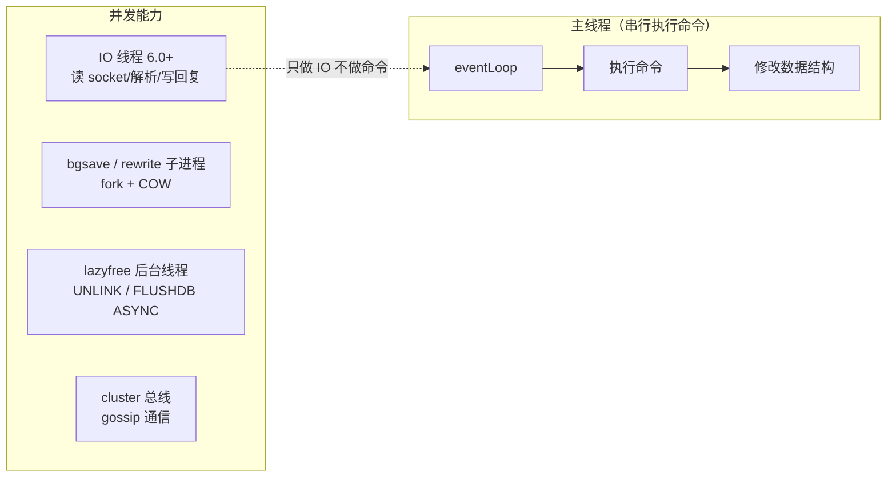

### 1.4 版本演进时间线（面试常问"你了解 Redis 哪个版本"）

| 版本 | 关键变化 | 面试价值 |
| --- | --- | --- |
| 2.6 | Lua 脚本、发布订阅完善 | — |
| 2.8 | PSYNC 增量复制、Redis Sentinel 稳定 | 主从必问 |
| 3.0 | Cluster 集群 | 集群必问 |
| 4.0 | lazyfree 异步删除、UNLINK、模块化 Module | 大 key 治理 |
| 5.0 | Stream 类型（类 Kafka 消息队列） | 消息队列选型 |
| 6.0 | 多线程 IO、ACL 权限、RESP3、客户端缓存 | 线程模型必问 |
| 7.0 | listpack 全面替代 ziplist、Multi-Part AOF、Function、命令元数据 | 数据结构演进必问 |
| 7.2 | Set 引入 listpack 编码 | 细节加分项 |

---

## 第 2 章 底层数据结构（一切的根基）

> 这一章是整份文档的地基。**所有"为什么快""为什么内存占用大""为什么某个操作卡住"的答案，都在这里。**

### 2.1 为什么不用 C 原生字符串：SDS

Redis 没用 `char*`，而是自己实现了 **SDS（Simple Dynamic String）**。

#### 2.1.1 结构

```c
struct sdshdr {
    uint32_t len;    // 已用长度
    uint32_t alloc;  // 分配的总长度
    unsigned char flags; // 低 3 位标识类型（sdshdr5/8/16/32/64）
    char buf[];      // 柔性数组，真实数据
};
```

分 5 种头（`sdshdr5/8/16/32/64`），按字符串长度自动选，**短字符串用小头省内存**。`sdshdr5` 甚至不存 `len/alloc`，只用 flags 高 5 位表示长度（限制 < 32）。

> 7.0 之后对 SDS 头做了调整（`sdshdr5` 不再用于新建 key，且 `flags` 位置调整），但思想一致。

#### 2.1.2 相比 C 字符串解决的四个问题

| C 字符串的问题 | SDS 的解法 | 复杂度变化 |
| --- | --- | --- |
| 求长度要遍历 `strlen` O(N) | `len` 字段直接读 | O(N) → **O(1)** |
| 拼接可能缓冲区溢出 | 拼接前检查 `alloc`，不足则扩容 | 安全 |
| 每次改长度都要 realloc | **空间预分配 + 惰性释放** | 减少 realloc 次数 |
| 不能存 `\0`（如二进制、图片） | 用 `len` 而非结束符判断边界 | **二进制安全** |

#### 2.1.3 空间预分配策略（关键细节）

扩容时：

- 若 `len < 1MB`：`alloc = 2 * len`（翻倍）
- 若 `len >= 1MB`：`alloc = len + 1MB`（每次多加 1MB，避免大字符串翻倍浪费）

惰性释放：缩短字符串时**不立即 realloc**，只改 `len`，多余空间由 `alloc - len` 记录，后续拼接可直接复用。

> **面试延伸**：为什么阈值是 1MB？因为小字符串翻倍的绝对浪费可接受，而大字符串翻倍会造成明显内存放大。这是一种"**用一点内存换 realloc 次数**"的经典权衡。

#### 2.1.4 SDS 为什么还保留 `\0` 结尾

为了**兼容 C 标准库函数**（`printf`、`strcmp` 等可以直接用），同时不影响二进制安全——因为判边界用的是 `len` 而不是 `\0`。

### 2.2 dict：哈希表与渐进式 rehash

Redis 的"字典"是全局 key 空间、Hash 类型、Set 类型（hashtable 编码）、ZSet 的 score→member 映射的共同底座。

#### 2.2.1 结构

```c
typedef struct dictht {
    dictEntry **table;   // 桶数组
    unsigned long size;  // 桶数量，2 的幂
    unsigned long sizemask; // size - 1，用于取模
    unsigned long used;  // 已有节点数
} dictht;

typedef struct dict {
    dictType *type;      // 类型函数（hash、keydup、valdup…）
    void *privdata;
    dictht ht[2];        // 两个哈希表：ht[1] 只在 rehash 时使用
    long rehashidx;      // rehash 进度，-1 表示未在 rehash
    int16_t pauserehash; // 暂停标记
} dict;

typedef struct dictEntry {
    void *key;
    union { void *val; uint64_t u64; int64_t s64; double d; } v;
    struct dictEntry *next; // 链地址法解决冲突
} dictEntry;
```

#### 2.2.2 哈希与冲突

- 哈希函数用 **SipHash**（防 HashDoS 攻击；早期用 MurmurHash）。
- 冲突用**链地址法**，新节点**头插**（因为无尾指针，头插 O(1)，且新数据更可能被访问）。
- 取模用 `hash & sizemask`（因为 `size` 是 2 的幂，比 `%` 快）。

#### 2.2.3 扩容与缩容阈值

| 场景 | 负载因子 `used / size` | 动作 |
| --- | --- | --- |
| 无持久化任务 | ≥ 1 | 扩容到 `used * 2` 之上的 2 的幂 |
| 正在 bgsave / bgrewriteaof | ≥ 5 | 扩容（因为 COW 期间尽量避免写内存） |
| 任意 | < 0.1 | 缩容 |

> **为什么 bgsave 时阈值提高到 5？** 因为子进程 fork 后共享内存页，父进程一旦写内存就会触发 COW 复制；rehash 会产生大量写操作，加剧内存膨胀。所以宁可在高负载因子下多扛一会儿。

#### 2.2.4 渐进式 rehash（必考）

**问题**：如果几百万 key 一次性 rehash，主线程会阻塞数秒。

**解法**：分多次、渐进搬移。

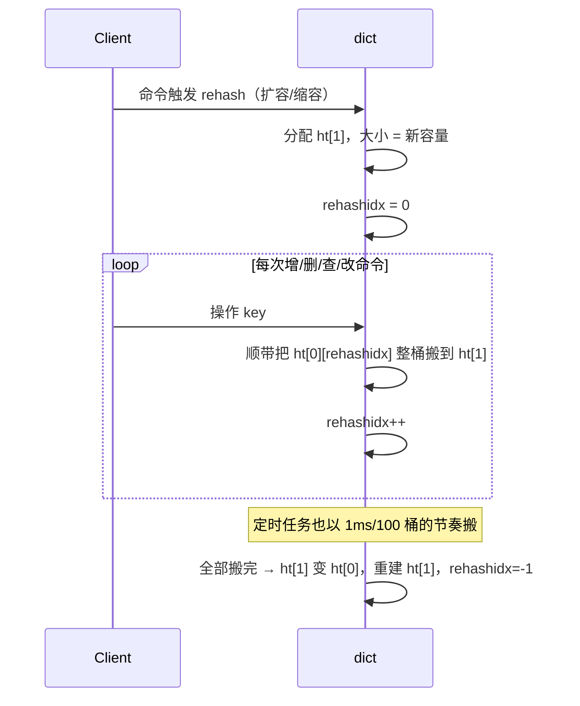

**rehash 期间的三条访问规则**（细节题高频）：

1. **查找**：先查 `ht[0]`，没找到再查 `ht[1]`。
2. **新增**：**只写 `ht[1]`**，保证 `ht[0]` 只减不增，最终必然搬空。
3. **删除 / 更新**：两个表都要处理（key 可能在任一表中）。

**扫描类命令（SCAN/KEYS/HSCAN）在 rehash 期间的问题**：桶位置会变，所以 SCAN 用**反向二进制迭代 + 高位进位**算法，保证"扩容/缩容期间不漏不重（重复可容忍）"。这也是 SCAN 的 `cursor` 不是简单索引的原因。

#### 2.2.5 延伸：dict 的迭代器与安全迭代

`dictScan` 采用 `reverse binary iteration`：cursor 按位反转递增。扩容时（mask 变大）游标会自然覆盖新桶，缩容时（mask 变小）会跳过已扫部分——这是**不需要暂停 rehash 也能安全遍历**的巧思，值得单独理解。

### 2.3 skiplist：跳表

ZSet 的排序结构。

#### 2.3.1 结构

```c
typedef struct zskiplistNode {
    sds ele;                     // member
    double score;                // 分值
    struct zskiplistNode *backward; // 后退指针（仅第 1 层）
    struct zskiplistLevel {
        struct zskiplistNode *forward;
        unsigned long span;      // 跨度：用于 O(logN) 算排名
    } level[];
} zskiplistNode;

typedef struct zskiplist {
    struct zskiplistNode *header, *tail;
    unsigned long length;
    int level;                   // 当前最大层数
} zskiplist;
```

#### 2.3.2 核心参数

- 最大层数 **32**（`ZSKIPLIST_MAXLEVEL`），可支撑 2^32 个元素。
- 层高随机：`while (random() < 0.25) level++`，即**每升一层概率 1/4**。
- 期望层高 ≈ 1/(1-0.25) = 1.33，空间开销可控。

#### 2.3.3 为什么是跳表而不是红黑树 / B+ 树

这是必考对比题：

| 维度 | 跳表 | 红黑树 | B+ 树 |
| --- | --- | --- | --- |
| 范围查询 `ZRANGE` | 找到起点后**沿第 1 层链表顺序走**，极快 | 需中序遍历，指针跳转多、cache 不友好 | 叶子链表，适合磁盘 |
| 实现复杂度 | 低（无旋转/变色） | 高（插入删除多种 case） | 高 |
| 并发/锁粒度（扩展场景） | 局部修改，易做无锁 | 旋转影响面大 | 页分裂影响大 |
| 内存 | 指针多，但有 1/4 概率摊薄 | 每节点固定 3 指针 + 颜色 | 页内紧凑，磁盘友好 |
| 排名查询 | `span` 字段 O(logN) | 需额外维护子树 size | 需额外维护 |

一句话：**跳表用"多层索引 + 概率平衡"换来了实现简单、范围查询友好、易扩展**，在纯内存场景下比平衡树更划算。B+ 树是为磁盘 IO 设计的，Redis 是内存数据库，用不上它的优势。

#### 2.3.4 延伸：ZSet 为什么同时用 dict + skiplist

```mermaid
graph LR
    A[ZADD key score member] --> B[dict: member → score<br/>O(1) 查分值]
    A --> C[skiplist: 按 score 有序<br/>O(logN) 范围/排名]
    B --> D[ZSCORE 快]
    C --> E[ZRANGE / ZRANK 快]
```

- `ZSCORE` 走 dict，O(1)。
- `ZRANGE / ZRANK / ZREVRANGE` 走 skiplist，O(logN + M)。
- **代价**：同一个 member 存两份，内存约翻倍。这是典型的"**空间换操作复杂度**"。

### 2.4 紧凑编码：ziplist 与 listpack

#### 2.4.1 ziplist 的结构

```
<zlbytes><zltail><zllen><entry1><entry2>...<entryN><zlend=0xFF>
```

- `zlbytes`：整个 ziplist 字节数（用于 realloc）。
- `zltail`：尾节点偏移（**O(1) 尾插/尾删**）。
- `zllen`：节点数（< 65535 时有效，否则需遍历）。
- 每个 entry：`prevlen`（前一个 entry 长度，1 或 5 字节）+ `encoding`（编码方式与长度）+ `data`。

**优点**：连续内存、无指针、省内存、cache 友好。
**缺点**：插入/删除需 `memmove` 移动后续所有 entry，O(N)。

#### 2.4.2 级联更新（cascade update）—— ziplist 的致命缺陷

`prevlen` 用于**反向遍历**。当一个 entry 长度从 < 254 字节变成 ≥ 254 字节时，`prevlen` 需要从 1 字节扩为 5 字节，导致**该 entry 变长**，于是后一个 entry 的 `prevlen` 也可能需要扩容……**连锁反应，最坏 O(N²)**。

这是 Redis 7.0 用 **listpack 全面替换 ziplist** 的核心原因。

#### 2.4.3 listpack 的改进

```
<total-bytes><num-elements><entry1>...<entryN><0xFF>
```

关键：**每个 entry 把自己的长度记录在 entry 尾部（`backlen`），不再记录前驱长度**。

- 插入/删除只影响自身，**彻底消除级联更新**。
- 仍支持反向遍历：从尾部读 `backlen` 就能跳回上一个 entry 开头。
- 结构更紧凑：省掉每个 entry 的 `prevlen`。

> 7.0 起：Hash、ZSet、List（quicklist 节点）、Stream 全部基于 listpack。7.2 起 Set 也支持 listpack 编码。

### 2.5 quicklist：List 的实现

`List` 不是纯链表，也不是纯 ziplist，而是 **quicklist = 双向链表 + 每个节点是一个 listpack（7.0 前是 ziplist）**。

```c
typedef struct quicklistNode {
    struct quicklistNode *prev, *next;
    unsigned char *entry;   // 指向 listpack
    unsigned int sz;        // listpack 字节数
    unsigned int count;     // 元素个数
    unsigned int encoding;  // 是否 LZF 压缩
    ...
} quicklistNode;

typedef struct quicklist {
    quicklistNode *head, *tail;
    long length;            // 总元素数
    int fill;               // 每个节点的容量限制
    ...
} quicklist;
```

**为什么这么设计**：

- 纯链表：每元素 2 个指针（16 字节）+ 内存碎片，太浪费。
- 纯 ziplist：一个超大连续块，插入要 memmove，且申请大块连续内存困难。
- **quicklist**：折中——链表提供 O(1) 头尾操作与节点级拆分，listpack 提供紧凑存储与 cache 友好。

**参数**：`list-max-listpack-size`（默认 128，表示每个节点最多 128 个元素；负数表示按字节：-1=4KB, -2=8KB…），`list-compress-depth`（中间节点 LZF 压缩，0 表示不压缩）。

### 2.6 intset：整数集合

当 Set 中的元素**全是整数**且数量 ≤ `set-max-intset-entries`（默认 512）时，用 intset。

```c
typedef struct intset {
    uint32_t encoding; // INTSET_ENC_INT16/32/64
    uint32_t length;
    int32_t contents[]; // 有序、连续、无重复
};
```

- **有序连续数组**，查找用二分，O(logN)。
- **升级（upgrade）**：插入超出当前编码范围的整数时，整个数组升级到更大编码（如 int16 → int32），需 realloc + 逐个转换，O(N)。
- **不支持降级**：一旦升级，即使删掉大数也不回退。这是"**避免频繁升降级**"的权衡。

### 2.7 redisObject：对象系统

Redis 的 key 和 value 都是 `redisObject`。

```c
typedef struct redisObject {
    unsigned type:4;       // 5 种基础类型 + 扩展
    unsigned encoding:4;   // 底层编码（共 11 种）
    unsigned lru:24;       // LRU 时间戳 或 LFU 计数
    int refcount;          // 引用计数（共享对象）
    void *ptr;             // 指向真实数据结构
} robj;
```

`lru:24` 的复用很巧妙：LRU 模式下存**秒级时间戳**，LFU 模式下拆成 **16 位分钟级衰减时间 + 8 位访问计数**。

**refcount 的作用**：

- 共享整数对象：0~9999 的整数在启动时预创建（`OBJ_SHARED_INTEGERS`），`refcount` 加一即可复用，省内存。
- 但**只有 `maxmemory-policy=noeviction` 且非 LRU/LFU 时才能共享**（因为共享对象的 `lru` 字段无法区分不同 key 的访问时间）。这是个细节考点。

### 2.8 编码转换全景表（背诵级）

| 类型 | 编码 | 触发条件 | 转换方向 |
| --- | --- | --- | --- |
| String | `int` | 值是整数且长度 ≤ 20 | — |
| String | `embstr` | 长度 ≤ 44（3.x 是 39） | 修改后变 `raw` |
| String | `raw` | 长度 > 44 | — |
| List | `quicklist` | 始终（7.0 起） | 3.2 前是 ziplist/linkedlist |
| Hash | `listpack` | 元素 ≤ 128 且每个 field/value ≤ 64 字节 | 超限 → `hashtable` |
| Hash | `hashtable` | 超过上述阈值 | 不回落 |
| Set | `intset` | 全整数且 ≤ 512 | 加非整数 → `hashtable`/`listpack` |
| Set | `listpack` | 7.2+，元素 ≤ 128 且值 ≤ 64 字节 | 超限 → `hashtable` |
| Set | `hashtable` | 超过阈值 | 不回落 |
| ZSet | `listpack` | 元素 ≤ 128 且 member ≤ 64 字节 | 超限 → `skiplist` |
| ZSet | `skiplist` | 超过阈值（内部是 dict + skiplist） | 不回落 |

**三个"不回落"要记住**：Hash / Set / ZSet 一旦从紧凑编码转为 hashtable/skiplist，**即使删元素也不会回退**。原因：转换本身要遍历重建，且回退判断成本高、抖动大。

> 对应的动态配置（7.0 命名，7.0 前叫 `zset-max-ziplist-*`）：
> `hash-max-listpack-entries` / `hash-max-listpack-value`
> `zset-max-listpack-entries` / `zset-max-listpack-value`
> `set-max-intset-entries` / `set-max-listpack-entries`
> `list-max-listpack-size`

### 2.9 各类型的实现细节与命令复杂度

#### 2.9.1 String

- 底层：SDS。`APPEND`、`SETRANGE`、`GETRANGE` 都是基于 len 的定长操作。
- `INCR/DECR/INCRBY`：识别 `int` 编码，直接对 `ptr` 里的 long 做加法（**不发散到 SDS**），所以 O(1)。
- **位图**：`SETBIT/GETBIT/BITCOUNT/BITOP/BITPOS` 直接在 SDS 的 byte 数组上按位操作。`BITCOUNT` 用**汉明重量 + 查表/位运算**实现，7.0 起在指定范围时按字节/位分段处理（早期全量 O(N)）。
- 复杂度：`GET/SET` O(1)，`APPEND` O(1) 摊销，`GETRANGE` O(N)。

#### 2.9.2 Hash

- `listpack` 编码时：**遍历查找**，O(N)，但 N ≤ 128，实际很快。
- `hashtable` 编码时：O(1)。
- `HSCAN` 在 hashtable 下走 dictScan；在 listpack 下就是一次性返回全部（**所以小 hash 的 HSCAN 会一次吐完**，这是个细节坑）。

#### 2.9.3 List

- `LPUSH/RPUSH/LPOP/RPOP` O(1)（quicklist 头尾节点定位）。
- `LINDEX/LSET` O(N)：需从头/尾遍历节点定位（quicklist 有节点级索引优化，但仍 O(N)）。
- `LRANGE` O(S + N)：S 是偏移量。
- `LINSERT` O(N)：需查找 pivot。

#### 2.9.4 Set

- `SADD/SREM/SISMEMBER` O(1)（intset 下 O(logN) 二分）。
- `SMEMBERS` O(N) —— **大 Set 慎用**，用 `SSCAN`。
- `SINTER/SUNION/SDIFF` O(N*M)：多集合求交，按最小集合遍历 + 判断其他集合。
- `SRANDMEMBER` O(1)（随机取，可能重复）；`SPOP` O(1)。

#### 2.9.5 ZSet

- `ZADD` O(logN)：先写 dict，再插 skiplist。
- `ZRANGE / ZRANGEBYSCORE` O(logN + M)：M 为返回数量。
- `ZRANK` O(logN)：沿 skiplist 累加 `span`。
- `ZREM` O(logN)：两处删除。
- **`ZRANGEBYSCORE` 为什么快**：skiplist 顶层先跳到 score 区间起点，再下沉，只走有效路径，不是全表扫描。

#### 2.9.6 扩展类型

| 类型 | 底层 | 说明 |
| --- | --- | --- |
| Bitmap | String + 位操作 | 本质是 SDS，无独立结构 |
| HyperLogLog | String + 16384 个 6bit 寄存器 | 12KB 固定内存，标准误差 0.81% |
| GEO | ZSet（geohash 编码成 score） | `GEOADD` 把经纬度编码为 52bit 整数做 score |
| Stream | rax（基数树）+ listpack | 消息 ID 为 `ms-seq`，支持消费组、ACK、pending |
| Pub/Sub | 服务端字典 + 客户端链表 | **不持久化**，离线消息直接丢 |

### 2.10 内存分配与碎片

- **jemalloc**：按 size class（8/16/32/64…）分配，减少外部碎片。
- **碎片率** `mem_fragmentation_ratio = used_memory_rss / used_memory`。
  - `> 1.5` 说明碎片严重；`< 1` 说明发生了 swap（**危险信号**）。
- **activedefrag**：4.0 引入，后台线程做碎片整理（`active-defrag-threshold-lower/upper`）。

> **实战延伸**：`used_memory_rss` 高但 `used_memory` 低，常见于大量短生命周期 key 反复增删、或 bigkey 删除后未归还。开 `activedefrag` 或滚动重启。


---

## 第 3 章 单线程、事件循环与网络模型（命令的完整生命周期）

> 本章回答用户最想知道的：**我敲一个 `SET`，Redis 内部到底走了哪些函数、经过哪些数据结构、什么时候写磁盘、什么时候回包。**

### 3.1 事件驱动框架：aeEventLoop

Redis 自己封装了一层事件库 `ae`，屏蔽 epoll / kqueue / evport / select 的差异（编译时按平台选最优，`#include` 宏替换实现）。

```c
typedef struct aeEventLoop {
    int maxfd;
    aeFileEvent *events;   // 注册的文件事件数组（按 fd 索引）
    aeFiredEvent *fired;   // 本次就绪的事件
    aeTimeEvent *timeEventHead; // 定时事件链表
    int stop;
    ...
} aeEventLoop;
```

**四类事件**：

| 事件 | 来源 | Redis 中的用途 |
| --- | --- | --- |
| 文件事件（可读） | 客户端 socket 可读 | 读取命令 |
| 文件事件（可写） | socket 可写 | 发送回复（有输出缓冲时） |
| 时间事件 | `serverCron` 每 100ms（`hz=10`） | 过期扫描、rehash 步进、持久化检查、统计、集群心跳 |
| 时间事件（一次） | 如 `SHUTDOWN` 定时 | 特殊场景 |

**事件循环主逻辑（简化）**：

```
while (!stop) {
    // 1. 计算距离下一个时间事件还有多久
    // 2. aeApiPoll 阻塞等待（epoll_wait，超时=最近的时间事件）
    // 3. 处理所有就绪的文件事件（读/写）
    // 4. 处理到期的时间事件（serverCron）
    // 5. beforeSleep：把 AOF 缓冲刷盘、处理 unblocked clients、发送 pending 回复
}
```

**关键设计点**：

- `aeApiPoll` 的超时由"最近的时间事件"决定，**没有事件时也不会空转占 CPU**。
- `serverCron` 的 `hz` 默认 10，也就是每 100ms 一次；`dynamic-hz` 开启后空闲时降频、繁忙时升频（省 CPU）。

### 3.2 IO 多路复用：epoll 的内部机制

这是"为什么单线程能扛万级连接"的根本答案。

#### 3.2.1 三种多路复用对比（必背表）

| 维度 | select | poll | epoll |
| --- | --- | --- | --- |
| 数据结构 | 位图 `fd_set`，上限 1024（可调但低效） | `pollfd` 数组，无上限 | **红黑树 + 就绪链表** |
| 每次调用 | 把 fd 集合**全量从用户态拷贝到内核态** | 同样全量拷贝 | 只在 `epoll_ctl` 时注册一次，**不重复拷贝** |
| 就绪检测 | 内核**遍历所有 fd** 检查 | 同样遍历 | 内核**回调**把就绪 fd 挂到链表，`epoll_wait` 只取链表 |
| 返回 | 返回就绪个数，用户需自己遍历找哪个就绪 | 同 select | 直接返回就绪的 fd 列表 |
| 时间复杂度 | O(N) | O(N) | **O(1)**（就绪数） |
| 触发模式 | 只有水平触发 | 只有水平触发 | **LT / ET 都支持** |

#### 3.2.2 epoll 三个系统调用

```c
int epfd = epoll_create(1);                  // 创建 epoll 实例（内核 eventpoll 对象）
epoll_ctl(epfd, EPOLL_CTL_ADD, fd, &event);  // 把 fd 挂到红黑树，并注册回调 ep_poll_callback
epoll_wait(epfd, events, maxevents, timeout); // 等待就绪链表非空
```

**内核做了什么**：

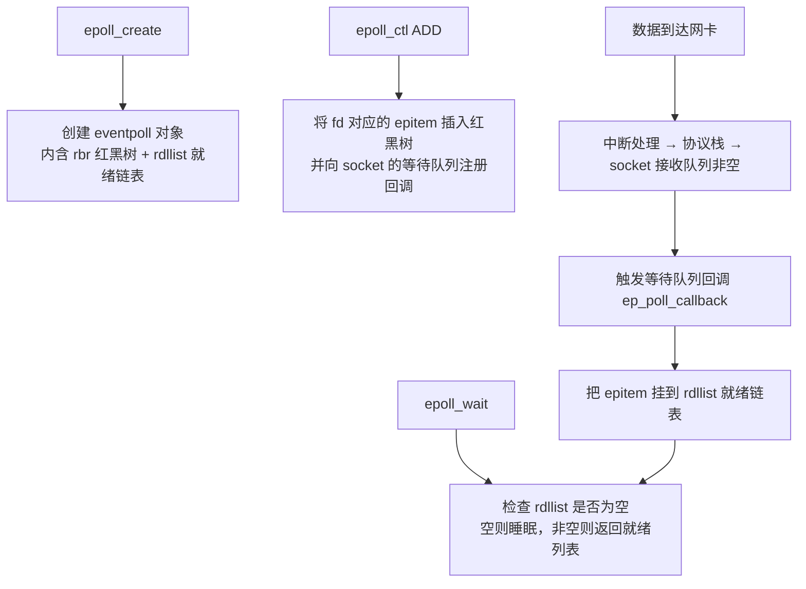

**为什么 O(1)**：`epoll_wait` 不需要遍历所有 fd，只需检查"就绪链表"是否为空，有则把链表里的节点拷给用户态。

**ET vs LT（Redis 用 LT）**：

- **LT（水平触发）**：只要缓冲区还有数据，`epoll_wait` 就持续返回。实现简单，不会丢事件。
- **ET（边缘触发）**：只在状态变化时通知一次，必须**一次读到 EAGAIN 为止**，否则丢数据。Nginx 用 ET。
- **Redis 选择 LT**：因为 Redis 每次读事件都会把 socket 读到 EAGAIN（`readQueryFromClient` 循环读），LT 更安全、代码更简单。

### 3.3 一条命令的完整生命周期（核心章节）

#### 3.3.1 建立连接阶段

```
客户端 connect
  → TCP 三次握手，内核 accept 队列
  → epoll 报告 listenfd 可读
  → acceptTcpHandler()  → anetAccept()
  → createClient()      // 分配 client 结构，注册读事件
  → 输出 "OK"？不，Redis 不主动发，等客户端发命令
```

`client` 结构里关键字段：`querybuf`（输入缓冲）、`buf`/`reply`（输出缓冲）、`argc/argv`（解析后的参数）、`db`（当前数据库指针）、`dict`（订阅频道）、`multiState`（事务状态）。

#### 3.3.2 读取与解析阶段

```
socket 可读 → epoll 返回
  → readQueryFromClient()
      → read() 到 querybuf（16KB 一批，循环读到 EAGAIN）
      → processInputBuffer()
          → processInlineBuffer() 或 processMultibulkBuffer()
              → RESP 协议解析：*3\r\n$3\r\nSET\r\n$3\r\nfoo\r\n$3\r\nbar\r\n
          → 每解析出一条完整命令：
              → processCommandAndResetClient()
```

**RESP 协议为什么要这样设计**：

- 文本、人可读、易于调试（`telnet` 就能发命令）。
- 前缀声明长度（`$3`），**解析不需要转义、不需要回溯**，解析 O(N) 且常数极小。
- 支持内联命令（inline），方便手工测试。

#### 3.3.3 命令查找与校验

```
processCommand(c)
  1. 若是 QUIT → 标记关闭
  2. 查找命令表：cmd = lookupCommand(c->argv[0])
     —— 全局字典 server.commands（key 是命令名，O(1)）
  3. 校验：
     - 参数个数是否匹配（arity）
     - 是否已认证（ACL / requirepass）
     - 是否有权限（ACL 用户权限位）
     - 集群模式：key 是否在本节点槽位（否则返回 MOVED/ASK）
     - maxmemory 是否超限（超限则尝试淘汰，失败返回 OOM）
     - 是否处于事务队列状态（MULTI 中则入队，不执行）
     - 是否被 CLIENT PAUSE 暂停
     - 是否有写命令禁止（min-replicas-to-write 不满足则拒绝写）
  4. 记录慢查询开始时间（如果 slowlog 开启）
  5. call(c, flags) → 真正执行
```

> **面试延伸**：`lookupCommand` 在 7.0 之前用**大小写不敏感**的字典；7.0 引入了 `COMMAND DOCS` 等元数据，命令表结构更复杂，但查找仍是 O(1)。

#### 3.3.4 执行阶段：以 `SET foo bar` 为例

```
call() → c->cmd->proc(c) = setCommand()
  → 解析参数：SET 支持 NX/XX/EX/PX/EXAT/PXAT/KEEPTTL/GET 等选项
  → setGenericCommand()
      → 若带 NX/XX，先 lookupKeyWrite() 检查是否存在
      → setKey()：
          ├─ 若 key 已存在且类型不同 → 先 dbDelete() 删旧值
          ├─ 创建 robj：tryObjectEncoding()
          │     - 字符串长度 ≤ 20 且是整数 → 编码为 OBJ_ENCODING_INT（ptr 直接存 long）
          │     - 长度 ≤ 44 → OBJ_ENCODING_EMBSTR（robj + SDS 一次 malloc 连续分配）
          │     - 否则 → OBJ_ENCODING_RAW（robj 与 SDS 两次 malloc）
          └─ dbAdd() / dbOverwrite()
              → dictAdd(server.db[i].dict, key, val)
                  → 若 dict 正在 rehash，可能顺带搬一个桶
                  → 若负载因子超阈值，触发 dictExpand，进入渐进式 rehash
      → 若带 EX/PX，调用 setExpire()：
          → 写入 db->expires 字典（key → 过期时间戳，毫秒）
          → 注意：过期时间**不覆盖在值里**，而是单独一个 dict
  → 若 key 被修改，server.dirty++ （用于判断是否触发 RDB 保存条件）
  → 传播：propagateNow()
      ├─ 写入 AOF 缓冲 server.aof_buf（如果 aof 开启）
      └─ 写入 repl backlog + 发送给所有从库（如果主从开启）
```

**这里能延伸出的考点非常多**：

1. `expires` 是**独立字典**，所以 `SET` 一个带过期时间的 key 是**两次 dict 写入**（主字典 + 过期字典）。这解释了为什么 "大量带过期时间的 key" 内存开销更高。
2. `EMBSTR` 是**一次 malloc 分配 robj + SDS**，所以它是**只读的**——任何修改（如 `APPEND`）都会转成 `RAW`（因为 SDS 可能需要 realloc，而 robj 和 SDS 在同一块内存里无法独立 realloc）。
3. `dirty` 计数器决定 RDB 的 `save` 条件（`save 900 1` 表示 900 秒内至少 1 次修改就落盘）。
4. **写命令的传播是"命令复制"而非"状态复制"**（7.0 前 AOF 也是记录命令），这导致非确定性命令（如 `SPOP`、`TIME`、`SRANDMEMBER`）必须特殊处理（改为传播确定结果）。

#### 3.3.5 回复阶段

```
addReply(c, shared.ok) 或 addReplyBulk()
  → 写入 c->buf（固定 16KB 静态缓冲）
  → 若超过 16KB → 追加到 c->reply 链表（动态缓冲）
  → 标记 CLIENT_PENDING_WRITE，挂到 server.clients_pending_write
  → 在 beforeSleep() 中统一 writeToClient()
      → write() 尽可能多写
      → 若写不完（socket 发送缓冲满）→ 注册可写事件，等下次 epoll 通知
```

> **关键理解**：Redis **不是"执行完立刻写回"**，而是**攒到 `beforeSleep` 批量写**。这是减少系统调用次数的重要优化。

#### 3.3.6 完整时序图

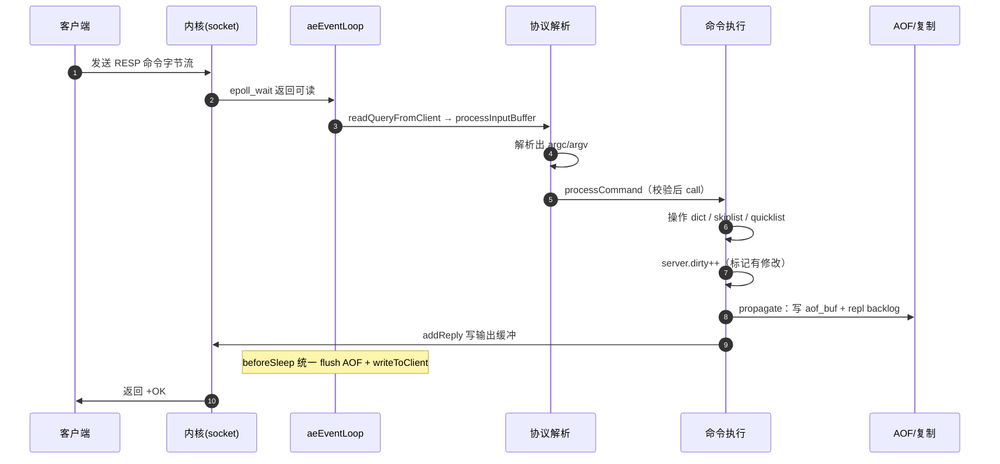

### 3.4 其余几条命令的差异化路径

理解"共性"之后，再看"差异"，才叫真懂。

#### 3.4.1 `ZADD leaderboard 100 alice`

```
zaddGenericCommand()
  → 检查编码：若 listpack 且满足阈值 → 直接在 listpack 中查找插入（O(N) 但 N≤128）
  → 否则（skiplist 编码）：
      → zslInsert(zs->zsl, score, ele)
          → 从最高层向下查找插入位置（O(logN)）
          → 随机生成层高（1/4 概率升层）
          → 更新每层 forward 指针与 span
      → dictAdd(zs->dict, ele, &score)   // 同时写 dict
  → 更新元素数量，可能触发编码转换（listpack → skiplist）
```

**注意**：`ZADD` 是"**两处写**"，所以内存占用约为"同数量 Set 的 2 倍"。这是必须能说出来的量级感。

#### 3.4.2 `LPUSH queue item`

```
lpushCommand()
  → lookupKeyWrite 找 list
  → 若不存在，创建 quicklist（此时是空链表）
  → listTypePush()：
      → 定位 head 节点的 listpack
      → 若 head 节点元素数 < fill 阈值 → 在 listpack 头部插入（可能触发 listpack 扩容/realloc）
      → 若已满 → 新建 quicklistNode，插到链表头部
  → 返回新长度
```

**延伸**：`LPUSH` 是 O(1)，但"listpack 已满 + 需要在中间插入"就是 O(N)。所以 **List 只适合头尾操作，不适合中间插入**。

#### 3.4.3 `DEL bigkey` 为什么会卡住

```
delCommand()
  → dbDelete()
      → dictDelete(db->dict, key)         // 摘链，O(1)
      → dictDelete(db->expires, key)      // 摘除过期记录
      → if (val) decrRefCount(val)
          → freeStringObject / freeListObject / freeHashObject ...
              → 逐个释放底层结构里的**所有元素**
                  - 一个 100 万元素的 Hash → 100 万次 free()
                  - 主线程阻塞，可能几百毫秒到数秒
```

**解法**：`UNLINK`（4.0+）把"摘链"和"释放"分离——摘链同步做，释放交给 `lazyfree` 后台线程（`bio_lazy_free`）。配置 `lazyfree-lazy-user-del yes` 可让 `DEL` 也走异步。

> 这是"**O(1) 命令不代表 O(1) 耗时**"的经典案例，面试极爱考。

#### 3.4.4 `KEYS *` 为什么在生产环境是事故

```
keysCommand()
  → 遍历 db->dict 的**所有桶**，把所有 key 拼成回复
  → 复杂度 O(N)，N = 全库 key 数
  → 更致命的是：回复可能几千 MB，全部堆在输出缓冲 → 内存暴涨 + 主线程阻塞
```

**替代**：`SCAN cursor COUNT 100`，游标式分批，每次只返回一批，主线程开销可控。

**但 SCAN 也有坑**：弱一致性（rehash 期间可能重复），且 `COUNT` 是"提示"不是"精确"。

#### 3.4.5 `EXPIRE key 60` 底层做了什么

```
expireGenericCommand()
  → lookupKeyWrite 确认 key 存在
  → 计算 when = mstime() + 60*1000
  → setExpire(c->db, key, when)
      → dictAdd(db->expires, key, when)   // 仅写过期字典，**不动主字典**
  → 传播：把 EXPIRE 命令（或 PEXPIREAT，保证从库执行结果一致）同步给从库/AOF
```

**为什么要传播 `PEXPIREAT` 而不是 `EXPIRE`**：因为主从/主备执行时间不同，若传相对时间会导致过期时刻漂移。这是"**用绝对时间保证确定性**"的经典手法。

### 3.5 单线程模型的收益与代价

#### 3.5.1 收益

- **无锁**：所有数据结构操作天然串行，不需要加锁，省掉锁竞争与死锁排查。
- **无上下文切换**：不用保存/恢复寄存器、不用切栈，CPU cache 命中率高。
- **原子性天然成立**：单条命令、`MULTI/EXEC`、Lua 脚本都是原子的（因为没人能插进来）。
- **实现简单**：不需要考虑并发安全，代码可维护。

#### 3.5.2 代价（这才是面试想听的）

| 代价 | 表现 | 缓解手段 |
| --- | --- | --- |
| 无法利用多核 | 单实例 QPS 上限 ~10w（与命令复杂度相关） | 多实例分片（Cluster / 业务拆分） |
| 一条慢命令阻塞所有客户端 | `KEYS *`、`FLUSHALL`、大 `ZRANGE` | 禁用危险命令、`SCAN` 替代、`UNLINK` |
| 大 key 操作卡顿 | `DEL` 百万元素、`HGETALL` 大 hash | 拆分 key、异步删除、分页 |
| fork 阻塞 | `bgsave` fork 时主线程阻塞（与页表大小成正比） | 控制实例内存 ≤ 10~16GB、关闭 `transparent huge pages` |
| 无法水平扩展单 key | 单 key 的读写仍落在一个节点 | hash tag 设计、热点拆分 |

#### 3.5.3 6.0 多线程 IO 的边界（高频考）


**必须明确的四点**：

1. **只做网络读写与协议解析**，**命令执行仍是单线程**。所以"多线程 Redis"是伪命题。
2. 默认 `io-threads=1` 即关闭。建议设为 CPU 核数的 3/4，且**不超过 8**（收益递减）。
3. 开启条件：`io-threads > 1` 且 `io-threads-do-reads=yes`（默认 no，即只多线程写）。
4. **为什么不做多线程执行**：一旦多线程执行，就要给 dict/skiplist 加锁，锁竞争 + 复杂度收益比极低；而 IO 才是瓶颈（尤其大 value 场景）。

### 3.6 客户端缓冲与输出缓冲限制

三个缓冲相关参数，是线上事故高发区：

| 参数 | 作用 | 默认 |
| --- | --- | --- |
| `client-output-buffer-limit normal` | 普通客户端输出缓冲 | `0 0 0`（不限） |
| `client-output-buffer-limit replica` | 从库客户端 | `256mb 64mb 60` |
| `client-output-buffer-limit pubsub` | 订阅客户端 | `32mb 8mb 60` |

**格式**：`<硬限制> <软限制> <软限制持续秒数>`。超硬限制立即断开，超软限制且持续超时也断开。

**经典事故**：一个 `MONITOR` 或 `pubsub` 客户端消费慢，输出缓冲堆积到几 GB，导致 Redis 内存打满被 OOM Killer 杀掉。**根因是"输出缓冲不受 maxmemory 约束"**。


---

## 第 4 章 持久化：RDB / AOF / 混合

### 4.1 为什么需要持久化，以及"持久化不等于不丢数据"

Redis 是内存数据库，进程挂了数据就没了。持久化解决"重启恢复"，但**不保证零丢失**：

- RDB 是**时间点快照**，两次快照之间的写入会丢。
- AOF 记录**写命令**，`appendfsync everysec` 最多丢 1 秒。
- 只有 `appendfsync always` 才接近零丢失，但性能代价巨大。

> **面试标准答法**：Redis 的持久化是"**可用性手段**"而非"**金融级事务日志**"。要强一致必须靠外部（DB / WAL / 分布式共识）。

### 4.2 RDB：快照

#### 4.2.1 触发方式

| 方式 | 命令/配置 | 是否阻塞主线程 |
| --- | --- | --- |
| 手动同步 | `SAVE` | **完全阻塞**（生产禁用） |
| 手动异步 | `BGSAVE` | fork 时短暂阻塞 |
| 自动 | `save 900 1` / `save 300 10` / `save 60 10000` | 同上 |
| 主从全量同步 | 从库请求时主库自动 `BGSAVE` | 同上 |
| 关机 | `SHUTDOWN` 时若配置 save | 阻塞 |
| 副本关闭 | `FLUSHALL` 前 | — |

#### 4.2.2 fork + COW：核心机制

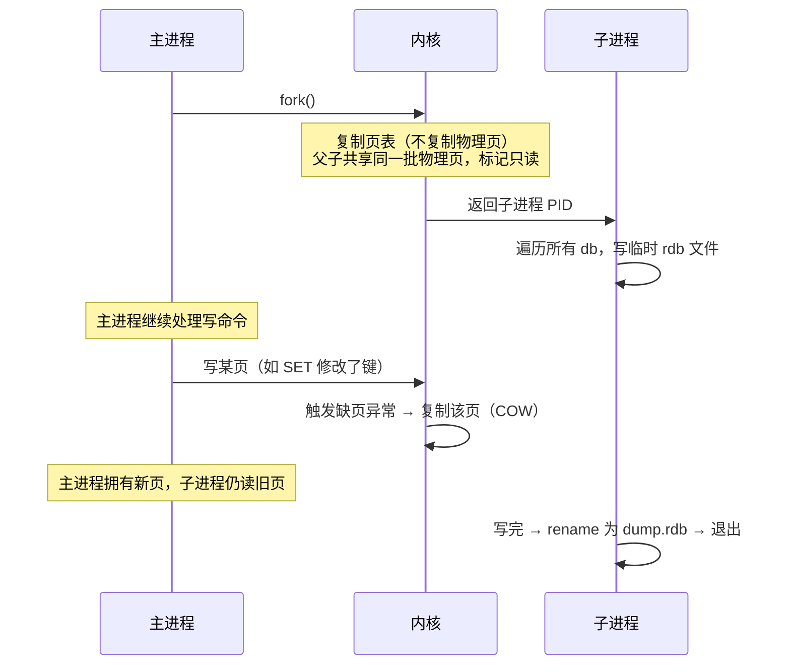

**四个必须讲清的点**：

1. **fork 本身阻塞主线程**，耗时与**页表项数量**成正比（内存越大越慢）。经验值：10GB 实例 fork 约 10~20ms；40GB 可能上百毫秒。
2. **COW 只在"写"时复制页**。所以 `bgsave` 期间写入越频繁，内存膨胀越明显，**最坏接近翻倍**（所有页都被改）。
3. 子进程**不共享主进程后续的新内存**，所以快照是"fork 那一刻"的一致视图。这也意味着 `bgsave` 期间的新写入**不在本次 RDB 里**。
4. **THP（透明大页）会放大 fork 开销**：页从 4KB 变 2MB，COW 复制单位变大。官方建议关闭 THP。

#### 4.2.3 RDB 文件格式（了解即可，能说出层次即可）

```
REDIS<version>  |  AUX 字段  |  DB 选择符  |  key-value 键值对  |  EOF  |  CRC64 校验
```

- 键值对按**数据类型 + 编码**存储，尽量复用对象编码（如 listpack 直接整块写）。
- 支持 **LZF 压缩**（`rdbcompression yes`），对字符串有效，对已编码的紧凑结构基本无效。
- 支持 **CRC64 校验**（`rdbchecksum yes`），能发现文件损坏。

#### 4.2.4 RDB 的优缺点

| 优点 | 缺点 |
| --- | --- |
| 文件紧凑（二进制、压缩），适合备份/传输 | 两次快照间数据会丢 |
| 恢复极快（直接反序列化，不需重放命令） | fork 阻塞 + COW 内存膨胀 |
| 适合做冷备、跨机房迁移 | 大实例 fork 可能秒级停顿 |

> **实战经验**：单实例内存建议 ≤ 10~16GB。超过后 fork 时间与 COW 膨胀都变得不可控，应拆分实例。

### 4.3 AOF：追加写日志

#### 4.3.1 写入流程（三段式）

```mermaid
graph LR
    A[命令执行] --> B[写 server.aof_buf<br/>内存缓冲]
    B --> C[write() 到内核页缓存]
    C --> D[fsync() 刷盘]
    D --> E[磁盘]
```

**为什么要分三步**：`write` 只是把数据写到内核 page cache，真正落盘要 `fsync`。`fsync` 是昂贵操作（毫秒级），所以用缓冲批量做。

#### 4.3.2 三种 fsync 策略（必背）

| 策略 | 行为 | 丢数据上限 | 性能 | 适用 |
| --- | --- | --- | --- | --- |
| `always` | 每条命令都 fsync | 几乎 0（仅剩内核崩溃） | **极差**（QPS 掉到几千） | 极高价值、低 QPS |
| `everysec` | 每秒 fsync 一次（`bio_fsync` 后台线程） | **≤ 1 秒** | 好 | **生产默认** |
| `no` | 完全交给操作系统（约 30s 一次） | 可达 30 秒 | 最好 | 可容忍大量丢失 |

**`everysec` 的隐藏问题**：如果上一秒的 fsync 还没完成，主线程会**阻塞等待**（最大 2 秒），此时延迟飙升。日志里会出现 `Asynchronous AOF fsync is taking too long`。

#### 4.3.3 AOF 重写（rewrite）

**问题**：AOF 会无限增长（`INCR` 100 次 → 100 条命令，实际只需 1 条 `SET 100`）。

**解法**：`BGREWRITEAOF` 用**当前内存状态**生成最小命令集。

```
主进程 fork 子进程
  → 子进程遍历内存，把每个 key 用最少命令写成一个新 AOF
  → 同时，主进程把重写期间的新写命令同时写入：
       (a) 旧 AOF（保证宕机可恢复）
       (b) aof_rewrite_buf（重写缓冲区，内存）
  → 子进程写完 → 主进程把 aof_rewrite_buf 追加到新文件
  → 原子 rename 替换旧 AOF
```

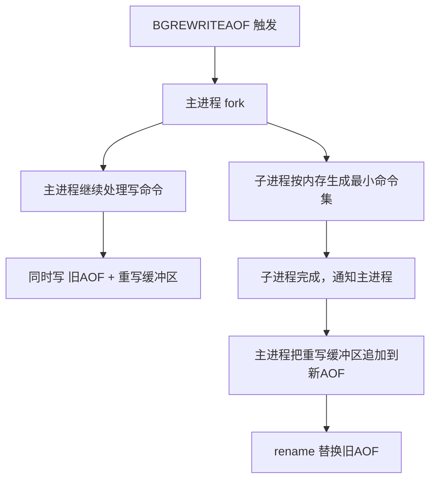

**触发条件**：

- `auto-aof-rewrite-percentage 100`（当前 AOF 比上次重写后大 100%）
- `auto-aof-rewrite-min-size 64mb`

**重写期间的坑**：`aof_rewrite_buf` 完全在内存，如果重写期间写入量巨大（如批量导入），这个小缓冲可能撑爆内存。所以要避免在重写期间做大批量写。

#### 4.3.4 Multi-Part AOF（7.0 新机制）

7.0 之前，AOF 重写要维护"旧文件 + 重写缓冲 + 新文件"三份，内存与 IO 压力大。7.0 改为**多文件**：

```
appendonlydir/
  ├── appendonly.aof.1.base.rdb     # 基础快照（RDB 或 AOF 格式）
  ├── appendonly.aof.1.incr.aof     # 增量命令
  ├── appendonly.aof.2.incr.aof     # 重写期间的新增量
  └── appendonly.aof.manifest       # 清单文件，记录哪些文件有效
```

**好处**：

- 重写期间**不需要大内存缓冲**，新命令直接写新 incr 文件。
- 基础文件用 RDB 格式，重写更快、更紧凑。
- 通过 manifest 原子切换，避免 rename 长阻塞。

#### 4.3.5 AOF 混合持久化（`aof-use-rdb-preamble yes`，4.0+）

重写后的 AOF 文件 = **RDB 格式的开头（全量快照）+ AOF 格式的增量命令**。

- 恢复时先加载 RDB 部分（快），再重放增量（少）。
- **这是当前最佳实践的默认配置**：兼顾"恢复速度"和"低丢失"。

### 4.4 数据恢复顺序（必考细节）

Redis 启动时的优先级：

```
1. 如果开启了 AOF 且 AOF 文件存在 → 优先用 AOF（因为它更完整）
2. 否则 → 用 RDB
3. 都没有 → 空库启动
```

**为什么 AOF 优先**：AOF 记录的是命令流，理论上更新更完整。**而且如果混合持久化开启，AOF 文件里本来就包含 RDB 快照**，所以统一走 AOF 即可。

**加载过程中的坑**：

- AOF 尾部可能写了一半（宕机时刻）→ 若 `aof-load-truncated yes`（默认），会截断尾部并继续启动；设为 `no` 则拒绝启动（更安全，避免静默丢数据）。
- AOF 中间损坏（如磁盘坏道）→ 只能 `redis-check-aof --fix` 人工修复。

### 4.5 RDB vs AOF 对比表（背诵级）

| 维度 | RDB | AOF |
| --- | --- | --- |
| 存储内容 | 二进制快照（数据状态） | 文本命令流（写操作） |
| 文件大小 | 小（压缩、紧凑） | 大（可重写压缩） |
| 恢复速度 | **快**（直接反序列化） | 慢（逐条重放，7.0 混合后改善） |
| 数据安全性 | 差（丢一个快照周期） | 好（everysec ≤ 1s） |
| 对性能影响 | fork + COW 内存膨胀 | fsync IO 压力 + 重写内存 |
| 可读性 | 不可读 | 可读（利于排查） |
| 适合场景 | 冷备、迁移、主从全量同步 | 要求低丢失的在线业务 |

### 4.6 持久化的经典组合策略

**生产推荐**：

```
appendonly yes
appendfsync everysec
aof-use-rdb-preamble yes          # 混合持久化
save 3600 1 300 100 60 10000      # RDB 仍保留，做额外冷备
rdbcompression yes
rdbchecksum yes
no-appendfsync-on-rewrite no      # 重写期间不停止 fsync（更安全，但可能卡）
```

**主从 + 持久化的坑**：

- 从库也开 AOF 会放大写放大（主库写 → 从库也要 fsync）。
- 常见做法：**从库关闭 AOF，仅开 RDB**（或干脆不持久化），主库开 AOF。
- `stop-writes-on-bgsave-error yes`：bgsave 失败（如磁盘满）时**拒绝所有写命令**。这个配置救过很多人，但也可能在磁盘满时导致业务全面不可写——需要监控磁盘。

---

## 第 5 章 过期删除与内存淘汰

### 5.1 过期时间的存储

```c
// db 结构
typedef struct redisDb {
    dict *dict;      // 主字典：key → value
    dict *expires;   // 过期字典：key → 过期时间（毫秒时间戳，存为 long）
    dict *blocking_keys;
    dict *ready_keys;
    dict *watched_keys;
    int id;
    ...
} redisDb;
```

**三个要点**：

1. 过期时间是**独立字典**，`SET k v EX 60` 是两次 dict 写入。
2. `expires` 里存的是**绝对毫秒时间戳**（`PEXPIREAT` 语义），不是剩余秒数——这样从库执行时不依赖本地时钟。
3. 过期字典的 key 是**指向主字典 key 的指针**（不重复存字符串），省内存。

### 5.2 三种删除策略与 Redis 的选择

| 策略 | 做法 | 优点 | 缺点 |
| --- | --- | --- | --- |
| 定时删除 | 为每个 key 设一个定时器 | 最及时 | CPU 开销大，不可行 |
| 惰性删除 | 访问时才检查是否过期 | CPU 友好 | **内存不释放**（不访问就一直占着） |
| 定期删除 | 周期性抽样扫描 | 折中 | 需要调参 |

**Redis 采用"惰性 + 定期"组合**：

#### 5.2.1 惰性删除

所有读写 key 的路径都会先调用 `expireIfNeeded()`：

```c
int expireIfNeeded(redisDb *db, robj *key) {
    if (!dictFind(db->expires, key->ptr)) return 0;   // 无过期时间，直接返回
    long long when = getExpire(db, key);
    if (mstime() < when) return 0;                    // 未到期
    // 已到期：
    if (server.masterhost != NULL) return 1;          // 从库不主动删，等主库 DEL
    // 主库：删除 + 传播 DEL / UNLINK 给从库和 AOF
    deleteExpiredKeyAndPropagate(db, key);
    return 1;
}
```

> **关键**：**从库不主动删除过期 key**，而是等主库发 `DEL`。这是为了保证主从数据一致（如果从库自己删，主库还没删，就会不一致）。但读从库时若 key 已过期，`expireIfNeeded` 会返回 1，让客户端读到"不存在"——**逻辑上不可见，物理上还在**。

#### 5.2.2 定期删除（adaptive）

```c
// serverCron 中调用 databasesCron()
activeExpireCycle()：
    每 100ms（hz=10）执行一次，每次最多占 25% CPU 时间
    对每个 db：
        - 随机抽取 20 个带过期时间的 key
        - 删掉其中已过期的
        - 若过期比例 > 25%，继续抽（说明过期 key 密集）
        - 否则换下一个 db
```

**为什么用"随机抽样"而不是"全量扫描"**：全量扫描在千万 key 时是秒级阻塞。抽样 + "过期比例阈值"能在**统计意义上**保证过期 key 不会堆积太多，同时 CPU 可控。

**7.0 的改进**：`active-expire-effort`（1~10，默认 1）可调激进程度；同时把过期扫描拆得更细，减少单次耗时。

### 5.3 内存淘汰（maxmemory + policy）

当 `used_memory > maxmemory` 时，写命令会先尝试淘汰，腾出空间。

#### 5.3.1 八种策略（必背）

| 策略 | 淘汰范围 | 算法 |
| --- | --- | --- |
| `noeviction` | 不淘汰 | 写命令直接返回 OOM 错误（**默认**） |
| `volatile-lru` | 仅带过期时间的 key | 近似 LRU |
| `volatile-lfu` | 仅带过期时间的 key | 近似 LFU |
| `volatile-random` | 仅带过期时间的 key | 随机 |
| `volatile-ttl` | 仅带过期时间的 key | 优先淘汰 TTL 最短的 |
| `allkeys-lru` | 所有 key | 近似 LRU |
| `allkeys-lfu` | 所有 key | 近似 LFU |
| `allkeys-random` | 所有 key | 随机 |

**选择逻辑**（面试常问"你怎么选"）：

- 纯缓存场景（数据可从 DB 重建）→ **`allkeys-lru`**（最常用）。
- 缓存 + 部分持久数据混存（如有过期时间的才是缓存）→ **`volatile-lru`**。
- 有明显冷热分层、且希望"越热越留"→ **`allkeys-lfu`**（LFU 抗"偶尔扫全表"污染）。
- 明确知道数据都有 TTL 且 TTL 语义重要→ `volatile-ttl`。

#### 5.3.2 近似 LRU 的实现（重点）

Redis **没有**实现真正的 LRU（双向链表 + 移动节点），因为：

- 每个 key 移动链表节点要改 6 个指针，开销大。
- 内存要多存 prev/next 指针。

**实现方式：采样 + 淘汰最旧**

```
1. 从 db 随机采样 maxmemory-samples 个 key（默认 5，建议 10）
2. 比较它们的 lru 字段（24 位时间戳）
3. 淘汰其中最久未使用的
4. 若淘汰后内存仍超限，重复
```

**精度分析**：采样 5 个时，被淘汰的 key 在"全局最久未用"的前 20% 概率约 1- (1-0.2)^5 ≈ 0.67。采样 10 个可达 ~0.89。所以 `maxmemory-samples 10` 是性价比拐点。

**为什么 24 位够用**：24 位秒级时间戳可表示 194 天。Redis 用 `LRU_CLOCK_RESOLUTION`（默认 1000ms）做粒度，且是"相对于启动时刻的偏移"，所以不会溢出。

#### 5.3.3 LFU 的实现（更精细）

`lru:24` 在 LFU 模式下拆成：

```
 16 bit: ldt（最后一次衰减的时间，分钟级）
  8 bit: counter（访问计数，0~255）
```

**计数增长是概率性的**（不是简单 +1）：

```
counter 越大，+1 的概率越低：
p = 1 / ((counter - LFU_INIT_VAL) * lfu_log_factor + 1)
```

- `LFU_INIT_VAL = 5`，新 key 初始计数 5（避免刚创建就被淘汰）。
- `lfu-log-factor` 默认 10，值越大增长越慢。
- **衰减**：`lfu-decay-time`（默认 1 分钟）内没被访问，计数按指数衰减。

**为什么这么设计**：如果用精确计数，一个"每秒被访问一次的历史热点"永远打不过"当前热点"。概率增长 + 时间衰减，让计数反映"**近期热度**"而非"历史总量"。

> **面试加分**：能说出"LFU 解决 LRU 的缓存污染问题"——比如一次全表扫描把所有 key 都刷了一遍，LRU 会误判它们都是热点，而 LFU 因为计数低、增长慢，不会被污染。

### 5.4 过期键在 RDB / AOF / 主从中如何处理（细节题）

| 场景 | 处理方式 |
| --- | --- |
| RDB 生成 | **跳过已过期的 key**（不写入文件） |
| RDB 加载（主库） | 若 key 已过期 → 不加载 |
| RDB 加载（从库） | **全部加载**（等主库同步 DEL，保证一致） |
| AOF 写入 | 过期 key 被删除时，**显式追加一条 `DEL`** 命令 |
| AOF 重写 | **跳过已过期的 key**，不生成对应命令 |
| 主库淘汰/过期 | 生成 `DEL`（或 `UNLINK`）传播给从库 |

**这条"从库不主动删"的规则，是主从一致性的基石，几乎每家大厂都会问到。**

### 5.5 内存碎片治理

```
mem_fragmentation_ratio = used_memory_rss / used_memory
```

| 数值 | 含义 | 动作 |
| --- | --- | --- |
| 1.0 ~ 1.5 | 正常 | 无 |
| > 1.5 | 碎片较多 | 开 `activedefrag`，或观察是否有大量增删 |
| > 10 | 严重碎片 | 尽快整理/重启 |
| < 1 | **发生了 swap** | 立刻排查内存/关闭 swap |

**activedefrag 关键参数**：

```
activedefrag yes
active-defrag-ignore-bytes 100mb      # 碎片浪费超过 100MB 才启动
active-defrag-threshold-lower 10      # 碎片率 > 10% 才开始
active-defrag-threshold-upper 100     # 碎片率 100% 时用最大 CPU
active-defrag-cycle-min 1             # 最少占 1% CPU
active-defrag-cycle-max 25            # 最多占 25% CPU
```

> **注意**：activedefrag 是**后台线程搬移内存页**，会消耗 CPU 和 IO。低峰期开启更安全。


---

## 第 6 章 高可用三件套：主从 / 哨兵 / 集群

### 6.1 主从复制

#### 6.1.1 为什么需要主从

1. **读扩展**：读请求分摊到多个从库（注意：Redis 主从是**读写分离**，从库默认只读 `replica-read-only yes`）。
2. **数据冗余**：主库挂了有备份。
3. **高可用基础**：哨兵/集群都建立在主从之上。
4. **避免单点**：全量备份、离线分析可以走从库。

#### 6.1.2 建立复制的完整流程

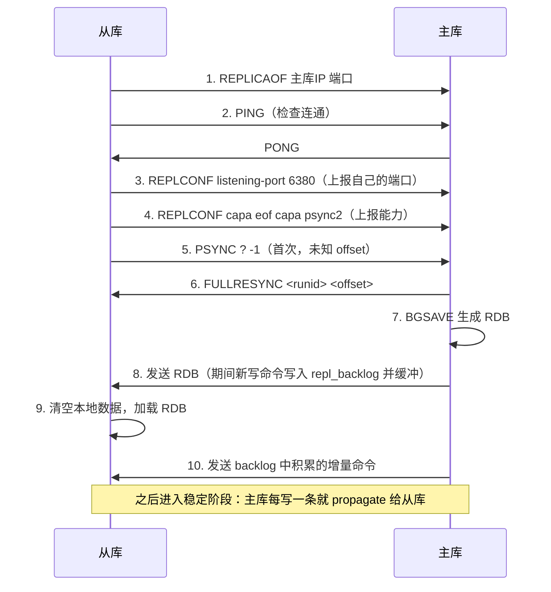

#### 6.1.3 全量同步 vs 增量同步

| 类型 | 触发条件 | 代价 |
| --- | --- | --- |
| 全量（FULLRESYNC） | 首次复制；从库 offset 落后太多；runid 不匹配；backlog 不够 | 主库 fork + 传输整个 RDB（大实例几 GB） |
| 增量（CONTINUE） | 从库 offset 在 backlog 范围内，且 runid 匹配 | 只传差异命令，极快 |

**关键参数**：

```
repl-backlog-size 1mb        # 复制积压缓冲区，环形数组
repl-backlog-ttl 3600        # 无从库连接时保留多久
repl-diskless-sync yes       # 无盘复制（6.0 默认 yes）
repl-diskless-sync-delay 5   # 等待多个从库一起做，避免多次 fork
```

**`repl_backlog` 的本质**：一个**环形缓冲区**，主库存最近 N 字节的写命令 + 对应 offset。从库重连时发 `PSYNC <runid> <offset>`，主库判断该 offset 是否还在缓冲区里：

- 在 → 从 offset 开始发增量（`CONTINUE`）
- 不在 → 只能全量重同步（`FULLRESYNC`）

> **实战公式**：`repl-backlog-size ≥ 平均写入速率(字节/秒) × 最大断开时长(秒)`。一个每秒写 1MB 的实例，若希望容忍 60 秒断连，就要 60MB。**默认 1MB 太小，是很多"频繁全量同步"事故的根因**。

#### 6.1.4 复制的三个关键机制

1. **复制偏移量（offset）**：主库每传播 N 字节，`master_repl_offset += N`；从库应用后也累加自己的 offset。两者差值 = **复制延迟**。
2. **心跳**：
   - 主 → 从：每 10 秒发 `PING`（`repl-ping-replica-period`）。
   - 从 → 主：每秒发 `REPLCONF ACK <offset>`，主库据此判断从库是否在线、延迟多少。
3. **runid**：每个 Redis 实例启动时生成的 40 位随机串。用于判断"这个从库之前是不是连的我"。**主库故障转移后 runid 会变**，但从库可以用 `PSYNC2` 协议在部分场景继续增量（这是 4.0 的改进）。

#### 6.1.5 异步复制的数据丢失窗口（必考）

Redis 复制是**异步的**：主库执行完命令、写进 backlog 就返回客户端，**不等从库确认**。

```
时刻 T1：客户端 SET k v → 主库执行成功 → 返回 OK
时刻 T2：主库还没来得及把命令发给从库，主库宕机
结果：客户端以为写成功了，但从库没有这条数据 → 数据丢失
```

**这是 Redis 无法做"强一致"的根本原因**。

**缓解手段**：

| 手段 | 原理 | 代价 |
| --- | --- | --- |
| `WAIT numreplicas timeout` | 阻塞等待 N 个从库 ACK，超时返回实际数量 | 增加延迟，且只是"降低概率"不是保证 |
| `min-replicas-to-write` + `min-replicas-max-lag` | 可用从库数不足时**拒绝写** | 降低可用性 |
| 业务层补偿 | 关键数据写 DB 后再写缓存 | 复杂度高 |

> **面试延伸**：`WAIT` 为什么不能保证强一致？因为它只保证"命令到达了从库的 socket 缓冲"，不保证从库**已执行并持久化**。而且如果主库在 `WAIT` 返回后立刻宕机，从库可能还没 fsync。

#### 6.1.6 主从延迟的成因与排查

| 成因 | 表现 | 排查/解决 |
| --- | --- | --- |
| 大 key 写入 | 从库应用单条命令耗时久 | `--bigkeys`、拆分 |
| 主库写入过快 | backlog 溢出导致全量重同步 | 调大 backlog、限流 |
| 从库配置差 | 从库 CPU/磁盘跟不上 | 提升从库规格 |
| 从库执行 `KEYS`/`SAVE` 等阻塞命令 | 从库自己卡住 | 禁用危险命令 |
| 网络带宽/延迟 | offset 差值持续增大 | 监控 `master_link_status`、`master_repl_offset` 差值 |
| 从库在做 `BGSAVE`/`AOF rewrite` | fork 阻塞 | 错峰、关闭从库 AOF |

**监控指标**：

```
INFO replication
  master_link_status:up/down
  master_last_io_seconds_ago
  master_sync_in_progress
  slave_repl_offset vs master_repl_offset
```

### 6.2 哨兵（Sentinel）

#### 6.2.1 哨兵解决什么问题

主从只能解决"读扩展"和"数据冗余"，但**主库挂了不会自动切换**。哨兵负责：

1. **监控**：定期 PING 主库/从库/其他哨兵。
2. **通知**：异常时通过 Pub/Sub 通知客户端/运维。
3. **自动故障转移**：主库挂了，选一个从库升主，其他从库改指向新主。
4. **配置提供者**：客户端向哨兵查询"当前主库是谁"。

#### 6.2.2 为什么哨兵必须部署奇数个（≥3）

哨兵集群通过"**投票**"决定主库是否真的挂了（客观下线），因此需要**多数派**：

- 3 个哨兵：容忍 1 个挂掉。
- 2 个哨兵：1 个挂了就无法形成多数派（1/2 不是多数），**故障判断失效**。
- 所以**必须 ≥ 3 且为奇数**。

#### 6.2.3 主观下线 vs 客观下线

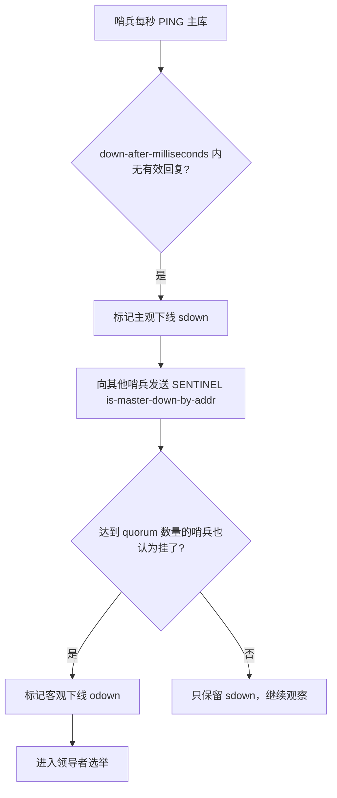

- **sdown（主观下线）**：单个哨兵自己判断。
- **odown（客观下线）**：多个哨兵达成共识（数量 ≥ `quorum`）。
- `quorum` 通常设为 `哨兵总数/2 + 1`。

#### 6.2.4 领导者选举（Raft 简化版）

1. 认为主库 odown 的哨兵，通过 `SENTINEL is-master-down-by-addr` 发起**选举请求**（同时充当投票）。
2. 每个哨兵只能投一票，且**投给第一个请求者**（先到先得）。
3. 获得**多数派**（> 哨兵总数一半）票的成为 Leader。
4. Leader 执行故障转移。
5. 若平票/无人过半，等待 `failover-timeout` 后重新选举（每个 epoch 重试）。

> **为什么先到先得**：避免所有哨兵互相投票形成僵局；用一个单调递增的 `epoch` 保证新一轮选举不会被旧票干扰。

#### 6.2.5 选新主的规则（必背）

Leader 从所有从库中按以下优先级挑选：

1. **过滤不可用**：排除 sdown/odown 的、排除断连时间超过 `down-after-milliseconds * 10` 的。
2. **`replica-priority` 最高的**（默认 100，设 0 表示永不升主）。
3. **复制偏移量最大的**（数据最新）。
4. **runid 最小的**（字典序，保证确定性）。

**然后**：

```
SLAVEOF NO ONE          # 新主升为主
其他从库 SLAVEOF 新主    # 改指向
旧主恢复后 SLAVEOF 新主  # 降级为从库
客户端通过哨兵获取新主地址
```

#### 6.2.6 哨兵的脑裂问题

**场景**：主库与哨兵网络分区，哨兵判定主库挂了并切换，但主库其实还活着且在接收客户端写入。此时**两个"主库"同时接受写入**，恢复后旧主的数据会丢失。

**缓解**：

```
min-replicas-to-write 1       # 至少要有 1 个可用从库才允许写
min-replicas-max-lag 10       # 从库延迟不超过 10 秒
```

这两个参数让"孤立的旧主"因为看不到从库而**拒绝写入**，从而减少脑裂数据丢失。

> **注意**：这只能"降低损失"，不能"根治"。要根治需要分布式共识（Redis 本身不提供）。

### 6.3 Cluster 集群

#### 6.3.1 为什么需要 Cluster

单机受限于内存（一台机器装不下）和 QPS（单线程上限）。Cluster 提供**水平分片**。

#### 6.3.2 槽位（slot）机制

- 总共 **16384** 个槽（`0 ~ 16383`）。
- 每个 key 归属：`slot = CRC16(key) mod 16384`。
- 每个主节点负责一段槽区间。

**为什么是 16384 而不是 65536**（经典问题，官方作者 antirez 有回答）：

1. **心跳包大小**：集群节点间 gossip 会发送"我负责哪些槽"的 bitmap。16384 个槽 = 2KB（16384/8），65536 个槽 = 8KB。每秒多次心跳，8KB 太浪费带宽。
2. **节点数量上限**：16384 已足够支撑上千节点的合理分布（平均每节点几十个槽）。
3. **CRC16 输出是 16 位**，16384 是 2^14，取模运算可用位运算优化。

#### 6.3.3 集群通信：Gossip

```
每个节点维护：
  - clusterState：自己 + 所有已知节点的信息
  - 每个节点：id、ip、port、flags、slots bitmap、master/replica 关系

通信方式：
  - 集群总线端口 = 客户端端口 + 10000
  - 消息类型：MEET（握手）、PING/PONG（心跳+状态）、FAIL（标记故障）、PUBLISH（广播）
  - 每 10 秒（cluster-node-timeout/2）向随机节点发 PING
```

**Gossip 的收敛性**：每个节点只知道"邻居的邻居"，但通过多轮传播，全网最终一致。代价是**收敛有延迟**，所以集群规模不建议过大（官方建议 ≤ 1000 节点，实践中 3~30 个主节点更常见）。

#### 6.3.4 故障判定与转移

```
1. 节点 A 发现节点 B 连续 cluster-node-timeout 无响应 → 标记 PFAIL（主观）
2. A 在 gossip 中带上 B 的 PFAIL 状态
3. 若多数主节点都认为 B PFAIL → 标记 FAIL（客观）
4. B 的从库发起选举（类似哨兵，但投票者是**主节点**）
5. 获得多数主节点投票 → 升主，接管 B 的槽
6. 其他节点更新槽映射
```

**关键参数**：

```
cluster-node-timeout 15000        # 15 秒无响应视为疑似故障
cluster-require-full-coverage no  # 有槽不可用是否拒绝全部请求（建议 no）
cluster-migration-barrier 1       # 从库迁移的最小从库数
cluster-allow-replica-migration yes
```

> `cluster-require-full-coverage yes`（默认）意味着**只要有一个槽不可用，整个集群拒绝服务**。生产建议设为 `no`，让未受影响的槽继续服务。

#### 6.3.5 MOVED vs ASK（必考）

| 重定向 | 场景 | 客户端行为 |
| --- | --- | --- |
| **MOVED** | key 的槽**永久**属于另一个节点（槽已迁移完成） | 更新本地槽映射缓存，之后直接请求新节点 |
| **ASK** | 槽**正在迁移中**，key 暂时在目标节点 | **不更新缓存**，本次请求转发到目标节点，并先发 `ASKING` |

**为什么要有 ASK**：

迁移一个槽时，槽里的 key 是一条条搬的。搬到一半时：

- 源节点还有部分 key，目标节点已有部分 key。
- 客户端请求一个**已经搬过去**的 key，源节点找不到 → 返回 `ASK` 让客户端去目标节点。
- 客户端**不能**把这个槽整体认为属于目标节点（因为还有 key 在源节点）。

**ASKING 命令的作用**：目标节点收到 `ASKING` 后，**临时允许**执行一个不属于自己槽的 key 的命令（只对下一次命令有效）。否则目标节点会因为"这个 key 不在我的槽"而再次返回 MOVED，形成死循环。

#### 6.3.6 槽迁移（reshard）流程

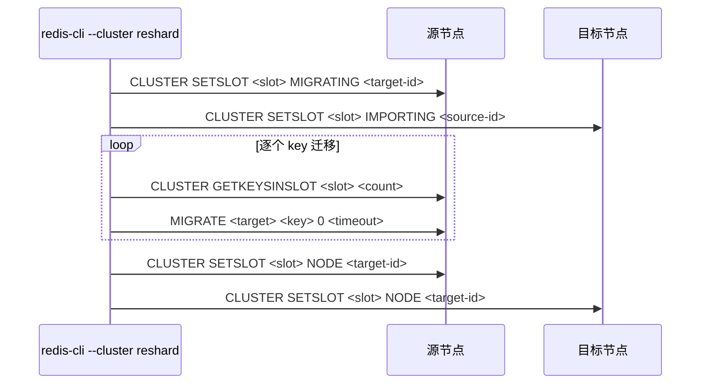

**MIGRATE 的原子性**：`MIGRATE` 是**同步阻塞**的（默认复制+删除），迁移大 key 会阻塞源节点。7.0 引入 `MIGRATE ... KEYS` 批量与更细粒度控制，但仍需注意。

#### 6.3.7 集群的限制（面试常问"集群有什么坑"）

| 限制 | 原因 | 解法 |
| --- | --- | --- |
| 多 key 操作必须同槽 | `MGET`/`MSET`/`SUNION`/事务/Lua 涉及多 key | **hash tag** `{user}:1` `{user}:2` 让它们落同一槽 |
| 不支持跨槽事务 | 事务在单节点执行 | 拆分或改用单实例/Cluster 代理 |
| 不支持跨槽 Lua | 脚本里的多 key 必须同槽 | 同上 |
| `SELECT` 只能选 0 号库 | Cluster 只有 db0 | 用 key 前缀区分业务 |
| 不支持 `KEYS` 跨节点 | 只在当前节点范围 | 用 `SCAN` 逐节点遍历 |
| Pub/Sub 有限支持 | 7.0 前只在同节点广播；7.0 起支持 sharded pubsub | 用 Stream 或外部 MQ |
| 节点重启后槽映射可能变化 | 集群拓扑变化 | 客户端要能处理 MOVED |

**hash tag 的坑**：`{user}:1` 和 `{user}:2` 会落同槽，但如果大量 key 都用同一个 tag，会导致**数据倾斜**（全部压在一个节点）。设计时要控制 tag 的基数。

### 6.4 三种部署形态对比（选型必答）

| 维度 | 主从 | 哨兵 | Cluster |
| --- | --- | --- | --- |
| 数据分片 | 无 | 无 | **有**（16384 槽） |
| 自动故障转移 | 无 | **有** | **有** |
| 容量上限 | 单机内存 | 单机内存 | 水平扩展 |
| 写扩展 | 无（单主） | 无（单主） | **有**（多主） |
| 客户端复杂度 | 低 | 中（需查哨兵） | 高（需处理 MOVED/ASK） |
| 多 key 操作 | 自由 | 自由 | 受限（需 hash tag） |
| 运维复杂度 | 低 | 中 | 高 |
| 典型规模 | < 10GB | < 20GB | > 20GB 或多写 |

---

## 第 7 章 事务、Lua、Pipeline

### 7.1 Redis 事务：MULTI / EXEC

#### 7.1.1 基本用法

```
MULTI              # 开启事务，后续命令进入队列
SET k1 v1          # 返回 QUEUED（不是 OK）
INCR k2            # 返回 QUEUED
EXEC               # 顺序执行队列中所有命令，返回结果数组
DISCARD            # 放弃事务，清空队列
```

#### 7.1.2 实现原理

`client` 结构里有 `multiState`：

```c
typedef struct multiState {
    multiCmd *commands;  // 命令队列（数组）
    int count;
    int flags;           // 是否开启事务
} multiState;
```

`MULTI` 只是**打标记**，后续命令在 `processCommand` 阶段被拦截并**入队**（不执行），`EXEC` 时再一次性顺序执行。

#### 7.1.3 为什么 Redis 事务不支持回滚（高频考）

**两个原因**（要一起说）：

1. **两类错误，性质不同**：
   - **入队错误**（命令不存在、参数个数不对）：`MULTI` 后立即返回错误，`EXEC` 时**整个事务被放弃**（这是"全有或全无"）。
   - **执行错误**（如对 String 执行 `LPUSH`、`INCR` 非数字）：**只有出错的那条失败，其他命令照常执行**，`EXEC` 不会回滚。
2. **设计哲学**：Redis 认为**执行期错误是"编程错误"，应该在开发测试阶段发现**，而不是在运行时靠回滚兜底。而且要实现回滚，就得为每个命令保存"旧值"，内存与性能代价巨大，与"极简、快"的定位冲突。

> **面试标准表述**：Redis 事务**不具备原子性中的"回滚"语义**，只保证"命令按顺序串行执行、执行期间不被其他客户端打断"。

#### 7.1.4 ACID 四个维度分析（高分答案）

| 特性 | Redis 是否满足 | 说明 |
| --- | --- | --- |
| **A 原子性** | **部分满足** | 入队错误全放弃；执行错误不回滚；单条命令本身是原子的 |
| **C 一致性** | 满足 | 命令执行前后，数据结构自身约束不被破坏（类型检查在入队/执行时做） |
| **I 隔离性** | 满足 | 单线程串行执行，`EXEC` 期间不会被其他客户端插入 |
| **D 持久性** | 取决于配置 | 未开 AOF/RDB 则不持久；`always` 才接近持久 |

#### 7.1.5 WATCH：乐观锁 CAS

```
WATCH k1            # 监视 k1
MULTI
INCR k1
EXEC                # 若 k1 在 WATCH 后被其他客户端修改 → EXEC 返回 nil（事务不执行）
```

**实现**：`db->watched_keys` 是一个字典，`key → 监视它的 client 链表`。任何修改该 key 的命令都会调用 `touchWatchedKey`，给对应 client 打 `CLIENT_DIRTY_CAS` 标记。`EXEC` 时检查该标记。

**三个局限**（面试常追问）：

1. **不能替代分布式锁**：`WATCH` 是"同 key 的版本校验"，不是"互斥"。
2. **失败要重试**：业务层必须写 `while(true) { WATCH; MULTI; ...; if (EXEC == nil) retry; }`，高并发下重试风暴。
3. **WATCH 的 key 多了开销大**：每次修改都要遍历 `watched_keys`。

### 7.2 Lua 脚本

#### 7.2.1 为什么用 Lua

**三个核心价值**：

1. **原子性**：整个脚本在 Redis 中**作为一个命令串行执行**，中间不会被插入（比 `MULTI` 更强，因为没有"入队/执行分离"）。
2. **减少 RTT**：多个操作一次网络往返（比 pipeline 更强，因为 pipeline 不保证原子）。
3. **服务端计算**：把"读-判断-写"逻辑放到服务端，避免并发竞态（如分布式锁释放、秒杀扣库存）。

#### 7.2.2 执行机制

```
EVAL "return redis.call('GET', KEYS[1])" 1 mykey
  → 检查脚本是否在缓存（SCRIPT LOAD 缓存，key 是 SHA1）
  → 编译脚本（luac）
  → 设置超时（lua-time-limit，默认 5 秒）
  → 在 Lua 虚拟机中执行，redis.call 会回调 Redis 命令
  → 返回结果（Lua 类型 → RESP 类型转换）
```

**`redis.call` vs `redis.pcall`**：`call` 出错会中断脚本并返回错误；`pcall` 捕获错误，脚本可以继续。

#### 7.2.3 脚本复制的演进（深水区考点）

**问题**：主库执行 `EVAL` 后，要同步给从库。同步什么？

| 方案 | 做法 | 问题 |
| --- | --- | --- |
| **命令复制**（默认） | 把 `EVAL` 原样传给从库，从库各自执行 | 脚本里有 `TIME`、`RANDOMKEY`、`SPOP` 等非确定性操作时，**主从结果不一致** |
| **脚本效果复制**（5.0+） | 主库执行脚本，把**实际产生的写命令**逐条传播 | 确定性；但脚本里 `redis.call` 很多时，传播量大 |

**5.0 引入 `lua-replicate-commands`（默认 yes）**，采用效果复制。这也要求脚本**必须声明 `KEYS`**（不能把 key 藏在 `ARGV` 里），因为 Redis 需要静态分析脚本会碰哪些 key（用于集群槽校验和效果复制）。

> **加分点**：`SCRIPT FLUSH` / `SCRIPT LOAD` 的用法；`EVALSHA` 避免每次传脚本体；集群模式下 `EVAL` 的所有 key 必须同槽。

#### 7.2.4 Lua 的致命风险

| 风险 | 说明 | 防范 |
| --- | --- | --- |
| **长时间阻塞** | 脚本死循环 → 主线程卡死，所有客户端超时 | 脚本里禁止 `while true`；`lua-time-limit` 到时会返回 `BUSY`，但**不会杀掉脚本** |
| **脚本太长** | 编译+执行时间长 | 控制脚本规模，复杂逻辑放业务层 |
| **内存爆** | 脚本里 `KEYS *` 或构造大表 | 禁止全量遍历 |
| **`BUSY` 后的处理** | 只能 `SCRIPT KILL`（仅当脚本没写过数据）或 `SHUTDOWN NOSAVE` | 生产要有预案 |

> `lua-time-limit` 超时后，Redis 会回复 `BUSY Redis is busy running a script`，但主线程**仍在跑脚本**。只有 `SCRIPT KILL`（脚本未写数据时有效）能终止。

### 7.3 Pipeline（管道）

#### 7.3.1 原理

普通模式：`发送 → 等待回复 → 发送 → 等待回复`，每条命令 1 个 RTT。

Pipeline：**一次发 N 条命令，再一次性读 N 条回复**，总共 1 个 RTT。

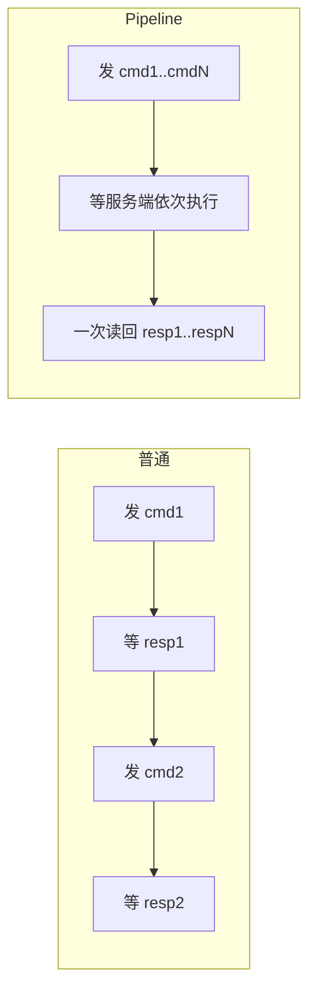

**收益量化**：假设 RTT = 1ms，1000 条命令：

- 普通：1000ms
- Pipeline：约 1ms + 服务端执行时间

**性能提升可达 5~10 倍**（局域网内），跨机房收益更大。

#### 7.3.2 Pipeline 的三个注意点

1. **不保证原子性**：N 条命令之间可能插入其他客户端的命令。要原子用 Lua 或 `MULTI`。
2. **不是越大越好**：一次发 10 万条会占用大量客户端/服务端缓冲（`querybuf` 膨胀），且**必须等全部回复才能拿到结果**。建议**每批 100~1000 条**。
3. **错误处理**：Pipeline 中某条命令出错，**其他命令仍会执行**，客户端需逐条检查回复。

### 7.4 三者对比（选型必答）

| 维度 | Pipeline | MULTI/EXEC | Lua |
| --- | --- | --- | --- |
| 减少 RTT | ✅ 强 | ❌（还多了 MULTI/EXEC 两次） | ✅ 强 |
| 原子性 | ❌ | ⚠️ 部分（执行错误不回滚） | ✅ 完全（脚本整体原子） |
| 服务端计算 | ❌ | ❌ | ✅ |
| 阻塞风险 | 低（批量大小可控） | 低 | **高**（脚本可能长跑） |
| 集群支持 | ✅（同槽） | ⚠️（同槽） | ⚠️（同槽，需声明 KEYS） |
| 适用 | 批量读写、批量导入 | 简单多命令原子 | 复杂"读-判断-写" |

> **一句话总结**：**要"少 RTT"用 Pipeline，要"原子"用 Lua，`MULTI` 是最弱的一种原子保证，实践中被 Lua 取代得差不多了。**

### 7.5 延伸：Redis 的事务 vs 数据库事务

| 维度 | Redis | MySQL |
| --- | --- | --- |
| 回滚 | ❌ | ✅ |
| 隔离级别 | 只有"串行" | 4 种 |
| 锁 | 无（WATCH 是乐观 CAS） | 行锁/表锁/MVCC |
| 持久性 | 依赖 AOF 配置 | redo log + WAL |
| 适用 | 简单原子操作 | 复杂业务事务 |

**结论**：**不要把 Redis 事务当数据库事务用**。需要真正的事务语义，应该用 DB，或用 Lua 做"单命令原子"。


---

## 第 8 章 缓存工程实践与分布式锁

> 这一章是"简历上写熟悉 Redis"和"真的做过高并发系统"的分水岭。面试官在这里问的不是原理，而是**你踩过什么坑**。

### 8.1 缓存三大问题（穿透 / 击穿 / 雪崩）

先给一张区分表，因为**90% 的候选人会把三者说混**：

| 问题 | 一句话定义 | 关键字 | 后果 |
| --- | --- | --- | --- |
| **穿透** | 查询**根本不存在的数据**，缓存永远不命中，请求全部打到 DB | 不存在 | DB 被无效请求打穿 |
| **击穿** | **单个热点 key 失效**瞬间，大量并发请求同时打到 DB | 单点失效 | DB 瞬间压力尖峰 |
| **雪崩** | **大量 key 同时失效**（或 Redis 整体挂掉），请求全部打到 DB | 大面积 | DB 直接被压垮 |

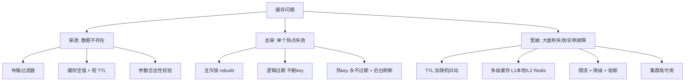

#### 8.1.1 缓存穿透

**成因**：恶意攻击（用不存在的 ID 疯狂请求）或业务 bug（查询条件错误）。

**方案对比**：

| 方案 | 原理 | 优点 | 缺点 |
| --- | --- | --- | --- |
| **缓存空值** | 查不到也写一个 `null` 进缓存，TTL 短（如 30s~5min） | 实现极简 | 大量随机 key 会撑爆内存；数据后续被创建时有短暂不一致 |
| **布隆过滤器** | 前置判断"key 是否可能存在"，不存在直接返回 | 内存极省（1 亿 key 约 100MB @1% 误判） | **有误判（假阳性）、不支持删除**、需要预热 |
| **参数校验** | 非法 ID（负数、超长、格式错）直接拦截 | 成本最低 | 只挡低级攻击 |
| **限流 + 风控** | 单 IP/单用户 QPS 限制 | 挡 CC 攻击 | 需要额外组件 |

**布隆过滤器的实现细节（常被追问）**：

```
位数组 m 位 + k 个独立哈希函数
添加：k 个哈希算出 k 个位置，全部置 1
查询：k 个位置是否全为 1 → 全 1 则"可能存在"，有 0 则"一定不存在"

误判率公式：p ≈ (1 - e^(-kn/m))^k
给定 n 和 p，最优 k = (m/n) * ln2
```

**Redis 实现布隆过滤器**：

- 用 `SETBIT/GETBIT` 手工实现（业务代码算哈希）。
- 用 **RedisBloom 模块**（`BF.ADD` / `BF.EXISTS`），支持 `BF.RESERVE` 设置误判率。
- **不支持删除**（删除会置 0，影响其他 key）→ 需要删除时用**布谷鸟过滤器**（Counting Bloom / Cuckoo Filter）。

> **面试加分**："布隆过滤器说存在，可能不存在；说不存在，一定不存在。" 这句话必须能脱口而出。

#### 8.1.2 缓存击穿

**成因**：某个热点 key（如首页 banner、爆款商品）在过期瞬间，几万并发同时发现 cache miss，全部去查 DB 并回填。

**方案对比**：

| 方案 | 原理 | 优点 | 缺点 |
| --- | --- | --- | --- |
| **互斥锁（mutex）** | 只允许一个线程回源，其他线程等待/重试 | 数据强一致、实现简单 | 等待线程可能超时；有死锁风险（要设锁超时） |
| **逻辑过期** | key 不设真实 TTL，value 里带 `expireTime`；发现"逻辑过期"时异步刷新，**旧值继续服务** | 无阻塞、可用性最高 | 短时间内返回旧数据（**最终一致**） |
| **热 key 永不过期 + 定时刷新** | 后台任务周期性更新 | 永不穿透 | 需要任务调度；数据有延迟 |
| **单飞（singleflight）** | 同一 key 的并发请求合并为一次 | 减少重复回源 | 需在应用层实现 |

**互斥锁的标准代码骨架**：

```java
public String get(String key) {
    String cache = redis.get(key);
    if (cache != null) return cache;
    // 只有抢到锁的线程去查 DB
    if (redis.set("lock:" + key, uuid, "NX", "EX", 10)) {
        try {
            String db = db.query(key);
            redis.set(key, db, "EX", 3600);
            return db;
        } finally {
            unlockWithLua("lock:" + key, uuid);   // Lua 比对后删除
        }
    } else {
        Thread.sleep(50);
        return get(key);  // 重试（要限制重试次数）
    }
}
```

> **坑**：`finally` 里一定要用 Lua 比对 value 再删，否则可能删掉别人的锁（因为你的锁可能已超时释放，别人重新加了锁）。

#### 8.1.3 缓存雪崩

**成因**：

1. **TTL 集中**：批量预热时给所有 key 设了同样的过期时间（如都设 1 小时），1 小时后同时失效。
2. **实例故障**：Redis 集群整体不可用 / 主从切换期间。
3. **热点集中**：少量 key 承载大部分流量（本质是击穿的放大版）。

**方案**：

| 方案 | 说明 |
| --- | --- |
| **TTL 随机化** | `TTL = base + random(0, 300)`，把失效时刻打散 |
| **多级缓存** | L1 本地 Caffeine（毫秒级，但有一致性问题）+ L2 Redis + L3 DB |
| **限流降级** | Redis 挂时，对 DB 访问做限流（如 Hystrix/Sentinel），宁可拒绝部分请求也不打垮 DB |
| **熔断** | 检测 DB 错误率超阈值 → 快速失败，返回兜底数据 |
| **高可用** | 哨兵/集群 + 多副本，减少整体故障概率 |
| **预热 + 分批发布** | 避免重启后冷启动同时回源 |

> **面试深挖点**："多级缓存的一致性怎么保证？" —— 本地缓存（如 Caffeine）没有跨节点失效通知，只能靠**短 TTL（1~5 秒）+ 消息广播**（用 Redis Pub/Sub 或 MQ 通知各节点清本地缓存）。**本地缓存本质是"用一致性换延迟"**。

### 8.2 缓存与数据库的一致性

这是**分布式系统里最难讲清的问题之一**，也是大厂最爱考的。

#### 8.2.1 为什么"双写"一定有窗口

不管是"先写 DB 再写缓存"还是"先写缓存再写 DB"，只要两个操作不是原子的，就有不一致窗口。**根因是没有跨系统的原子事务**。

#### 8.2.2 四种策略对比

| 策略 | 顺序 | 问题 | 结论 |
| --- | --- | --- | --- |
| ① 先更新 DB，再更新缓存 | DB → Cache（写） | 并发下缓存可能被旧值覆盖；且"更新缓存"是**计算**，可能白算 | ❌ 不推荐 |
| ② 先更新缓存，再更新 DB | Cache → DB | DB 失败则缓存脏；DB 回滚更麻烦 | ❌ 不推荐 |
| ③ **先更新 DB，再删除缓存**（Cache Aside） | DB → 删 Cache | 极小概率不一致（见下） | ✅ **主流推荐** |
| ④ 先删缓存，再更新 DB | 删 Cache → DB | 并发读会把旧值回填（**更严重**） | ❌ 需延迟双删补救 |

**为什么 ③ 是最优**：

- "删除"比"更新"简单，且**幂等**（删两次结果一样）。
- 缓存是"懒加载"的，删除后下次读自然回填最新值。
- 不一致窗口极小：只有在"读线程在写线程更新 DB 前读了旧值，且在写线程删缓存后才回填"这一交错下才发生。

```
时刻   写线程             读线程            缓存         DB
t1                       读 cache miss     -           v0
t2                       读 DB → v0        -           v0
t3     写 DB → v1         -                -           v1
t4     删 cache            -                -           v1
t5                       写 cache = v0     v0(脏)      v1   ← 不一致
```

**这个窗口的概率极低**（要求读线程的"读 DB + 写缓存"跨越写线程的整个操作），且**下次更新就会修正**。

#### 8.2.3 延迟双删

针对策略 ④ 的问题（先删缓存再更新 DB 时，读线程会回填旧值）：

```
1. 删除缓存
2. 更新 DB（可以稍延迟，等大部分读请求过去）
3. 延迟 N 毫秒（如 500ms~1s，> 一次读请求的耗时）
4. 再次删除缓存   ← 清掉步骤 1~3 之间被回填的旧值
```

**缺点**：

- 延迟时间**难以精确设定**（要覆盖"读 DB + 写缓存"的最长耗时）。
- 第二次删除失败则不一致仍在。
- 本质是**降低概率**，不是保证。

#### 8.2.4 基于 binlog 的最终一致（工业级方案）

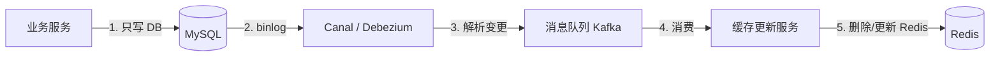

**优点**：

- **业务代码不用管缓存**（解耦，避免"忘了删缓存"的 bug）。
- binlog 是**有序**的，能保证"同一 key 的变更按顺序应用"。
- 可以重放、补偿（丢消息可回溯 binlog）。

**缺点**：

- 链路长，**延迟更高**（通常 50ms~几秒）。
- 需要维护 Canal/Kafka，运维成本高。
- 删除 vs 更新：**删除更安全**（更新可能因并发乱序覆盖）。

> **面试标准答法**：**"我们不强求强一致，而是追求最终一致 + 极小不一致窗口。"** 具体做法：Cache Aside（先更 DB 再删缓存）+ 删除失败重试（用 MQ 重试队列）+ 缓存 TTL 兜底（如 30 分钟）+ 关键业务走 binlog 异步修正。

#### 8.2.5 一个常见误区：为什么要"删"而不是"更新"

- **更新成本高**：如果缓存值是聚合计算结果（如"商品详情 + 库存 + 评价数"），DB 一改就要重算，可能涉及多表 JOIN。
- **并发覆盖**：两个线程同时更新，写入顺序不可控，可能 `v1` 覆盖 `v2`。
- **删了更安全**：删除是幂等操作，且把"计算"推迟到读的时候（懒加载），只在真正被访问时才付出成本。

### 8.3 分布式锁

#### 8.3.1 演进路线

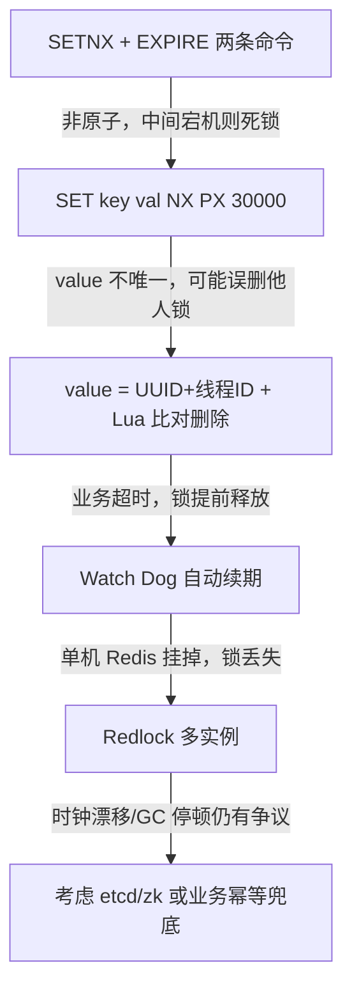

#### 8.3.2 标准实现（单实例）

**加锁**：

```
SET lock:order:123  "uuid-xxx"  NX  PX  30000
```

- `NX`：key 不存在才设置（互斥）。
- `PX 30000`：30 秒自动过期（防死锁）。
- `value = UUID + 线程ID`：标识"谁持有锁"。

**解锁（必须用 Lua）**：

```lua
if redis.call('GET', KEYS[1]) == ARGV[1] then
    return redis.call('DEL', KEYS[1])
else
    return 0
end
```

**为什么必须用 Lua**：`GET` 和 `DEL` 如果分两次，中间锁可能过期被他人获取，你 `DEL` 就删了别人的锁。Lua 保证"判断+删除"原子。

**为什么要有 value**：只用 `DEL key` 无法区分持有者，任何客户端都能删锁。

#### 8.3.3 锁超时与续期（Watch Dog）

**问题**：业务执行时间 > 锁 TTL，锁自动释放，另一个线程进来了 → 并发冲突。

**方案 A：评估执行时间，设足够大的 TTL**（简单但不可靠）。
**方案 B：Watch Dog 自动续期**（Redisson 的做法）：

```
加锁成功后，启动一个定时任务（TTL/3 周期，如 10 秒一次）
  → 若锁仍被自己持有 → EXPIRE 重置为 30 秒
  → 解锁时取消定时任务
```

**Redisson 的细节**：

- 默认 `leaseTime = -1` 时启用 Watch Dog（30 秒 TTL，10 秒续一次）。
- 若指定了 `leaseTime`，则**不启用**续期（到点必释放）。
- 续期是**后台线程**做的，与业务线程解耦。

**坑**：如果业务线程被 `kill -9`，Watch Dog 线程也死了，锁会在 30 秒后自然释放（这是好事，防死锁）。但如果整台机器挂了，同理。

#### 8.3.4 Redlock 及其争议（高分项）

**Redlock 算法**（antirez 提出）：

```
部署 5 个独立的 Redis 主节点（不组成集群，互相独立）
1. 记录开始时间 T1
2. 依次向 5 个节点加锁（相同 key、相同 value、相同 TTL），每个请求设短超时（如 5ms）
3. 若 ≥ 3 个节点加锁成功，且总耗时 < TTL → 认为加锁成功
4. 若失败 → 向所有节点发解锁请求
5. 成功加锁后，锁的"有效时间" = TTL - 加锁耗时
```

**Martin Kleppmann 的质疑**（分布式系统专家）：

1. **时钟漂移**：Redis 的 `EXPIRE` 依赖系统时钟，若某节点时钟跳变，锁可能提前失效。
2. **GC/网络停顿**：客户端在拿到锁后发生长时间 GC 停顿，醒来时锁已过期，但它以为还持有锁 → **无法防止并发**。
3. **不能提供绝对安全**：他建议用**支持共识的存储**（etcd/zk）或"**给每次写操作带 fence token（单调递增版本号）**"。

**antirez 的回应**：

- Redlock 的目标是"**比单实例更可靠**"，不是"绝对安全"。
- 时钟漂移可通过"不依赖系统时钟、用单调时钟"缓解。
- 引入 **fencing token**：每次加锁返回递增序号，写入存储时带上序号，存储端拒绝旧序号（但这需要存储端配合）。

**面试结论（必须有观点）**：

> "Redlock 在理论上不能提供强保证，工程上也不推荐。**如果业务对正确性要求极高，应该用 etcd/zk（基于 Raft/ZAB），或者让业务本身幂等 + 版本号（fencing token）做兜底。Redis 锁更适合'防止重复劳动'（如避免缓存击穿时重复回源），而不是'保证互斥'（如扣款）。**"

#### 8.3.5 集群模式下的锁问题（必考坑）

**场景**：

```
1. 客户端 A 在 master 上加锁成功
2. master 还没把锁同步到 slave，就宕机了
3. slave 升为主
4. 客户端 B 在新 master 上加锁成功
5. 现在 A 和 B 同时认为持有锁 → 并发冲突
```

**根因**：Redis 复制是**异步**的。

**缓解**：

- 用 Redlock（多主独立）降低概率。
- 业务层加"**幂等 + 版本号校验**"兜底。
- 或者接受"极小概率冲突"，用业务补偿（如扣款做对账）。

### 8.4 大 key 与热 key 治理

#### 8.4.1 大 key 的判定

没有官方定义，业界经验：

| 类型 | 阈值 |
| --- | --- |
| String | value > 10KB（或 > 1MB 属于"超大"） |
| Hash/Set/ZSet/List | 元素数 > 10000，或总大小 > 1MB |

#### 8.4.2 大 key 的五大危害

1. **阻塞主线程**：`DEL`、`HGETALL`、`LRANGE 0 -1` 都是 O(N)，N 很大会卡住所有请求。
2. **网络拥塞**：一次读 10MB value，占满带宽，影响同实例其他请求。
3. **内存倾斜**：Cluster 中一个大 key 全落在一个节点，导致该节点内存/CPU 打满。
4. **持久化变慢**：RDB/AOF 重写时要序列化/遍历大 key。
5. **主从延迟**：大 key 同步耗时长，从库应用慢。

#### 8.4.3 发现大 key

| 方法 | 命令 | 说明 |
| --- | --- | --- |
| 扫描 | `redis-cli --bigkeys` | 用 `SCAN` 抽样，统计每种类型的最大 key（**只报每类最大的一个**，不全面） |
| 精确 | `redis-cli --memkeys` | 按内存占用排序（7.0+） |
| 离线 | `rdb-tools` / `redis-rdb-cli` 分析 RDB 文件 | 全量、不影响线上 |
| 实时 | `MEMORY USAGE key` | 查单个 key 的内存（有采样误差） |
| 监控 | `SLOWLOG` 抓慢命令 | 间接发现 |
| 平台 | 阿里云/腾讯云的"大 key 分析" | 商业方案 |

> **坑**：`--bigkeys` 在从库执行（避免影响主库）；且它**会遍历所有 key**，大实例要限速。

#### 8.4.4 治理大 key

| 手段 | 说明 |
| --- | --- |
| **拆分** | Hash 按 field 哈希分桶：`user:1001:{0..99}`，每个 hash 存一部分 |
| **异步删除** | `UNLINK` 替代 `DEL`；`lazyfree-lazy-user-del yes` |
| **分页读** | `HSCAN` / `SSCAN` / `ZSCAN` / `LRANGE` 分批 |
| **压缩** | 用 listpack 编码（控制元素数 < 128、value < 64B）；或用 protobuf/gzip 存 String |
| **不存大对象** | 图片/文件走对象存储，Redis 只存 URL |
| **过期/归档** | 冷数据迁移到 DB |

#### 8.4.5 热 key

**定义**：单个 key 的 QPS 远超其他 key（如爆款商品的库存、热搜榜）。

**危害**：Cluster 中该 key 落在一个节点，该节点 CPU/网络打满，成为瓶颈（**分片失效**）。

**发现**：

- `redis-cli --hotkeys`（需开启 `maxmemory-policy` 为 lfu 类，因为它基于 LFU 计数）。
- `MONITOR` 抽样统计（**生产禁用 MONITOR**，会严重降速）。
- 客户端埋点统计 key 访问频次。
- 代理层（如 Codis/Twemproxy）统计。

**治理**：

| 手段 | 原理 |
| --- | --- |
| **本地缓存** | 应用内存缓存热 key（1~5 秒 TTL），把 Redis QPS 降 1~2 个数量级 |
| **key 打散** | `hotkey:{0..9}`，把一个 key 复制成 10 份，读时随机选（**写时要写 10 份**） |
| **读写分离 + 多从库** | 热 key 读分散到多个从库 |
| **限流** | 对单 key 的访问做本地限流 |
| **多级缓存** | 本地 → Redis → DB |

> **热 key 打散的坑**：如果 key 是"库存"这种需要精确扣减的，**不能简单打散**（会导致超卖）。要么用 Lua 单 key 原子扣减，要么用分段库存 + 汇总校验（复杂）。


---

## 第 9 章 典型场景的底层实现

> 面试里的"场景设计题"不是考你会不会用 API，而是考你**能不能选对结构、说清代价**。

### 9.1 排行榜（ZSet）

```
ZADD rank 100 user1
ZINCRBY rank 5 user1
ZREVRANGE rank 0 9 WITHSCORES     # Top 10
ZREVRANK rank user1               # 我的排名
ZREVRANGEBYSCORE rank (100 90     # 分数区间
```

**底层**：`dict（member→score）+ skiplist（按 score 有序，span 支持算 rank）`。
**复杂度**：`ZADD` O(logN)，`ZREVRANGE` O(logN + M)，`ZREVRANK` O(logN)。
**代价**：内存约为同规模 Set 的 2 倍（两份数据）。
**延伸**：分页深了怎么办？`ZREVRANGE offset offset+9` 的 offset 很大时仍是 O(logN + offset)——**offset 大时性能下降**（要走 offset 个节点）。解法：用 `ZRANGEBYSCORE` 按 score 游标翻页（记录上一页最后一个 score），避免大 offset。

### 9.2 分布式 ID（INCR / INCRBY）

```
INCR seq:order                  # 单实例自增
INCRBY seq:order 1000           # 批量取号（号段模式）
```

**底层**：`INCR` 识别 `OBJ_ENCODING_INT` 编码，直接在 robj 的 long 上 `+1`，O(1)。

**为什么号段模式更优**：每次 `INCRBY 1000` 拿 1000 个号在本地分配，Redis QPS 降低 1000 倍，且容忍 Redis 短时不可用。

**缺点**：

- 单实例 ID 有序但不连续（多实例部署时需加前缀/步长）。
- 持久化丢失会回退（重启后 `INCR` 从 AOF/RDB 恢复的值继续，但若 AOF 丢了 1 秒，ID 会重复）→ **关键业务不能用 Redis 做唯一 ID**，要用雪花算法或 DB 序列。

### 9.3 限流（三种算法的 Redis 实现）

#### 9.3.1 固定窗口（最简单，有临界问题）

```
INCR rate:user:1001:202611191030
EXPIRE 60
# 若返回值 > 100 则拒绝
```

**问题**：窗口边界双倍流量（第 59 秒 100 个 + 第 61 秒 100 个 = 2 秒内 200 个）。

#### 9.3.2 滑动窗口（ZSet 实现，精确）

```lua
-- KEYS[1] = 限流 key, ARGV[1] = 窗口毫秒, ARGV[2] = 上限, ARGV[3] = 当前时间戳
redis.call('ZREMRANGEBYSCORE', KEYS[1], 0, ARGV[3] - ARGV[1])  -- 删窗口外的
local count = redis.call('ZCARD', KEYS[1])
if count < tonumber(ARGV[2]) then
    redis.call('ZADD', KEYS[1], ARGV[3], ARGV[3] .. '-' .. math.random())
    redis.call('PEXPIRE', KEYS[1], ARGV[1])
    return 1
end
return 0
```

**代价**：每个请求存一条记录，**内存开销与 QPS 成正比**。高 QPS 场景慎用（用 bitmap 或令牌桶替代）。

#### 9.3.3 令牌桶（推荐）

```
思路：用 Hash 存 {lastRefillTime, tokens}，Lua 里算"距上次补充了多少令牌"
每次请求：tokens = min(capacity, tokens + elapsed * rate)；tokens > 0 则扣减放行
```

**优点**：内存固定（2 个字段）、支持突发流量（桶容量）、平滑。
**缺点**：需要 Lua 保证原子（读-算-写）。

> **面试加分**：能说出"**固定窗口有临界问题，滑动窗口精确但费内存，令牌桶兼顾突发与平滑，漏桶强制匀速**"这个对比。

### 9.4 消息队列（三种方案对比，必考）

| 方案 | 底层 | 优点 | 致命缺点 |
| --- | --- | --- | --- |
| **List**（`LPUSH`+`BRPOP`） | quicklist | 简单、O(1) | 无 ACK（弹出即丢）、无消费组、无消息回溯 |
| **Pub/Sub** | 服务端字典 + 客户端链表 | 实时、广播 | **不持久化**（订阅者离线就丢）、无 ACK |
| **Stream**（5.0+） | rax（基数树）+ listpack | 持久化、消费组、ACK、pending 列表、消息回溯 | 实现复杂、内存需手动 trim |

#### 9.4.1 Stream 的核心机制

```
XADD mystream * field value        # * 自动生成 ID（ms-seq）
XGROUP CREATE mystream g1 0        # 创建消费组
XREADGROUP GROUP g1 c1 COUNT 10 BLOCK 2000 STREAMS mystream >
XACK mystream g1 <id>              # 确认消费
XPENDING mystream g1               # 查看未确认消息（PEL）
XCLAIM mystream g1 c2 3600000 <id> # 转移超时未 ACK 的消息给 c2
XTRIM mystream MAXLEN 10000        # 裁剪
```

**关键概念**：

- **消费组（consumer group）**：同组内消息**分摊**（一条消息只被一个消费者拿到）；不同组**各自独立消费**（广播语义）。
- **PEL（Pending Entries List）**：每个消费者维护"已投递未 ACK"的消息 ID 列表。这是"至少一次（at-least-once）"语义的基础。
- **`XCLAIM`**：处理"消费者挂了，消息卡在 PEL 里"的问题（相当于 Kafka 的 rebalance）。

**为什么 Stream 比 List 强**：List 的 `BRPOP` 一旦弹出消息，消息就没了（**至多一次**）；Stream 有 PEL，消息被消费但未 ACK 前仍可重投（**至少一次**）。

**Stream vs Kafka**：

| 维度 | Redis Stream | Kafka |
| --- | --- | --- |
| 持久化 | 内存为主（RDB/AOF） | 磁盘顺序写 |
| 吞吐 | 万级 | 十万~百万级 |
| 消息保留 | 需手动 XTRIM，内存受限 | 按时间/大小保留，磁盘 |
| 分区 | 无（单 key） | Partition |
| 适用 | 轻量级、低延迟、不想引入 Kafka | 大规模、高吞吐 |

### 9.5 签到 / 活跃统计（Bitmap）

```
SETBIT sign:202611:user1001 18 1    # 11 月 19 日签到（第 19 天，索引 18）
GETBIT sign:202611:user1001 18
BITCOUNT sign:202611:user1001        # 本月签到天数
BITCOUNT sign:202611:user1001 0 2    # 前 3 字节（前 24 天）
```

**底层**：String（SDS），按位操作。
**内存**：100 万用户 × 31 天 = 1000000 × 31 bit ≈ 3.9MB（如果按 user 建 key，则是 100 万个 key，key 开销远大于 value）。
**优化**：按"日期"建 key（`sign:20261119`），value 是 100 万位的 bitmap → 125KB/天，**一个月 3.75MB 覆盖全站**。
**延伸**：`BITOP AND/OR` 可以做"连续签到"、"周活跃"计算。

### 9.6 UV 统计（HyperLogLog）

```
PFADD uv:20261119 user1 user2 ...
PFCOUNT uv:20261119                 # 估算 UV
PFMERGE uv:week uv:20261115 ... uv:20261119   # 合并一周
```

**原理**：

- 基于**调和平均数 + 分桶**的基数估计算法。
- 16384 个桶（`2^14`），每桶 6 bit 记录"ρ（前导零个数）的最大值"。
- 内存固定 **12KB**（16384 × 6bit / 8 ≈ 12KB）+ 少量头部。
- 标准误差 **0.81%**。

**核心思想（面试要能讲）**：

> 对每个元素做哈希得到 64 位串，统计"从低位开始连续 0 的个数 ρ"。ρ 越大，说明出现过这么多元素的概率越低。用 `2^ρ` 估算基数，再对 16384 个桶取**调和平均**（抗离群值），最后乘以修正系数。

**为什么用调和平均而不是算术平均**：算术平均会被极端大值（ρ 很大）严重拉高；调和平均对小值敏感，能抑制离群影响。

**缺点**：只能估算基数，**不能判断某元素是否存在**（不像布隆）。

### 9.7 GEO（地理位置）

```
GEOADD shops 114.05 22.55 "深圳北站"
GEOSEARCH shops FROMLONLAT 114.05 22.55 BYRADIUS 5 km ASC
GEODIST shops "A" "B"
```

**底层：ZSet**。

- 经纬度 → **GeoHash 编码**（把二维平面递归四分，转成一维 52bit 整数）→ 作为 ZSet 的 score。
- 查询"附近 5km"：先算出覆盖该圆的**9 个格子（中心 + 8 邻居）**的 geohash 范围，转成 score 区间，用 `ZRANGEBYSCORE` 取出候选，再做**精确距离过滤**（Haversine 公式）。
- **为什么是 9 个格子**：中心格子的邻居可能跨越 8 个方向，不查邻格会漏。
- **精度**：52bit 对应约 0.6 米精度。

> **延伸**：为什么用 ZSet 而不是专门的索引？因为 ZSet 的 score 是 double（52bit 整数在 double 的 53 位有效位内可精确表示），**用一个通用结构就实现了空间索引**，不需要额外的数据结构。这是"**复用已有结构**"的经典设计。

### 9.8 秒杀扣库存（Lua 原子）

```lua
-- KEYS[1] = stock key, ARGV[1] = 购买数量
local stock = tonumber(redis.call('GET', KEYS[1]))
if stock == nil then return -1 end          -- 商品不存在
if stock < tonumber(ARGV[1]) then return -2 end  -- 库存不足
redis.call('DECRBY', KEYS[1], ARGV[1])
return stock - tonumber(ARGV[1])
```

**为什么必须 Lua**：`GET` 和 `DECRBY` 分两条命令，中间可能被插入，导致超卖。

**延伸问题**：

- **Lua 里的扣减是"预扣"**，还要异步落 DB（用 MQ 削峰）。若 MQ 消费失败，要回滚库存（`INCRBY`）。
- **热 key**：单个商品库存 key 会被几万人打，QPS 极高 → 用"**库存分桶**"（把 1000 库存拆成 10 份各 100，请求随机选桶）+ 本地预扣。
- **超卖兜底**：DB 层加乐观锁/唯一索引，最终以 DB 为准。

### 9.9 会话共享（Session）

```
SET session:xxx "{...json...}" EX 1800
```

**要点**：

- value 用 JSON 或 protobuf（比 Java 序列化省 30%~50%）。
- TTL 要做"滑动续期"（每次请求 `EXPIRE` 重置）→ **注意频繁 EXPIRE 也是写操作**，可改为"每 5 分钟续一次"。
- 大 Session（> 10KB）要考虑拆分。

### 9.10 布隆过滤器（防穿透，见 8.1.1）

补充一个工程细节：**布隆过滤器要不要放 Redis**？

- 放 Redis：多实例共享，但要网络往返（可以 pipeline 批量）。
- 放本地：零延迟，但多实例要同步（用 Redis 存一份，本地缓存 + 定期刷新）。
- **最佳实践**：本地布隆（Guava/Caffeine）+ Redis 兜底，或直接用 RedisBloom 模块。

---

## 第 10 章 国内大厂高频面试题（带难度分级 + 详解 + 延伸）

> **说明**：以下题目按"国内一线互联网公司（阿里/蚂蚁、腾讯、字节、美团、京东、拼多多、百度、快手、滴滴、网易、小红书等）技术面常见考察方向"归类整理，标注难度与考察意图。**难度分级**：
>
> - ★☆☆☆☆ 基础必答（校招/初级）
> - ★★☆☆☆ 常规（1~3 年）
> - ★★★☆☆ 进阶（3~5 年 / P6）
> - ★★★★☆ 深入（5~8 年 / P7）
> - ★★★★★ 架构/源码级（P7+ / 专家）

---

### 10.1 数据结构与底层实现（出现频率最高）

---

#### Q1. Redis 有哪些数据类型？底层分别用什么结构？ ★★☆☆☆

**考察点**：是否只会背"5 种类型"，还是知道"11 种编码"。

**标准答案**：

| 类型 | 编码 | 条件 |
| --- | --- | --- |
| String | int / embstr / raw | 整数 / ≤44 字节 / >44 字节 |
| List | quicklist（内含 listpack） | 始终 |
| Hash | listpack / hashtable | ≤128 且 value ≤64B / 超出 |
| Set | intset / listpack / hashtable | 全整数 ≤512 / ≤128 / 超出 |
| ZSet | listpack / skiplist+dict | ≤128 且 member ≤64B / 超出 |

**延伸追问**："为什么 String 要分 embstr 和 raw？"
→ `embstr` 把 robj 和 SDS 用**一次 malloc** 分配在连续内存（省一次分配、cache 友好）；但它**只读**，任何修改都会转 `raw`（因为需要独立 realloc SDS）。长度 44 是因为 `jemalloc` 的 64 字节 size class：`robj(16) + sdshdr(3~4) + 44 + 1` ≈ 64。

---

#### Q2. SDS 和 C 字符串的区别？为什么要自己实现？ ★★☆☆☆

**要点**（四点必须说全）：O(1) 取长度、二进制安全、防缓冲区溢出、空间预分配 + 惰性释放。

**延伸追问**："空间预分配的阈值为什么是 1MB？"
→ 小于 1MB 翻倍（绝对浪费可接受，减少 realloc）；大于 1MB 每次 +1MB（避免大字符串翻倍导致内存翻倍）。本质是"**用可控的内存浪费换 realloc 次数**"。

**加分**："SDS 还保留了 `\0` 结尾，是为了兼容 C 的字符串函数（printf、strcmp），但因为判边界用 len，所以不影响二进制安全。"

---

#### Q3. 讲一下 Redis 的渐进式 rehash。 ★★★☆☆

**答案结构**：

1. **为什么**：一次性 rehash 百万 key 会阻塞主线程。
2. **怎么做**：`ht[0]` → `ht[1]`，`rehashidx` 记录进度；每次增删改查顺带搬一个桶；`serverCron` 里以 1ms/100 桶的节奏搬。
3. **期间访问规则**：查（先 ht0 后 ht1）、增（只写 ht1）、删改（两表都查）。
4. **触发条件**：负载因子 ≥1（无持久化）/ ≥5（bgsave 期间）；缩容 <0.1。

**延伸（高分段）**：

- 为什么 bgsave 时阈值提高到 5？COW 期间避免写内存加剧膨胀。
- SCAN 在 rehash 期间怎么保证不漏？→ **反向二进制迭代**（高位进位），扩容时能覆盖新桶，缩容时跳过已扫部分。

---

#### Q4. ZSet 为什么用跳表而不是红黑树 / B+ 树？ ★★★☆☆

**答案**：

| 维度 | 跳表 | 红黑树 |
| --- | --- | --- |
| 范围查询 | 底层链表顺序遍历，**cache 友好** | 中序遍历，指针跳转多 |
| 实现复杂度 | 低（无旋转/变色） | 高 |
| 排名 | `span` 字段 O(logN) | 需额外维护子树 size |
| 并发扩展 | 局部修改，易无锁化 | 旋转影响面大 |

**为什么不是 B+ 树**：B+ 树是为**磁盘 IO**设计的（一个节点一个页，减少磁盘寻道）。Redis 是纯内存，节点大小与页对齐没有意义，反而浪费内存。

---

#### Q5. ziplist 的级联更新是什么？listpack 怎么解决的？ ★★★★☆

**答案**：

- ziplist 每个 entry 存 `prevlen`（前一个 entry 的长度，用于**反向遍历**）。
- 当某 entry 从 <254 字节变为 ≥254 字节，`prevlen` 从 1 字节扩到 5 字节 → 该 entry 变长 → 后一个 entry 的 `prevlen` 可能也要扩 → **连锁反应，最坏 O(N²)**。
- listpack 把"自己的长度"记在**entry 尾部（backlen）**，不再依赖前驱长度 → **插入/删除只影响自身**，级联更新消失；反向遍历时读 backlen 即可跳回上一个 entry。

**延伸**："Redis 7.0 为什么全面替换 ziplist？"→ 除了级联更新，listpack 还省掉每个 entry 的 prevlen 字段（更省内存）、结构更简单。

---

#### Q6. Redis 的 dict 为什么用头插法？ ★★★☆☆

**答案**：dict 没有维护尾指针，头插是 O(1)；且"新加入的数据更可能被最近访问"（时间局部性），头插让热点数据在链表前部，减少遍历长度（虽然链表本来也是 O(1) 查找，但对遍历/随机采样有利）。

**延伸**："Redis 怎么防止哈希攻击（HashDoS）？"→ 用 **SipHash**（带随机种子的 keyed hash），攻击者无法预先构造大量冲突 key。早期版本用 MurmurHash，可被构造碰撞。

---

#### Q7. Redis 的内存是怎么分配的？为什么用 jemalloc？ ★★★☆☆

**答案**：

- 默认 jemalloc（也可编译为 libc malloc / tcmalloc）。
- jemalloc 按 **size class**（8/16/32/48/64/80/96/112/128…）分配，减少**外部碎片**。
- 多线程 arena 减少锁竞争（虽然 Redis 主线程单线程，但 lazyfree/bgsave 是多线程）。
- **可观测**：`MEMORY USAGE key`、`INFO memory` 的 `used_memory` / `used_memory_rss` / `mem_fragmentation_ratio`。

**延伸**："碎片率高怎么处理？"→ `activedefrag`（4.0+）后台整理；或滚动重启；同时排查是否有大量短生命周期 key 反复增删。

---

#### Q8. 一个 key 在 Redis 里占多少内存？ ★★★★☆

这是一道"考你有没有真正算过账"的题。

**答案框架**：

```
总内存 ≈ dictEntry(24B) + key 的 robj(16B) + key 的 SDS(len+头+1)
        + value 的 robj(16B) + value 的数据
        + expires 字典（若有 TTL：另一个 dictEntry + 时间戳 8B）
        + jemalloc 的 size class 向上取整 + 碎片
```

**经验值**：

- 一个 `SET k v`（key 10 字节、value 10 字节）：**约 80~120 字节**（含 dictEntry、两个 robj、两个 SDS、jemalloc 对齐）。
- 所以"100 万个小 key"约需 **100MB+**，而不是"20MB"。

**结论（面试金句）**：**"Redis 的小 key 开销很大，key 本身的元数据可能比数据还大。所以用 Hash 做'字段聚合'（把一个对象的多个字段放一个 hash）比'一个字段一个 key'省内存得多。"**

**延伸**："`hash-max-listpack-entries 128` 为什么是 128？"→ listpack 在 128 个元素以内，查找 O(N) 但 N 小、cache 友好，比 hashtable（每个 entry 24B + 桶指针）省内存；超过后 O(N) 变慢，必须转 hashtable。

---

### 10.2 线程模型与网络

---

#### Q9. Redis 是单线程的吗？为什么单线程还这么快？ ★★☆☆☆

**标准答法（必须纠偏）**：

> "严格说，**Redis 的命令执行是单线程的，但服务不是单线程的**。6.0 引入了多线程 IO（只做网络读写和协议解析），持久化用 fork 子进程，`UNLINK` 用后台 lazyfree 线程。"

**快的四点**：内存操作、高效数据结构、IO 多路复用、单线程无锁无切换。再加两点：RESP 协议简单、jemalloc。

**延伸追问**："单线程的瓶颈在哪？"
→ **CPU（复杂命令）、网络 IO（大 value）、内存带宽**。所以 6.0 用多线程 IO 缓解网络瓶颈，但**不解决 CPU 瓶颈**（复杂命令仍是串行）。真正的 CPU 瓶颈只能靠**分片（Cluster/多实例）**。

---

#### Q10. epoll 的原理是什么？和 select/poll 的区别？ ★★★☆☆

**答案**：

- **select**：位图，上限 1024；每次调用全量拷贝 fd 集合到内核；内核遍历所有 fd 找就绪 → O(N)。
- **poll**：链表/数组，无上限；仍需全量拷贝 + 遍历 → O(N)。
- **epoll**：`epoll_ctl` 注册一次（红黑树存 fd），内核在数据到达时通过**回调**把 fd 挂到**就绪链表**；`epoll_wait` 只取链表 → **O(1)（就绪数）**。

**延伸追问**："LT 和 ET 的区别？Redis 用哪个？"
→ LT：只要缓冲区有数据就一直通知（安全、实现简单）；ET：只在状态变化时通知一次，必须读到 EAGAIN（高效但易丢数据）。**Redis 用 LT**。

**再延伸**："epoll 的水平触发会不会导致忙等？"→ 不会，因为没有数据时 `epoll_wait` 会阻塞；有数据时会持续通知直到读完，而 Redis 每次读事件都会读到 EAGAIN。

---

#### Q11. Redis 6.0 的多线程是怎么实现的？会不会有线程安全问题？ ★★★★☆

**答案**：

- 流程：多个 IO 线程**并行** `read` socket + 解析协议 → 命令放入队列 → **主线程串行执行** → 回复放入缓冲 → IO 线程**并行** `write`。
- **为什么不安全**：因为**命令执行仍在主线程**，数据结构没有并发访问，所以不需要加锁。IO 线程只碰各自的 client 缓冲（每个 client 只被一个 IO 线程处理，通过 `io_threads_list` 分配）。
- 参数：`io-threads`（建议 CPU 核数 3/4，≤8）、`io-threads-do-reads`（默认 no）。

**延伸**："为什么不做多线程执行？"→ 要给 dict/skiplist 加锁，锁竞争开销 > 并行收益；且 Redis 的定位是"低延迟"，不是"高吞吐计算"。

---

#### Q12. 一条命令从客户端发出到收到回复，经历了什么？ ★★★★☆

**答案**（按第 3 章 3.3 的链路）：

```
TCP → epoll 可读 → readQueryFromClient → processInputBuffer（RESP 解析）
→ processCommand（lookupCommand + 各种校验）→ call → 具体 xxxCommand
→ 操作 dict/skiplist/quicklist → dirty++ → propagate（AOF buf + repl backlog）
→ addReply（写 client 输出缓冲）→ beforeSleep 统一 flush → writeToClient → 客户端
```

**加分点**：能提到"写回复不是立刻发，而是攒到 `beforeSleep` 批量发"，以及"命令传播是命令复制而非状态复制"。

---

### 10.3 持久化

---

#### Q13. RDB 和 AOF 的区别？怎么选？ ★★☆☆☆

见 4.5 对比表。**结论**：生产用 **AOF + `everysec` + 混合持久化（`aof-use-rdb-preamble yes`）**，同时保留 RDB 做冷备。

**延伸**："如果只能选一个？"→ 选 AOF（数据更完整）；如果实例很大、能容忍丢几分钟数据，选 RDB（恢复快、对性能影响小）。

---

#### Q14. fork 的时候发生了什么？为什么会内存翻倍？ ★★★★☆

**答案**：

1. `fork()` 复制**页表**（不复制物理内存），父子共享物理页并标记**只读**。
2. 主进程写某页 → 缺页异常 → 内核复制该页（**COW**）→ 主进程用新页，子进程仍读旧页。
3. 若 `bgsave` 期间写入频繁，几乎所有页都被复制 → **内存接近翻倍**。
4. fork 本身阻塞主线程，耗时与**页表项数量**（内存大小）成正比。

**延伸追问**：

- "怎么减少 fork 影响？"→ 控制单实例内存 ≤10~16GB、关闭 THP、错峰做 bgsave、用无盘复制（`repl-diskless-sync`）。
- "THP 为什么有害？"→ 页从 4KB 变 2MB，COW 单位变大，fork 与复制开销剧增。

---

#### Q15. AOF 重写的过程？重写期间的新写入怎么办？ ★★★★☆

见 4.3.3。**关键点**：子进程按内存生成最小命令集；**主进程同时写旧 AOF 和 `aof_rewrite_buf`**；重写完成后把 buf 追加到新文件再 rename。

**延伸**："7.0 的 Multi-Part AOF 改了什么？"→ 用 base（RDB 格式）+ 多个 incr 文件 + manifest，**重写期间不需要大内存缓冲**，直接写新 incr 文件，manifest 原子切换。

---

#### Q16. AOF 的三种 fsync 策略，为什么生产用 everysec？ ★★★☆☆

见 4.3.2。**加分点**：能说出"`everysec` 在上一次 fsync 未完成时会导致主线程阻塞（最长 2 秒），日志里会有 `Asynchronous AOF fsync is taking too long`"。

---

### 10.4 过期、淘汰与内存

---

#### Q17. Redis 的过期键是怎么删除的？ ★★★☆☆

**答案**：惰性删除（访问时检查 `expireIfNeeded`）+ 定期删除（`activeExpireCycle` 每 100ms 随机抽样 20 个，过期率 >25% 就继续抽，单次限 25% CPU）。

**延伸（高分）**："从库为什么不主动删过期 key？"→ 为了保证主从一致：如果从库自己删了，主库还没删，数据就不一致。所以从库等主库发 `DEL`，但读的时候 `expireIfNeeded` 返回 1（逻辑上不可见）。

**再延伸**："RDB/AOF 怎么处理过期 key？"→ RDB 生成时跳过过期 key；从库加载 RDB 时**全部加载**（等主库同步 DEL）；AOF 重写时跳过过期 key，删除时追加 `DEL`。

---

#### Q18. Redis 的 8 种淘汰策略，LRU 是怎么实现的？ ★★★☆☆

见 5.3。**关键**：Redis 用的是**近似 LRU**（采样 `maxmemory-samples` 个 key，淘汰最旧的），不是真 LRU（因为维护双向链表开销大）。

**延伸**："采样 5 个和 10 个差多少？"→ 5 个时准确率约 67%，10 个约 89%，再往上收益递减。所以官方建议 10。

**再延伸**："LFU 解决什么问题？"→ 缓存污染：一次全表扫描会把所有 key 的"最近访问时间"刷新，LRU 会误判它们都是热点；LFU 用**概率增长的计数 + 时间衰减**，扫描产生的一次性访问计数很低，不会被误判。

---

#### Q19. maxmemory 到了会发生什么？ ★★★☆☆

**答案**：

1. 写命令执行前检查 `used_memory > maxmemory`。
2. 按 policy 淘汰 key（循环淘汰直到内存足够或无法再淘汰）。
3. 若 `noeviction` 或没有可淘汰的 key → 返回 `OOM command not allowed when used memory > 'maxmemory'`。
4. **读命令不受影响**（仍可读）。

**坑**：`maxmemory` 不包含**输出缓冲**、**复制 backlog**、**AOF 缓冲**，所以实际 RSS 可能远超 maxmemory → 被 OOM Killer 杀。

---

### 10.5 高可用与集群

---

#### Q20. 主从复制的流程？全量同步和增量同步的区别？ ★★★☆☆

见 6.1.2/6.1.3。

**延伸追问**："`repl_backlog` 是干什么的？默认 1MB 够吗？"
→ 环形缓冲区，存最近的写命令。从库断连重连时，若 offset 还在缓冲区内→增量；不在→全量。**默认 1MB 通常太小**，公式：`写入速率 × 最大容忍断连时长`。

**再延伸**："PSYNC2 相比 PSYNC 改了什么？"→ 支持"从库升主后再降级"仍能部分增量（用 `replid` + `replid2` 双 ID 解决 runid 变化问题）。

---

#### Q21. 主从延迟怎么排查？ ★★★★☆

见 6.1.6。**加分**：能说出具体指标（`master_repl_offset` vs `slave_repl_offset` 差值、`master_link_status`、`master_last_io_seconds_ago`）和常见根因（大 key、从库 bgsave、网络、backlog 溢出）。

---

#### Q22. 哨兵的工作原理？为什么必须部署 3 个以上？ ★★★☆☆

见 6.2。**核心**：主观下线（单个哨兵判断）+ 客观下线（quorum 个哨兵共识）+ 领导者选举（多数派投票）+ 选新主（priority > offset > runid）。

**延伸**："哨兵的脑裂怎么解决？"→ `min-replicas-to-write` + `min-replicas-max-lag`，让孤立的主库拒绝写入。

---

#### Q23. Cluster 为什么是 16384 个槽？ ★★★★☆

见 6.3.2。三个理由：心跳包大小（2KB vs 8KB）、节点规模够用、CRC16 输出 16 位便于位运算。

---

#### Q24. MOVED 和 ASK 的区别？ ★★★★☆

见 6.3.5。**核心区别**：MOVED 是永久重定向（更新客户端缓存）；ASK 是临时重定向（迁移中，不更新缓存，需先发 `ASKING`）。

**延伸**："为什么 ASK 需要 ASKING 命令？"→ 目标节点收到不属于自己槽的 key 会再次返回 MOVED，形成死循环；`ASKING` 临时授权执行一次。

---

#### Q25. Cluster 有哪些限制？多 key 操作怎么办？ ★★★★☆

见 6.3.7。**核心解法**：**hash tag**（`{user1001}:name`、`{user1001}:age` 落同槽）。

**延伸**："hash tag 有什么风险？"→ 大量 key 用同一 tag 会导致**数据倾斜**（全压一个节点）。要控制 tag 基数，或按业务维度设计。

---

#### Q26. 集群扩容/缩容时，客户端会受影响吗？ ★★★★☆

**答案**：

- 迁移槽期间，客户端会收到 `ASK`（部分 key 已迁走）或 `MOVED`（槽迁完）。
- 客户端必须能处理重定向，且**有本地槽映射缓存**（否则每次都问，延迟高）。
- 迁移大 key 时 `MIGRATE` 会阻塞源节点 → 影响该节点的其他请求。
- **最佳实践**：低峰期迁移、限制 `--cluster-pipeline` 批量大小、监控 `cluster_migration` 状态。

---

### 10.6 缓存与工程实践

---

#### Q27. 缓存穿透、击穿、雪崩的区别和解决方案？ ★★★☆☆

见 8.1。**关键**：三者定义不能混（穿透=数据不存在；击穿=单 key 失效；雪崩=大面积失效）。

**延伸**："布隆过滤器有误判怎么办？"→ 误判是**假阳性**（说不存在一定不存在，说存在可能不存在），所以只能"挡住大部分"，仍需配合"缓存空值 + DB 兜底"。

**再延伸**："布隆过滤器怎么删除元素？"→ 标准布隆不支持删除（会影响其他元素）；用 **Counting Bloom**（计数数组）或 **Cuckoo Filter**（布谷鸟过滤器，支持删除、空间效率更高）。

---

#### Q28. 怎么保证缓存和数据库的一致性？ ★★★★☆

见 8.2。**标准答法**：

1. Cache Aside（先更新 DB，再删缓存）。
2. 删除失败重试（MQ 重试队列）。
3. TTL 兜底。
4. 关键业务走 binlog 订阅（Canal）异步修正。
5. **承认这是最终一致，不是强一致**。

**延伸追问**："为什么是删缓存而不是更新缓存？"→ 更新要重算（成本高）、并发会乱序覆盖、删是幂等的。

**再延伸**："延迟双删的延迟怎么定？"→ 要 > "一次读请求的最长耗时"（读 DB + 写缓存），通常 500ms~1s；但无法精确，只能降低概率。

---

#### Q29. 分布式锁怎么实现？有什么坑？ ★★★★☆

见 8.3。**完整答法**：

1. `SET key uuid NX PX 30000`。
2. 释放用 Lua 比对 value 再删。
3. Watch Dog 续期（Redisson）。
4. 集群下主从切换会丢锁 → 用 Redlock 或业务幂等兜底。

**延伸（高分）**："Redlock 有什么争议？"→ Martin Kleppmann 指出时钟漂移 + GC 停顿会导致锁失效，建议用 fencing token 或 etcd/zk。**要有自己的判断**：Redis 锁适合"防重复劳动"，不适合"强互斥"。

---

#### Q30. 大 key 怎么发现、怎么治理？ ★★★★☆

见 8.4。**发现**：`--bigkeys`、`--memkeys`、rdb-tools 离线分析、`MEMORY USAGE`、SLOWLOG。
**治理**：拆分、`UNLINK`、分页扫描、压缩编码、对象存储。

**延伸**："为什么 `DEL` 大 key 会卡？"→ `DEL` 会逐个释放底层元素（100 万元素 = 100 万次 free），主线程阻塞。`UNLINK` 把释放交给后台线程。

---

#### Q31. 热 key 怎么处理？ ★★★★☆

见 8.4.5。**手段**：本地缓存、key 打散、读写分离、限流、多级缓存。

**延伸坑**："库存这种需要精确扣减的 key 能打散吗？"→ 不能简单打散（会超卖）。要用 Lua 原子扣减 + 分段库存 + DB 兜底。

---

### 10.7 事务、Lua、Pipeline

---

#### Q32. Redis 事务支持回滚吗？ACID 怎么理解？ ★★★☆☆

见 7.1.3/7.1.4。**核心**：不支持回滚（执行期错误只影响那一条）；原子性是"部分满足"；隔离性靠单线程。

**延伸**："那 `MULTI/EXEC` 还有什么用？"→ 保证"命令之间不被其他客户端插入"（批量原子执行），但不能保证"全部成功"。

---

#### Q33. Lua 脚本为什么能保证原子性？有什么风险？ ★★★★☆

见 7.2。**原子性来源**：脚本作为**一个命令**在主线程执行，中间不会处理其他客户端命令。

**风险**：长脚本阻塞（`lua-time-limit` 超时返回 BUSY 但**不会杀脚本**）、内存爆、非确定性命令导致主从不一致（5.0 用效果复制解决）。

---

#### Q34. Pipeline 和 Lua、MULTI 的区别？ ★★★☆☆

见 7.4。**一句话**：Pipeline 只减少 RTT（不原子）；MULTI 部分原子；Lua 完全原子且能服务端计算。

---

### 10.8 场景设计题（P6/P7 必考）

---

#### Q35. 设计一个排行榜，要求实时、支持亿级用户、能查我的排名。 ★★★★☆

**答案框架**：

1. **数据结构**：ZSet（`ZADD`/`ZINCRBY`/`ZREVRANGE`/`ZREVRANK`）。
2. **分片**：按用户 ID 哈希分 N 个 ZSet（如 100 个），每个 ZSet 存一部分用户。
3. **全局排名**：分段统计——先算"我所在分片内排名"，再加上"所有分数比我高的分片元素数"（用每个分片的 `ZCOUNT` 累加）。
4. **性能**：`ZREVRANK` 是 O(logN)；分片后单 ZSet 规模降低 100 倍。
5. **代价**：全局排名需要 N 次 `ZCOUNT`（可 pipeline 批量），N 越大越慢 → 分层（Top 1000 单独一个 ZSet，长尾用分片）。
6. **存储成本**：ZSet 是 dict + skiplist，内存约 2 倍。

**延伸**："榜单要按周/月/总榜，怎么设计？"→ 三个 ZSet（`rank:week`、`rank:month`、`rank:all`），周榜用 `EXPIRE` 自动清理；或用 `ZUNIONSTORE` 定期合并。

---

#### Q36. 设计一个秒杀系统，Redis 承担什么角色？ ★★★★★

**答案框架（分层）**：

```
1. 前端：按钮置灰、验证码、限流（防刷）
2. 网关：IP/用户级限流（令牌桶）
3. Redis（核心）：
   - 库存预热：活动前把库存加载到 Redis
   - Lua 原子扣减（防超卖）
   - 用户去重：SETNX user:activity:uid（防一人多单）
   - 结果写入 MQ（削峰）
4. MQ：异步下单，DB 落库
5. DB：最终库存校验（乐观锁 / 唯一索引）
6. 兜底：库存回滚（MQ 消费失败 → INCRBY）
```

**关键设计点**：

- **为什么用 Lua**：`GET` + `DECR` 非原子会超卖。
- **热 key 怎么办**：库存分桶（10 个桶各 100），请求随机选桶；或用本地预扣 + 定期同步。
- **Redis 挂了怎么办**：降级为"DB 直接扣减 + 限流"，或直接拒绝（宁可少卖不超卖）。
- **超卖兜底**：DB 层唯一索引（`(activity_id, user_id)`）+ 库存 `stock >= 0` 约束。

---

#### Q37. 用 Redis 实现一个延迟队列。 ★★★★☆

**方案对比**：

| 方案 | 原理 | 优点 | 缺点 |
| --- | --- | --- | --- |
| **ZSet + 轮询** | `ZADD delay:queue <executeTime> <taskId>`，消费者 `ZRANGEBYSCORE 0 now LIMIT 0 10` 取到期任务 | 简单、精确 | 轮询有延迟/空转；多消费者要加锁防重复 |
| **ZSet + Lua 原子取** | Lua 里 `ZRANGEBYSCORE` + `ZREM` 原子取走 | 防重复 | 仍需轮询 |
| **Redis 5.0 Stream + 延时** | 不支持原生延时（需外部调度） | — | — |
| **Redisson DelayedQueue** | 底层是 ZSet + 阻塞队列 + 定时任务 | 开箱即用 | 依赖 Redisson，有精度限制 |

**最佳实践**：ZSet + Lua 原子取 + 多线程轮询（每次取 100 条），配合 `BLPOP` 唤醒（减少空转）。

**延伸**："消息可靠性怎么保证？"→ 取出后先写"处理中"标记（另一个 ZSet 或 Hash），处理成功再删除；失败则重入队列；超时未完成的任务由"补偿任务"重新入队。

---

#### Q38. 如何用 Redis 做"附近的人"？ ★★★★☆

见 9.7。**核心**：GEO = ZSet + GeoHash（52bit 编码成 score）；查询时算 9 个格子的 score 区间 → `ZRANGEBYSCORE` 取候选 → Haversine 精确过滤。

**延伸**："为什么是 9 个格子？"→ 中心格子的 8 个邻居可能跨边界，必须一起查，否则漏数据。

---

#### Q39. 如何统计千万级 UV？ ★★★☆☆

**答案**：HyperLogLog（`PFADD`/`PFCOUNT`），12KB 固定内存，误差 0.81%。

**延伸**："能精确统计吗？"→ HLL 是估算，不能精确。要精确就用 **Bitmap**（`SETBIT user_id 1`），1 亿用户 = 12.5MB/天，可接受；或用"分层统计"（小流量精确、大流量 HLL）。

---

#### Q40. 如何设计一个高并发点赞系统？ ★★★★☆

**答案框架**：

1. **计数**：`INCR post:like:count:<id>`（O(1)，但热 key）。
2. **去重**：`SETBIT like:post:<id> <userId> 1`（Bitmap，1 亿用户 = 12.5MB，太大）；或 `SADD like:post:<id> <userId>`（Set，但内存大）。
3. **优化**：分片计数（`like:count:<id>:<0..9>`，读时累加 10 个）+ 本地缓存。
4. **持久化**：定期把 Redis 计数同步到 DB（如每 5 分钟），或用 MQ 异步。
5. **一致性**：Redis 计数是"最终一致"，DB 是权威；用定时对账修正。

**延伸**："点赞列表怎么存？"→ ZSet（`ZADD like:list:<postId> <timestamp> <userId>`），支持按时间排序和分页；但大帖子会有百万成员 → 分页用 `ZREVRANGE` 游标。

---

### 10.9 故障排查题（P7 高频，最能区分水平）

---

#### Q41. Redis 突然 CPU 100%，怎么排查？ ★★★★★

**排查顺序（结构化答法）**：

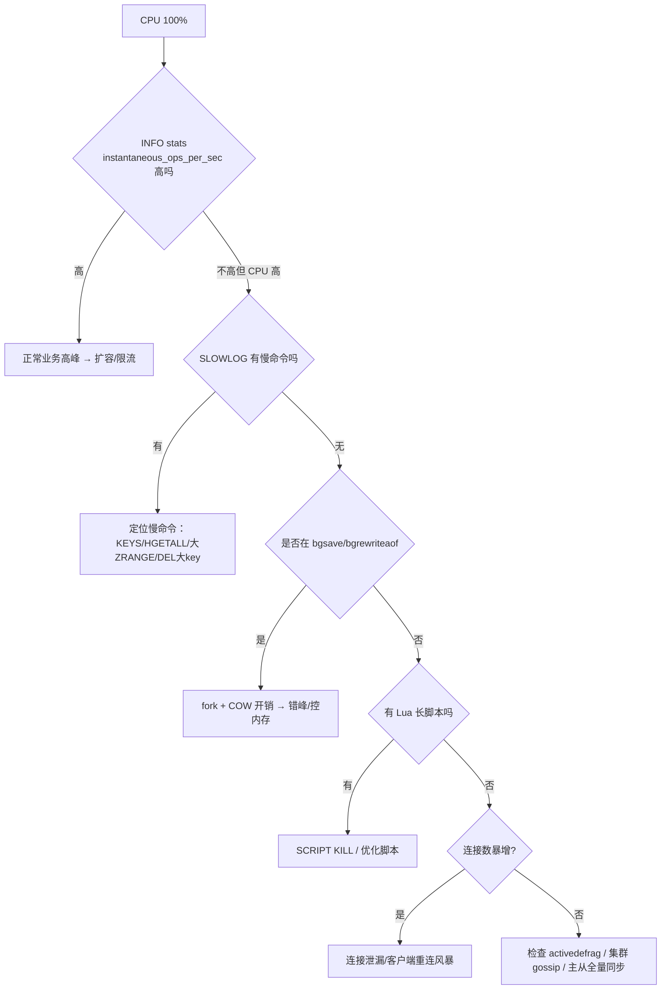

**工具**：

- `INFO stats` / `INFO commandstats`（哪个命令耗时最多）
- `SLOWLOG GET 10`（慢命令）
- `redis-cli --latency` / `--intrinsic-latency`（区分是 Redis 慢还是机器慢）
- `LATENCY DOCTOR`（延迟诊断）
- `top -H -p <pid>`（哪个线程占用高：主线程 vs bio 线程）

---

#### Q42. Redis 内存突然暴涨，怎么排查？ ★★★★★

**排查树**：

```
1. INFO memory → used_memory 涨了多少？used_memory_rss 呢？
2. 是否在 bgsave/bgrewriteaof？→ COW 导致 RSS 涨（正常，等结束）
3. 是否有大量新 key？→ DBSIZE 对比历史
4. 是否有 bigkey 新增？→ --bigkeys
5. 检查 client output buffer → CLIENT LIST 看 obl/omem
   （pubsub/monitor 消费者慢会导致缓冲堆积，且不受 maxmemory 限制）
6. 检查 repl_backlog → 从库断连期间 backlog 可能暴涨
7. 检查 AOF 缓冲 → aof_buf 堆积
8. mem_fragmentation_ratio > 1.5 → 碎片
```

**经典事故**：某个 `pubsub` 客户端消费慢 → 输出缓冲涨到几 GB → OOM Killer 杀掉 Redis。

---

#### Q43. Redis 延迟突然抖动（P99 从 1ms 到 100ms），怎么查？ ★★★★★

**原因清单（按概率排序）**：

| 原因 | 特征 | 验证 |
| --- | --- | --- |
| **bigkey 操作** | 偶发、与某接口相关 | SLOWLOG、`--bigkeys` |
| **fork（bgsave/AOF 重写）** | 周期性（如每小时） | `INFO persistence` 的 `rdb_last_bgsave_time`、`latest_fork_usec` |
| **AOF fsync 阻塞** | 与写入量相关 | 日志 `Asynchronous AOF fsync is taking too long` |
| **swap** | 持续、全命令变慢 | `mem_fragmentation_ratio < 1`、`free -h` |
| **网络** | 客户端侧看 RTT 高 | `--latency`、`ping` 对比 |
| **CPU 争抢** | 与宿主机其他进程相关 | `top`、`--intrinsic-latency`（若 intrinsic 高，说明是机器问题不是 Redis） |
| **过期 key 集中清理** | 与 TTL 分布相关 | `INFO stats` 的 `expired_keys` |
| **集群槽迁移** | 与运维操作相关 | `CLUSTER NODES` 看 migrating/importing |

**关键工具**：`redis-cli --intrinsic-latency 100` —— 如果这个值高，说明**是操作系统/虚拟化的问题**（CPU 被抢占、NUMA、超线程），不是 Redis 本身。

---

#### Q44. 主从切换后数据丢失了，为什么？ ★★★★☆

**答案**：

1. **异步复制**：主库返回 OK 时，命令可能还在 backlog 没发给从库。
2. **脑裂**：旧主被隔离但仍接受写入，切换后这部分数据丢失。
3. **`min-replicas-to-write` 未配置**：孤立的旧主仍可写。

**缓解**：`WAIT`、`min-replicas-to-write` + `min-replicas-max-lag`、业务幂等 + 对账。

**延伸**："有没有办法完全不丢？"→ 没有。要强一致必须用共识协议（Raft），Redis 不提供。可考虑 Redis 企业版/阿里云的"多副本强一致"或换用 etcd 做关键状态。

---

#### Q45. Redis 连接数暴涨 / 客户端超时，怎么排查？ ★★★★☆

**排查**：

1. `CLIENT LIST` 看连接数、`age`、`idle`、`cmd`、`omem`。
2. 是否有连接泄漏（客户端没 close）→ `CLIENT LIST | grep "idle=..."`。
3. 是否有大量 `CLIENT PAUSE` / 阻塞命令导致堆积。
4. `maxclients` 是否被打满 → `INFO clients` 的 `connected_clients` / `rejected_connections`。
5. 网络问题（TIME_WAIT 堆积、连接池配置不当）。
6. `CLIENT KILL` 清理异常连接（`CLIENT KILL TYPE pubsub` / `ADDR`）。

**根因常见**：

- 客户端连接池配置过大（几百个应用实例 × 每个 50 连接 = 上万连接）。
- 没有复用连接（每次请求新建）。
- 慢命令导致连接被长期占用。

---

### 10.10 源码 / 架构级（P7+）

---

#### Q46. 如果让你设计 Redis，你会怎么设计？为什么选择单线程？ ★★★★★

**答案框架**（要有"设计取舍"的思维）：

1. **定位**：内存 KV，追求**低延迟 + 高吞吐 + 简单可靠**。
2. **单线程的理由**：
   - 内存操作快，瓶颈在**网络 IO** 而非 CPU → 多线程收益低。
   - 避免锁 → 代码简单、无锁竞争、可预测延迟。
   - 原子性天然成立。
3. **数据结构**：为每种场景选最优（跳表 range、listpack 紧凑、dict O(1)）。
4. **持久化**：RDB（快照、恢复快）+ AOF（低丢失），用 fork + COW 隔离主线程。
5. **扩展**：单机不够 → Cluster 分片（16384 槽，客户端重定向）。
6. **代价**：无法用多核 → 用"多实例"解决；6.0 用多线程 IO 缓解网络瓶颈。

**延伸**："如果重来，你会改什么？"→ 可能引入"多线程执行 + 分段锁"（但会牺牲延迟可预测性）；或更早引入"无盘复制 + 多 part AOF"。

---

#### Q47. Redis 的 `SCAN` 是怎么实现的？为什么能保证不遗漏？ ★★★★★

**答案**：

- `SCAN` 不是"快照遍历"，而是**游标式增量遍历**。
- cursor 是**桶索引的位反转（reverse binary iteration）**：每次从高位进位，而不是普通递增。
- **扩容时**（mask 变大）：旧游标扫过的桶在新表中会被"覆盖"，不会漏新桶。
- **缩容时**（mask 变小）：游标会跳过已经扫过的部分，也不会漏。
- **重复是允许的**（弱一致性）：同一个 key 可能返回两次，业务要能容忍（用 Set 去重）。

**延伸**："`COUNT` 是精确的吗？"→ 不是，是**提示值**，实际返回可能多于/少于 COUNT（因为一次扫一个桶，桶里可能有多个 key）。

---

#### Q48. Redis 的 `rehash` 与 `SCAN` 如何共存？为什么不用暂停 rehash？ ★★★★★

见 2.2.5 与 Q47。**核心**：反向二进制迭代让"扩容/缩容"期间的遍历不漏；但会重复，所以 SCAN 是**弱一致**的。

---

#### Q49. Redis 的 `dict` 在 rehash 期间，`DBSIZE` 准确吗？ ★★★★☆

→ `DBSIZE` 返回的是 `ht[0].used + ht[1].used`，**是准确的**（因为 `used` 是两个表的总和）。但 `KEYS`/`SCAN` 的中间结果是不完整的。

---

#### Q50. Redis 的 `expires` 字典和主字典是同一个 dict 类型，为什么分开存？ ★★★★☆

→ 三个原因：

1. **语义分离**：大部分 key 没有 TTL，放在主 dict 里会浪费空间（每个 entry 多 8 字节）。
2. **遍历效率**：定期删除只需要遍历 `expires`（小得多的集合），不用扫全部 key。
3. **`RANDOMKEY`/`DBSIZE` 等**不需要考虑 TTL 字段。

**延伸**："`expires` 的 key 是独立字符串吗？"→ 不是，是**指向主 dict key 的指针**（共享 SDS），省内存。

---

#### Q51. Redis 的 `AOF` 为什么要"命令复制"而不是"状态复制"？ ★★★★☆

→ 命令复制（记录"做了什么"）比状态复制（记录"最终是什么"）**写放大更小**（一次 `INCR` 只写几字节，而状态复制要写整个值）。但代价是：非确定性命令必须特殊处理（`SPOP` 要改成 `SREM` 具体元素，`EXPIRE` 要改成 `PEXPIREAT` 绝对时间）。

**延伸**："7.0 有什么变化？"→ 仍然命令复制，但 Multi-Part AOF + 混合持久化让 base 用 RDB 格式（状态复制），兼顾两者。

---

#### Q52. Redis 的 `Stream` 底层为什么用 `rax`（基数树）？ ★★★★★

→ Stream 的消息 ID 是 `ms-seq`（时间戳 + 序号），天然是**有序的 64 位整数**。`rax`（Radix Tree，压缩前缀树）适合存储**有序的、变长的 key**：

- 查找 O(k)（k 是 key 长度，通常很小）。
- 支持**范围查询**（`XRANGE`）。
- 比跳表更省内存（共享前缀）。

**延伸**："为什么不用 ZSet？"→ ZSet 的 score 是 double（53 位有效位），`ms-seq` 拼接后是 128 位，double 装不下。rax 可以存完整的 128 位 ID。

---

### 10.11 各厂考察风格差异（面试策略）

| 公司 | 风格 | 高频重点 |
| --- | --- | --- |
| **阿里 / 蚂蚁** | 重原理 + 重业务落地，爱问"你怎么设计的""数据量多大" | 集群、缓存一致性、分布式锁、秒杀 |
| **腾讯** | 重源码细节 + 网络模型 | 事件循环、epoll、SDS/dict 源码 |
| **字节** | 重性能与排查，场景题多 | 延迟优化、bigkey、热 key、高并发设计 |
| **美团** | 重工程实践 + 中间件选型 | 缓存三兄弟、持久化选型、消息队列 |
| **京东** | 重交易场景 + 一致性 | 库存扣减、分布式事务、对账 |
| **拼多多** | 重极致性能 + 压测 | 单机 QPS 优化、pipeline、Lua |
| **百度** | 重基础 + 算法 | 数据结构复杂度、跳表 vs 红黑树 |
| **快手** | 重高并发 + 短视频场景 | 计数、排行榜、Feed 缓存 |
| **滴滴** | 重 GEO + 实时 | GEO、延迟队列、位置服务 |
| **网易** | 重基础扎实度 | 数据类型、持久化、主从 |

**面试建议**：

1. **先给结论，再给细节**（面试官时间有限）。
2. **主动说代价**（"这个方案的缺点是…"）—— 这是区分 P6 和 P7 的关键。
3. **带数据**（"单实例约 10 万 QPS""1 亿 key 约 10GB"）—— 显示你真的做过。
4. **承认边界**（"这个场景 Redis 不适合，应该用…"）—— 显示判断力。

---

## 第 11 章 速查表与自测清单

### 11.1 命令复杂度速查

| 命令 | 复杂度 | 备注 |
| --- | --- | --- |
| `GET` / `SET` | O(1) | |
| `DEL` | O(1) 摘链 + O(N) 释放 | 大 key 用 `UNLINK` |
| `EXISTS` | O(1) | |
| `EXPIRE` | O(1) | |
| `KEYS` | **O(N)** | 生产禁用 |
| `SCAN` | O(1) 每次 | 游标式 |
| `HSET` / `HGET` | O(1)（hashtable）/ O(N)（listpack，N≤128） | |
| `HGETALL` | O(N) | 大 hash 禁用 |
| `LPUSH` / `RPOP` | O(1) | |
| `LINDEX` | O(N) | |
| `LRANGE` | O(S+N) | |
| `SADD` / `SISMEMBER` | O(1) | intset 下 O(logN) |
| `SMEMBERS` | O(N) | 大 set 用 `SSCAN` |
| `SINTER` | O(N*M) | 按最小集合遍历 |
| `ZADD` | O(logN) | |
| `ZRANGE` | O(logN + M) | |
| `ZRANK` | O(logN) | |
| `ZREM` | O(logN) | |
| `INCR` | O(1) | int 编码直接加 |
| `SETBIT` / `GETBIT` | O(1) | |
| `BITCOUNT` | O(N) | N 为字节数 |
| `PFADD` / `PFCOUNT` | O(1) 摊销 / O(1) | 12KB 固定 |
| `GEOADD` | O(logN) | 底层 ZSet |
| `XADD` | O(1) | |

### 11.2 关键参数速查

| 参数 | 默认 | 建议 | 说明 |
| --- | --- | --- | --- |
| `maxmemory` | 0（不限） | 物理内存 3/4 | 一定要设，否则 OOM |
| `maxmemory-policy` | noeviction | allkeys-lru（纯缓存） | |
| `maxmemory-samples` | 5 | 10 | LRU 采样数 |
| `appendonly` | no | yes | |
| `appendfsync` | everysec | everysec | |
| `aof-use-rdb-preamble` | yes | yes | 混合持久化 |
| `save` | 3600 1 / 300 100 / 60 10000 | 按需 | |
| `repl-backlog-size` | 1mb | 写入速率×断连时长 | **必调大** |
| `repl-diskless-sync` | yes | yes | 无盘复制 |
| `io-threads` | 1 | CPU 3/4，≤8 | 6.0+ |
| `io-threads-do-reads` | no | yes（大 value 场景） | |
| `lazyfree-lazy-user-del` | no | yes | `DEL` 异步释放 |
| `hash-max-listpack-entries` | 128 | 128 | |
| `hash-max-listpack-value` | 64 | 64 | |
| `zset-max-listpack-entries` | 128 | 128 | |
| `zset-max-listpack-value` | 64 | 64 | |
| `list-max-listpack-size` | 128 | 128 | |
| `set-max-intset-entries` | 512 | 512 | |
| `cluster-node-timeout` | 15000 | 15000 | |
| `cluster-require-full-coverage` | yes | **no** | 避免一个槽挂全集群不可用 |
| `min-replicas-to-write` | 0 | 1 | 防脑裂 |
| `min-replicas-max-lag` | 10 | 10 | |
| `slowlog-log-slower-than` | 10000（μs） | 5000~10000 | |
| `slowlog-max-len` | 128 | 512 | |
| `hz` | 10 | 10 | 定时任务频率 |
| `dynamic-hz` | yes | yes | 空闲降频 |

### 11.3 监控指标清单

```
# 性能
instantaneous_ops_per_sec        # 当前 QPS
latency_percentiles_usec         # 延迟分位（7.0+）
instantaneous_input_kbps / output_kbps

# 内存
used_memory / used_memory_rss / mem_fragmentation_ratio
used_memory_peak
evicted_keys                      # 淘汰数量（持续增长说明内存不足）
expired_keys

# 连接
connected_clients / rejected_connections / blocked_clients
client_recent_max_output_buffer

# 持久化
rdb_last_bgsave_status / rdb_last_bgsave_time_sec / latest_fork_usec
aof_last_write_status / aof_last_bgrewrite_status
aof_current_size / aof_base_size

# 复制
master_link_status / master_last_io_seconds_ago
master_repl_offset vs slave_repl_offset（差值 = 延迟）
master_sync_in_progress

# 集群
cluster_state / cluster_slots_assigned / cluster_known_nodes
cluster_stats_messages_sent / received

# 慢查询
slowlog_len / slowlog_get
```

### 11.4 自测清单（能全部答出说明你真的懂了）

- [ ] 能画出 `SET k v` 从 TCP 到回包的完整链路
- [ ] 能解释 SDS 的 4 个优势 + 预分配阈值
- [ ] 能讲清渐进式 rehash 期间的三条访问规则
- [ ] 能说出跳表 vs 红黑树 vs B+ 树的取舍
- [ ] 能解释 ziplist 级联更新 + listpack 的解法
- [ ] 能说出 11 种编码的转换条件（尤其三个"不回落"）
- [ ] 能解释为什么 `DEL` 大 key 会卡、`UNLINK` 怎么做
- [ ] 能画 fork + COW 的时序图，并说出内存翻倍的条件
- [ ] 能讲清 AOF 重写期间"旧 AOF + 重写缓冲区 + 新文件"的关系
- [ ] 能说出 7.0 Multi-Part AOF 的改进
- [ ] 能解释"从库为什么不主动删过期 key"
- [ ] 能讲清近似 LRU 的采样机制 + LFU 的概率计数
- [ ] 能说出 `repl-backlog` 的作用与容量公式
- [ ] 能讲清哨兵的 sdown/odown/选举/选主四步
- [ ] 能解释 16384 槽的三个理由
- [ ] 能讲清 MOVED vs ASK + ASKING 的作用
- [ ] 能说出 Redis 事务为什么不能回滚
- [ ] 能对比 Pipeline / MULTI / Lua
- [ ] 能讲清缓存穿透/击穿/雪崩的区别与方案
- [ ] 能说出缓存一致性的 4 种策略 + 为什么选 Cache Aside
- [ ] 能讲清分布式锁的演进 + Redlock 争议
- [ ] 能说出大 key / 热 key 的发现与治理
- [ ] 能设计排行榜 / 秒杀 / 延迟队列 / 附近的人
- [ ] 能给出 CPU 100% / 内存暴涨 / 延迟抖动的排查路径
- [ ] 能说出 Redis 不适合做什么（强一致、海量冷数据、复杂查询）

---

## 附录 A：常见认知误区（面试踩坑点）

| 误区 | 真相 |
| --- | --- |
| "Redis 单线程" | 命令执行单线程，IO/持久化/删除是多线程/多进程 |
| "Redis 事务支持回滚" | 不支持，执行期错误只影响单条 |
| "RDB 会丢所有数据" | 只丢最后一次快照之后的 |
| "AOF always 零丢失" | 仍有内核缓冲/磁盘缓存风险，且性能极差 |
| "主从是强一致" | 异步复制，有丢失窗口 |
| "Redis 集群是 16384 个节点" | 是 16384 个**槽**，节点数远小于此 |
| "布隆过滤器能精确判断" | 有假阳性，无假阴性 |
| "HyperLogLog 能列出元素" | 只能估算基数，不能取元素 |
| "`KEYS` 只是慢一点" | 会阻塞主线程 + 撑爆内存，是事故 |
| "`maxmemory` 限制住就不会 OOM" | 不含输出缓冲/backlog/AOF 缓冲，仍可能被 OOM Killer 杀 |
| "删除 key 就立刻释放内存" | 惰性删除 + 碎片，内存可能不立即归还 OS |
| "Cluster 支持所有多 key 操作" | 必须同槽（hash tag） |
| "Redis 可以做消息队列替代 Kafka" | Stream 可用但吞吐/持久化差一个量级 |
| "expire 精度是毫秒" | 实际删除依赖定期任务（100ms 粒度）+ 惰性 |

---

## 附录 B：延伸阅读方向（想继续深入的话）

1. **源码级**：`src/server.c`（事件循环）、`src/t_dict.c`（rehash）、`src/t_zset.c`（跳表）、`src/aof.c`、`src/cluster.c`。
2. **论文/设计文档**：
   - Redis 作者的《Redis 设计与实现》（黄健宏著，中文最佳入门）
   - antirez 关于 Redlock 的博客 + Martin Kleppmann 的反驳
   - GeoHash 原始论文
   - HyperLogLog 论文《HyperLogLog in Practice》
3. **工程实践**：
   - 阿里云 Redis 开发规范（key 命名、bigkey 治理）
   - Redisson 源码（分布式锁/watch dog）
   - Canal（binlog 订阅）
4. **对比学习**：Memcached（纯 KV、多线程）、etcd（Raft 强一致）、Kafka（日志型 MQ）、Aerospike（SSD 混合）。

---

> **最后一句**：Redis 的知识密度在于"**每个设计都有代价**"。面试时能说出"这个方案好在哪、差在哪、什么场景不该用"，比背下 100 个命令有用得多。


