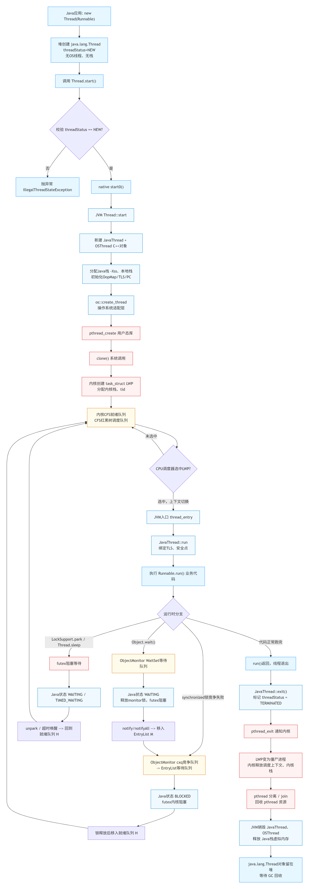

# Java线程底层完整深入版（HotSpot 1:1 平台线程，不含虚拟线程）

先明确前提：**HotSpot 默认平台线程（Thread）是 1:1 模型**，一个 `java.lang.Thread` 对象 ≠ OS线程，只是Java层句柄；真正调度实体是操作系统内核LWP（轻量级进程，Linux下task_struct）。

> 
> 虚拟线程（VirtualThread）是 M:N 用户态调度，后面单独对比，本流程主线是我们平时最常用的 `new Thread()`。

## 一、分层定义，逐个深挖

三层：**Java应用层 → JVM层 → OS内核层**

1. **Java层：java.lang.Thread 对象**
   - 它只是一个普通Java堆对象，存：name、priority、daemon标记、Runnable、threadStatus、native指针等。
   - **重点：new Thread() 仅仅是在堆上创建对象，不会创建OS线程！**
   - `start()` 才是分水岭：调用native方法 `start0()`；直接调用 `run()` 只是普通方法调用，当前线程执行，不会新建线程。
   - 源码关键点：`threadStatus` 是CAS状态机（NEW、RUNNABLE、BLOCKED、WAITING、TIMED_WAITING、TERMINATED），**这个状态是JVM维护的，和OS内核线程状态不是一一映射！**> 
   > 坑：Java的RUNNABLE包含OS的【就绪+运行】；Java的BLOCKED只是等待synchronized监视器锁，不是内核阻塞；WAITING/TIMED_WAITING是park，内核阻塞。
2. **JVM层：JavaThread（HotSpot C++对象）**
 当 `start0()` 进入JVM，JVM会创建 `JavaThread`（JVM内部C++结构体），这是JVM管理线程的核心载体：
   - 持有：OS线程句柄、栈内存（Java栈 + 本地栈）、PC寄存器、OopMap、线程本地存储TLS、pending exception、monitor等待队列、JVM状态。
   - Java栈：每个线程独立，栈帧StackFrame，存局部变量表、操作数栈、动态链接、返回地址；**栈大小由-Xss控制，是JVM向OS申请的一块虚拟内存**。
   - OopMap：GC用！告诉GC，栈上哪些位置存的是对象引用，避免扫描整个栈，是准确GC的关键。
   - 配套重要结构：
     - `OSThread`：JVM对不同操作系统线程API的封装层（隔离Linux/Windows/macOS差异）
     - `ThreadLocalStorage`：TLS，绑定当前线程，存当前JavaThread指针，native方法快速拿到当前线程
     - JVM内部队列：**VMOperationQueue（VM操作队列，比如STW、GC、类重定义）、Safepoint队列**
   - 调用 `os::create_thread()`，最终调用OS系统API创建内核线程：
     - Linux：`pthread_create` → 内核clone()，生成LWP（task_struct）
     - Windows：`CreateThread`
3. **OS内核层：LWP（轻量级进程，Linux task_struct）**
 pthread 是用户态库，最终落到内核：
   - 每个LWP拥有独立：内核栈、PID（tid）、调度上下文（寄存器、程序计数器、调度状态）、信号掩码。
   - 共享进程的地址空间、文件描述符、内存映射（和同进程其他LWP共享）。
   - 内核调度器CFS完全平等调度LWP，和普通进程一样，时间片、抢占、优先级由内核控制。> 
   > 重要区分：
   > 
   > 
   > - JVM的线程优先级（setPriority）只是**hint提示**，Linux内核默认不遵守，只是给调度器的建议，不能强制；Windows会有一定效果。
   > - 内核线程状态：TASK_RUNNING（正在CPU运行 / 就绪队列）、TASK_INTERRUPTIBLE（可唤醒阻塞）、TASK_UNINTERRUPTIBLE（不可中断）、TASK_STOPPED、EXIT_ZOMBIE。
   > Java状态 ≠ 内核状态映射表：| Java状态 | 内核状态 | 说明 |
   > | --- | --- | --- |
   > | NEW | 无 | 还没创建LWP |
   > | RUNNABLE | TASK_RUNNING | 就绪队列等待CPU 或者 正在CPU上跑 |
   > | BLOCKED | TASK_INTERRUPTIBLE | 等待synchronized monitor锁，JVM把线程放到ObjectMonitor的cxq/EntryList |
   > | WAITING/TIMED_WAITING | TASK_INTERRUPTIBLE | Unsafe.park，内核futex阻塞，进入内核等待队列 |
   > | TERMINATED | EXIT_ZOMBIE/已回收 | 线程执行完毕 |

### 补充：Monitor 锁底层（BLOCKED的核心）

`ObjectMonitor` 结构：

- _owner：当前持有锁的JavaThread
- _EntryList：抢锁失败，阻塞等待进入临界区的线程队列（BLOCKED）
- _cxq：竞争队列，自旋失败后入cxq
- _WaitSet：调用wait()的线程，进入WaitSet（WAITING），被notify后移入EntryList> 
> wait() 一定会释放monitor锁；park()（LockSupport）不绑定monitor，是独立的futex原语，AQS底层就是park。

### AQS 与 park 底层

LockSupport.park() → Unsafe.park() → JVM调用 `pthread_cond_wait` / Linux futex系统调用，线程进入内核等待队列，**让出CPU，不消耗时间片**；unpark设置一个许可标记，唤醒futex。

## 二、全链路流转：从 new Thread() → start() → 运行 → 阻塞/唤醒 → 正常结束 → 资源回收

> 
> 下面是文字版流程图，后面给你可直接画Mermaid图的完整代码（包含所有队列、三层对象、系统调用）

```
【Java应用层】
1. new Thread(new Runnable(){run()})
    ↓
    堆分配 java.lang.Thread 对象，threadStatus=NEW，仅Java对象，无OS线程、无栈
    ↓
2. 调用 thread.start()
    ↓
    start() 校验：如果status不是NEW，抛IllegalThreadStateException
    ↓
    调用 native 方法 start0()
    ────────────────────────────────────
【JVM层 HotSpot】
3. start0() → JVM: Thread::start()
    ↓
    创建 C++ 对象 JavaThread + OSThread
    ↓
    分配Java栈（-Xss），分配本地C栈，初始化PC寄存器、OopMap、TLS
    ↓
    os::create_thread(...) 【OS封装层】
    ↓
    Linux：pthread_create()
    ────────────────────────────────────
【OS 用户态 pthread库】
4. pthread_create 准备 pthread_t，分配用户态栈，发起 clone() 系统调用
    ↓
【Linux内核】
5. clone(CLONE_VM | CLONE_FS | CLONE_FILES | CLONE_SIGHAND ...)
    ↓
    内核创建 task_struct（LWP，轻量级进程），分配内核栈，分配tid
    ↓
    LWP 进入内核就绪队列（CFS runq 红黑树），等待CPU调度
    ↓
    调度器选中该LWP，CPU切换上下文，开始执行JVM指定的入口函数：thread_entry
    ────────────────────────────────────
【回到JVM】
6. thread_entry 回调：JavaThread::run()
    ↓
    绑定TLS，设置安全点支持，执行Java回调：run()
    ↓
    执行用户Runnable.run() 业务代码
    ├───────────────────────────────────
    │ 分支A：业务执行中，遇到 synchronized 锁竞争
    │       → 进入ObjectMonitor cxq/EntryList，Java状态BLOCKED，内核futex阻塞
    │
    │ 分支B：调用 wait()
    │       → 释放monitor锁，线程进入ObjectMonitor.WaitSet，Java状态WAITING
    │       → notify/notifyAll 后移入EntryList重新抢锁
    │
    │ 分支C：LockSupport.park() / sleep()
    │       → futex阻塞，WAITING/TIMED_WAITING；unpark/超时唤醒，回到就绪
    │
    │ 分支D：正常代码执行完毕，run方法返回
    └───────────────────────────────────
7. run() 执行完成 → JavaThread 收尾
    ↓
    触发线程退出逻辑：JavaThread::exit()
    ↓
    标记Java层 threadStatus=TERMINATED
    ↓
    调用pthread_exit()，通知内核LWP退出
    ────────────────────────────────────
【OS内核】
8. LWP变成僵尸进程（TASK_ZOMBIE），内核释放CPU上下文、内核栈
    ↓
    pthread库自动回收（pthread_join 或者分离属性detach），释放pthread资源
    ────────────────────────────────────
【JVM后续回收】
9. JVM销毁JavaThread、OSThread结构体
    ↓
    Java栈内存释放（虚拟内存归还OS）
    ↓
【Java层】
10. java.lang.Thread 对象还在堆里！只是状态TERMINATED，等待GC回收这个Thread对象
> 重点：OS线程销毁 ≠ Java Thread对象立刻回收，两个生命周期完全解耦！
```

## 三、Mermaid 完整流程图（包含所有层级、队列、调度链路，你可以直接复制到支持Mermaid的工具：Markdown编辑器、Typora、Mermaid Live Editor）

```
flowchart TD
    %% 定义样式
    classDef java fill:#e6f7ff,stroke:#1890ff
    classDef jvm fill:#f0f9ff,stroke:#0284c7
    classDef os fill:#fef2f2,stroke:#dc2626
    classDef queue fill:#fffbeb,stroke:#d97706

    A["Java应用: new Thread(Runnable)"]:::java
    A1["堆创建 java.lang.Thread<br/>threadStatus=NEW<br/>无OS线程、无栈"]:::java
    B["调用 Thread.start()"]:::java
    B1{"校验 threadStatus == NEW?"}
    B2["抛异常 IllegalThreadStateException"]:::java
    C["native start0()"]:::java

    D["JVM Thread::start"]:::jvm
    D1["新建 JavaThread + OSThread C++对象"]:::jvm
    D2["分配Java栈 -Xss、本地栈<br/>初始化OopMap/TLS/PC"]:::jvm
    D3["os::create_thread<br/>操作系统适配层"]:::jvm

    E["pthread_create 用户态库"]:::os
    F["clone() 系统调用"]:::os
    G["内核创建 task_struct LWP<br/>分配内核栈、tid"]:::os
    H["内核CFS就绪队列<br/>CFS红黑树调度队列"]:::queue
    I{"CPU调度器选中LWP?"}
    J["JVM入口 thread_entry"]:::jvm
    J1["JavaThread::run<br/>绑定TLS、安全点"]:::jvm
    K["执行 Runnable.run() 业务代码"]:::java

    L{"运行时分支"}
    M["ObjectMonitor cxq竞争队列<br/>→ EntryList等待队列"]:::queue
    M1["Java状态 BLOCKED<br/>futex内核阻塞"]:::jvm
    M2["锁释放后移入就绪队列 H"]

    N["ObjectMonitor WaitSet等待队列"]:::queue
    N1["Java状态 WAITING<br/>释放monitor锁，futex阻塞"]:::jvm
    N2["notify/notifyAll → 移入EntryList M"]

    O["futex阻塞等待"]:::os
    O1["Java状态 WAITING / TIMED_WAITING"]:::jvm
    O2["unpark / 超时唤醒 → 回到就绪队列 H"]

    P["run()返回，线程退出"]:::java
    Q["JavaThread::exit()<br/>标记 threadStatus = TERMINATED"]:::jvm
    R["pthread_exit 通知内核"]:::os
    S["LWP变为僵尸进程<br/>内核释放调度上下文、内核栈"]:::os
    T["pthread 分离 / join<br/>回收 pthread 资源"]:::os
    U["JVM销毁 JavaThread、OSThread<br/>释放 Java栈虚拟内存"]:::jvm
    V["java.lang.Thread对象留在堆<br/>等待 GC 回收"]:::java

    A --> A1 --> B --> B1
    B1 -->|否| B2
    B1 -->|是| C --> D --> D1 --> D2 --> D3 --> E --> F --> G --> H --> I
    I -->|未选中| H
    I -->|选中，上下文切换| J --> J1 --> K --> L

    L -->|synchronized锁竞争失败| M --> M1 --> M2 --> H
    L -->|Object.wait()| N --> N1 --> N2 --> M
    L -->|LockSupport.park / Thread.sleep| O --> O1 --> O2 --> H
    L -->|代码正常跑完| P --> Q --> R --> S --> T --> U --> V
```

## 四、深挖几个高频容易混淆的底层知识点（补充深入）

### 1. 栈内存的本质

Java栈是**JVM向OS申请的虚拟内存**，不是物理内存；初始只是虚拟地址，只有用到的时候才触发缺页中断分配物理页。
栈溢出：-Xss太小，栈帧不断压入（递归），虚拟地址耗尽 → StackOverflowError。

### 2. 安全点 SafePoint 和线程调度的关系

OS的抢占调度和JVM安全点是两套东西：

- OS：随时抢占，时间片到了就切走LWP，和JVM无关；
- JVM GC需要STW：JVM要等所有线程跑到安全点（比如循环末尾、方法返回点），线程在安全点轮询标记，配合VMOperationQueue。> 
> 线程在阻塞（futex wait）的时候，天然处于安全点，不需要等待。

### 3. 上下文切换代价

两种切换：

- 用户态上下文切换：只切换寄存器（少见）
- 用户 ↔ 内核态切换：需要进入内核，刷新TLB、缓存；
- 线程上下文切换：内核保存task_struct里所有寄存器，换另一个LWP运行，**代价高**，就是我们常说的线程切换开销。

### 4. Daemon守护线程

- 标记是JavaThread里的flag；
- JVM退出规则：**所有非守护线程全部结束，JVM就退出，直接kill所有守护线程，不会等守护线程跑完**；
- 不是OS层面的守护，只是JVM自己的标记。

### 5. 虚拟线程对比（M:N，方便对照理解）

虚拟线程 `VirtualThread`：

- 没有一对一LWP；
- JVM内部ForkJoinPool的载体线程（平台线程）作为 carrier；
- 调度在JVM用户态，不需要频繁内核切换；
- 栈是分段栈（chunk栈），非常轻量；
- 不适合阻塞在native调用（会卡住carrier线程）。

## 五、额外补充：队列汇总清单（图里所有队列单独拎出来）

1. 内核：CFS runq（就绪队列，Linux红黑树）
2. Monitor：cxq（竞争队列）、EntryList（锁等待队列，BLOCKED）、WaitSet（wait等待队列，WAITING）
3. JVM：VMOperationQueue（STW、GC等VM操作）、Safepoint轮询队列
4. AQS：CLH双向队列（Lock底层，park/unpark）

如果你想要，我可以：

1. 把这个Mermaid图改成拓扑图版本，或者给你PlantUML版本；
2. 单独再深挖 futex、clone、CFS调度细节；
3. 或者写一段Demo + 用perf/ftrace 抓这个线程创建、futex阻塞的系统调用日志。